# 第 46 章：无障碍功能

## 46.1 无障碍架构

Android 的无障碍框架是平台中最复杂的子系统之一。它让存在残障（包括视觉、运动、听力和认知障碍）的用户能够与设备上的每个应用进行交互，其中甚至包括那些开发者从未预料到会被这样使用的应用。该架构围绕三大支柱设计：**事件观察**、**内容内省**和**动作注入**。

在最高层次上，无障碍框架连接三类参与者：

1. **应用**（View 和 ViewGroup），产生 `AccessibilityEvent`
   并把自己的内容暴露为 `AccessibilityNodeInfo` 对象树。
2. **AccessibilityManagerService**（AMS），集中式的系统服务，负责
   路由事件、管理服务绑定并强制执行安全策略。
3. **AccessibilityServices**，消费事件、检查视图树并代表用户执行
   动作。TalkBack、Switch Access 和 Voice Access 是部署最广泛的
   示例。

### 46.1.1 高层数据流

下图展示了从 View 状态变化到无障碍服务响应的核心数据流：

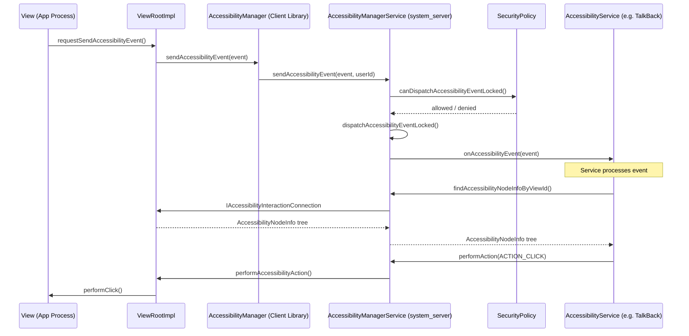

### 46.1.2 三个核心类

无障碍框架围绕每个 AOSP 开发者都必须理解的三个核心类展开：

**AccessibilityManagerService** 是核心协调者。定义于：
```
frameworks/base/services/accessibility/java/com/android/server/accessibility/
    AccessibilityManagerService.java
```

它运行在 `system_server` 中，实现 `IAccessibilityManager`
AIDL 接口。类的声明揭示了它的众多职责：

```java
// AccessibilityManagerService.java, line 256
public class AccessibilityManagerService extends IAccessibilityManager.Stub
        implements AbstractAccessibilityServiceConnection.SystemSupport,
        AccessibilityUserState.ServiceInfoChangeListener,
        AccessibilityWindowManager.AccessibilityEventSender,
        AccessibilitySecurityPolicy.AccessibilityUserManager,
        SystemActionPerformer.SystemActionsChangedListener,
        SystemActionPerformer.DisplayUpdateCallBack, ProxyManager.SystemSupport {
```

它是规模较大的系统服务之一。

**AccessibilityService** 是所有无障碍服务继承的抽象基类。定义于：
```
frameworks/base/core/java/android/accessibilityservice/AccessibilityService.java
```

服务运行在自己的进程中，并通过 Binder 与 AMS 通信。每个服务在
XML 元数据文件中声明自己的能力，并接收与其配置的事件类型和包名
过滤器相匹配的事件。

**AccessibilityNodeInfo** 表示无障碍树中的单个节点。定义于：
```
frameworks/base/core/java/android/view/accessibility/AccessibilityNodeInfo.java
```

它是无障碍框架中最丰富的数据结构，携带文本内容、边界、动作、集合
信息、范围信息以及树关系。

### 46.1.3 组件架构图

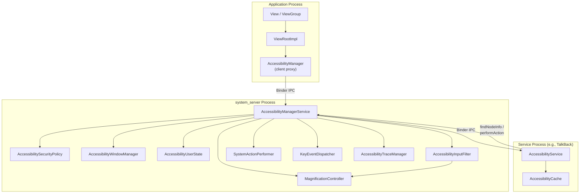

### 46.1.4 AccessibilityNodeInfo 详解

Android UI 层次结构中的每个 `View` 都能生成自身的一份
`AccessibilityNodeInfo` 快照。当无障碍服务查询窗口内容时，看到的
就是这个快照。节点携带了丰富的信息：

| 属性类别 | 示例 |
|-------------------|----------|
| 身份标识 | `viewIdResourceName`、`className`、`packageName` |
| 文本 | `text`、`contentDescription`、`hintText`、`tooltipText` |
| 状态 | `isChecked`、`isEnabled`、`isFocused`、`isSelected`、`isPassword` |
| 几何信息 | `boundsInScreen`、`boundsInParent`、`boundsInWindow` |
| 树结构 | `parentNodeId`、`childNodeIds`、`labeledBy`、`labelFor` |
| 动作 | `AccessibilityAction` 列表（点击、长按、滚动等） |
| 集合信息 | 列表/网格的 `CollectionInfo`、`CollectionItemInfo` |
| 范围信息 | 进度条类的 `RangeInfo`（seekbar、progress bar） |
| 额外数据 | 用于自定义键值对的额外信息 `Bundle` |

节点 ID 方案使用由两个 32 位 ID 组成的 64 位值：

```java
// AccessibilityNodeInfo.java
public static final long UNDEFINED_NODE_ID =
    makeNodeId(UNDEFINED_ITEM_ID, UNDEFINED_ITEM_ID);

public static final long ROOT_NODE_ID =
    makeNodeId(ROOT_ITEM_ID, AccessibilityNodeProvider.HOST_VIEW_ID);
```

`makeNodeId` 函数把视图 ID 和虚拟后代 ID 打包进单个 `long`。这为
`AccessibilityNodeProvider` 提供了支持：单个 `View` 可以把自身报告为
一棵虚拟节点树。对于绘制多个可交互元素的自定义视图来说，这是必不可
少的。

### 46.1.5 AccessibilityNodeInfo 动作

`AccessibilityNodeInfo` 中的动作系统允许无障碍服务与 UI 交互。标准
动作为了向后兼容以位掩码常量的形式定义，而在较新的 API 中则以
`AccessibilityAction` 对象定义：

```java
// AccessibilityNodeInfo.java -- legacy action constants
public static final int ACTION_FOCUS       = 1;        // 1 << 0
public static final int ACTION_CLICK       = 1 << 4;   // 0x00000010
public static final int ACTION_LONG_CLICK  = 1 << 5;   // 0x00000020
public static final int ACTION_SELECT      = 1 << 2;   // 0x00000004
public static final int ACTION_SCROLL_FORWARD  = 1 << 12;
public static final int ACTION_SCROLL_BACKWARD = 1 << 13;
public static final int ACTION_SET_TEXT    = 1 << 21;
```

`AccessibilityAction` 类封装了一个动作 ID 和一个可选标签，允许在
标准动作之外，把自定义动作也暴露给服务。

### 46.1.6 预取策略

现代 Android 为无障碍节点遍历提供了复杂的预取策略。它们以标志位
的形式声明在 `AccessibilityNodeInfo` 上：

```java
public static final int FLAG_PREFETCH_ANCESTORS = 1;
public static final int FLAG_PREFETCH_SIBLINGS = 1 << 1;
public static final int FLAG_PREFETCH_DESCENDANTS_HYBRID = 1 << 2;
public static final int FLAG_PREFETCH_DESCENDANTS_DEPTH_FIRST = 1 << 3;
public static final int FLAG_PREFETCH_DESCENDANTS_BREADTH_FIRST = 1 << 4;
```

混合策略在递归之前先预取根节点的子节点，在延迟和完整性之间提供
了良好的平衡。深度优先和广度优先策略彼此互斥，也与混合策略互斥；
组合不兼容的策略会触发 `IllegalArgumentException`。

---

## 46.2 AccessibilityManagerService（无障碍管理器服务）

`AccessibilityManagerService`（AMS）是 Android 无障碍子系统的心脏。
它是一个运行在 `system_server` 进程中的系统服务。它在系统启动期间
由 `SystemServer.startOtherServices()` 启动，并注册在
`Context.ACCESSIBILITY_SERVICE` 这一名称下。

源代码位置：
```
frameworks/base/services/accessibility/java/com/android/server/accessibility/
    AccessibilityManagerService.java
```

### 46.2.1 职责

AMS 有七项主要职责：

1. **事件分发**——接收来自应用的 `AccessibilityEvent`，并
   把它们路由到已绑定的无障碍服务。
2. **服务生命周期**——绑定、管理和解绑无障碍服务。
3. **安全强制**——确保事件只被分发给经过授权的服务，并确保服务
   只能访问它们被允许查看的内容。
4. **窗口管理**——维护无障碍窗口树，这是与窗口管理器的窗口列表
   平行的结构。
5. **输入过滤**——在触摸探索或缩放等功能启用时，在输入管线中
   安装 `AccessibilityInputFilter`。
6. **缩放协调**——管理 `MagnificationController`，它同时处理全屏
   缩放和窗口缩放。
7. **用户状态管理**——维护按用户划分的无障碍偏好设置、已启用的
   服务以及快捷方式配置。

### 46.2.2 关键内部组件

AMS 委托给若干协作类：

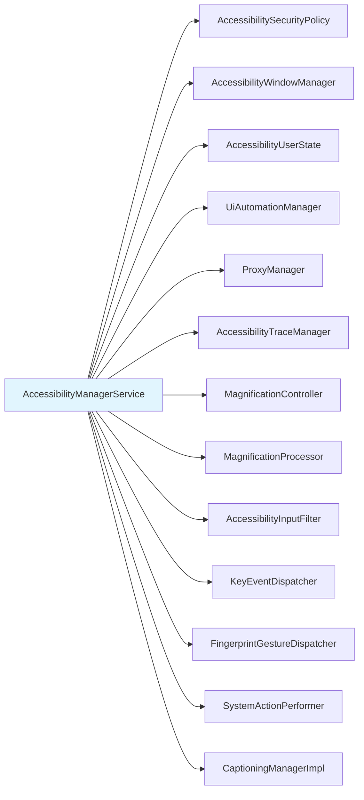

**AccessibilitySecurityPolicy** 是守门人。它决定：

- 某个事件能否被分发给给定服务
- 某个服务能否获取窗口内容
- 跨用户档案（profile）的事件应报告哪个包名
- 未归类为无障碍工具的服务是否应触发警告

安全策略维护一个事件类型位掩码，指示哪些事件的源
`AccessibilityNodeInfo` 应被保留：

```java
// AccessibilitySecurityPolicy.java, line 70
private static final int KEEP_SOURCE_EVENT_TYPES =
    AccessibilityEvent.TYPE_VIEW_CLICKED
    | AccessibilityEvent.TYPE_VIEW_FOCUSED
    | AccessibilityEvent.TYPE_VIEW_HOVER_ENTER
    | AccessibilityEvent.TYPE_VIEW_HOVER_EXIT
    | AccessibilityEvent.TYPE_VIEW_LONG_CLICKED
    | AccessibilityEvent.TYPE_VIEW_TEXT_CHANGED
    | AccessibilityEvent.TYPE_WINDOW_STATE_CHANGED
    | AccessibilityEvent.TYPE_WINDOWS_CHANGED
    | AccessibilityEvent.TYPE_VIEW_SELECTED
    | AccessibilityEvent.TYPE_WINDOW_CONTENT_CHANGED
    | AccessibilityEvent.TYPE_VIEW_TEXT_SELECTION_CHANGED
    | AccessibilityEvent.TYPE_VIEW_SCROLLED
    | AccessibilityEvent.TYPE_VIEW_ACCESSIBILITY_FOCUSED
    | AccessibilityEvent.TYPE_VIEW_ACCESSIBILITY_FOCUS_CLEARED
    | AccessibilityEvent.TYPE_VIEW_TEXT_TRAVERSED_AT_MOVEMENT_GRANULARITY
    | AccessibilityEvent.TYPE_VIEW_TARGETED_BY_SCROLL;
```

不在此位掩码中的事件，其源节点会在送达服务之前被剥离，从而防止
未经授权的内容抓取。

**AccessibilityWindowManager** 维护无障碍窗口树。它跟踪：

- 全局交互连接（跨用户窗口）
- 按用户划分的交互连接
- 活动窗口和无障碍焦点窗口
- 画中画窗口

**AccessibilityUserState** 保存按用户划分的配置：

- 已绑定和正在绑定的服务列表（`mBoundServices`）
- 已启用的服务组件名
- 每种快捷方式类型的快捷方式分配
- 缩放模式偏好
- 软键盘显示模式

### 46.2.3 事件分发管线

事件分发管线是无障碍框架中性能最关键的路径。让我们追踪一个事件
从产生到送达的全过程。

**第 1 步：事件产生。** `View` 调用 `sendAccessibilityEvent()` 或
`sendAccessibilityEventUnchecked()`。事件经由父视图上的
`requestSendAccessibilityEvent()` 沿视图树向上传播，父视图可以增强
或阻止该事件。

**第 2 步：跨进程送达。** 事件到达 `ViewRootImpl`，后者经由客户端
`AccessibilityManager` 通过 Binder 调用服务端 AMS：

```java
// AccessibilityManagerService.java, line 1617
public void sendAccessibilityEvent(AccessibilityEvent event, int userId) {
```

**第 3 步：安全检查。** AMS 解析调用用户、验证报告的包名并检查分发
权限：

```java
// AccessibilityManagerService.java, lines 1647-1653
resolvedUserId = mSecurityPolicy
    .resolveCallingUserIdEnforcingPermissionsLocked(userId);
event.setPackageName(mSecurityPolicy.resolveValidReportedPackageLocked(
    event.getPackageName(), UserHandle.getCallingAppId(),
    resolvedUserId, getCallingPid()));
```

**第 4 步：窗口状态更新。** 对于影响窗口跟踪的事件（如
`TYPE_WINDOW_STATE_CHANGED`），AMS 要求 WindowManager 为无障碍重新
计算窗口：

```java
// AccessibilityManagerService.java, line 1698
wm.computeWindowsForAccessibility(displayId);
```

**第 5 步：分发给服务。** 实际分发会调用两次
`notifyAccessibilityServicesDelayedLocked()`。布尔参数是
`isDefault`。因此，第一次调用通知非默认服务。第二次调用通知默认
服务（即在其 `AccessibilityServiceInfo` 中声明了 `flagDefault` 的
服务）：

```java
// AccessibilityManagerService.java, line 1716
private void dispatchAccessibilityEventLocked(AccessibilityEvent event) {
    if (mProxyManager.isProxyedDisplay(event.getDisplayId())) {
        mProxyManager.sendAccessibilityEventLocked(event);
    } else {
        notifyAccessibilityServicesDelayedLocked(event, false);
        notifyAccessibilityServicesDelayedLocked(event, true);
    }
    mUiAutomationManager.sendAccessibilityEventLocked(event);
}
```

**第 6 步：输入过滤器通知。** 如果安装了输入过滤器（用于触摸探索
或缩放），事件也会被转发给它：

```java
// AccessibilityManagerService.java, line 1663
if (mHasInputFilter && mInputFilter != null) {
    mMainHandler.sendMessage(obtainMessage(
        AccessibilityManagerService::sendAccessibilityEventToInputFilter,
        this, AccessibilityEvent.obtain(event)));
}
```

下图展示了这条管线：

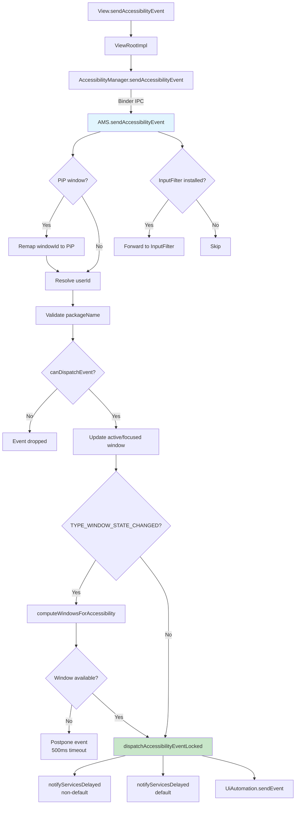

### 46.2.4 AMS 初始化

`AccessibilityManagerService` 的构造函数揭示了它所创建的全套协作
组件：

```java
// AccessibilityManagerService.java, line 642
public AccessibilityManagerService(Context context) {
    super(PermissionEnforcer.fromContext(context));
    mContext = context;
    mPowerManager = context.getSystemService(PowerManager.class);
    mWindowManagerService =
        LocalServices.getService(WindowManagerInternal.class);
    mTraceManager = AccessibilityTraceManager.getInstance(
        mWindowManagerService.getAccessibilityController(), this, mLock);
    mMainHandler = new MainHandler(mContext.getMainLooper());
    mActivityTaskManagerService =
        LocalServices.getService(ActivityTaskManagerInternal.class);
    mPackageManager = mContext.getPackageManager();
    // Security policy + window tracking
    mSecurityPolicy = new AccessibilitySecurityPolicy(
        policyWarningUIController, mContext, this,
        LocalServices.getService(PackageManagerInternal.class));
    mA11yWindowManager = new AccessibilityWindowManager(
        mLock, mMainHandler, mWindowManagerService,
        this, mSecurityPolicy, this, mTraceManager);
    mA11yDisplayListener = new AccessibilityDisplayListener(...);
    // Magnification
    mMagnificationController = new MagnificationController(
        this, mLock, mContext,
        new MagnificationScaleProvider(mContext),
        Executors.newSingleThreadExecutor(),
        mContext.getMainLooper());
    mMagnificationProcessor =
        new MagnificationProcessor(mMagnificationController);
    // Additional collaborators
    mCaptioningManagerImpl = new CaptioningManagerImpl(mContext);
    mProxyManager = new ProxyManager(mLock, mA11yWindowManager,
        mContext, mMainHandler, mUiAutomationManager, this);
    mFlashNotificationsController = new FlashNotificationsController(mContext);
    mUmi = LocalServices.getService(UserManagerInternal.class);
    mInputManager = context.getSystemService(InputManager.class);

    if (UserManager.isVisibleBackgroundUsersEnabled()) {
        mVisibleBgUserIds = new SparseBooleanArray();
        mUmi.addUserVisibilityListener((u, v) -> onUserVisibilityChanged(u, v));
    } else {
        mVisibleBgUserIds = null;
    }
    // Hearing-device call routing notification controller (flag-gated)
    if (com.android.settingslib.flags.Flags
            .hearingDevicesInputRoutingControl()) {
        mHearingDeviceNotificationController =
            new HearingDevicePhoneCallNotificationController(context);
    } else {
        mHearingDeviceNotificationController = null;
    }
    init();
}
```

在 Android 17 中，构造函数连接了两个旧版本在此处没有的协作组件。
第一个是 `ProxyManager`（用于代理拥有的虚拟显示器上的无障碍功能，
见 46.2.16 节）。第二个是 `UserManagerInternal`（`mUmi`）句柄。该
句柄既用于可见后台用户监听器，之后也用于检查高级保护模式的用户
限制（46.12 节）。
注意，`FullScreenMagnificationController` 不再在此处创建——它由
`MagnificationController` 拥有并按需懒构造。

在 `init()` 期间，AMS 注册广播接收器、为无障碍相关设置变更设置
内容观察者，并注册它能处理的一组键盘按键手势：

```java
// AccessibilityManagerService.java, line 693
private void init() {
    mSecurityPolicy.setAccessibilityWindowManager(mA11yWindowManager);
    registerBroadcastReceivers();
    mAccessibilityContentObserver =
        new AccessibilityContentObserver(mMainHandler);
    mAccessibilityContentObserver.register(mContext.getContentResolver());

    List<Integer> supportedGestures = new ArrayList<>();
    if (enableColorInversionKeyGestures()) {
        supportedGestures.add(
            KeyGestureEvent.KEY_GESTURE_TYPE_TOGGLE_DISPLAY_COLOR_INVERSION);
    }
    if (enableSelectToSpeakKeyGestures()) {
        supportedGestures.add(
            KeyGestureEvent.KEY_GESTURE_TYPE_ACTIVATE_SELECT_TO_SPEAK);
    }
    supportedGestures.add(KeyGestureEvent.KEY_GESTURE_TYPE_TOGGLE_MAGNIFICATION);
    if (enableTalkbackKeyGestures()) {
        supportedGestures.add(
            KeyGestureEvent.KEY_GESTURE_TYPE_TOGGLE_SCREEN_READER);
    }
    supportedGestures.add(KeyGestureEvent.KEY_GESTURE_TYPE_TOGGLE_VOICE_ACCESS);
    if (enableA11yTopRowShortcut()) {
        supportedGestures.add(
            KeyGestureEvent.KEY_GESTURE_TYPE_TOGGLE_TOP_ROW_ACCESSIBILITY_KEY);
    }
    if (!supportedGestures.isEmpty()) {
        mInputManager.registerKeyGestureEventHandler(
            supportedGestures, mKeyGestureEventHandler);
    }
    disableAccessibilityMenuToMigrateIfNeeded();
}
```

这个初始化序列展示了 AMS 如何在启动时连接到输入系统、设置数据库
和窗口管理器。与 Android 16 相比，其中两个按键手势现在无条件注册，
而不再受功能标志控制。这两个手势用于切换缩放和切换 Voice Access。
这反映出这些功能的键盘快捷键工作已经发布。早先草稿中用来给它们
设门的 `enableTalkbackAndMagnifierKeyGestures` 和
`enableVoiceAccessKeyGestures` 标志已被移除。其余标志
（`enableColorInversionKeyGestures`、
`enableSelectToSpeakKeyGestures`、`enableTalkbackKeyGestures` 和
`enableA11yTopRowShortcut`）继续为新增功能设门，包括 46.10 节描述
的顶行无障碍按键。

### 46.2.5 LocalService 接口

AMS 通过 `AccessibilityManagerInternal` 暴露一个内部接口，供
`system_server` 内的其他系统服务使用：

```java
// AccessibilityManagerService.java, line 479
private static final class LocalServiceImpl
    extends AccessibilityManagerInternal {

    @Override
    public void setImeSessionEnabled(
        SparseArray<IAccessibilityInputMethodSession> sessions,
        boolean enabled) { ... }

    @Override
    public void unbindInput() { ... }

    @Override
    public void bindInput() { ... }

    @Override
    public void createImeSession(ArraySet<Integer> ignoreSet) { ... }

    @Override
    public void startInput(
        IRemoteAccessibilityInputConnection connection,
        EditorInfo editorInfo, boolean restarting) { ... }

    @Override
    public void performSystemAction(int actionId) { ... }
}
```

该接口使 `InputMethodManagerService` 能够与无障碍服务协调输入
方法会话管理。它还允许其他系统服务通过无障碍框架触发系统动作。

### 46.2.6 窗口状态变更事件的延迟

事件分发管线中一个值得注意的细节是 `TYPE_WINDOW_STATE_CHANGED`
事件的延迟逻辑。当应用报告窗口状态变更时，该窗口可能尚未在无障碍
窗口列表中注册。这是应用进程与 WindowManagerService 之间的竞态条
件。在这种情况下，AMS 会把事件最多延迟 500 毫秒：

```java
// AccessibilityManagerService.java, line 281
private static final int
    POSTPONE_WINDOW_STATE_CHANGED_EVENT_TIMEOUT_MILLIS = 500;
```

当 `WINDOWS_CHANGE_ADDED` 事件到达时，AMS 检查是否有匹配新窗口的
待处理延迟事件，并将其分发：

```java
// AccessibilityManagerService.java, line 5249
public void sendAccessibilityEventForCurrentUserLocked(AccessibilityEvent event) {
    if (event.getWindowChanges() == AccessibilityEvent.WINDOWS_CHANGE_ADDED) {
        sendPendingWindowStateChangedEventsForAvailableWindowLocked(
            event.getRealWindowId());
    }
    sendAccessibilityEventLocked(event, mCurrentUserId);
}
```

注意，在 Android 17 中，此查找以 `event.getRealWindowId()` 为键，
而不是逻辑窗口 ID。这对画中画窗口很重要，因为其可见窗口 ID 会被
重映射。

### 46.2.7 服务绑定

无障碍服务使用标准的 Android `bindService()` 机制绑定，并带有一个
关键的安全约束：只有声明了 `android.permission.BIND_ACCESSIBILITY_SERVICE`
权限的服务才能被绑定。

绑定生命周期由 `AccessibilityServiceConnection` 管理：

```
frameworks/base/services/accessibility/java/com/android/server/accessibility/
    AccessibilityServiceConnection.java
```

该类继承 `AbstractAccessibilityServiceConnection`，后者为无障碍
服务和 UiAutomation 连接提供通用行为。这个抽象基类实现了
`IAccessibilityServiceConnection.Stub`，也就是说它是服务调用的
服务端 Binder 端点。

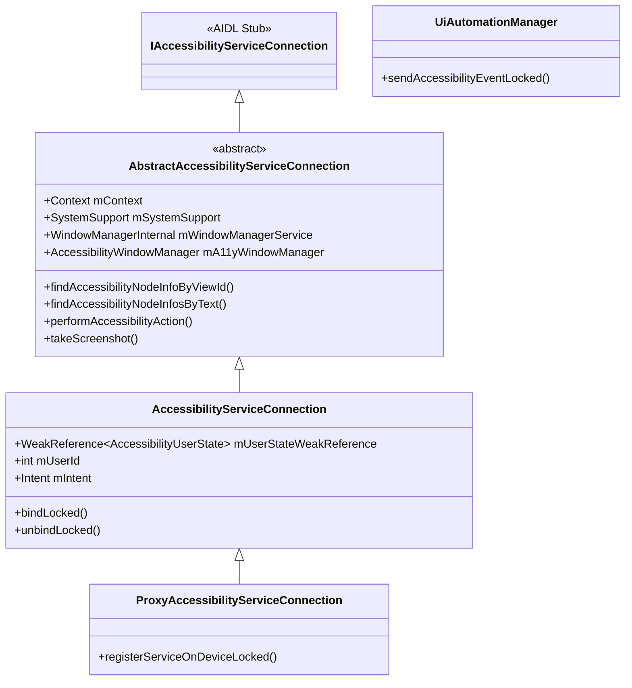

该连接持有对 `AccessibilityUserState` 的弱引用以避免引用环，因为
用户状态维护着已绑定服务的列表：

```java
// AccessibilityServiceConnection.java, line 98
final WeakReference<AccessibilityUserState> mUserStateWeakReference;
```

### 46.2.8 安全模型

无障碍框架拥有详尽的安全模型，因为无障碍服务被授予了非凡的权力。
它们可以读取屏幕内容、观察用户输入并注入动作。安全控制措施包括：

1. **权限要求**：服务必须在其清单中声明
   `android.permission.BIND_ACCESSIBILITY_SERVICE`。

2. **明确的用户同意**：用户必须在设置中显式启用每个服务。确认
   对话框会就被授予的能力发出警告。

3. **事件过滤**：`AccessibilitySecurityPolicy.canDispatchAccessibilityEventLocked()`
   检查事件是否应分发给当前用户的服务。

4. **包名验证**：报告的包名经过验证，以防止恶意应用冒充其他包
   伪造事件：
   ```java
   mSecurityPolicy.resolveValidReportedPackageLocked(
       event.getPackageName(), UserHandle.getCallingAppId(),
       resolvedUserId, getCallingPid());
   ```

5. **源节点剥离**：对于不在 `KEEP_SOURCE_EVENT_TYPES` 中的事件
   类型，源 `AccessibilityNodeInfo` 会在分发前被移除，防止服务查
   询它们不应访问的内容。

6. **非无障碍工具通知**：未归类为无障碍工具（通过其元数据中的
   `accessibilityTool="true"`）的服务会触发一条持久通知，提醒用户。
   这由 `PolicyWarningUIController` 控制：
   ```
   frameworks/base/services/accessibility/java/com/android/server/accessibility/
       PolicyWarningUIController.java
   ```

7. **增强确认模式（ECM）**：`EnhancedConfirmationManager` 为无障碍
   服务的激活提供额外的一层验证，尤其是对侧载应用。AMS 在启用某
   个服务之前会咨询它（`AccessibilityManagerService.java`，第 5634
   行）。

8. **按用户隔离**：每个用户都有独立的无障碍状态，通过
   `AccessibilityUserState` 管理。配置文件父用户与其受管配置文件
   共享无障碍状态。

9. **高级保护模式（AAPM）**：Android 17 新增。当设备所有者启用高
   级保护模式时，可以告诉 AMS 完全禁止非工具类的无障碍服务。该集
   成将在 46.12 节中详细描述。

### 46.2.9 锁与线程模型

AMS 使用单个锁（`mLock`）进行所有状态同步。执行期间不得持有锁的
操作（例如对服务进程的 Binder 调用）使用重新同步模式。它们在锁下
拷贝所需状态，释放锁，然后发出出站调用。

AMS 在主处理器上处理事件以确保串行化：

```java
// AccessibilityManagerService.java, line 5258
private void sendAccessibilityEventLocked(AccessibilityEvent event, int userId) {
    // Resync to avoid calling out with the lock held
    event.setEventTime(SystemClock.uptimeMillis());
    mMainHandler.sendMessage(obtainMessage(
        AccessibilityManagerService::sendAccessibilityEvent,
        this, event, userId));
}
```

这确保了事件分发、窗口状态更新和服务
通知在主线程上以确定的顺序发生。

### 46.2.10 AMS Shell 命令

AMS 通过 `AccessibilityShellCommand` 暴露一个 shell 命令界面，用于
调试和测试：

```bash
# List enabled accessibility services
adb shell settings get secure enabled_accessibility_services

# Enable an accessibility service
adb shell settings put secure enabled_accessibility_services \
    com.google.android.marvin.talkback/\
    com.google.android.marvin.talkback.TalkBackService

# Check if touch exploration is enabled
adb shell settings get secure touch_exploration_enabled

# Dump accessibility state
adb shell dumpsys accessibility
```

`dumpsys accessibility` 命令对调试尤其有价值。它打印当前用户状态、
所有已绑定服务及其能力、无障碍窗口列表、缩放状态以及输入过滤器状
态。

### 46.2.11 闪光通知

`FlashNotificationsController` 为聋人或听力困难的用户提供视觉通知
提醒：

```
frameworks/base/services/accessibility/java/com/android/server/accessibility/
    FlashNotificationsController.java
```

启用后，当通知、闹钟或其他提醒事件发生时，它会闪烁相机 LED 或屏幕。
该控制器监控音频播放配置，并把闹钟/通知音映射为闪光模式。闪光原因
的分类如下：

```java
AccessibilityManager.FLASH_REASON_ALARM
AccessibilityManager.FLASH_REASON_PREVIEW
```

这通过 `Settings.System.CAMERA_FLASH_NOTIFICATION` 和
`Settings.System.SCREEN_FLASH_NOTIFICATION` 配置。

### 46.2.12 FingerprintGestureDispatcher（指纹手势分发器）

对于配备后置指纹传感器的设备，无障碍服务可以捕获传感器上的滑动
手势：

```
frameworks/base/services/accessibility/java/com/android/server/accessibility/
    FingerprintGestureDispatcher.java
```

该分发器向指纹 HAL 注册，并把手势事件路由给声明了
`flagRequestFingerprintGestures` 的服务：

```java
// FingerprintGestureDispatcher.java, line 36
public class FingerprintGestureDispatcher
    extends IFingerprintClientActiveCallback.Stub
    implements Handler.Callback {
```

这让 TalkBack 可以使用指纹滑动进行导航（在传感器上上下滑动以在
项目间滚动）。用户无需触摸屏幕。

### 46.2.13 SystemActionPerformer（系统动作执行器）

`SystemActionPerformer` 使无障碍服务能够触发系统级动作，例如返回、
回到主屏幕、打开通知栏以及截图：

```
frameworks/base/services/accessibility/java/com/android/server/accessibility/
    SystemActionPerformer.java
```

它同时支持旧版全局动作 ID（供较老的服务使用）和更新的基于
`RemoteAction` 的系统动作注册 API（供 SystemUI 使用）：

```java
// SystemActionPerformer.java -- supported use cases:
// 1. Legacy: service calls performGlobalAction(GLOBAL_ACTION_BACK)
// 2. Modern: SystemUI registers actions, service discovers and triggers them
// 3. Hybrid: Service uses new API to find actions, falls back to legacy IDs
```

可用的系统动作包括：

| 动作 | 说明 |
|--------|-------------|
| `GLOBAL_ACTION_BACK` | 模拟返回按钮 |
| `GLOBAL_ACTION_HOME` | 模拟主屏幕按钮 |
| `GLOBAL_ACTION_RECENTS` | 打开最近任务屏幕 |
| `GLOBAL_ACTION_NOTIFICATIONS` | 打开通知栏 |
| `GLOBAL_ACTION_QUICK_SETTINGS` | 打开快速设置 |
| `GLOBAL_ACTION_POWER_DIALOG` | 显示电源菜单 |
| `GLOBAL_ACTION_TOGGLE_SPLIT_SCREEN` | 切换分屏 |
| `GLOBAL_ACTION_LOCK_SCREEN` | 锁定屏幕 |
| `GLOBAL_ACTION_TAKE_SCREENSHOT` | 捕获屏幕截图 |

### 46.2.14 AccessibilityTraceManager（无障碍跟踪管理器）

`AccessibilityTraceManager` 为调试无障碍交互提供全面的跟踪功能：

```
frameworks/base/services/accessibility/java/com/android/server/accessibility/
    AccessibilityTraceManager.java
```

跟踪类别以标志位定义：

```java
// AccessibilityTrace.java
FLAGS_ACCESSIBILITY_MANAGER           // AMS-side operations
FLAGS_ACCESSIBILITY_MANAGER_CLIENT    // Client-side calls
FLAGS_ACCESSIBILITY_SERVICE_CLIENT    // Service-side calls
FLAGS_ACCESSIBILITY_SERVICE_CONNECTION // Service connection events
FLAGS_ACCESSIBILITY_INTERACTION_CONNECTION // Window queries
FLAGS_WINDOW_MANAGER_INTERNAL         // WM interactions
FLAGS_FINGERPRINT                     // Fingerprint gesture events
FLAGS_INPUT_FILTER                    // Input filter operations
FLAGS_MAGNIFICATION_CONNECTION        // Magnification events
FLAGS_PACKAGE_BROADCAST_RECEIVER      // Package change events
FLAGS_USER_BROADCAST_RECEIVER         // User change events
```

启用跟踪后，每个 Binder 调用、事件分发和状态转移都会记录完整的
参数值。这对诊断服务、AMS 和应用之间复杂的交互缺陷非常有价值。

可以在每个日志点检查跟踪状态：

```java
if (mTraceManager.isA11yTracingEnabledForTypes(FLAGS_ACCESSIBILITY_MANAGER)) {
    mTraceManager.logTrace(LOG_TAG + ".sendAccessibilityEvent",
        FLAGS_ACCESSIBILITY_MANAGER,
        "event=" + event + ";userId=" + userId);
}
```

### 46.2.15 多用户与可见后台用户

AMS 通过 `mUserStates` 稀疏数组维护按用户划分的无障碍状态。当当前
用户切换时，AMS 会转换无障碍状态：

```java
// AccessibilityManagerService.java
@GuardedBy("mLock")
@VisibleForTesting
final SparseArray<AccessibilityUserState> mUserStates = new SparseArray<>();
```

较新的 Android 版本支持可见后台用户（例如汽车多显示器设备上）。AMS
通过以下内容跟踪它们：

```java
@GuardedBy("mLock")
@Nullable // only set when device supports visible background users
private final SparseBooleanArray mVisibleBgUserIds;
```

当后台用户变为可见时，他们的无障碍服务需要处于活动状态。
`mVisibleBgUserIds` 跟踪确保来自可见后台用户窗口的事件被分发给正确的
服务集合。

### 46.2.16 ProxyManager

`ProxyManager` 支持代理连接拥有的虚拟显示器（例如远程桌面或投屏
场景）上的无障碍功能：

```
frameworks/base/services/accessibility/java/com/android/server/accessibility/
    ProxyManager.java
```

代理显示器有自己的无障碍服务连接
（`ProxyAccessibilityServiceConnection`），它们独立于主显示器的服务
运行。来自代理显示器的事件通过代理管理器分发，而不是走常规的事件
管线。

### 46.2.17 输入法集成

AMS 与输入法管理器集成，以支持无障碍输入法。无障碍服务可以通过
`IAccessibilityInputMethodSession` 提供自己的输入法会话，从而支持：

- 盲文键盘输入
- 摩尔斯电码输入
- 基于开关的文本输入

该集成通过 `LocalServiceImpl` 接口管理：

```java
// AccessibilityManagerService inner class
@Override
public void setImeSessionEnabled(
    SparseArray<IAccessibilityInputMethodSession> sessions,
    boolean enabled) { ... }

@Override
public void startInput(
    IRemoteAccessibilityInputConnection connection,
    EditorInfo editorInfo, boolean restarting) { ... }
```

---

## 46.3 TalkBack 与屏幕阅读器

TalkBack 是 Android 内置的屏幕阅读器，是平台上最重要的无障碍服务。
虽然 TalkBack 本身作为 Google 应用发布（不在 AOSP 核心中），但它依
赖的框架完全在 AOSP 中。理解 TalkBack 的交互模型可以阐明
`AccessibilityService` API 的能力与约束。

### 46.3.1 屏幕阅读器在 Android 上如何工作

Android 上的屏幕阅读器通过以下循环运行：

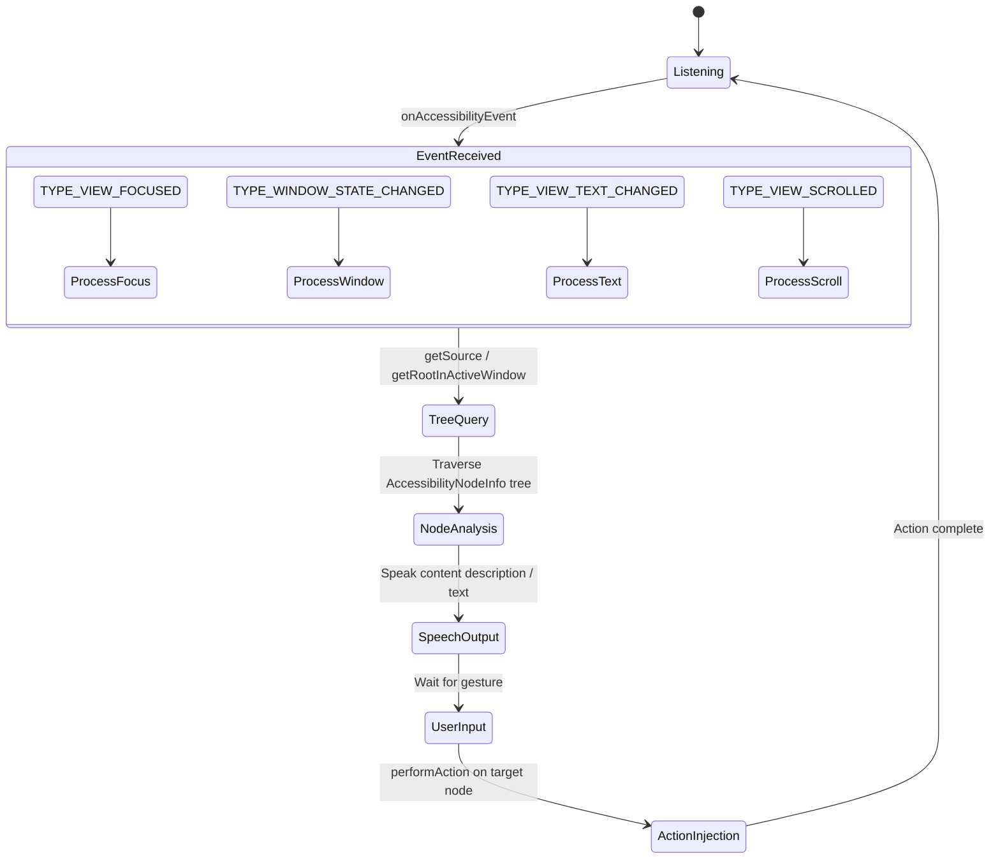

1. **事件接收**：TalkBack 从 AMS 接收 `AccessibilityEvent`。
   它配置自己的 `AccessibilityServiceInfo` 以请求所有事件类型并检
   索窗口内容。

2. **树查询**：当事件表明发生了有意义的状态变化（焦点移动、窗口
   变化、文本更新）时，TalkBack 会查询无障碍树。查询从事件源或活动
   窗口的根节点开始。

3. **内容处理**：TalkBack 分析 `AccessibilityNodeInfo` 树以确定要
   朗读什么。它考虑：
    - `contentDescription`（自定义视图始终优先）
    - `text`（用于 `TextView` 派生的控件）
    - `hintText`（用于空输入字段）
    - `roleDescription`（用于自定义语义——由 AndroidX 写入的
      extras-bundle 键，而非一等平台节点属性）
    - 集合与范围信息
    - 状态描述（`stateDescription`）

4. **语音合成**：内容通过 Android 的 `TextToSpeech` API 合成，并
   通过音频系统播放。

5. **触觉与音频反馈**：导航事件产生音标（短的音频提示）和触觉反馈，
   以提供非视觉上下文。

6. **手势导航**：在触摸探索模式下，用户通过滑动来导航（左右滑动在
   元素间移动，上下滑动改变导航粒度）。用户双击以激活。

### 46.3.2 AccessibilityService 生命周期

`AccessibilityService` 继承 `android.app.Service`，并在用户启用它
时由系统绑定。生命周期回调为：

```java
// AccessibilityService.java (simplified)
public abstract class AccessibilityService extends Service {

    // Called when the system connects to the service
    protected void onServiceConnected() { }

    // Called for each accessibility event matching the service's filters
    public abstract void onAccessibilityEvent(AccessibilityEvent event);

    // Called when the system wants to interrupt the service's feedback
    public abstract void onInterrupt();

    // Called when a gesture is detected (if service requests gestures);
    // the deprecated onGesture(int gestureId) overload is protected
    public boolean onGesture(AccessibilityGestureEvent gestureEvent) {
        return false;
    }

    // Called for key events (if service requests key event filtering)
    protected boolean onKeyEvent(KeyEvent event) { return false; }
}
```

### 46.3.3 通过 XML 元数据配置服务

每个无障碍服务都在一个 XML 文件中声明其配置，该文件在服务的清单
条目中被引用：

```xml
<service
    android:name=".MyAccessibilityService"
    android:permission="android.permission.BIND_ACCESSIBILITY_SERVICE">
    <intent-filter>
        <action android:name=
            "android.accessibilityservice.AccessibilityService" />
    </intent-filter>
    <meta-data
        android:name="android.accessibilityservice"
        android:resource="@xml/accessibility_service_config" />
</service>
```

XML 配置文件指定：

```xml
<accessibility-service
    xmlns:android="http://schemas.android.com/apk/res/android"
    android:accessibilityEventTypes="typeAllMask"
    android:accessibilityFeedbackType="feedbackSpoken"
    android:accessibilityFlags="flagReportViewIds
        |flagRetrieveInteractiveWindows
        |flagRequestTouchExplorationMode
        |flagRequestFilterKeyEvents
        |flagRequestMultiFingerGestures"
    android:canRetrieveWindowContent="true"
    android:canRequestTouchExplorationMode="true"
    android:canRequestFilterKeyEvents="true"
    android:canPerformGestures="true"
    android:canTakeScreenshot="true"
    android:notificationTimeout="100"
    android:settingsActivity=".SettingsActivity"
    android:isAccessibilityTool="true" />
```

关键标志包括：

| 标志 | 用途 |
|------|---------|
| `flagReportViewIds` | 在 `AccessibilityNodeInfo` 中包含资源 ID |
| `flagRetrieveInteractiveWindows` | 查询多个窗口 |
| `flagRequestTouchExplorationMode` | 启用触摸探索 |
| `flagRequestFilterKeyEvents` | 在分发前接收按键事件 |
| `flagRequestMultiFingerGestures` | 接收多指手势 |
| `flagRequestAccessibilityButton` | 显示无障碍按钮 |
| `flagServiceHandlesDoubleTap` | 在探索期间拦截双击 |
| `flagSendMotionEvents` | 接收原始移动事件 |
| `isAccessibilityTool` | 抑制非无障碍工具警告 |

### 46.3.4 窗口内容遍历

当屏幕阅读器需要全面理解当前屏幕时，它从根节点开始遍历无障碍树：

```java
AccessibilityNodeInfo root = getRootInActiveWindow();
if (root != null) {
    traverseTree(root);
}

void traverseTree(AccessibilityNodeInfo node) {
    // Process this node
    processNode(node);

    // Recurse into children
    for (int i = 0; i < node.getChildCount(); i++) {
        AccessibilityNodeInfo child = node.getChild(i);
        if (child != null) {
            traverseTree(child);
        }
    }
}
```

每个 `getChild()` 调用都是一次到应用进程的 Binder IPC（除非节点已
缓存）。为了减轻这一开销，预取系统（见 46.1.6 节）会主动获取相关
节点。

### 46.3.5 AccessibilityCache

服务维护一个 `AccessibilityCache` 以减少 Binder 往返：

```
frameworks/base/core/java/android/view/accessibility/AccessibilityCache.java
```

缓存存储 `AccessibilityNodeInfo` 和 `AccessibilityWindowInfo` 对象，
并在事件表明缓存数据可能过时时使其失效。缓存失效事件包括
`TYPE_WINDOW_CONTENT_CHANGED`、`TYPE_WINDOW_STATE_CHANGED` 和
`TYPE_WINDOWS_CHANGED`。

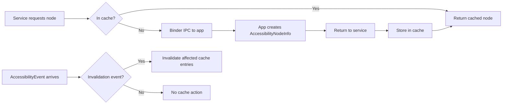

### 46.3.6 盲文显示器支持

较新的 Android 版本包含 `BrailleDisplayConnection`，它允许无障碍服务
与可刷新盲文显示器通信：

```
frameworks/base/services/accessibility/java/com/android/server/accessibility/
    BrailleDisplayConnection.java
```

这让 TalkBack 能把内容输出到盲文硬件并接收盲文键盘输入，从而支持
聋盲用户。

---

## 46.4 Switch Access（开关辅助）

Switch Access 是 Android 基于扫描的无障碍服务。它让存在严重运动障碍
的用户能够通过一个或多个物理开关（按钮、键盘按键或蓝牙设备）与设
备交互。

### 46.4.1 工作原理

与依赖触摸探索的 TalkBack 不同，Switch Access 以扫描模式逐个（或按
组）高亮 UI 元素。用户激活开关来选择当前高亮的元素。

扫描模式有：

| 模式 | 说明 |
|------|-------------|
| **自动扫描** | 元素按可配置的间隔自动高亮 |
| **步进扫描** | 一个开关前进到下一个元素，另一个选择 |
| **组选择** | 元素被划分为组；用户通过选择组来缩小范围 |

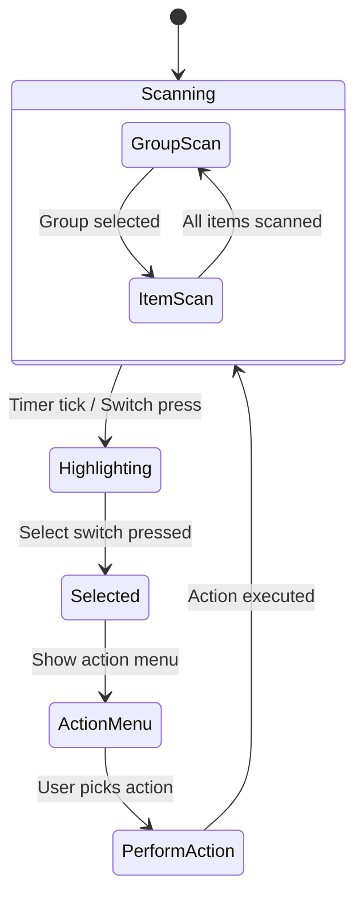

### 46.4.2 实现架构

Switch Access 作为 `AccessibilityService` 运行，使用与 TalkBack 相同
的 API。其独特行为集中在：

1. **按键事件拦截**：Switch Access 请求 `flagRequestFilterKeyEvents`
   以捕获开关按键（开关按键来自外部输入设备，表现为按键事件）。

2. **叠加层绘制**：它使用 `TYPE_ACCESSIBILITY_OVERLAY` 窗口在可扫描
   元素周围绘制高亮矩形。该窗口类型专属于无障碍服务。

3. **节点扫描**：它遍历无障碍树以构建可操作节点的扁平列表，然后按
   配置的扫描顺序逐个遍历。

4. **动作菜单**：当选中某个元素时，Switch Access 显示可用动作
   （点击、长按、滚动等）的菜单。菜单来自节点的 `AccessibilityAction`
   列表。

### 46.4.3 KeyEvent 过滤

按键事件过滤机制是 Switch Access 的核心。当服务请求按键事件过滤时，
AMS 通过 `KeyEventDispatcher` 路由按键事件：

```
frameworks/base/services/accessibility/java/com/android/server/accessibility/
    KeyEventDispatcher.java
```

分发器把每个按键事件发送给所有请求了过滤的服务。服务有 500 毫秒的
响应时间：

```java
// KeyEventDispatcher.java, line 52
private static final long ON_KEY_EVENT_TIMEOUT_MILLIS = 500;
```

如果服务报告事件已处理，事件就被消费，不再传递到输入管线的其余部分。
如果服务在超时时间内没有响应，事件将被透传。

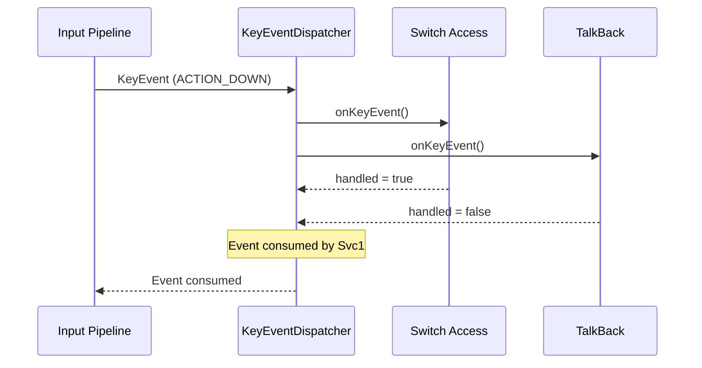

### 46.4.4 无障碍叠加层

无障碍服务可以使用 `TYPE_ACCESSIBILITY_OVERLAY` 创建叠加窗口。这些
窗口：

- 位于窗口层级 31。这一层在系统提示、拖动和导航栏窗口之上，在无
  障碍缩放叠加层、安全系统叠加层、启动进度层和指针层之下
- 通过服务的 `WindowManager` 创建
- 在服务断开连接时自动移除
- 作为类型为 `TYPE_ACCESSIBILITY_OVERLAY` 的 `AccessibilityWindowInfo`
  条目在窗口列表中向无障碍服务报告

Switch Access 使用叠加层来绘制高亮边框、动作菜单和扫描光标。这是一
项特权能力——只有拥有 `BIND_ACCESSIBILITY_SERVICE` 权限的服务才能
创建这些叠加层。

### 46.4.5 AutoclickController（自动点击控制器）

自动点击功能虽然与 Switch Access 不同，但服务于类似的运动障碍用户
群体。当鼠标光标停止移动时，它会自动点击：

```
frameworks/base/services/accessibility/java/com/android/server/accessibility/
    autoclick/AutoclickController.java
```

点击类型常量位于 `AutoclickTypePanel`（在相同的 `autoclick/` 包中），
`AutoclickController` 静态导入它们：

| 类型 | 说明 |
|------|-------------|
| `AUTOCLICK_TYPE_LEFT_CLICK` | 标准左键点击（默认） |
| `AUTOCLICK_TYPE_RIGHT_CLICK` | 右键点击 |
| `AUTOCLICK_TYPE_DOUBLE_CLICK` | 双击 |
| `AUTOCLICK_TYPE_LONG_PRESS` | 长按 |
| `AUTOCLICK_TYPE_DRAG` | 拖动（按住并移动） |
| `AUTOCLICK_TYPE_SCROLL` | 滚动 |

自动点击延迟可配置，默认值在响应性与意外触发之间取得平衡。控制器从
`AccessibilityManager` 静态导入的默认值为：

```java
// AutoclickController imports
AccessibilityManager.AUTOCLICK_DELAY_WITH_INDICATOR_DEFAULT  // 1000 ms
AccessibilityManager.AUTOCLICK_CURSOR_AREA_SIZE_DEFAULT
AccessibilityManager.AUTOCLICK_IGNORE_MINOR_CURSOR_MOVEMENT_DEFAULT
AccessibilityManager.AUTOCLICK_REVERT_TO_LEFT_CLICK_DEFAULT
```

移动检测包含抖动容忍，以处理因运动控制不佳而产生的非自愿光标移动。
这可以同时防止：

- 没有有意鼠标移动时发生不需要的点击
- 因为轻微震颤被检测为移动而导致自动点击永不触发

`AutoclickController` 实现 `EventStreamTransformation`，使其与触摸
探索和缩放位于同一输入管线中。它观察鼠标移动事件，并在光标静止超
过配置的延迟时长时注入点击事件序列。

### 46.4.6 MouseKeysInterceptor（鼠标键拦截器）

`MouseKeysInterceptor` 启用基于键盘的光标控制，让无法使用鼠标的用户
能够用键盘按键控制鼠标指针：

```
frameworks/base/services/accessibility/java/com/android/server/accessibility/
    MouseKeysInterceptor.java
```

它是一个 `BaseEventStreamTransformation`，同时也监听输入设备变更：

```java
// MouseKeysInterceptor.java, line 73
public class MouseKeysInterceptor extends BaseEventStreamTransformation
        implements Handler.Callback, InputManager.InputDeviceListener {
```

在 Android 17 中，该拦截器不再把指针移动直接合成进输入管线。相反，
它拥有一个 `VirtualMouse`——与虚拟显示器使用的相同虚拟输入抽象
——并通过它驱动光标：

```java
// MouseKeysInterceptor.java
import android.hardware.input.VirtualMouse;
import android.hardware.input.VirtualMouseButtonEvent;
import android.hardware.input.VirtualMouseRelativeEvent;
import android.hardware.input.VirtualMouseScrollEvent;
// A new VirtualMouse is created whenever mouse keys is turned on in Settings.
private VirtualMouse mVirtualMouse = null;
```

旧的定制 `MouseEventHandler` 已在 17 中删除。鼠标键的移动现在经由
`VirtualMouse` 和标准虚拟设备路径。它获得一个唯一的设备名称，因此能
与真实指向设备干净地共存。

启用后，指定的按键移动光标并模拟点击。拦截器同时支持主键布局和小
键盘，但小键盘映射只在 Num Lock 打开时生效：

```java
// MouseKeysInterceptor.java, lines 716-718
// If we are using numpad keys, they only work if Num Lock is on.
boolean isNumLockOn = (event.getMetaState() & KeyEvent.META_NUM_LOCK_ON) != 0;
if (keyCode == mouseKeyEvent.getNumpadKeyCode(inputDevice) && !isNumLockOn) {
    // ignore numpad mouse key when Num Lock is off
}
```

按设备的能力缓存（`mDeviceNumpadCapabilityCache`）记录每台已连接键
盘是否确实拥有所需的小键盘按键。因此该功能在没有数字小键盘的键盘
上可以优雅降级。鼠标键通过以下内容注册为快捷方式目标：

```java
// AccessibilityShortcutController.java, line 98
public static final ComponentName MOUSE_KEYS_COMPONENT_NAME =
    new ComponentName("com.android.server.accessibility", "MouseKeys");
```

---

## 46.5 缩放

Android 为低视力用户提供两种互补的缩放模式：**全屏缩放**和
**窗口缩放**。其实现横跨无障碍服务基础设施和窗口管理器。

### 46.5.1 缩放架构

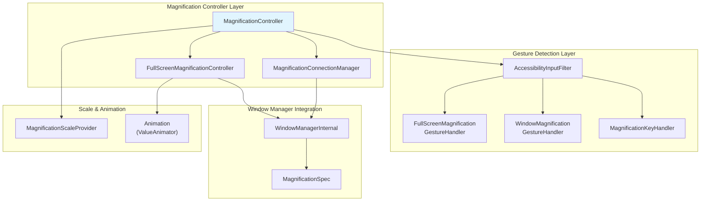

缩放子系统位于：
```
frameworks/base/services/accessibility/java/com/android/server/accessibility/
    magnification/
```

关键源文件：

| 文件 | 角色 |
|------|------|
| `MagnificationController.java` | 协调模式切换和 UI |
| `FullScreenMagnificationController.java` | 通过 MagnificationSpec 实现全屏缩放 |
| `MagnificationConnectionManager.java` | 通过 SystemUI 实现窗口缩放 |
| `FullScreenMagnificationGestureHandler.java` | 三击和捏合手势检测 |
| `WindowMagnificationGestureHandler.java` | 窗口缩放手势处理 |
| `MagnificationKeyHandler.java` | 键盘快捷键处理 |
| `MagnificationScaleProvider.java` | 缩放边界与持久化 |
| `MagnificationGestureHandler.java` | 手势处理器的基类 |

### 46.5.2 全屏缩放

全屏缩放以某个中心点为中心缩放整个显示内容。它通过修改
WindowManagerService 应用于显示器的 `MagnificationSpec` 来工作：

```java
// FullScreenMagnificationController.java, line 90
public class FullScreenMagnificationController implements
    WindowManagerInternal.AccessibilityControllerInternal
        .UiChangesForAccessibilityCallbacks {
```

`MagnificationSpec` 包含缩放因子和 x/y 偏移：

```java
// frameworks/base/core/java/android/view/MagnificationSpec.java
public class MagnificationSpec implements Parcelable {
    public float scale = 1.0f;
    public float offsetX = 0.0f;
    public float offsetY = 0.0f;
}
```

缩放激活时，显示器上的每个窗口都会被此 spec 变换，从而有效地放大
屏幕的某个区域。

控制器维护按显示器划分的状态：

```java
// FullScreenMagnificationController.java, line 116
private final SparseArray<DisplayMagnification> mDisplays = new SparseArray<>(0);
```

### 46.5.3 全屏缩放手势

`FullScreenMagnificationGestureHandler` 实现了一个复杂的状态机来检
测缩放手势。主要交互模型：

1. **三击**在点击位置切换缩放开/关。
2. **三击并按住**临时放大并进入视口拖动模式——放大区域跟随手指。
   松开手指则回到之前的状态。
3. **放大状态下的双指捏合**调整缩放级别。
4. **放大状态下的双指滚动**平移视口。

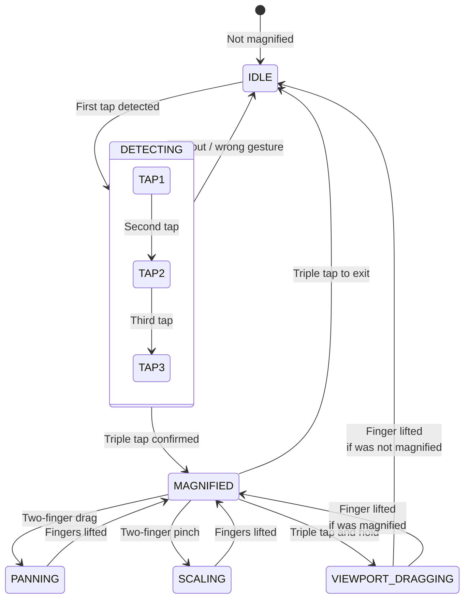

手势处理器作为 `EventStreamTransformation` 管线的一部分安装在
`AccessibilityInputFilter` 中：

```java
// AccessibilityInputFilter.java, line 96
static final int FLAG_FEATURE_MAGNIFICATION_SINGLE_FINGER_TRIPLE_TAP
    = 0x00000001;
```

### 46.5.4 窗口缩放

窗口缩放在内容上方显示一个可移动、可调整大小的放大镜窗口。与全屏
缩放不同，只有屏幕的一部分被放大，使用户能同时看到放大和未放大的
内容。

窗口缩放通过无障碍服务与 SystemUI 之间的协作实现。
`MagnificationConnectionManager` 管理与 SystemUI 端组件的连接：

```
frameworks/base/services/accessibility/java/com/android/server/accessibility/
    magnification/MagnificationConnectionManager.java
```

`WindowMagnificationGestureHandler` 处理窗口缩放特有的手势：

```java
// WindowMagnificationGestureHandler.java, line 68
public class WindowMagnificationGestureHandler
    extends MagnificationGestureHandler {
```

其手势包括：

- 三击切换缩放窗口
- 捏合（至少一根手指在窗口内）调整缩放
- 双指拖动移动缩放窗口

### 46.5.5 MagnificationController：模式协调

顶层 `MagnificationController` 在全屏缩放和窗口缩放模式之间协调，并
管理缩放开关 UI：

```java
// MagnificationController.java, line 93 (Android 17)
public class MagnificationController implements
    MagnificationConnectionManager.Callback,
    MagnificationGestureHandler.Callback,
    MagnificationKeyHandler.Callback,
    FullScreenMagnificationController.MagnificationInfoChangedCallback,
    WindowManagerInternal.AccessibilityControllerInternal
        .UiChangesForAccessibilityCallbacks {
```

缩放能力设置决定可用的模式：

| 设置值 | 可用模式 |
|---------------|-----------------|
| `ACCESSIBILITY_MAGNIFICATION_MODE_FULLSCREEN` | 仅全屏 |
| `ACCESSIBILITY_MAGNIFICATION_MODE_WINDOW` | 仅窗口 |
| `ACCESSIBILITY_MAGNIFICATION_MODE_ALL` | 两者（用户可切换） |

两种模式都可用时，会出现一个浮动开关按钮，允许用户在全屏缩放和窗
口缩放之间切换。

### 46.5.6 缩放边界

`MagnificationScaleProvider` 强制执行缩放边界。在 Android 17 中，边界
不再是硬编码字面值。它们来自 `MagnificationConstants`。最大值是一个
系统属性，因此 OEM 可以提高上限：

```java
// MagnificationScaleProvider.java
public static final float MIN_SCALE = SCALE_MIN_VALUE; // 1.0f
public static final float MAX_SCALE = SCALE_MAX_VALUE; // ro.config.max_magnification_scale, default 8.0

// MagnificationConstants.java
public static final float SCALE_MIN_VALUE = 1.0f;
public static final float SCALE_MAX_VALUE = Float.parseFloat(
    SystemProperties.get("ro.config.max_magnification_scale", "8.0"));
public static final float PERSISTED_SCALE_MIN_VALUE = 1.3f;
```

`PERSISTED_SCALE_MIN_VALUE`（1.3 倍）是可以跨会话记住的最小缩放值，
因此重新启用缩放时不会瞬间跳到几乎无用的 1.0 倍。提供器还通过
`Settings.Secure` 处理按用户的缩放持久化：

```java
Settings.Secure.ACCESSIBILITY_DISPLAY_MAGNIFICATION_SCALE
```

### 46.5.7 键盘缩放控制

`MagnificationKeyHandler` 通过键盘快捷键启用缩放控制，支持使用外接
键盘的用户：

```
frameworks/base/services/accessibility/java/com/android/server/accessibility/
    magnification/MagnificationKeyHandler.java
```

这些快捷键要求同时按住 Alt+Meta（并且明确不按 Ctrl 或 Shift）。
Alt+Meta+`=` 放大，Alt+Meta+`-` 缩小，放大状态下 Alt+Meta+方向键平
移。处理器实现重复按键行为，具有可配置的初始延迟和 60 毫秒的重复
间隔：

```java
// MagnificationController.java, line 140
public static final int KEYBOARD_REPEAT_INTERVAL_MS = 60;
```

Android 17 的桌面和连接显示器工作到目前为止只在标志位层面触及缩放。
`desktop_magnification_settings_polish` 标志
（`packages/apps/Settings/aconfig/accessibility/accessibility_flags.aconfig`，
命名空间 `accessibility`，标记为 `PURPOSE_BUGFIX`）针对触摸和键盘输
入外形因素优化缩放设置 UI。它没有新增缩放模式。
`enable_autoclick_for_connected_displays` 标志
（`frameworks/base/services/accessibility/accessibility.aconfig`，也是
一个 bugfix 标志）修复了外接显示器上的自动点击。没有单独的桌面缩
放引擎；已经在其 `mDisplays` 数组中跟踪按显示器状态的同一个
`FullScreenMagnificationController` 驱动连接显示器上的缩放。

### 46.5.8 常开缩放

常开缩放保持缩放以 1.0 倍比例处于活动状态，无需激活手势即可随时放
大。这减少了频繁使用缩放的用户的交互延迟。该功能由安全设置
`Settings.Secure.ACCESSIBILITY_MAGNIFICATION_ALWAYS_ON_ENABLED` 控
制，由 `AccessibilityManagerService.readAlwaysOnMagnificationLocked()`
读取，并受配置资源
`com.android.internal.R.bool.config_magnification_always_on_enabled`
的门控。

启用后，`FullScreenMagnificationController.setAlwaysOnMagnificationEnabled()`
记录该状态。在用户上下文变化（`onUserContextChanged()`）时，控制器
缩回 100%，而不是完全重置缩放。因此缩放可以立即再次调整，无需三击
激活手势。

### 46.5.9 缩放与窗口管理器的集成

缩放系统与 WindowManager 的交互对于理解视觉效果如何实现至关重要。

**全屏缩放**通过让 WindowManager 对整个显示器应用 `MagnificationSpec`
变换来工作。该变换在 SurfaceFlinger 合成层应用，意味着它统一影响显
示器上的所有窗口。流程为：

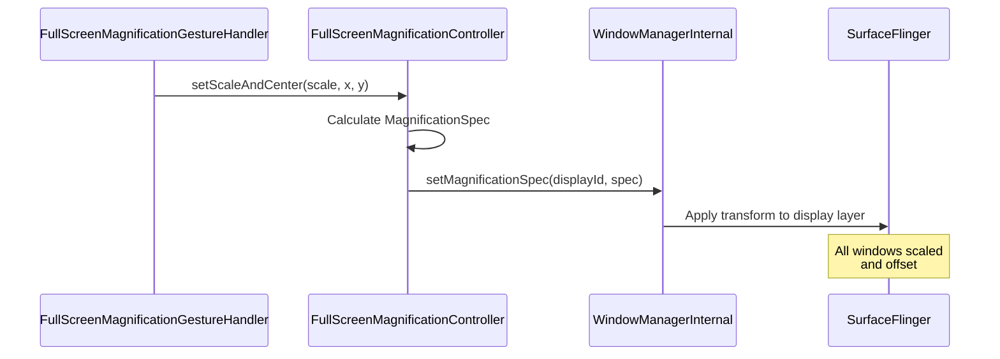

**窗口缩放**采用了根本不同的方法。它不是变换整个显示器，而是渲染一
个辅助视口，捕获并放大屏幕的某个区域。这通过 SystemUI 的缩放窗口
实现，该窗口：

1. 捕获放大区域的屏幕内容
2. 在可移动的叠加窗口中以放大比例渲染
3. 允许在窗口内捏合缩放和拖动平移

AMS 与 SystemUI 之间关于窗口缩放的协调通过 `IMagnificationConnection`
AIDL 接口进行：

```
frameworks/base/core/java/android/view/accessibility/
    IMagnificationConnection.aidl
    IMagnificationConnectionCallback.aidl
    IRemoteMagnificationAnimationCallback.aidl
```

### 46.5.10 光标跟随与输入焦点跟踪

缩放系统可以跟随文本光标移动和键盘焦点变化。两个功能设置控制此
项：

```java
// FullScreenMagnificationController.java, lines 120-122
private boolean mMagnificationFollowTypingEnabled = true;
private boolean mMagnificationFollowKeyboardEnabled = false;
```

当 `mMagnificationFollowTypingEnabled` 为 true 且用户在文本字段中
输入时，缩放视口会自动平移以保持光标可见。伴随的
`mMagnificationFollowKeyboardEnabled` 标志控制视口是否也跟随键盘
焦点变化。其设置默认值是有条件的。仅在
`enable_magnification_viewport_prioritization` aconfig 标志启用时（为
避免视口抖动），跟随键盘才默认开启，否则为关闭。光标
跟随模式通过以下内容配置：

```java
Settings.Secure.ACCESSIBILITY_MAGNIFICATION_CURSOR_FOLLOWING_MODE
```

这对在输入时使用缩放的低视力用户至关重要——如果没有光标跟随，文
本插入点会很快移出放大的视口。Android 17 将其从简单的开/关扩展为
管理放大视口如何跟踪移动鼠标指针的三态模式：

```java
// android.provider.Settings.Secure
ACCESSIBILITY_MAGNIFICATION_CURSOR_FOLLOWING_MODE_CONTINUOUS = 0;
ACCESSIBILITY_MAGNIFICATION_CURSOR_FOLLOWING_MODE_CENTER     = 1;
ACCESSIBILITY_MAGNIFICATION_CURSOR_FOLLOWING_MODE_EDGE       = 2;
```

`AccessibilityInputFilter` 读取此模式
（`getMagnificationCursorFollowingMode()`），并通过
`FullScreenMagnificationPointerMotionEventFilter` 应用它。该过滤器决
定视口是连续跟随指针平移、以指针为中心重新对中，还是仅在指针到达
视口边缘时小幅平移。

### 46.5.11 缩略图

`MagnificationThumbnail` 提供一个类似小地图的概览，显示屏幕的哪一部分
当前被放大：

```
frameworks/base/services/accessibility/java/com/android/server/accessibility/
    magnification/MagnificationThumbnail.java
```

这让用户对自己放大视口相对于完整屏幕的位置有空间感知。在高缩放级
别下尤其有用，因为可见部分只占屏幕总面积的一小部分。

### 46.5.12 指针移动事件过滤

`FullScreenMagnificationPointerMotionEventFilter` 调整指针事件以适应
缩放变换：

```
frameworks/base/services/accessibility/java/com/android/server/accessibility/
    magnification/FullScreenMagnificationPointerMotionEventFilter.java
```

当屏幕被放大时，原始触摸坐标必须转换为屏幕坐标。该过滤器确保指针
事件被正确映射到放大坐标空间，因此点击放大的按钮会命中正确的目标。

### 46.5.13 振动反馈

`FullScreenMagnificationVibrationHelper` 在缩放交互期间提供触觉反馈：

```
frameworks/base/services/accessibility/java/com/android/server/accessibility/
    magnification/FullScreenMagnificationVibrationHelper.java
```

当放大的视口在平移时到达屏幕左右边缘，且安全设置
`ACCESSIBILITY_DISPLAY_MAGNIFICATION_EDGE_HAPTIC_ENABLED` 打开时，
振动触发。这为可能无法在视觉上感知的用户提供了视口已触及屏幕边缘
的非视觉确认。

---

## 46.6 无障碍事件

无障碍事件是应用与无障碍服务之间的主要通信机制。每个有意义的 UI
变化都可以产生一个服务可观察的事件。

### 46.6.1 事件类型

`AccessibilityEvent` 定义了一整套事件类型。每种类型都是 2 的幂的常
量，从而实现高效的位掩码过滤：

```java
// AccessibilityEvent.java
public static final int TYPE_VIEW_CLICKED                          = 1;
public static final int TYPE_VIEW_LONG_CLICKED                     = 1 << 1;
public static final int TYPE_VIEW_SELECTED                         = 1 << 2;
public static final int TYPE_VIEW_FOCUSED                          = 1 << 3;
public static final int TYPE_VIEW_TEXT_CHANGED                     = 1 << 4;
public static final int TYPE_WINDOW_STATE_CHANGED                  = 1 << 5;
public static final int TYPE_NOTIFICATION_STATE_CHANGED            = 1 << 6;
public static final int TYPE_VIEW_HOVER_ENTER                      = 1 << 7;
public static final int TYPE_VIEW_HOVER_EXIT                       = 1 << 8;
public static final int TYPE_TOUCH_EXPLORATION_GESTURE_START       = 1 << 9;
public static final int TYPE_TOUCH_EXPLORATION_GESTURE_END         = 1 << 10;
public static final int TYPE_WINDOW_CONTENT_CHANGED                = 1 << 11;
public static final int TYPE_VIEW_SCROLLED                         = 1 << 12;
public static final int TYPE_VIEW_TEXT_SELECTION_CHANGED            = 1 << 13;
public static final int TYPE_ANNOUNCEMENT                          = 1 << 14;
public static final int TYPE_VIEW_ACCESSIBILITY_FOCUSED            = 1 << 15;
public static final int TYPE_VIEW_ACCESSIBILITY_FOCUS_CLEARED      = 1 << 16;
public static final int TYPE_VIEW_TEXT_TRAVERSED_AT_MOVEMENT_GRANULARITY
                                                                    = 1 << 17;
public static final int TYPE_GESTURE_DETECTION_START               = 1 << 18;
public static final int TYPE_GESTURE_DETECTION_END                 = 1 << 19;
public static final int TYPE_TOUCH_INTERACTION_START               = 1 << 20;
public static final int TYPE_TOUCH_INTERACTION_END                 = 1 << 21;
public static final int TYPE_WINDOWS_CHANGED                       = 1 << 22;
public static final int TYPE_VIEW_CONTEXT_CLICKED                  = 1 << 23;
public static final int TYPE_ASSIST_READING_CONTEXT                = 1 << 24;
public static final int TYPE_SPEECH_STATE_CHANGE                   = 1 << 25;
public static final int TYPE_VIEW_TARGETED_BY_SCROLL               = 1 << 26;
```

### 46.6.2 按类型划分的事件属性

每种事件类型携带不同的属性集。下表总结了常用处理事件的关键属性：

| 事件类型 | 关键属性 |
|------------|---------------|
| `TYPE_VIEW_CLICKED` | source、className、packageName、eventTime |
| `TYPE_VIEW_FOCUSED` | source、className、packageName、eventTime |
| `TYPE_VIEW_TEXT_CHANGED` | text、beforeText、fromIndex、addedCount、removedCount |
| `TYPE_WINDOW_STATE_CHANGED` | className、windowChanges、contentChangeTypes |
| `TYPE_VIEW_SCROLLED` | scrollDeltaX、scrollDeltaY、maxScrollX、maxScrollY |
| `TYPE_NOTIFICATION_STATE_CHANGED` | text、parcelableData（Notification） |
| `TYPE_WINDOWS_CHANGED` | windowChanges 位掩码 |
| `TYPE_VIEW_TEXT_SELECTION_CHANGED` | fromIndex、toIndex、itemCount |
| `TYPE_VIEW_TEXT_TRAVERSED_AT_MOVEMENT_GRANULARITY` | movementGranularity、fromIndex、toIndex、action |

### 46.6.3 View 系统中的事件产生

事件通过两条路径在 View 系统中产生：

**路径 1：自动事件**——框架针对标准状态变化自动触发事件。例如，当
`View` 获得焦点时：

```java
// View.java (simplified)
protected void onFocusChanged(boolean gainFocus, int direction,
        Rect previouslyFocusedRect) {
    if (gainFocus) {
        sendAccessibilityEvent(AccessibilityEvent.TYPE_VIEW_FOCUSED);
    }
}
```

**路径 2：自定义事件**——自定义视图或应用代码可以手动触发事件：

```java
view.sendAccessibilityEvent(AccessibilityEvent.TYPE_ANNOUNCEMENT);
// or with more control:
AccessibilityEvent event = AccessibilityEvent.obtain(
    AccessibilityEvent.TYPE_WINDOW_STATE_CHANGED);
event.setContentDescription("Loading complete");
view.sendAccessibilityEventUnchecked(event);
```

### 46.6.4 事件在视图层次结构中的传播

当 View 触发无障碍事件时，在发送给 AMS 之前，它会沿视图层次结构向
上传播：

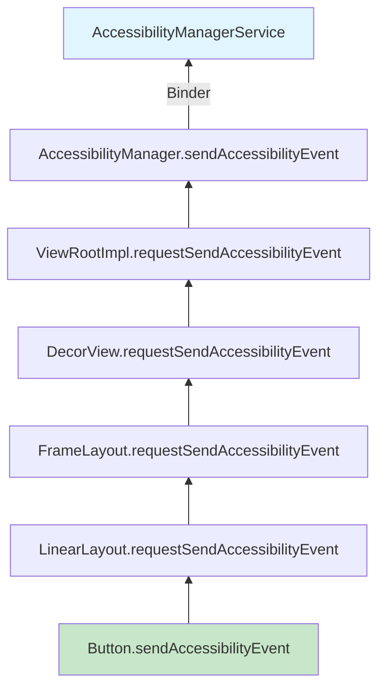

链上的每个父视图都有机会通过 `onRequestSendAccessibilityEvent()` 修
改事件。例如，`RecyclerView` 就是这样把滚动位置信息添加到其子视图
发出的事件中的。

### 46.6.5 Windows Changed 子类型

`TYPE_WINDOWS_CHANGED` 通过 `WINDOWS_CHANGE_*` 子类型携带额外信息，
通过 `AccessibilityEvent.getWindowChanges()` 暴露：

```java
// AccessibilityEvent.java
// Change type for TYPE_WINDOWS_CHANGED:
public static final int WINDOWS_CHANGE_ADDED    = 1;       // Window appeared
public static final int WINDOWS_CHANGE_REMOVED  = 1 << 1;  // Window disappeared
public static final int WINDOWS_CHANGE_TITLE    = 1 << 2;  // Title changed
public static final int WINDOWS_CHANGE_FOCUSED  = 1 << 6;  // Focus changed
```

这些子类型使服务能够对窗口添加、标题变化和焦点转移做出不同的反应。
单独的 `TYPE_WINDOW_STATE_CHANGED` 事件使用 `CONTENT_CHANGE_TYPE_*`
常量，通过 `getContentChangeTypes()` 读取。

### 46.6.6 事件节流与合并

AMS 应用事件节流，以防止服务被高频事件淹没（例如 fling 过程中的
`TYPE_VIEW_SCROLLED`）。每个服务在其元数据中配置一个
`notificationTimeout`：

```xml
android:notificationTimeout="100"
```

在此超时窗口内、来自同一源的同类型事件会被合并——只有最新的一个被
送达。

### 46.6.7 敏感事件数据

视图可以通过以下方式被标记为包含敏感的无障碍数据：

```java
view.setAccessibilityDataSensitive(
    View.ACCESSIBILITY_DATA_SENSITIVE_YES);
```

把视图标记为无障碍数据敏感后，该视图及其所有后代仅对
`AccessibilityServiceInfo.isAccessibilityTool` 为 true 的无障碍服务
开放。非工具服务既看不到其节点也看不到其事件。该标志沿层次结构向下
传播，也可从 `filterTouchesWhenObscured` 推断。这使敏感数据（如密码
字段内容）远离未声明为无障碍工具的服务。

### 46.6.8 AccessibilityRecord 基类

`AccessibilityEvent` 继承 `AccessibilityRecord`，后者提供所有事件
类型共享的基础数据字段：

```java
// AccessibilityRecord.java (simplified fields)
private int mBooleanProperties;       // Bit-packed boolean states
private int mCurrentItemIndex;        // Current index in scrollable
private int mItemCount;               // Total items in scrollable
private int mScrollX;                 // Horizontal scroll position
private int mScrollY;                 // Vertical scroll position
private int mScrollDeltaX;            // Horizontal scroll delta
private int mScrollDeltaY;            // Vertical scroll delta
private int mMaxScrollX;              // Max horizontal scroll
private int mMaxScrollY;              // Max vertical scroll
private int mAddedCount;              // Chars added (text change)
private int mRemovedCount;            // Chars removed (text change)
private int mFromIndex;               // Start index
private int mToIndex;                 // End index
private CharSequence mClassName;      // Source class name
private CharSequence mContentDescription;
private CharSequence mBeforeText;     // Text before change
private Parcelable mParcelableData;   // Extra parcelable data
private List<CharSequence> mText;     // Text list
private int mSourceWindowId;          // Source window ID
private long mSourceNodeId;           // Source node ID
private int mSourceDisplayId;         // Source display ID
private int mConnectionId;            // Connection for queries
```

一个事件也可以包含多条记录。例如，一个有多个子元素发生变化的窗口
可能产生一个带有多条 `AccessibilityRecord` 条目的单个事件，每条记录
描述一个不同的变化。

### 46.6.9 事件回收与池化

`AccessibilityEvent` 对象历史上采用对象池化以减少垃圾回收压力。对象
池化现已停止。`AccessibilityEvent.obtain()` 已弃用，现在只是简单地
分配一个新实例。`recycle()` 是已弃用的空操作（`AccessibilityNodeInfo`
也是如此）：

```java
// AccessibilityEvent.java (pooling discontinued)
@Deprecated
public static AccessibilityEvent obtain() {
    return new AccessibilityEvent();
}

@Deprecated
public void recycle() {}
```

AMS 中保留的 `event.recycle()` 调用是残留的——它们能编译和运行，但
不做任何事。新代码应直接使用 `new AccessibilityEvent(eventType)` 构
造事件。

### 46.6.10 事件分发时机

无障碍事件系统的时序保证如下：

1. **进程内**：从 `View.sendAccessibilityEvent()` 到
   `AccessibilityManager.sendAccessibilityEvent()` 的事件是同步的。

2. **Binder 跨界**：从 `AccessibilityManager` 到 AMS 的调用是单向
   Binder 事务。这意味着调用方不会在等待 AMS 处理事件时阻塞。

3. **AMS 处理**：AMS 在其主处理器上处理事件，这提供了顺序保证。
   来自同一源的事件按顺序处理。

4. **服务送达**：事件通过单向 Binder 调用送达服务。每个服务独立收
   到事件，缓慢的服务无法阻塞向其他服务的事件分发。

5. **端到端延迟**：在现代硬件上，从 View 事件到服务回调的典型端到
   端延迟为 5-15 毫秒。服务配置的 `notificationTimeout` 可能会为合
   并的事件增加额外延迟。

### 46.6.11 事件类型字符串表示

为便于调试，每个事件类型都有字符串表示：

```java
// AccessibilityEvent.java, singleEventTypeToString(), line ~1970
case TYPE_VIEW_CLICKED:    return "TYPE_VIEW_CLICKED";
case TYPE_VIEW_FOCUSED:    return "TYPE_VIEW_FOCUSED";
case TYPE_VIEW_TEXT_CHANGED: return "TYPE_VIEW_TEXT_CHANGED";
case TYPE_WINDOW_STATE_CHANGED: return "TYPE_WINDOW_STATE_CHANGED";
case TYPE_NOTIFICATION_STATE_CHANGED:
                           return "TYPE_NOTIFICATION_STATE_CHANGED";
case TYPE_TOUCH_EXPLORATION_GESTURE_START:
                           return "TYPE_TOUCH_EXPLORATION_GESTURE_START";
case TYPE_TOUCH_EXPLORATION_GESTURE_END:
                           return "TYPE_TOUCH_EXPLORATION_GESTURE_END";
```

这些内容在 `dumpsys` 输出和跟踪日志中被广泛使用。

---

## 46.7 内容描述与语义

内容描述是 Android 中最基本的无障碍机制。它们为没有固有文本内容的
UI 元素提供文本标签，使屏幕阅读器能够向用户描述该元素。

### 46.7.1 contentDescription 与 text 与 labeledBy

向无障碍服务提供语义文本的三种主要机制：

**contentDescription**：设置在任意 `View` 上，提供其用途的简短、
人类可读的描述。这是非文本视图的主要无障碍标签：

```java
imageButton.setContentDescription("Send message");
```

**text**：由 `TextView` 子类自动暴露。屏幕阅读器优先朗读含文本视图
的 `text` 属性。

**labeledBy / labelFor**：在两个视图之间建立标签关系。常用于表单
字段：

```xml
<TextView
    android:id="@+id/username_label"
    android:text="Username"
    android:labelFor="@id/username_input" />
<EditText
    android:id="@+id/username_input" />
```

在无障碍树中，`EditText` 节点的 `labeledBy` 属性指向 `TextView`
节点。当字段获得焦点时，屏幕阅读器可以朗读出“Username, edit text”。

### 46.7.2 AccessibilityNodeInfo 中的语义属性

`AccessibilityNodeInfo` 暴露了丰富的语义属性集：

```mermaid
graph TB
    Node["AccessibilityNodeInfo"]

    Node --> Text["Text Properties"]
    Text --> T1["text"]
    Text --> T2["contentDescription"]
    Text --> T3["hintText"]
    Text --> T4["tooltipText"]
    Text --> T5["stateDescription"]
    Text --> T6["roleDescription<br/>(extras-bundle key)"]
    Text --> T7["error"]

    Node --> State["State Properties"]
    State --> S1["isChecked"]
    State --> S2["isEnabled"]
    State --> S3["isSelected"]
    State --> S4["isPassword"]
    State --> S5["isFocusable"]
    State --> S6["isFocused"]
    State --> S7["isClickable"]
    State --> S8["isScrollable"]
    State --> S9["isEditable"]
    State --> S10["isVisibleToUser"]
    State --> S11["isImportantForAccessibility"]

    Node --> Structure["Structural Properties"]
    Structure --> R1["className"]
    Structure --> R2["packageName"]
    Structure --> R3["viewIdResourceName"]
    Structure --> R4["uniqueId"]

    Node --> Collection["Collection Properties"]
    Collection --> C1["CollectionInfo"]
    Collection --> C2["CollectionItemInfo"]
    Collection --> C3["RangeInfo"]
```

### 46.7.3 stateDescription（状态描述）

`stateDescription`（Android 11 引入）提供节点当前状态的文本描述，
与其标签分开。例如，一个开关可能具有：

```java
node.setContentDescription("Wi-Fi");
node.setStateDescription("On");
```

屏幕阅读器朗读：“Wi-Fi, switch, On”。这比把 `contentDescription` 改
为“Wi-Fi enabled”更可取，因为它把身份与状态分开了。

### 46.7.4 roleDescription（角色描述）

`roleDescription` 覆盖屏幕阅读器朗读的默认角色。一个按钮可能具有
`className = "android.widget.Button"`，TalkBack 会朗读为
“button”。它不是一等 `AccessibilityNodeInfo` 属性——平台类上没有
`setRoleDescription()`。相反，它以 extras-bundle 键的形式传递，由
AndroidX 的 `AccessibilityNodeInfoCompat.setRoleDescription()` 为你
写入：

```java
node.getExtras().putCharSequence(
    "AccessibilityNodeInfo.roleDescription", "link");
```

应谨慎使用——过度使用会让用户困惑，因为他们期待的是标准角色名称。

### 46.7.5 集合与范围语义

对于列表、网格和表格数据，`AccessibilityNodeInfo` 提供集合语义：

容器节点上的 **CollectionInfo**：
```java
AccessibilityNodeInfo.CollectionInfo.obtain(
    rowCount,    // number of rows
    columnCount, // number of columns
    hierarchical // whether the collection is hierarchical
);
```

每个项节点上的 **CollectionItemInfo**：
```java
AccessibilityNodeInfo.CollectionItemInfo.obtain(
    rowIndex, rowSpan,
    columnIndex, columnSpan,
    heading // whether this item is a heading
);
```

用于连续值控件的 **RangeInfo**：
```java
AccessibilityNodeInfo.RangeInfo.obtain(
    RangeInfo.RANGE_TYPE_INT,
    min,     // minimum value
    max,     // maximum value
    current  // current value
);
```

这些语义使屏幕阅读器能够朗读“第 3 项，共 15 项”或
“音量，50%，滑块”——提供空间和定量上下文。

### 46.7.6 自定义动作

视图可以通过 `AccessibilityNodeInfo` 暴露自定义动作：

```java
@Override
public void onInitializeAccessibilityNodeInfo(AccessibilityNodeInfo info) {
    super.onInitializeAccessibilityNodeInfo(info);
    info.addAction(new AccessibilityNodeInfo.AccessibilityAction(
        R.id.action_archive,
        "Archive"
    ));
}
```

当屏幕阅读器用户激活此节点的动作菜单时，“Archive”会作为选项与标
准动作一起出现。

### 46.7.7 用于虚拟视图的 AccessibilityNodeProvider

绘制多个可交互元素（例如日历控件、图表）的自定义视图应实现
`AccessibilityNodeProvider`：

```java
public class CalendarView extends View {
    @Override
    public AccessibilityNodeProvider getAccessibilityNodeProvider() {
        return new AccessibilityNodeProvider() {
            @Override
            public AccessibilityNodeInfo createAccessibilityNodeInfo(
                    int virtualViewId) {
                if (virtualViewId == HOST_VIEW_ID) {
                    return createNodeForHost();
                }
                return createNodeForDay(virtualViewId);
            }

            @Override
            public boolean performAction(int virtualViewId, int action,
                    Bundle arguments) {
                // Handle actions on virtual nodes
            }

            @Override
            public List<AccessibilityNodeInfo> findAccessibilityNodeInfosByText(
                    String searched, int virtualViewId) {
                // Text search within virtual tree
            }
        };
    }
}
```

每个虚拟节点在视图内获得唯一 ID，系统使用
`makeNodeId(viewId, virtualDescendantId)` 方案创建全局唯一的 64 位
节点 ID。

### 46.7.8 遍历顺序

默认情况下，无障碍遍历遵循 View 树顺序。应用可以使用以下方式自定
义：

```java
// Set explicit traversal order
viewA.setAccessibilityTraversalBefore(R.id.viewB);
viewB.setAccessibilityTraversalAfter(R.id.viewA);
```

或者在布局 XML 中使用 `android:accessibilityTraversalBefore` 和
`android:accessibilityTraversalAfter` 属性。

### 46.7.9 importantForAccessibility（对无障碍的重要性）

并非每个 View 都应该能被无障碍服务单独聚焦。
`importantForAccessibility` 属性控制 View 是否出现在无障碍树中：

```java
// Values for importantForAccessibility
View.IMPORTANT_FOR_ACCESSIBILITY_AUTO             // System decides
View.IMPORTANT_FOR_ACCESSIBILITY_YES              // Always included
View.IMPORTANT_FOR_ACCESSIBILITY_NO               // Excluded
View.IMPORTANT_FOR_ACCESSIBILITY_NO_HIDE_DESCENDANTS // Excluded with children
```

`AUTO` 模式（默认）使用启发式。如果一个 View 是可操作的（可点击、
可长按或可聚焦），则它是重要的。如果一个 View 有输入监听器或触摸
代理，它也是重要的。如果它有 `AccessibilityNodeProvider` 或
`AccessibilityDelegate`、是实时区域、是无障碍 pane 或是一个标题，同
样如此。仅内容描述不会使 View 变得重要。

`NO_HIDE_DESCENDANTS` 选项适用于应被视为单个可访问单元的容器视图。
一个例子是卡片视图，其中整张卡片可点击。各个子元素不应能独立聚焦。

### 46.7.10 实时区域

实时区域通告内容变化，无需获得焦点。它们对计时器、通知角标和加载
指示器等动态内容至关重要：

```java
// Set a view as a live region
view.setAccessibilityLiveRegion(View.ACCESSIBILITY_LIVE_REGION_POLITE);
```

| 实时区域模式 | 行为 |
|-----------------|----------|
| `NONE` | 变化不被通告（默认） |
| `POLITE` | 当屏幕阅读器空闲时通告变化 |
| `ASSERTIVE` | 变化打断当前朗读，立即通告 |

当实时区域的内容变化时，会触发 `TYPE_WINDOW_CONTENT_CHANGED` 事件。
屏幕阅读器检查实时区域模式，然后要么排队通告（polite），要么打断当
前朗读（assertive）。

### 46.7.11 标题导航

视图可以被标记为标题，以启用标题级导航，类似于 Web 屏幕阅读器中的
标题导航：

```java
node.setHeading(true);
```

当 TalkBack 中的标题导航激活时，用户可以上下滑动在标题之间跳转，
从而在长而结构化的内容中快速导航。

### 46.7.12 Pane 标题

Pane 标题为主要 UI 区域提供标签，当焦点进入新的 pane 时通告：

```java
view.setAccessibilityPaneTitle("Search results");
```

当 pane 的内容变化时，屏幕阅读器通告 pane 标题以提供上下文。这对
片段、标签页和其他容器级导航模式特别有用。

### 46.7.13 ExtraRenderingInfo API

对于渲染文本的视图，`AccessibilityNodeInfo.ExtraRenderingInfo` 提供
额外的渲染细节：

```java
ExtraRenderingInfo info = node.getExtraRenderingInfo();
if (info != null) {
    float textSize = info.getTextSizeInPx();
    int textSizeUnit = info.getTextSizeUnit();
    Size layoutSize = info.getLayoutSize();
}
```

这使无障碍服务能够检测小文本、较差的对比度比率以及超出缺失标签范
围的其他视觉无障碍问题。

`AccessibilityNodeInfo` 通过 `traversalBefore` 和 `traversalAfter`
属性携带这些关系。屏幕阅读器随后可以按应用预期的顺序导航，而不是
默认的树遍历顺序。

---

## 46.8 触摸探索

触摸探索是盲人和低视力用户通过触摸在屏幕上导航的机制。触摸探索启
用后，触摸屏幕不会激活控件——相反，它会描述控件。用户会收到关于指
下元素的语音反馈，并通过双击来激活元素。

### 46.8.1 TouchExplorer 类

触摸探索由以下内容实现：
```
frameworks/base/services/accessibility/java/com/android/server/accessibility/
    gestures/TouchExplorer.java
```

该类的 JavaDoc 描述了交互模型：

```
1. One finger moving slow around performs touch exploration.
2. One finger moving fast around performs gestures.
3. Two close fingers moving in the same direction perform a drag.
4. Multi-finger gestures are delivered to view hierarchy.
5. Two fingers moving in different directions are considered a
   multi-finger gesture.
6. Double tapping performs a click action on the accessibility
   focused rectangle.
7. Tapping and holding for a while performs a long press in a
   similar fashion as the click above.
```

### 46.8.2 触摸状态机

`TouchExplorer` 实现 `EventStreamTransformation`，拦截所有触摸事件并
重新解释它们。它与 `TouchState` 密切协作，后者跟踪当前状态：

```java
// TouchState.java
public static final int STATE_CLEAR = 0;
public static final int STATE_TOUCH_INTERACTING = 1;
public static final int STATE_TOUCH_EXPLORING = 2;
public static final int STATE_DRAGGING = 3;
public static final int STATE_DELEGATING = 4;
public static final int STATE_GESTURE_DETECTING = 5;
```

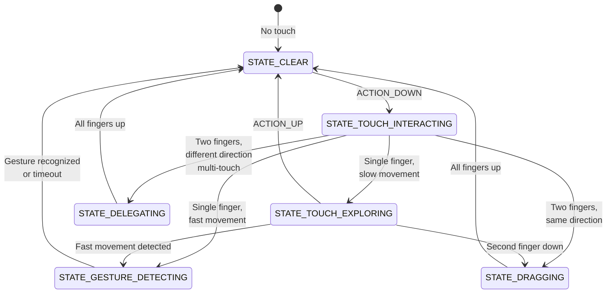

### 46.8.3 触摸探索如何转换事件

当触摸探索处于活动状态时，`TouchExplorer` 按如下方式转换事件流：

| 用户动作 | 原始事件 | 转换后的事件 |
|------------|-----------|-------------------|
| 手指按下 | `ACTION_DOWN` | `ACTION_HOVER_ENTER` |
| 手指缓慢移动 | `ACTION_MOVE` | `ACTION_HOVER_MOVE` |
| 手指抬起 | `ACTION_UP` | `ACTION_HOVER_EXIT` |
| 双击 | 两对 `ACTION_DOWN`/`ACTION_UP` | 对焦点节点执行 `ACTION_CLICK` |
| 双击并按住 | `ACTION_DOWN`/按住 | 对焦点节点执行 `ACTION_LONG_CLICK` |
| 双指拖动 | 双指针 `ACTION_MOVE` | 向视图层次结构注入单指针 `ACTION_MOVE`（应用正常滚动） |
| 滑动手势 | 快速 `ACTION_MOVE` | 向服务发送手势事件 |

这一转换是关键的洞见。触摸事件变成了悬停事件。无障碍服务随后可以
播报手指下方的内容，而无需激活它。

### 46.8.4 悬停事件与无障碍焦点

当系统向 View 发送 `ACTION_HOVER_ENTER` 时，View 自身不会获得焦点
——它向服务发送一个 `TYPE_VIEW_HOVER_ENTER` 无障碍事件。服务
（TalkBack）随后对节点执行 `ACTION_ACCESSIBILITY_FOCUS`，正是这个
动作真正移动了**无障碍焦点**（与输入焦点不同），并产生
`TYPE_VIEW_ACCESSIBILITY_FOCUSED`。当前具有无障碍焦点的视图会（默认
情况下）以绿色矩形高亮显示，其内容会被屏幕阅读器朗读。

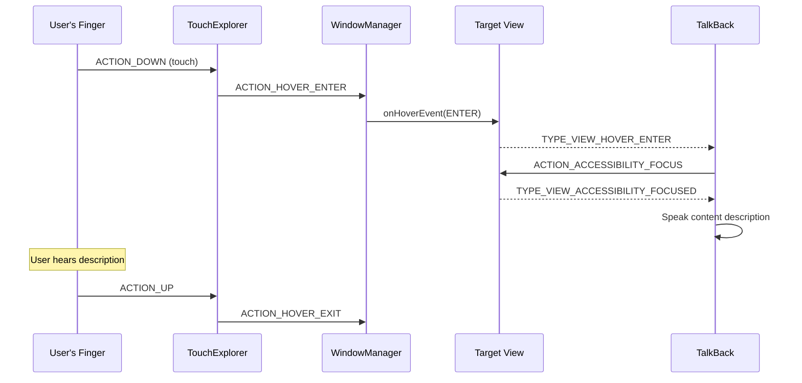

### 46.8.5 EventStreamTransformation 管线

`TouchExplorer` 是安装在 `AccessibilityInputFilter` 中的
`EventStreamTransformation` 对象链的一部分：

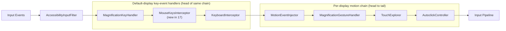

链中的每个转换都可以消费、修改或透传事件。
`AccessibilityInputFilter` 使用 `addFirstEventHandler`
（`enableFeaturesForDisplay`）构建按显示器划分的运动链，该方法会把每
个已启用的功能前置。`addFirstEventHandler` 调用的顺序是：自动点击、
触摸探索、通用运动、缩放，然后是运动事件注入。因此，该顺序反转为
从首到尾的顺序：运动事件注入、缩放手势检测、触摸探索，然后是自动
点击。顺序很重要：缩放手势在触摸探索之前检测，因此缩放的三击不会被
误解释为触摸探索手势。

按键事件处理器由 `enableDisplayIndependentFeatures` 使用相同的
`addFirstEventHandler` 方法安装。该方法把它们前置到*同一*默认显示器
链的前端，位于 `MotionEventInjector` 之前。
`MagnificationKeyHandler`、`MouseKeysInterceptor`（17 新增）和
`KeyboardInterceptor` 都继承 `BaseEventStreamTransformation`。它们
处理按键事件，并把运动事件直接透传到它们身后的运动链中。

链根据功能标志配置：

```java
// AccessibilityInputFilter.java
static final int FLAG_FEATURE_MAGNIFICATION_SINGLE_FINGER_TRIPLE_TAP
    = 0x00000001;
static final int FLAG_FEATURE_TOUCH_EXPLORATION    = 0x00000002;
static final int FLAG_FEATURE_FILTER_KEY_EVENTS    = 0x00000004;
static final int FLAG_FEATURE_AUTOCLICK            = 0x00000008;
static final int FLAG_FEATURE_INJECT_MOTION_EVENTS = 0x00000010;
static final int FLAG_FEATURE_CONTROL_SCREEN_MAGNIFIER = 0x00000020;
static final int FLAG_FEATURE_TRIGGERED_SCREEN_MAGNIFIER = 0x00000040;
static final int FLAG_SERVICE_HANDLES_DOUBLE_TAP   = 0x00000080;
// ...
static final int FLAG_FEATURE_MOUSE_KEYS           = 0x00002000;
```

`FLAG_FEATURE_MOUSE_KEYS` 位驱动 `MouseKeysInterceptor`
（46.4.6 节）。设置后，`AccessibilityInputFilter` 会在与触摸探索和
自动点击相同的链中安装该转换。

### 46.8.6 手势检测

`TouchExplorer` 把手势检测委托给 `GestureManifold`：

```
frameworks/base/services/accessibility/java/com/android/server/accessibility/
    gestures/GestureManifold.java
```

`GestureManifold` 注册了一组丰富的手势匹配器，涵盖：

- **单指滑动**：上、下、左、右以及 L 形组合（例如先上后左、先右
  后下）
- **多指点击**：2 指单/双/三击，3 指单/双/三击，4 指点击
- **多指滑动**：所有方向的 2/3/4 指滑动
- **点击并按住**：单指双击并按住、多指变体

手势常量揭示了完整的词汇表：

```java
// GestureManifold imports from AccessibilityService
GESTURE_SWIPE_UP, GESTURE_SWIPE_DOWN,
GESTURE_SWIPE_LEFT, GESTURE_SWIPE_RIGHT,
GESTURE_SWIPE_UP_AND_DOWN, GESTURE_SWIPE_DOWN_AND_UP,
GESTURE_SWIPE_LEFT_AND_RIGHT, GESTURE_SWIPE_RIGHT_AND_LEFT,
GESTURE_SWIPE_UP_AND_LEFT, GESTURE_SWIPE_UP_AND_RIGHT,
GESTURE_SWIPE_DOWN_AND_LEFT, GESTURE_SWIPE_DOWN_AND_RIGHT,
GESTURE_SWIPE_LEFT_AND_UP, GESTURE_SWIPE_LEFT_AND_DOWN,
GESTURE_SWIPE_RIGHT_AND_UP, GESTURE_SWIPE_RIGHT_AND_DOWN,
GESTURE_DOUBLE_TAP, GESTURE_DOUBLE_TAP_AND_HOLD,
GESTURE_2_FINGER_SINGLE_TAP, GESTURE_2_FINGER_DOUBLE_TAP,
GESTURE_2_FINGER_TRIPLE_TAP, ...
GESTURE_3_FINGER_SINGLE_TAP, GESTURE_3_FINGER_DOUBLE_TAP,
GESTURE_3_FINGER_TRIPLE_TAP, ...
GESTURE_4_FINGER_SINGLE_TAP, GESTURE_4_FINGER_DOUBLE_TAP,
GESTURE_4_FINGER_TRIPLE_TAP, ...
```

每个手势匹配器都继承 `GestureMatcher`，并实现一个用于检测其特定手
势模式的状态机。

### 46.8.7 边缘滑动

`TouchExplorer` 在屏幕顶部和底部定义了边缘区域：

```java
// TouchExplorer.java, line 101
private static final float EDGE_SWIPE_HEIGHT_CM = 0.25f;
```

从底边开始的三指滑动会被区别对待，即使在触摸探索期间也能启用系
统导航手势。

### 46.8.8 拖动

当触摸探索期间两根靠近的手指沿同一方向移动时，`TouchExplorer` 进
入 `STATE_DRAGGING`。这允许列表和其他可滚动内容的双指滚动。方向
相似性由余弦阈值决定：

```java
// TouchExplorer.java, line 94
private static final float MAX_DRAGGING_ANGLE_COS = 0.525321989f; // cos(pi/4)
```

如果两个指针的向量之间的角度大于 45 度，则该手势不是拖动。状态随
后转换为 `STATE_DELEGATING`。

### 46.8.9 SendHoverEnterAndMoveDelayed 模式

`TouchExplorer` 使用延迟的处理器消息来区分触摸探索和手势。当手指
触摸按下时，它不会立即发送悬停事件。相反，它启动一条延迟消息：

```java
// TouchExplorer.java (fields, line 124 onward)
private final SendHoverEnterAndMoveDelayed mSendHoverEnterAndMoveDelayed;
private final SendHoverExitDelayed mSendHoverExitDelayed;
private final SendAccessibilityEventDelayed mSendTouchExplorationEndDelayed;
private final SendAccessibilityEventDelayed mSendTouchInteractionEndDelayed;
private final ExitGestureDetectionModeDelayed mExitGestureDetectionModeDelayed;
```

延迟周期（`mDetermineUserIntentTimeout`）允许系统区分：

- 为探索而放置的手指（缓慢、刻意的放置）
- 为手势而放置的手指（快速、有方向性的移动）
- 为双击而放置的手指（快速的点按-点按模式）

如果手指在超时前快速移动，系统会转换为手势检测模式。如果它保持
静止或缓慢移动，则发送悬停事件，触摸探索开始。

### 46.8.10 触摸探索期间的无障碍事件

触摸探索产生特定序列的无障碍事件：

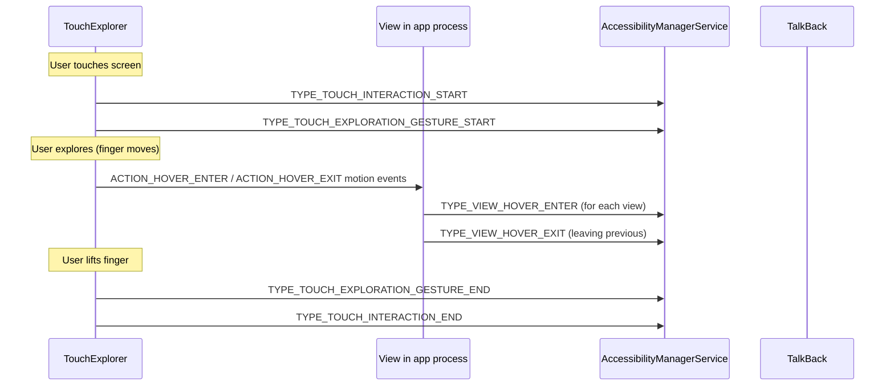

这些事件为探索会话划定了边界，使服务能够跟踪探索何时开始和结束。
例如，当新的探索会话开始时，屏幕阅读器可能会清空其语音队列。

### 46.8.11 手势检测超时

如果 2 秒内没有检测到手势，手势检测状态会自动退出：

```java
// TouchExplorer.java, line 97
private static final int EXIT_GESTURE_DETECTION_TIMEOUT = 2000;
```

如果用户的移动不符合任何已识别的手势模式，这可以防止系统无限期停
留在手势检测模式。

### 46.8.12 ReceivedPointerTracker

`ReceivedPointerTracker`（`TouchState` 的一个内部类）跟踪所有已接
收指针的状态：

```java
// TouchState.java, line 44
public static final int MAX_POINTER_COUNT = 32;
public static final int ALL_POINTER_ID_BITS = 0xFFFFFFFF;
```

它维护活动指针 ID 的位掩码、每个指针最后接收的事件，以及用于手势
检测的计时信息。32 个指针的上限覆盖了指针 ID 0 到 `MAX_POINTER_ID`
（31，定义在 `frameworks/native/include/input/Input.h` 的原生输入系
统中），即 `MAX_POINTER_ID + 1` 个不同的 ID。

### 46.8.13 触摸探索与多显示器

触摸探索支持多显示器设备。每个显示器可以有自己的触摸探索状态，
`AccessibilityInputFilter` 维护按显示器划分的 `TouchExplorer` 实例。
在多屏幕设备上，触摸探索在每个显示器上独立运行。一个例子是带有中
控台和后座显示器的汽车设备。

---

## 46.9 无障碍快捷方式

Android 提供了多种快捷方式机制，用于快速激活无障碍功能。这些快捷
方式由 `AccessibilityShortcutController` 管理：

```
frameworks/base/core/java/com/android/internal/accessibility/
    AccessibilityShortcutController.java
```

### 46.9.1 快捷方式类型

快捷方式类型被定义为名为 `UserShortcutType` 的位掩码 `@IntDef`。
在 Android 17 中，该集合增长到八个活动类型。数值不是连续的（随着
设计演进，一些位位置被废弃）：

```java
// ShortcutConstants.java -- UserShortcutType
int DEFAULT        = 0;
int SOFTWARE       = 1 << 0; // Floating button / nav bar
int HARDWARE       = 1 << 1; // Volume keys shortcut
int TRIPLETAP      = 1 << 2; // Triple-tap on screen
int QUICK_SETTINGS = 1 << 4; // Quick Settings tile
int GESTURE        = 1 << 5; // Two-finger swipe / triple-tap
int KEY_GESTURE    = 1 << 6; // Keyboard key gesture
int TOP_ROW_KEY    = 1 << 7; // Dedicated top-row accessibility key (new in 17)
int QUICK_ACCESS   = 1 << 8; // Quick-access target (new in 17)
int ALL = SOFTWARE | HARDWARE | TRIPLETAP | QUICK_SETTINGS | GESTURE
        | KEY_GESTURE | TOP_ROW_KEY | QUICK_ACCESS;
```

其中两个，`TOP_ROW_KEY` 和 `QUICK_ACCESS`，是 Android 17 新增的。早
先草稿中出现的旧 `TWOFINGER_DOUBLETAP` 位已消失；双指手势激活现在
归入 `GESTURE`。顶行按键对应键盘功能行上的专用无障碍按键（见 46.10
节）。

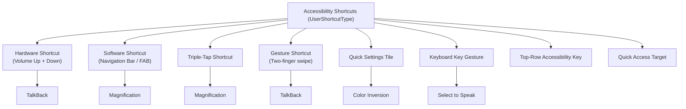

### 46.9.2 硬件快捷方式（音量键）

硬件快捷方式通过同时按住音量加和音量减键约 3 秒来触发。这通过以下
内容配置：

```
Settings.Secure.ACCESSIBILITY_SHORTCUT_TARGET_SERVICE
```

该快捷方式由 `AccessibilityShortcutController` 在输入管线中处理，
后者在设置值上注册 `ContentObserver` 以跟踪分配的目标服务。首次使
用时，控制器会弹出一个警告对话框（`createShortcutWarningDialog()`），
以 `TYPE_KEYGUARD_DIALOG` 窗口类型显示，因此即使在锁屏上也能看到。

### 46.9.3 软件快捷方式（无障碍按钮）

无障碍按钮在导航栏中显示为图标（在三键导航模式下）。在手势导航模
式下，它显示为悬浮操作按钮。其模式由以下内容控制：

```java
// Settings.Secure
ACCESSIBILITY_BUTTON_MODE_NAVIGATION_BAR  // In nav bar
ACCESSIBILITY_BUTTON_MODE_FLOATING_MENU   // Floating button
ACCESSIBILITY_BUTTON_MODE_GESTURE         // Two-finger swipe up
```

点击时，按钮激活分配的无障碍功能。如果分配了多个功能，会出现选择
器对话框：

```
com.android.internal.accessibility.dialog.AccessibilityButtonChooserActivity
```

### 46.9.4 框架功能快捷方式

几个框架功能可以分配给快捷方式，无需无障碍服务：

```java
// AccessibilityShortcutController.java
public static final ComponentName COLOR_INVERSION_COMPONENT_NAME =
    new ComponentName("com.android.server.accessibility", "ColorInversion");
public static final ComponentName DALTONIZER_COMPONENT_NAME =
    new ComponentName("com.android.server.accessibility", "Daltonizer");
public static final ComponentName MAGNIFICATION_COMPONENT_NAME =
    new ComponentName("com.android.server.accessibility", "Magnification");
public static final ComponentName ONE_HANDED_COMPONENT_NAME =
    new ComponentName("com.android.server.accessibility", "OneHandedMode");
public static final ComponentName REDUCE_BRIGHT_COLORS_COMPONENT_NAME =
    new ComponentName("com.android.server.accessibility", "ReduceBrightColors");
public static final ComponentName FONT_SIZE_COMPONENT_NAME =
    new ComponentName("com.android.server.accessibility", "FontSize");
public static final ComponentName AUTOCLICK_COMPONENT_NAME =
    new ComponentName("com.android.server.accessibility", "Autoclick");
public static final ComponentName MOUSE_KEYS_COMPONENT_NAME =
    new ComponentName("com.android.server.accessibility", "MouseKeys");
```

这些是 AMS 识别并在内部处理的伪组件名，而不是绑定到外部服务。

### 46.9.5 Quick Settings 磁贴

无障碍功能可以暴露 Quick Settings 磁贴，允许从通知栏一键激活。磁贴
组件名遵循平行的命名约定：

```java
public static final ComponentName COLOR_INVERSION_TILE_COMPONENT_NAME =
    new ComponentName("com.android.server.accessibility", "ColorInversionTile");
public static final ComponentName DALTONIZER_TILE_COMPONENT_NAME =
    new ComponentName("com.android.server.accessibility", "ColorCorrectionTile");
public static final ComponentName ACCESSIBILITY_HEARING_AIDS_TILE_COMPONENT_NAME =
    new ComponentName("com.android.server.accessibility", "HearingDevicesTile");
```

### 46.9.6 键盘手势快捷方式

现代 Android 通过按键手势事件支持基于键盘的无障碍激活，这些手势在
AMS `init()`（46.2.4 节）中向 `InputManager` 注册。到 Android 17
时，其中几个已经发布，不再受标志门控。其余标志为新增功能设门：

```java
// AccessibilityManagerService.java imports
import static com.android.hardware.input.Flags.enableSelectToSpeakKeyGestures;
import static com.android.hardware.input.Flags.enableTalkbackKeyGestures;
// enableColorInversionKeyGestures() and enableA11yTopRowShortcut()
// gate the color-inversion key gesture and the top-row accessibility key.
```

早期版本中使用的 `enableTalkbackAndMagnifierKeyGestures` 和
`enableVoiceAccessKeyGestures` 标志在通过键盘切换缩放和 Voice Access
变为无条件后被移除。这些手势让拥有实体键盘的用户无需触摸屏幕即可
切换 TalkBack、缩放、Select to Speak、Voice Access 和颜色反转。连接到
平板电脑的外接键盘也包括在内。

### 46.9.7 快捷方式配置与持久化

每种快捷方式类型都在 `Settings.Secure` 中维护其目标分配。
`ShortcutConstants` 中的 `GENERAL_SHORTCUT_SETTINGS` 列表枚举了它们，
Android 17 添加了三个键（`ACCESSIBILITY_TOP_ROW_KEY_TARGETS`、
`ACCESSIBILITY_QUICK_ACCESS_TARGETS` 和
`ACCESSIBILITY_KEY_GESTURE_TARGETS`）以匹配新的快捷方式类型：

```
Settings.Secure.ACCESSIBILITY_BUTTON_TARGETS          // Software shortcut
Settings.Secure.ACCESSIBILITY_SHORTCUT_TARGET_SERVICE // Hardware shortcut
Settings.Secure.ACCESSIBILITY_QS_TARGETS              // Quick Settings
Settings.Secure.ACCESSIBILITY_GESTURE_TARGETS         // Gesture
Settings.Secure.ACCESSIBILITY_TOP_ROW_KEY_TARGETS     // Top-row key (new in 17)
Settings.Secure.ACCESSIBILITY_QUICK_ACCESS_TARGETS    // Quick access (new in 17)
Settings.Secure.ACCESSIBILITY_KEY_GESTURE_TARGETS     // Key gesture (new in 17)
```

三击缩放键 `Settings.Secure.ACCESSIBILITY_DISPLAY_MAGNIFICATION_ENABLED`
不属于 `GENERAL_SHORTCUT_SETTINGS`；它位于单独的
`MAGNIFICATION_SHORTCUT_SETTINGS` 列表中。

`AccessibilityUserState` 类按用户跟踪快捷方式类型到目标服务的完整
映射。`ShortcutUtils` 提供用于读取和写入这些分配的辅助方法。

### 46.9.8 快捷方式激活流程

快捷方式被激活时，执行以下流程：

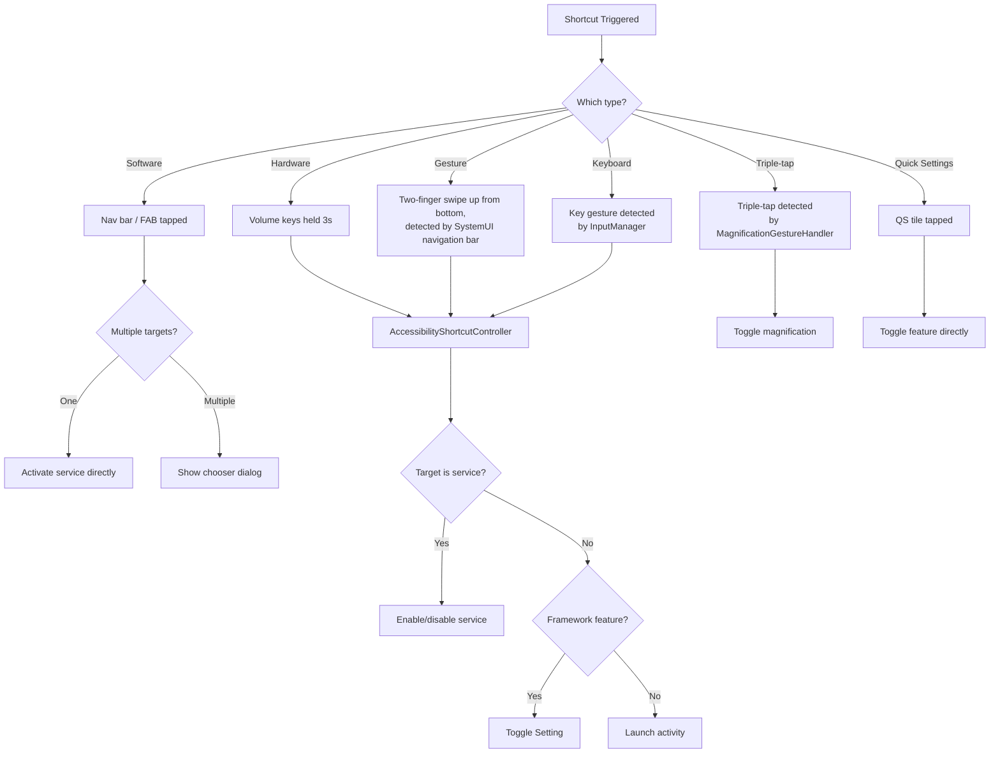

### 46.9.9 无障碍按钮选择器

当多个服务分配给软件快捷方式时，点击无障碍按钮会显示一个选择器：

```
com.android.internal.accessibility.dialog.AccessibilityButtonChooserActivity
com.android.internal.accessibility.dialog.AccessibilityShortcutChooserActivity
```

选择器显示所有分配的目标及其图标和标签。它还提供一个“Edit
shortcuts”按钮。该按钮把同一个对话框切换为就地编辑模式，在此模式
下可以勾选和取消勾选目标。“Done”按钮返回选择器。该对话框不会跳转
到设置。（`TYPE_KEYGUARD_DIALOG` 窗口类型在别处使用，由
`AccessibilityShortcutController` 弹出的硬件快捷方式首次使用警告对
话框使用——见 46.9.2 节。）

### 46.9.10 快捷方式状态日志

快捷方式激活通过日志指标跟踪，用于使用情况分析：

```java
// AccessibilityManagerService.java
static final String METRIC_ID_QS_SHORTCUT_ADD =
    "accessibility.value_qs_shortcut_add";
static final String METRIC_ID_QS_SHORTCUT_REMOVE =
    "accessibility.value_qs_shortcut_remove";
```

`AccessibilityStatsLogUtils.logAccessibilityShortcutActivated()` 方法
记录每次快捷方式激活，包括快捷方式类型、目标服务和结果服务启用/禁
用状态。这些数据帮助 Android 团队了解哪些快捷方式使用最多，并指导
未来的 UX 改进。

### 46.9.11 助听器集成

无障碍快捷方式系统包含对听力设备的专门处理：

```java
public static final ComponentName ACCESSIBILITY_HEARING_AIDS_COMPONENT_NAME =
    new ComponentName("com.android.server.accessibility", "HearingAids");
```

当助听器快捷方式被激活时，它会启动一个专用的听力设备对话框：

```java
static final String ACTION_LAUNCH_HEARING_DEVICES_DIALOG =
    "com.android.systemui.action.LAUNCH_HEARING_DEVICES_DIALOG";
```

这让助听器用户可以快速访问其设备设置、音量调节和路由偏好，而无需
在完整的设置层次结构中导航。

在 Android 17 中，听力设备这一部分故事获得了一小段但有用的粘合剂。
它是一个 `HearingDevicePhoneCallNotificationController`。当
`hearingDevicesInputRoutingControl` settings-lib 标志被设置时，AMS
会构造它。它会在 `init()` 中开始监听通话状态：

```
frameworks/base/services/accessibility/java/com/android/server/accessibility/
    HearingDevicePhoneCallNotificationController.java
```

它会在通话期间显示通知。助听器用户可以借此把通话音频路由到（或移
离）其听力设备。用户不需要在通话中间翻找设置。

## 46.10 键盘按键手势与顶行无障碍按键

Android 17 大幅完善了早在先前版本就开始的键盘驱动无障碍故事。有两
件事发生了变化。许多过去受功能标志门控的按键手势变成了始终开启。
此外，Android 17 还为在功能行上配备物理无障碍按键的键盘引入了新的
专用**顶行无障碍按键**快捷方式类型。

### 46.10.1 AMS 注册的按键手势

如 46.2.4 节所示，AMS 在 `init()` 中构建 `KeyGestureEvent` 类型列
表，并向 `InputManager` 注册它们。在 Android 17 中，注册的集合为：

| 按键手势 | 门控于 |
|-------------|----------|
| `KEY_GESTURE_TYPE_TOGGLE_DISPLAY_COLOR_INVERSION` | `enableColorInversionKeyGestures()` |
| `KEY_GESTURE_TYPE_ACTIVATE_SELECT_TO_SPEAK` | `enableSelectToSpeakKeyGestures()` |
| `KEY_GESTURE_TYPE_TOGGLE_MAGNIFICATION` | 始终注册 |
| `KEY_GESTURE_TYPE_TOGGLE_SCREEN_READER` | `enableTalkbackKeyGestures()` |
| `KEY_GESTURE_TYPE_TOGGLE_VOICE_ACCESS` | 始终注册 |
| `KEY_GESTURE_TYPE_TOGGLE_TOP_ROW_ACCESSIBILITY_KEY` | `enableA11yTopRowShortcut()` |

常量位于：

```
frameworks/base/core/java/android/hardware/input/KeyGestureEvent.java
```

其中 `KEY_GESTURE_TYPE_TOGGLE_TOP_ROW_ACCESSIBILITY_KEY` 的值为 88。
当输入子系统检测到这些手势之一时，它会回调 AMS 的
`mKeyGestureEventHandler`，后者将其分发给匹配的功能。

### 46.10.2 顶行无障碍按键

一些键盘在功能（顶）行上暴露专用的无障碍按键。Android 17 将其建模
为自己的快捷方式类型 `UserShortcutType.TOP_ROW_KEY`（值为 `1 << 7`，
见 46.9.1 节），并在 `Settings.Secure.ACCESSIBILITY_TOP_ROW_KEY_TARGETS`
中拥有自己持久化的目标列表。当按键被按下时，输入管线会引发
`KEY_GESTURE_TYPE_TOGGLE_TOP_ROW_ACCESSIBILITY_KEY`，AMS 将其路由到
通用快捷方式激活路径：

```java
// AccessibilityManagerService.java, line 822
if (gestureType
        == KeyGestureEvent.KEY_GESTURE_TYPE_TOGGLE_TOP_ROW_ACCESSIBILITY_KEY) {
    performAccessibilityShortcutInternal(displayId, TOP_ROW_KEY,
            /* targetName= */ null);
    ...
}
```

整个功能受 `android.view.accessibility.Flags` 的
`enableA11yTopRowShortcut()` 门控。当该标志关闭时，AMS 会跳过手势注
册。它也会跳过顶行目标列表的按用户读写（
`AccessibilityManagerService.java`，第 711、3786 和 4065 行）。因此
未配备该按键的设备看不到任何行为变化。

```mermaid
flowchart TD
    A["Top-row accessibility key pressed"] --> B["InputManager raises<br/>KEY_GESTURE_TYPE_TOGGLE_TOP_ROW_ACCESSIBILITY_KEY"]
    B --> C["AMS mKeyGestureEventHandler"]
    C --> D["performAccessibilityShortcutInternal(TOP_ROW_KEY)"]
    D --> E{"Targets for<br/>TOP_ROW_KEY?"}
    E -->|"One"| F["Toggle that feature/service"]
    E -->|"Multiple"| G["Show shortcut chooser"]
    E -->|"None"| H["No-op"]
```

### 46.10.3 Quick-Access 快捷方式类型

与顶行按键一起，Android 17 添加了 `UserShortcutType.QUICK_ACCESS`
（值 `1 << 8`），持久化在 `Settings.Secure.ACCESSIBILITY_QUICK_ACCESS_TARGETS`
中。AMS 通过其他每种快捷方式类型所使用的相同
`readAccessibilityShortcutTargetsLocked` /
`updateAccessibilityShortcutTargetsLocked` 机制读写其目标
（`AccessibilityManagerService.java`，第 3790 和 3923 行）。这使快捷
方式模型在添加新入口点时保持一致。

## 46.11 鼠标键与虚拟指针控制

46.4.6 节介绍了 `MouseKeysInterceptor`。Android 17 以两种重要的方
式对其进行了改造，都值得指出，因为它们改变了该功能与平台其余部分的
集成方式。

### 46.11.1 通过 VirtualMouse 驱动光标

在早期版本中，鼠标键的移动由定制的处理器产生。在 Android 17 中，
该处理器（`MouseEventHandler`）被删除，拦截器转而拥有一个
`android.hardware.input.VirtualMouse`——与虚拟显示器使用的相同虚
拟输入设备抽象：

```java
// MouseKeysInterceptor.java
import android.hardware.input.VirtualMouse;
import android.hardware.input.VirtualMouseButtonEvent;
import android.hardware.input.VirtualMouseRelativeEvent;
import android.hardware.input.VirtualMouseScrollEvent;
```

每当在设置中打开鼠标键功能时，都会创建一个崭新的 `VirtualMouse`，
并赋予其唯一的设备名称。相对移动、按键和滚动事件都通过它发送。因此
合成的指针流经标准输入路径。在下游，它与真实鼠标无法区分。这修复了
一类定制路径与真实鼠标行为不一致的缺陷。

### 46.11.2 小键盘按键需要 Num Lock

拦截器同时接受主键布局和小键盘。小键盘映射以 Num Lock 开启为条件，
因此当 Num Lock 关闭时，小键盘按键保持其正常的数字输入行为：

```java
// MouseKeysInterceptor.java, lines 716-718
// If we are using numpad keys, they only work if Num Lock is on.
boolean isNumLockOn = (event.getMetaState() & KeyEvent.META_NUM_LOCK_ON) != 0;
if (keyCode == mouseKeyEvent.getNumpadKeyCode(inputDevice) && !isNumLockOn) {
    // skip: treat as a normal numpad key
}
```

按设备的能力缓存（`mDeviceNumpadCapabilityCache`）记录每台已连接键
盘是否拥有全套小键盘按键。因此小键盘映射只在确实拥有数字小键盘的
键盘上提供。

## 46.12 无障碍服务的高级保护模式

在 Android 17 中，无障碍框架与**高级保护模式**（APM，源代码中也写
作 AAPM）集成。这是该版本中安全意义最重大的无障碍变更。高级保护模
式是一种设备级高安全姿态；当用户打开它时，一组已注册的“功能”会收
紧各个子系统。其中一个功能 `FEATURE_ID_RESTRICT_NON_TOOL_A11Y_SERVICES`
限制哪些无障碍服务可以运行。

### 46.12.1 为何限制无障碍服务

无障碍服务是用户可以在 Android 上授予的最强能力之一：它们可以读取
屏幕内容、观察输入并注入动作。这种能力正是恶意软件滥用的对象。高
级保护模式只允许真正声明自己为无障碍工具的服务运行（其元数据中的
`isAccessibilityTool="true"`）。其他一切都会被关闭。

### 46.12.2 功能注册

一个小的提供器把无障碍功能暴露给高级保护服务：

```
frameworks/base/services/core/java/com/android/server/accessibility/
    AccessibilityServiceAdvancedProtectionProvider.java
```

```java
public class AccessibilityServiceAdvancedProtectionProvider
        extends AdvancedProtectionProvider {
    @Override
    public @NonNull List<Integer> getFeatureIds(@NonNull Context context) {
        return List.of(FEATURE_ID_RESTRICT_NON_TOOL_A11Y_SERVICES);
    }
}
```

`FEATURE_ID_RESTRICT_NON_TOOL_A11Y_SERVICES` 在
`frameworks/base/core/java/android/security/advancedprotection/AdvancedProtectionManager.java`
中定义为 id `6`。

### 46.12.3 AMS 如何接入

AMS 在启动时注册 APM 状态变化。它只在 `PHASE_BOOT_COMPLETED` 之后
才这样做，以便设备策略和高级保护服务可用。它还只在
`extendAapmToA11yServices()` 标志被设置时才这样做：

```java
// AccessibilityManagerService.java, line 1021
if (phase == SystemService.PHASE_BOOT_COMPLETED) {
    mDevicePolicyManager = mContext.getSystemService(DevicePolicyManager.class);
    if (android.security.Flags.extendAapmToA11yServices()) {
        mAdvancedProtectionManager =
            mContext.getSystemService(AdvancedProtectionManager.class);
        if (mAdvancedProtectionManager != null) {
            mAdvancedProtectionManager.registerAdvancedProtectionFeatureCallback(
                new int[]{FEATURE_ID_RESTRICT_NON_TOOL_A11Y_SERVICES},
                new HandlerExecutor(BackgroundThread.getHandler()),
                this::handleAdvancedProtectionModeStateChanged);
        }
    }
}
```

### 46.12.4 通过全局用户限制执行

当 APM 切换时，`handleAdvancedProtectionModeStateChanged()` 把功能
状态转换为全局设备策略用户限制
`UserManager.DISALLOW_NON_TOOL_ACCESSIBILITY_SERVICE`（字符串值
`"no_non_tool_accessibility_service"`）：

```java
// AccessibilityManagerService.java, line 1415
void handleAdvancedProtectionModeStateChanged(
        List<AdvancedProtectionFeature> features) {
    ...
    if (apmOn) {
        mDevicePolicyManager.addUserRestrictionGlobally(
            ADVANCED_PROTECTION_SYSTEM_ENTITY,
            UserManager.DISALLOW_NON_TOOL_ACCESSIBILITY_SERVICE);
    } else {
        mDevicePolicyManager.clearUserRestrictionGlobally(
            ADVANCED_PROTECTION_SYSTEM_ENTITY,
            UserManager.DISALLOW_NON_TOOL_ACCESSIBILITY_SERVICE);
    }
    ...
}
```

该决策通过设备策略限制而不是定制检查来路由。这让框架的其余部分把
APM 驱动的阻止与它已经处理的企业管控无障碍白名单的方式同等对待。

### 46.12.5 计算允许集

关于哪些服务可以运行的实际决策位于
`getPermittedAccessibilityServicePackages()` 中。其优先级规则是精确
的：

```java
// AccessibilityManagerService.java, line 7486
Set<String> getPermittedAccessibilityServicePackages(
        @Nullable List<String> adminPermittedServices, int userId) {
    if (!android.security.Flags.extendAapmToA11yServices()) {
        return getPermittedServicesLegacy(adminPermittedServices, userId);
    }
    // If an Enterprise Admin explicitly set an allowlist, Admin intent overrides AAPM.
    if (adminPermittedServices != null) {
        return getPermittedServicesLegacy(adminPermittedServices, userId);
    }
    final boolean apmOn = mUmi.hasUserRestriction(
            UserManager.DISALLOW_NON_TOOL_ACCESSIBILITY_SERVICE, userId);
    if (!apmOn) {
        return getPermittedServicesLegacy(adminPermittedServices, userId);
    }
    return getPermittedServicesStrictApm(userId);
}
```

```mermaid
flowchart TD
    A["getPermittedAccessibilityServicePackages"] --> B{"extendAapmToA11yServices flag on?"}
    B -->|No| L["Legacy: admin allowlist + system services"]
    B -->|Yes| C{"Enterprise admin allowlist set?"}
    C -->|Yes| L
    C -->|No| D{"APM user restriction active?"}
    D -->|No| L
    D -->|Yes| S["Strict APM: only packages with a tool service"]
```

关键的优先级：显式的**企业管理白名单优先于 APM**。AMS 只在没有管
理白名单且 APM 激活时才切换到 `getPermittedServicesStrictApm()`。
该方法扫描已安装的服务。它只允许包含至少一个被标记为无障碍工具的
服务的包。它会过滤掉所有声明自己为非工具服务的包。

### 46.12.6 执行前的日志

`AdvancedProtectionService` 记录在 APM 实际开启之前*将会*被禁用的
服务和快捷方式数量，以便平台了解其影响。AMS 通过以下内容暴露这些
计数：

```java
// AccessibilityManagerService.java, line 1365
AccessibilityManagerInternal.AccessibilityFeatureRestrictedCounts
        getA11yFeatureRestrictedCounts(int userId) { ... }
```

这返回当前已启用且其包不在最终允许集中的服务以及已分配快捷方式的
数量。这些计数使用与执行路径相同的传统与严格逻辑计算。

## 46.13 EyeDropper 应用

EyeDropper（`packages/apps/EyeDropper/`，包
`com.android.eyedropper`）是一个小型系统应用。它让用户挑选显示器上
的单个像素，并把该像素的颜色返回给调用者。它是一个通用颜色选择器。
任何应用都可以通过公共 `OPEN_EYE_DROPPER` intent 调用它，并获得所
选像素的 ARGB 值。

其屏幕准星具有无障碍根节点。尺寸和绘制改编自 Accessibility
Scanner 颜色选择器。`res/values/dimens.xml` 注明准星是“copied from
Accessibility Scanner Color Picker”，`ui/touchscreen/TouchscreenReticle.kt`
引用了无障碍审计器的选择器 UI。这一血统正是它在本章中的位置。然
而，intent 本身是面向任何调用者设计的。它不与特定的低视力或色觉功
能绑定。

### 46.13.1 它做什么以及如何被调用

该应用暴露一个活动 `MainActivity`，带有
`android.intent.action.OPEN_EYE_DROPPER` 的 intent 过滤器。该动作及
其结果 extra 在框架中声明，因此调用者不直接依赖应用包：

```java
// frameworks/base/core/java/android/content/Intent.java:4754
// Activity Action: Launch an eye dropper. It allows the user to pick a pixel
// on the display. The color of the selected pixel is returned to the
// requesting activity as an activity result. Pixels from secure windows and
// protected buffers are blacked out.
// Output: EXTRA_COLOR is the color of the selected pixel in ARGB (0xFFRRGGBB).
public static final String ACTION_OPEN_EYE_DROPPER =
        "android.intent.action.OPEN_EYE_DROPPER";
```

调用者启动该活动以获取结果。选中后，活动设置 `RESULT_OK`，
`Intent.EXTRA_COLOR` 持有 ARGB 整数。取消后，它设置
`RESULT_CANCELED`（`MainActivity.sendColor`/`onAbort`）。该动作受
`enable_eye_dropper_api` aconfig 标志门控
（`packages/apps/EyeDropper/flags/`）。活动被主题化为透明，因此它会
叠加在屏幕上的任何内容之上。

### 46.13.2 颜色如何被挑选

`MainActivity` 自己不绘制选择器。在首次窗口焦点时，它捕获每个已连
接显示器的屏幕截图。然后绑定到 `EyeDropperControllerService`，并通过
本地 binder（`EyeDropperServiceConnection`）把按显示器的屏幕截图交
给它。捕获通过 `IWindowManager.screenCapture` 进行。安全内容和受保
护内容策略都设置为 `REDACT`，因此受保护的 surface 返回时被涂黑而
不是可读的（`util/ScreenCaptureHelper.kt`）。捕获的硬件位图被拷贝到
软件 `ARGB_8888` 位图，以便可以用 `getPixel()` 读取单个像素。

服务在每个显示器上渲染一个透明叠加层。它运行两种输入模式之一。一
种是用于桌面窗口的指针/准星模式（光标驱动）。另一种是触摸屏准星
模式（`ui/touchscreen/`）。

当用户确认一个像素时，叠加层报告坐标。服务从该显示器的屏幕截图中
读取颜色并移除所有叠加层。然后活动把颜色返回给调用者。输入设备或
显示器变更、配置变更或退出键都走相同的中止路径。因此请求总是以结
果或取消结束。

```mermaid
sequenceDiagram
    participant Caller as "Caller activity"
    participant MA as "MainActivity"
    participant WM as "IWindowManager"
    participant Svc as "EyeDropperControllerService"
    participant User as "User"
    Caller->>MA: "startActivityForResult(OPEN_EYE_DROPPER)"
    MA->>WM: "screenCapture(REDACT secure/protected)"
    WM-->>MA: "per-display screenshots"
    MA->>Svc: "bind + showUiOverlay()"
    Svc->>User: "transparent reticle overlay"
    User->>Svc: "pick pixel (or abort)"
    Svc->>MA: "onSelectColor(argb) / onAbort()"
    MA-->>Caller: "RESULT_OK + EXTRA_COLOR (or RESULT_CANCELED)"
```

该应用为此工作持有三项特权权限。它使用 `INTERNAL_SYSTEM_WINDOW` 添
加叠加层，使用 `READ_FRAME_BUFFER` 进行屏幕截图，并使用
`INJECT_EVENTS` 读取光标位置（`AndroidManifest.xml`）。

## 46.14 动手实践

本节提供探索无障碍框架的实操练习。

### 46.14.1 练习：检查无障碍树

使用 `uiautomator` 导出无障碍树，并将其与 View 层次结构进行比较：

```bash
# Dump the accessibility tree
adb shell uiautomator dump /sdcard/a11y-tree.xml
adb pull /sdcard/a11y-tree.xml

# Alternatively, use the accessibility dump command
adb shell dumpsys accessibility
```

打开 `a11y-tree.xml` 并识别：

1. 哪些视图具有 `content-desc` 属性？
2. 哪些视图被标记为 `clickable="true"` 但没有 `content-desc`？
3. 是否有任何 `ImageView` 元素缺少内容描述？

### 46.14.2 练习：编写一个最小化的 AccessibilityService

创建一个将所有事件记录到 logcat 的最小化无障碍服务：

**步骤 1：创建服务类。**

```java
package com.example.a11ydemo;

import android.accessibilityservice.AccessibilityService;
import android.util.Log;
import android.view.accessibility.AccessibilityEvent;

public class LoggingAccessibilityService extends AccessibilityService {
    private static final String TAG = "A11yDemo";

    @Override
    public void onAccessibilityEvent(AccessibilityEvent event) {
        Log.d(TAG, "Event: " + event.getEventType()
            + " pkg=" + event.getPackageName()
            + " cls=" + event.getClassName()
            + " text=" + event.getText());
    }

    @Override
    public void onInterrupt() {
        Log.d(TAG, "Service interrupted");
    }

    @Override
    protected void onServiceConnected() {
        Log.d(TAG, "Service connected");
    }
}
```

**步骤 2：创建配置 XML（`res/xml/a11y_config.xml`）。**

```xml
<?xml version="1.0" encoding="utf-8"?>
<accessibility-service
    xmlns:android="http://schemas.android.com/apk/res/android"
    android:accessibilityEventTypes="typeAllMask"
    android:accessibilityFeedbackType="feedbackGeneric"
    android:accessibilityFlags="flagReportViewIds"
    android:canRetrieveWindowContent="true"
    android:notificationTimeout="100"
    android:isAccessibilityTool="true"
    android:description="@string/a11y_service_description" />
```

**步骤 3：在 AndroidManifest.xml 中声明。**

```xml
<service
    android:name=".LoggingAccessibilityService"
    android:exported="true"
    android:permission="android.permission.BIND_ACCESSIBILITY_SERVICE">
    <intent-filter>
        <action android:name=
            "android.accessibilityservice.AccessibilityService" />
    </intent-filter>
    <meta-data
        android:name="android.accessibilityservice"
        android:resource="@xml/a11y_config" />
</service>
```

**步骤 4：通过设置 > 无障碍 > 已下载的服务启用该服务**，然后观察
logcat：

```bash
adb logcat -s A11yDemo
```

在任意应用中导航并观察事件流。注意事件的频率以及每个事件携带的
信息。

### 46.14.3 练习：探索触摸探索状态转换

启用 TalkBack，然后通过启用调试日志观察触摸探索状态：

```bash
# Enable TouchExplorer debug logging
adb shell setprop log.tag.TouchExplorer DEBUG
```

执行这些交互并观察 logcat 中的状态转换：

1. **单指慢速拖动**：触摸屏幕并缓慢移动。观察悬停事件和无障碍焦
   点变化。

2. **双击**：触摸一个元素，然后双击。观察对无障碍焦点节点的点击
   动作。

3. **双指拖动**：放置两根手指并滚动。观察向 `STATE_DRAGGING` 的
   转换。

4. **滑动手势**：执行右滑移动到下一个元素。然后执行左滑移动到上一
   个元素。

5. **双指三击**：观察快捷方式激活。

### 46.14.4 练习：测试缩放手势

通过设置 > 无障碍 > 缩放启用缩放。

1. **在屏幕上任意位置三击**。观察缩放动画和放大状态。

2. **放大状态下**，用两根手指平移视口。观察缩放中心如何移动。

3. **放大状态下**，使用捏合手势调整缩放级别。

4. **三击并按住**以临时放大。按住时移动手指。松开并观察返回原始
   状态。

5. **导出缩放状态**：
   ```bash
   adb shell dumpsys accessibility | grep -A 20 "Magnification"
   ```

### 46.14.5 练习：审计内容描述

使用 Accessibility Scanner 应用（可在 Google Play 获取）或编写脚本
来审计缺失的内容描述：

```bash
# Dump the accessibility tree and find elements without descriptions
adb shell uiautomator dump /sdcard/a11y.xml
adb pull /sdcard/a11y.xml
```

然后搜索没有内容描述的可点击或可聚焦元素：

```python
import xml.etree.ElementTree as ET

tree = ET.parse('a11y.xml')
root = tree.getroot()

for node in root.iter('node'):
    clickable = node.get('clickable') == 'true'
    content_desc = node.get('content-desc', '')
    text = node.get('text', '')
    class_name = node.get('class', '')

    if clickable and not content_desc and not text:
        bounds = node.get('bounds', '')
        print(f"MISSING: {class_name} at {bounds}")
```

### 46.14.6 练习：监控 AccessibilityManagerService 事件分发

使用无障碍跟踪设施详细观察事件分发：

```bash
# Enable accessibility tracing
adb shell cmd accessibility
# (lists available commands)

# Dump full accessibility state
adb shell dumpsys accessibility
```

导出输出包括：

- 当前用户的无障碍状态
- 已启用的服务及其配置
- 已绑定的服务及其能力
- 带有无障碍窗口 ID 的窗口列表
- 缩放状态
- 输入过滤器配置

### 46.14.7 练习：实现类似 Switch Access 的扫描器

构建一个简化版本的 Switch Access，它逐个高亮元素：

```java
public class SimpleScannerService extends AccessibilityService {
    private List<AccessibilityNodeInfo> mScanTargets = new ArrayList<>();
    private int mCurrentIndex = 0;

    @Override
    protected void onServiceConnected() {
        // Collect all actionable nodes
        refreshScanTargets();
    }

    @Override
    public void onAccessibilityEvent(AccessibilityEvent event) {
        if (event.getEventType() ==
                AccessibilityEvent.TYPE_WINDOW_STATE_CHANGED) {
            refreshScanTargets();
        }
    }

    @Override
    protected boolean onKeyEvent(KeyEvent event) {
        if (event.getKeyCode() == KeyEvent.KEYCODE_SPACE
                && event.getAction() == KeyEvent.ACTION_UP) {
            // Space = advance to next element
            advanceScan();
            return true;
        }
        if (event.getKeyCode() == KeyEvent.KEYCODE_ENTER
                && event.getAction() == KeyEvent.ACTION_UP) {
            // Enter = activate current element
            activateCurrent();
            return true;
        }
        return false;
    }

    private void refreshScanTargets() {
        mScanTargets.clear();
        mCurrentIndex = 0;
        AccessibilityNodeInfo root = getRootInActiveWindow();
        if (root != null) {
            collectActionableNodes(root, mScanTargets);
            root.recycle();
        }
    }

    private void collectActionableNodes(
            AccessibilityNodeInfo node,
            List<AccessibilityNodeInfo> targets) {
        if (node.isClickable() && node.isVisibleToUser()) {
            targets.add(AccessibilityNodeInfo.obtain(node));
        }
        for (int i = 0; i < node.getChildCount(); i++) {
            AccessibilityNodeInfo child = node.getChild(i);
            if (child != null) {
                collectActionableNodes(child, targets);
                child.recycle();
            }
        }
    }

    private void advanceScan() {
        if (mScanTargets.isEmpty()) return;
        // Clear previous focus
        if (mCurrentIndex < mScanTargets.size()) {
            mScanTargets.get(mCurrentIndex).performAction(
                AccessibilityNodeInfo.ACTION_CLEAR_ACCESSIBILITY_FOCUS);
        }
        // Advance
        mCurrentIndex = (mCurrentIndex + 1) % mScanTargets.size();
        // Set new focus
        mScanTargets.get(mCurrentIndex).performAction(
            AccessibilityNodeInfo.ACTION_ACCESSIBILITY_FOCUS);
    }

    private void activateCurrent() {
        if (mCurrentIndex < mScanTargets.size()) {
            mScanTargets.get(mCurrentIndex).performAction(
                AccessibilityNodeInfo.ACTION_CLICK);
        }
    }

    @Override
    public void onInterrupt() { }
}
```

本练习演示了 Switch Access 的核心原理：树遍历、节点过滤、无障碍焦
点管理和动作执行。

### 46.14.8 练习：端到端跟踪 AccessibilityEvent

在事件管线的每个阶段设置断点或添加日志，然后在任意应用中点击一
个按钮。跟踪事件经过：

1. 应用进程中的 `View.sendAccessibilityEvent()`
2. 应用进程中的 `ViewRootImpl.requestSendAccessibilityEvent()`
3. 跨 Binder 的 `AccessibilityManager.sendAccessibilityEvent()`
4. system_server 中的
   `AccessibilityManagerService.sendAccessibilityEvent()`
5. `AccessibilitySecurityPolicy.canDispatchAccessibilityEventLocked()`
   检查
6. 到已绑定服务的 `dispatchAccessibilityEventLocked()`
7. 跨 Binder 的
   `AccessibilityServiceConnection.notifyAccessibilityEvent()`
8. 服务进程中的 `AccessibilityService.onAccessibilityEvent()`

记录每个阶段的时序。在典型设备上，从 View 事件到服务回调的端到端
延迟为 5-15 毫秒。

### 46.14.9 练习：检查缩放内部实现

通过 WindowManager 检查显示缩放状态来探索缩放实现：

```bash
# Check current magnification spec
adb shell dumpsys window displays | grep -A 5 "MagnificationSpec"

# Enable magnification via settings
adb shell settings put secure accessibility_display_magnification_enabled 1

# Set magnification scale
adb shell settings put secure accessibility_display_magnification_scale 3.0

# Check magnification mode
adb shell settings get secure accessibility_magnification_mode
```

启用缩放并三击放大后：

```bash
# Observe the magnification spec change
adb shell dumpsys accessibility | grep -i magnif
```

注意当你平移和缩放时 `MagnificationSpec` 值如何变化。

### 46.14.10 练习：构建无障碍审计工具

结合本章的知识构建一个全面的无障碍审计工具：

```java
public class AuditService extends AccessibilityService {
    private static final String TAG = "A11yAudit";

    @Override
    protected void onServiceConnected() {
        auditCurrentScreen();
    }

    @Override
    public void onAccessibilityEvent(AccessibilityEvent event) {
        if (event.getEventType() ==
                AccessibilityEvent.TYPE_WINDOW_STATE_CHANGED) {
            auditCurrentScreen();
        }
    }

    private void auditCurrentScreen() {
        AccessibilityNodeInfo root = getRootInActiveWindow();
        if (root == null) return;

        int totalNodes = 0;
        int clickableWithoutLabel = 0;
        int imagesWithoutDescription = 0;
        int smallTouchTargets = 0;

        List<AccessibilityNodeInfo> queue = new ArrayList<>();
        queue.add(root);

        while (!queue.isEmpty()) {
            AccessibilityNodeInfo node = queue.remove(0);
            totalNodes++;

            // Check: clickable without label
            if (node.isClickable() && TextUtils.isEmpty(
                    node.getContentDescription())
                    && TextUtils.isEmpty(node.getText())) {
                clickableWithoutLabel++;
                Log.w(TAG, "Unlabeled clickable: "
                    + node.getClassName() + " "
                    + node.getViewIdResourceName());
            }

            // Check: ImageView without description
            if ("android.widget.ImageView".equals(
                    node.getClassName().toString())
                    && TextUtils.isEmpty(
                        node.getContentDescription())) {
                imagesWithoutDescription++;
            }

            // Check: touch target size (48dp minimum)
            Rect bounds = new Rect();
            node.getBoundsInScreen(bounds);
            float density = getResources()
                .getDisplayMetrics().density;
            float widthDp = bounds.width() / density;
            float heightDp = bounds.height() / density;
            if (node.isClickable()
                    && (widthDp < 48 || heightDp < 48)) {
                smallTouchTargets++;
            }

            // Recurse into children
            for (int i = 0; i < node.getChildCount(); i++) {
                AccessibilityNodeInfo child = node.getChild(i);
                if (child != null) {
                    queue.add(child);
                }
            }
        }

        Log.i(TAG, "=== Accessibility Audit ===");
        Log.i(TAG, "Total nodes: " + totalNodes);
        Log.i(TAG, "Clickable without label: "
            + clickableWithoutLabel);
        Log.i(TAG, "Images without description: "
            + imagesWithoutDescription);
        Log.i(TAG, "Small touch targets (<48dp): "
            + smallTouchTargets);
    }

    @Override
    public void onInterrupt() { }
}
```

在多个应用上运行此工具并比较结果。常见问题包括：

- 没有 `contentDescription` 的 `ImageButton` 元素
- 未实现 `onInitializeAccessibilityNodeInfo()` 的自定义视图
- 小于推荐的 48dp 最小值的触摸目标
- 未提供 `CollectionInfo` / `CollectionItemInfo` 的列表
- 应被标记为对无障碍不重要的装饰性图像

### 46.14.11 练习：探索无障碍设置数据库

无障碍框架将其配置存储在 `Settings.Secure` 中。探索这些设置以理
解系统如何持久化状态：

```bash
# List all accessibility-related settings
adb shell settings list secure | grep -i access

# Key settings and their meanings
adb shell settings get secure enabled_accessibility_services
# Returns: colon-separated list of ComponentName strings

adb shell settings get secure touch_exploration_enabled
# Returns: 0 or 1

adb shell settings get secure accessibility_display_magnification_enabled
# Returns: 0 or 1

adb shell settings get secure accessibility_display_magnification_scale
# Returns: float (e.g., 2.0)

adb shell settings get secure accessibility_magnification_mode
# Returns: 1 (fullscreen), 2 (window), or 3 (all)

adb shell settings get secure accessibility_button_targets
# Returns: colon-separated list of ComponentName strings

adb shell settings get secure accessibility_shortcut_target_service
# Returns: ComponentName of hardware shortcut target

adb shell settings get secure accessibility_button_mode
# Returns: 0 (nav bar), 1 (floating menu), 2 (gesture)

adb shell settings get secure high_text_contrast_enabled
# Returns: 0 or 1

adb shell settings get secure accessibility_captioning_enabled
# Returns: 0 or 1
```

直接修改这些设置可以在不使用设置 UI 的情况下切换无障碍功能。这对
自动化测试特别有用。

### 46.14.12 练习：用于测试的 UiAutomation

`UiAutomation` 框架提供用于测试的程序化无障碍服务访问。它使用与
常规无障碍服务相同的基础设施，但由 `UiAutomationManager` 管理：

```java
// In an instrumentation test
UiAutomation uiAutomation = getInstrumentation().getUiAutomation();

// Get the root accessibility node
AccessibilityNodeInfo root =
    uiAutomation.getRootInActiveWindow();

// Perform a click on a button found by text
List<AccessibilityNodeInfo> nodes =
    root.findAccessibilityNodeInfosByText("Submit");
if (!nodes.isEmpty()) {
    nodes.get(0).performAction(AccessibilityNodeInfo.ACTION_CLICK);
}

// Wait for and check events
AccessibilityEvent event = uiAutomation.executeAndWaitForEvent(
    () -> {
        // Perform some action
        device.pressBack();
    },
    (e) -> e.getEventType() ==
        AccessibilityEvent.TYPE_WINDOW_STATE_CHANGED,
    5000 // timeout ms
);
```

`UiAutomation` 通过特殊的 `UiAutomationManager.sendAccessibilityEventLocked()`
路径连接到 AMS。该路径确保测试事件始终被分发，不受常规过滤规则的
影响。

### 46.14.13 练习：观察 EventStreamTransformation 管线

通过观察启用不同功能时的行为，构建输入转换管线的心理模型：

```bash
# Scenario 1: Touch exploration only
adb shell settings put secure touch_exploration_enabled 1
# Pipeline: InputFilter -> TouchExplorer -> (output)

# Scenario 2: Magnification only
adb shell settings put secure \
    accessibility_display_magnification_enabled 1
# Pipeline: InputFilter -> MagnificationGestureHandler -> (output)

# Scenario 3: Both enabled
# Pipeline: InputFilter -> MagnificationGestureHandler
#           -> TouchExplorer -> (output)

# Scenario 4: With autoclick
# Pipeline: InputFilter -> MagnificationGestureHandler
#           -> TouchExplorer -> AutoclickController -> (output)
```

转换的顺序很重要。缩放手势检测在触摸探索之前运行。因此它在
TouchExplorer 把缩放三击解释为双击加单击之前就将其拦截。

### 46.14.14 练习：性能分析

测量无障碍服务对你应用的性能影响：

```bash
# Enable method tracing while using accessibility
adb shell am profile start <package> /sdcard/a11y-trace.trace
# Interact with the app using TalkBack
adb shell am profile stop <package>
adb pull /sdcard/a11y-trace.trace
```

在 Android Studio 的分析器中打开跟踪，并查找：

- 在 `onInitializeAccessibilityNodeInfo()` 中花费的时间——该函数会
  对服务查询的每个节点调用
- 在 `sendAccessibilityEvent()` 中花费的时间——每个事件的开销
- 节点查询的 Binder 事务时间
- 视图层次结构遍历开销

常见的性能陷阱：

- 在频繁调用的代码路径中创建昂贵的 `AccessibilityNodeInfo` 对象
- 在 `onPopulateAccessibilityEvent()` 中执行繁重计算
- 不回收 `AccessibilityNodeInfo` 对象，造成 GC 压力
- 产生深层无障碍树的大型视图层次结构

---

## 总结

本章探讨了 Android 的无障碍框架。它从系统服务的最低层开始，一直讲
到让平台对残障人士可用的用户面功能。

关键的架构洞见有：

1. **集中式协调**：`AccessibilityManagerService` 是所有无障碍功能
   的单一协调点。它管理事件分发、服务绑定、安全强制、窗口跟踪、输
   入过滤和缩放。现在它还对无障碍服务强制执行高级保护模式的限制。

2. **事件驱动的观察**：无障碍事件系统允许服务被动观察 UI 变化，
   而无需修改应用行为。事件类型位掩码系统实现了高效过滤。

3. **内容内省**：`AccessibilityNodeInfo` 树提供了 UI 状态的完
   整、可序列化的快照，可以跨进程边界查询。预取系统和
   `AccessibilityCache` 减轻了 Binder IPC 的性能开销。

4. **动作注入**：服务可以通过 `performAction()` API 代表用户执行
   动作，实现点击、滚动、文本输入和自定义动作。

5. **输入转换**：`EventStreamTransformation` 管线使触摸探索、缩
   放手势和 Switch Access 能够重新解释输入事件流，而无需修改输入
   驱动层。

6. **分层安全**：框架的安全模型在强大的能力需求与用户保护之间取
   得平衡。它通过权限要求、明确同意、事件过滤、源节点剥离和非工
   具警告来实现这一点。

无障碍框架展示了 AOSP 最优雅的设计模式之一。一个集中式服务通过丰
富的事件和节点协议，在生产者（应用）与消费者（无障碍服务）之间进
行调解。同时，它保持了强大的安全边界。这一架构对任何构建自定义
无障碍服务的人都至关重要。对任何审计应用无障碍合规性的人也同样
至关重要。对任何从事与无障碍子系统交互的 AOSP 平台功能工作的人也是
如此。

## 关键源文件参考

| 文件 | 用途 |
|------|---------|
| `frameworks/base/services/accessibility/.../AccessibilityManagerService.java` | 中央系统服务 |
| `frameworks/base/core/.../accessibility/AccessibilityEvent.java` | 事件定义 |
| `frameworks/base/core/.../accessibility/AccessibilityNodeInfo.java` | 节点信息 |
| `frameworks/base/core/.../accessibility/AccessibilityManager.java` | 客户端管理器 |
| `frameworks/base/core/.../accessibilityservice/AccessibilityService.java` | 服务基类 |
| `frameworks/base/services/accessibility/.../AccessibilitySecurityPolicy.java` | 安全强制 |
| `frameworks/base/services/accessibility/.../AccessibilityServiceConnection.java` | 服务绑定 |
| `frameworks/base/services/accessibility/.../AbstractAccessibilityServiceConnection.java` | 服务连接基类 |
| `frameworks/base/services/accessibility/.../AccessibilityWindowManager.java` | 窗口跟踪 |
| `frameworks/base/services/accessibility/.../AccessibilityUserState.java` | 按用户状态 |
| `frameworks/base/services/accessibility/.../AccessibilityInputFilter.java` | 输入管线集成 |
| `frameworks/base/services/accessibility/.../KeyEventDispatcher.java` | 按键事件路由 |
| `frameworks/base/services/accessibility/.../gestures/TouchExplorer.java` | 触摸探索 |
| `frameworks/base/services/accessibility/.../gestures/TouchState.java` | 触摸状态跟踪 |
| `frameworks/base/services/accessibility/.../gestures/GestureManifold.java` | 手势检测 |
| `frameworks/base/services/accessibility/.../magnification/MagnificationController.java` | 缩放编排 |
| `frameworks/base/services/accessibility/.../magnification/FullScreenMagnificationController.java` | 全屏缩放 |
| `frameworks/base/services/accessibility/.../magnification/FullScreenMagnificationGestureHandler.java` | 缩放手势 |
| `frameworks/base/services/accessibility/.../magnification/WindowMagnificationGestureHandler.java` | 窗口缩放 |
| `frameworks/base/services/accessibility/.../magnification/MagnificationKeyHandler.java` | 键盘缩放 |
| `frameworks/base/services/accessibility/.../magnification/MagnificationScaleProvider.java` | 缩放边界 |
| `frameworks/base/services/accessibility/.../autoclick/AutoclickController.java` | 自动点击功能 |
| `frameworks/base/core/.../internal/accessibility/AccessibilityShortcutController.java` | 快捷方式管理 |
| `frameworks/base/services/accessibility/.../EventStreamTransformation.java` | 输入管线接口 |
| `frameworks/base/services/accessibility/.../SystemActionPerformer.java` | 系统动作执行 |
| `frameworks/base/services/accessibility/.../BrailleDisplayConnection.java` | 盲文显示器支持 |
| `frameworks/base/services/accessibility/.../MouseKeysInterceptor.java` | 键盘驱动的鼠标指针（VirtualMouse、Num Lock） |
| `frameworks/base/services/accessibility/.../HearingDevicePhoneCallNotificationController.java` | 听力设备通话路由通知 |
| `frameworks/base/services/accessibility/.../magnification/FullScreenMagnificationPointerMotionEventFilter.java` | 光标跟随指针变换 |
| `frameworks/base/services/core/.../accessibility/AccessibilityServiceAdvancedProtectionProvider.java` | 高级保护模式功能提供器 |
| `frameworks/base/core/.../security/advancedprotection/AdvancedProtectionManager.java` | APM 功能 ID 与实体 |
| `frameworks/base/core/.../internal/accessibility/common/ShortcutConstants.java` | 快捷方式类型位掩码（UserShortcutType） |

---
