# 第 32 章：账号同步

Android 的账号与同步框架包含两个紧密耦合的子系统。**AccountManager** 存储凭据并管理认证令牌。**SyncManager** 调度并运行后台数据同步。二者共同构成了所有与远程服务器同步数据的应用程序的骨干。例如电子邮件、联系人、企业 MDM 和第三方云服务。

本章完整梳理整个架构。从面向应用程序的 `AccountManager` 和 `ContentResolver.requestSync()` API 讲起，接着介绍系统服务器中的实现（`AccountManagerService` 和 `SyncManager`），最后深入底层数据库存储以及与 JobScheduler 的集成。

---

## 32.1 AccountManager 架构

### 32.1.1 三层设计

账号子系统遵循 AOSP 的标准分层架构：

1. **框架 API（Java）** —— `android.accounts.AccountManager` 是面向应用程序的类，提供账号发现、凭据管理和认证令牌获取功能。

2. **系统服务** —— `AccountManagerService` 运行在 `system_server` 中，实现 `IAccountManager` AIDL 接口。它管理账号数据库、认证器绑定和令牌缓存。

3. **认证器插件** —— 由第三方或 OEM 提供的 `AbstractAccountAuthenticator` 实现，负责为每种账号类型执行实际的凭据验证和令牌生成。

```
Source paths (key files):
  AccountManager ................. frameworks/base/core/java/android/accounts/AccountManager.java
  Account ........................ frameworks/base/core/java/android/accounts/Account.java
  AbstractAccountAuthenticator ... frameworks/base/core/java/android/accounts/AbstractAccountAuthenticator.java
  IAccountManager.aidl ........... frameworks/base/core/java/android/accounts/IAccountManager.aidl
  IAccountAuthenticator.aidl ..... frameworks/base/core/java/android/accounts/IAccountAuthenticator.aidl
  AccountManagerService .......... frameworks/base/services/core/java/com/android/server/accounts/AccountManagerService.java
  AccountsDb ..................... frameworks/base/services/core/java/com/android/server/accounts/AccountsDb.java
  TokenCache ..................... frameworks/base/services/core/java/com/android/server/accounts/TokenCache.java
  AccountAuthenticatorCache ...... frameworks/base/services/core/java/com/android/server/accounts/AccountAuthenticatorCache.java
```

### 32.1.2 架构图

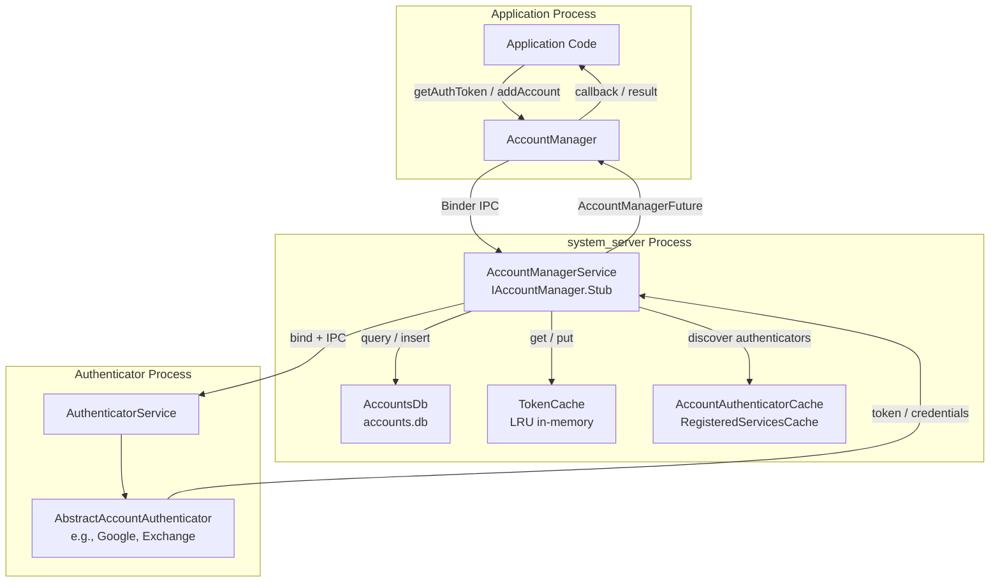

### 32.1.3 AccountManager —— 应用程序入口点

`AccountManager` 通过 `Context.getSystemService(Context.ACCOUNT_SERVICE)` 获取。它带有 `@SystemService(Context.ACCOUNT_SERVICE)` 注解：

```
Source: frameworks/base/core/java/android/accounts/AccountManager.java
```

该类同时提供同步和异步操作。大多数方法返回 `AccountManagerFuture<Bundle>`，可以配合回调或阻塞式 `getResult()` 使用：

| 方法 | 用途 | 返回值 |
|--------|---------|---------|
| `getAccounts()` | 获取设备上所有账号 | `Account[]` |
| `getAccountsByType(type)` | 获取特定类型的账号 | `Account[]` |
| `getAccountsByTypeAndFeatures(...)` | 按类型和功能过滤 | Future |
| `addAccount(type, ...)` | 启动 UI 添加新账号 | Future（包含 KEY_INTENT 的 Bundle） |
| `removeAccount(account, ...)` | 移除账号 | Future |
| `getAuthToken(account, type, ...)` | 获取认证令牌 | Future（包含 KEY_AUTHTOKEN 的 Bundle） |
| `invalidateAuthToken(type, token)` | 使缓存的令牌失效 | void |
| `setAuthToken(account, type, token)` | 手动设置令牌 | void |
| `getPassword(account)` | 获取账号密码（仅限调用方） | String |
| `setPassword(account, password)` | 设置账号密码 | void |
| `addAccountExplicitly(account, password, extras)` | 不通过 UI 添加账号 | boolean |
| `setUserData(account, key, value)` | 存储账号的键值数据 | void |
| `getUserData(account, key)` | 检索账号数据 | String |
| `addOnAccountsUpdatedListener(...)` | 监听账号变更 | void |

### 32.1.4 账号数据模型

`Account` 类是一个简单的值类型，包含两个字段：

```java
// From frameworks/base/core/java/android/accounts/Account.java
public class Account implements Parcelable {
    public final String name;  // e.g., "user@gmail.com"
    public final String type;  // e.g., "com.google"
}
```

`type` 字段是将账号与其认证器关联起来的关键标识符。它必须与认证器 XML 元数据中声明的 `android:accountType` 属性匹配。

相关类型：

| 类 | 用途 |
|-------|---------|
| `Account` | 账号名称 + 类型组合 |
| `AccountAndUser` | 账号 + userId（内部使用） |
| `AuthenticatorDescription` | 已注册认证器的元数据 |
| `AccountAuthenticatorResponse` | 将结果返回给服务的回调通道 |

### 32.1.5 账号可见性

Android 8.0+ 引入了账号可见性机制，用于控制哪些应用程序可以查看哪些账号。它取代了笼统的 `GET_ACCOUNTS` 权限模型：

| 可见性级别 | 常量 | 含义 |
|------------------|----------|---------|
| 不可见 | `VISIBILITY_NOT_VISIBLE` | 应用无法看到此账号 |
| 用户管理可见 | `VISIBILITY_USER_MANAGED_VISIBLE` | 对此应用可见，但用户可以撤销可见性 |
| 用户管理不可见 | `VISIBILITY_USER_MANAGED_NOT_VISIBLE` | 不可见，但用户可以将其显示出来（例如通过 `newChooseAccountIntent`） |
| 可见 | `VISIBILITY_VISIBLE` | 对此应用始终可见 |
| 未定义 | `VISIBILITY_UNDEFINED` | 回退到认证器的默认值 |

```java
// Set visibility for a specific account + package
accountManager.setAccountVisibility(
    account,
    "com.example.app",
    AccountManager.VISIBILITY_VISIBLE
);

// Check visibility
int visibility = accountManager.getAccountVisibility(
    account,
    "com.example.app"
);
```

### 32.1.6 AccountManagerFuture —— 异步结果模式

大多数 `AccountManager` 方法返回 `AccountManagerFuture<Bundle>`，它封装了一个异步操作：

```
Source: frameworks/base/core/java/android/accounts/AccountManagerFuture.java
        frameworks/base/core/java/android/accounts/AccountManagerCallback.java
```

```java
// Callback-based usage
accountManager.getAuthToken(
    account, "oauth2:email", null, activity,
    new AccountManagerCallback<Bundle>() {
        @Override
        public void run(AccountManagerFuture<Bundle> future) {
            try {
                Bundle result = future.getResult();
                String token = result.getString(AccountManager.KEY_AUTHTOKEN);
                // Use the token
            } catch (AuthenticatorException | OperationCanceledException |
                     IOException e) {
                // Handle error
            }
        }
    },
    handler
);

// Blocking usage (must NOT be called on UI thread)
Bundle result = accountManager.getAuthToken(
    account, "oauth2:email", null, activity,
    null,  // no callback
    null   // no handler
).getResult();  // Blocks until complete
String token = result.getString(AccountManager.KEY_AUTHTOKEN);
```

结果 `Bundle` 使用标准的键常量：

| 键常量 | 类型 | 说明 |
|-------------|------|-------------|
| `KEY_ACCOUNT_NAME` | String | 账号名称 |
| `KEY_ACCOUNT_TYPE` | String | 账号类型 |
| `KEY_AUTHTOKEN` | String | 认证令牌 |
| `KEY_INTENT` | Intent | 用于用户交互而启动的 UI |
| `KEY_BOOLEAN_RESULT` | boolean | 布尔结果（hasFeatures 等） |
| `KEY_ERROR_CODE` | int | 认证器返回的错误码 |
| `KEY_ERROR_MESSAGE` | String | 认证器返回的错误消息 |
| `KEY_USERDATA` | Bundle | 账号的用户数据 |

### 32.1.7 账号变更监听器

应用程序可以注册，以便在账号变更时接收通知：

```java
// Register for account changes
accountManager.addOnAccountsUpdatedListener(
    new OnAccountsUpdateListener() {
        @Override
        public void onAccountsUpdated(Account[] accounts) {
            // Called when accounts are added, removed, or renamed
            for (Account account : accounts) {
                Log.i(TAG, "Account: " + account.name +
                    " (" + account.type + ")");
            }
        }
    },
    handler,            // Handler for callback delivery
    true                // updateImmediately -- fire callback now with current accounts
);

// Type-filtered listener (API 26+)
accountManager.addOnAccountsUpdatedListener(
    listener,
    handler,
    true,
    new String[]{"com.google"}  // Only notify for Google accounts
);
```

在内部，监听器机制位于客户端一侧。当账号变更时，`AccountManagerService` 只是向用户广播 `AccountManager.LOGIN_ACCOUNTS_CHANGED_ACTION`。`AccountManager`（在应用进程中）将已注册的监听器保存在其 `mAccountsUpdatedListeners` 映射中。由 `AccountManager` 注册的 `BroadcastReceiver` 接收该广播，重新查询账号列表，并通过其 handler 将结果分发给每个已注册的 `OnAccountsUpdateListener`。

### 32.1.8 账号 Intent 广播

当账号被添加、移除或修改时，`AccountManagerService` 会发送广播：

| 广播 | 触发条件 |
|-----------|---------|
| `AccountManager.LOGIN_ACCOUNTS_CHANGED_ACTION` | 账号被添加/移除 |
| `AccountManager.ACTION_ACCOUNT_REMOVED` | 特定账号被移除（定向） |
| `AccountManager.ACTION_VISIBLE_ACCOUNTS_CHANGED` | 可见性发生变更 |

这些广播使应用程序（尤其是同步适配器）无需轮询即可对账号变更做出反应。

---

## 32.2 AccountManagerService

### 32.2.1 服务注册

`AccountManagerService` 是在 `system_server` 启动期间启动的系统服务。它实现 `IAccountManager` AIDL 接口：

```
Source: frameworks/base/services/core/java/com/android/server/accounts/AccountManagerService.java
```

该服务注册为 `SystemService` 生命周期参与者：

```java
// Simplified registration flow in SystemServer
public final class AccountManagerService extends IAccountManager.Stub
        implements RegisteredServicesCacheListener<AuthenticatorDescription> {

    public static class Lifecycle extends SystemService {
        private AccountManagerService mService;

        @Override
        public void onStart() {
            mService = new AccountManagerService(new Injector(getContext()));
            publishBinderService(Context.ACCOUNT_SERVICE, mService);
        }

        @Override
        public void onUserUnlocking(TargetUser user) {
            mService.onUnlockUser(user.getUserIdentifier());
        }
    }
}
```

### 32.2.2 按用户存储账号

`AccountManagerService` 为每个 Android 用户维护独立的账号数据。数据存储在每个用户的两个数据库中：

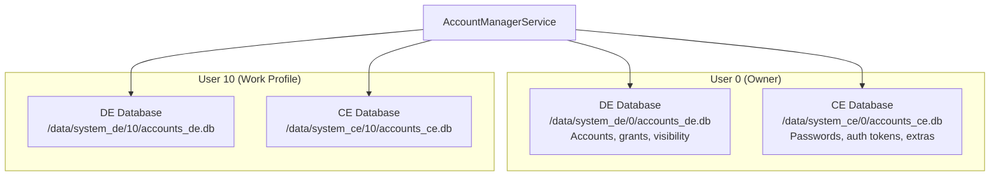

设备加密（DE）与凭据加密（CE）存储的划分遵循 Android 的 Direct Boot 模型：

| 存储 | 可用时机 | 内容 |
|---------|-----------|----------|
| **DE**（`accounts_de.db`） | 设备启动后 | 账号名称、类型、授权、可见性 |
| **CE**（`accounts_ce.db`） | 用户解锁后 | 密码、认证令牌、用户数据 |

```
Source: frameworks/base/services/core/java/com/android/server/accounts/AccountsDb.java
```

### 32.2.3 AccountsDb 结构

`AccountsDb` 类管理这些 SQLite 数据库。主要表：

```
Source: frameworks/base/services/core/java/com/android/server/accounts/AccountsDb.java
```

**CE 数据库表：**

| 表 | 列 | 用途 |
|-------|---------|---------|
| `accounts` | `_id`、`name`、`type`、`password` | 核心账号存储 |
| `authtokens` | `_id`、`accounts_id`、`type`、`authtoken` | 缓存的认证令牌 |
| `extras` | `_id`、`accounts_id`、`key`、`value` | 每个账号的键值用户数据 |

**DE 数据库表：**

| 表 | 列 | 用途 |
|-------|---------|---------|
| `accounts` | `_id`、`name`、`type`、`previous_name`、`last_password_entry_time_millis_epoch` | 账号列表（不含凭据） |
| `grants` | `accounts_id`、`auth_token_type`、`uid` | 按 UID 的令牌访问授权 |
| `visibility` | `accounts_id`、`_package`、`value` | 按包的账号可见性 |
| `shared_accounts` | `_id`、`name`、`type` | 跨配置（profile）共享的账号 |
| `meta` | `key`、`value` | 服务元数据 |
| `debug_table` | 多种 | 调试/审计信息 |

### 32.2.4 UserAccounts —— 按用户的状态

在内部，`AccountManagerService` 为每个用户维护一个 `UserAccounts` 对象。该对象包含：

```java
// Simplified from AccountManagerService.java
static class UserAccounts {
    final int userId;
    final AccountsDb accountsDb;       // Database access
    final HashMap<Pair<Pair<Account, String>, Integer>, /* ... */>
        credentialsPermissionNotificationIds;  // Pending permission notifications
    final HashMap<Account, HashMap<String, String>> userDataCache;  // In-memory cache
    final HashMap<Account, HashMap<String, String>> authTokenCache; // In-memory cache
    final TokenCache accountTokenCaches;  // LRU token cache
    final Object cacheLock;            // Synchronization
    final Object dbLock;               // Database lock
}
```

### 32.2.5 令牌缓存

`TokenCache` 为认证令牌提供内存中的 LRU 缓存，以避免重复调用认证器：

```
Source: frameworks/base/services/core/java/com/android/server/accounts/TokenCache.java
```

```java
// From TokenCache.java
class TokenCache {
    private static final int MAX_CACHE_CHARS = 64000;

    static class Value {
        public final String token;
        public final long expiryEpochMillis;
    }

    private static class Key {
        public final Account account;
        public final String packageName;
        public final String tokenType;
        public final byte[] sigDigest;  // Package signing certificate digest
    }

    // LRU cache evicts when total token chars exceed MAX_CACHE_CHARS
}
```

缓存键包含包签名证书摘要。这样可以确保即使另一个应用具有相同的包名，也无法获取授予某个应用的令牌。这可以防止签名欺骗。

### 32.2.6 认证器发现与绑定

`AccountManagerService` 通过 `AccountAuthenticatorCache` 发现认证器，后者继承自 `RegisteredServicesCache`：

```
Source: frameworks/base/services/core/java/com/android/server/accounts/AccountAuthenticatorCache.java
        frameworks/base/services/core/java/com/android/server/accounts/IAccountAuthenticatorCache.java
```

发现过程会扫描声明以下内容的服务：

```xml
<service android:name=".auth.AuthService"
         android:exported="true">
    <intent-filter>
        <action android:name="android.accounts.AccountAuthenticator" />
    </intent-filter>
    <meta-data
        android:name="android.accounts.AccountAuthenticator"
        android:resource="@xml/authenticator" />
</service>
```

当 `AccountManagerService` 需要与认证器交互（例如获取令牌或添加账号）时，它会绑定到认证器服务。它通过 `IAccountAuthenticator` AIDL 接口进行通信：

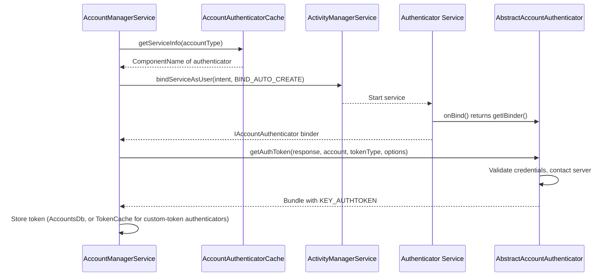

### 32.2.7 CryptoHelper —— 安全会话存储

`CryptoHelper` 被 `AccountManagerService` 用于为基于会话的账号添加流程加密和解密会话 Bundle：

```
Source: frameworks/base/services/core/java/com/android/server/accounts/CryptoHelper.java
```

它在首次使用时通过 `KeyGenerator` 生成一个临时的内存中 AES 密钥（外加一个独立的 HMAC-SHA256 密钥用于完整性校验）。这些密钥没有 Android Keystore 作为支撑，也不会离开 `system_server` 的内存。因此，只有同一个正在运行的 `system_server` 实例才能解密由 `CryptoHelper` 加密的会话 Bundle。该 Bundle 无法转移到另一台设备，重启后也不会保留。

### 32.2.8 AccountManagerService Shell 命令

`AccountManagerService` 支持用于调试的 shell 命令：

```
Source: frameworks/base/services/core/java/com/android/server/accounts/AccountManagerServiceShellCommand.java
```

Shell 命令面很窄：`onCommand()` 只处理 `get-bind-instant-service-allowed` 和 `set-bind-instant-service-allowed`（以及 `help`）。没有用于列出账号的子命令；如需列出账号，请使用 `dumpsys account`。

```bash
# Read/write the instant-app bind policy for a user
adb shell cmd account get-bind-instant-service-allowed --user 0
adb shell cmd account set-bind-instant-service-allowed --user 0 true

# Dump account service state (shows accounts per user)
adb shell dumpsys account
```

### 32.2.9 基于会话的账号添加

Android 7.0 引入了基于会话的账号添加机制以提高安全性。认证器不再直接创建账号，而是可以使用两阶段流程：

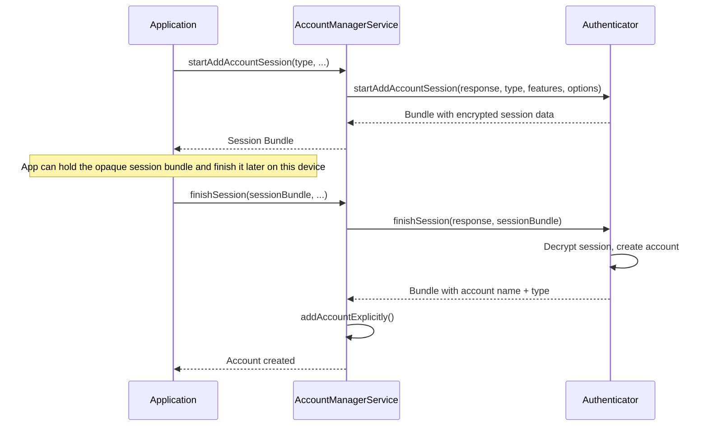

### 32.2.10 权限模型

AccountManagerService 强制执行分层权限模型：

| 操作 | 所需权限 / 条件 |
|-----------|-------------------------------|
| `getAccounts()` | 调用方对该账号可见（可见性检查） |
| `getAccountsByType(type)` | 调用方对该类型的账号可见 |
| `addAccountExplicitly()` | 与认证器具有相同签名，或具有 `ACCOUNT_MANAGER` 权限 |
| `removeAccount()` | `ACCOUNT_MANAGER` 权限或账号所有者 |
| `getAuthToken()` | 用户已授予同意，或为同一认证器 |
| `getPassword()` | 与认证器相同的 UID |
| `setPassword()` | 与认证器相同的 UID |
| 跨用户操作 | `INTERACT_ACROSS_USERS_FULL` |

`ACCOUNT_MANAGER` 权限（`android.permission.ACCOUNT_MANAGER`）是一个签名级权限，仅由系统持有。

---

## 32.3 账号认证

### 32.3.1 AbstractAccountAuthenticator

`AbstractAccountAuthenticator` 是第三方认证器必须继承的基类。它定义了系统与认证逻辑之间的契约：

```
Source: frameworks/base/core/java/android/accounts/AbstractAccountAuthenticator.java
```

该类采用 **Transport** 模式。它包含一个内部类 `Transport`，该类继承 `IAccountAuthenticator.Stub` 并将调用委托给抽象方法。这个内部类添加了错误处理和日志记录：

```java
// Simplified from AbstractAccountAuthenticator.java
public abstract class AbstractAccountAuthenticator {

    private class Transport extends IAccountAuthenticator.Stub {
        @Override
        public void getAuthToken(IAccountAuthenticatorResponse response,
                Account account, String authTokenType, Bundle options) {
            // Delegates to the abstract method, catches exceptions,
            // and sends results back through the response
            Bundle result = AbstractAccountAuthenticator.this
                .getAuthToken(new AccountAuthenticatorResponse(response),
                    account, authTokenType, options);
            if (result != null) {
                response.onResult(result);
            }
        }
    }

    // Abstract methods that authenticators must implement:
    public abstract Bundle addAccount(...);
    public abstract Bundle getAuthToken(...);
    public abstract String getAuthTokenLabel(String authTokenType);
    public abstract Bundle confirmCredentials(...);
    public abstract Bundle updateCredentials(...);
    public abstract Bundle hasFeatures(...);
    public abstract Bundle editProperties(...);
}
```

### 32.3.2 认证令牌流程

认证令牌的获取流程是最常见的认证器交互：

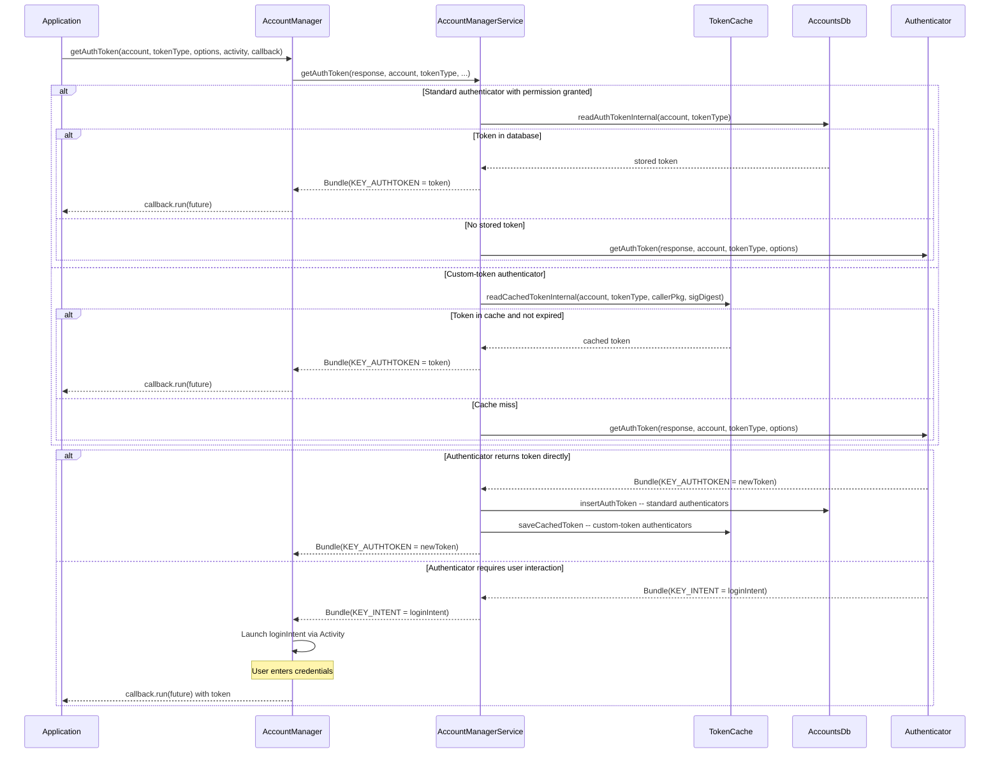

服务查询哪个存储取决于认证器类型。标准认证器的令牌持久化在 `authtokens` 表中，并通过 `readAuthTokenInternal()` 读回。内存中的 `TokenCache` 永远不会用于它们。自定义令牌认证器（声明 `customTokens=true` 的认证器）完全跳过数据库。

它的令牌只存在于 `TokenCache` 中。缓存未命中时直接请求认证器，结果通过 `saveCachedToken()` 缓存。这两种查找互斥。

### 32.3.3 令牌失效

当服务器拒绝缓存的令牌时，应用程序必须使其失效：

```java
// Application discovers token is invalid
accountManager.invalidateAuthToken(accountType, staleToken);

// Then request a new one
AccountManagerFuture<Bundle> future = accountManager.getAuthToken(
    account, tokenType, options, activity, callback, handler);
```

在内部，`invalidateAuthToken` 会从以下位置移除该令牌：

1. 内存中的 `TokenCache`
2. `AccountsDb` 中的 `authtokens` 表

这会强制下一次 `getAuthToken` 调用联系认证器以获取新令牌。

### 32.3.4 令牌过期

认证器可以使用 `AbstractAccountAuthenticator.KEY_CUSTOM_TOKEN_EXPIRY` Bundle 键设置令牌过期时间：

```java
// In your authenticator's getAuthToken():
Bundle result = new Bundle();
result.putString(AccountManager.KEY_AUTHTOKEN, token);
result.putString(AccountManager.KEY_ACCOUNT_NAME, account.name);
result.putString(AccountManager.KEY_ACCOUNT_TYPE, account.type);
// Token expires in 1 hour
result.putLong(AbstractAccountAuthenticator.KEY_CUSTOM_TOKEN_EXPIRY,
    System.currentTimeMillis() + 3600_000L);
return result;
```

`TokenCache` 在返回缓存的令牌之前会检查过期时间：

```java
// Simplified from TokenCache logic in AccountManagerService
TokenCache.Value tokenValue = accounts.accountTokenCaches.get(cacheKey);
if (tokenValue != null) {
    if (tokenValue.expiryEpochMillis > System.currentTimeMillis()) {
        return tokenValue.token;  // Valid cached token
    } else {
        accounts.accountTokenCaches.remove(cacheKey);  // Expired
    }
}
```

### 32.3.5 实现认证器

一个完整的认证器需要三个组件：

**1. 认证器类：**

```java
public class MyAuthenticator extends AbstractAccountAuthenticator {

    public MyAuthenticator(Context context) {
        super(context);
    }

    @Override
    public Bundle addAccount(AccountAuthenticatorResponse response,
            String accountType, String authTokenType,
            String[] requiredFeatures, Bundle options) {
        // Return an Intent to launch the login UI
        Intent intent = new Intent(context, LoginActivity.class);
        intent.putExtra(AccountManager.KEY_ACCOUNT_AUTHENTICATOR_RESPONSE,
            response);
        Bundle bundle = new Bundle();
        bundle.putParcelable(AccountManager.KEY_INTENT, intent);
        return bundle;
    }

    @Override
    public Bundle getAuthToken(AccountAuthenticatorResponse response,
            Account account, String authTokenType, Bundle options) {
        // Try to get cached password
        AccountManager am = AccountManager.get(context);
        String password = am.getPassword(account);

        if (password != null) {
            // Exchange credentials for token with server
            String token = myServerApi.authenticate(account.name, password);
            if (token != null) {
                Bundle result = new Bundle();
                result.putString(AccountManager.KEY_ACCOUNT_NAME, account.name);
                result.putString(AccountManager.KEY_ACCOUNT_TYPE, account.type);
                result.putString(AccountManager.KEY_AUTHTOKEN, token);
                return result;
            }
        }

        // Credentials invalid -- prompt user
        Intent intent = new Intent(context, LoginActivity.class);
        intent.putExtra(AccountManager.KEY_ACCOUNT_AUTHENTICATOR_RESPONSE,
            response);
        Bundle bundle = new Bundle();
        bundle.putParcelable(AccountManager.KEY_INTENT, intent);
        return bundle;
    }

    @Override
    public Bundle hasFeatures(AccountAuthenticatorResponse response,
            Account account, String[] features) {
        Bundle result = new Bundle();
        result.putBoolean(AccountManager.KEY_BOOLEAN_RESULT, true);
        return result;
    }

    // ... other abstract methods ...
}
```

**2. 服务：**

```java
public class AuthenticatorService extends Service {
    private MyAuthenticator authenticator;

    @Override
    public void onCreate() {
        authenticator = new MyAuthenticator(this);
    }

    @Override
    public IBinder onBind(Intent intent) {
        return authenticator.getIBinder();
    }
}
```

**3. XML 元数据**（`res/xml/authenticator.xml`）：

```xml
<account-authenticator
    xmlns:android="http://schemas.android.com/apk/res/android"
    android:accountType="com.example.myapp"
    android:icon="@drawable/ic_account"
    android:smallIcon="@drawable/ic_account_small"
    android:label="@string/account_label"
    android:accountPreferences="@xml/account_preferences" />
```

### 32.3.6 AccountAuthenticatorActivity

`AccountAuthenticatorActivity` 是用于处理认证器 UI 流程（登录界面、凭据输入）的 Activity 的基类：

```
Source: frameworks/base/core/java/android/accounts/AccountAuthenticatorActivity.java
```

该类在框架中被标记为 `@Deprecated`。Javadoc 建议应用程序直接继承 `Activity`。这是因为该基类与 AppCompat 不兼容。此外，它提供的行为（暂存 `AccountAuthenticatorResponse` 并以结果结束）的量很小，完全可以手动实现。下面的模式仍然具有参考价值，但新的认证器通常会将响应接入普通的 `Activity` 中。

```java
public class LoginActivity extends AccountAuthenticatorActivity {

    @Override
    protected void onCreate(Bundle savedInstanceState) {
        super.onCreate(savedInstanceState);
        setContentView(R.layout.activity_login);

        // The response is passed via the intent
        AccountAuthenticatorResponse response = getIntent()
            .getParcelableExtra(AccountManager.KEY_ACCOUNT_AUTHENTICATOR_RESPONSE);
    }

    private void onLoginSuccess(String accountName, String token) {
        AccountManager am = AccountManager.get(this);

        // Create the account
        Account account = new Account(accountName, "com.example.myapp");
        am.addAccountExplicitly(account, null, null);
        am.setAuthToken(account, "full_access", token);

        // Return result to AccountManagerService
        Bundle result = new Bundle();
        result.putString(AccountManager.KEY_ACCOUNT_NAME, accountName);
        result.putString(AccountManager.KEY_ACCOUNT_TYPE, "com.example.myapp");
        setAccountAuthenticatorResult(result);
        finish();
    }
}
```

关键的调用是 `setAccountAuthenticatorResult()` —— 它通过传递给 Activity 的 `AccountAuthenticatorResponse` 将结果发送回 `AccountManagerService`。如果没有这个调用，调用方应用程序中的 `AccountManagerFuture` 将永远不会完成。

### 32.3.7 跨配置账号共享

在受管配置（工作配置）场景中，账号可以在个人配置和工作配置之间共享：

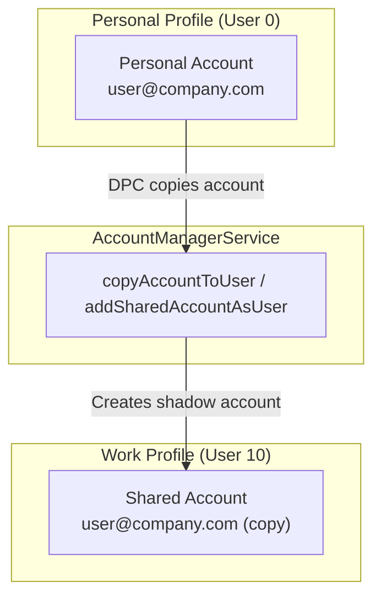

设备策略控制器（DPC）可以通过 `AccountManager.copyAccountToUser()`（系统使用的隐藏 API）触发账号迁移。`AccountManagerService` 使用 DE 数据库中的 `shared_accounts` 表处理跨配置的账号复制。

### 32.3.8 认证流程图

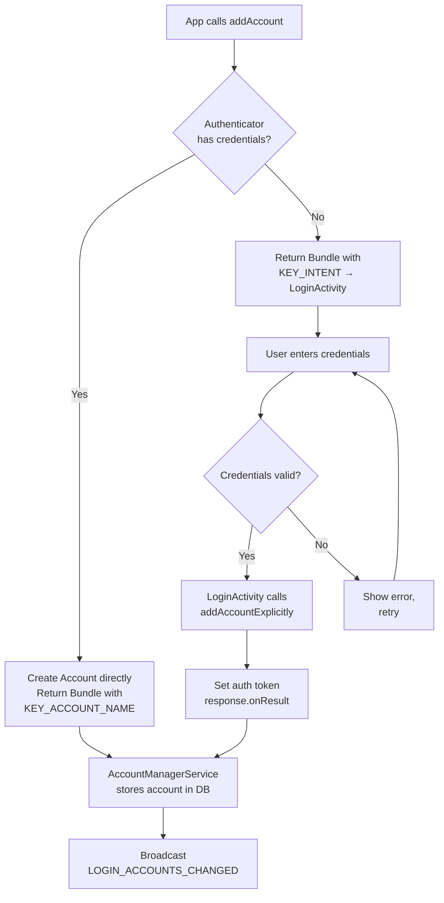

---

## 32.4 SyncManager

### 32.4.1 SyncManager 架构

`SyncManager` 负责调度和执行后台数据同步。它本身不执行同步操作 —— 它编排执行实际工作的**同步适配器**。

```
Source: frameworks/base/services/core/java/com/android/server/content/SyncManager.java
```

源自源码注释的关键设计原则：

> 所有计划的同步都会作为作业传递给 JobScheduler。
> 每个周期性同步都调度为一个周期性作业。如果周期性同步失败，我们会创建一个新的一次性 SyncOperation，并将其 sourcePeriodicId 字段设置为该周期性同步的 jobId。

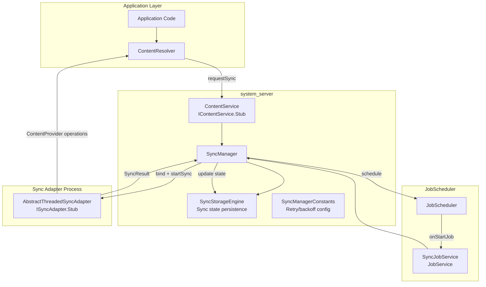

### 32.4.2 SyncManager 初始化

SyncManager 在系统服务器启动期间初始化，并建立若干子系统：

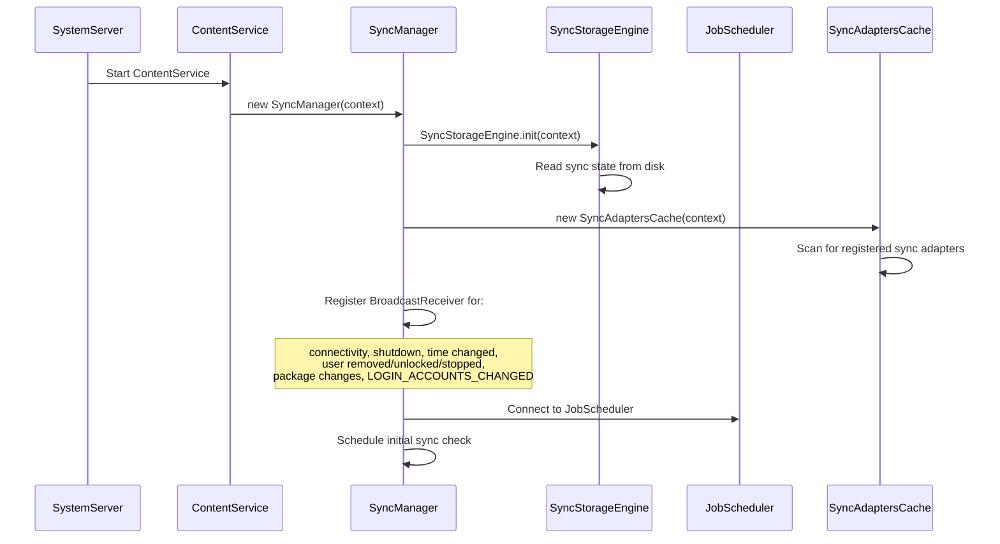

### 32.4.3 SyncOperation —— 同步单元

每个同步请求都由一个 `SyncOperation` 表示：

```
Source: frameworks/base/services/core/java/com/android/server/content/SyncOperation.java
```

```java
// Key fields from SyncOperation.java
public class SyncOperation {
    public final SyncStorageEngine.EndPoint target;  // account + authority + userId
    public final int owningUid;
    public final String owningPackage;
    public final int reason;          // Why this sync was triggered
    public final int syncSource;      // Where initiated (user, periodic, etc.)
    public final boolean allowParallelSyncs;
    public final boolean isPeriodic;
    public final int sourcePeriodicId;  // Parent periodic job ID
    public final String key;          // Deduplication key
    public final long periodMillis;   // Periodic interval
    public final long flexMillis;     // Periodic flex window
    private volatile Bundle mImmutableExtras;  // Sync extras
}
```

同步原因定义为常量：

| 原因常量 | 值 | 说明 |
|-----------------|-------|-------------|
| `REASON_BACKGROUND_DATA_SETTINGS_CHANGED` | -1 | 数据设置发生变更 |
| `REASON_ACCOUNTS_UPDATED` | -2 | 账号被添加/移除 |
| `REASON_SERVICE_CHANGED` | -3 | 同步适配器已注册/注销 |
| `REASON_PERIODIC` | -4 | 周期性同步计时器触发 |
| `REASON_IS_SYNCABLE` | -5 | 授权（authority）变为可同步 |
| `REASON_SYNC_AUTO` | -6 | 自动同步已启用 |
| `REASON_MASTER_SYNC_AUTO` | -7 | 全局自动同步已启用 |
| `REASON_USER_START` | -8 | 用户手动触发同步 |

### 32.4.4 通过 JobScheduler 进行同步调度

SyncManager 将所有调度委托给 `JobScheduler`。每个 `SyncOperation` 都被转换为一个 `JobInfo`：

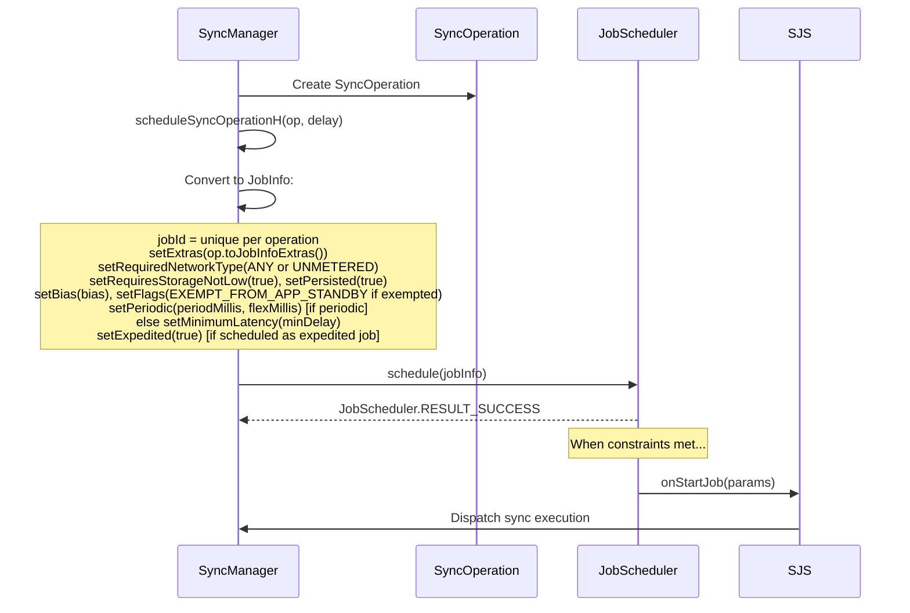

请注意，重试退避并未委托给 JobScheduler：没有调用 `setBackoffCriteria()`。SyncManager 通过 `increaseBackoffSetting()` 自行实现退避，并将失败的同步重新调度为新的一次性作业，使用计算出的延迟时间。

`SyncJobService` 是 JobScheduler 与 SyncManager 之间的桥梁：

```
Source: frameworks/base/services/core/java/com/android/server/content/SyncJobService.java
```

```java
// From SyncJobService.java
public class SyncJobService extends JobService {
    @Override
    public boolean onStartJob(JobParameters params) {
        SyncOperation op = SyncOperation.maybeCreateFromJobExtras(params.getExtras());
        // ... dispatch to SyncManager for execution
        return true;  // Work is ongoing
    }

    @Override
    public boolean onStopJob(JobParameters params) {
        // Cancel the running sync
        return false;  // Don't reschedule
    }
}
```

### 32.4.5 同步执行

当同步作业触发时，SyncManager 绑定到相应的同步适配器服务并执行同步：

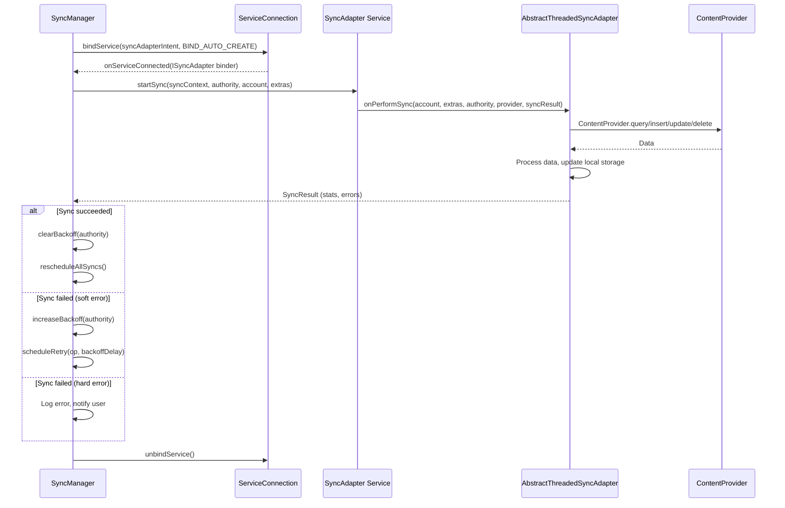

### 32.4.6 同步适配器发现

SyncManager 通过 `SyncAdaptersCache` 发现已注册的同步适配器，后者继承自 `RegisteredServicesCache`：

```
Source: frameworks/base/core/java/android/content/SyncAdaptersCache.java
```

同步适配器通过扫描声明以下内容的服务来发现：

```xml
<intent-filter>
    <action android:name="android.content.SyncAdapter" />
</intent-filter>
<meta-data
    android:name="android.content.SyncAdapter"
    android:resource="@xml/syncadapter" />
```

同步适配器 XML 资源声明了：

| 属性 | 用途 |
|-----------|---------|
| `contentAuthority` | 要同步的 ContentProvider 授权（authority） |
| `accountType` | 账号类型（必须与认证器匹配） |
| `userVisible` | 该适配器是否出现在设置中 |
| `supportsUploading` | 它是否处理仅上传的同步 |
| `allowParallelSyncs` | 是否允许多个实例同时运行 |
| `isAlwaysSyncable` | 同步是否默认启用 |
| `settingsActivity` | 同步适配器设置的 Activity |

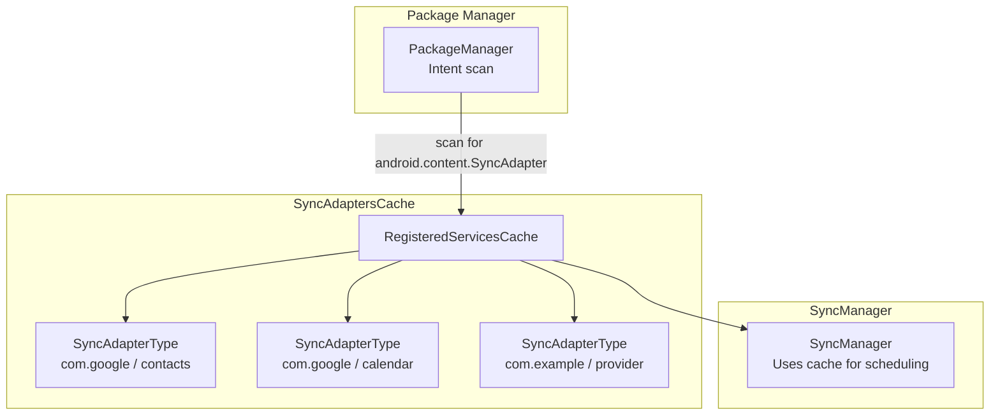

### 32.4.7 同步冲突解决

当多个同步操作针对同一个 authority 和账号时，SyncManager 应用去重逻辑：

```java
// From SyncManager.java -- simplified scheduling logic
void scheduleSyncOperationH(SyncOperation op, long delay) {
    // Check for existing identical operation
    SyncOperation existingOp = findExistingOp(op.key);
    if (existingOp != null) {
        // Keep the one with earlier expected run time
        if (existingOp.expectedRuntime <= op.expectedRuntime) {
            return;  // Existing op wins
        }
        // Cancel existing, schedule new
        cancelJob(existingOp);
    }
    // Assign job ID and schedule with JobScheduler
    op.jobId = nextJobId();
    scheduleJob(op, delay);
}
```

去重键由以下内容构成：

- 账号名称和类型
- Content authority
- 同步 extras（Bundle 内容）
- 是周期性还是一次性

### 32.4.8 App Standby 与同步节流

从 Android 6.0 开始，App Standby 会影响同步调度。处于待机桶中的应用获得的同步频率会降低：

```
Source: frameworks/base/services/core/java/com/android/server/content/SyncManager.java
```

| 待机桶 | 同步行为 |
|----------------|---------------|
| Active | 正常同步频率 |
| Working Set | 正常同步频率 |
| Frequent | 频率降低 |
| Rare | 重度节流，可能被推迟数小时 |
| Restricted | 同步可能被完全阻止 |
| Exempted | 不受待机影响（系统应用） |

SyncManager 在调度之前会检查应用的待机桶：

```java
// From SyncManager constants
private static final int DEF_MAX_RETRIES_WITH_APP_STANDBY_EXEMPTION = 5;
```

在 5 次重试失败后，同步适配器将失去其 App Standby 豁免资格，并受到正常的待机节流。

### 32.4.9 退避与重试

SyncManager 为失败的同步实现指数退避：

```
Source: frameworks/base/services/core/java/com/android/server/content/SyncManagerConstants.java
```

| 参数 | 默认值 | 说明 |
|-----------|---------|-------------|
| `initial_sync_retry_time_in_seconds` | 30 | 首次重试延迟 |
| `retry_time_increase_factor` | 2.0 | 指数因子 |
| `max_sync_retry_time_in_seconds` | 3600（1 小时） | 最大退避时间 |
| `max_retries_with_app_standby_exemption` | 5 | 进入待机节流前的重试次数 |

失败同步的退避序列为：30 秒、60 秒、120 秒、240 秒、480 秒……最高至 3600 秒。

### 32.4.10 同步监控

SyncManager 监控正在运行的同步的进度。如果同步适配器看起来挂起（没有网络流量），它可能会被取消：

```java
// From SyncManager.java
private static final long SYNC_MONITOR_WINDOW_LENGTH_MILLIS = 60 * 1000; // 60 seconds
private static final int SYNC_MONITOR_PROGRESS_THRESHOLD_BYTES = 10;    // 10 bytes
```

每 60 秒，SyncManager 检查同步适配器是否传输了至少 10 字节（Tx + Rx）。如果没有，它会认为同步已停滞。

### 32.4.11 同步唤醒锁

SyncManager 在同步执行期间获取唤醒锁，以防止设备在同步中途休眠：

```java
// From SyncManager.java
private static final String SYNC_WAKE_LOCK_PREFIX = "*sync*/";
private static final String HANDLE_SYNC_ALARM_WAKE_LOCK = "SyncManagerHandleSyncAlarm";
private static final String SYNC_LOOP_WAKE_LOCK = "SyncLoopWakeLock";
```

每个正在运行的同步都有自己命名的唤醒锁（`*sync*/authority`），它出现在 `dumpsys power` 输出和电量统计中。这使得电量分析可以将功耗归因于特定的同步适配器。

### 32.4.12 同步日志

`SyncLogger` 提供详细的操作日志，可以通过 `dumpsys content` 检索：

```
Source: frameworks/base/services/core/java/com/android/server/content/SyncLogger.java
```

日志记录器记录：

- 同步调度决策（为什么安排或跳过了某次同步）
- 同步执行的开始/停止时间
- 同步结果和统计信息
- 退避变更
- 账号和适配器的状态变更

### 32.4.13 SyncStorageEngine —— 持久化状态

`SyncStorageEngine` 将同步配置和历史持久化到磁盘：

```
Source: frameworks/base/services/core/java/com/android/server/content/SyncStorageEngine.java
```

它存储：

| 数据 | 持久化方式 | 说明 |
|------|-------------|-------------|
| Authority 信息 | XML 文件 | 每个 authority 的同步设置（syncable、退避、延迟） |
| 同步状态 | Proto 文件 | 同步历史（上次成功、上次失败、统计） |
| Pending 标志 | Proto 文件 | 每个 authority 的布尔值（`SyncStatusInfo.pending`）；排队的操作本身以 JobScheduler 作业形式存在 |
| 主同步自动 | XML 属性 | 全局自动同步开关 |
| 每个 authority 的自动同步 | XML 属性 | 每个账号/authority 的自动同步开关 |

`EndPoint` 类标识一个同步目标：

```java
// From SyncStorageEngine.java
public static class EndPoint {
    public final Account account;
    public final String provider;   // Content authority
    public final int userId;
}

public static class AuthorityInfo {
    public final EndPoint target;
    public final int ident;         // Unique authority ID
    public boolean enabled;         // Auto-sync enabled
    public int syncable;            // -2 UNDEFINED, -1 NOT_INITIALIZED,
                                    // 0 NOT_SYNCABLE, 1 SYNCABLE,
                                    // 2 SYNCABLE_NOT_INITIALIZED,
                                    // 3 SYNCABLE_NO_ACCOUNT_ACCESS
    public long backoffTime;
    public long backoffDelay;
    public long delayUntil;
}
```

---

## 32.5 ContentResolver 同步

### 32.5.1 ContentResolver 同步 API

应用程序通常通过 `ContentResolver` 的静态方法与同步框架交互，而不是直接使用 `SyncManager`：

```java
// Request an immediate sync
Bundle extras = new Bundle();
extras.putBoolean(ContentResolver.SYNC_EXTRAS_MANUAL, true);
extras.putBoolean(ContentResolver.SYNC_EXTRAS_EXPEDITED, true);
ContentResolver.requestSync(account, authority, extras);

// Using SyncRequest.Builder (modern API)
SyncRequest request = new SyncRequest.Builder()
    .setSyncAdapter(account, authority)
    .setManual(true)
    .setExpedited(true)
    .build();
ContentResolver.requestSync(request);
```

### 32.5.2 同步 Extras

同步 extras 是控制同步行为的 Bundle 键：

| Extra 键 | 类型 | 说明 |
|-----------|------|-------------|
| `SYNC_EXTRAS_MANUAL` | boolean | 用户发起的同步（绕过退避） |
| `SYNC_EXTRAS_EXPEDITED` | boolean | 请求立即执行 |
| `SYNC_EXTRAS_UPLOAD` | boolean | 仅上传本地变更 |
| `SYNC_EXTRAS_FORCE` | boolean | 已废弃；请使用 MANUAL |
| `SYNC_EXTRAS_IGNORE_SETTINGS` | boolean | 忽略自动同步设置 |
| `SYNC_EXTRAS_IGNORE_BACKOFF` | boolean | 忽略退避延迟 |
| `SYNC_EXTRAS_DO_NOT_RETRY` | boolean | 失败时不重试 |
| `SYNC_EXTRAS_INITIALIZE` | boolean | 首次初始化同步 |
| `SYNC_EXTRAS_REQUIRE_CHARGING` | boolean | 仅在充电时同步 |
| `SYNC_EXTRAS_SCHEDULE_AS_EXPEDITED_JOB` | boolean | 通过加急作业调度 |

### 32.5.3 周期性同步

应用程序可以调度周期性后台同步：

```java
// Add a periodic sync every 60 minutes with 10 minute flex
ContentResolver.addPeriodicSync(
    account,
    "com.example.provider",     // authority
    Bundle.EMPTY,               // extras
    60 * 60                     // poll frequency in seconds
);

// Using SyncRequest.Builder with flex time
SyncRequest request = new SyncRequest.Builder()
    .syncPeriodic(60 * 60, 10 * 60)  // period, flex (seconds)
    .setSyncAdapter(account, authority)
    .build();
ContentResolver.requestSync(request);

// Remove a periodic sync
ContentResolver.removePeriodicSync(account, authority, Bundle.EMPTY);
```

弹性时间（flex time）使系统能够批量处理来自不同应用的周期性同步，从而降低对电池的影响。同步将在 `[scheduledTime - flexTime, scheduledTime]` 窗口内执行。

### 32.5.4 自动同步控制

自动同步有两级控制：

```java
// Global auto-sync master toggle
ContentResolver.setMasterSyncAutomatically(true);
boolean masterEnabled = ContentResolver.getMasterSyncAutomatically();

// Per-account/authority auto-sync
ContentResolver.setSyncAutomatically(account, authority, true);
boolean autoSync = ContentResolver.getSyncAutomatically(account, authority);
```

除非主开关和每个 authority 的开关都启用，否则同步框架不会执行周期性同步或变更触发的同步。

### 32.5.5 同步状态观察

应用程序可以观察同步状态：

```java
// Check if any sync is currently active
boolean syncing = ContentResolver.isSyncActive(account, authority);

// Check if a sync is pending
boolean pending = ContentResolver.isSyncPending(account, authority);

// Get sync status (getSyncStatus() and SyncStatusInfo are @hide APIs,
// available only to system/privileged code)
SyncStatusInfo status = ContentResolver.getSyncStatus(account, authority);
if (status != null) {
    long lastSuccess = status.lastSuccessTime;
    long lastFailure = status.lastFailureTime;
    int numSyncs = status.totalStats.numSyncs;
    String lastFailureMesg = status.lastFailureMesg;
}

// Register for sync status changes
Object handle = ContentResolver.addStatusChangeListener(
    ContentResolver.SYNC_OBSERVER_TYPE_ACTIVE
        | ContentResolver.SYNC_OBSERVER_TYPE_PENDING
        | ContentResolver.SYNC_OBSERVER_TYPE_SETTINGS,
    new SyncStatusObserver() {
        @Override
        public void onStatusChanged(int which) {
            // Sync state changed, update UI
        }
    }
);

// Don't forget to unregister
ContentResolver.removeStatusChangeListener(handle);
```

### 32.5.6 变更触发的同步

ContentResolver 支持通过 `ContentObserver` 集成，在数据变更时触发同步：

```java
// When local data changes, notify the sync framework
ContentResolver resolver = context.getContentResolver();
resolver.notifyChange(MyContract.CONTENT_URI, null, true);
// The third parameter (syncToNetwork) = true triggers a sync

// Alternatively, register a ContentObserver in SyncManager
// SyncManager automatically observes authorities for registered adapters
```

当 `notifyChange()` 以 `syncToNetwork = true` 调用时，`ContentService` 会将通知转发给 `SyncManager`，后者为该 authority 注册的所有适配器调度一次同步。同步会延迟 `LOCAL_SYNC_DELAY`（默认 30 秒），以批量处理快速连续的变更。

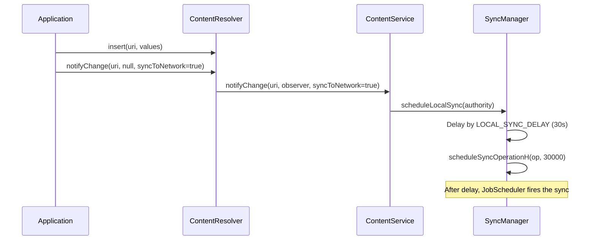

### 32.5.7 同步豁免级别

同步框架使用豁免级别来确定优先级：

| 豁免级别 | 值 | 说明 | 效果 |
|----------------|-------|-------------|--------|
| `SYNC_EXEMPTION_NONE` | 0 | 正常同步 | 受所有限制约束 |
| `SYNC_EXEMPTION_PROMOTE_BUCKET` | 1 | 临时桶提升 | 将应用移到更高的待机桶（在 `dumpsys content` 中显示为 `STANDBY-EXEMPTED`） |
| `SYNC_EXEMPTION_PROMOTE_BUCKET_WITH_TEMP` | 2 | 提升 + 临时允许列表 | 还授予临时电源允许列表 / FGS 启动权限（显示为 `STANDBY-EXEMPTED(TOP)`） |

```
Source: frameworks/base/core/java/android/content/ContentResolver.java
        frameworks/base/services/core/java/com/android/server/content/SyncManager.md
```

常量位于 `ContentResolver` 中（`SYNC_EXEMPTION_NONE`、`SYNC_EXEMPTION_PROMOTE_BUCKET`、`SYNC_EXEMPTION_PROMOTE_BUCKET_WITH_TEMP`）。`ContentService` 按调用方计算豁免（参见 `getSyncExemptionAndCleanUpExtrasForCaller()`）。这样，当前台应用代表后台同步适配器请求同步时，App Standby 不会对其进行节流。`SyncManager.md` 设计说明详细描述了这两个级别。

### 32.5.8 ContentResolver 到 SyncManager 的流程

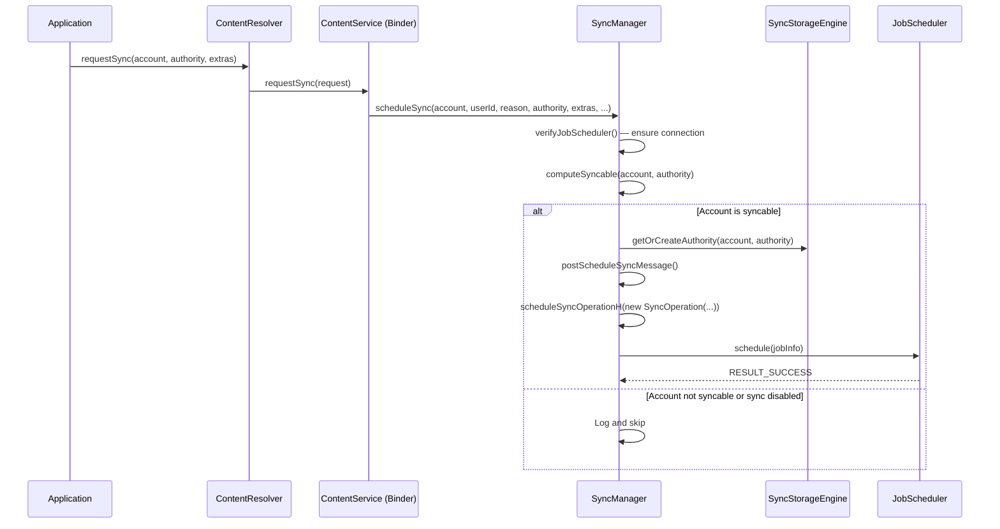

### 32.5.9 ContentService —— Binder 入口点

`ContentService` 是接收来自应用程序的同步请求的 Binder 服务。它实现 `IContentService` 并将工作委托给 `SyncManager`：

```
Source: frameworks/base/services/core/java/com/android/server/content/ContentService.java
```

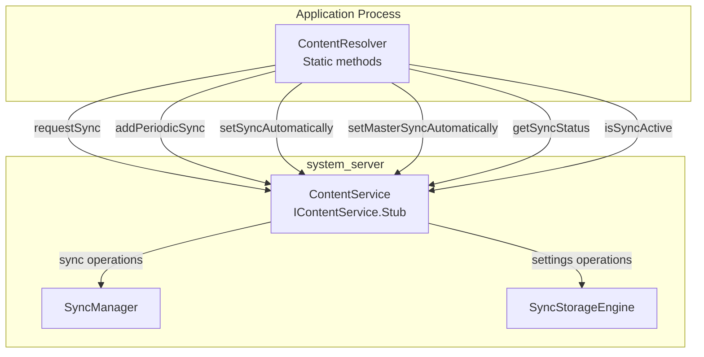

ContentService 还管理 `ContentObserver` 的注册，但这些与同步框架是分开的。它们用于 UI 更新。同步则用于网络数据同步。

### 32.5.10 同步配置矩阵

是否执行同步取决于多个配置因素：

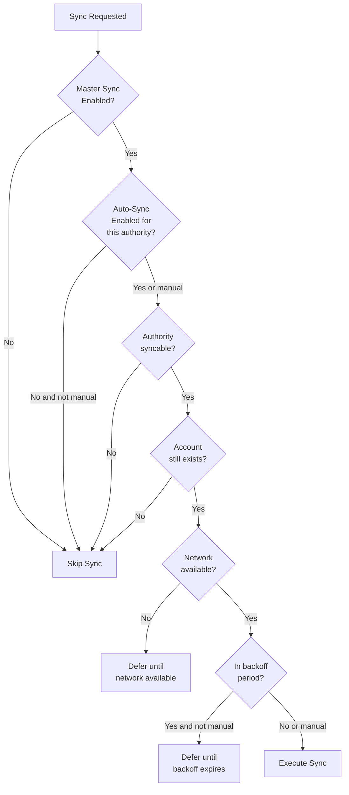

### 32.5.11 实现同步适配器

同步适配器需要四个组件：

**1. 同步适配器类：**

```java
public class MySyncAdapter extends AbstractThreadedSyncAdapter {

    public MySyncAdapter(Context context, boolean autoInitialize) {
        super(context, autoInitialize);
    }

    @Override
    public void onPerformSync(Account account, Bundle extras,
            String authority, ContentProviderClient provider,
            SyncResult syncResult) {

        try {
            // 1. Get auth token
            AccountManager am = AccountManager.get(getContext());
            String token = am.blockingGetAuthToken(account,
                "com.example.sync", true);

            // 2. Fetch remote changes
            List<Item> remoteItems = myApi.fetchChanges(token);

            // 3. Apply to local ContentProvider
            ContentResolver resolver = getContext().getContentResolver();
            for (Item item : remoteItems) {
                ContentValues values = item.toContentValues();
                resolver.insert(MyContract.CONTENT_URI, values);
            }

            // 4. Push local changes
            Cursor localChanges = provider.query(
                MyContract.DIRTY_CONTENT_URI, null, null, null, null);
            if (localChanges != null) {
                while (localChanges.moveToNext()) {
                    myApi.pushChange(token, cursorToItem(localChanges));
                }
                localChanges.close();
            }

        } catch (AuthenticatorException | OperationCanceledException e) {
            syncResult.stats.numAuthExceptions++;
        } catch (IOException e) {
            syncResult.stats.numIoExceptions++;
        }
    }
}
```

**2. 服务：**

```java
public class SyncService extends Service {
    private static MySyncAdapter syncAdapter;
    private static final Object lock = new Object();

    @Override
    public void onCreate() {
        synchronized (lock) {
            if (syncAdapter == null) {
                syncAdapter = new MySyncAdapter(this, true);
            }
        }
    }

    @Override
    public IBinder onBind(Intent intent) {
        return syncAdapter.getSyncAdapterBinder();
    }
}
```

**3. XML 元数据**（`res/xml/syncadapter.xml`）：

```xml
<sync-adapter
    xmlns:android="http://schemas.android.com/apk/res/android"
    android:contentAuthority="com.example.provider"
    android:accountType="com.example.myapp"
    android:userVisible="true"
    android:supportsUploading="true"
    android:allowParallelSyncs="false"
    android:isAlwaysSyncable="true" />
```

**4. AndroidManifest.xml 声明：**

```xml
<service
    android:name=".sync.SyncService"
    android:exported="true">
    <intent-filter>
        <action android:name="android.content.SyncAdapter" />
    </intent-filter>
    <meta-data
        android:name="android.content.SyncAdapter"
        android:resource="@xml/syncadapter" />
</service>
```

### 32.5.12 SyncResult —— 传递结果

`SyncResult` 对象是同步适配器向 SyncManager 传递结果的通道：

```java
public final class SyncResult implements Parcelable {
    // Hard-error flags (see hasHardError)
    public boolean tooManyRetries;
    public boolean tooManyDeletions;
    public boolean databaseError;
    public boolean fullSyncRequested;
    public boolean partialSyncUnavailable;
    public boolean moreRecordsToGet;

    // Absolute time (seconds since epoch) until which further syncs
    // for this account/authority are delayed
    public long delayUntil;

    // Statistics
    public final SyncStats stats;
}

public class SyncStats implements Parcelable {
    public long numAuthExceptions;    // Auth failures
    public long numIoExceptions;      // Network failures
    public long numParseExceptions;   // Data format errors
    public long numConflictDetectedExceptions;
    public long numInserts;
    public long numUpdates;
    public long numDeletes;
    public long numEntries;
    public long numSkippedEntries;
}
```

SyncManager 对结果的解释：

| 条件 | 操作 |
|-----------|--------|
| `numAuthExceptions > 0` | 硬错误 —— 同步记为失败且不会重新调度 |
| `numIoExceptions > 0` | 软错误 —— 按退避策略重试 |
| `tooManyDeletions` | 向用户显示通知，暂停同步 |
| `fullSyncRequested` | 调度一次全量同步（非增量） |
| `delayUntil > 0` | 将后续同步推迟到给定绝对时间（自 epoch 起的秒数） |
| 无错误 | 清除退避，更新上次成功时间 |

---

## 32.6 Android 17 中的账号与同步

账号与同步框架是平台中最古老的子系统之一，因此其公共 API 表面在各版本之间几乎没有太大变化。尽管如此，Android 17 重构了 `AccountManagerService` 内部的存储路径，并强化了跨越 `SyncManager` 边界的数据。以下变更都落在 17 开发分支中，并且没有随新版本发布任何面向应用的 API。它们改变的是系统存储凭据的方式以及系统容忍恶意同步请求的方式。

### 32.6.1 解耦的 CE 与 DE 账号数据库

过去，凭据加密（CE）和设备加密（DE）账号数据库被视为一个逻辑存储。要打开 CE 数据库，会通过 SQLite 的 `ATTACH DATABASE` 将其附加到 DE 数据库上。涉及两者的写入都在单个以 DE 为根的事务中运行。Android 17 移除了这种耦合。这两个数据库现在拥有独立的 `SQLiteOpenHelper` 实例，并且在正常运行时不再互相附加：

```
Source: frameworks/base/services/core/java/com/android/server/accounts/AccountsDb.java
```

- `CeDatabaseHelper` 和 `DeDatabaseHelper` 是独立的 `SQLiteOpenHelper` 子类，各自拥有自己的连接。
- 两个 helper 都在 `onConfigure()` 中调用 `db.enableWriteAheadLogging()`，因此每个数据库都独立使用 WAL 日志记录。
- 仅涉及 CE 的操作不再在 DE 数据库上开启事务，因此 CE 写入不会阻塞在 DE 锁上（反之亦然）。

这项工作最初在 `com.android.server.accounts.detach_de_ce` aconfig 标志后面开发。随后当该标志被移除时，它成为 17 中的默认行为。因此在 17 设备上，解耦路径是唯一的路径。

`attachCeDatabase()` 方法仍然是用户解锁时打开其 CE 数据库的正常入口点。尽管名字如此，它不再执行 SQLite `ATTACH`。它只构造 `CeDatabaseHelper` 并翻转 DE helper 上的"CE 可用"标志。迁移到拆分布局的 pre-N（Nougat）逻辑仅作为 `CeDatabaseHelper.create()` 内部的一个条件分支保留下来。当存在旧的单一数据库文件且 CE 数据库不存在时，该分支会运行。

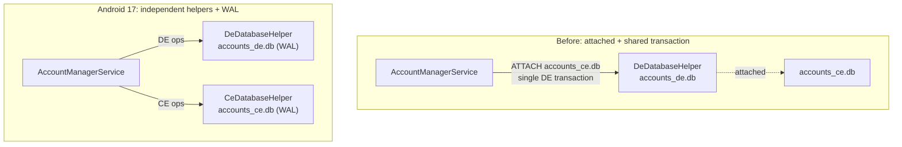

一项相关的优化收紧了 `invalidateAuthToken`。用于查找待删除令牌的 SQL 现在在同一个查询中返回令牌类型和所属账号名称。因此服务不再需要发出第二轮查询来将账号 ID 映射回名称。其净效果是，在每个凭据刷新都会命中的热路径上减少了数据库往返次数。

```
Source: frameworks/base/services/core/java/com/android/server/accounts/AccountsDb.java
```

### 32.6.2 合并的账号移除广播

当账号被移除时，`AccountManagerService` 会向每个感兴趣的包发送定向的 `AccountManager.ACTION_ACCOUNT_REMOVED` 广播。大量的移除操作（例如拆除工作配置，或移除同一类型的多个账号）以前可能产生一阵广播风暴。Android 17 使用广播投递组机制对它们进行合并：

```
Source: frameworks/base/services/core/java/com/android/server/accounts/AccountManagerService.java
```

```java
// sendAccountRemovedBroadcast() in AccountManagerService
final Bundle options = BroadcastOptions.makeBasic()
        .setDeliveryGroupPolicy(BroadcastOptions.DELIVERY_GROUP_POLICY_MOST_RECENT)
        .setDeliveryGroupMatchingKey(
                AccountManager.ACTION_ACCOUNT_REMOVED,
                account.name + "/" + account.type)
        .toBundle();
mContext.sendBroadcastAsUser(intent, new UserHandle(userId),
        null /* receiverPermission */, options);
```

借助 `DELIVERY_GROUP_POLICY_MOST_RECENT` 和 `name/type` 匹配键，当多个广播被排队时，系统只保留给定账号最近的待投递广播。它不会投递每一个中间广播。此变更最初在 `coalesce_account_removed_broadcast` aconfig 标志后面开发，该标志的清理使合并投递成为 17 中的默认行为。

### 32.6.3 净化同步 Extras

`ContentResolver.requestSync()` 允许一个应用调度另一个应用中的同步，并传递任意的 extras `Bundle`。由于这些 extras 会被 `SyncStorageEngine` 持久化并稍后重放，恶意或有问题的调用方可能会将过大或深度嵌套的数据推入系统状态。Android 17 在构造 `SyncOperation` 时对 extras 进行净化和限界：

```
Source: frameworks/base/services/core/java/com/android/server/content/SyncOperation.java
```

```java
private static final int MAX_SYNC_EXTRA_STRING_LENGTH = 127;
private static final int MAX_SYNC_EXTRA_ARRAY_LENGTH = 10;
```

`sanitizeAndCheckSyncExtras()` 强制执行以下几条规则：

| 规则 | 行为 |
|------|----------|
| 字符串值长度超过 127 个字符 | 截断为 127 个字符（记录日志） |
| 字符串/基本类型数组长度超过 10 个元素 | 以 `IllegalArgumentException` 拒绝 |
| 嵌套的 `Bundle` | 以 `IllegalArgumentException` 拒绝 |
| 不支持的值类型 | 以 `IllegalArgumentException` 拒绝 |

当净化抛出异常时，`SyncManager` 会在创建 `SyncOperation` 期间捕获该异常。它会丢弃该同步请求，因此格式错误的 extras 不会到达持久化存储或同步适配器。这是一项纵深防御变更：合法的同步 extras（少量小型布尔值和字符串）不受影响，而病态载荷会在入口处被拒绝。

### 32.6.4 SyncManager 接收器移出主线程

`SyncManager` 为连接性变更、关机、时间变更、用户生命周期事件、包变更和账号变更注册广播接收器。早期版本在主线程上分发这些接收器，其 handler 可能会阻塞在被其他系统服务持有的锁上。Android 17 将热门接收器和调度工作转移到 `SyncManager` 自己的专用 handler 线程上：

```
Source: frameworks/base/services/core/java/com/android/server/content/SyncManager.java
```

```java
mThread = new HandlerThread("SyncManager",
        android.os.Process.THREAD_PRIORITY_BACKGROUND);
mThread.start();
mSyncHandler = new SyncHandler(mThread.getLooper());
```

连接性和用户生命周期接收器注册在 `mSyncHandler` 上，而不是默认的主 `Looper` 上。因此，在同步调度期间缓慢的锁获取不会再停滞 `system_server` 主线程。（关机、时间变更和账号更新的接收器仍注册为 null handler，运行在主 `Looper` 上。）同一变更还停止了仅用于检查 `JobScheduler` 是否已连接的重复锁获取。此变更最初由 `com.android.server.am.syncmanager_off_main_thread` 标志控制，后来被清理，使脱离主线程的行为成为默认行为。

### 32.6.5 并发性加固

Android 17 还修复了 `AccountManagerService` 中一系列可能导致 `system_server` 死锁的锁排序错误。这些修复涉及共享账号重命名路径（`renameSharedAccountAsUser`）和权限授予路径（`grantAppPermission`）。一项单独的修复防止了在账号工作进行中移除用户时发生崩溃：

```
Source: frameworks/base/services/core/java/com/android/server/accounts/AccountManagerService.java
```

这些不是 API 变更，但对于任何需要调试追溯到 `AccountManagerService` 的 ANR 或 watchdog 杀死问题的人来说，它们很重要。在 17 上，数据库和广播路径按一致的顺序获取锁。32.6.1 的 CE/DE 解耦也减少了这些死锁所依赖的跨数据库锁定。

---

## 32.7 动手实践

### 练习 32.1：列出所有账号

枚举设备上的所有账号：

```java
import android.accounts.Account;
import android.accounts.AccountManager;

public class AccountLister {

    public void listAccounts(Context context) {
        AccountManager am = AccountManager.get(context);

        // List all visible accounts
        Account[] accounts = am.getAccounts();
        System.out.println("Found " + accounts.length + " accounts:");
        for (Account account : accounts) {
            System.out.println("  " + account.name + " (" + account.type + ")");
        }

        // List accounts by type
        Account[] googleAccounts = am.getAccountsByType("com.google");
        System.out.println("Google accounts: " + googleAccounts.length);

        // List all authenticator types
        AuthenticatorDescription[] authenticators =
            am.getAuthenticatorTypes();
        System.out.println("Registered authenticators:");
        for (AuthenticatorDescription auth : authenticators) {
            System.out.println("  Type: " + auth.type);
            System.out.println("  Package: " + auth.packageName);
        }
    }
}
```

**观察要点：**

- 账号可见性限制你的应用可以看到哪些账号
- 每种账号类型都对应一个已注册的认证器
- 同一类型可以存在多个账号（例如多个 Google 账号）

---

### 练习 32.2：自定义认证器

构建一个最小化的账号认证器：

```java
// 1. Authenticator
public class DemoAuthenticator extends AbstractAccountAuthenticator {
    private final Context context;

    public DemoAuthenticator(Context context) {
        super(context);
        this.context = context;
    }

    @Override
    public Bundle addAccount(AccountAuthenticatorResponse response,
            String accountType, String authTokenType,
            String[] requiredFeatures, Bundle options) {
        // For demo: add account directly without UI
        Account account = new Account("demo@example.com", accountType);
        AccountManager am = AccountManager.get(context);
        am.addAccountExplicitly(account, "password123", null);
        am.setAuthToken(account, "full_access", "demo-token-12345");

        Bundle result = new Bundle();
        result.putString(AccountManager.KEY_ACCOUNT_NAME, account.name);
        result.putString(AccountManager.KEY_ACCOUNT_TYPE, account.type);
        return result;
    }

    @Override
    public Bundle getAuthToken(AccountAuthenticatorResponse response,
            Account account, String authTokenType, Bundle options) {
        AccountManager am = AccountManager.get(context);
        String token = am.peekAuthToken(account, authTokenType);

        if (token != null && !token.isEmpty()) {
            Bundle result = new Bundle();
            result.putString(AccountManager.KEY_ACCOUNT_NAME, account.name);
            result.putString(AccountManager.KEY_ACCOUNT_TYPE, account.type);
            result.putString(AccountManager.KEY_AUTHTOKEN, token);
            return result;
        }

        // No token available -- would normally prompt for credentials
        Bundle result = new Bundle();
        result.putInt(AccountManager.KEY_ERROR_CODE, 1);
        result.putString(AccountManager.KEY_ERROR_MESSAGE, "No token");
        return result;
    }

    @Override
    public String getAuthTokenLabel(String authTokenType) {
        return "Full Access";
    }

    @Override
    public Bundle hasFeatures(AccountAuthenticatorResponse response,
            Account account, String[] features) {
        Bundle result = new Bundle();
        result.putBoolean(AccountManager.KEY_BOOLEAN_RESULT, false);
        return result;
    }

    @Override
    public Bundle confirmCredentials(AccountAuthenticatorResponse response,
            Account account, Bundle options) { return null; }

    @Override
    public Bundle updateCredentials(AccountAuthenticatorResponse response,
            Account account, String authTokenType, Bundle options) {
        return null;
    }

    @Override
    public Bundle editProperties(AccountAuthenticatorResponse response,
            String accountType) { return null; }
}

// 2. Service
public class AuthService extends Service {
    private DemoAuthenticator authenticator;

    @Override
    public void onCreate() {
        authenticator = new DemoAuthenticator(this);
    }

    @Override
    public IBinder onBind(Intent intent) {
        return authenticator.getIBinder();
    }
}
```

```xml
<!-- AndroidManifest.xml -->
<service android:name=".AuthService" android:exported="true">
    <intent-filter>
        <action android:name="android.accounts.AccountAuthenticator" />
    </intent-filter>
    <meta-data
        android:name="android.accounts.AccountAuthenticator"
        android:resource="@xml/authenticator" />
</service>

<!-- res/xml/authenticator.xml -->
<account-authenticator
    xmlns:android="http://schemas.android.com/apk/res/android"
    android:accountType="com.example.demo"
    android:label="@string/app_name"
    android:icon="@mipmap/ic_launcher"
    android:smallIcon="@mipmap/ic_launcher" />
```

**观察要点：**

- 认证器出现在"设置 > 账号"中
- `getIBinder()` 返回 `AccountManagerService` 绑定的 Transport stub
- `addAccountExplicitly()` 直接写入账号数据库
- 认证令牌会被缓存，可以通过 `peekAuthToken()` 获取

---

### 练习 32.3：自定义同步适配器

构建一个与上面的认证器配套的同步适配器：

```java
// 1. Sync Adapter
public class DemoSyncAdapter extends AbstractThreadedSyncAdapter {
    private static final String TAG = "DemoSync";

    public DemoSyncAdapter(Context context, boolean autoInitialize) {
        super(context, autoInitialize);
    }

    @Override
    public void onPerformSync(Account account, Bundle extras,
            String authority, ContentProviderClient provider,
            SyncResult syncResult) {
        Log.i(TAG, "Starting sync for " + account.name);
        Log.i(TAG, "Authority: " + authority);
        Log.i(TAG, "Extras: " + extras);

        try {
            // Simulate network fetch
            Thread.sleep(2000);

            // Report success
            syncResult.stats.numInserts = 5;
            syncResult.stats.numUpdates = 3;
            Log.i(TAG, "Sync complete: 5 inserts, 3 updates");

        } catch (InterruptedException e) {
            Log.e(TAG, "Sync interrupted", e);
            syncResult.stats.numIoExceptions++;
        }
    }
}

// 2. Service
public class SyncService extends Service {
    private static DemoSyncAdapter syncAdapter;
    private static final Object LOCK = new Object();

    @Override
    public void onCreate() {
        synchronized (LOCK) {
            if (syncAdapter == null) {
                syncAdapter = new DemoSyncAdapter(this, true);
            }
        }
    }

    @Override
    public IBinder onBind(Intent intent) {
        return syncAdapter.getSyncAdapterBinder();
    }
}
```

```xml
<!-- AndroidManifest.xml -->
<service android:name=".SyncService" android:exported="true">
    <intent-filter>
        <action android:name="android.content.SyncAdapter" />
    </intent-filter>
    <meta-data
        android:name="android.content.SyncAdapter"
        android:resource="@xml/syncadapter" />
</service>

<!-- You also need a stub ContentProvider -->
<provider
    android:name=".StubProvider"
    android:authorities="com.example.demo.provider"
    android:exported="false"
    android:syncable="true" />

<!-- res/xml/syncadapter.xml -->
<sync-adapter
    xmlns:android="http://schemas.android.com/apk/res/android"
    android:contentAuthority="com.example.demo.provider"
    android:accountType="com.example.demo"
    android:userVisible="true"
    android:supportsUploading="true"
    android:allowParallelSyncs="false"
    android:isAlwaysSyncable="true" />
```

手动触发一次同步：

```java
Account account = new Account("demo@example.com", "com.example.demo");
Bundle extras = new Bundle();
extras.putBoolean(ContentResolver.SYNC_EXTRAS_MANUAL, true);
extras.putBoolean(ContentResolver.SYNC_EXTRAS_EXPEDITED, true);
ContentResolver.requestSync(account, "com.example.demo.provider", extras);
```

**观察要点：**

- 同步适配器会自动在后台线程中运行
- 作业触发时，`onPerformSync` 由 `SyncManager` 调用
- 即使你不使用桩 ContentProvider，它也是必须的
- `isAlwaysSyncable="true"` 意味着同步默认启用

---

### 练习 32.4：周期性同步配置

设置并监控周期性同步：

```java
// Schedule periodic sync every 15 minutes with 5 minute flex
Account account = new Account("demo@example.com", "com.example.demo");
String authority = "com.example.demo.provider";

// Enable auto-sync
ContentResolver.setSyncAutomatically(account, authority, true);

// Add periodic sync
ContentResolver.addPeriodicSync(
    account, authority, Bundle.EMPTY, 15 * 60  // 15 minutes
);

// Monitor sync status
new Handler(Looper.getMainLooper()).postDelayed(() -> {
    boolean active = ContentResolver.isSyncActive(account, authority);
    boolean pending = ContentResolver.isSyncPending(account, authority);
    boolean autoSync = ContentResolver.getSyncAutomatically(account, authority);
    boolean masterSync = ContentResolver.getMasterSyncAutomatically();

    Log.i("SyncStatus", "Active: " + active);
    Log.i("SyncStatus", "Pending: " + pending);
    Log.i("SyncStatus", "Auto-sync: " + autoSync);
    Log.i("SyncStatus", "Master sync: " + masterSync);

    // Get list of active syncs
    List<SyncInfo> activeSyncs = ContentResolver.getCurrentSyncs();
    for (SyncInfo info : activeSyncs) {
        Log.i("SyncStatus", "Active sync: " + info.account.name +
            " / " + info.authority);
    }
}, 5000);
```

**观察要点：**

- 周期性同步在内部通过 JobScheduler 调度
- 弹性窗口允许节能的批量处理
- 主同步开关会覆盖每个 authority 的设置
- `getCurrentSyncs()` 显示所有当前正在执行的同步

---

### 练习 32.5：使用 dumpsys 调试

使用 `dumpsys` 检查账号和同步状态：

```bash
# Dump account information
adb shell dumpsys account

# Key sections:
# - User accounts and their types
# - Registered authenticators
# - Token cache state
# - Visibility settings

# Dump sync state
adb shell dumpsys content

# Key sections:
# - Sync adapters registered
# - Sync status per authority
# - Pending syncs
# - Active syncs
# - Sync history (recent successes/failures)
# - Backoff state
# - Periodic sync schedule

# Note: there is no "content sync" shell subcommand -- the content tool only
# supports insert/update/delete/query/call/read/write/gettype. To trigger a
# sync, call ContentResolver.requestSync() from an app; to fire a scheduled
# sync job from the shell, find its job ID in dumpsys and run:
adb shell cmd jobscheduler run -f android <sync-job-id>

# List sync adapters
adb shell dumpsys content | grep -A2 "Sync Adapters"

# Check JobScheduler for pending sync jobs
adb shell dumpsys jobscheduler | grep -i sync

# Monitor sync in real-time
adb logcat -s SyncManager:V SyncJobService:V
```

**观察要点：**

- `dumpsys account` 显示每个用户的所有账号及其认证器
- `dumpsys content` 显示完整的同步状态机
- 退避延迟会在失败的适配器上累积
- 周期性同步以 JobScheduler 作业的形式可见

---

### 练习 32.6：源代码探索

探索账号与同步源代码：

```bash
# Count AccountManagerService lines -- expect a very large file
wc -l frameworks/base/services/core/java/com/android/server/accounts/AccountManagerService.java

# Count SyncManager lines -- also substantial, though smaller
wc -l frameworks/base/services/core/java/com/android/server/content/SyncManager.java

# Find all AIDL interfaces for accounts
find frameworks/base/core/java/android/accounts/ -name "*.aidl"
# IAccountManager.aidl
# IAccountAuthenticator.aidl
# IAccountAuthenticatorResponse.aidl
# IAccountManagerResponse.aidl
# Account.aidl
# AuthenticatorDescription.aidl

# See the account database schema
grep "CREATE TABLE" \
    frameworks/base/services/core/java/com/android/server/accounts/AccountsDb.java

# Find sync-related broadcast actions
grep "ACTION_" \
    frameworks/base/core/java/android/accounts/AccountManager.java \
    | head -10

# Check sync operation reasons
grep "REASON_" \
    frameworks/base/services/core/java/com/android/server/content/SyncOperation.java

# See SyncManagerConstants defaults
grep "DEF_" \
    frameworks/base/services/core/java/com/android/server/content/SyncManagerConstants.java
```

**观察要点：**

- `AccountManagerService` 的复杂性：它管理多用户账号、认证器绑定和令牌缓存
- `SyncManager` 与 `JobScheduler` 之间的紧密耦合
- `SyncStorageEngine` 中基于 XML/Proto 的持久化
- 同步配置选项的广度（退避、重试、周期性、弹性）

---

## 总结

账号与同步框架是 AOSP 最古老、最稳定的子系统之一，自 API level 5 起就是 Android 的一部分。本章的关键架构要点：

1. **可插拔的认证器** —— 账号系统通过 `AbstractAccountAuthenticator` 完全可扩展。每种账号类型都带来自己的凭据管理和令牌生成逻辑。

2. **每用户双数据库存储** —— 账号数据拆分为设备加密数据库和凭据加密数据库，以支持 Direct Boot，同时保护敏感凭据。

3. **带 LRU 驱逐的令牌缓存** —— `TokenCache` 提供内存中的 LRU 缓存，以（账号、tokenType、包名、sigDigest）为键，尽量减少认证器的往返调用。

4. **JobScheduler 集成** —— `SyncManager` 将所有调度委托给 `JobScheduler`，将每个 `SyncOperation` 转换为带有适当约束、退避和周期的 `JobInfo`。

5. **指数退避** —— 失败的同步会按可配置的指数退避重试（默认初始 30 秒，2 倍因子，最长 1 小时）。

6. **同步监控** —— SyncManager 监控运行中同步的网络进度。它可以检测并取消停滞的同步。

7. **两级自动同步** —— 全局主开关和每个 authority 的开关都必须启用，自动同步才会触发。

账号与同步框架展示了成熟的 Android 子系统模式。它拥有简洁的应用 API。系统服务支撑该 API，并将繁重的工作委托给可插拔组件（认证器和同步适配器）。该框架还提供持久化状态管理，并与平台调度基础设施集成。
