# 第 22 章：Activity 与 Window

Activity 与 Window 管理子系统是 Android 用户体验的心脏。每一次启动应用的点击，都要穿过
`ActivityManagerService`（AMS）、`ActivityTaskManagerService`（ATMS）和
`WindowManagerService`（WMS）这套错综复杂的机制。切换任务的每一次滑动、每一次分屏排列，
以及每一个悬浮的画中画窗口，同样如此。这三个服务共同运行在 `system_server`
中。它们管理 Activity 的完整生命周期、Task 与 Window 的层级结构，以及进程优先级的调度。
它们还管理用户在屏幕上看到的那些视觉过渡编排。

本章提供一份全面的架构概览。我们将沿着 AOSP 源码追踪真实的代码路径。我们将通过
Mermaid 图来考察类层次结构。我们还会剖析支撑 Android 上每一次可见交互的数据结构。第 23 章和
第 24 章将分别深入探讨 Window
System 内部实现和 Display/Compositor 流水线；本章先打下基础。

---

## 22.1 AMS 与 ATMS 架构

### 22.1.1 历史背景：那次大拆分

在 Android 10（API 29）之前，`ActivityManagerService` 是一个单一的单体
类。它负责*所有事情*：进程管理、Activity
生命周期、Task 管理、广播分发、Service 绑定、Content
Provider 跟踪，以及 OOM 调整。这个文件已经成长为整个 AOSP 中最复杂的类之一。

从 Android 10 开始，AOSP 团队把与 Activity 相关的和与 Task
相关的逻辑抽取到了一个新服务 `ActivityTaskManagerService` 中。这一
拆分反映了一个根本性的架构区分：

- **AMS**（`com.android.server.am.ActivityManagerService`）——管理
  *进程*：生命周期、优先级（OOM adj）、广播、Service、Content
  Provider、Instrumentation，以及 LRU 进程列表。

- **ATMS**（`com.android.server.wm.ActivityTaskManagerService`）——管理
  *Activity 与 Task*：startActivity 流水线、Task 栈、Activity
  生命周期转换、Recents、Lock Task 模式，以及多窗口
  配置。

注意包名的差异：AMS 位于 `com.android.server.am`，而 ATMS
位于 `com.android.server.wm`（Window Manager）。这反映出 Activity 与 Window
的耦合有多紧密——ATMS 被移入 WM 包，以便共享同一个锁并减少跨锁争用。

### 22.1.2 类声明与继承关系

```java
// frameworks/base/services/core/java/com/android/server/am/ActivityManagerService.java, line 602
public class ActivityManagerService extends IActivityManager.Stub
        implements Watchdog.Monitor, BatteryStatsImpl.BatteryCallback,
                   ActivityManagerGlobalLock, OomAdjuster.HostingTypeProvider {
```

```java
// frameworks/base/services/core/java/com/android/server/wm/ActivityTaskManagerService.java, line 339
public class ActivityTaskManagerService extends IActivityTaskManager.Stub {
```

二者都继承各自对应的 AIDL Stub 类，这意味着它们负责处理来自客户端应用的 Binder IPC
调用。AMS 还额外实现了 `Watchdog.Monitor`（用于检测系统挂起）、`BatteryStatsImpl.BatteryCallback`（用于电量
跟踪），以及 `OomAdjuster.HostingTypeProvider`（向 OOM 调整器提供宿主类型
字符串）。

### 22.1.3 双锁架构

AMS 和 ATMS 使用不同的全局锁，这对并发而言是一个关键的设计决策：

```java
// In AMS (line 782):
final ActivityManagerGlobalLock mGlobalLock = ActivityManagerService.this;

// The process-specific lock (line 820):
final ActivityManagerGlobalLock mProcLock = ENABLE_PROC_LOCK
        ? new ActivityManagerProcLock() : mGlobalLock;
```

```java
// In ATMS:
final WindowManagerGlobalLock mGlobalLock = new WindowManagerGlobalLock();
```

ATMS 与 WMS 共享它的 `WindowManagerGlobalLock`。这意味着 Activity
操作与 Window 操作会在同一把锁的保护下串行执行。这是一个
刻意的选择。这是因为 Activity 与 Window 耦合得如此紧密，几乎总是需要一起修改。

另一方面，AMS 拥有自己的 `ActivityManagerGlobalLock`，外加一把用于进程特定操作的
`mProcLock`。源码中记录的锁获取顺序约定如下：

1. `mGlobalLock`（AMS）——最先获取
2. `mProcLock`——如有需要其次获取
3. 其他内部锁

方法命名约定反映了这一点：

- `-LOSP`——使用任意全局 am Service 或 Process 锁加锁
- `-LSP`——同时使用 Service 锁与 Process 锁加锁
- `-Locked`——仅使用全局 AM Service 锁加锁
- `-LPr`——仅使用 Process 锁加锁

### 22.1.4 AMS 中的关键字段

```java
// frameworks/base/services/core/java/com/android/server/am/ActivityManagerService.java
private CachedAppOptimizer mCachedAppOptimizer;  // line 740 - freezer/compaction
OomAdjuster mOomAdjuster;                          // line 741 - OOM adjustment engine
ProcessStateController mProcessStateController;    // line 743 - owns the OomAdjuster
private BroadcastQueue mBroadcastQueue;            // line 835 - broadcast dispatch
BroadcastController mBroadcastController;           // line 839 - broadcast management
public final IntentFirewall mIntentFirewall;       // line 774 - intent filtering
```

在 Android 17 中，OOM 调整机制从 `am` 包迁移到了新的 `com.android.server.am.psc`（Process State
Controller）子包。AMS 不再直接构造 `OomAdjuster`；而是构建一个
`ProcessStateController` 并从中获得调整器
（`ActivityManagerService.java`，第 2600-2605 行）。22.7 节将详细介绍这个新
包。

AMS 中定义的重要时序常量：

```java
// line 648: How long before a started process must attach
static final int PROC_START_TIMEOUT = 10 * 1000 * Build.HW_TIMEOUT_MULTIPLIER;

// line 651: How long for bindApplication to complete before ANR
static final int BIND_APPLICATION_TIMEOUT = 15 * 1000 * Build.HW_TIMEOUT_MULTIPLIER;

// line 655: Delay before killing an unused app zygote
static final int KILL_APP_ZYGOTE_DELAY_MS = 5 * 1000;

// line 664-665: Broadcast timeouts
static final int BROADCAST_FG_TIMEOUT = 10 * 1000 * Build.HW_TIMEOUT_MULTIPLIER;
static final int BROADCAST_BG_TIMEOUT = 60 * 1000 * Build.HW_TIMEOUT_MULTIPLIER;
```

### 22.1.5 ATMS 中的关键字段

```java
// frameworks/base/services/core/java/com/android/server/wm/ActivityTaskManagerService.java
ActivityTaskSupervisor mTaskSupervisor;              // line 426
ActivityClientController mActivityClientController;  // line 427
RootWindowContainer mRootWindowContainer;            // line 429
WindowManagerService mWindowManager;                 // line 430

// Process tracking
final ProcessMap<WindowProcessController> mProcessNames = new ProcessMap<>();
final WindowProcessControllerMap mProcessMap = new WindowProcessControllerMap();
volatile WindowProcessController mHomeProcess;
volatile WindowProcessController mTopApp;
```

ATMS 还管理应用切换策略：

```java
private volatile int mAppSwitchesState = APP_SWITCH_ALLOW;
static final int APP_SWITCH_DISALLOW = 0;
static final int APP_SWITCH_FG_ONLY = 1;
static final int APP_SWITCH_ALLOW = 2;
```

### 22.1.6 AMS-ATMS 关系图

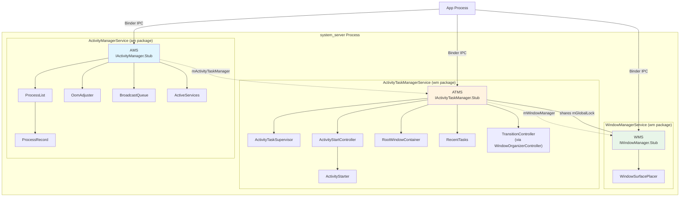

### 22.1.7 职责矩阵

| 职责 | AMS | ATMS | WMS |
|----------------|:---:|:----:|:---:|
| Process start/stop | X | | |
| OOM adj computation | X | | |
| Broadcast dispatch | X | | |
| Service binding | X | | |
| Content provider tracking | X | | |
| Activity start pipeline | | X | |
| Task management | | X | |
| Recents list | | X | |
| Activity lifecycle callbacks | | X | |
| Lock task mode | | X | |
| Window add/remove | | | X |
| Window layout/positioning | | | X |
| Surface management | | | X |
| Input dispatch configuration | | | X |
| Display management | | | X |
| Activity visibility | | X | X |
| Configuration changes | | X | X |

### 22.1.8 WindowManagerGlobalLock

ATMS 与 WMS 之间这把共享的锁值得特别关注。ATMS 创建时，工程师选择让它共享 WM 锁，而不是
维护一把单独的锁。这一设计意味着：

1. **Activity 状态变更与 Window 状态变更是原子的。**当一个
   Activity 转换为 RESUMED 时，对应的 Window 可见性更新会在同一次锁获取下完成。

2. **ATMS 与 WMS 之间不存在锁顺序死锁**——由于它们共享同一把锁，不会出现
   A 持有锁 1 等待锁 2、而 B 持有锁 2 等待锁 1 的情况。

3. **并发性降低**——代价是 Activity 操作与 Window
   操作无法并行进行。缓解措施是保持临界区简短，并把繁重的工作（比如 Surface
   事务）放到锁外执行。

`WindowManagerThreadPriorityBooster` 会确保持有 WM
锁的线程获得一次临时优先级提升，以减少优先级反转。

---

## 22.2 从框架视角看 Activity 生命周期

### 22.2.1 ActivityRecord 状态机

每个正在运行的 Activity 在服务端都由一个 `ActivityRecord`
实例表示。生命周期状态定义为一个枚举：

```java
// frameworks/base/services/core/java/com/android/server/wm/ActivityRecord.java, line 553
enum State {
    INITIALIZING,
    STARTED,
    RESUMED,
    PAUSING,
    PAUSED,
    STOPPING,
    STOPPED,
    FINISHING,
    DESTROYING,
    DESTROYED,
    RESTARTING_PROCESS
}
```

这些状态与客户端 Activity
生命周期回调相对应——但并不完全相同。服务端通过
`ClientLifecycleManager` 和 `ClientTransaction` 机制驱动客户端在这些状态间流转。

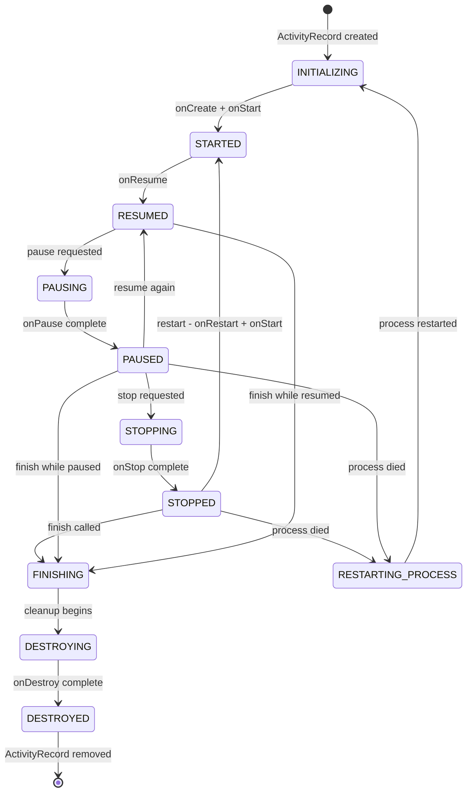

### 22.2.2 ActivityRecord 关键字段

`ActivityRecord` 类（声明于第 372 行）继承自 `WindowToken`，
使它同时是一个 Activity 表示和一个 Window 容器：

```java
// frameworks/base/services/core/java/com/android/server/wm/ActivityRecord.java, line 372
final class ActivityRecord extends WindowToken {
```

关键字段包括：

```java
// Identity and configuration
final ActivityTaskManagerService mAtmService;
final ActivityInfo info;                       // from AndroidManifest
final int mUserId;
final String packageName;
final ComponentName mActivityComponent;
final Intent intent;
final String processName;
final String taskAffinity;

// State tracking
WindowProcessController app;                   // hosting process
private State mState;                          // current lifecycle state
private Task task;                             // containing task

// Result handling
ActivityRecord resultTo;
final String resultWho;
final int requestCode;

// Lifecycle flags
boolean finishing;
int launchMode;
```

用于防止挂起应用的超时常量：

```java
// line 409: Pause must complete within 500ms
private static final int PAUSE_TIMEOUT = 500;

// line 418: Stop must complete within 11s
static final int STOP_TIMEOUT = 11 * 1000;

// line 422: Destroy must complete within 10s
private static final int DESTROY_TIMEOUT = 10 * 1000;
```

### 22.2.3 startActivity() 流程

当应用调用 `startActivity()` 时，请求会在 Activity 真正出现在屏幕上之前穿过多个
层次。完整流程如下：

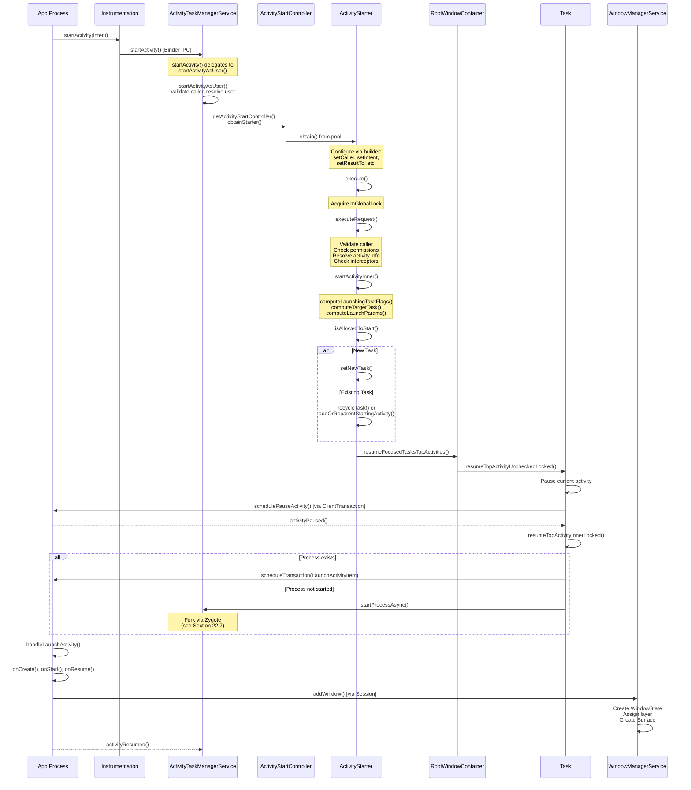

### 22.2.4 execute() 内部

`ActivityStarter.execute()` 方法（第 837 行）是主要入口。
我们来看看它的逻辑：

```java
// frameworks/base/services/core/java/com/android/server/wm/ActivityStarter.java, line 837
int execute() {
    // ...
    try {
        onExecutionStarted();

        // Validate intent
        if (mRequest.intent != null) {
            if (mRequest.intent.hasFileDescriptors()) {
                throw new IllegalArgumentException("File descriptors passed in Intent");
            }
        }

        // Notify metrics logger of impending launch
        final LaunchingState launchingState;
        synchronized (mService.mGlobalLock) {
            final ActivityRecord caller = ActivityRecord.forTokenLocked(mRequest.resultTo);
            launchingState = mSupervisor.getActivityMetricsLogger()
                    .notifyActivityLaunching(mRequest.intent, caller, callingUid);
        }

        // Resolve activity if not already done
        if (mRequest.activityInfo == null) {
            mRequest.resolveActivity(mSupervisor);
        }

        int res = START_CANCELED;
        synchronized (mService.mGlobalLock) {
            // Check for global config changes
            // ...

            res = resolveToHeavyWeightSwitcherIfNeeded();
            if (res != START_SUCCESS) {
                return res;
            }

            res = executeRequest(mRequest);  // the real work
        }
        // ...
    }
}
```

### 22.2.5 executeRequest() 内部

`executeRequest()` 方法（第 1087 行）执行大量验证：

1. **调用方验证**：解析发起调用的 `WindowProcessController`，
   并提取 PID/UID。

2. **Intent 解析**：检查目标组件是否存在。若不存在，
   则检查已归档的应用。

3. **权限检查**：委托给
    `ActivityTaskSupervisor.checkStartAnyActivityPermission()`。

4. **Activity 拦截器**（多处）：一链
    `ActivityInterceptorCallback` 实例可以重定向或阻止启动。
    其中包括权限审查拦截器、被挂起包拦截器，以及其他拦截器。

5. **后台 Activity 启动（BAL）检查**：判断后台应用是否被允许启动
    Activity。`BalVerdict` 对象封装了这个决定。

6. **ActivityRecord 创建**：用所有解析出的信息构造一个新的
    `ActivityRecord`。

7. **委托给 `startActivityUnchecked()`**，后者调用
    `startActivityInner()`。

### 22.2.6 startActivityInner() 内部

这是真正进行 Task 目标定位的核心方法（第 2015 行）：

```java
// frameworks/base/services/core/java/com/android/server/wm/ActivityStarter.java, line 2015
int startActivityInner(final ActivityRecord r, ActivityRecord sourceRecord,
        IVoiceInteractionSession voiceSession, IVoiceInteractor voiceInteractor,
        int startFlags, ActivityOptions options, Task inTask,
        TaskFragment inTaskFragment, BalVerdict balVerdict,
        NeededUriGrants intentGrants, int realCallingUid) {

    setInitialState(r, options, inTask, inTaskFragment, startFlags,
            sourceRecord, voiceSession, voiceInteractor, balVerdict, realCallingUid);

    computeLaunchingTaskFlags();   // resolve FLAG_ACTIVITY_NEW_TASK, etc.
    mIntent.setFlags(mLaunchFlags);

    final Task reusedTask = resolveReusableTask(includeLaunchedFromBubble);
    final Task targetTask = reusedTask != null ? reusedTask : computeTargetTask();
    final boolean newTask = targetTask == null;
    // ...
```

随后该方法遵循如下决策树：

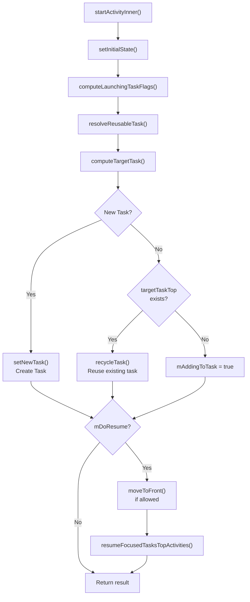

### 22.2.7 生命周期回调机制

Android 采用事务模型把生命周期回调投递给客户端应用。ATMS 中的
`ClientLifecycleManager` 创建 `ClientTransaction`
对象，把这些生命周期状态请求打包在一起：

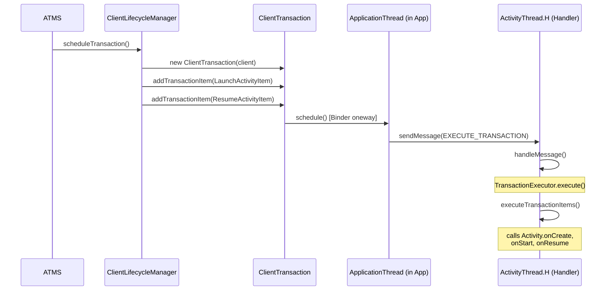

事务执行器会计算出穿过生命周期状态机的最短路径。例如，如果当前状态是 STOPPED，请求的
状态是 RESUMED，它会自动依次执行 onRestart -> onStart ->
onResume。

---

## 22.3 Task 与 ActivityRecord 层级结构

### 22.3.1 WindowContainer 层级结构

Android 中整个 Window/Activity 层级结构都建立在一个基类之上：`WindowContainer`。
理解这一层级结构，是理解系统如何管理 Window、Task 与 Display 的关键。

```java
// frameworks/base/services/core/java/com/android/server/wm/WindowContainer.java, line 117
class WindowContainer<E extends WindowContainer> extends ConfigurationContainer<E>
        implements Comparable<WindowContainer>, Animatable, Identifiable {
```

`WindowContainer` 提供：

- 父子树结构（`mParent`、`mChildren`）
- 配置传播（屏幕尺寸、方向等）
- 动画支持
- 通过 `Comparable<WindowContainer>` 实现的 Z 轴排序
- Surface 管理（每个容器都可拥有一个 SurfaceControl）

### 22.3.2 完整的层级结构

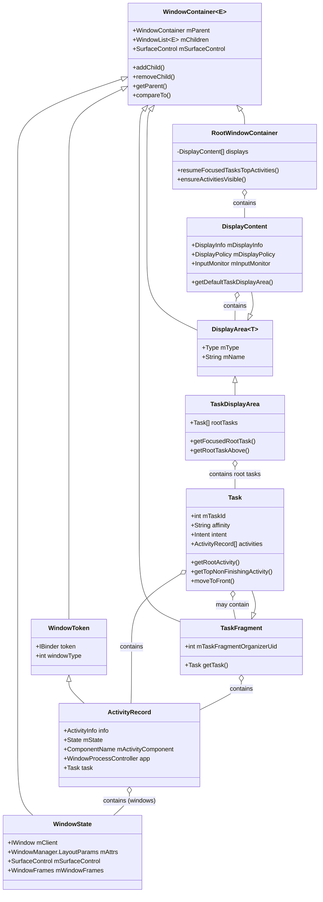

### 22.3.3 实践中的层级结构

在一个真实运行的系统中，层级结构通常长这样：

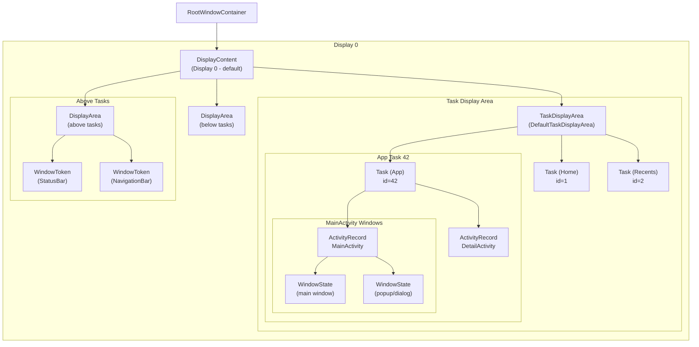

### 22.3.4 Task（返回栈）内部实现

`Task` 类（第 207 行）继承自 `TaskFragment`：

```java
// frameworks/base/services/core/java/com/android/server/wm/Task.java, line 207
class Task extends TaskFragment {
```

而 `TaskFragment` 继承自 `WindowContainer`：

```java
// frameworks/base/services/core/java/com/android/server/wm/TaskFragment.java, line 123
class TaskFragment extends WindowContainer<WindowContainer> {
```

Task 的关键属性：

| 字段 | 用途 |
|-------|---------|
| `mTaskId` | Task 的唯一标识符 |
| `affinity` | 来自 AndroidManifest 的 Task 亲和性 |
| `rootAffinity` | 创建时根 Activity 的亲和性 |
| `intent` | 启动该 Task 的原始 intent（通过 `getBaseIntent()` 读取） |
| `mCallingUid` | 创建该 Task 的 UID |
| `mResizeMode` | 该 Task 的可缩放方式 |

Task 还带有一套重新父化（reparenting）系统，共有三种模式：

```java
// frameworks/base/services/core/java/com/android/server/wm/Task.java, lines 275-279
static final int REPARENT_MOVE_ROOT_TASK_TO_FRONT = 0;
static final int REPARENT_KEEP_ROOT_TASK_AT_FRONT = 1;
static final int REPARENT_LEAVE_ROOT_TASK_IN_PLACE = 2;
```

### 22.3.5 作为 WindowToken 的 ActivityRecord

一个关键的架构洞察是：`ActivityRecord` 继承自 `WindowToken`：

```java
// frameworks/base/services/core/java/com/android/server/wm/WindowToken.java, line 63
class WindowToken extends WindowContainer<WindowState> {

// frameworks/base/services/core/java/com/android/server/wm/ActivityRecord.java, line 372
final class ActivityRecord extends WindowToken {
```

这意味着一个 `ActivityRecord` *就是*一个 `WindowToken`，并且直接包含
`WindowState` 子节点。当应用创建窗口（通过 `WindowManager.addView()`）时，
这些窗口会成为该 Activity 的 `WindowToken` 的子节点。

这一设计优雅地统一了 Activity 与 Window 两套层级。当某个
Activity 被移除时，它的所有窗口都会自动被清理——因为它们是容器树中的子节点。

### 22.3.6 WindowState 核心字段

```java
// frameworks/base/services/core/java/com/android/server/wm/WindowState.java, line 277
class WindowState extends WindowContainer<WindowState>
        implements WindowManagerPolicy.WindowState, InsetsControlTarget, InputTarget {
```

`WindowState` 继承自 `WindowContainer<WindowState>`，这意味着窗口可以拥有
子窗口（比如弹出菜单或对话框覆盖层）。

`WindowState` 的关键字段：

- `mClient`——指向客户端进程的 `IWindow` Binder 代理
- `mAttrs`——定义类型、标志与尺寸的 `WindowManager.LayoutParams`
- `mToken`——该窗口所属的 `WindowToken`
- `mActivityRecord`——该窗口所属的 Activity（系统窗口可能为 null）
- `mSurfaceControl`——用于渲染的 SurfaceFlinger surface
- `mWindowFrames`——一个 `WindowFrames`，保存计算出的屏幕坐标矩形
  （`mFrame`、`mCompatFrame`、`mRelFrame`），通过 `getFrame()` 读取
- `mSession`——`Session`（每个进程与 WMS 的连接）
- `mWinAnimator`——该窗口的动画控制器

### 22.3.7 DisplayContent 与 Display Area

```java
// frameworks/base/services/core/java/com/android/server/wm/DisplayContent.java, line 299
class DisplayContent extends RootDisplayArea
        implements WindowManagerPolicy.DisplayContentInfo {
```

每个物理或虚拟显示都由一个 `DisplayContent` 表示。它
包含一层 `DisplayArea` 对象层级，这些对象把窗口组织成各个
层：

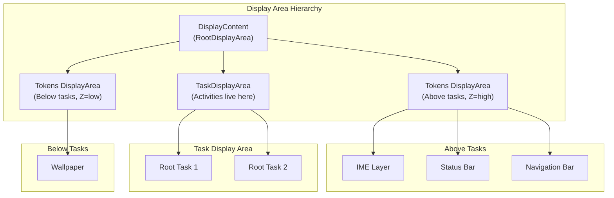

`TaskDisplayArea`（第 73 行）尤为重要：

```java
// frameworks/base/services/core/java/com/android/server/wm/TaskDisplayArea.java, line 73
final class TaskDisplayArea extends DisplayArea<WindowContainer> {
```

它管理一个显示上的根 Task 集合。它提供 `getFocusedRootTask()` 和
`getRootTaskAbove()` 等方法。这些方法对找出当前聚焦的
Activity 至关重要。

### 22.3.8 RootWindowContainer

`RootWindowContainer`（第 167 行）是整个层级结构的顶点：

```java
// frameworks/base/services/core/java/com/android/server/wm/RootWindowContainer.java, line 167
class RootWindowContainer extends WindowContainer<DisplayContent>
        implements DisplayManager.DisplayListener {
```

它包含所有 `DisplayContent` 对象，并提供系统级操作：

- `resumeFocusedTasksTopActivities()`——在所有显示上恢复最顶部的 Activity
- `ensureActivitiesVisible()`——重新计算所有 Activity 的可见性
- `findActivity()`——在所有显示的所有 Task 中搜索某个 Activity
- `getDefaultTaskDisplayArea()`——返回默认显示的 Task 区域
- `getTopDisplayFocusedRootTask()`——返回聚焦的 Task 栈

---

## 22.4 Window 添加流程

### 22.4.1 客户端：从 View 到 Session

当应用调用 `WindowManager.addView()` 时，请求从客户端的
`WindowManagerGlobal` 开始：

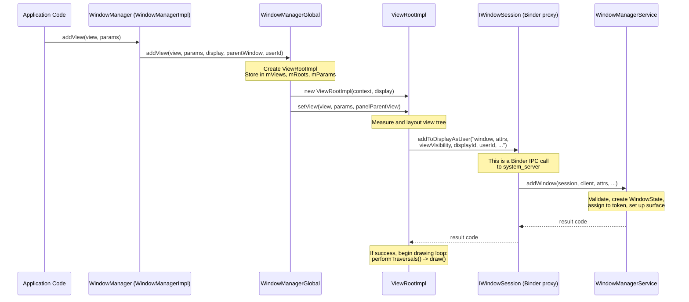

### 22.4.2 服务端：WMS.addWindow()

WMS 中的 `addWindow()` 方法（第 1672 行）是整个 Window 管理系统中最重要的
方法之一。它执行大量的验证与设置工作：

```java
// frameworks/base/services/core/java/com/android/server/wm/WindowManagerService.java, line 1672
public int addWindow(Session session, IWindow client, LayoutParams attrs,
        int viewVisibility, int displayId, int requestUserId,
        @InsetsType int requestedVisibleTypes,
        InputChannel outInputChannel, WindowRelayoutResult result) {
```

### 22.4.3 addWindow() 的分步流程

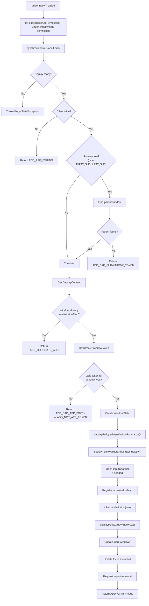

### 22.4.4 Token 验证逻辑

`addWindow()` 中的 Token 验证是一道关键的安全关卡。系统会验证窗口类型与 Token
是否匹配：

```java
// around line 1817 (simplified)
if (rootType >= FIRST_APPLICATION_WINDOW && rootType <= LAST_APPLICATION_WINDOW) {
    activity = token.asActivityRecord();
    if (activity == null) {
        // Not an app token - reject
        return WindowManagerGlobal.ADD_NOT_APP_TOKEN;
    } else if (activity.getParent() == null) {
        // Activity is exiting - reject
        return WindowManagerGlobal.ADD_APP_EXITING;
    }
} else if (rootType == TYPE_INPUT_METHOD) {
    if (token.windowType != TYPE_INPUT_METHOD) {
        return WindowManagerGlobal.ADD_BAD_APP_TOKEN;
    }
} else if (rootType == TYPE_WALLPAPER) {
    if (token.windowType != TYPE_WALLPAPER) {
        return WindowManagerGlobal.ADD_BAD_APP_TOKEN;
    }
}
// ... similar checks for VOICE_INTERACTION, ACCESSIBILITY_OVERLAY, TOAST, etc.
```

这确保了：

- 应用窗口只能使用有效的 `ActivityRecord` Token 创建
- 系统窗口必须拥有正确的 Token 类型
- 任何进程都无法创建它未被授权的窗口类型

### 22.4.5 WindowState 的创建

验证通过后，会创建一个新的 `WindowState`：

```java
// around line 1892
final WindowState win = new WindowState(this, session, client, token, parentWindow,
        appOp[0], attrs, viewVisibility, session.mUid, userId,
        session.mCanAddInternalSystemWindow);
```

创建之后，窗口还要经历：

1. **参数调整**——`displayPolicy.adjustWindowParamsLw()` 可能修改
    标志与属性。

2. **输入通道设置**——如果窗口接受输入，会创建一个 `InputChannel`
    对。一端保留在 WMS（供输入分发器使用），另一端送回客户端。

3. **注册**——窗口被加入 `mWindowMap`（以 Binder
    Token 为键），并加入它所属的 `WindowToken`。

4. **显示策略**——`displayPolicy.addWindowLw()` 处理特殊窗口类型
    （状态栏、导航栏）。

5. **布局请求**——调度一次布局遍历，以便为窗口定位并设定尺寸。

### 22.4.6 addWindowInner() 方法

主验证完成后，`addWindowInner()`（第 2044 行）处理类型特定的
设置：

```java
// frameworks/base/services/core/java/com/android/server/wm/WindowManagerService.java, line 2044
private int addWindowInner(@NonNull WindowState win, @NonNull DisplayPolicy displayPolicy,
        @NonNull ActivityRecord activity, @NonNull DisplayContent displayContent,
        @NonNull IWindow client, @NonNull LayoutParams attrs, int uid,
        @NonNull WindowRelayoutResult result) {
    // ...
    win.mToken.addWindow(win);                          // add to token
    displayPolicy.addWindowLw(win, attrs);
    displayPolicy.setDropInputModePolicy(win, win.mAttrs);

    if (type == TYPE_APPLICATION_STARTING && activity != null) {
        activity.attachStartingWindow(win);             // Starting/splash window
    } else if (type == TYPE_INPUT_METHOD
            && (win.mAttrs.flags & FLAG_NOT_TOUCHABLE) == 0) {
        // In Android 17 the IME window is attached via the ImeWindowToken,
        // which is the source of truth across user-profile switches.
        final ImeWindowToken imeToken = win.mToken.asImeToken();
        if (/* token agrees with the display's current IME token */) {
            displayContent.setImeWindow(win);
        }
    } else if (type == TYPE_WALLPAPER) {
        displayContent.mWallpaperController.clearLastWallpaperTimeoutTime();
    }
    // ...
}
```

IME 的挂接路径在 Android 17 中发生了变化。早先的版本把输入法窗口直接存储在
`DisplayContent` 上。当前的代码会解析出一个 `ImeWindowToken`。只有当该 Token 与
显示的 `ImeContainer` Token 匹配时，才会挂接窗口。这样可以防范一种竞态。在该竞态中，
工作资料切换会把 IME 移走，而一个过期的 `InputMethodService` 仍在添加它的窗口。

### 22.4.7 Session Binder 对象

每个创建窗口的应用进程都会与 WMS 建立一个 `Session`：

```java
// frameworks/base/services/core/java/com/android/server/wm/Session.java, line 104
class Session extends IWindowSession.Stub implements IBinder.DeathRecipient {
    final WindowManagerService mService;
    final IWindowSessionCallback mCallback;
    final int mUid;
    final int mPid;
```

Session 充当每个进程的代理。两个添加窗口的入口点（都转发到
`WMS.addWindow()`）是：

```java
// line 264
public int addToDisplay(IWindow window, WindowManager.LayoutParams attrs,
        int viewVisibility, int displayId, @InsetsType int requestedVisibleTypes,
        InputChannel outInputChannel, WindowRelayoutResult result) {
    return mService.addWindow(this, window, attrs, viewVisibility, displayId,
            UserHandle.getUserId(mUid), requestedVisibleTypes, outInputChannel, result);
}

// line 272
public int addToDisplayAsUser(IWindow window, WindowManager.LayoutParams attrs,
        int viewVisibility, int displayId, int userId,
        @InsetsType int requestedVisibleTypes,
        InputChannel outInputChannel, WindowRelayoutResult result) {
    return mService.addWindow(this, window, attrs, viewVisibility, displayId, userId,
            requestedVisibleTypes, outInputChannel, result);
}
```

`Session` 还实现了 `IBinder.DeathRecipient`，因此当客户端进程死亡时，
它的所有窗口都会被自动清理。

---
## 22.5 WindowManagerService 架构

## 22.5 WindowManagerService 架构

### 22.5.1 类概览

```java
// frameworks/base/services/core/java/com/android/server/wm/WindowManagerService.java, line 412
public class WindowManagerService extends IWindowManager.Stub
        implements Watchdog.Monitor, WindowManagerPolicy.WindowManagerFuncs {
```

WMS 实现了三个接口：

- `IWindowManager.Stub`——面向远程客户端的 Binder 服务
- `Watchdog.Monitor`——系统健康监控
- `WindowManagerPolicy.WindowManagerFuncs`——策略回调

### 22.5.2 核心数据结构

```java
// Active sessions (one per client process)
final ArraySet<Session> mSessions = new ArraySet<>();      // line 637

// Master window map: IWindow Binder -> WindowState
final HashMap<IBinder, WindowState> mWindowMap = new HashMap<>(); // line 640

// Input token -> WindowState mapping
final HashMap<IBinder, WindowState> mInputToWindowMap = new HashMap<>(); // line 643

// The global lock (shared with ATMS)
final WindowManagerGlobalLock mGlobalLock;                 // line 647

// Windows currently being resized
final ArrayList<WindowState> mResizingWindows = new ArrayList<>(); // line 654

// Windows with changing frames
final ArrayList<WindowState> mFrameChangingWindows = new ArrayList<>(); // line 660
```

### 22.5.3 关键组件引用

```java
// Policy and layout
WindowManagerPolicy mPolicy;                          // line 614
final WindowSurfacePlacer mWindowPlacerLocked;        // line 549
final StartingSurfaceController mStartingSurfaceController; // line 526

// External services
final IActivityManager mActivityManager;              // line 616
final ActivityManagerInternal mAmInternal;            // line 617
ActivityTaskManagerService mAtmService;               // (set during init)

// Display settings
final DisplayWindowSettings mDisplayWindowSettings;   // line 629
final DisplayAreaPolicy.Provider mDisplayAreaPolicyProvider;

// Tracing and debugging
final WindowTracing mWindowTracing;                   // line 483
final TransitionTracer mTransitionTracer;
```

### 22.5.4 常量与配置

```java
// Focus update modes (line 438 onward)
static final int UPDATE_FOCUS_NORMAL = 0;
static final int UPDATE_FOCUS_WILL_ASSIGN_LAYERS = 1;
static final int UPDATE_FOCUS_PLACING_SURFACES = 2;
static final int UPDATE_FOCUS_WILL_PLACE_SURFACES = 3;
static final int UPDATE_FOCUS_REMOVING_FOCUS = 4;

// Timing constants
static final int WINDOW_FREEZE_TIMEOUT_DURATION = 2000;       // line 420
static final int LAST_ANR_LIFETIME_DURATION_MSECS = 2 * 60 * 60 * 1000;

// Animation scales (line 474 onward)
static final int WINDOW_ANIMATION_SCALE = 0;
static final int TRANSITION_ANIMATION_SCALE = 1;
private static final int ANIMATION_DURATION_SCALE = 2;
```

### 22.5.5 WMS 线程模型

WMS 的操作运行在 `android.display` 线程上（也叫 WM
线程）。它与主线程分离，以避免 Window 管理工作阻塞 UI 操作。

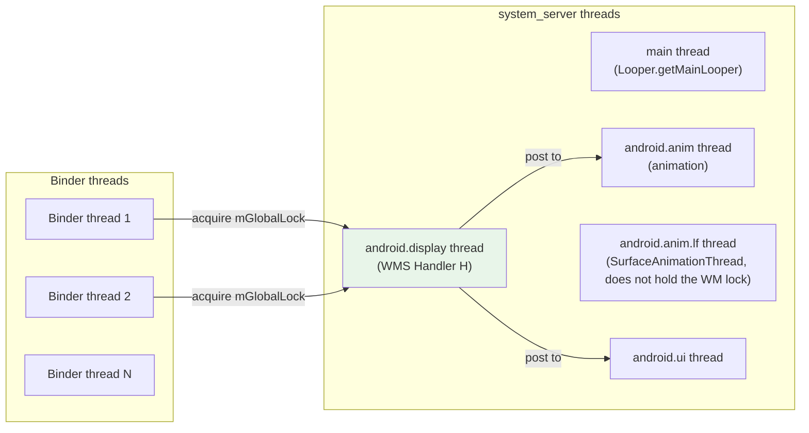

关键的线程模型规则：

1. **所有 WMS 状态修改**都在持有 `mGlobalLock` 时发生
2. **Binder 调用**到达 Binder 线程，但会获取 `mGlobalLock`
3. **Handler H** 在显示线程上处理延迟操作
4. **动画工作**被派发到动画线程
5. **SurfaceFlinger 事务**可以从任意线程提交（它们是无锁的）

### 22.5.6 Window Surface Placer

`WindowSurfacePlacer` 负责触发布局遍历：

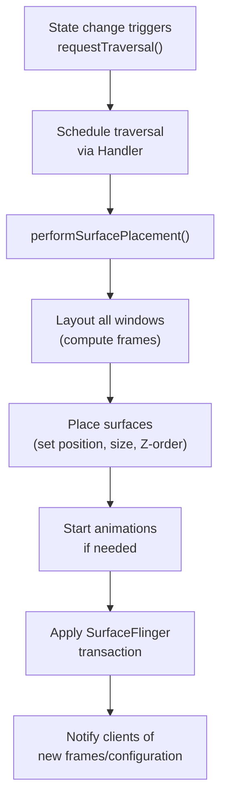

### 22.5.7 焦点管理

WMS 维护着“焦点窗口”的概念——即接收键盘输入的窗口。焦点更新通过
`updateFocusedWindowLocked()` 进行：

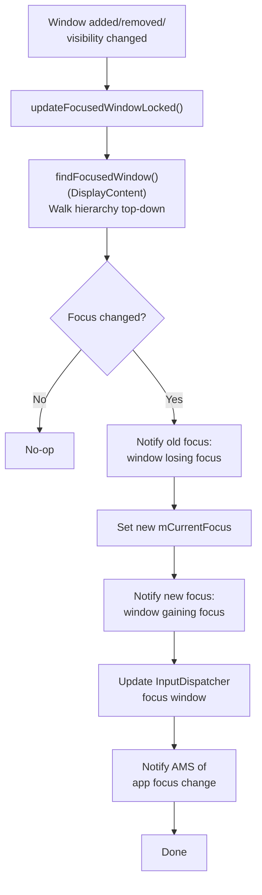

焦点计算会从上到下遍历窗口层级，寻找第一个满足以下条件的窗口：

1. 可以接收焦点（未设置 `FLAG_NOT_FOCUSABLE`）
2. 可见
3. 属于当前用户（或是一个系统窗口）

### 22.5.8 PriorityDumper

WMS 提供三个优先级级别的诊断 dump：

```java
// line 551
private final PriorityDump.PriorityDumper mPriorityDumper = new PriorityDump.PriorityDumper() {
    @Override
    public void dumpCritical(...) {
        doDump(fd, pw, new String[] {"-a"}, asProto);
    }

    @Override
    public void dumpHigh(...) {
        // Dump visible activities and window clients
        mAtmService.dumpActivity(fd, pw, "all", ...);
        dumpVisibleWindowClients(fd, pw, timeoutMs);
    }

    @Override
    public void dump(...) {
        doDump(fd, pw, args, asProto);
    }
};
```

这种三层方式确保了关键的诊断数据可以被快速收集（用于 ANR dump），而完整的 dump 可供
更深入的调试使用。

---

## 22.6 Intent 解析与 Activity 启动

### 22.6.1 显式 Intent 与隐式 Intent

当调用 `startActivity()` 时，系统必须确定哪个 Activity 应该处理该
intent。这通过 `ResolveInfo` 查询来完成。

**显式 intent** 指定了确切的组件：
```java
// Component is set -- resolution is direct
Intent intent = new Intent(context, DetailActivity.class);
```

**隐式 intent** 描述一个动作，让系统去寻找匹配项：
```java
// No component -- PackageManager resolves
Intent intent = new Intent(Intent.ACTION_VIEW, uri);
```

### 22.6.2 解析流水线

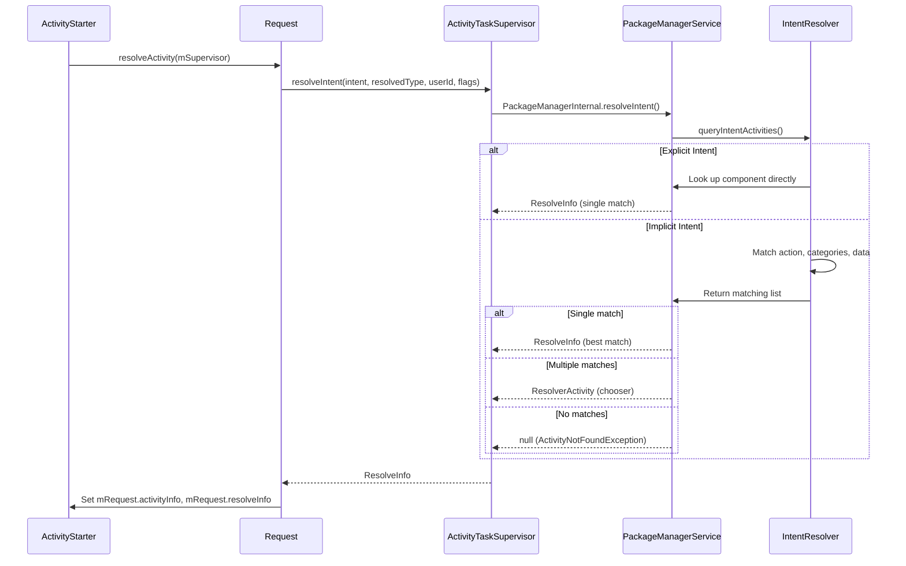

### 22.6.3 ActivityStarter 流水线各阶段

`ActivityStarter`（第 175 行）通过一条定义良好的流水线处理每个启动请求：

```java
// frameworks/base/services/core/java/com/android/server/wm/ActivityStarter.java, line 175
class ActivityStarter {
    private final ActivityTaskManagerService mService;          // line 194
    private final RootWindowContainer mRootWindowContainer;     // line 195
    private final ActivityTaskSupervisor mSupervisor;           // line 196
    private final ActivityStartInterceptor mInterceptor;        // line 197
    private final ActivityStartController mController;           // line 198
```

ActivityStarter 使用**对象池**模式以避免分配：

```java
// line 332
static class DefaultFactory implements Factory {
    private final int MAX_STARTER_COUNT = 3;
    private SynchronizedPool<ActivityStarter> mStarterPool =
            new SynchronizedPool<>(MAX_STARTER_COUNT);

    @Override
    public ActivityStarter obtain() {
        ActivityStarter starter = mStarterPool.acquire();
        if (starter == null) {
            if (mService.mRootWindowContainer == null) {
                throw new IllegalStateException("Too early to start activity.");
            }
            UserHelper userHelper = android.multiuser.Flags.hsuAllowlistActivities()
                    ? new UserHelper(mService.getUserManagerInternal())
                    : null;
            starter = new ActivityStarter(mController, mService, mSupervisor, mInterceptor,
                    userHelper);
        }
        return starter;
    }
}
```

对象池最多保存 3 个实例，因为最多只能有 3 个同时处于活动状态。它们是：最近一次完成的
starter（用于日志）、当前的 starter，以及由当前 starter 派生的可重入 starter。

### 22.6.4 computeLaunchingTaskFlags()

该方法（第 3026 行）通过调整 intent 标志，决定 Activity 将落在哪个 Task 中：

```java
// frameworks/base/services/core/java/com/android/server/wm/ActivityStarter.java, line 3026
private void computeLaunchingTaskFlags() {
```

实现的关键规则：

1. **无来源 + 无显式 task**——强制设置 `FLAG_ACTIVITY_NEW_TASK`：
   ```java
   if (mSourceRecord == null) {
       if ((mLaunchFlags & FLAG_ACTIVITY_NEW_TASK) == 0 && mInTask == null) {
           Slog.w(TAG, "startActivity called from non-Activity context; forcing "
                   + "Intent.FLAG_ACTIVITY_NEW_TASK for: " + mIntent);
           mLaunchFlags |= FLAG_ACTIVITY_NEW_TASK;
       }
   }
   ```

2. **来源是 singleInstance**——新 Activity 必须进入它自己的 Task：
   ```java
   } else if (mSourceRecord.launchMode == LAUNCH_SINGLE_INSTANCE) {
       mLaunchFlags |= FLAG_ACTIVITY_NEW_TASK;
   }
   ```

3. **目标是 singleInstance/singleTask**——总是获得自己的 Task：
   ```java
   } else if (isLaunchModeOneOf(LAUNCH_SINGLE_INSTANCE, LAUNCH_SINGLE_TASK)) {
       mLaunchFlags |= FLAG_ACTIVITY_NEW_TASK;
   }
   ```

4. **LAUNCH_ADJACENT**——需要同时设置 `NEW_TASK` 和来源记录。在
    Android 17 中，该分支还尊重按 Task 的退出选项。即便标志已设置，如果来源 Task（或其任一祖先）
    设置了 `isLaunchAdjacentDisabled()`，请求也会被降级：
   ```java
   if ((mLaunchFlags & FLAG_ACTIVITY_LAUNCH_ADJACENT) != 0) {
       final boolean hasNewTaskFlag = (mLaunchFlags & FLAG_ACTIVITY_NEW_TASK) != 0;
       if (!hasNewTaskFlag || mSourceRecord == null) {
           mLaunchFlags &= ~FLAG_ACTIVITY_LAUNCH_ADJACENT;
       }
       if (mSourceRecord != null && mSourceRecord.getTask() != null
               && mSourceRecord.getTask().isLaunchAdjacentDisabled()) {
           mLaunchFlags &= ~FLAG_ACTIVITY_LAUNCH_ADJACENT;
       }
   }
   ```

### 22.6.5 computeTargetTask()

该方法（第 2306 行）确定要复用的已有 Task（新建 Task 时返回 null）：

```java
// frameworks/base/services/core/java/com/android/server/wm/ActivityStarter.java, line 2306
private Task computeTargetTask() {
    if (mStartActivity.resultTo == null && mInTask == null && !mAddingToTask
            && (mLaunchFlags & FLAG_ACTIVITY_NEW_TASK) != 0) {
        // A new task should be created instead of using existing one.
        return null;
    } else if (mSourceRecord != null) {
        return mSourceRecord.getTask();        // Same task as caller
    } else if (mInTask != null) {
        // Explicit task specified (from AppTaskImpl)
        if (!mInTask.isAttached()) {
            getOrCreateRootTask(mStartActivity, mLaunchFlags, mInTask, mOptions);
        }
        return mInTask;
    } else {
        // Fallback: use the top task of a new/existing root task
        final Task rootTask = getOrCreateRootTask(mStartActivity, mLaunchFlags,
                null, mOptions);
        final ActivityRecord top = rootTask.getTopNonFinishingActivity();
        if (top != null) {
            return top.getTask();
        } else {
            rootTask.removeIfPossible("computeTargetTask");
        }
    }
    return null;
}
```

决策树：

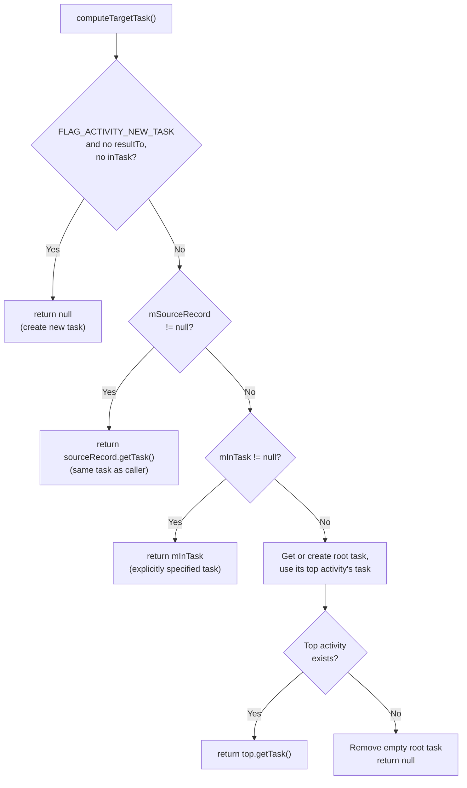

### 22.6.6 启动模式详解

启动模式（来自 `AndroidManifest.xml`）从根本上影响 Activity 在 Task 中的放置方式：

| 启动模式 | 标志 | 行为 |
|-------------|------|----------|
| `standard` | Default | 在调用者的 Task 中创建新实例 |
| `singleTop` | `LAUNCH_SINGLE_TOP` | 如果已在 Task 顶部则复用（调用 `onNewIntent()`） |
| `singleTask` | `LAUNCH_SINGLE_TASK` | 每个 Task 一个实例；把 Task 带到前台 |
| `singleInstance` | `LAUNCH_SINGLE_INSTANCE` | 在自己的独占 Task 中一个实例 |
| `singleInstancePerTask` | `LAUNCH_SINGLE_INSTANCE_PER_TASK` | 每个 Task 一个实例，但允许多个 Task |

```mermaid
graph TB
    subgraph "standard"
        S_T1["Task"]
        S_A["Activity A"]
        S_B["Activity B"]
        S_A2["Activity A (new)"]
        S_T1 --> S_A
        S_A --> S_B
        S_B --> S_A2
    end

    subgraph "singleTop"
        ST_T1["Task"]
        ST_A["Activity A"]
        ST_B["Activity B &#9888;"]
        ST_T1 --> ST_A
        ST_A --> ST_B
        ST_B -.->|"if B at top:<br/>onNewIntent()"| ST_B
    end

    subgraph "singleTask"
        STK_T1["Task"]
        STK_A["Activity A &#9888;"]
        STK_B["Activity B"]
        STK_T1 --> STK_A
        STK_A --> STK_B
        STK_A -.->|"clear above,<br/>onNewIntent()"| STK_A
    end

    subgraph "singleInstance"
        SI_T1["Task 1"]
        SI_A["Activity A"]
        SI_T2["Task 2 (exclusive)"]
        SI_B["Activity B"]
        SI_T1 --> SI_A
        SI_T2 --> SI_B
    end
```

### 22.6.7 后台 Activity 启动（BAL）限制

从 Android 10 开始，除非满足特定条件，应用不能从后台启动
Activity。`BackgroundActivityStartController` 会对一个 `BalVerdict` 求值：

```java
// ActivityStarter.java, line 213
@VisibleForTesting(visibility = VisibleForTesting.Visibility.PRIVATE)
BalVerdict mBalVerdict;
```

BAL 检查发生在 `isAllowedToStart()`（第 2359 行）中：

```java
boolean blockBalInTask = (newTask
        || !targetTask.isUidPresent(mCallingUid)
        || (LAUNCH_SINGLE_INSTANCE == mLaunchMode
            && targetTask.inPinnedWindowingMode()));

if (mBalVerdict.blocks() && blockBalInTask
        && handleBackgroundActivityAbort(r)) {
    Slog.e(TAG, "Abort background activity starts from " + mCallingUid);
    return START_ABORTED;
}
```

以下情况允许 BAL：

- 调用方应用拥有可见窗口
- 调用方应用有一个待处理的 Activity 结果
- 调用方应用最近拥有过可见 Activity
- 调用方应用被带有 `BIND_ALLOW_BACKGROUND_ACTIVITY_STARTS` 的系统服务绑定
- 调用方是设备所有者或资料所有者
- 调用方拥有 `START_ACTIVITIES_FROM_BACKGROUND` 权限

### 22.6.8 Activity 拦截器链

在一个 Activity 真正启动之前，一条拦截器链可以修改或阻止这次启动：

```java
// ATMS fields (line 528)
private SparseArray<ActivityInterceptorCallback> mActivityInterceptorCallbacks =
        new SparseArray<>();
```

拦截器的顺序由范围定义：

```java
// frameworks/base/services/core/java/com/android/server/wm/ActivityInterceptorCallback.java
// SYSTEM_FIRST_ORDERED_ID (0) through SYSTEM_LAST_ORDERED_ID for system
// MAINLINE_FIRST_ORDERED_ID (1000) through MAINLINE_LAST_ORDERED_ID for mainline
```

常见的拦截器包括：

1. **权限审查**——在需要时弹出运行时权限对话框
2. **被挂起的应用**——阻止被挂起应用的启动
3. **确认凭据**——处理工作资料解锁
4. **Dream**——处理在 dream/屏保期间的启动
5. **有害应用警告**——对侧载应用显示警告

### 22.6.9 Task 权重限制

一个重要的安全机制防止应用在单个 Task 中创建过多 Activity：

```java
// ActivityStarter.java, line 188
private static final long MAX_TASK_WEIGHT_FOR_ADDING_ACTIVITY = 300;

// in startActivityInner() (around line 2059)
if (targetTask != null) {
    if (targetTask.getTreeWeight() > MAX_TASK_WEIGHT_FOR_ADDING_ACTIVITY) {
        Slog.e(TAG, "Remove " + targetTask + " because it has contained too many"
                + " activities or windows (abort starting " + r
                + " from uid=" + mCallingUid);
        targetTask.removeImmediately("bulky-task");
        return START_ABORTED;
    }
}
```

“树权重”统计 Task 层级中所有的 Activity 与窗口。如果它超过
300，整个 Task 会被强制移除。这防止了恶意或有缺陷的应用耗尽系统资源（尤其是
SurfaceFlinger surface）。

---

## 22.7 进程管理

### 22.7.1 进程状态控制器（Android 17）

Android 17 把 OOM 调整机制从 `am` 包剥离出来，放进了新的
`com.android.server.am.psc`（Process State Controller）子包。这是自 AMS/ATMS
拆分以来进程管理领域最大的结构性变化。该包中的 README 直白地陈述了它的目标：隔离 OOM
调整器逻辑、暴露清晰的 `ProcessStateController` 接口，以及集中管理所有影响 OOM 调整的进程状态。

```
frameworks/base/services/core/java/com/android/server/am/psc/
    ProcessStateController.java   -- public entry point (builder + sessions)
    OomAdjuster.java              -- abstract OOM adjuster (line 190)
    OomAdjusterImpl.java          -- graph-based implementation (line 125)
    Constants.java                -- OOM adj + scheduling-group constants
    ProcessNode.java              -- a process in the importance graph
    GraphEdge.java                -- abstract directional edge base class
    ProcessEdge.java              -- intrinsic per-process edge (system -> process)
    ServiceBindingEdge.java       -- service binding edge (client -> service host)
    ProviderBindingEdge.java      -- provider binding edge (client -> provider host)
    CapabilityController.java     -- propagates capabilities across edges
    ProcessRecordInternal.java    -- per-process state owned by psc
    ...
```

AMS 不再直接构造 `OomAdjuster`。它改为构建一个
`ProcessStateController` 并从中获得调整器：

```java
// ActivityManagerService.java, lines 2600-2605
mProcessStateController = new ProcessStateController
        .Builder(mProcessList, activeUids, oomConstants, new OomAdjusterCallback())
        .setHandlerThread(handlerThread)
        .setHostingTypeProvider(this)
        .build();
mOomAdjuster = mProcessStateController.getOomAdjuster();
```

`ProcessStateController` 暴露了一个*会话* API 用于批量更新
（`startBatchSession()`、`startServiceBatchSession()`）以及更新入口点
（`runUpdate()`、`runPendingUpdate()`、`runFullUpdate()`、`runFollowUpUpdate()`）。以前直接操作
`OomAdjuster` 的调用方现在都改走控制器，由它保持一致的进程状态簿记。该包仍在增量落地中（由
AOSP 团队内部跟踪）。因此，一些逻辑仍留在传统的 `am` 类里。不过，常量、调整器和新的图模型已稳固地
落在 `psc` 中。

### 22.7.2 OOM 调整值

OOM 调整（oom_adj）值决定了低内存杀手守护进程（LMKD）终止一个进程的激进程度。
值越低意味着优先级越高。在 Android 17 中，这些常量从 `ProcessList` 迁移到了
`com.android.server.am.psc.Constants`：

```java
// frameworks/base/services/core/java/com/android/server/am/psc/Constants.java
public static final int SYSTEM_ADJ = -900;                       // line 173 - System process
public static final int PERSISTENT_PROC_ADJ = -800;              // line 170 - Persistent services
public static final int PERSISTENT_SERVICE_ADJ = -700;           // line 166 - Persistent bindings
public static final int FOREGROUND_APP_ADJ = 0;                  // line 162 - Current foreground app
public static final int PERCEPTIBLE_RECENT_FOREGROUND_APP_ADJ = 50;  // line 158 - Recently top, now FGS
public static final int VISIBLE_APP_ADJ = 100;                   // line 147 - Visible but not foreground
public static final int PERCEPTIBLE_APP_ADJ = 200;               // line 139 - Perceptible (e.g. BG music)
public static final int PERCEPTIBLE_MEDIUM_APP_ADJ = 225;        // line 134 - Perceptible medium
public static final int PERCEPTIBLE_LOW_APP_ADJ = 250;           // line 129 - Perceptible low
public static final int BACKUP_APP_ADJ = 300;                    // line 125 - Backup in progress
public static final int HEAVY_WEIGHT_APP_ADJ = 400;              // line 121 - Heavy-weight app
public static final int SERVICE_ADJ = 500;                       // line 116 - Background service
public static final int HOME_APP_ADJ = 600;                      // line 112 - Home app
public static final int PREVIOUS_APP_ADJ = 700;                  // line 102 - Previous app (quick switch)
public static final int SERVICE_B_ADJ = 800;                     // line 90  - Old service (B list)
public static final int CACHED_APP_MIN_ADJ = 900;                // line 77  - Cached app (invisible)
public static final int CACHED_APP_MAX_ADJ = 999;                // line 76
```

`ProcessList` 仍会导入它们（例如
`import static com.android.server.am.psc.Constants.CACHED_APP_MAX_ADJ;`），并在
`dumpsys activity oom` 中打印，但事实来源现在是 `psc`
包。

这就构成了一条优先级阶梯：

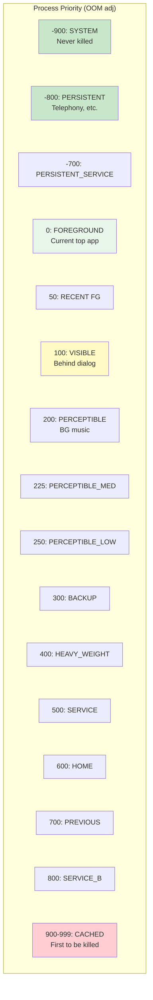

### 22.7.3 调度组

除了 OOM adj，进程还会被分配调度组，这会影响 CPU 分配。这些常量与 OOM
adj 值一起迁移到了 `psc/Constants.java`：

```java
// frameworks/base/services/core/java/com/android/server/am/psc/Constants.java, lines 192-206
public static final int SCHED_GROUP_UNDEFINED = Integer.MIN_VALUE;
public static final int SCHED_GROUP_BACKGROUND = 0;
static final int SCHED_GROUP_RESTRICTED = 1;
public static final int SCHED_GROUP_DEFAULT = 2;
public static final int SCHED_GROUP_TOP_APP = 3;
public static final int SCHED_GROUP_TOP_APP_BOUND = 4;
public static final int SCHED_GROUP_FOREGROUND_WINDOW = 5;
```

调度组直接映射到 Linux cgroup 设置：

- `SCHED_GROUP_BACKGROUND` -> `background` cgroup（受限 CPU）
- `SCHED_GROUP_DEFAULT` -> `foreground` cgroup（正常 CPU）
- `SCHED_GROUP_TOP_APP` -> `top-app` cgroup（优先 CPU，可能使用 FIFO 调度）

### 22.7.4 ProcessRecord 结构

每个运行中的进程都由一个 `ProcessRecord` 跟踪：

```java
// frameworks/base/services/core/java/com/android/server/am/ProcessRecord.java, line 91
class ProcessRecord extends ProcessRecordInternal implements WindowProcessListener,
        ... {
    final ActivityManagerService mService;       // where we came from
    volatile ApplicationInfo info;               // first app in the process
    final ProcessInfo processInfo;               // process-specific manifest info
    final boolean appZygote;                     // forked from the app zygote

    private UidRecord mUidRecord;
    private final PackageList mPkgList;
```

注意 `ProcessRecordInternal` 本身就是 Android 17 `psc`
重构的一部分——它位于 `com.android.server.am.psc`，并被导入到
`ProcessRecord`（`import com.android.server.am.psc.ProcessRecordInternal;`）。它
保存着 OOM 调整器在遍历重要性图时读取的进程状态。

ProcessRecord 字段跟踪：

- **身份**：UID、PID、进程名、应用信息
- **状态**：当前进程状态、OOM adj、调度组
- **组件**：运行中的 Activity、Service、Provider、Receiver
- **资源使用**：CPU 时间、内存、电量消耗
- **生命周期**：启动时间、死亡回调、崩溃历史

### 22.7.5 经由 Zygote 的进程启动

当某个尚不存在的进程需要启动一个新 Activity 时，系统会从 Zygote 中 fork 它。整个流程经由
`ProcessList.startProcess()`：

```java
// frameworks/base/services/core/java/com/android/server/am/ProcessList.java, line 2505
private Process.ProcessStartResult startProcess(HostingRecord hostingRecord,
        String entryPoint, ProcessRecord app, int uid, int[] gids,
        int runtimeFlags, int zygotePolicyFlags, int mountExternal,
        String seInfo, String requiredAbi, String instructionSet,
        String invokeWith, long startTime) {
```

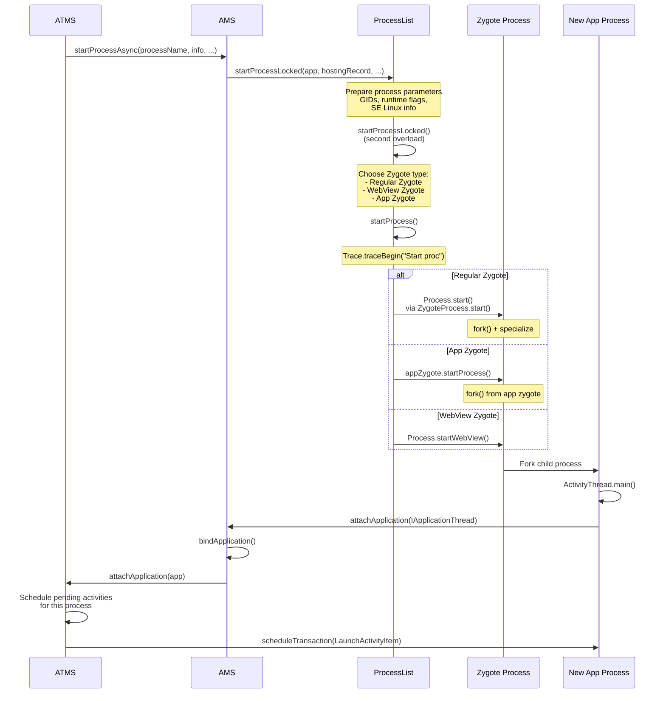

### 22.7.6 Zygote 策略标志

`startProcessLocked()` 方法使用定义在 `android.os.Process` 中的策略标志，向 Zygote 提示进程优先级：

```java
// frameworks/base/core/java/android/os/Process.java, lines 669-694
public static final int ZYGOTE_POLICY_FLAG_EMPTY = 0;
public static final int ZYGOTE_POLICY_FLAG_LATENCY_SENSITIVE = 1 << 0; // Top app
public static final int ZYGOTE_POLICY_FLAG_BATCH_LAUNCH = 1 << 1;      // Boot-time batch
public static final int ZYGOTE_POLICY_FLAG_SYSTEM_PROCESS = 1 << 2;    // System server
```

启动最顶部应用的进程时，会使用 `ZYGOTE_POLICY_FLAG_LATENCY_SENSITIVE` 来表示这次
fork 应当被优先处理。

### 22.7.7 ProcessList 与 LMKD 的通信

ProcessList 通过本地套接字与低内存杀手守护进程通信，使用一种二进制协议：

```java
// frameworks/base/services/core/java/com/android/server/am/ProcessList.java, lines 297-308
static final byte LMK_TARGET = 0;          // Set kill thresholds
static final byte LMK_PROCPRIO = 1;        // Set process priority
static final byte LMK_PROCREMOVE = 2;      // Process removed
static final byte LMK_PROCPURGE = 3;       // Purge all entries
static final byte LMK_GETKILLCNT = 4;      // Get kill count
static final byte LMK_SUBSCRIBE = 5;       // Subscribe to events
static final byte LMK_PROCKILL = 6;        // Kill notification (unsolicited)
static final byte LMK_UPDATE_PROPS = 7;    // Update properties
static final byte LMK_KILL_OCCURRED = 8;   // Kill event to subscribers
static final byte LMK_START_MONITORING = 9; // Start delayed monitoring
static final byte LMK_BOOT_COMPLETED = 10; // Boot completion signal
static final byte LMK_PROCS_PRIO = 11;     // Batch priority update
```

当 OOM adj 变化时，ProcessList 会向 LMKD 发送 `LMK_PROCPRIO` 命令，由后者把值写入
`/proc/<pid>/oom_score_adj`。当内存不足时，LMKD 会优先杀死 oom_score_adj 最高的进程。

### 22.7.8 OomAdjuster 与重要性图

在 Android 17 中，`OomAdjuster` 是 `psc` 包中的一个抽象类，具体逻辑在 `OomAdjusterImpl` 中：

```java
// frameworks/base/services/core/java/com/android/server/am/psc/OomAdjuster.java, line 190
public abstract class OomAdjuster {

// frameworks/base/services/core/java/com/android/server/am/psc/OomAdjusterImpl.java, line 125
public class OomAdjusterImpl extends OomAdjuster {
```

该实现把系统建模为一张**重要性图**。每个进程都是一个 `ProcessNode`（内嵌于它的
`ProcessRecordInternal` 中）。Service 或 Provider 绑定则是 `ServiceBindingEdge` /
`ProviderBindingEdge` 对象（抽象类 `GraphEdge` 的子类）。它们把一个客户端节点连接到一个服务端节点。
`ProcessEdge` 是从进程自身属性派生出的内在的系统到进程边。

`CapabilityController` 沿这些边遍历，把能力与重要性从客户端传播到它们所绑定的进程。
核心的每进程计算是 `OomAdjusterImpl.computeOomAdjLSP()`，经由
`performUpdateOomAdjLSP()` 到达。

计算会考虑：

1. **顶部 Activity**——运行最顶部可见 Activity 的进程获得
    `FOREGROUND_APP_ADJ`
2. **可见 Activity**——拥有可见但非顶部 Activity 的进程获得
    `VISIBLE_APP_ADJ`
3. **Service 绑定**——客户端重要性传播到 Service 进程
4. **前台 Service**——获得 `PERCEPTIBLE_APP_ADJ` 或类似值
5. **最近使用**——上一个应用获得 `PREVIOUS_APP_ADJ`
6. **Home 应用**——获得 `HOME_APP_ADJ`（特殊保护）
7. **缓存**——其他一切都落入缓存区间（900-999）

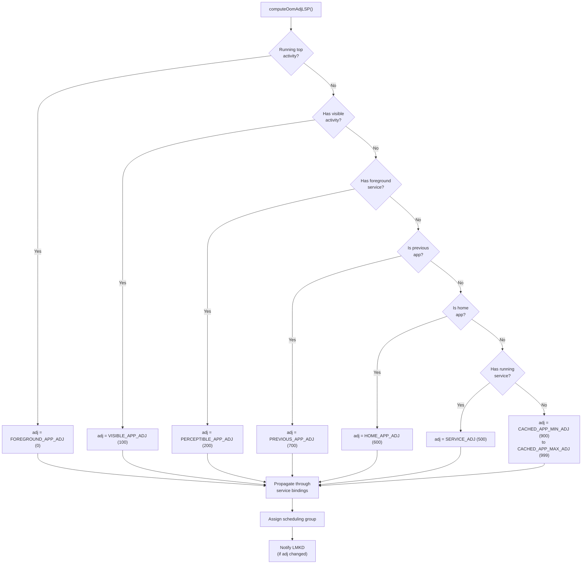

### 22.7.9 进程状态

除了 OOM adj，每个进程还有一个“进程状态”，通过 `ActivityManager.RunningAppProcessInfo`
上报给应用：

```java
// From ActivityManager.java (not in our files, but referenced)
PROCESS_STATE_TOP = 2;                    // Running the foreground activity
PROCESS_STATE_BOUND_TOP = 3;              // Bound to a top app
PROCESS_STATE_FOREGROUND_SERVICE = 4;     // Running a foreground service
PROCESS_STATE_BOUND_FOREGROUND_SERVICE = 5;
PROCESS_STATE_IMPORTANT_FOREGROUND = 6;   // Important foreground work
PROCESS_STATE_IMPORTANT_BACKGROUND = 7;   // Important background work
PROCESS_STATE_TRANSIENT_BACKGROUND = 8;   // Transient background
PROCESS_STATE_BACKUP = 9;                 // Backup operation
PROCESS_STATE_SERVICE = 10;               // Running a service
PROCESS_STATE_RECEIVER = 11;              // Executing a broadcast receiver
PROCESS_STATE_TOP_SLEEPING = 12;          // Top app while screen off
PROCESS_STATE_HEAVY_WEIGHT = 13;          // Heavy-weight process
PROCESS_STATE_HOME = 14;                  // Home process
PROCESS_STATE_LAST_ACTIVITY = 15;         // Has a recently-used activity
PROCESS_STATE_CACHED_ACTIVITY = 16;       // Cached with activity
PROCESS_STATE_CACHED_ACTIVITY_CLIENT = 17;
PROCESS_STATE_CACHED_RECENT = 18;         // Cached, in recents
PROCESS_STATE_CACHED_EMPTY = 19;          // Cached, no content
```

### 22.7.10 CachedAppOptimizer（冻结器）

现代 Android（11+）使用 CachedAppOptimizer 来冻结缓存进程：

```java
// ActivityManagerService.java, line 740
private CachedAppOptimizer mCachedAppOptimizer;
```

当一个进程变为缓存状态时，该优化器可以：

1. **压缩**它的内存（使用 `process_madvise` 进行 RSS 压缩）
2. 使用 cgroup freezer v2 **冻结**它，停止所有线程
3. 在需要时**解冻**它（例如收到广播、Service 绑定）

这通过阻止缓存应用消耗 CPU 周期，显著降低了功耗。

### 22.7.11 进程 LRU 列表

AMS 维护着所有进程的最近最少使用（LRU）列表。当系统需要决定杀死哪些进程时会用到该列表：

LRU 列表分为若干段：

1. **Activities**——拥有 Activity 的进程（列表前部 = 最近使用）
2. **Services**——运行 Service 的进程
3. **Other**——其他一切（列表后部 = 最久未使用）

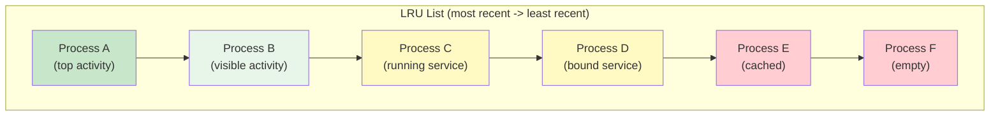

---

## 22.8 深入：setState() 方法与状态转换

理解 `ActivityRecord.setState()` 的工作原理至关重要，因为每一次生命周期转换都经由它进行。

### 22.8.1 setState() 实现

```java
// frameworks/base/services/core/java/com/android/server/wm/ActivityRecord.java, line 5732
void setState(State state, String reason) {
    ProtoLog.v(WM_DEBUG_STATES, "State movement: %s from:%s to:%s reason:%s",
            this, mState, state, reason);

    if (state == mState) {
        ProtoLog.v(WM_DEBUG_STATES, "State unchanged from:%s", state);
        return;
    }

    final State prevState = mState;
    mState = state;

    final TaskFragment taskFragment = getTaskFragment();
    if (taskFragment != null) {
        taskFragment.onActivityStateChanged(this, state, reason);
    }
    // ...
```

该方法在更新状态后执行以下关键动作：

1. **通知 TaskFragment**——包含它的 Task Fragment 需要知道状态变化，以管理自身的可见性与生命周期。

2. **更新 Service 连接可见性**——通过 `updateVisibleForServiceConnection()`。

3. **触发进程状态重算**——通过
    `mTaskSupervisor.onProcessActivityStateChanged(app, false)`。

4. **状态特定的副作用**（`switch (state)` 块）：

```java
switch (state) {
    case RESUMED:
        mAtmService.updateBatteryStats(this, true);
        mAtmService.updateActivityUsageStats(this, Event.ACTIVITY_RESUMED);
        // Fall through to STARTED
    case STARTED:
        // Update process info to foreground
        if (app != null) {
            app.updateProcessInfo(false, true, true, true);
        }
        mAtmService.mH.post(this::notifyActivityStartedToContentCaptureService);
        break;
    case PAUSED:
        mAtmService.updateBatteryStats(this, false);
        mAtmService.updateActivityUsageStats(this, Event.ACTIVITY_PAUSED);
        break;
    case STOPPING:
        // An activity can be STOPPED directly from RESUMED; record the PAUSED
        // usage in that case since it is conceptually cycled through PAUSED.
        if (prevState == RESUMED) {
            mAtmService.updateBatteryStats(this, false);
            mAtmService.updateActivityUsageStats(this, Event.ACTIVITY_PAUSED);
        }
        break;
    case STOPPED:
        mAtmService.updateActivityUsageStats(this, Event.ACTIVITY_STOPPED);
        // Remove from unknown app visibility controller
        break;
    case DESTROYED:
        if (app != null && (mVisible || mVisibleRequested)) {
            mAtmService.updateBatteryStats(this, false);
        }
        mAtmService.updateActivityUsageStats(this, Event.ACTIVITY_DESTROYED);
        break;
}
```

### 22.8.2 状态转换触发器

每个状态转换都由一个特定事件触发：

```mermaid
graph TD
    subgraph "Transition Triggers"
        T1["INITIALIZING -> STARTED<br/>Trigger: realStartActivityLocked()"]
        T2["STARTED -> RESUMED<br/>Trigger: completeResumeLocked()"]
        T3["RESUMED -> PAUSING<br/>Trigger: TaskFragment.startPausing()"]
        T4["PAUSING -> PAUSED<br/>Trigger: completePause()"]
        T5["PAUSED -> STOPPING<br/>Trigger: stopIfPossible()"]
        T6["STOPPING -> STOPPED<br/>Trigger: activityStopped()"]
        T7["* -> FINISHING<br/>Trigger: finishIfPossible()"]
        T8["FINISHING -> DESTROYING<br/>Trigger: destroyIfPossible()"]
        T9["DESTROYING -> DESTROYED<br/>Trigger: destroyed()"]
    end
```

### 22.8.3 电量与使用统计集成

注意 `setState()` 如何在每一次 RESUMED/PAUSED
转换时更新电量统计。Android 就是通过这种方式跟踪每个应用中
Activity 的耗电量。RESUMED 时对 `updateBatteryStats(this, true)` 的调用标记了前台使用的开始，而
PAUSED 时的 `updateBatteryStats(this, false)` 标记了结束。

类似地，`updateActivityUsageStats()` 向 UsageStatsManager 提供数据，应用可以查询它来了解使用模式。

---

## 22.9 高级：resumeTopActivity 流水线

### 22.9.1 递归恢复模式

恢复 Activity 是框架中最复杂的操作之一。入口点是
`Task.resumeTopActivityUncheckedLocked()`：

```java
// frameworks/base/services/core/java/com/android/server/wm/Task.java, line 5369
boolean resumeTopActivityUncheckedLocked(ActivityRecord prev, ActivityOptions options,
        boolean deferPause) {
```

该方法有重入保护：

```java
// line 297: Guard against recursive calls
boolean mInResumeTopActivity = false;
```

流程会沿 Task 层级向下传递：

```mermaid
sequenceDiagram
    participant RWC as RootWindowContainer
    participant DC as DisplayContent
    participant TDA as TaskDisplayArea
    participant Task as Task (root)
    participant LeafTask as Task (leaf)
    participant TF as TaskFragment
    participant AR as ActivityRecord
    participant ATS as ActivityTaskSupervisor

    RWC->>DC: resumeFocusedTasksTopActivities()
    DC->>TDA: getFocusedRootTask()
    TDA->>Task: resumeTopActivityUncheckedLocked()
    Note over Task: Check mInResumeTopActivity guard
    Task->>Task: resumeTopActivityInnerLocked()
    Task->>LeafTask: iterate children
    LeafTask->>TF: resumeTopActivity()
    TF->>AR: Find topRunningActivity()
    alt Activity already resumed
        TF-->>Task: false (nothing to do)
    else Activity needs resume
        TF->>AR: Check if process exists
        alt Process alive
            TF->>AR: makeActiveIfNeeded()
            Note over TF: scheduleTransactionItem(ResumeActivityItem)<br/>via ClientLifecycleManager
        else Process dead
            TF->>ATS: startSpecificActivity(r, ...)
            Note over ATS: Will fork via Zygote
        end
    end
```

### 22.9.2 先暂停再恢复协议

在新 Activity 恢复之前，当前已恢复的 Activity 必须先暂停。这就是“先暂停再恢复”协议：

```mermaid
sequenceDiagram
    participant Framework as Framework (system_server)
    participant OldApp as Old Activity (App Process A)
    participant NewApp as New Activity (App Process B)

    Framework->>Framework: "TaskFragment.schedulePauseActivity(prev, userLeaving, ...)"
    Framework->>OldApp: "scheduleTransactionItem(PauseActivityItem)<br/>via ClientLifecycleManager"
    Note over OldApp: Activity.onPause() executes
    OldApp->>Framework: activityPaused(token)
    Note over Framework: TaskFragment.completePause()<br/>Old activity now PAUSED

    Framework->>Framework: resumeTopActivityInnerLocked()
    alt New process exists
        Framework->>NewApp: scheduleTransactionItem(ResumeActivityItem)
        Note over Framework: via ClientLifecycleManager
        Note over NewApp: Activity.onResume() executes
        NewApp->>Framework: activityResumed(token)
    else New process needs start
        Framework->>Framework: startSpecificActivity()
        Note over Framework: Fork process via Zygote<br/>Wait for attachApplication()<br/>Then schedule launch
    end
```

暂停超时至关重要：如果旧 Activity 没有在 `PAUSE_TIMEOUT`（500ms）内响应
`activityPaused()`，框架会强制完成暂停并继续推进。这防止了挂起的应用阻塞所有 Task 切换。

### 22.9.3 空闲超时

在一个 Activity 启动后，框架会等待它报告空闲。
`ActivityTaskSupervisor` 管理这一过程：

```java
// frameworks/base/services/core/java/com/android/server/wm/ActivityTaskSupervisor.java, line 194
private static final int IDLE_TIMEOUT = 10 * 1000 * Build.HW_TIMEOUT_MULTIPLIER;
```

如果一个 Activity 在 10 秒内没有报告空闲，框架会在没有它的情况下继续推进。这个超时是兜底措施，
防止行为异常的应用永久阻塞 Activity 生命周期。

---

## 22.10 高级：recycleTask() 与 Intent 标志处理

### 22.10.1 recycleTask() 逻辑

当 `startActivityInner()` 找到一个可复用的已有 Task（通过
`resolveReusableTask()` 或 `computeTargetTask()`）时，它会调用 `recycleTask()`：

```java
// frameworks/base/services/core/java/com/android/server/wm/ActivityStarter.java, line 2511
int recycleTask(Task targetTask, ActivityRecord targetTaskTop, Task reusedTask,
        NeededUriGrants intentGrants) {
    // Should not recycle task from a different user
    if (targetTask.mUserId != mStartActivity.mUserId) {
        mTargetRootTask = targetTask.getRootTask();
        mAddingToTask = true;
        return START_SUCCESS;
    }

    if (reusedTask != null) {
        if (targetTask.intent == null) {
            // Assign base intent from affinity-based movement
            targetTask.setIntent(mStartActivity);
        }
        // Handle FLAG_ACTIVITY_TASK_ON_HOME
    }
```

`recycleTask()` 中的关键操作：

1. **用户检查**——拒绝跨用户的 Task 复用
2. **Intent 分配**——如果 Task 是因亲和性迁移而被移动的，设置它的 base intent
3. **电源模式**——为本次启动启动电源模式
4. **目标根 Task**——在层级中定位该 Task
5. **`START_FLAG_ONLY_IF_NEEDED`**——如果该 Activity 已经在顶部，则短路返回
6. **标志处理**——处理 `CLEAR_TOP`、`SINGLE_TOP` 等
7. **启动窗口**——如果 Task 被移到了前台，显示启动画面
8. **Dream 关闭**——如果越过 Dream 启动，唤醒屏幕

返回值指示发生了什么：

```java
return mMovedToFront ? START_TASK_TO_FRONT : START_DELIVERED_TO_TOP;
```

### 22.10.2 标志处理：CLEAR_TOP 与 SINGLE_TOP

`complyActivityFlags()` 方法处理一整套丰富的 Intent 标志。最常见的组合：

| 标志 | 效果 |
|-------|--------|
| `NEW_TASK` | 创建或查找具有匹配亲和性的 Task |
| `NEW_TASK + CLEAR_TASK` | 清空该 Task 并重新开始 |
| `NEW_TASK + CLEAR_TOP` | 移除目标 Activity 之上的所有内容 |
| `SINGLE_TOP` | 如果已在顶部则复用，调用 onNewIntent() |
| `REORDER_TO_FRONT` | 把已有 Activity 移到 Task 顶部 |
| `NEW_DOCUMENT` | 创建新的文档 Task（多实例） |
| `MULTIPLE_TASK` | 总是创建新 Task（与 NEW_TASK 配合） |
| `LAUNCH_ADJACENT` | 在相邻的分屏窗口中启动 |
| `NO_ANIMATION` | 抑制过渡动画 |

### 22.10.3 deliverNewIntent 机制

当一个已有 Activity 收到新 intent（例如 singleTop 或
singleTask 重新投递）时，框架使用 `deliverNewIntentLocked()`
（`ActivityRecord.java`，第 5082 行）：

```mermaid
sequenceDiagram
    participant AS as ActivityStarter
    participant AR as ActivityRecord
    participant CLM as ClientLifecycleManager
    participant App as App Process

    AS->>AR: deliverNewIntentLocked(callingUid, intent, intentGrants, ...)
    AR->>AR: Grant URI permissions from intent
    alt RESUMED, PAUSED, or top while sleeping (and attached)
        AR->>CLM: scheduleTransactionItem(NewIntentItem)
        CLM->>App: schedule(ClientTransaction)
        App->>App: Activity.onNewIntent(intent)
    else Not currently visible
        AR->>AR: addNewIntentLocked(intent) -- queued for next resume
    end
```

在 Android 17 中，该方法通过一个 `NewIntentItem`
事务立即投递 intent。它仅在该 Activity 处于 `RESUMED`、`PAUSED`，或是锁屏背后的顶部
Activity，并且已挂接到它的进程时才这样做。否则，intent 会通过 `addNewIntentLocked()`
排队，并在该 Activity 下次恢复时投递。`NewIntentItem` 携带一个 `resume` 标志，因此客户端仅在
它原先已处于 RESUMED 时才回到 `RESUMED`，避免多余的、虚假的生命周期回调。

---

## 22.11 高级：多窗口与 TaskFragment 架构

### 22.11.1 TaskFragment：嵌入容器

现代 Android 支持 Activity 嵌入，即多个 Activity 可以在同一个 Task 中并排显示。这通过
`TaskFragment` 来管理：

```java
// frameworks/base/services/core/java/com/android/server/wm/TaskFragment.java, line 123
class TaskFragment extends WindowContainer<WindowContainer> {
```

`TaskFragment` 在层级中位于 `Task` 与 `ActivityRecord` 之间。一个 `Task`
可以包含多个 `TaskFragment` 对象，每个托管一个或多个 Activity：

```mermaid
graph TB
    Task["Task"]
    TF1["TaskFragment (Left)"]
    TF2["TaskFragment (Right)"]
    Task --> TF1
    Task --> TF2
    AR1["ActivityRecord A"]
    AR2["ActivityRecord B"]
    TF1 --> AR1
    TF2 --> AR2
```

### 22.11.2 TaskFragmentOrganizer

第三方库（比如 AndroidX Activity Embedding 库）通过 `TaskFragmentOrganizer`
API 与框架交互。这让应用可以：

1. 在它们的 Task 中创建 `TaskFragment` 容器
2. 指定 Activity 应如何在各 fragment 之间分配
3. 定义拆分比例与布局规则
4. 处理嵌入布局中的配置变化

```mermaid
sequenceDiagram
    participant App as App (Jetpack Library)
    participant TFO as TaskFragmentOrganizer
    participant WME as WindowOrganizerController
    participant Task as Task

    App->>TFO: registerOrganizer()
    TFO->>WME: Register via Binder
    App->>TFO: createTaskFragment(token, ...)
    TFO->>WME: applyTransaction(WindowContainerTransaction)
    WME->>Task: Create TaskFragment as child
    App->>TFO: startActivityInTaskFragment(tf, intent)
    TFO->>WME: OP_TYPE_START_ACTIVITY_IN_TASK_FRAGMENT
    WME->>Task: Start activity in specified TaskFragment
```

### 22.11.3 嵌入检查结果

在 TaskFragment 中启动 Activity 时，系统会检查兼容性：

```java
// TaskFragment.java, lines 155-175
static final int EMBEDDING_ALLOWED = 0;
static final int EMBEDDING_DISALLOWED_UNTRUSTED_HOST = 1;
static final int EMBEDDING_DISALLOWED_MIN_DIMENSION_VIOLATION = 2;
static final int EMBEDDING_DISALLOWED_NEW_TASK = 3;
```

这些检查防止：

- 不受信任的应用嵌入那些不允许不受信任嵌入的 Activity
- Activity 被嵌入到对其最小尺寸而言过小的容器中
- 在新 Task 上启动的 Activity 被嵌入

### 22.11.4 分屏与自由窗口

分屏模式通过窗口模式系统实现：

```java
// WindowConfiguration windowing modes
WINDOWING_MODE_UNDEFINED = 0;
WINDOWING_MODE_FULLSCREEN = 1;
WINDOWING_MODE_PINNED = 2;         // Picture-in-Picture
WINDOWING_MODE_FREEFORM = 5;       // Desktop-like floating
WINDOWING_MODE_MULTI_WINDOW = 6;   // Generic multi-window
```

每个 Task 都有一个窗口模式，决定它在屏幕上的布局方式。系统通过 `TaskDisplayArea`
协调这些模式：

```mermaid
graph TB
    TDA["TaskDisplayArea"]

    subgraph "Fullscreen Tasks"
        T1["Task 1 (FULLSCREEN)"]
    end

    subgraph "Split Tasks"
        T2["Task 2 (MULTI_WINDOW)"]
        T3["Task 3 (MULTI_WINDOW)"]
    end

    subgraph "Floating"
        T4["Task 4 (FREEFORM)"]
        T5["Task 5 (PINNED/PiP)"]
    end

    TDA --> T1
    TDA --> T2
    TDA --> T3
    TDA --> T4
    TDA --> T5
```

---
## 22.12 进阶：启动窗口（Splash Screen）

## 22.12 高级：启动窗口（Splash Screen）

### 22.12.1 用途与类型

一个 Activity 正在启动、尚未绘制出它的第一帧。在这种情况下，系统可以显示一个“启动窗口”
（splash screen），以提供即时的视觉反馈。有两种类型：

```java
// frameworks/base/services/core/java/com/android/server/wm/ActivityRecord.java, lines 400-402
static final int STARTING_WINDOW_TYPE_NONE = 0;
static final int STARTING_WINDOW_TYPE_SNAPSHOT = 1;
static final int STARTING_WINDOW_TYPE_SPLASH_SCREEN = 2;
```

- **SNAPSHOT**——使用该 Activity 上一次运行时的缓存截图。这为 Task 切换提供了最无缝的体验。
- **SPLASH_SCREEN**——显示一个基于 Activity 主题颜色和图标的主题化 splash 画面。

### 22.12.2 启动窗口流程

```mermaid
sequenceDiagram
    participant AS as ActivityStarter
    participant AR as ActivityRecord
    participant SSC as StartingSurfaceController
    participant Shell as SystemUI/Shell
    participant WMS as WMS

    AS->>AR: showStartingWindow(taskSwitch)
    AR->>AR: Decide: snapshot or splash?

    alt Snapshot available
        AR->>SSC: createTaskSnapshotSurface(activityRecord, snapshot)
        SSC->>Shell: Request snapshot window
        Shell->>WMS: addWindow(TYPE_APPLICATION_STARTING)
        WMS->>WMS: activity.attachStartingWindow(win)
    else Splash screen
        AR->>SSC: createSplashScreenStartingSurface(activityRecord, theme)
        SSC->>Shell: Request splash screen
        Shell->>Shell: Inflate themed splash layout
        Shell->>WMS: addWindow(TYPE_APPLICATION_STARTING)
    end

    Note over AR: App process starts, draws first frame
    AR->>AR: onFirstWindowDrawn()
    AR->>AR: removeStartingWindow()
    AR->>WMS: Remove starting window
```

### 22.12.3 addWindowInner() 中的启动窗口

当启动窗口被添加到 WMS 时，它会得到特殊处理：

```java
// WindowManagerService.java, in addWindowInner() (around line 2056)
if (type == TYPE_APPLICATION_STARTING && activity != null) {
    activity.attachStartingWindow(win);
    ProtoLog.v(WM_DEBUG_STARTING_WINDOW, "addWindow: %s startingWindow=%s",
            activity, win);
}
```

`attachStartingWindow()` 方法把该引用存储在 `ActivityRecord` 的
`mStartingWindow` 中，一旦真正的内容窗口绘制完成，这个窗口就会被移除。

---

## 22.13 高级：Window 布局引擎

### 22.13.1 WindowSurfacePlacer

`WindowSurfacePlacer` 是驱动窗口布局的引擎：

```java
// frameworks/base/services/core/java/com/android/server/wm/WindowSurfacePlacer.java, line 112
final void performSurfacePlacement() {
    performSurfacePlacement(false /* force */);
}
```

布局循环：

```mermaid
flowchart TD
    Request["requestTraversal()"] --> Schedule["Post to Handler"]
    Schedule --> Check["performSurfacePlacementIfScheduled()"]
    Check --> Loop["performSurfacePlacementLoop()"]
    Loop --> BeginTrace["Trace: performSurfacePlacement"]

    BeginTrace --> RootPerform["mService.mRoot.performSurfacePlacement()"]
    RootPerform --> LayoutAll["Layout all DisplayContent"]
    LayoutAll --> ApplyChanges["Apply surface transactions"]
    ApplyChanges --> CheckPending{"Pending changes?"}
    CheckPending -->|Yes| Loop
    CheckPending -->|No| Done["Layout complete"]

    Done --> EndTrace["End trace"]
```

布局变化会级联：更新一个窗口的布局会触发另一个窗口的变化。为了处理这种情况，遍历最多会被
重新请求 6 次（`++mLayoutRepeatCount < 6`）。之后，WMS 会放弃并记录 “Performed 6
layouts in a row. Skipping”。`LAYOUT_REPEAT_THRESHOLD`（4）从不限制该循环；它只是
`debugLayoutRepeats()` 开始输出 “Layouts looping” 日志行的调试日志阈值。

### 22.13.2 Display Policy

每个 `DisplayContent` 都有一个 `DisplayPolicy`，用于执行平台特定的布局规则：

- 状态栏的位置与尺寸
- 导航栏的位置与尺寸
- 系统手势区域
- 挖孔/刘海避让区域
- IME（输入法编辑器）的放置

在 `addWindow()` 期间会咨询 `DisplayPolicy`：

```java
// WMS.addWindow(), around line 1896
displayPolicy.adjustWindowParamsLw(win, win.mAttrs);
// ...
res = displayPolicy.validateAddingWindowLw(attrs, callingPid, callingUid);
```

在布局期间也是如此：

```java
// in addWindowInner()
displayPolicy.addWindowLw(win, attrs);
```

---

## 22.14 高级：配置变化的传播

### 22.14.1 配置层级

配置变化（屏幕旋转、字体缩放、语言环境、密度等）通过
`WindowContainer` 层级传播，其基础类是 `ConfigurationContainer`：

```mermaid
graph TB
    Global["Global Configuration<br/>(device-level)"]
    Display["Display Override Config<br/>(per-display density, etc.)"]
    Task["Task Config<br/>(windowing bounds)"]
    Activity["Activity Config<br/>(theme, local overrides)"]

    Global --> Display
    Display --> Task
    Task --> Activity

    Note1["Each level can override<br/>specific config fields"]
```

当全局配置发生变化（例如屏幕旋转）时，变化会自上而下地沿层级传播：

```mermaid
sequenceDiagram
    participant ATMS
    participant RWC as RootWindowContainer
    participant DC as DisplayContent
    participant Task
    participant AR as ActivityRecord
    participant App as App Process

    Note over ATMS: updateConfigurationLocked(newConfig)
    ATMS->>RWC: onConfigurationChanged(newConfig)
    RWC->>DC: onConfigurationChanged()
    DC->>Task: onConfigurationChanged()
    Task->>AR: onConfigurationChanged()
    AR->>AR: shouldRelaunchLocked()?

    alt Activity handles config change
        AR->>App: scheduleTransaction(ActivityConfigurationChangeItem)
        App->>App: onConfigurationChanged(newConfig)
    else Activity needs relaunch
        AR->>App: scheduleTransaction(DestroyActivityItem)
        Note over App: onDestroy()
        AR->>App: scheduleTransaction(LaunchActivityItem)
        Note over App: onCreate() with saved state
    end
```

### 22.14.2 合并配置

每个 `WindowContainer` 都会计算一个“合并配置”，把父级的配置与自身的覆盖项结合起来：

```java
// ConfigurationContainer.java
Configuration getMergedOverrideConfiguration() {
    // Returns the combination of all ancestor overrides + this container's overrides
}
```

这让每个层级都可以定制特定字段：

- **Display**：可以为外接显示覆盖密度
- **Task**：为自由形式/分屏窗口覆盖边界
- **Activity**：可以覆盖方向、最小屏幕宽度

### 22.14.3 Activity 重启决策

`shouldRelaunchLocked()` 检查会比较新旧配置，以确定 Activity 能否处理该变化：

```java
// Simplified logic
int changes = oldConfig.diff(newConfig);
int handledChanges = activityInfo.getRealConfigChanged();
boolean needsRelaunch = (changes & ~handledChanges) != 0;
```

如果 Activity 在其 manifest 中针对发生变化的配置字段声明了
`android:configChanges`，它会收到 `onConfigurationChanged()`，而不是被销毁并重建。

**Android 17：默认重启更少。**一旦
`enable_less_activity_recreation_on_config_change` 标志开启，系统对于一组低影响的配置
变化就不会再默认重建 Activity。这些变化是
`CONFIG_KEYBOARD`、`CONFIG_KEYBOARD_HIDDEN`、
`CONFIG_NAVIGATION`、`CONFIG_TOUCHSCREEN` 和
`CONFIG_COLOR_MODE`。在此变化之前，应用必须把这些项逐一列入
`android:configChanges` 才能避免重启。现在，不重启成了默认行为。应用可以用新的
`android:recreateOnConfigChanges` manifest 属性*主动选择重新开启*重建。

该属性与 `configChanges` 一起解析。在解析时，有效的已处理配置掩码是
`configChanges | ((~recreateOnConfigChanges) & RECREATE_ON_CONFIG_CHANGES_MASK)`，
因此应用*未*在 `recreateOnConfigChanges` 中列出的任意位都会被视为已处理（不重启）。

```java
// frameworks/base/core/java/com/android/internal/pm/pkg/component/ParsedActivityUtils.java
public static final int RECREATE_ON_CONFIG_CHANGES_MASK =
        ActivityInfo.CONFIG_MCC | ActivityInfo.CONFIG_MNC
                | (shouldSkipActivityRecreationOnConfigChange() ? (ActivityInfo.CONFIG_KEYBOARD
                | ActivityInfo.CONFIG_KEYBOARD_HIDDEN | ActivityInfo.CONFIG_NAVIGATION
                | ActivityInfo.CONFIG_TOUCHSCREEN | ActivityInfo.CONFIG_COLOR_MODE)
                : 0);
```

`shouldSkipActivityRecreationOnConfigChange()` 用两项条件来控制这些新位：窗口标志
`enable_less_activity_recreation_on_config_change` 以及兼容变更
`ActivityInfo.SKIP_ACTIVITY_RECREATION_ON_CONFIG_CHANGE`
（`454795633L`）。该兼容变更没有携带 `@EnabledAfter`/`@EnabledSince`
注解，因此它*不*受 target-SDK 门控。标志开启后，新的不重启默认行为适用于所有应用，
无论 target SDK 如何。不过，它声明为 `@Overridable`，因此可以按应用禁用——这一点与
22.32.5 节所述受 SDK-37 门控的
`DISABLE_OPT_OUT_UNIVERSAL_RESIZABLE_BY_DEFAULT` 不同。`CONFIG_MCC`/`CONFIG_MNC`
的默认值早于此改动，无论如何都会生效。

`CONFIG_UI_MODE` 被刻意*不*包含在这个掩码中。桌面停靠由客户端上一条独立的运行时路径处理。
当配置变化到达时，`ActivityThread.handleActivityConfigurationChanged()` 会调用
`shouldSkipActivityRelaunchWhenDocking()` 和
`onlyDeskInUiModeChanged()`。如果唯一的
`uiMode` 变化是进入或离开 `UI_MODE_TYPE_DESK`，它会把
`CONFIG_UI_MODE` 或入该 Activity 在这一决策中的 `handledConfigChanges`。
然后该 Activity 会收到 `onConfigurationChanged()` 而不是重启。这是
客户端进程中逐事件的运行时抑制，而不是解析期的掩码位，因此它保持与
`recreateOnConfigChanges` 相互独立。

服务端还有一个正确性保护。
`AppCompatRecreateOnConfigChangePolicy`（位于 `wm` 包）会检查该包的资源。当应用确实携带了
以该配置为限定符的备用资源时，它会把某个配置位重新加回重建掩码。它只会重新加入那五个被
skip 集合覆盖的位。因此它会寻找匹配的限定符：像 `-keyshidden` 这样的键盘隐藏目录，或像
`-widecg` 这样的色彩模式目录。（`-night` 是 `uiMode` 限定符，不是 `colorMode`，因此它不会
触发这一策略。）

其推理如下。一个加载了键盘或色彩模式特定资源的 Activity 仍然需要一次全新的
`onCreate()` 才能选用正确的资源。因此，只有当没有需要重新加载的配置特定内容时，才会跳过重启。

**来源：** `frameworks/base/core/res/res/values/attrs_manifest.xml`（the
`recreateOnConfigChanges` attr）、`frameworks/base/core/java/android/content/pm/ActivityInfo.java`、
`frameworks/base/services/core/java/com/android/server/wm/AppCompatRecreateOnConfigChangePolicy.java`、
`frameworks/base/core/java/android/app/ActivityThread.java`（the desk-docking
runtime suppression，`shouldSkipActivityRelaunchWhenDocking()` /
`onlyDeskInUiModeChanged()`）。

---

## 22.15 高级：Activity 系统中的 ANR 检测

### 22.15.1 ANR（应用无响应）触发点

Activity 系统中的 ANR 检测发生在多个位置：

1. **输入分发超时**——聚焦窗口默认 5 秒
2. **广播超时**——前台 10s，后台 60s
3. **Service 超时**——前台 20s，后台 200s
4. **Content Provider 超时**——进程启动后 10s 内发布

具体到 Activity，关键超时是：

```java
// ActivityRecord.java
private static final int PAUSE_TIMEOUT = 500;      // ms
private static final int STOP_TIMEOUT = 11 * 1000;  // ms
private static final int DESTROY_TIMEOUT = 10 * 1000; // ms

// ActivityManagerService.java
static final int PROC_START_TIMEOUT = 10 * 1000 * Build.HW_TIMEOUT_MULTIPLIER;
static final int BIND_APPLICATION_TIMEOUT = 15 * 1000 * Build.HW_TIMEOUT_MULTIPLIER;

// ActivityTaskManagerService.java
static final long INSTRUMENTATION_KEY_DISPATCHING_TIMEOUT_MILLIS = 60 * 1000;

// ActivityTaskSupervisor.java
private static final int IDLE_TIMEOUT = 10 * 1000 * Build.HW_TIMEOUT_MULTIPLIER;
```

### 22.15.2 输入 ANR 流程

```mermaid
sequenceDiagram
    participant Input as InputDispatcher (native)
    participant WMS
    participant AMS
    participant App

    Input->>App: Dispatch input event
    Note over Input: Start 5s timer
    Input->>Input: Wait for finish signal

    alt App responds in time
        App->>Input: finishInputEvent()
        Note over Input: Cancel timer
    else Timeout (5s)
        Input->>WMS: notifyWindowUnresponsive(token, pid, timeoutRecord)
        Note over WMS: InputManagerCallback -> AnrController
        WMS->>AMS: inputDispatchingTimedOut()
        AMS->>AMS: Collect stack traces
        AMS->>AMS: Show ANR dialog
        Note over AMS: User can: Wait / Close / Report
    end
```

### 22.15.3 The AnrController

ATMS 维护着一份已注册 `android.app.AnrController` 对象的列表：

```java
// ActivityTaskManagerService.java, line 587
@GuardedBy("itself")
private final List<AnrController> mAnrController = new ArrayList<>();
```

`android.app.AnrController` 是一个接口，用于延迟或抑制某个包的 ANR 对话框
（`getAnrDelayMillis()`、`onAnrDelayStarted()`、
`onAnrDelayCompleted()`），通过
`ActivityManagerInternal.registerAnrController()` 注册。代码库中的示例是
`StorageManagerService` 的 `ExternalStorageServiceAnrController`，当外部存储会话无响应时，它会
推迟对话框。不要把它与同名的 `com.android.server.wm.AnrController`
（WMS 的 `mAnrController` 字段）混淆——那是一个独立的类，负责如上图所示地路由输入分发
超时。

---

## 22.16 高级：Lock Task 模式

### 22.16.1 概览

Lock Task 模式把设备限制在一组白名单 Task 中。这用于
kiosk 模式应用、企业设备管理和教育部署。

```java
// ActivityTaskManagerService.java, line 526
private LockTaskController mLockTaskController;
```

### 22.16.2 Lock Task 级别

```java
// ActivityManager.java
LOCK_TASK_MODE_NONE = 0;     // Normal operation
LOCK_TASK_MODE_LOCKED = 1;   // Task is locked (started by app)
LOCK_TASK_MODE_PINNED = 2;   // Screen pinning (started by user)
```

### 22.16.3 Lock Task 强制执行

`LockTaskController` 在多个位置强制执行限制：

1. **Activity 启动**——`isAllowedToStart()` 检查
    `isLockTaskModeViolation()`：
   ```java
   // ActivityStarter.java, in isAllowedToStart() (around line 2396)
   if (!newTask) {
       if (mService.getLockTaskController().isLockTaskModeViolation(
               targetTask, isNewClearTask)) {
           return START_RETURN_LOCK_TASK_MODE_VIOLATION;
       }
   } else {
       if (mService.getLockTaskController().isNewTaskLockTaskModeViolation(r)) {
           return START_RETURN_LOCK_TASK_MODE_VIOLATION;
       }
   }
   ```

2. **Task 移除**——阻止把已锁定的 Task 从 Recents 中移除
3. **导航**——禁用 Home 与 Recents 按钮
4. **状态栏**——禁用通知栏与快捷设置
## 22.17 进阶：最近任务系统

---
## 22.17 高级：Recent Tasks 系统

### 22.17.1 RecentTasks 管理器

```java
// ActivityTaskManagerService.java, line 481
private RecentTasks mRecentTasks;
```

`RecentTasks` 类维护着 Recents（概览）屏幕上显示的 Task 有序列表。它处理：

- 当 Task 移到后台时把它们加入
- 当用户划掉它们时把它们移除
- 跨重启持久化 Task（用于冷启动 recents）
- 强制实施每个用户的 Task 上限
- 管理 Task 缩略图（截图）

### 22.17.2 Task 持久化

那些根 Activity 声明了 `android:persistableMode` 为
`persistRootOnly` 或 `persistAcrossReboots`（且其 intent 不携带
`FLAG_ACTIVITY_EXCLUDE_FROM_RECENTS`）的 Task，会以 XML 形式持久化到磁盘的
`/data/system_ce/<userId>/recent_tasks/` 下。持久化格式包括：

```xml
<task
    task_id="42"
    real_activity="com.example.app/.MainActivity"
    affinity="com.example.app"
    user_id="0"
    effective_uid="10094"
    last_time_moved="1679012345678">
    <intent .../>
    <activity id="0" ...>
        <intent .../>
    </activity>
</task>
```

### 22.17.3 Task 快照

系统会在 Task 移到后台时捕获它们的截图。这些快照用于：

1. Recents 轮播缩略图
2. 启动窗口快照（用于快速 Task 切换）
3. Splash 画面的替代方案

---

## 22.18 高级：可见性计算

### 22.18.1 ensureActivitiesVisible()

系统中最关键的操作之一是确定哪些 Activity 应该可见。这由
`RootWindowContainer.ensureActivitiesVisible()` 驱动：

```mermaid
flowchart TD
    Trigger["Activity state changed"] --> EAV["ensureActivitiesVisible()"]
    EAV --> ForEachDisplay["For each DisplayContent"]
    ForEachDisplay --> ForEachTask["For each root Task"]
    ForEachTask --> Walk["Walk task from top to bottom"]
    Walk --> CheckOcclusion{"Activity occludes<br/>below?"}
    CheckOcclusion -->|Yes| HideBelow["Make activities below invisible"]
    CheckOcclusion -->|No| ShowBelow["Activities below remain visible"]
    HideBelow --> UpdateVis["Update visibility state"]
    ShowBelow --> UpdateVis
    UpdateVis --> NotifyApps["Notify affected apps"]
```

如果一个 Activity 满足以下条件，它就“遮挡”了它下面的 Activity：

- 它是全屏的（不透明）
- 它不是 finishing 状态
- 它填满整个 Task 边界

半透明 Activity（对话框、悬浮窗口）允许它们背后的 Activity 保持可见。

### 22.18.2 occludesParent() 检查

```java
// ActivityRecord.java, line 662
private boolean mOccludesParent;
```

该字段基于以下因素设置：

- Activity 的主题（透明 vs. 不透明）
- 它是否填满父级边界
- 它是否带有 `windowIsFloating` 样式属性

在 Android 17 中，可见性与遮挡逻辑被抽取成了一个专门的
`WindowContainerVisibilityHelper` 接口
（`frameworks/base/services/core/java/com/android/server/wm/WindowContainerVisibilityHelper.java`）。
它把之前分散的三项计算集中了起来。它们是：`TaskFragment` 的可见性状态
（`getTaskFragmentVisibility()`）、`ActivityRecord` 是否应当可见
（`shouldActivityBeVisible()`），以及一个容器是否拥有填满它的内容。
`ActivityRecord.shouldBeVisible()` 和
`TaskFragment.getVisibility()` 现在委托给这个 helper，而不是各自定义一份规则副本。

### 22.18.3 TaskFragment 的可见性状态

```java
// TaskFragment.java
static final int TASK_FRAGMENT_VISIBILITY_VISIBLE = 0;
static final int TASK_FRAGMENT_VISIBILITY_VISIBLE_BEHIND_TRANSLUCENT = 1;
static final int TASK_FRAGMENT_VISIBILITY_INVISIBLE = 2;
```

---

## 22.19 性能考量

### 22.19.1 锁争用

`WindowManagerGlobalLock` 是系统中争用最严重的锁之一。对 WMS 和 ATMS 的每一次 Binder 调用都
必须获取它。尽量减少争用的策略：

1. **保持临界区简短**——把繁重的计算放到锁外执行
2. **批量 Surface 事务**——在单个
    `SurfaceControl.Transaction` 中提交多个更改
3. **延迟布局**——`WindowSurfacePlacer` 会批量处理布局请求
4. **无锁读取**——少数字段（比如 WMS 中的
    `mDisplayImePolicyCache`）是 volatile 的，因此热路径可以在不加锁的情况下读取它们

### 22.19.2 进程启动优化

Android 使用若干技术来加快进程创建：

1. **Zygote 预 fork**——Zygote 预加载常用类与资源
2. **USAP（Unspecialized App Process）**——预 fork 的进程，等待被专门化
3. **App Zygote**——每个应用的 zygote，缓存应用特定资源
4. **WebView Zygote**——用于 WebView 进程的专用 zygote
5. **进程池**——缓存的应用进程可以被复用

---

## 22.20 关键接口与 AIDL 契约

### 22.20.1 IActivityManager

应用用来与 AMS 通信的 AIDL 接口：

| 方法 | 用途 |
|--------|---------|
| `startService()` | 启动一个后台服务 |
| `bindService()` | 绑定到一个服务 |
| `broadcastIntent()` | 发送广播 |
| `getRunningAppProcesses()` | 查询运行中的进程 |
| `getMemoryInfo()` | 查询系统内存 |
| `setProcessImportant()` | 标记进程重要性 |
| `killBackgroundProcesses()` | 杀死缓存进程 |

### 22.20.2 IActivityTaskManager

用于 Activity 与 Task 操作的 AIDL 接口：

| 方法 | 用途 |
|--------|---------|
| `startActivity()` | 启动一个 Activity |
| `startActivities()` | 启动多个 Activity |
| `moveTaskToFront()` | 把 Task 带到前台 |
| `removeTask()` | 移除一个 Task |
| `getRecentTasks()` | 获取 recent tasks 列表 |
| `startSystemLockTaskMode()` | 为一个 Task 进入 lock task 模式 |

像 `finishActivity()` 和
`enterPictureInPictureMode()` 这类针对单个 Activity 的操作位于独立的
`IActivityClientController` 接口上（见 22.23.1 节）。

### 22.20.3 IWindowManager

用于窗口管理的 AIDL 接口：

| 方法 | 用途 |
|--------|---------|
| `openSession()` | 创建一个新的 Session |
| `addWindow()` | （经由 Session）添加一个窗口 |
| `remove()` | （经由 Session）移除一个窗口 |
| `relayoutWindow()` | （经由 Session）更新窗口布局 |
| `captureDisplay()` | 捕获显示截图 |
| `freezeRotation()` | 锁定屏幕旋转 |
| `refreshScreenCaptureDisabled()` | 重新应用 DPM 的截屏策略 |

### 22.20.4 IApplicationThread

系统用来驱动应用进程的回调接口：

| 方法 | 用途 |
|--------|---------|
| `scheduleTransaction()` | 执行生命周期事务 |
| `scheduleTrimMemory()` | 请求内存修剪 |
| `scheduleBindService()` | 绑定到一个服务 |
| `scheduleReceiver()` | 投递一个广播 |
| `dumpActivity()` | dump Activity 状态 |
| `scheduleSuicide()` | 强制进程退出 |
| `scheduleCreateService()` | 创建一个服务 |

---

## 22.21 常见调试模式

### 22.21.1 诊断缓慢的 Activity 启动

1. **检查 Perfetto trace**，看哪个阶段缓慢：
   ```
   adb shell am start -W -S <component>
   ```
    `-S` 标志会先强制停止应用，以获得一致的冷启动。

2. **在 trace 中检查锁争用**：
    寻找 system_server 中较长的 `monitor contention` 切片。

3. **检查进程启动时间**：
   ```bash
   adb logcat -s ActivityManager | grep "Start proc"
   ```
    如果 fork 耗时很高，检查是否配置了 USAP 池。

4. **检查 Application.onCreate()**：
    许多应用会在这里做繁重的初始化。查找 `bindApplication` 的耗时。

### 22.21.2 诊断窗口添加失败

`addWindow()` 的返回码指示了哪里出了问题：

| 返回码 | 常量 | 含义 |
|-------------|----------|---------|
| 0 | `ADD_OKAY` | 成功 |
| -1 | `ADD_BAD_APP_TOKEN` | 窗口类型的 Token 无效 |
| -2 | `ADD_BAD_SUBWINDOW_TOKEN` | 父窗口 Token 错误 |
| -3 | `ADD_NOT_APP_TOKEN` | 应用窗口使用了非 Activity Token |
| -4 | `ADD_APP_EXITING` | Activity 正在被移除 |
| -5 | `ADD_DUPLICATE_ADD` | 窗口已注册 |
| -6 | `ADD_STARTING_NOT_NEEDED` | 不需要启动窗口 |
| -7 | `ADD_MULTIPLE_SINGLETON` | 多个 singleton |
| -8 | `ADD_PERMISSION_DENIED` | 权限不足 |
| -9 | `ADD_INVALID_DISPLAY` | 显示不存在 |
| -10 | `ADD_INVALID_TYPE` | 窗口类型无效 |
| -11 | `ADD_INVALID_USER` | 用户 ID 无效 |

### 22.21.3 诊断 Activity 状态问题

```bash
# Check current activity state
adb shell dumpsys activity activities | grep -E "state=|State="

# Look for stuck transitions (container hierarchy + window state)
adb shell dumpsys activity containers
adb shell dumpsys window

# Check for pending operations
adb shell dumpsys activity starter
```

### 22.21.4 诊断 OOM 杀死

```bash
# Check recent kills
adb logcat -b events | grep "am_kill"

# Check current process priorities
adb shell dumpsys activity oom

# Check LMKD statistics
adb shell dumpsys activity lmk
```

---

## 交叉引用

本章提供了架构概览。以下章节建立在这些基础之上：

- **第 23 章：Window 系统深入剖析**——涵盖窗口布局
  计算、Surface 管理，以及 ViewRootImpl 渲染流水线。它还涵盖 insets 处理和在
  Android 13+ 中引入的 shell transitions 系统。

- **第 24 章：Display 与 Compositor 流水线**——涵盖 SurfaceFlinger
  内部实现、硬件合成、多显示支持、虚拟显示，
  以及 HWC（Hardware Composer）HAL 接口。

这三章之间的关系：

```mermaid
graph TB
    Ch22["Chapter 22<br/>Activity & Window Overview<br/>(This chapter)"]
    Ch23["Chapter 23<br/>Window System Deep Dive"]
    Ch24["Chapter 24<br/>Display & Compositor"]

    Ch22 -->|"Window hierarchy,<br/>addWindow flow"| Ch23
    Ch22 -->|"DisplayContent,<br/>surface basics"| Ch24
    Ch23 -->|"Surface transactions"| Ch24

    subgraph "Coverage"
        Ch15a["AMS/ATMS architecture<br/>Activity lifecycle<br/>Task hierarchy<br/>Process management<br/>startActivity pipeline"]
        Ch16a["Window layout engine<br/>ViewRootImpl<br/>Insets<br/>Shell transitions<br/>Input dispatch"]
        Ch17a["SurfaceFlinger<br/>HWC HAL<br/>VSync<br/>Buffer management<br/>Multi-display"]
    end

    Ch22 --- Ch15a
    Ch23 --- Ch16a
    Ch24 --- Ch17a

    style Ch22 fill:#e1f5fe
    style Ch23 fill:#fff3e0
    style Ch24 fill:#e8f5e9
```

---

## 22.22 高级：Transition 系统

### 22.22.1 Shell Transitions（Android 13+）

现代 Android 使用“Shell Transitions”来协调 Activity、Task 与 Window 之间的视觉过渡。
它取代了旧的 `AppTransition` 系统。

```mermaid
sequenceDiagram
    participant WMCore as WM Core
    participant TC as TransitionController
    participant Shell as SystemUI Shell
    participant SF as SurfaceFlinger

    WMCore->>TC: requestStartTransition(transition)
    TC->>TC: Collect participants<br/>(opening, closing, changing)
    TC->>TC: setReady() when all collected
    TC->>Shell: onTransitionReady(TransitionInfo)
    Note over Shell: Shell decides animation type:<br/>- open/close<br/>- task switch<br/>- PiP<br/>- split-screen
    Shell->>Shell: Create and run animation
    Shell->>SF: Apply surface changes via Transaction
    Shell->>TC: finishTransition(token)
    TC->>WMCore: Clean up transition state
```

### 22.22.2 TransitionInfo

传递给 Shell 的 `TransitionInfo` 对象包含：

- **类型**：OPEN、CLOSE、TO_FRONT、TO_BACK、CHANGE、PIP
- **标志**：KEYGUARD_GOING_AWAY、IS_RECENTS 等
- **变更**：`TransitionInfo.Change` 对象的列表，每个描述
    一个发生变化的容器（带有前后状态）

每个 `Change` 包括：

- `WindowContainerToken`
- 起始与结束边界
- 起始与结束旋转
- Window 配置
- Leash（用于动画的 SurfaceControl）

### 22.22.3 Transition 类型

```java
// WindowManager.java transit types
TRANSIT_OPEN = 1;          // Activity/task opening
TRANSIT_CLOSE = 2;         // Activity/task closing
TRANSIT_TO_FRONT = 3;      // Existing task coming to front
TRANSIT_TO_BACK = 4;       // Task going to back
TRANSIT_CHANGE = 6;        // Config change (rotation, bounds)
TRANSIT_PIP = 10;          // PiP transition
TRANSIT_START_LOCK_TASK_MODE = 15; // Entering lock task mode
```

### 22.22.4 动画控制器

Shell 为不同场景提供不同的动画控制器：

```mermaid
graph TB
    Trans["Transition Ready"]
    Trans --> Type{"Transition Type?"}

    Type -->|"Open/Close"| Default["DefaultTransitionHandler<br/>Fade + scale animations"]
    Type -->|"Task Switch"| Recents["RecentsTransitionHandler<br/>Recents animation"]
    Type -->|"PiP"| PiP["PipTransition<br/>Shrink/grow to PiP window"]
    Type -->|"Split"| Split["SplitScreenTransitions<br/>Split-screen animations"]
    Type -->|"Keyguard"| KG["KeyguardTransitionHandler<br/>Lock/unlock animations"]
    Type -->|"Unfold"| Unfold["UnfoldTransitionHandler<br/>Foldable unfold animation"]
```

---

## 22.23 高级：Activity Client Controller

### 22.23.1 IActivityClientController 接口

`ActivityClientController` 是客户端进程发起的 Activity 级操作的服务端端点：

```java
// ActivityTaskManagerService.java, line 427
ActivityClientController mActivityClientController;
```

该控制器处理以下操作：

- `activityPaused()`——客户端报告暂停完成
- `activityStopped()`——客户端报告停止完成
- `activityDestroyed()`——客户端报告销毁完成
- `activityResumed()`——客户端报告恢复完成
- `finishActivity()`——客户端请求结束一个 Activity
- `reportSizeConfigurations()`——客户端报告支持的尺寸范围
- `setRequestedOrientation()`——客户端请求方向锁定
- `convertToTranslucent()`——客户端变为半透明
- `convertFromTranslucent()`——客户端变为不透明
- `enterPictureInPictureMode()`——客户端进入 PiP

### 22.23.2 回调流程

```mermaid
sequenceDiagram
    participant App as App Process
    participant ACC as ActivityClientController (system_server)
    participant AR as ActivityRecord
    participant TF as TaskFragment

    Note over App: Activity.onPause() completes
    App->>ACC: activityPaused(token)
    ACC->>AR: activityPaused(false /* timeout */)
    AR->>TF: completePause(resumeNext=true, null)
    TF->>AR: setState(PAUSED, "completePausedLocked")
    TF->>TF: resumeTopActivity(...)
```

这展示了客户端驱动的生命周期回调如何回流到服务端状态机，从而触发下一次状态转换。

---

## 22.24 高级：ActivityTaskSupervisor

### 22.24.1 角色与职责

`ActivityTaskSupervisor`（第 184 行）充当 ATMS 与容器层级之间的协调层：

```java
// frameworks/base/services/core/java/com/android/server/wm/ActivityTaskSupervisor.java, line 184
public class ActivityTaskSupervisor implements RecentTasks.Callbacks {
```

关键职责：

- 管理 Activity 空闲队列
- 在进程中启动特定 Activity
- 处理等待中的 Activity（等待进程启动）
- 管理 Activity 的睡眠/唤醒状态
- 与 RecentTasks 回调协调

### 22.24.2 空闲队列

在一个 Activity 启动后，它必须在 `IDLE_TIMEOUT`（10s）内报告空闲：

```java
// line 194
private static final int IDLE_TIMEOUT = 10 * 1000 * Build.HW_TIMEOUT_MULTIPLIER;
```

空闲队列管理那些已启动但尚未完成初始化的 Activity。当所有 Activity 都报告空闲时，系统可以：

- 移除那些在启动期间被停止的 Activity
- 结束待处理的过渡
- 为转入后台的进程修剪内存

### 22.24.3 Handler

`ActivityTaskSupervisor` 拥有自己的 handler，用于延迟操作：

```java
// line 2813
private final class ActivityTaskSupervisorHandler extends Handler {
    @Override
    public void handleMessage(Message msg) {
        synchronized (mService.mGlobalLock) {
            if (handleMessageInner(msg)) {
                return;
            }
        }
    }
}
```

消息类型包括：

- `IDLE_TIMEOUT_MSG`——Activity 未报告空闲
- `IDLE_NOW_MSG`——强制进行空闲处理
- `SLEEP_TIMEOUT_MSG`——Activity 的睡眠超时
- `LAUNCH_TIMEOUT_MSG`——Activity 启动失败

---

## 22.25 高级：ActivityStartController

### 22.25.1 工厂与对象池模式

`ActivityStartController` 管理 `ActivityStarter` 实例的创建与回收：

```java
// ActivityTaskManagerService.java, line 527
private ActivityStartController mActivityStartController;
```

它提供 `obtainStarter()` 方法，应用通过 builder 模式与之交互：

```mermaid
graph LR
    ATMS["ATMS.startActivityAsUser()"]
    ASC["ActivityStartController"]
    Factory["ActivityStarter.DefaultFactory"]
    Pool["SynchronizedPool (max 3)"]
    Starter["ActivityStarter instance"]

    ATMS -->|"getActivityStartController()"| ASC
    ASC -->|"obtainStarter()"| Factory
    Factory -->|"acquire()"| Pool
    Pool -->|"existing or new"| Starter
    Starter -->|"after execute()"| Pool
```

### 22.25.2 Builder 模式的使用

`ActivityStarter` 使用流式 builder 模式进行配置：

```java
// Typical usage in ATMS (simplified)
getActivityStartController().obtainStarter(intent, "startActivityAsUser")
    .setCaller(caller)
    .setCallingUid(callingUid)
    .setCallingPid(callingPid)
    .setCallingPackage(callingPackage)
    .setRealCallingUid(realCallingUid)
    .setRealCallingPid(realCallingPid)
    .setResultTo(resultTo)
    .setResultWho(resultWho)
    .setRequestCode(requestCode)
    .setStartFlags(startFlags)
    .setActivityOptions(options)
    .setUserId(userId)
    .execute();
```

每个 setter 都返回 `ActivityStarter` 实例，从而支持链式调用。末尾的
`execute()` 调用会触发完整的启动流水线。

---

## 22.26 高级：DisplayContent 内部实现

### 22.26.1 Display Content 结构

每个 `DisplayContent` 管理一个完整的显示，带有自己的：

- Window 层级（组织为 DisplayArea）
- 输入分发器配置
- 焦点跟踪
- Wallpaper 控制器
- IME 控制器
- 旋转控制器

```java
// frameworks/base/services/core/java/com/android/server/wm/DisplayContent.java, line 299
class DisplayContent extends RootDisplayArea
        implements WindowManagerPolicy.DisplayContentInfo {
```

### 22.26.2 DisplayContent 关键字段

| 字段 | 用途 |
|-------|---------|
| `mDisplayInfo` | 物理显示属性（尺寸、密度、刷新率） |
| `getDefaultTaskDisplayArea()` | 访问应用 Task 主区域的入口 |
| `mDisplayPolicy` | 平台特定的布局策略 |
| `mInputMonitor` | 管理 InputDispatcher 的输入窗口列表 |
| `mCurrentFocus` | 当前聚焦的 WindowState |
| `mWallpaperController` | Wallpaper 定位与动画 |
| `mImeContainer` | IME（键盘）窗口管理 |
| `mPinnedTaskController` | PiP 窗口管理 |
| `mWinAddedSinceNullFocus` | 在没有焦点时添加的窗口 |

### 22.26.3 多显示支持

Android 通过多个 `DisplayContent` 对象支持多显示：

```mermaid
graph TB
    RWC["RootWindowContainer"]
    DC0["DisplayContent 0<br/>(Built-in screen)"]
    DC1["DisplayContent 1<br/>(HDMI output)"]
    DC2["DisplayContent 2<br/>(Virtual display)"]

    RWC --> DC0
    RWC --> DC1
    RWC --> DC2

    subgraph "Display 0 (Phone)"
        TDA0["TaskDisplayArea"]
        TDA0 --> T0["Home Task"]
        TDA0 --> T1["App Task"]
    end

    subgraph "Display 1 (External)"
        TDA1["TaskDisplayArea"]
        TDA1 --> T2["Presentation Task"]
    end

    subgraph "Display 2 (Virtual)"
        TDA2["TaskDisplayArea"]
        TDA2 --> T3["Cast Task"]
    end

    DC0 --> TDA0
    DC1 --> TDA1
    DC2 --> TDA2
```

虚拟显示被创建用于：

- 屏幕投射（Miracast、Chromecast）
- 媒体投影（屏幕录制）
- 虚拟设备测试
- 演示模式

---

## 22.27 高级：输入分发连接

### 22.27.1 输入通道

当通过 `addWindow()` 添加一个窗口时，如果该窗口接受输入，就会创建一个
`InputChannel`：

```java
// WMS.addWindow(), around line 1907
final boolean openInputChannels = (outInputChannel != null
        && (attrs.inputFeatures & INPUT_FEATURE_NO_INPUT_CHANNEL) == 0);
if (openInputChannels) {
    win.openInputChannel(outInputChannel);
}
```

`InputChannel` 是一对 Unix 域套接字端点：

- **服务端**——由 system_server 中的 InputDispatcher 持有
- **客户端**——通过 Binder 调用送回应用进程

```mermaid
graph LR
    subgraph "App Process"
        VRI["ViewRootImpl"]
        IC_C["InputChannel<br/>(client end)"]
        IER["InputEventReceiver"]
        VRI --> IC_C --> IER
    end

    subgraph "system_server"
        ID["InputDispatcher"]
        IC_S["InputChannel<br/>(server end)"]
        ID --> IC_S
    end

    IC_S <-.->|"Unix domain socket"| IC_C

    subgraph "InputFlinger (native)"
        IR["InputReader"]
        IR --> ID
    end
```

### 22.27.2 输入焦点与窗口顺序

InputDispatcher 需要知道哪些窗口在屏幕上，以及它们的先后顺序。这通过 `InputMonitor` 传递：

```java
// Called after window changes
displayContent.getInputMonitor().setUpdateInputWindowsNeededLw();
```

`InputMonitor` 收集所有可见窗口及其边界，然后通过
`InputManagerService` 把这些信息发送给原生 `InputDispatcher`。

### 22.27.3 Spy 窗口与输入特性

窗口可以带有特殊的输入特性：

```java
// WindowManager.LayoutParams (frameworks/base/core/java/android/view/WindowManager.java)
INPUT_FEATURE_NO_INPUT_CHANNEL = 1 << 0;       // No input
INPUT_FEATURE_SPY = 1 << 2;                    // Spy on input (see events but don't consume)
INPUT_FEATURE_SENSITIVE_FOR_PRIVACY = 1 << 3;  // Mark as sensitive
INPUT_FEATURE_DISPLAY_TOPOLOGY_AWARE = 1 << 4; // Cross-display topology
```

Spy 窗口被 SystemUI 用于手势检测（边缘滑动、通知下拉）——它们能看到所有输入事件，
但不会消费它们。

---

## 22.28 Activity/Window 系统中的设计模式

### 22.28.1 容器树模式

整个窗口层级使用树模式，其中每个节点：

- 有且仅有一个父节点（根节点除外）
- 可以有多个子节点
- 自上而下传播配置变化
- 自下而上聚合状态（例如可见性）
- 拥有一个用于合成的 SurfaceControl

### 22.28.2 对象池/回收器模式

`ActivityStarter` 使用对象池来避免分配开销：
```java
private SynchronizedPool<ActivityStarter> mStarterPool =
        new SynchronizedPool<>(MAX_STARTER_COUNT);
```

类似地，`ClientTransaction` 对象以及各种其他框架对象也使用回收机制。

### 22.28.3 两阶段提交模式

Activity 启动使用两阶段方式：

1. **准备阶段**：验证、解析、检查权限（可能失败）
2. **提交阶段**：创建 Task、添加 Activity、调度恢复（不应失败）

`addWindow()` 第 1977 行处的注释 “From now on, no exceptions or errors allowed!” 标志着
这些阶段之间的边界。

### 22.28.4 延迟执行模式

WMS 中的许多操作会被延迟，而不是立即执行：

- 布局通过 `WindowSurfacePlacer.requestTraversal()` 延迟并批量处理
- 焦点更新在 surface placement 期间延迟
- Surface 事务被批量并原子提交

当多个变化快速连续发生时，这种批处理避免了冗余工作，从而提升了性能。

### 22.28.5 Token 模式

Android 广泛使用 Token 来保障安全：

- **Activity Token**——证明 Activity 存在的 IBinder 引用
- **Window Token**——证明某个进程被授权创建窗口
- **Session Token**——每个进程的连接身份
- **Transition Token**——跟踪进行中的窗口过渡

Token 是不可伪造的 Binder 对象——一个进程无法在系统先创建它的情况下创建一个有效的 Token。

---

## 22.29 关键术语表

| 术语 | 定义 |
|------|-----------|
| **AMS** | ActivityManagerService——管理进程、广播、服务 |
| **ATMS** | ActivityTaskManagerService——管理 Activity、Task、Recents |
| **WMS** | WindowManagerService——管理窗口、Surface、布局 |
| **ActivityRecord** | 运行中 Activity 的服务端表示 |
| **Task** | Activity 的栈（“返回栈”） |
| **TaskFragment** | Task 内用于 Activity 嵌入的子容器 |
| **WindowState** | 窗口的服务端表示 |
| **WindowToken** | 属于同一逻辑实体的窗口的分组 |
| **DisplayContent** | 物理或虚拟显示的表示 |
| **DisplayArea** | 显示内用于组织窗口的区域 |
| **TaskDisplayArea** | 应用 Task 所在的显示区域 |
| **RootWindowContainer** | 整个窗口/显示层级的根 |
| **Session** | 每个进程与 WMS 的连接 |
| **OOM adj** | Out-Of-Memory 调整——面向 LMKD 的进程优先级 |
| **LMKD** | Low Memory Killer Daemon |
| **BAL** | Background Activity Launch——对后台启动的限制 |
| **ProcessRecord** | AMS 的每进程簿记结构 |
| **WindowProcessController** | ATMS 的每进程跟踪结构 |
| **ClientTransaction** | 发送给应用进程的一组生命周期回调 |
| **Shell Transitions** | 窗口过渡的现代动画系统 |
| **PiP** | Picture-in-Picture 模式 |
| **Lock Task Mode** | 把设备限制在白名单 Task 的 kiosk 模式 |
| **SurfaceControl** | SurfaceFlinger 中某个合成 Surface 的句柄 |
| **InputChannel** | 用于投递输入事件的套接字对 |
| **ViewRootImpl** | 视图/窗口系统的客户端根 |
| **Zygote** | 所有应用进程都从它 fork 出来的父进程 |
| **USAP** | Unspecialized App Process——预 fork 的进程池 |

---

## 22.30 源码导航指南

对于想亲自探索源码的读者，这里有一份关键目录及其内容导览地图。

### 22.30.1 `am` 包

```
frameworks/base/services/core/java/com/android/server/am/
    ActivityManagerService.java    -- Main AMS class
    ProcessList.java               -- Process management + OOM adj values
    ProcessRecord.java             -- Per-process bookkeeping
    psc/OomAdjuster.java           -- OOM adjustment computation (abstract)
    psc/OomAdjusterImpl.java       -- OOM adjustment implementation
    psc/ProcessStateController.java -- Process state coordination
    psc/Constants.java             -- Process state controller constants
    CachedAppOptimizer.java        -- Freezer + compaction
    ActiveServices.java            -- Service lifecycle management
    BroadcastQueue.java            -- Broadcast dispatch
    BroadcastController.java       -- Broadcast coordination
    ContentProviderHelper.java     -- Content provider tracking
    ActivityManagerDebugConfig.java -- Debug flag configuration
    ActivityManagerConstants.java  -- Tunable constants
    UidRecord.java                 -- Per-UID state tracking
    PendingIntentRecord.java       -- Pending intent storage
    HostingRecord.java             -- Process hosting information
```

### 22.30.2 `wm` 包（Activity/Window）

```
frameworks/base/services/core/java/com/android/server/wm/
    ActivityTaskManagerService.java  -- Main ATMS class
    WindowManagerService.java        -- Main WMS class
    ActivityStarter.java             -- Activity launch pipeline
    ActivityRecord.java              -- Per-activity state
    Task.java                        -- Task (back stack)
    TaskFragment.java                -- Activity embedding container
    WindowState.java                 -- Per-window state
    WindowContainer.java             -- Base hierarchy class
    WindowToken.java                 -- Window grouping token
    RootWindowContainer.java         -- Hierarchy root
    DisplayContent.java              -- Per-display state
    DisplayArea.java                 -- Display area abstraction
    TaskDisplayArea.java             -- App task area
    ActivityTaskSupervisor.java      -- Activity coordination
    ActivityStartController.java     -- Starter factory
    ActivityStartInterceptor.java    -- Launch interception
    BackgroundActivityStartController.java -- BAL enforcement
    RecentTasks.java                 -- Recent tasks list
    LockTaskController.java          -- Lock task mode
    KeyguardController.java          -- Lock screen interaction
    Session.java                     -- Per-process WMS connection
    DisplayPolicy.java               -- Display layout policy
    WindowSurfacePlacer.java         -- Layout engine
    InputMonitor.java                -- Input dispatch configuration
    TransitionController.java        -- Shell transitions
    BackNavigationController.java    -- Predictive back gesture
    ClientLifecycleManager.java      -- Lifecycle callback dispatch
    WindowManagerConstants.java      -- Tunable WM constants
    SensitiveContentPackages.java    -- Privacy-sensitive content tracking
    StartingSurfaceController.java   -- Splash screen management
    AppCompatController.java         -- App compatibility
    LaunchParamsController.java      -- Launch positioning
    WindowProcessController.java     -- ATMS's per-process state
```

### 22.30.3 客户端代码

```
frameworks/base/core/java/android/app/
    Activity.java                    -- The Activity base class
    ActivityThread.java              -- Main thread of app process
    Instrumentation.java             -- Activity instrumentation
    ClientTransactionHandler.java    -- Handles lifecycle transactions
    servertransaction/
        ClientTransaction.java       -- Transaction container
        LaunchActivityItem.java      -- Launch callback
        ResumeActivityItem.java      -- Resume request
        PauseActivityItem.java       -- Pause request
        StopActivityItem.java        -- Stop request
        DestroyActivityItem.java     -- Destroy request
        NewIntentItem.java           -- New intent delivery
        TransactionExecutor.java     -- Executes transactions

frameworks/base/core/java/android/view/
    WindowManager.java               -- Window management API
    WindowManagerGlobal.java         -- Global window tracking (client)
    WindowManagerImpl.java           -- Per-context implementation
    ViewRootImpl.java                -- Root of client view hierarchy
    IWindowManager.aidl              -- WMS Binder interface
    IWindowSession.aidl              -- Session Binder interface
    IWindow.aidl                     -- Client window callback
    SurfaceControl.java              -- Surface management API
```

### 22.30.4 关键 AIDL 文件

```
frameworks/base/core/java/android/app/
    IActivityManager.aidl            -- AMS interface
    IActivityTaskManager.aidl        -- ATMS interface
    IApplicationThread.aidl          -- Callback to app process

frameworks/base/core/java/android/view/
    IWindowManager.aidl              -- WMS interface
    IWindowSession.aidl              -- Per-process session
    IWindow.aidl                     -- Per-window callback
```

### 22.30.5 新贡献者的阅读顺序

如果你是初次接触这个代码库，我们推荐按以下顺序阅读文件：

1. **从层级开始**：`WindowContainer.java`（基类）->
    `WindowToken.java` -> `ActivityRecord.java`（关键实体）

2. **理解容器树**：`RootWindowContainer.java` ->
    `DisplayContent.java` -> `TaskDisplayArea.java` -> `Task.java`

3. **跟踪一次 startActivity 调用**：`ActivityTaskManagerService.java`
    （`startActivityAsUser`）-> `ActivityStarter.java`（`execute()` ->
    `executeRequest()` -> `startActivityInner()`）

4. **跟踪一次窗口添加**：`Session.java`（`addToDisplay()`）->
    `WindowManagerService.java`（`addWindow()`）

5. **理解进程管理**：`ProcessList.java`（OOM adj 值，
    `startProcessLocked()`）-> `ProcessRecord.java`

---

## 22.31 常见问题

### Q：为什么 AMS 和 ATMS 是两个独立的服务，而不是一个？

**A**：这一拆分同时服务于软件工程和运行时两方面的目标。单体式的 AMS 体量庞大、关注点混杂：
既管进程生命周期（CPU、内存、OOM），又管以 UI 为中心的 Activity 管理（Task、栈、过渡）。把它们分开：

- 降低了每个单独类的复杂度
- 让 ATMS 可以共享 WM 锁（消除跨锁死锁）
- 使 Activity/Window 的耦合在包结构中显式化
- 使进程管理与 Activity 管理可以独立测试

### Q：为什么 ATMS 位于 `wm` 包而不是 `am`？

**A**：ATMS 必须与 WMS 持有同一个锁，因为 Activity 与 Window 的操作是紧密耦合的。把
ATMS 放在 `wm` 包让这种耦合显式化，并避免了不必要的跨包依赖。

### Q：系统如何决定是创建新 Task 还是复用已有的？

**A**：`ActivityStarter.startActivityInner()` 中的决策树会考虑：

1. `FLAG_ACTIVITY_NEW_TASK` 标志
2. Activity 的 `launchMode`（standard、singleTop、singleTask、singleInstance）
3. 来源 Activity 的启动模式
4. 是否指定了显式的 `inTask`
5. Task 亲和性匹配（通过 `resolveReusableTask()`）
6. `FLAG_ACTIVITY_CLEAR_TOP` 与 `FLAG_ACTIVITY_CLEAR_TASK` 标志

### Q：如果 Activity 没有响应 `onPause()` 会怎样？

**A**：`PAUSE_TIMEOUT`（500ms）会触发。框架会以 `resumeNext=true` 调用
`TaskFragment.completePause()`，这会强制认为暂停已完成，并继续恢复下一个 Activity。那个缓慢的
应用之后可能会收到 ANR，如果它同时也没有响应输入事件的话。

### Q：系统如何在内存压力下决定杀死哪个进程？

**A**：`OomAdjuster` 会基于每个进程正在做的事情（运行前台 Activity、可见 Activity、Service、
什么也没做）计算一个 `oom_score_adj`。该值会被写入 `/proc/<pid>/oom_score_adj`。当内存不足时，
Linux 内核的 OOM killer（或 LMKD）会优先杀死 `oom_score_adj` 最高的进程。取值范围是 -1000
（永不杀死）到 1000（最先杀死），应用的值通常从 0（前台）到 999（缓存）。

### Q：来自不同应用的两个 Activity 可以在同一个 Task 里吗？

**A**：可以。假设应用 A 在没有 `FLAG_ACTIVITY_NEW_TASK` 的情况下启动了应用 B 中的一个 Activity。
如果应用 B 的 Activity 具有匹配的 `taskAffinity`，这个新 Activity 就会加入应用 A 的 Task。
这是显式 intent 的默认行为。分享面板、浏览器以及许多其他跨应用流程正是这样工作的。

### Q：一个 Task 中最多能有多少个 Activity？

**A**：没有严格的最大数量限制，但 `ActivityStarter` 会强制实施一个 300 的“树权重”上限
（`MAX_TASK_WEIGHT_FOR_ADDING_ACTIVITY`）。它会统计 Task 中所有的 Activity 与窗口。如果超过
该值，整个 Task 会被移除，以防止资源耗尽。

### Q：ActivityRecord 与 WindowState 是什么关系？

**A**：`ActivityRecord` 继承 `WindowToken`，而后者继承
`WindowContainer<WindowState>`。这意味着一个 ActivityRecord 就是一个
WindowToken，并且直接包含 WindowState 子节点。当一个 Activity 创建窗口（它的主窗口、对话框、
弹出窗口）时，这些窗口会成为容器树中 ActivityRecord 的子节点。这让系统获得了自动清理能力：移除一个
ActivityRecord 就会移除它的所有窗口。

---

## 22.32 Android 17：WM Core 中的桌面窗口化

桌面窗口化——可自由移动、可缩放的应用窗口，带有标题、任务栏，并且（越来越多地）跨外接显示拥有多个
桌面——已在多个版本中逐步成熟。在 Android 17 中，这一工作有很大一部分落在了 WM core
本身，而不仅仅是 Shell 中。本节介绍位于
`frameworks/base/services/core/java/com/android/server/wm` 的部分。

### 22.32.1 桌面模式门控

一台设备以及某次启动能否使用桌面窗口化，由 `DesktopModeHelper` 决定：

```java
// frameworks/base/services/core/java/com/android/server/wm/DesktopModeHelper.java, line 100
public static boolean canEnterDesktopMode(@NonNull Context context) {
    return (isDeviceEligibleForDesktopMode(context)
            && DesktopModeFlags.ENABLE_DESKTOP_WINDOWING_MODE.isTrue())
            || isDesktopModeEnabledByDevOption(context);
}
```

设备资格综合了多个配置资源和开发者选项：

| 辅助方法 | 检查内容 |
|---------------|----------------|
| `isDesktopModeSupported()` | `R.bool.config_isDesktopModeSupported` |
| `canInternalDisplayHostDesktops()` | `R.bool.config_canInternalDisplayHostDesktops` |
| `isDesktopModeSupportedOnInternalDisplay()` | 限制关闭，或内部显示可以托管 |
| `isDeviceEligibleForDesktopMode()` | 受支持，或通过开发者选项启用 |
| `shouldEnforceDeviceRestrictions()` | `ENFORCE_DEVICE_RESTRICTIONS` 常量，从系统属性 `persist.wm.debug.desktop_mode_enforce_device_restrictions` 读取（默认 `true`） |

功能标志本身被建模为枚举而不是原始布尔值：

- `DesktopModeFlags`（`frameworks/base/core/java/android/window/DesktopModeFlags.java`）
  封装了诸如 `ENABLE_DESKTOP_WINDOWING_MODE` 这类 trunk-stable 标志，暴露一个
  `isTrue()` 访问器，它同时尊重开发者选项的覆盖。
- `DesktopExperienceFlags`
  （`frameworks/base/core/java/android/window/DesktopExperienceFlags.java`）
  携带更广泛的“桌面体验”标志，包括面向桌面优先显示的多桌面激活标志。

Shell 侧的门控也经过了重构。旧的静态辅助类
`DesktopModeStatus`
（`frameworks/base/libs/WindowManager/Shell/shared/src/com/android/wm/shell/shared/desktopmode/DesktopModeStatus.java`）
现在已被标记为 `@Deprecated(forRemoval = true)`。它把调用者指向同一包中两个更新的共享接口。
`DesktopState` 说明设备和某个显示上有哪些功能可用，例如 `canEnterDesktopMode`。
`DesktopConfig` 保存按功能的调优，比如窗口装饰视图宿主池的大小。二者在 WM Shell、SystemUI 与
Launcher 之间共享，因此三者对桌面窗口化是否启用达成一致。

### 22.32.2 桌面窗口落在哪里：启动参数

当 Activity 在自由形式/桌面上下文中启动时，它的初始边界会在服务端计算。`LaunchParamsController`
为此注册了一个专用 modifier，注册在默认那个之后：

```java
// frameworks/base/services/core/java/com/android/server/wm/LaunchParamsController.java
void registerDefaultModifiers(ActivityTaskSupervisor supervisor) {
    final Context context = mService.mContext;
    registerModifier(new TaskLaunchParamsModifier(supervisor, context));
    registerModifier(new DesktopModeLaunchParamsModifier(context, supervisor,
            new DesktopModeCompatPolicy(context)));
}
```

`DesktopModeLaunchParamsModifier`
（`frameworks/base/services/core/java/com/android/server/wm/DesktopModeLaunchParamsModifier.java`）
继承 `DefaultLaunchParamsModifier` 并覆盖 `onCalculate()` 来为桌面窗口设定尺寸和位置。实际几何来自
`DesktopModeBoundsCalculator`
（`frameworks/base/services/core/java/com/android/server/wm/DesktopModeBoundsCalculator.java`），
它的 `calculateInitialBounds()` 会从稳定显示边界按
`DESKTOP_MODE_INITIAL_BOUNDS_SCALE` 缩放，推导出一个“理想”尺寸。它还为横屏应用预留了
`DESKTOP_MODE_LANDSCAPE_APP_PADDING`。

```mermaid
flowchart TD
    Start["startActivityInner() -> computeLaunchParams()"] --> LPC["LaunchParamsController.calculate()"]
    LPC --> M1["TaskLaunchParamsModifier<br/>(window layout prefs)"]
    M1 --> M2["DesktopModeLaunchParamsModifier.onCalculate()"]
    M2 --> Gate{"canEnterDesktopMode()<br/>and freeform context?"}
    Gate -->|No| Continue["RESULT_CONTINUE<br/>(use default bounds)"]
    Gate -->|Yes| Calc["DesktopModeBoundsCalculator<br/>.calculateInitialBounds()"]
    Calc --> Ideal["calculateIdealSize(stableBounds, scale)"]
    Ideal --> OutBounds["outParams.mBounds set"]
```

### 22.32.3 自由形式下的应用兼容性

由于桌面窗口可以取任意尺寸，app-compat 机制带有桌面感知的策略。`AppCompatConfiguration` 在构造时
缓存设备的桌面能力：

```java
// frameworks/base/services/core/java/com/android/server/wm/AppCompatConfiguration.java, line 409
mCanEnterDesktopMode = DesktopModeHelper.canEnterDesktopMode(mContext);
```

`AppCompatUtils.isInDesktopMode()` 在其父窗口模式为
`WINDOWING_MODE_FREEFORM` 且设备可以进入桌面模式时，把窗口视为处于桌面模式。
`DesktopAppCompatAspectRatioPolicy` 约束被 letterboxed 或固定宽高比的应用在桌面窗口内的尺寸设定方式。
这让传统应用在被拖入自由形式窗口时仍保持可用。

### 22.32.4 已连接显示与多桌面

Android 17 在*已连接显示*（在外接显示器上驱动一个桌面会话）和*多桌面*（每个显示拥有多个虚拟桌面）
上投入了大量工作。其中许多受 `DesktopExperienceFlags` 中的标志门控。服务端的管道沿用 22.26 节中
已有的多显示层级：每个外接显示都是 `RootWindowContainer` 之下的另一个
`DisplayContent`，拥有自己的 `TaskDisplayArea`。同一个启动参数流水线会把 Activity 定位到正确显示的
Task 区域中。跨显示移动通过过渡系统（22.22 节）协调。

对 WM core 的实际影响是，“哪个显示、哪个桌面、什么边界”的决策现在成了 Activity 启动的一等公民。
它不再是由 Shell 完全处理的事后想法。

一个显示也可以默认为*桌面优先*而非手机优先。该决策的 Shell 侧位于
`DesktopDisplayModeController`
（`frameworks/base/libs/WindowManager/Shell/src/com/android/wm/shell/desktopmode/desktopfirst/DesktopDisplayModeController.kt`）。
它把一个显示的根窗口模式设为自由形式，因此应用默认启动进一个桌面会话。
`DesktopFirstListenerManager` 跟踪对该模式感兴趣的监听者。

该行为受 `enable_desktop_first_*` 标志族门控，而在此类显示上的多桌面激活还受
`enable_multiple_desktops_default_activation_in_desktop_first_displays` 门控。
按显示的桌面布局通过 `DesktopPersistentRepository`
（`frameworks/base/libs/WindowManager/Shell/src/com/android/wm/shell/desktopmode/data/persistence/DesktopPersistentRepository.kt`）
跨会话保留。它把内存中的 `DesktopRepository` 状态序列化为由 DataStore 支持的
protobuf。这让重新连接的显示器能拿回它的桌面和窗口边界。

### 22.32.5 SDK 37：大屏上不可退出方向与可缩放性限制

大屏设备默认就已经忽略应用的方向请求。一个最小宽度至少为
`WindowManager.LARGE_SCREEN_SMALLEST_SCREEN_WIDTH_DP`（600dp）的 `DisplayContent` 会从
`getIgnoreOrientationRequest()` 返回 `true`，除非该行为已被关闭：

```java
// frameworks/base/services/core/java/com/android/server/wm/DisplayContent.java, line 7195
boolean getIgnoreOrientationRequest() {
    if (mHasSetIgnoreOrientationRequest) {
        return super.getIgnoreOrientationRequest();
    }
    // Large screen (sw >= 600dp) ignores orientation request by default.
    return isLargeScreen() && !mWmService.isIgnoreOrientationRequestDisabled();
}
```

当显示忽略方向请求时，应用会通过 manifest 中的 `screenOrientation` 和运行时的
`setRequestedOrientation()` 设置值。这些值不会改变窗口的方向。直到 Android 17，应用仍然可以退出匹配的
*可缩放性*限制。它们用包属性
`android.window.PROPERTY_COMPAT_ALLOW_RESTRICTED_RESIZABILITY`
来实现这一点。该属性让一个不可缩放的 Activity（`resizeableActivity="false"`，或固定的
`minAspectRatio`/`maxAspectRatio`）保留其兼容性尺寸。该 Activity 随后不会被视为普遍可缩放。

对于面向 SDK 37（`Build.VERSION_CODES.CINNAMON_BUN`）的应用，这一退出机制被禁用。
`AppCompatResizeOverrides` 承载了该兼容变更：

```java
// frameworks/base/services/core/java/com/android/server/wm/AppCompatResizeOverrides.java, line 53
@ChangeId
@EnabledAfter(targetSdkVersion = Build.VERSION_CODES.BAKLAVA)
static final long DISABLE_OPT_OUT_UNIVERSAL_RESIZABLE_BY_DEFAULT = 447301631L;
```

`@EnabledAfter(BAKLAVA)`（SDK 36）意味着该变更对面向 SDK 37 及以上版本的应用生效。当它启用时，
`allowRestrictedResizability()` 在读取包属性之前就返回
`false`，因此
`PROPERTY_COMPAT_ALLOW_RESTRICTED_RESIZABILITY` 不再生效。该 Activity 在大屏上被视为普遍可缩放。它的
`resizeableActivity`、`minAspectRatio` 和 `maxAspectRatio` 声明不再像在旧 target SDK 上那样约束窗口。
上面既有的 `getIgnoreOrientationRequest()` 默认行为也同样适用。因此，一个在 >600dp 显示上的 SDK-37
应用不再能通过它以前使用的那些 manifest 和运行时旋钮来控制自己的方向或可缩放性。

这是第 62 章所涵盖的形态因素工作在 WM-core 一侧的内容。宽高比与 letterboxing
策略决定一个窗口最终如何设定尺寸。它们位于同一个 `wm`
包中相邻的 `AppCompat*` 类里（`AppCompatAspectRatioPolicy`、
`AppCompatAspectRatioOverrides`、`AppCompatOrientationPolicy`）。

### 22.32.6 可通过 RRO 调优的应用兼容性旋钮：相机兼容性与自杀恢复

某些应用兼容性行为留给 OEM 通过 overlay 或运行时资源覆盖（RRO）按设备调优，而不是做成编译期决策。
`AppCompatConfiguration` 在构造时从
`frameworks/base/core/res/res/values/config.xml` 读取若干布尔资源，因此一个重新定义这些布尔值的
overlay 无需改动框架代码就能改变行为。其中三个控制着在大屏和折叠屏上有意义的处理方式。

前两个管辖*模拟请求方向*的相机兼容处理。假设一个固定方向的 Activity 在一个忽略方向请求的显示上打开了相机。
那么相机传感器缓冲区和应用窗口可能对“哪边是上”存在分歧。结果就是取景器横过来或被拉伸。
`AppCompatCameraSimReqOrientationPolicy` 会把该 Activity letterbox 到它预期的方向。它还会调整相机与
显示旋转信号，以匹配应用在竖屏手机上会看到的样子。

两个资源为其门控：

```xml
<!-- frameworks/base/core/res/res/values/config.xml, line 6781, 6789 -->
<bool name="config_isCameraCompatSimulateRequestedOrientationTreatmentEnabled">true</bool>
<bool name="config_isCameraCompatSimReqOrientationLandscapeTreatmentEnabled">false</bool>
```

`AppCompatConfiguration` 在第 394 行把两者读入
`mIsCameraCompatSimReqOrientationTreatmentEnabled` 和
`mIsCameraCompatLandscapeTreatmentEnabled`。第一个是该处理的主开关，通过
`isCameraCompatSimReqOrientationTreatmentEnabled()` 查询，并被并入
`isAnyCameraCompatTreatmentEnabled()`。第二个把该处理扩展到横屏相机（硬编码竖屏传感器的应用）。根据
`isCameraCompatLandscapeTreatmentEnabled()` 的文档注释，它仅在第一个资源也为 true 时才生效，因为同一策略
同时适用于两者。相机 HAL 已经返回方向正确缓冲区的 OEM 可以在 overlay 中关闭该处理。拥有横屏传感器的
设备可以选用横屏变体。

第三个资源控制显示移动期间的*自杀恢复*。`AppCompatDisplayCompatPolicy` 会检测那些在跨显示移动时收到
配置变化就自行结束的应用。它把它们重新启动到新显示上，以保持会话存活。在两个内部显示之间的移动（折叠屏
上的折叠/展开过渡）通常是豁免的。这是因为两块物理面板通常共享大部分配置。当两块面板的差异足够大
（例如密度）以致该豁免引发问题时，OEM 可以移除它：

```xml
<!-- frameworks/base/core/res/res/values/config.xml, line 3553 -->
<bool name="config_enableSelfKillRecoveryBetweenInternalDisplays">false</bool>
```

`onMovedToDisplay()` 在旧显示和新显示都是 `TYPE_INTERNAL` 时会短路。例外情况是
`AppCompatConfiguration.isSelfKillRecoveryBetweenInternalDisplaysEnabled()`
（由该资源支持）返回 true。这时折叠过渡会像移动到外接显示器一样，运行同一个
`SelfKillStateMachine`。同一个策略类还为移动到或离开虚拟 Computer Control 显示命名了一个
Computer Control 兼容模式。该模式是用于游戏的显示兼容模式之外的补充。

## 22.33 动手实践：跟踪与调试

---
## 22.33 动手实践：追踪与调试

本节提供动手练习，用于观察 Activity 与 Window 管理系统的实际运行。

### 22.33.1 练习 1：用 dumpsys 检查 Window 层级

**目标**：检查实时的 Window 层级，理解容器树。

**第 1 步：dump Window 层级**

```bash
# Full window dump
adb shell dumpsys window windows

# More concise -- just the hierarchy
adb shell dumpsys window containers
```

**第 2 步：理解输出**

`dumpsys window containers` 的输出按深度缩进显示 WindowContainer 树。下面是一个带注释的示例：

```
ROOT type=undefined mode=fullscreen override-mode=undefined
  #0 Display 0 name="Built-in Screen"
    #2 Leaf:36:36 type=undefined
      #0 WindowToken{...} type=2024        <-- Navigation bar
    #1 DefaultTaskDisplayArea type=undefined
      #2 Task=1 type=home mode=fullscreen   <-- Home task
        #0 Task=7 type=home
          #0 ActivityRecord{... com.android.launcher3/.Launcher}
            #1 Window{... com.android.launcher3/...Launcher}
      #1 Task=42 type=standard             <-- App task
        #0 ActivityRecord{... com.android.settings/.Settings}
          #0 Window{... com.android.settings/.Settings}
      #0 Task=2 type=recents                <-- Recents
    #0 Leaf:0:1 type=undefined
      #0 WindowToken{...} type=2013        <-- Wallpaper
```

**第 3 步：dump Activity 栈**

```bash
# Activity-focused dump
adb shell dumpsys activity activities
```

这会显示：

- 所有显示区域及其 Task 栈
- 每个 Task 及其 Activity
- Activity 状态（RESUMED、PAUSED、STOPPED 等）
- Activity 标志与启动模式

**第 4 步：检查某个具体的 Activity**

```bash
# Dump details for a specific package
adb shell dumpsys activity activities | grep -A 20 "com.android.settings"
```

### 22.33.2 练习 2：监控 Activity 生命周期事件

**目标**：实时观察生命周期转换。

```bash
# Monitor ActivityManager events
adb logcat -s ActivityManager:I ActivityTaskManager:I

# Or use the more detailed WM tags
adb logcat -s "WindowManager:V" "ActivityTaskManager:V"
```

启动一个 Activity，观察日志输出：

```
I ActivityTaskManager: START u0 {cmp=com.android.settings/.Settings} from uid 2000
I ActivityTaskManager: Displayed com.android.settings/.Settings: +412ms
```

### 22.33.3 练习 3：检查进程优先级

**目标**：观察运行中进程的 OOM adj 值。

```bash
# View all processes and their OOM adj
adb shell dumpsys activity oom

# Or get the raw values from procfs
adb shell cat /proc/<pid>/oom_score_adj
```

`dumpsys activity oom` 的输出会按 OOM adj 桶对进程分组：

```
  FOREGROUND (0):
    proc #0: fore  T/A/T  trm: 0 12345:com.android.launcher3/u0a54 (top-activity)

  VISIBLE (100):
    proc #1: vis   A/S/-  trm: 0 12346:com.android.systemui/u0a38 (vis-activity)

  PERCEPTIBLE (200):
    proc #2: prcp  S/-/-  trm: 0 12347:com.android.music/u0a67 (fg-service)

  CACHED (900+):
    proc #5: cch+5 B/-/-  trm: 0 12350:com.example.app/u0a94 (cch-activity)
```

### 22.33.4 练习 4：强制触发一次配置变化

**目标**：观察框架如何处理配置变化。

```bash
# Rotate the screen
adb shell settings put system accelerometer_rotation 0
adb shell settings put system user_rotation 1  # landscape

# Watch the logs
adb logcat -s ActivityManager:I | grep -i config
```

你会看到：

1. 检测到配置变化
2. Activity 被销毁并重建（除非它们处理了该变化）
3. Window 布局重新计算

### 22.33.5 练习 5：用 am 命令检查 Task 状态

```bash
# List all tasks
adb shell am stack list

# Get task details
adb shell dumpsys activity recents

# Start an activity in a specific task
adb shell am start --task <taskId> -n com.android.settings/.Settings

# Move a task to front
adb shell am task focus <taskId>

# Remove a task
adb shell am stack remove <taskId>
```

### 22.33.6 练习 6：用 wm 命令进行窗口检查

```bash
# Get display info
adb shell wm size
adb shell wm density

# Override display size (useful for testing)
adb shell wm size 1080x1920
adb shell wm density 480

# Reset overrides
adb shell wm size reset
adb shell wm density reset

# Get surface flinger state
adb shell dumpsys SurfaceFlinger --list
```

### 22.33.7 面向框架开发者的调试提示

1. **开启详细的 WM 日志**：
   ```bash
   adb shell wm logging enable-text WM_DEBUG_ADD_REMOVE
   adb shell wm logging enable-text WM_DEBUG_FOCUS
   adb shell wm logging enable-text WM_DEBUG_STARTING_WINDOW
   ```

2. **捕获包含全部状态的 bug report**：
   ```bash
   adb bugreport > bugreport.zip
   ```
    该 bug report 包含所有相关服务的完整 `dumpsys` 输出。

3. **使用 `am monitor` 观察生命周期事件**：
   ```bash
   adb shell am monitor
   ```
    这会打开一个交互式监控器，显示 Activity 生命周期事件，并允许阻塞 Activity
    （对测试 ANR 处理很有用）。

4. **追踪特定的 Binder 调用**：
   ```bash
   adb shell atrace -t 5 am wm view > trace.txt
   ```

5. **检查 surface 层级**：
   ```bash
   adb shell dumpsys SurfaceFlinger
   ```
    这会显示所有 surface 层、它们的 Z 轴顺序以及缓冲区状态。

### 22.33.8 练习 7：检查桌面窗口化与 OOM 状态

**目标**：观察 Android 17 的桌面窗口化与进程状态机制。

```bash
# Is desktop windowing available on this build?
adb shell dumpsys window | grep -i desktop

# List tasks and their windowing modes (look for freeform mode)
adb shell dumpsys activity activities | grep -E "mode=|windowingMode"

# Force a task into freeform (on a device that supports desktop mode)
adb shell am stack list
adb shell wm get-multi-window-config   # inspect current multi-window config

# Process priorities now reported via the Process State Controller
adb shell dumpsys activity oom

# Check connected/external displays
adb shell dumpsys display | grep -E "Display id|mType|flags"
```

`dumpsys activity oom` 的输出仍然会打印 OOM adj 桶
（`FOREGROUND`、`VISIBLE`、`PERCEPTIBLE`、`CACHED` ……）。但在 Android 17 中，
`OomAdjusterImpl` 是在 `com.android.server.am.psc`
包内部计算这些值的。常量来自 `psc/Constants.java`。

---

## 小结

在本章中，我们探讨了 Android Activity 与 Window 管理的三大支柱：

1. **AMS 与 ATMS 架构**：进程管理（位于 `com.android.server.am` 的 AMS）与
    Activity/Task 管理（位于 `com.android.server.wm` 的 ATMS）之间的历史拆分。
    AMS 使用自己的 `ActivityManagerGlobalLock` 加 `mProcLock`，而 ATMS 与 WMS 共享
    `WindowManagerGlobalLock`。这个共享锁消除了 Activity 操作与 Window 操作之间的死锁，同时确保
    耦合状态变化的原子性。

2. **Activity 生命周期**：`ActivityRecord.State` 枚举，
    包含从 `INITIALIZING` 到 `DESTROYED` 的 11 个状态，外加
    `RESTARTING_PROCESS`。`ClientLifecycleManager` 通过 `ClientTransaction`
    对象驱动客户端进程中的状态转换。框架侧的超时保护防止挂起的应用：500ms 暂停、
    11s 停止、10s 销毁、10s 空闲。

3. **容器层级**：这个统一的树建立在 `WindowContainer`
    （第 117 行）之上。它从 `RootWindowContainer` 向下延伸，经过
    `DisplayContent`（继承自 `RootDisplayArea`）、`DisplayArea`、
    `TaskDisplayArea`、`Task`（继承 `TaskFragment`）、`TaskFragment`
    （继承 `WindowContainer`），以及 `ActivityRecord`（继承 `WindowToken`），
    直到 `WindowState`。这一优雅设计意味着 Activity 就是 Window
    Token，并且移除一个容器会自动移除它的所有后代。

4. **Window 添加流程**：从
    `WindowManager.addView()` 到 `ViewRootImpl.setView()`，
    再到 `Session.addToDisplay()`（Binder IPC），再到 `WMS.addWindow()`
    （第 1672 行）的路径。该方法执行大量验证（针对每种窗口类型的 Token 检查、权限验证、
    显示访问控制、重复检测）。它还执行设置（`WindowState` 创建、
    `InputChannel` 对、Surface 分配、策略配置）。在 Android 17 中，IME 窗口的挂接路径
    解析一个 `ImeWindowToken`，以在工作资料切换中存活。

5. **WMS 架构**：该服务拥有 `mWindowMap`（全局窗口
    注册表）和 `mSessions`（每进程连接）。它还拥有一个显示线程模型、五种焦点更新模式，以及
    `WindowSurfacePlacer` 布局引擎。`PriorityDumper` 以 critical/high/normal 优先级收集
    诊断数据。

6. **Intent 解析与启动流水线**：流程从
    `ATMS.startActivityAsUser()`（第 1302 行）开始。它继续经过
    `ActivityStarter` 流水线。首先是 `execute()`（第 837 行，metrics +
    HeavyWeight 检查）。然后是 `executeRequest()`（第 1087 行，验证 +
    权限 + 拦截器 + BAL 检查 + ActivityRecord 创建）。最后是 `startActivityInner()`
    （第 2015 行，`computeLaunchingTaskFlags()` +
    `computeTargetTask()` + Task 复用/创建 + 恢复）。五种启动模式、300 权重的 Task 上限、
    拦截器链，以及 move-to-front 决策逻辑。

7. **进程管理（psc 重构）**：在 Android 17 中，OOM 调整机制迁移到了新的
    `com.android.server.am.psc` 包。OOM adj 阶梯从 `SYSTEM_ADJ`
    （-900）经过 `FOREGROUND_APP_ADJ`（0）到
    `CACHED_APP_MAX_ADJ`（999），以及六个调度组，现在都位于
    `psc/Constants.java`。AMS 构建一个 `ProcessStateController`，并从中获得
    `OomAdjuster`（现在是抽象的，由 `OomAdjusterImpl` 实现一个基于图的重要性模型）。通过
    `ProcessList.startProcess()`（第 2505 行）进行的进程启动会从 Zygote（常规、app 或
    WebView）fork。与 LMKD 的通信通过本地套接字上的 12 条二进制协议命令进行。`CachedAppOptimizer`
    冻结器用于缓存进程的省电。

8. **高级主题**：`setState()` 的副作用
    以及电量/使用统计集成。递归的 `resumeTopActivity`
    流水线和先暂停再恢复协议。`recycleTask()` 机制与
    intent 标志处理。多窗口/TaskFragment 架构。

    启动窗口（splash screen）系统。`WindowSurfacePlacer` 布局循环。配置变化的传播。ANR 检测超时。
    Lock task 模式强制。Recent tasks 持久化系统。

    可见性计算使用 `ensureActivitiesVisible()`，现已重构进
    `WindowContainerVisibilityHelper`。Shell transitions（Android 13+）
    拥有自己的动画控制器。输入分发连接使用 `InputChannel`
    套接字对。设计模式也在整个系统中反复出现：容器树、对象池、两阶段提交、延迟执行，以及不可伪造的
    Binder Token。

9. **桌面窗口化（Android 17）**：逐步成熟的桌面窗口化路径。
    `DesktopModeFlags`/`DesktopExperienceFlags` 和
    `DesktopModeHelper.canEnterDesktopMode()` 为其设门控。服务端的启动定位使用
    `DesktopModeLaunchParamsModifier` 和
    `DesktopModeBoundsCalculator`。已连接显示与多桌面的工作通过专门的标志枚举跟踪。

下一章将深入探讨 Window 系统的机制。它涵盖帧是如何计算的，以及 Surface 是如何管理的。它还涵盖
新的 shell transitions 系统如何编排 Activity 与 Task 之间平滑的动画。
