# 第 51 章：AI 与应用功能

Android 已经从一个 merely（仅仅）_运行_应用的平台，演进为一个能够_理解_应用的平台。如今，一整套设备端智能服务将用户意图与应用行为连接起来。

**AppFunctions** 框架让助手可以通过类型化的 RPC 契约调用任意应用功能。**Computer Control** 为 AI 代理提供一块虚拟显示屏，供它们点击、滑动和截图。**OnDeviceIntelligence** 在隔离的沙箱中运行大型 ML 模型——LLM 以及其他生成式或大规模推理负载——。**NNAPI** 向任何原生负载暴露硬件加速器。再加上 AppSearch、Content Capture、AdServices 和联邦学习（Federated Learning），这些子系统共同构成了 Android 的 AI 神经系统。

本章追踪每一个层次。它从公共 SDK 类开始，向下穿过 AIDL 接口，接着进入 system_server 服务实现，最后延伸到另一端的沙箱进程或 HAL 进程。当前 AOSP 源码树中的真实文件支撑着每一条代码路径。

---

## 51.1 AOSP AI 全景

在详细考察任何一个框架之前，先一览 AOSP 的整个 AI / ML 表面是有帮助的。下图映射了主要子系统、它们跨越的进程边界，以及连接它们的数据流。

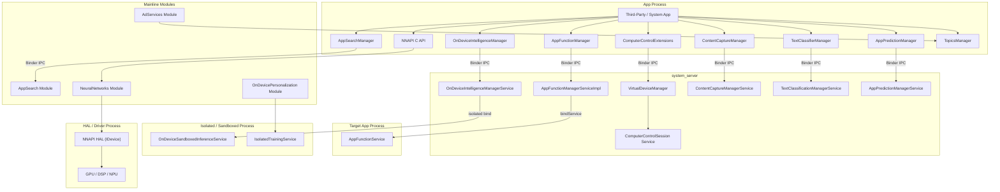

### 51.1.1 AOSP 智能子系统分类学

| 子系统 | API Level | 模块？ | 用途 |
|-----------|-----------|---------|---------|
| **AppFunctions** | 16（引入），在 Android 17 中成熟 | 否（framework） | 类型化的跨应用函数调用、运行时注册、观测 |
| **Computer Control** | 16（Android 16） | 否（framework + extensions lib） | 通过虚拟显示屏实现 AI 驱动的 UI 自动化 |
| **OnDeviceIntelligence** | 15+ | NeuralNetworks 模块 | 沙箱化的 LLM / ML 推理 |
| **NNAPI** | 8.1+ | NeuralNetworks 模块 | 硬件加速的神经网络推理 |
| **AppSearch** | 12+ | AppSearch 模块 | 设备端全文搜索与索引 |
| **Content Capture** | 10+ | 否（framework） | 面向智能的实时 UI 结构捕获 |
| **TextClassifier** | 8.0+ | 否（framework） | 实体识别、语言检测 |
| **AppPrediction** | 10+ | 否（framework） | 基于使用情况的应用排序 |
| **OnDevicePersonalization** | 14+ | ODP 模块 | 联邦计算、隔离训练 |
| **AdServices** | 13+ | AdServices 模块 | 保护隐私的广告定向（Topics、FLEDGE） |

### 51.1.2 贯穿全局的设计主题

有几个架构主题在每个 AI 子系统中反复出现：

1. **进程隔离。** 智能服务运行在隔离或沙箱进程中。`OnDeviceSandboxedInferenceService` 声明了
    `android:isolatedProcess="true"`。`IsolatedTrainingService` 在单独的进程中加载 TFLite。即使是 `ComputerControlSession`，也通过一个与默认显示屏分离的虚拟显示屏来运作。

2. **类型化契约优于开放式 Bundle。** AppFunctions 使用
    `GenericDocument`（来自 AppSearch）作为其参数传输格式。ODI 使用
    `PersistableBundle` 承载 feature/request 元数据。两者都鼓励 SDK 级别的类型化封装器。

3. **AppSearch 作为通用元数据存储。** 应用函数元数据、应用预测数据和内容捕获智能全部汇聚到 AppSearch，用于索引和发现。

4. **以权限门控访问并配合允许列表。** AppFunctions 将执行门控在
    `EXECUTE_APP_FUNCTIONS`（或 `EXECUTE_APP_FUNCTIONS_SYSTEM`）以及由平台
    `AllowlistManager`
    （`frameworks/base/core/java/android/os/allowlist/AllowlistManager.java`）提供服务的签名代理允许列表之后。
    Computer Control 需要 `ACCESS_COMPUTER_CONTROL`。ODI 需要
    `USE_ON_DEVICE_INTELLIGENCE`。AdServices 需要
    `ACCESS_ADSERVICES_TOPICS`。

5. **取消传播。** 几乎每个异步 API 都会在 Binder 边界上传递一个
    `ICancellationSignal` 传输通道，允许调用方中止长时间运行的推理或函数执行。

---

## 51.2 AppFunctions 框架

AppFunctions 框架作为 Android 16 中的 beta 特性引入，并在 Android 17 中达到广泛可用。它为 AI 助手（agent）提供了标准化的机制，用于发现并调用由任意应用（target）暴露的功能。助手可以说"把 XYZ 保存到我的笔记中"。框架将请求路由到合适的
`AppFunctionService` 实现。
助手对笔记应用没有任何编译时依赖。

Android 17 大幅扩展了该框架，远超最初的静态、仅清单（manifest-only）模型。头条新增特性——本章后文逐一详述——包括：

- **运行时（动态）函数注册**：应用可以在运行时从 `Activity` 或 `Service` 注册一个
  `AppFunction` 回调。应用不再声明单独的 `AppFunctionService` 组件（`registerAppFunction`，
  由 `FLAG_ENABLE_DYNAMIC_APP_FUNCTIONS` 门控）。
- **一等公民的发现、状态与观测 API** 移入
  `AppFunctionManager`：`searchAppFunctions`、`getAppFunctionStates`、
  `getAppFunctionActivityStates` 和 `observeAppFunctions`。
- **一套访问管理框架**：它具有按（agent, target）的访问状态和标志位、面向用户的管理 UI，以及签名代理允许列表。平台
  `AllowlistManager` 负责提供允许列表，而不是 `DeviceConfig` 字符串。
- **新权限**：`DISCOVER_APP_FUNCTIONS`（仅发现不执行）和
  `EXECUTE_APP_FUNCTIONS_SYSTEM`（绕过允许列表的特权系统代理），与原有的 `EXECUTE_APP_FUNCTIONS` 并存。

**源码树概览（Android 17）：**

```
frameworks/base/core/java/android/app/appfunctions/
    AppFunctionManager.java              -- Client-side system service
    AppFunctionService.java              -- Abstract base for static target apps
    AppFunction.java                     -- Runtime function callback interface
    RegisterAppFunctionRequest.java      -- Runtime registration request
    ExecuteAppFunctionRequest.java       -- Request parcelable
    ExecuteAppFunctionResponse.java      -- Response parcelable
    AppFunctionException.java            -- Typed error hierarchy
    AppFunctionMetadata.java             -- Static + runtime function metadata
    AppFunctionName.java                 -- (package, identifier) function name
    AppFunctionState.java                -- Runtime enabled/visibility state
    AppFunctionActivityId.java           -- Activity-scoped function key
    AppFunctionSearchSpec.java           -- Discovery query spec
    AppFunctionObserver.java             -- Change-observation callback
    AppFunctionAccessServiceInterface.java -- LocalService for access checks
    IAppFunctionManager.aidl             -- System server AIDL
    IAppFunctionService.aidl             -- Static target app AIDL (oneway)
    IAppFunctionExecutor.aidl            -- Runtime executor AIDL
    IExecuteAppFunctionCallback.aidl     -- Async result callback
    ICancellationCallback.aidl           -- Cancellation transport
    ...
frameworks/base/services/appfunctions/
    java/com/android/server/appfunctions/
        AppFunctionManagerService.java                -- SystemService wrapper
        AppFunctionManagerServiceImpl.java            -- IAppFunctionManager.Stub
        RemoteServiceCallerImpl.java                  -- Service binding logic
        CallerValidatorImpl.java                      -- Permission + allowlist enforcement
        MetadataSyncAdapter.java                      -- AppSearch metadata sync
        AppFunctionsLoggerWrapper.java                -- Statsd interaction logging
        allowlist/SystemAppFunctionAllowlistReader.java  -- AllowlistManager-backed reader
        dynamic/MultiUserDynamicAppFunctionRegistry.java -- Runtime registrations
        reader/AppFunctionMetadataReader.java         -- Static + dynamic metadata reads
        observer/AppFunctionMetadataObserver.java     -- AppSearch change observers
        ...
frameworks/base/services/permission/java/com/android/server/permission/access/appfunction/
    AppFunctionAccessService.kt                       -- Persists (agent, target) access state
```

### 51.2.1 架构概览

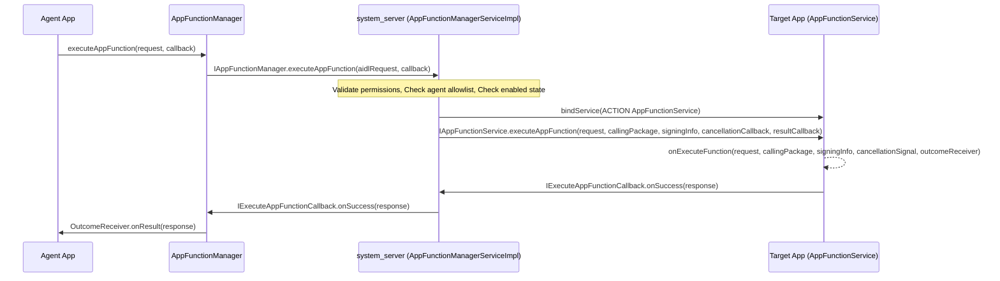

### 51.2.2 客户端：AppFunctionManager

`AppFunctionManager` 注册为系统服务，服务名为
`Context.APP_FUNCTION_SERVICE`：

```
// frameworks/base/core/java/android/app/appfunctions/AppFunctionManager.java

@FlaggedApi(FLAG_ENABLE_APP_FUNCTION_MANAGER)
@SystemService(Context.APP_FUNCTION_SERVICE)
public final class AppFunctionManager {
```

主要 API 是 `executeAppFunction()`，它接受四个参数。在
Android 17 中，权限要求是两个执行权限的 `anyOf`
（应用也可以在不带任何权限的情况下执行自己的函数）：

```java
// frameworks/base/core/java/android/app/appfunctions/AppFunctionManager.java

@FlaggedApi(FLAG_ENABLE_APP_FUNCTION_PERMISSION_V2)
@RequiresPermission(
        anyOf = {
            Manifest.permission.EXECUTE_APP_FUNCTIONS,
            Manifest.permission.EXECUTE_APP_FUNCTIONS_SYSTEM
        },
        conditional = true)
@UserHandleAware
public void executeAppFunction(
        @NonNull ExecuteAppFunctionRequest request,
        @NonNull @CallbackExecutor Executor executor,
        @NonNull CancellationSignal cancellationSignal,
        @NonNull OutcomeReceiver<ExecuteAppFunctionResponse, AppFunctionException> callback) {
```

内部，管理器将公共请求包装成一个
`ExecuteAppFunctionAidlRequest`，后者添加调用方身份与时间信息：

```java
ExecuteAppFunctionAidlRequest aidlRequest =
        new ExecuteAppFunctionAidlRequest(
                request,
                mContext.getUser(),
                mContext.getPackageName(),
                /* requestTime= */ SystemClock.elapsedRealtime(),
                /* requestWallTime= */ System.currentTimeMillis());
```

Binder 调用返回一个 `ICancellationSignal` 传输通道，它被回连到调用方的
`CancellationSignal`：

```java
ICancellationSignal cancellationTransport =
        mService.executeAppFunction(
                aidlRequest,
                new IExecuteAppFunctionCallback.Stub() {
                    @Override
                    public void onSuccess(ExecuteAppFunctionResponse result) {
                        executor.execute(() -> callback.onResult(result));
                    }
                    @Override
                    public void onError(AppFunctionException exception) {
                        executor.execute(() -> callback.onError(exception));
                    }
                });
if (cancellationTransport != null) {
    cancellationSignal.setRemote(cancellationTransport);
}
```

### 51.2.3 启用状态管理

每个应用函数都有一个三态生命周期：

| 常量 | 值 | 含义 |
|----------|-------|---------|
| `APP_FUNCTION_STATE_DEFAULT` | 0 | 重置为默认值（通常为启用） |
| `APP_FUNCTION_STATE_ENABLED` | 1 | 显式启用 |
| `APP_FUNCTION_STATE_DISABLED` | 2 | 显式禁用 |

应用通过 `setAppFunctionEnabled()` 控制自己的函数：

```java
// frameworks/base/core/java/android/app/appfunctions/AppFunctionManager.java

@UserHandleAware
public void setAppFunctionEnabled(
        @NonNull String functionIdentifier,
        @EnabledState int newEnabledState,
        @NonNull Executor executor,
        @NonNull OutcomeReceiver<Void, Exception> callback) {
```

启用状态以
`AppFunctionRuntimeMetadata` 文档的形式持久化在 AppSearch 中，它与描述函数 schema 的
`AppFunctionStaticMetadata` 是分离的。

`setAppFunctionEnabled` **仅**适用于由静态
`AppFunctionService` 组件支撑的函数。通过
`registerAppFunction`（51.2.x）注册的运行时函数，仅在其注册存活期间处于启用状态。它们的启用状态由
`registerAppFunction` /
`AppFunctionRegistration.unregister` 管理，而不是由该方法管理。对运行时注册的函数调用此方法会抛出 `IllegalArgumentException`。

Android 17 还暴露了完整的运行时状态，而不仅仅是启用位。
`AppFunctionState` parcelable
（`frameworks/base/core/java/android/app/appfunctions/AppFunctionState.java`）
承载函数的 `AppFunctionName`、`isEnabled` 和可见性，并通过
`AppFunctionManager.getAppFunctionStates(...)` 批量读取（见 51.2.x）。

### 51.2.4 访问控制模型

AppFunctions 访问模型在三个层级上运作：

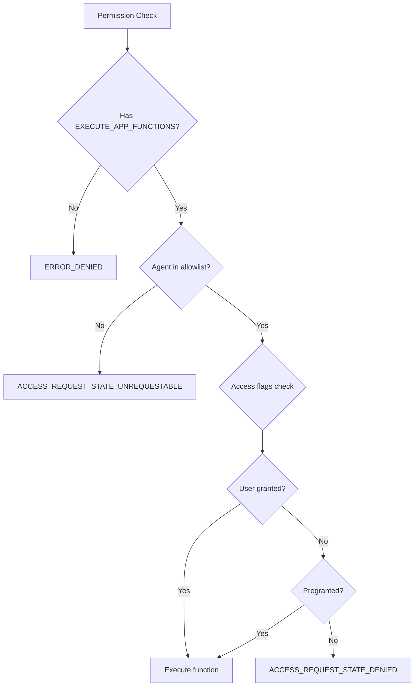

访问标志位是一个按（agent, target）对存储的位掩码。常量在
`AppFunctionManager`（`ACCESS_FLAG_*`）中定义：

| 标志 | 值 | 含义 |
|------|-------|---------|
| `ACCESS_FLAG_PREGRANTED` | `1` | 系统预先授予了访问权限 |
| `ACCESS_FLAG_UPGRADE_GRANTED` | `1 << 1` | 作为系统升级的一部分授予 |
| `ACCESS_FLAG_USER_GRANTED` | `1 << 2` | 用户通过 UI 显式授予 |
| `ACCESS_FLAG_USER_DENIED` | `1 << 3` | 用户通过 UI 显式拒绝（覆盖 `PREGRANTED`） |
| `ACCESS_FLAG_OTHER_GRANTED` | `1 << 4` | 通过 ADB 或其他机制授予 |
| `ACCESS_FLAG_OTHER_DENIED` | `1 << 5` | 通过 ADB 拒绝或自我撤销 |

在 Android 17 中，代理允许列表不再是一个 `DeviceConfig` 字符串。它由平台
`AllowlistManager`
（`frameworks/base/core/java/android/os/allowlist/AllowlistManager.java`）提供服务。它将签名代理包映射到其可访问的目标包集合。
`SignedPackage` 以包名加证书摘要为键，并提供一个"所有目标"的通配符目标。AppFunctions 服务通过
`SystemAppFunctionAllowlistReader`
（`frameworks/base/services/appfunctions/.../allowlist/SystemAppFunctionAllowlistReader.java`）
读取它，后者在 `LruCache` 中缓存按代理的结果：

```java
// frameworks/base/services/appfunctions/.../allowlist/SystemAppFunctionAllowlistReader.java

public class SystemAppFunctionAllowlistReader implements AppFunctionAllowlistReader {
    private final LruCache<SignedPackage, ArraySet<String>> mCache;
    private final AllowlistManager mAllowlistManager;

    @Override
    public CompletableFuture<Boolean> isAllowlisted(
            String agentPackage, String targetPackageName, int userId) { ... }
}
```

在任何执行进行之前，`CallerValidatorImpl` 会同时检查运行时权限和这份允许列表。持有
`EXECUTE_APP_FUNCTIONS_SYSTEM` 的代理被视为特权系统代理，完全跳过允许列表。
仅持有 `EXECUTE_APP_FUNCTIONS` 的代理必须在允许列表中针对目标被放行。

### 51.2.5 AIDL 接口

框架定义了两个 AIDL 接口——一个面向客户端，一个面向目标应用。

**IAppFunctionManager**（client-to-system_server）。该接口在 Android 17 中大幅增长，承载了发现、观测、运行时注册和访问管理的界面：

```
// frameworks/base/core/java/android/app/appfunctions/IAppFunctionManager.aidl

interface IAppFunctionManager {
    ICancellationSignal executeAppFunction(
        in ExecuteAppFunctionAidlRequest request,
        in IExecuteAppFunctionCallback callback);

    // Discovery and observation
    void observeAppFunctions(
        in AppFunctionAidlSearchSpec aidlSearchSpec,
        in IObserveAppFunctionChangesCallback callback);
    void unregisterAppFunctionObserver(
        in String callingPackage, in UserHandle userHandle,
        in IObserveAppFunctionChangesCallback callback);
    void getAppFunctionStates(
        in List<AppFunctionName> appFunctionNames,
        in String callingPackageName, int targetUserId,
        in IGetAppFunctionStatesCallback callback);
    void getAppFunctionActivityStates(
        in List<AppFunctionActivityId> activityIds,
        in String callingPackageName, int targetUserId,
        in IGetAppFunctionActivityStatesCallback callback);

    // Enabled-state lifecycle
    void isAppFunctionEnabled(
        in String callingPackage, in String targetPackage,
        in String functionIdentifier, in UserHandle userHandle,
        in IIsAppFunctionEnabledCallback callback);
    void setAppFunctionEnabled(
        in String callingPackage, in String functionIdentifier,
        in UserHandle userHandle, int enabledState,
        in ISetAppFunctionEnabledCallback callback);

    // Runtime (dynamic) registration
    void registerAppFunctions(in String packageName, in List<String> functionIds,
        in IAppFunctionExecutor executor, in IBinder activityToken);
    void unregisterAppFunctions(in String packageName, in List<String> functionIds,
        in IAppFunctionExecutor executor);

    // Access management
    int getAccessRequestState(in String agentPackageName, int agentUserId,
        in String targetPackageName, int targetUserId);
    int getAccessFlags(in String agentPackageName, int agentUserId,
        in String targetPackageName, int targetUserId);
    boolean updateAccessFlags(in String agentPackageName, int agentUserId,
        in String targetPackageName, int targetUserId, int flagMask, int flags);
    void revokeSelfAccess(in String targetPackageName);
    List<String> getValidAgents(int userId);
    List<String> getValidTargets(int targetUserId);
    Intent createRequestAccessIntent(in String targetPackageName);
    void addOnAccessChangedListener(IOnAppFunctionAccessChangeListener listener, int userId);
    void removeOnAccessChangedListener(IOnAppFunctionAccessChangeListener listener, int userId);
}
```

注意这些不同的启用状态回调：查询路径使用 `IIsAppFunctionEnabledCallback`，变更路径使用
`ISetAppFunctionEnabledCallback`。运行时注册路径传入一个 `IAppFunctionExecutor`（系统为动态注册函数调用的进程内回调），而不是绑定一个单独的组件。

**IAppFunctionService**（system_server-to-target app，`oneway`）：

```
// frameworks/base/core/java/android/app/appfunctions/IAppFunctionService.aidl

oneway interface IAppFunctionService {
    void executeAppFunction(
        in ExecuteAppFunctionRequest request,
        in String callingPackage,
        in android.content.pm.SigningInfo callingPackageSigningInfo,
        in ICancellationCallback cancellationCallback,
        in IExecuteAppFunctionCallback callback);
}
```

`oneway` 修饰符至关重要：system_server 不会阻塞等待目标应用完成。结果通过
`IExecuteAppFunctionCallback` 流回。

### 51.2.6 目标端：AppFunctionService

目标应用继承 `AppFunctionService` 并实现一个抽象方法：

```java
// frameworks/base/core/java/android/app/appfunctions/AppFunctionService.java

@MainThread
public abstract void onExecuteFunction(
        @NonNull ExecuteAppFunctionRequest request,
        @NonNull String callingPackage,
        @NonNull SigningInfo callingPackageSigningInfo,
        @NonNull CancellationSignal cancellationSignal,
        @NonNull OutcomeReceiver<ExecuteAppFunctionResponse, AppFunctionException> callback);
```

该服务强制只有 system_server（持有
`BIND_APP_FUNCTION_SERVICE`）才能调用它：

```java
// frameworks/base/core/java/android/app/appfunctions/AppFunctionService.java

if (context.checkCallingPermission(BIND_APP_FUNCTION_SERVICE)
        == PERMISSION_DENIED) {
    throw new SecurityException("Can only be called by the system server.");
}
```

清单声明需要绑定权限：

```xml
<service android:name=".YourService"
       android:permission="android.permission.BIND_APP_FUNCTION_SERVICE">
    <intent-filter>
      <action android:name="android.app.appfunctions.AppFunctionService" />
    </intent-filter>
</service>
```

### 51.2.7 请求与响应传输格式

`ExecuteAppFunctionRequest` 和 `ExecuteAppFunctionResponse` 都使用
AppSearch 的 `GenericDocument` 作为其参数传输格式。这并非随意之举——它确保函数参数可以由 AppSearch 已经知道如何索引和查询的 schema 来描述。

**请求：**

```java
// frameworks/base/core/java/android/app/appfunctions/ExecuteAppFunctionRequest.java

public final class ExecuteAppFunctionRequest implements Parcelable {
    @NonNull private final String mTargetPackageName;
    @NonNull private final String mFunctionIdentifier;
    @NonNull private final Bundle mExtras;
    @NonNull private final GenericDocumentWrapper mParameters;
    @Nullable private final AppInteractionAttribution mAttribution;
```

**响应：**

```java
// frameworks/base/core/java/android/app/appfunctions/ExecuteAppFunctionResponse.java

public final class ExecuteAppFunctionResponse implements Parcelable {
    public static final String PROPERTY_RETURN_VALUE = "androidAppfunctionsReturnValue";
    @NonNull private final GenericDocumentWrapper mResultDocumentWrapper;
    @NonNull private final Bundle mExtras;
    @NonNull private final List<AppFunctionUriGrant> mUriGrants;
```

返回值存放在结果 `GenericDocument` 中键为 `PROPERTY_RETURN_VALUE` 的位置。`AppFunction SDK`（一个独立的 Jetpack 库）提供了类型化封装器来打包/解包这些文档。

### 51.2.8 归因与交互日志

每次执行都可以携带一个 `AppInteractionAttribution`，描述触发它的交互。在 Android 17 中，该归因类型从 appfunctions 包移到了 `android.app`。这让更广泛的 App Interaction API 可以共享它。标志 `FLAG_ENABLE_APP_INTERACTION_API` 对其门控：

```java
// frameworks/base/core/java/android/app/AppInteractionAttribution.java

public static final int INTERACTION_TYPE_OTHER = 0;        // custom string required
public static final int INTERACTION_TYPE_USER_QUERY = 1;
public static final int INTERACTION_TYPE_USER_SCHEDULED = 2;
```

一个归因承载交互类型和可选的自定义类型字符串（当类型为
`INTERACTION_TYPE_OTHER` 时）。它还携带一个可选的交互 `Uri`，链接回来源上下文。隐私 UI 用它向用户解释*为什么*某个函数被运行了。

Android 17 不再持久化按调用的历史数据库，而是将每次执行记录到平台指标管道（statsd）。系统服务器的
`AppFunctionsLoggerWrapper`
（`frameworks/base/services/appfunctions/.../AppFunctionsLoggerWrapper.java`）
运行在一个共享的后台执行器上。它对每次成功或错误发出一个结构化事件。它还规范化公共归因常量并标记函数的类型：

```java
// frameworks/base/services/appfunctions/.../AppFunctionsLoggerWrapper.java

static final int FUNCTION_TYPE_UNSPECIFIED = 0;
static final int FUNCTION_TYPE_STATIC = 1;          // AppFunctionService-backed
static final int FUNCTION_TYPE_DYNAMIC_GLOBAL = 2;  // registerAppFunction (Service/global)
static final int FUNCTION_TYPE_DYNAMIC_ACTIVITY = 3;// registerAppFunction (Activity-scoped)

void logAppFunctionSuccess(
        ExecuteAppFunctionAidlRequest request,
        ExecuteAppFunctionResponse response,
        int callingUid,
        long executionStartTimeMillis,
        @AppFunctionMetadata.AppFunctionType int appFunctionType) { ... }
```

记录的事件捕获这些值：

- 调用方 UID 与目标。
- 交互类型，派生自请求的 `AppInteractionAttribution`。
- 函数类型（静态 vs. 动态，全局 vs. activity 范围）。
- 响应代码。
- 执行延迟，从服务绑定完成之后开始测量。

### 51.2.9 错误处理

`AppFunctionException` 定义了一套分类错误代码方案：

```java
// frameworks/base/core/java/android/app/appfunctions/AppFunctionException.java

// Request errors (1000-1999)
public static final int ERROR_DENIED = 1000;
public static final int ERROR_INVALID_ARGUMENT = 1001;
public static final int ERROR_DISABLED = 1002;
public static final int ERROR_FUNCTION_NOT_FOUND = 1003;

// System errors (2000-2999)
public static final int ERROR_SYSTEM_ERROR = 2000;
public static final int ERROR_CANCELLED = 2001;
public static final int ERROR_ENTERPRISE_POLICY_DISALLOWED = 2002;

// App errors (3000-3999)
public static final int ERROR_APP_UNKNOWN_ERROR = 3000;
```

`getErrorCategory()` 方法将范围映射到类别：

```java
public int getErrorCategory() {
    if (mErrorCode >= 1000 && mErrorCode < 2000) return ERROR_CATEGORY_REQUEST_ERROR;
    if (mErrorCode >= 2000 && mErrorCode < 3000) return ERROR_CATEGORY_SYSTEM;
    if (mErrorCode >= 3000 && mErrorCode < 4000) return ERROR_CATEGORY_APP;
    return ERROR_CATEGORY_UNKNOWN;
}
```

### 51.2.10 System Server 实现

一个薄薄的 `SystemService`，
`frameworks/base/services/appfunctions/java/com/android/server/appfunctions/AppFunctionManagerService.java`，
在 `Context.APP_FUNCTION_SERVICE` 名下构造并发布 binder，并转发用户生命周期。真正的逻辑在
`AppFunctionManagerServiceImpl` 中，它继承
`IAppFunctionManager.Stub` 并协调由 `SystemService` 装配的协作者：

```java
// frameworks/base/services/appfunctions/.../AppFunctionManagerServiceImpl.java

public class AppFunctionManagerServiceImpl extends IAppFunctionManager.Stub {
    private final RemoteServiceCaller<IAppFunctionService> mRemoteServiceCaller;
    private final CallerValidator mCallerValidator;
    private final AppFunctionsLoggerWrapper mLoggerWrapper;
    private final IUriGrantsManager mUriGrantsManager;
    private final UriGrantsManagerInternal mUriGrantsManagerInternal;
    private final MultiUserDynamicAppFunctionRegistry mDynamicAppFunctionRegistry;
    private final AppFunctionMetadataReader mAppFunctionMetadataReader;
    private final AppFunctionMetadataObserver mAppFunctionMetadataObserver;
    private final VisibilityHelper mVisibilityHelper;
    private final ActivityTaskManagerInternal mActivityTaskManagerInternal;
    // Access checks delegate to the permission subsystem, when enabled:
    private final AppFunctionAccessServiceInterface mAppFunctionAccessService;
    ...
```

关键支撑类：

| 类 | 职责 |
|-------|---------------|
| `RemoteServiceCallerImpl` | 绑定目标 `AppFunctionService`，管理连接生命周期 |
| `CallerValidatorImpl` | 强制 `EXECUTE_APP_FUNCTIONS` / `EXECUTE_APP_FUNCTIONS_SYSTEM`，检查允许列表 |
| `MetadataSyncAdapter` | 在 AppSearch 中同步运行时函数元数据，以匹配包变更后的静态元数据 |
| `AppFunctionPackageMonitor` | 监视包安装/更新/移除 |
| `MultiUserDynamicAppFunctionRegistry` | 按用户持有运行时（`registerAppFunction`）注册 |
| `AppFunctionMetadataReader` | 读取用于发现/状态的静态（AppSearch）和动态元数据 |
| `AppFunctionMetadataObserver` | 从 AppSearch 变更观察者驱动 `observeAppFunctions` |

| `SystemAppFunctionAllowlistReader` | 通过 `AllowlistManager` 解析签名代理允许列表 |
| `AppFunctionsLoggerWrapper` | 为每次执行发出 statsd 交互事件 |
| `AppFunctionAccessService`（权限子系统） | 持久化按（agent, target）的访问状态与标志位 |

### 51.2.11 通过 AppSearch 进行函数发现

`AppFunctionStaticMetadata` 文档本身由 AppSearch apps-indexer 索引进
AppSearch（schema 由
`com.android.server.appsearch.appsindexer` 拥有，依据
`AppFunctionStaticMetadataHelper`）。当包被安装、更新或设备启动时，`MetadataSyncAdapter` *读取*那些静态文档。
它创建或移除匹配的 `AppFunctionRuntimeMetadata` 文档
（后者承载按函数的启用状态），使两者保持同步。代理通过查询 AppSearch 来发现函数：

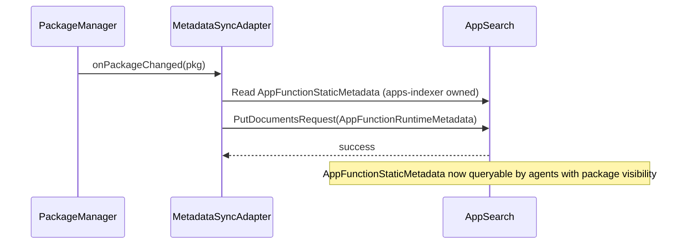

### 51.2.12 SafeOneTimeExecuteAppFunctionCallback

一个关键的防御性封装器确保了恰好一次的投递：

```java
// frameworks/base/core/java/android/app/appfunctions/SafeOneTimeExecuteAppFunctionCallback.java

public class SafeOneTimeExecuteAppFunctionCallback {
    private final AtomicBoolean mOnResultCalled = new AtomicBoolean(false);
    @NonNull private final IExecuteAppFunctionCallback mCallback;
    @Nullable private ArrayList<CompletionCallback> mCompletionCallbacks;
    @Nullable private final BeforeCompletionCallback mBeforeCompletionCallback;
    private final AtomicLong mExecutionStartTimeAfterBindMillis = new AtomicLong();

    public void onResult(@NonNull ExecuteAppFunctionResponse result) {
        if (!mOnResultCalled.compareAndSet(false, true)) {
            Log.w(TAG, "Ignore subsequent calls to onResult/onError()");
            return;
        }
        try {
            if (mBeforeCompletionCallback != null) {
                mBeforeCompletionCallback.beforeOnSuccess(result);
            }
            mCallback.onSuccess(result);
            if (mCompletionCallbacks != null) {
                for (CompletionCallback completionCallback : mCompletionCallbacks) {
                    completionCallback.finalizeOnSuccess(
                            result, mExecutionStartTimeAfterBindMillis.get());
                }
            }
        } catch (RemoteException ex) {
            Log.w(TAG, "Failed to invoke the callback", ex);
        }
    }

    public void onError(@NonNull AppFunctionException error) {
        if (!mOnResultCalled.compareAndSet(false, true)) {
            Log.w(TAG, "Ignore subsequent calls to onResult/onError()");
            return;
        }
        try {
            mCallback.onError(error);
            if (mCompletionCallbacks != null) {
                for (CompletionCallback completionCallback : mCompletionCallbacks) {
                    completionCallback.finalizeOnError(
                            error, mExecutionStartTimeAfterBindMillis.get());
                }
            }
        } catch (RemoteException ex) {
            Log.w(TAG, "Failed to invoke the callback", ex);
        }
    }
```

这种设计模式之所以必不可少，是因为：

1. **目标应用可能多次回调**——`AppFunctionService`
   是第三方代码，可能错误地调用回调两次。
    `AtomicBoolean.compareAndSet()` 确保只有第一次调用成功。

2. **吞掉 RemoteException**——如果结果到达时调用进程已经死亡，
    `RemoteException` 会被记录并吞掉。系统服务器不会崩溃。

3. **完成钩子**——`BeforeCompletionCallback` 和
    `CompletionCallback` 让系统服务器可以在回调投递前后执行动作（比如
    日志、URI grant 和访问历史记录）。多个完成回调可以追加到一个封装器上。
    它们按顺序被调用：

```java
    public interface CompletionCallback {
        void finalizeOnSuccess(
                ExecuteAppFunctionResponse result, long executionStartTimeMillis);
        void finalizeOnError(
                AppFunctionException error, long executionStartTimeMillis);
    }

    public interface BeforeCompletionCallback {
        void beforeOnSuccess(ExecuteAppFunctionResponse result);
    }
```

4. **延迟跟踪**——`mExecutionStartTimeAfterBindMillis` 字段
    记录了服务绑定完成后执行何时开始，使系统能够区分绑定开销与执行时间。

5. **禁用机制**——`disable()` 方法可以阻止任何进一步的
    回调投递。当请求被取消或超时时使用。

### 51.2.13 executeAppFunction 实现深度剖析

系统服务器的 `executeAppFunction` 方法是整个框架中最关键的路径。让我们从 AIDL 入口点到目标服务绑定，逐行追踪它。

**第 1 步：入口与初始验证。**

```java
// frameworks/base/services/appfunctions/.../AppFunctionManagerServiceImpl.java

@Override
public ICancellationSignal executeAppFunction(
        @NonNull ExecuteAppFunctionAidlRequest requestInternal,
        @NonNull IExecuteAppFunctionCallback executeAppFunctionCallback) {

    int callingUid = Binder.getCallingUid();
    int callingPid = Binder.getCallingPid();

    final SafeOneTimeExecuteAppFunctionCallback safeExecuteAppFunctionCallback =
            initializeSafeExecuteAppFunctionCallback(
                    requestInternal, executeAppFunctionCallback, callingUid);

    String validatedCallingPackage;
    try {
        validatedCallingPackage =
                mCallerValidator.validateCallingPackage(requestInternal.getCallingPackage());
        mCallerValidator.verifyTargetUserHandle(
                requestInternal.getUserHandle(), validatedCallingPackage);
    } catch (SecurityException exception) {
        safeExecuteAppFunctionCallback.onError(
                new AppFunctionException(
                        AppFunctionException.ERROR_DENIED, exception.getMessage()));
        return null;
    }
```

`SafeOneTimeExecuteAppFunctionCallback` 封装器确保恰好投递一个
响应（成功或错误），即使目标应用发送多个回复或在响应之前崩溃。

**第 2 步：在线程池上异步执行。**

```java
    ICancellationSignal localCancelTransport = CancellationSignal.createTransport();

    THREAD_POOL_EXECUTOR.execute(
            () -> {
                try {
                    executeAppFunctionInternal(
                            requestInternal,
                            callingUid, callingPid,
                            localCancelTransport,
                            safeExecuteAppFunctionCallback,
                            executeAppFunctionCallback.asBinder());
                } catch (Exception e) {
                    safeExecuteAppFunctionCallback.onError(
                            mapExceptionToExecuteAppFunctionResponse(e));
                }
            });
    return localCancelTransport;
}
```

工作被分发到 `THREAD_POOL_EXECUTOR`（在
`AppFunctionExecutors` 中定义），以避免阻塞 Binder 线程池。

**第 3 步：权限与状态验证。**

```java
@WorkerThread
private void executeAppFunctionInternal(...) {
    // Enterprise policy check
    if (!mCallerValidator.verifyEnterprisePolicyIsAllowed(callingUser, targetUser)) {
        safeExecuteAppFunctionCallback.onError(
                new AppFunctionException(
                        AppFunctionException.ERROR_ENTERPRISE_POLICY_DISALLOWED, ...));
        return;
    }

    // Empty target package check
    if (TextUtils.isEmpty(targetPackageName)) {
        safeExecuteAppFunctionCallback.onError(
                new AppFunctionException(
                        AppFunctionException.ERROR_INVALID_ARGUMENT, ...));
        return;
    }
```

**第 4 步：Future 链式的权限与启用状态检查。**

实现使用 `AndroidFuture.thenCompose()` 进行非阻塞权限验证，随后进行由 AppSearch 支撑的启用状态查找：

```java
    mCallerValidator
            .verifyCallerCanExecuteAppFunction(
                    callingUid, callingPid, targetUser,
                    requestInternal.getCallingPackage(),
                    targetPackageName,
                    requestInternal.getClientRequest().getFunctionIdentifier())
            .thenCompose(canExecuteResult -> {
                if (canExecuteResult == CAN_EXECUTE_APP_FUNCTIONS_DENIED) {
                    return AndroidFuture.failedFuture(
                            new SecurityException("Caller does not have permission"));
                }
                return isAppFunctionEnabled(
                        functionIdentifier, targetPackageName,
                        getAppSearchManagerAsUser(userHandle), THREAD_POOL_EXECUTOR)
                    .thenApply(isEnabled -> {
                        if (!isEnabled) {
                            throw new DisabledAppFunctionException("Disabled");
                        }
                        return canExecuteResult;
                    });
            })
```

**第 5 步：服务解析与绑定。**

```java
            .thenAccept(canExecuteResult -> {
                int bindFlags = Context.BIND_AUTO_CREATE;
                if (canExecuteResult
                        == CAN_EXECUTE_APP_FUNCTIONS_ALLOWED_HAS_PERMISSION) {
                    bindFlags |= Context.BIND_FOREGROUND_SERVICE;
                }
                Intent serviceIntent =
                        mInternalServiceHelper.resolveAppFunctionService(
                                targetPackageName, targetUser);
                // Grant implicit visibility to allow target to see caller
                mPackageManagerInternal.grantImplicitAccess(
                        grantRecipientUserId, serviceIntent,
                        grantRecipientAppId, callingUid, /* direct= */ true);
                bindAppFunctionServiceUnchecked(
                        requestInternal, serviceIntent, targetUser,
                        localCancelTransport, safeExecuteAppFunctionCallback,
                        bindFlags, callerBinder, callingUid);
            })
```

这揭示了一个重要的细节：当调用方持有
`EXECUTE_APP_FUNCTIONS` 时，系统使用 `BIND_FOREGROUND_SERVICE` 提升
目标服务的进程优先级。自调用（同包）不会获得这一提升。

### 51.2.14 RemoteServiceCaller 模式

`RemoteServiceCallerImpl` 实现了一次性服务绑定模式：

```java
// frameworks/base/services/appfunctions/.../RemoteServiceCallerImpl.java

public class RemoteServiceCallerImpl<T> implements RemoteServiceCaller<T> {
    public boolean runServiceCall(
            Intent intent, int bindFlags, UserHandle userHandle,
            long cancellationTimeoutMillis, CancellationSignal cancellationSignal,
            RunServiceCallCallback<T> callback, IBinder callerBinder) {

        OneOffServiceConnection serviceConnection =
                new OneOffServiceConnection(intent, bindFlags, userHandle,
                        cancellationTimeoutMillis, cancellationSignal,
                        callback, callerBinder);
        return serviceConnection.bindAndRun();
    }
```

`OneOffServiceConnection` 是一个 `ServiceConnection`，它：

1. 调用 `Context.bindServiceAsUser()` 连接到目标
2. 设置一个取消监听器，在超时后触发解绑
3. 链接到调用方 binder 的死亡，以便调用方死亡时取消
4. 在回调完成后自动解绑

```java
private class OneOffServiceConnection
        implements ServiceConnection, ServiceUsageCompleteListener {

    public boolean bindAndRun() {
        boolean bindServiceResult =
                mContext.bindServiceAsUser(mIntent, this, mFlags, mUserHandle);

        if (bindServiceResult) {
            mCancellationSignal.setOnCancelListener(() -> {
                mCallback.onCancelled();
                mHandler.postDelayed(mCancellationTimeoutRunnable,
                        mCancellationTimeoutMillis);
            });
            mDirectServiceVulture = () -> {
                Slog.w(TAG, "Caller process onDeath signal received");
                mCancellationSignal.cancel();
            };
            mCallerBinder.linkToDeath(mDirectServiceVulture, 0);
        }
        return bindServiceResult;
    }
```

这种模式确保服务连接总能被清理，即使调用方崩溃、
目标崩溃或用户取消。

### 51.2.15 多用户支持

服务实现是多用户感知的。每个用户拥有：

- 自己的用于静态函数元数据的 AppSearch 数据库
- 自己的用于跟踪包变更的 `PackageMonitor`
- 自己的 `MultiUserDynamicAppFunctionRegistry` 切片，用于运行时
  注册
- 按（agent, target）对分离的访问状态与标志位，由
  权限子系统持久化

```java
// AppFunctionManagerServiceImpl.java

public void onUserUnlocked(TargetUser user) {
    if (enableDynamicAppFunctions()) {
        mAppFunctionMetadataObserver.registerAppSearchObserverForUser(user);
    } else {
        registerAppSearchObserver(user);
    }
    trySyncRuntimeMetadata(user.getUserHandle(), ...);
    PackageMonitor pkgMonitorForUser =
            AppFunctionPackageMonitor.registerPackageMonitorForUser(
                    mContext, user, mAppFunctionMetadataObserver);
    mPackageMonitors.append(user.getUserIdentifier(), pkgMonitorForUser);
    mDynamicAppFunctionRegistry.onUserUnlocked(user, ...);
}

public void onUserStopping(@NonNull TargetUser user) {
    if (enableDynamicAppFunctions()) {
        mAppFunctionMetadataObserver.unregisterAppSearchObserverForUser(user);
    } else {
        MetadataSyncPerUser.removeUserSyncAdapter(user.getUserHandle());
    }
    mPackageMonitors.get(user.getUserIdentifier()).unregister();
    mPackageMonitors.delete(user.getUserIdentifier());
}

public void onUserStopped(@NonNull TargetUser user) {
    mDynamicAppFunctionRegistry.onUserStopped(user);
}
```

当动态函数标志开启时，`AppFunctionMetadataObserver` 拥有按用户的 AppSearch 观察者。该观察者将变更扇出给内部元数据缓存和客户端 `observeAppFunctions` 回调。运行时注册表按用户为键，因此当某用户停止时，该用户进程所做的注册会被拆除。

### 51.2.16 代理允许列表架构

在 Android 17 中，代理允许列表不再是 `DeviceConfig` 与
`Settings.Secure` 字符串的合并。它由平台 `AllowlistManager`
（allowlist id `ALLOWLIST_ID_APP_FUNCTION`）提供服务，对于*签名*的代理
包，它返回该代理可访问的目标包集合。AppFunctions 服务通过 `SystemAppFunctionAllowlistReader` 消费它：

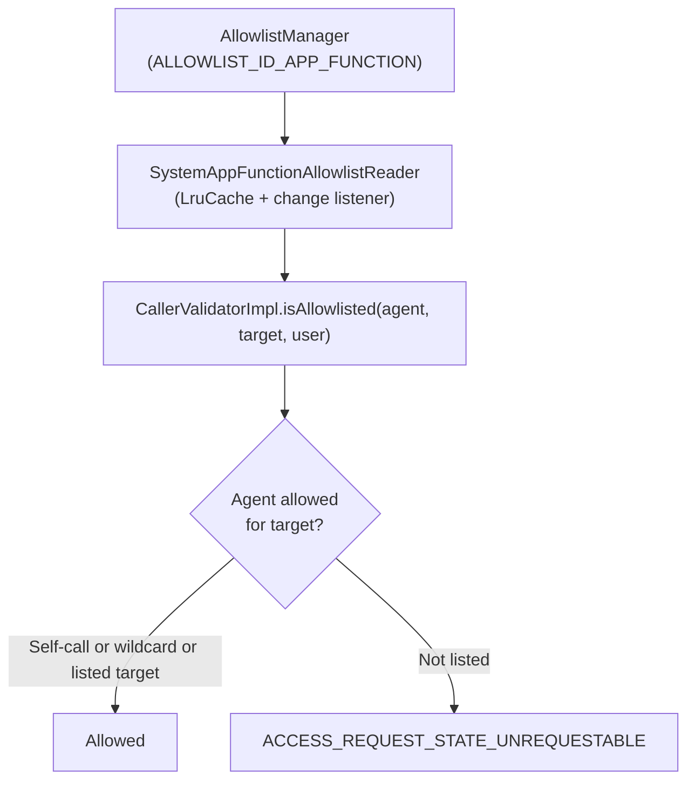

读取器将代理最新的签名证书哈希成一个 `SignedPackage`，并向 `AllowlistManager`
询问该代理的有效目标。读取器在 `LruCache` 中缓存结果，因此同一代理的重复执行会跳过 IPC：

```java
// frameworks/base/services/appfunctions/.../allowlist/SystemAppFunctionAllowlistReader.java

@Override
public CompletableFuture<Boolean> isAllowlisted(
        String agentPackageName, String targetPackageName, int userId) {
    if (agentPackageName.equals(targetPackageName)) {
        return AndroidFuture.completedFuture(true);   // own functions always allowed
    }
    SignedPackage agentSignedPackage =
            new SignedPackage(agentPackageName, /* certificate digest */ ...);
    maybeStartAlowlistListener();  // [sic] -- spelled this way in the source
    return getValidTargetPackages(agentSignedPackage)
            .thenApply(allowlistTargets ->
                    allowlistTargets.contains(WILDCARD_PACKAGE_NAME)
                            || allowlistTargets.contains(targetPackageName));
}
```

有三个行为值得注意：

- **自我访问**（`agent == target`）被隐式允许，因此应用总是可以调用自己的函数。
- **通配符目标**：以通配符包被允许的代理可以访问任何目标。
- **变更监听**：首次使用时，读取器注册一个
  `OnAllowlistChangedListener`（request id `ALLOWLIST_ID_APP_FUNCTION`）。
  当平台允许列表更新时，缓存条目被失效。它们不会在启动时从配置字符串重新加载。

### 51.2.17 AppFunction 响应的 URI Grant

当目标应用在响应中返回内容 URI 时，框架可以向调用代理授予临时 URI 权限：

```java
// AppFunctionManagerServiceImpl.java

private final IUriGrantsManager mUriGrantsManager;
private final UriGrantsManagerInternal mUriGrantsManagerInternal;
private final IBinder mPermissionOwner;

// In constructor:
mPermissionOwner = mUriGrantsManagerInternal.newUriPermissionOwner("appfunctions");
```

响应中的 `AppFunctionUriGrant` 对象指定哪些 URI 应授予代理。授权通过
`mUriGrantsManager.grantUriPermissionFromOwner(mPermissionOwner, ...)` 发出。这将其关联到 AppFunctions 权限属主，以便系统之后可以撤销它。授权一直存续，直到属主释放它们或设备重启。

### 51.2.18 Shell 命令支持

服务实现了 `onShellCommand()` 用于开发者调试：

```java
// AppFunctionManagerServiceImpl.java

@Override
public void onShellCommand(
        FileDescriptor in, FileDescriptor out, FileDescriptor err,
        @NonNull String[] args, ShellCallback callback,
        @NonNull ResultReceiver resultReceiver) {
    new AppFunctionManagerServiceShellCommand(mContext, this)
            .exec(this, in, out, err, args, callback, resultReceiver);
}
```

可通过 `adb shell cmd app_function` 使用。

### 51.2.19 服务启动与生命周期

框架是一个 `SystemService`。`AppFunctionManagerService.onStart()`
在 `Context.APP_FUNCTION_SERVICE` 名下发布 binder（仅当
`AppFunctionManagerConfiguration.isSupported(context)` 为真时）。它还
发布 `AppInteractionService` 本地服务，但仅当 App Interaction API 标志开启时：

```java
// frameworks/base/services/appfunctions/.../AppFunctionManagerService.java

@Override
public void onStart() {
    if (AppFunctionManagerConfiguration.isSupported(getContext())) {
        publishBinderService(Context.APP_FUNCTION_SERVICE, mServiceImpl);
    }
    if (Flags.enableAppInteractionApi()) {
        publishLocalService(AppInteractionService.class, mAppInteractionService);
    }
}
```

按用户的状态通过 `onUserStarting`、
`onUserUnlocked`、`onUserStopping` 和 `onUserStopped`（51.2.15）建立与拆除。代理
允许列表不再在启动阶段预填。它首次使用时从
`AllowlistManager` 惰性获取。变更监听器使其保持新鲜（51.2.16）。

---

## 51.3 Computer Control

Computer Control 是让 AI 代理通过虚拟显示屏以编程方式与应用交互的框架。它在
Android 16 中首次亮相（受 flag 门控），并在 Android 17 中得到大幅扩展和重构。代理不需要应用实现特定 API。代理可以在一块无头虚拟显示屏上启动任何应用，用截图观察屏幕，注入点击/滑动事件，并读取无障碍树。这正是"computer use"（计算机操作）类 AI 代理所使用的范式。

Computer Control 构建在 `VirtualDeviceManager` 之上。正因如此，其虚拟显示屏、输入和生命周期机制将在第
52 章（CompanionDeviceManager 与 Virtual Devices）中深入讲解。本节聚焦面向代理的会话 API，以及它如何与 AppFunctions 互补。

**源码树（Android 17）：**

```
frameworks/base/core/java/android/companion/virtual/computercontrol/
    ComputerControlSession.java                  -- Core session API
    ComputerControlSessionParams.java            -- Session configuration
    InteractiveMirror.java                       -- Mirror display for user view
    ComputerControlConsentManager.java           -- Per-session consent flow
    ComputerControlAccessibilityProxy.java       -- Accessibility tree access
    LifecycleState.java / LifecycleStateTracker.java -- Session lifecycle states
    AutomatedPackageListener.java                -- Package change notifications
    IComputerControlSession.aidl                 -- Session Binder interface
    IComputerControlSessionCallback.aidl         -- Creation lifecycle callback
    IComputerControlLifecycleCallback.aidl       -- Lifecycle-state callback
    IComputerControlConsentManager.aidl          -- Consent Binder interface
    IInteractiveMirror.aidl                      -- Mirror display interface
    IAutomatedPackageListener.aidl               -- Package listener interface

frameworks/base/libs/computercontrol/              -- Extension library (sidecar APIs)
    src/com/android/extensions/computercontrol/
        ComputerControlExtensions.java           -- Entry point
        ComputerControlSession.java              -- Extension session wrapper
        AutomatedPackageListener.java            -- Extension listener
        view/MirrorView.java                     -- Mirror display view
```

### 51.3.1 架构

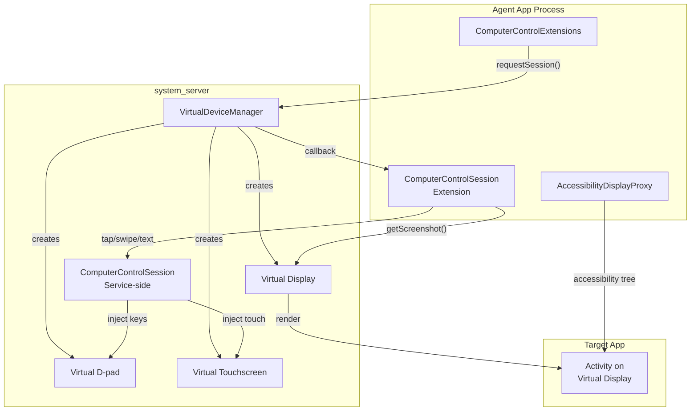

### 51.3.2 会话生命周期

入口点是 `ComputerControlExtensions.getInstance()`，它会检查
`FEATURE_ACTIVITIES_ON_SECONDARY_DISPLAYS` 与 `VirtualDeviceManager`
的可用性：

```java
// frameworks/base/libs/computercontrol/.../ComputerControlExtensions.java

private static boolean isAvailable(Context context) {
    if (!context.getPackageManager().hasSystemFeature(
                PackageManager.FEATURE_ACTIVITIES_ON_SECONDARY_DISPLAYS)) {
        return false;
    }
    return context.getSystemService(VirtualDeviceManager.class) != null;
}
```

会话创建经由 `requestSession()` 流转，它同时需要
`ACCESS_COMPUTER_CONTROL` 和 `POST_NOTIFICATIONS`（后者是因为会话会发布一条用户可见的通知）：

```java
// frameworks/base/libs/computercontrol/.../ComputerControlExtensions.java

@RequiresPermission(allOf = {Manifest.permission.ACCESS_COMPUTER_CONTROL,
        Manifest.permission.POST_NOTIFICATIONS})
public void requestSession(@NonNull ComputerControlSession.Params params,
        @NonNull @CallbackExecutor Executor executor,
        @NonNull ComputerControlSession.Callback callback) {
    // ... null checks, CompanionDeviceId and NotificationParams conversion ...
    ComputerControlSessionParams sessionParams =
            new ComputerControlSessionParams.Builder()
                    .setName(params.getName())
                    .setTargetComputerControlVersion(mTargetComputerControlVersion)
                    .setTargetPackageNames(params.getTargetPackageNames())
                    .setPreviewIntent(params.getPreviewIntent())
                    .setAppInteractionAttribution(params.getAppInteractionAttribution())
                    .setCompanionDeviceId(companionDeviceId)
                    .setNotificationParams(systemNotificationParams)
                    .build();
    // ... wrap the callback and forward to VirtualDeviceManager ...
}
```

注意这里没有显示屏几何参数设置器：调用方不选择虚拟显示屏的尺寸、密度或 surface（见 51.3.4）。

回调生命周期镜像 VirtualDeviceManager 的会话创建：

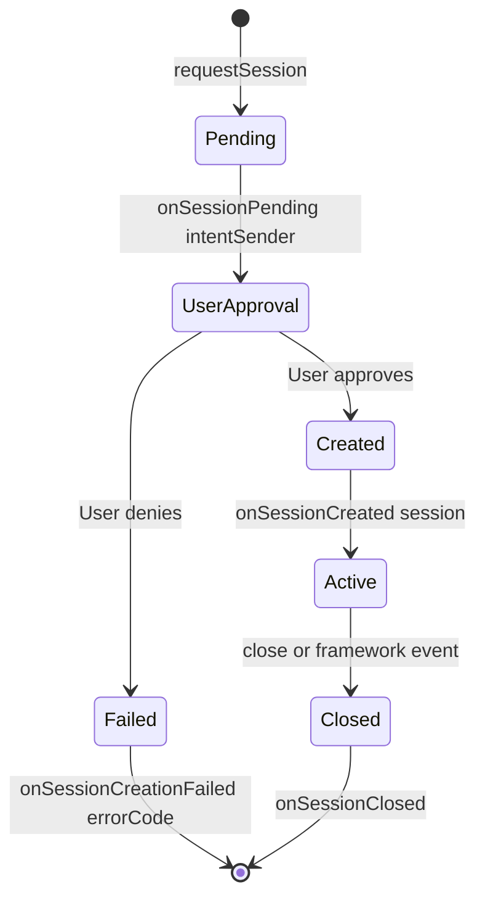

会话创建的错误码：

```java
// frameworks/base/core/java/android/companion/virtual/computercontrol/ComputerControlSession.java

public static final int ERROR_SESSION_LIMIT_REACHED = 1;
public static final int ERROR_DEVICE_LOCKED = 2;
public static final int ERROR_PERMISSION_DENIED = 3;
```

### 51.3.3 核心会话 API

创建之后，`ComputerControlSession` 暴露一个高层输入 API：

```java
// frameworks/base/core/java/android/companion/virtual/computercontrol/ComputerControlSession.java

// Launch an app
public void launchApplication(@NonNull String packageName);
public void launchApplication(@NonNull ComponentName component);

// Hand over to user
public void handOverApplications();

// Screenshot
@Nullable public Image getScreenshot();

// Gesture-level input (no public low-level send*Event in Android 17)
public void tap(int x, int y);
public void swipe(int fromX, int fromY, int toX, int toY, ...);
public void longPress(int x, int y);
public void insertText(@NonNull String text, boolean replaceExisting, boolean commit);
public void performAction(@Action int actionCode);

// Mirror display
@Nullable public InteractiveMirror createInteractiveMirror(
        IResultReceiver a11yEmbeddedConnectionReceiver);

// UI stability
public void setStabilityListener(
        @NonNull Duration duration, @NonNull Executor executor,
        @NonNull StabilityListener listener);
public void clearStabilityListener();
```

注意在 Android 17 中，平台会话不再公开低级
`sendKeyEvent` / `sendTouchEvent` 方法。代理通过手势 API（`tap`、`swipe`、`longPress`、`performAction`）和 `insertText` 驱动 UI。
会话将这些转换为底层的 `VirtualTouchscreen` / `VirtualDpad`。

截图通过一个 `ImageReader` 捕获，其 `Surface` 经由
`IComputerControlSession.initialize()` 交给系统服务器；服务器将会话的虚拟显示屏渲染进其中：

```java
// frameworks/base/core/java/android/companion/virtual/computercontrol/ComputerControlSession.java

mImageReader = ImageReader.newInstance(displayInfo.logicalWidth,
        displayInfo.logicalHeight, PixelFormat.RGBA_8888, /* maxImages= */ 2);
mSession.initialize(mRemoteLifecycleCallback, mImageReader.getSurface());

public Image getScreenshot() {
    synchronized (mLock) {
        return mImageReader == null ? null : mImageReader.acquireLatestImage();
    }
}
```

### 51.3.4 会话参数

`ComputerControlSessionParams` 为会话命名并界定它可以自动化的范围；它不配置虚拟显示屏：

```java
// frameworks/base/core/java/android/companion/virtual/computercontrol/ComputerControlSessionParams.java

public final class ComputerControlSessionParams implements Parcelable {
    private final String mName;
    private final int mTargetComputerControlVersion;
    private final List<String> mTargetPackageNames;
    private final PendingIntent mPreviewIntent;
    private final AppInteractionAttribution mAppInteractionAttribution;
    private final CompanionDeviceId mCompanionDeviceId;
    @Nullable
    private final NotificationParams mNotificationParams;
```

会话显示屏的尺寸和密度在服务端选定：
`ComputerControlSessionImpl.createSessionDisplayConfig()` 从用户的主（参考）显示屏推导它们，而不是从调用方传入的任何内容推导。

`targetPackageNames` 字段限制哪些应用可以在会话中被启动。每个包必须有一个有效的 launcher intent，且不能是设备权限控制器。

### 51.3.5 Interactive Mirror

`InteractiveMirror`（通过 `ComputerControlSession.createInteractiveMirror` 创建）将会话的虚拟显示屏镜像到一个调用方提供的 `Surface` 上，并允许人类用户同时观察和交互：

```java
// frameworks/base/core/java/android/companion/virtual/computercontrol/InteractiveMirror.java

public final class InteractiveMirror implements AutoCloseable {
    public void setInteractive(boolean interactive);
    public void resize(int width, int height);
    public void updateInsets(@Nullable Insets insets);
    public void close();
}
```

这使"co-pilot"（副驾驶）模式成为可能：AI 代理驱动自动化，而人类观看，并且当 `setInteractive(true)` 时可以介入。

### 51.3.6 UI 稳定性检测

知道应用 UI 何时已经"安定下来"，对于需要在行动前截图和分析的 AI 代理至关重要。`StabilityListener` 接口提供了这个信号：

```java
// frameworks/base/core/java/android/companion/virtual/computercontrol/ComputerControlSession.java

public interface StabilityListener {
    void onSessionStable();
    default void onSessionUnstable(@UnstableReason int reason) {}
}
```

平台 `ComputerControlAccessibilityProxy`（51.3.27）监视无障碍事件和首帧信号。它用它们来决定显示屏内容何时安定下来。然后调用已注册的 `StabilityListener`。

### 51.3.7 无障碍集成

平台 `ComputerControlSession` 拥有一个
`ComputerControlAccessibilityProxy`，它继承 `AccessibilityDisplayProxy` 并注册在会话的虚拟显示屏上，使代理可以查询无障碍树：

```java
// frameworks/base/core/java/android/companion/virtual/computercontrol/ComputerControlAccessibilityProxy.java

final class ComputerControlAccessibilityProxy extends AccessibilityDisplayProxy {
    // registered for the session's virtual display
}
```

这为代理提供了关于 UI 的结构化信息（视图层次、内容描述、边界框）。代理不仅依赖像素级截图分析。该树也是稳定性信号的来源（51.3.27）。

### 51.3.8 Automated Package Listener

启动器应用可以注册，以便在应用正被自动化时收到通知：

```java
// frameworks/base/libs/computercontrol/.../ComputerControlExtensions.java

public void registerAutomatedPackageListener(
        @NonNull Context context,
        @NonNull @CallbackExecutor Executor executor,
        @NonNull AutomatedPackageListener listener) {
    VirtualDeviceManager vdm = context.getSystemService(VirtualDeviceManager.class);
    vdm.registerAutomatedPackageListener(executor, platformListener);
}
```

这让启动器可以显示一个指示器，表明某个应用当前正处于 AI 控制之下。

### 51.3.9 与 VirtualDeviceManager 的集成

Computer Control 构建在 VirtualDeviceManager 框架（第 52 章）之上。其关系是：

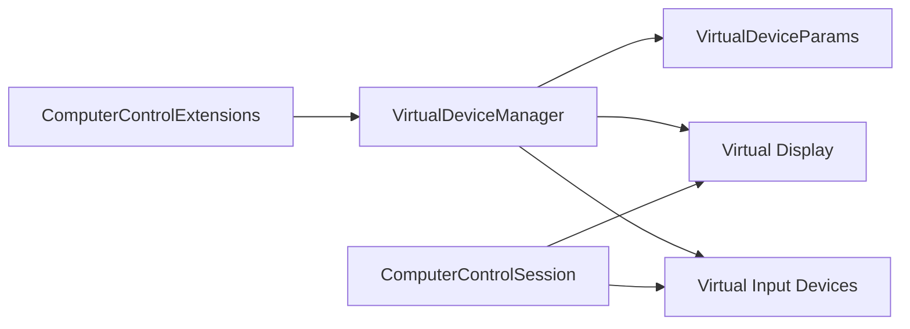

与一般 VirtualDevice 用法的关键区别在于，Computer Control 会话创建一个带输入注入能力的**可信**虚拟显示屏。系统服务器强制只有会话属主才能注入输入事件。

### 51.3.10 扩展层 Action API

在 Android 17 中，扩展库暴露的是面向手势的高层 API，而不是低级事件封装器。早期的 `TouchEvent` / `KeyEvent` 封装类和 `sendTouchEvent` 路径都已被移除。代理在屏幕坐标系中工作，扩展库将它们转换为平台输入：

```java
// frameworks/base/libs/computercontrol/.../ComputerControlSession.java

public void tap(int x, int y);
public void swipe(int fromX, int fromY, int toX, int toY, ...);
public void longPress(int x, int y);
public void performAction(@Action int actionCode);  // only ACTION_GO_BACK is defined
```

每次调用都会转发给平台 `ComputerControlSession`。该会话将手势路由到会话的 `VirtualTouchscreen` 或 `VirtualDpad`。它还会重置稳定性状态，因此代理的 `StabilityListener` 可以检测 UI 何时重新安定下来（51.3.27）。

### 51.3.11 文本插入 API

对于文本字段，扩展会话提供一个高层 `insertText()`，避免了单个按键事件的复杂性：

```java
// frameworks/base/libs/computercontrol/.../ComputerControlSession.java

public void insertText(@NonNull String text, boolean replaceExisting, boolean commit);
```

在服务端，它优先使用 `InputConnection` 路径（51.3.29）直接操作焦点文本字段。`commit` 参数触发一个 IME 动作（比如按下"Done"或"Send"）；`replaceExisting` 在插入前清空字段当前内容。

### 51.3.12 截图与感知-行动循环

除了输入，扩展会话还暴露 `getScreenshot()`，返回从可信虚拟显示屏捕获的 `Image`：

```java
// frameworks/base/libs/computercontrol/.../ComputerControlSession.java

public Image getScreenshot();
```

与无障碍树（51.3.7）和稳定性信号（51.3.27）一起，这完成了感知-行动循环。代理截图并对像素（和/或无障碍节点）进行推理。然后用
`tap`/`swipe`/`insertText` 行动，等待 `onSessionStable()`，再次截图。

### 51.3.13 Interactive Mirror 与 Co-Pilot 模式

在 Android 17 中，扩展层 `ComputerControlSession` 直接返回平台 `InteractiveMirror`。它不将其包装为单独的类型。扩展库还附带一个 `MirrorView`（一个 `FrameLayout`），用于在代理自己的 UI 中承载镜像：

```java
// frameworks/base/libs/computercontrol/.../ComputerControlSession.java

public InteractiveMirror createInteractiveMirror(
        IResultReceiver a11yEmbeddedConnectionReceiver) {
    return mSession.createInteractiveMirror(a11yEmbeddedConnectionReceiver);
}
```

`MirrorView`（`frameworks/base/libs/computercontrol/.../view/MirrorView.java`）
只能附加到安全、可信的显示屏上。

这使得几个重要用例成为可能：

1. **调试**：开发者可以实时观看 AI 自动化
2. **人在回路中**：用户可以观察 AI 的动作并介入
3. **流式传输**：镜像可用于广播自动化会话
4. **多代理**：一个代理控制，另一个通过镜像观察

### 51.3.14 会话关闭与资源清理

```java
// frameworks/base/libs/computercontrol/.../ComputerControlSession.java

@Override
public void close() {
    mSession.close();
}
```

close 就是一行代码，委托给平台会话。清理（包括注销无障碍代理）发生在会话的 `onClosed` 生命周期回调中，而不是在 `close()` 本身内部。因此，无论代理关闭了会话还是框架关闭了会话，都会运行相同的拆除流程。

### 51.3.15 稳定性检测架构

在 Android 17 中，稳定性检测位于平台
`ComputerControlAccessibilityProxy` 中，由 `StabilitySignalTracker` 驱动。流程是：

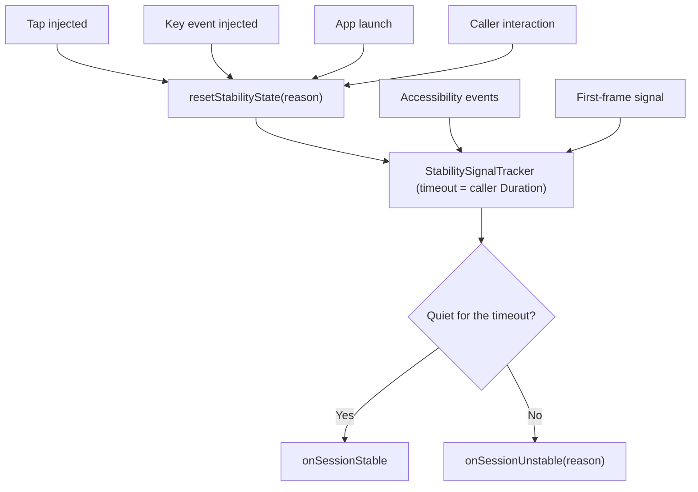

代理注册一个带有所选超时 `Duration` 的 `StabilityListener`。当无障碍事件和首帧信号在该时长内保持静默时，跟踪器触发 `onSessionStable()`。当屏幕仍在剧烈变化时，它报告 `onSessionUnstable(reason)`（51.3.27）。

### 51.3.16 扩展库文件清单（Android 17）

扩展库在 Android 17 中被精简。低级输入封装器和单独的空闲/稳定性跟踪器被移除。平台稳定性代理和手势级 API 取代了它们：

| 文件 | 用途 |
|------|---------|
| `ComputerControlExtensions.java` | 入口点、会话工厂、自动化包监听器注册 |
| `ComputerControlSession.java` | 扩展会话包装器（手势 API、截图、无障碍、稳定性） |
| `AutomatedPackageListener.java` | 包自动化通知 |
| `view/MirrorView.java` | 镜像显示屏视图组件（仅限安全/可信显示屏） |

### 51.3.17 权限模型

Computer Control 使用分层权限模型：

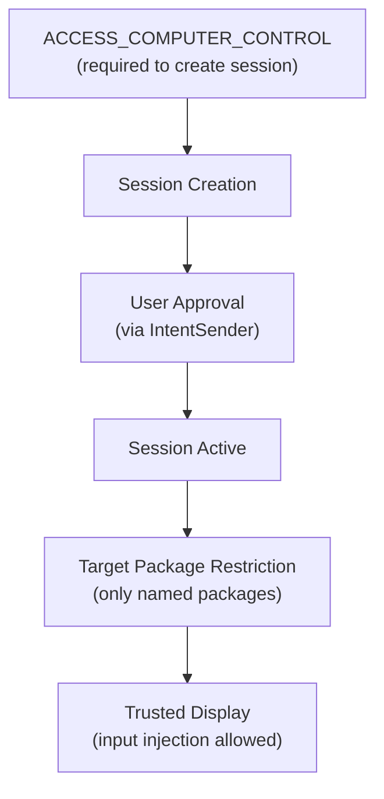

1. 应用必须持有 `ACCESS_COMPUTER_CONTROL`
2. 系统通过 `IntentSender` 呈现用户批准对话框
3. 只有 `targetPackageNames` 中列出的包才能被启动
4. 虚拟显示屏是可信的，从而允许输入注入
5. 权限控制器包总是被排除在自动化之外

### 51.3.18 System-Server 实现概览

51.3.1–51.3.16 小节中描述的扩展库是
**代理侧** API：代理应用链接并调用的客户端。
Computer Control 的 **system-server 侧**位于 VirtualDeviceManager（VDM）服务树内的一个兄弟包中。它包含真正的会话状态、策略门控，以及扩展存根（stub）所对话的 binder 对象。它还包含与输入、显示和无障碍栈的集成。

**源码树：**

```
frameworks/base/services/companion/java/com/android/server/companion/virtual/computercontrol/
    ComputerControlSessionProcessor.java          -- Session creation and policy gate
    ComputerControlSessionImpl.java               -- Core session binder
    ComputerControlAllowlistController.java        -- Device-level agent/target allowlist policy
    InteractiveMirrorImpl.java                    -- Mirror display + virtual touchscreen
    AutomatedPackagesRepository.java              -- Tracks automated packages for launchers
    ComputerControlDataStore.java                 -- Persisted session/consent state
    SessionLifecycle.java                         -- Session lifecycle state machine
    ComputerControlStatsController.java           -- Metrics
```

在 Android 17 中，UI 稳定性检测从专用的服务端计算器移出。现在它位于代理侧的 `ComputerControlAccessibilityProxy` 中。该代理跟踪无障碍事件并触发会话的
`StabilityListener`（51.3.6）。下图展示了扩展侧会话与其
system-server 对应物的关系。

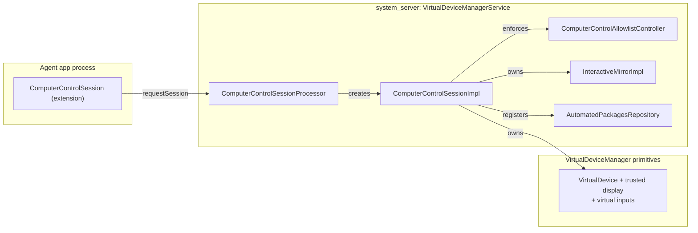

该包位于 `services/companion/` 内，而不是 `services/core/` 内，因为 Computer Control 是 VDM 子系统的一部分。第 52 章将讲解 Computer Control 在其上组合的通用 VDM 机制——VirtualDevice 创建、虚拟显示屏 surface、虚拟输入分发。

### 51.3.19 ComputerControlSessionProcessor：会话创建与限制

`ComputerControlSessionProcessor` 拥有创建会话的入口点逻辑。策略流程按此顺序运行——注意 AppOps 只决定是否需要*同意*对话框：

1. **AppOps 同意检查。** 处理器调用
    `noteOpNoThrow(OP_COMPUTER_CONTROL, request.attributionSource(), ...)`
    （`frameworks/base/services/companion/java/com/android/server/companion/virtual/computercontrol/ComputerControlSessionProcessor.java`）。
    `MODE_IGNORED` 和 `MODE_ERRORED` 直接以
    `ERROR_PERMISSION_DENIED` 拒绝请求。`MODE_ALLOWED` 意味着用户之前为该代理包选择了
    "始终允许"。它跳过同意对话框（当 `computer_control_per_app_consent`
    开启时，仍受按目标应用的同意检查约束）并继续创建会话。只有 `MODE_DEFAULT` 会走同意对话框流程。
2. **并发会话上限。** `checkSessionCreationPreconditionsLocked()`
    首先测试常量 `MAXIMUM_CONCURRENT_SESSIONS`
    （`ComputerControlSessionProcessor.java`，Android 17 中当前为 `1`），
    它限制系统范围内同时存活的 Computer Control 会话数量。超出则返回 `ERROR_SESSION_LIMIT_REACHED`。
3. **跨设备授权。** 对于跨设备请求（设置了
    `CompanionDeviceId`），`AuthenticationPolicyManager` 必须授权
    该代理，否则请求以 `ERROR_PERMISSION_DENIED` 失败。
4. **设备锁定门控。** 处理器随后检查 keyguard。如果设备已锁定，则以
    `ERROR_DEVICE_LOCKED` 拒绝，随后检查调用方是否有一个可见的非 toast 窗口。
5. **同意对话框。** 如果前置条件通过且需要同意，处理器通过返回给代理的
    `IntentSender` 启动 `RequestComputerControlAccessActivity`。

`MODE_ALLOWED` 不会跳过第 2–4 步的前置条件。
`createSession()` 在构造会话之前会无条件地重新运行
`checkSessionCreationPreconditionsLocked(request)`。因此 AppOps 结果只短路对话框。

类头注释明确记录了其角色："*本类强制执行会话创建策略，例如限制并发数量……*"
（`ComputerControlSessionProcessor.java`）。

一旦策略流程成功完成，处理器构造一个
`ComputerControlSessionImpl`，并把请求和一个
`VirtualDeviceFactory` 交给它。会话实现自己的构造函数创建底层 `VirtualDevice`、可信 `VirtualDisplay` 和会话的虚拟输入设备（51.3.20）。然后处理器通过原始的
`ComputerControlSession.Callback` 将会话的 binder 交回调用方。

会话上限是全局的，而不是按代理的。在 Android 17 中它是 `1`，因此框架一次只接纳一个 Computer Control 会话。该上限是一个防御性边界，而不是调优旋钮。如果请求触及它，表明要么代理侧存在泄漏（未能关闭会话），要么第二个代理在争夺控制权。在没有刻意的策略变更的情况下，系统拒绝接纳该代理。

### 51.3.20 ComputerControlSessionImpl：会话 Binder

`ComputerControlSessionImpl` 是支撑
`IComputerControlSession.aidl` 的实际 binder 对象
（`frameworks/base/services/companion/java/com/android/server/companion/virtual/computercontrol/ComputerControlSessionImpl.java`）。
它是 Computer Control system-server 包中最大的单个文件。输入路由、参数验证和生命周期拆除主导了它的体量，而非业务逻辑。

其职责按生命周期排序：

- **构造。** 从处理器接收会话请求（带有调用代理的
  归因和请求的 `targetPackageNames` 允许列表）以及一个
  `VirtualDeviceFactory`。在它自己的构造函数中，它创建
  `VirtualDevice`、可信 `VirtualDisplay`、
  `VirtualDpad`/`VirtualTouchscreen` 和 `VirtualAudioDevice`。
- **输入分发。** 通过路由到合适的虚拟输入设备或
  IME 集成路径（51.3.29），实现 `tap`、`swipe`、`longPress`、`insertText` 和
  `performAction`。
- **显示 surface。** 通过
  `initialize()` 接受客户端提供的 `Surface`，并将虚拟显示屏渲染进其中。代理侧会话从自己的 `ImageReader` 拉取截图帧（51.3.3）。因此不存在服务端 `getScreenshot()` 调用。
- **应用启动。** 在对照会话允许列表检查包之后，实现
  `launchApplication(packageName)`。如果自动化包被代理以外的某人启动，则会弹出
  `AutomatedAppLaunchWarningActivity`（51.3.24）。
- **稳定性。** 每次输入分发和应用启动都会重置会话的
  稳定性状态；稳定性信号本身由
  `ComputerControlAccessibilityProxy`（51.3.27）在代理侧计算。
- **镜像显示屏。** 当会话请求了实时视图时（51.3.5），可选地拥有一个
  `InteractiveMirrorImpl`。
- **生命周期拆除。** 在代理的回调上调用 `Binder.linkToDeath()`，
  因此代理进程崩溃会自动关闭会话、释放 VirtualDevice，并清除
  `AutomatedPackagesRepository` 中的会话记录行。

binder-on-binder 结构是标准的 AOSP 模式。代理持有一个
`IComputerControlSession` 存根，系统服务器持有一个
`IComputerControlSessionCallback` 存根。死亡链接双向运行，因此任何一方都不能在进程退出后持有另一方的资源。

### 51.3.21 虚拟输入设备：产品 ID 与可信显示屏

在 Android 17 中，一个 Computer Control 会话拥有两个虚拟输入设备。每个都在 Computer Control 保留的产品 ID 范围内有一个固定产品 ID。这让输入系统可以将它们与物理输入及其他虚拟显示屏会话区分开：

| 设备 | 产品 ID | 常量 | 用途 |
|--------|-----------|----------|---------|
| Virtual D-pad | `0xCC01` | `PRODUCT_ID_DPAD` | 按键事件（方向键和字符键） |
| Virtual touchscreen | `0xCC03` | `PRODUCT_ID_TOUCHSCREEN` | 点击、滑动、长按手势 |

常量在 `ComputerControlSessionImpl` 中声明（带有固定的
`VENDOR_ID` 值 `0x0000`）。注意没有单独的虚拟键盘设备。
按键事件经由 `VirtualDpad`（`sendKeyEvent`）流转。富文本输入路由经过 IME 集成路径（51.3.29）。`0xCC` 前缀在更广的 VDM 虚拟输入
产品 ID 空间内划出了一个 Computer Control 保留块。关于承载 Computer Control 输入的通用 `VirtualInputDevice` 方案，见第 52 章。

会话的显示屏是一个**可信** `VirtualDisplay`（以
`VIRTUAL_DISPLAY_FLAG_TRUSTED | VIRTUAL_DISPLAY_FLAG_ALWAYS_UNLOCKED` 创建）。
会话创建它之后，会显式配置三个行为，使其与普通虚拟显示屏区分开。这些是单独的调用，而不是信任标志的副作用：

1. **禁用动画。** `setAnimationsDisabledForDisplay(...)`
    在此显示屏上抑制系统和应用动画。这意味着代理的按动作稳定性检测在读取下一个状态前不必等待动画完成。
2. **隐藏 IME。** `setDisplayImePolicy(displayId, DISPLAY_IME_POLICY_HIDE)`
    阻止软键盘在显示屏上自动弹出。文本输入要么使用
    `VirtualDpad` 按键事件，要么路由经过 51.3.29 的 IME 集成路径。
3. **禁用焦点窃取。** `setCanStealTopFocusForDisplay(..., false)`
    阻止显示屏上的窗口窃取顶部焦点，因此弹窗不能将代理的后续输入重定向到无关 surface。当交互式镜像附加时，焦点窃取被重新启用，因此人类用户的触摸行为正常。

这些组合将显示屏转变为一块确定性的 surface，代理可以在其上驱动，而无需用户的喜爱体验层添加噪声。

### 51.3.22 会话创建流程端到端

从代理的 `requestSession()` 调用到一个
就绪可驱动的会话，会经历以下过程。

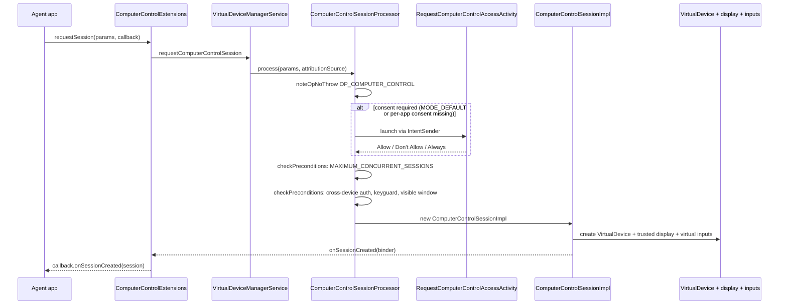

同意步骤是有条件的。在先前会话中被授予了**始终允许**的代理会跳过对话框，因为 AppOps 记录会携带该决定。
AppOps 记录是按包和按用户的。因此通过"设置"撤销会使下一个请求回到对话框路径。代理在请求本身上不会注意到这一点。它只会观察到对话框出现或不出现。

一旦 `onSessionCreated` 触发，代理就拥有一个可以反复调用而无需再经过处理器往返的 binder。每个输入调用都直接
代理 → `ComputerControlSessionImpl`；处理器只在会话创建时被咨询。

### 51.3.23 错误码与会话约束

会话创建失败时返回三个错误码之一。常量位于公共扩展 API 中
`frameworks/base/core/java/android/companion/virtual/computercontrol/ComputerControlSession.java`：

| 代码 | 值 | 条件 |
|------|-------|-----------|
| `ERROR_SESSION_LIMIT_REACHED` | 1 | 系统范围内活动 Computer Control 会话过多 |
| `ERROR_DEVICE_LOCKED` | 2 | 会话创建时 keyguard 处于锁定状态 |
| `ERROR_PERMISSION_DENIED` | 3 | 按会话的同意被用户拒绝 |

这些定义与 `ERROR_UNKNOWN`（0）一起位于 `ComputerControlSession.java` 中。

这三个错误干净地映射到 `ComputerControlSessionProcessor`（51.3.19）中的三项策略检查：每个策略对应一个错误。实现稳健重试逻辑的代理可以通过行为区分它们：

- `ERROR_SESSION_LIMIT_REACHED` 是暂时的——等待并重试。
- `ERROR_DEVICE_LOCKED` 被用户阻塞——提示用户解锁；在屏幕点亮时重试。
- `ERROR_PERMISSION_DENIED` 对该请求是持久的。在代理再次请求之前，先通过代理自己的 UX 升级到用户处理。注意过于激进的重复请求会以骚扰的形式暴露给用户。

设备锁定门控在创建时检查，而不是在会话生命周期内维护。在屏幕锁定前拥有已打开会话的代理保留该会话；代理只是不能在解锁前对锁定的屏幕执行操作。在锁定时拆除会话会与前台应用行为竞争，并会打断那些合法跨越短暂息屏的代理。

### 51.3.24 同意 Activity 流程

按会话的同意对话框是 `RequestComputerControlAccessActivity`
（`frameworks/base/packages/VirtualDeviceManager/src/com/android/virtualdevicemanager/RequestComputerControlAccessActivity.java`）。
它是 VDM 平台包内一个平台签名的 activity。代理无法直接启动它。它只能通过处理器在同意缺失时返回的 `IntentSender` 启动。

对话框呈现三个选项：

- **Allow（允许）**——仅授予本次会话的同意。AppOps
  将授予记录为会话范围。
- **Don't Allow（不允许）**——拒绝。处理器向调用方返回 `ERROR_PERMISSION_DENIED`。
- **Always Allow（始终允许）**——为代理包记录一个持久的 AppOps 授予。
  来自同一包的未来 `requestSession()` 调用完全跳过对话框。

该 activity 携带 `android:filterTouchesWhenObscured="true"`——与
`RequestPermissionActivity` 使用的反点击劫持（tapjacking）标志相同——因此覆盖窗口无法把触摸事件透传给同意按钮。这一点很重要，因为 Computer Control 的同意授予对点击劫持攻击者特别有吸引力。一次成功的授予会让攻击者的代理在受认可的会话内驱动用户的其他应用。

考虑以下情况：*用户或其他应用*启动了一个 Computer Control 会话当前正在驱动的包。那么系统会弹出
`AutomatedAppLaunchWarningActivity`
（`frameworks/base/packages/VirtualDeviceManager/src/com/android/virtualdevicemanager/AutomatedAppLaunchWarningActivity.java`）。
它警告他们该应用处于自动化之下。警告会点名自动化方的包，并提供停止自动化的选项。

当代理自己发起启动时，该警告被刻意抑制。
`AutomatedPackagesRepository.createAutomatedAppLaunchWarningIntent()` 在调用包是会话自己的设备属主时返回
无 intent。因此该警告保护用户，使其不会不知不觉地踏入一个被自动化的应用。它不适用于代理受认可的启动。

### 51.3.25 AppOps 与按会话跟踪

Computer Control 使用 AppOps 系统跟踪按包的同意状态。相关 op 是
`frameworks/base/core/java/android/app/AppOpsManager.java` 中的
`OP_COMPUTER_CONTROL`，与它的 op 字符串 `OPSTR_COMPUTER_CONTROL` 一起定义，并绑定到
`ACCESS_COMPUTER_CONTROL` 权限：

```java
public static final int OP_COMPUTER_CONTROL = AppOpEnums.APP_OP_COMPUTER_CONTROL;
```

AppOps 记录带有模式（`MODE_ALLOWED`、`MODE_IGNORED`、
`MODE_ERRORED`、`MODE_DEFAULT`）的授予，范围按包 + 归因划分。每次会话创建都会在
`ComputerControlSessionProcessor` 中调用
`noteOpNoThrow(OP_COMPUTER_CONTROL, request.attributionSource(), ...)`。结果决定下一步。
`MODE_IGNORED` 和 `MODE_ERRORED` 直接以 `ERROR_PERMISSION_DENIED` 拒绝请求。
`MODE_ALLOWED` 跳过同意对话框（当 `computer_control_per_app_consent`
开启时，仍受按目标应用的同意检查约束）。只有 `MODE_DEFAULT` 走同意对话框流程。

无论模式如何，前置条件都在 `createSession()` 中评估。它们是：并发会话上限、跨设备授权、keyguard 和
可见窗口检查。no-throw 变体返回模式作为 int 而不是抛出 `SecurityException`。对于根据结果分支而非直接退出的路由器来说，这是正确的形态。

这与 `OP_CAMERA`、
`OP_RECORD_AUDIO` 和 `OP_FINE_LOCATION` 等敏感 op 所用的机制相同。将 Computer Control 视为 AppOp 而非一次性权限有两个值得单独指出的含义：

- **可撤销性。** 用户可以在"设置"中为特定代理撤销 Computer Control，而无需卸载代理。来自该代理的后续 `requestSession()` 调用会回到对话框流程。
- **可审计性。** AppOps 记录每次 `noteOp` 调用，因此隐私仪表盘可以显示哪些代理在何时请求过 Computer Control，即使会话已经结束。

匹配的权限 `android.permission.ACCESS_COMPUTER_CONTROL`
（`frameworks/base/core/res/AndroidManifest.xml`）的保护级别为
`internal|privileged`，并且它本身由
`android.companion.virtualdevice.flags.computer_control_access` 特性标志门控。
这意味着只有特权（预装）代理才能*请求* Computer Control 会话。AppOps 层在此平台级门控之上增加了按授予的用户可见控制。两者共同实现纵深防御。非特权的第三方应用甚至无法提出请求，特权代理也无法自我授予。

### 51.3.26 防篡改机制

Computer Control 的威胁模型假设恶意应用可能尝试三种攻击。攻击（a）诱骗用户授予 Computer
Control 同意。攻击（b）劫持一个已授予的会话。攻击（c）搭乘一个已授予的会话进入用户不打算暴露的应用。框架用不同的机制防御每一种：

1. **同意 activity 上的 FilterTouches。**
    `RequestComputerControlAccessActivity` 和
    `AutomatedAppLaunchWarningActivity` 都声明了 FilterTouches 主题
    （VDM 的
    `res/values/themes.xml` 中的 `Theme.RequestComputerControlAccessActivity.FilterTouches` /
    `Theme.AutomatedAppLaunchWarningActivity.FilterTouches`，各自设置 `android:filterTouchesWhenObscured`）。
    因此覆盖窗口无法把触摸事件透传给同意按钮。这阻挡了针对权限对话框的经典点击劫持攻击——与早期 Android 版本中通过 `SYSTEM_ALERT_WINDOW` 滥用暴露的模式相同。
2. **按会话的包允许列表。** `ComputerControlSessionImpl` 拒绝
    代理的 `launchApplication(packageName)`，除非 `packageName` 在会话创建时被声明在 `targetPackageNames` 中（构造函数
    会把它们拷贝进 `mAllowlistedPackages`）。一个打开了消息应用的 Computer Control 会话不能在同一会话中稍后启动银行应用。`ComputerControlAllowlistController` 在更高一层运作。它是设备级策略，在会话创建之前验证代理
    （`isPackageAllowedToCreateSession`）和目标包
    （`isPackageAutomatable`）。
3. **面向用户的自动化应用警告。** 当用户或其他应用
    启动一个会话当前正在驱动的包时，系统
    显示 `AutomatedAppLaunchWarningActivity`（51.3.24）。警告告诉他们该应用处于自动化之下并提供停止选项。当代理自己发起启动时，警告不会出现。
4. **Binder 死亡监控。** `ComputerControlSessionImpl` 在代理的回调 binder 上调用
    `Binder.linkToDeath()`。如果代理进程被杀，系统会自动关闭会话并释放
    `VirtualDevice`。原因可能是 oom-killer、用户在最近任务中滑动，或崩溃。这防止了一个长期存活的孤儿会话在其操作者离开后继续驱动设备。

这些机制相互组合。攻击者可能绕过同意 activity 上的点击劫持防护（机制 1）并获得一个会话。活动列表（机制 2）仍然会阻止攻击者扩大会话的触及范围。

用户可能会走进一个会话正在静默驱动的应用。用户会收到警告并获得一个停止按钮（机制 3）。如果攻击者的植入进程死亡，会话会被立即释放（机制 4）。

### 51.3.27 通过无障碍代理进行稳定性检测

在 Android 17 中，稳定性检测在代理侧计算，而不是由专门的服务端计算器计算。`ComputerControlAccessibilityProxy`
（`frameworks/base/core/java/android/companion/virtual/computercontrol/ComputerControlAccessibilityProxy.java`）
拥有一个 `StabilitySignalTracker`，它决定 UI 在注入事件后何时*安定下来*，并调用会话的 `StabilityListener`。

该决策基于超时。代理注册一个带有所选 `Duration` 的监听器：

```java
// frameworks/base/core/java/android/companion/virtual/computercontrol/ComputerControlSession.java

public interface StabilityListener {
    void onSessionStable();
    default void onSessionUnstable(@UnstableReason int reason) {}
}

public void setStabilityListener(
        @NonNull Duration duration, @NonNull Executor executor,
        @NonNull StabilityListener listener);
public void clearStabilityListener();
```

跟踪器监视两路证据流：来自被控制应用的无障碍事件（`onAccessibilityEvent`）和首帧信号
（`onFirstFrameReceived`）。每次输入分发、应用启动或调用方交互都会以一个 `@UnstableReason` 调用 `resetStabilityState(reason)`。
该调用重启静默期。当所配置的 `duration` 内没有更多事件到达时，跟踪器触发 `onSessionStable()`。当 UI 仍在剧烈变化时，跟踪器报告 `onSessionUnstable(reason)`。然后代理知道*为什么*屏幕尚未安定下来（例如，调用方交互或进行中的启动）。

超时是调用方提供的，而不是按事件类固定的常量。因此代理可以调节它：轻快的单次点击流程用短超时，冷启动应用启动用更长的超时。框架只是发出信号。代理选择是否等待 `onSessionStable()`（例如，在它捕获操作后截图之前），还是立即继续。

### 51.3.28 AutomatedPackagesRepository 与启动器指示器

`AutomatedPackagesRepository`
（`frameworks/base/services/companion/java/com/android/server/companion/virtual/computercontrol/AutomatedPackagesRepository.java`）
维护系统范围内当前正被 Computer Control 会话驱动的包集合。它服务两个消费者：

1. **启动器**注册一个 `IAutomatedPackageListener`，以了解哪些
    应用图标应显示"代理正在驱动此应用"的指示器。
    该指示器是一个 UI 便利特性，而不是安全边界；它让用户一眼就能知道*哪个*应用当前正被代理控制。
2. **系统 UI** 使用同样的数据渲染全局"代理活跃"状态图标，并路由关于自动化活动的通知。

每当集合发生转换，仓库就会触发
`onAutomatedPackagesChanged(String automatingPackage, List<String> automatedPackages, UserHandle user)`
。该调用告诉监听器哪个代理在自动化哪些包、面向哪个用户。每个 `ComputerControlSessionImpl` 在会话启动时注册其允许列表中的包，并在会话关闭时注销它们。
仓库对每个包进行引用计数。因此只有当最后一个引用会话关闭时，它才会退出"自动化"状态。这对 `MAXIMUM_CONCURRENT_SESSIONS` 未来从当前值 `1` 提升是稳健的。

这就是框架承诺的用户透明性契约。被自动化的应用总是可以从视觉上与用户驱动的应用区分开。这即使在代理和用户通过交互式镜像（51.3.13）交错控制时也成立。用户永远不会猜测屏幕上发生的事情是他们的点击还是代理的操作。

### 51.3.29 IME 集成：IRemoteComputerControlInputConnection

当打字路径启用时，`insertText()` 必须通过标准 IME 管道将文本路由进焦点输入字段。这样，输入验证、自动更正、密码掩码和无障碍事件都会像软键盘点击一样触发。该机制是
`IRemoteComputerControlInputConnection.aidl`
（`frameworks/base/core/java/com/android/internal/inputmethod/IRemoteComputerControlInputConnection.aidl`）。

流程：

- 代理调用 `ComputerControlSession.insertText(text, replaceExisting, commit)`。
- 调用到达 system-server 侧的 `ComputerControlSessionImpl`。
- 实现会在
  `InputMethodManagerService.UserData.mComputerControlInputConnectionMap`
  （`frameworks/base/services/core/java/com/android/server/inputmethod/InputMethodManagerService.java`）
  中查找该会话显示屏的 `IRemoteComputerControlInputConnection`，
  以客户端自报的显示 ID 为键。
- 远程连接包装焦点窗口的 `InputConnection`。
  接口暴露 `commitText()`、`replaceText()`、`sendKeyEvent()` 和
  `performEditorAction()`。方法 `insertText()` 在
  `replaceExisting` 已设置时调用 `replaceText()`，否则调用 `commitText()`，并在
  `commit` 为真时调用 `performEditorAction()`。这些正是软键盘会使用的方法。
- 目标应用通过其正常的 `InputConnection`
  回调看到文本到达，其形态与软键盘调用方无法区分。

以显示 ID 作为 map 的键很重要，因为每个 Computer Control 会话拥有自己的可信显示屏。在 Android 17 中 `MAXIMUM_CONCURRENT_SESSIONS` 为
`1`，因此一次只有一个会话存活。显示 ID 仍然能消除歧义——哪个会话的文本路由到哪里。它也使设计为更大的上限做好准备。

`insertText()` 仅限 `InputConnection`。如果会话显示屏没有注册
`ComputerControlInputConnectionData`（那里没有焦点编辑器启动输入），调用会记录一条错误并被丢弃。错误信息为*"Unable to insert text: No input connection..."*。没有回退到通过
`VirtualDpad` 合成按键事件；希望文本落地的代理必须先聚焦一个可编辑字段。

### 51.3.30 特性标志集

Computer Control 在 `virtual_devices` 命名空间的一组 aconfig 标志之后发布
（`frameworks/base/core/java/android/companion/virtual/flags/flags.aconfig`）。
它们干净地分离了独立特性的发布。在 Android 17 中，标志是：

| 标志 | 门控 |
|------|-------|
| `computer_control_access` | 核心特性：`ACCESS_COMPUTER_CONTROL` 权限与会话 API |
| `computer_control_per_app_consent` | 会话的按应用同意模型（51.3.24） |
| `computer_control_role_assistant_requirement` | 创建会话需要 `ASSISTANT` 角色 |
| `computer_control_managed_profiles` | 托管（工作）profile 内的 Computer Control 支持 |
| `computer_control_cross_device` | 跨设备 Computer Control 会话 |
| `computer_control_support_v5` | Computer Control "v5" API 界面 |

设备可以发布 Computer Control 的核心界面（`computer_control_access`
开启），而无需承诺每个策略层。这对分阶段发布很有用，按应用同意模型和助手角色要求可以增量落地。反之，设备也可以在发布时开启所有标志，从第一天起就具备完整的态势。

该标志集也可以作为路线图来解读。发现 Computer Control 处于不熟悉的演进阶段的读者可以检查哪些标志是开启的
（`adb shell device_config get virtual_devices <flag_name>`）。这显示了运行中的设备实际支持哪些特性，而与 API 界面所宣传的内容无关。

### 51.3.31 Companion-Device 子系统锚定

Computer Control 实现为 VirtualDeviceManager 的**一个**子系统，而不是与其并列。由此产生三个架构后果：

1. **代码位置。** 服务端类位于
    `frameworks/base/services/companion/`（VDM 服务树）下，而不是
    `frameworks/base/services/core/` 下。包路径内嵌
    `virtual/computercontrol/`，以便在文件系统层面明确从属关系。
2. **生命周期属主。** `VirtualDeviceManagerService` 拥有
    `ComputerControlSessionProcessor` 实例和
    `AutomatedPackagesRepository`。当 VDM 拆除时，
    Computer Control 状态随之拆除。一个例子是最后一个虚拟设备被释放、VDM 进入其空闲路径时。Computer Control 不能比其父级存活更久。
3. **复用 VDM 原语。** Computer Control 不会发明自己的
    显示、输入或 surface 捕获栈。它以 Computer Control 特定的会话策略组合现有的 VDM
    原语（`VirtualDevice`、`VirtualDisplay`、`VirtualDpad`、
    `VirtualTouchscreen`）。Computer Control 的新增内容很窄。它们是显示屏上的信任标志组合
    和输入上的固定产品 ID（51.3.21）。它们还包括会话范围的同意和 AppOps 跟踪（51.3.24–51.3.25）
    以及无障碍代理稳定性检测器（51.3.27）。

第 52 章讲解通用 VDM 机制。它涵盖 `VirtualDevice` 如何被构造和注册，以及虚拟显示屏如何浮入
WindowManager。它还涵盖虚拟输入事件如何经由
`InputDispatcher` 分发。最后，它描述了更广泛的 companion-device
生态系统（BLE 关联、远程设备认证）如何与 VDM 并列。对*如何*
将可信 `VirtualDisplay` 接入 WindowManager 以及 WindowManager 对其有何不同处理感兴趣的读者，应跟随该交叉引用。对 Computer Control *为什么*以这种方式组合那些原语、以及该组合强制执行哪些用户透明性契约感兴趣的读者，则留在本章。

### 51.3.32 已知消费者

Computer Control 第一个广泛发布的消费者是 **Gemini in
Android** 助手。代理循环的内部代号是 **Bonobo**
（应用跟踪中会出现日志前缀 `#bnb#`）。代理运行在 AGSA
进程（`com.google.android.googlequicksearchbox`）中。它消费本章记录的
AOSP 公共 Computer Control API。

AOSP 本身
不发布 Computer Control 代理——
`frameworks/base/libs/computercontrol/` 和上文描述的 system-server 包
是框架代码，不是应用代码。代理在 GMS 一侧，不属于本次检出。它作为第一个生产级 Computer Control 消费者的存在塑造了 API 当前的界面。

在 Gemini 消费者中可观察到的两种模式值得为任何新的 Computer Control 代理指出：

- **与 AppFunctions 的双路径回退。** 代理在其清单中声明两个
  `<uses-library>` 条目，
  `com.android.extensions.appfunctions` 和
  `com.android.extensions.computercontrol`。对于发布了
  `AppFunctionService` 支撑函数的应用，它优先使用 AppFunctions
  （51.2 节的结构化 API 路径）。对于没有的应用，它回退到
  Computer Control。同一个代理可以驱动两者，因为这两个框架在 SDK 扩展层面组合。代理同时链接两者，先查询
  `AppFunctionManager`，并在函数发现返回空结果的应用上使用 Computer Control。
- **实时镜像作为用户信任界面。** 代理在其聊天 UI 中渲染
  `InteractiveMirror`（51.3.5）。这样用户可以实时观看动作，并随时通过触摸转发路径收回控制权。这与框架的意图一致：Computer Control 并不使实时视图成为*可选项*，而是使没有实时视图成为不寻常的情况。没有可见镜像就运行 Computer
  Control 的代理，正是用户理应怀疑的那种代理。

Bonobo 代理循环如何与本章记录的 Computer Control API 组合。代理本身在 GMS 一侧；右侧的框架是 AOSP。

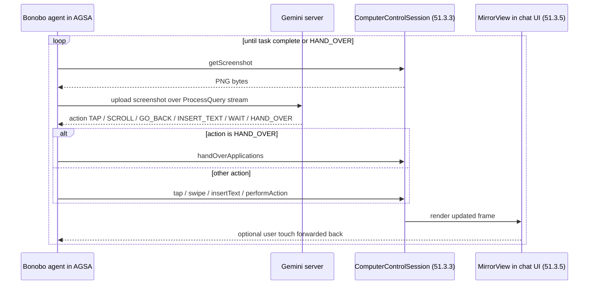

当服务器以 `HAND_OVER` 响应或用户通过镜像取得手动控制时，循环终止。动作词汇表
（`TAP`、`SCROLL`、`GO_BACK`、`INSERT_TEXT`、`WAIT`、`HAND_OVER`）与 51.3.3 中记录的
`ComputerControlSession` 方法以及导航 `performAction` 代码一一映射。代理不会合成框架未暴露的输入。代理可以发出框架接受的每一个动作。

双向的 `ProcessQuery`
流是代理用于上传截图并接收动作的 gRPC 通道。该流在 GMS 一侧，不属于本次检出。
它的形态仍然重要，因为它解释了该循环的**服务器驱动**性质。代理是一个薄执行器，在每次观测后询问服务器接下来要做什么。

除 Gemini 之外，Computer Control 首先在最高端的 Pixel
和 Galaxy 设备上发布，并随着上述特性标志的逐步开启而扩大。Computer Control 的新消费者应预期 API 界面保持本章所描述的稳定。
策略层（哪些标志默认开启）将继续收紧。

### 51.3.33 Android 17 安全与能力变更

Computer Control 在 Android 16 中发布（受 flag 门控），但 Android 17 重构了它的几个部分。这就是节首所说的"大幅扩展和重构"：

- **权限加固。** 门控权限 `ACCESS_COMPUTER_CONTROL` 从 16 的
  `internal|knownSigner`（通过 `config_accessComputerControlKnownSigners` 进行证书固定）变为 17 的
  `internal|privileged`（`core/res/AndroidManifest.xml:9531`），并由
  `privapp-permissions-platform.xml` 条目支撑。变更是从签名者固定转向特权应用
  允许列表模型。一个新的签名权限 `MANAGE_COMPUTER_CONTROL_CONSENT`
  （`AndroidManifest.xml:9537`）守护同意管理界面。
- **按应用同意。** 同意模型从 16 的会话/全局 `computer_control_consent`
  标志变为 17 的按目标应用 `computer_control_per_app_consent`（在 51.3.30 的标志集中）。用户现在按*目标应用*授予或拒绝代理的访问，而不是对整个会话授予一次。授予记录在现有的 `OPSTR_COMPUTER_CONTROL` AppOp
  （`"android:computer_control"`，其本身早于 17）之上。按应用门控才是 17 的变更。
- **音频捕获与注入。** 新的服务端组件 `ComputerControlAudioCapture` 和
  `ComputerControlAudioInjector`（由
  `ComputerControlSessionImpl` 中创建的 `VirtualAudioDevice` 支撑）让会话可以在其虚拟设备上捕获和注入音频。
  此能力在 16 中不存在。它把代理的观察/行动循环扩展到了屏幕和输入之外。
- **"观察"这一半被显式化。** `ComputerControlSession.getAccessibilityWindows()`
  （`core/java/android/companion/virtual/computercontrol/ComputerControlSession.java:798`）是代理用来*看见*结构化 UI 的无障碍窗口读取。它是截图路径的对应物。它委托给内部的 `ComputerControlAccessibilityProxy`（一个包私有的 `AccessibilityDisplayProxy` 子类，51.3.27）。

51.3.29-51.3.30 节涵盖了虚拟键盘的移除和完整的六标志集。文本现在路由经过 51.3.29 的 IME 路径。上述条目是在 17 中叠加在其上的安全性模型与能力增量。

---

## 51.4 OnDeviceIntelligence

OnDeviceIntelligence（ODI）框架提供一个系统级 API，用于在沙箱进程中运行大型 ML 模型（包括 LLM）。它的设计围绕一个原则：模型权重和推理逻辑绝不应被调用应用直接访问。

**源码树：**

```
frameworks/base/packages/NeuralNetworks/
    framework/platform/java/android/app/ondeviceintelligence/
        OnDeviceIntelligenceManager.java        -- Client API
        Feature.java                            -- Model feature descriptor
        FeatureDetails.java                     -- Feature metadata
        InferenceInfo.java                      -- Inference statistics
        ProcessingCallback.java                 -- Non-streaming result callback
        StreamingProcessingCallback.java        -- Streaming result callback
        OnDeviceIntelligenceException.java      -- Typed errors
        TokenInfo.java                          -- Token-level information
        ...
    framework/platform/java/android/service/ondeviceintelligence/
        OnDeviceSandboxedInferenceService.java  -- Isolated inference service
        OnDeviceIntelligenceService.java        -- Non-isolated counterpart
        ...
    service/platform/java/com/android/server/ondeviceintelligence/
        OnDeviceIntelligenceManagerService.java -- SystemService
        RemoteOnDeviceSandboxedInferenceService.java
        RemoteOnDeviceIntelligenceService.java
        ServiceConnector.java
        InferenceInfoStore.java
        ...
```

### 51.4.1 架构

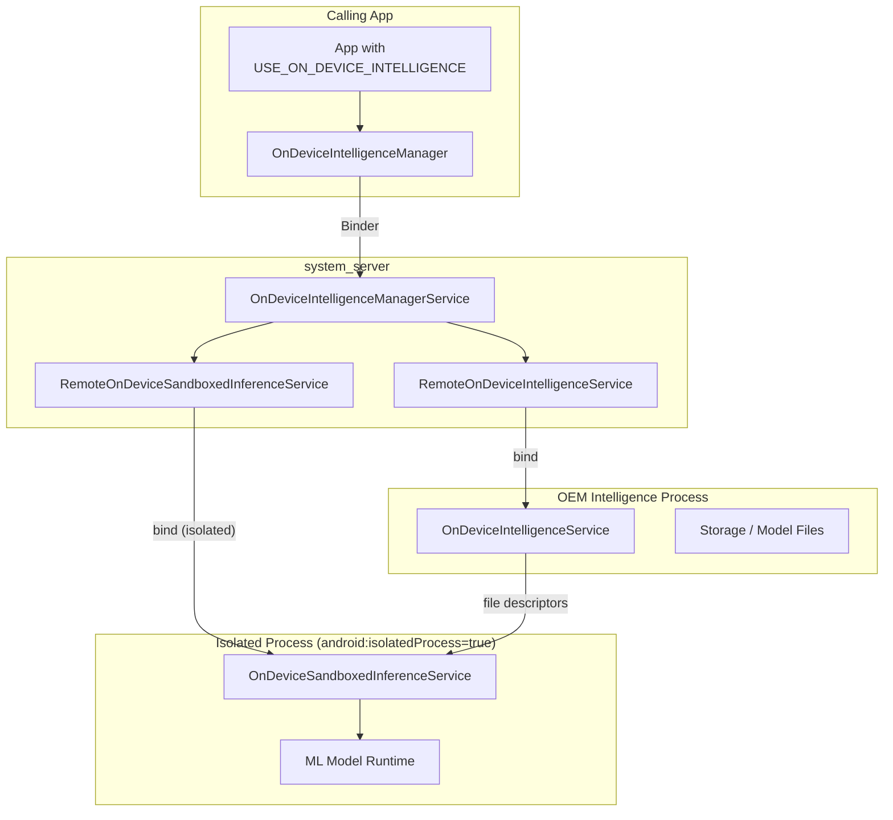

### 51.4.2 客户端：OnDeviceIntelligenceManager

该管理器是一个 `@SystemApi` 服务，需要 `USE_ON_DEVICE_INTELLIGENCE`：

```java
// frameworks/base/packages/NeuralNetworks/framework/platform/java/
//   android/app/ondeviceintelligence/OnDeviceIntelligenceManager.java

@SystemApi
@SystemService(Context.ON_DEVICE_INTELLIGENCE_SERVICE)
public final class OnDeviceIntelligenceManager {
```

主要操作：

| 方法 | 用途 |
|--------|---------|
| `getVersion()` | 查询远程实现版本 |
| `getRemoteServicePackageName()` | 获取提供推理的 OEM 包 |
| `listFeatures()` | 列出可用 ML 特性/模型 |
| `getFeature()` | 获取特定特性的详情 |
| `requestFeatureDownload()` | 触发模型下载 |
| `processRequest()` | 非流式推理请求 |
| `processRequestStreaming()` | 流式（逐 token）推理 |
| `requestTokenInfo()` | Token 计数/分析 |
| `registerInferenceServiceLifecycleListener()` | 模型加载/卸载通知 |

### 51.4.3 沙箱化推理服务

实际推理运行在隔离进程中：

```java
// frameworks/base/packages/NeuralNetworks/framework/platform/java/
//   android/service/ondeviceintelligence/OnDeviceSandboxedInferenceService.java

@SystemApi
public abstract class OnDeviceSandboxedInferenceService extends Service {
    public static final String SERVICE_INTERFACE =
            "android.service.ondeviceintelligence.OnDeviceSandboxedInferenceService";
```

清单声明：
```xml
<service android:name=".SampleSandboxedInferenceService"
         android:permission="android.permission.BIND_ON_DEVICE_SANDBOXED_INFERENCE_SERVICE"
         android:isolatedProcess="true">
</service>
```

`isolatedProcess="true"` 标志意味着该服务：

- 没有网络访问权限
- 无法访问应用的数据目录
- 无法访问 content provider
- 只能接收系统显式传递的文件描述符

模型权重通过 `OnDeviceIntelligenceService`（非隔离的配套服务）传递的
`ParcelFileDescriptor` 对象进入隔离进程。

### 51.4.4 双服务架构

ODI 采用双服务架构：

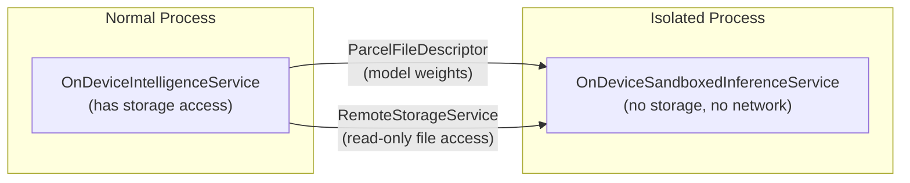

1. **OnDeviceIntelligenceService**——运行在 OEM 的普通进程中，具有
    完整的存储访问权限。处理模型管理、下载，并向隔离进程提供模型文件。

2. **OnDeviceSandboxedInferenceService**——运行在隔离进程中。
    执行实际推理。只通过文件描述符接收模型权重。这一设计确保即使推理引擎被攻破，也无法外泄模型权重或用户数据。

### 51.4.5 模型生命周期事件

框架支持模型加载/卸载的广播通知：

```java
// OnDeviceSandboxedInferenceService.java

public static final String MODEL_LOADED_BROADCAST_INTENT =
    "android.service.ondeviceintelligence.MODEL_LOADED";
public static final String MODEL_UNLOADED_BROADCAST_INTENT =
    "android.service.ondeviceintelligence.MODEL_UNLOADED";
```

### 51.4.6 系统服务

`OnDeviceIntelligenceManagerService` 继承 `SystemService`，并在
SYSTEM 用户下运行（而非按用户运行），因为 ML 模型可能占用大量内存：

```java
// frameworks/base/packages/NeuralNetworks/service/platform/java/
//   com/android/server/ondeviceintelligence/OnDeviceIntelligenceManagerService.java

public class OnDeviceIntelligenceManagerService extends SystemService {
    private static final String NAMESPACE_ON_DEVICE_INTELLIGENCE = "ondeviceintelligence";
    private static final long MAX_AGE_MS = TimeUnit.HOURS.toMillis(3);
    ...
```

该服务维护与两个远程服务的连接状态，并处理：

- 权限强制执行（仅限持有 `USE_ON_DEVICE_INTELLIGENCE` 的应用）
- 通过 `DeviceConfig` 命名空间 `ondeviceintelligence` 进行配置
- 用于跟踪推理统计的 `InferenceInfoStore`
- 用于测试的临时服务覆盖

### 51.4.7 InferenceInfo

框架引入了 `InferenceInfo` 来提供性能元数据：

```java
// OnDeviceIntelligenceManager.java

public static final String KEY_REQUEST_INFERENCE_INFO = "request_inference_info";
```

当被请求时，回调会收到 `InferenceInfo`，其中包含推理运行的时序与吞吐量指标。

### 51.4.8 特性发现与下载

特性生命周期遵循发现-下载-使用的模式：

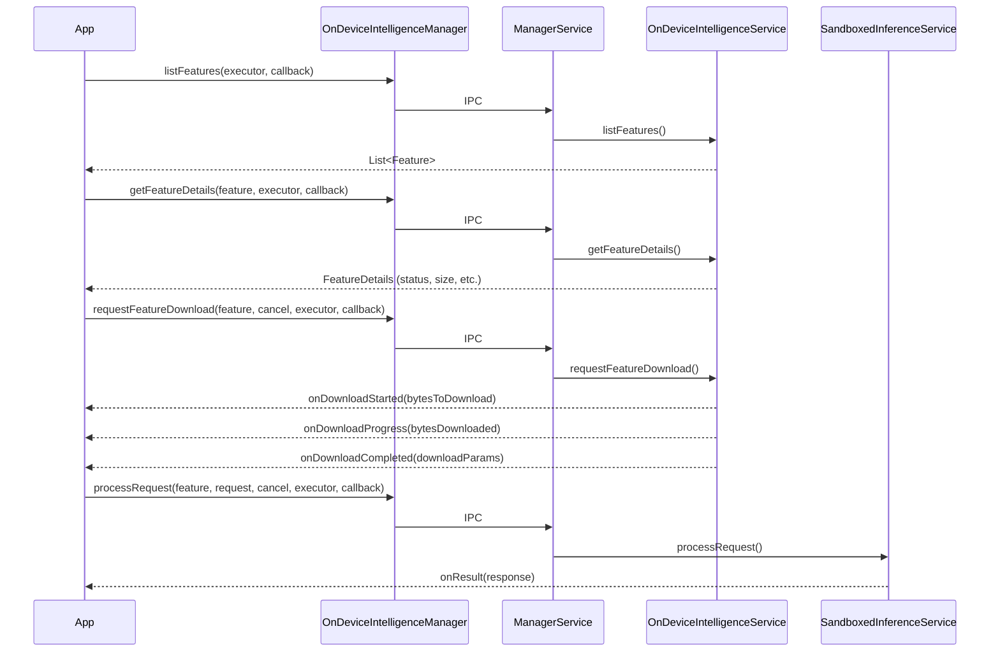

`DownloadCallback` 接口提供细粒度的进度：

```java
// OnDeviceIntelligenceManager.java

public void requestFeatureDownload(@NonNull Feature feature,
        @Nullable CancellationSignal cancellationSignal,
        @NonNull @CallbackExecutor Executor callbackExecutor,
        @NonNull DownloadCallback callback) {
```

下载失败原因包括：

- `DOWNLOAD_FAILURE_STATUS_DOWNLOADING`——已在下载中
- `DOWNLOAD_FAILURE_STATUS_NOT_ENOUGH_DISK_SPACE`
- `DOWNLOAD_FAILURE_STATUS_NETWORK_FAILURE`

### 51.4.9 处理模式

ODI 支持两种处理模式：

**非流式（请求/响应）：**

```java
@RequiresPermission(Manifest.permission.USE_ON_DEVICE_INTELLIGENCE)
public void processRequest(@NonNull Feature feature,
        @NonNull @InferenceParams Bundle request,
        @RequestType int requestType,
        @Nullable CancellationSignal cancellationSignal,
        @Nullable ProcessingSignal processingSignal,
        @NonNull @CallbackExecutor Executor callbackExecutor,
        @NonNull ProcessingCallback processingCallback);
```

**流式（逐 token）：**

```java
@RequiresPermission(Manifest.permission.USE_ON_DEVICE_INTELLIGENCE)
public void processRequestStreaming(@NonNull Feature feature,
        @NonNull @InferenceParams Bundle request,
        @RequestType int requestType,
        @Nullable CancellationSignal cancellationSignal,
        @Nullable ProcessingSignal processingSignal,
        @NonNull @CallbackExecutor Executor callbackExecutor,
        @NonNull StreamingProcessingCallback streamingProcessingCallback);
```

流式模式对 LLM 推理至关重要：生成完整响应可能需要数秒，但单个 token 到达得快得多。

### 51.4.10 Token 信息

`requestTokenInfo()` API 无需执行完整推理即可计算 token 级元数据：

```java
@RequiresPermission(Manifest.permission.USE_ON_DEVICE_INTELLIGENCE)
public void requestTokenInfo(@NonNull Feature feature,
        @NonNull @InferenceParams Bundle request,
        @Nullable CancellationSignal cancellationSignal,
        @NonNull @CallbackExecutor Executor callbackExecutor,
        @NonNull OutcomeReceiver<TokenInfo, OnDeviceIntelligenceException> outcomeReceiver);
```

其用途包括：

- 在推理前计数 token（以检查上下文限制）
- 估算推理成本/时间
- 无需完整生成的 token 级分析

### 51.4.11 生命周期监听器

应用可以注册，以便在模型加载或卸载时收到通知：

```java
// OnDeviceIntelligenceManager.java

private final Map<OnDeviceSandboxedInferenceService.LifecycleListener,
        ILifecycleListener.Stub> mLifecycleListeners = new ConcurrentHashMap<>();
```

这允许应用：

- 在模型加载时显示加载指示器
- 根据模型可用性调整 UI
- 通过在用户需要之前触发模型加载来进行预热

### 51.4.12 处理状态更新

系统可以通过服务 binder 存根上的
`updateProcessingState(Bundle processingState, IProcessingUpdateStatusCallback callback)`
将处理状态更新推送进沙箱服务。存根分发到服务的
`onUpdateProcessingState()` 覆写方法。
`IProcessingUpdateStatusCallback` 回传服务是否接受了该更新。

状态更新允许系统跟踪：

- 服务是否正在主动处理
- 模型占用了多少内存
- 服务是否处于降级状态

### 51.4.13 配置与 DeviceConfig

系统服务通过 `ondeviceintelligence`
DeviceConfig 命名空间控制：

```java
// OnDeviceIntelligenceManagerService.java

private static final String NAMESPACE_ON_DEVICE_INTELLIGENCE = "ondeviceintelligence";
private static final String KEY_SERVICE_ENABLED = "service_enabled";
private static final boolean DEFAULT_SERVICE_ENABLED = true;
```

OEM 通过系统资源配置实现包。该服务可以通过 shell 命令为测试临时覆盖。

### 51.4.14 流式推理协议细节

流式 API 以增量方式投递部分推理结果，这与 LLM 逐 token 的输出非常契合，但并非 LLM 专属：

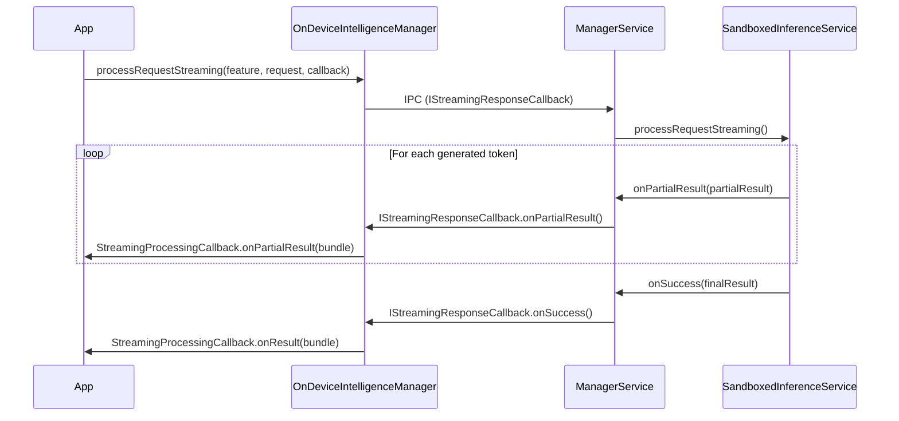

`IStreamingResponseCallback` 定义了传输协议：

```java
// OnDeviceIntelligenceManager.java (processRequestStreaming)

IStreamingResponseCallback callback = new IStreamingResponseCallback.Stub() {
    @Override
    public void onPartialResult(@InferenceParams Bundle result) {
        Binder.withCleanCallingIdentity(() -> {
            callbackExecutor.execute(
                    () -> streamingProcessingCallback.onPartialResult(result));
        });
    }

    @Override
    public void onSuccess(@InferenceParams Bundle result) {
        Binder.withCleanCallingIdentity(() -> {
            callbackExecutor.execute(
                    () -> streamingProcessingCallback.onResult(result));
        });
    }

    @Override
    public void onFailure(int errorCode, String errorMessage,
            PersistableBundle errorParams) {
        Binder.withCleanCallingIdentity(() -> {
            callbackExecutor.execute(
                    () -> streamingProcessingCallback.onError(
                            new OnDeviceIntelligenceException(
                                    errorCode, errorMessage, errorParams)));
        });
    }
```

### 51.4.15 数据增强协议

ODI 的一个独特特性是数据增强回调，它允许沙箱推理服务在推理中途向调用应用请求额外数据：

```java
// OnDeviceIntelligenceManager.java

@Override
public void onDataAugmentRequest(@NonNull @InferenceParams Bundle request,
        @NonNull RemoteCallback contentCallback) {
    Binder.withCleanCallingIdentity(() -> callbackExecutor.execute(
            () -> processingCallback.onDataAugmentRequest(request, result -> {
                Bundle bundle = new Bundle();
                bundle.putParcelable(AUGMENT_REQUEST_CONTENT_BUNDLE_KEY, result);
                callbackExecutor.execute(() -> contentCallback.sendResult(bundle));
            })));
}
```

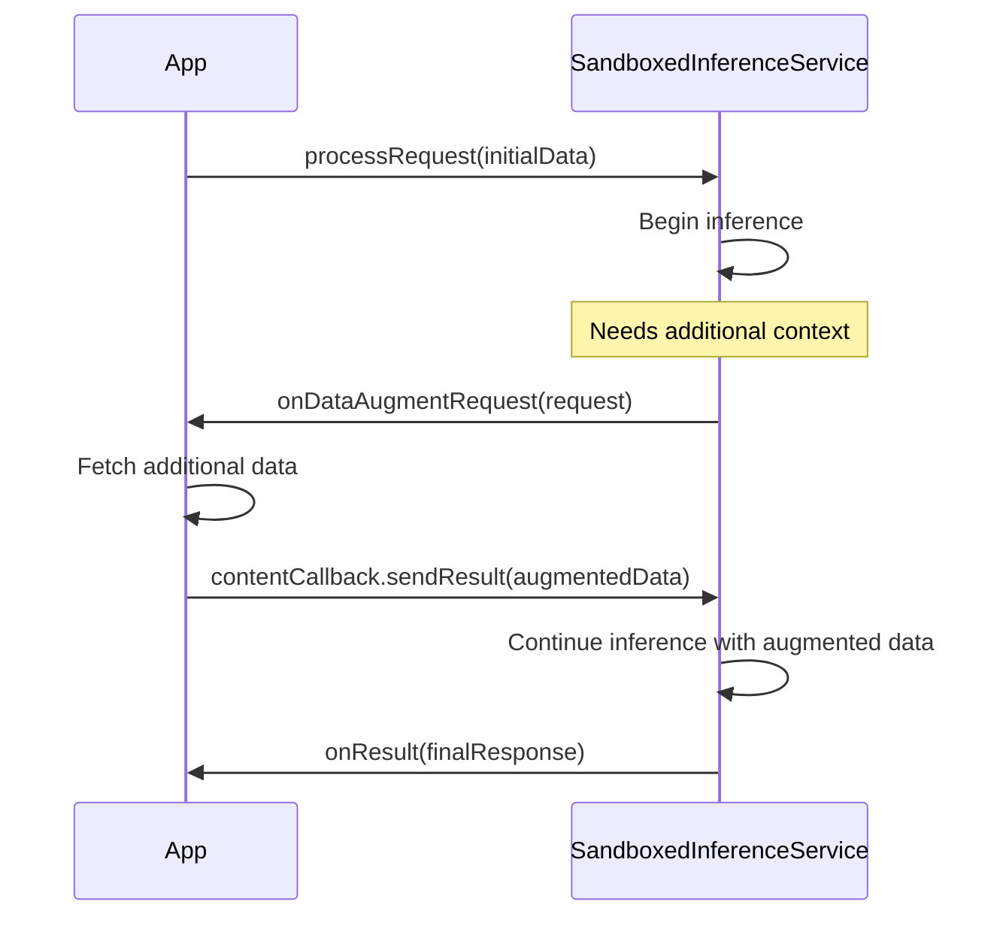

这一模式使检索增强生成（RAG）成为可能：模型可以在生成中途请求相关文档。

### 51.4.16 ProcessingSignal

除了 `CancellationSignal`，ODI 还提供了一个 `ProcessingSignal`，用于在处理期间向推理服务发送自定义控制信号：

```java
// OnDeviceIntelligenceManager.java

public void processRequest(@NonNull Feature feature,
        @NonNull @InferenceParams Bundle request,
        @RequestType int requestType,
        @Nullable CancellationSignal cancellationSignal,
        @Nullable ProcessingSignal processingSignal,
        @NonNull @CallbackExecutor Executor callbackExecutor,
        @NonNull ProcessingCallback processingCallback) {
```

这允许应用：

- 在流中途调整生成参数（例如更改 temperature）
- 发送上下文更新信号
- 向模型提供实时反馈

### 51.4.17 功耗归因

ODI 跟踪推理功耗以进行归因：

```java
// OnDeviceIntelligenceManager.java

@RequiresPermission(Manifest.permission.DUMP)
@FlaggedApi(FLAG_ON_DEVICE_INTELLIGENCE_25Q4)
public @NonNull List<InferenceInfo> getLatestInferenceInfo(
        @CurrentTimeMillisLong long startTimeEpochMillis) {
    return mService.getLatestInferenceInfo(startTimeEpochMillis);
}
```

这使系统能够把电池用量正确归因给触发推理的应用，而不是怪罪推理服务本身。

### 51.4.18 安全边界

ODI 框架强制执行多个安全边界：

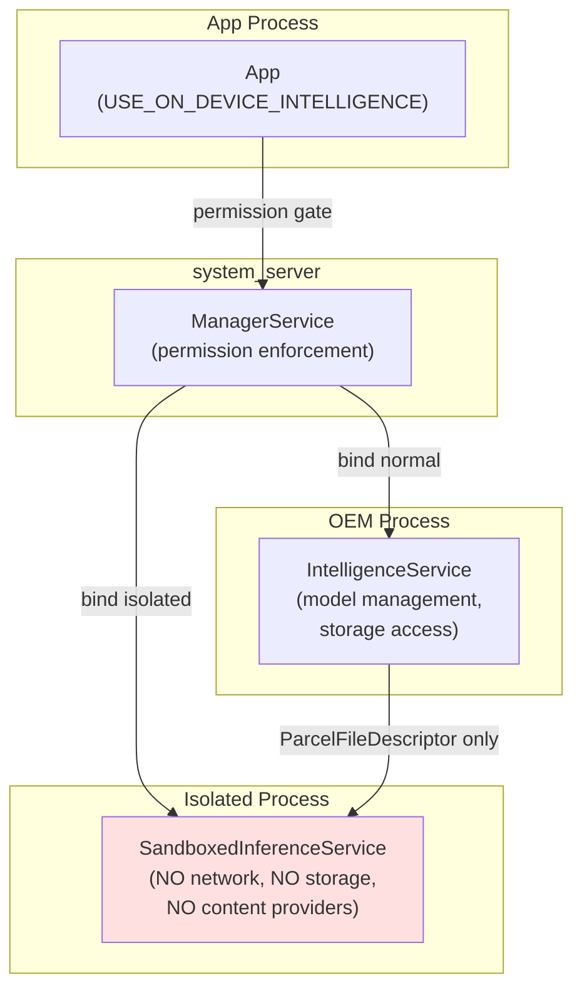

**隔离进程上的关键限制：**

- 无网络访问权限（android:isolatedProcess=true）
- 无法访问应用数据目录
- 无法访问 content provider
- 只能接收显式传递的文件描述符
- 内存限制由系统强制执行
- 进程可随时被系统杀死

这一设计意味着攻击者无法从设备外泄数据。
即使攻击者攻破推理引擎（例如通过模型权重投毒攻击），这一点依然成立。

### 51.4.19 类型化内容与嵌入/图像描述模型（Android 17）

上文描述的 ODI 界面是通用的、基于 `Bundle` 的 `processRequest` 路径。Android 17
在其之上增加了一层*类型化*层，由 `on_device_intelligence_26q2` 标志
（`packages/modules/NeuralNetworks/flags/ondevice_intelligence.aconfig:26`）门控，位于
`frameworks/base/packages/NeuralNetworks/framework/platform/java/android/app/ondeviceintelligence/` 之下：

- **结构化多模态内容。** `Content.java` 及其 `Part` 承载类型化片段——文本、图像和音频——大块数据由
  `ParcelFileDescriptor` 流式传递，而不是通过 `Bundle` 拷贝。一个公共的 `OnDeviceModel` 基类（带有
  `MODEL_STATUS_*` 状态）和一个
  `ModelDownloadCallback` 为模型提供统一的可用性/下载生命周期。
- **两个具体类型化模型族。** `embedding/EmbeddingModel.java` 产生向量嵌入（从 `Content` 的 `EmbeddingRequest`
  到 `EmbeddingVector` 的 `EmbeddingResponse`，带有 `getDimension()` / `getSupportedModalities()`），
  而 `imagedescription/ImageDescriptionModel.java` 将图像转换为文本描述。
  `OnDeviceIntelligenceManager` 针对两者增加了匹配的 `list…Models()` / `generate…()` 入口点，
  全部带有 `@FlaggedApi(FLAG_ON_DEVICE_INTELLIGENCE_26Q2)`。

这些把 ODI 从"在 Bundle 上运行一个不透明的生成式模型"扩展到"在结构化多模态内容上调用类型化的嵌入或图像描述模型"。这正是智能体特性在检索（嵌入）和视觉定位（图像描述）上所需要的形态。它仍停留在 51.4.18 的同一套沙箱推理隔离之内。

---

## 51.5 NeuralNetworks（NNAPI）

Neural Networks API（NNAPI）是 AOSP 为加速 ML 推理提供的硬件抽象。它自 Android 8.1 起就已成为 AOSP 的一部分，如今作为 Mainline 模块交付。

Android 17 还引入了一个新的、更高层 NPU 访问界面，其种子位于
`frameworks/base/core/java/android/npumanager/` 之下。该子系统（NpuManager）将在其自己的章节（第 53 章）中讲解。本节聚焦于 NNAPI——这一长期存在的 C 级加速器路径，当今的原生 ML 负载仍然以它为目标。

**源码树：**

```
packages/modules/NeuralNetworks/          (104 MB)
    runtime/                              -- C++ runtime library
        NeuralNetworks.cpp                -- C API entry points
        Manager.cpp -- Device management
        CompilationBuilder.cpp            -- Model compilation
        ExecutionBuilder.cpp              -- Inference execution
        ExecutionPlan.cpp                 -- Multi-device partitioning
        ...
    common/types/include/nnapi/
        IDevice.h                         -- HAL device interface
        Types.h                           -- Shared type definitions
    driver/                               -- Reference CPU driver
    framework/                            -- Java/AIDL framework
    service/                              -- NNAPI service
    extensions/                           -- Vendor extensions
    shim_and_sl/                          -- Support library / shim
```

### 51.5.1 架构

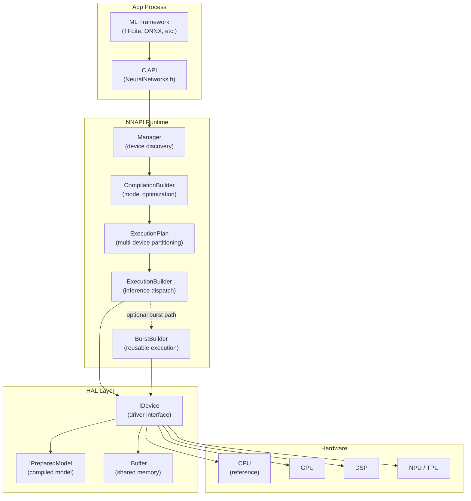

### 51.5.2 C API

公共 API 是定义在 `NeuralNetworks.h` 中的一个 C 接口。
`NeuralNetworks.cpp` 中的实现验证参数并委托给
C++ builder 类：

```cpp
// packages/modules/NeuralNetworks/runtime/NeuralNetworks.cpp

// Contains all the entry points to the C Neural Networks API.
// We do basic validation of the operands and then call the class
// that implements the functionality.
```

编译期验证的关键数据类型：

```cpp
static_assert(ANEURALNETWORKS_FLOAT32 == 0, "...");
static_assert(ANEURALNETWORKS_INT32 == 1, "...");
static_assert(ANEURALNETWORKS_UINT32 == 2, "...");
static_assert(ANEURALNETWORKS_TENSOR_FLOAT32 == 3, "...");
static_assert(ANEURALNETWORKS_TENSOR_INT32 == 4, "...");
static_assert(ANEURALNETWORKS_TENSOR_QUANT8_ASYMM == 5, "...");
```

### 51.5.3 运行时流水线

NNAPI 执行流水线有四个阶段：

```mermaid
graph LR
    A["1. Model<br/>Definition"] --> B["2. Compilation"]
    B --> C["3. Execution"]
    C --> D["4. Result<br/>Retrieval"]

    A2["ANeuralNetworksModel_create()"] --> A
    B2["ANeuralNetworksCompilation_create()"] --> B
    C2["ANeuralNetworksExecution_create()"] --> C
    D2["ANeuralNetworksExecution_getOutput*()"] --> D
```

1. **模型定义**——用操作数和操作构建计算图。每个操作映射到一个标准化的神经网络算子
    （卷积、池化、激活等）。

2. **编译**——`CompilationBuilder` 选择设备，如果有益则将模型跨多个加速器划分，并生成
    设备特定代码。

3. **执行**——`ExecutionBuilder` 向设备分发工作。可以是
    同步、异步或 fenced。

4. **结果取回**——从共享内存缓冲区读取输出张量。

### 51.5.4 HAL：IDevice

`IDevice` 接口表示一个硬件加速器驱动程序：

```cpp
// packages/modules/NeuralNetworks/common/types/include/nnapi/IDevice.h

class IDevice {
   public:
    virtual const std::string& getName() const = 0;
    virtual const std::string& getVersionString() const = 0;
    virtual Version getFeatureLevel() const = 0;
    virtual DeviceType getType() const = 0;
    // Model compilation
    virtual GeneralResult<SharedPreparedModel> prepareModel(...) const = 0;
    // Memory allocation
    virtual GeneralResult<SharedBuffer> allocate(...) const = 0;
    ...
```

设备类型包括：

| 类型 | 描述 |
|------|-------------|
| `DeviceType::CPU` | 参考 CPU 实现 |
| `DeviceType::GPU` | 图形处理单元 |
| `DeviceType::ACCELERATOR` | 专用 ML 加速器（NPU/TPU） |
| `DeviceType::OTHER` | 其他硬件 |

### 51.5.5 多设备划分

`ExecutionPlan` 处理跨多个设备的模型划分。
如果模型包含由不同加速器处理效果最佳的操作，
NNAPI 可以拆分模型：

```mermaid
graph TB
    subgraph "Model Graph"
        OP1[Conv2D] --> OP2[ReLU]
        OP2 --> OP3[MaxPool]
        OP3 --> OP4[FullyConnected]
        OP4 --> OP5[Softmax]
    end

    subgraph "Partitioned"
        P1["Partition 1: GPU<br/>Conv2D + ReLU + MaxPool"]
        P2["Partition 2: NPU<br/>FullyConnected + Softmax"]
    end

    OP3 --> P1
    OP5 --> P2
    P1 -- "shared memory" --> P2
```

### 51.5.6 Burst 执行

`BurstBuilder` 为相同模型、不同输入数据的重复推理创建一个可复用的执行上下文。这摊薄了
编译和设置成本：

```cpp
// packages/modules/NeuralNetworks/runtime/Manager.h

class RuntimeExecution {
   public:
    virtual std::tuple<int, std::vector<OutputShape>, Timing> compute(
            const SharedBurst& burstController,
            const OptionalTimePoint& deadline) const = 0;

    virtual std::tuple<int, int, ExecuteFencedInfoCallback, Timing> computeFenced(
            const std::vector<int>& waitFor,
            const OptionalTimePoint& deadline,
            const OptionalDuration& timeoutDurationAfterFence) const = 0;
};
```

### 51.5.7 供应商扩展

`extensions/` 目录允许供应商定义超出标准 NNAPI 规范的自定义操作和
数据类型。扩展使用带命名空间的标识符以避免冲突：

```
vendor.google.custom_op = 0x0001
```

### 51.5.8 支持库与 Shim

`shim_and_sl/` 目录提供：

- **支持库（SL）：** 一个独立库，应用可以捆绑它，以便在
  Android 版本之间保持一致的 NNAPI 行为。

- **Shim：** AIDL 与 HIDL HAL 版本之间的桥接，用于向后兼容。

### 51.5.9 RuntimePreparedModel 抽象

`RuntimePreparedModel` 为硬件加速和基于 CPU 的执行提供统一接口：

```cpp
// packages/modules/NeuralNetworks/runtime/Manager.h

class RuntimePreparedModel {
   public:
    virtual const Device* getDevice() const = 0;
    virtual SharedPreparedModel getInterface() const = 0;

    virtual std::tuple<int, std::vector<OutputShape>, Timing> execute(
            const std::vector<ModelArgumentInfo>& inputs,
            const std::vector<ModelArgumentInfo>& outputs,
            const std::vector<const RuntimeMemory*>& memories,
            const SharedBurst& burstController,
            MeasureTiming measure,
            const OptionalTimePoint& deadline,
            const OptionalDuration& loopTimeoutDuration,
            const std::vector<TokenValuePair>& metaData) const = 0;

    virtual std::tuple<int, int, ExecuteFencedInfoCallback, Timing> executeFenced(
            const std::vector<ModelArgumentInfo>& inputs,
            const std::vector<ModelArgumentInfo>& outputs,
            const std::vector<const RuntimeMemory*>& memories,
            const std::vector<int>& waitFor,
            MeasureTiming measure,
            const OptionalTimePoint& deadline,
            const OptionalDuration& loopTimeoutDuration,
            const OptionalDuration& timeoutDurationAfterFence,
            const std::vector<TokenValuePair>& metaData) const = 0;
```

`executeFenced` 变体支持：

- **等待栅栏（wait-for fences）：** 与其他 GPU/DSP 工作同步
- **栅栏后超时：** 设置相对于栅栏信号的截止时间
- **计时测量：** 可选地收集执行计时

### 51.5.10 NNAPI 数据类型

C API 定义了丰富的张量和标量类型集：

```cpp
// packages/modules/NeuralNetworks/runtime/NeuralNetworks.cpp

static_assert(ANEURALNETWORKS_FLOAT32 == 0);
static_assert(ANEURALNETWORKS_INT32 == 1);
static_assert(ANEURALNETWORKS_UINT32 == 2);
static_assert(ANEURALNETWORKS_TENSOR_FLOAT32 == 3);
static_assert(ANEURALNETWORKS_TENSOR_INT32 == 4);
static_assert(ANEURALNETWORKS_TENSOR_QUANT8_ASYMM == 5);
static_assert(ANEURALNETWORKS_BOOL == 6);
static_assert(ANEURALNETWORKS_TENSOR_QUANT16_SYMM == 7);
static_assert(ANEURALNETWORKS_TENSOR_FLOAT16 == 8);
static_assert(ANEURALNETWORKS_TENSOR_BOOL8 == 9);
static_assert(ANEURALNETWORKS_FLOAT16 == 10);
static_assert(ANEURALNETWORKS_TENSOR_QUANT8_SYMM_PER_CHANNEL == 11);
static_assert(ANEURALNETWORKS_TENSOR_QUANT16_ASYMM == 12);
static_assert(ANEURALNETWORKS_TENSOR_QUANT8_SYMM == 13);
```

`static_assert` 检查保证 ABI 稳定性——如果任何常量发生变化，
编译就会失败。

### 51.5.11 设备发现

`Manager` 类在运行时发现可用加速器：

```mermaid
graph TB
    MGR["Manager::getDevices()"]
    MGR --> REG["Device Registry"]
    REG --> HAL_DEV1["HAL Device 1<br/>(GPU via AIDL)"]
    REG --> HAL_DEV2["HAL Device 2<br/>(NPU via AIDL)"]
    REG --> HAL_DEV3["HAL Device 3<br/>(DSP via HIDL shim)"]
    REG --> CPU_DEV["CPU Reference<br/>(built-in)"]
```

Manager：

1. 向 `IDevice` 服务管理器查询已注册的加速器
2. 读取它们的能力（支持的操作、性能信息）
3. 维护一个用于模型编译和执行的设备列表
4. 如果没有加速器匹配，则回退到 CPU 参考实现

### 51.5.12 内存管理

NNAPI 使用共享内存实现应用与加速器之间的零拷贝数据传输：

```mermaid
graph LR
    APP["App Memory<br/>(AHardwareBuffer)"] --> SHARED["Shared Memory<br/>(ashmem / ion)"]
    SHARED --> ACCEL["Accelerator<br/>DMA"]
```

`RuntimeMemory` 类管理内存池：

- **AHardwareBuffer**：用于 GPU 可访问的内存
- **Ashmem**：用于 CPU 与加速器之间的共享
- **Ion/DMA-buf**：用于直接硬件 DMA 访问

### 51.5.13 NNAPI 特性级别

NNAPI 经历了几个特性级别的演进，每个级别都增加了新的操作
和能力：

| 特性级别 | Android 版本 | 主要新增 |
|---------------|-----------------|---------------|
| 1 | 8.1（API 27） | 基本操作：Conv2D、MaxPool、ReLU |
| 2 | 9（API 28） | 更多操作：DIV、SUB、PAD、TRANSPOSE、STRIDED_SLICE |
| 3 | 10（API 29） | 大量新操作、按通道量化、自省 |
| 4 | 11（API 30） | 控制流（IF、WHILE）、fenced 执行、有符号 8-bit 量化（`TENSOR_QUANT8_ASYMM_SIGNED`）、服务质量、模型优先级 |
| 5 | 12（API 31） | 可复用执行（`ANeuralNetworksExecution_setReusable`）、内存域改进 |
| 6 | — | AIDL HAL 接口 |
| 7 | — | 供应商扩展 |
| 8 | — | Flatbuffer 模型格式 |

5 级以上的特性级别刻意不映射任何 Android API 级别。枚举值是
`ANEURALNETWORKS_FEATURE_LEVEL_6 = 1000006`、`..._7 =
1000007` 和 `..._8 = 1000008`。原因是 NNAPI 规范
可以在 Android API 版本之间更新。代码必须将
`ANeuralNetworksDevice_getFeatureLevel` /
`ANeuralNetworks_getRuntimeFeatureLevel` 的输出与
`FeatureLevelCode` 常量比较，而绝不可与 `Build.VERSION.SDK_INT` 比较。

### 51.5.14 遥测

运行时包含一个 `Telemetry` 模块，用于收集匿名化的性能
指标：

```cpp
// packages/modules/NeuralNetworks/runtime/NeuralNetworks.cpp

#include "Telemetry.h"
```

指标包括：

- 每个设备的编译时间
- 执行延迟
- 错误率
- 设备选择结果
- 内存分配模式

### 51.5.15 NNAPI C API 生命周期

完整的 NNAPI 工作流按顺序涉及以下 API 调用：

```mermaid
graph TD
    A["ANeuralNetworksModel_create()"] --> B["ANeuralNetworksModel_addOperand()<br/>(repeat for each tensor)"]
    B --> C["ANeuralNetworksModel_setOperandValue()<br/>(for constants)"]
    C --> D["ANeuralNetworksModel_addOperation()<br/>(repeat for each op)"]
    D --> E["ANeuralNetworksModel_identifyInputsAndOutputs()"]
    E --> F["ANeuralNetworksModel_finish()"]
    F --> G["ANeuralNetworksCompilation_create()"]
    G --> H["ANeuralNetworksCompilation_setPreference()"]
    H --> I["ANeuralNetworksCompilation_finish()"]
    I --> J["ANeuralNetworksExecution_create()"]
    J --> K["ANeuralNetworksExecution_setInput()<br/>(bind input buffers)"]
    K --> L["ANeuralNetworksExecution_setOutput()<br/>(bind output buffers)"]
    L --> M["ANeuralNetworksExecution_compute()<br/>or startCompute()"]
    M --> N["Read output buffers"]
    N --> O["ANeuralNetworksExecution_free()"]
    O --> P["ANeuralNetworksCompilation_free()"]
    P --> Q["ANeuralNetworksModel_free()"]
```

### 51.5.16 编译偏好

```c
// ANeuralNetworksCompilation_setPreference() options:
ANEURALNETWORKS_PREFER_LOW_POWER       // Battery efficient
ANEURALNETWORKS_PREFER_FAST_SINGLE_ANSWER  // Minimum latency
ANEURALNETWORKS_PREFER_SUSTAINED_SPEED    // Sustained throughput
```

这些偏好引导设备选择：

- `LOW_POWER` 可能更偏好 DSP 而非 GPU
- `FAST_SINGLE_ANSWER` 可能更偏好峰值性能最高的 GPU
- `SUSTAINED_SPEED` 可能更偏好有散热余量的设备

### 51.5.17 错误处理

NNAPI 对所有操作使用整数错误码：

| 代码 | 名称 | 含义 |
|------|------|---------|
| 0 | `ANEURALNETWORKS_NO_ERROR` | 成功 |
| 1 | `ANEURALNETWORKS_OUT_OF_MEMORY` | 内存分配失败 |
| 2 | `ANEURALNETWORKS_INCOMPLETE` | 操作尚未完成 |
| 3 | `ANEURALNETWORKS_UNEXPECTED_NULL` | 在期望非 null 的位置出现空指针 |
| 4 | `ANEURALNETWORKS_BAD_DATA` | 无效模型或数据 |
| 5 | `ANEURALNETWORKS_OP_FAILED` | 硬件执行失败 |
| 6 | `ANEURALNETWORKS_BAD_STATE` | 该操作的无效状态 |
| 7 | `ANEURALNETWORKS_UNMAPPABLE` | 无法映射到该设备 |
| 8 | `ANEURALNETWORKS_OUTPUT_INSUFFICIENT_SIZE` | 输出缓冲区太小 |
| 9 | `ANEURALNETWORKS_UNAVAILABLE_DEVICE` | 设备不可用 |
| 10 | `ANEURALNETWORKS_MISSED_DEADLINE_TRANSIENT` | 暂时性截止时间未达标 |
| 11 | `ANEURALNETWORKS_MISSED_DEADLINE_PERSISTENT` | 持续性截止时间未达标 |
| 12 | `ANEURALNETWORKS_RESOURCE_EXHAUSTED_TRANSIENT` | 暂时性资源耗尽 |
| 13 | `ANEURALNETWORKS_RESOURCE_EXHAUSTED_PERSISTENT` | 持续性资源耗尽 |
| 14 | `ANEURALNETWORKS_DEAD_OBJECT` | 驱动程序进程已死亡 |

### 51.5.18 支持的操作

NNAPI 支持超过 100 种神经网络操作，包括：

**激活函数：**

- RELU、RELU1、RELU6
- LOGISTIC（sigmoid）
- TANH
- ELU、HARD_SWISH

**卷积：**

- CONV_2D、DEPTHWISE_CONV_2D
- TRANSPOSE_CONV_2D
- GROUPED_CONV_2D

**池化：**

- AVERAGE_POOL_2D、MAX_POOL_2D
- L2_POOL_2D

**归一化：**

- L2_NORMALIZATION
- LOCAL_RESPONSE_NORMALIZATION
- INSTANCE_NORMALIZATION

**循环：**

- LSTM、UNIDIRECTIONAL_SEQUENCE_LSTM
- BIDIRECTIONAL_SEQUENCE_LSTM
- UNIDIRECTIONAL_SEQUENCE_RNN
- BIDIRECTIONAL_SEQUENCE_RNN

**逐元素：**

- ADD、SUB、MUL、DIV
- FLOOR、ABS、NEG
- POW、SQRT、RSQRT、EXP、LOG
- SIN、MINIMUM、MAXIMUM
- LESS、LESS_EQUAL、EQUAL、NOT_EQUAL

**形状操作：**

- RESHAPE、SQUEEZE、EXPAND_DIMS
- CONCATENATION、SPLIT
- TRANSPOSE、GATHER、SELECT
- SLICE、STRIDED_SLICE、PAD
- TILE、REVERSE、BATCH_TO_SPACE_ND

**控制流：**

- IF、WHILE（在 NNAPI 特性级别 4 中添加，Android 11 / API 30）

### 51.5.19 模块交付与更新

NNAPI 作为 NeuralNetworks Mainline 模块
（`com.android.neuralnetworks`）的一部分交付，这允许：

- 无需完整 OS 更新的安全补丁
- 为现有设备提供新操作支持
- 独立于 OEM 更新周期的 bug 修复
- 跨设备的一致行为

该模块构建自：
```
packages/modules/NeuralNetworks/apex/
```

---

## 51.6 OnDevicePersonalization 与联邦学习

OnDevicePersonalization（ODP）Mainline 模块为保护隐私的机器学习提供基础设施：在保留原始数据于设备端的同时，产出有用的聚合模型。

> **Android 17 状态：弃用。** ODP 公共 API 界面现已在新的 `odp_depreciation_enabled` 标志
> （`packages/modules/OnDevicePersonalization/flags/ondevicepersonalization_flags.aconfig:78`）之后标记为
> `@Deprecated`。该模块和下面的架构仍然随系统发布，但新代码不应以 ODP API 为目标。
> 平台的投资方向是智能体/设备端推理方向。该方向即 OnDeviceIntelligence + ContentSafety 家族（51.4、51.15）。下面的小节记录该机制的现状，同时留意其弃用。

**源码树：**

```
packages/modules/OnDevicePersonalization/     (~890 files, ~580 excluding tests)
    framework/                                -- Public API
    federatedcompute/                         -- Federated learning engine
        src/com/android/federatedcompute/services/
            training/
                IsolatedTrainingService.java  -- Isolated TFLite runtime
                IsolatedTrainingServiceImpl.java
            examplestore/                     -- Training data management
            scheduling/                       -- Job scheduling
            common/                           -- Shared utilities
    systemservice/                            -- System service
    pluginlib/                                -- Plugin interface for OEMs
    samples/                                  -- Sample implementations
```

### 51.6.1 架构

```mermaid
graph TB
    subgraph "App Process"
        APP_DATA[App Data]
        ODP_CLIENT[ODP Client API]
    end

    subgraph "ODP Module Process"
        ODP_SVC["OnDevicePersonalization<br/>Service"]
        FC_SCHED["Federated Compute<br/>Scheduler"]
        EXAMPLE_STORE[Example Store]
    end

    subgraph "Isolated Process"
        ITS[IsolatedTrainingService]
        TFLITE[TFLite Runtime]
    end

    subgraph "Remote Server"
        FC_SERVER["Federated Compute<br/>Server"]
    end

    APP_DATA --> ODP_CLIENT
    ODP_CLIENT --> ODP_SVC
    ODP_SVC --> FC_SCHED
    FC_SCHED --> EXAMPLE_STORE
    EXAMPLE_STORE --> ITS
    ITS --> TFLITE
    FC_SCHED -- "aggregated updates<br/>(differential privacy)" --> FC_SERVER
    FC_SERVER -- "global model<br/>updates" --> FC_SCHED
```

### 51.6.2 联邦学习概念

联邦学习在许多设备上训练一个共享模型，而无需将训练数据集中化：

```mermaid
sequenceDiagram
    participant Server as Federated Compute Server
    participant Device1 as Device A
    participant Device2 as Device B
    participant Device3 as Device C

    Server->>Device1: Send global model v1
    Server->>Device2: Send global model v1
    Server->>Device3: Send global model v1

    Device1->>Device1: Train on local data
    Device2->>Device2: Train on local data
    Device3->>Device3: Train on local data

    Device1->>Server: Send gradient update (+ noise)
    Device2->>Server: Send gradient update (+ noise)
    Device3->>Server: Send gradient update (+ noise)

    Server->>Server: Aggregate updates, Apply differential privacy
    Server->>Device1: Send global model v2
```

### 51.6.3 IsolatedTrainingService

实际的 TFLite 训练运行在隔离进程中：

```java
// packages/modules/OnDevicePersonalization/federatedcompute/
//   src/.../training/IsolatedTrainingService.java

public class IsolatedTrainingService extends Service {
    private IIsolatedTrainingService.Stub mBinder;

    @Override
    public void onCreate() {
        mBinder = new IsolatedTrainingServiceImpl(this);
    }

    @Override
    public IBinder onBind(Intent intent) {
        return mBinder;
    }
}
```

`IsolatedTrainingServiceImpl` 加载 TFLite 运行时并执行
训练轮次。训练数据通过 `ExampleStore` 抽象提供，该抽象遍历设备本地的样本，而不将
原始数据暴露给联网的调度进程。

### 51.6.4 Example Store

示例存储向隔离进程提供训练数据：

```
federatedcompute/src/.../examplestore/
    ExampleIterator.java              -- Iterator interface
    FederatedExampleIterator.java     -- Federated compute iterator
    ExampleConsumptionRecorder.java   -- Tracks data usage
    ExampleStoreServiceProvider.java  -- Service binding
```

### 51.6.5 调度与条件

联邦计算作业通过 Android 的 `JobScheduler` 调度，并带有保护用户体验的条件：

```
federatedcompute/src/.../scheduling/
    FederatedComputeJobManager.java
```

训练仅在设备满足以下条件时运行：

- 正在充电（或高于某个电池阈值）
- 连接到不计流量的网络（Wi-Fi）
- 空闲

这些条件由 `common/` 包中的 `BatteryInfo` 和 `NetworkStats` 跟踪。

### 51.6.6 隐私保护

联邦计算协议应用多层隐私保护：

1. **隔离进程**：训练数据从不离开隔离进程
2. **安全聚合**：单个更新在发送前被加密
3. **差分隐私**：噪声被添加到梯度更新中
4. **最小队列规模**：只接受来自超过阈值的分组的更新，防止单设备指纹识别

### 51.6.7 Federated Compute 模块结构

```
packages/modules/OnDevicePersonalization/federatedcompute/
    src/com/android/federatedcompute/services/
        training/
            IsolatedTrainingService.java          -- Isolated service entry
            IsolatedTrainingServiceImpl.java      -- Training logic
        examplestore/
            ExampleIterator.java                  -- Training data iterator
            FederatedExampleIterator.java         -- Federated-specific iterator
            ExampleConsumptionRecorder.java       -- Usage tracking
            ExampleStoreServiceProvider.java      -- Service binding
        scheduling/
            FederatedComputeJobManager.java       -- Job scheduling
        common/
            Flags.java                            -- Feature flags
            PhFlags.java                          -- Phenotype/DeviceConfig-backed flags
            Constants.java                        -- Shared constants
            FederatedComputeExecutors.java        -- Thread pools
            BatteryInfo.java                      -- Battery state
            NetworkStats.java                     -- Network conditions
            TrainingEventLogger.java              -- Metrics
            TrainingResult.java                   -- Training outcome
```

### 51.6.8 训练协议

联邦训练协议在每个设备上遵循以下步骤：

```mermaid
graph TB
    A["Scheduler triggers<br/>training job"] --> B{Check conditions}
    B -->|Charging + WiFi + Idle| C["Download global model<br/>from server"]
    B -->|Conditions not met| Z[Skip this round]
    C --> D["Load model in<br/>IsolatedTrainingService"]
    D --> E["Iterate over<br/>local examples"]
    E --> F["Compute local<br/>gradient update"]
    F --> G["Clip gradient<br/>to bounded norm"]
    G --> H["Add calibrated<br/>noise"]
    H --> I["Encrypt with<br/>secure aggregation key"]
    I --> J["Upload encrypted<br/>update to server"]
    J --> K["Server aggregates<br/>once cohort is complete"]
    K --> L["New global model<br/>available"]
```

### 51.6.9 Example Store 架构

示例存储为训练数据提供了清晰的抽象：

```mermaid
graph TB
    subgraph "App Process"
        APP_DATA[App-Specific Data]
    end

    subgraph "ODP Module"
        ESP[ExampleStoreServiceProvider]
        EI[ExampleIterator]
    end

    subgraph "Isolated Training Process"
        FEI[FederatedExampleIterator]
        TF[TFLite Training]
    end

    APP_DATA --> ESP
    ESP --> EI
    EI --> FEI
    FEI --> TF
```

`ExampleConsumptionRecorder` 跟踪哪些训练样本已被使用，防止频繁可用数据被过度代表。

### 51.6.10 插件架构

OEM 可以通过插件库扩展 ODP：

```
packages/modules/OnDevicePersonalization/pluginlib/
```

插件允许 OEM：

- 提供自定义示例存储
- 实现设备特定的训练优化
- 添加自定义指标收集
- 定义自定义调度策略

---

## 51.7 内容捕获与智能

三个框架服务协同工作，捕获 UI 状态、分类文本实体并预测应用使用情况。这些服务构成了驱动 Smart Linkify、Smart Copy 和应用使用预测等特性的"被动智能"层。

### 51.7.1 ContentCaptureManager

内容捕获子系统在用户与 activity 交互时，静默捕获其结构和内容：

```java
// frameworks/base/core/java/android/view/contentcapture/ContentCaptureManager.java

@SystemService(Context.CONTENT_CAPTURE_MANAGER_SERVICE)
public final class ContentCaptureManager {
```

**来源：**
`frameworks/base/core/java/android/view/contentcapture/ContentCaptureManager.java`


来自 Javadoc：

> Content capture provides real-time, continuous capture of application
> activity, display and events to an intelligence service that is provided by
> the Android system. The intelligence service then uses that info to mediate
> and speed user journey through different apps.

**设计原则：**

| 关注点 | 机制 |
|---------|-----------|
| **隐私** | 智能服务是可信系统组件；无法被用户更改；数据仅用于设备端 ML；通过进程隔离和 CDD 强制执行 |
| **性能** | 仅对允许列表中应用/activity 启用；事件被缓冲并批量发送 |

### 51.7.2 ContentCaptureService

服务端接收捕获的内容：

```
frameworks/base/core/java/android/service/contentcapture/
    ContentCaptureService.java           -- Abstract service base
    ContentCaptureServiceInfo.java       -- Service metadata
    IContentCaptureService.aidl          -- Binder interface
    ActivityEvent.java                   -- Activity lifecycle events
    FlushMetrics.java                    -- Batching metrics
    DataShareCallback.java               -- Data export
```

```mermaid
sequenceDiagram
    participant Activity
    participant CCSession as ContentCaptureSession
    participant CCM as ContentCaptureManager
    participant CCMS as ContentCaptureManagerService
    participant CCS as ContentCaptureService (OEM implementation)

    Activity->>CCSession: onStart/onResume
    CCSession->>CCSession: Capture view structure
    CCSession->>CCM: Buffer events
    CCM->>CCMS: Flush batch
    CCMS->>CCS: onContentCaptureEvents(sessionId, events)
    CCS->>CCS: ML analysis (entity detection, context building)
```

### 51.7.3 TextClassifierService

`TextClassifierService` 为文本提供实体分类：

```
frameworks/base/core/java/android/service/textclassifier/
    TextClassifierService.java
```

能力：

| API | 功能 |
|-----|----------|
| `onSuggestSelection()` | 将文本选择扩展为覆盖一个完整实体 |
| `onClassifyText()` | 对选中文本分类（电话、电子邮件、地址等） |
| `onGenerateLinks()` | 为文本中的实体生成可点击链接 |
| `onDetectLanguage()` | 检测一段文本的语言 |
| `onSuggestConversationActions()` | 为对话消息建议操作 |

```mermaid
graph LR
    A[User selects text] --> B[TextClassifierManager]
    B --> C[TextClassifierService]
    C --> D{Entity Type}
    D -->|Phone| E[Dial action]
    D -->|Address| F[Map action]
    D -->|Email| G[Compose action]
    D -->|URL| H[Browse action]
    D -->|DateTime| I[Calendar action]
```

### 51.7.4 AppPredictionManager

App Prediction 服务预测用户下一步将使用哪些应用：

```java
// frameworks/base/core/java/android/app/prediction/AppPredictionManager.java

@SystemApi
public final class AppPredictionManager {
    public AppPredictor createAppPredictionSession(
            @NonNull AppPredictionContext predictionContext) {
        return new AppPredictor(mContext, predictionContext);
    }
}
```

`AppPredictor` 根据上下文（一天中的时间、位置、最近的使用模式）提供应用的排序列表。启动器用它来排列应用抽屉并填充建议。

### 51.7.5 TextClassifierService 清单与接口

```java
// frameworks/base/core/java/android/service/textclassifier/TextClassifierService.java

@SystemApi
public abstract class TextClassifierService extends Service {
    public static final String SERVICE_INTERFACE =
            "android.service.textclassifier.TextClassifierService";
```

清单注册：

```xml
<service android:name=".YourTextClassifierService"
         android:permission="android.permission.BIND_TEXTCLASSIFIER_SERVICE">
    <intent-filter>
        <action android:name="android.service.textclassifier.TextClassifierService" />
    </intent-filter>
</service>
```

系统的默认实现通过
`config_defaultTextClassifierPackage` 配置。当没有可用的系统文本分类器时，本地回退是一个 no-op（`TextClassifier.NO_OP`）——
`TextClassificationManager.getLocalTextClassifier()` 记录*"Local
text-classifier not supported"*并返回它。真正的
`TextClassifierImpl` 位于 `external/libtextclassifier` 中，运行在默认的 `TextClassifierService`
（ExtServices）内部，而不是在调用应用的进程中。

### 51.7.6 文本分类流程

```mermaid
sequenceDiagram
    participant App
    participant TCManager as TextClassificationManager
    participant TCMS as TextClassificationManagerService
    participant TCSvc as TextClassifierService

    App->>TCManager: classifyText(text, options)
    TCManager->>TCMS: Binder IPC
    TCMS->>TCSvc: onClassifyText(sessionId, request, callback)
    TCSvc->>TCSvc: Run ML model (entity recognition)
    TCSvc-->>TCMS: TextClassification result
    TCMS-->>TCManager: TextClassification result
    TCManager-->>App: TextClassification (entities, actions, confidence)
```

`TextClassification` 结果包括：

- 实体类型（电话、电子邮件、地址、URL、日期时间、航班号）
- 置信度分数
- 为每个实体建议的 `RemoteAction` 对象
- 语言检测结果

### 51.7.7 内容捕获事件批处理

内容捕获系统通过事件批处理优化性能：

```mermaid
graph LR
    A["View Change<br/>Event"] --> B["Buffer<br/>(per session)"]
    C["View Change<br/>Event"] --> B
    D["View Change<br/>Event"] --> B
    B -->|"Buffer full<br/>or timeout"| E["Flush"]
    E --> F["ContentCaptureManagerService"]
    F --> G["ContentCaptureService"]
```

事件按 `ContentCaptureSession` 缓冲并冲刷：

- 当缓冲区达到容量时
- 当超时到期时
- 当会话结束时
- 当 activity 暂停或停止时

`FlushMetrics` 提供关于批处理的统计信息：

```
frameworks/base/core/java/android/service/contentcapture/FlushMetrics.java
```

### 51.7.8 内容捕获与数据共享

`DataShareCallback` 和 `DataShareReadAdapter` 支持在保护隐私的同时与外部分析共享捕获的内容：

```
frameworks/base/core/java/android/service/contentcapture/
    DataShareCallback.java
    DataShareReadAdapter.java
    IDataShareCallback.aidl
    IDataShareReadAdapter.aidl
```

数据共享使用文件描述符和基于管道的传输，以避免通过共享内存拷贝敏感内容。

### 51.7.9 内容保护

独立的 `IContentProtectionService` 接口支持内容保护用例（检测并遮盖敏感内容）：

```
frameworks/base/core/java/android/service/contentcapture/
    IContentProtectionService.aidl
    IContentProtectionAllowlistCallback.aidl
```

### 51.7.10 智能流水线

这三个服务构成了一条连贯的流水线：

```mermaid
graph TB
    subgraph "Capture Layer"
        CC[ContentCaptureService]
    end

    subgraph "Understanding Layer"
        TC[TextClassifierService]
        NER[Named Entity Recognition]
    end

    subgraph "Prediction Layer"
        AP[AppPredictionService]
        RANKING[Usage Ranking Model]
    end

    subgraph "Consumer Layer"
        LAUNCHER[Launcher]
        AUTOFILL[Autofill]
        SHARE[Share Sheet]
        SMARTLINK[Smart Linkify]
    end

    CC --> TC
    CC --> AP
    TC --> NER
    AP --> RANKING
    NER --> SMARTLINK
    NER --> AUTOFILL
    RANKING --> LAUNCHER
    RANKING --> SHARE
```

### 51.7.11 AppPrediction 上下文

`AppPredictionContext` 配置请求的预测类型：

```java
// frameworks/base/core/java/android/app/prediction/AppPredictionManager.java

@SystemApi
public final class AppPredictionManager {
    @NonNull
    public AppPredictor createAppPredictionSession(
            @NonNull AppPredictionContext predictionContext) {
        return new AppPredictor(mContext, predictionContext);
    }
}
```

预测上下文指定：

- **UI 界面**：预测将显示在何处（启动器、分享面板）
- **预测数量**：返回多少条预测
- **包名**：请求预测的应用
- **Extras**：额外的上下文特定参数

### 51.7.12 智能服务的隐私架构

这三个服务共享一个共同的隐私模型：

```mermaid
graph TB
    subgraph "Privacy Guarantees"
        A["Trusted System Component<br/>(cannot be changed by user)"]
        B["Process Isolation<br/>(separate process)"]
        C["CDD Requirements<br/>(OEM attestation)"]
        D["On-Device Only<br/>(no cloud upload)"]
        E["User Control<br/>(global disable via Settings)"]
    end

    A --> F["Intelligence Service"]
    B --> F
    C --> F
    D --> F
    E --> F
```

CDD（兼容性定义文档）要求：

- 智能服务不能将捕获的数据传出设备
- 服务必须尊重用户的隐私设置
- 服务必须由设备制造商声明
- 第三方应用不能替换智能服务

---

## 51.8 AppSearch

AppSearch 是 AOSP 的设备端全文搜索引擎，作为 Mainline
模块交付。它支撑着 AppFunctions 的发现机制，并为任何应用提供结构化数据索引。

**源码树：**

```
packages/modules/AppSearch/
    framework/java/android/app/appsearch/
        AppSearchManager.java                -- System service entry point
        AppSearchSession.java                -- Per-database session
    framework/java/external/android/app/appsearch/
        GenericDocument.java                 -- Base document type
        SearchSpec.java                      -- Query specification
        SetSchemaRequest.java                -- Schema definition
        ...
    service/java/com/android/server/appsearch/
        AppSearchManagerService.java         -- System server
        external/localstorage/
            AppSearchImpl.java               -- Local storage engine
```

### 51.8.1 架构

```mermaid
graph TB
    subgraph "App Process"
        APP[Application]
        ASM[AppSearchManager]
        SESS[AppSearchSession]
    end

    subgraph "AppSearch Module"
        ASMS[AppSearchManagerService]
        IMPL["AppSearchImpl<br/>IcingSearchEngine"]
        INDEX[Full-Text Index]
        SCHEMA[Schema Store]
    end

    APP --> ASM
    ASM -- "Binder IPC" --> ASMS
    ASM --> SESS
    SESS -- "CRUD operations" --> ASMS
    ASMS --> IMPL
    IMPL --> INDEX
    IMPL --> SCHEMA
```

### 51.8.2 核心概念

来自 `AppSearchManager` 的 Javadoc：

```java
// packages/modules/AppSearch/framework/java/android/app/appsearch/AppSearchManager.java

// AppSearch is an offline, on-device search library for managing structured
// data featuring:
// - APIs to index and retrieve data via full-text search
// - An API for applications to explicitly grant read-access permission of
//   their data to other applications
// - An API for applications to opt into or out of having their data displayed
//   on System UI surfaces
```

**关键抽象：**

| 概念 | 描述 |
|---------|-------------|
| **Database** | 按应用隔离的搜索命名空间，通过 `SearchContext` 创建 |
| **Schema** | 定义文档类型及其属性（类似 SQL DDL） |
| **GenericDocument** | 一个文档实例，包含命名空间、ID、属性和分数 |
| **SearchSpec** | 查询参数：文本查询、过滤器、排序策略 |
| **Visibility** | 按 schema 的跨应用搜索访问控制 |

### 51.8.3 Schema 定义

```java
AppSearchSchema emailSchemaType = new AppSearchSchema.Builder("Email")
    .addProperty(new StringPropertyConfig.Builder("subject")
       .setCardinality(PropertyConfig.CARDINALITY_OPTIONAL)
       .setIndexingType(PropertyConfig.INDEXING_TYPE_PREFIXES)
       .setTokenizerType(PropertyConfig.TOKENIZER_TYPE_PLAIN)
   .build()
).build();
```

### 51.8.4 文档索引

```java
GenericDocument email = new GenericDocument.Builder<>(NAMESPACE, ID, "Email")
    .setPropertyString("subject", EMAIL_SUBJECT)
    .setScore(EMAIL_SCORE)
    .build();

PutDocumentsRequest request = new PutDocumentsRequest.Builder()
    .addGenericDocuments(email)
    .build();
session.put(request, executor, callback);
```

### 51.8.5 搜索

```java
SearchSpec spec = new SearchSpec.Builder()
    .addFilterSchemas("Email")
    .setRankingStrategy(SearchSpec.RANKING_STRATEGY_RELEVANCE_SCORE)
    .build();

SearchResults results = session.search("important meeting", spec);
```

### 51.8.6 IcingSearchEngine

在底层，C++ 库 IcingSearchEngine 支撑着 AppSearch。
该库提供：

- 带 BM25F 评分的全文索引
- 前缀匹配
- 基于命名空间的隔离
- 整数和文档级索引
- 带布尔运算符的查询语法

### 51.8.7 可见性与访问控制

AppSearch 在 schema 层级执行可见性：

```java
SetSchemaRequest.Builder builder = new SetSchemaRequest.Builder();
builder.addSchemas(emailSchemaType);
builder.setSchemaTypeVisibilityForPackage(
        "Email",
        /* visible= */ true,
        new PackageIdentifier("com.example.reader", sigDigest));
builder.setSchemaTypeDisplayedBySystem("Email", /* displayed= */ true);
```

三个可见性级别：

- **包可见性**：特定包可以读取某类型的文档
- **系统可见性**：系统指定的查询者可以访问，供系统 UI 使用
- **仅自己**：默认值，只有索引应用自己可以查询

### 51.8.8 全局搜索

持有 `READ_GLOBAL_APP_SEARCH_DATA` 权限（通常是系统应用）的应用
可以跨所有包的可见数据搜索：

```mermaid
graph TB
    subgraph "App A Database"
        A_EMAILS[Email documents]
        A_CONTACTS[Contact documents]
    end

    subgraph "App B Database"
        B_NOTES[Note documents]
        B_TASKS[Task documents]
    end

    subgraph "AppSearch Service"
        INDEX["Unified Index<br/>(IcingSearchEngine)"]
        VIS[Visibility Filter]
    end

    subgraph "System App"
        QUERIER["Global Search<br/>Querier"]
    end

    A_EMAILS --> INDEX
    A_CONTACTS --> INDEX
    B_NOTES --> INDEX
    B_TASKS --> INDEX
    QUERIER --> VIS
    VIS --> INDEX
```

### 51.8.9 AppSearch 与 AppFunctions 集成

当 AppFunctions 索引函数元数据时，它会在 AppSearch 中创建 `AppFunctionStaticMetadata` 类型的文档。代理通过以下方式发现函数：

1. 打开一个全局搜索会话
2. 查询 `AppFunctionStaticMetadata` 文档
3. 提取 `functionIdentifier` 和 schema 信息
4. 用这些信息构造 `ExecuteAppFunctionRequest`

```mermaid
sequenceDiagram
    participant Agent as AI Agent
    participant AS as AppSearch
    participant AFM as AppFunctionManager

    Agent->>AS: search("CreateNote", AppFunctionStaticMetadata)
    AS-->>Agent: doc with functionId and schema
    Agent->>AFM: executeAppFunction(targetPkg, functionId)
    AFM-->>Agent: ExecuteAppFunctionResponse
```

### 51.8.10 AppSearch 查询语法

AppSearch 支持丰富的查询语言：

| 特性 | 示例 | 描述 |
|---------|---------|-------------|
| 全文 | `"important meeting"` | 匹配包含这些词的文档 |
| 布尔 AND | `term1 AND term2` | 两个词都必须匹配 |
| 布尔 OR | `term1 OR term2` | 任一词匹配 |
| 取反 | `NOT term` | 排除包含 term 的文档 |
| 前缀 | `meet*` | 前缀匹配 |
| 属性限定 | `subject:meeting` | 在特定属性中匹配 |
| 语义搜索 | `semanticSearch(...)` | 向量相似度搜索 |

查询的 AST（抽象语法树）由节点类表示：

```
packages/modules/AppSearch/framework/java/external/android/app/appsearch/ast/
    FunctionNode.java
    NegationNode.java
    query/SearchNode.java
    query/SemanticSearchNode.java
    query/HasPropertyNode.java
    operators/ComparatorNode.java
    operators/PropertyRestrictNode.java
```

### 51.8.11 GenericDocument 深度剖析

`GenericDocument` 是 AppSearch 和 AppFunctions 之间共享的基础数据类型：

```java
// packages/modules/AppSearch/framework/java/external/android/app/appsearch/GenericDocument.java

GenericDocument doc = new GenericDocument.Builder<>(namespace, id, schemaType)
    .setPropertyString("name", "John")
    .setPropertyLong("age", 30)
    .setPropertyDouble("score", 0.95)
    .setPropertyBoolean("active", true)
    .setPropertyBytes("avatar", imageBytes)
    .setPropertyDocument("address", addressDoc)
    .setScore(100)
    .setTtlMillis(TimeUnit.DAYS.toMillis(30))
    .setCreationTimestampMillis(System.currentTimeMillis())
    .build();
```

属性支持多种基数（cardinality）：

- `CARDINALITY_REQUIRED`——恰好一个值
- `CARDINALITY_OPTIONAL`——零个或一个值
- `CARDINALITY_REPEATED`——零个或多个值

### 51.8.12 AppSearchImpl 与 IcingSearchEngine

`AppSearchImpl` 类包装了原生 IcingSearchEngine：

```
packages/modules/AppSearch/service/java/com/android/server/appsearch/
    external/localstorage/AppSearchImpl.java
```

IcingSearchEngine 提供：

- 用于相关性排序的 BM25F 评分
- 用于快速全文搜索的倒排索引
- 用于属性取回的正向索引
- 基于命名空间的隔离
- 基于 TTL 的文档自动过期
- Schema 迁移支持

### 51.8.13 Observer API

应用可以注册观察者以接收变更通知：

```java
// packages/modules/AppSearch/framework/java/android/app/appsearch/GlobalSearchSession.java
globalSearchSession.registerObserverCallback(
        "com.example.app",
        new ObserverSpec.Builder().addFilterSchemas("Email").build(),
        executor,
        new ObserverCallback() {
            @Override
            public void onSchemaChanged(SchemaChangeInfo info) { ... }
            @Override
            public void onDocumentChanged(DocumentChangeInfo info) { ... }
        });
```

这正是 AppFunctions 系统监控元数据变更的方式——
该服务在 AppSearch 中注册一个观察者，并对
`AppFunctionStaticMetadata` 文档变更作出反应。

### 51.8.14 IcingSearchEngine 内部机制

`AppSearchImpl` 通过 JNI 边界包装原生 IcingSearchEngine。
该引擎提供完整实现于 C++ 的搜索栈：

```java
// packages/modules/AppSearch/service/java/com/android/server/appsearch/
//   external/localstorage/AppSearchImpl.java
@WorkerThread
public final class AppSearchImpl implements Closeable {
    @GuardedBy("mReadWriteLock")
    IcingSearchEngineInterface mIcingSearchEngineLocked;

    // Thread safety: ReadWriteLock separating query (READ) from mutation (WRITE)
    private final ReadWriteLock mReadWriteLock = new ReentrantReadWriteLock();

    // Caches for performance
    private final SchemaCache mSchemaCacheLocked = new SchemaCache();
    private final NamespaceCache mNamespaceCacheLocked = new NamespaceCache();
    private volatile DocumentLimiter mDocumentLimiterLocked;
}
```

**基于前缀的隔离：**

`AppSearchImpl` 通过对所有 schema 类型、命名空间和文档 ID 添加前缀，在单个
IcingSearchEngine 实例内实现按包、按数据库的隔离：

```mermaid
graph TB
    subgraph "App A, Database 'mail'"
        A_TYPE["Schema: Email"]
        A_NS["Namespace: inbox"]
        A_DOC["Doc ID: msg123"]
    end

    subgraph "IcingSearchEngine (physical storage)"
        I_TYPE["Schema: com.app.a$mail/Email"]
        I_NS["Namespace: com.app.a$mail/inbox"]
        I_DOC["Doc ID: com.app.a$mail/inbox#msg123"]
    end

    subgraph "App B, Database 'notes'"
        B_TYPE["Schema: Note"]
        B_NS["Namespace: personal"]
        B_DOC["Doc ID: note456"]
    end

    subgraph "IcingSearchEngine (same instance)"
        J_TYPE["Schema: com.app.b$notes/Note"]
        J_NS["Namespace: com.app.b$notes/personal"]
        J_DOC["Doc ID: com.app.b$notes/personal#note456"]
    end

    A_TYPE -->|"addPrefix()"| I_TYPE
    A_NS -->|"addPrefix()"| I_NS
    A_DOC -->|"addPrefix()"| I_DOC
    B_TYPE -->|"addPrefix()"| J_TYPE
    B_NS -->|"addPrefix()"| J_NS
    B_DOC -->|"addPrefix()"| J_DOC
```

在取回结果时，`removePrefix()` 和 `removePrefixesFromDocument()`
会剥离前缀，因此调用方永远看不到内部命名。

**Converter 层：**

一组 converter 类在 Java AppSearch API 类型与 Icing protobuf 类型之间转换：

| Converter | 方向 |
|---|---|
| `GenericDocumentToProtoConverter` | `GenericDocument` &lt;-> `DocumentProto` |
| `SchemaToProtoConverter` | `AppSearchSchema` &lt;-> `SchemaTypeConfigProto` |
| `SearchSpecToProtoConverter` | `SearchSpec` &lt;-> `SearchSpecProto` + `ScoringSpecProto` + `ResultSpecProto` |
| `SearchResultToProtoConverter` | `SearchResultProto` -> `SearchResult` |
| `SetSchemaResponseToProtoConverter` | `SetSchemaResultProto` -> `SetSchemaResponse` |
| `BlobHandleToProtoConverter` | `AppSearchBlobHandle` &lt;-> `BlobProto` |

**评分与排序：**

IcingSearchEngine 支持多种排序策略：

| 策略 | 描述 |
|---|---|
| `RANKING_STRATEGY_RELEVANCE_SCORE` | BM25F 文本相关性 |
| `RANKING_STRATEGY_CREATION_TIMESTAMP` | 最新优先 |
| `RANKING_STRATEGY_DOCUMENT_SCORE` | 应用提供的分数 |
| `RANKING_STRATEGY_USAGE_COUNT` | 使用报告次数 |
| `RANKING_STRATEGY_USAGE_LAST_USED_TIMESTAMP` | 最近使用时间 |
| `RANKING_STRATEGY_JOIN_AGGREGATE_SCORE` | 来自联接文档的分数 |

BM25F（Best Matching 25 with Field weighting，带字段加权的最佳匹配 25）是默认的相关性
算法。它考虑词频、逆文档频率和文档长度归一化，跨越具有可配置
字段权重的已索引属性。

**优化：**

`AppSearchImpl` 定期优化 Icing 索引：

```java
@VisibleForTesting static final int CHECK_OPTIMIZE_INTERVAL = 100;
// After every 100 mutations, check GetOptimizeInfoResult
// If significant space can be reclaimed, run optimize()
```

优化会压缩索引，移除已标记删除的文档并重建内部数据结构。

### 51.8.15 Schema 管理深度剖析

Schema 管理是一个关键关注点，因为 schema 变更可能破坏现有文档。`AppSearchImpl.setSchema()` 处理迁移：

```mermaid
sequenceDiagram
    participant App
    participant ASMS as AppSearchManagerService
    participant Impl as AppSearchImpl
    participant Icing as IcingSearchEngine

    App->>ASMS: setSchema(SetSchemaRequest)
    ASMS->>Impl: setSchema(prefix, schemas, visibilityConfigs)
    Impl->>Impl: Add prefix to all schema types
    Impl->>Icing: setSchema(SchemaProto, forceOverride?)

    alt Compatible change (add optional property)
        Icing-->>Impl: SUCCESS
        Impl->>Impl: Update SchemaCache
    else Incompatible change (remove required property)
        Icing-->>Impl: SetSchemaResult with incompatibleTypes
        Impl-->>App: SetSchemaResponse with migrationTypes
        Note over App: App provides Migrator to transform docs
    end
```

不兼容的 schema 变更包括：

- 移除一个属性
- 将基数从 OPTIONAL 改为 REQUIRED
- 更改属性数据类型
- 更改现有属性的索引类型

对于每个不兼容的类型，应用可以提供一个 `Migrator`，将文档从旧 schema 转换到新 schema。

### 51.8.16 Visibility Store 架构

`VisibilityStore` 管理 `AppSearchImpl` 内部的按 schema 访问控制：

```
packages/modules/AppSearch/service/java/com/android/server/appsearch/
  external/localstorage/visibilitystore/
    VisibilityStore.java                  -- Stores visibility configs
    VisibilityChecker.java                -- Interface for permission checks
    VisibilityUtil.java                   -- Resolution logic
    CallerAccess.java                     -- Encapsulates caller identity
    VisibilityToDocumentConverter.java    -- Persists configs as documents
    VisibilityStoreMigrationHelperFromV0.java  -- V0 -> V1 migration
    VisibilityStoreMigrationHelperFromV1.java  -- V1 -> V2 migration
```

可见性本身以 AppSearch 文档的形式存储，使用一个特殊的内部数据库。当执行全局搜索查询时，`VisibilityUtil`
通过检查以下内容过滤结果：

1. **包可见性**——查询包是否在 schema 的允许
    包列表中，并通过签名摘要验证？

2. **系统可见性**——查询者是否持有为系统 UI 访问指定的
    角色/权限？

3. **自身访问**——查询者是否是索引了该 schema 的同一个包？

```mermaid
graph TB
    Q["Global Search Query"]
    Q --> VU["VisibilityUtil.isSchemaSearchableByCaller()"]

    VU --> C1{"Same package?"}
    C1 -->|"Yes"| ALLOW["Allow"]
    C1 -->|"No"| C2{"Package in<br/>visibility list?"}
    C2 -->|"Yes, signature matches"| ALLOW
    C2 -->|"No"| C3{"System querier<br/>with permission?"}
    C3 -->|"Yes"| C4{"Schema displayed<br/>by system?"}
    C4 -->|"Yes"| ALLOW
    C4 -->|"No"| DENY["Deny"]
    C3 -->|"No"| DENY
```

### 51.8.17 Blob 存储

AppSearch 通过 `AppSearchBlobHandle` 支持在文档旁边存储二进制大对象（BLOB）：

```java
// AppSearchImpl wraps IcingSearchEngine's blob support:
// - BlobProto for storage
// - BlobHandleToProtoConverter for conversion
// - NamespaceBlobStorageInfoProto for storage statistics
```

BLOB 存储在一个与索引分离的专用目录（`mBlobFilesDir`）中，使用
`ParcelFileDescriptor` 进行跨进程边界的高效传输。

### 51.8.18 线程安全与锁模型

`AppSearchImpl` 使用 `ReentrantReadWriteLock` 实现高查询
吞吐量，同时保持数据一致性：

```mermaid
graph TB
    subgraph "READ Lock (concurrent)"
        Q1["search()"]
        Q2["getDocument()"]
        Q3["getSchema()"]
        Q4["getStorageInfo()"]
        Q5["getNamespaces()"]
    end

    subgraph "WRITE Lock (exclusive)"
        W1["setSchema()"]
        W2["putDocument()"]
        W3["remove()"]
        W4["removeByQuery()"]
        W5["optimize()"]
        W6["reset()"]
        W7["close()"]
    end

    RWL["ReentrantReadWriteLock"]
    Q1 --> RWL
    Q2 --> RWL
    Q3 --> RWL
    W1 --> RWL
    W2 --> RWL
    W5 --> RWL
```

所有读取操作（查询、文档取回、schema 检查）在
READ 锁下并发运行。所有变更操作（schema 变更、
文档写入/删除、优化）需要独占的 WRITE 锁。
`@WorkerThread` 注解强制任何 AppSearch 操作都不能在
主线程上运行。

### 51.8.19 文档生命周期与 TTL

AppSearch 中的文档具有可配置的生存时间：

```java
GenericDocument doc = new GenericDocument.Builder<>(namespace, id, schemaType)
    .setTtlMillis(TimeUnit.DAYS.toMillis(30))  // Expire after 30 days
    .setCreationTimestampMillis(System.currentTimeMillis())
    .build();
```

IcingSearchEngine 通过以下方式强制执行 TTL：

1. 将 `creationTimestampMillis` + `ttlMillis` 记录为过期时间
2. 在 `optimize()` 期间，删除已过过期时间的文档
3. 即使在优化之前，也将已过期文档从搜索结果中排除

TTL 为 0 表示文档永不过期（默认）。

### 51.8.20 联接查询

AppSearch 支持联接查询，将两个 schema 类型的结果组合起来：

```java
JoinSpec joinSpec = new JoinSpec.Builder("referencedPropertyName")
    .setNestedSearch("childQuery", new SearchSpec.Builder().build())
    .setAggregationScoringStrategy(
        JoinSpec.AGGREGATION_SCORING_RESULT_COUNT)
    .build();

SearchSpec spec = new SearchSpec.Builder()
    .setJoinSpec(joinSpec)
    .build();
```

联接查询支持"查找附件最多的邮件"或
"查找有最近消息的联系人"这样的模式：

```mermaid
graph LR
    subgraph "Parent Documents"
        P1["Email {id: e1}"]
        P2["Email {id: e2}"]
    end

    subgraph "Child Documents"
        C1["Attachment {emailRef: e1}"]
        C2["Attachment {emailRef: e1}"]
        C3["Attachment {emailRef: e2}"]
    end

    C1 -->|"referencedPropertyName"| P1
    C2 -->|"referencedPropertyName"| P1
    C3 -->|"referencedPropertyName"| P2

    subgraph "Join Result"
        R1["Email e1 (score: 2 attachments)"]
        R2["Email e2 (score: 1 attachment)"]
    end
```

### 51.8.21 AppSearchManagerService——System Server 层

`AppSearchManagerService` 是中介所有 AppSearch 访问的 system_server 组件：

```java
// packages/modules/AppSearch/service/java/com/android/server/appsearch/
//   AppSearchManagerService.java
```

它处理：

- **按用户实例**：为每个
  用户 profile 维护独立的 `AppSearchImpl` 实例

- **权限强制执行**：在委托给 `AppSearchImpl` 之前验证调用方身份和权限

- **速率限制**：强制执行按包的 API 调用配额
- **统计收集**：收集 `InitializeStats`、`PutDocumentStats`、
  `QueryStats`、`SetSchemaStats`、`RemoveStats`、`OptimizeStats`，用于
  性能监控

统计管道跟踪：

| 统计类 | 测量 |
|---|---|
| `InitializeStats` | 引擎初始化时间、文档数量 |
| `PutDocumentStats` | 索引延迟、文档大小 |
| `QueryStats` | 查询延迟、结果数量、排序时间 |
| `SetSchemaStats` | Schema 迁移时间、不兼容变更 |
| `RemoveStats` | 删除延迟 |
| `OptimizeStats` | 优化持续时间、回收空间 |
| `PersistToDiskStats` | 刷盘延迟 |

---

## 51.9 AdServices

AdServices Mainline 模块作为 Privacy Sandbox（隐私沙箱）计划的一部分，提供保护隐私的广告 API。虽然主要面向广告，但其底层技术展示了关键的设备端 ML 模式。

**源码树：**

```
packages/modules/AdServices/
    adservices/
        framework/java/android/adservices/
            topics/TopicsManager.java           -- Topics API
            customaudience/CustomAudienceManager.java -- FLEDGE/Protected Audiences
        service-core/java/com/android/adservices/service/
            topics/TopicsWorker.java            -- On-device topic classification
        service/                                -- Main service
    sdksandbox/                                 -- SDK Runtime sandbox
```

### 51.9.1 架构

```mermaid
graph TB
    subgraph "App / SDK"
        APP[App or Ad SDK]
        TM[TopicsManager]
        CAM[CustomAudienceManager]
    end

    subgraph "AdServices Module"
        TS[Topics Service]
        TW[TopicsWorker]
        CLASSIFIER[On-Device Classifier]
        PA["Protected Audiences<br/>FLEDGE"]
        MODEL["ML Model<br/>App-to-Topic mapping"]
    end

    subgraph "SDK Sandbox"
        SDK[Sandboxed SDK Runtime]
    end

    APP --> TM
    APP --> CAM
    TM -- "Binder" --> TS
    CAM -- "Binder" --> PA
    TS --> TW
    TW --> CLASSIFIER
    CLASSIFIER --> MODEL
    APP --> SDK
```

### 51.9.2 Topics API

Topics API 使用设备端 ML 分类器将应用分类为兴趣类别：

```java
// packages/modules/AdServices/adservices/framework/java/
//   android/adservices/topics/TopicsManager.java

@RequiresApi(Build.VERSION_CODES.S)
public final class TopicsManager {
    @RequiresPermission(ACCESS_ADSERVICES_TOPICS)
    public void getTopics(
            @NonNull GetTopicsRequest getTopicsRequest,
            @NonNull @CallbackExecutor Executor executor,
            @NonNull OutcomeReceiver<GetTopicsResponse, Exception> callback) {
```

分类器完全运行在设备端：

1. 系统下载一个约 450 个主题的分类体系
2. 一个 ML 模型将应用包名映射到主题类别
3. 每个 epoch（约 1 周），系统记录用户应用映射到哪些主题
4. 当 SDK 调用 `getTopics()` 时，它收到一个加入噪声的、保护隐私的主题选择

### 51.9.3 Protected Audiences（FLEDGE）

Protected Audiences 在设备端运行广告拍卖：

```mermaid
sequenceDiagram
    participant Buyer as Ad Buyer SDK
    participant CAM as CustomAudienceManager
    participant Service as AdServices
    participant Seller as Ad Seller

    Buyer->>CAM: joinCustomAudience(audience)
    Note over Service: Audience stored on-device

    Seller->>Service: selectAds(adSelectionConfig)
    Service->>Service: Run bidding logic (JavaScript in sandbox)
    Service->>Service: Run scoring logic
    Service-->>Seller: AdSelectionOutcome
```

### 51.9.4 SDK 沙箱

AdServices 引入了 SDK Runtime 沙箱：

```
packages/modules/AdServices/sdksandbox/
    framework/    -- SDK sandbox framework
    SdkSandbox/   -- Sandbox process
    service/      -- Sandbox service
```

第三方 SDK 运行在具有受限权限的独立进程中，
以防止未经授权的数据收集。

### 51.9.5 Topics 分类流水线

设备端主题分类器遵循以下流水线：

```mermaid
graph TB
    A[App Usage Data] --> B["Epoch Computation<br/>Weekly"]
    B --> C{"For each app used<br/>this epoch"}
    C --> D["ML Classifier<br/>App -> Topics mapping"]
    D --> E["User Interest Topics<br/>for this epoch"]
    E --> F["Store Top Topics<br/>Last 3 epochs"]

    G["getTopics() API call"] --> H{Random selection}
    H --> I["Return 1 topic<br/>from past epoch"]
    H --> J["Return random topic<br/>(5% noise)"]
```

分类器使用一个预训练 ML 模型，将应用包名映射到
一个固定的约 450 个主题的分类体系。随附的 `labels_topics.txt` 有 446
个标签。模型通过 AdServices 模块下载和更新。

隐私机制：

- **基于 epoch**：主题每周计算一次，而不是每次访问时计算
- **Top-K 选择**：每个 epoch 只存储热门主题
- **随机噪声**：5% 的返回主题是随机的
- **按调用方隔离**：不同 SDK 看到不同的主题选择
- **用户控制**：用户可以在"设置"中查看和移除主题

### 51.9.6 Protected Audiences（FLEDGE）深度剖析

Protected Audiences API 在设备端运行完整的广告拍卖：

```mermaid
graph TB
    subgraph "Buyer Phase"
        B1["Custom Audience 1<br/>from Buyer A"]
        B2["Custom Audience 2<br/>from Buyer B"]
        BID1["generateBid.js<br/>Buyer A"]
        BID2["generateBid.js<br/>Buyer B"]
    end

    subgraph "Seller Phase"
        SCORE["scoreAd.js<br/>Seller"]
        REPORT["reportResult.js<br/>Reporting"]
    end

    subgraph "On-Device Auction"
        AUCTION[Ad Selection Engine]
    end

    B1 --> BID1
    B2 --> BID2
    BID1 --> AUCTION
    BID2 --> AUCTION
    AUCTION --> SCORE
    SCORE --> REPORT
    REPORT --> WINNER[Winning Ad]
```

关键组件：

- **Custom Audience（自定义受众）**：用户兴趣分组，存储在设备端
- **Bidding Logic（竞价逻辑）**：在沙箱环境中运行的 JavaScript 函数
- **Scoring Logic（评分逻辑）**：卖家提供的对出价进行排序的 JavaScript
- **Reporting（报告）**：保护隐私的展示报告

所有 JavaScript 执行都发生在沙箱环境中，拍卖期间没有网络
访问。这防止了竞价阶段和评分阶段之间的信息泄露。

### 51.9.7 归因报告

AdServices 包含归因报告，在保护隐私的同时将广告展示与
转化关联起来：

```mermaid
sequenceDiagram
    participant Publisher as Publisher App
    participant AdServices as AdServices Module
    participant Advertiser as Advertiser App

    Publisher->>AdServices: registerSource(impression)
    Note over AdServices: Store impression locally

    Advertiser->>AdServices: registerTrigger(conversion)
    Note over AdServices: Match with stored impression

    AdServices->>AdServices: Apply privacy noise
    AdServices->>AdServices: Schedule delayed report
    AdServices-->>Publisher: Aggregated report (after delay)
```

### 51.9.8 AdServices 模块结构

```
packages/modules/AdServices/
    adservices/
        framework/         -- Public APIs (Topics, FLEDGE, Attribution)
        service-core/      -- Core service logic
        service/           -- System service
        libraries/         -- Shared libraries
        clients/           -- Client libraries for callers
        flags/             -- Feature flags
    sdksandbox/
        framework/         -- SDK Runtime APIs
        SdkSandbox/        -- Sandbox implementation
        service/           -- Sandbox system service
    apex/                  -- APEX module packaging
```

---

### 51.9.9 AI 隐私机制对比

AOSP AI 子系统隐私方法的对比：

```mermaid
graph TB
    subgraph "Process Isolation"
        ODI["OnDeviceIntelligence<br/>isolatedProcess=true"]
        FC["Federated Compute<br/>IsolatedTrainingService"]
        SDK["SDK Sandbox<br/>SdkSandbox"]
    end

    subgraph "Data Minimization"
        TOPICS["Topics API<br/>K-anonymity + noise"]
        FLEDGE["FLEDGE<br/>On-device auction"]
        ATTR["Attribution<br/>Aggregation + delay"]
    end

    subgraph "Access Control"
        AF["AppFunctions<br/>Allowlist + permissions"]
        CC["Computer Control<br/>User approval + target restriction"]
        CAP["Content Capture<br/>System-only + allowlist"]
    end
```

| 子系统 | 隔离 | 加密 | 噪声 | 用户同意 |
|-----------|-----------|------------|-------|-------------|
| OnDeviceIntelligence | 进程 | N/A | N/A | 权限 |
| Federated Compute | 进程 | 安全聚合 | 差分隐私 | N/A |
| Topics API | N/A | N/A | 5% 随机 | 设置 |
| FLEDGE | JavaScript 沙箱 | N/A | N/A | 选择退出 |
| AppFunctions | N/A | N/A | N/A | 权限 + 允许列表 |
| Computer Control | 虚拟显示屏 | N/A | N/A | 按会话的用户批准 |
| Content Capture | 进程 | N/A | N/A | 全局开关 |

### 51.9.10 Topics API 分类流水线深度剖析

Topics 分类流水线由 `EpochManager` 编排，它
将 epoch 计算作为计划作业运行。从应用
使用到主题交付的完整数据流涉及几个关键类：

```
packages/modules/AdServices/adservices/service-core/java/com/android/adservices/service/topics/
  TopicsWorker.java          -- API implementation, thread-safe singleton
  EpochManager.java          -- Epoch computation orchestrator
  CacheManager.java          -- In-memory topic cache
  BlockedTopicsManager.java  -- User-blocked topics
  AppUpdateManager.java      -- App install/uninstall handling
  EncryptionManager.java     -- Topic encryption for transport
  classifier/
    Classifier.java          -- Classification interface
    ClassifierManager.java   -- Classifier selection
    OnDeviceClassifier.java  -- TFLite BERT-based classifier
    PrecomputedClassifier.java -- Lookup-table classifier
    ModelManager.java        -- ML model lifecycle
    ClassifierInputManager.java -- Input preprocessing
    Preprocessor.java        -- Text preprocessing
```

**EpochManager——计算引擎：**

`EpochManager` 维护一个按 epoch 计算的数据库：

```java
// packages/modules/AdServices/adservices/service-core/java/com/android/adservices/service/topics/
//   EpochManager.java
public class EpochManager {
    // Tables tracked for garbage collection:
    // - AppClassificationTopicsContract  -- app -> topics mapping per epoch
    // - TopTopicsContract                -- top topics per epoch
    // - ReturnedTopicContract            -- topics returned to callers
    // - UsageHistoryContract             -- SDK usage per epoch
    // - AppUsageHistoryContract          -- app usage per epoch
    // - TopicContributorsContract        -- which apps contributed to each topic
}
```

**Epoch 计算流程：**

```mermaid
sequenceDiagram
    participant JM as EpochJobService
    participant EM as EpochManager
    participant CM as ClassifierManager
    participant OD as OnDeviceClassifier
    participant DB as TopicsDao

    JM->>EM: processEpoch()
    EM->>DB: retrieveAppSdksUsageMap(currentEpoch)
    DB-->>EM: Set<AppInfo>

    EM->>CM: classify(appPackageNames)
    CM->>OD: classify(apps)
    Note over OD: BertNLClassifier.classify()<br/>Maps package name -> topic IDs
    OD-->>CM: Map<App, List<Topic>>
    CM-->>EM: appClassificationTopics

    EM->>EM: computeTopTopics(appTopics, numTopTopics=5, numRandom=1)
    Note over EM: Count topic frequency across apps<br/>Select top-5 by frequency<br/>Add 1 random topic as noise

    EM->>DB: persistTopTopics(epoch, topTopics)
    EM->>DB: persistAppClassificationTopics(epoch, appTopics)
    EM->>DB: persistTopicContributors(epoch, contributorMap)

    EM->>EM: garbageCollectOutdatedEpochData(currentEpochId)
    Note over EM: Remove data older than<br/>lookBackEpochs (default: 3)
```

**双分类器策略：**

`ClassifierManager` 支持两个分类器，并根据
配置选择：

```mermaid
graph TB
    CM["ClassifierManager"]

    CM -->|"Flag: ON_DEVICE"| OD["OnDeviceClassifier<br/>TFLite BERT model"]
    CM -->|"Flag: PRECOMPUTED"| PC["PrecomputedClassifier<br/>Server-side lookup table"]
    CM -->|"Flag: PRECOMPUTED_THEN_ON_DEVICE<br/>(default)"| BOTH["Precomputed first;<br/>on-device only for apps<br/>it could not classify"]

    OD --> BERT["BertNLClassifier<br/>(TFLite Task Library)"]
    BERT --> MODEL["Downloaded TFLite Model"]

    PC --> TABLE["Precomputed<br/>App -> Topic Map"]
    TABLE --> ASSET["Downloaded from server"]
```

设备端分类器使用 TensorFlow Lite 的 `BertNLClassifier`：

```java
// packages/modules/AdServices/adservices/service-core/java/com/android/adservices/service/topics/
//   classifier/OnDeviceClassifier.java
public class OnDeviceClassifier implements Classifier {
    private BertNLClassifier mBertNLClassifier;  // TFLite BERT model
    private ImmutableList<Integer> mLabels;       // Topic ID label set

    // classify() preprocesses app info, runs inference,
    // maps output categories to Topic IDs
}
```

模型和标签由 `ModelManager` 管理，它从服务器下载资源并跟踪版本信息。
`ClassifierInputManager`
和 `Preprocessor` 将应用元数据（包名、应用标题、描述）准备为 BERT 模型的输入文本。

**带隐私保护的主题投递：**

当 `TopicsManager.getTopics()` 被调用时：

```mermaid
sequenceDiagram
    participant SDK as Ad SDK
    participant TW as TopicsWorker
    participant CM as CacheManager
    participant BM as BlockedTopicsManager
    participant EM as EncryptionManager

    SDK->>TW: getTopics(request)
    TW->>TW: Acquire READ lock
    TW->>CM: getTopicsForCaller(sdkName, epoch-1..epoch-3)

    CM->>CM: For each past epoch:<br/>1. Get top topics<br/>2. Select topic assigned to this SDK<br/>3. Apply 5% random substitution

    CM-->>TW: List<CombinedTopic>

    TW->>BM: filterBlockedTopics(topics)
    BM-->>TW: filteredTopics

    TW->>EM: encryptTopics(filteredTopics)
    Note over EM: HpkeEncrypter encrypts<br/>each topic for transport
    EM-->>TW: List<EncryptedTopic>

    TW-->>SDK: GetTopicsResult(topics, encryptedTopics)
```

**TopicsWorker 线程安全：**

`TopicsWorker` 使用 `ReentrantReadWriteLock` 以允许并发读取，同时串行化写入：

| 操作 | 锁 |
|---|---|
| `getTopics()` | READ |
| `computeEpoch()` | WRITE |
| `handleAppUninstallation()` | WRITE |
| `loadCache()` | WRITE |

### 51.9.11 Protected Audiences 拍卖架构

Protected Audiences（FLEDGE）拍卖通过一个多阶段流水线实现，该流水线在沙箱环境中执行 JavaScript：

```mermaid
graph TB
    subgraph "Phase 1: Custom Audience Management"
        JOIN["joinCustomAudience()"]
        STORE["On-Device Storage"]
        FETCH["BackgroundFetchRunner<br/>Daily update"]
    end

    subgraph "Phase 2: Auction Preparation"
        SEL["selectAds(AdSelectionConfig)"]
        BUYERS["Fetch buyer bidding signals"]
        SELLER_S["Fetch seller scoring signals"]
    end

    subgraph "Phase 3: Bidding (per buyer)"
        GEN_BID["generateBid.js<br/>JavaScript in sandbox"]
        CA_DATA["Custom Audience data"]
        BID_SIG["Buyer signals"]
    end

    subgraph "Phase 4: Scoring"
        SCORE_AD["scoreAd.js<br/>JavaScript in sandbox"]
        SELLER_SIG["Seller signals"]
    end

    subgraph "Phase 5: Reporting"
        REPORT_WIN["reportWin.js<br/>Winner notification"]
        REPORT_RES["reportResult.js<br/>Seller notification"]
    end

    JOIN --> STORE
    STORE --> FETCH
    FETCH -->|"Update bidding logic,<br/>ads, signals"| STORE

    SEL --> BUYERS
    SEL --> SELLER_S
    BUYERS --> GEN_BID
    STORE --> CA_DATA
    CA_DATA --> GEN_BID
    BID_SIG --> GEN_BID
    GEN_BID -->|"Bid + ad"| SCORE_AD
    SELLER_S --> SELLER_SIG
    SELLER_SIG --> SCORE_AD
    SCORE_AD -->|"Winning ad"| REPORT_WIN
    SCORE_AD --> REPORT_RES
```

关键服务类：

```
packages/modules/AdServices/adservices/service-core/java/com/android/adservices/service/
  customaudience/
    CustomAudienceServiceImpl.java       -- joinCustomAudience / leaveCustomAudience
    CustomAudienceImpl.java              -- Core logic
    BackgroundFetchRunner.java           -- Daily update fetch
    BackgroundFetchWorker.java           -- Work scheduling
    CustomAudienceValidator.java         -- Input validation
    CustomAudienceQuantityChecker.java   -- Per-app audience limits
    FetchCustomAudienceImpl.java         -- Server-initiated audiences
```

**自定义受众验证：**

在自定义受众被存储之前，它要经过一连串验证器：

| 验证器 | 检查 |
|---|---|
| `CustomAudienceNameValidator` | 名称长度和格式 |
| `CustomAudienceActivationTimeValidator` | 激活时间不在遥远的未来 |
| `CustomAudienceExpirationTimeValidator` | 过期时间在允许范围内 |
| `CustomAudienceBiddingLogicUriValidator` | HTTPS URI、正确的 authority |
| `CustomAudienceDailyUpdateUriValidator` | 用于每日刷新的 HTTPS URI |
| `CustomAudienceAdsValidator` | 广告渲染 URI 和元数据 |
| `CustomAudienceFieldSizeValidator` | 总大小在限制内 |
| `CustomAudienceUserBiddingSignalsValidator` | 信号数据格式 |
| `CustomAudienceQuantityChecker` | 按应用的受众数量限制 |

**后台拉取流水线：**

`BackgroundFetchRunner` 定期更新自定义受众数据：

```mermaid
sequenceDiagram
    participant BFS as BackgroundFetchJobService
    participant BFW as BackgroundFetchWorker
    participant BFR as BackgroundFetchRunner
    participant NET as Network

    BFS->>BFW: Schedule daily job
    BFW->>BFR: runBackgroundFetch()

    loop For each Custom Audience
        BFR->>NET: GET dailyUpdateUri
        NET-->>BFR: Updated bidding logic, ads, signals
        BFR->>BFR: Validate updated data
        BFR->>BFR: Store updated Custom Audience
    end

    Note over BFR: Remove expired audiences
```

### 51.9.12 SDK 沙箱架构

SDK Runtime 沙箱将第三方广告 SDK 隔离在独立进程中：

```
packages/modules/AdServices/sdksandbox/
  framework/java/android/app/sdksandbox/
    SdkSandboxManager.java              -- Public API for loading SDKs
    SandboxedSdkProvider.java           -- Base class for sandboxed SDKs
    SandboxedSdkContext.java            -- Restricted Context for SDK process
    SandboxedSdk.java                   -- Handle to loaded SDK
    LoadSdkException.java               -- Error reporting
    SharedPreferencesSyncManager.java   -- App->SDK shared prefs sync
  SdkSandbox/                           -- Sandbox process implementation
  service/                              -- System service
```

**SDK 加载流程：**

```mermaid
sequenceDiagram
    participant App
    participant SSM as SdkSandboxManager
    participant SSS as SdkSandboxService
    participant SBP as SandboxProcess

    App->>SSM: loadSdk(sdkName, params)
    SSM->>SSS: loadSdk(callingPackage, sdkName, params)
    SSS->>SSS: Verify SDK is declared<br/>in app manifest
    SSS->>SBP: Start/bind sandbox process
    SBP->>SBP: Load SDK in isolated ClassLoader
    SBP->>SBP: Create SandboxedSdkContext<br/>(restricted permissions)
    SBP->>SBP: Call SandboxedSdkProvider.onLoadSdk()
    SBP-->>SSS: SandboxedSdk handle
    SSS-->>App: SandboxedSdk (via callback)

    App->>SSM: requestSurfacePackage(sdk)
    SSM->>SBP: Render UI in sandbox
    SBP-->>App: SurfacePackage for embedding
```

**SDK 沙箱限制：**

`SandboxedSdkContext` 施加严格限制：

| 能力 | 是否允许 |
|---|---|
| 网络访问 | 受限（仅通过 AdServices API） |
| 存储访问 | 按 SDK 隔离的目录 |
| Content provider | 被阻止 |
| 广播接收器 | 被阻止 |
| StartActivity | 不可直接调用；客户端应用通过 `SdkSandboxManager.startSdkSandboxActivity()` 针对 SDK 注册的 `SdkSandboxActivityHandler` 启动沙箱 activity |
| Shared preferences | 从宿主应用只读同步 |
| UI 渲染 | 仅通过 SurfacePackage |

这确保了广告 SDK 无法：

- 通过侧信道外泄用户数据
- 访问宿主应用的存储或数据库
- 独立启动 activity 或服务
- 通过系统 API 对用户进行指纹识别

### 51.9.13 AdServices 模块结构深度剖析

```mermaid
graph TB
    subgraph "APEX Module (com.android.adservices)"
        subgraph "Framework Layer"
            TM_F["TopicsManager"]
            CAM_F["CustomAudienceManager"]
            ATR_F["MeasurementManager<br/>(Attribution)"]
            SSM_F["SdkSandboxManager"]
        end

        subgraph "Service Layer"
            TS_S["TopicsServiceImpl"]
            CAS_S["CustomAudienceServiceImpl"]
            ADS_S["AdSelectionServiceImpl"]
            MS_S["MeasurementServiceImpl"]
        end

        subgraph "Data Layer"
            TD["TopicsDao<br/>(SQLite)"]
            CAD["CustomAudienceDao"]
            ASD["AdSelectionDatabase"]
            MD["MeasurementDbHelper"]
        end

        subgraph "ML / Classification"
            CM_C["ClassifierManager"]
            OD_C["OnDeviceClassifier<br/>(TFLite BERT)"]
            PC_C["PrecomputedClassifier"]
            MM_C["ModelManager"]
        end

        subgraph "SDK Sandbox"
            SSS["SdkSandboxServiceImpl"]
            SBP_S["SandboxProcess"]
            SSP["SandboxedSdkProvider"]
        end
    end

    TM_F --> TS_S
    CAM_F --> CAS_S
    ATR_F --> MS_S
    SSM_F --> SSS
    TS_S --> CM_C
    CM_C --> OD_C
    CM_C --> PC_C
    OD_C --> MM_C
    TS_S --> TD
    CAS_S --> CAD
    ADS_S --> ASD
    MS_S --> MD
    SSS --> SBP_S
    SBP_S --> SSP
```

**特性标志：**

AdServices 使用大量特性标志来控制发布：

```
packages/modules/AdServices/adservices/flags/  -- Feature flag definitions
```

关键标志控制：

- 分类器类型（设备端 vs 预计算 vs 两者）
- 主题传输的加密模式
- 自定义受众的后台拉取间隔
- SDK 沙箱强制模式
- 归因报告窗口参数

---

## 51.10 跨子系统架构模式

### 51.10.1 Manager-AIDL-Service 模式

AOSP 中的每个 AI 子系统都遵循相同的三层模式：

```mermaid
graph LR
    subgraph "App Process"
        MGR["*Manager<br/>(@SystemService)"]
    end
    subgraph "system_server"
        STUB["I*Manager.Stub<br/>(AIDL impl)"]
    end
    subgraph "Remote Process"
        SVC["*Service<br/>(abstract base)"]
    end

    MGR -- "Binder IPC" --> STUB
    STUB -- "bindService" --> SVC
```

| 组件 | AppFunctions | Computer Control | ODI | NNAPI | Content Capture |
|-----------|-------------|-----------------|-----|-------|-----------------|
| Manager | `AppFunctionManager` | `ComputerControlExtensions` | `OnDeviceIntelligenceManager` | C API（无 Java 管理器） | `ContentCaptureManager` |
| AIDL | `IAppFunctionManager` | `IComputerControlSession` | `IOnDeviceIntelligenceManager` | N/A（原生） | `IContentCaptureManager` |
| system_server | `AppFunctionManagerServiceImpl` | 位于 VDM 服务中 | `OnDeviceIntelligenceManagerService` | N/A（无 system_server 组件；运行时库在进程内） | `ContentCaptureManagerService` |
| 远程服务 | `AppFunctionService` | 在 VDisplay 上的 Activity | `OnDeviceSandboxedInferenceService` | `IDevice`（HAL） | `ContentCaptureService` |

### 51.10.2 权限模型对比

```mermaid
graph TB
    subgraph "Runtime Permissions"
        P1["EXECUTE_APP_FUNCTIONS<br/>(AppFunctions)"]
        P2["ACCESS_COMPUTER_CONTROL<br/>(Computer Control)"]
        P3["USE_ON_DEVICE_INTELLIGENCE<br/>(ODI)"]
        P4["ACCESS_ADSERVICES_TOPICS<br/>(Topics)"]
    end

    subgraph "Binding Permissions"
        B1["BIND_APP_FUNCTION_SERVICE"]
        B2["BIND_TEXTCLASSIFIER_SERVICE"]
        B3["BIND_ON_DEVICE_SANDBOXED_INFERENCE_SERVICE"]
        B4["BIND_CONTENT_CAPTURE_SERVICE"]
    end

    subgraph "Management Permissions"
        M1["MANAGE_APP_FUNCTION_ACCESS"]
    end
```

### 51.10.3 数据传输格式

| 子系统 | 传输格式 | 序列化 |
|-----------|------------|---------------|
| AppFunctions | `GenericDocument`（AppSearch） | Parcelable |
| Computer Control | `Image` / `VirtualTouchEvent` | 原始像素 / Parcelable |
| ODI | `Bundle` / `PersistableBundle` | Parcelable |
| NNAPI | 共享内存缓冲区 | 原生（ashmem/ion） |
| Content Capture | `ContentCaptureEvent` | Parcelable（批处理） |
| AppSearch | `GenericDocument` | Parcelable / Icing protobuf |
| Topics | `Topic` | Parcelable |

### 51.10.4 线程与执行器模式

大多数 AI 子系统都将工作从 Binder 线程池分发出去：

```mermaid
graph TD
    A[Binder Thread Pool] --> B{Dispatch}
    B --> C["THREAD_POOL_EXECUTOR<br/>AppFunctions"]
    B --> D["Executors.newCachedThreadPool<br/>ODI"]
    B --> E["Background Thread<br/>Content Capture"]
    B --> F["Main Executor<br/>AppFunctionService callback"]
```

AppFunctions 使用自己的 `THREAD_POOL_EXECUTOR`：
```java
// frameworks/base/services/appfunctions/.../AppFunctionExecutors.java
static final Executor THREAD_POOL_EXECUTOR = ...;
```

ODI 使用多个缓存线程池服务于不同用途：
```java
// OnDeviceIntelligenceManagerService.java
private final Executor resourceClosingExecutor = Executors.newCachedThreadPool();
private final Executor callbackExecutor = Executors.newCachedThreadPool();
private final Executor broadcastExecutor = Executors.newCachedThreadPool();
private final Executor mLifecycleExecutor = Executors.newSingleThreadExecutor(
        r -> new Thread(r, "odi-lifecycle-broadcast"));
```

### 51.10.5 取消模式

所有异步 AI API 都通过相同的机制支持取消：

```mermaid
sequenceDiagram
    participant App
    participant SystemServer
    participant RemoteService

    App->>SystemServer: request(... cancelSignal)
    SystemServer->>RemoteService: execute(... cancelTransport)
    Note over SystemServer: cancelSignal.setRemote(cancelTransport)

    App->>App: cancellationSignal.cancel()
    App->>SystemServer: ICancellationSignal.cancel()
    SystemServer->>RemoteService: CancellationSignal fires
    RemoteService->>RemoteService: Stop processing
```

`ICancellationSignal` 传输通道跨越 Binder 边界，因此应用进程中的取消
会传播到远程服务。

---

## 51.11 演进与未来方向

### 51.11.1 历史时间线

```mermaid
gantt
    title AOSP AI Feature Timeline
    dateFormat  YYYY
    section Core ML
    NNAPI (8.1)                    :2017, 2026
    NpuManager (17, Chapter 53)    :2025, 2026
    section Intelligence
    TextClassifier (8.0)           :2017, 2026
    Content Capture (10)           :2019, 2026
    AppPrediction (10)             :2019, 2026
    section Privacy
    AdServices (13)                :2022, 2026
    OnDevicePersonalization (14)   :2023, 2026
    section Agents
    OnDeviceIntelligence (15)      :2024, 2026
    AppFunctions (16, matured 17)  :2024, 2026
    Computer Control (16)          :2025, 2026
```

趋势是清晰的：Android 正从被动智能（捕获
和分类）演进到主动代理能力（执行函数、
控制应用）。Android 17 尤其深化了代理层。AppFunctions
获得了运行时注册、观测和一套访问管理框架。
一个专用的 NPU 访问界面（NpuManager，第 53 章）开始在
NNAPI 旁边成形。

### 51.11.2 代理架构栈

综合来看，Android 上的一个现代 AI 代理使用
多个层次：

```mermaid
graph TB
    subgraph "Agent Intelligence"
        LLM["LLM / Generative Model<br/>(running on OnDeviceIntelligence)"]
    end

    subgraph "Agent Actions"
        AF["Structured Actions<br/>(AppFunctions)"]
        CC["UI Actions<br/>(Computer Control)"]
    end

    subgraph "Agent Perception"
        AS["Function Discovery<br/>(AppSearch)"]
        CCap["Context Understanding<br/>(Content Capture)"]
        TC["Text Understanding<br/>(TextClassifier)"]
        Screenshot["Visual Understanding<br/>(Computer Control screenshots)"]
    end

    subgraph "Agent Memory"
        AH["Interaction Logging<br/>(statsd attribution)"]
        AP["Usage Patterns<br/>(AppPrediction)"]
    end

    LLM --> AF
    LLM --> CC
    AS --> LLM
    CCap --> LLM
    TC --> LLM
    Screenshot --> LLM
    AH --> LLM
    AP --> LLM
```

**AppFunctions** 是"干净路径"——当应用暴露结构化函数时，
代理可以用类型化参数直接调用它们，并接收类型化的响应。

**Computer Control** 是"通用回退"。当应用不
暴露 AppFunctions 时，代理可以回退到 UI 自动化。它在虚拟显示屏上启动
应用。它通过由截图分析引导的点击、滑动和文本
注入来控制应用。

### 51.11.3 AppFunctions 与 Computer Control：何时使用哪个

| 标准 | AppFunctions | Computer Control |
|-----------|-------------|-----------------|
| **需要应用配合** | 是（必须实现服务） | 否 |
| **可靠性** | 高（类型化契约） | 中（UI 可能变化） |
| **速度** | 快（直接 RPC） | 慢（截图 + 分析循环） |
| **覆盖范围** | 仅参与的应用 | 任何有 launcher activity 的应用 |
| **隐私** | 参数对目标应用可见 | 截图对代理可见 |
| **用户可见性** | 对用户不可见 | 可以显示镜像显示屏 |
| **复杂性** | 低（实现一个方法） | 高（需要视觉模型） |
| **错误处理** | 类型化错误码 | 启发式（检查 UI 是否变化） |

---

## 51.12 Android 17 在 AppFunctions 中改变了什么

前文各节已将大部分 Android 17 变更融入叙述之中。本节将该框架 17 时代的成熟化集中到一处，使相对最初 Android 16 beta 的差异清晰明了。以下每一条论断都基于
`frameworks/base/core/java/android/app/appfunctions/` 和
`frameworks/base/services/appfunctions/` 下的框架源码。

### 51.12.1 运行时（动态）函数注册

在 Android 16 中，目标应用只能静态地暴露函数：声明一个
`AppFunctionService` 组件并附带元数据 XML。Android 17 在 `FLAG_ENABLE_DYNAMIC_APP_FUNCTIONS` 之后增加了运行时
注册。应用实现
`AppFunction` 接口，并从 `Activity` 或 `Service` 注册它：

```java
// frameworks/base/core/java/android/app/appfunctions/AppFunction.java

public interface AppFunction {
    void onExecuteAppFunction(
            @NonNull ExecuteAppFunctionRequest request,
            @NonNull CancellationSignal cancellationSignal,
            @NonNull OutcomeReceiver<ExecuteAppFunctionResponse, AppFunctionException> callback);
}
```

```java
// frameworks/base/core/java/android/app/appfunctions/AppFunctionManager.java

AppFunctionRegistration registration =
        appFunctionManager.registerAppFunction(functionId, executor, appFunction);
// ... later, when the function should no longer be available:
registration.unregister();
```

注册的生命周期以注册的 `Context` 为界。
函数仅在注册进程未冻结且
`Context` 存活期间可执行。系统持有对 `AppFunction` 的强引用，
如果应用忘记 `unregister()`，会记录一条泄漏警告。

`functionIdentifier` 仍必须匹配应用
应用级 `android.app.appfunctions` XML 属性中的一个条目。元数据的
*范围*决定函数是全局的（`SCOPE_GLOBAL`）还是绑定到特定
activity（`SCOPE_ACTIVITY`）。Activity 范围的函数只能从 `Activity`
上下文注册。服务端，运行时注册位于
`MultiUserDynamicAppFunctionRegistry` 中，按用户为键。系统服务器通过应用在
注册时传入的 `IAppFunctionExecutor` 调用它们。
它不会绑定单独的组件。

### 51.12.2 AppFunctionManager 上的发现、状态与观测

Android 17 将发现和状态查询直接移入
`AppFunctionManager`。类型化 API 取代了临时的 AppSearch 查询。标志
`FLAG_ENABLE_DYNAMIC_APP_FUNCTIONS` 以及发现/执行权限
对所有这些 API 进行门控：

| 方法 | 返回 | 用途 |
|--------|---------|---------|
| `searchAppFunctions(spec, ...)` | `List<AppFunctionMetadata>` | 查找匹配 `AppFunctionSearchSpec` 的函数 |
| `getAppFunctionStates(names, ...)` | `List<AppFunctionState>` | 按 `AppFunctionName` 的运行时状态（启用、可见性） |
| `getAppFunctionActivityStates(ids, ...)` | `List<AppFunctionActivityState>` | 为给定 `AppFunctionActivityId` 注册的函数 |
| `observeAppFunctions(executor, observer)` | `AppFunctionObservation` | 监视元数据/状态变更 |

`AppFunctionName` 是（package, identifier）对，唯一命名一个
函数。`observeAppFunctions` 返回一个 `AppFunctionObservation`，调用方在完成后取消它；`AppFunctionObserver` 接收两个回调：

```java
// frameworks/base/core/java/android/app/appfunctions/AppFunctionObserver.java

public interface AppFunctionObserver {
    void onAppFunctionMetadataChanged(@NonNull Set<String> changedPackageNames);
    void onAppFunctionStatesChanged(@NonNull Set<AppFunctionName> changedFunctionNames);
}
```

预期的流程如下。首先，注册一个观察者。然后调用
`searchAppFunctions` / `getAppFunctionStates` 获取初始快照。之后，只重新查询观察者报告为已变更的包或函数名。服务端，这由
`AppFunctionMetadataObserver` 驱动。它将
AppSearch 变更通知扇出给内部缓存和客户端回调。

### 51.12.3 访问管理框架

Android 17 将临时的允许列表转变为一个一等公民的访问管理
界面，并新增了三个权限：

| 权限 | 授予对象 | 效果 |
|-----------|-----------|--------|
| `EXECUTE_APP_FUNCTIONS` | 允许列表中的代理 | 在允许列表目标中执行函数 |
| `EXECUTE_APP_FUNCTIONS_SYSTEM` | 特权系统代理 | 在任何目标中执行；绕过允许列表 |
| `DISCOVER_APP_FUNCTIONS` | 代理 | 发现/观测函数而不执行它们 |

在权限之上，框架跟踪按（agent, target）的**访问
状态**（`ACCESS_REQUEST_STATE_GRANTED` / `DENIED` / `UNREQUESTABLE`）和一组
**访问标志**（51.2.4）。持久化它们的不是 AppFunctions 本身，而是权限子系统的
`AppFunctionAccessService`
（`frameworks/base/services/permission/java/com/android/server/permission/access/appfunction/AppFunctionAccessService.kt`），
AppFunctions 服务将其作为 `LocalService` 获取。应用和系统 UI
通过 `AppFunctionManager` 与之交互：

- `getAccessRequestState(target)` / `getAccessFlags(...)` / `updateAccessFlags(...)`
- `revokeSelfAccess(target)` 供代理放弃自身访问
- `getValidAgents()` / `getValidTargets()` 供管理 UI 使用
- `createRequestAccessIntent(target)` 驱动请求流程

管理 UI 可通过 `AppFunctionManager` 上的新 activity action 访问
（`ACTION_MANAGE_APP_FUNCTION_ACCESS`、`ACTION_MANAGE_AGENT_APP_FUNCTION_ACCESS`、
`ACTION_MANAGE_TARGET_APP_FUNCTION_ACCESS`，以及 `@SystemApi`
`ACTION_REQUEST_APP_FUNCTION_ACCESS`），全部由
`FLAG_APP_FUNCTION_ACCESS_UI_ENABLED` 门控。签名代理允许列表本身由平台
`AllowlistManager` 提供服务，并通过
`SystemAppFunctionAllowlistReader`（51.2.16）读取，取代了 Android 16 时代的
`DeviceConfig` + `Settings.Secure` 模型。

### 51.12.4 App Interaction API

Android 17 还将交互来源（interaction provenance）从 AppFunctions 中分解出来，形成共享的
App Interaction API（`FLAG_ENABLE_APP_INTERACTION_API`）。归因类型从 appfunctions 包移到了
`android.app.AppInteractionAttribution`
（51.2.8）。当该标志开启时，`AppFunctionManagerService` 可选地发布一个
`AppInteractionService` 本地服务。这使归因可以被 AppFunctions 之外的交互界面复用，同时保持相同的交互类型词汇（`USER_QUERY`、`USER_SCHEDULED`、
`OTHER`）。

### 51.12.5 多服务函数与请求/响应日志

另外两项 17 变更放宽并观测了 51.2 中描述的执行路径：

- **每包多个服务。** 51.2 的每包单个 `AppFunctionService` 模型被放宽：一个包现在可以从多个 `AppFunctionService` 组件暴露函数，统一索引并执行。`AppFunctionManagerServiceImpl` 通过
  `executeMultiServiceAppFunctionInternal(...)` 路由它们（第 652 行，从第
  532 行的执行路径分发），由 `enable_multi_service` 及其
  `enable_multi_service_bugfix` 兄弟标志门控
  （`core/java/android/app/appfunctions/flags/flags.aconfig:45`/`62`）。
- **持久化请求/响应日志。** 由
  `enable_request_response_logging`
  门控（flags.aconfig:38），两个新组件——`AppFunctionRequestResponseLogger` 和
  `AppFunctionPersistentLogger`——按用户记录执行请求和响应（写入
  `app_functions_request_response.log`），保存在
  `AppFunctionManagerServiceImpl.mRequestResponseLoggerPerUser` 中。这为代理执行提供了 16 实现所没有的
  审计/调试轨迹。

### 51.12.6 允许列表服务与 App-Interaction 历史

51.12.3 的访问管理框架获得了两个支撑组件，两者都是 17 新增的：

- **一个独立的 `AllowlistService`。** 16 将代理允许列表存储在 `DeviceConfig`
  / `Settings.Secure` 中。17 增加了一个专用系统服务
  （`frameworks/base/services/allowlist/.../AllowlistService.java`）。该服务发布为
  `Context.ALLOWLIST_SERVICE`。`SystemServer` 仅在设置 `enableAppFunctionPermissionV2()`
  时启动它（`SystemServer.java:1692`）。AppFunctions 通过一个 LRU 缓存的
  `SystemAppFunctionAllowlistReader` 消费它，shell 工具可以添加/移除/清除允许列表条目。
- **作为可查询提供者的历史交互。** App Interaction API（51.12.4）将其历史保存在一个按用户的 SQLite 数据库中，并通过一个只读 ContentProvider
  （`AppInteractionHistoryProvider`，authority `com.android.appinteraction.history`）呈现。
  `READ_APP_INTERACTION` 权限守护该 provider，默认保留时间为 7 天。这推广并取代了
  16 的 appfunctions 本地 `AppFunctionAccessHistory*` 类。面向用户的一侧是
  Permission Mainline 模块 PermissionController 中一个新的代理活动时间线
  （`.../appinteraction/` 下的 `AgentActivityItem`，以及 `.../appfunctions/ui/handheld/` 下的 `AgentUsageDetailsFragment`）。
  时间线显示哪些代理在 24 小时和
  7 天窗口内访问了数据。

发现本身在 17 中还扩展出了类型化元数据层次。它有
`AbstractAppFunctionMetadata`，带有
`AppFunctionMetadata` / `AppFunctionPackageMetadata` / `AppFunctionSchemaMetadata`，以及限定名类型 `AppFunctionName`。`reader/AppFunctionMetadataReader` 将静态
（清单声明）和运行时（动态注册，51.12.1）来源接入这一层次。总而言之，17
AppFunctions 标志集在 16 唯一的 `enable_app_function_manager` 之上增加了 `enable_dynamic_app_functions`、`enable_app_interaction_api`、
`enable_app_function_permission_v2`、`enable_request_response_logging` 和
`enable_multi_service`（+ `_bugfix`）。

---

## 51.13 AiSeal：密封的设备端 AI 计算

前面介绍的智能子系统都运行在宿主 OS 上，由
系统服务器居中调解。但模型权重、推理代码以及它们触碰的个人数据都位于普通的
Android 进程中。一个权限足够高的宿主组件可以观察这些进程。

Android 17 引入了
**AiSeal**，一个弥合这一缺口的系统服务。它将设备端 AI 负载托管在一个*受保护*的虚拟机中，宿主内核无法读取其内存。AiSeal 是平台管道，让应用能够触达 AI 代理、
推理引擎或个人 AppSearch 数据库，而设备的其余部分被密封在这些之外。

第 56 章（虚拟化）讲解受保护虚拟机机制本身。
该机制包括 Android 虚拟化框架（AVF）、microdroid、
`VirtualizationService`、实例镜像以及受保护虚拟机固件验证。本节只覆盖其上一层的
AiSeal 宿主服务，以及应用用来与 VM 通信的连接流程。

**源码树（Android 17）：**

```
frameworks/base/core/java/android/aiseal/
    AiSealManager.java           -- @SystemApi host-side client
    AiSealException.java         -- Checked failure type
    IAiSealHostService.aidl      -- Host service: connectService(name)
    aiseal.aconfig               -- Flag android.aiseal.aiseal_host_apis
frameworks/base/services/aiseal/java/com/android/server/aiseal/
    AiSealSystemService.java     -- SystemService, bridges per-user lifecycle into the VM
frameworks/native/services/aisealhostservice/
    src/main.rs                  -- Native Rust host service (runs on the host OS; creates and owns the AVF VM)
    src/config.rs                -- AiSeal config + protected_vm flag parsing
    src/payload.rs               -- Payload (tenant APK) loading
    src/package_manager.rs       -- Calling-package resolution for ownership checks
    src/instance_data.rs         -- VM storage directory and image files
    src/vsock_selinux.rs         -- vsock connect with per-tenant SELinux MLS level
    aidl/com/android/internal/aiseal/IAiSealInternalService.aidl
                                 -- Per-user lifecycle (onUserUnlocking/Stopped/Removed)
    aisealhostservice.rc         -- init service definition
```

### 51.13.1 AiSeal 是什么

AiSeal 托管单个受保护虚拟机，在密封边界之后运行若干 AI 相关负载。`AiSealManager` 自己的文档描述了该 VM 的三个租户（tenant）。第一个是用于个人数据的 AppSearch 数据库，这些数据*不应*能从宿主 OS 访问。第二个是设备端 AI
推理服务，用大模型处理这些数据。第三个是一组利用它解决用户请求的
AI 代理
（`frameworks/base/core/java/android/aiseal/AiSealManager.java`）。

换句话说，AiSeal 是机密设备端计算。在这里，Android 17
可以在用户私有数据上运行助手的推理。该保证由
硬件强制执行：宿主平台无法窥探计算过程。

两个术语反复出现。**tenant（租户）** 是一个包，其代码和配置作为负载加载进
VM。**exported service（导出服务）** 是租户在 VM 内发布的（通过
`AVmPayload_runVsockRpcServer`）一个 vsock 端点。
租户还在 AiSeal 配置文件中为它命名。匹配的*宿主*应用——即拥有该租户的
包——通过 `AiSealManager.connectService(name)` 从 VM 外部触达该服务。

AiSeal 有三重门控。它是一个由标志
`android.aiseal.aiseal_host_apis`（`aiseal.aconfig`）门控的 `@SystemApi`；它需要系统
特性 `PackageManager.FEATURE_AISEAL`（`"android.software.aiseal"`）；并且必须设置设备属性
`service.aiseal.enable`。`AiSealManager.isEnabled()` 在任何连接尝试之前同时检查特性和属性。
该 VM 不模拟 Android 的 profile 分离。因此 `AiSealManager` 的文档说明它只能由主用户
访问。次级用户的请求必须经由主用户路由。

### 51.13.2 连接流程

宿主应用通过一个方法连接到密封服务，
`AiSealManager.connectService(String name)`，该方法标注 `@WorkerThread`
（它可能阻塞）并需要 `android.permission.MANAGE_AISEAL_VIRTUAL_MACHINE`。
该请求跨越两个边界。第一个是从应用到系统发布的
`aiseal_host` binder。宿主侧的原生
`aisealhostservice` 提供这个 binder。然后该服务打开一条进入 VM 的 vsock 连接，
连接到租户自己的 vsock 服务。

下图展示了连接路径以及宿主侧原生服务注册的两个 binder。

```mermaid
graph TB
    subgraph host["Host OS"]
        APP["Host App<br/>(tenant owner)"]
        ASM["AiSealManager<br/>(@SystemApi, connectService name)"]
        SS["AiSealSystemService<br/>(system_server)"]
        SM["ServiceManager<br/>(aiseal_host / aiseal_internal)"]
        HOST["aisealhostservice<br/>(Rust, IAiSealHostService)"]
        INT["aiseal_internal<br/>(IAiSealInternalService)"]
    end

    subgraph avf["AVF (see Chapter 56)"]
        VS["VirtualizationService"]
    end

    subgraph vm["Protected VM (microdroid)"]
        GA["Guest agent<br/>(unlocks CE storage)"]
        TEN["Tenant vsock service<br/>(exported by name)"]
    end

    APP --> ASM
    ASM -->|"connectService(name) via aiseal_host binder"| HOST
    HOST -->|"vsock connect to tenant port"| TEN
    HOST -. "ParcelFileDescriptor (vsock fd)" .-> ASM
    SS -->|"per-user lifecycle over aiseal_internal"| INT
    INT --> GA
    VS -->|"hosts / verifies"| vm
    HOST -. "add_service" .-> SM
    INT -. "add_service" .-> SM
```

在 `connectService` 内部，`AiSealManager` 解析 `aiseal_host` binder
（`Context.AISEAL_HOST_SERVICE == "aiseal_host"`，通过
`ServiceManager.waitForService`），并调用其唯一的 AIDL 方法，
`IAiSealHostService.connectService(name)`，该方法返回一个包装 vsock 连接的
`ParcelFileDescriptor`。管理器将该调用包装在
`VirtualMachine.binderFromPreconnectedClient(...)` 中，使返回的描述符被采纳为指向 VM 内服务的 RPC-binder 客户端。

在接收侧，宿主侧原生服务
（`frameworks/native/services/aisealhostservice/src/main.rs`）
分四步实现 `connectService`。第一步，它强制执行
`MANAGE_AISEAL_VIRTUAL_MACHINE`。第二步，它在根据 AiSeal 配置构建的
服务到属主映射中查找请求的名称。第三步，它检查调用包*拥有*该租户（system_server 和 root 可以调用任何
服务）。最后，它以派生的 SELinux 上下文打开一条到租户声明端口的 vsock 连接。

属主检查是关键的隔离
属性。宿主应用只能连接到它所拥有租户导出的服务，绝不可连接到其他租户的。

init 仅在密封开启时启动原生服务。
`aisealhostservice.rc` 文件将该服务声明为 `disabled`，并在
`property:sys.boot_completed=1 && property:service.aiseal.enable=1` 时启用它。如果 `service.aiseal.enable` 变为
`0`，它会再次停止该服务。启动时 `main.rs` 读取
`service.aiseal.enable`。它等待启动完成，连接
`VirtualizationService`，加载租户负载，并启动 VM。只有在这之后，
它才会通过 `add_service` 注册
`aiseal_host` 和 `aiseal_internal` 两个 binder。

### 51.13.3 按用户的 CE 密钥（kekFile）处理

AiSeal 在 VM 内以加密数据库存储按用户的个人数据。
该存储必须与宿主上 Android 的凭据加密（CE）存储步调一致地锁定和解锁。桥梁是
`AiSealSystemService`
（`frameworks/base/services/aiseal/java/com/android/server/aiseal/AiSealSystemService.java`），
一个在 `SystemServer.java` 中注册的 `SystemService`（同时由系统
特性 `PackageManager.FEATURE_AISEAL` 和标志
`android.aiseal.Flags.aisealHostApis()` 门控）。它连接到
`aiseal_internal` binder，并通过
`IAiSealInternalService` 转发三个用户生命周期事件：

| 宿主回调 | 转发调用 | VM 内效果 |
|---------------|----------------|--------------|
| `onUserUnlocking(user)` | `onUserUnlocking(userId, kekFile)` | Guest agent 在 VM 内解锁该用户的 CE 存储 |
| `onUserStopped(user)` | `onUserStopped(userId)` | Guest agent 锁定该用户的 CE 存储 |
| `onUserRemoved (broadcast)` | `onUserRemoved(userId)` | Guest agent 销毁该用户的 CE 存储 |

解锁路径是密钥加密密钥（KEK）跨越边界的地方。
在 `onUserUnlocking` 时，`AiSealSystemService` 用
`Environment.buildPath(getDataSystemCeDirectory(userId), "AiSeal", "kek")` 计算宿主 CE 系统目录下的一个按用户文件路径。
然后它创建该目录并对它运行 `SELinux.restorecon`。最后，它通过
`IAiSealInternalService.onUserUnlocking(userId, kekFilePath)` 将*路径*（而非密钥字节）传递给 VM。

宿主侧 `aisealhostservice` 的内部服务将该路径包装在
`ICEStoreKEK` binder 中。它将该 binder 交给 VM 内 guest agent 的
`userUnlocked(userId, kek)`。guest agent 通过
`ICEStoreKEK.getKEK()` 回调，从（宿主侧、CE 保护的）文件中读取密钥。
要把新生成的密钥写回，它调用 `onKEKCreated(key)`。

KEK 文件位于用户的 CE 目录下。因此只有当该用户在宿主上解锁时它才可读。
VM 的按用户加密存储因此在密码学上绑定到与该用户其余数据相同的锁定状态。如果用户解锁时与 `aiseal_internal` 的连接尚未建立，该服务会把该用户记录进一个
`mUnlockedUsers` 集合。一旦 VM 服务连接，它就重放解锁。

### 51.13.4 受保护 VM 与非受保护回退

AiSeal VM 是否为*受保护* VM 由设备属性
`service.aiseal.protected_vm` 决定，在 `config.rs` 中读取
（`AISEAL_PROTECTED_VM_FLAG`）。默认值为 `true`：一个受保护 VM，其客户机内存对宿主内核和
hypervisor 不可访问，这正是"密封"的全部意义所在。将该属性设为 `false` 则请求一个*非受保护*
VM——同样的负载和同样的连接流程，但没有
内存机密性保证。当 `main.rs` 启动 VM 时，该标志作为
`VirtualMachineAppConfig` 的 `protectedVm` 字段直接接入 AVF。非受保护模式主要为开发以及缺乏受保护 VM
硬件支持的设备而存在；生产环境的密封依赖受保护的默认值。

第 56 章讲解更深一层的问题：受保护 VM 究竟如何对其内存向宿主保密。
这包括 pKVM、stage-2 页保护以及受保护 VM 固件证明。

## 51.14 PersonalContext：PCC 中设备端个人上下文

AiSeal 将 AI 计算密封在 VM 内，**PersonalContext** 则将另一项资产密封在 Android 的
*Private Compute Core*（PCC）沙箱中。该资产是一个结构化的、设备端的用户个人上下文存储。PersonalContext
（`packages/apps/PersonalContext/`，包 `com.android.personalcontext`）是 Android 17 引入的一个
特权、平台签名应用。它构建一个设备端个人上下文界面。它观察用户已经能看到的信号（对话、通知、联系人），并将其提炼为可搜索的
"记忆"。它将上下文回供给助手和智能特性，原始数据则停留在 PCC 边界内。

### 51.14.1 PersonalContext 是什么

PersonalContext 是个人上下文框架的参考实现，该框架的 SystemApi 界面位于
`frameworks/base/core/java/android/service/personalcontext/` 之下。它注册三个
`ContextUnderstanderService` 子类
（`packages/apps/PersonalContext/src/com/android/personalcontext/understander/`）：

| 服务 | 它消费的提示（hint） |
|---------|------------------|
| `ChatUnderstanderService` | 对话提示（从消息 UI 捕获的聊天内容） |
| `NotificationUnderstanderService` | 已发布通知的提示 |
| `ContextMenuUnderstanderService` | 上下文菜单/选择提示 |

每个都继承平台基类
`android.service.personalcontext.understander.ContextUnderstanderService`，
声明 action `android.service.personalcontext.UnderstanderService`，并受
`BIND_CONTEXT_COMPONENT_SERVICE` 保护，因此只有平台可以绑定它。一个 understander 覆写
`onInitializeFilter()` 以声明它需要哪些提示类型（例如，`ChatUnderstanderService` 需要
`ContentCaptureConversationHint`）。它覆写 `onUnderstand(hints)`，将这些提示转化为
`ContextInsight` 对象。这些对象是可显示的回溯或可操作的建议。

整个特性由产品容器标志 `enable_osi`
（"on-device system intelligence"，设备端系统智能）门控。这是
`packages/apps/PersonalContext/aconfig/personal_context.aconfig` 中的主标志。与之并列的是平台特性标志
`enable_personal_context_service`，它守护框架权限。

### 51.14.2 它在 PCC / 设备端智能模型中的位置

PersonalContext 是一个 Private Compute Core 应用。它的每一个组件
都在其清单中带有 `android:privateComputeCore="@bool/enable_personal_context_pcc"`。
这些组件是 understander 服务、WorkManager
管道和初始化接收器。平台默认产品覆盖层将该布尔值设为
`true`。

`privateComputeCore` 清单属性
（`frameworks/base/core/res/res/values/attrs_manifest.xml`）将一个组件标记为运行在 PCC 沙箱内。
在沙箱中，该组件被拒绝一般的网络出口。数据只能通过狭窄的、经审计的 PCC 出口 API 离开。

PersonalContext 持有的权限全部是签名级
（`signature|privileged`，其中 `PERSONAL_CONTEXT_READ_SETTINGS` 额外
带 `recents`），并带有 `allowedInPrivateComputeCore` 权限标志
（`frameworks/base/core/res/AndroidManifest.xml`）：

| 权限 | 角色 |
|-----------|------|
| `PERSONAL_CONTEXT_RECEIVE_HINTS` | 接收投递给 understander/refiner 服务的提示 |
| `PERSONAL_CONTEXT_PUBLISH_INSIGHTS` | 发布 understander 产出的见解 |
| `PERSONAL_CONTEXT_READ_SETTINGS` | 读取个人上下文设置 |
| `USE_ON_DEVICE_INTELLIGENCE` | 驱动设备端推理路径（见 51.4） |

最后一个权限是回到本章其余部分的链接。
PersonalContext 是 OnDeviceIntelligence（51.4）的一个*消费者*。它使用
沙箱推理路径运行总结对话或为回溯排序的语言模型。它为检索索引的是结果，而不是原始源数据。

提示输入本身源自 51.7 中描述的同一个被动智能层。例如，一个
`ContentCaptureConversationHint` 构建自对消息界面的内容捕获。PersonalContext 因此将本章已覆盖的三个子系统缝合在一起。Content Capture 是来源，OnDeviceIntelligence 是
推理引擎，AppSearch 是存储。它们共同构成一条个人上下文流水线。

存储由 AppSearch 支撑。PersonalContext 将理解后的数据转换为
AppSearch `GenericDocument`，并通过其 `MemoryIndexManager`
（`packages/apps/PersonalContext/src/com/android/personalcontext/storage/appsearch/MemoryIndexManager.kt`）索引它们。
然后在查询时，它通过一个 `MemorySearchAgent`
（`.../search/MemorySearchAgentImpl.kt`）取回它们，该代理结合了基于关键词和基于嵌入的
语义搜索。下图展示了数据流入和流出上下文存储的过程。

```mermaid
graph LR
    subgraph sources["Passive sources (51.7)"]
        CC["Content Capture<br/>(conversations)"]
        NOTIF["Notifications"]
    end

    subgraph pcc["PersonalContext (PCC sandbox)"]
        US["ContextUnderstanderService<br/>(Chat / Notification / ContextMenu)"]
        ODI["OnDeviceIntelligence<br/>(USE_ON_DEVICE_INTELLIGENCE, 51.4)"]
        MIM["MemoryIndexManager"]
        MSA["MemorySearchAgent<br/>(keyword + semantic)"]
        STORE["AppSearch memory store"]
    end

    CONS["Assistant / intelligence<br/>feature (ContextInsight)"]

    CC -->|"hints"| US
    NOTIF -->|"hints"| US
    US -->|"summarize / rank"| ODI
    ODI --> MIM
    MIM -->|"GenericDocument"| STORE
    STORE --> MSA
    MSA -->|"recalls / actions"| US
    US -->|"publish insights"| CONS
```

### 51.14.3 隐私态势

PersonalContext 的隐私模型就是 PCC 模型，应用于一组刻意敏感的数据集。三个属性将其维系在一起。第一，**沙箱
围困**：因为它的组件是 `privateComputeCore`，该应用无法带着它所收集的原始上下文触达网络。唯一受认可
的出口是 PCC 出口路径。它发布的唯一内容是派生出的
`ContextInsight`，而不是源内容。

第二，**设备端推理**：所有总结和排序都通过
OnDeviceIntelligence 的沙箱推理（51.4）运行。因此个人数据是
在本地处理，而不是被发送到服务器。第三，**访问门控**：每个提示、见解和设置权限都是
`signature|privileged`，并额外标记 `allowedInPrivateComputeCore`。
因此只有平台签名的组件参与。整个界面可以在清除 `enable_osi` 时被禁用。

数据存储是用户自己的 AppSearch 数据库，受 51.8 中描述的相同的按用户可见性和访问控制约束。其净效果从另一方向镜像了 AiSeal 的目标。AiSeal 在 VM 中密封*计算*，而 PersonalContext 在 PCC 沙箱中密封*数据及其处理*。
两者代表了 Android 17 对同一个问题的两个互补答案。这个问题是如何在不泄露私有数据的情况下对其运行智能。

## 51.15 ContentSafety：设备端内容安全推理

Android 17 增加了 **ContentSafety**，一个新的平台服务。特权调用方用它来询问一个由 OEM 提供的设备端模型：某段内容是否敏感或不安全。内容绝不离开设备。它是 OnDeviceIntelligence
（51.4）的安全层兄弟：同样的"代理 + 沙箱推理"形态，但专为内容分类而构建，而不是用于通用生成式推理。整个特性由 `enable_contentsafety`
标志（`frameworks/base/core/java/android/app/contentsafety/flags/contentsafety.aconfig`，
命名空间 `ondevicesafety`）门控，并且只有当 OEM 发布了一个实现时才会启动。

### 51.15.1 客户端 API

`ContentSafetyManager`
（`frameworks/base/core/java/android/app/contentsafety/ContentSafetyManager.java`）是
`@SystemService(Context.CONTENT_SAFETY_SERVICE)` 入口点，标注为
`@FlaggedApi(FLAG_ENABLE_CONTENTSAFETY)`。持有 `CHECK_CONTENT_SAFETY`
权限的调用方提交一个 `requestCheckContent(...)`。`@RequiresPermission` 注解在每个
公共方法上（例如第 83/100/116/258 行）。调用方会得到两个成功码之一，或一个错误。两个成功码是
`CONTENT_SAFETY_SUCCESS_NONE`（无敏感内容）和
`CONTENT_SAFETY_SUCCESS_SENSITIVE`（第 149/153 行）。配套的 `requestIsFeatureEnabled(...)` 让调用方在
使用某个安全特性/模型之前探测它是否可用。

### 51.15.2 代理与沙箱

工作被拆分到两个由 OEM 实现的服务中，完全镜像 51.4.4 的双服务
隔离：

- **`ContentSafetyService`**（`frameworks/base/core/java/android/service/contentsafety/ContentSafetyService.java`）
  是*特权*代理，由系统以 `BIND_CONTENT_SAFETY_SERVICE` 绑定。它自己不做
  推理。它管理沙箱服务和设置服务的
  生命周期（`onNotifySandboxedServiceConnected/Disconnected`、
  `onNotifySettingsServiceConnected/Disconnected`，第 230-244 行），并按需提供特性/模型数据
  （`onGetFeatureRequest`，第 218 行）。
- **`ContentSafetySandboxedService`**（`.../service/contentsafety/ContentSafetySandboxedService.java`）
  是*隔离*推理进程，以 `BIND_SANDBOXED_CONTENT_SAFETY_SERVICE` 绑定。它的两个
  抽象钩子是模型实际运行的地方：`onLoadFeatureRequest(...)`（第 241 行）加载一个
  模型/特性，而 `onCheckContentRequest(...)`（第 224 行）对内容进行分类。隔离沙箱使（处理不可信
  输入的）模型远离特权代理的进程。这与 ODI 沙箱推理服务遵循相同的围困原则。

第三个 `ContentSafetySettingsService` 承载配置。在框架侧，
`ContentSafetyManagerService`
（`frameworks/base/services/core/java/com/android/server/contentsafety/ContentSafetyManagerService.java`）
是发布该管理器并*编排*每次检查的 `SystemService`。
在 `checkContentInternal` 中，它从代理获取特性/模型数据（`requestGetFeature`）。
然后它自己调用沙箱服务（`requestCheckContent`）。因此特权代理从不
直接调用沙箱。

`SystemServer` 仅在 OEM 定义了实现且标志开启时才启动该服务。启动方法是
`startContentSafetyManagerService`
（`SystemServer.java:2126`/`3672`）。否则，该方法会记录"ContentSafetyManagerService not
defined by OEM or disabled by flag"。调用方权限 `CHECK_CONTENT_SAFETY` 和两个绑定权限
`BIND_CONTENT_SAFETY_SERVICE` / `BIND_SANDBOXED_CONTENT_SAFETY_SERVICE` 声明在
`core/res/AndroidManifest.xml`（第 9784、9795、9805 行）中。

```mermaid
graph TD
    APP["Caller: ContentSafetyManager.requestCheckContent()<br/>(holds CHECK_CONTENT_SAFETY)"] --> MS["ContentSafetyManagerService<br/>(system_server, orchestrates)"]
    MS -->|"requestGetFeature"| SVC["ContentSafetyService<br/>(privileged broker, BIND_CONTENT_SAFETY_SERVICE)"]
    SVC -->|"feature/model files"| MS
    MS -->|"requestCheckContent"| SAND["ContentSafetySandboxedService<br/>(isolated, BIND_SANDBOXED_CONTENT_SAFETY_SERVICE)"]
    SAND -->|"result"| RES["Result: SUCCESS_NONE or SUCCESS_SENSITIVE"]
    RES --> APP
    style SAND fill:#9C27B0,color:#fff
    style RES fill:#4CAF50,color:#fff
```

在智能体格局中，这就是设备端的护栏。助手或 AppFunctions 代理可以在其呈现或
基于生成/处理后的内容采取行动之前咨询它。分类模型是沙箱化的，内容绝不离开设备。

## 51.16 动手试试

### 练习 51-1：在 AppSearch 中检查 AppFunction 元数据

AppSearch 没有注册 shell 命令（`cmd appsearch` 不存在）。该
服务发布为 `app_search`，而 `AppSearchManagerService` 没有实现
`onShellCommand`。改为通过 AppFunctions
服务检查已索引的元数据：

```bash
# Dump the AppFunctions service state (includes metadata sync status)
adb shell dumpsys app_function

# List indexed app functions
adb shell cmd app_function list-app-functions --user 0
```

要查询原始 AppSearch 文档，请从带有
`GlobalSearchSession` 的测试应用中使用平台 AppSearch API。静态 AppFunction 元数据位于
`apps-db` 数据库。运行时元数据位于 `appfunctions-db`
（51.2.11）。

### 练习 51-2：AppFunctionManagerService shell 命令

`AppFunctionManagerServiceImpl` 支持用于测试的 shell 命令：

```bash
# Check AppFunctions service status
adb shell dumpsys app_function

# List valid agents
adb shell cmd app_function list-valid-agents

# List valid targets for a user
adb shell cmd app_function list-valid-targets --user 0

# Check whether a specific function is enabled
adb shell cmd app_function is-enabled \
    --package com.example.target \
    --function "createNote"
```

### 练习 51-3：实现一个最小 AppFunctionService

创建一个暴露"createNote"函数的服务：

```java
public class NoteAppFunctionService extends AppFunctionService {

    @Override
    public void onExecuteFunction(
            ExecuteAppFunctionRequest request,
            String callingPackage,
            SigningInfo callingPackageSigningInfo,
            CancellationSignal cancellationSignal,
            OutcomeReceiver<ExecuteAppFunctionResponse, AppFunctionException> callback) {

        String functionId = request.getFunctionIdentifier();

        if ("createNote".equals(functionId)) {
            GenericDocument params = request.getParameters();
            String title = params.getPropertyString("title");
            String body = params.getPropertyString("body");

            // Create the note in your app's database
            long noteId = createNoteInDb(title, body);

            // Build response
            GenericDocument result = new GenericDocument.Builder<>("", "", "NoteResult")
                    .setPropertyLong(
                            ExecuteAppFunctionResponse.PROPERTY_RETURN_VALUE, noteId)
                    .build();

            callback.onResult(new ExecuteAppFunctionResponse(result));
        } else {
            callback.onError(new AppFunctionException(
                    AppFunctionException.ERROR_FUNCTION_NOT_FOUND,
                    "Unknown function: " + functionId));
        }
    }
}
```

在 `AndroidManifest.xml` 中注册：

```xml
<service android:name=".NoteAppFunctionService"
         android:permission="android.permission.BIND_APP_FUNCTION_SERVICE"
         android:exported="true">
    <intent-filter>
        <action android:name="android.app.appfunctions.AppFunctionService" />
    </intent-filter>
</service>
```

### 练习 51-4：调用一个 AppFunction

```java
AppFunctionManager afm = context.getSystemService(AppFunctionManager.class);

GenericDocument params = new GenericDocument.Builder<>("", "", "CreateNoteParams")
        .setPropertyString("title", "Meeting Notes")
        .setPropertyString("body", "Discuss Q3 roadmap")
        .build();

ExecuteAppFunctionRequest request = new ExecuteAppFunctionRequest.Builder(
        "com.example.noteapp", "createNote")
        .setParameters(params)
        .build();

CancellationSignal cancellation = new CancellationSignal();

afm.executeAppFunction(request, executor, cancellation,
        new OutcomeReceiver<>() {
            @Override
            public void onResult(ExecuteAppFunctionResponse response) {
                GenericDocument result = response.getResultDocument();
                long noteId = result.getPropertyLong(
                        ExecuteAppFunctionResponse.PROPERTY_RETURN_VALUE);
                Log.d(TAG, "Created note with ID: " + noteId);
            }

            @Override
            public void onError(AppFunctionException error) {
                Log.e(TAG, "Error: " + error.getErrorCode()
                        + " (" + error.getErrorCategory() + ")");
            }
        });
```

### 练习 51-5：Computer Control 会话

请求一个 computer control 会话并截图：

```java
ComputerControlExtensions extensions =
        ComputerControlExtensions.getInstance(context);
if (extensions == null) {
    Log.w(TAG, "Computer Control not available on this device");
    return;
}

// The builder takes a Context; there are no display-geometry setters —
// the session display's size and density are chosen server-side (51.3.4).
ComputerControlSession.Params params =
        new ComputerControlSession.Params.Builder(context)
                .setName("my-automation-session")
                .setTargetPackageNames(List.of("com.example.target"))
                .build();

extensions.requestSession(params, executor,
        new ComputerControlSession.Callback() {
            @Override
            public void onSessionPending(IntentSender intentSender) {
                // Show user approval UI
                startIntentSenderForResult(intentSender, REQUEST_CODE, ...);
            }

            @Override
            public void onSessionCreated(ComputerControlSession session) {
                // Launch an app
                session.launchApplication("com.example.target");

                // Set up stability listener
                session.setStabilityListener(executor, () -> {
                    // UI is stable, take a screenshot
                    Image screenshot = session.getScreenshot();
                    if (screenshot != null) {
                        // Process the screenshot with your AI model
                        processScreenshot(screenshot);
                        screenshot.close();
                    }
                });
            }

            @Override
            public void onSessionCreationFailed(int errorCode) {
                Log.e(TAG, "Session creation failed: " + errorCode);
            }

            @Override
            public void onSessionClosed() {
                Log.d(TAG, "Session closed");
            }
        });
```

### 练习 51-6：检查 NNAPI 设备

```bash
# List NNAPI accelerator HAL instances (no dumpsys service exists;
# the NNAPI runtime is an in-process library). From code, enumerate
# devices via ANeuralNetworks_getDeviceCount / ANeuralNetworks_getDevice.
adb shell lshal | grep neuralnetworks

# Run the NNAPI sample test
adb shell /data/local/tmp/NeuralNetworksTest_static \
    --gtest_filter=*TrivialModel*
```

### 练习 51-7：OnDeviceIntelligence shell 命令

```bash
# Check OnDeviceIntelligence service status
adb shell dumpsys on_device_intelligence

# Query the configured remote service components
adb shell cmd on_device_intelligence get-services

# Override both services temporarily (for testing) — positional args:
# [IntelligenceServiceComponentName] [InferenceServiceComponentName] [DURATION]
adb shell cmd on_device_intelligence set-temporary-services \
    com.example.test/.TestIntelligenceService \
    com.example.test/.TestInferenceService \
    60000
```

### 练习 51-8：探索 Content Capture

```bash
# Check Content Capture status
adb shell dumpsys content_capture

# Enable content capture debugging
adb shell settings put secure content_capture_enabled 1

# Dump service state without session history
# (the only dump options are --no-history and --help)
adb shell dumpsys content_capture --no-history
```

### 练习 51-9：Topics API 调试

```bash
# Check AdServices status (the system service is named adservices_manager)
adb shell dumpsys adservices_manager

# Force epoch computation (normally weekly)
adb shell device_config put adservices topics_epoch_job_period_ms 60000
```

没有 `topics` shell 命令组；改为从调用
`TopicsManager.getTopics()` 的测试应用观察返回的主题。

### 练习 51-10：构建并测试 AppFunctions

```bash
# Build the AppFunctions service library
cd $AOSP_ROOT
m services.appfunctions

# Run unit tests
atest AppFunctionManagerServiceImplTest

# Run CTS tests for AppFunctions
atest CtsAppFunctionTestCases
```

### 练习 51-11：实现一个 ComputerControlSession 回调

```java
public class AutomationCallback implements ComputerControlSession.Callback {

    private ComputerControlSession mSession;

    @Override
    public void onSessionPending(IntentSender intentSender) {
        // In a real app, present this to the user for approval
        Log.d(TAG, "Session pending user approval");
        try {
            startIntentSenderForResult(intentSender, REQUEST_CODE,
                    null, 0, 0, 0);
        } catch (IntentSender.SendIntentException e) {
            Log.e(TAG, "Failed to start approval UI", e);
        }
    }

    @Override
    public void onSessionCreated(ComputerControlSession session) {
        mSession = session;
        Size displaySize = session.getDisplaySize();
        Log.d(TAG, "Session created with display size: " + displaySize);

        // Launch the target app
        session.launchApplication("com.example.target");

        // Wait for stability before taking action
        session.setStabilityListener(Runnable::run, () -> {
            Image screenshot = session.getScreenshot();
            if (screenshot != null) {
                // Analyze with AI model
                analyzeAndAct(session, screenshot);
                screenshot.close();
            }
        });
    }

    private void analyzeAndAct(ComputerControlSession session, Image image) {
        // Example: tap the center of the screen
        int centerX = image.getWidth() / 2;
        int centerY = image.getHeight() / 2;
        session.tap(centerX, centerY);

        // Example: type text into a field
        session.insertText("Hello from AI", /* replaceExisting= */ true,
                /* commit= */ false);

        // Example: swipe down
        session.swipe(centerX, 200, centerX, 800);
    }

    @Override
    public void onSessionCreationFailed(int errorCode) {
        switch (errorCode) {
            case ComputerControlSession.ERROR_SESSION_LIMIT_REACHED:
                Log.w(TAG, "Too many sessions");
                break;
            case ComputerControlSession.ERROR_DEVICE_LOCKED:
                Log.w(TAG, "Device is locked");
                break;
            case ComputerControlSession.ERROR_PERMISSION_DENIED:
                Log.w(TAG, "User denied permission");
                break;
        }
    }

    @Override
    public void onSessionClosed() {
        Log.d(TAG, "Session closed");
        mSession = null;
    }
}
```

### 练习 51-12：查询 OnDeviceIntelligence 特性

```java
OnDeviceIntelligenceManager odim =
        context.getSystemService(OnDeviceIntelligenceManager.class);
if (odim == null) {
    Log.w(TAG, "OnDeviceIntelligence not available");
    return;
}

// Check implementation version
odim.getVersion(executor, version -> {
    Log.d(TAG, "ODI version: " + version);
});

// List available features
odim.listFeatures(executor, new OutcomeReceiver<>() {
    @Override
    public void onResult(List<Feature> features) {
        for (Feature feature : features) {
            Log.d(TAG, "Feature: " + feature.getId()
                    + " params: " + feature.getFeatureParams());

            // Get feature details
            odim.getFeatureDetails(feature, executor, new OutcomeReceiver<>() {
                @Override
                public void onResult(FeatureDetails details) {
                    Log.d(TAG, "Feature details: " + details);
                }
                @Override
                public void onError(OnDeviceIntelligenceException e) {
                    Log.e(TAG, "Failed: " + e.getErrorCode());
                }
            });
        }
    }

    @Override
    public void onError(OnDeviceIntelligenceException e) {
        Log.e(TAG, "Failed to list features: " + e.getErrorCode());
    }
});
```

### 练习 51-13：使用 AppSearch 进行函数发现

```java
AppSearchManager appSearchManager =
        context.getSystemService(AppSearchManager.class);

// Create a search session on the static-metadata database
// (the database name is a constructor argument)
AppSearchManager.SearchContext searchContext =
        new AppSearchManager.SearchContext.Builder("apps-db")
                .build();

appSearchManager.createSearchSession(searchContext, executor, result -> {
    AppSearchSession session = result.getResultValue();

    // Search for functions that handle "CreateNote"
    SearchSpec searchSpec = new SearchSpec.Builder()
            .addFilterSchemas("AppFunctionStaticMetadata")
            .setRankingStrategy(SearchSpec.RANKING_STRATEGY_RELEVANCE_SCORE)
            .build();

    SearchResults results = session.search("CreateNote", searchSpec);
    results.getNextPage(executor, page -> {
        for (SearchResult searchResult : page.getResultValue()) {
            GenericDocument doc = searchResult.getGenericDocument();
            String functionId = doc.getPropertyString("functionId");
            String packageName = doc.getNamespace();
            Log.d(TAG, "Found function: " + functionId
                    + " in package: " + packageName);
        }
    });
});
```

### 练习 51-14：AppFunction 访问管理

```java
AppFunctionManager afm = context.getSystemService(AppFunctionManager.class);

// Check access state before execution
String targetPackage = "com.example.noteapp";
int accessState = afm.getAccessRequestState(targetPackage);

switch (accessState) {
    case AppFunctionManager.ACCESS_REQUEST_STATE_GRANTED:
        Log.d(TAG, "Access granted, can execute functions");
        break;
    case AppFunctionManager.ACCESS_REQUEST_STATE_DENIED:
        Log.d(TAG, "Access denied, request via UI");
        // Create and launch access request intent
        Intent requestIntent = afm.createRequestAccessIntent(targetPackage);
        startActivityForResult(requestIntent, ACCESS_REQUEST_CODE);
        break;
    case AppFunctionManager.ACCESS_REQUEST_STATE_UNREQUESTABLE:
        Log.w(TAG, "Cannot request access (not in allowlist, "
                + "or target has no AppFunctionService)");
        break;
}

// Check function enabled state
afm.isAppFunctionEnabled("createNote", targetPackage, executor,
        new OutcomeReceiver<>() {
            @Override
            public void onResult(Boolean isEnabled) {
                Log.d(TAG, "Function enabled: " + isEnabled);
            }
            @Override
            public void onError(Exception e) {
                Log.e(TAG, "Function not found", e);
            }
        });
```

### 练习 51-15：NNAPI 模型构建（C API）

```c
#include <NeuralNetworks.h>

// Create a model
ANeuralNetworksModel* model;
ANeuralNetworksModel_create(&model);

// Add input operand (1x3x3x1 float tensor)
uint32_t inputDims[] = {1, 3, 3, 1};
ANeuralNetworksOperandType inputType = {
    .type = ANEURALNETWORKS_TENSOR_FLOAT32,
    .dimensionCount = 4,
    .dimensions = inputDims,
    .scale = 0.0f,
    .zeroPoint = 0
};
ANeuralNetworksModel_addOperand(model, &inputType);

// Add filter operand (1x2x2x1 float tensor)
uint32_t filterDims[] = {1, 2, 2, 1};
ANeuralNetworksOperandType filterType = {
    .type = ANEURALNETWORKS_TENSOR_FLOAT32,
    .dimensionCount = 4,
    .dimensions = filterDims
};
ANeuralNetworksModel_addOperand(model, &filterType);

// Add bias operand
uint32_t biasDims[] = {1};
ANeuralNetworksOperandType biasType = {
    .type = ANEURALNETWORKS_TENSOR_FLOAT32,
    .dimensionCount = 1,
    .dimensions = biasDims
};
ANeuralNetworksModel_addOperand(model, &biasType);

// Add scalar operands for padding, stride, activation
ANeuralNetworksOperandType scalarType = {
    .type = ANEURALNETWORKS_INT32
};
for (int i = 0; i < 4; i++) {
    ANeuralNetworksModel_addOperand(model, &scalarType);
}

// Add output operand (1x2x2x1 float tensor)
uint32_t outputDims[] = {1, 2, 2, 1};
ANeuralNetworksOperandType outputType = {
    .type = ANEURALNETWORKS_TENSOR_FLOAT32,
    .dimensionCount = 4,
    .dimensions = outputDims
};
ANeuralNetworksModel_addOperand(model, &outputType);

// Add CONV_2D operation
uint32_t inputIndexes[] = {0, 1, 2, 3, 4, 5, 6};
uint32_t outputIndexes[] = {7};
ANeuralNetworksModel_addOperation(model,
    ANEURALNETWORKS_CONV_2D,
    7, inputIndexes,
    1, outputIndexes);

// Mark inputs/outputs and finish
uint32_t modelInputs[] = {0};
uint32_t modelOutputs[] = {7};
ANeuralNetworksModel_identifyInputsAndOutputs(model,
    1, modelInputs, 1, modelOutputs);
ANeuralNetworksModel_finish(model);

// Compile
ANeuralNetworksCompilation* compilation;
ANeuralNetworksCompilation_create(model, &compilation);
ANeuralNetworksCompilation_setPreference(compilation,
    ANEURALNETWORKS_PREFER_FAST_SINGLE_ANSWER);
ANeuralNetworksCompilation_finish(compilation);

// Execute
ANeuralNetworksExecution* execution;
ANeuralNetworksExecution_create(compilation, &execution);
// ... set inputs, run, get outputs

// Cleanup
ANeuralNetworksExecution_free(execution);
ANeuralNetworksCompilation_free(compilation);
ANeuralNetworksModel_free(model);
```

### 练习 51-16：通过 ADB 进行 AppFunction 访问管理

在 Android 17 中，AppFunctions shell 命令直接暴露了访问管理
界面（子命令定义在 `AppFunctionManagerServiceShellCommand` 中）：

```bash
# Add agents to the additional (test) allowlist, on top of the device allowlist
adb shell cmd app_function set-additional-allowlisted-agents \
    com.example.agent

# List the agents and targets the framework currently considers valid
adb shell cmd app_function list-valid-agents
adb shell cmd app_function list-valid-targets

# Grant an agent access to a target's functions
adb shell cmd app_function grant-app-function-access \
    --agent-package com.example.agent \
    --target-package com.example.noteapp

# Revoke that access
adb shell cmd app_function revoke-app-function-access \
    --agent-package com.example.agent \
    --target-package com.example.noteapp

# Enable or disable a specific function on the target
adb shell cmd app_function set-enabled \
    --package com.example.noteapp --function createNote --state enable

# Drop cached allowlist decisions, and clear the additional agents
adb shell cmd app_function purge-allowlist-cache
adb shell cmd app_function clear-additional-allowlisted-agents
```

不再有 `Settings.Secure` 允许列表字符串或访问历史
content provider。代理资格来自平台 `AllowlistManager`
（51.2.16）。交互记录到 statsd（51.2.8）。

### 练习 51-17：实现带归因的 AppFunction

```java
// Caller side: include attribution in request
AppInteractionAttribution attribution =
        new AppInteractionAttribution.Builder(
                AppInteractionAttribution.INTERACTION_TYPE_USER_QUERY)
        .setInteractionUri(Uri.parse("myapp://conversation/123"))
        .build();

ExecuteAppFunctionRequest request = new ExecuteAppFunctionRequest.Builder(
        "com.example.noteapp", "createNote")
        .setParameters(params)
        .setAttribution(attribution)
        .build();
```

```java
// Target side: read attribution
@Override
public void onExecuteFunction(
        ExecuteAppFunctionRequest request,
        String callingPackage,
        SigningInfo callingPackageSigningInfo,
        CancellationSignal cancellationSignal,
        OutcomeReceiver<ExecuteAppFunctionResponse, AppFunctionException> callback) {

    // Check who is calling
    Log.d(TAG, "Called by: " + callingPackage);

    // Read attribution if present
    AppInteractionAttribution attribution = request.getAttribution();
    if (attribution != null) {
        Log.d(TAG, "Interaction type: " + attribution.getInteractionType());
        Log.d(TAG, "Interaction URI: " + attribution.getInteractionUri());
    }

    // Handle cancellation
    cancellationSignal.setOnCancelListener(() -> {
        Log.d(TAG, "Request cancelled");
        callback.onError(new AppFunctionException(
                AppFunctionException.ERROR_CANCELLED,
                "User cancelled the request"));
    });

    // Execute function on background thread
    executor.execute(() -> {
        try {
            GenericDocument result = executeFunction(request);
            callback.onResult(new ExecuteAppFunctionResponse(result));
        } catch (Exception e) {
            callback.onError(new AppFunctionException(
                    AppFunctionException.ERROR_APP_UNKNOWN_ERROR,
                    e.getMessage()));
        }
    });
}
```

### 练习 51-18：带 URI Grant 的 AppFunction

```java
// Target side: return a URI grant in the response
@Override
public void onExecuteFunction(
        ExecuteAppFunctionRequest request,
        String callingPackage,
        SigningInfo callingPackageSigningInfo,
        CancellationSignal cancellationSignal,
        OutcomeReceiver<ExecuteAppFunctionResponse, AppFunctionException> callback) {

    // Create the document
    Uri documentUri = createDocument(request.getParameters());

    // Build response with URI grant
    GenericDocument result = new GenericDocument.Builder<>("", "", "DocumentResult")
            .setPropertyString(
                    ExecuteAppFunctionResponse.PROPERTY_RETURN_VALUE,
                    documentUri.toString())
            .build();

    // Create URI grant for the caller (plain constructor; no Builder)
    AppFunctionUriGrant uriGrant = new AppFunctionUriGrant(
            documentUri, Intent.FLAG_GRANT_READ_URI_PERMISSION);

    callback.onResult(new ExecuteAppFunctionResponse(
            result, Bundle.EMPTY, List.of(uriGrant)));
}
```

### 练习 51-19：带镜像显示屏的 Computer Control

```java
// Create a session with a mirror for human observation
ComputerControlSession session = ...; // from callback

// The extension library's MirrorView hosts the mirror inside the agent's own UI
// (it may only be attached to a secure, trusted display).
MirrorView mirrorView = findViewById(R.id.agent_mirror);

// Obtain a platform InteractiveMirror for the session and attach it to the view.
InteractiveMirror mirror = session.createInteractiveMirror(
        a11yEmbeddedConnectionReceiver);

// Let the human take over interactively while the agent watches:
mirror.setInteractive(true);
mirror.resize(720, 1280);

// When done, clean up
mirror.close();
session.close();
```

Android 17 的 `InteractiveMirror` 暴露 `setInteractive`、`resize`、
`updateInsets` 和 `close`；镜像上没有 `sendTouchEvent`。当镜像处于交互状态时，用户的
触摸经由镜像 surface 流入。代理动作仍通过会话上的
`tap`/`swipe`/`insertText` 进行。

### 练习 51-20：调试常见的 AppFunction 问题

**问题：函数未找到**
```bash
# Check if the target has an AppFunctionService
adb shell dumpsys package com.example.noteapp | grep -A5 "AppFunctionService"

# Check if metadata is indexed (no cmd appsearch exists; use the
# AppFunctions shell command instead)
adb shell cmd app_function list-app-functions --package com.example.noteapp
```

**问题：权限被拒绝**
```bash
# Check if agent has EXECUTE_APP_FUNCTIONS
adb shell dumpsys package com.example.agent | grep EXECUTE_APP_FUNCTIONS

# Check if agent is in allowlist
adb shell cmd app_function list-valid-agents

# Check valid targets for the agent's user
adb shell cmd app_function list-valid-targets
```

**问题：函数被禁用**
```bash
# Check function enabled state
adb shell cmd app_function is-enabled \
    --package com.example.noteapp \
    --function "createNote"

# Re-enable a function
adb shell cmd app_function set-enabled \
    --package com.example.noteapp \
    --function "createNote" \
    --state enable
```

**问题：服务绑定超时**
```bash
# Check if the service is running
adb shell dumpsys activity services | grep AppFunctionService

# Check for ANR issues
adb shell dumpsys activity anr | grep appfunction

# Enable verbose logging
adb shell setprop log.tag.AppFunctionsServiceCall VERBOSE
adb logcat -s AppFunctionsServiceCall
```

### 练习 51-21：端到端追踪一次 AppFunction 执行

使用 systrace/perfetto 观察完整流程：

```bash
# Start a perfetto trace capturing binder transactions
adb shell perfetto \
    -c - --txt \
    -o /data/misc/perfetto-traces/appfunctions.perfetto-trace \
    <<EOF
buffers: {
    size_kb: 63488
    fill_policy: RING_BUFFER
}
data_sources: {
    config {
        name: "linux.ftrace"
        ftrace_config {
            ftrace_events: "binder/binder_transaction"
            ftrace_events: "binder/binder_transaction_received"
            atrace_categories: "am"
            atrace_categories: "wm"
        }
    }
}
duration_ms: 10000
EOF

# Trigger an app function execution during the trace
# Then pull and analyze the trace
adb pull /data/misc/perfetto-traces/appfunctions.perfetto-trace .
```

---

## 总结

本章追踪了 Android 的 AI 基础设施：从高层 SDK API，穿过系统服务，一直到硬件加速器和隔离进程。

**AppFunctions** 引入了 AI 代理调用应用功能的标准化机制。它在 Android 17 中大幅成熟：运行时
函数注册、发现/状态/观测 API，以及一套访问管理框架。该框架使用 `GenericDocument`（来自
AppSearch）作为其传输格式。它通过分层的权限/允许列表模型强制执行访问（现在由平台
`AllowlistManager` 提供服务）。
它将每次代理到应用的交互记录到 statsd。该架构遵循经典的 Android 模式：客户端管理器、AIDL 接口、system_server
实现和远程服务绑定。

**Computer Control** 使 AI 代理能够通过虚拟显示屏与任意应用交互。代理可以启动
activity、注入触摸/按键事件、
捕获截图并读取无障碍树。它构建在 VirtualDeviceManager
基础设施之上，并增加了稳定性检测，让代理知道何时该行动。

**OnDeviceIntelligence** 提供双服务架构：一个 OEM 智能服务管理模型权重，而沙箱隔离进程
执行实际推理。该隔离保证即使推理代码被攻破，也无法访问网络或文件系统。

**NNAPI** 仍然是硬件加速推理的基础，提供一个 C API，通过
`IDevice` HAL 接口将模型划分到 GPU、DSP 和 NPU 加速器上。

**OnDevicePersonalization** 在隔离进程中用 TFLite 实现联邦学习，将训练数据保留在设备端，同时通过差分隐私和
安全聚合产出保护隐私的聚合模型。

**Content Capture、TextClassifier 和 AppPrediction** 构成被动
智能层。它们捕获 UI 状态、分类文本实体，并
预测应用使用情况，从而驱动系统中各处的智能特性。

**AppSearch** 提供支撑函数发现、内容搜索和元数据管理的设备端索引引擎。

**AdServices** 展示了 Privacy Sandbox 模式：设备端 ML
分类器、沙箱 SDK 运行时，以及在将用户数据保留在本地的同时仍使广告功能可用的拍卖逻辑。

**AiSeal**（Android 17 新增）将设备端 AI 负载托管在一个宿主无法窥探的受保护
虚拟机中。这些负载是一个推理服务、AI 代理和一个个人 AppSearch 数据库。它通过 vsock 暴露一个宿主侧
`AiSealManager.connectService()`。它把 VM 的按用户
加密存储与宿主 CE 密钥锁定状态绑定（受保护 VM 机制在第 56 章）。

**PersonalContext**（Android 17 新增）是一个 Private Compute Core 应用，它通过
`ContextUnderstanderService` 将捕获的对话、通知和选择转化为可搜索的设备端
"记忆"。它用 OnDeviceIntelligence 推理，并将结果存储在 AppSearch 中。PCC 沙箱防止原始数据
离开设备。

贯穿所有这些子系统的共同主线是 Android 对**带进程隔离的设备端智能**的承诺。每个触碰
用户数据的子系统都在精心划定边界的进程内进行，带有显式的权限
门控，并由系统服务器居中调解所有跨边界通信。

### 关键源文件

| 文件 | 路径 |
|------|------|
| AppFunctionManager | `frameworks/base/core/java/android/app/appfunctions/AppFunctionManager.java` |
| AppFunctionService | `frameworks/base/core/java/android/app/appfunctions/AppFunctionService.java` |
| AppFunctionManagerServiceImpl | `frameworks/base/services/appfunctions/java/com/android/server/appfunctions/AppFunctionManagerServiceImpl.java` |
| IAppFunctionManager.aidl | `frameworks/base/core/java/android/app/appfunctions/IAppFunctionManager.aidl` |
| IAppFunctionService.aidl | `frameworks/base/core/java/android/app/appfunctions/IAppFunctionService.aidl` |
| ComputerControlSession | `frameworks/base/core/java/android/companion/virtual/computercontrol/ComputerControlSession.java` |
| ComputerControlExtensions | `frameworks/base/libs/computercontrol/src/com/android/extensions/computercontrol/ComputerControlExtensions.java` |
| OnDeviceIntelligenceManager | `frameworks/base/packages/NeuralNetworks/framework/platform/java/android/app/ondeviceintelligence/OnDeviceIntelligenceManager.java` |
| OnDeviceSandboxedInferenceService | `frameworks/base/packages/NeuralNetworks/framework/platform/java/android/service/ondeviceintelligence/OnDeviceSandboxedInferenceService.java` |
| OnDeviceIntelligenceManagerService | `frameworks/base/packages/NeuralNetworks/service/platform/java/com/android/server/ondeviceintelligence/OnDeviceIntelligenceManagerService.java` |
| NNAPI IDevice | `packages/modules/NeuralNetworks/common/types/include/nnapi/IDevice.h` |
| NeuralNetworks.cpp | `packages/modules/NeuralNetworks/runtime/NeuralNetworks.cpp` |
| Manager.cpp（NNAPI） | `packages/modules/NeuralNetworks/runtime/Manager.cpp` |
| IsolatedTrainingService | `packages/modules/OnDevicePersonalization/federatedcompute/src/com/android/federatedcompute/services/training/IsolatedTrainingService.java` |
| ContentCaptureManager | `frameworks/base/core/java/android/view/contentcapture/ContentCaptureManager.java` |
| TextClassifierService | `frameworks/base/core/java/android/service/textclassifier/TextClassifierService.java` |
| AppPredictionManager | `frameworks/base/core/java/android/app/prediction/AppPredictionManager.java` |
| AppSearchManager | `packages/modules/AppSearch/framework/java/android/app/appsearch/AppSearchManager.java` |
| TopicsManager | `packages/modules/AdServices/adservices/framework/java/android/adservices/topics/TopicsManager.java` |
| ComputerControlSessionParams | `frameworks/base/core/java/android/companion/virtual/computercontrol/ComputerControlSessionParams.java` |
| InteractiveMirror | `frameworks/base/core/java/android/companion/virtual/computercontrol/InteractiveMirror.java` |
| ComputerControlSessionImpl | `frameworks/base/services/companion/java/com/android/server/companion/virtual/computercontrol/ComputerControlSessionImpl.java` |
| AppFunctionException | `frameworks/base/core/java/android/app/appfunctions/AppFunctionException.java` |
| AppInteractionAttribution | `frameworks/base/core/java/android/app/AppInteractionAttribution.java` |
| AppFunction（运行时） | `frameworks/base/core/java/android/app/appfunctions/AppFunction.java` |
| AppFunctionManagerService | `frameworks/base/services/appfunctions/java/com/android/server/appfunctions/AppFunctionManagerService.java` |
| SystemAppFunctionAllowlistReader | `frameworks/base/services/appfunctions/java/com/android/server/appfunctions/allowlist/SystemAppFunctionAllowlistReader.java` |
| MultiUserDynamicAppFunctionRegistry | `frameworks/base/services/appfunctions/java/com/android/server/appfunctions/dynamic/MultiUserDynamicAppFunctionRegistry.java` |
| AppFunctionAccessService | `frameworks/base/services/permission/java/com/android/server/permission/access/appfunction/AppFunctionAccessService.kt` |
| AllowlistManager | `frameworks/base/core/java/android/os/allowlist/AllowlistManager.java` |
| ExecuteAppFunctionRequest | `frameworks/base/core/java/android/app/appfunctions/ExecuteAppFunctionRequest.java` |
| ExecuteAppFunctionResponse | `frameworks/base/core/java/android/app/appfunctions/ExecuteAppFunctionResponse.java` |
| SafeOneTimeCallback | `frameworks/base/core/java/android/app/appfunctions/SafeOneTimeExecuteAppFunctionCallback.java` |
| RemoteServiceCallerImpl | `frameworks/base/services/appfunctions/java/com/android/server/appfunctions/RemoteServiceCallerImpl.java` |
| CallerValidatorImpl | `frameworks/base/services/appfunctions/java/com/android/server/appfunctions/CallerValidatorImpl.java` |
| MetadataSyncAdapter | `frameworks/base/services/appfunctions/java/com/android/server/appfunctions/MetadataSyncAdapter.java` |
| 扩展 ComputerControlSession | `frameworks/base/libs/computercontrol/src/com/android/extensions/computercontrol/ComputerControlSession.java` |
| 扩展 AutomatedPackageListener | `frameworks/base/libs/computercontrol/src/com/android/extensions/computercontrol/AutomatedPackageListener.java` |
| GenericDocument | `packages/modules/AppSearch/framework/java/external/android/app/appsearch/GenericDocument.java` |
| AppSearchImpl | `packages/modules/AppSearch/service/java/com/android/server/appsearch/external/localstorage/AppSearchImpl.java` |
| ContentCaptureService | `frameworks/base/core/java/android/service/contentcapture/ContentCaptureService.java` |
| CustomAudienceManager | `packages/modules/AdServices/adservices/framework/java/android/adservices/customaudience/CustomAudienceManager.java` |
| TopicsWorker | `packages/modules/AdServices/adservices/service-core/java/com/android/adservices/service/topics/TopicsWorker.java` |
| Manager.h（NNAPI） | `packages/modules/NeuralNetworks/runtime/Manager.h` |
| IDevice.h（NNAPI HAL） | `packages/modules/NeuralNetworks/common/types/include/nnapi/IDevice.h` |
| FederatedComputeJobManager | `packages/modules/OnDevicePersonalization/federatedcompute/src/com/android/federatedcompute/services/scheduling/` |
| AiSealManager | `frameworks/base/core/java/android/aiseal/AiSealManager.java` |
| IAiSealHostService.aidl | `frameworks/base/core/java/android/aiseal/IAiSealHostService.aidl` |
| AiSealException | `frameworks/base/core/java/android/aiseal/AiSealException.java` |
| aiseal.aconfig | `frameworks/base/core/java/android/aiseal/aiseal.aconfig` |
| AiSealSystemService | `frameworks/base/services/aiseal/java/com/android/server/aiseal/AiSealSystemService.java` |
| AiSeal 宿主服务（Rust） | `frameworks/native/services/aisealhostservice/src/main.rs` |
| AiSeal 配置（protected_vm） | `frameworks/native/services/aisealhostservice/src/config.rs` |
| IAiSealInternalService.aidl | `frameworks/native/services/aisealhostservice/aidl/com/android/internal/aiseal/IAiSealInternalService.aidl` |
| aisealhostservice.rc | `frameworks/native/services/aisealhostservice/aisealhostservice.rc` |
| PersonalContext AndroidManifest | `packages/apps/PersonalContext/AndroidManifest.xml` |
| ChatUnderstanderService | `packages/apps/PersonalContext/src/com/android/personalcontext/understander/ChatUnderstanderService.kt` |
| ContextUnderstanderService（framework） | `frameworks/base/core/java/android/service/personalcontext/understander/ContextUnderstanderService.java` |
| MemoryIndexManager | `packages/apps/PersonalContext/src/com/android/personalcontext/storage/appsearch/MemoryIndexManager.kt` |
| MemorySearchAgentImpl | `packages/apps/PersonalContext/src/com/android/personalcontext/search/MemorySearchAgentImpl.kt` |
| personal_context.aconfig | `packages/apps/PersonalContext/aconfig/personal_context.aconfig` |

### 关键术语表

| 术语 | 定义 |
|------|-----------|
| **Agent（代理）** | 一个编排其他应用的 AI 驱动应用（例如助手） |
| **Target（目标）** | 通过 AppFunctionService 暴露功能的应用 |
| **Function Identifier（函数标识符）** | 在一个包内唯一标识一个应用函数的字符串 |
| **GenericDocument** | AppSearch 的通用文档类型，用作 AppFunctions 的传输格式 |
| **Feature（特性）** | OnDeviceIntelligence 中的一个 ML 模型能力（例如文本生成） |
| **Epoch（时期）** | Topics API 中收集主题数据的时间段（约 1 周） |
| **Custom Audience（自定义受众）** | FLEDGE/Protected Audiences 中的一个用户兴趣分组 |
| **Trusted Display（可信显示屏）** | 允许输入注入的虚拟显示屏（Computer Control） |
| **Isolated Process（隔离进程）** | 没有网络、存储或 content provider 访问权限的 Android 进程 |
| **Feature Level（特性级别）** | 指示支持操作的 NNAPI 版本标识符 |
| **Burst Execution（Burst 执行）** | NNAPI 用同一已编译模型进行重复推理的机制 |
| **Stability Signal（稳定性信号）** | Computer Control 关于 UI 已安定下来的通知 |
| **Access Flags（访问标志）** | 记录 AppFunction 访问如何被授予/拒绝的位掩码 |
| **Allowlist（允许列表）** | 被允许作为 AppFunction 代理的签名包集合，由平台 `AllowlistManager` 提供服务 |
| **Secure Aggregation（安全聚合）** | 在不暴露个体的情况下聚合更新的密码学协议 |
| **Differential Privacy（差分隐私）** | 个体贡献被噪声掩盖的数学保证 |
