# 第 14 章：动画系统

Android 的动画系统经历了四代 API 的演进。每一代都覆盖了更广泛的运动类别——从简单的视图级变换，到基于物理的弹簧模型，再到协调一致的窗口管理器外壳过渡。本章追踪一个动画值从应用代码到合成器的完整路径。它详细考察了每一个主要子系统。它还展示了各个部件如何通过 Choreographer 的 VSYNC 驱动的计时脉冲连接起来。

---

## 14.1 动画架构概览

### 14.1.1 四代动画

Android 提供了四个不同的动画层，每一层都构建在前一层之上：

| 代际 | API 级别 | 包 / 位置 | 作用范围 |
|---|---|---|---|
| View 动画（旧版） | 1 | `android.view.animation` | 单个 View 上的 Matrix + alpha |
| 属性动画 | 11 | `android.animation` | 任意对象上的任意类型属性 |
| 过渡框架 | 19 | `android.transition` | ViewGroup 内的场景切换编排 |
| 外壳过渡 | 12L+ | `com.android.wm.shell.transition` | 跨窗口、跨任务的 WM 过渡 |

此外，平台还为基于物理的运动（`DynamicAnimation`、`SpringAnimation`、`FlingAnimation`）、原生 RenderThread 动画（HWUI）以及可绘制对象级动画（`AnimatedVectorDrawable`）提供了专门的子系统。

### 14.1.2 端到端动画数据流

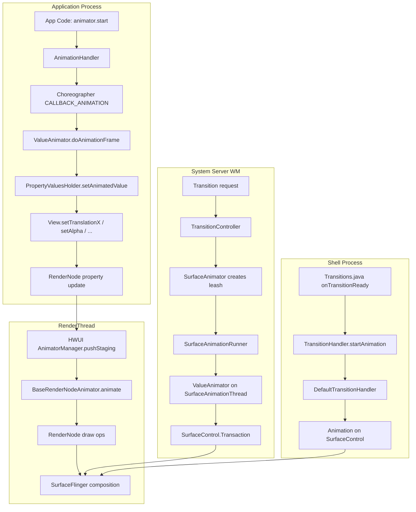

### 14.1.3 计时基础设施

UI 线程上的所有动画都共享同一个计时来源：**Choreographer**。Choreographer 接收来自显示子系统的 VSYNC 信号，并在每一帧派发五种有序的回调类型：

```
// frameworks/base/core/java/android/view/Choreographer.java, lines 321-363

CALLBACK_INPUT       = 0   // Input events
CALLBACK_ANIMATION   = 1   // Animator frame callbacks
CALLBACK_INSETS_ANIMATION = 2   // WindowInsetsAnimation updates
CALLBACK_TRAVERSAL   = 3   // View measure/layout/draw
CALLBACK_COMMIT      = 4   // Post-draw commit; reports a corrected frame start time
```

`CALLBACK_COMMIT` 阶段在遍历之后运行。文档说明它会报告对该帧真实开始时间的更好估计。调用方使用这一估计值来修正由繁重的布局工作导致的延迟。请注意，在 Android 17 中，`AnimationHandler` 不再为每个动画器提交逐帧的 commit 回调。早期版本挂在每个 `ValueAnimator` 上的开始时间提交/卡顿补偿钩子已被移除（参见 §14.3.12）。

`AnimationHandler` 向 Choreographer 注册一个 `FrameCallback`，它在每个 VSYNC 上遍历所有已注册的 `AnimationFrameCallback` 实例——其中包括每一个正在运行的 `ValueAnimator` 和 `DynamicAnimation`。

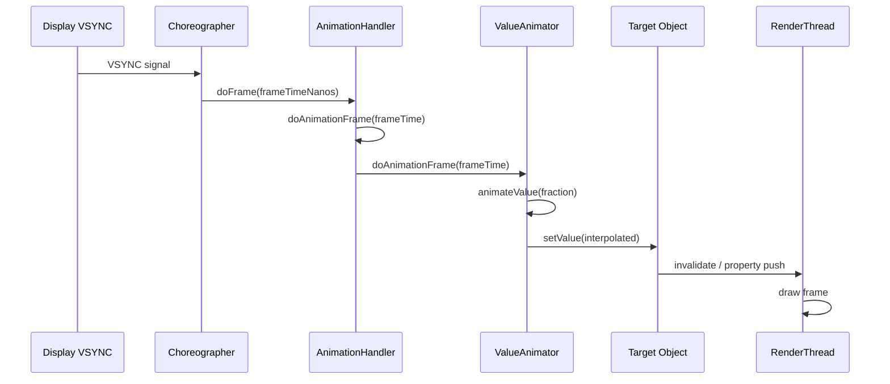

### 14.1.4 关键源码目录

| 目录 | 内容 |
|---|---|
| `frameworks/base/core/java/android/view/animation/` | View 动画类 |
| `frameworks/base/core/java/android/animation/` | 属性动画框架 |
| `frameworks/base/core/java/android/transition/` | 过渡框架 |
| `frameworks/base/libs/hwui/` (Animator*) | 原生 HWUI 动画器 |
| `frameworks/base/core/java/android/view/Choreographer.java` | 计时脉冲 |
| `frameworks/base/services/core/java/com/android/server/wm/` (anim) | WM 动画基础设施 |
| `frameworks/base/libs/WindowManager/Shell/src/.../transition/` | 外壳过渡 |
| `frameworks/base/libs/WindowManager/Shell/src/.../back/` | 预测式返回 |
| `frameworks/base/core/java/com/android/internal/dynamicanimation/animation/` | 物理动画 |

### 14.1.5 线程模型

理解每种动画类型运行在哪个线程上，对于性能分析至关重要：

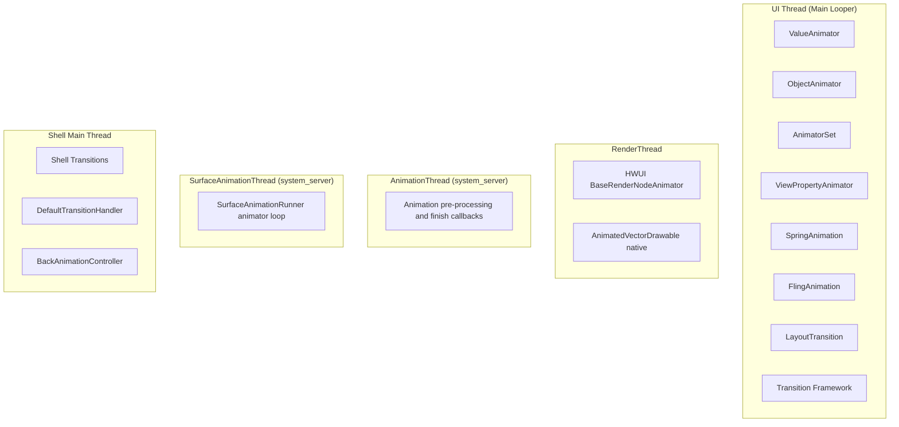

关键的认识是，只有 **AnimatedVectorDrawable**（API 25+）以及其他由 HWUI `RenderNodeAnimator` 支撑的动画才会在 RenderThread 上原生运行。这使它们能够免疫 UI 线程卡顿。**ViewPropertyAnimator** 尽管名字如此，却只是一个便利封装，它在 UI 线程上驱动一个普通的 `ValueAnimator`（`frameworks/base/core/java/android/view/ViewPropertyAnimator.java`，第 860 行）。它和所有其他基于 Java 的动画都运行在 UI 线程上。垃圾回收、繁重的布局或其他主线程工作都可能打断它们。

### 14.1.6 跨进程的动画协调

现代 Android 动画常常跨越多个进程：

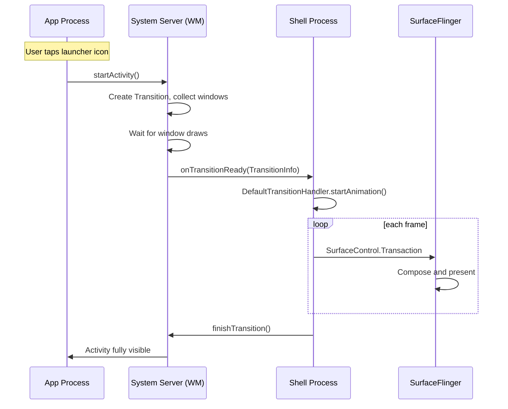

动画运行在 Shell 进程中，但它作用于来自 App 进程的 surface。这种解耦意味着应用卡顿不会影响系统过渡动画。

### 14.1.7 动画时长与缩放

Android 中的所有动画都受全局动画缩放设置的影响。存在三个独立的缩放因子：

| 设置 | 影响 | 默认值 |
|---|---|---|
| `animator_duration_scale` | 属性动画（ValueAnimator 等） | 1.0 |
| `window_animation_scale` | 窗口打开/关闭动画 | 1.0 |
| `transition_animation_scale` | Activity 过渡 | 1.0 |

这些可以通过开发者选项或以编程方式修改：

```bash
adb shell settings put global animator_duration_scale 2.0
adb shell settings put global window_animation_scale 0.5
adb shell settings put global transition_animation_scale 0
```

当任何缩放因子被设置为 0 时，相应的动画将被禁用（立即完成）。

### 14.1.8 帧预算

在 60Hz 下，每一帧有 16.67ms 的预算。在 120Hz 下，预算为 8.33ms。动画回调必须在此预算的一小部分时间内完成，以便为布局、绘制和 GPU 工作留出时间：

| 阶段 | 预算 (60Hz) | 预算 (120Hz) |
|---|---|---|
| INPUT 回调 | ~1ms | ~0.5ms |
| ANIMATION 回调 | ~2ms | ~1ms |
| INSETS_ANIMATION | ~0.5ms | ~0.3ms |
| TRAVERSAL（布局 + 绘制） | ~10ms | ~5ms |
| GPU 渲染 | ~3ms | ~1.5ms |
| **总计** | **~16.5ms** | **~8.3ms** |

超出预算会导致掉帧（卡顿）。当超过 30 帧被跳过时，Choreographer 会记录一条警告。

---

## 14.2 View 动画（旧版）

### 14.2.1 概述

最初的动画框架自 API 1 起就已存在，它通过在绘制阶段向 View 应用一个 `Transformation`（矩阵 + alpha）来工作。至关重要的是，View 动画**不会改变视图的实际布局属性**——一个被平移的视图仍然会在其原始位置接收触摸事件。

源码目录：
`frameworks/base/core/java/android/view/animation/`（29 个文件）

### 14.2.2 Animation 基类

抽象类 `Animation` 定义了生命周期：

```
// frameworks/base/core/java/android/view/animation/Animation.java, lines 40-98

public abstract class Animation implements Cloneable {
    public static final int INFINITE = -1;
    public static final int RESTART = 1;
    public static final int REVERSE = 2;
    public static final int START_ON_FIRST_FRAME = -1;

    public static final int ABSOLUTE = 0;
    public static final int RELATIVE_TO_SELF = 1;
    public static final int RELATIVE_TO_PARENT = 2;

    public static final int ZORDER_NORMAL = 0;
    public static final int ZORDER_TOP = 1;
    public static final int ZORDER_BOTTOM = -1;
    ...
}
```

关键内部状态（第 110-237 行）：

| 字段 | 类型 | 用途 |
|---|---|---|
| `mEnded` | boolean | 动画结束时由 `getTransformation()` 设置 |
| `mStarted` | boolean | 在第一帧时设置 |
| `mCycleFlip` | boolean | 在 REVERSE 重复模式下切换 |
| `mInitialized` | boolean | 播放前必须为 true |
| `mFillBefore` | boolean | 在开始前应用变换（默认 true） |
| `mFillAfter` | boolean | 在结束后保持变换 |
| `mStartTime` | long | 以毫秒计的绝对开始时间 |
| `mDuration` | long | 一个循环的时长 |
| `mRepeatCount` | int | 重复次数（0 = 播放一次） |
| `mRepeatMode` | int | RESTART 或 REVERSE |
| `mInterpolator` | Interpolator | 缓动曲线 |
| `mScaleFactor` | float | 轴心点的缩放 |

生命周期由 `getTransformation(long, Transformation)` 驱动，该方法计算已流逝的时间，应用插值器，并调用抽象方法 `applyTransformation(float interpolatedTime, Transformation t)`。

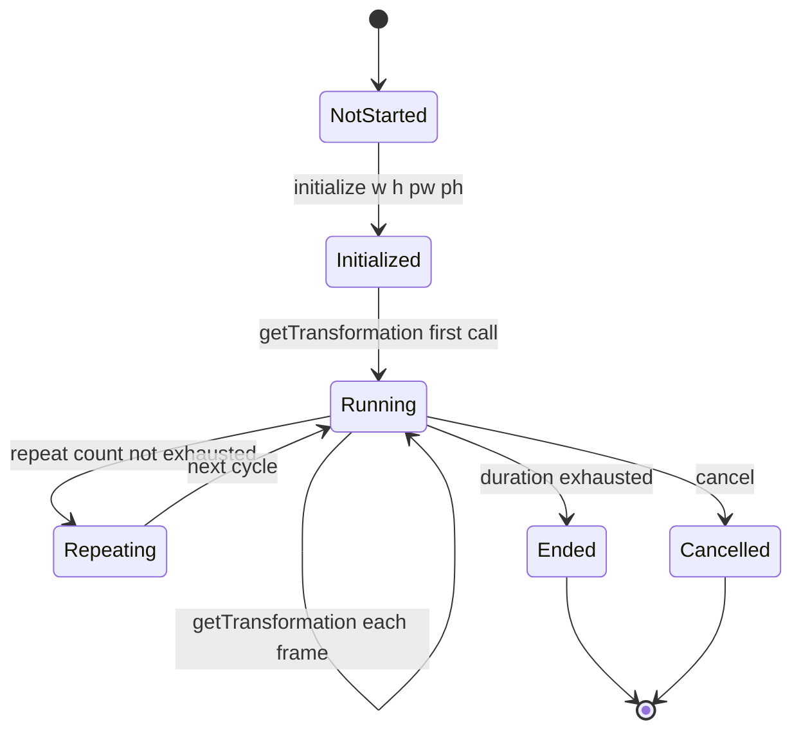

### 14.2.3 Transformation

`Transformation` 类（第 32-80 行）封装了 View 动画所产生的东西：

```
// frameworks/base/core/java/android/view/animation/Transformation.java, lines 32-48

public class Transformation {
    public static final int TYPE_IDENTITY = 0x0;
    public static final int TYPE_ALPHA = 0x1;
    public static final int TYPE_MATRIX = 0x2;
    public static final int TYPE_BOTH = TYPE_ALPHA | TYPE_MATRIX;

    protected Matrix mMatrix;
    protected float mAlpha;
    protected int mTransformationType;
    ...
}
```

`Transformation` 持有一个 `Matrix`（用于平移/旋转/缩放）和一个 `alpha` 值。`compose(Transformation)` 方法将两个变换拼接起来，`AnimationSet` 就是借此组合子动画的。

### 14.2.4 具体的动画子类

#### AlphaAnimation

最简单的动画——只修改 alpha 分量：

```
// frameworks/base/core/java/android/view/animation/AlphaAnimation.java, lines 67-70

@Override
protected void applyTransformation(float interpolatedTime, Transformation t) {
    final float alpha = mFromAlpha;
    t.setAlpha(alpha + ((mToAlpha - alpha) * interpolatedTime));
}
```

注意 `willChangeTransformationMatrix()` 返回 false（第 73 行）——没有矩阵修改，只是 alpha 混合。

#### TranslateAnimation

通过修改矩阵平移来移动视图：

```
// frameworks/base/core/java/android/view/animation/TranslateAnimation.java, lines 166-176

@Override
protected void applyTransformation(float interpolatedTime, Transformation t) {
    float dx = mFromXDelta;
    float dy = mFromYDelta;
    if (mFromXDelta != mToXDelta) {
        dx = mFromXDelta + ((mToXDelta - mFromXDelta) * interpolatedTime);
    }
    if (mFromYDelta != mToYDelta) {
        dy = mFromYDelta + ((mToYDelta - mFromYDelta) * interpolatedTime);
    }
    t.getMatrix().setTranslate(dx, dy);
}
```

`initialize()` 方法（第 179 行）解析值类型：

- `ABSOLUTE` -- 直接使用像素值
- `RELATIVE_TO_SELF` -- 乘以视图自身的尺寸
- `RELATIVE_TO_PARENT` -- 乘以父级的尺寸

#### RotateAnimation

围绕一个可配置的轴心点旋转：

```
// frameworks/base/core/java/android/view/animation/RotateAnimation.java, lines 166-175

@Override
protected void applyTransformation(float interpolatedTime, Transformation t) {
    float degrees = mFromDegrees + ((mToDegrees - mFromDegrees) * interpolatedTime);
    float scale = getScaleFactor();
    if (mPivotX == 0.0f && mPivotY == 0.0f) {
        t.getMatrix().setRotate(degrees);
    } else {
        t.getMatrix().setRotate(degrees, mPivotX * scale, mPivotY * scale);
    }
}
```

#### ScaleAnimation

支持轴心点的缩放；解析可能为分数或尺寸的 from/to 值：

```
// frameworks/base/core/java/android/view/animation/ScaleAnimation.java, lines 241-258

@Override
protected void applyTransformation(float interpolatedTime, Transformation t) {
    float sx = 1.0f;
    float sy = 1.0f;
    float scale = getScaleFactor();
    if (mFromX != 1.0f || mToX != 1.0f) {
        sx = mFromX + ((mToX - mFromX) * interpolatedTime);
    }
    if (mFromY != 1.0f || mToY != 1.0f) {
        sy = mFromY + ((mToY - mFromY) * interpolatedTime);
    }
    if (mPivotX == 0 && mPivotY == 0) {
        t.getMatrix().setScale(sx, sy);
    } else {
        t.getMatrix().setScale(sx, sy, scale * mPivotX, scale * mPivotY);
    }
}
```

### 14.2.5 AnimationSet

`AnimationSet` 将多个一起播放的动画组合成组。它的 `getTransformation()` 以相反顺序遍历子项，并调用 `compose()` 来拼接它们的变换：

```
// frameworks/base/core/java/android/view/animation/AnimationSet.java, lines 390-423

@Override
public boolean getTransformation(long currentTime, Transformation t) {
    final int count = mAnimations.size();
    final ArrayList<Animation> animations = mAnimations;
    final Transformation temp = mTempTransformation;

    boolean more = false;
    boolean started = false;
    boolean ended = true;

    t.clear();

    for (int i = count - 1; i >= 0; --i) {
        final Animation a = animations.get(i);
        temp.clear();
        more = a.getTransformation(currentTime, temp, getScaleFactor()) || more;
        t.compose(temp);
        started = started || a.hasStarted();
        ended = a.hasEnded() && ended;
    }
    ...
}
```

诸如 `duration`、`fillBefore`、`fillAfter` 和 `repeatMode` 之类的属性可以通过属性标志向下推送到子动画（第 54-61 行）：

```
// AnimationSet.java, lines 54-61
private static final int PROPERTY_FILL_AFTER_MASK         = 0x1;
private static final int PROPERTY_FILL_BEFORE_MASK        = 0x2;
private static final int PROPERTY_REPEAT_MODE_MASK        = 0x4;
private static final int PROPERTY_START_OFFSET_MASK       = 0x8;
private static final int PROPERTY_SHARE_INTERPOLATOR_MASK = 0x10;
private static final int PROPERTY_DURATION_MASK           = 0x20;
private static final int PROPERTY_MORPH_MATRIX_MASK       = 0x40;
private static final int PROPERTY_CHANGE_BOUNDS_MASK      = 0x80;
```

### 14.2.6 插值器

`android.view.animation` 包提供了 12 个内置插值器：

| 插值器 | 公式 / 行为 | 典型用途 |
|---|---|---|
| `AccelerateDecelerateInterpolator` | `cos((t+1)*PI)/2 + 0.5` | 默认；自然运动 |
| `AccelerateInterpolator` | `t^(2*factor)` | 退出动画 |
| `DecelerateInterpolator` | `1 - (1-t)^(2*factor)` | 进入动画 |
| `LinearInterpolator` | `t` | 恒定速度 |
| `BounceInterpolator` | 分段二次 | 末尾弹跳 |
| `OvershootInterpolator` | 三次过冲 | 类似弹簧 |
| `AnticipateInterpolator` | 先回拉再射出 | 卡通蓄力 |
| `AnticipateOvershootInterpolator` | 既有 anticipation 又有 overshoot | 组合效果 |
| `CycleInterpolator` | `sin(2*PI*cycles*t)` | 抖动/摇摆 |
| `PathInterpolator` | 自定义 Bezier / SVG 路径 | Material 运动 |
| `BackGestureInterpolator` | 返回手势曲线 | 预测式返回 |
| `BaseInterpolator` | 抽象基类 | 自定义实现 |

`AccelerateDecelerateInterpolator` 的公式优雅而简洁：

```
// frameworks/base/core/java/android/view/animation/AccelerateDecelerateInterpolator.java, line 39

public float getInterpolation(float input) {
    return (float)(Math.cos((input + 1) * Math.PI) / 2.0f) + 0.5f;
}
```

### 14.2.7 PathInterpolator

`PathInterpolator` 在 API 21 中引入以支持 Material Design 运动，它将任何从 (0,0) 到 (1,1) 的 `Path` 映射为一条插值曲线。该路径被近似为离散的 (x,y) 对，然后通过二分查找找到任意输入 t 对应的 y 值：

```
// frameworks/base/core/java/android/view/animation/PathInterpolator.java, lines 207-237

@Override
public float getInterpolation(float t) {
    if (t <= 0) return 0;
    else if (t >= 1) return 1;

    // Binary search for the correct x to interpolate between.
    int startIndex = 0;
    int endIndex = mX.length - 1;
    while (endIndex - startIndex > 1) {
        int midIndex = (startIndex + endIndex) / 2;
        if (t < mX[midIndex]) {
            endIndex = midIndex;
        } else {
            startIndex = midIndex;
        }
    }
    float xRange = mX[endIndex] - mX[startIndex];
    if (xRange == 0) return mY[startIndex];
    float tInRange = t - mX[startIndex];
    float fraction = tInRange / xRange;
    float startY = mY[startIndex];
    float endY = mY[endIndex];
    return startY + (fraction * (endY - startY));
}
```

支持三种构造模式：

- **二次贝塞尔**：`PathInterpolator(controlX, controlY)` -- 一个控制点
- **三次贝塞尔**：`PathInterpolator(cx1, cy1, cx2, cy2)` -- 两个控制点
- **SVG 路径数据**：通过 `pathData` XML 属性，经 `PathParser` 解析

所有插值器都实现 `NativeInterpolator`，为 HWUI RenderThread 动画提供一个原生句柄。

### 14.2.8 View 动画类层次结构

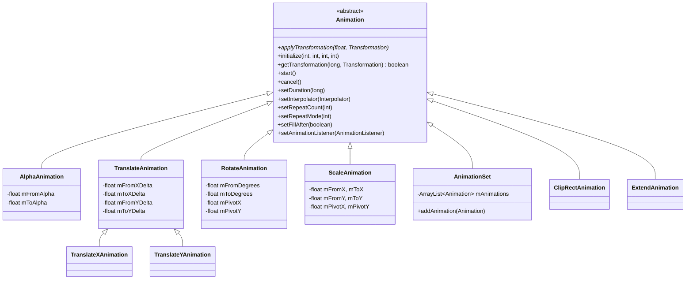

### 14.2.9 View 动画的局限

1. **属性不改变**：动画只应用纯视觉变换。视图的 `left`、`top`、`width`、`height` 保持不变，因此命中测试使用的是原始边界。

2. **仅限视图**：无法对任意对象或非 View 属性进行动画。

3. **类型有限**：只有矩阵（平移/旋转/缩放）和 alpha。没有颜色动画，也没有任意类型化的值。

4. **通过矩阵乘法组合**：AnimationSet 拼接矩阵，这限制了复杂的多属性协调。

这些局限促成了 API 11 中的属性动画框架。

### 14.2.10 getTransformation() 核心循环

View 动画的核心是 `getTransformation()` 方法，它为每一帧计算变换。这是完整的算法（第 1011-1079 行）：

```
// frameworks/base/core/java/android/view/animation/Animation.java, lines 1011-1079

public boolean getTransformation(long currentTime, Transformation outTransformation) {
    if (mStartTime == -1) {
        mStartTime = currentTime;
    }

    final long startOffset = getStartOffset();
    final long duration = mDuration;
    float normalizedTime;
    if (duration != 0) {
        normalizedTime = ((float) (currentTime - (mStartTime + startOffset))) /
                (float) duration;
    } else {
        // time is a step-change with a zero duration
        normalizedTime = currentTime < mStartTime ? 0.0f : 1.0f;
    }

    final boolean expired = normalizedTime >= 1.0f || isCanceled();
    mMore = !expired;

    if (!mFillEnabled) normalizedTime = Math.max(Math.min(normalizedTime, 1.0f), 0.0f);

    if ((normalizedTime >= 0.0f || mFillBefore) && (normalizedTime <= 1.0f || mFillAfter)) {
        if (!mStarted) {
            fireAnimationStart();
            mStarted = true;
            ...
        }
        if (mFillEnabled) normalizedTime = Math.max(Math.min(normalizedTime, 1.0f), 0.0f);
        if (mCycleFlip) {
            normalizedTime = 1.0f - normalizedTime;
        }
        getTransformationAt(normalizedTime, outTransformation);
    }

    if (expired) {
        if (mRepeatCount == mRepeated || isCanceled()) {
            if (!mEnded) {
                mEnded = true;
                guard.close();
                fireAnimationEnd();
            }
        } else {
            if (mRepeatCount > 0) {
                mRepeated++;
            }
            if (mRepeatMode == REVERSE) {
                mCycleFlip = !mCycleFlip;
            }
            mStartTime = -1;
            mMore = true;
            fireAnimationRepeat();
        }
    }
    ...
    return mMore;
}
```

该算法可分解为以下步骤：

1. **开始时间初始化**：在第一次调用时，`mStartTime` 被设为 `currentTime`，实现 `START_ON_FIRST_FRAME` 行为。

2. **归一化时间计算**：`normalizedTime = (currentTime - startTime - offset) / duration`。这产生一个 [0, 1] 的值，表示一个循环的进度。

3. **过期检查**：如果 `normalizedTime >= 1.0`，则当前循环完成。

4. **Fill 钳制**：如果 `mFillEnabled` 为 true，归一化时间被钳制到 [0, 1]，以防止外推。

5. **循环翻转**：在 REVERSE 重复模式下，`mCycleFlip` 在每次重复时在 true/false 之间交替，当为 true 时，时间被反转：`1.0 - normalizedTime`。

6. **变换应用**：`getTransformationAt()` 应用插值器并调用子类的 `applyTransformation()`。

7. **重复处理**：如果动画已过期但重复次数尚未耗尽，`mStartTime` 被重置为 -1。同时 `mMore` 被设为 true，以便在下一帧继续。

### 14.2.11 resolveSize：值类型解析

`resolveSize()` 方法（第 1185 行）根据动画值的类型将其转换为像素：

```
// Animation.java, lines 1185-1196

protected float resolveSize(int type, float value, int size, int parentSize) {
    switch (type) {
        case ABSOLUTE:
            return value;
        case RELATIVE_TO_SELF:
            return size * value;
        case RELATIVE_TO_PARENT:
            return parentSize * value;
        default:
            return value;
    }
}
```

这支持像 `android:fromXDelta="50%"`（相对于自身）或 `android:fromXDelta="50%p"`（相对于父级）这样的 XML 声明。

### 14.2.12 窗口管理器上下文中的 View 动画

View 动画也被窗口管理器内部用于旧版窗口过渡。`WindowAnimationSpec` 包装一个视图 `Animation`，以将其应用于 `SurfaceControl` 而不是 View。动画的 `Transformation` 矩阵被转换为 `SurfaceControl.Transaction` 操作（setMatrix、setAlpha、setWindowCrop）。动画的位置偏移通过 `postTranslate()` 烘焙进矩阵。它不是通过单独的 `setPosition` 调用来应用的。

### 14.2.13 插值器原生桥接

所有内置插值器都实现 `NativeInterpolator`，它提供了一个返回原生句柄的 `createNativeInterpolator()` 方法。该句柄被 HWUI 用于在 RenderThread 上运行相同的插值曲线，而无需逐帧跨越 JNI 边界：

```
// AccelerateDecelerateInterpolator.java, lines 43-47

/** @hide */
@Override
public long createNativeInterpolator() {
    return NativeInterpolatorFactory.createAccelerateDecelerateInterpolator();
}
```

`frameworks/base/libs/hwui/Interpolator.cpp` 中的原生实现与 Java 公式完全一致，确保 UI 线程动画与 RenderThread 动画之间的视觉一致性。

### 14.2.14 View 动画文件摘要

| 文件 | 用途 |
|---|---|
| `Animation.java` | 抽象基类 |
| `AnimationSet.java` | 同时播放的动画组 |
| `AnimationUtils.java` | 加载辅助方法，currentAnimationTimeMillis |
| `Transformation.java` | 矩阵 + alpha 容器 |
| `AlphaAnimation.java` | 透明度动画 |
| `TranslateAnimation.java` | 位置动画 |
| `RotateAnimation.java` | 旋转动画 |
| `ScaleAnimation.java` | 缩放动画 |
| `ClipRectAnimation.java` | 裁剪矩形动画 |
| `ExtendAnimation.java` | 边缘延展动画 |
| `TranslateXAnimation.java` | 仅 X 平移（优化） |
| `TranslateYAnimation.java` | 仅 Y 平移（优化） |
| `PathInterpolator.java` | 基于贝塞尔/路径的插值 |
| `AccelerateDecelerateInterpolator.java` | 默认余弦缓动 |
| `AccelerateInterpolator.java` | 幂曲线加速 |
| `DecelerateInterpolator.java` | 幂曲线减速 |
| `LinearInterpolator.java` | 恒等函数 |
| `BounceInterpolator.java` | 末尾弹跳 |
| `OvershootInterpolator.java` | 三次过冲 |
| `AnticipateInterpolator.java` | 运动前蓄力 |
| `AnticipateOvershootInterpolator.java` | 组合蓄力与过冲 |
| `CycleInterpolator.java` | 正弦循环 |
| `BackGestureInterpolator.java` | 返回手势曲线 |
| `BaseInterpolator.java` | 插值器的抽象基类 |
| `Interpolator.java` | 扩展 TimeInterpolator 的接口 |
| `LayoutAnimationController.java` | 交错子动画 |
| `GridLayoutAnimationController.java` | 基于网格的交错动画 |

---

## 14.3 属性动画

### 14.3.1 概述

属性动画框架于 Android 3.0（API 11）引入，是 Android 动画的现代主力。它对**任意 Java 对象**上的**实际属性**进行动画——不仅仅是视图。当你对 `View.setTranslationX` 做动画时，属性会真实地改变，因此命中测试、布局和无障碍功能都会反映动画后的状态。

源码目录：
`frameworks/base/core/java/android/animation/`（31 个文件）

### 14.3.2 核心类层次结构

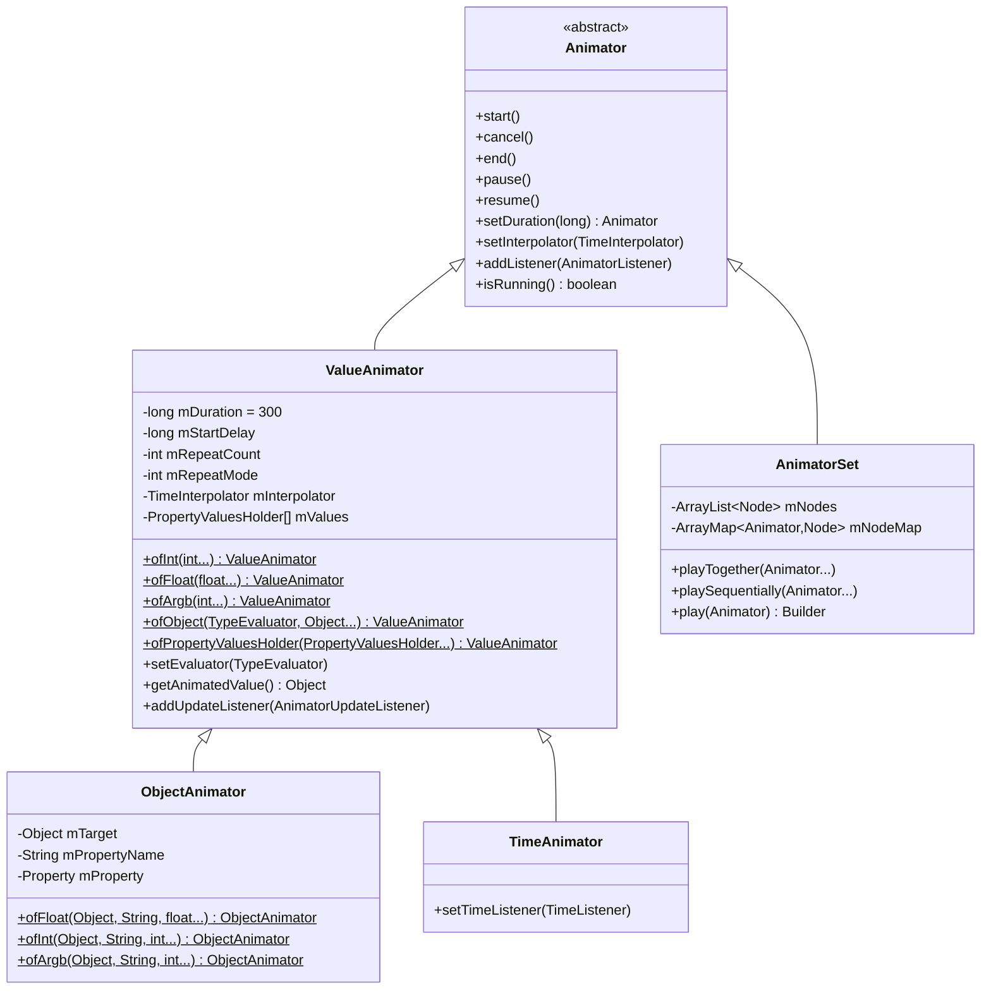

### 14.3.3 ValueAnimator 深入剖析

`ValueAnimator.java` 是属性动画的引擎。

**关键字段**（第 96-279 行）：

```
// frameworks/base/core/java/android/animation/ValueAnimator.java

private static float sDurationScale = 1.0f;    // System-wide scale (line 96)
long mStartTime = -1;                          // First frame time (line 113)
float mSeekFraction = -1;                      // Seek position (line 119)
private long mDuration = 300;                  // Default 300ms (line 202)
private int mRepeatCount = 0;                  // Default: play once (line 211)
private int mRepeatMode = RESTART;             // RESTART or REVERSE (line 218)
private TimeInterpolator mInterpolator = sDefaultInterpolator;  // (line 237)
PropertyValuesHolder[] mValues;                // Animated properties (line 247)
HashMap<String, PropertyValuesHolder> mValuesMap;  // Name-to-PVH lookup
```

请注意，旧版本中存在的 `mStartTimeCommitted`“卡顿补偿”标志在 Android 17 中已消失。用于调整开始时间的逐动画器 commit 回调已被移除（参见 §14.3.12）。

**时长缩放**：系统级的 `sDurationScale` 会乘以所有动画时长。开发者选项 > “Animator duration scale” 会修改此项。当设置为 0 时，`areAnimatorsEnabled()` 返回 false（第 394 行）：

```
// ValueAnimator.java, lines 394-396
public static boolean areAnimatorsEnabled() {
    return !(sDurationScale == 0);
}
```

**工厂方法**（第 417-515 行）：

| 工厂方法 | 评估器 | 描述 |
|---|---|---|
| `ofInt(int...)` | IntEvaluator | 整数范围 |
| `ofFloat(float...)` | FloatEvaluator | 浮点范围 |
| `ofArgb(int...)` | ArgbEvaluator | 在线性空间中进行颜色插值（sRGB 到线性的往返转换） |
| `ofObject(TypeEvaluator, Object...)` | 自定义 | 任意类型 |
| `ofPropertyValuesHolder(PVH...)` | 每个持有者 | 多属性 |

### 14.3.4 动画帧循环

当调用 `start()` 时，`ValueAnimator` 会将自己作为 `AnimationFrameCallback` 注册到 `AnimationHandler`。该处理器会调度一个 Choreographer 帧回调。在每个 VSYNC 上：

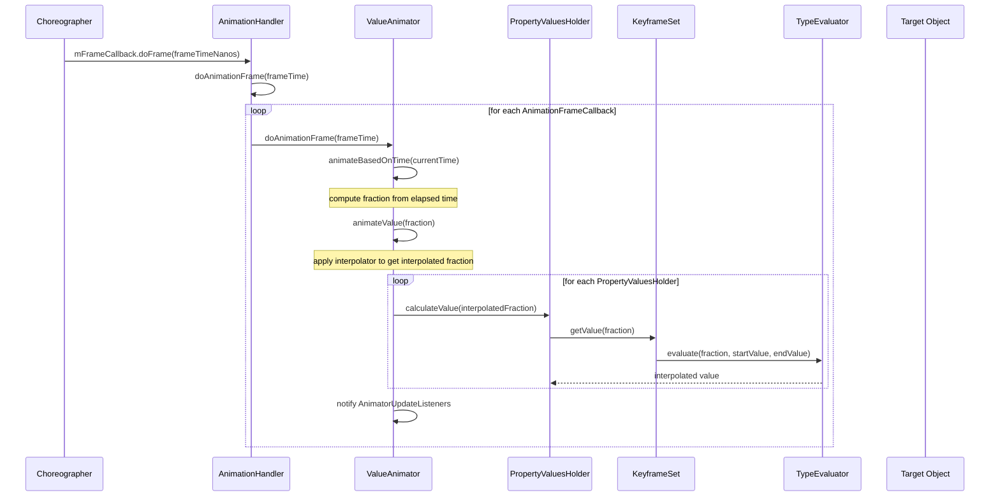

`animateBasedOnTime()` 中的核心计时逻辑（简化版）：

1. 计算 `currentIterationFraction = (currentTime - startTime) / duration`
2. 处理重复：`mOverallFraction` 是原始的已流逝时间/时长比值，钳制到 `[0, mRepeatCount + 1]`。然后 `getCurrentIterationFraction()` 减去整数迭代索引，得到当前循环内的分数
3. 对于 REVERSE 模式，在奇数次迭代上翻转分数
4. 调用 `animateValue(fraction)`，它应用插值器

### 14.3.5 ObjectAnimator

`ObjectAnimator` 扩展了 `ValueAnimator`，将动画值直接设置到目标对象上。它通过两种机制解析目标属性：

1. **属性名（String）**：使用反射查找 `setFoo()` / `getFoo()` 方法。对于 `float` 和 `int` 返回类型存在优化的 JNI 路径以获得最佳性能。

2. **属性对象**：使用 `Property<T, V>` 抽象，完全避免反射。

```
// frameworks/base/core/java/android/animation/ObjectAnimator.java, lines 69-80

public final class ObjectAnimator extends ValueAnimator {
    private Object mTarget;
    private String mPropertyName;
    private Property mProperty;
    private boolean mAutoCancel = false;
    ...
}
```

常见的工厂方法：

- `ObjectAnimator.ofFloat(view, "translationX", 0f, 100f)`
- `ObjectAnimator.ofFloat(view, View.TRANSLATION_X, 0f, 100f)` -- 推荐；无需反射
- `ObjectAnimator.ofArgb(view, "backgroundColor", Color.RED, Color.BLUE)`

### 14.3.6 PropertyValuesHolder

`PropertyValuesHolder` 封装一个动画属性：它的名字/Property 引用、setter/getter 方法、关键帧集合以及类型评估器。

```
// frameworks/base/core/java/android/animation/PropertyValuesHolder.java, lines 38-78

public class PropertyValuesHolder implements Cloneable {
    String mPropertyName;
    protected Property mProperty;
    Method mSetter = null;
    private Method mGetter = null;
    Class mValueType;
    Keyframes mKeyframes = null;
    ...
}
```

该类为每个类维护 setter/getter 方法的静态缓存，以避免重复反射：

```
// PropertyValuesHolder.java, lines 92-97
private static Class[] FLOAT_VARIANTS = {float.class, Float.class, double.class,
    int.class, Double.class, Integer.class};
private static Class[] INTEGER_VARIANTS = {int.class, Integer.class, float.class,
    double.class, Float.class, Double.class};
```

### 14.3.7 关键帧与类型评估器

`Keyframe` 类定义了一个在特定分数（0.0 到 1.0）处的值。`KeyframeSet` 保存这个有序集合，并在相邻关键帧之间执行插值。

内置评估器：

| 评估器 | 操作 |
|---|---|
| `IntEvaluator` | `(int)(startValue + fraction * (endValue - startValue))` -- 截断应用于整个和，因此递减动画会朝起始值取整 |
| `FloatEvaluator` | `startValue + fraction * (endValue - startValue)` |
| `ArgbEvaluator` | 将 R/G/B 从 sRGB 转换到线性（gamma 2.2），在线性空间中对每个通道进行线性插值，再转换回 sRGB；alpha 直接线性插值 |
| `PointFEvaluator` | 独立插值 PointF 的 x、y |
| `RectEvaluator` | 插值 Rect 的 left/top/right/bottom |
| `IntArrayEvaluator` | 逐元素整数数组插值 |
| `FloatArrayEvaluator` | 逐元素浮点数组插值 |

### 14.3.8 AnimatorSet 与依赖图

`AnimatorSet` 使用基于节点的内部结构，将多个 `Animator` 实例组织成依赖图：

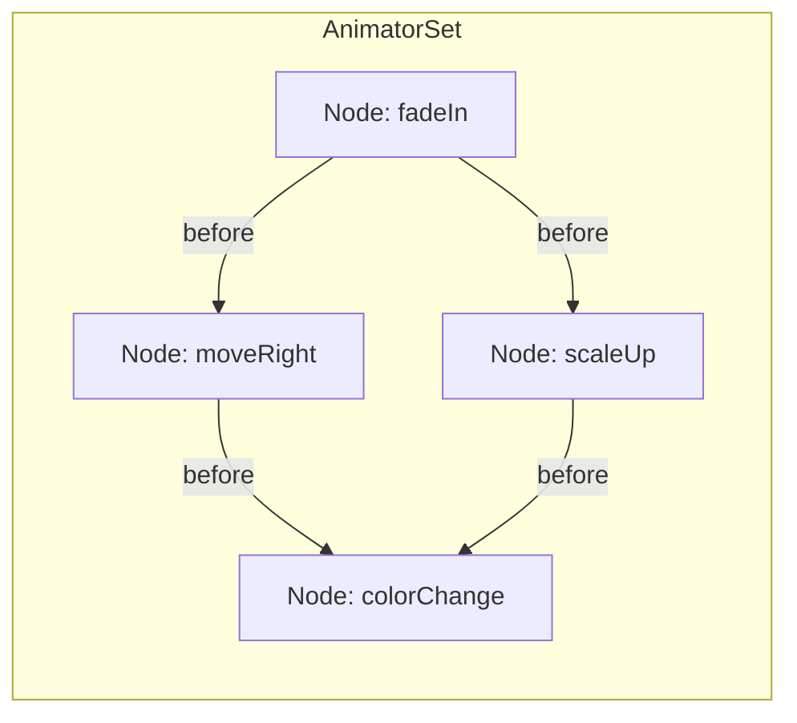

Builder API 链式连接依赖关系：

```java
AnimatorSet set = new AnimatorSet();
set.play(fadeIn).before(moveRight);
set.play(fadeIn).before(scaleUp);
set.play(moveRight).before(colorChange);
set.play(scaleUp).before(colorChange);
```

在内部，AnimatorSet 使用一个按时间排序的 `AnimationEvent` 列表（第 90 行）。在每一帧上，它处理时间已到的事件，按需启动或结束子动画器。

### 14.3.9 AnimationHandler 与后台暂停

`AnimationHandler` 管理每个线程的动画循环。

关键机制——**后台暂停**（第 271-287 行）：当一个进程中的所有窗口都进入后台时，`AnimationHandler` 暂停所有无限时长的动画器以节省 CPU。它通过 `mAnimatorRequestors` 跟踪可见性：

```
// frameworks/base/core/java/android/animation/AnimationHandler.java, lines 271-287

private Choreographer.FrameCallback mPauser = frameTimeNanos -> {
    if (mAnimatorRequestors.size() > 0) {
        return;  // something re-enabled since scheduling
    }
    for (int i = 0; i < mAnimationCallbacks.size(); ++i) {
        AnimationFrameCallback callback = mAnimationCallbacks.get(i);
        if (callback instanceof Animator) {
            Animator animator = ((Animator) callback);
            if (animator.getTotalDuration() == Animator.DURATION_INFINITE
                    && !animator.isPaused()) {
                mPausedAnimators.add(animator);
                animator.pause();
            }
        }
    }
};
```

### 14.3.10 ValueAnimator.start() 完整流程

`start()` 方法（约第 1100-1160 行）编排完整的动画启动序列。详细流程如下：

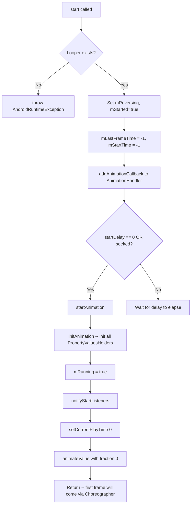

关键实现细节——`addAnimationCallback(0)`（约第 1126 行）会调用到 `AnimationHandler.addAnimationFrameCallback()`，后者：

1. 将该 ValueAnimator 加入 `mAnimationCallbacks` 列表
2. 如果是第一个回调，则向 Choreographer 提交 `mFrameCallback`
3. 如果存在延迟，则将延迟开始时间存储在 `mDelayedCallbackStartTime` 中

### 14.3.11 animateBasedOnTime() 算法

该方法（第 1373-1398 行）每帧调用一次，将墙上时钟时间转换为动画分数：

```
// ValueAnimator.java, lines 1373-1398

boolean animateBasedOnTime(long currentTime) {
    boolean done = false;
    if (mRunning) {
        final long scaledDuration = getScaledDuration();
        final float fraction = scaledDuration > 0 ?
                (float)(currentTime - mStartTime) / scaledDuration : 1f;
        final float lastFraction = mOverallFraction;
        final boolean newIteration = (int) fraction > (int) lastFraction;
        final boolean lastIterationFinished = (fraction >= mRepeatCount + 1) &&
                (mRepeatCount != INFINITE);
        if (scaledDuration == 0) {
            done = true;
        } else if (newIteration && !lastIterationFinished) {
            notifyListeners(AnimatorCaller.ON_REPEAT, false);
        } else if (lastIterationFinished) {
            done = true;
        }
        mOverallFraction = clampFraction(fraction);
        float currentIterationFraction = getCurrentIterationFraction(
                mOverallFraction, mReversing);
        animateValue(currentIterationFraction);
    }
    return done;
}
```

注意 `getScaledDuration()` 如何应用系统级的时长缩放：
```
private long getScaledDuration() {
    return (long)(mDuration * resolveDurationScale());
}
```

### 14.3.12 开始时间校正与被移除的 Commit 钩子

直到 Android 16，`ValueAnimator` 都在 Choreographer 的 `CALLBACK_COMMIT` 阶段注册一个逐动画器的 commit 回调（`commitAnimationFrame`），由 `mStartTimeCommitted` 标志保护。它的职责是当繁重的布局工作延迟了动画的第一帧时，将 `mStartTime` 向前微调。这阻止了动画在终于运行时“跳到”后面的位置。

在 Android 17 中，这个钩子**已被移除**。`ValueAnimator` 不再有 `commitAnimationFrame` 或 `mStartTimeCommitted`。`AnimationHandler` 不再为其注册的动画器提交 commit 回调。对比 §14.3.17 中 `doAnimationFrame()` 的代码体：它只派发帧回调，别无其他。

`CALLBACK_COMMIT` 阶段在 Choreographer 中仍然存在（`frameworks/base/core/java/android/view/Choreographer.java`，第 363 行）。文档仍然说明它在遍历后报告更好的帧开始时间估计（第 353-363 行）。在当前代码树中，它的平台内使用者是 Shell 组件（`PipTaskOrganizer`、`SplashScreenExitAnimationUtils`）以及 `ActivityThread` 和 `AutofillManager`。视图层次结构不是使用者，属性动画框架也不再使用它。

`ValueAnimator` 仍然跟踪 `mLastFrameTime`（第 161 行）用于第一帧检测和开始延迟处理。旧 commit 回调执行的显式开始时间微调已经消失。

### 14.3.13 时长缩放与无障碍

系统级的 `sDurationScale` 由三个设置修改：

1. **开发者选项 > Animator duration scale**：选择器提供“Animation off”（0）、0.5x、1x、1.5x、2x、5x 和 10x（`frameworks/base/packages/SettingsLib/res/values/arrays.xml:373-392`）
2. **省电模式**：可能将缩放设置为 0 以禁用所有动画
3. **编程方式**：`ValueAnimator.setDurationScale()`（隐藏 API）

当 `sDurationScale` 为 0 时，`areAnimatorsEnabled()` 返回 false，动画会立即完成。这对以下场景至关重要：

- 无障碍测试（验证 UI 在没有动画的情况下也能工作）
- 性能测试（移除动画开销）
- 省电

应用可以监听缩放变化：

```java
ValueAnimator.registerDurationScaleChangeListener(scale -> {
    // Adjust behavior when animation scale changes
    if (scale == 0) {
        // Animations are disabled
    }
});
```

### 14.3.14 ObjectAnimator 自动取消

当 `mAutoCancel` 为 true 时，启动一个 ObjectAnimator 会自动取消任何针对同一对象和属性的正在运行的 ObjectAnimator：

```java
ObjectAnimator anim = ObjectAnimator.ofFloat(view, "alpha", 1f);
anim.setAutoCancel(true);
anim.start();
// Starting another alpha animation on the same view
// will cancel the first one automatically
```

`ViewPropertyAnimator` 实现了类似的效果。每次新的 `view.animate().alpha()` 调用都会取消之前的 alpha 动画。它为此使用自己的机制。它使用的是裸 `ValueAnimator`，因此 autoCancel 从不适用。相反，`animatePropertyBy()` 遍历其 `mAnimatorMap` 中 `PropertyBundle` 条目，并取消任何触及同一属性的正在运行的动画器（`ViewPropertyAnimator.java`，第 940-962 行）。

### 14.3.15 StateListAnimator

`StateListAnimator` 将视图状态（pressed、focused、selected 等）映射到 `Animator` 对象，从而实现状态驱动的动画。它通常用于 Material Design 的海拔变化：

```xml
<selector>
    <item android:state_pressed="true">
        <objectAnimator android:propertyName="translationZ"
            android:duration="100" android:valueTo="6dp"/>
    </item>
    <item>
        <objectAnimator android:propertyName="translationZ"
            android:duration="100" android:valueTo="0dp"/>
    </item>
</selector>
```

### 14.3.16 属性动画文件摘要

| 文件 | 用途 |
|---|---|
| `Animator.java` | 所有动画器的抽象基类 |
| `ValueAnimator.java` | 核心计时引擎 |
| `ObjectAnimator.java` | 属性目标动画器 |
| `AnimatorSet.java` | 多动画器编排 |
| `PropertyValuesHolder.java` | 逐属性的值管理 |
| `AnimationHandler.java` | 帧回调管理器 |
| `Keyframe.java` | 单个时间/值对 |
| `KeyframeSet.java` | 有序关键帧集合 |
| `FloatKeyframeSet.java` | 优化的浮点关键帧 |
| `IntKeyframeSet.java` | 优化的整数关键帧 |
| `PathKeyframes.java` | 基于路径的关键帧 |
| `ArgbEvaluator.java` | 颜色插值 |
| `FloatEvaluator.java` | 浮点插值 |
| `IntEvaluator.java` | 整数插值 |
| `PointFEvaluator.java` | PointF 插值 |
| `RectEvaluator.java` | Rect 插值 |
| `LayoutTransition.java` | ViewGroup 布局变化动画 |
| `AnimatorInflater.java` | XML 资源加载 |
| `TimeAnimator.java` | 原始帧计时 |
| `RevealAnimator.java` | 圆形揭露支持 |
| `StateListAnimator.java` | 状态驱动动画 |
| `TypeConverter.java` | 类型转换支持 |
| `BidirectionalTypeConverter.java` | 双向转换 |

### 14.3.17 AnimationHandler.doAnimationFrame() 深入剖析

逐帧的动画派发（第 376-389 行）是动画循环的核心。在 Android 17 中它已被简化——它只派发每个到期的帧回调，别无其他：

```
// AnimationHandler.java, lines 376-389

private void doAnimationFrame(long frameTime) {
    long currentTime = SystemClock.uptimeMillis();
    final int size = mAnimationCallbacks.size();
    for (int i = 0; i < size; i++) {
        final AnimationFrameCallback callback = mAnimationCallbacks.get(i);
        if (callback == null) {
            continue;
        }
        if (isCallbackDue(callback, currentTime)) {
            callback.doAnimationFrame(frameTime);
        }
    }
    cleanUpList();
}
```

关键细节：

1. **空值检查**：回调可能在遍历期间被 `removeCallback()` 置为空。列表在末尾被清理。
2. **延迟检查**：`isCallbackDue()` 通过与 `mDelayedCallbackStartTime` 比较，检查开始延迟是否已流逝。
3. **不再有 commit 回调**：早期版本在这里为每个动画器提交一个 commit 回调（用于 §14.3.12 的开始时间卡顿补偿）。那条路径在 Android 17 中已消失——循环在对每个到期回调调用 `doAnimationFrame` 之后即结束。

### 14.3.18 AnimationFrameCallbackProvider

`AnimationHandler` 为其计时来源使用一个可插拔的回调提供者。在 Android 17 中，`AnimationFrameCallbackProvider` 接口被精简为三个方法。`postCommitCallback` 和 `getFrameTime` 成员连同 §14.3.12 的 commit 钩子一起被删除。默认实现包装 Choreographer：

```java
// frameworks/base/core/java/android/animation/AnimationHandler.java, lines 468-510

private class MyFrameCallbackProvider implements AnimationFrameCallbackProvider {
    final Choreographer mChoreographer = Choreographer.getInstance();

    @Override
    public void postFrameCallback(Choreographer.FrameCallback callback) {
        mChoreographer.postFrameCallback(callback);
    }

    @Override
    public long getFrameDelay() {
        return Choreographer.getFrameDelay();
    }

    @Override
    public void setFrameDelay(long delay) {
        Choreographer.setFrameDelay(delay);
    }
}

// The interface itself (lines 510-514):
public interface AnimationFrameCallbackProvider {
    void postFrameCallback(Choreographer.FrameCallback callback);
    long getFrameDelay();
    void setFrameDelay(long delay);
}
```

对于测试，自定义提供者可以用手动时钟替换 Choreographer，从而实现确定性的动画测试。

### 14.3.19 AnimationHandler 中的自动取消

当一个新的 `ObjectAnimator` 以 `setAutoCancel(true)` 启动时，`AnimationHandler.autoCancelBasedOn()`（第 431 行）会扫描所有正在运行的回调。它取消任何针对同一对象上同一属性的 `ObjectAnimator`：

```
// AnimationHandler.java, lines 431-441

void autoCancelBasedOn(ObjectAnimator objectAnimator) {
    for (int i = mAnimationCallbacks.size() - 1; i >= 0; i--) {
        AnimationFrameCallback cb = mAnimationCallbacks.get(i);
        if (cb == null) {
            continue;
        }
        if (objectAnimator.shouldAutoCancel(cb)) {
            ((Animator) mAnimationCallbacks.get(i)).cancel();
        }
    }
}
```

这防止了多个相互冲突的动画器争抢设置同一属性的常见 bug。

### 14.3.20 AnimatorSet 节点与事件系统

AnimatorSet 使用内部 `Node` 类来表示依赖图中的每个子动画器。`Builder` API 构建节点之间的关系：

```java
// AnimatorSet internal structure
class Node implements Cloneable {
    Animator mAnimation;
    ArrayList<Node> mChildNodes = null;
    boolean mEnded = false;
    ArrayList<Node> mSiblings;       // "with" relationships
    ArrayList<Node> mParents;        // "after" dependencies
}

class AnimationEvent {
    static final int ANIMATION_START = 0;
    static final int ANIMATION_DELAY_ENDED = 1;
    static final int ANIMATION_END = 2;
    Node mNode;
    int mEvent;
}
```

`mEvents` 列表包含所有按时间排序的开始和结束事件。在动画期间，AnimatorSet 遍历该列表，并在事件时间到达时触发它们。

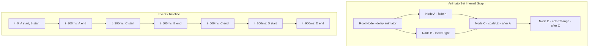

### 14.3.21 LayoutTransition

`LayoutTransition`（`android.animation` 的一部分）在视图被添加到 ViewGroup 或从其中移除时提供自动动画。它定义了五种动画类型：

| 常量 | 时机 | 默认动画 |
|---|---|---|
| `APPEARING` | 视图变为可见 | 淡入（alpha 0 到 1） |
| `DISAPPEARING` | 视图变为不可见 | 淡出（alpha 1 到 0） |
| `CHANGE_APPEARING` | 其他视图移动腾出空间 | 边界变化 |
| `CHANGE_DISAPPEARING` | 其他视图填补空隙 | 边界变化 |
| `CHANGING` | 布局变化但没有添加/移除 | 边界变化 |

默认情况下，`DISAPPEARING` 和 `CHANGE_APPEARING` 立即开始；`APPEARING` 和 `CHANGE_DISAPPEARING` 在默认时长之后开始，创造出自然的排序效果。

---

## 14.4 过渡框架

### 14.4.1 概述

过渡框架（API 19+）可自动检测视图层次结构在两个状态（“场景”）之间的属性变化，并创建相应的动画。开发者无需手动计算 from/to 值，只需描述过渡**什么**，框架就会弄清楚**如何**过渡。

源码目录：
`frameworks/base/core/java/android/transition/`（33 个文件）

### 14.4.2 核心概念

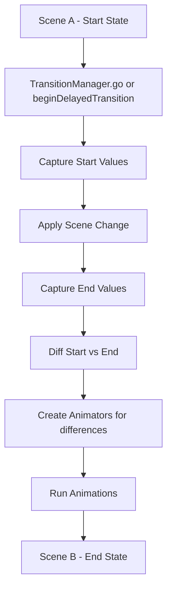

### 14.4.3 Transition 基类

`Transition.java` 是抽象基类。每个子类必须实现两个抽象方法，并且通常会重写第三个方法：

1. `captureStartValues(TransitionValues)`（抽象）——记录场景变化前的属性值
2. `captureEndValues(TransitionValues)`（抽象）——记录场景变化后的属性值
3. `createAnimator(ViewGroup, TransitionValues, TransitionValues)`——返回一个用于检测到的变化的 `Animator`。这是一个具体方法，其默认代码体返回 null（第 476 行）。因此，一个什么都不重写的过渡就只是什么都不动画

`TransitionValues` 是一个简单的持有者：

```java
public class TransitionValues {
    public View view;
    public final Map<String, Object> values = new ArrayMap<>();
}
```

### 14.4.4 内置过渡

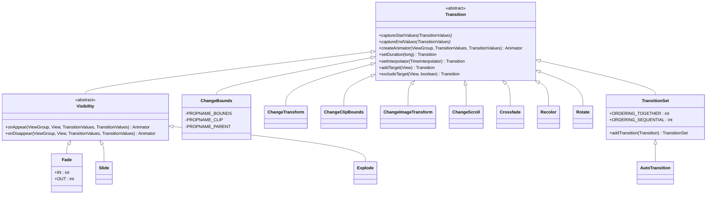

### 14.4.5 ChangeBounds

`ChangeBounds`（最复杂的内置过渡）捕获五个属性：

```
// frameworks/base/core/java/android/transition/ChangeBounds.java, lines 58-69

private static final String PROPNAME_BOUNDS = "android:changeBounds:bounds";
private static final String PROPNAME_CLIP = "android:changeBounds:clip";
private static final String PROPNAME_PARENT = "android:changeBounds:parent";
private static final String PROPNAME_WINDOW_X = "android:changeBounds:windowX";
private static final String PROPNAME_WINDOW_Y = "android:changeBounds:windowY";
```

它创建一个 `AnimatorSet`，使用 `ObjectAnimator` 在自定义 `Property` 对象（`TOP_LEFT_PROPERTY`、`BOTTOM_RIGHT_PROPERTY`）上动画视图边界，这些对象在内部调用 `View.setLeft()`、`View.setTop()` 等。

### 14.4.6 Fade

`Fade` 扩展了 `Visibility`，用于动画 alpha 变化：

```
// frameworks/base/core/java/android/transition/Fade.java, lines 61-99

public class Fade extends Visibility {
    static final String PROPNAME_TRANSITION_ALPHA = "android:fade:transitionAlpha";
    public static final int IN = Visibility.MODE_IN;
    public static final int OUT = Visibility.MODE_OUT;
    ...
}
```

`Visibility` 基类检测视图是出现（变为 `VISIBLE` 或被添加）还是消失（变为 `GONE`/`INVISIBLE` 或被移除）。对于消失的视图，它使用 `ViewGroupOverlay` 在淡出期间保持视图可见。

### 14.4.7 TransitionManager

`TransitionManager` 是运行过渡的入口点。最常见的 API：

```java
// In-place transition on current hierarchy
TransitionManager.beginDelayedTransition(viewGroup, new AutoTransition());
// ... modify views ...
// Framework captures end values on next layout pass and runs animations
```

默认过渡是 `AutoTransition`，它是一个 `TransitionSet`，依次包含 `Fade(OUT)`、`ChangeBounds` 和 `Fade(IN)`。

### 14.4.8 Scene

`Scene` 表示视图层次结构的快照。它可以从布局资源创建，或从当前状态捕获：

```java
Scene scene = Scene.getSceneForLayout(sceneRoot, R.layout.scene_b, context);
TransitionManager.go(scene, new ChangeBounds());
```

### 14.4.9 过渡匹配算法

过渡框架的一个关键方面是它如何在开始状态和结束状态之间匹配视图。`Transition` 类定义了四种匹配策略，按可配置的顺序应用：

```
// frameworks/base/core/java/android/transition/Transition.java, lines 131-167

public static final int MATCH_INSTANCE = 0x1;   // Same View object
public static final int MATCH_NAME = 0x2;        // Same transitionName
public static final int MATCH_ID = 0x3;           // Same view ID
public static final int MATCH_ITEM_ID = 0x4;      // Same adapter item ID

private static final int[] DEFAULT_MATCH_ORDER = {
    MATCH_NAME,
    MATCH_INSTANCE,
    MATCH_ID,
    MATCH_ITEM_ID,
};
```

默认顺序是：先 transition name，然后是 instance，然后是 ID，最后是 item ID。这个顺序很重要。这是因为开始状态中的一个视图会与结束状态中的一个视图匹配。在那之后，两个视图都会被移出未匹配视图的池子。

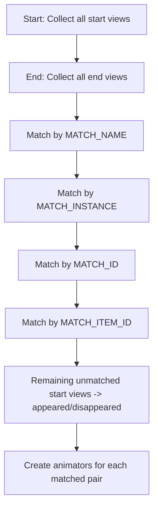

### 14.4.10 Transition 内部状态

`Transition` 基类维护大量内部状态（第 179-252 行）：

```
// Transition.java, lines 179-252 (key fields)

private String mName = getClass().getName();
long mStartDelay = -1;
long mDuration = -1;
TimeInterpolator mInterpolator = null;
ArrayList<Integer> mTargetIds = new ArrayList<>();
ArrayList<View> mTargets = new ArrayList<>();
ArrayList<String> mTargetNames = null;
ArrayList<Class> mTargetTypes = null;
// ... exclude lists ...
private TransitionValuesMaps mStartValues = new TransitionValuesMaps();
private TransitionValuesMaps mEndValues = new TransitionValuesMaps();
TransitionSet mParent = null;
int[] mMatchOrder = DEFAULT_MATCH_ORDER;
ArrayList<Animator> mCurrentAnimators = new ArrayList<>();
TransitionPropagation mPropagation;
EpicenterCallback mEpicenterCallback;
PathMotion mPathMotion = STRAIGHT_PATH_MOTION;
```

请注意，duration、startDelay 和 interpolator 都默认为 -1/null，这意味着“使用动画器自己的值”。只有在 Transition 上显式设置时，它们才会覆盖子动画器。

### 14.4.11 TransitionValues 容器

对于每个视图，`captureStartValues()` 和 `captureEndValues()` 会填充一个 `TransitionValues` 映射。约定是使用全限定键：

```java
// In ChangeBounds:
private static final String PROPNAME_BOUNDS = "android:changeBounds:bounds";
private static final String PROPNAME_CLIP = "android:changeBounds:clip";
private static final String PROPNAME_PARENT = "android:changeBounds:parent";
private static final String PROPNAME_WINDOW_X = "android:changeBounds:windowX";
private static final String PROPNAME_WINDOW_Y = "android:changeBounds:windowY";
```

这种命名空间可以防止多个过渡为同一视图捕获值时发生冲突。

### 14.4.12 TransitionSet 排序

`TransitionSet` 可以同时或依次运行子过渡：

```java
// Together (default) - all children run simultaneously
TransitionSet set = new TransitionSet();
set.setOrdering(TransitionSet.ORDERING_TOGETHER);
set.addTransition(new Fade(Fade.OUT));
set.addTransition(new ChangeBounds());
set.addTransition(new Fade(Fade.IN));

// Sequential - children run one after another
TransitionSet seq = new TransitionSet();
seq.setOrdering(TransitionSet.ORDERING_SEQUENTIAL);
seq.addTransition(new Fade(Fade.OUT));   // First: fade out
seq.addTransition(new ChangeBounds());    // Then: move
seq.addTransition(new Fade(Fade.IN));     // Finally: fade in
```

`AutoTransition` 是一个预构建的依次 TransitionSet：
```java
// AutoTransition = Fade(OUT) -> ChangeBounds -> Fade(IN) (sequential)
public class AutoTransition extends TransitionSet {
    public AutoTransition() {
        setOrdering(ORDERING_SEQUENTIAL);
        addTransition(new Fade(Fade.OUT));
        addTransition(new ChangeBounds());
        addTransition(new Fade(Fade.IN));
    }
}
```

### 14.4.13 目标过滤

过渡可以针对特定视图：

```java
transition.addTarget(R.id.my_view);           // By ID
transition.addTarget("hero_image");            // By transition name
transition.addTarget(TextView.class);          // By class
transition.addTarget(specificView);             // By instance

transition.excludeTarget(R.id.toolbar, true);  // Exclude by ID
transition.excludeTarget(Button.class, true);  // Exclude by class
transition.excludeChildren(R.id.list, true);   // Exclude subtree
```

未指定目标时，过渡作用于场景根中的所有视图。

### 14.4.14 Explode 和 Slide

`Explode` 扩展了 `Visibility`，将视图从中心点向外（或向内）移动。它使用 `CircularPropagation` 交错动画，使离中心较远的视图更晚开始：

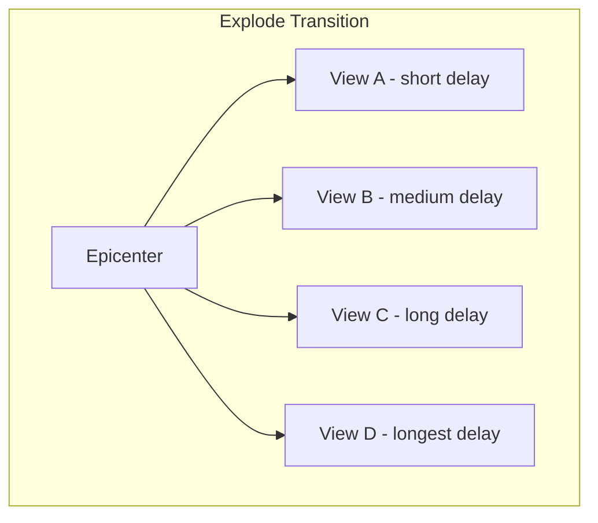

`Slide` 将视图从/向指定边缘（上、下、左、右）移动，并使用 `SidePropagation` 创建波浪效果。

### 14.4.15 传播与运动路径

**TransitionPropagation** 控制过渡期间目标动画的顺序。内置的传播器：

- `CircularPropagation` -- 从中心点辐射（由 `Explode` 使用）
- `SidePropagation` -- 从边缘传播（由 `Slide` 使用）

**PathMotion** 控制动画属性所遵循的路径：

- `ArcMotion` -- 开始与结束位置之间的弧形曲线
- `PatternPathMotion` -- 自定义路径模式

### 14.4.16 过渡框架架构

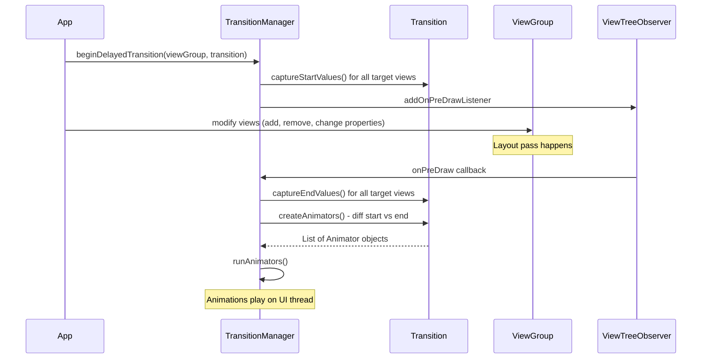

---

## 14.5 Activity 过渡

### 14.5.1 概述

Activity 过渡（API 21+）将过渡框架扩展到 Activity 边界之外，实现 Activity 或 Fragment 之间的共享元素动画。系统协调调用方与被调用 Activity 之间共享元素状态的捕获与传递。

关键源文件：

- `frameworks/base/core/java/android/app/ActivityOptions.java`
- `frameworks/base/core/java/android/app/ActivityTransitionCoordinator.java`
- `frameworks/base/core/java/android/app/EnterTransitionCoordinator.java`
- `frameworks/base/core/java/android/app/ExitTransitionCoordinator.java`

### 14.5.2 过渡类型

一个 Activity 过渡最多包含四个独立的动画：

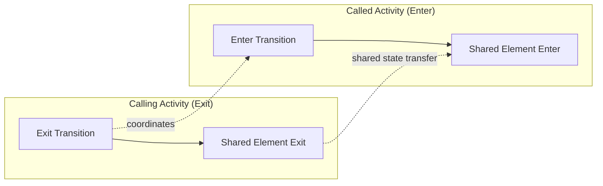

| 动画 | 默认值 | 用途 |
|---|---|---|
| Exit Transition | null（无动画） | 调用方 Activity 中的非共享视图 |
| Enter Transition | `@android:transition/fade`（`Fade`） | 被调用 Activity 中的非共享视图 |
| Shared Element Exit | `@android:transition/move`（`ChangeBounds` + `ChangeTransform` + `ChangeClipBounds` + `ChangeImageTransform`） | 离开的共享元素 |
| Shared Element Enter | `@android:transition/move`（`ChangeBounds` + `ChangeTransform` + `ChangeClipBounds` + `ChangeImageTransform`） | 到达的共享元素 |
| Return Transition | Enter 的反向 | 返回 |
| Reenter Transition | Exit 的反向 | 回到调用方 |

Material 主题（`frameworks/base/core/res/res/values/themes_material.xml`）将 `windowEnterTransition` 设置为 `@transition/fade`，但未设置 `windowExitTransition`，这就是为什么上面有效的默认值是不对称的。

### 14.5.3 共享元素协调

系统通过一个包含以下内容的 `Bundle` 传递共享元素状态：

1. 视图名称（`transitionName`）
2. 屏幕位置和大小
3. 位图快照（用于跨进程传递）
4. 视图特定的额外信息（例如 `ImageView` 的缩放类型和矩阵）

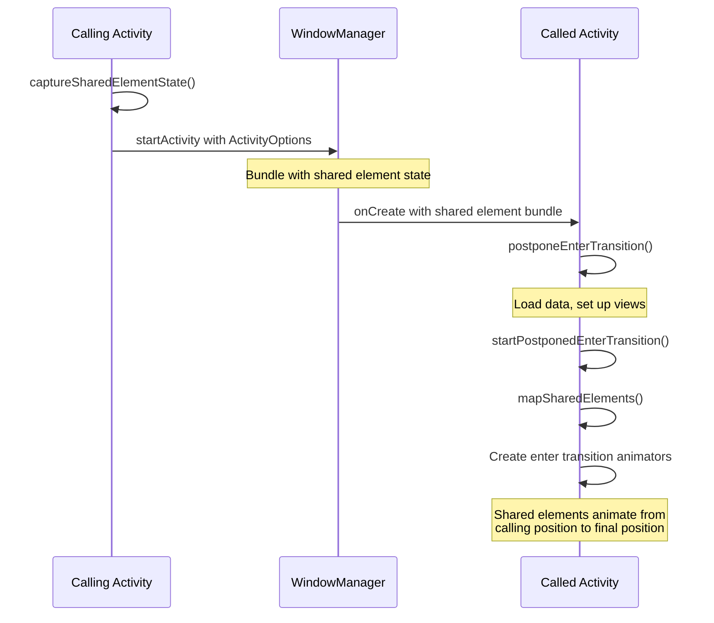

### 14.5.4 共享元素返回动画细节

当用户按下返回键时，共享元素返回动画会反转进入动画。系统会自动处理此事，但开发者可以自定义它：

```java
// Override default return shared element transition
getWindow().setSharedElementReturnTransition(
    new TransitionSet()
        .addTransition(new ChangeBounds().setDuration(300))
        .addTransition(new ChangeTransform())
        .addTransition(new ChangeImageTransform())
);
```

返回动画捕获被调用 Activity 中共享元素的当前状态，并将它们动画回调用方 Activity 中的位置。这要求调用方 Activity 仍然存活（未被销毁），对于标准返回导航通常如此。

### 14.5.5 Fragment 过渡集成

Fragment 使用相同的共享元素机制，但 Fragment 间过渡有额外的复杂性：

```java
Fragment fragmentB = new DetailFragment();
fragmentB.setSharedElementEnterTransition(new ChangeTransform());

getSupportFragmentManager()
    .beginTransaction()
    .addSharedElement(sharedImageView, "hero_image")
    .replace(R.id.container, fragmentB)
    .addToBackStack(null)
    .commit();
```

FragmentManager 与过渡框架协调，在 Fragment 交换前后捕获共享元素状态。

### 14.5.6 ActivityOptions 动画类型

`ActivityOptions` 通过常量定义了许多动画样式（`frameworks/base/core/java/android/app/ActivityOptions.java`，第 506-530 行）。下表列出了一个子集。值列中的空缺对应于表格省略的常量（`ANIM_DEFAULT` = 6、`ANIM_LAUNCH_TASK_BEHIND` = 7、`ANIM_CUSTOM_IN_PLACE` = 10、`ANIM_REMOTE_ANIMATION` = 13）。只有值 8 和 9 确实未被使用：

| 常量 | 值 | 描述 |
|---|---|---|
| `ANIM_NONE` | 0 | 无动画 |
| `ANIM_CUSTOM` | 1 | 自定义窗口动画资源 |
| `ANIM_SCALE_UP` | 2 | 从矩形放大 |
| `ANIM_THUMBNAIL_SCALE_UP` | 3 | 从缩略图放大 |
| `ANIM_THUMBNAIL_SCALE_DOWN` | 4 | 缩小到缩略图 |
| `ANIM_SCENE_TRANSITION` | 5 | 共享元素场景过渡 |
| `ANIM_CLIP_REVEAL` | 11 | 圆形揭露裁剪 |
| `ANIM_OPEN_CROSS_PROFILE_APPS` | 12 | 跨配置文件应用启动 |
| `ANIM_FROM_STYLE` | 14 | 来自窗口动画样式 |

### 14.5.7 ActivityTransitionCoordinator

`ActivityTransitionCoordinator` 管理 Activity 之间共享元素状态的复杂交接。它处理：

1. **视图映射**：匹配 Activity 之间的共享元素名称
2. **状态捕获**：记录位置、大小、可见性和外观
3. **缩略图生成**：为跨进程传递创建位图快照
4. **动画编排**：协调进入/退出/共享元素的计时

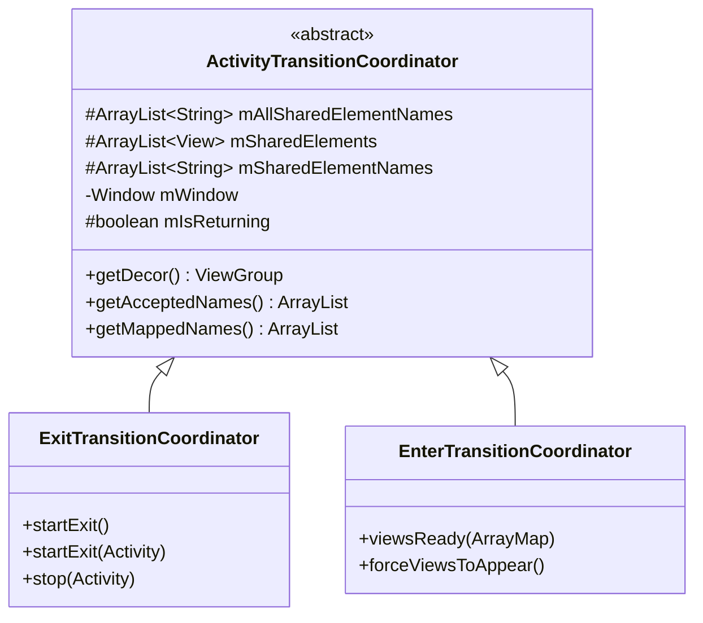

### 14.5.8 延迟的进入过渡

Activity 可以推迟其进入过渡，直到数据加载完成：

```java
// In called Activity's onCreate:
postponeEnterTransition();

// After data is loaded and views are ready:
imageView.getViewTreeObserver().addOnPreDrawListener(
    new ViewTreeObserver.OnPreDrawListener() {
        @Override
        public boolean onPreDraw() {
            imageView.getViewTreeObserver().removeOnPreDrawListener(this);
            startPostponedEnterTransition();
            return true;
        }
    });
```

当共享元素依赖于异步加载的数据（例如从网络加载的图片）时，这至关重要。如果没有推迟，过渡会动画到/从错误的位置或大小。

### 14.5.9 返回与重新进入过渡

导航返回时，过渡可以被反转或自定义：

| 方向 | 被调用 Activity | 调用方 Activity |
|---|---|---|
| 向前 | Enter Transition | Exit Transition |
| 向前共享 | Shared Element Enter | Shared Element Exit |
| 返回 | Return Transition（默认：Enter 的反向） | Reenter Transition（默认：Exit 的反向） |
| 返回共享 | Shared Element Return（默认：Enter 的反向） | |

设置显式的返回过渡可以实现不对称的动画：

```java
// In the called Activity:
getWindow().setReturnTransition(new Slide(Gravity.BOTTOM));
// On back, slides down instead of reversing the enter
```

---

## 14.6 窗口管理器动画

### 14.6.1 概述

system_server 中的窗口管理器（WM）编排窗口级操作的动画：应用启动、任务切换、屏幕旋转等等。这些动画运行在专用的动画线程上，独立于应用的 UI 线程。

`frameworks/base/services/core/java/com/android/server/wm/` 中的关键源文件：

| 文件 | 用途 |
|---|---|
| `WindowAnimator.java` | 逐帧动画派发 |
| `SurfaceAnimator.java` | 基于 leash 的 surface 动画 |
| `SurfaceAnimationRunner.java` | 无锁动画执行 |
| `WindowAnimationSpec.java` | 为 surface 包装旧版 `Animation` |
| `LocalAnimationAdapter.java` | 本地动画的适配器 |
| `AnimationAdapter.java` | 动画实现的接口 |
| `WindowStateAnimator.java` | 逐窗口动画状态 |

### 14.6.2 SurfaceAnimator 与 leash 模式

`SurfaceAnimator` 实现了一个关键架构模式：**动画 leash**。它不直接动画窗口的 surface，而是创建一个临时父 surface（即“leash”）。它将窗口的子项重新挂接到 leash 上，并把 leash 交给动画系统：

```
// frameworks/base/services/core/java/com/android/server/wm/SurfaceAnimator.java, lines 44-51

/**
 * A class that can run animations on objects that have a set of child surfaces.
 * We do this by reparenting all child surfaces of an object onto a new surface,
 * called the "Leash". The Leash gets attached in the surface hierarchy where
 * the children were attached to. We then hand off the Leash to the component
 * handling the animation, which is specified by the AnimationAdapter.
 */
```

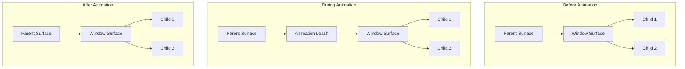

这种模式防止动画干扰窗口的内部 surface 树。当动画完成时，子项被重新挂接回其原始父级，leash 被销毁。

### 14.6.3 SurfaceAnimationRunner

`SurfaceAnimationRunner` 执行动画时**不持有 WindowManager 锁**。这对性能至关重要——WM 锁的竞争非常激烈，在动画期间持有它会导致卡顿：

```
// frameworks/base/services/core/java/com/android/server/wm/SurfaceAnimationRunner.java, lines 44-47

/**
 * Class to run animations without holding the window manager lock.
 */
class SurfaceAnimationRunner {
    ...
    private final Handler mAnimationThreadHandler = AnimationThread.getHandler();
    private final Handler mSurfaceAnimationHandler = SurfaceAnimationThread.getHandler();
    ...
}
```

它使用 `SfVsyncFrameCallbackProvider` 与 SurfaceFlinger 的 VSYNC（而非应用的 VSYNC）同步，确保动画的计时与合成器的帧率一致。

### 14.6.4 WindowAnimator

`WindowAnimator` 是逐帧派发的协调者。它调度 Choreographer 回调并管理整体动画状态。在 Android 17 中，一个 `Choreographer.VsyncCallback`（`mAnimationVsyncCallback`）驱动逐帧计时。一个布尔值（`mAnimationFrameCallbackScheduled`）跟踪调度状态，而不是存储一个 `FrameCallback`：

```
// frameworks/base/services/core/java/com/android/server/wm/WindowAnimator.java, lines 50-72

public class WindowAnimator {
    final WindowManagerService mService;
    final Choreographer.VsyncCallback mAnimationVsyncCallback;
    long mCurrentTime;                       // time of current animation step
    private Choreographer mChoreographer;
    private boolean mAnimationFrameCallbackScheduled;
    ...
}
```

回调在 vsync-app 时提交。然后它会在 vsync-sf 调度实际的动画 tick，使工作落在合成器期望的时间点。

### 14.6.5 SurfaceAnimator.startAnimation() 流程

`startAnimation()` 方法（第 166-197 行）编排 leash 的创建和动画的启动：

```
// SurfaceAnimator.java, lines 166-197

void startAnimation(@NonNull Transaction t, @NonNull AnimationAdapter anim, boolean hidden,
        @AnimationType int type,
        @Nullable OnAnimationFinishedCallback animationFinishedCallback,
        @Nullable Runnable animationCancelledCallback,
        @Nullable AnimationAdapter snapshotAnim) {
    cancelAnimation(t, true /* restarting */, true /* forwardCancel */);
    mAnimation = anim;
    mAnimationType = type;
    mSurfaceAnimationFinishedCallback = animationFinishedCallback;
    mAnimationCancelledCallback = animationCancelledCallback;
    final SurfaceControl surface = mAnimatable.getSurfaceControl();
    if (surface == null) {
        Slog.w(TAG, "Unable to start animation, surface is null or no children.");
        cancelAnimation();
        return;
    }
    if (mLeash == null) {
        mLeash = createAnimationLeash(mAnimatable, surface, t, type,
                mAnimatable.getSurfaceWidth(), mAnimatable.getSurfaceHeight(),
                0 /* x */, 0 /* y */, hidden, mService.mTransactionFactory);
        mAnimatable.onAnimationLeashCreated(t, mLeash);
    }
    mAnimatable.onLeashAnimationStarting(t, mLeash);
    mAnimation.startAnimation(mLeash, t, type, mInnerAnimationFinishedCallback);
    ...
}
```

关键步骤：

1. **取消现有动画**：任何正在运行的动画首先被取消
2. **空值检查**：如果 surface 已被销毁，则直接退出
3. **创建 leash**：创建一个新 surface，并将原始 surface 重新挂接到它下面
4. **通知 animatable**：容器获得调整 leash 的机会
5. **启动动画**：`AnimationAdapter` 接管 leash 的控制权

### 14.6.6 动画转移

当窗口在容器之间移动时（例如在任务栈变化期间），动画需要不受干扰地转移到新容器。`transferAnimation()`（第 267 行）通过将 leash 和动画引用从一个 SurfaceAnimator 移动到另一个来处理此事。

### 14.6.7 动画类型

SurfaceAnimator 跟踪动画的类型，以便进行正确的取消和优先级处理：

| 类型 | 用法 |
|---|---|
| `ANIMATION_TYPE_NONE` | 无动画 |
| `ANIMATION_TYPE_SCREEN_ROTATION` | 屏幕旋转动画 |
| `ANIMATION_TYPE_DIMMER` | Dimmer 淡入/淡出 |
| `ANIMATION_TYPE_RECENTS` | Recents 动画 |
| `ANIMATION_TYPE_WINDOW_ANIMATION` | 在 `WindowState` 上的窗口级动画，不对 activity 做动画 |
| `ANIMATION_TYPE_INSETS_CONTROL` | leash 被交给客户端，用于驱动造成 inset 的系统窗口 |
| `ANIMATION_TYPE_TOKEN_TRANSFORM` | 在非 app 窗口 token 上的动画（例如固定的旋转变换） |
| `ANIMATION_TYPE_STARTING_REVEAL` | 启动窗口（splash）的揭露动画 |
| `ANIMATION_TYPE_PREDICT_BACK` | 窗口容器上的预测式返回手势动画 |
| `ANIMATION_TYPE_ALL` | 所有类型的位掩码 |

### 14.6.8 WM 动画架构

```mermaid
graph TD
    subgraph "System Server"
        WMS[WindowManagerService] --> WA[WindowAnimator]
        WA --> SA[SurfaceAnimator]
        SA --> |creates leash| SAR[SurfaceAnimationRunner]
        SAR --> |"ValueAnimator (SfValueAnimator)"| SAT[SurfaceAnimationThread]
        SAT --> |SurfaceControl.Transaction| SF[SurfaceFlinger]
        SAR -.-> |pre-processing, finish callbacks| AT[AnimationThread]
    end

    subgraph "Animation Types"
        LA[LocalAnimationAdapter] --> |WindowAnimationSpec| SAR
        RA[RemoteAnimationAdapter] --> |cross-process| RP["Remote runner<br/>(app or Shell process)"]
    end
```

### 14.6.9 WM 服务端过渡（wm/ 中的 Transition.java）

WM 的 `Transition.java`（不同于框架的 `android.transition.Transition`）管理外壳过渡的服务端状态机。它跟踪：

- 参与的窗口和任务
- 过渡类型（open、close、change 等）
- 就绪状态和同步屏障
- 每个参与者的动画状态

`TransitionController` 管理所有活动过渡的生命周期，并与 Shell 进程协调。

---

## 14.7 Shell 过渡动画

### 14.7.1 概述

Shell 过渡（在 Android 12L 中引入）将过渡动画逻辑从 system_server 移出，放进 Shell 进程。这一架构让 SystemUI/Shell 进程可以直接控制窗口如何动画，从而实现更复杂、更可定制的过渡。

源码目录：
`frameworks/base/libs/WindowManager/Shell/src/com/android/wm/shell/transition/`
（33 个文件，外加一个 `tracing/` 子包）

### 14.7.2 架构

```mermaid
sequenceDiagram
    participant App as Application
    participant WMCore as WM Core (system_server)
    participant TC as TransitionController
    participant Shell as Shell Process
    participant Trans as Transitions.java
    participant Handler as TransitionHandler
    participant SF as SurfaceFlinger

    App->>WMCore: startActivity / finish / etc
    WMCore->>TC: requestTransition
    TC->>TC: collect participating windows
    TC->>TC: sync window draws
    TC->>Shell: onTransitionReady(TransitionInfo)
    Shell->>Trans: dispatchTransition
    Trans->>Handler: startAnimation(TransitionInfo, SurfaceControl.Transaction)
    Handler->>Handler: create animations
    Handler->>SF: SurfaceControl.Transaction per frame
    Handler->>Trans: onTransitionFinished
    Trans->>WMCore: finishTransition
```

### 14.7.3 Transitions.java

`Transitions.java` 是 Shell 进程中的中心协调者。它通过一个内部 `TransitionPlayerImpl extends ITransitionPlayer.Stub` 从 WindowManager 核心接收过渡回调；外部类本身实现了 `RemoteCallable` 和 Shell 命令处理者接口：

```
// frameworks/base/libs/WindowManager/Shell/src/com/android/wm/shell/transition/Transitions.java, line 143

public class Transitions implements RemoteCallable<Transitions>,
        ShellCommandHandler.ShellCommandActionHandler {
    ...
    // The Binder entry point is an inner class:
    private class TransitionPlayerImpl extends ITransitionPlayer.Stub { ... }
}
```

它维护一个有序的 `TransitionHandler` 实现列表，并将每个过渡分派给第一个认领它的处理者。

### 14.7.4 处理者分派链

```mermaid
graph TD
    T[Transitions.java] --> A{MixedTransitionHandler?}
    A -->|yes| B[MixedTransitionHandler]
    A -->|no| C{KeyguardTransitionHandler?}
    C -->|yes| D[KeyguardTransitionHandler]
    C -->|no| E{PipTransition?}
    E -->|yes| F[PipTransition]
    E -->|no| G{RemoteTransitionHandler?}
    G -->|yes| H[RemoteTransitionHandler]
    G -->|no| I[DefaultTransitionHandler]
```

### 14.7.5 DefaultTransitionHandler

`DefaultTransitionHandler` 处理常见情况：应用启动、任务切换和 activity 关闭。它从资源中加载窗口动画，并将其应用到 `SurfaceControl` leash 上：

```
// DefaultTransitionHandler.java (imports, lines 19-70)

static imports:
    ANIM_CLIP_REVEAL, ANIM_CUSTOM, ANIM_FROM_STYLE, ANIM_NONE,
    ANIM_OPEN_CROSS_PROFILE_APPS, ANIM_SCALE_UP, ANIM_SCENE_TRANSITION,
    ANIM_THUMBNAIL_SCALE_DOWN, ANIM_THUMBNAIL_SCALE_UP
```

它使用 `TransitionAnimationHelper.loadAttributeAnimation()` 构建 surface 动画，以根据过渡类型和窗口配置解析正确的窗口动画资源。

### 14.7.6 RemoteTransitionHandler

允许第三方启动器和应用通过注册 `RemoteTransition` 对象来提供自定义过渡动画。Shell 将过渡信息和 surface 控制分派到远程进程，由后者运行动画并发出完成信号。

### 14.7.7 混合过渡

`MixedTransitionHandler` 处理多种过渡类型重叠的情况（例如 pip + 应用启动）。它将过渡拆分为独立的部分，并将每个部分委派给相应的处理者。

### 14.7.8 过渡类型与标志

Shell 处理 WindowManager 传来的这些过渡类型：

| 类型常量 | 值 | 描述 |
|---|---|---|
| `TRANSIT_OPEN` | 1 | 应用窗口正在打开 |
| `TRANSIT_CLOSE` | 2 | 应用窗口正在关闭 |
| `TRANSIT_TO_FRONT` | 3 | 现有窗口被带到前台 |
| `TRANSIT_TO_BACK` | 4 | 窗口被送到后台 |
| `TRANSIT_CHANGE` | 6 | 窗口配置变化（调整大小等） |
| `TRANSIT_KEYGUARD_OCCLUDE` | 8 | Keyguard 被遮挡 |
| `TRANSIT_KEYGUARD_UNOCCLUDE` | 9 | Keyguard 取消遮挡 |
| `TRANSIT_SLEEP` | 12 | 设备进入睡眠 |
| `TRANSIT_FIRST_CUSTOM` | 1000 | 自定义过渡范围的起始 |

过渡中的每个参与者都携带标志：

| 标志 | 用途 |
|---|---|
| `FLAG_IS_WALLPAPER` | 参与者是壁纸 |
| `FLAG_IS_DISPLAY` | 参与者是显示屏 |
| `FLAG_NO_ANIMATION` | 跳过该参与者的动画 |
| `FLAG_TRANSLUCENT` | 参与者是半透明的 |
| `FLAG_SHOW_WALLPAPER` | 壁纸应可见 |
| `FLAG_FILLS_TASK` | 参与者填满其任务 |
| `FLAG_IS_BEHIND_STARTING_WINDOW` | 在启动窗口后面 |
| `FLAG_STARTING_WINDOW_TRANSFER_RECIPIENT` | 正在接收启动窗口 |
| `FLAG_IN_TASK_WITH_EMBEDDED_ACTIVITY` | 在包含嵌入 activity 的任务中 |
| `FLAG_BACK_GESTURE_ANIMATED` | 正由返回手势做动画 |

### 14.7.9 TransitionAnimationHelper

`TransitionAnimationHelper` 提供了用于加载和配置过渡动画的工具方法：

- `loadAttributeAnimation()` -- 根据过渡类型，从主题属性加载正确的窗口动画
- `getTransitionBackgroundColorIfSet()` -- 从动画属性中提取背景色
- `isCoveredByOpaqueFullscreenChange()` -- 判断一个变化是否被全屏不透明窗口遮挡（跳过动画）

### 14.7.10 Shell 过渡生命周期

```mermaid
stateDiagram-v2
    [*] --> Collecting: requestTransition
    Collecting --> Syncing: all participants identified
    Syncing --> Ready: all surfaces drawn
    Ready --> Dispatched: onTransitionReady sent to Shell
    Dispatched --> Animating: handler.startAnimation
    Animating --> Finishing: animations complete
    Finishing --> Merged: merged with next transition
    Finishing --> Done: finishTransition
    Done --> [*]

    Animating --> Aborted: new transition supersedes
    Aborted --> [*]
```

### 14.7.11 屏幕旋转

`ScreenRotationAnimation` 处理设备旋转的特殊情况。它捕获旋转前状态的截图，并将其交叉淡入淡出/旋转到旋转后状态，并与显示配置变化协调。

---

## 14.8 预测式返回动画

### 14.8.1 概述

预测式返回（Android 13+）提供实时的返回手势动画，在用户完成手势之前预览将前往的位置。Shell 的返回动画系统使用与手势进度绑定的 `SurfaceControl` 事务来驱动这些动画。

源码目录：
`frameworks/base/libs/WindowManager/Shell/src/com/android/wm/shell/back/`
（14 个文件）

### 14.8.2 架构

```mermaid
sequenceDiagram
    participant User as User Gesture
    participant EBG as SystemUI EdgeBackGestureHandler
    participant BAC as BackAnimationController
    participant Runner as BackAnimationRunner
    participant Anim as CrossActivityBackAnimation
    participant SF as SurfaceFlinger

    User->>EBG: Edge swipe from left/right
    EBG->>BAC: onBackMotion(touchX, touchY, action, swipeEdge)
    BAC->>BAC: determine back destination
    BAC->>Runner: onBackStarted(BackEvent)
    loop gesture in progress
        User->>BAC: onBackProgressed(BackEvent)
        BAC->>Anim: onBackProgressed(progress, edge)
        Anim->>SF: SurfaceControl.Transaction (scale, translate)
    end
    alt user commits
        User->>BAC: onBackInvoked
        BAC->>Anim: playCloseAnimation
        Anim->>SF: final animation to completion
    else user cancels
        User->>BAC: onBackCancelled
        BAC->>Anim: playCancelAnimation
        Anim->>SF: animate back to original state
    end
```

### 14.8.3 BackAnimationController

`BackAnimationController` 是中心协调者。它从系统的返回手势检测器接收运动事件。它确定导航目标（跨 activity、跨任务或应用回调）。然后它分派给相应的动画运行器：

```
// frameworks/base/libs/WindowManager/Shell/src/com/android/wm/shell/back/BackAnimationController.java

public class BackAnimationController ... {
    ...
}
```

### 14.8.4 动画类型

| 动画类 | 使用时机 |
|---|---|
| `CrossActivityBackAnimation` | 在同一任务内返回 |
| `CrossTaskBackAnimation` | 返回到上一个任务 |
| `CustomCrossActivityBackAnimation` | 应用提供自定义返回预览 |
| `DefaultCrossActivityBackAnimation` | 默认的跨 activity 动画 |

### 14.8.5 手势驱动的动画

与传统在固定时间线上运行的动画不同，预测式返回动画是**手势驱动的**：它们的进度直接与用户的手指位置绑定。`BackEvent` 提供：

- `progress` -- 0.0（开始）到 1.0（完成）
- `touchX`、`touchY` -- 当前手指位置
- `swipeEdge` -- `EDGE_LEFT` 或 `EDGE_RIGHT`

动画计算缩放、平移和圆角半径作为进度的函数，并在每一帧通过 `SurfaceControl.Transaction` 应用它们。

### 14.8.6 BackAnimationController 状态机

```mermaid
stateDiagram-v2
    [*] --> Idle
    Idle --> GestureStarted: onBackMotion DOWN
    GestureStarted --> Progressing: onBackProgressed
    Progressing --> Progressing
    Progressing --> Committed: onBackInvoked
    Progressing --> Cancelled: onBackCancelled
    Committed --> PlayingClose: close anim
    Cancelled --> PlayingCancel: cancel anim
    PlayingClose --> TransitionFinished: animation done
    PlayingCancel --> Idle: animation done
    TransitionFinished --> Idle: cleanup
```

`Progressing` 上的自转移代表用户拖动时持续送达的 `onBackProgressed` 回调流。

### 14.8.7 进度到变换的映射

预测式返回动画使用分段定义的函数将手势进度映射为视觉变换。对于默认的跨 activity 动画：

| 进度 | 缩放 | 平移 X | 圆角半径 |
|---|---|---|---|
| 0.0 | 1.0 | 0 | 0 |
| 0.3 | ~0.95 | 成比例 | 递增 |
| 0.6 | ~0.9 | 成比例 | 递增 |
| 1.0 | 0.85 | 最大 | 最大 |

动画曲线的设计目的是：

1. 以最小的视觉变化开始（靠近边缘时灵敏度低）
2. 逐渐增强预览效果
3. 提供关于返回目标的清晰视觉反馈

### 14.8.8 返回动画与 Shell 过渡的集成

当预测式返回完成时，它会触发一个外壳过渡。`TransitionInfo` 上的 `FLAG_BACK_GESTURE_ANIMATED` 标志告诉 Shell，此过渡是由返回手势发起的。动画应从当前的预览状态继续平滑进行，而不是从头开始。

### 14.8.9 返回动画变换细节

默认的跨 activity 返回动画将以下变换作为手势进度和手指位置的函数来应用：

```
// Simplified transform calculations, using the real constants from
// CrossActivityBackAnimation.kt:
//   MAX_SCALE = 0.85f, INITIAL_ENTERING_SCALE = 0.95f

// Scale shrinks the departing activity toward MAX_SCALE
float scale = lerp(1.0f, MAX_SCALE /* 0.85f */, progress);
transaction.setScale(leash, scale, scale);

// Translation follows the finger horizontally
float maxTranslation = displayWidth * 0.05f;
float translationX = (swipeEdge == EDGE_LEFT)
    ? maxTranslation * progress
    : -maxTranslation * progress;
transaction.setPosition(leash, translationX, 0);

// Corner radius increases with progress
float cornerRadius = lerp(0, displayCornerRadius, progress);
transaction.setCornerRadius(leash, cornerRadius);

// The entering activity peeks from behind, scaling in sync with
// the closing target from INITIAL_ENTERING_SCALE toward MAX_SCALE
float enterScale = lerp(INITIAL_ENTERING_SCALE /* 0.95f */,
        MAX_SCALE /* 0.85f */, progress);
transaction.setScale(enterLeash, enterScale, enterScale);
```

视觉效果是：

1. 当前 activity 略微缩小并向滑动方向平移
2. 其圆角变圆以匹配显示屏的圆角
3. 上一个 activity 从后面露出，并与离开的 activity 同步缩放

### 14.8.10 ProgressVelocityTracker

`ProgressVelocityTracker.kt` 跟踪返回手势进度值的速度。该速度用于确定：

- 手势是否是一次快速 fling（应立即完成）
- 提交/取消期间任何弹簧动画的初始速度
- 是播放提交动画还是取消动画

---

## 14.9 基于物理的动画

### 14.9.1 概述

基于物理的动画通过模拟物理力（弹簧、摩擦力）而不是遵循固定的计时曲线，来产生更自然的运动。与运行固定时长的 `ValueAnimator` 不同，物理动画一直运行，直到模拟系统达到平衡。

源码目录：
`frameworks/base/core/java/com/android/internal/dynamicanimation/animation/`
（6 个文件）

这是平台自己的物理动画引擎的内部副本。应用编译所针对的 API 是 AndroidX 的 `androidx.dynamicanimation` 库。它作为 Jetpack 构件发布，而不是平台源码。在 AOSP 代码树中，它只出现在 `prebuilts/` 下，而不是可构建的源码。两者共享相同的设计和类名；这里的平台副本是框架自己的 UI 在内部使用的版本。

### 14.9.2 DynamicAnimation 基类

`DynamicAnimation` 是所有物理动画的抽象基类。它向 `AnimationHandler` 注册（与 `ValueAnimator` 相同）以接收帧回调：

```
// frameworks/base/core/java/com/android/internal/dynamicanimation/animation/DynamicAnimation.java, lines 43-44

public abstract class DynamicAnimation<T extends DynamicAnimation<T>>
        implements AnimationHandler.AnimationFrameCallback {
```

它为常见的 View 属性提供了预定义的 `ViewProperty` 常量：

```
// DynamicAnimation.java, lines 60-70

public static final ViewProperty TRANSLATION_X = new ViewProperty("translationX") {
    @Override
    public void setValue(View view, float value) {
        view.setTranslationX(value);
    }
    @Override
    public Float get(View view) {
        return view.getTranslationX();
    }
};
```

可用的 ViewProperty 常量：`TRANSLATION_X`、`TRANSLATION_Y`、`TRANSLATION_Z`、`SCALE_X`、`SCALE_Y`、`ROTATION`、`ROTATION_X`、`ROTATION_Y`、`X`、`Y`、`Z`、`ALPHA`、`SCROLL_X`、`SCROLL_Y`。

### 14.9.3 SpringAnimation

`SpringAnimation` 使用 `SpringForce` 驱动运动——一个阻尼谐振子：

```
// frameworks/base/core/java/com/android/internal/dynamicanimation/animation/SpringAnimation.java, lines 58-63

public final class SpringAnimation extends DynamicAnimation<SpringAnimation> {
    private SpringForce mSpring = null;
    private float mPendingPosition = UNSET;
    private static final float UNSET = Float.MAX_VALUE;
    private boolean mEndRequested = false;
    ...
}
```

用法（来自类 Javadoc）：

```java
// Create a spring animation targeting view's X property
final SpringAnimation anim = new SpringAnimation(view, DynamicAnimation.X, 0)
        .setStartVelocity(5000);
anim.start();

// With custom spring configuration
SpringForce spring = new SpringForce(0)
        .setDampingRatio(SpringForce.DAMPING_RATIO_LOW_BOUNCY)
        .setStiffness(SpringForce.STIFFNESS_LOW);
final SpringAnimation anim2 = new SpringAnimation(view, DynamicAnimation.SCALE_Y)
        .setMinValue(0).setSpring(spring).setStartValue(1);
anim2.start();
```

### 14.9.4 SpringForce

`SpringForce` 用两个关键参数建模一个阻尼谐振子：

```
// frameworks/base/core/java/com/android/internal/dynamicanimation/animation/SpringForce.java, lines 35-74

public final class SpringForce implements Force {
    public static final float STIFFNESS_HIGH = 10_000f;
    public static final float STIFFNESS_MEDIUM = 1500f;
    public static final float STIFFNESS_LOW = 200f;
    public static final float STIFFNESS_VERY_LOW = 50f;

    public static final float DAMPING_RATIO_HIGH_BOUNCY = 0.2f;
    public static final float DAMPING_RATIO_MEDIUM_BOUNCY = 0.5f;
    public static final float DAMPING_RATIO_LOW_BOUNCY = 0.75f;
    public static final float DAMPING_RATIO_NO_BOUNCY = 1f;
    ...
}
```

物理模拟使用阻尼谐振子方程：

```
m * x'' + c * x' + k * x = 0
```

其中：

- `k` = 刚度（弹簧常数）
- `c` = 阻尼系数（由阻尼比和固有频率推导得出）
- `m` = 质量（归一化为 1）

`naturalFreq` 是 `sqrt(stiffness)`，解取决于阻尼比：

| 阻尼比 | 行为 | 解的类型 |
|---|---|---|
| = 0 | 永远振荡 | 无阻尼 |
| &lt; 1 | 过冲、振荡 | 欠阻尼 |
| = 1 | 最快返回，无过冲 | 临界阻尼 |
| > 1 | 缓慢返回，无过冲 | 过阻尼 |

```mermaid
graph LR
    subgraph "Spring Damping Behavior"
        direction TB
        A["Undamped (0.0)"] -.->|"oscillates forever"| X[Position over time]
        B["Under-damped (0.2-0.75)"] -.->|"bouncy"| X
        C["Critically damped (1.0)"] -.->|"fastest settle"| X
        D["Over-damped (>1.0)"] -.->|"slow settle"| X
    end
```

### 14.9.5 FlingAnimation

`FlingAnimation` 用摩擦力模拟一次 fling 手势。它以一个初始速度开始，并因摩擦力而减速。当速度降到阈值以下时，动画结束。

摩擦模型使用指数衰减：
```
velocity(t) = initialVelocity * e^(-friction * t)
position(t) = initialPosition + initialVelocity/friction * (1 - e^(-friction * t))
```

### 14.9.6 SpringForce 内部计算

SpringForce 类预先计算中间值，以便高效地进行逐帧求值。初始化取决于阻尼区间：

**欠阻尼**（阻尼比 &lt; 1）：
```
dampedFreq = naturalFreq * sqrt(1 - dampingRatio^2)
```

时间 `t` 处的位置和速度使用阻尼谐振子微分方程的精确解进行解析计算。对于欠阻尼情况，只预先计算 `dampedFreq`。解使用实值 sin/cos 形式（代码中不会出现复数 gamma）。

**临界阻尼**（阻尼比 = 1）：
```
position(t) = (c1 + c2 * t) * e^(-naturalFreq * t)
velocity(t) = (c2 - naturalFreq * (c1 + c2 * t)) * e^(-naturalFreq * t)
```

**过阻尼**（阻尼比 > 1）：
```
gammaPlus  = -dampingRatio * naturalFreq + naturalFreq * sqrt(dampingRatio^2 - 1)
gammaMinus = -dampingRatio * naturalFreq - naturalFreq * sqrt(dampingRatio^2 - 1)
```

动画通过将位置和速度都与阈值比较来检查收敛：

```
valueThreshold    = minVisibleChange * THRESHOLD_MULTIPLIER (0.75)
velocityThreshold = valueThreshold * VELOCITY_THRESHOLD_MULTIPLIER (62.5)
```

`DynamicAnimation.THRESHOLD_MULTIPLIER` 是 0.75
（`frameworks/base/core/java/com/android/internal/dynamicanimation/animation/DynamicAnimation.java:293`），
所以值阈值略低于最小可见变化。`VELOCITY_THRESHOLD_MULTIPLIER`（1000.0 / 16.0 = 62.5）意味着：如果以当前速度移动一个值阈值需要超过一帧（16ms）的时间，弹簧就被视为静止。

### 14.9.7 DynamicAnimation 生命周期

```mermaid
stateDiagram-v2
    [*] --> Created
    Created --> Running: start
    Running --> Running: doAnimationFrame each VSYNC
    Running --> Ended: force reaches equilibrium
    Running --> Cancelled: cancel
    Ended --> [*]
    Cancelled --> [*]

    note right of Running
        Each frame:
        1. Get delta time
        2. Ask Force for new value/velocity
        3. Check min/max bounds
        4. Update property on target
        5. Check if at rest
    end note
```

### 14.9.8 FlingAnimation 详细行为

FlingAnimation 使用带有可配置摩擦力的指数衰减模型：

```
position(t) = startPosition + startVelocity / friction * (1 - e^(-friction * t))
velocity(t) = startVelocity * e^(-friction * t)
```

摩擦系数决定了 fling 减速的快慢：

| 摩擦值 | 行为 | 典型用途 |
|---|---|---|
| 0.1 | 非常滑，长距离 fling | 冰面般的表面 |
| 0.5 | 低摩擦 | 平滑滚动的列表 |
| 1.0 | 默认 | 标准 fling |
| 1.5 | 中等摩擦 | 较慢的减速 |
| 3.0 | 高摩擦 | 快速停止 |
| 10.0 | 非常高的摩擦 | 近乎瞬时停止 |

当绝对速度低于速度阈值时，动画停止。`FlingAnimation` 的阈值派生自 `DynamicAnimation` 交给它的值阈值——`minVisibleChange * 0.75`（`THRESHOLD_MULTIPLIER`）——再乘以 `VELOCITY_THRESHOLD_MULTIPLIER` 的 1000/16 = 62.5
（`frameworks/base/core/java/com/android/internal/dynamicanimation/animation/FlingAnimation.java:170,199`）。因此阈值是 `minVisibleChange * 46.875`——对于最小可见变化为默认 1 像素的位置属性，大约是每秒 47 像素。这是这样一个速度：以它移动一个值阈值需要超过一个 16ms 的帧。

FlingAnimation 还支持最小/最大边界。当值触及边界时，动画立即停止（无反弹）。要添加反弹行为，可以在 fling 结束于边界时链接一个 `SpringAnimation`：

```java
FlingAnimation fling = new FlingAnimation(view, DynamicAnimation.TRANSLATION_X);
fling.setMinValue(0f);
fling.setMaxValue(maxX);
fling.addEndListener((anim, canceled, value, velocity) -> {
    // If ended at a boundary with remaining velocity, spring back
    if (value <= 0 || value >= maxX) {
        float target = Math.max(0, Math.min(value, maxX));
        new SpringAnimation(view, DynamicAnimation.TRANSLATION_X, target)
            .setStartVelocity(velocity)
            .start();
    }
});
```

### 14.9.9 DynamicAnimation ViewProperty 架构

`ViewProperty` 抽象类提供了一种类型安全、无反射的机制来为 View 属性做动画：

```mermaid
classDiagram
    class FloatProperty~View~ {
        <<abstract>>
        +setValue(View, float)*
        +get(View) Float*
    }
    class ViewProperty {
        <<abstract>>
    }
    class TRANSLATION_X
    class TRANSLATION_Y
    class TRANSLATION_Z
    class SCALE_X
    class SCALE_Y
    class ROTATION
    class ROTATION_X
    class ROTATION_Y
    class ALPHA
    class X
    class Y
    class Z
    class SCROLL_X
    class SCROLL_Y

    FloatProperty <|-- ViewProperty
    ViewProperty <|-- TRANSLATION_X
    ViewProperty <|-- TRANSLATION_Y
    ViewProperty <|-- TRANSLATION_Z
    ViewProperty <|-- SCALE_X
    ViewProperty <|-- SCALE_Y
    ViewProperty <|-- ROTATION
    ViewProperty <|-- ROTATION_X
    ViewProperty <|-- ROTATION_Y
    ViewProperty <|-- ALPHA
    ViewProperty <|-- X
    ViewProperty <|-- Y
    ViewProperty <|-- Z
    ViewProperty <|-- SCROLL_X
    ViewProperty <|-- SCROLL_Y
```

每个属性直接调用相应的 View setter 方法，避免反射开销：

```java
public static final ViewProperty ALPHA = new ViewProperty("alpha") {
    @Override
    public void setValue(View view, float value) {
        view.setAlpha(value);
    }
    @Override
    public Float get(View view) {
        return view.getAlpha();
    }
};
```

### 14.9.10 Force 接口

`Force` 接口抽象了物理模型，从而支持自定义的力实现：

```java
interface Force {
    /**
     * Returns the acceleration at the given position and velocity.
     * @param position current position
     * @param velocity current velocity
     * @return acceleration
     */
    float getAcceleration(float position, float velocity);

    /**
     * Returns whether the animation is at equilibrium.
     * @param value current value
     * @param velocity current velocity
     * @return true if at rest
     */
    boolean isAtEquilibrium(float value, float velocity);
}
```

请注意，`Force` 是有意设为包内私有的——其源码注释写着“Hide this for now, in case we want to change the API”
（`frameworks/base/core/java/com/android/internal/dynamicanimation/animation/Force.java`）。因此它不是面向应用的扩展点：只有代码树内的 `SpringForce` 和 `FlingAnimation.DragForce` 实现了它。

### 14.9.11 Scroller 和 OverScroller 物理

虽然不属于 `DynamicAnimation` 包，但 `Scroller` 和 `OverScroller` 实现了所有标准可滚动视图使用的 fling 物理。

`OverScroller` 是一个独立的类（不是 `Scroller` 的子类），它提供类似 Scroller 的 API，外加在边缘处的弹性 overscroll 行为。overscroll 效果使用类弹簧模型，其中位移与边缘处的滚动速度成正比：

```mermaid
graph LR
    subgraph "OverScroller States"
        SCROLL[Scrolling] -->|reach edge with velocity| OVER[Overscroll]
        OVER -->|spring back| SCROLL
        SCROLL -->|fling| FLING[Flinging]
        FLING -->|reach edge| OVER
        FLING -->|decelerate to stop| SCROLL
    end
```

fling 减速模型使用基于样条（spline）的插值，比纯指数衰减更准确地近似物理摩擦。

### 14.9.12 物理动画与 Shell 的集成

Shell 进程在交互式动画中广泛使用物理动画。例如，气泡动画使用弹簧动力学，让气泡感觉与用户的手指有物理连接。

### 14.9.13 Scroller 和 OverScroller

虽然不属于 `DynamicAnimation` 包，但 `android.widget` 中的 `Scroller` 和 `OverScroller` 提供了基于物理的滚动模型：

- `Scroller` -- 带有减速的基本 fling
- `OverScroller` -- 在边界处增加了弹性 overscroll

`ScrollView`、`ListView`、`RecyclerView` 以及其他可滚动容器在其 fling 行为中使用了它们。

---

## 14.10 原生 HWUI 动画

### 14.10.1 概述

HWUI（Hardware UI）提供原生 C++ 动画支持，运行在 **RenderThread** 上，完全独立于 UI 线程。这意味着即使 UI 线程被阻塞（例如在垃圾回收或繁重布局期间），动画也能继续流畅运行。

`frameworks/base/libs/hwui/` 中的源文件：

| 文件 | 用途 |
|---|---|
| `Animator.cpp` | 基础动画引擎 |
| `Animator.h` | 动画类声明 |
| `AnimatorManager.cpp` | 逐 RenderNode 的动画管理 |
| `AnimatorManager.h` | 管理器声明 |
| `Interpolator.cpp` | 原生插值器实现 |
| `AnimationContext.cpp` | 帧计时上下文 |
| `PropertyValuesAnimatorSet.cpp` | 多属性动画集 |

### 14.10.2 BaseRenderNodeAnimator

核心原生动画类管理一个状态机，在 UI 线程（staging）和 RenderThread（实际动画）之间同步：

```
// frameworks/base/libs/hwui/Animator.cpp, lines 34-47

BaseRenderNodeAnimator::BaseRenderNodeAnimator(float finalValue)
        : mTarget(nullptr)
        , mStagingTarget(nullptr)
        , mFinalValue(finalValue)
        , mDeltaValue(0)
        , mFromValue(0)
        , mStagingPlayState(PlayState::NotStarted)
        , mPlayState(PlayState::NotStarted)
        , mHasStartValue(false)
        , mStartTime(0)
        , mDuration(300)
        , mStartDelay(0)
        , mMayRunAsync(true)
        , mPlayTime(0) {}
```

### 14.10.3 Staging 模式

HWUI 动画使用 **staging 模式**，将动画状态从 UI 线程安全地转移到 RenderThread：

```mermaid
sequenceDiagram
    participant UI as UI Thread
    participant RT as RenderThread

    UI->>UI: animator.start()
    Note over UI: mStagingPlayState = Running
    Note over UI: mStagingRequests.push(Start)
    UI->>RT: syncFrameState (next frame)
    RT->>RT: pushStaging()
    Note over RT: resolve staging requests
    Note over RT: mPlayState = Running
    loop each RenderThread frame
        RT->>RT: animate(context)
        Note over RT: compute fraction from time
        Note over RT: apply interpolator
        Note over RT: update RenderNode property
    end
```

### 14.10.4 PlayState 状态机

```
// Animator.cpp, lines 118-151 (resolveStagingRequest)

switch (request) {
    case Request::Start:
        mPlayState = PlayState::Running;
        break;
    case Request::Reverse:
        mPlayState = PlayState::Reversing;
        break;
    case Request::Reset:
        mPlayTime = 0;
        mPlayState = PlayState::Finished;
        mPendingActionUponFinish = Action::Reset;
        break;
    case Request::Cancel:
        mPlayState = PlayState::Finished;
        break;
    case Request::End:
        mPlayTime = mPlayState == PlayState::Reversing ? 0 : mDuration;
        mPlayState = PlayState::Finished;
        mPendingActionUponFinish = Action::End;
        break;
}
```

```mermaid
stateDiagram-v2
    [*] --> NotStarted
    NotStarted --> Running: Start request
    NotStarted --> Reversing: Reverse request
    Running --> Finished: duration elapsed / Cancel / End
    Running --> Reversing: Reverse request
    Reversing --> Finished: play time reaches 0 / Cancel / End
    Reversing --> Running: Start request
    Finished --> [*]
    Finished --> Running: Reset + Start
```

### 14.10.5 AnimatorManager

`AnimatorManager` 管理附加到单个 `RenderNode` 上的所有动画：

```
// frameworks/base/libs/hwui/AnimatorManager.cpp, lines 34-55

AnimatorManager::AnimatorManager(RenderNode& parent)
        : mParent(parent), mAnimationHandle(nullptr), mCancelAllAnimators(false) {}

void AnimatorManager::addAnimator(const sp<BaseRenderNodeAnimator>& animator) {
    RenderNode* stagingTarget = animator->stagingTarget();
    if (stagingTarget == &mParent) return;
    mNewAnimators.emplace_back(animator.get());
    if (stagingTarget) {
        stagingTarget->removeAnimator(animator);
    }
    animator->attach(&mParent);
}
```

`pushStaging()` 方法将新动画器从 staging 列表转移到活动列表，`animate()` 推进所有活动动画器以处理当前帧。

### 14.10.6 Java 侧 JNI 桥接

在 Java 侧，`RenderNodeAnimator` 包装原生 HWUI 动画器。它的客户端是直接对 `RenderNode` 属性做动画的平台组件——`RippleDrawable`（通过 `RippleForeground` 和 `RippleAnimationSession`）以及圆形揭露的 `RevealAnimator`。`view.animate()` 不是客户端。它运行一个普通的 UI 线程 `ValueAnimator`，每帧调用 View setter。

（`AnimatedVectorDrawable` 也在 RenderThread 上做动画，但走的是不同的路线。它的 `VectorDrawableAnimatorRT` 通过 `nCreateAnimatorSet()` 构建一个原生的 `PropertyValuesAnimatorSet`。它用 `registerVectorDrawableAnimator()` 将该集合注册到目标 `RenderNode` 上，因此完全绕过了 `RenderNodeAnimator`。）

```java
// When a ripple (or reveal) animation starts:
// 1. The client creates a RenderNodeAnimator for a RenderNode property
// 2. RenderNodeAnimator calls nStart() via JNI
// 3. Native BaseRenderNodeAnimator starts on RenderThread
// 4. Each RenderThread frame: native animate() updates RenderNode
// 5. No UI thread involvement after start!
```

### 14.10.7 HWUI animate() 核心循环

BaseRenderNodeAnimator 上的 `animate()` 方法在每个 RenderThread 帧计算当前值：

```mermaid
flowchart TD
    A[RenderThread frame] --> B[AnimatorManager.animate]
    B --> C{For each active animator}
    C --> D[Compute playTime from currentFrameTime - startTime]
    D --> E{playTime >= startDelay?}
    E -->|No| F[Still in delay, skip]
    E -->|Yes| G[fraction = playTime / duration]
    G --> H[Clamp fraction to 0..1]
    H --> I[interpolatedFraction = interpolator.interpolate fraction]
    I --> J[value = fromValue + deltaValue * interpolatedFraction]
    J --> K[Update RenderNode property]
    K --> L{fraction >= 1.0?}
    L -->|Yes| M[Mark finished, schedule callback to UI thread]
    L -->|No| N[Continue next frame]
```

### 14.10.8 HWUI 中的属性类型

HWUI 可以原生动画这些 RenderNode 属性：

| 属性 | 类型 | 描述 |
|---|---|---|
| `TRANSLATION_X` | float | 水平平移 |
| `TRANSLATION_Y` | float | 垂直平移 |
| `TRANSLATION_Z` | float | Z 轴平移（海拔） |
| `SCALE_X` | float | 水平缩放 |
| `SCALE_Y` | float | 垂直缩放 |
| `ROTATION` | float | Z 轴旋转 |
| `ROTATION_X` | float | X 轴旋转（3D） |
| `ROTATION_Y` | float | Y 轴旋转（3D） |
| `ALPHA` | float | 不透明度 |
| `X` | float | 绝对 X 位置 |
| `Y` | float | 绝对 Y 位置 |
| `Z` | float | 绝对 Z 位置 |

这些直接映射到 RenderNode 属性，并在显示列表回放阶段应用，没有任何 Java 回调。

### 14.10.9 HWUI 插值器实现

原生插值器基础设施与 Java 完全对应。在 `frameworks/base/libs/hwui/Interpolator.cpp` 中：

| 原生插值器 | 对应的 Java 插值器 | 公式 |
|---|---|---|
| `AccelerateDecelerateInterpolator` | 相同 | `cos((t+1)*PI)/2 + 0.5` |
| `AccelerateInterpolator` | 相同 | `t^(2*factor)` |
| `DecelerateInterpolator` | 相同 | `1-(1-t)^(2*factor)` |
| `LinearInterpolator` | 相同 | `t` |
| `PathInterpolator` | 相同 | 对路径点进行二分查找 |
| `OvershootInterpolator` | 相同 | 三次过冲 |
| `AnticipateInterpolator` | 相同 | 回拉曲线 |
| `BounceInterpolator` | 相同 | 分段弹跳 |
| `CycleInterpolator` | 相同 | `sin(2*PI*cycles*t)` |
| `LUTInterpolator` | 无 | 来自 Java 采样的查找表 |

`LUTInterpolator` 是一个特殊的原生插值器，当 Java 插值器没有原生对应物时使用。当插值器被应用到 `RenderNodeAnimator` 时，`FallbackLUTInterpolator.createLUT()` 在 UI 线程上对 Java 插值器进行采样（最多 300 个样本，每个帧间隔一个）。只有结果原生查找表指针会交给 RenderThread。

### 14.10.10 PropertyValuesAnimatorSet（原生）

对于 `AnimatedVectorDrawable`，原生 `PropertyValuesAnimatorSet`
（`frameworks/base/libs/hwui/PropertyValuesAnimatorSet.cpp`）在 C++ 中提供了一个完整的 AnimatorSet 实现，运行在 RenderThread 上。这使得复杂的多属性 AVD 动画无需任何 Java 回调即可运行。

### 14.10.11 AnimationContext 与帧计时

`AnimationContext` 为原生动画提供帧计时上下文：

```cpp
// AnimationContext provides frameTimeMs() used by animations
// to calculate elapsed time and fraction
class AnimationContext {
    nsecs_t frameTimeMs();
    virtual void startFrame(TreeInfo::TraversalMode mode);
    void runRemainingAnimations(TreeInfo& info);
    // ...
};
```

帧时间就是 UI 线程的 Choreographer 为该帧记录的同一个 VSYNC 时间戳。`DrawFrameTask::syncFrameState()` 从帧信息中读取它，并将其推入 RenderThread 的 `TimeLord`。`AnimationContext::startFrame()` 通过 `latestVsync()` 将其读回。只有对于 RenderThread 驱动的帧，RenderThread 才会将自己的 VSYNC 时间戳喂给 `TimeLord`。这些是 UI 线程不产生帧的帧，例如 UI 线程空闲后正在运行的 `RenderNodeAnimator`。

### 14.10.12 HWUI 动画与显示列表

HWUI 动画修改 `RenderNode` 属性，这些属性在显示列表回放期间应用。修改**就地**发生，无需重新录制显示列表，使属性动画极其高效：

```mermaid
graph TD
    subgraph "UI Thread"
        DL[Record Display List] --> |"only on layout/draw"| SYNC[Sync to RenderThread]
    end

    subgraph "RenderThread"
        SYNC --> PS[pushStaging - transfer new animators]
        PS --> AN[animate - update RenderNode properties]
        AN --> DRAW[Draw display list with updated properties]
        DRAW --> |"properties applied during replay"| GPU[GPU render]
    end

    style AN fill:#f96,stroke:#333,stroke-width:2px
```

因为动画修改的是属性而不是显示列表结构，所以即使 UI 线程从不运行，RenderThread 也能平滑地做动画。这就是为什么 `RippleDrawable` 的涟漪或 `AnimatedVectorDrawable`（API 25+）在 GC 暂停期间仍能平滑继续。而 UI 线程动画器则会卡顿。这包括 `view.animate()`，它由一个普通的 `ValueAnimator` 支撑。

### 14.10.13 HWUI 与 Java 动画性能对比

| 方面 | Java（ValueAnimator / ObjectAnimator） | 原生（HWUI） |
|---|---|---|
| 线程 | UI 线程 | RenderThread |
| 经受 UI 卡顿 | 否 | 是 |
| 属性类型 | 任意 Java 属性 | 仅 RenderNode 属性 |
| 灵活性 | 高（自定义评估器） | 有限（float 属性） |
| 开销 | 动画值的装箱；仅基于名称的 `ObjectAnimator` 属性查找需要反射 | 直接设置原生属性 |
| 使用场景 | 复杂的、多对象的 | 简单的视图属性动画 |

---

## 14.11 Drawable 与 Vector 动画

### 14.11.1 AnimatedVectorDrawable

`AnimatedVectorDrawable` 对 `VectorDrawable` 的各个属性——路径、组和填充——做动画。从 API 25 起，它在 **RenderThread** 上运行，以获得无卡顿的性能：

```
// frameworks/base/graphics/java/android/graphics/drawable/AnimatedVectorDrawable.java, lines 77-85

/**
 * Starting from API 25, AnimatedVectorDrawable runs on RenderThread (as
 * opposed to on UI thread for earlier APIs). This means animations in
 * AnimatedVectorDrawable can remain smooth even when there is heavy workload
 * on the UI thread.
 */
```

### 14.11.2 AVD 架构

```mermaid
graph TD
    subgraph "XML Resources"
        AVD["animated-vector XML"] --> VD["VectorDrawable XML"]
        AVD --> OA1["ObjectAnimator XML (path)"]
        AVD --> OA2["ObjectAnimator XML (group)"]
    end

    subgraph "Runtime"
        AVD2[AnimatedVectorDrawable] --> VDS[VectorDrawableState]
        AVD2 --> AS[AnimatorSet]
        AS --> OA3[ObjectAnimator - pathData]
        AS --> OA4[ObjectAnimator - fillColor]
        AS --> OA5[ObjectAnimator - rotation]
    end

    subgraph "Rendering"
        AVD2 --> |API 25+| RT[RenderThread native animator]
        AVD2 --> |API < 25| UI[UI Thread animator]
        RT --> Canvas[RecordingCanvas]
        UI --> Canvas
    end
```

### 14.11.3 VectorDrawable 属性

`VectorDrawable` 暴露了许多可动画的属性：

| 属性 | 目标 | 描述 |
|---|---|---|
| `pathData` | Path | SVG 路径变形 |
| `fillColor` | Path | 填充颜色 |
| `fillAlpha` | Path | 填充不透明度 |
| `strokeColor` | Path | 描边颜色 |
| `strokeAlpha` | Path | 描边不透明度 |
| `strokeWidth` | Path | 描边宽度 |
| `trimPathStart` | Path | 裁剪起点（0-1） |
| `trimPathEnd` | Path | 裁剪终点（0-1） |
| `trimPathOffset` | Path | 裁剪偏移 |
| `rotation` | Group | 组旋转 |
| `pivotX`、`pivotY` | Group | 旋转轴心 |
| `scaleX`、`scaleY` | Group | 组缩放 |
| `translateX`、`translateY` | Group | 组平移 |

### 14.11.4 AVD RenderThread 执行路径

从 API 25 起，AVD 动画通过以下路径在 RenderThread 上原生执行：

```mermaid
sequenceDiagram
    participant App as Application Code
    participant AVD as AnimatedVectorDrawable
    participant AVDS as AnimatorSet (native)
    participant RT as RenderThread
    participant RN as RenderNode
    participant VD as VectorDrawable (native)

    App->>AVD: avd.start()
    AVD->>AVDS: Start native AnimatorSet
    AVDS->>RT: Register with RenderThread frame callback
    loop each RenderThread frame
        RT->>AVDS: onAnimationFrame(frameTime)
        AVDS->>AVDS: Compute interpolated values
        AVDS->>VD: Update path data / colors / transforms
        VD->>RN: Invalidate RenderNode
        RN->>RT: Redraw vector tree to cache texture
        RT->>RT: Draw frame
    end
    AVDS->>AVD: Animation complete callback
    AVD->>App: AnimationCallback.onAnimationEnd()
```

关键优势在于整个动画循环都发生在 RenderThread 上，每帧没有任何 Java/JNI 开销。该循环涵盖值计算、属性更新和绘制。

### 14.11.5 AVD 中的路径变形

AVD 最强大的功能之一是**路径变形**——在两个 SVG 路径形状之间平滑过渡。这需要：

1. 两条路径必须具有相同数量和类型的路径命令
2. 框架独立插值每个控制点
3. 结果是形状之间的平滑变形

```xml
<objectAnimator
    android:propertyName="pathData"
    android:valueFrom="M0,0 L24,0 L24,24 L0,24 Z"
    android:valueTo="M12,0 L24,12 L12,24 L0,12 Z"
    android:valueType="pathType"
    android:duration="500"/>
```

这将一个正方形变形为一个菱形。框架使用 `PathParser` 将每条路径分解为一系列点，然后在起点和终点之间线性插值每个点。

### 14.11.6 Trim Path 动画

trim path 属性（`trimPathStart`、`trimPathEnd`、`trimPathOffset`）实现了路径看起来被逐步“绘制”出来的效果：

```xml
<!-- Animate trimPathEnd from 0 to 1 to "draw" the path -->
<objectAnimator
    android:propertyName="trimPathEnd"
    android:valueFrom="0"
    android:valueTo="1"
    android:duration="1000"/>
```

与 `trimPathOffset` 结合，可以创建圆形加载指示器和进度指示器。

### 14.11.7 AVD 性能特征

| 方面 | API &lt; 25 | API >= 25 |
|---|---|---|
| 线程 | UI 线程 | RenderThread |
| 路径变形 | 逐帧 JNI | 纯原生 |
| 多个 AVD | 每个都增加 UI 负载 | 独立于 UI |
| GC 期间 | 卡顿 | 流畅 |
| 布局期间 | 卡顿 | 流畅 |

AOSP 对两条路径都不施加路径节点上限；RenderThread 路线只是改变了由哪个线程来求值动画器。更重的路径数据无论如何每帧的成本都更高，因此复杂度仍然是预算问题，而不是硬性限制。

AVD 性能的最佳实践：

1. 保持低路径复杂度（更少的路径命令 = 更少的计算）
2. 优先使用变换（旋转、缩放、平移），而不是路径变形
3. 使用 trim path 实现“绘制”效果，而不是路径变形
4. 在矢量编辑器中预先合成复杂形状，而不是动画许多简单的形状

### 14.11.8 VectorDrawable 渲染管线

```mermaid
flowchart TD
    A[XML/Code defines VectorDrawable] --> B[Parse groups, paths, clips]
    B --> C[Build native VectorDrawable tree]
    C --> D{Animation running?}
    D -->|No| E[Static render to Canvas]
    D -->|Yes| F[AnimatedVectorDrawableState]
    F --> G[Native PropertyValuesAnimatorSet]
    G --> |each frame| H[Update native properties]
    H --> I[Invalidate RenderNode]
    I --> J[RenderThread redraws VD to texture]
    J --> K[Composite with rest of UI]
```

### 14.11.9 AnimationDrawable

`AnimationDrawable` 提供简单的逐帧动画，以固定间隔显示一系列可绘制对象。每一帧在 XML 中被指定为一个带有时长的 drawable：

```xml
<animation-list android:oneshot="false">
    <item android:drawable="@drawable/frame1" android:duration="100"/>
    <item android:drawable="@drawable/frame2" android:duration="100"/>
    <item android:drawable="@drawable/frame3" android:duration="100"/>
</animation-list>
```

### 14.11.10 AnimatedImageDrawable

`AnimatedImageDrawable`（API 28+）支持 GIF 和 WebP 等动画图像格式。它在一个专用的工作线程上解码帧（`frameworks/base/libs/hwui/hwui/AnimatedImageThread.cpp`）。它通过其 `Drawable.Callback` 宿主上的 `scheduleSelf()` 调度下一帧，而不是通过 Choreographer。当它以硬件加速方式绘制时，RenderThread 直接驱动动画。无论哪种方式，播放都保持流畅，不会阻塞 UI 线程。

---

## 14.12 Choreographer

### 14.12.1 概述

`Choreographer` 是 Android 中所有 UI 线程工作的中央计时协调者。它接收来自显示子系统的 VSYNC 信号，并按顺序派发回调，这些回调共同构成每一帧。

源码：
`frameworks/base/core/java/android/view/Choreographer.java`

### 14.12.2 回调类型与顺序

```
// Choreographer.java, lines 321-363

CALLBACK_INPUT           = 0  // Input event processing
CALLBACK_ANIMATION       = 1  // Animation frame callbacks
CALLBACK_INSETS_ANIMATION = 2 // WindowInsetsAnimation updates
CALLBACK_TRAVERSAL       = 3  // View measure/layout/draw
CALLBACK_COMMIT          = 4  // Post-draw commit
```

```mermaid
graph LR
    V[VSYNC Signal] --> I[INPUT]
    I --> A[ANIMATION]
    A --> IA[INSETS_ANIMATION]
    IA --> T[TRAVERSAL]
    T --> C[COMMIT]
    C --> |next VSYNC| V
```

这个顺序确保了：

1. 首先处理输入事件（手指位置更新）
2. 接着运行动画（基于新时间更新属性）
3. Inset 动画收集合并后的 inset 更新
4. 遍历执行带有新状态的布局和绘制
5. 如果帧被跳过，Commit 调整开始时间

### 14.12.3 逐线程单例

每个 `Looper` 线程通过 `ThreadLocal` 获得自己的 Choreographer：

```
// Choreographer.java, lines 127-141

private static final ThreadLocal<Choreographer> sThreadInstance =
        new ThreadLocal<Choreographer>() {
    @Override
    protected Choreographer initialValue() {
        Looper looper = Looper.myLooper();
        if (looper == null) {
            throw new IllegalStateException("The current thread must have a looper!");
        }
        Choreographer choreographer = new Choreographer(looper);
        if (looper == Looper.getMainLooper()) {
            sMainInstance = choreographer;
        }
        return choreographer;
    }
};
```

在 Android 17 中，构造函数不再接受 `vsyncSource` 参数（参见 §14.12.4 和 §14.12.11）。一个单独的 `sSfThreadInstance` ThreadLocal 提供由 SurfaceFlinger 计时的实例。

### 14.12.4 VSYNC 集成

Choreographer 通过 `FrameDisplayEventReceiver` 接收 VSYNC。在 Android 17 中，`[DisplayEventReceiver][Choreographer] Remove vsyncSource and merge instances` 这一变更从 Choreographer 构造函数和 `FrameDisplayEventReceiver` 中删除了 `vsyncSource` 参数。Choreographer 现在仅通过可选的 `layerHandle` 来区分（默认 UI 实例不传入；附加到 SurfaceControl 的实例传入其 layer handle）：

```
// Choreographer.java, lines 371-388

private Choreographer(Looper looper, long layerHandle) {
    mLooper = looper;
    mHandler = new FrameHandler(looper);
    mDisplayEventReceiver = USE_VSYNC
            ? new FrameDisplayEventReceiver(looper, layerHandle)
            : null;
    mLastFrameTimeNanos = Long.MIN_VALUE;
    mFrameIntervalNanos = (long)(1000000000 / getRefreshRate());
    mCallbackQueues = new CallbackQueue[CALLBACK_LAST + 1];
    for (int i = 0; i <= CALLBACK_LAST; i++) {
        mCallbackQueues[i] = new CallbackQueue();
    }
    ...
}
```

### 14.12.5 帧回调调度

```mermaid
sequenceDiagram
    participant App
    participant Choreo as Choreographer
    participant DEV as DisplayEventReceiver
    participant HW as Display Hardware

    App->>Choreo: postFrameCallback(callback)
    Choreo->>Choreo: addCallbackLocked(ANIMATION, callback)
    Choreo->>DEV: scheduleVsync()
    HW->>DEV: VSYNC signal
    DEV->>Choreo: onVsync(timestampNanos, frameIntervalNanos)
    Choreo->>Choreo: doFrame(frameTimeNanos)
    loop for each callback type (0..4)
        Choreo->>Choreo: doCallbacks(callbackType, frameTimeNanos)
    end
```

### 14.12.6 回调队列

每种回调类型都有自己的 `CallbackQueue`（一个按到期时间排序的单链表）：

```
// Choreographer.java, postCallbackDelayedInternal (lines 622-644)

private void postCallbackDelayedInternal(int callbackType,
        Object action, Object token, long delayMillis) {
    synchronized (mLock) {
        final long now = SystemClock.uptimeMillis();
        final long dueTime = now + delayMillis;
        mCallbackQueues[callbackType].addCallbackLocked(dueTime, action, token);
        if (dueTime <= now) {
            scheduleFrameLocked(now);
        } else {
            Message msg = mHandler.obtainMessage(MSG_DO_SCHEDULE_CALLBACK, action);
            msg.arg1 = callbackType;
            msg.setAsynchronous(true);
            mHandler.sendMessageAtTime(msg, dueTime);
        }
    }
}
```

### 14.12.7 帧时间与卡顿检测

Choreographer 检测被跳过的帧并记录警告：

```
// Choreographer.java, line 178-179
private static final int SKIPPED_FRAME_WARNING_LIMIT = SystemProperties.getInt(
        "debug.choreographer.skipwarning", 30);
```

著名的日志消息“Skipped N frames! The application may be doing too much work on its main thread”源自 `doFrame()` 方法，当帧之间的时间间隔超过 `SKIPPED_FRAME_WARNING_LIMIT * frameInterval` 时触发。

### 14.12.8 Buffer Stuffing 恢复

现代 Choreographer 包含 buffer stuffing 检测与恢复功能（`BufferStuffingState`，约第 244-282 行）。当应用被阻塞等待 buffer 释放时（表明排队了太多帧），Choreographer 会添加计时偏移以恢复：

```
// Choreographer.java, lines 290-294
public void onWaitForBufferRelease(long durationNanos) {
    if (durationNanos > mLastFrameIntervalNanos / 2) {
        mBufferStuffingState.isStuffed.set(true);
    }
}
```

### 14.12.9 用于卡顿跟踪的 FrameInfo

```
// Choreographer.java, line 307
FrameInfo mFrameInfo = new FrameInfo();
```

`FrameInfo` 在帧处理的关键时间点记录时间戳。卡顿跟踪基础设施（Perfetto、HWUI）使用它们来衡量每帧的时间花在了哪里。

### 14.12.10 doFrame() 方法

核心帧派发方法按顺序处理所有回调类型：

```mermaid
sequenceDiagram
    participant DEV as DisplayEventReceiver
    participant FH as FrameHandler
    participant Choreo as Choreographer

    DEV->>FH: post self as async Runnable msg
    FH->>Choreo: doFrame(frameTimeNanos)
    Note over DEV,FH: MSG_DO_FRAME is only used on the<br/>USE_VSYNC=false fallback path
    Note over Choreo: Check for skipped frames
    Note over Choreo: Log warning if > 30 frames skipped
    Choreo->>Choreo: mFrameInfo.markInputHandlingStart()
    Choreo->>Choreo: doCallbacks(CALLBACK_INPUT)
    Choreo->>Choreo: mFrameInfo.markAnimationsStart()
    Choreo->>Choreo: doCallbacks(CALLBACK_ANIMATION)
    Choreo->>Choreo: doCallbacks(CALLBACK_INSETS_ANIMATION)
    Choreo->>Choreo: mFrameInfo.markPerformTraversalsStart()
    Choreo->>Choreo: doCallbacks(CALLBACK_TRAVERSAL)
    Choreo->>Choreo: doCallbacks(CALLBACK_COMMIT)
```

每次 `doCallbacks()` 调用都会从队列中取出所有已到期的回调并调用它们。

### 14.12.11 App 与 SurfaceFlinger 计时

直到 Android 16，Choreographer 在每个实例上都带有一个显式的 VSYNC 来源（UI 渲染用 `VSYNC_SOURCE_APP`，合成器计时的工作用 `VSYNC_SOURCE_SURFACE_FLINGER`）。Android 17 **移除了这些常量**并合并了构造路径：不再有 `vsyncSource` 参数。现在的区分在于你获取的是*哪个*实例，而不是每个 VSYNC 的枚举：

| 实例 | 访问方法 | 用法 |
|---|---|---|
| App Choreographer | `Choreographer.getInstance()` | UI 渲染（默认） |
| SF Choreographer | `Choreographer.getSfInstance()`（现已 `@Deprecated`） | 合成器计时的操作 |
| 附加到 SurfaceControl 的 | `getInstanceForSurfaceControl(layerHandle, looper)` | 逐 layer 的计时 |

App 计时的 VSYNC 仍然比 SurfaceFlinger 计时的 VSYNC 稍早触发，以便在合成之前给应用留出渲染时间。`SurfaceAnimationRunner` 通过 `SfVsyncFrameCallbackProvider` 使用 SF 计时的脉冲，以将 WM 动画与合成器同步。`getSfInstance()` 现已弃用，建议在常规 Choreographer 上使用 vsync ID。

### 14.12.12 帧调度

当回调被提交时，如果没有已经调度 VSYNC，Choreographer 会调度下一个 VSYNC：

```
// Choreographer.java, scheduleFrameLocked (simplified)

private void scheduleFrameLocked(long now) {
    if (!mFrameScheduled) {
        mFrameScheduled = true;
        if (USE_VSYNC) {
            if (isRunningOnLooperThreadLocked()) {
                scheduleVsyncLocked();
            } else {
                // Post message to schedule VSYNC on the correct thread
                Message msg = mHandler.obtainMessage(MSG_DO_SCHEDULE_VSYNC);
                msg.setAsynchronous(true);
                mHandler.sendMessageAtFrontOfQueue(msg);
            }
        } else {
            // Fallback: use delayed message
            final long nextFrameTime = Math.max(
                    mLastFrameTimeNanos / TimeUtils.NANOS_PER_MS + sFrameDelay, now);
            Message msg = mHandler.obtainMessage(MSG_DO_FRAME);
            msg.setAsynchronous(true);
            mHandler.sendMessageAtTime(msg, nextFrameTime);
        }
    }
}
```

关键细节：消息被设置为**异步**，以绕过消息队列上的任何同步屏障，确保 VSYNC 处理永远不会被其他消息延迟。

### 14.12.13 FrameDisplayEventReceiver

`FrameDisplayEventReceiver` 是一个私有内部类，桥接原生显示事件系统与 Java 的 Choreographer：

```java
// Choreographer.java, lines 1579-1620 (simplified). In Android 17 the
// constructor takes (Looper, long layerHandle) -- the vsyncSource argument
// was removed -- and mLastVsyncEventData is a final field copied into rather
// than reassigned.
private final class FrameDisplayEventReceiver extends DisplayEventReceiver
        implements Runnable {
    private final VsyncEventData mLastVsyncEventData = new VsyncEventData();

    @Override
    public void onVsync(long timestampNanos, long physicalDisplayId,
            int frame, VsyncEventData vsyncEventData) {
        ...
        mTimestampNanos = timestampNanos;
        mFrame = frame;
        mLastVsyncEventData.copyFrom(vsyncEventData);
        Message msg = Message.obtain(mHandler, this);
        msg.setAsynchronous(true);
        mHandler.sendMessageAtTime(msg, timestampNanos / TimeUtils.NANOS_PER_MS);
    }

    @Override
    public void run() {
        doFrame(mTimestampNanos, mFrame, mLastVsyncEventData);
    }
}
```

该接收器是一个 `Runnable`，它将自己作为一个消息提交。消息时间戳与 VSYNC 时间戳匹配，确保帧处理发生在相对于队列中其他消息的正确时间。

### 14.12.14 FPS 除数

对于低 FPS 实验，Choreographer 支持一个 FPS 除数：

```java
void setFPSDivisor(int divisor) {
    if (divisor <= 0) divisor = 1;
    mFPSDivisor = divisor;
}
```

当 `mFPSDivisor > 1` 时，Choreographer 通过不处理每个 VSYNC 来跳帧。例如，120Hz 显示屏上 `mFPSDivisor = 2` 将得到 60fps 的渲染。

### 14.12.15 Choreographer 系统属性

| 属性 | 默认值 | 用途 |
|---|---|---|
| `debug.choreographer.vsync` | true | 启用基于 VSYNC 的计时 |
| `debug.choreographer.frametime` | true | 使用帧时间而不是当前时间 |
| `debug.choreographer.skipwarning` | 30 | 发出警告前跳过的帧数 |

### 14.12.16 VsyncCallback 与 FrameCallback

Choreographer 提供两种回调接口：

```java
// Traditional callback - receives only frame time
public interface FrameCallback {
    void doFrame(long frameTimeNanos);
}

// Enhanced callback - receives full VSYNC event data
public interface VsyncCallback {
    void onVsync(FrameData data);
}
```

`VsyncCallback`（API 33+）提供更丰富的信息，包括 VSYNC ID、首选帧时间线和预期呈现时间。这使得在可变刷新率显示屏上可以进行更精确的动画计时。

### 14.12.17 预期呈现时间

在具有可变刷新率显示屏的设备上，呈现时间可能不是相对于 VSYNC 的固定间隔。Choreographer 通过 `FrameData` 暴露预期呈现时间，它携带渲染开始时间和候选帧时间线集合。逐时间线的值（VSYNC id、deadline、预期呈现时间）位于嵌套的 `FrameTimeline` 类上，`getPreferredFrameTimeline()` 返回平台首选的那个：

```java
public static class FrameData {
    public long getFrameTimeNanos();          // when the frame started rendering
    public FrameTimeline[] getFrameTimelines();
    public FrameTimeline getPreferredFrameTimeline();
    ...
}

public static class FrameTimeline {
    public long getVsyncId();
    public long getExpectedPresentationTimeNanos();
    public long getDeadlineNanos();
}
```

动画可以读取首选时间线的预期呈现时间。借此它们预先计算当帧实际出现在屏幕上时将可见的值。这不是动画回调时刻的值。

### 14.12.18 Choreographer 与 AnimationHandler 的集成

```mermaid
graph TD
    C[Choreographer] -->|CALLBACK_ANIMATION| AH[AnimationHandler.mFrameCallback]
    AH -->|doAnimationFrame| VA1[ValueAnimator 1]
    AH -->|doAnimationFrame| VA2[ValueAnimator 2]
    AH -->|doAnimationFrame| SA1[SpringAnimation 1]
    AH -->|doAnimationFrame| FA1[FlingAnimation 1]

    C -->|CALLBACK_ANIMATION| FC1[FrameCallback 1 - app registered]
    C -->|CALLBACK_ANIMATION| FC2[FrameCallback 2 - app registered]

    C -->|CALLBACK_TRAVERSAL| VRI[ViewRootImpl.doTraversal]
```

---

## 14.13 专门的 Shell 动画

### 14.13.1 Shell 动画基础设施

Shell 进程通过一致的基础设施管理所有系统级动画。每个子系统（PIP、展开、返回、桌面）都提供与 Shell 主线程和事务管线集成的动画处理者：

```mermaid
graph TD
    subgraph "Shell Animation Infrastructure"
        ME[Shell Main Executor] --> TC[TransactionPool]
        TC --> TXN[SurfaceControl.Transaction]
        TXN --> SF[SurfaceFlinger]

        ME --> DTH[DefaultTransitionHandler]
        ME --> PIP[PipTransition]
        ME --> BAC[BackAnimationController]
        ME --> UF[UnfoldTransitionHandler]
        ME --> DM[DesktopMixedTransitionHandler]
    end

    subgraph "Common Utilities"
        TAH[TransitionAnimationHelper]
        DSA[DefaultSurfaceAnimator]
        WT[WindowThumbnail]
    end

    DTH --> TAH
    DTH --> DSA
    DTH --> WT
```

所有 shell 动画都共享：

1. **TransactionPool**：可重用的事务对象，以避免分配
2. **ValueAnimator**：用于计时的标准属性动画
3. **SurfaceControl 操作**：直接的合成器级变换
4. **卡顿监控**：与 InteractionJankMonitor 的集成

### 14.13.2 画中画（PIP）动画

PIP 动画系统处理窗口进出 PIP 覆盖层时过渡的独特需求：

源码：`frameworks/base/libs/WindowManager/Shell/src/com/android/wm/shell/pip2/animation/`

关键动画：

- **进入 PIP**：全屏窗口缩小到 PIP 边界并带有圆角
- **退出 PIP**：PIP 窗口扩展回全屏
- **PIP 调整大小**：在 PIP 模式下平滑的边界变化
- **PIP 关闭**：淡出 + 缩小到关闭点

这些动画直接在 `SurfaceControl` 事务上操作，以获得平滑的、合成器级的性能。

### 14.13.3 展开动画

源码：`frameworks/base/libs/WindowManager/Shell/src/com/android/wm/shell/unfold/animation/`

展开动画处理折叠屏设备的过渡：

- **展开**：设备展开时内容缩放和平移
- **折叠**：展开的反向
- **半折叠**：内容为桌面模式调整

这些使用由铰链角度传感器驱动的 `SurfaceControl` 变换，在用户打开或关闭设备时提供实时视觉反馈。

### 14.13.4 桌面模式动画

桌面模式（自由窗口）引入了窗口管理动画：

- 带有基于弹簧吸附的窗口拖动和调整大小
- 窗口最小化/最大化过渡
- 窗口平铺动画

### 14.13.5 Letterbox 动画

当显示的应用不支持当前显示屏的宽高比时，系统会应用 letterbox 条。系统可能会对不同 letterbox 状态之间的过渡做动画。

### 14.13.6 Dimmer 动画

WM 中的 `DimmerAnimationHelper` 在窗口需要在其后放置一个变暗层时（例如对话框、分屏分隔条），提供平滑的变暗过渡。

### 14.13.7 分屏分隔条动画

当进入或退出分屏模式时，分隔条在其隐藏和可见状态之间做动画。显示动画是一个 `ValueAnimator` alpha 淡入，应用于 `StageCoordinator.applyDividerVisibility()`
（`frameworks/base/libs/WindowManager/Shell/src/com/android/wm/shell/splitscreen/StageCoordinator.java`）中的分隔条 leash；隐藏则立即应用，没有动画。弹簧物理确实出现在 split 包中。但它只出现在分隔条被*拖动*时的磁吸吸附中
（`common/split/MagneticDividerUtils.kt`），而不是进入/退出可见性动画。

### 14.13.8 Letterbox 动画细节

只有一种 letterbox 状态变化有专门的动画：可达性移动（用户双击以将 letterbox 应用向某一边缘移动）。这些作为 `TRANSIT_MOVE_LETTERBOX_REACHABILITY` 过渡运行，由 `LetterboxAnimationHandler`
（`frameworks/base/libs/WindowManager/Shell/src/com/android/wm/shell/compatui/letterbox/animations/LetterboxAnimationHandler.kt`）处理，它在一个 500 毫秒的时长内用 `RectEvaluator` 插值 letterbox surface 边界。其他 letterbox 状态变化——进入或离开 letterbox、位置变化、方向变化——在没有专门的 letterbox 动画的情况下应用。

### 14.13.9 应用启动动画

Shell 中默认的应用启动动画通常遵循以下序列：

```mermaid
sequenceDiagram
    participant L as Launcher Surface
    participant A as App Surface
    participant BG as Background

    Note over L,BG: Transition starts
    L->>L: Alpha: 1.0 -> 0.0 (fade out)
    A->>A: Scale: 0.8 -> 1.0 (scale up)
    A->>A: Alpha: 0.0 -> 1.0 (fade in)
    A->>A: CornerRadius: large -> 0 (square off)
    Note over L,BG: Transition ends
```

该动画可通过应用主题中的窗口动画样式属性来自定义。自定义启动器可以通过 `RemoteTransition` 提供自己的动画。

### 14.13.10 任务间动画

在任务之间切换时（例如从 Recents 出发），动画处理：

1. **关闭的任务**：滑出或带缩放淡出
2. **打开的任务**：滑入或带缩放淡入
3. **壁纸**：如果可见，则有视差效果
4. **导航栏**：在应用色与默认状态之间淡入淡出

### 14.13.11 Recents 动画集成

Recents 动画（上滑手势）是一个特殊情况，它让启动器临时控制整个 surface 层次结构：

```mermaid
sequenceDiagram
    participant User as User Gesture
    participant SS as System Server
    participant Launcher as Launcher App

    User->>SS: Swipe-up gesture detected
    SS->>Launcher: onAnimationStart(RemoteAnimationTarget[])
    Launcher->>Launcher: Create and run custom animation
    loop gesture in progress
        User->>Launcher: onMotionEvent
        Launcher->>Launcher: Update surface positions/scales
        Launcher->>SS: SurfaceControl.Transaction
    end
    alt user releases to Recents
        Launcher->>Launcher: Animate to Recents overview
    else user releases to Home
        Launcher->>SS: finishRecentsAnimation(toHome)
    else user releases to app
        Launcher->>SS: finishRecentsAnimation(toApp)
    end
```

这让启动器对过渡动画拥有完全的创作控制，从而实现自定义的 Recents UI 设计。

### 14.13.12 与 SurfaceFlinger 的动画同步

所有 shell 动画最终都产生 `SurfaceControl.Transaction` 对象，由 SurfaceFlinger 原子地应用。使用的关键事务操作：

| 操作 | 用途 |
|---|---|
| `setPosition(x, y)` | 移动 surface |
| `setScale(sx, sy)` | 缩放 surface |
| `setAlpha(alpha)` | 设置 surface 不透明度 |
| `setMatrix(a, b, c, d)` | 应用 2x2 变换矩阵 |
| `setCornerRadius(r)` | 圆角 |
| `setBackgroundBlurRadius(r)` | 应用背景模糊 |
| `setCrop(rect)` | 裁剪为矩形 |
| `setLayer(z)` | 设置 Z 顺序 |
| `setRelativeLayer(ref, z)` | 相对于另一个 surface 的 Z 顺序 |
| `reparent(newParent)` | 在 surface 层次结构中移动 |
| `show()` / `hide()` | 可见性 |

事务通过 `apply()` 应用；事务也可以通过 `setDesiredPresentTimeNanos(long)` 请求在（或之后）特定时间戳呈现，以获得更平滑的计时。

---

## 14.14 自适应刷新率与帧率提示

Android 17 延续了平台向自适应刷新率（ARR）显示屏推进的步伐，在这种显示屏上，面板的刷新率是逐帧选择的，而不是固定的。这对动画有直接影响。动画需要越平滑，系统应该请求的帧率就越高。缓慢的漂移可以以较低的速率运行以节省电量。此版本中新增或重构的几个 API 让动画代码参与到这一决策中，而不是完全把刷新率留给平台启发式算法。

### 14.14.1 帧率决策问题

在多刷新率（MRR）面板上，显示屏在一小组固定速率之间跳跃（例如 60Hz 和 120Hz）。在 ARR 面板上，可实现的速率在一个范围内实际上是连续的，因此问题不再是“60 还是 120？”，而是“什么速率最匹配内容的运动？”以 120Hz 运行一个缓慢、几乎不动的动画会浪费电量；以 60Hz 运行一次快速滑动则看起来很卡。

平台已经从视图失效（invalidation）推断帧率“类别”，但该启发式无法知道内容实际移动得有多*快*。Android 17 API 弥补了这一差距。视图（或 drawable）可以告诉框架一个显式的首选速率、一个粗略类别，或一个由系统映射为速率的速度。

```mermaid
graph TD
    subgraph "Inputs the framework can use"
        V["View.setRequestedFrameRate()<br/>(explicit rate or category)"]
        FV["View.setFrameContentVelocity()<br/>(pixels per second)"]
        AIH["AnimatedImageDrawable<br/>frame rate hint (fps)"]
    end
    subgraph "Per-View resolution"
        V --> VP["View.votePreferredFrameRate()"]
        FV --> VP
        VP --> CAT["calculateFrameRateCategory()"]
    end
    CAT --> VRI["ViewRootImpl.votePreferredFrameRate()"]
    AIH --> CB["Drawable.Callback.onFrameRateHint()"]
    VRI --> SF["SurfaceControl / SurfaceFlinger<br/>frame rate selection"]
    CB --> SF
```

### 14.14.2 视图帧率偏好

`View` 暴露了一个公共的首选帧率 API（`frameworks/base/core/java/android/view/View.java`，第 35127 和 35159 行）：

```java
// Set an explicit rate, or one of the category constants
public void setRequestedFrameRate(float frameRate);
public float getRequestedFrameRate();
```

正数的 `frameRate` 是以 Hz 为单位的显式请求；否则传入的是类别哨兵值之一（定义在第 5958-5966 行附近）：

| 常量 | 值 | 含义 |
|---|---|---|
| `REQUESTED_FRAME_RATE_CATEGORY_DEFAULT` | `Float.NaN` | 让框架决定（默认） |
| `REQUESTED_FRAME_RATE_CATEGORY_NO_PREFERENCE` | -1 | 无意见 |
| `REQUESTED_FRAME_RATE_CATEGORY_LOW` | -2 | 缓慢/空闲的运动 |
| `REQUESTED_FRAME_RATE_CATEGORY_NORMAL` | -3 | 标准 UI 运动 |
| `REQUESTED_FRAME_RATE_CATEGORY_HIGH` | -4 | 快速/高平滑度运动 |

该偏好存储在 `mPreferredFrameRate` 中，仅在视图持续失效期间有效；它**不会**传播给 `ViewGroup` 的子视图。在内部，`votePreferredFrameRate()` 和 `calculateFrameRateCategory()`（第 34954 和 34909 行附近）将显式偏好与视图的实测行为结合起来。它们将结果转发给 `ViewRootImpl.votePreferredFrameRate()`。该方法最终影响 SurfaceControl 的帧率投票。这些路径由 `frameworks/base/core/java/android/view/flags/refresh_rate_flags.aconfig` 中的 `toolkit_set_frame_rate_read_only` 及相关标志保护。

一个配套的速度 API 让视图可以报告其内容滚动的快慢。这让框架可以根据运动来选择速率，而不是根据失效计数（`setFrameContentVelocity(float pixelsPerSecond)` / `getFrameContentVelocity()`，第 35083 和 35107 行附近，由 `view_velocity_api` 标志控制）。

### 14.14.3 显示屏上的速度到速率映射

给定运动速度的合适速率取决于面板。因此 Android 17 增加了一个逐 `Display` 的查询，暴露设备的速度到速率曲线（`frameworks/base/core/java/android/view/Display.java`，第 1482 行）：

```java
@NonNull
public List<FrameRateVelocityPoint> getFrameRateVelocityMapping();
```

每个 `FrameRateVelocityPoint`
（`frameworks/base/core/java/android/view/FrameRateVelocityPoint.java`）将一个帧率与一个内容速度配对，高于该速度时此速率才值得采用：

```java
public final class FrameRateVelocityPoint implements Parcelable {
    public float getFramePerSecond();   // the rate
    public float getDpPerSecond();      // velocity threshold, in dp/s
}
```

有两个细节使得跨设备使用它是安全的：

1. 速度以**dp 每秒**表示（它在开发期间从 pixels-per-second 改名），因此该映射是与密度无关的。
2. 返回的列表是只读且非空的。每当 `DisplayListener#onDisplayChanged` 触发时都必须**重新查询**。例如，折叠屏可以在其内屏和外屏之间移动内容，而每块屏幕都有自己的映射。`Display` 对象将列表缓存在 `mCachedFrameRateVelocityMapping` 中，并在显示变化时刷新它。

该映射将动画已知的速度（来自 fling、弹簧或滚动）连接到速率。应用应通过上述 View API 请求该速率。

### 14.14.4 AnimatedImageDrawable 帧率提示

动画图像（GIF/WebP）以其自身的内在帧率解码，工具包无法从失效中推断出这一速率。Android 17 让 `AnimatedImageDrawable` 将该速率向上推送给它的宿主。显示屏随后可以按图像的真实节奏运行，而不是猜测的节奏（`frameworks/base/graphics/java/android/graphics/drawable/AnimatedImageDrawable.java`）。

当 `animated_image_frame_rate_hint` 标志被设置且 drawable 位于具有 `Looper` 的线程上时，原生代码通过一个回调报告解码后的 fps。drawable 将该回调转发给它的 `Callback`：

```java
// AnimatedImageDrawable.java, lines 466-467 and 620-632
if (Flags.animatedImageFrameRateHint() && Looper.myLooper() != null) {
    nSetOnFrameRateHintListener(mState.mNativePtr, new WeakReference<>(this));
}
// ... native -> callOnFrameRateHint -> cb.onFrameRateHint(drawable, fps);
```

接收端是 `Drawable.Callback` 上的一个新增默认方法（`frameworks/base/graphics/java/android/graphics/drawable/Drawable.java`，第 446 行）：

```java
default void onFrameRateHint(@NonNull Drawable source, float fps) {}
```

托管该 drawable 的 `View` 可以实现 `onFrameRateHint()`，将报告的 fps 转换为 `setRequestedFrameRate()` 调用。例如，一个以 24fps 播放的动画贴纸就不再迫使面板使用更高的速率。“必须在 Looper 线程上”的要求是有意为之的。监听器被派发到宿主的消息循环。因此在没有 Looper 的工作线程上解码的 drawable 不会注册该提示。

### 14.14.5 RenderThread 与动画时间戳

§14.10 和 §14.6 中讨论的 HWUI 和 surface 动画路径仍然是无卡顿运动的关键。Android 17 收紧了它们与合成器之间的计时契约。此版本中的变更将用于计算动画值的精确时间戳一路下传给 HWUI 和 SurfaceFlinger。这就是 16->17 变更集中的“plumb animation time to SF”工作。RenderThread 上采样的值与帧实际被锁存的时间于是相互一致。

这在 ARR 面板上最为重要，因为那里的呈现时间不是 VSYNC 之后的固定间隔。合成器收到真实的动画时间戳。然后它可以选择一个与动画器计算的运动相匹配的刷新率和呈现时间，而不是去近似它。

对应用开发者的启示在精神上没有改变，但在 Android 17 中更加明确。为了流畅性，优先使用 RenderThread 支撑的动画（`ViewPropertyAnimator`、`AnimatedVectorDrawable`）。当你知道内容移动的快慢时，通过帧率和速度 API 将这些信息提供给平台。自适应显示屏随后就只会在运动值得的地方消耗电量。

---

## 14.15 动手实践

### 14.15.1 属性动画：弹跳球

创建一个简单的属性动画，让一个视图弹跳：

```java
// In an Activity
View ball = findViewById(R.id.ball);

// Method 1: ValueAnimator with manual update
ValueAnimator animator = ValueAnimator.ofFloat(0f, 500f);
animator.setDuration(1000);
animator.setInterpolator(new BounceInterpolator());
animator.addUpdateListener(animation -> {
    float value = (float) animation.getAnimatedValue();
    ball.setTranslationY(value);
});
animator.start();

// Method 2: ObjectAnimator (preferred)
ObjectAnimator objectAnimator = ObjectAnimator.ofFloat(
    ball, View.TRANSLATION_Y, 0f, 500f);
objectAnimator.setDuration(1000);
objectAnimator.setInterpolator(new BounceInterpolator());
objectAnimator.start();

// Method 3: ViewPropertyAnimator (most concise)
ball.animate()
    .translationY(500f)
    .setDuration(1000)
    .setInterpolator(new BounceInterpolator())
    .start();
```

### 14.15.2 共享元素 Activity 过渡

在调用方 Activity 中：

```java
// Define shared element
ImageView imageView = findViewById(R.id.shared_image);
imageView.setTransitionName("hero_image");

// Launch with shared element
ActivityOptions options = ActivityOptions.makeSceneTransitionAnimation(
    this, imageView, "hero_image");
startActivity(intent, options.toBundle());
```

在被调用 Activity 中：

```java
// In onCreate, before setContentView
getWindow().requestFeature(Window.FEATURE_ACTIVITY_TRANSITIONS);
getWindow().setSharedElementEnterTransition(new ChangeImageTransform());

// In layout XML
<ImageView
    android:id="@+id/detail_image"
    android:transitionName="hero_image" />
```

### 14.15.3 用于自然运动的 SpringAnimation

```java
View view = findViewById(R.id.springy_view);

// Create a spring animation on translationY
SpringAnimation springAnim = new SpringAnimation(
    view, DynamicAnimation.TRANSLATION_Y, 0f);

// Configure the spring
SpringForce spring = new SpringForce(0f)
    .setDampingRatio(SpringForce.DAMPING_RATIO_MEDIUM_BOUNCY)
    .setStiffness(SpringForce.STIFFNESS_LOW);
springAnim.setSpring(spring);

// Start with velocity from a fling gesture
springAnim.setStartVelocity(velocityFromFling);
springAnim.start();
```

### 14.15.4 多属性 AnimatorSet

```java
View card = findViewById(R.id.card);

ObjectAnimator fadeIn = ObjectAnimator.ofFloat(card, View.ALPHA, 0f, 1f);
ObjectAnimator slideUp = ObjectAnimator.ofFloat(card, View.TRANSLATION_Y, 200f, 0f);
ObjectAnimator scaleX = ObjectAnimator.ofFloat(card, View.SCALE_X, 0.8f, 1f);
ObjectAnimator scaleY = ObjectAnimator.ofFloat(card, View.SCALE_Y, 0.8f, 1f);

AnimatorSet enterSet = new AnimatorSet();
enterSet.playTogether(fadeIn, slideUp, scaleX, scaleY);
enterSet.setDuration(350);
enterSet.setInterpolator(new DecelerateInterpolator());
enterSet.start();
```

### 14.15.5 过渡框架：场景变化

```java
ViewGroup sceneRoot = findViewById(R.id.scene_root);

// Create a transition
TransitionSet transition = new TransitionSet();
transition.addTransition(new Fade(Fade.OUT));
transition.addTransition(new ChangeBounds());
transition.addTransition(new Fade(Fade.IN));
transition.setOrdering(TransitionSet.ORDERING_SEQUENTIAL);

// Begin delayed transition (in-place)
TransitionManager.beginDelayedTransition(sceneRoot, transition);

// Now modify the view hierarchy
View viewToMove = findViewById(R.id.movable);
ViewGroup.LayoutParams params = viewToMove.getLayoutParams();
params.width = ViewGroup.LayoutParams.MATCH_PARENT;
viewToMove.setLayoutParams(params);
// The framework automatically captures end values and animates!
```

### 14.15.6 使用 Perfetto 跟踪动画

要在 Perfetto 中捕获动画帧计时：

```bash
# Record a Perfetto trace with animation-relevant categories
adb shell perfetto \
    -c - --txt \
    -o /data/misc/perfetto-traces/animation_trace.pb \
    <<EOF
buffers: {
    size_kb: 63488
    fill_policy: DISCARD
}
data_sources: {
    config {
        name: "linux.ftrace"
        ftrace_config {
            ftrace_events: "sched/sched_switch"
            ftrace_events: "power/suspend_resume"
            atrace_categories: "view"
            atrace_categories: "am"
            atrace_categories: "wm"
            atrace_categories: "gfx"
            atrace_categories: "input"
            atrace_apps: "your.app.package"
        }
    }
}
duration_ms: 10000
EOF
```

没有专门的 `anim` atrace 类别——Choreographer 的 `animation` 切片和 ObjectAnimator 的 `animator:<property>` 切片都在 `view` 类别下发出。

需要检查的关键 Perfetto 轨道：

| 轨道 | 要查找的内容 |
|---|---|
| `Choreographer#doFrame` | 帧计时、回调时长 |
| `animator:XXX` | 单个动画器更新 |
| `animation` | 动画回调的 Atrace 段 |
| `RenderThread` | 原生 HWUI 动画 tick |
| `SurfaceFlinger` | 合成计时 |

在跟踪中要查找的内容：

1. **掉帧**：Choreographer doFrame 轨道中的缺口表明有帧被跳过。

2. **长时间的动画回调**：如果 ANIMATION 回调阶段耗时超过 2-3ms，考虑将工作移出 UI 线程。

3. **RenderThread 停滞**：如果 RenderThread 被阻塞等待 UI 线程，staging 同步就是瓶颈。

4. **VSYNC 对齐**：动画属性更新应在 ANIMATION 回调中发生，并在同帧的 TRAVERSAL 过程中反映出来。

### 14.15.7 调试动画问题

常见的诊断工具和技术：

```bash
# Enable animation duration scale via adb
adb shell settings put global animator_duration_scale 10.0  # 10x slowdown

# Reset to normal
adb shell settings put global animator_duration_scale 1.0

# Disable all animations (useful for testing)
adb shell settings put global animator_duration_scale 0
adb shell settings put global window_animation_scale 0
adb shell settings put global transition_animation_scale 0

# Dump running animations
adb shell dumpsys window animator

# Show surface update rectangles
adb shell setprop debug.hwui.show_dirty_regions true
```

### 14.15.8 实践中的 AnimatedVectorDrawable

创建一个会自己绘制自己的动画对勾：

**res/drawable/ic_check.xml**（VectorDrawable）：
```xml
<vector xmlns:android="http://schemas.android.com/apk/res/android"
    android:width="24dp" android:height="24dp"
    android:viewportWidth="24" android:viewportHeight="24">
    <path
        android:name="check"
        android:pathData="M4.8,13.4 L9,17.6 L19.6,7"
        android:strokeColor="#4CAF50"
        android:strokeWidth="2"
        android:strokeLineCap="round"
        android:trimPathEnd="0"/>
</vector>
```

**res/drawable/avd_check.xml**（AnimatedVectorDrawable）：
```xml
<animated-vector xmlns:android="http://schemas.android.com/apk/res/android"
    android:drawable="@drawable/ic_check">
    <target
        android:name="check"
        android:animation="@animator/draw_check"/>
</animated-vector>
```

**res/animator/draw_check.xml**：
```xml
<objectAnimator xmlns:android="http://schemas.android.com/apk/res/android"
    android:propertyName="trimPathEnd"
    android:valueFrom="0"
    android:valueTo="1"
    android:duration="500"
    android:interpolator="@android:interpolator/fast_out_slow_in"/>
```

在代码中：
```java
ImageView imageView = findViewById(R.id.check_image);
imageView.setImageResource(R.drawable.avd_check);
AnimatedVectorDrawable avd = (AnimatedVectorDrawable) imageView.getDrawable();
avd.start();
```

### 14.15.9 用于复杂类型的自定义 TypeEvaluator

对于自定义类型，实现 `TypeEvaluator`：

```java
public class PointEvaluator implements TypeEvaluator<Point> {
    @Override
    public Point evaluate(float fraction, Point startValue, Point endValue) {
        return new Point(
            (int)(startValue.x + fraction * (endValue.x - startValue.x)),
            (int)(startValue.y + fraction * (endValue.y - startValue.y))
        );
    }
}

// Usage:
ValueAnimator animator = ValueAnimator.ofObject(
    new PointEvaluator(),
    new Point(0, 0),
    new Point(500, 500));
animator.addUpdateListener(anim -> {
    Point p = (Point) anim.getAnimatedValue();
    view.setX(p.x);
    view.setY(p.y);
});
animator.setDuration(1000);
animator.start();
```

### 14.15.10 用于复杂计时的关键帧动画

创建每段具有不同计时的多段动画：

```java
Keyframe kf0 = Keyframe.ofFloat(0f, 0f);
Keyframe kf1 = Keyframe.ofFloat(0.3f, 200f);  // 30% of duration
kf1.setInterpolator(new AccelerateInterpolator());
Keyframe kf2 = Keyframe.ofFloat(0.7f, 150f);  // 70% of duration
kf2.setInterpolator(new DecelerateInterpolator());
Keyframe kf3 = Keyframe.ofFloat(1f, 300f);     // 100% of duration

PropertyValuesHolder pvh = PropertyValuesHolder.ofKeyframe(
    View.TRANSLATION_Y, kf0, kf1, kf2, kf3);
ObjectAnimator animator = ObjectAnimator.ofPropertyValuesHolder(view, pvh);
animator.setDuration(1500);
animator.start();
```

### 14.15.11 从 Dumpsys 读取动画状态

WindowManager 的 dumpsys 提供动画状态信息：

```bash
# Dump WindowAnimator / animation state
adb shell dumpsys window animator

# Dump all window state (includes surfaces and containers)
adb shell dumpsys window -a

# Dump per-display container state
adb shell dumpsys window displays

# Shell transition state
adb shell dumpsys activity service SystemUIService WMShell
```

要检查的关键字段：

- `mLeash` -- 用于动画的 SurfaceControl
- `mAnimation` -- 活动的 AnimationAdapter
- `mPendingAnimations` / `mRunningAnimations` -- 在 SurfaceAnimationRunner 中

### 14.15.12 动画性能最佳实践

1. 对于简单的视图动画，优先使用 `ViewPropertyAnimator`。一个动画器会批量处理所有请求的属性，并通过直接 setter 应用它们，无需反射。这给出了 Java 动画器中最低的逐帧开销（不过它仍然运行在 UI 线程上）。

2. **避免在更新监听器中分配对象**。`AnimatorUpdateListener` 每帧运行；在那里分配对象会触发 GC 暂停。

3. **使用 `DynamicAnimation` 进行手势驱动的运动**。在跟随用户输入时，弹簧和 fling 比固定时长的动画器产生更自然的结果。

4. **视图分离时取消动画**。泄漏的动画浪费 CPU，并且在更新已分离的视图时可能崩溃。

5. **批量属性变化**。同一视图上的多个 `ObjectAnimator` 实例可以合并为一次 `ViewPropertyAnimator` 调用或一个 `AnimatorSet`，以减少开销。

6. **使用 Perfetto 进行性能分析**，而不仅仅是目视检查。一个偶尔掉帧的 60fps 动画肉眼不可见，但在跟踪中可以测量。

### 14.15.13 用于简洁视图动画的 ViewPropertyAnimator

`ViewPropertyAnimator` 为常见的 View 动画提供了最简洁的 API。它通过 `view.animate()` 访问，并返回一个 builder：

```java
view.animate()
    .translationX(100f)
    .translationY(200f)
    .scaleX(1.5f)
    .scaleY(1.5f)
    .alpha(0.5f)
    .rotation(45f)
    .setDuration(500)
    .setInterpolator(new OvershootInterpolator())
    .setStartDelay(100)
    .withStartAction(() -> Log.d("Anim", "Started"))
    .withEndAction(() -> Log.d("Anim", "Ended"))
    .start();
```

在底层，`ViewPropertyAnimator` 在 UI 线程上驱动单个 `ValueAnimator`。该动画器将所有请求的属性批量处理到一个动画器中（而不是每个属性一个动画器）。这使视图属性动画的逐帧开销保持较低。

### 14.15.14 使用 SpringAnimation 的手势驱动动画

实现一个可拖动并弹回其原始位置的视图：

```java
View draggable = findViewById(R.id.draggable);
float startX = draggable.getX();
float startY = draggable.getY();

SpringAnimation springX = new SpringAnimation(draggable, DynamicAnimation.X, startX);
springX.getSpring()
    .setDampingRatio(SpringForce.DAMPING_RATIO_MEDIUM_BOUNCY)
    .setStiffness(SpringForce.STIFFNESS_MEDIUM);

SpringAnimation springY = new SpringAnimation(draggable, DynamicAnimation.Y, startY);
springY.getSpring()
    .setDampingRatio(SpringForce.DAMPING_RATIO_MEDIUM_BOUNCY)
    .setStiffness(SpringForce.STIFFNESS_MEDIUM);

draggable.setOnTouchListener((v, event) -> {
    switch (event.getAction()) {
        case MotionEvent.ACTION_DOWN:
            springX.cancel();
            springY.cancel();
            break;
        case MotionEvent.ACTION_MOVE:
            v.setX(event.getRawX() - v.getWidth() / 2f);
            v.setY(event.getRawY() - v.getHeight() / 2f);
            break;
        case MotionEvent.ACTION_UP:
            // Calculate velocity from VelocityTracker
            springX.setStartVelocity(velocityX);
            springY.setStartVelocity(velocityY);
            springX.start();
            springY.start();
            break;
    }
    return true;
});
```

### 14.15.15 带有场景的过渡框架

用 XML 场景构建一个双场景过渡：

**res/layout/scene_a.xml**：
```xml
<FrameLayout xmlns:android="http://schemas.android.com/apk/res/android"
    android:id="@+id/scene_root"
    android:layout_width="match_parent"
    android:layout_height="match_parent">

    <View
        android:id="@+id/box"
        android:layout_width="100dp"
        android:layout_height="100dp"
        android:layout_gravity="start|top"
        android:background="#FF4081"
        android:transitionName="box"/>
</FrameLayout>
```

**res/layout/scene_b.xml**：
```xml
<FrameLayout xmlns:android="http://schemas.android.com/apk/res/android"
    android:id="@+id/scene_root"
    android:layout_width="match_parent"
    android:layout_height="match_parent">

    <View
        android:id="@+id/box"
        android:layout_width="200dp"
        android:layout_height="200dp"
        android:layout_gravity="end|bottom"
        android:background="#3F51B5"
        android:transitionName="box"/>
</FrameLayout>
```

在代码中：
```java
ViewGroup sceneRoot = findViewById(R.id.scene_root);
Scene sceneA = Scene.getSceneForLayout(sceneRoot, R.layout.scene_a, this);
Scene sceneB = Scene.getSceneForLayout(sceneRoot, R.layout.scene_b, this);

// Custom transition with arc motion
TransitionSet transition = new TransitionSet();
ChangeBounds changeBounds = new ChangeBounds();
changeBounds.setPathMotion(new ArcMotion());
changeBounds.setDuration(500);
transition.addTransition(changeBounds);
transition.addTransition(new Recolor().setDuration(500));

// Toggle between scenes
boolean isSceneA = true;
button.setOnClickListener(v -> {
    isSceneA = !isSceneA;
    TransitionManager.go(isSceneA ? sceneA : sceneB, transition);
});
```

这产生了一个平滑的动画：方框沿一条弧形路径从左上角移动到右下角，同时改变颜色和大小。

### 14.15.16 用于类滚动运动的 FlingAnimation

```java
View card = findViewById(R.id.card);

// Create a fling animation with friction
FlingAnimation fling = new FlingAnimation(card, DynamicAnimation.TRANSLATION_X);
fling.setFriction(1.1f);  // Higher = more friction, slower
fling.setMinValue(-500f);   // Clamp to prevent going off screen
fling.setMaxValue(500f);

// Start from a velocity tracker (e.g., from a gesture)
VelocityTracker tracker = VelocityTracker.obtain();
// ... add motion events ...
tracker.computeCurrentVelocity(1000); // pixels per second
fling.setStartVelocity(tracker.getXVelocity());
fling.start();

// Chain with spring to snap to grid after fling
fling.addEndListener((animation, canceled, value, velocity) -> {
    if (!canceled) {
        float snapTarget = Math.round(value / 100f) * 100f;
        SpringAnimation spring = new SpringAnimation(card,
            DynamicAnimation.TRANSLATION_X, snapTarget);
        spring.setStartVelocity(velocity);
        spring.getSpring()
            .setStiffness(SpringForce.STIFFNESS_MEDIUM)
            .setDampingRatio(SpringForce.DAMPING_RATIO_MEDIUM_BOUNCY);
        spring.start();
    }
});
```

### 14.15.17 自定义插值器

构建一个结合 ease-in 与弹跳效果的自定义插值器：

```java
public class EaseInBounceInterpolator extends BaseInterpolator
        implements NativeInterpolator {

    @Override
    public float getInterpolation(float t) {
        if (t < 0.6f) {
            // Ease-in for first 60%
            float normalized = t / 0.6f;
            return 0.6f * (normalized * normalized * normalized);
        } else {
            // Bounce for last 40%
            float normalized = (t - 0.6f) / 0.4f;
            float bounce = (float)(Math.sin(normalized * Math.PI * 3) *
                (1f - normalized) * 0.15f);
            return 0.6f + 0.4f * normalized + bounce;
        }
    }

    @Override
    public long createNativeInterpolator() {
        // For HWUI support, would need native implementation
        // For now, fall back to Java-side interpolation
        return 0;
    }
}
```

### 14.15.18 窗口 Insets 动画

使用 WindowInsetsAnimation（API 30+）为键盘的出现做动画：

```java
// In Activity or Fragment
view.setWindowInsetsAnimationCallback(
    new WindowInsetsAnimation.Callback(DISPATCH_MODE_STOP) {
        @Override
        public void onPrepare(@NonNull WindowInsetsAnimation animation) {
            // Capture pre-animation state
        }

        @NonNull
        @Override
        public WindowInsets onProgress(@NonNull WindowInsets insets,
                @NonNull List<WindowInsetsAnimation> runningAnimations) {
            // Find the keyboard animation
            for (WindowInsetsAnimation anim : runningAnimations) {
                if ((anim.getTypeMask() & WindowInsets.Type.ime()) != 0) {
                    float progress = anim.getInterpolatedFraction();
                    // Translate view to follow keyboard
                    float offset = insets.getInsets(WindowInsets.Type.ime()).bottom;
                    view.setTranslationY(-offset * progress);
                }
            }
            return insets;
        }

        @Override
        public void onEnd(@NonNull WindowInsetsAnimation animation) {
            // Animation complete, clean up
            view.setTranslationY(0);
        }
    });
```

### 14.15.19 多属性物理动画

链接弹簧动画以实现自然的“橡皮筋”效果：

```java
View bubble = findViewById(R.id.bubble);

// X spring - tracks finger X
SpringAnimation springX = new SpringAnimation(bubble, DynamicAnimation.TRANSLATION_X);
springX.getSpring()
    .setStiffness(SpringForce.STIFFNESS_LOW)
    .setDampingRatio(SpringForce.DAMPING_RATIO_LOW_BOUNCY);

// Y spring - tracks finger Y with different stiffness
SpringAnimation springY = new SpringAnimation(bubble, DynamicAnimation.TRANSLATION_Y);
springY.getSpring()
    .setStiffness(SpringForce.STIFFNESS_VERY_LOW)
    .setDampingRatio(SpringForce.DAMPING_RATIO_LOW_BOUNCY);

// Scale spring - grows on touch
SpringAnimation springScale = new SpringAnimation(bubble, DynamicAnimation.SCALE_X);
springScale.getSpring()
    .setStiffness(SpringForce.STIFFNESS_MEDIUM)
    .setDampingRatio(SpringForce.DAMPING_RATIO_HIGH_BOUNCY);

// Link scale X and Y
springScale.addUpdateListener((anim, value, velocity) -> {
    bubble.setScaleY(value);
});

bubble.setOnTouchListener((v, event) -> {
    switch (event.getAction()) {
        case MotionEvent.ACTION_DOWN:
            springX.animateToFinalPosition(event.getRawX() - v.getWidth() / 2f);
            springY.animateToFinalPosition(event.getRawY() - v.getHeight() / 2f);
            springScale.animateToFinalPosition(1.3f);
            break;
        case MotionEvent.ACTION_MOVE:
            springX.animateToFinalPosition(event.getRawX() - v.getWidth() / 2f);
            springY.animateToFinalPosition(event.getRawY() - v.getHeight() / 2f);
            break;
        case MotionEvent.ACTION_UP:
            springX.animateToFinalPosition(0f);
            springY.animateToFinalPosition(0f);
            springScale.animateToFinalPosition(1.0f);
            break;
    }
    return true;
});
```

### 14.15.20 Perfetto 跟踪分析演练

用动画类别捕获跟踪后，在 ui.perfetto.dev 中打开它并查找这些模式：

**健康的动画帧**：
```
|--- Choreographer#doFrame (16.6ms) ---|
|-- INPUT (0.5ms) --|
|-- ANIMATION (1.2ms) --|
|-- TRAVERSAL (8ms) --|
|-- COMMIT (0.1ms) --|
```

**卡顿的动画帧**：
```
|--- Choreographer#doFrame (45ms) ---|
|-- INPUT (0.5ms) --|
|-- ANIMATION (1.2ms) --|
|-- TRAVERSAL (35ms) --|  <-- Heavy layout causing jank
|-- COMMIT (0.3ms) --|     <-- Start time adjusted
```

**RenderThread 动画（无 UI 线程参与）**：
```
UI Thread: (idle)
RenderThread:
|-- syncFrameState --|
|-- AnimatorManager.animate (0.2ms) --|
|-- drawRenderNode --|
```

要跟踪的关键指标：

- 帧到帧的时间（60Hz 时应约为 16.6ms，120Hz 时约为 8.3ms）
- ANIMATION 回调时长（应小于 2ms）
- ANIMATION 回调与帧呈现之间的时间

---

## 总结

Android 的动画系统横跨四代 Java API、一个原生 RenderThread 引擎，以及一个 Shell 进程动画协调者：

| 层 | 关键类 | 线程 | 作用范围 |
|---|---|---|---|
| View 动画 | `Animation` | UI | 纯视觉变换 |
| 属性动画 | `ValueAnimator`、`ObjectAnimator` | UI | 真实的属性改变 |
| 过渡框架 | `Transition`、`TransitionManager` | UI | 场景切换编排 |
| Shell 过渡 | `Transitions`、`DefaultTransitionHandler` | Shell | 跨窗口的 WM 过渡 |
| 物理动画 | `SpringAnimation`、`FlingAnimation` | UI | 力驱动的运动 |
| HWUI 动画 | `BaseRenderNodeAnimator` | RenderThread | 无卡顿的 RenderNode 属性 |
| 预测式返回 | `BackAnimationController` | Shell | 手势驱动的返回预览 |

Choreographer 将这一切联系在一起，它从显示屏接收 VSYNC，并派发有序的回调链（INPUT -> ANIMATION -> INSETS_ANIMATION -> TRAVERSAL -> COMMIT），共同构成每一帧。

从 View 动画仅支持矩阵的变换，到 Shell 过渡系统协调的跨窗口动画，这一演进反映了 Android 的发展历程。这一历程从单窗口的手机 UI，走向多窗口、折叠屏和桌面级计算。理解每一层的角色与局限，对于构建流畅、响应迅速的 Android 应用至关重要。

### 历史演进时间线

```mermaid
timeline
    title Android Animation System Evolution
    section API 1-10
        2008 : View Animation AlphaAnimation, TranslateAnimation, etc.
        2009 : LayoutAnimationController
        2010 : AnimationDrawable improvements
    section API 11-20
        2011 : Property Animation ValueAnimator, ObjectAnimator
        2012 : LayoutTransition improvements
        2013 : Transition Framework Scene, TransitionManager
        2014 : Material transitions, shared elements, PathInterpolator
        2014 : HWUI RenderThread animations
    section API 21-30
        2016 : AnimatedVectorDrawable on RenderThread API 25
        2016 : Physics-based animations SpringAnimation, FlingAnimation
        2017 : SurfaceAnimator leash pattern in WM
        2019 : WindowInsetsAnimation
        2020 : WindowManager refactoring
    section API 31+
        2021 : Shell Transitions architecture
        2022 : Predictive Back animations
        2023 : Predictive Back cross-activity/task
        2024 : Enhanced foldable animations, desktop mode
        2025 : Adaptive refresh rate frame rate APIs, animation timestamp to SF
```

### 决策指南：使用哪种动画 API

```mermaid
flowchart TD
    A[Need to animate] --> B{What are you animating?}
    B -->|View properties| C{Simple or complex?}
    B -->|Arbitrary object properties| D[ObjectAnimator]
    B -->|VectorDrawable paths| E[AnimatedVectorDrawable]
    B -->|View hierarchy changes| F[Transition Framework]
    B -->|Activity/Fragment enter/exit| G[Activity Transitions]
    B -->|Response to gesture| H[SpringAnimation / FlingAnimation]
    B -->|Window-level system animation| I[Shell Transitions]

    C -->|Simple: alpha, translate, scale| J[ViewPropertyAnimator]
    C -->|Complex: multiple properties, timing| K[AnimatorSet]

    J --> L[Runs on UI thread - lowest per-frame overhead]
    D --> M[Runs on UI thread]
    E --> N[Runs on RenderThread API 25+]
    F --> O[Automatic diffing]
    G --> P[Cross-activity coordination]
    H --> Q[No fixed duration - physics based]
    I --> R[Cross-window SurfaceControl]
    K --> M
```

### 动画与无障碍

Android 的动画系统以若干重要方式与无障碍服务集成：

1. **时长缩放为 0 会禁用所有动画**：当 `animator_duration_scale` 为 0 时，`ValueAnimator.areAnimatorsEnabled()` 返回 false。应用应检查这一点并立即跳转到最终状态。

2. **减弱动效偏好**：从 Android 12 开始，应用可以检测“Remove animations”无障碍设置，并据此调整其动画策略。

3. **过渡抑制**：过渡框架尊重动画缩放。当动画被禁用时，过渡会立即完成。

4. **TalkBack 集成**：屏幕阅读器用户受益于减弱动效，因为动画可能干扰焦点遍历和内容播报。

最佳实践：

```java
if (!ValueAnimator.areAnimatorsEnabled()) {
    // Skip to final state immediately
    view.setAlpha(1f);
    view.setTranslationX(0f);
} else {
    // Run normal animation
    view.animate().alpha(1f).translationX(0f).start();
}
```

### 线程安全注意事项

动画系统有特定的线程要求：

| 组件 | 线程要求 |
|---|---|
| ValueAnimator.start() | 必须在 Looper 线程上调用 |
| ObjectAnimator | 与 ValueAnimator 相同；setter 在同一线程上调用 |
| ViewPropertyAnimator | 必须在 UI 线程上调用 |
| RenderThread 动画 | 从 UI 线程发起，在 RenderThread 上运行 |
| SurfaceAnimationRunner | 运行在 SurfaceAnimationThread（`android.anim.lf` 线程）上 |
| Shell 过渡 | 运行在 Shell 主线程上 |
| SpringAnimation | 必须在 Looper 线程上调用 |

尝试从非 Looper 线程启动动画器会抛出：
```
AndroidRuntimeException: Animators may only be run on Looper threads
```

### 内存与资源注意事项

动画对象可能持有阻止垃圾回收的引用：

1. **AnimatorListener 引用**：监听器强引用其外围类。使用 `AnimatorListenerAdapter`（它具有空的默认实现），以避免要求实现所有回调方法。

2. **AnimationHandler 泄漏**：正在运行的动画器通过 AnimationHandler 持有强引用。务必在 `onDestroy()` 或 `onDetachedFromWindow()` 中取消动画。

3. **过渡内存**：过渡框架捕获视图状态（包括共享元素潜在的大位图）。它们在过渡完成时被释放。

4. **Surface leash 清理**：在 WM 中，动画 leash 是消耗合成器内存的 surface。`SurfaceAnimator.reset()` 方法在动画完成时释放 leash。

### 动画测试

动画系统提供了几个测试钩子：

```java
// Speed up all animations for faster test execution
ValueAnimator.setDurationScale(0f);  // Instant completion

// Use custom AnimationHandler for deterministic timing.
// MyTestFrameCallbackProvider is your own implementation of the
// AnimationHandler.AnimationFrameCallbackProvider interface, which
// captures each posted Choreographer.FrameCallback instead of
// forwarding it to the real Choreographer.
AnimationHandler testHandler = new AnimationHandler();
testHandler.setProvider(new MyTestFrameCallbackProvider());
AnimationHandler.setTestHandler(testHandler);

// Advance animations by invoking the captured frame callback with the
// desired frame time (AnimationHandler.doAnimationFrame() is private,
// so frames can only be driven through the provider):
capturedFrameCallback.doFrame(targetTimeNanos);
```

对于 Espresso UI 测试：
```java
// In test setup
@Before
public void disableAnimations() {
    // These need ADB shell permissions in a real test
    Settings.Global.putFloat(resolver, Settings.Global.WINDOW_ANIMATION_SCALE, 0f);
    Settings.Global.putFloat(resolver, Settings.Global.TRANSITION_ANIMATION_SCALE, 0f);
    Settings.Global.putFloat(resolver, Settings.Global.ANIMATOR_DURATION_SCALE, 0f);
}
```

### 常见的动画陷阱

1. **在 onResume() 中启动动画**：这可能导致闪烁，因为视图层次结构可能尚未完全布局。改用 `view.post()` 或 `ViewTreeObserver.OnPreDrawListener`。

2. **配置变化时未取消**：如果在 `onPause()` 或类似方法中未取消，持有视图引用的动画在旋转后会崩溃。

3. **动画过度**：同时运行许多动画器（>20）即使在现代设备上也可能导致掉帧。用 `ViewPropertyAnimator` 或 `AnimatorSet` 批量处理属性。

4. **动画布局属性**：动画 `width`/`height` 每帧都会触发 `requestLayout()`，代价很高。优先使用 `scaleX`/`scaleY` 或 `setClipBounds()`。

5. **错误的插值器**：对 UI 运动使用 `LinearInterpolator` 看起来很机械。大多数 UI 动画应使用 `FastOutSlowInInterpolator`（Material Design 默认）。

6. **忽略时长缩放**：不尊重 `sDurationScale` 的硬编码延迟在动画被加速时会显得太长，在被减速时会显得太短。

### 关键源文件交叉引用

| 章节 | 主要源文件 |
|---|---|
| 14.2 View 动画 | `frameworks/base/core/java/android/view/animation/Animation.java` |
| | `frameworks/base/core/java/android/view/animation/AnimationSet.java` |
| | `frameworks/base/core/java/android/view/animation/PathInterpolator.java` |
| 14.3 属性动画 | `frameworks/base/core/java/android/animation/ValueAnimator.java` |
| | `frameworks/base/core/java/android/animation/ObjectAnimator.java` |
| | `frameworks/base/core/java/android/animation/AnimatorSet.java` |
| | `frameworks/base/core/java/android/animation/PropertyValuesHolder.java` |
| | `frameworks/base/core/java/android/animation/AnimationHandler.java` |
| 14.4 过渡框架 | `frameworks/base/core/java/android/transition/Transition.java` |
| | `frameworks/base/core/java/android/transition/TransitionManager.java` |
| | `frameworks/base/core/java/android/transition/ChangeBounds.java` |
| | `frameworks/base/core/java/android/transition/Fade.java` |
| 14.6 WM 动画 | `frameworks/base/services/core/java/com/android/server/wm/SurfaceAnimator.java` |
| | `frameworks/base/services/core/java/com/android/server/wm/SurfaceAnimationRunner.java` |
| | `frameworks/base/services/core/java/com/android/server/wm/WindowAnimator.java` |
| 14.7 Shell 过渡 | `frameworks/base/libs/WindowManager/Shell/src/.../transition/Transitions.java` |
| | `frameworks/base/libs/WindowManager/Shell/src/.../transition/DefaultTransitionHandler.java` |
| 14.8 预测式返回 | `frameworks/base/libs/WindowManager/Shell/src/.../back/BackAnimationController.java` |
| 14.9 物理动画 | `frameworks/base/core/java/com/android/internal/dynamicanimation/animation/SpringAnimation.java` |
| | `frameworks/base/core/java/com/android/internal/dynamicanimation/animation/SpringForce.java` |
| | `frameworks/base/core/java/com/android/internal/dynamicanimation/animation/DynamicAnimation.java` |
| 14.10 HWUI 动画 | `frameworks/base/libs/hwui/Animator.cpp` |
| | `frameworks/base/libs/hwui/AnimatorManager.cpp` |
| 14.11 Drawable 动画 | `frameworks/base/graphics/java/android/graphics/drawable/AnimatedVectorDrawable.java` |
| | `frameworks/base/graphics/java/android/graphics/drawable/AnimatedImageDrawable.java` |
| 14.12 Choreographer | `frameworks/base/core/java/android/view/Choreographer.java` |
| 14.14 自适应刷新率 | `frameworks/base/core/java/android/view/FrameRateVelocityPoint.java` |

### 动画术语表

| 术语 | 定义 |
|---|---|
| **Animator** | 所有属性动画的抽象基类 |
| **Animation** | 视图动画（旧版）的抽象基类 |
| **AnimationHandler** | 逐线程的动画帧回调管理器 |
| **AnimatorSet** | 编排多个带有计时依赖关系的动画器 |
| **Choreographer** | 用于帧同步工作的 VSYNC 驱动回调派发者 |
| **DynamicAnimation** | 基于物理的动画的基类 |
| **Evaluator** | 计算关键帧之间的中间值 |
| **Fraction** | 动画循环的进度，0.0 到 1.0 |
| **Interpolator** | 将线性时间分数映射为非线性分数 |
| **Keyframe** | 动画特定分数处的一个值 |
| **Leash** | WM 动画期间使用的临时 SurfaceControl 父级 |
| **PathMotion** | 定义位置动画的运动路径 |
| **Propagation** | 控制过渡中错开的开始延迟 |
| **PropertyValuesHolder** | 将属性名绑定到其关键帧和评估器 |
| **RenderNode** | 带有可动画属性的原生绘制容器 |
| **Scene** | 用于过渡的视图层次结构快照 |
| **SpringForce** | 阻尼谐振子物理模型 |
| **Staging** | HWUI 将状态从 UI 转移到 RenderThread 的模式 |
| **SurfaceControl** | 对 SurfaceFlinger 中合成器 surface 的句柄 |
| **Transaction** | SurfaceControl 操作的原子批处理 |
| **Transformation** | 视图动画的矩阵 + alpha 结果 |
| **Transition** | 检测场景之间的属性变化并做动画 |
| **TransitionInfo** | 描述 Shell 过渡中参与的窗口 |
| **VSYNC** | 来自显示屏的垂直同步信号 |

### 性能指标

用于动画性能评估的关键指标：

| 指标 | 目标 | 来源 |
|---|---|---|
| 帧时长 | &lt; 16.67ms (60Hz) / &lt; 8.33ms (120Hz) | Perfetto `Choreographer#doFrame` |
| 动画回调时间 | &lt; 2ms | Perfetto `CALLBACK_ANIMATION` |
| 卡顿率 | &lt; 1% 的帧 | JankTracker / FrameMetrics |
| Surface 帧延迟 | &lt; 2 个 VSYNC 周期 | SurfaceFlinger stats |
| 动画开始延迟 | &lt; 1 帧 | 从 start() 到第一可见帧的时间 |
| 过渡时长 | 150-500ms（典型） | TransitionMetrics |
| 弹簧稳定时间 | &lt; 500ms | SpringForce 阈值穿越 |

### 延伸阅读

要更深入地探索动画内部，请查看这些额外的源文件：

- `frameworks/base/core/java/android/view/ViewPropertyAnimator.java` -- 简洁的视图动画 API
- `frameworks/base/graphics/java/android/graphics/animation/RenderNodeAnimator.java` -- 通往 HWUI 动画的 JNI 桥接（`android.view.RenderNodeAnimator` 类现在是它的一个薄兼容子类）
- `frameworks/base/libs/hwui/Interpolator.h` -- 原生插值器声明
- `frameworks/base/libs/hwui/PropertyValuesAnimatorSet.cpp` -- 用于 AVD 的原生 AnimatorSet
- `frameworks/base/core/java/android/widget/Scroller.java` -- 用于滚动的 fling 物理
- `frameworks/base/core/java/android/widget/OverScroller.java` -- 带有弹性边缘效果的 overscroll
- `frameworks/base/services/core/java/com/android/server/wm/Transition.java` -- WM 服务端过渡状态机
- `frameworks/base/services/core/java/com/android/server/wm/TransitionController.java` -- WM 过渡生命周期管理器
- `frameworks/base/libs/WindowManager/Shell/src/com/android/wm/shell/transition/TransitionAnimationHelper.java` -- 动画资源加载
- `frameworks/base/libs/WindowManager/Shell/src/com/android/wm/shell/transition/DefaultSurfaceAnimator.java` -- Surface 动画构建器
- `frameworks/base/core/java/android/app/ActivityTransitionCoordinator.java` -- 跨 activity 共享元素协调
- `frameworks/base/core/java/android/app/ActivityOptions.java` -- Activity 启动动画选项
- `frameworks/base/libs/WindowManager/Shell/src/com/android/wm/shell/back/CrossActivityBackAnimation.kt` -- 预测式返回跨 activity 动画
- `frameworks/base/libs/WindowManager/Shell/src/com/android/wm/shell/back/CrossTaskBackAnimation.java` -- 预测式返回跨任务动画
- `frameworks/base/core/java/com/android/internal/dynamicanimation/animation/FlingAnimation.java` -- Fling 物理实现
- `frameworks/base/core/java/com/android/internal/dynamicanimation/animation/Force.java` -- 用于自定义物理的 Force 接口
- `frameworks/base/core/java/android/animation/Keyframe.java` -- 关键帧动画的时间/值对
- `frameworks/base/core/java/android/animation/KeyframeSet.java` -- 带有插值的有序关键帧集合
- `frameworks/base/core/java/android/transition/Visibility.java` -- 出现/消失过渡的基类
- `frameworks/base/core/java/android/transition/TransitionSet.java` -- 有序过渡组的容器
- `frameworks/base/core/java/android/transition/Scene.java` -- 用于过渡的视图层次结构快照
- `frameworks/base/core/java/android/view/animation/Transformation.java` -- 矩阵 + alpha 变换结果
- `frameworks/base/core/java/android/view/animation/AnimationUtils.java` -- 动画加载和计时工具
- `frameworks/base/services/core/java/com/android/server/wm/WindowAnimationSpec.java` -- 为 SurfaceControl 包装视图 Animation
- `frameworks/base/services/core/java/com/android/server/wm/LocalAnimationAdapter.java` -- WM 本地动画的适配器
- `frameworks/base/libs/WindowManager/Shell/src/com/android/wm/shell/transition/MixedTransitionHandler.java` -- 处理重叠的过渡
- `frameworks/base/libs/WindowManager/Shell/src/com/android/wm/shell/transition/RemoteTransitionHandler.java` -- 将过渡委派给外部应用

### 与其他章节的关系

本章与本书中涵盖的其他几个主题相关联：

- **第 13 章（图形渲染管线）**：HWUI 动画运行在图形章节所描述的 RenderThread 上。理解显示列表、RenderNode 和 GPU 管线，对于理解为什么 RenderThread 动画无卡顿至关重要。

- **第 9 章（Binder IPC）**：Shell 过渡使用 Binder 在 system_server（WindowManager）与 Shell 进程之间通信。`ITransitionPlayer` 接口是一个 Binder 接口，`TransitionInfo` 是一个跨进程边界传输的 Parcelable。

- **第 4 章（启动与初始化）**：动画系统在系统服务器启动期间初始化。`WindowManagerService` 在启动期间创建 `WindowAnimator`、`SurfaceAnimationRunner` 和动画线程。

- **第 5 章（内核）**：VSYNC 信号源自显示硬件驱动，并通过 `DisplayEventReceiver` -> `Choreographer` 管线经由内核送达用户空间。

动画系统处于应用框架、系统服务和图形管线的交汇处，这使它成为 AOSP 中最具横切性的子系统之一。
