# 附录 D：Android 17 更新

本附录总结了 Android 16（`android-16.0.0_r4` 标签）与 Android 17（`android17-release` 分支）之间重要的平台变更。内容派生自两个版本在各个仓库的逐仓库差异，并对照 Android 17 源码树进行了核实。重点是新项目、新代码模块和架构变更。本附录仅按集成方式来介绍 `external/*` 依赖。例行的 bug 修复和版本号提升均被略去。如果某项变更在 17 中仍处于标志门控（flag-gated）或已搭好框架但尚未成为默认的状态，文中会特别指出。

## D.1 如何阅读本附录

本附录按本书的 Part（子系统）组织，顺序与章节一致。在每个 Part 内，变更按类别分组。

**新项目（New projects）** 是新的顶级仓库。**新模块（New modules）** 是既有仓库内的新代码模块、APEX 或 HAL 包。**架构变更（Architecture changes）** 是结构性的重构。**值得注意的集成（Notable integrations）** 展示新的或外部的部件如何接入平台。

每一项论断都引用真实的 AOSP 路径，结尾的 **关键源文件参考（Key Source Files Reference）** 表（D.16）汇集了各 Part 中的代表性文件。

## D.2 内核与启动

Android 17 将 USB 配件处理拆分为独立的顶级仓库。它把基于快照的 OTA 推向用户空间块设备（UBLK）后端。它还首次发布了 `android17-6.18` GKI 配置。init 的第一阶段挂载路径也完成了 Android 专属逻辑与 Microdroid 的分离。

### 新项目

**`system/usb`（`platform/system/usb`）** 是一个全新的顶级仓库，容纳 USB 协议栈的用户空间组件。它的第一位住户是 `aoad`——一个用户空间守护进程，实现**Android 开放配件（AOA）**协议，该协议过去位于内核的 `f_accessory` USB function driver 中。该仓库包含：

- 一个 AIDL 契约 `android.hardware.usb.aoa`（`system/usb/aoa/aidl/android/hardware/usb/aoa/IUsbAoa.aidl`），暴露 `openAccessory()`、`openAccessoryForInputStream/OutputStream()`、`getMaxPacketSize()`、`getAccessoryStrings()`、`getInitializationStatus()` 和 `isStartRequested()`。诸如 `UsbDeviceManager` 之类的客户端会调用 `getInitializationStatus()` 来确认用户空间 AOA 路径的健康状况。
- 守护进程本身（`system/usb/aoa/daemon/main.cpp`），注册 `aoad` Binder 服务，外加 `UsbAoaService.cpp`、`VendorControlRequestMonitor.cpp` 和 `AccessoryLegacyBridgeThread.cpp`（按 `system/usb/aoa/daemon/Android.bp` 构建进 `libaoad_core`）。

架构上的迁移是从内核 gadget function 转向**FunctionFS（FFS）+ 用户空间**模型。`VendorControlRequestMonitor`（`system/usb/aoa/daemon/VendorControlRequestMonitor.h`）打开 FFS 控制端点 `ep0` 并执行 epoll 等待。它完全在用户空间解码 AOA 厂商控制请求（`ACCESSORY_GET_PROTOCOL=51`、`..._SEND_STRING=52`、`..._START=53`、HID 请求 `54..57`、`..._SET_AUDIO_MODE=58`）。AOA 上的 HID 被桥接到 `/dev/uhid`。该守护进程默认被禁用，仅在主动启用时启动。

用户空间 AOA 守护进程启动门控

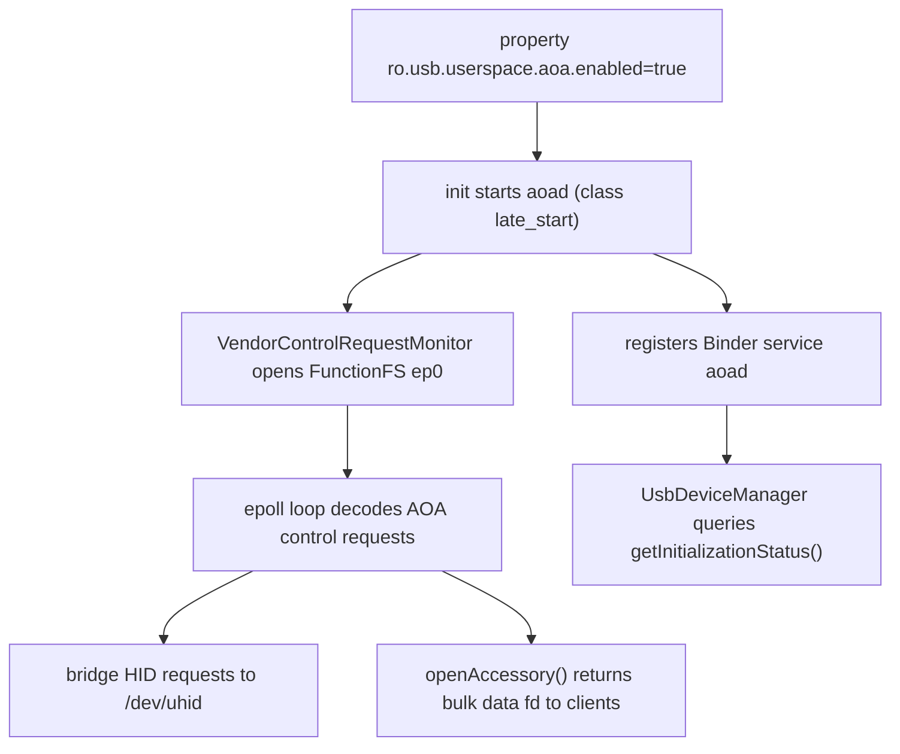

`system/usb/aoa/daemon/aoad.rc` 声明 `service aoad /system/bin/aoad`、`disabled`，仅在 `on property:ro.usb.userspace.aoa.enabled=true` 时启动，以 `user system` 身份运行，属于 `system usb uhid` 组，标签为 `seclabel u:r:aoad:s0`。一个 `cc_fuzz` 目标（`aoad_fuzzer`）对特权接口进行模糊测试。

### 架构变更

**OTA 快照迁移到 UBLK 后端（`system/core` + `system/update_engine`）。** 此前由 `snapuserd` 通过内核 `dm-user` 设备提供的虚拟 A/B 快照合并，现在可以运行在 **UBLK**（用户空间块驱动）之上。第一阶段 init 在启动时选择模式：`system/core/init/first_stage_mount_android.cpp` 调用 `sm->UpdateUsesUblk()`，然后调用 `LaunchFirstStageSnapuserd(use_ublk)` 并初始化 `/dev/block/ublkb*` / `/dev/ublk*` misc 设备。新增的清单字段 `disable_ublk`（`system/update_engine/update_metadata.proto:385-387`）让 OEM 即使在 UBLK 配置的设备上也能强制使用 dm-user。旧的 `system snapuserd` 代码路径以及 `ro.virtual_ab.userspace.snapshots.enabled` 之类的属性在 snapuserd/第一阶段侧被移除（`system/core`）；update_engine 的 `payload_consumer/vabc_partition_writer.cc` 仍然读取 `ro.virtual_ab.userspace.snapshots.enabled`。

**update_engine COW/压缩更新。** Android 17 为 REPLACE 操作增加了 **zstd 压缩**（外加一个 `zstd_extent_writer` 单元测试）和一个禁用 REPLACE 压缩的标志。它还**移除了 squashfs 支持**和 retrofit-动态分区逻辑，删除了 `SnapshotMergeStats`，并停止在用后保存清单字节 / 释放清单分区内存以降低峰值内存占用。现在大补丁先写入文件，再通过 fd 应用，而不是保留在内存中。

**第一阶段 init：Microdroid 与 Android 分离。** 第一阶段挂载逻辑经过重构，Android 专属的挂载逻辑不再编译进 Microdroid（反之亦然）。`system/core/init/first_stage_mount_android.cpp/.h` 和 `first_stage_mount_microdroid.cpp` 现在与共享的 `first_stage_mount.cpp` 并列。`FirstStageMount` 虚基类被移除。第二阶段 init 不再引入第一阶段挂载/main。

**其他 init/启动变更。** 一个重构后的**启动监视器（boot monitor）**落地，不过本轮又撤销了默认启用。启动分析获得 `ro.boottime.event.*` 属性和更丰富的 bootchart 采集（通过内核命令行进行早期 bootcharting、全命令行捕获、从 `/proc/cpuinfo` 检测 CPU 型号）。Init 现在在重启时把关机原因传递给内核，并为长按电源键增加了重启原因。它还挂载 `securityfs`，并在 TPM 已被清除时移除了交互式 FDR 提示。`ueventd` 在 sysfs 属性规格中获得通配符匹配能力，并能在完整的 APEX 集就绪之前从引导 APEX 拉取固件。

**ION 分配器被移除（仅保留 dma-buf heaps）。** `BufferAllocator`（`system/memory/libdmabufheap/BufferAllocator.cpp`）现在只从 `/dev/dma_heap/*` 分配。旧的 ION 路径（`system/memory/libion`）缩减为已弃用的空操作垫片。因此，DMA-buf heaps 成为唯一的图形/媒体缓冲区分配器。

**构建时 AOSP 源码树只读。** Soong 现在在沙箱化构建期间以只读方式挂载检出树。`SandboxConfig.SrcDirMountFlag()` 返回 `-R`（`build/soong/ui/build/sandbox_config.go`）。因此，构建动作无法写回树中，所有生成的输出都被限制在 `out/` 内。

**Memory Limiter 系统服务。** 新的 `MemoryLimiter` 服务（`frameworks/base/services/core/java/com/android/server/am/MemoryLimiter.java`，JNI 为 `com_android_server_am_MemoryLimiter.cpp`，标志 `memory_limiter_enable`）对应用 UID 应用 cgroup-v2 的逐进程限制。它在 `memory.high` 处进行软节流，并在进程的 anon+swap 合计持续超预算时杀死该进程。它是系统范围 `mmd` swap 守护进程和针对厂商进程作用域的 `pmgd`（D.7）的补充。

### 值得注意的集成

- **GKI 内核：首批 `android17-6.18` 配置。** `kernel/configs` 新增 `android17-6.18` 分支，面向 Linux 6.18 GKI 内核。它还删减了 Android R 配置，并更新了 OGKI 获批构建列表和 `kernel-lifetimes.xml`。
- **init/fastboot/recovery 共享 OTA 头文件。** `libupdate_engine_headers` 被导出，使 `init`、`fastboot` 和 recovery 的 `libinstall` 能找到 `file_descriptor.h`（`system/core` 和 `bootable/recovery`）。这加强了 OTA 引擎与为其提供输入的启动/恢复工具之间的耦合。
- **Recovery（`bootable/recovery`）。** 获得了 F2FS `packed_ssa` 支持、`MISC_KCMDLINE` 中的 `binder=c` 位，以及可配置的 `recovery_ui` 图形超时。

## D.3 原生基础

Android 17 的原生层由两条主线主导。第一条是大幅扩展的 AIDL HAL 接口面（`hardware/interfaces` 中有 820 次提交，新增了框架兼容性矩阵和若干新的设备契约）。第二条是 berberis（动态二进制翻译器）结构性的成熟（439 次提交）。它不再局限于 x86_64 上的 riscv64，而是发展为一个已搭好 arm64 框架的多客户机引擎。bionic 和 libcore 以页大小/内存标记加固以及面向 jdk-25 的 OpenJDK 升级作为补充。

### 新项目

本 Part 没有全新的仓库加入。值得注意的是 `hardware/interfaces` 内新增了 *HAL 包*，以及 berberis 内新增了 *子目录*（归入“新模块”和“架构变更”下）。

### 新模块

`hardware/interfaces` 中发布了新的 AIDL HAL 契约，并声明在 Android 17 框架兼容性矩阵 `compatibility_matrices/compatibility_matrix.202704.xml`（FCM `level="202704"`）中：

- **Motion Context HAL** — `hardware/interfaces/motioncontext/aidl/android/hardware/motioncontext/` 定义了 `IMotionContext`、`IMotionContextClient`、`IMotionContextCallback`，以及 `MotionState`、`MotionEvent`、`MotionSubscription`、`EventDeliveryReason`：向框架客户端提供基于订阅的设备运动状态流。
- **NPU HAL** — `hardware/interfaces/npu/aidl/android/hardware/npu/` 新增 `IScheduling` 和 `ISchedulingCallback`，带有 `SchedulingConfig`、`WorkInfo`、`StartReason`、`EndReason`、`Uuid`。根据 `npu/README.md`，首个版本让 Android 能够将应用优先级（0-1000，0 = 最重要）通知给神经处理单元。它还让 Android 在 NPU 工作开始/结束时接收回调。
- **`libwrapfd`（`system/memory/libwrapfd`）**——一个新的 Rust/LLNDK 库（`rust/lib.rs`，`cc_library_shared libwrapfd`），位于新的 `/dev/wrapfd` 内核驱动之上。它包装一个现有的 fd 并控制其可以被 `mmap` 的方式。`wrapfd_driver_wrap()` 固定一个 `PROT_READ`/`PROT_WRITE`/`PROT_NONE` 掩码。存在用于查询状态以及获取/释放所有权的 ioctl。它通过 `apex_available` 提供给 `com.android.npumanager`，用于支撑 NPU 缓冲区保护。
- **安全执行环境（SEE）系列**——一个大型的新 `hardware/interfaces/security/see/` 树，全部声明在 202704 矩阵中：
  - `security/see/hwcrypto/aidl/.../hwcrypto/`——`IHwCryptoOperations`、`IOpaqueKey`、`ICryptoOperationContext`（+`CryptoOperation`、`CryptoOperationSet`、`KeyPolicy`、`MemoryBufferParameter`）：使用不透明密钥句柄的 TEE 侧加密操作接口面。
  - `security/see/storage/aidl/.../storage/`——`ISecureStorage`、`IStorageSession`、`IDir`、`IFile`（+`CreationMode`、`Integrity`、`Availability`、`Filesystem`、`OpenOptions`）：一个可检测篡改/具备回滚保护的安全文件系统契约。
  - `security/see/devicestate/.../IDeviceState`、`security/see/authmgr/` 以及 `security/see/ext/.../ITrustedHalExt.aidl`——一个扩展点，允许从 SEE 访问可信 HAL。
- **既有 HAL 版本提升**：health AIDL V5（电池制造商/型号/最小设计电压）和 Weaver V3。Bluetooth Audio V6 新增 LE Audio 外围设备/广播接收端、HDT phy 上的 LE Audio 以及 ISO 参数更新。其他变更包括 Channel Sounding 新增项（`UpdateChannelSoundingConfig`、`GetVelocity`）、wifi Proximity Ranging、USB `PortPartnerStatus`/`Bc12Type`，以及一个新的“timestamp HAL”。

berberis 新增了一个 `cpu_emulation/` 伞形模块（见下文），并把 riscv64 翻译器拆分为各自的库（`translator_riscv64`、`runtime_library`）。

### 架构变更

**berberis：从 riscv64 翻译器到多客户机、多层引擎。** Android 16 的代码树实际上只支持 x86_64 上的 riscv64。在 17 中，引擎被重组到 `frameworks/libs/binary_translation/cpu_emulation/` 之下，汇集了三个执行层和共享基础设施：

- `cpu_emulation/interpreter/`——第一层解释器（riscv64）。
- `cpu_emulation/lite_translator/`——快速、低优化的 JIT（`lite_translator/riscv64_to_x86_64`）。
- `cpu_emulation/heavy_optimizer/`——优化 JIT（`heavy_optimizer/riscv64`），是 17 周期的重点。全局客户机上下文优化已实现并默认启用。该层还为不可归约循环添加了 `LoopGuestContextOptimizer`，并在 `LocalGuestContextOptimizer` 中进行了寄存器生存期工作。
- 共享支持：`cpu_emulation/{decoder,assembler,backend/x86_64,code_gen_lib,intrinsics}/`。

arm64 客户机现在在整个树中搭好了框架。`runtime/arm64/` 和 `runtime/arm64_to_x86_64/` 下出现了新的架构目录，还有 `guest_loader/arm64/`、`guest_state/arm64/`（带有 `get_cpu_state.cc`）、`guest_abi/arm64/`、`guest_os_primitives/arm64/`、`kernel_api/arm64/`，以及 `cpu_emulation/insn_tests/arm64/` 和 intrinsic 映射目录（`intrinsics/riscv64_to_arm64/`、`code_gen_lib/arm64_to_x86_64/`、`arm64_to_all/`）。因此，虽然 `README.md` 仍宣传 x86_64 上的 riscv64，但 17 代码库将抽象泛化以承载不止一种客户机 ISA。同一周期的运行时加固将翻译宿主栈增大到 1 MB 并带有保护页，还增加了 `clone3` 系统调用模拟。

#### berberis 三层翻译流水线（riscv64 客户机，x86_64 宿主）

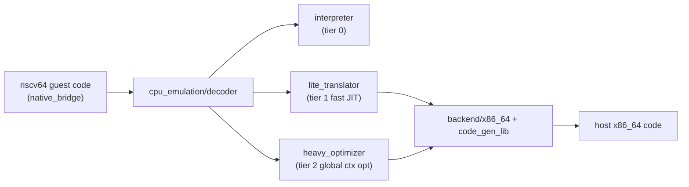

**AIDL 工具链。** `system/tools/aidl`（78 次提交）获得了 `@VersionSupport(version=N)` 接口注解。它注册在 `system/tools/aidl/aidl_language.cpp`（`AidlAnnotation::Type::VERSION_SUPPORT`），并由 `AidlInterface::VersionSpecificCheckValid()` 以及 `aidl_language.h:372` 中的 `GetVersionSupportVersion()` 强制执行。该注解把声明的版本固定到接口的实际版本上。Rust 后端获得了 `no_std` 变体，Soong 规则逐步沙箱化，生成代码中的 C++ 追踪现在默认关闭。

**VINTF。** `system/libvintf` 很安静（8 次提交，无契约变更）。不过，兼容性接口面通过新的 `compatibility_matrix.202704.xml` FCM 以及下一个甜点版本占位值向前推进。

### 值得注意的集成

- **bionic 内存/页大小加固。** 16 KB 页大小转换继续推进。它带来了填充的 ELF 测试库、16 KB 向后兼容模式保护页（加入后又回滚），以及 `RWX_MiddlePageProtection` 回归覆盖。动态链接器在链接器二进制中重新启用了仅执行内存（XOM），并添加了缺失的 BTI 指令/ELF 注释。它还完善了 MTE 处理：只在可读段上调用 `get_tagged_address`。字符串例程转向可移植 SIMD（来自 psimd 的 `strlen.cpp`，rustlib 的 x86_64 strlen 被 psimd 替换），外加优化的 `wmemset`/`wmemcpy`/`memccpy`。
- **libcore OpenJDK 升级。** libcore（205 次提交）从 `jdk-25.0.1-ga` 和 `jdk-25+26` 广泛导入。导入包括 `java.util.concurrent`（+`.locks`、`.atomic`）、`java.time.chrono`、`Character`、`ClassValue`、`Collections` 以及 `Invokers`/`NamedParameterSpec`。libcore 还导入了 OpenJDK 21 的 3 个新的 `String` API 方法。`libcore-openjdk-analyzer` 工具中新增了一个 `OpenJDK 25` 条目。这表明类库正朝 JDK 25 跟进。

## D.4 原生服务与媒体

Android 17 的原生服务和媒体层在多个方面推进。SurfaceFlinger 获得了**进程外渲染（OOPR）**的框架。OOPR 是一个共享内存的渲染命令通道，允许客户端记录绘制命令，而不是推送已完成的缓冲区。SurfaceFlinger 还获得了重构后的多显示器 modeset 路径。libbinder 增加了一个 generic-netlink 诊断通道。

在媒体方面，codec2 为媒体 APEX 拆分出一个稳定的 NDK 编解码器接口面（`libapexcodecs`）。相机服务增加了多客户端*共享会话*模式。照片选择器增加了搜索功能和分类网格。

### 新模块

- **`libapexcodecs`——面向媒体 APEX 的稳定 C2 编解码器 NDK。** `frameworks/av/media/module/libapexcodecs/include/apex/ApexCodecs.h` 定义了一个 C ABI（`ApexCodec_ComponentStore`、`ApexCodec_Component`、`ApexCodec_Buffer`，带有 `ApexCodec_Component_create/start/flush/reset/process`，均为 `__INTRODUCED_IN(36)`）。该 ABI 让可更新媒体（swcodec）APEX 能够跨 APEX 边界暴露 Codec2 软件组件。17 周期把真实的解码器接入其上（`C2ApexAacDec`、`C2ApexOpusDec`），`Codec2Client` 学会了枚举和排序基于 ApexCodecs 的组件。
- **面向 OOPR 的 libgui 无锁 IPC 原语。** `frameworks/native/libs/gui/include/gui/` 下的一系列新头文件支撑下文中的渲染命令通道。这些是 `RenderCommandBuffer{,Producer,Consumer}.h`，以及无锁构建块 `MagicRingBuffer.h`、`LocklessStaticQueue.h`、`LocklessTripleBuffer.h`、`LocklessQueue.h` 和 `RPointer.h`（用于共享内存的相对指针）。

### 架构变更

**SurfaceFlinger 进程外渲染（OOPR）。** 本周期 SF 最大的主题。客户端不再渲染到 `GraphicBuffer` 再入队，而是把 Skia 绘制操作记录到一个由 ashmem 支撑的 `RenderCommandBuffer` 中，SurfaceFlinger 在合成时回放。

`RenderCommandBufferProducer`（`frameworks/native/libs/gui/include/gui/RenderCommandBufferProducer.h`）持有 ashmem `IpcRenderRegion`，并暴露 `startRecording()`/`finishRecordingAndPostFrame()`。它通过新的 `SurfaceComposerClient::Transaction` setter 附加到一个图层。批量上传通过无锁的 `MagicRingBuffer` 进行。SF 侧的支持增加了 `RenderResourceCache`（`frameworks/native/services/surfaceflinger/RenderResourceCache.{h,cpp}`）、合成着色器、为同步而端到端传递的 frameId，以及感知 OOPR 的统计。该路径位于 aconfig 标志之后；在 17 中它是基础设施，还不是默认渲染路径。

#### OOPR 渲染命令通道与经典缓冲区队列路径的对比

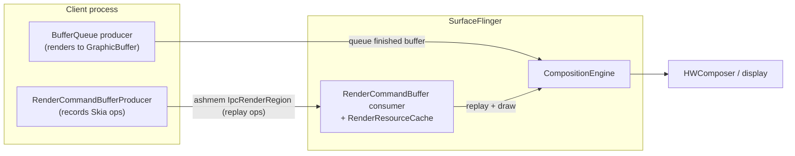

**多显示器原子 modeset。** SF 重构了模式变更如何在多个显示器间提交。重构增加了一个新的显示器命令 modeset 实现和状态机，以及一个用于驱动原子 modeset 的 `SurfaceControl` API（`gui: Plumb SurfaceControl API for atomic modeset`）。启用受标志门控。相关的调度器工作把 pacesetter 选择从 vsync 速率改为峰值 FPS。HIDL power 从 SF 中移除。

**libbinder generic-netlink 上报。** 新的 `frameworks/native/libs/binder/BinderNetlink.cpp` 打开一个指向内核 binder 驱动 `"binder"` 族的 generic-netlink 套接字，并消费异步上报。`BinderNetlink::open()/getReport()/readReport()` 解码 `BINDER_A_REPORT_ERROR` / `BINDER_A_REPORT_CONTEXT` 属性。这给用户空间提供了一个以上下文为键的驱动侧 binder 错误诊断流。本周期还继续推进 libbinder_rs 的 `no_std` 启用以及 RPC `IAccessor`/Parcel 性能清理，SensorService 也会为冻结的客户端挂起事件。

**相机多客户端共享会话。** 相机服务新增了*共享会话*模式，允许多个客户端观察同一台相机。`frameworks/av/services/camera/libcameraservice/config/SharedSessionConfigReader.h` 解析共享输出流的 XML 描述符（`SharedSessionConfig`，带有 `surfaceType`、`streamUseCase`、`dataSpace`、color space）。`camera_multi_client` 标志退役。新增了共享模式 / 当前 surface id 的指标，并在元数据中通过一个全新的 section 镜像（见下文）。

### 值得注意的集成

- **新的相机元数据 section（`system/media`）。** `system/media/camera/include/system/camera_metadata_tags.h` 在 `ANDROID_SECTION_COUNT` 之前新增了两个 section。`ANDROID_SHARED_SESSION`（`..._COLOR_SPACE`、`..._OUTPUT_CONFIGURATIONS`，均为 `fwk_only`）支撑共享会话功能。`ANDROID_DESKTOP_EFFECTS`（`..._CAPABILITIES`、`..._BACKGROUND_BLUR_MODES`，`system`/HIDL v3.2）面向相机流水线的背景模糊。本周期还新增了一个 AGTM 动态范围配置项，并把 `libcamera_metadata` 提升为 LLNDK。
- **codec2 接口面迁移与 10-bit 色彩。** Codec2 把其 `GraphicsTracker` 和分配器迁移到 `Surface` 上，编解码器栈获得 10-bit RGB / YUV 支持。xHE-AAC 编码器（`C2SoftXheAacEnc`）得到完善（presentation id、帧结束标记、实时模式）。
- **新的 Codec2 软件组件与 AudioFlinger MMAP AIDL。** `frameworks/av/media/codec2/components/` 新增了 APV 编解码器（`libcodec2_soft_apvdec`/`...apvenc`、`apv/C2SoftApvDec.cpp`）和一个 IAMF 解码器（`libcodec2_soft_iamfdec`、`iamf/C2SoftIamfDec.cpp`）。AudioFlinger 还通过 `IMmapStream` 把 MMAP 流控制迁移到稳定 AIDL 上（`frameworks/av/media/libaudioclient/aidl/android/media/IMmapStream.aidl`，`createMmapBuffer`/`startTrack`/`stopTrack`）。
- **照片选择器：搜索与分类（`packages/providers/MediaProvider`）。** Kotlin 照片选择器在 T+ 上成为默认，并在 `photopicker/src/com/android/photopicker/features/` 下新增两大功能。第一个是 `search/` 功能（由 AppSearch 支撑的本地设备端搜索，有 50k 文档限制和受限词过滤，外加一个云端提供者的 `SearchMediaService` SPI）。第二个是 `categorygrid/` 功能（相册/分类浏览，包括 SD 卡分类）。嵌入式选择器获得了 V2 API 接口面、`PhotoPickerSelectionParams` 和一个位置元数据功能标志。
- **`packages/modules/Media` API 接口面。** 主要是日常维护，但 `MediaParser` 迁移到了 Media3/ExoPlayer。它获得了感知轨道的查找（`MediaFormat` 中每轨道时长），并弃用了 `SAMPLE_FLAG_DECODE_ONLY`。媒体指标 AIDL 转换为稳定 AIDL。
- **VVC / H.266 框架管道。** 媒体框架新增了 `MEDIA_MIMETYPE_VIDEO_VVC` MIME 类型（`frameworks/av/media/module/foundation/MediaDefs.cpp`）和 VVC profile/level 映射（`frameworks/av/media/codec2/vndk/C2Config.cpp`，`PROFILE_VVC_MAIN_10`）。有了这些，厂商的 VVC 编解码器就可以接入 `MediaCodec`。与新的 APV/IAMF 组件不同，没有附带软件 VVC 编解码器。
- **恒定质量视频录制。** `MediaRecorder.setVideoEncodingQuality(int)`（`frameworks/base/media/java/android/media/MediaRecorder.java`）保持一个固定的质量等级并让比特率浮动，通过 `StagefrightRecorder.cpp` 和 `MediaCodecSource::adjustMediaFormatForConstantQuality()` 传递到支持 `BITRATE_MODE_CQ` 的编码器上。
- **动态相机会话输出更新 + 逻辑多相机元数据。** `CameraCaptureSession.updateOutputConfigurations(List<OutputConfiguration>)`（`frameworks/base/core/java/android/hardware/camera2/CameraCaptureSession.java`，AIDL `ICameraDeviceUser.aidl`）在原地交换会话的输出 surface，无需拆除。`LOGICAL_MULTI_CAMERA_ADDITIONAL_RESULTS`（`CaptureRequest.java`）请求按物理相机的元数据，而无需专用的物理流。
- **SDK 37 上的背景音频加固。** `HardeningEnforcer`（`frameworks/base/services/core/java/com/android/server/audio/HardeningEnforcer.java`）阻止针对 SDK 37 的后台应用进行音频焦点和音量控制请求，除非它们持有豁免。`AudioService` 通过 AppOps（`OP_TAKE_AUDIO_FOCUS`、`OP_CONTROL_AUDIO`）强制执行这一点。
- **由音频管理的蓝牙 SCO。** 音频 HAL 新增 `IBluetooth.setScoConfig(ScoConfig)`（`hardware/interfaces/audio/aidl/android/hardware/audio/core/IBluetooth.aidl`）。有了它，音频框架（通过 `AudioManager.setCommunicationDevice` 选择）拥有 SCO 链路生命周期，而不是蓝牙协议栈。该变更由 `bluetooth.sco.managed_by_audio` 和 `AudioDeviceBroker` 的 `mScoManagedByAudio` 门控。
- **专用 Assistant 音量流。** Android 17 新增 `AudioManager.MODE_ASSISTANT_CONVERSATION`（= `AudioSystem.MODE_ASSISTANT_CONVERSATION = 7`，`frameworks/base/media/java/android/media/AudioSystem.java:236`，`AudioManager.java:3869`）。标记为 `USAGE_ASSISTANT`（`AudioAttributes.java:216`）的 Assistant 播放获得自己的音量曲线。这让 Assistant 播放可以独立于媒体被调高或静音。配套的捕获权限 `BYPASS_CONCURRENT_RECORD_AUDIO_RESTRICTION`（`frameworks/base/core/res/AndroidManifest.xml:7511`）允许特权的 Assistant 或无障碍组件在通话或其他原本独占的会话期间捕获音频。参见第 15 章第 15.3.13 节。
- **WebGPU 已发布但不在平台镜像中。** Android 17 开发者资料列出了一个基于 Vulkan 的 WebGPU Kotlin/Java 图形与计算 API，但它不属于 AOSP 平台源码。没有 `external/dawn` / `external/webgpu` 项目，`frameworks/base` 中也没有 `webgpu` API 接口面。树内唯一的 WebGPU/Dawn 代码是 Skia 内部的 Graphite/Dawn GPU 后端及其在 `external/skia` 中的 WGSL 着色器代码生成。这是渲染基础设施，不是面向应用的 Android API。面向开发者的 WebGPU 接口面作为平台 Vulkan 栈之上的 Jetpack/库层发布（第 13 章）。

## D.5 运行时

Android 17 重塑了托管运行时的最低层。头条是 Zygote 用 Rust 从头重写为一个新的顶级项目。Android 17 还在 ART 中新增了一个 x86 微架构目标。以 APEX 挂载的运行时接口面继续收缩。

### 新项目

**`system/zygote`（Native Zygote / `zygote_next`）。** Android 17 引入了一个完全用 Rust 实现 Zygote 进程服务器的全新顶级仓库。它构建 `zygote_next` 守护进程（`system/zygote/zygote/src/bin/zygote.rs`），并拆分为聚焦的 crate（`system/zygote/Android.bp`，`edition: "2024"`）：

- `zygote-sys` 在安全 Rust 之后封装原始系统调用（`fork`、`clone3`、`epoll_wait`、`setresuid`/`setresgid`、`prctl`）和 `/proc` 内省（`system/zygote/zygote-sys/src/`）。
- `zygote-messages` 将 system_server &lt;-> Zygote IPC 定义为 FlatBuffers schema（`system/zygote/zygote-messages/schemas/messages.fbs`），带有来自 `zygote-proc-macros` 的派生宏编组。
- `zygote-core` 集中日志/追踪初始化，并挂钩到 `atrace`。
- `zygote` 持有 `Server` 事件循环和 `Species` 抽象。

经典的 `frameworks/base` `ZygoteInit` Java 路径仍然存在；`zygote_next` 是平台正迁移到的原生后继者。它在启动时记录一个 `NativeZygoteStarted` statsd atom，以 `nice -20` 运行，并使用 ASYNC MTE 构建（`system/zygote/zygote/Android.bp` 中的 Soong `sanitize: { memtag_heap: true }`）。

### 架构变更

**Species / 亚种（subspecies）进程模型。** 不同于旧的 fork-and-specialize 流程，`zygote_next` 把每个预加载并生成（spawn）的环境建模为一个 *Species*（`system/zygote/zygote/src/species.rs`）。`Species` trait（第 82-181 行）是一个回调的 vtable（`gather_reinitialization_data`、`speciate`、`gestate`、`set_seccomp_filters`、`sync_fd_state`、文件/套接字允许列表检查）。三个实现被静态注册：`AndroidNative`（`.../species/android_native.rs`）、`LibApp`，以及用于测试的 `Mock`“Turtle”。

一项关键的新能力是**亚种（subspecies）**。schema 定义了 `SpawnSubspecies` 和 `SpawnSubspeciesAndroidNative` 载荷（`messages.fbs` 第 31-43、87-93 行）。服务器可以按需生成一个*原生子 Zygote*，它把自己重新初始化为一个亚种（`speciate()` 在 `re_initialize_as_subspecies()` 之前运行）。这把旧的“子 zygote”思想推广为一等的、按载荷的生成命令。该命令携带自己的库路径、ABI 列表、预加载函数以及 UID/GID 范围。

Native Zygote 通过 Species 抽象进行的生成分发

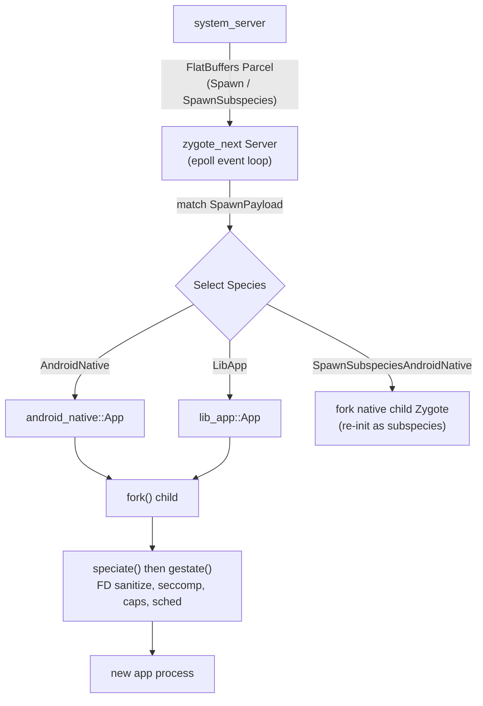

FD 继承现在由每个物种中显式的、标注日期的允许列表管理（`android_native.rs` 第 41-77 行）。每个 `AllowListEntry` 记录一个审查者和审查日期。当条目过期（> 365 天）时，一个单元测试（`species.rs` 的 `allow_list_audit`）会使构建失败。传输也从手工循环迁移到 `epoll`。它合并了 `SIGCHLD` 处理，子进程退出状态通过非请求式（unsolicited）Zygote 套接字转发给 ActivityManager。

**ART：pantherlake x86 目标。** ART 将 Intel **Panther Lake** 添加为受认可的 x86 / x86-64 指令集变体（`art/runtime/arch/x86/instruction_set_features_x86.cc` 第 43-115 行）。Panther Lake 是 Intel 的客户机（消费/移动）CPU 代际，比 ART 已认识的 Kaby Lake / Alder Lake 部件更新。

与其他 Intel 客户机芯片一样，它暴露 AVX/AVX2 但不提供仅服务器有的 AVX-512。因此该变体注册为 SSSE3、SSE4.1/4.2、POPCNT 和 AVX/AVX2（特性字符串 `ssse3,sse4.1,sse4.2,avx,avx2,popcnt`，位图 63）。这与 `alderlake`/`kabylake` 相同的 AVX2 层级。`X86FeaturesFromPantherlakeVariant` 单元测试对 32 位和 64 位都进行验证。这个命名变体让 `dex2oat` 能够在模拟器和 x86 外形规格等 x86-64 Android 目标上为这些 CPU 生成 256 位 AVX2 向量化代码。

**DEX 容器格式 V41。** 运行时将 DEX **版本 41** 视为容器格式（`art/libdexfile/dex/dex_file.h` 第 112 行，`kDexContainerVersion = 41`；第 181 行的 `HeaderV41`）。V41 文件携带容器偏移/大小，因此多个逻辑 DEX 文件共享一个后备缓冲区。Profile 机制针对仅 V41 的位置语法进行了更新。`HasDexContainer()` / `ContainerSize()`（第 165-174 行）对新行为进行门控。

**Value 和 record 类。** `mirror::Class` 获得一等的 `IsValueClass()`/`SetValueClass()` 和 `IsRecordClass()`/`SetRecordClass()` 访问器（`art/runtime/mirror/class.h` 第 341-357 行），由新的 `mirror::Class` 标志支撑（`kClassFlagValue`/`kClassFlagRecord`）。这是面向 Valhalla 风格 value 类的铺垫；record 现在被视为携带 record 标志的普通类。

**GC 调优。** 收集器在并发复制 GC 下重新启用了急切的基于 `MADV_FREE` 的页释放。这撤销了早先的一次临时禁用（`art/runtime/gc/collector/garbage_collector.cc` 约第 465 行）。GC 调节旋钮现在通过 `ArtDeviceStatus` 拉取的 atom 上报，用于车队遥测。

**分代 mark-compact（CMC）GC。** mark-compact 收集器在 `use_generational_cmc` aconfig 标志（`art/build/flags/art-flags.aconfig`，`art_performance` 命名空间）之后获得了分代模式，运行时由 `ShouldUseGenerationalGC()`（`art/runtime/gc/collector/mark_compact.cc`）门控。小 GC 只追踪和压缩最近分配的对象，而不是整个堆，并按年龄提升幸存者。

**静态 final 字段在 SDK 37 上不再可反射写入。** 对于面向 SDK 37 的应用，`ArtField::IsUnmodifiable()`（`art/runtime/art_field-inl.h`）对普通的 `static final` 字段返回 true。因此，反射（`java_lang_reflect_Field.cc`）和 JNI（`jni_internal.cc`）写入会抛出 `IllegalAccessException`，而不是静默地改变一个常量。

**SDK 37 上的无锁 `MessageQueue`。** Android 17 添加了一个并发 `MessageQueue` 重新实现，由 `release_package_messagequeue_implementation` Soong 配置选择。默认的 `CombinedMessageQueue`（`frameworks/base/core/java/android/os/CombinedMessageQueue/MessageQueue.java`，该配置的 `conditions_default`）在运行时在遗留的 `synchronized` 队列和 `VarHandle`-CAS 的“DeliQueue”之间选择。对于系统进程和由 `USE_NEW_MESSAGEQUEUE` 兼容性变更（`@EnabledAfter(BAKLAVA)`，SDK 37+）门控的应用，它会切换到无锁路径。

### 值得注意的集成

**APEX：收缩运行时挂载接口面。** `apexd` 继续从引导 APEX 集中移除运行时组件。`com.android.runtime` APEX 现在在引导列表（`system/apex/apexd/apexd.cpp` 第 169-180 行）中由 `RELEASE_DEPRECATE_RUNTIME_APEX` 门控。当该标志被设置时，运行时 APEX 消失，其内容移入基础系统镜像。

**EROFS 文件支撑的挂载（无需 loop 设备）。** 一项重大的挂载变更让 `apexd` 可以直接从文件挂载 EROFS 格式的 APEX 载荷。它完全跳过 loop 设备（`system/apex/apexd/apexd.cpp` 第 522-534 行）。当文件支撑的挂载启用时，载荷使用指向 APEX 内镜像的 `fsoffset=` 选项挂载。这由 `erofs_file_backed_mount` aconfig 标志和运行时属性控制（`apexd_mount.cpp` 第 38-120 行）。

配套的 `microdroid_no_loop_device` 标志让 Microdroid 通过 `dm-linear` 而不是 loop 设备激活块 APEX。二者共同削减了每个 APEX 的 loop 设备成本，因为主线模块集在持续增长。`apexd` 还为 APEX 载荷在 loop 设备上启用 Direct I/O，并在一个 tasklet 中进行 dm-verity 验证。

## D.6 框架核心

Framework Core 的增量由 `frameworks/base`（15,196 次提交）主导。本节涵盖真正平台级的变更。这些变更是新的 SDK 级别和带有公共/系统 API 接口面的新系统服务。它们还包括新的主线 SDK 扩展版本，以及 WindowManager Shell 中桌面窗口管理的成熟。

### 新 API 级别

Android 17 是 API 级别 37，代号 **CINNAMON_BUN**。常量位于 `frameworks/base/core/java/android/os/Build.java`：

- `VERSION_CODES.CINNAMON_BUN = 37`（Build.java:1318），接在 `BAKLAVA = 36` 之后。
- `VERSION_CODES_FULL.CINNAMON_BUN = 3700000`（Build.java:1545）——全版本编码（`SDK_INT_MULTIPLIER = 100000`），引入它是为了在携带次版本的同时携带主 `SDK_INT`。`SDK_INT_FULL` 和 `VERSION_CODES_FULL.CINNAMON_BUN` 均为公共 API（`core/api/current.txt:34998`、`:35049`）。

17 的公共 API 接口面是 `core/api/current.txt`；新的功能领域会出现在那里以及 `core/api/system-current.txt` 中。

### 新模块

**AdvancedProtectionService**——一个新的设备加固框架（高级保护模式）。一个面向用户的开关驱动一组相互独立的安全“功能”，每个功能收紧一个子系统。

- 系统服务：`frameworks/base/services/core/java/com/android/server/security/advancedprotection/AdvancedProtectionService.java`，在 `services/java/com/android/server/SystemServer.java:1868` 注册。
- 公共/系统 API：`frameworks/base/core/java/android/security/advancedprotection/AdvancedProtectionManager.java`，可通过 `Context.ADVANCED_PROTECTION_SERVICE = "advanced_protection"` 访问（`Context.java:6873`）；`isAdvancedProtectionEnabled()` 加上 register/unregister 回调均为公共（`core/api/current.txt:42225`）。
- `.../advancedprotection/features/` 下的功能钩子：`DisallowCellular2GAdvancedProtectionHook`、`DisallowInstallUnknownSourcesAdvancedProtectionHook`、`UsbDataAdvancedProtectionHook`、`MemoryTaggingExtensionHook`（MTE）。`AdvancedProtectionManager` 声明了七个 `@SystemApi` 功能 ID，但只有四个（DISALLOW_CELLULAR_2G=0、DISALLOW_INSTALL_UNKNOWN_SOURCES=1、DISALLOW_USB=2、ENABLE_MTE=4）拥有由 `AdvancedProtectionService` 注册的匹配钩子类。DISALLOW_WEP=3、DISALLOW_INSECURE_WIFI_AUTOJOIN=5 和 RESTRICT_NON_TOOL_A11Y_SERVICES=6 是在别处强制执行的（例如通过 `WifiManagerFeatureProvider`），而不是由 `.../advancedprotection/features/` 中的钩子。

**SupervisionService**——一个一等的监督（家长控制）框架，把监督从 DevicePolicy 中拆分出来。

- 系统服务：`frameworks/base/services/supervision/java/com/android/server/supervision/SupervisionService.java`（带有 `SupervisionSettings`、`SupervisionUserData`、`SupervisionPolicyMigrator`、`SupervisionRecoveryInfoStorage`），在 `SystemServer.java:1705` 注册。
- API/AIDL 接口面：`frameworks/base/core/java/android/app/supervision/`——`SupervisionManager.java`、`ISupervisionManager.aidl`、`Policy.java`/`PolicyKey.java`、`PackageUsagePolicy.java`、`SupervisionRecoveryInfo`。SystemUI 和 SettingsLib 获得了消费它的 `supervision/` 包。

**AiSeal**——一个新的系统服务，调解对 AiSeal 虚拟机的访问，用于设备端 AI 宿主服务（落地非常晚，2025 年 11 月）。

- 服务：`AiSealSystemService`，在 `SystemServer.java:3024` 注册。
- API（`@SystemApi`，标志门控 `android.aiseal.aiseal_host_apis`）：`frameworks/base/core/java/android/aiseal/AiSealManager.java`，带有 `connectService(String)`，外加 `Context.AISEAL_HOST_SERVICE = "aiseal_host"` 和 `PackageManager.FEATURE_AISEAL`（`core/api/system-current.txt:674`、`:4513`、`:5065`）。

**NpuManager**（`npu`）——一个标志门控的（`com.android.npumanager.npumanager_enabled`）NPU 模型管理接口面。`core/java/android/npumanager/mock` 和 `core/java/android/ranging/mock` 下只有 mock 目录存在。API 钩子（`Context.NPU_SERVICE = "npu"`、`PackageManager.FEATURE_NEURAL_PROCESSING_UNIT`、系统权限）在 `core/api/*.txt` 中声明在该标志之后。因此，请将此视为 `frameworks/base` 中保留/预览的接口面，而不是已发布的服务（真正的模块位于 `packages/modules/NpuManager` 下，见 D.12）。

### 架构变更

**桌面窗口管理成熟（WindowManager Shell）。** WM-Shell 最大的扩展是 `desktopmode` 包。`frameworks/base/libs/WindowManager/Shell/src/com/android/wm/shell/desktopmode/` 现在是 WM-Shell 最大的包之一。`DesktopTasksController.kt` 是核心编排器。支撑部件包括 `DesktopImmersiveController`、`DesktopUserRepositories`、`DesktopMixedTransitionHandler`、`DragToDesktopTransitionHandler`、`DesktopModeMoveToDisplayTransitionHandler`/`CrossDisplay` 处理、`DesktopWallpaperActivity`，以及一个同级的 `desktopai/` 包。多显示器桌面（移动到显示器、跨显示器过渡）、主屏 peek 热角，以及按用户的桌面仓库是相对于 16 的显著新增。

桌面窗口过渡流程（Shell）：

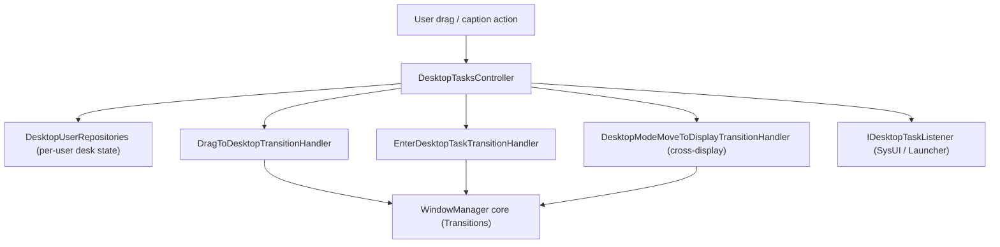

**SystemUI 场景容器（flexiglass）。** SystemUI 继续围绕 `frameworks/base/packages/SystemUI/src/com/android/systemui/scene/` 下的场景框架进行 shade/keyguard 重写（`data`、`domain`、`ui/{view,viewmodel,compose}`、`shared`）。大量 `[flexiglass]` 和 `[Desktop]` 的 shade/状态栏提交为其提供输入；Compose 支撑的 `SceneWindowRootView` 路径是 shade 和锁屏的发展方向。

**大屏方向/可调整大小性选择退出在 SDK 37 上被移除。** 对于面向 SDK 37 的应用，窗口管理器在大屏幕（>600dp）上不再遵从 `resizeableActivity` 和限制可调整大小的属性。这强制了通用的可调整大小性。SDK 门控是 `DISABLE_OPT_OUT_UNIVERSAL_RESIZABLE_BY_DEFAULT`（`frameworks/base/services/core/java/com/android/server/wm/AppCompatResizeOverrides.java`）。

**配置变更时减少 Activity 重新启动。** 在 SDK 37 中，一组配置变更（keyboard、keyboard-hidden、navigation、touchscreen、color-mode）默认不再重建 Activity。被屏蔽的集合是 `RECREATE_ON_CONFIG_CHANGES_MASK`（`frameworks/base/core/java/com/android/internal/pm/pkg/component/ParsedActivityUtils.java`）。应用可以通过 `android:recreateOnConfigChanges` 清单属性把某项变更重新选择回重新启动，由 `AppCompatRecreateOnConfigChangePolicy` 强制执行。

**自定义通知视图内存上限。** SystemUI 现在通过 `NotificationCustomContentMemoryVerifier`（`frameworks/base/packages/SystemUI/src/com/android/systemui/statusbar/notification/row/NotificationCustomContentMemoryVerifier.kt`）验证通知的自定义 `RemoteViews` 保持在内存限制（`config_notificationStripRemoteViewSizeBytes`，约 5 MB）之内。对于 SDK 37 应用，过大的视图会丢弃通知，而不是仅向日志写入警告。

### 值得注意的集成

**SDK Extensions 版本 22 + 新的“C”扩展。** `packages/modules/SdkExtensions` 把扩展数据库提升到**版本 22**。在 `gen_sdk/extensions_db.textpb` 的末尾，ART/CONSCRYPT/MEDIA/MEDIAPROVIDER/PERMISSIONS/STATSD/TETHERING/APPSEARCH/等全部为 22。发布机制为 Android 17 获得了一个新的按甜点版本的扩展轴，“**c**”：

- `derive_sdk/derive_sdk.cpp:85` 遍历甜点版本 `{"r","s","t","ad_services","u","v","b","c"}`；`:244` 添加 `relevant_modules.insert(kCModules…)`，并在 `IsAtLeastC()` 时设置 `c` 扩展。
- `sdk-extensions-info.xml` 获得了 C 扩展条目；Conscrypt 被加入 SDK 扩展（包括 `EchConfigList`/`InvalidEchDataException` ECH API），`android.net.dns`/`DnsResolver` 被暴露给 S+。根据 `gen_sdk/gen_sdk.py:134`，AD_SERVICES/EXT_SERVICES 冻结在 20。

这是让模块能够独立于操作系统甜点版本向较旧的 OS 版本发布 API 新增的主线 API 机制。v22 是 Android 17 的基线，新的 `c` 轴让未来的模块更新可以面向“Android 17+”。

## D.7 框架服务

Android 17 重组了几个与框架服务相邻的子系统。头条是一个全新的原生内存守护进程（`mmd`），从 system_server 接管 ZRAM 管理并增加按进程的回写/预取。Permission/Privacy 模块增加了 agent 活动接口面和 Private Compute Core（PCC）感知，而 UprobeStats 和 Profiling 以预构建模块 SDK 的形式发布。

### 新项目

**`system/memory/mmd`（Modern Memory Daemon）。** Android 17 引入了 `mmd`，一个新的原生 Rust 守护进程（`system/memory/mmd/README.md`）。它集中管理内存管理配置和 ZRAM 可调参数，并统一了之前分散在 `swapon_all`、`config.xml` 覆盖和 `ro.zram.*` 属性中的内容。它还将 swap 管理从 system_server 中抽出。

它注册一个名为 `mmd` 的 Binder 服务（`system/memory/mmd/src/main.rs:203-205`），暴露 `IMmd` AIDL 接口（`system/memory/mmd/aidl/android/os/IMmd.aidl`）。一个专用的 `mmd_setup` 服务（`system/memory/mmd/src/mmd_setup.rs`）由 init 启动，执行首次启动时的 ZRAM 激活。当 `mmd.zram.enabled` 被设置时，`swapon_all` 内部的 ZRAM 设置变成空操作，旧的覆盖配置被忽略。

### 新模块

**UprobeStats 预构建模块 SDK。** 基于 uprobe 的追踪模块（将 BPF uprobe 附加以检测方法调用并把结果作为 statsd atom 发出）现在发布一个预构建模块 SDK：`sdk { name: "uprobestats-module-sdk" }`（`packages/modules/UprobeStats/apex/Android.bp:87-88`）。在 A17 中，它的 Rust `core` crate 获得了一个类型化的 `UprobeStatsError` 和一个携带 `MAP_PATH`/`PROG_PATH` 常量的 `Handler` trait。它还在 `UprobeStatsBridgeServiceImpl` 中获得了精细的 BPF 附加错误报告和批量事件传递。新的 BPF 处理器涵盖无障碍和“破坏性应用”检测，以及从寄存器解析原始调用参数的通用插桩。

**Profiling 预构建模块 SDK + 异常检测器。** 设备端 Profiling 模块同样发布 `sdk { name: "profiling-module-sdk" }`（`packages/modules/Profiling/apex/Android.bp:103-104`）。A17 添加了一个 `AnomalyDetectorService`（`.../anomaly-detector/service/java/com/android/os/profiling/anomaly/AnomalyDetectorService.java`），由 `anomaly_detector_core_c` 标志门控，评估基于规则的信号（例如一个 `BinderSpamAnomalyDetector`）并触发 Perfetto 跟踪。一个专用的 `MemoryAnomalyRateLimiter` 在请求到达 `ProfilingService` 之前对内存限制异常分析进行节流。

**Web App（PWA）服务。** 新的 `com.android.webapp` APEX 安装/管理渐进式 Web 应用，通过一个 AIDL 系统服务在 `Context.WEB_APP_SERVICE`（`"web_app"`）下发布 `WebAppManager`，由 `enable_web_app_service_v2`（命名空间 `lse_desktop_experience`）门控（`packages/modules/WebApp/framework/java/android/content/pm/webapp/WebAppManager.java`）。

**有线串行 API + 原生守护进程。** 一个有线串口 API（`Context.SERIAL_SERVICE`、`"serial"`），与 USB 串口不同：`frameworks/base/core/java/android/hardware/serial/` 中的 `SerialManager`/`SerialPort`，由 `SystemServer.java` 中的 `SerialManagerService` 支撑。一个 Rust 守护进程在 `enable_wired_serial_api` 标志之后注册惰性 binder 服务 `native_serial`（`frameworks/native/services/serialservice/rust/service.rs:53`）。

**进程内存守护进程（pmgd）。** 原生 Rust 的按进程守护进程。它监视每个目标进程的 cgroup-v2 `memory.high` 压力和 `anon_limit_in_mb`。它在回收宽限期后杀死违规进程，并把杀死遥测作为 statsd atom 发出（`system/memory/guardian/README.md`）。它以精细的按进程强制补充 `mmd`。

**新的 system_server 服务。** 三个管理器加入 `SystemServer.java`，每个都有一个 `Context.*_SERVICE` 常量：`MultisensoryService`（audio-haptic，`MULTISENSORY_MANAGER_SERVICE`）、`ContentRestrictionService`（`CONTENT_RESTRICTION_SERVICE`）和 `PccSandboxManagerService`（Private Compute Core，`PCC_SANDBOX_SERVICE`）（`frameworks/base/core/java/android/content/Context.java`）。

### 架构变更

**mmd ZRAM 生命周期和按进程回写/预取。** 启动后，`mmd_setup` 激活 ZRAM 并调用 `swapon`，带有一个可选的 swap 优先级。A17 添加了显式的 swap 优先级和多设备支持（`mmd.zram.num_devices`、按设备属性）。优先级通过 `SWAP_FLAG_PREFER` 打包进 swap 标志（`system/memory/mmd/src/zram/setup.rs:40-73`）。ZRAM 维护（空闲回写、重新压缩）不再由 system_server 自己的逻辑驱动；system_server 通过 Binder 发送 `doZramMaintenanceAsync()` 提示，`mmd` 应用自己的策略。

真正新的低内存路径是**按进程**的 ZRAM 操作。`IMmd` 获得了 `supportsProcessMemoryZramOps()`、`asyncWritebackProcessZramMemory(pidfd, callback)` 和 `asyncPrefetchProcessZramMemory(pidfd)`（`system/memory/mmd/aidl/android/os/IMmd.aidl:51-80`）。回写通过 `pidfd` 针对单个进程，把其驻留 ZRAM 的页推送到后备设备，并通过 `IMmdProcessWritebackCallback` 报告 `WritebackStatus` 及写入字节数。预取是逆操作：它在缓存的应用恢复之前，把一个进程已回写的页拉回压缩池。这些操作通过新的 zram 内核 ioctl（`ZRAM_ANDROID_IOC_PROCESS_WRITEBACK_CMD`、`..._PREFETCH_CMD`）实现，封装在 `system/memory/mmd/src/zram/per_process_ioctls.rs` 中。

内部 `MmdService` 运行一个两级工作队列（`system/memory/mmd/src/service.rs:68-146`）：预取进入高优先级的 `prefetch_work` 双端队列，回写和定期维护进入低优先级的 `other_work`。对某个 pid 的预取请求会取消该进程任何仍在挂起的回写（通过 `pidfds_likely_equals` 匹配）。因此，恢复不会与即将驱逐被预取页的回写发生竞争。

mmd 按进程 ZRAM 回写和预取流程

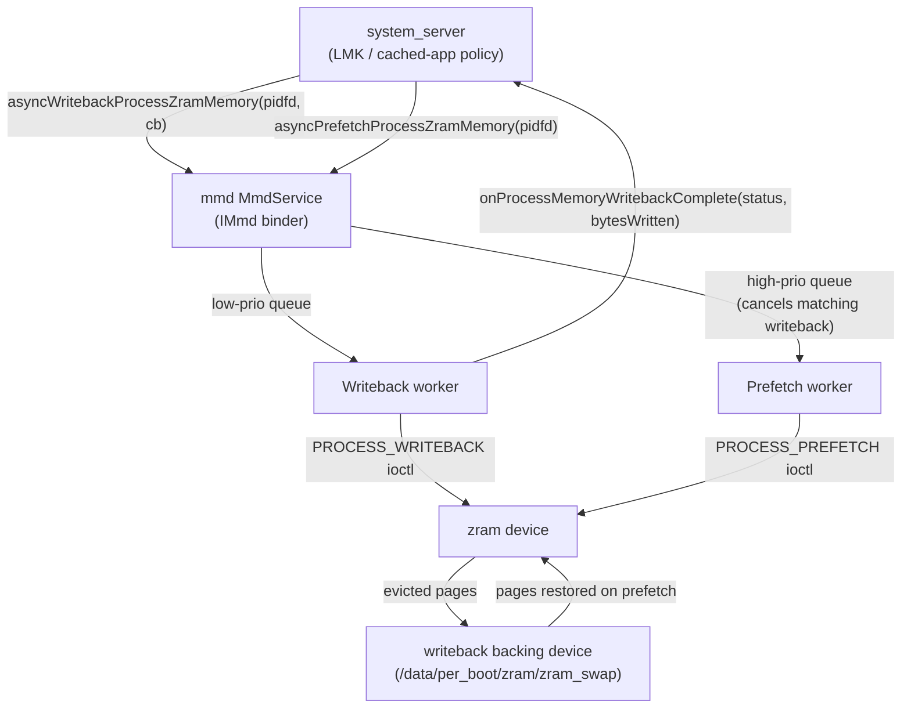

**Permission / Privacy：agent 活动和 PCC 感知。** Permission 模块（PermissionController、role-controller、Safety Center，533 次提交）有两条架构主线。首先，一个新的 *agent 活动 / agent 时间线*隐私接口面跟踪哪些 AI agent 访问了用户数据，有 24 小时和 7 天窗口。它位于新的 `appinteraction` 和 `appfunctions` 源码树中（例如 `.../permissioncontroller/appinteraction/domain/model/v31/AgentActivityItem.kt`、`.../appfunctions/ui/handheld/v37/AgentUsageDetailsFragment.kt`），在 agent 活动标志之后。

其次，Private Compute Core 感知贯穿权限/Safety Center UID 检查。Safety Center 在比较之前把一个 PCC 沙箱 UID 解析回其所属的应用 UID（`packages/modules/Permission/.../safetycenter/SafetyCenterService.java`）。`PERSONAL_CONTEXT_*` 签名权限现在被标记为 `allowedInPrivateComputeCore`。

**Private space 角色策略。** 角色资格获得了按包和跨用户的钩子。`RoleBehavior` 添加了 `isPackageAllowedToBypassQualificationAsUser(...)`。除非设备归组织所有，`Role` 现在把 `EXCLUSIVITY_PROFILE_GROUP` 角色视为对 private space profile 不可用（`.../role-controller/java/com/android/role/controller/model/{RoleBehavior,Role}.java`）。

### 值得注意的集成

**statsd 指标管道和 io_uring。** StatsD 模块（130 次提交）为 atom 摄取添加了一个基于 `io_uring` 的套接字监听器。它由一个新的最低 API 级别 37 保护：`IO_URING_API_VERSION 37`。它仅在 `flags::use_iouring_socket_listener()` 和运行时支持都存在时才激活（`packages/modules/StatsD/statsd/src/main.cpp:52-119`）。statsd 还通过其 `stop()` 路径干净地处理 `SIGTERM`，并优化了沙箱/SDK 沙箱 UID 的 UID 映射。

**mmd 作为 statsd 生产者。** `mmd` 通过 `statslog_rust` 把它自己的 ZRAM 遥测作为 statsd atom 上报：来自 setup 服务的 `ZramSetupExecuted`，加上来自维护的 `ZramMaintenanceExecuted`/`ZramMmStatMmd`/`ZramIoStatMmd`/`ZramBdStatMmd`（`system/memory/mmd/src/atom.rs:29-39`）。UprobeStats 和 Profiling 异常检测器同样是 statsd 生产者。因此，A17 的内存、追踪、分析和指标子系统越来越通过 statsd 管道缝合在一起。

**PartnerBookmarksProvider**（`packages/providers/PartnerBookmarksProvider`）是一个小型的只读提供者，暴露 OEM/运营商预装的浏览器书签。`query()` 通过 `MatrixCursor` 提供来自 `res/values/` 字符串数组的行。`insert`/`update`/`delete` 抛出 `UnsupportedOperationException`。

**通知语义颜色 API。** `Notification.createSemanticStyleAnnotation(int)`（`frameworks/base/core/java/android/app/Notification.java:1039`，标志 `api_notification_semantic_style`）让一个 Live Update 标签文本 span 携带一种*含义*。含义是 `SEMANTIC_STYLE_INFO`/`SAFE`/`CAUTION`/`DANGER`（`Notification.java:967`-1009）。与硬编码 RGB 不同，平台选择一个能在 Material You 主题化、深色模式和高对比度无障碍下存活的调色板（蓝/绿/橙/红）。参见第 28 章第 28.20.5 节。

## D.8 连接性

Android 17 的连接性接口面由一个贯穿全局的主题主导：**通用测距（generic ranging）**。一个新的系统服务把 UWB、蓝牙通道测距（Channel Sounding）、Wi-Fi RTT 和 BLE RSSI 统一在一个 `RangingManager` API 之下。蓝牙、Wi-Fi 和 UWB 中的控制器级协议栈都增加了为其提供输入的原语。除测距之外，Wi-Fi 还获得了新的非同步服务发现（USD）服务。NFC 为“轻触即 X”（tap-to-X）添加了手势交换 API。电话子系统继续扩展卫星 / NTN 支持。

### 新项目

**`hardware/nxp/uwb`——NXP UWB 厂商 HAL。** 一个新仓库，为 NXP 的 SR1XX UWB 芯片系列提供 `android.hardware.uwb` AIDL HAL 的具体厂商实现。此前代码树只发布了 HAL 接口和一个桩；该仓库携带一个使用 NXP 芯片的 OEM 可以直接构建的可交付实现。

AIDL 服务实现 `IUwb`/`IUwbChip`（`hardware/nxp/uwb/aidl/uwb.h:33`、`uwb_chip.h:35`），并注册为 `android.hardware.uwb-service.nxp`（init 服务 `vendor.uwb_hal`，声明 `IUwb` v1）。薄薄的 AIDL 层桥接到遗留的 NXP HAL 核心。`open()`/`coreInit()`/`sendUciMessage()` 转发到 `phNxpUciHal_open`/`_coreInitialization`/`_write`（`hardware/nxp/uwb/aidl/uwb_chip.cpp:69,90,101`）。大部分逻辑（HBCI 固件下载、TML 传输、校准、会话/时间同步）位于 `halimpl/` 和 `example_config/SR1XX` 之类的板级配置下。正是它让 UWB 硬件测距在基于 NXP 的设备上工作，为下方的测距栈提供输入。

### 新模块

**通用测距栈（`packages/modules/Uwb/ranging`）。** UWB 模块内发布了一个多技术测距子系统。它暴露公共的 `android.ranging` 框架（`packages/modules/Uwb/ranging/framework/java/android/ranging` 下的 50 个类），由注册为 `Context.RANGING_SERVICE` 系统服务的 `RangingManager` 作为前端（`RangingManager.java:55`）。背后的 `RangingService extends SystemService` 和 `publishBinderService(Context.RANGING_SERVICE, ...)`（`service/.../RangingService.java:25,38`）；SystemServer 通过 `startServiceFromJar(RANGING_SERVICE_CLASS, RANGING_APEX_SERVICE_JAR_PATH)` 从 UWB apex JAR 加载它（`frameworks/base/services/java/com/android/server/SystemServer.java:3310-3312`）。

该服务通过公共的 `RangingAdapter`（`service/.../RangingTechnology.java:39-46`）抽象六种底层技术。这些技术是 `UWB`、`CS`（蓝牙通道测距，前身为 HADM）、`RTT` 和 `RTT_STATION`（Wi-Fi 802.11mc）、`RSSI`（BLE）以及 `WIFI_PD`（Wi-Fi 近距离检测）。按技术的 API 参数位于子包中（`ble/cs/BleCsRangingParams`、`wifi/rtt/RttRangingParams`、`wifi/pd/WifiPdRangingParams`、`uwb/UwbRangingParams`）。应用表达一个 `RangingPreference`/`SessionConfig`。该服务通过一个 `fusion` 引擎（`FilteringFusionEngine`、`DataFusers`）和会话 `engine` 类在运行时选择、融合并切换技术，包括 make-before-break / break-before-make 切换。带外协商（`oob/`）让两台设备可以通过 BLE 商定一种技术。

**Wi-Fi USD 服务（`packages/modules/Wifi/.../usd`）。** 非同步服务发现获得了一个专用的 `@SystemApi UsdManager`（`framework/java/android/net/wifi/usd/UsdManager.java:65-67`，由 `Flags.FLAG_USD` 门控），注册为 `Context.WIFI_USD_SERVICE`（`WifiFrameworkInitializer.java:124-132`），带有 `PublishSession`/`SubscribeSession` 和一个新的 `IUsdManager` AIDL。USD 还接入 Wi-Fi Aware 和 Wi-Fi P2P（`WifiP2pUsdBasedServiceDiscoveryConfig`，外加 `nsd/` 子包中的 `WifiP2pUsdBasedServiceResponse`）。

**USB 设备授权（`frameworks/native/services/usbauthservice`）。** 一个新的 Rust 守护进程实现 `IUsbAuthManager` binder 服务（`service.rs:15`）。该服务位于框架内部的 `android.hardware.usb.auth` AIDL 接口之后（`Android.bp:23`，依赖 `android.hardware.usb.auth-rust`；定义在 `frameworks/base/core/java/Android.bp` 中，不是厂商 HAL）。它根据允许 / 交互式 PIN 策略引擎（`rules.rs`、`authorization.rs`）授权已连接的 USB 设备——桌面 / 大屏安全加固。

**AOSP IMS 栈（`packages/modules/ImsStack`）。** 一个完整的树内 IMS 栈作为 `com.android.imsstack` 特权应用发布（`java/.../ImsStackApp.java`、`java/Android.bp:111`）。它是一个基于 JNI 的 Java 服务，驱动一个原生的 `libimsstack` C++ SIP 引擎（`native/libimsstack/Android.bp`，`cc_library_shared "libimsstack"`）。

**LE Audio 外设（服务器）角色（`packages/modules/Bluetooth`）。** 协议栈获得了一个栈内 LE Audio 服务器/接收者角色，即“BAP 外设”`LeAudioServer`（`system/bta/le_audio/server/server.cc:63,66`）。新的 Rust ISO 和周期同步管理器（`system/rust/src/le_audio/iso_manager/manager.rs`、`periodic_advertising_sync/manager.rs`）为其提供支持。它们补充了 D.3 中提到的 LE Audio HAL / 广播接收端。

**主线 supplicant（`packages/modules/Wifi`）——架构变更。** wpa_supplicant 正通过不稳定的 `IMainlineSupplicant` AIDL 移入 Wi-Fi 主线模块（`aidl/mainline_supplicant/.../IMainlineSupplicant.aidl:26`），通过绑定 `wifi_mainline_supplicant` 服务的 `MainlineSupplicantAidlManager` 访问（`service/.../MainlineSupplicantAidlManager.java:44,46`）。

### 架构变更

**蓝牙通道测距为测距栈提供输入。** 蓝牙栈获得了一个通道测距管道。它有 GD HCI 的 `channel_sounding/` 指标层和 `system/bta/ras/` 下的 RAS（测距服务 GATT profile）类型。`distance_measurement_manager_impl` 以安全级别驱动 `METHOD_CS` 会话并产生距离/速度结果（`system/gd/hci/distance_measurement_manager_impl.cc:45,361`）。一个新的 `enforce_security_for_ranging` 标志加固 CS 测距会话，结果通过通用测距服务中的 `CS` 适配器暴露给应用。蓝牙（`packages/modules/Bluetooth`，本版本模块增量最大的）也同时并行推进其 LE Audio 建设。

通用测距服务如何复用各无线电：

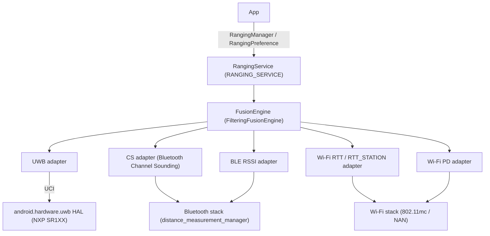

### 值得注意的集成

**电话卫星 / NTN。** `frameworks/opt/telephony/.../satellite` 下的卫星栈继续扩展。新增项包括运营商漫游 NTN API（`isInCarrierRoamingNtnMode`、`getCarrierRoamingNtnAvailableServices`）和 NR-NTN 信号强度键（SSRSRP/SSRSRQ/SSSINR）。还包括卫星启用/挂起 API、紧急消息路由的运营商配置，以及 26Q2 卫星 HAL 的新 RIL 常量。`NtnCapabilityResolver`、`SatellitePlmnNetworkInfo` 和 `SatelliteController` 承载了大部分内容。框架现在通过 `updateSystemSelectionChannels` 把卫星 PLMN 和 ICCID 告知调制解调器。

在应用侧，`packages/services/Telephony` 用卫星消息/SOS UI 和运营商配置管道跟进了这些变更。

**NFC 手势交换 / tap-to-X。** NFC 添加了 `NfcGestureExchangeCallbackListener` 和由 `PERFORM_GESTURE_EXCHANGE` 门控的 API（`packages/modules/Nfc/framework/java/android/nfc/`），外加主屏 tap-to-X 路由，构建在既有的观察模式和钱包角色基础设施之上。观察模式的“始终开启”变体被移除。

**Wi-Fi Aware。** Aware 上报和配对趋于成熟。变更包括组密钥密码套件上报、`AwarePairingConfig` / 由 supplicant 驱动的带 NPKSA 处理的配对验证、基于 USD 的发现，以及 `RangingResult` 中携带的 `UsdPeerId`。这是另一条把 Aware 发现连接到统一测距结果的路径。

**连接性（Tethering/NetworkStack）。** 这个 877 次提交的 Connectivity 增量主要是 Tethering、NetworkStack 和 ConnectivityService 的渐进式加固。值得关注的新能力项是 `nearby/` 下的设备到设备路径，由 `enable_d2d_connectivity_service` 门控（`packages/modules/Connectivity/nearby/flags/d2d_connectivity.aconfig`）。

**`usesCleartextTraffic` 弃用。** 面向 SDK 37 的应用不再享有 `android:usesCleartextTraffic` 清单标志。兼容性变更 `DEPRECATE_USES_CLEARTEXT_TRAFFIC`（`frameworks/base/packages/NetworkSecurityConfig/platform/src/android/security/net/config/ManifestConfigSource.java`）把明文策略完全路由到 Network Security Config XML。因此，取而代之的是按域名规则，而不是一个全局开关。

**Wi-Fi RTT 802.11az 安全测距。** Wi-Fi RTT 在 `secure_ranging` 标志之后获得 802.11az 安全测距。`SecureRangingConfig` 和 `PasnConfig`（`packages/modules/Wifi/framework/java/android/net/wifi/rtt/`）协商 PASN（预关联安全协商）以认证和保护 FTM 帧。该 API 还具有开放/机会/认证模式，以及 `RangingResult.isRangingAuthenticated()`/`isRangingFrameProtected()` 状态。

**UWB OOB 测距规范 v2/v3。** UWB 模块扩展了其带外测距包格式（`packages/modules/Uwb/ranging/service/oob/oob_packets.pdl`）。因此，两台设备可以在开启 UWB 会话之前通过侧信道（NFC/BLE）交换测距参数。这为 D.8 中的通用测距栈提供输入。

**集成的 VoIP 通话记录。** 自管理的 VoIP 应用可以写入共享的系统通话记录（`CallLog.Calls`，新的 `UUID` 列），由 `telecom_integrated_call_log` 标志门控。`CallAttributes.setLogExcluded()`/`setContactUri()`（`frameworks/base/telecomm/framework/java/android/telecom/CallAttributes.java`）控制按通话的纳入。拨号器通过 `INCLUDE_VOIP_CALLS_PARAM_KEY` 查询 VoIP 通话。

**OTT 通话自动路由到优质切片。** 当一个事务性的自管理 VoIP 通话开始时，系统代表应用通过 `NET_CAPABILITY_PRIORITIZE_UNIFIED_COMMUNICATIONS`（值 38，`packages/modules/Connectivity/framework/src/android/net/NetworkCapabilities.java`）请求一个优质的 5G 切片。`ConnectivityService` 把该请求映射到调制解调器 URSP 规则上。应用可以通过 `PhoneAccount.CAPABILITY_OPT_OUT_OF_PREMIUM_NETWORK` 选择退出。

**SIM 工具包应用（`Stk`）。** 内置的 SIM 工具包 UI（`packages/apps/Stk`，包 `com.android.stk`）在电话进程内运行，并渲染主动式 SIM 命令。`CatService` 向 `StkAppService` 广播 `CAT_CMD_ACTION`（由 `RECEIVE_STK_COMMANDS` 保护）。该服务根据 `CommandType` 切换并启动匹配的 Activity（`StkDialogActivity`、`StkMenuActivity`、`StkInputActivity`、音调播放器）。

## D.9 安全

Android 17 围绕两个主题重塑了硬件支持的安全栈。第一，把安全服务（KeyMint、SecureClock、SharedSecret、RKP、Gatekeeper）移入受保护虚拟机。第二，引入一个通用的进程内沙箱原语（LFI），让不受信任的原生代码可以运行在可信进程内部。出现了几个新仓库：一个专用的 Weaver 实现、SEE AuthMgr，以及一个树外的密钥证明验证库。

### 新项目

**`system/lfi`——轻量级故障隔离运行时支持。** 一个新仓库，容纳用于编译和加载 LFI 沙箱化库的共享胶水代码。根据 `system/lfi/README.md`，它有三部分。`boxrt` 提供链接进沙箱化库的运行时桩，例如 `boxrt/boxrt_minimal.c` 中作为原始 `svc` 系统调用的 `abort`/`brk`/`pause`。`allocator` 是一个线程安全的自旋锁最小分配器（`allocator/alloc.c`）。`relocator` 是一个最小的 `-static-pie` 加载器，为 `lfi-bind` 执行重定位（`relocator/relocate.c` + `start.S`）。

LFI 是来自 Stanford/LLVM 的软件故障隔离方案。它通过经过验证的机器代码，而不是单独的地址空间，把一个库的内存访问和控制流限制在一个沙箱区域内。`system/lfi/Android.bp` 定义了 `cc_defaults` `system_lfi_defaults`（`lfi_supported: true`、`nocrt`、`stl: "none"`、`libc_lfi`/`libm_lfi` 的静态链接、仅 arm64、`apex_available: ["com.android.media.swcodec"]`）。第一个生产消费者是 swcodec APEX。

**`system/weaver`——Weaver 防回滚秘密存储 TA。** 一个新的 Rust workspace（`Cargo.toml` 成员 `ta`、`wire`），实现由安全环境可信应用支撑的 `IWeaver` HAL。Weaver 存储用于凭证节流的按槽位键/值秘密。每个 `Slot`（`ta/src/lib.rs`）持有一个 `slot_key`、`slot_value`、`last_checked_timestamp` 和 `failure_counter`。TA 返回 `Error::IncorrectKey(ms)` / `Error::Throttle(ms)`，以强制硬件支持的、能跨重启存活的重试退避。

HAL 服务（`hal/src/lib.rs`）是一层薄薄的 `IWeaver` binder 垫片。它把请求作为 CBOR 通过 `SerializedChannel` 序列化给 TA。它复用共享的 `system/security/hals/*` 通道 + wire crate。

**`system/see/authmgr`——安全执行环境认证管理器。** Rust crate 拆分为前端（`authmgr-fe`）、后端（`authmgr-be`、`authmgr-be-impl`、`authmgr-be-storage-impl`）和 `authmgr-common`，外加一个 `secure-storage-aidl-wrapper`。AuthMgr 实现 `hardware/interfaces/security/see/authmgr/IAuthMgrAuthorization.aidl`（在 `authmgr-fe/src/authorization.rs` 中引用）。它使用 DICE 证书链和策略把受保护虚拟机（pVM）认证给安全侧的可信应用。`AuthMgrFe::authenticate` 呈现一个 `ExplicitKeyDiceCertChain` + `SignedConnectionRequest`。后端按实例 id 和 DICE 模式对实例去重，并强制执行回滚保护。

这 42 次提交为每个实例 id 添加了两种 DICE 链模式、DICE 策略的覆盖点，以及安全存储的暂存/提交和 `read_file`/`write_file` API。

### 新模块

**`external/lfi/*`——LFI 工具链（外部，仅集成）。** 上游组件被供应商化以支撑进程内沙箱。其中包括 `lfi-verifier`（验证一个 ELF 只发出沙箱安全的指令）。还包括 `lfi-runtime`（`liblfi`：预留/映射沙箱地址空间，转入转出控制，模拟主机调用）。其余的是 `lfi-bind`（Go 蹦床生成器）、`rlbox`/`rlbox-lfi`（带 LFI 后端的 RLBox API），以及 `disarm`/`fadec`（验证器的 AArch64/x86 解码器）。

集成，未修改。构建把 `liblfi` 和沙箱化的 `libopus_lfi` 链接进 `frameworks/av/media/module/libapexcodecs`。当 `android.media.codec.in_process_sw_codec_lfi` 被设置时，Codec2 走进程内路径（`frameworks/av/media/codec2/hal/client/client.cpp:1909,2034`）。这让一个不受信任的软件解码器在编解码器进程内运行，内存安全由经过验证的代码强制，而不是由单独的进程强制。

**`external/keyattestation`——Android 密钥证明验证器（外部，仅集成）。** 一个 Kotlin 库（`Android.bp` 构建 `java_library "keyattestation"`，对 `//frameworks/base/core/java` 和厂商可见），验证 KeyMint/RKP 产生的密钥证明证书链。它的 `Verifier` 接收信任锚、已撤销序列号和时间源。它返回一个 `VerificationResult`，暴露被证明的公钥、安全级别、已验证启动状态和设备信息。它支持可插拔的 `ChallengeChecker`。它自带根集合（`roots.json`、`keyattestation_roots` filegroup），从 `github.com/android/keyattestation` 镜像而来。

### 架构变更

**KeyMint 及其同伴移入受保护虚拟机（keymint-in-vm）。** 本周期最大的 sepolicy 主题（`system/sepolicy`，452 次提交）是从虚拟机内部暴露硬件安全 HAL。定义了新的 `accessor` 服务支持。为 `IRemotelyProvisionedComponent`、`ISecureClock`、`ISharedSecret`、`IProvisioning` 添加了 accessor 权限，以及（单独的）面向 `IGatekeeper` 的 `gatekeeper-in-vm`。`service_contexts` 中添加了 `ISharedSecret/security_vm` 和一个 KeyMint provisioning 服务上下文。

其效果是 KeyMint、RKP、SecureClock、SharedSecret 和 Gatekeeper 可以运行在一个 `security_vm`（Microdroid/pVM）中。平台通过 accessor 服务而不是宿主机上的厂商 HIDL/AIDL HAL 访问它们。这正是 AuthMgr 的 pVM 认证所支撑的。

**KeyMint 参考 TA 获得 ML-DSA（后量子）密钥。** `system/keymint`（63 次提交）为 Rust 参考 TA 添加了 ML-DSA 签名支持，包括 ML-DSA-87 和 PKCS#8 种子导入。Keystore2 紧随其后：`system/security/keystore2/src/key_parameter.rs` 和 `security_level.rs` 处理 ML-DSA，指标记录 ML-DSA 变体，`Algorithm.aidl` 添加了该枚举。

KeyMint 还重构了证明。证明 ID 从 `KeyParam` 列表中解析出来。`Cow` 字符串持有应用证明 id 和编码后的信任根（Root-of-Trust）。销毁证明 ID 在 HAL v5 / AIDL >= 500 中被移除。时间戳接口合并进 KeyMint HAL（`hal_timestamp_service` 从 `hal_keymint` 中移除）。

下图展示了一个不受信任的软件编解码器如何在 LFI 下运行在可信的 swcodec 进程内。

#### LFI 进程内软件编解码器沙箱流程

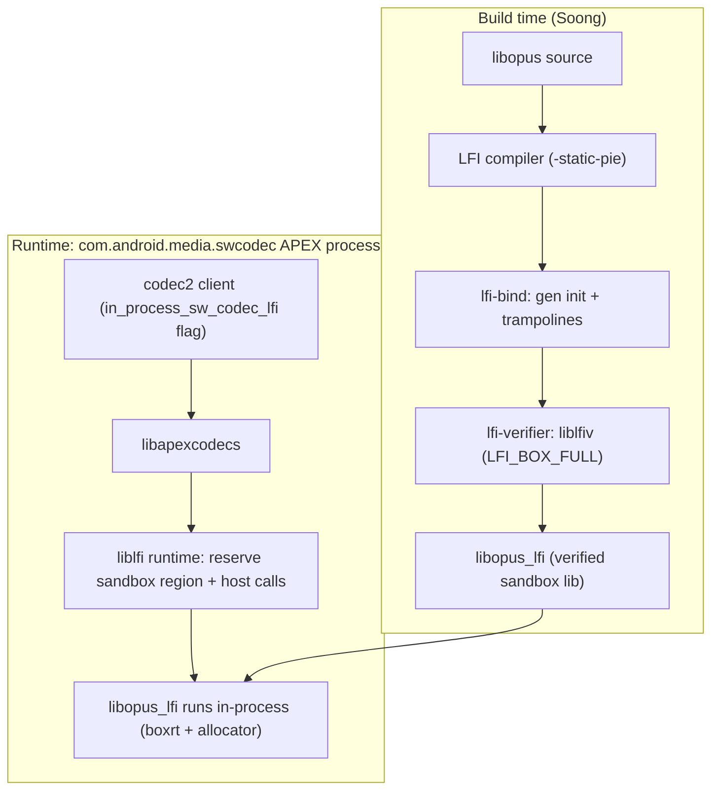

### 值得注意的集成

- **RKP 模块**（`packages/modules/RemoteKeyProvisioning`，`com.android.rkpd` APEX，55 次提交）：是加固而非新架构。变更包括在服务器省略/返回错误的 provisioning URL 时回退到默认 URL。还包括在重复失败/启动时重置为默认配置。Widevine provisioning 移入请求 POST 正文，并根据型号 + OEMCrypto/crypto 版本门控。该模块还通过 `UnverifiedDeviceInfo` 上报设备重置，并支持更新后的 `requestSignedCertificates` 服务器 API 和 Sigma。
- **Weaver 预热/超时**标志（`android.security.enable_weaver_warmup`、`enable_weaver_get_timeout`、`frameworks/base/core/java/android/security/flags.aconfig`）被 `LockSettingsService` 和 keyguard/bouncer UI 消费，以便在凭证提示之前预热 Weaver TA。这降低了新节流路径的解锁延迟。框架标志与 Weaver v3（`hardware/interfaces/weaver/aidl/android/hardware/weaver/IWeaver.aidl`）中新的 HAL 级 `IWeaver.warmUp()` 提示配对。该提示让安全元件在即将发生的读/写之前转换到就绪状态。
- **HPKE JCA SPI**（`HpkeSpi`）。混合公钥加密的一个公共服务提供商接口落地于 `libcore/luni/src/main/java/android/crypto/hpke/HpkeSpi.java`。Conscrypt 注册桥接到它的 `ConscryptHpke.<suite>` 条目（`external/conscrypt/.../AndroidHpkeSpi.java`）并路由到 BoringSSL。这通过标准的 JCA 提供商机制暴露 HPKE。
- **通过内核 ioctl 实现硬件包装的存储密钥。** 元数据加密获得一种新的包装密钥格式。`system/vold/MetadataCrypt.cpp` 在原始 `wrappedkey_v0` fstab 标志旁边解析 `wrappedkey`。一个 `KeyType` 枚举（`kRaw`/`kHwWrappedV0`/`kHwWrapped`，`system/extras/libfscrypt/include/fscrypt/fscrypt.h`）驱动 `prepareKeyForUse()`。因此，硬件包装的密钥材料到达 `dm-default-key` 内联加密引擎时永远不会以明文形式出现。
- **锁屏锁定 UX。** `LockPatternUtils.getLockoutEndTime(int)`（`frameworks/base/core/java/com/android/internal/widget/LockPatternUtils.java`，由 `ILockSettings.aidl` 支撑）返回被节流的用户何时可以重试，一个新的 `config_lockscreenLockoutShortlink` 字符串在锁定 UI 中显示账户恢复链接。
- **SEPolicy `memfd_class` / `memfd_file`。** 当内核启用 `memfd_class` 策略能力时，`memfd_create()` 描述符用新的 `memfd_file` SELinux 类（`system/sepolicy/private/security_classes`）标记，而不是通用的 `file`。Android 17 策略在其 allow 规则（`domain.te`、`app.te`）中命名了 `memfd_file`。因此，设备必须启用该能力以匹配所发布策略。
- **PCC / Private Compute Core** 在 sepolicy 中获得 keystore 访问权限（“Allow keystore operations from within PCC”）。
- **API 37 的按应用 Keystore 密钥上限。** `keystore2` 限制单个 UID 可持有的密钥数量。一个 `DEFAULT_PER_UID_KEY_LIMIT = 200_000` 的回退适用于所有应用。更严格的 `API_37_PER_UID_KEY_LIMIT = 50_000` 适用于面向 Android 17 的应用（`system/security/keystore2/src/security_level.rs:79`/82）。强制执行由 `limit_keys_per_uid` aconfig 标志门控（`security_level.rs:563`，在第 584 行检查）；按 UID 的计数通过 `KEYS_PER_UID_MAX_UIDS`/`KEYS_PER_UID_MIN_KEY_COUNT`（`maintenance.rs:436`）为诊断而暴露。参见第 40 章第 40.10.10 节。

## D.10 UI 框架

在 Android 16 和 Android 17 发布分支之间，UI 框架仓库在三个领域出现了其最大的变动。第一是桌面窗口路径（Launcher3，1978 次提交）。第二是图形栈（ANGLE 被提升为默认 GLES 驱动，1335 次提交）。第三是共享的 SystemUI/主题化库。

### 新模块

`frameworks/libs/systemui` 获得了一个独立的 `dynamiccolors` Android 库（`frameworks/libs/systemui/dynamiccolors/Android.bp`）。该库携带浅色和深色 Material 颜色资源（`res/values/colors.xml`、`res/values-night/colors.xml`）。因此，动态颜色调色板无需整个 Monet 栈即可被消费。

Launcher3 的 recents/overview 现在构建为一个*窗口化* surface，而不是一个完整的 activity。新的 `com.android.quickstep.window` 包（`quickstep/src/com/android/quickstep/window/RecentsWindowManager.kt`、`RecentsWindowContext.kt`、`RecentsWindowRootView.kt`、`RecentsWindowSwipeHandler.java`、`RecentsWindowTracker.kt`）在 `WindowlessWindowManager` / `SurfaceControlViewHost` 内承载 Overview，由 `RecentsWindowFlags` 门控。因此，Overview 可以在一个显示器上与自由形式桌面窗口共存。

### 架构变更

**按显示器的任务栏。** 任务栏状态不再是一个单一的全局量；它通过 `DisplayModel<PerDisplayTaskbarResource>`（`quickstep/src/com/android/quickstep/DisplayModel.kt`，由 `SparseArray` 和 `PerDisplayRepository` 支撑）按显示器建键。`TaskbarManagerImpl`（`quickstep/src/com/android/launcher3/taskbar/TaskbarManagerImpl.java`）持有一个 `mPrimaryDisplayId` 加一个 `mResources` `DisplayModel`，并按显示器创建/重建一个 `TaskbarActivityContext`（`getTaskbarForDisplay`、`recreateTaskbarForDisplay`）。每个 `PerDisplayTaskbarResource` 拥有自己的窗口上下文、配置变更回调和广播接收器，从而在桌面模式下的外部/连接显示器上启用独立的任务栏。

**Launcher 中的桌面窗口。** `TaskbarDesktopModeController`（`quickstep/src/com/android/launcher3/taskbar/TaskbarDesktopModeController.kt`）监听 `DesktopVisibilityController` 并暴露显示器作用域的查询（`isInDesktopMode(displayId)`）。`TaskbarRecentAppsController.kt` 按模式切换任务栏的应用行：全屏显示最近任务，桌面模式把当前*运行中*的任务显示为 `GroupTask`。桌面应用启动通过新 `com.android.launcher3.desktop` 包中的专用远程过渡路由（`DesktopAppLaunchTransitionManager.kt` 及同组文件）。桌面模式通过 `DesktopStateProvider.kt` 解析，现在由平台的 `android.window.DesktopExperienceFlags` 机制门控，而不是临时的 Launcher 标志。

#### Launcher3 桌面窗口接口面所有权

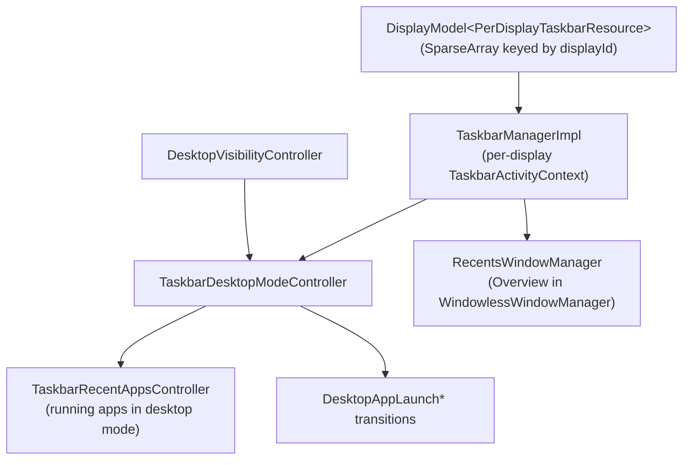

**多种子 Material 配色方案。** `ColorScheme`（`frameworks/libs/systemui/monet/src/com/android/systemui/monet/ColorScheme.java`）现在接受一个种子颜色列表。该变更添加了一个 `private final List<Integer> mSeeds` 字段、一个 `ColorScheme(List<Integer> seeds, boolean isDark, ...)` 构造函数和一个 `getSeeds()` 访问器。因此，一张壁纸可以驱动多个调色板，而不是一个主导种子。

### 值得注意的集成

**ANGLE 作为默认 GLES 驱动。** Android 17 在每个基础系统镜像中附带 ANGLE（基于 Vulkan 的 GLES）驱动：`base_system.mk` 无条件地把 `libEGL_angle`、`libGLESv1_CM_angle` 和 `libGLESv2_angle` 添加到 `PRODUCT_PACKAGES`（`build/make/target/product/base_system.mk:493`）。

一个产品可以通过继承 `angle_default.mk` 让 ANGLE 成为*默认* GLES 实现，该文件通过 `PRODUCT_SYSTEM_EXT_PROPERTIES` 设置 `persist.graphics.egl=angle`。设置该属性后，平台的 EGL 加载器会把 `libEGL`/`libGLESv2` 解析到 ANGLE，而不是厂商 GL 驱动。因此，每个 GLES 应用都通过 ANGLE 的翻译器运行在 Vulkan 上。这是一个经过一致性测试的、不依赖驱动的前端。（1335 次 ANGLE 提交是一次上游刷新；只有上述构建时的集成是平台可见的。）

**SurfaceFlinger RenderEngine 迁移到 Vulkan/Graphite。** 同一 Vulkan 融合的合成器一侧。

`RenderEngine` 通过 `frameworks/native/services/surfaceflinger/surfaceflinger_flags*.aconfig` 中的标志阶梯脱离 GL 前进。`vulkan_renderengine`（“Use Vulkan backend in RenderEngine prior to switching to Graphite”）选择 `GaneshVkRenderEngine`。`graphite_renderengine` / `force_compile_graphite_renderengine` 加上分阶段的 `graphite_renderengine_preview_rollout`、`graphite_renderengine_preview2_rollout`（17 中新增）和 `graphite_renderengine_desktop_rollout` 标志启用 Skia 的**仅 Vulkan** `GraphiteVkRenderEngine`。每个 Graphite 标志都由设备特定的 `debug.renderengine.graphite*_optin` 系统属性门控。

17 中新增的支撑机制包括流水线预编译/预热可观测性（`skia/compat/PipelineCallbackHandler.{h,cpp}`、`Base64.{h,cpp}`）。还包括一个按上下文的 `CacheManagementPolicy` 枚举（`SkiaRenderEngine.h`），它阻止在如今频繁的受保护/非受保护上下文切换中过早清除 GPU 资源。Ganesh（GL/Vulkan）仍是默认；Graphite 按设备推出。完整讲解见第 13 章（第 13.9.2 和 13.43 节）。

**壁纸/主题化 UI 中的主题服务。** WallpaperPicker2 现在通过平台主题服务路由颜色叠加的应用，由框架标志 `android.server.Flags.enableThemeService` 门控（`packages/apps/WallpaperPicker2/src/com/android/wallpaper/config/BaseFlags.kt`，`isThemeServiceEnabled()`）。它还包括壁纸轮盘中的桌面外形规格工作，以及主屏的命名自定义图标主题。

## D.11 系统应用

通往 Android 17 平台功能的前门落在两个应用中：**设置**（2145 次提交，第二大的应用增量）和 **DocumentsUI**（667 次提交）。设置获得了新功能仪表盘（监督、桌面体验），并继续进行大规模的偏好设置框架迁移。DocumentsUI 获得了重新设计的文件信息体验、搜索重建，以及桌面/大屏打磨。

### 新模块

**设置：监督仪表盘。** 17 中最重要的新设置接口面是家长监督区域，`src/com/android/settings/supervision/` 下的一个新包（首次提交 2025-01-21）。它构建在平台 `android.app.supervision.SupervisionManager` 和新 `ROLE_SUPERVISION` 角色之上。落地页 `SupervisionDashboardScreen.kt` 暴露一个主开关、一个动态构建的功能列表和一个 PIN 管理入口。子区域：

- `webcontentfilters/`——Safe Search / Safe Sites 开关，加上按应用的浏览器/搜索过滤屏幕。
- `appstorefilters/`——应用商店内容过滤（`SupervisionAppStoreFiltersScreen.kt`）。
- `credentialmanagement/`——监督 PIN 的设置/更改/删除和恢复（`SupervisionPinManagementScreen.kt`、`SupervisionPinRecoveryActivity.kt`）。
- `ipc/`——一个 `SupervisionMessengerClient` 加请求/响应数据类，让一个监督客户端应用能把偏好和受监督应用列表注入仪表盘。

设置/拆除使用专用 activity（`SetupSupervisionActivity.kt`、`EnableSupervisionActivity.kt`、`DisableSupervisionActivity.kt`），由 `android.app.supervision.flags.Flags` 门控（例如 `enableSupervisionSettingsUiUpdates`）。

**设置：桌面体验开发者开关。** 一个新的开发者选项包 `src/com/android/settings/development/desktopexperience/`（首次提交 2025-02-13）呈现桌面窗口工作。它包含 `DesktopExperiencePreferenceController.java`（主 `override_desktop_experience_features` 开关，由 `Settings.Global.DEVELOPMENT_OVERRIDE_DESKTOP_EXPERIENCE_FEATURES` 和 `android.window.DesktopModeFlags` 支撑），外加 `DesktopModePreferenceController`、`DesktopModeSecondaryDisplayPreferenceController`、`FreeformWindowsPreferenceController`。该包是连接显示器 / 桌面模式的前门。

### 架构变更

**设置：继续 Catalyst 偏好屏幕迁移。** 屏幕日益成为带 `@ProvidePreferenceScreen` 注解的 Kotlin 类，实现 `settingslib.metadata` 接口（`PreferenceScreenMixin`、`PreferenceAvailabilityProvider`、`PreferenceLifecycleProvider`），而不是 XML + `PreferenceController` 配对。自 16 分支以来添加了约 217 个新的 `*Screen.kt` 文件。约 233 个文件现在引用 `@ProvidePreferenceScreen`。框架还提供 App Functions 元数据，因此每个迁移后的屏幕都兼作面向设备端 agent 的机器可读接口面。

**DocumentsUI：功能门控集中在 `FlagUtils` 中。** 几乎所有行为变更都通过一个单独的 `src/com/android/documentsui/util/FlagUtils.kt`（本周期添加）门控。该文件集中了约 24 个带开发者覆盖的 aconfig 标志。它是变更内容最清晰的地图：`isUseMaterial3FlagEnabled`、`isSearchV2Enabled`、`isGetInfoDialogEnabled`、`isUsePeekPreviewFlagEnabled`、`isDesktopFileHandlingFlagEnabled`、`isDesktopUxPhase2FlagEnabled`、`isSingleClickToSelectEnabled`、`isTrashFlowEnabled`、`isUseApprovedDocumentHandlerEnabled`、`isMovingContentIntoPrivateSpaceEnabled`、`isUseLocalSearchProviderEnabled`，等等。几个门控与 `isUseMaterial3FlagEnabled()` 做 AND，因此 Material 3 重新设计是其余部分所依附的总框架。

### 值得注意的集成

**DocumentsUI：“获取信息” / 元数据重新设计。** 一个新的 `src/com/android/documentsui/files/getinfo/` 包（`GetInfoDialogFragment.kt`、`GetInfoViewModel.kt`、`MetadataUtils.kt`）和一个 `peek/` 包（`PeekFragment.kt`、`PeekViewManager.kt`、`Metadata*SheetController.kt`）添加了一个丰富的文件详情对话框和 peek 预览。它们由 `isGetInfoDialogEnabled` / `isUsePeekPreviewFlagEnabled` 标志门控。一个响应式摘要列由 `dirlist/SummaryProviderManager.kt` 和 `SummaryConsentFragment.kt` 驱动。

**DocumentsUI：Search V2。** `queries/` 下重建的搜索栈（`SearchOptionsController.kt`、`SearchOptionsState.kt`、`FileTypeOption.kt`、`LastModifiedOption.kt`、`SearchLocationOption.kt`）加上新的加载器（`loaders/SearchLoader.kt`、`loaders/QueryOptions.kt`）提供按类型/日期/位置的可过滤搜索。它们还提供一个可选的本地搜索提供者（`isUseLocalSearchProviderEnabled`）。

**DocumentsUI：桌面 / 大屏打磨。** 侧边栏的 Kotlin 重写为一个 RecyclerView 导航栏（`sidebar/RecyclerRootsAdapter.kt`、`RootsRecyclerViewHandler.kt`），以及一个 Kotlin 面包屑栈（`breadcrumbs/Breadcrumb{Controller,Model,View}.kt`）支持桌面 UX 第 2 阶段。单点选择和来自其他应用的拖拽随之而来。

**DocumentsUI：批准的文档处理器和 private space。** 一个新的 `approveddochandlers/` 包（`ApprovedDocHandlers.kt`、`ApprovedDocMenuController.kt`，由 `isUseApprovedDocumentHandlerEnabled` 门控）管理哪些应用可以通过基于签名的信任打开文档。选择器还获得“移动内容到 Private Space”（`isMovingContentIntoPrivateSpaceEnabled`）和一个新的 `picker/TrampolineActivity.kt` / `PickFilesFragment.kt`。

**联系人选择器隐私 API。** 一个新的与应用无关的联系人选择器（`ACTION_PICK_CONTACTS`，应用 `packages/apps/ContactsPicker`，提供者 `packages/providers/ContactsProvider/.../picker/ContactsPickerSessionProvider.java`）返回一个短命会话 URI。该 URI 仅授予对用户所选行的临时读取访问权限。因此，即使一个应用不持有 `READ_CONTACTS` 权限，也可以请求单个联系人。

**SettingsIntelligence 应用。** 设置搜索迁移到一个单独的 `packages/apps/SettingsIntelligence` APK（`com.android.settings.intelligence`），它拥有 FTS 搜索索引（`search_index.db`）和建议排序。它索引每一个 `SearchIndexablesProvider`，而不仅仅是设置应用。

**位置隐私指示器。** SystemUI 在 `android.location.flags.location_indicators_enabled` 之后把位置指示器重做为一个独立的隐私芯片（`frameworks/base/location/java/android/location/flags/location.aconfig`，由 `frameworks/base/packages/SystemUI/.../privacy/` 消费）。该芯片具有更长的保持时间和可选的轮廓样式，与相机/麦克风芯片分开。

**EyeDropper 应用。** 一个新的 `packages/apps/EyeDropper`（`com.android.eyedropper`，由 `enable_eye_dropper_api` 门控）用用户点击的像素的 ARGB 值响应 `OPEN_EYE_DROPPER` intent。这提供了一个任何应用都可以调用的系统颜色选择器。

## D.12 AI 与设备

Android 17 把设备端 AI 更深地推入平台。一个新的 NPU Manager 主线模块仲裁对神经加速器的访问。一个新的 PersonalContext 系统应用构建设备端个人上下文接口面。Khronos OpenXR SDK 头文件的首次供应商化与一个标志门控的 Android XR API 接口面（覆盖头戴设备和 MicroXR 眼镜）同时到来。CHRE 为常开感知增加了一个高吞吐量数据流子系统。

### 新项目

`packages/modules/NpuManager` 是一个新的已启动 APEX（`com.android.npumanager`，`min_sdk_version: 36`），在 17 中发布自己的模块 SDK（`apex/Android.bp` 定义 `npumanager-module-sdk`）。它由 `RELEASE_NPUMANAGER_MODULE` 发布标志和 `npumanager_enabled` aconfig 标志门控（`machine_learning` 命名空间，`flags/npumanager_flags.aconfig`）。它同时贡献一个 bootclasspath 片段（`framework-npumanager`）和一个 systemserver 片段（`service-npumanager`）。详情见下文“新模块”。

`packages/apps/PersonalContext`（`com.android.personalcontext`）是一个新的特权、平台签名的 `product_specific` 系统应用（`Android.bp` `PersonalContext_defaults`：`privileged: true`、`certificate: "platform"`），构建一个设备端个人上下文层，为 assistant 风格的接口面提供输入。它的 `AndroidManifest.xml` 声明 `ContextUnderstanderService` 实现（`src/com/android/personalcontext/understander/` 下的 `ChatUnderstanderService`、`NotificationUnderstanderService`、`ContextMenuUnderstanderService`），绑定在 `android.service.personalcontext.UnderstanderService` 之下，并由 `BIND_CONTEXT_COMPONENT_SERVICE` 保护。

它的工作组件标记为 `android:privateComputeCore`，该应用持有新的 `PERSONAL_CONTEXT_*` 权限（`PUBLISH_INSIGHTS`、`READ_SETTINGS`、`RECEIVE_HINTS`）外加 `USE_ON_DEVICE_INTELLIGENCE`。因此，它在 Private Compute Core 沙箱内运行，并与设备端模型通信而不是与网络通信。源码子包（`memorygeneration/`、`magicrecall/`、`magicactions/`、`appfunctions/`、`aicore/`、AppSearch 支撑的 `storage/appsearch/`）指向一个驱动回忆和“magic action”建议的个人记忆存储。该功能由 `enable_osi` aconfig 主标志门控（`personal_context` 命名空间）。

### 新模块

NpuManager 在相互竞争的应用之间复用设备端神经加速器。框架接口面是 `framework/java/android/npumanager/NpuManager.java` 中带 `@SystemApi`、由 `@FlaggedApi` 门控的 `NpuManager` 类（`Context.NPU_SERVICE`）。应用不能获得原始 NPU 访问权限；相反，它们请求加载模型的许可，服务会在适宜时应答。binder 契约（`framework/java/android/npumanager/INpuManagerService.aidl`）是准入控制加上内存管理：

- `canLoadModel`、`cancelModelLoad`、`notifyModelLoaded`、`notifyModelUnloaded`、`setPolicy`
- `createAllocator(INpuAllocatorCallback)`，返回一个 `INpuAllocator`。

system-server 一侧（`service/java/com/android/server/npumanager/`、`NpuManagerService` / `NpuManagerServiceImpl`）在抽象的 `NpuModelLoadingPolicy` 之后实现可插拔的模型加载策略。它们是 `BudgetModelLoadingPolicy`（以 `KEY_MAX_BUDGET` 为键的内存预算仲裁，以及 &lt;1GB / 1-2GB / >2GB 的粗略 `NpuModelSize` 桶）、`TurnTakingModelLoadingPolicy` 和 `StatusQuoModelLoadingPolicy`。一个 `PriorityManager` 支撑所有这些策略。原生缓冲区管理基于 Rust（`service/jni/lib.rs`、`ndk/*.rs`），并暴露一个 C NDK 接口面（`ndk/include/android/npumanager/buffer.h`），`ANpuBuffer` 的优先级范围为 0-1000。

该模块与一个新的厂商 HAL `android.hardware.npu`（`hardware/interfaces/npu/`，AIDL v1）配对。NpuManager 通过该 HAL（`IScheduling`、`ISchedulingCallback`、`WorkInfo`、`StartReason`、`EndReason`、`SchedulingConfig`）把按应用的优先级告知 NPU，并接收工作回调。

#### NpuManager 准入控制流程

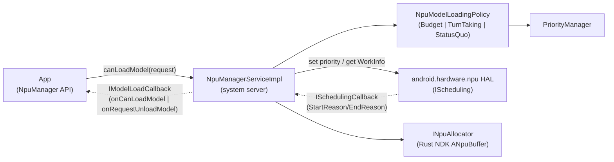

### 架构变更

CHRE（`system/chre`，536 次提交）获得了一个新的**数据流**子系统，用于单个源与多个汇（nanoapp 和其他端点）之间的高吞吐量流式传输。它使用共享内存区域来尽量减少拷贝。公共 API 是 `chre_api/include/chre_api/chre/data_flow.h`（事件 `CHRE_EVENT_DATA_FLOW_CREATED`、`_SINK_CREATED`、`_ALERT`、`_SINK_CONFIGURE_DONE`；调用如 `chreDataFlowSinkEnable()`）。

流以源 message-hub ID + data-flow ID 为键。这与端点/message-hub 模型一致。参考实现位于 `system/chre/data_flow/`（共享区域核心 + 主机侧管理器）。一个新的 `WakeupStatsManager` 集中了主机唤醒归因。这些共同面向低功耗、常开感知和 ML 卸载，而无需唤醒应用处理器。

`packages/modules/OnDevicePersonalization` 在 17 中被重新打包/移动，并保留了其 Private Compute 模型。该模型包含框架 + 系统服务（`framework/`、`systemservice/`）、一个 `pluginlib/` 沙箱，以及一个用于联邦学习/分析的 `federatedcompute/` 子树，它们把个性化信号保留在设备端。

### 值得注意的集成

**Android XR：仅 API 脚手架。** `external/openxr-sdk`（Khronos OpenXR SDK，`release-1.1.50`）被新供应商化为只读。它的 `Android.bp` 在 `include/` 之上构建一个单独的 `cc_library_headers { name: "openxr_headers" }`。这些是 OpenXR 头文件，没有加载器，也没有树内消费者。`frameworks/base/core/api/current.txt` 中匹配的框架接口面同样处于惰性状态。

它包括 `FEATURE_XR_API_OPENXR`（“android.software.xr.api.openxr”）和 `FEATURE_XR_API_SPATIAL`，以及 `FEATURE_XR_INPUT_*` 字符串（控制器、眼动追踪、手部追踪）。它还包括 `XrWindowProperties` 及其全空间与主空间 activity 启动模式，以及 `DisplayManager.DISPLAY_CATEGORY_XR_PROJECTED`。它进一步包括危险的全身/环境追踪权限外加 AppOps（`EYE_TRACKING_COARSE/FINE`、`FACE_TRACKING`、`HAND_TRACKING`、`HEAD_TRACKING`、`SCENE_UNDERSTANDING_COARSE/FINE`）。所有这些均由 `android.xr.xr_manifest_entries` aconfig 标志（`core/java/android/content/pm/xr.aconfig`）以 `@FlaggedApi` 门控。该标志默认禁用。

其框架是明确的。运行时、合成器、OpenXR 加载器以及场景/空间 SDK 不在 AOSP 中。厂商运行时加上树外的 Jetpack XR SDK 提供它们。上游唯一的行为 XR 代码是一个头戴设备侧录制器的 statsd atom（`frameworks/proto_logging/stats/atoms/xr/recorder/`，`XrRecorderSessionStatusReported`）。

**MicroXR：XR 眼镜外设类。** 与头戴设备接口面不同，轻量级可穿戴 XR 眼镜使用一个单独的标志：`com.android.microxr` 的 `xr_glasses_feature`（`frameworks/base/core/java/android/content/pm/glasses.aconfig`，同样默认关闭）。它门控 `FEATURE_XR_PERIPHERAL`（`android.hardware.type.xr_peripheral`），这是一个设备类标记（与 `FEATURE_PC` / `FEATURE_WATCH` 同级）。`PackageManager` 的 javadoc 把 XR 外设定义为一个可穿戴的全栈 Android 设备，没有用户可安装的应用，并且可能需要一个配套设备来进行交互。

与惰性的头戴设备功能不同，这个标记实际上在树内被读取。WiFi（`WifiGlobals`）、蓝牙音频（`Util.isXrDevice()`）和 MediaProvider 都根据 `hasSystemFeature(FEATURE_XR_PERIPHERAL)` 分支，把眼镜视为一个受限设备类。其眼镜遥测位于 `frameworks/proto_logging/stats/atoms/microxr/`（`MicroXrDonDoffStateChanged` 表示佩戴/摘下状态，`MicroXrPhotoCaptured` / `MicroXrVideoCaptured` 表示按钮触发与语音触发的捕获，`MicroXrMcuCrashOccurred` 表示一个独立的 MCU）。AOSP 中没有发布 MicroXR 模块、服务、HAL 或设备目标。

Health Connect（`packages/modules/HealthFitness`，689 次提交）主要是渐进式的 API/UX 工作。变更包括新的批量 `grantHealthPermissions` / `revokeHealthPermissions` API、从步数数据推导距离和卡路里，以及 Changelogs API 中减少的转换层。它们还包括跨设备“匹配” / 设备数据提供者流程的持续构建（`service/.../onboarding/matchmaking/`、`apk/src/.../controller/matchmaking/`、`.../newDevices/DeviceDataProvider*`）。

**CompanionDeviceManager：设备信任和电源豁免处理器。** CDM 服务在 17 中增加了两个新的处理器包，都位于 `frameworks/base/services/companion/java/com/android/server/companion/` 下。`devicetrust/`（`TrustedDeviceProcessor`、`TrustedDeviceStore`）用于可信设备密钥交换。`powerexemption/`（`CompanionExemptionProcessor`、`CompanionExemptionStore`）用于电源和自动撤销豁免。现有的 `actionrequest/` 处理器（自 16 起存在）获得了额外的结果常量。`AssociationRequest` 中的 `DEVICE_PROFILE_FITNESS_TRACKER` / `DEVICE_PROFILE_MEDICAL` 关联 profile（`frameworks/base/core/java/android/companion/AssociationRequest.java`，标志 `FLAG_BAND_DEVICE_PROFILE` / `FLAG_ENABLE_MEDICAL_PROFILE`）已在 Android 16 中发布，因此它们不是 16 到 17 的新增。

**Handoff（任务连续性）：跨设备 activity 连续性。** Android 17 在 CDM 传输之上添加了面向用户的 Handoff 功能。一个 activity 通过 `Activity.setHandoffEnabled()` 选择加入，并通过 `onHandoffActivityDataRequested()` 提供可恢复状态（`frameworks/base/core/java/android/app/Activity.java:7789`/10240）。该方法返回一个 `HandoffActivityData`。这是一个 `ComponentName` 加一个额外信息的 `PersistableBundle` 加一个可选的 web `fallbackUri`（`HandoffActivityData.java:48`）。

一个新的 `TaskContinuityManager` 系统服务（`@SystemService(Context.TASK_CONTINUITY_SERVICE)`）及其 `RemoteTask` 描述符让启动器能够呈现来自配对设备的任务。载荷作为 `MESSAGE_ONEWAY_TASK_CONTINUITY`（`CompanionDeviceManager.java:361`）在两台真实的、用户拥有的设备之间的安全 CDM 通道上传输。由 `task_continuity` aconfig 标志门控（`frameworks/base/core/java/android/companion/flags.aconfig:69`，命名空间 `companion`）/ `CompanionDeviceManager.FLAG_TASK_CONTINUITY`。参见第 52 章第 52.3.9-52.3.11 节。

## D.13 基础设施

Android 17 的构建和虚拟化管道在两条战线上推进。Soong 构建系统增加了一个一等的机器可读“API/合规”数据库，并继续迁离 Kati 时代的 Make 逻辑。AVF（Android 虚拟化框架）把受保护虚拟机变成了一个多租户、支持 Trusty 的平台。一个新的顶级 `tools/mainline` 仓库承载开源的主线列车（mainline-train）构建工具。

### 新项目

**`tools/mainline`（mainline-train 构建工具）。** Android 17 新增了一个用于组装主线“列车”（作为整体发布的 APEX/APK 模块捆绑包）的顶级仓库。它的 `train_build/` 目录是一组 Python 主机二进制和库（`tools/mainline/train_build/Android.bp`），实现把按模块的构建产物转化为一个签名的、有版本的列车的步骤：

- `trim_action.py` 把一个捆绑的 APEX 裁剪到目标所需的架构，把模块 ABI 映射到 DCLA 架构集（`DCLA_ARCH_BY_MODULE_ARCH`）。
- `dcla_build_action.py` 构建共享的“DCLA”库 APEX（`com.google.mainline.primary.libs` / `...go.primary.libs`），它去重跨模块的常见原生库（`BIG_ANDROID_DCLA`/`GO_DCLA`）。
- `versioning_action.py` 提升模块版本代码；`pack_action.py` 打包结果。
- `generic_train_build_action.py` 和 `primary_train_build_action.py` 是编排器。它们把每个列车建模为一个 `TrainBuildSpec`，并按 `TrainType` 分发（TELEMETRY、ADSERVICES、NPU、NONUPDATABLE、TIMEZONE、PRELOAD、Go 变体）。

大部分遗留的模拟数据和专有脚本移到了 `vendor/google/train_build`。AOSP 中剩下的是可复用的 trim/DCLA/版本化/打包机制，以及主机单元测试。

### 新模块

**`cipd_package`（`build/soong/android/cipd/cipd_package.go`）。** 一个新的 Soong 模块类型在构建时从 CIPD（Chrome 基础设施包部署）获取一个预构建。它发布一个 `CipdPackageInfoProvider`，携带完整的包名和固定版本。一个有界的 `cipdPool`（深度 8）限制并发获取。许多 `prebuilt_*` 模块类型现在记录它们的 CIPD 来源，使其流入合规元数据。

**`android_filesystem_prebuilt`（`build/soong/filesystem/prebuilt.go`）。** 一个通用的预构建镜像模块把一个现有的系统镜像文件（`Src`）包装进常规的 `filesystem` 机制。因此，一个厂商提供的分区镜像像 Soong 构建的镜像一样参与打包/AVB。

**`trusty_vm_signing_tool`（`packages/modules/Virtualization/guest/trusty/tools/Android.bp`）。** 一个新的 Rust 主机工具，为 pvmfw 对 Trusty pVM 载荷签名。

### 架构变更

**Soong API / 合规数据库（`soong_api`）。** 构建系统最大的变更是一个新的单例 `soong_api_db`（`build/soong/soong_api/soong_api.go`）。它遍历每个模块代理并发出按模块的 `SoongApiModuleRecord`（身份/类型、安装/构建文件、许可证元数据、`trendy_team_id`、Java/CC/Rust 依赖边、CIPD 来源）。该单例导出 `soong_api.json`/`.zip` 和 `out/soong/soong_api/<product>/` 下的 SQLite `soong_api.db`。它接替了较旧的 `metadata.db`/`metadata_db_loader` 家族，支撑 SBOM/来源生成，取代了被移除的原生 gRPC 查询路径。

下图展示了模块提供者如何为下游 SBOM/合规工具所消费的数据库提供输入。

Soong API 数据库采集与导出流水线

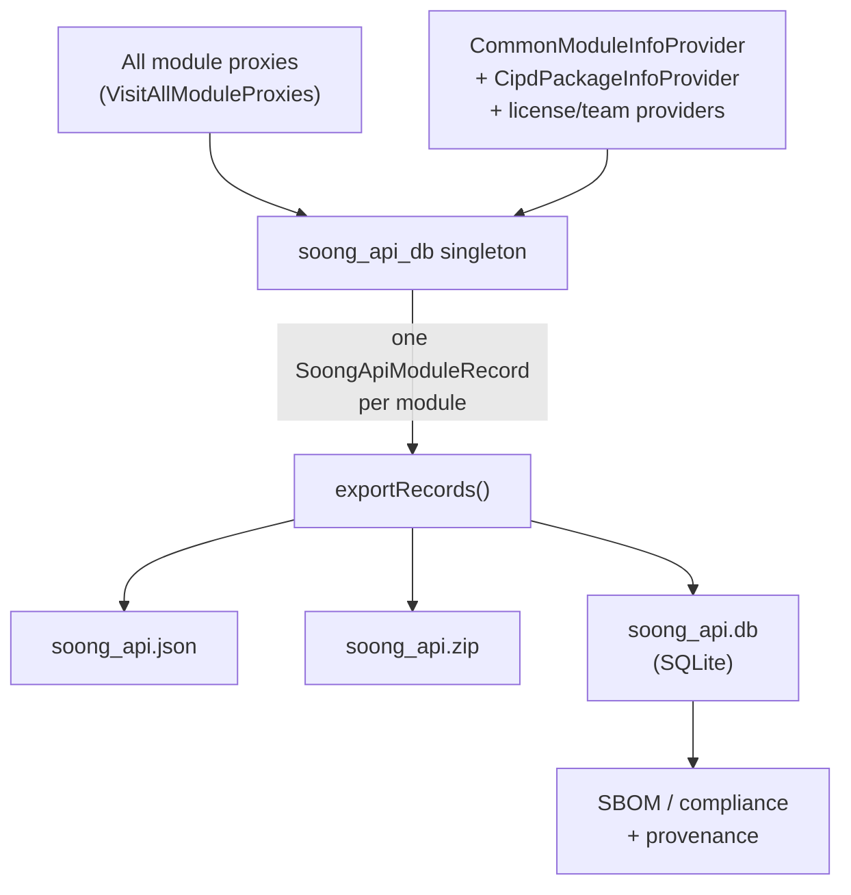

**部分分析和按需变体。** Soong 增加了一个可选的 `SOONG_PARTIAL_ANALYSIS` 环境变量（`build/soong/ui/build/config.go`），把分析图限制到一个命名的目标集及其传递闭包。Blueprint 增加了一个在部分分析之前运行的 `PrePartial()` 修改器组（`build/blueprint/context.go`），以及一个面向尚未进入构建图的模块组的“被动” `moduleGroup` 标志。

变体系统转向了“按需变体”（VoD）。Blueprint 不再急切地拆分每个 os/arch/image 变体。相反，它通过 `createVariantOnDemand`/`searchOnDemandVariant` 惰性地创建和修改依赖变体。几个急切拆分路径（测试模块类型、`PRODUCT_HOST_PACKAGES`、`vndk_prebuilt_library`）在过渡期间为正确性而保留。

**发布配置成熟。** Make 时代的发布配置逻辑现在完全位于 Soong 之下（`build/soong/cmd/release_config/`），命名受到强制：映射必须命名为 `release_config_map.textproto`（`.../release_config_lib/release_configs.go`）。build/make 的 871 次新增对比 154 次删除的提交主要是构建 ID 提升加上移除遗留产品条目，正在收尾 Kati 路径。

**Android Canary 发布通道。** 在构建变更的同时，发布*流程*获得了一个持续的 Canary 通道。从 trunk-stable 树切出的滚动构建被持续发布给测试者。这取代了周期性的开发者预览版本。`CANARY` 代号映射到 API 级别 10000（`build/soong/android/api_levels.go`）；源码构建仍使用 `trunk_staging` 发布配置。

### 值得注意的集成

**AVF 多租户。** 从 Android 26Q2 起，单个受保护虚拟机可以承载多个相互隔离的租户（`packages/modules/Virtualization/docs/multitenancy.md`）。VM 所有者发布一个签名的 `TenancyConfig`（APK 内的一个 JSON 载荷配置，通过 `VirtualMachineConfig#setPayloadConfigPath` 设置）。它声明每个租户的 `package`、一个 `[10000, 65534]` 内的唯一 `uid`、一个 `min_version`，以及一个按构建口味的签名哈希的 `expected_authority` 映射。

virtmgr 根据 OS 签名状态验证每个租户的权限，并在 pVM 的 DICE 证书中反映它。按租户的 cgroup 和 SELinux 域隔离租户。不匹配的载荷被丢弃。

**Trusty 作为 pVM。** Trusty OS 现在作为 AVF 管理的受保护虚拟机运行（`packages/modules/Virtualization/guest/trusty/docs/trusty_vm.md`）。Trusty 内核为宿主/VM IPC 增加了基于 PCI 的 virtio-vsock。它还增加了基于 virtio-msg 之上的 virtio-vsock、经由 FF-A 通往安全世界 TEE 的主机不透明通道。它还增加了对 crosvm 生成的设备树（包括 pvmfw DICE 区域）的解析、PSCI CPU 开/关，以及 ARM TRNG 熵源。载荷被构建、签名（通过新的 `trusty_vm_signing_tool`），并通过 Soong genrule 打包给 pvmfw，在 `.../guest/trusty/` 下生成 `security_vm`/`test_vm` 镜像。

**Linux/Terminal VM 客户机内 agent 和 pVM TEE 服务。** AVF 添加了 `linux_vm_manager`，一个面向 Linux/Terminal VM 的客户机内 Rust agent（`packages/modules/Virtualization/guest/linux_vm_manager/`）。该 agent 通过 vsock 回连宿主（`src/main.rs`）。它注册一个 `IGuestAgent` binder，其处理器（例如 `shutdownAsync`）位于 `src/guest_agent.rs`。libavf LLNDK 还暴露 `AVirtualMachineRawConfig_addTeeService`（`libs/libavf/include/android/virtualization.h`，`introduced=37`），它让受保护虚拟机声明其可以访问的 TrustZone/TEE 服务。

## D.14 设备支持

Android 17 标志性的设备支持变更是**软件定义车辆（SDV）**平台。SDV 不是单个仓库，而是作为一个新的顶级树到来（`system/software_defined_vehicle/`）。它还添加了一个参考设备（`device/google/sdv`）、一个新的 HAL 接口包（`hardware/sdv/interfaces`）和一个汽车显示安全服务（`packages/services/display_safety`）。模型是一个*无头*的车辆 Android OS。SDV“Core”在自己的虚拟机中运行车辆服务，没有 UI。它通过 SOME/IP 与一个或多个 AAOS 车载信息娱乐（IVI）虚拟机和非 Android 汽车 ECU 通信。

### 新项目

`manifest-snapshots/_compare/android-16.0.0_r4-to-android17-release/added-removed.txt` 列出了 84 个新增项目；SDV 集群是主体：

- **16 个新的 `system/software_defined_vehicle/*` 仓库**：`middleware`、`orchestration`、`some_ip`、`vsidl`、`telemetry`、`update_manager`、`sdv_gateway`、`lifecycle_management`、`health_monitor`、`service_bundles_registry`、`automotive_services`、`platform`、`common`、`samples`、`tools`、`vpm`。
- **`device/google/sdv`**（sha `f4bfa128`，组 `swcar, pdk`）——带有全部 SDV lunch 目标的参考设备。
- **`device/google/sdv_display_safety`**（sha `0971a467`）——显示安全产品覆盖。
- **`hardware/sdv/interfaces`**——新的 SDV HAL/AIDL 契约包。
- **`packages/services/display_safety`**——汽车显示安全（“HARry”）服务。

`packages/services/Car`（Android Automotive CarService）是一个*移动/扩展*的既有仓库（561 次提交），不是新项目。

### 新模块

按设备的 makefile `device/google/sdv/sdv_core_arm64/sdv_core_arm64.mk` 通过 `SDV_SOMEIP_AGENT_MODULES` / `SDV_DIAGNOSTICS_AGENT_MODULE` / `SDV_VEHICLE_POWER_STATE_MANAGER_MODULE` 变量提供 SOME/IP 栈、诊断和电源状态模块，这些变量由 `sdv_packages_core_services.mk` 消费。从 `device/google/sdv/sdv_core_base/sdv_packages_core_services.mk` 看，一个 SDV Core VM 安装这些 agent 和 APEX：

- **通信栈**（`middleware/`）：`sdv_sd_agent`（服务发现）、`dt_agent`（数据隧道发布/订阅，`com.android.sdv.dt`）、`rpcagent`（`middleware/rpc_agent`）；基于 `wire_format` 和 `transport`（Rust）的共享客户端库 `libsdv_comms`（`middleware/sdv_comms`）。
- **生命周期与编排**：`sdv_lifecycle_agent`、`lifecycle_service_bundle_runner`、`sdv_orchestration_agent`（`com.android.sdv.orchestrator`）、`sdv_service_bundles_registry_agent`——编排器从 `orch_config.textproto` 驱动捆绑包生命周期。
- **VSIDL 工具链**（主机）：`vsidlc`、`vsidl_rc_generator`、`someip_translation_generator`；设备端 `sdv_vsidl_provider_agent`。
- **SOME/IP**：`sdv_someip_stack_agent` + `vsomeip_config.json`（来自按设备的 makefile）、`sdv_someip_broker_agent_comms`。
- **平台/运维**：`sdv_health_monitor`、`sdv_update_manager_agent`、`sdv_diagnostics_agent` 和 `vepsm`（车辆电源状态管理器；二者均来自按设备的 makefile）。

`hardware/sdv/interfaces` 定义稳定的 AIDL 接口面。该接口面有 `ISdvGateway`/`ISdvGatewaySession`（`sdv_gateway/google/sdv/gateway/`）、`IRpcAgent`（`middleware/rpc/`）、`IRegistry`（`service_bundles_registry/`，`aidl_api/` 下的 API v3），以及生命周期 `IService`/`IServiceManager`。它还有车辆电源管理器 AIDL 和特权的服务发现 / 身份 agent。

`packages/services/display_safety` 是一个 Rust workspace（根 `Cargo.toml`），实现 **HARry** Driver-UI 运行时。它有 `framework/`（Impeller 图形、音频、布局、监控）、`reference/`（`harry-app`、`safety-monitor`、ADAS 可视化）和 `service/har-sdv-service`。该服务的 `libhar_sdv_service_bundle` 发布车辆数据，并通过中间件经 gRPC 为 Driver UI 提供服务。

### 架构变更

SDV 栈在 AAOS 之下（及旁边）分层了一个车辆服务织物。新树提供通信中间件和 agent。`device/google/sdv` 把它们组合成 lunch 目标。`hardware/sdv/interfaces` 定义契约。CarService 和 IVI VM 通过网关消费它们。

**Lunch 目标组合**（`device/google/sdv/AndroidProducts.mk`、`README.md`）：OEM 产品继承一个 SDV“base”加一个厂商目标。这些 base 是 `sdv_base`（仅通信栈）和 `sdv_core_base`（完整 SDV Core 服务）。其他 base 是 `sdv_media_base`（Core + 媒体 API）和 `sdv_ivi_base`（一个 AAOS IVI，与其他 VM 上的 SDV 服务通信）。示例目标 `sdv_core_cf`、`sdv_media_cf`、`sdv_ivi_cf`（Cuttlefish）及其 `*_arm64` 对应物启动多个 VM 实例（`cvd_config_sdv_core_instance{1,2,3}.json`）。

**VSIDL → 生成的 Rust。** 服务在 `.vsidl` 服务捆绑包定义以及目录中的 `.proto` 消息 schema 中描述。`vsidlc`（`vsidl/vsidlc`）遍历目录并把 Rust 中间件绑定发射到 `generated_rs/`。`someip_translation_generator` 为标记为 `INTERPRET_AS_BYTES`（静态）或 `DYNAMIC_LIBRARY`（动态）的消息发射 SOME/IP↔proto 转换代码。这是 SDV 中 AIDL 桩生成的对应物。

**车辆服务接口层。** 在一个 VM 内部，通信栈拆分为服务发现、数据隧道（命名的发布/订阅主题）和 RPC（`IRpcAgent`）。跨 VM 和跨 ECU 的流量通过 **SOME/IP** 经由 SOME/IP 栈 agent 和 broker-agent-comms 层传输，以 vsomeip 作为传输。

非 SDV 感知的原生/Java 应用通过 **SDV 网关**（`sdv_gateway/`）到达该织物。网关的 `vhal_proxy`（`libvhal_proxy`）让一个 VHAL 服务调用 `initComms` 并发布车辆属性。它由 `sdv_gateway_config.json`（`/vendor/etc/sdv_gateway_config.json`）门控，该文件按进程 UID 允许 SDV 包名。SDV-RPC 流量运行在专用 VLAN 上（`androidboot.sdv.rpc.interface`，默认 `sdv_rpc`）。

**显示安全。** 在 IVI 一侧，`packages/services/display_safety` 把 HARry Driver-UI 作为 SDV 服务捆绑包（`har-sdv-service`）运行，并带有一个强制执行分心/安全约束的 `safety-monitor`。The window 团队把 ADAS 框架 crate 和 DriverUI SEPolicy 迁入该仓库，并仅为 SDV 构建发布 `com.google.display_safety.har.apex`。

该栈：

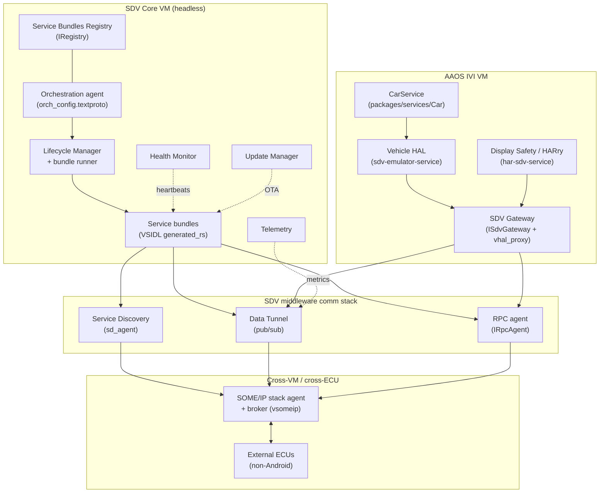

### 值得注意的集成

- **CarService ↔ SDV。** `packages/services/Car`（移动的仓库，561 次提交）获得了 IVI 一侧所需的 Driver-UI 管道：`com.android.car.driverui` privapp 权限和 `ACCESS_LOCAL_NETWORK` 默认授予，外加 SDV linter。IVI lunch 目标专门为 SDV 接入一个 Vehicle HAL：`LOCAL_VHAL_PRODUCT_PACKAGE := android.hardware.automotive.vehicle@V1-sdv-emulator-service`（`device/google/sdv/sdv_ivi_cf/sdv_ivi_cf.mk`）。因此，CarService 与最终由 SDV Core 通过网关提供的车辆属性通信。
- **AIDL 迁移进 `hardware/sdv/interfaces`。** 若干接口集从 `system/` 移入了新的 HAL 包。它们是 SDV 网关接口、服务捆绑包注册表 AIDL、vpm 稳定 AIDL，以及（在一次回滚之后）遥测 AIDL。这让 SDV 硬件契约成为一个有版本的、VINTF 稳定的接口面，独立于 agent 实现。
- **VHAL 代理桥与 OEM/PDK。** `sdv_gateway/vhal_proxy`（`libvhal_proxy`、`config_loader`）让一个未修改的 VHAL 在一个允许名单上的 SDV 包名下加入 SDV 织物。参考设备支持一个自定义 `/oem_ab` 分区（`sdv_core_base/oem_ab/`）用于 OEM 服务捆绑包。Core 目标是可 PDK 构建的（SDV KeyMint 被强制加入，因为 PDK 测试时没有 `system/software_defined_vehicle/` 源码）。
- **安全模型。** VM 级权限是一个 id 为 `com.oem.sdv.authz` 的 APEX（参考 `com.oem.sdv.authz.allow_all.{core,ivi}`）。网关配置还额外按 UID 限制原生客户端。中间件发布 `crypto_rpc` 和 `service_authz` 用于认证 RPC。
- **大屏应用兼容性 RRO 旋钮。** 新的运行时可覆盖配置布尔值调节大屏/折叠屏行为。`config_isCameraCompatSimulateRequestedOrientationTreatmentEnabled`（及横屏变体）通过 `AppCompatCameraSimReqOrientationPolicy`（`frameworks/base/services/core/java/com/android/server/wm/AppCompatConfiguration.java`）驱动相机兼容性黑边。`config_enableSelfKillRecoveryBetweenInternalDisplays`（`frameworks/base/core/res/res/values/config.xml`）让一个在折叠过渡期间自行结束的应用可以被重新启动以保留其会话。

## D.15 实践

实践性的开发/测试工具进展平缓。Cuttlefish（290 次提交）获得了一个新的桌面产品、一个统一的 VKMS 控制器、一个 NPU HAL，以及 AiSeal 接线。Traceur 增加了两个 Perfetto 跟踪类别。

### 新项目

`vsoc_x86_64_only/desktop/` 是一个新的 Cuttlefish 产品，`aosp_cf_x86_64_desktop`（在 `AndroidProducts.mk:40` 中注册），面向 Android 桌面外形规格。它仅支持 HSUM（`PRODUCT_USE_HSUM := true`）、仅 64 位、使用带有 lz4 虚拟-AB 压缩的动态分区。它还附带一个 `desktop_init_dev_config` 服务，在首次启动时选择 APEX/设备配置（`shared/desktop/common.mk`）。该产品默认开启 verity+加密，并启用 Trusty gatekeeper/keymint 以及 `pvmfw-cf`（`vsoc_x86_64_only/desktop/desktop.mk`）。

### 新模块

- `guest/commands/vkms_controller/` 是一个新的客户机侧二进制，用于虚拟内核模式设置（`main.cpp`）。它整合了碎片化的 VKMS 逻辑。因此，主机 CLI 是一个无状态的 `adb shell vkms_controller ...` 代理，测试框架共享一条设置路径。客户机把虚拟硬件（ConfigFS 索引）与 SurfaceFlinger 显示器 ID 关联起来。作为 `vendor` `cc_binary` 发布（`guest/commands/vkms_controller/Android.bp`）。
- NPU 支持：`shared/device.mk:489` 安装 `com.android.hardware.npu.cf` HAL APEX，并把 `android.hardware.npu.xml` 复制为一个厂商特性权限，在虚拟设备上公布新的 NPU HAL 接口面。

### 架构变更

- AiSeal（设备端 AI 封装）现在通过 `shared/aiseal/device_vendor.mk` 接入 Cuttlefish，由 `RELEASE_AISEAL_FRAMEWORK` 门控并可选地依赖 AppSearch。由于 Cuttlefish 没有受保护 VM 支持，它强制 `service.aiseal.protected_vm=0`，并在一个非保护 VM 中运行 AiSeal；`aosp_cf_x86_64_only_phone` 选择启用该功能。
- 主机工具清理：acloud 转换器从 Cuttlefish 主机包中删除。`cvd-host-package` 现在以沙箱化（Sbox）方式构建，带有增量遍历依赖跟踪。这收紧了开发者主机 tarball 的可复现性。
- 变体数量保持不变，但在所有四个 `minidroid` 目标（`vsoc_{arm64,arm,riscv64,x86_64}_minidroid`）上得到重申。它还在页面大小无关的 `vsoc_x86_64_pgagnostic` / `vsoc_arm64_pgagnostic` 产品上得到重申，这些产品用于验证 16 KB 页构建。

### 值得注意的集成

Traceur 增加了两个 Perfetto 跟踪类别，开发者可以在系统跟踪 UI 中切换（`src_common/com/android/traceur/TraceUtils.java:127`）：

- `wattson`（“Wattson power estimation”）：启用后，Traceur 发出一个最小 Perfetto 配置。该配置有一个 `linux.sys_stats`（cpufreq/cpuidle 轮询）和一个 `linux.ftrace` 块，后者捕获 CPU 热插拔、devfreq、cpu_frequency/idle、suspend_resume 和 sched_switch 事件（`src_common/com/android/traceur/PerfettoUtils.java:821`）。
- `mq`（“messagequeue tracing”）：为 Looper/MessageQueue 分发跟踪启用 `mq` `track_event` 类别（`src_common/com/android/traceur/PerfettoUtils.java:851`）。

Traceur 还把 `targetSdk` 提升到 36，启用了 R8 字节码优化，并移除了已废弃的 `bitmaps_in_traceur` 标志以及 WinscopeUtils/视图捕获路径。

**DeviceDiagnostics**（`packages/apps/DeviceDiagnostics`，包 `com.android.devicediagnostics`）是“设置 > 重置选项 > 设备诊断”背后的硬件健康与以旧换新应用。组件检查（屏幕、触摸、电池、存储、传感器、铰链）收集一个携带密钥证明链的 `DeviceReport` protobuf。单独的 `tradeinmode/` 组件在 `persist.adb.tradeinmode` 上门控 `adbd`。因此，合作伙伴可以在不解锁设备的情况下通过 adb 读取经过证明的报告。

## D.16 关键源文件参考

| Part | 关键文件 |
| --- | --- |
| Kernel & Boot | `system/usb/aoa/{aidl/.../IUsbAoa.aidl, daemon/main.cpp, daemon/VendorControlRequestMonitor.h, daemon/aoad.rc}`; `system/core/init/first_stage_mount_android.cpp`; `system/update_engine/update_metadata.proto:385`; `kernel/configs` (`android17-6.18`) |
| Native Foundation | `hardware/interfaces/compatibility_matrices/compatibility_matrix.202704.xml`; `hardware/interfaces/{motioncontext,npu,security/see}/aidl/`; `frameworks/libs/binary_translation/cpu_emulation/`; `system/tools/aidl/aidl_language.cpp` |
| Native Services & Media | `frameworks/av/media/module/libapexcodecs/include/apex/ApexCodecs.h`; `frameworks/native/libs/gui/include/gui/RenderCommandBufferProducer.h`; `frameworks/native/services/surfaceflinger/RenderResourceCache.{h,cpp}`; `frameworks/native/libs/binder/BinderNetlink.cpp`; `system/media/camera/include/system/camera_metadata_tags.h` |
| Runtime | `system/zygote/{Android.bp, zygote/src/species.rs, zygote/src/species/android_native.rs, zygote-messages/schemas/messages.fbs}`; `art/runtime/arch/x86/instruction_set_features_x86.cc`; `art/libdexfile/dex/dex_file.h`; `system/apex/apexd/apexd.cpp` |
| Framework Core | `frameworks/base/core/java/android/os/Build.java`; `.../services/core/.../advancedprotection/AdvancedProtectionService.java`; `.../services/supervision/.../SupervisionService.java`; `.../libs/WindowManager/Shell/.../desktopmode/`; `packages/modules/SdkExtensions/derive_sdk/derive_sdk.cpp` |
| Framework Services | `system/memory/mmd/{src/main.rs, aidl/android/os/IMmd.aidl, src/service.rs, src/zram/per_process_ioctls.rs, src/atom.rs}`; `packages/modules/{UprobeStats,Profiling}/apex/Android.bp`; `packages/modules/StatsD/statsd/src/main.cpp` |
| Connectivity | `hardware/nxp/uwb/aidl/{uwb_chip.cpp, nxp-uwb-service.rc}`; `packages/modules/Uwb/ranging/{framework/.../RangingManager.java, service/.../RangingTechnology.java}`; `packages/modules/Wifi/.../usd/UsdManager.java`; `system/gd/hci/distance_measurement_manager_impl.cc` |
| Security | `system/lfi/{boxrt/boxrt_minimal.c, allocator/alloc.c, relocator/relocate.c, Android.bp}`; `frameworks/av/media/codec2/hal/client/client.cpp:1909`; `system/weaver/{ta/src/lib.rs, hal/src/lib.rs}`; `system/see/authmgr/authmgr-fe/src/authorization.rs`; `external/keyattestation/{Android.bp, roots.json}`; `system/keymint`; `system/sepolicy` accessor service contexts |
| UI Framework | `frameworks/libs/systemui/dynamiccolors/Android.bp`; `quickstep/src/com/android/quickstep/{window/RecentsWindowManager.kt, DisplayModel.kt}`; `.../launcher3/taskbar/TaskbarManagerImpl.java`; `frameworks/libs/systemui/monet/.../ColorScheme.java`; `build/make/target/product/{base_system.mk:493, angle_default.mk}` |
| System Apps | `packages/apps/Settings/src/com/android/settings/{supervision/SupervisionDashboardScreen.kt, development/desktopexperience/}`; `packages/apps/DocumentsUI/src/com/android/documentsui/{util/FlagUtils.kt, files/getinfo/, queries/}` |
| AI & Devices | `packages/modules/NpuManager/{apex/Android.bp, framework/.../NpuManager.java, service/.../NpuManagerServiceImpl, ndk/include/android/npumanager/buffer.h}`; `packages/apps/PersonalContext/AndroidManifest.xml`; `system/chre/{chre_api/include/chre_api/chre/data_flow.h, data_flow/}`; `external/openxr-sdk` |
| Infrastructure | `tools/mainline/train_build/{Android.bp, primary_train_build_action.py}`; `build/soong/{soong_api/soong_api.go, android/cipd/cipd_package.go, filesystem/prebuilt.go}`; `packages/modules/Virtualization/{docs/multitenancy.md, guest/trusty/docs/trusty_vm.md, guest/trusty/tools/Android.bp}` |
| Device Support (SDV) | `system/software_defined_vehicle/*` (16 repos: `middleware`, `orchestration`, `some_ip`, `vsidl`, `sdv_gateway`, …); `device/google/sdv/{AndroidProducts.mk, sdv_core_base/sdv_packages_core_services.mk, sdv_ivi_cf/sdv_ivi_cf.mk}`; `hardware/sdv/interfaces`; `packages/services/display_safety`; `packages/services/Car` |
| Practical | `device/google/cuttlefish/vsoc_x86_64_only/desktop/desktop.mk`; `device/google/cuttlefish/guest/commands/vkms_controller/main.cpp`; `device/google/cuttlefish/shared/aiseal/device_vendor.mk`; `.../traceur/{TraceUtils.java, PerfettoUtils.java}` |
