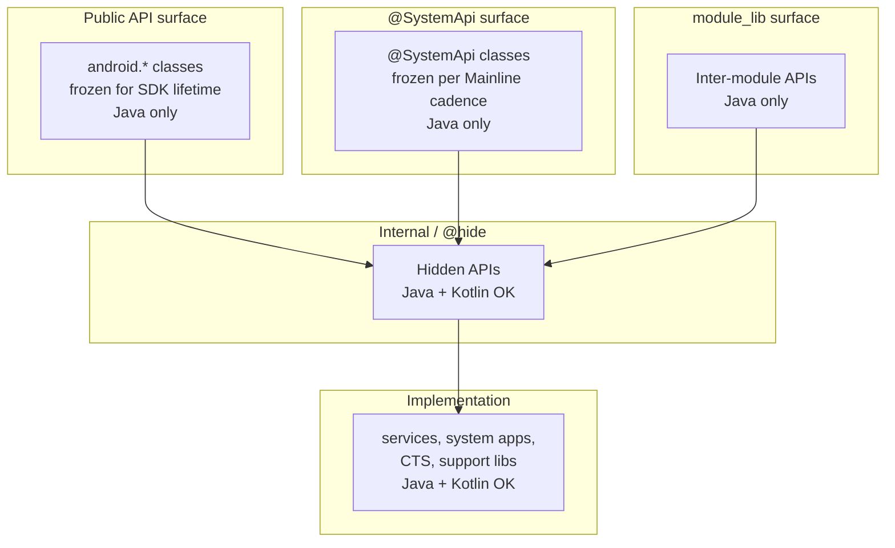
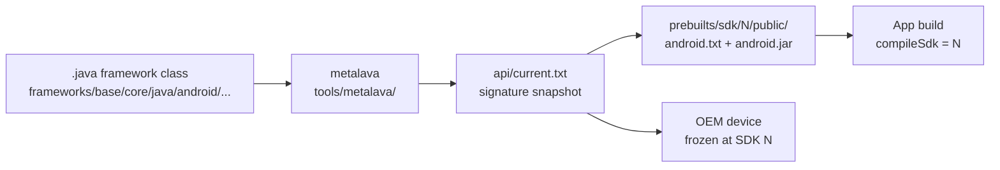
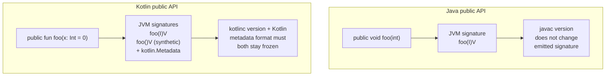

# 附录 C：Kotlin 公开 API

初次接触 AOSP 的读者很快会注意到一种不对称现象。Kotlin 在代码树的上层无处不在——SystemUI、Settings、Launcher3、CTS 的部分模块。然而，应用编译所依赖的公开框架 API 仍然是用 Java 定义的。本附录阐述了产生这种不对称性的种种约束。它不持任何立场，也不预测情况何时、或是否会改变。

它汇集了工程事实：Kotlin 在哪些地方被允许使用，在哪些地方不被允许。它还涵盖了作为这种差异之门槛的二进制契约，以及强制执行该契约的工具链。读完之后，你应该能够审视 `frameworks/base/` 中的任意类。你应该能够预测那里的 Kotlin 源码是无风险的，还是会破坏某些东西。

本附录推导出的规则很简单：从类向外追溯到它最近的 API 边界。如果边界是 `current.txt` 成员、`@SystemApi`、模块库导出，或应用或厂商代码所链接的任何其他东西，冻结就适用。那里的 Kotlin 源码会引入 kotlinc 产物带来的风险。如果边界是进程内部、并与框架同步重新编译的——一个 `LocalServices` 接口、一个 binder 服务端桩、一个 SystemUI 内部实现——Kotlin 就是安全的。本附录通篇使用的"公开 API"的精确定义见标题为"公开 API 契约"的一节。

本附录的编排方式是从头至尾阅读，但各节也可独立查阅。工程核心是"Java/Kotlin ABI 差距"与"工具链锁定"。周边各节则勾勒出冻结的范围，并将其扩展到厂商和 Mainline 层面。它们还盘点了 Kotlin 已经安全地存在于平台之中的地方。

关于资料来源的说明。每一个具体的文件路径和工具名称都来自对 AOSP 代码检出的直接检查。本附录涉及规模之处，那些数字是在某个时间点测量的。它们会随着代码树的演进而漂移。论证所依赖的是数量级。

## 不对称性

观察这种不对称性最直观的方法是统计文件数。Kotlin 与 Java 源码在代码树中并存，但它们聚集在截然不同的地方。对 AOSP 检出运行 `find` 会产生下表所示的清单。

| 路径 | Kotlin 文件数 | 备注 |
|------|--------------|-------|
| `frameworks/base/packages/SystemUI/` | 8,896 | 重度采用者；系统 UI 外壳与快速设置 |
| `packages/apps/Settings/` | 2,300 | Settings 应用，应用层代码 |
| `cts/` | 1,209 | 兼容性测试套件 |
| `packages/apps/Launcher3/` | 1,326 | Launcher 应用 |
| `frameworks/base/services/` | 292 | 生产环境的 Kotlin 全部位于权限子系统；大多数文件是测试 |
| `frameworks/base/core/` | 45 | 应用所调用的 API 表面层；每个文件都是测试代码 |
| `frameworks/base/`（总计） | 12,058 | 所有子目录之和 |
| `frameworks/base/` Java 总数 | 18,937 | 供比较的参照值 |

该表中有两个数字为本附录起到了主要的论证作用。

第一个是 45——更精确地说，是零。`frameworks/base/core/` 是构成公开 Android SDK 的 `android.*` 类所在之处。该目录中全部 45 个 Kotlin 文件都是 `frameworks/base/core/tests/` 下的测试代码。承载 API 的 `core/java/` 代码树——数万 Java 文件——完全不包含任何 Kotlin。这是对这一政策的最直接的表述。公开 API 表面是用 Java 定义的。

第二个是 292。`frameworks/base/services/` 是 `system_server` 以及它所承载的数十个系统服务的所在地。292 个 Kotlin 文件听起来像是有意义的采用，直到你看到它们的位置。其中绝大多数是测试，而 `frameworks/base/services/` 下的每一个生产（非测试）Kotlin 文件都位于权限访问子树内，即 `frameworks/base/services/permission/java/com/android/server/permission/access/`。主要服务——`ActivityManagerService`、`PackageManagerService`、`WindowManagerService`、输入管线、显示管线——仍然是 Java。

本附录所关注的"公开 API"由 metalava 生成并据以校验的三个签名文件定义：

- `frameworks/base/core/api/current.txt`——规范的公开 Android SDK 签名。树内副本约 4 MB，采用 metalava 的"Signature format: 6.0"。
- `frameworks/base/services/api/current.txt`——对进程内调用者暴露的系统服务 API 表面。
- 相应的 `system-current.txt` 与 `module-lib-current.txt` 同级文件位于 `frameworks/base/*/api/` 下。它们定义了 `@SystemApi` 表面（对以平台密钥签名的平台组件可见）以及模块库表面（在编译时对 Mainline 模块可见）。

这些签名文件是语言中立的文本。其中没有任何内容依赖于实现源码是用 Java 还是 Kotlin 编写的。但是，正如本附录其余部分所示，它们所描述的 JVM 签名从这两种语言产生时并非同样稳定。

在图示之前值得先记录第二个观察：这份清单并没有说 Kotlin 在 `frameworks/base/` 中*不安全*。它说的是 Kotlin 恰恰*不存在于*公开 API 表面。`frameworks/base/core/` 下有 45 个 Kotlin 文件（全部是测试），`frameworks/base/services/` 下有 292 个（生产环境子集位于权限子系统，可编译、可发布、可运行）。安全与不安全的边界穿过单个类，而不是穿过目录。`frameworks/base/core/` 中一个从未出现在 `current.txt` 中的 Kotlin 类，只是恰好住在 API 承载目录中的内部代码。分类依据是 metalava 是否选中该类，而不是它住在源码树中的哪个位置。

第三个观察：方向性的不对称。在依赖图中，SystemUI 与 Settings 应用位于框架的"下方"——它们消费公开 API 表面，但不对其做贡献。它们使用 Kotlin 的自由不受约束，因为没有任何东西依赖它们的内部类形态。

相比之下，框架位于它们"上方"。它的类是应用与厂商代码所链接的东西。在那里，自由是以二进制稳定性为代价换来的。在 SystemUI 中无风险的同一 Kotlin 源码模式，在 `frameworks/base/core/java/android/` 中则带有风险。

Kotlin 在 AOSP API 表面各层中的允许使用位置。



该图不是构建时的依赖图。它是一张语言自由度地图。每上一层盒子都把自己约束为 Java，以使位于其下方的语言不会泄漏上来。`android.*` 中的一个类可能会在某个服务中调用 Kotlin 实现。但该调用经过一个 binder 接口或一个 manager 类外观，其签名是 Java 形态的。方法向应用暴露的那一点，就是 Kotlin 止步之处。

## 公开 API 契约

在 AOSP 内部，"公开 API"这一短语有一个精确的定义。它是 `frameworks/base/core/api/current.txt`（以及邻近的 `system-current.txt`、`module-lib-current.txt`、`test-current.txt`）中所列出的类成员集合。该文件是人类可读的文本。它的前几行如下：

```
// Signature format: 6.0
// - style=java
package android {

  public final class Manifest {
    ctor public Manifest();
```

每个条目都是一个完全解析的 JVM 签名：包、修饰符、返回类型、参数类型、异常。文件中没有 Kotlin 关键字。这是因为该格式早于 Kotlin，并且是为描述运行时所见而设计的，而非描述源码级开发者所写的东西。

条目的形态值得细究。类声明嵌套在 `package` 块中，每个成员声明为一行，包含：

- 可见性（`public`、`protected`）。
- 按固定顺序排列的修饰符（`static`、`final`、`abstract`、`synchronized`、`native`、`default`）。
- 返回类型，以包限定。
- 成员名称。
- 对于方法，带类型和名称的参数列表。
- 对于方法，可选的 `throws` 子句，列出受检异常。

该格式在局部对空白敏感（每个成员以与其嵌套深度匹配的前导空格开头），但在其他方面具有生成产物的规整性。diff 工具可以轻松显示两个快照之间的变化。这一点很重要，因为几乎每一次框架变更都经过 `m update-api` 工作流。该工作流产生文本形式的增量，API 委员会逐成员地对其审查。

多个签名表面并行存在。这些是公开（`current.txt`）、`@SystemApi`（`system-current.txt`）、Mainline 使用的模块库表面（`module-lib-current.txt`）以及 `@TestApi`（`test-current.txt`）。还有按子系统的文件，例如 `frameworks/base/services/api/current.txt`。它们共享相同的格式。

每个表面都由 **metalava** 生成，这是一个位于 `tools/metalava/` 的 Kotlin 工具。Metalava 通过其默认的 PSI 源码模型读取框架源码——Java 与 Kotlin 一样——并输出语言中立的签名文本。（可以通过 `--source-model-provider turbine` 选择另一种基于 Turbine 的仅 Java 模型。）构建时重新运行 metalava，将生成的快照与签入的 `current.txt` 比较，任何漂移都会使构建失败。有意的新增则通过 `m update-api` 加上 API 委员会对文本增量的审查来完成。

一个框架类如何成为公开 API 契约的一部分。



一旦某个 API 在编号 SDK 版本中发布，其签名就永远冻结。每个 SDK 版本都将该表面快照到 `prebuilts/sdk/<N>/public/api/android.txt`，并将应用编译所依赖的桩 jar 固定在 `prebuilts/sdk/<N>/public/android.jar`。删除一个条目、更改参数或返回类型，或在文本条目不变的情况下更改其背后的 JVM 签名，都算破坏性变更。

设备在制造时烘焙进一个 SDK 级别，这决定了"永远稳定"的承诺。一部以 SDK 30 发布的手机，四五年后仍将运行 SDK 30（OEM 长生命周期设备则更久）。以 `compileSdk = 30` 为目标的应用必须继续在该设备上安装和运行。OEM 无法通过发布 kotlinc 升级或元数据格式更新来修复平台二进制契约中的回归。这是因为定义兼容性的是原始设备的运行时类加载器。

那个窗口——从首次发布到最后一个现实的服役期，大约十年——就是 `current.txt` 中每个成员都必须存活的时间跨度。API 委员会在批准每个新方法时都应用这一跨度，而一旦发布，签名就无法收回。

## Java/Kotlin ABI 差距

兼容性问题不在于 Kotlin 缺少特性。而在于从 Kotlin 源码到 JVM 签名的映射具有 Java 映射所没有的自由度。kotlinc 编译器、Kotlin 元数据格式和 Kotlin 标准库都可以演进。当它们演进时，未变更源码类的 JVM 可见签名也可能发生变化。对于与 kotlinc 同步重新编译的内部代码，这是不可见的。而对于冻结的公开表面，每一次变化都是二进制破坏。

本节逐一讲解映射不稳定的具体特性表面。

### `@JvmOverloads` 与默认参数重载冻结

Kotlin 允许函数声明参数的默认值。从单个源码声明：

```kotlin
fun openFile(path: String, mode: Int = 0, encoding: String = "UTF-8"): File
```

不加注解时，kotlinc 生成单个 JVM 方法：

```
openFile(Ljava/lang/String;ILjava/lang/String;)Ljava/io/File;
```

Java 调用者必须传入全部三个参数。使用 `@JvmOverloads` 时，编译器合成额外的重载——每个对尾部默认参数的截断各一个：

```
openFile(Ljava/lang/String;)Ljava/io/File;
openFile(Ljava/lang/String;I)Ljava/io/File;
openFile(Ljava/lang/String;ILjava/lang/String;)Ljava/io/File;
```

在公开表面上，这带来两个截然不同的冻结问题。首先，合成的重载集合由参数顺序决定：在源码中更改顺序会更改合成签名。其次，默认值被编码为 `$default` 合成辅助方法（例如 `openFile$default`），由编译器插入字节码。这些辅助方法的存在与形态是 Java 调用者所见的二进制表面的一部分。从公开类中移除 `@JvmOverloads` 会悄然删除若干 JVM 方法，并破坏任何已编译的调用者。在末尾添加新参数（即使有默认值）会在重载集合中追加新条目，但重新排列现有参数会重命名它们。

在 `frameworks/base/services/` 内，每一处 `@JvmOverloads` 用法都位于 `services/tests/` 之下——主要是 `displayservicetests/` 中的测试工具文件，如 `TestUtils.kt`、`PersistentDataStoreTestUtils.kt`、`DisplayDeviceConfigTestUtils.kt` 和 `ClamperTestUtils.kt`，外加 `servicestests/` 中的一个假实现。没有生产服务使用它。（该注解在应用层很常见。SystemUI 与 Settings 合计在一百多个文件中使用它。但那些是消费 SDK 的应用，而非承载 API 的框架代码。）

它缺席生产服务的原因很简单：AOSP 中的生产服务 Kotlin 只调用 Java，永远不会反向。平台服务中没有需要合成重载的 Java 调用者。

### `@JvmStatic` 与 `Companion.foo()` 对 `Foo.foo()` 的选择

Kotlin 的 `companion object` 所容纳的成员从 Kotlin 内部看像静态成员（`MyClass.foo()`），但被生成为一个合成内部 `Companion` 类上的实例方法。不加 `@JvmStatic`：

```kotlin
class Foo {
    companion object {
        fun bar() = 42
    }
}
```

Java 可见的签名是：

```
public final class Foo
public static final class Foo$Companion
    public final int bar()
public static final Foo$Companion Foo.Companion
```

Java 调用者写 `Foo.Companion.bar()`。加上 `@JvmStatic` 注解会在外部类上增加该方法的第二个、静态的副本：

```kotlin
class Foo {
    companion object {
        @JvmStatic fun bar() = 42
    }
}
```

```
public final class Foo
    public static final int bar()
public static final class Foo$Companion
    public final int bar()
```

现在 `Foo.bar()` 从 Java 中也能工作了。这个决定在 `current.txt` 中是可观察的，因为两个方法都是公开表面的一部分。一旦发布，二者都不能被移除。

`@JvmStatic` 在 AOSP 中的使用模式印证了这种不对称。`frameworks/base/services/` 中的每一次命中都在 `services/tests/` 子树内。在那里，JUnit 运行器（Java）需要调用声明在 Kotlin 测试伴生对象上的 `@BeforeClass`/`@AfterClass` 方法。来自 `ApexUpdateTest.kt` 的具体示例：

```kotlin
@JvmStatic
@BeforeClassWithInfo
fun initApexHelper(testInformation: TestInformation) {
    apexInstallHelper = ApexInstallHelper(testInformation)
}
```

生产 Kotlin 避免 `@JvmStatic`，因为平台中没有任何东西从 Java 调用这些 Kotlin 方法。而公开 API 代码按定义必须可从 Java 应用调用。因此，公开 Kotlin 类中的每个静态工厂或常量都必须选定这些产物形态之一并将其冻结。

### `@JvmName` 混淆

Kotlin 允许源码级函数名与 JVM 级方法名不同：

```kotlin
@JvmName("safeOpen")
fun open(path: String): File
```

Kotlin 调用者写 `open(path)`。Java 调用者写 `safeOpen(path)`。在 JVM 上，只有 `safeOpen` 存在。移除 `@JvmName` 注解（或更改其参数）会重命名 Java 代码所链接的符号。在公开表面上，这对每一个已按先前名称编译的应用都是硬性破坏。

`@JvmName` 在开发者没有标注的地方也会被隐式应用。顶层 Kotlin 函数编译进一个以源文件命名的合成类（例如 `Utils.kt` 变成 `UtilsKt`）。该类名可以用 `@file:JvmName("Utils")` 自定义。框架的 API 表面契约没有办法表达"重命名合成类"而不破坏已按旧名称解析的应用。

### `suspend` 函数与 JVM 签名中的 `Continuation`

源码中的 `suspend` 函数：

```kotlin
suspend fun load(): Result
```

变成一个 JVM 方法，其签名追加一个 `kotlin.coroutines.Continuation` 参数：

```
load(Lkotlin/coroutines/Continuation;)Ljava/lang/Object;
```

返回类型被擦除为 `Object`，因为协程机制异步传递结果。对于 Kotlin 内部调用者，源码级签名才是重要的；编译器隐藏了这一转换。对于 Java 调用者，唯一可见的是 JVM 签名。这包括 `Continuation`、被擦除的返回类型，以及异常被包装进 `kotlin.Result` 装箱的方式。

由此产生两个稳定性问题。首先，`kotlin.coroutines.Continuation` 是 Kotlin 标准库类型。它的包、方法名以及它期望的运行时语义都必须在 JVM 层面保持冻结。其次，把 `suspend` 降低为 `Continuation` 是 kotlinc 的实现选择。过去的 Kotlin 版本曾考虑过替代的降低方式（状态机对 CPS 风格、不同的装箱策略）。未来的 kotlinc 无论出于何种原因调整降低方式，都可能改变一个未变更源码声明的 JVM 签名。

如今没有任何公开 Android API 暴露 `suspend`。AndroidX 中基于协程的 API 位于框架 SDK 之上，作为独立构件发布。在那里，suspend 签名可以随 AndroidX 构件自身的版本节奏演进。

### 暴露源码字节码的 `inline` 函数

Kotlin 中的 `inline` 函数不仅仅是给优化器的提示。它是一项契约：函数体将在每个调用点被内联。Kotlin 将其用于 `reified` 类型参数（这要求类型在调用点可见，而非被擦除），以及用于性能敏感的、接收 lambda 的 API。

对二进制稳定性的含义很简单。`inline` 函数的编译字节码会被复制进每个调用者的类文件。这包括其函数体中的每一条指令，甚至是对私有辅助函数的引用。假设框架声明了一个公开的 `inline fun`。如果源码体在两个 SDK 版本之间发生了变化，按旧版本编译的应用仍然内联包含旧函数体。反过来说，如果框架需要在 `inline` 函数中修复一个 bug，只有新重新编译的调用者能看到该修复。

对一个把编译好的应用发布到数十亿台设备的平台而言，"修复只有在每个调用者都重建时才生效"是行不通的。Java 没有等价物：`static final` 方法可以在实现处被重定向，但 JVM 通过运行时类加载器解析它们。Kotlin 的 `inline` 函数更接近 C++ 中头文件定义的模板，而不是 Java 方法。对 Java 方法有效的冻结语义，对内联的 Kotlin 函数体无效。

### 值类/内联类与参数签名混淆

Kotlin 值类（旧称内联类）在编译时包装单个支撑值，并在调用边界解包它：

```kotlin
@JvmInline
value class UserId(val value: Long)

fun grantAccess(user: UserId)
```

`grantAccess` 的 JVM 产物不是 `grantAccess(LUserId;)V`。它是混淆过的。kotlinc 将参数形态的哈希插入方法名。这避免了与那些 `UserId` 和 `Long` 会擦除为同一签名的重载发生冲突：

```
grantAccess-{hash}(J)V
```

确切的混淆方案在各个 Kotlin 版本中被反复精炼。细节包括什么被哈希、用什么字符把原名称与哈希分开，以及合成构造器如何交互。冻结的公开 API 无法容忍混淆方案的变更。它也无法容忍开发者无意中添加的、扰动了现有方法哈希的重载。

### JVM 上的 `Result<T>` 混淆

`kotlin.Result<T>` 是一个值类。任何返回 `Result<Foo>` 的函数都要经受与任何其他返回值类的函数相同的名称混淆：

```kotlin
fun fetch(): Result<Data>
```

在 JVM 层面变成类似 `fetch-{hash}()Ljava/lang/Object;` 的东西。调用边界上所见的 Java 类型是 `Object`，因为 `Result` 通过擦除装箱。Java 直接消费返回 `Result` 的 Kotlin API，往好里说也是别扭的。

Kotlin 的官方指导是，`Result` 不应出现在公开的、Java 可见的 API 中。对在 Kotlin 调用者之间互操作的内部代码，`Result` 很方便。对必须可从 Java 调用的公开表面，它不可行。

### 伴生对象的 `INSTANCE` 静态字段

Kotlin 的 `object`（顶层声明，而非伴生）编译成一个带单一静态 `INSTANCE` 字段的类：

```kotlin
object UriRegistry {
    fun lookup(scheme: String): Class<*>? = ...
}
```

变成：

```
public final class UriRegistry
    public static final UriRegistry INSTANCE
    public final Class<?> lookup(String)
```

Java 调用者写 `UriRegistry.INSTANCE.lookup("content")`。`INSTANCE` 字段是二进制表面的一部分。在 Kotlin 源码中重命名该 `object` 会重命名类；重构该单例（例如拆分为按用户 ID 键控的映射）会删除 `INSTANCE` 字段。二者对任何已编译的 Java 调用者都是破坏性变更，并且在 `current.txt` 中表现为必须存活整个 SDK 生命周期的字段条目。

伴生对象 `INSTANCE` 访问器（为任何 `class Foo { companion object { ... } }` 生成的 `Foo.Companion` 字段）具有同样的属性。它们是二进制表面必须保留的公开字段。

### `data class` 合成与 `componentN` 访问器

Kotlin 的 `data class` 会触发编译器在声明字段之外合成一个固定集合的成员：

```kotlin
data class Point(val x: Int, val y: Int)
```

在 JVM 层面，大致变成：

```
public final class Point
    public Point(int x, int y)
    public final int getX()
    public final int getY()
    public final int component1()
    public final int component2()
    public final Point copy(int x, int y)
    public static Point copy$default(Point, int, int, int, Object)
    public boolean equals(Object)
    public int hashCode()
    public String toString()
```

每个合成成员都是二进制表面的一部分。`componentN` 访问器支持 Kotlin 解构（`val (x, y) = point`）；它们按参数位置编号。在源码中重新排列字段会重命名分量：原来是 `component1` 的变成 `component2`。`copy` 方法接受与构造器相同的参数。如果新字段加在末尾，它会为 `copy` 追加一个参数，并保留 `copy$default` 合成辅助方法。如果字段再次被重新排列，那些使用具名参数调用 `copy` 的已编译调用者就会坏掉。

一个公开的 `data class` 将不得不承诺其字段顺序及其 `componentN` 编号。它还必须承诺 `copy` 重载集合以及合成的 `equals`/`hashCode` 语义在整个 SDK 生命周期内有效。这比 Java 的 `record`（只有规范访问器名称和 `equals`/`hashCode` 契约得到保证）约束更多。它也比手工编写的 Java 类（由开发者选择这些成员中哪些存在）约束更多。

### 顶层函数与 `Kt` 合成类

Kotlin 允许函数和属性位于文件顶层，在任何类之外：

```kotlin
// File: PathUtils.kt
package android.os

fun normalizePath(path: String): String = ...
const val PATH_SEPARATOR = "/"
```

kotlinc 将其编译进一个合成类，其名称为文件名后加 `Kt`：

```
public final class PathUtilsKt
    public static String normalizePath(String)
    public static final String PATH_SEPARATOR
```

类名是二进制表面的一部分。重命名源文件会重命名类；`@file:JvmName("PathUtils")` 会覆盖该后缀。对 Java 调用者，静态方法可作为 `PathUtilsKt.normalizePath(...)` 访问（若设置了 JvmName，则为 `PathUtils.normalizePath(...)`）。对 Kotlin 调用者，合成类是不可见的——他们直接导入该函数。

框架中的一个公开顶层函数将承诺一个在源码中并不存在的类名。重命名文件会悄然破坏已编译的 Java 调用者。拆分文件会把合成类拆成两个合成类，同样会破坏调用者。Java 没有等价物：Java 中的每个静态方法都位于一个开发者命名的类上，所以类的身份是源码级决策的一部分。

### Boot classpath 共享迫使每个应用使用同一 stdlib 版本

以上所有内容描述了单个 Kotlin 源码声明如何产生一*组*框架不得不冻结的 JVM 产物。这些产物是签名、辅助方法、混淆名称和元数据块。在签名形态之下一层，还有第二个二进制稳定性问题。Android 运行时模型把公开框架 API 加载进设备上每个应用共享的类加载器中。公开的 Kotlin API 也会迫使 `kotlin-stdlib.jar` 进入那个共享类加载器。

框架的公开 API 作为 `framework.jar`（加上邻近的 jar，如 `framework-graphics.jar`、`framework-location.jar`、`ext.jar`、`telephony-common.jar`）发布在设备的 **boot classpath** 上。（`services.jar` 不在其中：它位于 SYSTEMSERVERCLASSPATH 上，仅由 `system_server` 加载。）其组成由 Soong 通过 `PRODUCT_BOOT_JARS` 配置。默认集合定义在 `build/make/target/product/default_art_config.mk:38`。它包含 `framework-minus-apex`、`ext`、`telephony-common`、`framework-graphics`、`framework-location` 以及各个 APEX jar（ART、conscrypt、i18n 等）。设备启动时，ART 将这些 jar 预编译进一个 boot image，而 zygote 进程将其加载进自己的地址空间。

`frameworks/base/core/java/com/android/internal/os/ZygoteInit.java:284` 中的 `com.android.internal.os.ZygoteInit.preloadClasses()` 读取 `/system/etc/preloaded-classes` 文本文件，并急切地初始化其中命名的每个类。因此，boot image 的类对象、静态字段和 JIT 编译的代码在任何应用 fork 之前就已驻留在 zygote 的堆中。之后启动的每个应用进程都从该 zygote fork 而来，并直接继承已解析的类对象。`android.app.Activity` 在 zygote 和每个应用中字面上就是同一个类对象，没有按应用的加载步骤。

应用专属代码位于再往下一层的类加载器。安装的 APK 由 `dalvik.system.PathClassLoader`（`libcore/dalvik/src/main/java/dalvik/system/PathClassLoader.java:44`）加载，其父类是 boot 类加载器。`ClassLoader.loadClass()`（`libcore/ojluni/src/main/java/java/lang/ClassLoader.java:622`）遵循标准的父优先委派：它在第 630 行调用 `parent.loadClass(name)`，*然后才*在第 642 行对自身 dex 调用 `findClass()`。任何能在 BOOTCLASSPATH 中解析的类名，都会胜过应用 APK 中同名的类。

对 Java 而言，这没有问题。框架对 `java.*` 和 `javax.*` 的传递依赖本身就是 JDK 严格版本化核心的一部分。那个核心在 OpenJDK 下演进，并带有明确的 JLS 兼容性保证。即使应用想，也无法发布自己的 `java.util.HashMap`。类加载器委派按设计把每个解析都交还给平台副本。

对 Kotlin 而言，这是核心症结。公开表面上的一个 `suspend` 函数会拖入 `kotlin.coroutines.Continuation`。一个返回 `Result<T>` 的方法会拖入 `kotlin.Result`。甚至一个用 Kotlin 编写的普通类也会发出一个 `@kotlin.Metadata` 注解，当应用对该类调用 `Foo::class` 时，Kotlin 反射层会读取它。所有这些类型都位于 `kotlin-stdlib.jar` 中。

如今的已验证状态：AOSP 中没有任何 boot classpath jar 链接 `kotlin-stdlib`。`external/kotlinc/Android.bp:59` 将 `kotlin-stdlib` 声明为预构建 jar 的 `java_import`，但依赖它的模块都不是 boot 模块。

Soong 的 `static_kotlin_stdlib` 属性（在 `build/soong/java/base.go` 中记录为"如果为 true，将 kotlin stdlib 打包进 jar。默认为 true。"）控制 Kotlin 模块是否捆绑自己的 stdlib 副本。SystemUI 的插件和共享子项目将其设为 `false`。结果，stdlib 对它们而言成为仅编译时依赖，由包含它的 APK 提供唯一的打包副本。

平台的生产 Kotlin（权限子系统，见下文"Kotlin 在 AOSP 中已经存在的地方"）运行在 SYSTEMSERVERCLASSPATH 上的 `services.jar` 中。该 jar 仅由 `system_server` 加载，而不是在
boot classpath 上。它的 stdlib 是静态链接并经 jarjar 重命名的，因此没有任何 `kotlin-stdlib` 引用会到达共享类加载器。

加入第一个公开 Kotlin 签名就会逆转这一点。假设框架 jar 暴露一个 `Result<T>` 返回类型、一个 `suspend` 参数，或甚至只是一个带 Kotlin 元数据的公开顶层函数的合成 `Kt` 类。那么它就必须链接 `kotlin-stdlib`，而那个 `kotlin-stdlib` 就不得不随 boot classpath 一起发布。从 zygote fork 出来的每个应用进程都会从 boot classpath 解析 `kotlin.Result`、`kotlin.coroutines.Continuation` 和元数据格式类型。它不会从应用自身 APK 中打包的版本解析它们。

由于 Kotlin 在版本稳定性谱系中的位置，这比 Java 的类似情形更具破坏性。如今的应用通常携带不同的 `kotlin-stdlib` 版本发布。一个例子是：同一个 APK 中，某个库按 Kotlin 1.6 编译，而应用代码使用 Kotlin 2.0。位于 `prebuilts/r8/r8.jar` 的 R8/D8 会把该并集最小化进 APK 的 `classes.dex`。

父优先委派意味着，无论应用的 Gradle 构建选择了哪个版本，设备上 boot classpath 的 `kotlin-stdlib` 都会胜出。如果设备的 `kotlin-stdlib` 比应用的旧，应用所链接的方法可能不存在，`NoSuchMethodError` 会在运行时浮现。如果它更新，且收紧了可空性或泛型签名，应用已编译的调用点可能无法通过字节码验证。应用开发者无法从 APK 内部寻求补救，因为解析发生在他们的类加载器之上。

AOSP 中绕过这类冲突的唯一既有先例是类加载器命名空间隔离。WebView 运行在独立的 zygote 中，即 `frameworks/base/core/java/android/webkit/WebViewZygote.java:32` 的 `WebViewZygote`。因此，WebView APK 的传递依赖不必与主 zygote 的预加载类集合共存。

代价是第二个 zygote 进程，以及两个进程所触及的每个共享库的第二份副本。还有一个关于哪些类可共享的明确的 inter-zygote 契约。为"使用 Kotlin"的应用复制这一模式，将意味着以下二者之一。一是按 stdlib 版本划分的 zygote，而系统无法在 fork 时预测这一点。另一是运行时类加载器改写，让每个应用看到自己的 `kotlin-stdlib`，同时仍从 boot 解析 `android.*`。这两种方案如今都不存在。

Java 方法签名稳定性对 Kotlin 元数据固定。



该图中的对比正是工程要害。对 Java 而言，单个源码声明映射到单个、良定义的 JVM 签名，而 `javac` 版本不会改变这一映射。对 Kotlin 而言，单个源码声明映射到一*组* JVM 产物。这些产物是签名、合成辅助方法、混淆名称、`Continuation` 参数、值类哈希，以及 `kotlin.Metadata` 注解块。Kotlin 反射层和工具层解析那个块以重建源码级语义。

那组产物的形态取决于 kotlinc 版本、元数据格式版本以及源码所使用的互操作注解。要像冻结 Java API 那样冻结 Kotlin 公开 API，那套机制的每一部分都需要被声明为二进制契约。kotlinc 无法在不破坏已编译调用者的情况下演进其中任何一部分。而且，正如上文 boot classpath 一节所示，那项契约会超出框架自身的签名。它会延伸到设备共享类加载器将强加给每个使用 Kotlin 的应用的 `kotlin-stdlib` 版本。

## 工具链锁定

"公开 API 契约"一节所描述的签名契约，由一套 Java 形态的工具链强制执行。即使个别工具恰好是用 Kotlin 编写的，它们的输入和输出格式也都是为 Java/JVM 签名模型设计的。

**Metalava** 位于 `tools/metalava/`。它本身就是一个 Kotlin 工具——跨各子模块共 784 个 `.kt` 文件。metalava 用 Kotlin 编写，却操作 Java 形态的 API，这是约束的一部分，而非矛盾。Metalava 可以消费 Kotlin 源码来生成签名。签名格式（定义于 `tools/metalava/FORMAT.md`）已经能够表达 Kotlin 修饰符（`sealed`、`inline`、`value`、`suspend`、`data`、`operator`、`infix`）、Kotlin 属性、参数名和默认值。

但那些扩展是为 androidx 签名文件设计的，那里的库源码是 Kotlin；平台 SDK 表面并不使用它们。`android.*` 类的 `current.txt` 标记为 `// - style=java`，不包含任何 Kotlin 构造。在平台表面上使用这些特性的 Kotlin 源文件，会被扁平化为其 JVM 可见投影，或被 API lint 拒绝。扁平化后的形态丢失了源码级语义。

这种扁平化很有启发性。Metalava 有一个统一的 `Item` 模型。类是 `Item`，方法是 `Item`，字段是 `Item`。该模型是有意设计为语言中立的。

PSI 前端是默认的源码模型，它同时读取 Java 与 Kotlin 源码。Turbine 前端是另一种仅支持 Java 的源码模型。二者产生形态相同的 Items。当 metalava 输出签名时，它遍历 Items 并按格式规范写出它们。

一个 Kotlin `data class Foo(val x: Int)` 由 PSI 前端读取。然后它被投影为等价的 Java 声明。这些声明包括一个带有 final 字段式访问器 `getX` 的类、一个合成构造器，以及 `equals`/`hashCode`/`toString`/`copy`/`componentN` 这一组成员。签名文件显示的是投影，而非源码。永远冻结的契约是投影；源码是实现细节。

这也意味着，内部 Kotlin 源码变更不会出现在 `current.txt` 中。这类变更的例子包括：重构 `data class` 以添加新字段、拆分 sealed 继承体系、重命名顶层函数。只要这些 Kotlin 成员不属于公开表面，这一点就成立。Metalava 只纳入它视为 `public` 或 `protected`、且未标注 `@hide` 的成员。`frameworks/base/core/` 下的 Kotlin 文件全部是 `core/tests/` 下的测试代码，API 检查从不扫描它们。承载 API 的 `core/java/` 代码树是纯 Java，因此没有任何 Kotlin 声明甚至能到达那里的 metalava。

metalava 的模块布局展示了关注点的分离：

- `tools/metalava/metalava/`——主工具入口点。
- `tools/metalava/metalava-model/`——独立于任何语言前端的抽象 API 模型。
- `tools/metalava/metalava-model-psi/`——Java 与 Kotlin 共用的默认源码前端（使用 JetBrains PSI）。
- `tools/metalava/metalava-model-source/`——通用的基于源码的模型。
- `tools/metalava/metalava-model-text/`——文本（签名文件）前端，用于 `current.txt` 的往返处理。
- `tools/metalava/metalava-model-turbine/`——基于 Turbine 的替代性仅 Java 前端。
- `tools/metalava/metalava-reporter/`——问题报告子系统。
- `tools/metalava/metalava-testing/`——测试工具。
- `tools/metalava/stub-annotations/`——生成的桩中使用的注解 jar。

文本模型是规范模型。PSI 和 Turbine 的存在是为了向它供料。未来支持 Kotlin 的公开 API 将需要一个文本模型，能够表达并在公开表面上所容许的每个 Kotlin 构造上往返处理。

**文档生成**。树内平台参考文档管线是 metalava 加 Doclava（位于 `external/doclava/` 的历史性的、派生自 Javadoc 的工具）。原始源码经 metalava 处理变成桩源码，Doclava 再把桩渲染为 API 文档。该管线在 `frameworks/base/api/ApiDocs.bp` 中有概略描述。Dackka 是 Google 较新的、支持 Kotlin 的文档工具，它用于 AndroidX 文档，但未签入 AOSP。

无论哪种方式，所发布的文档描述的都是 Kotlin API 的 Java 投影。之所以如此，是因为那才是应用开发者在 IDE 中调用平台时所见的东西。一个 Kotlin `data class` 在文档中出现时，其合成的 `equals`、`hashCode`、`toString`、`copy` 和 `componentN` 方法会被逐一列出。这就是 Java 调用者所见的内容。只有当读者处于 Kotlin 模式时，文档才能显示源码级的 Kotlin 形态；底层的契约仍然是 JVM 投影。

**Hidden API 强制执行**是 Java 形态工具链的第二个支柱。黑名单以纯文本文件维护在 `frameworks/base/boot/hiddenapi/` 下：

- `hiddenapi-unsupported.txt`——*unsupported*（旧称 greylist）成员：每个目标 SDK 下仍可访问，但不受支持并会触发警告。
- `hiddenapi-unsupported-packages.txt`——被整体归入同一 unsupported 类别的包。
- `hiddenapi-max-target-o.txt`——面向 SDK O 或更早版本的 API（遗留封锁）。
- `hiddenapi-max-target-p.txt`——面向 SDK P 或更早版本的 API。
- `hiddenapi-max-target-q.txt`——面向 SDK Q 或更早版本的 API。
- `hiddenapi-max-target-r-loprio.txt`——面向 R 或更早版本的 API，低优先级。

未在任何这些文件中被点名的隐藏成员，默认归入 `blocked` 类别，即硬拒绝的情形。因此，这些列表划出的是豁免，而非宣告封锁。

一个被封锁的 Kotlin 扩展函数会以 `Lcom/example/UtilsKt;->extensionMethod(Lcom/example/Receiver;)V` 的形式出现，而非以其 Kotlin 源码签名的形式。这些文件中的每一行都是一个 JVM 描述符，形式为 `Lpackage/Class;->method(Lpackage/Type;)Lpackage/Return;`。该格式与 `dexdump`、ART 的运行时检查，以及每一个内省已编译类文件的工具所用的格式相同。Kotlin 源码编译为 JVM 类文件，因此 Kotlin 代码可以通过这些描述符被触及。但描述符使用的是 kotlinc 发出时的形态，而非源码级的 Kotlin 名称。

构建系统把源文本文件合并为一个生成的 CSV：

- `out/soong/hiddenapi/hiddenapi-flags.csv`——构建时产物，约 750k 行。每一行是一个成员描述符外加一个标志列表（`public-api`、`sdk`、`system-api`、`test-api`、`blocked` 等）。
- `prebuilts/runtime/appcompat/hiddenapi-flags.csv`——随主机端 veridex/`appcompat.sh` APK 扫描器一起打包的预构建副本（约 51 MB）。

生成文件中的示例行：

```
Landroid/Manifest$permission;-><init>()V,public-api,sdk,system-api,test-api
Landroid/Manifest$permission;->ACCEPT_HANDOVER:Ljava/lang/String;,public-api,sdk,system-api,test-api
Landroid/Manifest$permission;->ACCESSIBILITY_MOTION_EVENT_OBSERVING:Ljava/lang/String;,blocked,test-api
```

该 CSV 在构建时由 `hiddenapi` 工具（`art/tools/hiddenapi/hiddenapi.cc`）消费，该工具把标志戳入每个 dex 文件的 `HiddenapiClassData` 段。然后 ART 在运行时读取那些按成员的 dex 标志。它从不打开 CSV。当应用访问 `Manifest.permission.ACCESSIBILITY_MOTION_EVENT_OBSERVING` 时，运行时会检查标志。`blocked` 触发硬异常；各种 `max-target-*` 标志触发较温和的警告或版本门控封锁。粒度是按描述符的。

一个 Kotlin API 在每个源码声明上发出多个描述符。例子包括 `@JvmOverloads` 生成的重载、`Companion` 访问器加上 `@JvmStatic` 投影，以及值类混淆名加上未混淆的擦除后备名。这样的 API 会使在这个 CSV 中表达同一源码级意图所需的条目成倍增加。

**jarjar 规则**。几个框架模块在构建期间重写其依赖的类名，以避免与应用可见的类冲突。规则存放在 `jarjar-rules.txt` 文件中，通过 Soong 的 `jarjar_rules:` 属性接入。权限子系统正是对其静态链接的 stdlib 应用这一重写（`frameworks/base/services/permission/jarjar-rules.txt` 把 `kotlin.**` 重命名为 `com.android.server.permission.jarjar.kotlin.**`）。这一重写在那里可行，是因为该子系统不依赖对重命名后类的 Kotlin 反射。

Kotlin 元数据注解（`kotlin.Metadata`）嵌入了对原始类名的字符串引用。一个把 `kotlin.collections.MapsKt` 重命名为 `com.android.internal.kotlin.collections.MapsKt` 的 jarjar 重写，会与元数据块不匹配，并在运行时破坏 Kotlin 反射。Java 没有等价的嵌入式元数据；对 Java 使用 jarjar 是一次直截了当的文本重写。

**`@SystemApi` 与 `@UnsupportedAppUsage`** 由 metalava 和 hidden API 工具链处理。`@SystemApi` 为以平台密钥签名的调用者扩大表面；相应的 `system-current.txt` 就是它的冻结签名。`@UnsupportedAppUsage` 是框架代码用来标记成员的注解，被标记的成员应带着特定的 max-target 标志进入 hidden API CSV。这些注解的 Kotlin 等价物将同时需要一个 Kotlin 源码级注解类型和一个 metalava 规则。该规则会把那个注解正确地投影进生成的 CSV。

这些注解本身带有微妙的约束。`@SystemApi` 接受客户端类型参数（`MODULE_LIBRARIES`、`PRIVILEGED_APPS`、`SYSTEM_SERVER`），它们门控哪些下游消费者能看到该成员。Metalava 读取那些参数，并把成员路由进相应的签名表面。一个路由错误的注解会泄漏进错误的 `current.txt`，而构建的 `m checkapi` 步骤会捕获这一泄漏。

对 Java 源码而言，注解处理是毫无歧义的：注解位于声明之上，metalava 读取 AST 节点，路由随即发生。对 Kotlin 源码而言，metalava 必须通过 Kotlin 源码前端得出同样的结论。任何具有源码级形态的未来 Kotlin 注解，都需要在 `tools/metalava/.../ExtractAnnotations.kt` 的 metalava 注解提取逻辑中获得显式支持。例子包括文件级注解、针对类的扩展，以及带有非平凡保留语义的重复注解。

`out/soong/hiddenapi/hiddenapi-flags.csv` 产物是上文提到的每个输入的合并点。源码 `.txt` 黑名单、`@SystemApi` 成员资格、`@UnsupportedAppUsage` 注解，以及公开 API 桩描述符，全部经 Soong 流入一张以描述符为键的统一表。同一套机制还供给 `prebuilts/runtime/appcompat/hiddenapi-flags.csv`——主机端 veridex/`appcompat.sh` APK 扫描器使用的预构建表（设备端运行时并不读取它）。描述符形态、标志词汇，或 Kotlin 成员映射到描述符的方式的任何变更，都要流经这条管线。

## OEM、厂商与 Mainline 约束

公开 API 契约并不是系统中唯一的冻结。两个邻近的表面——厂商分区与 Mainline 模块——把"永远稳定"的属性扩展到了额外的层。

**厂商分区冻结**。当 OEM 设备以 SDK 级别 N 发布时，厂商分区针对在该级别冻结的系统 API 表面和模块库表面来构建。同一设备上的后续 OS 升级（在 Project Treble 的框架-厂商拆分之内）必须保持与既有厂商分区的二进制兼容。系统 API 表面充当框架（内部允许 Java + Kotlin，外部为 Java 形态）与厂商代码（通常是 C++，有时是 Java）之间的二进制契约。`@SystemApi` 类上的一次 Kotlin 产物漂移，会破坏每一个按先前形态编译的厂商分区。

**Mainline APEX 模块**是第二个冻结。Mainline 模块是一个 APEX 包，其中包含通过 Play Store 更新而非完整系统 OTA 发布的平台组件。其架构记录于 `system/apex/docs/README.md`（辅助文档位于 `system/apex/tests/README.md` 和 `system/apex/shim/README.md`）。每个 Mainline 模块声明一个 `min_sdk_version`，并针对该 SDK 级别的模块库表面编译。APEX 构建规则位于 `build/soong/apex/apex.go` 和 `build/soong/android/apex.go`，二者共同强制一个 APEX 文件不依赖其声明的 SDK 下限之外的符号。

一个 Mainline 模块会以 Play Store 更新的形式发布到一台五年前的设备上。它仍必须针对那台设备的冻结模块库表面解析它所引用的每个符号。如果框架在 SDK N 与 SDK N+3 之间引入了一个新的 Kotlin 形态的公开方法，SDK N 上的设备就不会有它。该 Mainline 模块要么声明更高的 `min_sdk_version`（损失覆盖范围），要么保持 Java 形态（毫无损失）。

**kotlinc 发布节奏对 AOSP 节奏**。Soong 的 Kotlin 集成硬性固定一个特定的 kotlinc 版本。构建所用的预构建 kotlinc 位于 `external/kotlinc/`，版本戳在 `external/kotlinc/build.txt` 中：

```
2.2.0-custom-branch-22
```

这一固定在 Soong 的编译器标志管道中强制执行：

- `build/soong/java/kotlin.go`——定义 `kotlinc` 调用、kotlin-jar 快照以及增量编译的 Ninja 规则。
- `build/soong/java/kotlin_test.go`——这些规则的单元测试。
- `build/soong/java/config/kotlin.go`——声明 Soong 用来寻找 kotlinc 组件的变量（`external/kotlinc/bin/kotlinc`、`external/kotlinc/lib/kotlin-stdlib.jar`、`external/kotlinc/lib/kotlin-compiler.jar`、kapt、jvm-abi-gen）。Compose 编译器插件单独接入，即从 `build/soong/java/base.go` 引用的 `kotlin-compose-compiler-plugin` 模块。

同一个配置文件禁止调用方覆盖 `-no-jdk`、`-no-stdlib` 或 `-language-version`。平台决定以哪个 Kotlin 语言版本来编译；各个模块无法自行选择更新或更旧的版本。kotlinc JVM 以 `-J-Xmx8192M` 调用，以应对单趟编译平台全部 Kotlin 模块时的堆内存压力。

被固定的 kotlinc 版本是耦合问题的根源。AOSP 选定一个版本，在整个代码树中验证它，然后发布它。用那个 kotlinc 编译的公开 API 发出的是那个版本所产生的 JVM 签名。把 kotlinc 升级到更新的版本，可能会改变任何公开 Kotlin 类所发出签名。升级的理由包括 Compose 更新、平台内部想要的某个 Kotlin 语言特性，或安全修复。

针对该风险，目前的解决方法是让公开类保持 Java。风险就不会发生。

对内部 Kotlin（服务、SystemUI、Settings、应用）而言，kotlinc 固定没有问题。kotlinc 升级时，所有内部代码都会重新编译。冻结的产物是公开桩和 hidden API CSV。二者都作为 kotlinc 升级的一部分被重新生成。API 与 hidden API 检查在升级落地之前验证这些变更。

设想一下，如果框架在 `android.os.SomeClass` 中添加了一个 Kotlin 公开方法，会发生什么。这是节奏问题的一个具体例子。该方法在 SDK 级别 N 中发布，由 kotlinc 2.2.0 编译。位于 `prebuilts/sdk/N/public/api/android.txt` 的冻结产物记录了 kotlinc 2.2.0 所产生的 JVM 签名。设备以 SDK N 发布，并把该产物烘焙进它们的桩 jar 中。

一年后，AOSP 采用 kotlinc 2.4.0 以启用一个新的 Compose 特性。假设 kotlinc 2.4.0 对同一源码类的产物产生了一个不同的 JVM 签名——即使只有细微差别，即使是因为某个不透明混淆的原因。那么，按 SDK N 桩编译的应用，在运行新框架的设备上将无法解析该方法。

框架有两个选择。它可以继续固定旧的 kotlinc 产物形态，但这会使升级失去意义。或者它可以发布一个兼容垫片，把新形态转发给旧形态，但这会使表面成倍增加。Java 没有这两个问题，因为 `javac` 不存在会影响所发签名的特性版本。

kotlinc 问题在厂商侧的镜像是：厂商分区通常在设备发布时构建一次。在设备的整个寿命内，它们不会被重建。一个链接了框架 Kotlin API 的厂商服务，会把 kotlinc-N 的产物形态烘焙进来。当框架通过 OS 升级更新到 kotlinc N+1 时，厂商分区仍然期望 kotlinc-N 的产物形态。框架无法重新编译厂商分区。Java 完全避免了这一点；公开表面上的 Kotlin 将创造出一个新的冻结轴（kotlinc 产物形态），它在如今的厂商分区契约中没有对应物。

Mainline 图景让这个问题更加尖锐，因为 Mainline 模块的发布比 OS 更频繁。今天构建的一个 Mainline APEX，其 `min_sdk_version`（比方说）是 Android 11。它必须能在每台 SDK 11 或更高的设备上运行。如果框架在 SDK 12 引入了一个 Kotlin 公开 API，而该 Mainline 模块想使用它，那么该模块只能：

1. 提高其 `min_sdk_version` 到 12（损失对旧设备的覆盖）。
2. 使用运行时反射来有条件地调用该 API（使编译时类型检查失效）。
3. 停留在等价的 Java API 上。

选项 3 是阻力最小的路径。上面的清单表明了这一点：Mainline 模块在其入口点上是 Java 形态的，即使其内部实现是 Kotlin。

历史背景也很重要。Project Treble 把框架-厂商拆分形式化，系统 API 表面被改造为跨越这一拆分的稳定契约。Mainline 计划把框架-模块拆分形式化，并在系统 API 之上添加了模块库表面，以给模块一个受控的模块间契约。每个新的冻结轴都是在显式的签名管理、显式的工具链支持和显式的测试基础设施下添加的。把"Kotlin 产物形态"添加为第四个冻结轴，将需要同等的工作量——而这尚未发生。

关于 APEX 格式与更新流程的更深入背景，见仓库根目录的 [第 54 章——Mainline 模块](54-mainline-modules.md)。

## Kotlin 在 AOSP 中已经存在的地方

Kotlin 在平台中的角色很重要，但局限于局部。"不对称性"一节引入的清单，可以按每个位置所扮演的角色加以扩展：

| 路径 | Kotlin 文件数 | 角色 |
|------|--------------|------|
| `frameworks/base/packages/SystemUI/` | 8,896 | 系统 UI 外壳：锁屏、通知、快速设置、状态栏、系统栏、Compose for UI |
| `packages/apps/Settings/` | 2,300 | Settings 应用 |
| `packages/apps/Launcher3/` | 1,326 | Launcher 主屏幕与最近任务 |
| `cts/` | 1,209 | 兼容性测试套件（测试中自由使用 Kotlin） |
| `frameworks/base/services/` | 292 | 生产 Kotlin 全部位于 `services/permission/`；其余为测试——没有其他系统服务使用生产 Kotlin |
| `frameworks/base/core/` | 45 | 全部为 `core/tests/` 下的测试代码；`core/java/` 中零生产 Kotlin |
| `tools/metalava/` | 784 | 签名工具本身就是 Kotlin |

在 `frameworks/base/services/` 内，生产 Kotlin 集中在 Android 13 引入的权限访问子系统中。三个代表性文件说明了其形态：

**`AccessCheckingService.kt`**——`frameworks/base/services/permission/java/com/android/server/permission/access/AccessCheckingService.kt`。这是新权限栈的入口点类。它继承 `SystemService`，把管理器接口注册到 `LocalServices`，并通过 `getState { ... }` 作用域辅助函数暴露其状态。相关片段：

```kotlin
@Keep
class AccessCheckingService(context: Context) : SystemService(context) {
    @Volatile private lateinit var state: AccessState
    private val stateLock = Any()
    ...
    override fun onStart() {
        appOpService = AppOpService(this)
        permissionService = PermissionService(this)
        ...
        LocalServices.addService(AppOpsCheckingServiceInterface::class.java, appOpService)
        LocalServices.addService(PermissionManagerServiceInterface::class.java, permissionService)
```

它是安全的 Kotlin，因为它向外部调用者呈现的每一个接口——`AppOpsCheckingServiceInterface`、`PermissionManagerServiceInterface`、`AppFunctionAccessServiceInterface`——都是注册进 Java 形态服务注册表的 Java 接口。其他系统代码调用这些 Java 接口，永远看不到任何 Kotlin 类。该服务的 binder 表面（定义于 `IPermissionManager.aidl` 及同类文件中）是 AIDL，天然就是 Java 形态的。

内部实现毫无顾忌地采用 Kotlin 惯用风格。在该文件末尾附近：

```kotlin
@OptIn(ExperimentalContracts::class)
internal inline fun <T> getState(action: GetStateScope.() -> T): T {
    contract { callsInPlace(action, InvocationKind.EXACTLY_ONCE) }
    return GetStateScope(state).action()
}
```

这一处声明使用了三个 Kotlin 特性，它们在公开表面上各自都会成问题。第一个是带接收者的函数类型（`GetStateScope.() -> T`），Java 中没有等价物。第二个是 `inline` 函数，带有一个与 `reified` 相邻的 lambda 参数，该参数会被内联进每个调用者的字节码。第三个是来自 `kotlin.contracts` 的实验性 `contract` API，它本身需要 opt-in，且仅在源码级有效。该函数是 `internal` 的，包名是 `com.android.server.permission.access`（仅服务端），唯一的调用者是同包中的其他 Kotlin 类。这三个有问题的特性在这里都没问题，因为边界是单个子系统内部的 Kotlin 内部。

对比一下，如果 `getState` 处于公开的 Java 表面上，同样的模式将不得不如何表达。`inline` 函数必须变成普通方法（失去内联收益）。带接收者的函数类型必须变成一个显式的 `GetStateScope` 参数。`contract` 将没有等价物。其结果会比 Kotlin 原版或等价的 Java 设计所产生的更丑、更慢。这正是团队选择让实现保持 Kotlin、让边界保持 Java 的原因之一。

**`AccessPolicy.kt`**——`frameworks/base/services/permission/java/com/android/server/permission/access/AccessPolicy.kt`。`AccessPolicy` 类对一组 `SchemePolicy` 实现做索引，并把按方案划分的工作委派给子类。相关声明：

```kotlin
class AccessPolicy
private constructor(
    private val schemePolicies: IndexedMap<String, IndexedMap<String, SchemePolicy>>
)
```

文件后部声明了一个抽象的 `SchemePolicy` 基类。抽象类加子类的模式纯粹是内部的。`AppIdPermissionPolicy`、`DevicePermissionPolicy`、`AppIdAppOpPolicy`、`PackageAppOpPolicy` 和 `AppIdAppFunctionAccessPolicy` 都是普通的公开 Kotlin 类（Kotlin 没有包私有可见性）。但它们通过构建可见性被限制在权限子系统内。该库的 `Android.bp` 设置了 `visibility: ["//frameworks/base/services"]`，而且它们中没有任何一个出现在任何签名文件中。

**`Permission.kt`**——`frameworks/base/services/permission/java/com/android/server/permission/access/permission/Permission.kt`。一个 `data class`，建模单个权限条目，带有一个常量组成的 `companion object`：

```kotlin
data class Permission(
    val permissionInfo: PermissionInfo,
    val isReconciled: Boolean,
    val type: Int,
    val appId: Int,
    @Suppress("ArrayInDataClass") val gids: IntArray = EmptyArray.INT,
    val areGidsPerUser: Boolean = false
) {
    ...
    companion object {
        const val TYPE_MANIFEST = 0
        const val TYPE_DYNAMIC = 2

        fun typeToString(type: Int): String = ...
    }
}
```

该文件展示了那些会成为公开 API 负担的特性：`data class` 合成的 `equals`、`hashCode`、`toString`、`copy`、`componentN`；默认参数值；伴生对象常量。它们在这里全部存在而不造成后果，因为 `services/permission/` 之外的任何东西都不会按类型引用 `Permission`。

**权限子系统测试**。`services/tests/` 中的 Kotlin 文件使图景完整。JUnit 的运行器是 Java；当一个 Kotlin 测试想要一个 `@BeforeClass` 初始化时，Java 运行器需要在测试类上有一个静态方法。因此，Kotlin 测试代码把初始化放进一个 `companion object` 中，并标注 `@JvmStatic`。`services/tests/displayservicetests/` 中的测试工具文件使用 `@JvmOverloads`，把默认参数辅助函数暴露给尚未迁移到 Kotlin 的 Java 测试代码。

这些用法不会出现在生产环境中，因为 AOSP 中的生产 Kotlin 只调用 Java。只有 Java 测试运行器才真正需要从外部触及 Kotlin。

关于 Kotlin 出现在哪些地方的几则补充说明有助于完善图景：

**CTS 的 Kotlin 测试**。`cts/` 下大约有 1,200 个 Kotlin 文件。CTS 验证 OEM 构建是否符合 Android 兼容性定义。CTS 中的测试必然能从测试运行器以 Java 调用，但测试体本身可以是 Kotlin。CTS 自由地使用 Kotlin，因为测试并不随 OS 发布——它们是针对 OS 运行的。永远冻结的约束不适用于它们。

**Settings、Launcher3 与应用层**。这些应用随系统镜像发布，但在功能上是应用。它们针对公开 SDK 编译，并与第三方应用共享相同的生命周期约束。它们对 Kotlin 的使用遵循与任何管理良好的 Kotlin 代码库相同的规则。Settings 与框架之间的 ABI 是公开 + 系统 API 表面——Java 形态的——即使 Settings 的内部类大量使用 Kotlin。

**SystemUI 的角色**。SystemUI 是与 system_server 相邻的进程，承载锁屏、通知、快速设置和系统栏。它是 AOSP 中最大的 Kotlin 代码库，共 8,896 个文件。SystemUI 与平台其余部分的接口经由明确定义的边界：binder 调用使用 AIDL，共享状态使用 content provider，activity 启动使用 intent。这些边界中没有一个会把 Kotlin 类型作为参数暴露出来。SystemUI 可以自由重构；它呈现给系统其余部分的 ABI 由 AIDL 与平台的 intent 契约所界定。

**`frameworks/base/services/` 各处的测试**。与 `@JvmOverloads`、`@JvmStatic` 和"权限子系统测试"下所述相同的 Kotlin 测试/Java 运行器互操作模式，在 `services/tests/` 中随处可见；详见那些小节。

**`frameworks/base/core/` 的 Kotlin**。这里的 45 个文件全部是 `frameworks/base/core/tests/` 下的测试代码——在承载 API 的 `core/java/` 代码树中，生产 Kotlin 为零。那里没有任何东西能作为公开 API 条目出现在 `current.txt` 中，因为 metalava 读取的是生产源码，而生产源码是纯 Java。原则上，Kotlin 源码可以放在 `core/java/` 中，只要它不进入公开 API 表面。执行这一边界的正是 API 检查。但如今没有任何这样的源码。

**kotlin-stdlib 链接**。`kotlin-stdlib` 根本不在 boot classpath 上。平台中唯一的生产消费者是权限子系统。它把 stdlib 静态链接进自己的库（`frameworks/base/services/permission/Android.bp`）。该库落在 SYSTEMSERVERCLASSPATH 上的 `services.jar` 中，仅由 `system_server` 加载。该子系统还把每个 stdlib 类 jarjar 重命名为 `com.android.server.permission.jarjar.kotlin.**`（`frameworks/base/services/permission/jarjar-rules.txt`）。

因此，像 `kotlin.collections.MapsKt`、`kotlin.coroutines.Continuation` 和 `kotlin.Result` 这样的 stdlib 类型，无法从应用进程触及。未来的公开表面上的 Kotlin 方案需要决定 stdlib 类型是否属于公开 API。它们会经由任何返回 stdlib 类型的公开方法传递性地成为公开 API 的一部分。另一种选择是，公开 API 只能使用经过审查的 stdlib 子集。

## 对公开表面最难处理的 Kotlin 特性

ABI 差距一节逐一讲解了单个产物机制。本节退后一步，按同样的特性对冻结公开表面所造成的设计压力的类型，把它们归为一组。

**伴生对象**。正如"Java/Kotlin ABI 差距"中 `@JvmStatic` 小节所详述的，每个伴生对象都固定了一个选择。这个选择是：是否在外部类上暴露静态成员。这个选择在 `current.txt` 中是可观察的；一旦做出就无法撤销。对内部代码而言，默认形态——Java 调用者经由 `Foo.Companion`——没有问题，因为根本没有 Java 调用者。对公开类而言，这个选择是永久性的，并且会影响每一位应用开发者的 IDE 体验。

还有一个下游的微妙问题。标注了 `@JvmStatic` 的伴生对象成员在字节码中是重复的——一次在伴生类上，一次在外部类上。对该成员的任何反射查找都会看到两个副本。遍历类层次结构的工具（Hilt 风格的依赖注入、mock 生成器、运行时注解扫描器）都必须考虑到这种重复。

**默认参数**。详见 `@JvmOverloads` 小节。永远冻结的后果有两部分。在公开的 Kotlin 函数中重新排列参数，会悄然破坏先前合成的重载。日后添加 `@JvmOverloads`（或移除它）会改变重载集合的规模。

还有一个相关的演进问题。即使只在 Kotlin 内部，在现有函数的*末尾*添加一个新的带默认值的参数，在源码层面是兼容的，但并不总是二进制兼容。原因在于，合成的 `$default` 辅助方法带有一个位掩码，其宽度取决于参数个数。一个跨过 kotlinc 内部宽度阈值的函数，会得到不同的 `$default` 合成形态，并要求所有调用者重新编译。Java 没有等价情况；你要么添加一个新重载，要么不添加。

**内联类/值类**。详见值类小节。混淆方案依赖于 kotlinc。每个接收或返回值类的方法，其推断出的 JVM 签名都是一个哈希，而非稳定的字符串。对公开 API 而言，整套混淆纪律都需要被声明为 kotlinc 无法演进的二进制契约。

还有一个二阶问题：值类在某些调用边界"拆箱"，在其他边界"装箱"。确切的拆箱规则同样是 kotlinc 的产物决策，会影响 Java 调用者可观察的 JVM 签名。这些规则决定一个 `UserId` 何时作为 `long` 传递，又何时作为对象引用传递。

**类型别名**。Kotlin 的类型别名仅存在于源码级。`typealias UserId = Long` 在 JVM 层面解析为 `Long`——对签名没有影响。它们在内部 Kotlin 中完全安全，在公开边界上也同样安全，*前提是*教会 metalava 在输出 `current.txt` 之前先展开它们。如今 metalava 对所消费的 Kotlin 源码正是这样做的。风险纯粹在于工具。

另一面是，类型别名不会把自己的身份带入 API。两个解析为同一底层类型的类型别名，在 JVM 层面是无法区分的。因此 `current.txt` 只能显示解析后的类型，而不能显示源码作者所用的别名。对命名属于契约一部分的公开 API 而言，这是一种源码级的便利，必须在 API 边界处被扁平化消除。

**`suspend` 函数**。详见 suspend 小节。`Continuation` 参数和 `Object` 擦除返回类型编码了 kotlinc 对协程降低方式的选择。对冻结的公开 API 而言，这种降低方式需要成为一项契约。

这种降低方式还把公开 API 与协程运行时纠缠在一起。`Continuation` 接口位于 `kotlin.coroutines`。但真正的协程机制（调度器、上下文、取消、结构化并发）位于 `kotlinx.coroutines`——一个独立的库。该库有自己的版本节奏，且不属于 boot classpath。公开的 `suspend` API 将不得不：要么声明哪个协程运行时是隐式契约，要么发布自己的运行时，要么保持不可知。这些都不是简单的决定。

**可空性注解**。Kotlin 的 `T?` 对 `T` 在 JVM 方法签名中体现为 `@Nullable`/`@NonNull` 注解（通常是 JetBrains 注解 `org.jetbrains.annotations.Nullable` 和 `.NotNull`）。对 Java 调用者而言，这些注解是建议性的——无论有没有它们，字节码签名都相同。对消费 Java API 的 Kotlin 调用者而言，这些注解很重要：它们决定 Kotlin 推断出 `T` 还是 `T?`。

公开框架 Java 使用隐藏的平台注解 `android.annotation.NonNull`/`android.annotation.Nullable` 来表达同样的意图，metalava 会在生成的桩中把它们投影为 androidx 风格的注解。迁移到 Kotlin 源码时，要么显式保留那些注解，要么依赖 kotlinc 发出 JetBrains 风格的注解。无论哪种方式，框架的可空性方案都必须声明哪个注解命名空间是契约。还有一个更隐蔽的问题围绕 `platform types`。当 Kotlin 代码消费一个没有可空性注解的 Java API 时，参数或返回类型会变成一个没有编译时 null 检查的"平台类型"。反过来——一个被 Java 消费的 Kotlin 公开 API——则会完全丢弃可空性信息，除非教会 metalava 把它投影为 Java 可调用的注解。

**Sealed 类与 sealed 接口**。Kotlin 的 `sealed` 类把子类化限制为在同一文件或模块中声明的一组已知类型。字节码以 `kotlin.Metadata` 标志标记该类，Kotlin 的穷尽性 `when` 检查依赖这一标志。从 Java 来看，密封性在语言层面是不可见的。如果源码级的子类限制不被 JVM 强制执行，Java 调用者可以扩展这个 sealed 类。

kotlinc 只有在目标为 JVM 17+ 时才会发出 JVM 的 `PermittedSubclasses` 属性。因此，一个公开 Kotlin sealed 类的强制执行底线取决于 kotlinc 的目标版本，而那本身就是一个冻结轴。一个公开的 Kotlin sealed 类将不得不承诺一种特定的密封语义，这种语义要在整个 SDK 生命周期内同时经受 Kotlin 与 Java 消费者的考验。

**扩展函数**。一个 Kotlin 扩展函数——`fun String.lastSegment(): String`——编译为一个静态方法，其第一个参数是接收者。包含该静态方法的类以源文件命名（默认为 `UtilsKt`）。对 Java 调用者而言，扩展函数只是合成类上的一个静态方法。对 Kotlin 调用者而言，它可以经由在接收者上的点语法触及。

向框架添加一个公开扩展函数，会把一个新静态方法放到一个新的（或已有的）Kt 类上。移除它则会删除该方法。关于扩展函数位于哪个文件、接收者是第一个还是最后一个参数，这些选择在 `current.txt` 中都是可观察的。

在每一种情况下，特性在内部都很方便，在外部却受到约束。不断出现的主题与 ABI 一节所述相同。Kotlin 的源码级抽象比 Java 更丰富。这种丰富性的代价在编译时付出——单个声明被映射为一*组* JVM 产物。该集合的确切构成取决于编译器。一个永远冻结的表面需要每个产物都可以单独命名、单独引用，并在每一次未来的编译器升级中单独保留。

## 采纳所需条件

这是一份约束快照，而非路线图。如果 AOSP 项目决定在公开框架 API 表面上接纳 Kotlin，下面的清单概括了需要到位的东西。各项按依赖顺序列出：每一项都以先前各项为前提。

1. **把稳定的 Kotlin 元数据格式声明为二进制契约。** 嵌入在每个 Kotlin 类文件中的 `kotlin.Metadata` 注解编码了源码级形态（sealed 继承体系、可空性、默认值、suspend 降低），Kotlin 反射和工具会消费它。如今该格式是带版本号的，并与 kotlinc 耦合。Kotlin 社区已通过 KEEP（Kotlin 演进与增强流程）提案讨论过二进制稳定性。

   要让 AOSP 在公开表面上消费 Kotlin，元数据格式将不得不是一个声明过的、外部版本化的二进制契约。该契约需要显式的向前与向后兼容保证。它还需要一个与 AOSP 十年跨度相匹配的弃用政策。如今按 `kotlin.Metadata` 版本逐版本兼容的行为是："kotlinc N 可以读取 kotlinc N-K 的元数据，其中 K 为某个有限值"。这个界限对于频繁重新编译的、由 Gradle 驱动的 Kotlin 项目足够了，但对十年来说不够。

2. **面向平台表面的、支持 Kotlin 的 metalava 管线。** 定义于 `tools/metalava/FORMAT.md` 的签名格式已经拥有 Kotlin 修饰符（`sealed`、`inline`、`value`、`suspend`、`data`、`operator`、`infix`）、Kotlin 属性和默认参数的语法。该语法是为 androidx 签名文件构建的，其源码是 Kotlin。`tools/metalava/metalava-model-text/` 中的文本模型如今能解析这些记号。尚不存在的是它们在平台 SDK 表面上的采用。

   平台 `current.txt` 是 `style=java`。每一个在那里被容许的 Kotlin 构造本身就是一个 API 设计问题。该语法必须能经文本模型往返处理，并经受住未来 kotlinc 的演进。它还必须覆盖该格式仍然存在的缺口（`companion object` 形态、作为一等契约的可空性）。`tools/metalava/metalava/src/main/.../ComparisonVisitor.kt` 中的比较逻辑将需要规则，来界定哪些 Kotlin 专属变更构成破坏性增量。如今 metalava 通过其 PSI 模型（`tools/metalava/metalava-model-psi/`）读取 Kotlin 源码，但为平台输出 Java 投影签名。

3. **能跟踪 Kotlin 描述符的 Hidden API 强制执行。** `out/soong/hiddenapi/hiddenapi-flags.csv` 处的 CSV 使用原始 JVM 描述符。Kotlin 类已经以其 kotlinc 发出形态出现在其中。但按源码特性的多重性（一个 `@JvmOverloads` 声明会产生 N 行描述符）使按源码表达策略变得困难。

   描述符级 CSV 将需要一个更高层的配套机制。该配套机制会把"源码声明 X 属于公开 API"映射为"JVM 描述符 \{d1, d2, ..., dN\} 必须全部被一致地打标"。没有它，更新 Kotlin 公开 API 的作者就无法轻易确认所有产生出的描述符都落入了正确的 hidden API 类别。

4. **更新的文档工具。** Dackka（Google 的支持 Kotlin 的文档工具，用于 AndroidX，未签入 AOSP）如今能理解 Kotlin 源码。但平台参考文档需要一个共享模型。在该模型中，Kotlin 源码级视图与 Java JVM 投影视图都是一等公民。

   使用 Java 工具调用 Kotlin 平台 API 的应用开发者必须看到连贯的 Javadoc；使用 Kotlin 工具的应用开发者必须看到源码级的 Kotlin 签名。现有模型假定底层 API 是 Java 形态的。一个真正的双语 API 表面意味着双语文档。工具链必须理解这一点。例如，一个 Kotlin `data class` 在从 Kotlin 查看时，应以其源码级字段渲染；从 Java 查看时，则应以其合成的 `componentN` 方法渲染。

5. **API 委员会对命名惯例规则的裁决。** `tools/metalava/API-LINT.md` 中的 lint 规则是按 Java 命名惯例校准的（`is`/`get` 访问器对、复数集合方法、`setOnXxxListener` 回调注册模式）。Kotlin 惯用法——属性语法、运算符重载、infix 函数、扩展函数——将需要明确的接受或拒绝规则，并由 API 委员会作为政策批准。这些规则还必须与 Java 可调用投影组合。公开类上的一个 Kotlin `var` 会编译为 `getX`/`setX` Java 访问器。但规则正文需要指明：规范契约是 Kotlin 源码使用 `var`、Java 访问器名，还是二者兼有。

6. **kotlinc 发布与 AOSP 节奏对齐。** 一个框架可以采用、且不会在任何公开类上造成可观察签名漂移的 kotlinc 版本。这是最强有力的约束，因为它把两个独立组织的发布周期绑在一起。AOSP 大约每年发布一个主要 SDK；kotlinc 的发布列车更快，且不与 SDK 边界对齐。

   实际的缓解办法是声明"每个公开 API 表面一个冻结的 kotlinc 版本"——`LOCAL_SDK_VERSION` 的 Kotlin 等价物。然后，每个已发布的 SDK 都绑定到产生其签名的那个 kotlinc。实现这一点需要 Soong 机制来跟踪哪个 kotlinc 编译了哪个 `current.txt`，并为下游 Mainline 模块强制执行该绑定。

7. **迁移与审计工具。** 即使以上各项都到位，AOSP 项目仍将面临一次性迁移成本。每一个被提议 Kotlin 化的既有 Java 公开 API 类，都需要一次并排审计。该审计将确认：源码声明在经过新的、支持 Kotlin 的 metalava 处理后，所产生的 `current.txt` 条目与 Java 源码所产生的相同。任何条目不同之处都是二进制破坏。这样的审计工具如今并不存在。

8. **针对 `suspend` API 的协程运行时决策。** 正如"对公开表面最难处理的 Kotlin 特性"一节所讨论的，公开的 `suspend` API 会把消费者绑定到一个协程运行时。AOSP 将不得不选择以下三个选项之一。选项 (a) 是把 `kotlinx.coroutines` 声明为冻结的平台库，并承担由此带来的全部二进制稳定性。选项 (b) 是发布自己的最小协程运行时。选项 (c) 是在公开表面上完全避免 `suspend`。

   每个选项都是一个多年期承诺。

这份清单是今天从 AOSP 代码树内部可见的约束快照。它不是对这些约束将如何（或是否）得到解决的预测。它也不主张着手进行其中任何一项。

## 动手试试

下面的五个练习让你能针对实际的 AOSP 检出验证本附录的论断。每个练习所用的命令都在 AOSP 根目录下工作。

### 练习 C-1：统计平台树中的 Kotlin

附录开头的不对称性表格，是通过统计所选路径中的 `.kt` 文件生成的。运行同样的 `find` 命令，以确认你本地代码树中的数字。然后把它们与本附录中的清单表格对比。

```bash
cd $AOSP

echo "frameworks/base/services Kotlin: $(find frameworks/base/services -name '*.kt' | wc -l)"
echo "frameworks/base/core Kotlin:     $(find frameworks/base/core -name '*.kt' | wc -l)"
echo "packages/SystemUI Kotlin:        $(find frameworks/base/packages/SystemUI -name '*.kt' | wc -l)"
echo "packages/apps/Settings Kotlin:   $(find packages/apps/Settings -name '*.kt' | wc -l)"
echo "packages/apps/Launcher3 Kotlin:  $(find packages/apps/Launcher3 -name '*.kt' | wc -l)"
echo "cts Kotlin:                      $(find cts -name '*.kt' | wc -l)"
echo "frameworks/base total Kotlin:    $(find frameworks/base -name '*.kt' | wc -l)"
echo "frameworks/base total Java:      $(find frameworks/base -name '*.java' | wc -l)"
```

**预期输出**：与表格同一数量级的数字。与 Java 总数相比，`frameworks/base/core` 和 `frameworks/base/services` 都很小。确切计数会随着代码树的演进而漂移。

### 练习 C-2：检视公开 API 签名文件

打开 `frameworks/base/core/api/current.txt`，观察其结构。文件很大，所以请使用分页器。

```bash
cd $AOSP

# Header
head -5 frameworks/base/core/api/current.txt

# Find a class entry
grep -n 'public class Activity ' frameworks/base/core/api/current.txt

# Locate the Java source for that class
find frameworks/base/core -name 'Activity.java' -path '*/java/android/app/*'

# Confirm the file is Java
head -3 frameworks/base/core/java/android/app/Activity.java
```

**观察要点**：签名文件以 `// Signature format: 6.0` 开头，然后是 `// - style=java` 标记行，再然后是 `package android {`。每个类都以 Java 风格语法描述。`Activity.java` 源文件应存在于 `frameworks/base/core/java/android/app/Activity.java`，且是 Java 而非 Kotlin。（注意：`android.Manifest`——其条目同样出现在 `current.txt` 靠前位置——根本没有签入的源文件。aapt2 在构建时从 `frameworks/base/core/res/AndroidManifest.xml` 中的权限声明生成它。）

### 练习 C-3：追踪一个用 Kotlin 实现的服务穿越 binder

`AccessCheckingService` 是平台中少数几个生产 Kotlin 服务之一。确认尽管其源码是 Kotlin，它呈现给其他系统代码的契约却是 Java 形态的。

```bash
cd $AOSP

# The Kotlin source
ls -l frameworks/base/services/permission/java/com/android/server/permission/access/AccessCheckingService.kt

# Confirm it extends SystemService
grep -n 'class AccessCheckingService' \
    frameworks/base/services/permission/java/com/android/server/permission/access/AccessCheckingService.kt

# The Java interfaces it registers with LocalServices
grep -rn 'PermissionManagerServiceInterface\|AppOpsCheckingServiceInterface' \
    frameworks/base/services/permission/java/com/android/server/permission/access/AccessCheckingService.kt

# Find the AIDL definition for the binder surface
find frameworks/base -name 'IPermissionManager.aidl'
```

**观察要点**：`AccessCheckingService` 继承 Java 的 `SystemService` 基类，并注册 Java 接口。相应的 binder 表面定义在一个 `.aidl` 文件中，该文件编译为 Java 桩。Kotlin 实现从不以 Kotlin 的形式穿越进程边界。

### 练习 C-4：在 AOSP 中查找 `@JvmStatic` / `@JvmOverloads`

这两个注解的存在是为了让 Kotlin 代码可从 Java 调用。生产框架代码很少需要它们，因为生产 Kotlin 是调用 Java（而非反向）。通过搜索代码树来验证这一模式。

```bash
cd $AOSP

# Where does @JvmStatic appear in services?
grep -rln '@JvmStatic' frameworks/base/services/ | head -10

# Where does @JvmOverloads appear in services?
grep -rln '@JvmOverloads' frameworks/base/services/ | head -10

# Same searches scoped to production (non-test) code only
grep -rln '@JvmStatic' frameworks/base/services/ | grep -v '/tests/' | head -10
grep -rln '@JvmOverloads' frameworks/base/services/ | grep -v '/tests/' | head -10
```

**观察要点**：前两次搜索的每一处命中都在 `tests/` 子目录内。第三和第四次搜索返回空结果。结论是：AOSP 服务 Kotlin 是单向的 Kotlin 到 Java。它不需要把自己投影回 Java 可调用的形态。这就是为什么 `@JvmStatic` 和 `@JvmOverloads` 在生产环境中缺席。公开 API 则需要处处使用这些注解，并必须永远承诺它们的产物形态。

### 练习 C-5：检视 metalava

Metalava 是定义公开 API 契约的工具。阅读它的顶层布局、格式规范和兼容性文档。

```bash
cd $AOSP

# Top-level layout
ls tools/metalava/

# Main readme
head -40 tools/metalava/README.md

# Format spec for current.txt
wc -l tools/metalava/FORMAT.md
head -40 tools/metalava/FORMAT.md

# Compatibility policy
head -40 tools/metalava/COMPATIBILITY.md

# API lint rules
head -40 tools/metalava/API-LINT.md

# Module count
ls -d tools/metalava/metalava-* | wc -l

# Total Kotlin source size of the tool itself
find tools/metalava -name '*.kt' | wc -l
```

**观察要点**：该工具本身就是 Kotlin（`.kt` 计数应约为 800）。`FORMAT.md` 包含 "Support Kotlin Modifiers" 和 "Support Default Values" 两节，它们是为 androidx 签名文件构建的 Kotlin 专属语法。然而平台的 `current.txt` 是 `style=java`，并不使用其中任何语法。兼容性政策把关着对 `current.txt` 的变更是否被允许。它没有单独的 Kotlin 轨道。模块列表（`metalava-*` 目录）展示了语言前端和文本模型。作为工具运行 metalava 需要一个已构建的二进制文件，不属于本练习内容。

## 小结

Kotlin 在 AOSP 内部的角色与它缺席公开 API 表面之间的不对称，并非一种风格偏好。它是四项约束的后果。它们都作用于同一个产物——位于 `prebuilts/sdk/<N>/public/api/android.txt` 的、按 SDK 冻结的签名快照——及其活的源头 `frameworks/base/core/api/current.txt`。

第一项约束是契约的寿命。在役设备在差不多十年的时间里停留在固定的 SDK 级别上。在该寿命内，`current.txt` 中的每个签名都必须兼容每一次 kotlinc 发布、每一次 Kotlin 元数据格式修订、每一次标准库变更。没有可比的寿命约束适用于内部 Kotlin——在那里，编译器所发签名的任何变化，都会在下一次构建的重新编译中被吸收。

第二项约束是二进制映射。Java 源码声明与 JVM 签名一一对应。Kotlin 源码声明则映射为一组 JVM 产物，其构成取决于编译器。这些产物是重载、混淆名称、伴生对象访问器、合成辅助方法、`Continuation` 参数和元数据块。冻结这个集合需要独立地冻结其中每一块。"Java/Kotlin ABI 差距"一节逐一讲解了这种多重性显现的八个特性类别；每个类别本身就是一个冻结问题。

第三项约束是工具链。Metalava、hidden API 强制执行、Doclava、jarjar，以及 `@SystemApi`/`@UnsupportedAppUsage` 注解管线，都操作在 JVM 描述符上。它们消费 Kotlin 源码（metalava 能读取它），但它们的输出是语言中立的、JVM 形态的契约——`current.txt` 文本、描述符 CSV、Javadoc HTML。一个 Kotlin 形态的公开 API 将需要平行的工具，把 Kotlin 构造作为一等公民接纳进来。工具链本身并不反对 Kotlin；它只是尚未对 Kotlin 源码层建模。

第四项约束是运行时共享。框架 jar 加载进单一的 boot classpath，与每个从 zygote fork 出来的应用进程共享。父优先的类加载器委派意味着，BOOTCLASSPATH 中的任何类型都会胜过应用 APK 中同名的类型。把 Kotlin 签名放到公开 API 上，会迫使 `kotlin-stdlib` 进入 boot classpath，从而覆盖每个应用的 Gradle 构建所打包的 `kotlin-stdlib` 版本。

OEM 无法从设备镜像内部修复这个问题。应用开发者也无法从 APK 内部修复它。唯一的出路是 WebView 式的每进程 zygote 隔离，而 AOSP 如今只在这一个理由充分的情况下付出该代价。

结果就是清单所展示的。Kotlin 存在于应用与 UI 层、测试代码（包括 `frameworks/base/core/` 下的所有 Kotlin）中、metalava 自身中，以及权限子系统中。它没有出现在 `current.txt` 里，因为把它放到那里的全部代价尚未支付完毕。

## 关键源文件参考

| 路径 | 用途 |
|------|---------|
| `tools/metalava/` | 签名工具。本身就是 Kotlin（784 个 .kt 文件）；输出语言中立的签名文本。 |
| `tools/metalava/FORMAT.md` | `current.txt` 文本格式的规范。 |
| `tools/metalava/COMPATIBILITY.md` | metalava 对签名漂移强制执行的兼容性政策。 |
| `tools/metalava/API-LINT.md` | API lint 规则文档。 |
| `frameworks/base/core/api/current.txt` | 公开 API 签名快照（`android.*`）。 |
| `frameworks/base/services/api/current.txt` | 系统服务的 API 表面。 |
| `frameworks/base/api/` | 编排签名生成的构建逻辑（`api.go`、`Android.bp`、`StubLibraries.bp`、`ApiDocs.bp`）。 |
| `prebuilts/sdk/<N>/public/api/android.txt` | SDK 级别 N 的冻结公开 API 签名（例如 `prebuilts/sdk/34/public/api/android.txt`）。 |
| `prebuilts/sdk/<N>/public/android.jar` | 应用在 SDK 级别 N 编译所依赖的冻结桩 jar。 |
| `frameworks/base/boot/hiddenapi/hiddenapi-unsupported.txt` | 源清单：unsupported（旧称 greylist）成员——可访问但会被警告。 |
| `frameworks/base/boot/hiddenapi/hiddenapi-unsupported-packages.txt` | 源清单：被整体归入 unsupported 类别的包。 |
| `frameworks/base/boot/hiddenapi/hiddenapi-max-target-o.txt` | 源黑名单：遗留的 O 或更早版本的 API。 |
| `frameworks/base/boot/hiddenapi/hiddenapi-max-target-p.txt` | 源黑名单：P 或更早版本的 API。 |
| `frameworks/base/boot/hiddenapi/hiddenapi-max-target-q.txt` | 源黑名单：Q 或更早版本的 API。 |
| `frameworks/base/boot/hiddenapi/hiddenapi-max-target-r-loprio.txt` | 源黑名单：R 或更早版本的 API（低优先级）。 |
| `out/soong/hiddenapi/hiddenapi-flags.csv` | 生成的描述符强制执行表。 |
| `prebuilts/runtime/appcompat/hiddenapi-flags.csv` | 供主机端 veridex/`appcompat.sh` APK 扫描器使用的预构建描述符表（约 51 MB）。 |
| `build/soong/java/kotlin.go` | Soong 的 kotlinc Ninja 规则（编译、快照、增量）。 |
| `build/soong/java/kotlin_test.go` | kotlinc 规则的单元测试。 |
| `build/soong/java/config/kotlin.go` | Soong 配置：kotlinc 二进制路径、插件、禁止的标志。 |
| `external/kotlinc/` | 固定的预构建 kotlinc。 |
| `external/kotlinc/build.txt` | 固定的 kotlinc 版本戳（`2.2.0-custom-branch-22`）。 |
| `external/kotlinc/bin/kotlinc` | kotlinc 二进制文件。 |
| `external/kotlinc/lib/kotlin-stdlib.jar` | Kotlin 标准库预构建文件；如今是非 boot 依赖（没有 boot classpath jar 链接它）。 |
| `external/kotlinc/Android.bp` | `kotlin-stdlib` 的 `java_import` 声明（第 59 行）。 |
| `build/make/target/product/default_art_config.mk` | `PRODUCT_BOOT_JARS` 默认组成（第 38 行）。 |
| `frameworks/base/core/java/com/android/internal/os/ZygoteInit.java` | `preloadClasses()` 读取 `/system/etc/preloaded-classes`（第 284 行）。 |
| `libcore/dalvik/src/main/java/dalvik/system/PathClassLoader.java` | 应用类加载器；父类是 boot 类加载器（第 44 行）。 |
| `libcore/ojluni/src/main/java/java/lang/ClassLoader.java` | `loadClass()` 的父优先委派（第 622 行）。 |
| `frameworks/base/core/java/android/webkit/WebViewZygote.java` | 把 WebView 的类加载器与主 zygote 隔离开的独立 zygote（第 32 行）。 |
| `external/kotlinc/lib/kotlin-compiler.jar` | Kotlin 编译器 jar。 |
| `external/kotlinc/lib/compose-compiler-plugin.jar` | Compose 编译器插件。 |
| `external/kotlinc/lib/kotlin-annotation-processing.jar` | kapt（Kotlin 注解处理）。 |
| `external/kotlinc/lib/jvm-abi-gen.jar` | JVM ABI 生成插件。 |
| `frameworks/base/services/permission/java/com/android/server/permission/access/AccessCheckingService.kt` | 生产 Kotlin 服务示例；继承 `SystemService`。 |
| `frameworks/base/services/permission/java/com/android/server/permission/access/AccessPolicy.kt` | 策略层次示例；抽象 `SchemePolicy` 加具体子类。 |
| `frameworks/base/services/permission/java/com/android/server/permission/access/permission/Permission.kt` | 带伴生对象的 `data class` 示例。 |
| `frameworks/base/services/permission/java/com/android/server/permission/access/AccessPersistence.kt` | 生产环境 `companion object` 用法示例。 |
| `system/apex/docs/README.md` | APEX/Mainline 二进制稳定性文档。 |
| `system/apex/tests/README.md` | APEX 测试基础设施文档。 |
| `system/apex/shim/README.md` | APEX shim 模块文档。 |
| `build/soong/apex/apex.go` | Soong 主 APEX 模块定义。 |
| `build/soong/android/apex.go` | 横切的 APEX 工具。 |
