# 第 59 章：架构支持

Android 能在比任何其他主流操作系统都更广泛的处理器架构上运行。目标从入门级手机中的低功耗 ARM Cortex-A7 芯片，一直到旗舰设备中的高性能 Cortex-X4 核心。它们还包括 Chromebook 和模拟器中的 Intel x86，以及正在兴起的 RISC-V 生态。AOSP 构建系统必须为每一个目标产出正确且经过优化的代码。

本章精确地梳理架构支持的工作原理。它从选择编译器标志的 Soong 工具链定义开始，接着介绍为各个 CPU 核心手工调优的 bionic libc 汇编例程，最后以桥接托管 Java 代码与原生硬件的 ART 运行时入口点收尾。

理解这套机制对几类读者都很重要。设备 bring-up 工程师需要添加一个新的 `BoardConfig.mk`，声明正确的 `TARGET_ARCH` 和 `TARGET_CPU_VARIANT`。性能工程师需要知道与架构相关的热点路径位于何处，以便调优或替换它们。从事构建系统的平台开发者需要理解三件事：Soong `Toolchain` 接口的分层设计、它的架构变体，以及 multilib 机制。multilib 机制让单个 `Android.bp` 模块能够同时产出 32 位和 64 位二进制文件。

---

## 59.1 支持的架构

AOSP 官方支持五种 CPU 架构，每一种都映射到一个特定的 Soong `ArchType` 和 Clang 目标三元组。这五种架构通过 `build/soong/cc/config/` 下各文件中的 `registerToolchainFactory()` 调用完成注册：

| 架构 | Soong ArchType | Clang Triple | 设备配置文件 | 位数 |
|---|---|---|---|---|
| ARM (32-bit) | `android.Arm` | `armv7a-linux-androideabi` | `arm_device.go` | 32 |
| ARM64 | `android.Arm64` | `aarch64-linux-android` | `arm64_device.go` | 64 |
| x86 (32-bit) | `android.X86` | `i686-linux-android` | `x86_device.go` | 32 |
| x86_64 | `android.X86_64` | `x86_64-linux-android` | `x86_64_device.go` | 64 |
| RISC-V 64 | `android.Riscv64` | `riscv64-linux-android` | `riscv64_device.go` | 64 |

每种架构在 `build/soong/cc/config/` 中都有一个对应的 `*_device.go` 文件，用于定义与架构相关的编译器标志、CPU 变体调优以及链接器标志。这五个文件——再加上共享的 `global.go`、`toolchain.go`、`clang.go` 和 `bionic.go`——构成了 AOSP 交叉编译基础设施的基础。

### 59.1.1 架构注册流程

每种架构都在 Go 包初始化期间向构建系统注册自己。五种架构上的模式完全一致。下面是来自 `arm64_device.go` 的注册：

```go
// build/soong/cc/config/arm64_device.go
func init() {
    registerToolchainFactory(android.Android, android.Arm64, arm64ToolchainFactory)
}
```

以及来自 `riscv64_device.go` 的对应注册：

```go
// build/soong/cc/config/riscv64_device.go
func init() {
    registerToolchainFactory(android.Android, android.Riscv64, riscv64ToolchainFactory)
}
```

`toolchain.go` 中的 `registerToolchainFactory` 函数把这些工厂存入一个 map。该 map 以操作系统类型、架构类型和一个布尔值为索引。这个布尔值用于在普通工具链与轻量级故障隔离（LFI）工具链（见 59.9 节）之间做出选择。并行的 `registerLFIToolchainFactory` 填充 `true` 槽位：

```go
// build/soong/cc/config/toolchain.go
var toolchainFactories = make(map[android.OsType]map[android.ArchType]map[bool]toolchainFactory)

func registerToolchainFactory(os android.OsType, arch android.ArchType, factory toolchainFactory) {
    makeToolchainMap(os, arch)
    toolchainFactories[os][arch][false] = factory
}

func registerLFIToolchainFactory(os android.OsType, arch android.ArchType, factory toolchainFactory) {
    makeToolchainMap(os, arch)
    toolchainFactories[os][arch][true] = factory
}
```

当 Soong 需要为某个操作系统和架构编译模块时，它会查找该工厂。它会传入目标是否为 LFI 变体。然后它用目标 `Arch` 结构体调用工厂。工厂返回一个 `Toolchain` 实现，该实现提供所需的全部标志：

```go
// build/soong/cc/config/toolchain.go
func findToolchain(os android.OsType, arch android.Arch, lfi bool) (Toolchain, error) {
    factory := toolchainFactories[os][arch.ArchType][lfi]
    if factory == nil {
        return nil, fmt.Errorf("Toolchain not found for os: %q, arch %q, lfi: %t", os.String(), arch.String(), lfi)
    }
    return factory(arch), nil
}
```

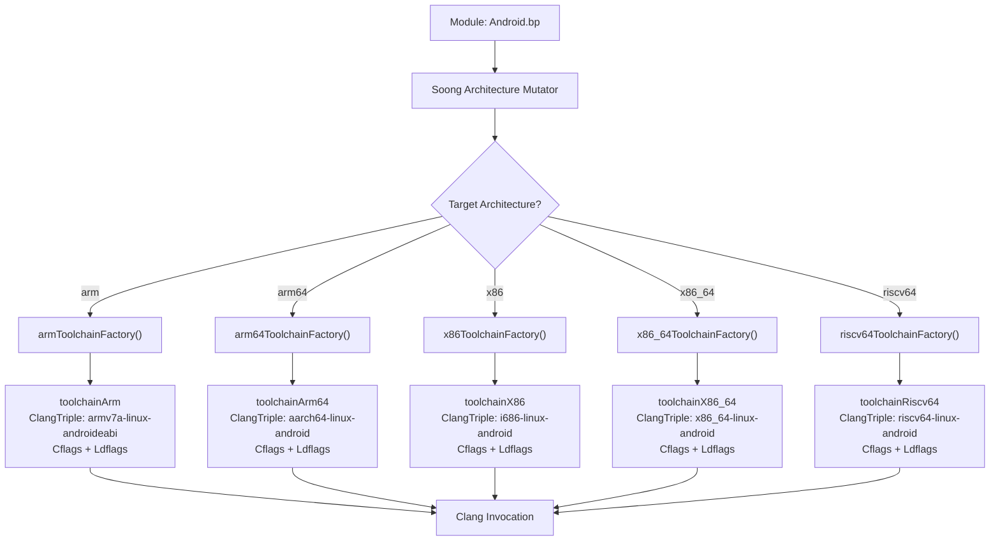

### 59.1.2 Toolchain 接口

所有与架构相关的工具链都实现 `build/soong/cc/config/toolchain.go` 中定义的 `Toolchain` 接口。这是让 Soong 能够在不硬编码任何架构细节的前提下编译 C/C++ 代码的核心抽象：

```go
// build/soong/cc/config/toolchain.go
type Toolchain interface {
    Name() string
    IncludeFlags() string
    ClangTriple() string
    ToolchainCflags() string
    ToolchainLdflags() FlagsWithDeps
    Asflags() string
    Cflags() string
    Cppflags() string
    Ldflags(ctx ToolchainFlagsContext) FlagsWithDeps
    InstructionSetFlags(string) (string, error)
    ndkTriple() string
    YasmFlags() string
    Is64Bit() bool
    ShlibSuffix() string
    ExecutableSuffix() string
    LibclangRuntimeLibraryArch() string
    AvailableLibraries() []string
    CrtBeginStaticBinary() []string
    CrtBeginSharedBinary() []string
    CrtBeginSharedLibrary() []string
    CrtEndStaticBinary() []string
    CrtEndSharedBinary() []string
    CrtEndSharedLibrary() []string
    CrtPadSegmentSharedLibrary() []string
    DefaultSharedLibraries() []string
    Bionic() bool
    Glibc() bool
    Musl() bool
    Lfi() bool
}
```

该接口可以分解为几个逻辑分组：

**身份标识**：`Name()` 和 `ClangTriple()` 用于标识目标。`Name()` 返回一个短标识符，例如 `"arm64"` 或 `"x86"`。`ClangTriple()` 返回配合 `--target=` 标志使用的完整 Clang 目标三元组。

**编译标志**：`Cflags()`、`Cppflags()`、`ToolchainCflags()` 和 `Asflags()` 提供在各个层级传递给编译器的标志。`ToolchainCflags()` 承载架构变体与 CPU 变体特有的标志。这些标志是在基础 `Cflags()` 之上叠加的。

**链接**：`Ldflags()`、`ToolchainLdflags()` 以及 CRT（C 运行时）方法控制二进制文件如何被链接。如今它们都返回 `FlagsWithDeps` 结构体而不是裸字符串。`Ldflags()` 接受一个 `ToolchainFlagsContext`。借助它，工具链可以在计算链接标志的同时注册 Ninja phony 规则或 glob 路径。每个基于 bionic 的工具链都使用 `crtbegin_dynamic` 和 `crtend_android` 之类的 CRT 对象。

**平台**：`Bionic()`、`Glibc()` 和 `Musl()` 指示工具链链接的是哪一个 C 库。`Lfi()` 报告这是否为轻量级故障隔离工具链（见 59.9 节），对于普通的 bionic 工具链默认为 `false`。

基础类型 `toolchain64Bit` 和 `toolchain32Bit` 提供 `Is64Bit()` 方法，而 `toolchainBionic` 提供 Android 特有的 CRT 对象和默认共享库：

```go
// build/soong/cc/config/bionic.go
type toolchainBionic struct {
    toolchainBase
}

var (
    bionicDefaultSharedLibraries = []string{"libc", "libm", "libdl"}

    bionicCrtBeginStaticBinary, bionicCrtEndStaticBinary   = []string{"crtbegin_static"}, []string{"crtend_android"}
    bionicCrtBeginSharedBinary, bionicCrtEndSharedBinary   = []string{"crtbegin_dynamic"}, []string{"crtend_android"}
    bionicCrtBeginSharedLibrary, bionicCrtEndSharedLibrary = []string{"crtbegin_so"}, []string{"crtend_so"}
    bionicCrtPadSegmentSharedLibrary                       = []string{"crt_pad_segment"}
)
```

### 59.1.3 Arch 结构体

Soong 使用 `build/soong/android/arch.go` 中的 `Arch` 结构体来表示目标架构。该结构体承载了选择正确的工具链、编译器标志和源文件所需的全部信息：

```go
// build/soong/android/arch.go
type Arch struct {
    ArchType    ArchType
    ArchVariant string
    CpuVariant  string
    Abi         []string
    ArchFeatures []string
}
```

每个字段都有特定作用：

- **`ArchType`**：`Arm`、`Arm64`、`X86`、`X86_64` 或 `Riscv64` 之一。它决定使用哪个工具链工厂。

- **`ArchVariant`**：ISA 版本，例如 `"armv8-2a"` 或 `"haswell"`。映射到 `-march=` 标志。

- **`CpuVariant`**：具体的 CPU 微架构，例如 `"cortex-a55"` 或 `"kryo385"`。映射到 `-mcpu=` 标志。

- **`Abi`**：所支持的应用程序二进制接口列表，例如 `["arm64-v8a"]` 或 `["armeabi-v7a", "armeabi"]`。

- **`ArchFeatures`**：可选的硬件特性，例如 `"branchprot"` 或 `"sse4_2"`。

`ArchType` 本身是一个包含名称和 multilib 分类的简单结构体：

```go
// build/soong/android/arch.go
type ArchType struct {
    Name     string   // "arm", "arm64", "x86", "x86_64", or "riscv64"
    Field    string   // Property field name, e.g., "Arm64"
    Multilib string   // "lib32" or "lib64"
}
```

五种架构类型都注册为包级变量：

```go
// build/soong/android/arch.go
Arm     = newArch("arm", "lib32")
Arm64   = newArch("arm64", "lib64")
Riscv64 = newArch("riscv64", "lib64")
X86     = newArch("x86", "lib32")
X86_64  = newArch("x86_64", "lib64")
```

当某个 `BoardConfig.mk` 声明 `TARGET_ARCH := arm64` 以及
`TARGET_ARCH_VARIANT := armv8-2a-dotprod` 时，Soong 会构造一个 `Arch` 结构体，
其中 `ArchType=Arm64`、`ArchVariant="armv8-2a-dotprod"`，并带有相应的
`CpuVariant` 和 `ArchFeatures`。该结构体随后被传递给 `arm64ToolchainFactory()`，后者使用每个字段来选择合适的标志。

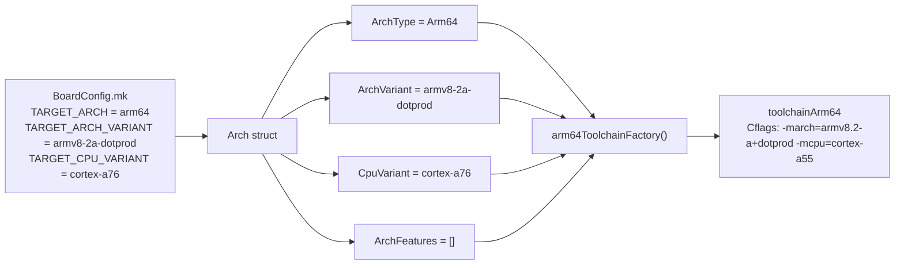

### 59.1.4 工具链中的架构层次

每个架构工具链都通过 Go 结构体嵌入，由三层组装而成：

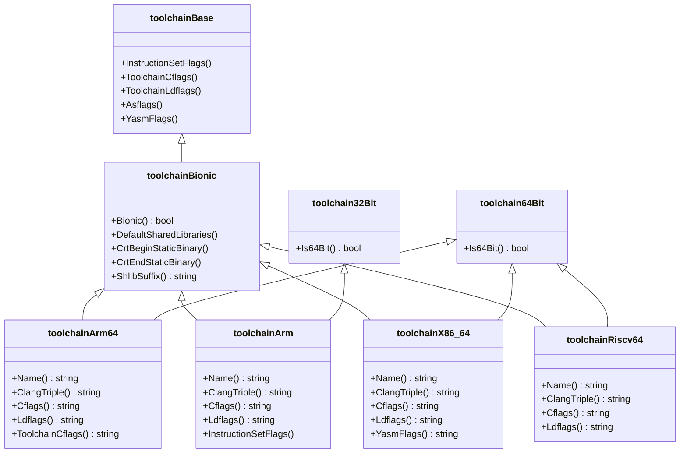

---

## 59.2 ARM64 (AArch64)

ARM64，正式名称为 AArch64，是 Android 设备的主要架构。几乎所有今天出货的手机、平板和可穿戴设备都使用 ARM64 处理器。AOSP 构建系统支持范围很广的 ARM64 微架构，从最初的 ARMv8-A 一直到最新的 ARMv9.4-A 扩展。

**源文件**：`build/soong/cc/config/arm64_device.go`

ARM64 的基础标志现在包含栈冲突保护以及所有 LP64 架构共有的严格隐式声明检查：

```go
// build/soong/cc/config/arm64_device.go
arm64Cflags = []string{
    // Help catch common 32/64-bit errors.
    // Common to all LP64 architectures.
    "-Werror=implicit-function-declaration",

    // For stack allocations larger than a page, touch each page immediately
    // to ensure we hit the guard page on stack overflow.
    // Common to all LP64 architectures.
    "-fstack-clash-protection",
}
```

`-fstack-clash-protection` 标志封堵住一类栈溢出攻击：大块栈分配干净地跳过保护页。编译器在帧增长时逐页探测，因此溢出必然触发异常。完全相同的两条标志也逐字出现在 `riscv64_device.go` 中。

### 59.2.1 架构变体

ARM64 支持十种架构变体，每一种都映射到一个特定的 `-march=` 编译器标志：

```go
// build/soong/cc/config/arm64_device.go
arm64ArchVariantCflags = map[string][]string{
    "armv8-a":            {"-march=armv8-a"},
    "armv8-a-branchprot": {"-march=armv8-a"},
    "armv8-2a":           {"-march=armv8.2-a"},
    "armv8-2a-dotprod":   {"-march=armv8.2-a+dotprod"},
    "armv8-5a":           {"-march=armv8.5-a"},
    "armv8-7a":           {"-march=armv8.7-a"},
    "armv9-a":            {"-march=armv9-a"},
    "armv9-2a":           {"-march=armv9.2-a"},
    "armv9-3a":           {"-march=armv9.3-a"},
    "armv9-4a":           {"-march=armv9.4-a"},
}
```

每种变体都代表 ARM 架构规范的一代，并添加了特性：

| 变体 | ARM 规范 | 关键新增 |
|---|---|---|
| `armv8-a` | ARMv8.0-A | 基础 64 位、NEON、VFPv4、AES、SHA |
| `armv8-a-branchprot` | ARMv8.0-A + PAC/BTI | 分支保护（见下文） |
| `armv8-2a` | ARMv8.2-A | FP16、统计性能剖析 |
| `armv8-2a-dotprod` | ARMv8.2-A + DotProd | 用于机器学习的 INT8 点积 |
| `armv8-5a` | ARMv8.5-A | MTE、BTI、RNG、FRINTTS |
| `armv8-7a` | ARMv8.7-A | 增强 PAC、带超时的 WFI/WFE |
| `armv9-a` | ARMv9.0-A | SVE2、RME、新一代的基础 |
| `armv9-2a` | ARMv9.2-A | SME（可扩展矩阵）、ETE 跟踪 |
| `armv9-3a` | ARMv9.3-A | SME2、扩展 BFloat16 |
| `armv9-4a` | ARMv9.4-A | 最新：SVE2.1、GCS |

`armv8-a-branchprot` 变体值得注意。它使用与普通 `armv8-a` 相同的 `-march=armv8-a` 标志。但构建系统知道要应用 `branchprot` 架构特性。该特性会添加用于硬件强制控制流完整性的编译器标志。

### 59.2.2 分支保护：PAC 与 BTI

指针认证码（PAC）和分支目标标识（BTI）是硬件安全特性。它们抵御 ROP（面向返回编程）和 JOP（面向跳转编程）之类的控制流劫持攻击。

当启用 `branchprot` 特性时，AOSP 会应用这些编译器标志：

```go
// build/soong/cc/config/arm64_device.go
arm64ArchFeatureCflags = map[string][]string{
    // When Pointer Authentication Codes (PAC) are available, -fstack-protector is unnecessary.
    "branchprot": {
        "-mbranch-protection=standard",
        "-fno-stack-protector",
    },
}
```

`-mbranch-protection=standard` 标志告诉 Clang：

1. 用 PAC 指令（`PACIASP` / `AUTIASP`）对返回地址进行签名
2. 在函数入口和分支目标处添加 BTI 着陆点

`-fno-stack-protector` 标志被刻意与 PAC 搭配使用，因为经过 PAC 签名的返回地址已经能够抵御那些破坏返回地址的栈缓冲区溢出。这也正是栈保护器主要防御的威胁。禁用栈保护器避免了冗余的 canary 检查，从而在每个函数入口/出口处节省几条指令。

`branchprot` 特性还会驱动一个相匹配的链接器标志。另一个独立的 `arm64ArchFeatureLdflags` map 要求链接器：如果任何输入目标文件缺少 BTI 标记，就让链接失败。有了这个 map，单个未使用 BTI 的翻译单元就无法悄悄降低整个二进制文件的保护等级：

```go
// build/soong/cc/config/arm64_device.go
arm64ArchFeatureLdflags = map[string][]string{
    "branchprot": {
        "-Wl,-z,bti-report=error",
    },
}
```

这使 BTI 成为二进制文件“全有或全无”的属性。如果每个目标文件都符合 BTI，生成的库就会被打上 `GNU_PROPERTY_AARCH64_FEATURE_1_BTI`
标记，内核会以 `PROT_BTI` 映射其可执行页。如果任何目标文件未加标记，构建就会中断。不会产出悄悄丢掉该保护的二进制文件。

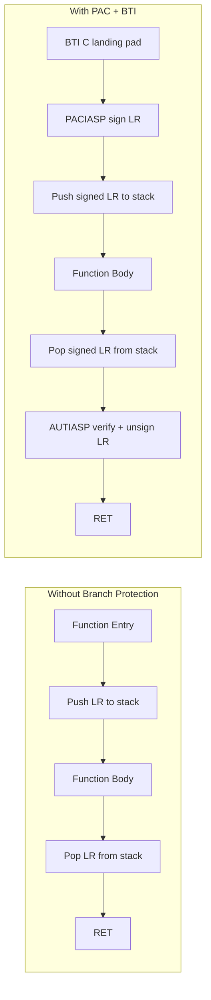

在 PAC+BTI 流程中，如果攻击者覆写栈上保存的 LR，`AUTIASP` 指令就无法认证这个被篡改的指针。这会引发异常。BTI 着陆点确保间接分支只能落在预期的目标上。

### 59.2.3 内存标记扩展（MTE）

ARMv8.5-A 引入了内存标记扩展（MTE），这是一种能检测 use-after-free 和缓冲区溢出等内存安全缺陷的硬件特性。AOSP 在 bionic 层面与 MTE 深度集成。

文件 `bionic/libc/arch-arm64/bionic/note_memtag_heap_async.S` 包含一个 ELF note，请求内核为堆分配启用 MTE：

```asm
// bionic/libc/arch-arm64/bionic/note_memtag_heap_async.S
  .section ".note.android.memtag", "a", %note
  .p2align 2
  .long 1f - 0f                 // int32_t namesz
  .long 3f - 2f                 // int32_t descsz
  .long NT_ANDROID_TYPE_MEMTAG  // int32_t type
0:
  .asciz "Android"              // char name[]
1:
  .p2align 2
2:
  .long (NT_MEMTAG_LEVEL_ASYNC | NT_MEMTAG_HEAP) // value
3:
  .p2align 2
```

Bionic 的 ifunc 分发器也把 MTE 用作选择标准。当硬件支持时，它们会选择支持 MTE 的实现。来自 `bionic/libc/arch-arm64/ifuncs.cpp`：

```cpp
// bionic/libc/arch-arm64/ifuncs.cpp
DEFINE_IFUNC_FOR(memchr) {
  if (arg->_hwcap2 & HWCAP2_MTE) {
    RETURN_FUNC(memchr_func_t, __memchr_aarch64_mte);
  } else {
    RETURN_FUNC(memchr_func_t, __memchr_aarch64);
  }
}
```

支持 MTE 的字符串例程需要特殊处理，因为标记位占用了指针的高位。除非代码被写成标记感知的，否则普通的指针运算或基于 SIMD 的比较都可能意外碰到标记位。

### 59.2.4 CPU 变体调优与 big.LITTLE

ARM 的 big.LITTLE（以及后来的 DynamIQ）异构计算架构将高性能的“大”核心（例如 Cortex-A76）与高效的“LITTLE”核心（例如 Cortex-A55）配对。这带来了一个调度优化挑战：为大核心流水线编译的代码可能在 LITTLE 核心上停滞。

AOSP 采取了一种务实的做法。它针对 LITTLE 核心调优代码。这是因为这类代码在两种核心上都能正确运行（并且速度可接受）。而针对大核心调优的代码在 LITTLE 核心上可能会慢得离谱：

```go
// build/soong/cc/config/arm64_device.go
"cortex-a75": []string{
    // Use the cortex-a55 since it is similar to the little
    // core (cortex-a55) and is sensitive to ordering.
    "-mcpu=cortex-a55",
},
"cortex-a76": []string{
    // Use the cortex-a55 since it is similar to the little
    // core (cortex-a55) and is sensitive to ordering.
    "-mcpu=cortex-a55",
},
```

这并非源代码中的错误。注释解释了其中的理由。Cortex-A75（大）和 Cortex-A76（大）变体刻意使用
`-mcpu=cortex-a55`（LITTLE），因为小核心的指令调度“对顺序敏感”。这意味着小核心上糟糕的调度会造成显著的性能下降。相比之下，大核心的乱序流水线可以补偿欠佳的调度。

完整的 ARM64 CPU 变体集合：

```go
// build/soong/cc/config/arm64_device.go (condensed)
arm64CpuVariantCflags = map[string][]string{
    "cortex-a53": {"-mcpu=cortex-a53"},
    "cortex-a55": {"-mcpu=cortex-a55"},
    "cortex-a75": {"-mcpu=cortex-a55"},  // Uses little core tuning
    "cortex-a76": {"-mcpu=cortex-a55"},  // Uses little core tuning
    "kryo":       {"-mcpu=kryo"},
    "kryo385":    {"-mcpu=cortex-a53"},  // kryo385 not in clang
    "exynos-m1":  {"-mcpu=exynos-m1"},
    "exynos-m2":  {"-mcpu=exynos-m2"},
}
```

从 CPU 变体到编译标志的映射通过两级查找来解决。首先是变体到变量的 map：

```go
// build/soong/cc/config/arm64_device.go
arm64CpuVariantCflagsVar = map[string]string{
    "cortex-a53": "${config.Arm64CortexA53Cflags}",
    "cortex-a55": "${config.Arm64CortexA55Cflags}",
    "cortex-a72": "${config.Arm64CortexA53Cflags}",
    "cortex-a73": "${config.Arm64CortexA53Cflags}",
    "cortex-a75": "${config.Arm64CortexA55Cflags}",
    "cortex-a76": "${config.Arm64CortexA55Cflags}",
    "kryo":       "${config.Arm64KryoCflags}",
    "kryo385":    "${config.Arm64CortexA53Cflags}",
    "exynos-m1":  "${config.Arm64ExynosM1Cflags}",
    "exynos-m2":  "${config.Arm64ExynosM2Cflags}",
}
```

请注意大核心（A72、A73、A75、A76）如何全部映射到它们对应的 LITTLE 核心标志（A53 或 A55）。

### 59.2.5 Cortex-A53 勘误变通方案

Cortex-A53 是历史上部署最广的 ARM 核心之一，它有两个著名的硬件勘误。Soong 只在链接时对其中之一，即勘误 843419，做了变通处理：

```go
// build/soong/cc/config/arm64_device.go
pctx.StaticVariable("Arm64FixCortexA53Ldflags", "-Wl,--fix-cortex-a53-843419")
```

```go
// build/soong/cc/config/arm64_device.go
arm64CpuVariantLdflags = map[string]string{
    "cortex-a53": "${config.Arm64FixCortexA53Ldflags}",
    "cortex-a72": "${config.Arm64FixCortexA53Ldflags}",
    "cortex-a73": "${config.Arm64FixCortexA53Ldflags}",
    "kryo":       "${config.Arm64FixCortexA53Ldflags}",
    "exynos-m1":  "${config.Arm64FixCortexA53Ldflags}",
    "exynos-m2":  "${config.Arm64FixCortexA53Ldflags}",
}
```

**勘误 843419** 会在 ADRP 指令的某些序列出现在页边界附近时导致错误的执行。链接器标志
`--fix-cortex-a53-843419` 告诉 LLD 检测这些有问题的模式，并插入 veneer 代码来规避它们。该修复同样应用于 A72、A73、Kryo 和 Exynos 核心。这是因为在 big.LITTLE 配置中，这些核心可能与 A53 LITTLE 核心配对使用。

另一个著名的 A53 勘误，835769（乘加的一个边界情形），在 Soong 层面没有变通方案。ART 在其指令集特性模型中单独跟踪它
（`art/runtime/arch/arm64/instruction_set_features_arm64.h`），因此编译器可以避免发出有问题的指令序列。59.8.8 节展示了 ART 为此查询的变体列表。

### 59.2.6 ARM64 工具链工厂

工厂把标志组装委托给一个辅助函数 `arm64ToolchainFlags`，它返回工具链 Cflags 与工具链 Ldflags 作为一个二元组。把该辅助函数拆分出来，可以让 LFI 工具链（59.9 节）复用完全相同的标志逻辑：

```go
// build/soong/cc/config/arm64_device.go
func arm64ToolchainFactory(arch android.Arch) Toolchain {
    toolchainCflags, toolchainLdflags := arm64ToolchainFlags(arch)
    return &toolchainArm64{
        toolchainCflags:  toolchainCflags,
        toolchainLdflags: toolchainLdflags,
    }
}

func arm64ToolchainFlags(arch android.Arch) (string, string) {
    // Error now rather than having a confusing Ninja error
    if _, ok := arm64ArchVariantCflags[arch.ArchVariant]; !ok {
        panic(fmt.Sprintf("Unknown ARM64 architecture version: %q", arch.ArchVariant))
    }

    toolchainCflags := []string{"${config.Arm64" + arch.ArchVariant + "VariantCflags}"}
    toolchainCflags = append(toolchainCflags,
        variantOrDefault(arm64CpuVariantCflagsVar, arch.CpuVariant))
    for _, feature := range arch.ArchFeatures {
        toolchainCflags = append(toolchainCflags, arm64ArchFeatureCflags[feature]...)
    }

    extraLdflags := []string{"${config.Arm64Ldflags}"}
    extraLdflags = append(extraLdflags,
        variantOrDefault(arm64CpuVariantLdflags, arch.CpuVariant))
    for _, feature := range arch.ArchFeatures {
        extraLdflags = append(extraLdflags, arm64ArchFeatureLdflags[feature]...)
    }
    return strings.Join(toolchainCflags, " "), strings.Join(extraLdflags, " ")
}
```

工具链 Ldflags 如今会并入两组链接器标志。一组是按 CPU 变体（Cortex-A53 勘误修复）。另一组是按特性（`branchprot` 的 BTI 报告标志）。它们承载在工具链的
`toolchainLdflags` 字段上。它们通过 `ToolchainLdflags()` 暴露出来，后者返回一个 `FlagsWithDeps`。

标志按以下顺序分层：

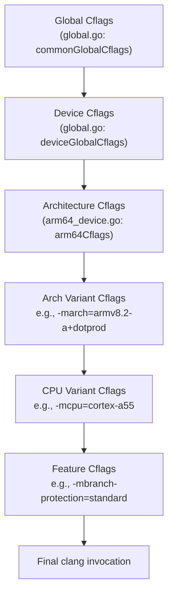

### 59.2.7 页大小配置

ARM64 支持多种页大小（4KB、16KB、64KB）。链接器标志为保证段对齐而强制使用最大页大小：

```go
// build/soong/cc/config/arm64_device.go
pctx.VariableFunc("Arm64Ldflags", func(ctx android.PackageVarContext) string {
    maxPageSizeFlag := "-Wl,-z,max-page-size=" + ctx.Config().MaxPageSizeSupported()
    flags := append(arm64Ldflags, maxPageSizeFlag)
    return strings.Join(flags, " ")
})
```

`MaxPageSizeSupported()` 是链接器用于 ELF 段边界的对齐值，在 ARM64 上不再是硬编码的 4096。从 Android 17 起，构建系统将其默认值设为 16384，适用于 arm64 和 x86_64 设备。平台二进制文件随之对齐，以便在 16KB 页内核上正确加载。59.10 节梳理了该默认值以及随之而来的 bionic 侧宏变化。

基础链接器标志还包含用于安全的段分离：

```go
// build/soong/cc/config/arm64_device.go
arm64Ldflags = []string{
    // Separate-code is required for XOM
    "-Wl,-z,separate-code",
    "-Wl,-z,separate-loadable-segments",
}
```

这些标志确保代码段、数据段和只读段被放置在不同的内存页中。这可以防止意外（或恶意）地执行数据或修改代码。其中 `separate-code`
标志正是使仅执行内存（XOM）成为可能的原因。它让代码避开任何同时持有可读数据的页。因此，能够读取进程内存的攻击者无法读回指令流来构造代码复用负载。

---

## 59.3 x86 与 x86_64

x86 架构家族在 AOSP 中承担两个主要角色。它是 Chromebook 和嵌入式设备的目标。它也是 Android 模拟器的原生架构。模拟器历史上通过翻译来运行 ARM 镜像，但原生 x86/x86_64 镜像在开发过程中提供了大幅更好的性能。

**源文件**：

- `build/soong/cc/config/x86_device.go`
- `build/soong/cc/config/x86_64_device.go`

### 59.3.1 x86 架构变体

x86（32 位）工具链支持一系列广泛的 Intel 微架构：

```go
// build/soong/cc/config/x86_device.go
x86ArchVariantCflags = map[string][]string{
    "": []string{
        "-march=prescott",
    },
    "x86_64": []string{
        "-march=prescott",
    },
    "alderlake": []string{"-march=alderlake"},
    "atom":      []string{"-march=atom"},
    "broadwell": []string{"-march=broadwell"},
    "goldmont":  []string{"-march=goldmont"},
    "goldmont-plus": []string{"-march=goldmont-plus"},
    "goldmont-without-sha-xsaves": []string{
        "-march=goldmont",
        "-mno-sha",
        "-mno-xsaves",
    },
    "haswell":     []string{"-march=core-avx2"},
    "ivybridge":   []string{"-march=core-avx-i"},
    "pantherlake": []string{"-march=pantherlake"},
    "sandybridge": []string{"-march=corei7"},
    "silvermont":  []string{"-march=slm"},
    "skylake":     []string{"-march=skylake"},
    "stoneyridge": []string{"-march=bdver4"},
    "tremont":     []string{"-march=tremont"},
}
```

x86_64 工具链有着几乎相同的微架构变体集合。它去掉了 `atom` 条目和 `x86_64` 别名。它的默认值映射到基线 `-march=x86-64`：

```go
// build/soong/cc/config/x86_64_device.go
x86_64ArchVariantCflags = map[string][]string{
    "": []string{"-march=x86-64"},
    "alderlake":   []string{"-march=alderlake"},
    "broadwell":   []string{"-march=broadwell"},
    "goldmont":    []string{"-march=goldmont"},
    // ... remaining variants as in x86 (but no "atom" or "x86_64" keys)
    "haswell":     []string{"-march=core-avx2"},
    "pantherlake": []string{"-march=pantherlake"},
    "skylake":     []string{"-march=skylake"},
    "tremont":     []string{"-march=tremont"},
}
```

x86 的默认值是 `prescott`（带 SSE3 的 Pentium 4），而 x86_64 默认为基线 `x86-64` 指令集。

`pantherlake` 变体是 Android 17 中新增的。Panther Lake 是 Intel 继 Lunar Lake 和 Arrow Lake 之后的移动级混合设计。此处的变体条目让 Soong 能够为那些把它声明为 `TARGET_ARCH_VARIANT` 的板卡发出 `-march=pantherlake`。ART 在其 x86 和 x86_64 指令集特性表中识别同一个变体字符串（`art/runtime/arch/x86/instruction_set_features_x86.cc` 中的 `x86_known_variants`）。因此，JIT 和 AOT 编译器可以像静态工具链那样以 `pantherlake` 为键。第 18 章介绍了 ART 如何使用这些特性集。

### 59.3.2 SIMD 指令集：SSE 与 AVX

x86 的 SIMD 局面比 ARM 的 NEON 更为碎片化——与单一强制性的 SIMD 扩展不同，x86 有一系列可选的扩展。x86 和 x86_64 工具链都为它们定义了特性标志：

```go
// build/soong/cc/config/x86_64_device.go
x86_64ArchFeatureCflags = map[string][]string{
    "ssse3":  []string{"-mssse3"},
    "sse4":   []string{"-msse4"},
    "sse4_1": []string{"-msse4.1"},
    "sse4_2": []string{"-msse4.2"},

    // Not all cases there is performance gain by enabling -mavx -mavx2
    // flags so these flags are not enabled by default.
    // if there is performance gain in individual library components,
    // the compiler flags can be set in corresponding bp files.
    // "avx":    []string{"-mavx"},
    // "avx2":   []string{"-mavx2"},
    // "avx512": []string{"-mavx512"}

    "popcnt": []string{"-mpopcnt"},
    "aes_ni": []string{"-maes"},
}
```

注意被注释掉的 AVX/AVX2/AVX512 条目。注释解释了其中的理由：AVX 并不总能带来性能提升。事实上，在某些 Intel 处理器上，AVX 指令会导致 CPU 降低其时钟频率（“AVX 频率降频”）。这实际上可能损害那些混合使用 AVX 与非 AVX 指令的代码的性能。个别库在知道 AVX 有帮助时，可以通过自己的 `Android.bp` 文件选择启用 AVX。

### 59.3.3 x86 特有的编译器标志

32 位 x86 工具链有几个独特的要求：

```go
// build/soong/cc/config/x86_device.go
x86Cflags = []string{
    "-msse3",
    // -mstackrealign is needed to realign stack in native code
    // that could be called from JNI, so that movaps instruction
    // will work on assumed stack aligned local variables.
    "-mstackrealign",
    // For stack allocations larger than a page, touch each page immediately
    // to ensure we hit the guard page on stack overflow.
    "-fstack-clash-protection",
}
```

`-mstackrealign` 标志解决一个微妙的 ABI 问题。i386 System V ABI 只要求 4 字节栈对齐，但 `movaps` 之类的 SSE 指令要求 16 字节对齐。当原生代码从 JNI（经由 Dalvik/ART 运行时）被调用时，栈可能不是 16 字节对齐的，这会导致崩溃。`-mstackrealign` 会在函数入口处插入代码来重新对齐栈。

x86 工具链还使用 Yasm 来处理汇编：

```go
// build/soong/cc/config/x86_device.go
pctx.StaticVariable("X86YasmFlags", "-f elf32 -m x86")
```

```go
// build/soong/cc/config/x86_64_device.go
pctx.StaticVariable("X86_64YasmFlags", "-f elf64 -m amd64")
```

### 59.3.4 x86 工具链结构

两个 x86 工具链共享与 ARM64 相同的模式：

```go
// build/soong/cc/config/x86_device.go
type toolchainX86 struct {
    toolchainBionic
    toolchain32Bit
    toolchainCflags string
}
```

```go
// build/soong/cc/config/x86_64_device.go
type toolchainX86_64 struct {
    toolchainBionic
    toolchain64Bit
    toolchainCflags string
}
```

与 ARM64 的关键区别在于显式的 `-m32`/`-m64` 工具链标志，它们控制代码生成模型：

```go
// build/soong/cc/config/x86_device.go
pctx.StaticVariable("X86ToolchainCflags", "-m32")
pctx.StaticVariable("X86ToolchainLdflags", "-m32")
```

```go
// build/soong/cc/config/x86_64_device.go
pctx.StaticVariable("X86_64ToolchainCflags", "-m64")
pctx.StaticVariable("X86_64ToolchainLdflags", "-m64")
```

### 59.3.5 用于 ARM 兼容性的 Native Bridge

x86/x86_64 Android 设备面临一个兼容性挑战：绝大多数 Android NDK 应用都是为 ARM 编译的。为了运行这些应用，AOSP 包含了 Native Bridge 基础设施，它提供透明的二进制翻译。

Native Bridge 机制定义在
`frameworks/libs/binary_translation/native_bridge/native_bridge.h` 中，它声明了
`NativeBridgeCallbacks` 接口：

```cpp
// frameworks/libs/binary_translation/native_bridge/native_bridge.h
struct NativeBridgeCallbacks {
  uint32_t version;

  bool (*initialize)(const NativeBridgeRuntimeCallbacks* runtime_cbs,
                     const char* private_dir,
                     const char* instruction_set);

  void* (*loadLibrary)(const char* libpath, int flag);

  // Get a native bridge trampoline for specified native method.
  // The trampoline has same signature as the native method.
  ...
};
```

Native Bridge 拦截库的加载。当 ART 的类加载器遇到一个为外部架构编译的原生库时，它会委托给 native bridge 实现。该实现翻译外部代码。

存在三种实现：

- **Berberis**（开源，位于 `frameworks/libs/binary_translation/`）——
  Google 用于把 RISC-V 翻译到 x86_64 的参考实现

- **Houdini**（专有，来自 Intel）—— 把 ARM/ARM64 翻译到 x86/x86_64

- **DigitalisX64**（开源，[https://github.com/DigitalisX64](https://github.com/DigitalisX64)）——
  基于 Berberis 构建的社区实现，支持把 ARM64 翻译到 x86_64

模拟器使用不同的策略。它在基于 QEMU 的全系统模拟以及硬件加速虚拟化之下运行 ARM 系统镜像。因此，native bridge 并不参与典型的模拟器工作流程。

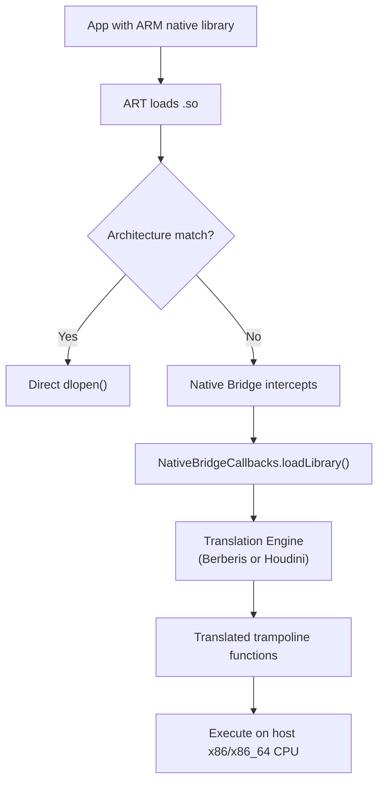

### 59.3.6 模拟器目标

默认的 x86_64 通用设备配置面向模拟器：

```makefile
# device/generic/x86_64/BoardConfig.mk
TARGET_CPU_ABI := x86_64
TARGET_ARCH := x86_64
TARGET_ARCH_VARIANT := x86_64

TARGET_2ND_CPU_ABI := x86
TARGET_2ND_ARCH := x86
TARGET_2ND_ARCH_VARIANT := x86_64
```

`goldmont-without-sha-xsaves` 变体值得特别一提：它面向 Intel Goldmont（Apollo Lake）处理器，但禁用了 SHA 和 XSAVES 指令。之所以存在，是因为某些 Chromebook 和嵌入式设备使用基于 Goldmont 的处理器，而这些处理器并未实现这些可选扩展：

```go
"goldmont-without-sha-xsaves": []string{
    "-march=goldmont",
    "-mno-sha",
    "-mno-xsaves",
},
```

### 59.3.7 ARM 32 位：遗留的次要架构

AOSP 中的 ARM 32 位支持主要作为 ARM64 设备的次要架构而存在，以便遗留的 32 位应用能够运行。ARM 工具链是所有五种架构中最复杂的。这是因为它支持最广泛的 CPU 变体（从古老的 Cortex-A7 到 32 位模式下的现代 Cortex-A76）。它还支持两种指令编码（ARM 和 Thumb）。

ARM 工具链结构体反映了它的 32 位特性：

```go
// build/soong/cc/config/arm_device.go
type toolchainArm struct {
    toolchainBionic
    toolchain32Bit
    ldflags         string
    toolchainCflags string
}
```

ARM 工厂函数组装三级标志：

```go
// build/soong/cc/config/arm_device.go
func armToolchainFactory(arch android.Arch) Toolchain {
    toolchainCflags := make([]string, 2, 3)

    toolchainCflags[0] = "${config.ArmToolchainCflags}"
    toolchainCflags[1] = armArchVariantCflagsVar[arch.ArchVariant]

    toolchainCflags = append(toolchainCflags,
        variantOrDefault(armCpuVariantCflagsVar, arch.CpuVariant))

    return &toolchainArm{
        ldflags:         "${config.ArmLdflags}",
        toolchainCflags: strings.Join(toolchainCflags, " "),
    }
}
```

**第 1 层** —— `ArmToolchainCflags`：`-msoft-float` 标志，它对所有 ARM 32 位 Android 目标都是通用的。

**第 2 层** —— 架构变体：`armv7-a`、`armv7-a-neon`、`armv8-a` 或
`armv8-2a` 之一，决定基线 ISA 和 FPU 配置。

**第 3 层** —— CPU 变体：具体的核心调优，从一个包含 18 种不同变体的 map 中选出：

```go
// build/soong/cc/config/arm_device.go
armCpuVariantCflagsVar = map[string]string{
    "":               "${config.ArmGenericCflags}",
    "cortex-a7":      "${config.ArmCortexA7Cflags}",
    "cortex-a8":      "${config.ArmCortexA8Cflags}",
    "cortex-a9":      "${config.ArmGenericCflags}",
    "cortex-a15":     "${config.ArmCortexA15Cflags}",
    "cortex-a32":     "${config.ArmCortexA32Cflags}",
    "cortex-a53":     "${config.ArmCortexA53Cflags}",
    "cortex-a53.a57": "${config.ArmCortexA53Cflags}",
    "cortex-a55":     "${config.ArmCortexA55Cflags}",
    "cortex-a72":     "${config.ArmCortexA53Cflags}",
    "cortex-a73":     "${config.ArmCortexA53Cflags}",
    "cortex-a75":     "${config.ArmCortexA55Cflags}",
    "cortex-a76":     "${config.ArmCortexA55Cflags}",
    "krait":          "${config.ArmKraitCflags}",
    "kryo":           "${config.ArmKryoCflags}",
    "kryo385":        "${config.ArmCortexA53Cflags}",
    "exynos-m1":      "${config.ArmCortexA53Cflags}",
    "exynos-m2":      "${config.ArmCortexA53Cflags}",
}
```

Cortex-A8 勘误变通方案也专属于 ARM 32 位：

```go
// build/soong/cc/config/arm_device.go
armFixCortexA8LdFlags   = []string{"-Wl,--fix-cortex-a8"}
armNoFixCortexA8LdFlags = []string{"-Wl,--no-fix-cortex-a8"}
```

Cortex-A8 存在一个硬件缺陷，可能导致某些跳转到跳转的指令序列执行错误。这与 ARM64 工具链中处理的 Cortex-A53 勘误是分开的。

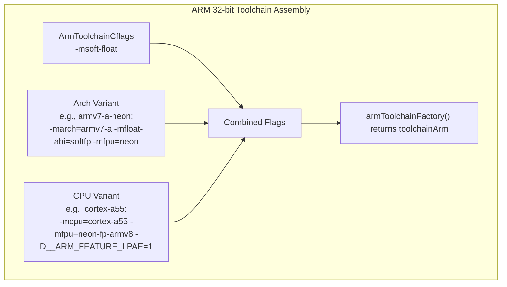

### 59.3.8 ARM 32 位链接器配置

ARM 32 位链接器有自己的特定标志：

```go
// build/soong/cc/config/arm_device.go
armLdflags = []string{
    "-Wl,-m,armelf",
    "-Wl,-mllvm", "-Wl,-enable-shrink-wrap=false",
}
```

`-Wl,-m,armelf` 标志告诉链接器使用 ARM ELF 格式。`-enable-shrink-wrap=false` 标志禁用了一项会导致错误代码生成的 LLVM 优化（跟踪编号为 bug b/322359235）。同样的变通方案同时出现在编译器和链接器标志中。这表明硬件勘误和编译器缺陷如何在工具链中交织出一张复杂的变通方案网络。

---

## 59.4 RISC-V 64

RISC-V 是 AOSP 支持的最新架构，于 2022 年首次加入。它是一种开放、免版税的指令集架构，已经引起了业界的广泛关注。AOSP 的 RISC-V 移植仍在成熟中，这一点体现在配置文件更小，以及对不完整工具链支持的显式变通方案上。

**源文件**：`build/soong/cc/config/riscv64_device.go`

### 59.4.1 基础 ISA 与扩展

RISC-V 配置指定了一组丰富的扩展。截至 Android 17，其基线与 ARM64 共享相同的 LP64 加固标志
（`-Werror=implicit-function-declaration` 和 `-fstack-clash-protection`）。ISA 字符串还新增了一个向量位操作扩展：

```go
// build/soong/cc/config/riscv64_device.go
riscv64Cflags = []string{
    // Help catch common 32/64-bit errors.
    // Common to all LP64 architectures.
    "-Werror=implicit-function-declaration",

    // For stack allocations larger than a page, touch each page immediately
    // to ensure we hit the guard page on stack overflow.
    // Common to all LP64 architectures.
    "-fstack-clash-protection",

    // This is already the driver's Android default, but duplicated here (and
    // below) for ease of experimentation with additional extensions.
    "-march=rv64gcv_zba_zbb_zbs_zvbb",
    // TODO: remove when qemu V works (https://gitlab.com/qemu-project/qemu/-/issues/1976)
    // (Note that we'll probably want to wait for berberis to be good enough
    // that most people don't care about qemu's V performance either!)
    "-mno-implicit-float",
}
```

ISA 字符串 `-march=rv64gcv_zba_zbb_zbs_zvbb` 的解析如下：

| 组成部分 | 含义 |
|---|---|
| `rv64` | 64 位基础整数 ISA（RV64I） |
| `g` | “General” = `IMAFD`（整数、乘法、原子、浮点、双精度） |
| `c` | 压缩指令（常见操作的 16 位编码） |
| `v` | 向量扩展（RISC-V V 1.0） |
| `zba` | 地址生成指令（sh1add、sh2add、sh3add） |
| `zbb` | 基础位操作（clz、ctz、cpop、rev8 等） |
| `zbs` | 单比特指令（bset、bclr、binv、bext） |
| `zvbb` | 向量基础位操作（向量 clz/ctz/popcount/rotate） |

这是一个相当现代的基线。向量扩展尤其启用了类似 SIMD 的操作，与 ARM 的 NEON 或 Intel 的 SSE 类似。它的设计是可扩展的，并不硬编码向量宽度。Android 17 中新增的 `zvbb` 扩展把相同的位操作原语（统计前导零、统计 1 的个数、循环移位）带到了向量寄存器上。这对加密和哈希内核很有用。

### 59.4.2 QEMU 与 Berberis 变通方案

RISC-V 配置中包含一条揭示生态现状的 TODO 注释：

```go
// TODO: remove when qemu V works (https://gitlab.com/qemu-project/qemu/-/issues/1976)
// (Note that we'll probably want to wait for berberis to be good enough
// that most people don't care about qemu's V performance either!)
"-mno-implicit-float",
```

这条注释揭示了 RISC-V 开发的务实挑战。QEMU 的向量扩展支持尚不完整。Berberis 二进制翻译器（可以把 RISC-V 翻译到 x86_64 以用于开发）仍在成熟中。`-mno-implicit-float` 标志阻止编译器自动对非浮点操作（例如结构体拷贝）使用浮点或向量指令，这绕开了 QEMU V 的缺陷。

### 59.4.3 最小变体配置

与 ARM64 和 x86 不同，RISC-V 没有 CPU 变体调优：

```go
// build/soong/cc/config/riscv64_device.go
riscv64ArchVariantCflags = map[string][]string{}
riscv64CpuVariantCflags  = map[string][]string{}
```

变体 map 是空的，工厂函数只接受默认的（空字符串）变体：

```go
// build/soong/cc/config/riscv64_device.go
func riscv64ToolchainFactory(arch android.Arch) Toolchain {
    switch arch.ArchVariant {
    case "":
    default:
        panic(fmt.Sprintf("Unknown Riscv64 architecture version: %q", arch.ArchVariant))
    }
    // ...
}
```

这种简洁反映了当前 RISC-V Android 生态的状况。只有一种目标配置。硬件格局尚未多样化到需要进行微架构级调优的程度。

### 59.4.4 RISC-V 链接器配置

RISC-V 链接器标志很直白：

```go
// build/soong/cc/config/riscv64_device.go
riscv64Ldflags = []string{
    // This is already the driver's Android default, but duplicated here (and
    // above) for ease of experimentation with additional extensions.
    "-march=rv64gcv_zba_zbb_zbs_zvbb",
    "-Wl,-z,max-page-size=4096",
}
```

注意硬编码的 4KB 页大小。ARM64 和 x86_64 不同：它们的最大页大小来自可配置的 `MaxPageSizeSupported()`（在 Android 17 中默认为 16KB；见 59.10 节）。RISC-V Android 目前只支持 4KB 页。

### 59.4.5 Berberis 二进制翻译

`frameworks/libs/binary_translation/` 目录包含 Berberis，即 Google 的开源二进制翻译框架。虽然 Berberis 主要为把客户机架构翻译到 x86_64 主机系统而设计，但它对 RISC-V 开发具有战略意义：

```
frameworks/libs/binary_translation/
    base/                 - Common utilities
    cpu_emulation/        - The translation engine proper:
        assembler/          - Code generation backend
        backend/            - Translation engine
        decoder/            - Guest instruction decoder
        interpreter/        - Interpreted execution fallback
        lite_translator/    - Lightweight translation path
        heavy_optimizer/    - Full optimization path
    exec_region/          - Executable code region management
    guest_abi/            - ABI conversion layer
    guest_loader/         - Library loading and linking
    guest_os_primitives/  - Guest signal/thread/memory primitives
    guest_state/          - CPU state abstraction
    jni/                  - JNI trampoline generation
    native_bridge/        - NativeBridge interface implementation
    android_api/          - Framework API proxies
    runtime/              - Translation runtime
    tiny_loader/          - Minimal ELF loader
```

顶层目录中的 Berberis `enable_riscv64_to_x86_64.mk` 文件揭示了主要翻译方向：在 x86_64 主机上运行 RISC-V 64 客户机代码。这让开发者可以在 x86_64 工作站上使用 RISC-V Android 镜像工作。

### 59.4.6 ART RISC-V 特性检测

ART 运行时对 RISC-V 有完整支持，并带有自己的 ISA 特性跟踪。`Riscv64InstructionSetFeatures` 类把扩展跟踪为一个位图：

```cpp
// art/runtime/arch/riscv64/instruction_set_features_riscv64.h
class Riscv64InstructionSetFeatures final : public InstructionSetFeatures {
 public:
  enum {
    kExtGeneric    = (1 << 0),  // G extension covers the basic set IMAFD
    kExtCompressed = (1 << 1),  // C extension adds compressed instructions
    kExtVector     = (1 << 2),  // V extension adds vector instructions
    kExtZba        = (1 << 3),  // Zba adds address generation bit-manipulation instructions
    kExtZbb        = (1 << 4),  // Zbb adds basic bit-manipulation instructions
    kExtZbs        = (1 << 5),  // Zbs adds single-bit bit-manipulation instructions
  };
```

ART 的特性位图跟踪六个扩展（G、C、V、Zba、Zbb、Zbs）。请注意，Soong 工具链如今在编译时请求 `zvbb`（59.4.1 节）。但 ART 还没有 `zvbb` 位，因此 JIT 不会以它为键。这是构建工具链领先于 ART 运行时特性模型的一个小型例子。

特性方法让 ART 的 JIT 编译器能够查询能力：

```cpp
// art/runtime/arch/riscv64/instruction_set_features_riscv64.h
bool HasCompressed() const { return (bits_ & kExtCompressed) != 0; }
bool HasVector() const { return (bits_ & kExtVector) != 0; }
bool HasZba() const { return (bits_ & kExtZba) != 0; }
bool HasZbb() const { return (bits_ & kExtZbb) != 0; }
bool HasZbs() const { return (bits_ & kExtZbs) != 0; }
```

`FromVariant()` 的实现目前只识别 `"generic"` 变体，并使用完整的基础特性集：

```cpp
// art/runtime/arch/riscv64/instruction_set_features_riscv64.cc
constexpr uint32_t BasicFeatures() {
  return Riscv64InstructionSetFeatures::kExtGeneric |
         Riscv64InstructionSetFeatures::kExtCompressed |
         Riscv64InstructionSetFeatures::kExtVector |
         Riscv64InstructionSetFeatures::kExtZba |
         Riscv64InstructionSetFeatures::kExtZbb |
         Riscv64InstructionSetFeatures::kExtZbs;
}

Riscv64FeaturesUniquePtr Riscv64InstructionSetFeatures::FromVariant(
    const std::string& variant, [[maybe_unused]] std::string* error_msg) {
  if (variant != "generic") {
    LOG(WARNING) << "Unexpected CPU variant for Riscv64 using defaults: " << variant;
  }
  return Riscv64FeaturesUniquePtr(new Riscv64InstructionSetFeatures(BasicFeatures()));
}
```

从 C 预处理器宏定义进行的特性检测也已实现，允许构建系统在编译时检测扩展：

```cpp
// art/runtime/arch/riscv64/instruction_set_features_riscv64.cc
Riscv64FeaturesUniquePtr Riscv64InstructionSetFeatures::FromCppDefines() {
  // Assume kExtGeneric is always present.
  uint32_t bits = kExtGeneric;
#ifdef __riscv_c
  bits |= kExtCompressed;
#endif
#ifdef __riscv_v
  bits |= kExtVector;
#endif
#ifdef __riscv_zba
  bits |= kExtZba;
#endif
#ifdef __riscv_zbb
  bits |= kExtZbb;
#endif
#ifdef __riscv_zbs
  bits |= kExtZbs;
#endif
  return FromBitmap(bits);
}
```

注意 `FromCpuInfo()` 和 `FromHwcap()` 方法尚未针对 RISC-V 实现：

```cpp
// art/runtime/arch/riscv64/instruction_set_features_riscv64.cc
Riscv64FeaturesUniquePtr Riscv64InstructionSetFeatures::FromCpuInfo() {
  UNIMPLEMENTED(WARNING);
  return FromCppDefines();
}

Riscv64FeaturesUniquePtr Riscv64InstructionSetFeatures::FromHwcap() {
  UNIMPLEMENTED(WARNING);
  return FromCppDefines();
}
```

`UNIMPLEMENTED(WARNING)` 调用表明 RISC-V 的运行时硬件检测尚未完成，这是该架构在 AOSP 中处于早期采用阶段的又一个标志。

### 59.4.7 比较 RISC-V 与 ARM64 的特性跟踪

ART 中 RISC-V 与 ARM64 特性跟踪的对比揭示了成熟度差距：

| 方面 | ARM64 | RISC-V 64 |
|---|---|---|
| CPU 变体 | 识别 15+ 种 | 仅 "generic" |
| 特性标志 | 7（CRC、LSE、FP16、DotProd、SVE、勘误） | 6（G、C、V、Zba、Zbb、Zbs） |
| FromHwcap() | 完全实现 | UNIMPLEMENTED |
| FromCpuInfo() | 完全实现 | UNIMPLEMENTED |
| 勘误跟踪 | A53 835769、A53 843419 | 无 |
| 运行时校验 | 有（Pixel 3a 变通方案） | 无 |
| SVE 支持 | 已定义但被禁用（`kArm64AllowSVE = false`） | 不适用 |

ARM64 特性头文件显式禁用了 SVE：

```cpp
// art/runtime/arch/arm64/instruction_set_features_arm64.h
// SVE is currently not enabled.
static constexpr bool kArm64AllowSVE = false;
```

这意味着尽管 Soong 工具链支持 ARMv9 变体（其中包含 SVE2），ART 的 JIT 编译器尚未生成 SVE
指令。这是一个务实的选择——SVE 支持需要对寄存器分配器和指令选择器进行重大改动。

### 59.4.8 ART ARM64 特性位图

ART 把 ARM64 特性存储为紧凑位图以便序列化：

```cpp
// art/runtime/arch/arm64/instruction_set_features_arm64.h
enum {
    kA53Bitfield     = 1 << 0,
    kCRCBitField     = 1 << 1,
    kLSEBitField     = 1 << 2,
    kFP16BitField    = 1 << 3,
    kDotProdBitField = 1 << 4,
    kSVEBitField     = 1 << 5,
};
```

私有成员变量跟踪每个特性：

```cpp
// art/runtime/arch/arm64/instruction_set_features_arm64.h
const bool fix_cortex_a53_835769_;
const bool fix_cortex_a53_843419_;
const bool has_crc_;      // optional in ARMv8.0, mandatory in ARMv8.1
const bool has_lse_;      // ARMv8.1 Large System Extensions
const bool has_fp16_;     // ARMv8.2 FP16 extensions
const bool has_dotprod_;  // optional in ARMv8.2, mandatory in ARMv8.4
const bool has_sve_;      // optional in ARMv8.2.
```

JIT 编译器使用这些特性标志来选择指令模式。例如，当 `has_lse_` 为真时，原子操作使用单条指令
`LDADD`、`SWPAL` 等，而不是多指令的 LL/SC 循环
（`LDAXR` / `STLXR`）。在高争用场景下这可能快 2-3 倍。

### 59.4.9 RISC-V 设备配置

RISC-V 的 ART 测试设备揭示了该移植的早期采用性质：

```makefile
# device/generic/art/riscv64/BoardConfig.mk
include device/generic/art/BoardConfigCommon.mk

TARGET_ARCH := riscv64
TARGET_CPU_ABI := riscv64
TARGET_CPU_VARIANT := generic
TARGET_ARCH_VARIANT :=

TARGET_SUPPORTS_64_BIT_APPS := true

# Temporary hack while prebuilt modules are missing riscv64.
ALLOW_MISSING_DEPENDENCIES := true
```

`ALLOW_MISSING_DEPENDENCIES := true` 这一行很关键——它允许构建在部分预编译模块尚无 RISC-V 二进制文件时仍继续进行。在 RISC-V 生态追赶上来之前，这是一个临时措施。

---

## 59.5 多架构构建

现代 Android 设备通常同时支持多种架构。64 位 ARM 设备也运行 32 位 ARM 代码。x86_64 设备也运行 x86 代码。AOSP 的构建系统通过“multilib”机制来处理这一点，该机制会为多种架构构建同一个模块。

### 59.5.1 主架构与次要架构

设备配置使用 `TARGET_ARCH` 和 `TARGET_2ND_ARCH` 来声明主架构和可选的次要架构：

```makefile
# device/generic/arm64/BoardConfig.mk
TARGET_ARCH := arm64
TARGET_ARCH_VARIANT := armv8-a
TARGET_CPU_VARIANT := generic
TARGET_CPU_ABI := arm64-v8a

TARGET_2ND_ARCH := arm
TARGET_2ND_ARCH_VARIANT := armv7-a-neon
TARGET_2ND_CPU_VARIANT := cortex-a15
TARGET_2ND_CPU_ABI := armeabi-v7a
TARGET_2ND_CPU_ABI2 := armeabi
```

类似地，对于 x86_64：

```makefile
# device/generic/x86_64/BoardConfig.mk
TARGET_CPU_ABI := x86_64
TARGET_ARCH := x86_64
TARGET_ARCH_VARIANT := x86_64

TARGET_2ND_CPU_ABI := x86
TARGET_2ND_ARCH := x86
TARGET_2ND_ARCH_VARIANT := x86_64
```

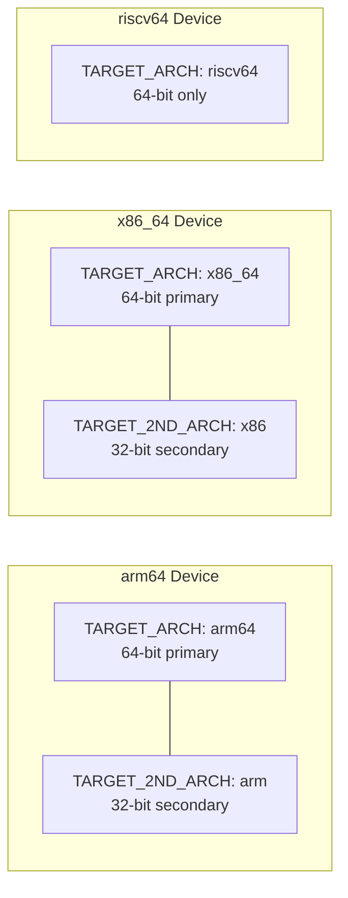

RISC-V 目前没有次要架构——它只有 64 位。不存在 32 位的 RISC-V Android 移植。

### 59.5.2 Zygote 配置

multilib 选择直接影响 Zygote 进程的启动方式。AOSP 包含几个 Zygote 初始化脚本：

```makefile
# build/make/target/product/core_64_bit.mk
PRODUCT_PACKAGES += init.zygote64.rc init.zygote64_32.rc

# Set the zygote property to select the 64-bit primary, 32-bit secondary script
ifeq ($(ZYGOTE_FORCE_64),true)
PRODUCT_VENDOR_PROPERTIES += ro.zygote=zygote64
else
PRODUCT_VENDOR_PROPERTIES += ro.zygote=zygote64_32
endif

TARGET_SUPPORTS_32_BIT_APPS := true
TARGET_SUPPORTS_64_BIT_APPS := true
```

对于仅 64 位的设备：

```makefile
# build/make/target/product/core_64_bit_only.mk
PRODUCT_PACKAGES += init.zygote64.rc

PRODUCT_VENDOR_PROPERTIES += ro.zygote=zygote64
# A 64-bit-only platform does not have dex2oat32, so make sure dex2oat64 is enabled.
PRODUCT_VENDOR_PROPERTIES += dalvik.vm.dex2oat64.enabled=true

TARGET_SUPPORTS_32_BIT_APPS := false
TARGET_SUPPORTS_64_BIT_APPS := true
TARGET_SUPPORTS_OMX_SERVICE := false
```

### 59.5.3 compile_multilib 属性

在 `Android.bp` 文件中，模块使用 `compile_multilib` 属性来控制它们为哪些架构构建：

```
cc_library {
    name: "libexample",
    compile_multilib: "both",  // Build for both 32 and 64 bit
    srcs: ["example.cpp"],
}
```

有效值由 `build/soong/android/arch.go` 中的 `decodeMultilibTargets()` 解析：

```go
// build/soong/android/arch.go
func decodeMultilibTargets(multilib string, targets []Target, prefer32 bool) ([]Target, error) {
    var buildTargets []Target
    switch multilib {
    case "common":
        buildTargets = getCommonTargets(targets)
    case "both":
        if prefer32 {
            buildTargets = append(buildTargets, filterMultilibTargets(targets, "lib32")...)
            buildTargets = append(buildTargets, filterMultilibTargets(targets, "lib64")...)
        } else {
            buildTargets = append(buildTargets, filterMultilibTargets(targets, "lib64")...)
            buildTargets = append(buildTargets, filterMultilibTargets(targets, "lib32")...)
        }
    case "32":
        buildTargets = filterMultilibTargets(targets, "lib32")
    case "64":
        buildTargets = filterMultilibTargets(targets, "lib64")
    case "first":
        if prefer32 {
            buildTargets = FirstTarget(targets, "lib32", "lib64")
        } else {
            buildTargets = FirstTarget(targets, "lib64", "lib32")
        }
    case "first_prefer32":
        buildTargets = FirstTarget(targets, "lib32", "lib64")
    case "prefer32":
        buildTargets = filterMultilibTargets(targets, "lib32")
        if len(buildTargets) == 0 {
            buildTargets = filterMultilibTargets(targets, "lib64")
        }
    // ...
    }
    return buildTargets, nil
}
```

| 值 | 含义 |
|---|---|
| `"both"` | 为 32 位和 64 位都构建 |
| `"first"` | 只为第一个架构构建 |
| `"32"` | 只为 32 位构建 |
| `"64"` | 只为 64 位构建 |
| `"prefer32"` | 如果 32 位可用则构建 32 位，否则构建 64 位 |
| `"first_prefer32"` | 类似于 `first`，但优先 32 位 |
| `"common"` | 与架构无关（例如 Java） |

### 59.5.4 Android.bp 中的架构特定源文件

`Android.bp` 文件中的 `arch:` 块允许模块包含与架构相关的源文件、编译器标志或依赖项：

```
cc_library {
    name: "libexample",
    srcs: ["common.cpp"],
    arch: {
        arm: {
            srcs: ["arm_optimized.S"],
            cflags: ["-DHAS_NEON"],
        },
        arm64: {
            srcs: ["arm64_optimized.S"],
        },
        x86: {
            srcs: ["x86_optimized.S"],
            cflags: ["-DHAS_SSE"],
        },
        x86_64: {
            srcs: ["x86_64_optimized.S"],
        },
        riscv64: {
            srcs: ["riscv64_optimized.S"],
        },
    },
}
```

来自 bionic 的一个真实例子展示了这种模式的规模：

```
// bionic/libc/Android.bp
arch: {
    arm: {
        srcs: [
            "arch-arm/bionic/__aeabi_read_tp.S",
            "arch-arm/bionic/__bionic_clone.S",
            "arch-arm/bionic/__restore.S",
            "arch-arm/bionic/_exit_with_stack_teardown.S",
            "arch-arm/bionic/atomics_arm.c",
            "arch-arm/bionic/setjmp.S",
            "arch-arm/bionic/syscall.S",
            "arch-arm/bionic/vfork.S",

            "arch-arm/cortex-a7/string/memcpy.S",
            "arch-arm/cortex-a7/string/memset.S",
            "arch-arm/cortex-a9/string/memcpy.S",
            "arch-arm/cortex-a15/string/memcpy.S",
            // ... many more CPU-specific string routines
        ],
    },
    arm64: {
        srcs: [
            "arch-arm64/bionic/__bionic_clone.S",
            "arch-arm64/bionic/_exit_with_stack_teardown.S",
            "arch-arm64/bionic/setjmp.S",
            "arch-arm64/bionic/syscall.S",
            "arch-arm64/bionic/vfork.S",
            "arch-arm64/oryon/memcpy-nt.S",
            "arch-arm64/oryon/memset-nt.S",
        ],
    },
    riscv64: {
        srcs: [
            "arch-riscv64/bionic/__bionic_clone.S",
            "arch-riscv64/bionic/_exit_with_stack_teardown.S",
            "arch-riscv64/bionic/setjmp.S",
            "arch-riscv64/bionic/syscall.S",
            "arch-riscv64/bionic/vfork.S",
            "arch-riscv64/string/memchr.S",
            "arch-riscv64/string/memcmp.S",
            "arch-riscv64/string/memcpy.S",
            // ... more RISC-V string routines
        ],
    },
},
```

### 59.5.5 输出目录结构

multilib 机制会在单独的目录中产出输出。32 位次要架构的输出会放到 `obj_<arch>` 下：

```
out/target/product/generic_arm64/
    obj/              # 64-bit (primary) object files
    obj_arm/          # 32-bit (secondary) object files
    system/
        lib64/        # 64-bit shared libraries
        lib/          # 32-bit shared libraries
```

这在 `build/make/core/envsetup.mk` 中配置：

```makefile
# build/make/core/envsetup.mk
$(TARGET_2ND_ARCH_VAR_PREFIX)TARGET_OUT_INTERMEDIATES := \
    $(PRODUCT_OUT)/obj_$(TARGET_2ND_ARCH)
$(TARGET_2ND_ARCH_VAR_PREFIX)TARGET_OUT_SHARED_LIBRARIES := \
    $(target_out_shared_libraries_base)/lib
```

---

## 59.6 编译器配置

AOSP 中的编译器配置集中在 `build/soong/cc/config/global.go` 中，并应用于所有架构。该文件定义了通用编译标志、警告策略、调试设置以及 Clang 工具链路径，它们构成了每个原生构建的基础。

### 59.6.1 通用全局 CFLAGS

`commonGlobalCflags` 数组定义了应用于 AOSP 中每次 C/C++ 编译的标志：

```go
// build/soong/cc/config/global.go
commonGlobalCflags = []string{
    "-O2",
    "-Wall",
    "-Wextra",
    "-Wpointer-arith",
    "-Wunguarded-availability",

    // Warnings treated as errors
    "-Werror=bool-operation",
    "-Werror=date-time",          // Nondeterministic builds
    "-Werror=int-conversion",
    "-Werror=multichar",
    "-Werror=pragma-pack",
    "-Werror=sizeof-array-div",
    "-Werror=sizeof-pointer-memaccess",
    "-Werror=string-plus-int",
    "-Werror=unreachable-code-loop-increment",
    // ...

    // Preprocessor defines
    "-DANDROID",
    "-DNDEBUG",
    "-UDEBUG",
    "-D__compiler_offsetof=__builtin_offsetof",
    "-D__ANDROID_UNAVAILABLE_SYMBOLS_ARE_WEAK__",

    // Code generation options
    "-faddrsig",
    "-fdebug-default-version=5",
    "-fcolor-diagnostics",
    "-ffp-contract=off",
    "-fno-exceptions",
    "-fno-strict-aliasing",
    "-fmessage-length=0",
    "-gsimple-template-names",
    "-gz=zstd",
    "-no-canonical-prefixes",
}
```

其中有几项值得解释：

**`-O2`**：所有 Android 代码的默认优化级别。它不是 `-O3`。这是因为 `-O3` 会启用激进的优化（例如循环展开和函数
内联），从而可能增大代码体积。在移动设备上这一点很重要，因为指令缓存压力会影响电池续航。

**`-DANDROID`**：定义 `ANDROID` 预处理器宏，AOSP 和第三方代码中成千上万个
`#ifdef ANDROID` 块都会检查它。

**`-DNDEBUG`**：在发布构建中禁用 `assert()`。它是全局定义的，因为即使是平台的调试构建，通常也不希望生产代码出现断言失败。

**`-fno-exceptions`**：全局禁用 C++ 异常。Google C++ 风格指南禁止异常，而 bionic 的 C++ 支持库（libc++）在 Android 上构建时不带异常支持。

**`-fno-strict-aliasing`**：禁用基于类型的别名分析优化。虽然这有可能提升性能，但注释解释了这一权衡：“目前启用它们所带来的性能收益，并不值得冒险去面对难以复现的缺陷。”

**`-gz=zstd`**：用 Zstandard 压缩调试信息，在不损失调试能力的前提下显著减小构建输出体积。

### 59.6.2 设备专用 CFLAGS

只应用于设备（而非主机）代码的标志：

```go
// build/soong/cc/config/global.go
deviceGlobalCflags = []string{
    "-ffunction-sections",
    "-fdata-sections",
    "-fno-short-enums",
    "-funwind-tables",
    "-Wa,--noexecstack",
    "-D_FORTIFY_SOURCE=3",

    // Add stack canaries on every frame, checked on return.
    // -fstack-clash-protection isn't supported in clang for ILP32,
    // so that's in each of the LP64 architectures' configurations instead.
    "-fstack-protector-strong",

    "-Werror=non-virtual-dtor",
    "-Werror=address",
    "-Werror=sequence-point",
}
```

**`-ffunction-sections` / `-fdata-sections`**：每个函数和数据对象都拥有自己独立的 ELF 段，从而使链接器可以通过 `--gc-sections` 丢弃未使用的函数和数据。这对减小移动端二进制体积至关重要。

**`-fstack-protector-strong`**：在拥有局部数组或取局部变量地址的函数中插入栈 canary。“strong”变体保护的函数比 `-fstack-protector` 更多，但比
`-fstack-protector-all` 更少，在安全与性能之间取得平衡。配套标志 `-fstack-clash-protection` 不在此全局列表中，因为注释称 Clang 在 ILP32 上不支持它。每个 LP64 架构（ARM64、x86_64、RISC-V 64）都在各自的架构基础 cflags 中添加了它（见 59.2 节和 59.4.1 节）。
实际上 32 位 x86 尽管是 ILP32，也在 `x86Cflags` 中带上了该标志（59.3.3 节）。这使得 32 位 ARM 成为唯一没有它也能构建的架构。

**`-D_FORTIFY_SOURCE=3`**：最高级别的编译时与运行时缓冲区溢出检测。第 3 级超越了第 2 级对 `memcpy` / `strcpy` 的基本检查，覆盖更多函数和使用模式。

### 59.6.3 设备链接器标志

```go
// build/soong/cc/config/global.go
deviceGlobalLdflags = slices.Concat([]string{
    "-Wl,-z,noexecstack",
    "-Wl,-z,relro",
    "-Wl,-z,now",
    "-Wl,--build-id=md5",
    "-Wl,--fatal-warnings",
    "-Wl,--no-undefined-version",
    "-Wl,--exclude-libs,libgcc.a",
    "-Wl,--exclude-libs,libgcc_stripped.a",
    "-Wl,--exclude-libs,libunwind_llvm.a",
    "-Wl,--exclude-libs,libunwind.a",
    "-Wl,--compress-debug-sections=zstd",
}, commonGlobalLdflags)
```

与安全相关的标志：

- **`-Wl,-z,noexecstack`**：把栈标记为不可执行（NX 位）。
- **`-Wl,-z,relro`**：只读重定位——在重定位之后让 GOT 条目变为只读。

- **`-Wl,-z,now`**：立即绑定——在加载时解析所有符号而不是延迟解析，消除了 GOT 条目可写的窗口期。

这些标志共同构成了抵御利用的纵深防御策略。

设备和主机共享的通用链接器标志：

```go
// build/soong/cc/config/global.go
commonGlobalLdflags = []string{
    "-fuse-ld=lld",
    "-Wl,--icf=safe",
    "-Wl,--no-demangle",
}
```

**`-fuse-ld=lld`**：使用 LLVM 的 LLD 链接器而不是 GNU ld。LLD 明显更快，并且是 AOSP 唯一支持的链接器。

**`-Wl,--icf=safe`**：相同代码折叠——合并机器代码完全相同的函数以节省空间。“safe”模式只折叠那些地址从未被取过的函数，从而避免棘手的缺陷。

### 59.6.4 不可覆盖的标志

某些警告非常重要，以至于模块即使在自己的 `Android.bp` 中使用 `-Wno-error` 或类似标志，也无法禁用它们：

```go
// build/soong/cc/config/global.go
noOverrideGlobalCflags = []string{
    "-Werror=address-of-temporary",
    "-Werror=dangling",
    "-Werror=format-insufficient-args",
    "-Werror=fortify-source",
    "-Werror=incompatible-function-pointer-types",
    "-Werror=int-in-bool-context",
    "-Werror=int-to-pointer-cast",
    "-Werror=null-dereference",
    "-Werror=return-type",
    "-Werror=xor-used-as-pow",
    // ... plus many temporary compiler upgrade workarounds
}
```

这些标志被追加在模块自身 cflags 的 *之后*，因此它们无法被覆盖。这些标志针对关键安全问题：空指针解引用、悬垂指针、格式化字符串缺陷以及缓冲区溢出。

### 59.6.5 标志分层模型

应用到一条编译命令上的完整标志集是分层组装的：

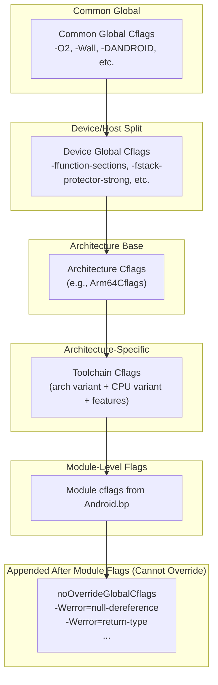

### 59.6.6 Clang 工具链版本

Global.go 还管理 Clang 编译器版本：

```go
// build/soong/cc/config/global.go
CStdVersion               = "gnu23"
CppDefaultStdVersion      = "gnu++20"
ExperimentalCStdVersion   = "gnu2y"
ExperimentalCppStdVersion = "gnu++2b"

// prebuilts/clang default settings.
ClangDefaultBase = "prebuilts/clang/host"
// The Clang version used in the trunk branch.
ClangDefaultVersion = "clang-r584948"
```

AOSP 对 C 代码使用 C23（`gnu23`），对 C++ 代码使用 C++20（`gnu++20`）。
`gnu` 前缀意味着启用了 GNU 扩展。

主干分支锁定的
Clang 版本在 Android 17 中推进到 `clang-r584948`。此前的
`ClangDefaultShortVersion` 常量已被移除。版本通过 getter 函数读取。它们允许按版本发布进行覆盖。默认值仍通过
`prebuilts/clang/host` 解析，并可以用 `LLVM_PREBUILTS_BASE` 及相关环境变量覆盖。C++ 标准版本本身如今也可按版本发布配置：`CppDefaultStdVersion` 是回退值，而
`ReleaseBuildCppStdVersion()` 允许某个版本发布配置在不编辑此文件的情况下提升标准。

### 59.6.7 自动变量初始化

一个值得注意的安全特性是自动变量初始化：

```go
// build/soong/cc/config/global.go
if ctx.Config().IsEnvTrue("AUTO_ZERO_INITIALIZE") {
    flags = append(flags, "-ftrivial-auto-var-init=zero")
} else if ctx.Config().IsEnvTrue("AUTO_PATTERN_INITIALIZE") {
    flags = append(flags, "-ftrivial-auto-var-init=pattern")
} else if ctx.Config().IsEnvTrue("AUTO_UNINITIALIZE") {
    flags = append(flags, "-ftrivial-auto-var-init=uninitialized")
} else {
    // Default to zero initialization.
    flags = append(flags, "-ftrivial-auto-var-init=zero")
}
```

默认情况下，所有栈变量都被零初始化。这以很小的运行时代价消除了一整类未初始化变量缺陷。注释引用了 bug b/131390872，它跟踪了该特性的推广过程。

### 59.6.8 Sanitizer 运行时库

`toolchain.go` 文件为所有 sanitizer 运行时库定义了辅助函数：

```go
// build/soong/cc/config/toolchain.go
func AddressSanitizerRuntimeLibrary() string {
    return LibclangRuntimeLibrary("asan")
}
func HWAddressSanitizerRuntimeLibrary() string {
    return LibclangRuntimeLibrary("hwasan")
}
func UndefinedBehaviorSanitizerRuntimeLibrary() string {
    return LibclangRuntimeLibrary("ubsan_standalone")
}
func ThreadSanitizerRuntimeLibrary() string {
    return LibclangRuntimeLibrary("tsan")
}
func ScudoRuntimeLibrary() string {
    return LibclangRuntimeLibrary("scudo")
}
func LibFuzzerRuntimeLibrary() string {
    return LibclangRuntimeLibrary("fuzzer")
}
```

这些函数返回类似 `libclang_rt.asan` 的库名。然后这些名称使用各工具链的
`LibclangRuntimeLibraryArch()` 方法解析为与架构相关的二进制文件（例如 ARM64 的 `"aarch64"`、
x86 的 `"i686"`）。

### 59.6.9 外部代码标志

第三方代码（`external/` 下的所有内容、大部分 `vendor/` 和大部分
`hardware/`）会获得宽松的警告处理：

```go
// build/soong/cc/config/global.go
extraExternalCflags = []string{
    "-Wno-enum-compare",
    "-Wno-enum-compare-switch",
    "-Wno-null-pointer-arithmetic",
    "-Wno-null-pointer-subtraction",
    "-Wno-string-concatenation",
    "-Wno-deprecated-non-prototype",
    "-Wno-unused",
    "-Wno-unused-but-set-variable",
    "-Wno-deprecated",
    "-Wno-tautological-constant-compare",
}
```

而外部代码的不可覆盖标志甚至更加宽松：

```go
// build/soong/cc/config/global.go
noOverrideExternalGlobalCflags = []string{
    "-Wno-format-insufficient-args",
    "-Wno-misleading-indentation",
    "-Wno-unused",
    "-Wno-unused-parameter",
    "-Wno-unused-but-set-parameter",
    "-Wno-unused-variable",
    "-Wno-unqualified-std-cast-call",
    "-Wno-array-parameter",
    "-Wno-gnu-offsetof-extensions",
    "-Wno-pessimizing-move",
    "-Wno-pointer-to-int-cast",
}
```

还有一个标志 `-fcommon` 特别值得注意。它不是此列表中的固定条目。
`NoOverrideExternalGlobalCflags` 变量函数只在版本发布配置的
`ReleaseUseFnoCommonFor3pCode()` 为 false 时，才把它追加到外部不可覆盖标志中。现代 C 编译器默认使用
`-fno-common`，这会把全局变量的 tentative 定义变成强符号。许多遗留 C 库依赖旧行为，即 tentative 定义是可以在各翻译单元之间合并的 “common” 符号。若没有 `-fcommon`，这些库就无法链接——因此该版本发布标志控制着第三方代码最终何时被纳入更严格的默认设置。

### 59.6.10 非法标志

AOSP 完全禁止某些编译器标志：

```go
// build/soong/cc/config/global.go
IllegalFlags = []string{
    "-w",
    "-pedantic",
    "-pedantic-errors",
    "-Werror=pedantic",
    "-Wno-all",
    "-Wno-everything",
}
```

`-w` 标志会抑制所有警告，这将破坏整个警告基础设施。`-Wno-all` 和 `-Wno-everything` 有相同的效果。`-pedantic` 系列标志被禁止，因为它们会因 AOSP 中合法使用 GNU 扩展而触发成千上万条警告。

### 59.6.11 语言标准版本

AOSP 指定了现代语言标准：

```go
// build/soong/cc/config/global.go
CStdVersion               = "gnu23"
CppDefaultStdVersion      = "gnu++20"
ExperimentalCStdVersion   = "gnu2y"
ExperimentalCppStdVersion = "gnu++2b"
```

- **C23**（`gnu23`）：最新的 C 标准（ISO/IEC 9899:2024），带 GNU
  扩展。它启用 `typeof`、`auto`、`constexpr` 以及改进的
  `_Static_assert` 等特性。

- **C++20**（`gnu++20`）：启用 concepts、ranges、coroutines、modules、
  三路比较以及许多其他重要的 C++ 特性。

- “experimental”版本（`gnu2y`、`gnu++2b`）面向下一版标准修订，用于选择启用前沿特性的模块。

### 59.6.12 Clang 未知标志过滤器

`clang.go` 文件维护着一份 GCC 标志列表，Clang 并不理解它们，因此在处理遗留构建文件时必须把它们过滤掉：

```go
// build/soong/cc/config/clang.go
var ClangUnknownCflags = sorted([]string{
    "-finline-functions",
    "-finline-limit=64",
    "-fno-canonical-system-headers",
    // ...
    // arm + arm64
    "-fgcse-after-reload",
    "-frerun-cse-after-loop",
    "-frename-registers",
    // arm
    "-mthumb-interwork",
    "-fno-caller-saves",
    // x86 + x86_64
    "-finline-limit=300",
    "-mfpmath=sse",
    "-mbionic",
    // windows
    "--enable-stdcall-fixup",
})
```

这份列表是历史产物——AOSP 过去支持 GCC 编译，而许多第三方项目仍然引用 GCC 特有的标志。该过滤器会悄悄移除这些标志，而不是导致构建失败。

---

## 59.7 通用设备配置

AOSP 在 `device/generic/` 下提供了通用设备配置，用于参考、测试和模拟器。这些配置定义了每种受支持架构的最低可行设置。

### 59.7.1 目录结构

```
device/generic/
    arm64/            - 64-bit ARM reference device
    armv7-a-neon/     - 32-bit ARM with NEON
    x86/              - 32-bit x86
    x86_64/           - 64-bit x86
    art/              - ART runtime test devices
        armv8/        - ARM64 for ART testing
        riscv64/      - RISC-V for ART testing
        silvermont/   - x86 Silvermont for ART testing
        arm_krait/    - ARM Krait for ART testing
        arm_v7_v8/    - ARM v7/v8 for ART testing
        armv8_cortex_a55/  - ARM64 Cortex-A55 tuned
        armv8_kryo385/     - ARM64 Kryo 385 tuned
    car/              - Android Automotive targets
    trusty/           - Trusted Execution Environment
    common/           - Shared resources
    goldfish/         - Android Emulator (ranchu) device tree
```

### 59.7.2 ARM64 通用设备

ARM64 通用设备是最常见的参考目标：

```makefile
# device/generic/arm64/BoardConfig.mk
TARGET_ARCH := arm64
TARGET_ARCH_VARIANT := armv8-a
TARGET_CPU_VARIANT := generic
TARGET_CPU_ABI := arm64-v8a

TARGET_2ND_ARCH := arm
TARGET_2ND_ARCH_VARIANT := armv7-a-neon
TARGET_2ND_CPU_VARIANT := cortex-a15
TARGET_2ND_CPU_ABI := armeabi-v7a
TARGET_2ND_CPU_ABI2 := armeabi
```

该配置建立了一个双架构设备：

- **主架构**：ARM64，带基线 ARMv8-A ISA
- **次要架构**：带 NEON 的 32 位 ARM，针对 Cortex-A15 调优

产品配置继承 64 位核心配置和通用 mini 配置：

```makefile
# device/generic/arm64/mini_arm64.mk
$(call inherit-product, $(SRC_TARGET_DIR)/product/core_64_bit.mk)
$(call inherit-product, device/generic/armv7-a-neon/mini_common.mk)

PRODUCT_NAME := mini_arm64
PRODUCT_DEVICE := arm64
```

### 59.7.3 ARM 32 位通用设备

32 位 ARM 设备面向带 NEON 的 ARMv7-A 架构：

```makefile
# device/generic/armv7-a-neon/BoardConfig.mk
TARGET_ARCH := arm
TARGET_ARCH_VARIANT := armv7-a-neon
TARGET_CPU_VARIANT := generic
TARGET_CPU_ABI := armeabi-v7a
TARGET_CPU_ABI2 := armeabi
```

它没有次要架构——它是纯 32 位的。`armeabi`
次要 ABI 提供与古老的 NEON 之前 ARM 代码（ARMv5TE）的兼容性。

### 59.7.4 x86_64 通用设备

```makefile
# device/generic/x86_64/BoardConfig.mk
TARGET_CPU_ABI := x86_64
TARGET_ARCH := x86_64
TARGET_ARCH_VARIANT := x86_64

TARGET_2ND_CPU_ABI := x86
TARGET_2ND_ARCH := x86
TARGET_2ND_ARCH_VARIANT := x86_64
```

### 59.7.5 ART 测试设备

`device/generic/art/` 目录包含用于在不同 CPU 变体上测试 ART 运行时的专用配置。它们不是真实设备，而是用来检验特定 ISA 特性的构建目标：

```makefile
# device/generic/art/BoardConfigCommon.mk
TARGET_NO_BOOTLOADER := true
TARGET_NO_KERNEL := true
TARGET_CPU_SMP := true
$(call soong_config_set,art_module,source_build,true)
```

```makefile
# device/generic/art/armv8/BoardConfig.mk
TARGET_ARCH := arm64
TARGET_CPU_ABI := arm64-v8a
TARGET_CPU_VARIANT := generic
TARGET_ARCH_VARIANT := armv8-a
TARGET_SUPPORTS_64_BIT_APPS := true
```

ART 测试配置还包括厂商专用变体：

| 目录 | 配置 | 用途 |
|---|---|---|
| `armv8/` | 通用 ARMv8-A | 基线 ARM64 测试 |
| `armv8_cortex_a55/` | Cortex-A55 | LITTLE 核心测试 |
| `armv8_kryo385/` | Kryo 385 | 高通核心测试 |
| `arm_krait/` | Krait | 高通 32 位测试 |
| `arm_v7_v8/` | ARMv7/v8 | 跨版本测试 |
| `riscv64/` | RISC-V 64 | RISC-V ART 测试 |
| `silvermont/` | Silvermont | Intel Atom 测试 |

### 59.7.6 Android Automotive（Car）

`device/generic/car/` 目录演示了多架构的汽车目标：

```
device/generic/car/
    emulator_car64_arm64/     - ARM64 automotive emulator
    emulator_car64_x86_64/    - x86_64 automotive emulator
    car_x86_64/               - x86_64 automotive device
    sdk_car_arm64.mk          - ARM64 SDK
    sdk_car_x86_64.mk         - x86_64 SDK
    sdk_car_md_arm64.mk       - Multi-display ARM64
    sdk_car_md_x86_64.mk      - Multi-display x86_64
    gsi_car_arm64.mk          - ARM64 GSI (Generic System Image)
    gsi_car_x86_64.mk         - x86_64 GSI
```

### 59.7.7 Trusty TEE

Trusty 可信执行环境提供了一个与 Android 并行运行的安全世界：

```makefile
# device/generic/trusty/qemu_trusty_arm64.mk
# (Trusty configuration for ARM64 QEMU)
```

Trusty 作为独立操作系统运行在 ARM TrustZone（或等价的安全监控模式）中。它的构建系统必须为安全世界产出代码。该代码必须与普通世界的架构兼容。

### 59.7.8 AOSP 产品构建

完整的 AOSP 产品把通用设备与 system、vendor 和 product 镜像配置组合在一起：

```makefile
# build/make/target/product/aosp_arm64.mk
$(call inherit-product, $(SRC_TARGET_DIR)/product/core_64_bit.mk)
$(call inherit-product, $(SRC_TARGET_DIR)/product/generic_system.mk)

PRODUCT_NAME := aosp_arm64
PRODUCT_DEVICE := generic_arm64
PRODUCT_BRAND := Android
PRODUCT_MODEL := AOSP on ARM64

PRODUCT_NO_BIONIC_PAGE_SIZE_MACRO := true
```

`PRODUCT_NO_BIONIC_PAGE_SIZE_MACRO := true` 标志阻止 bionic 暴露固定的
`PAGE_SIZE` 宏。结果是代码必须在运行时读取页大小。它不能在编译时假设 4096。这一点很重要，因为 Android 17
把 ARM64 和 x86_64 的 ELF 段对齐默认设为 16KB（59.10 节）。
硬编码 `PAGE_SIZE == 4096` 的二进制文件在 16KB 页内核上会行为异常。更大的页能降低 TLB 压力和缺页开销，代价是一定的内存碎片。

---

## 59.8 架构特定的代码模式

在整个 AOSP 中，几个主要组件都包含针对每种受支持架构手工调优的汇编代码。本节考察 bionic、ART
以及其他性能关键子系统中使用的模式。

### 59.8.1 Bionic：架构目录

Bionic 在 `arch-<arch>/` 子目录中组织与架构相关的代码：

```
bionic/libc/
    arch-arm/
        bionic/       - Low-level ARM32 routines (clone, setjmp, syscall)
        cortex-a7/    - Cortex-A7 tuned string functions
        cortex-a9/    - Cortex-A9 tuned string functions
        cortex-a15/   - Cortex-A15 tuned string functions
        cortex-a53/   - Cortex-A53 tuned string functions
        cortex-a55/   - Cortex-A55 tuned string functions
        generic/      - Generic ARM string functions
        krait/        - Qualcomm Krait tuned string functions
        kryo/         - Qualcomm Kryo tuned string functions
    arch-arm64/
        bionic/       - Low-level ARM64 routines
        string/       - ARM64 string function stubs
        oryon/        - Qualcomm Oryon tuned routines
    arch-x86/
        bionic/       - Low-level x86 routines
        string/       - x86 string functions
    arch-x86_64/
        bionic/       - Low-level x86_64 routines
        string/       - x86_64 string functions
    arch-riscv64/
        bionic/       - Low-level RISC-V routines
        string/       - RISC-V string functions (SiFive contributed)
```

### 59.8.2 Bionic：ifunc 分发模式（ARM64）

ARM64 bionic 使用 GNU 间接函数（ifunc）机制，在运行时选择常用函数的最佳实现。ifunc 解析器在动态链接期间运行，并根据硬件能力选择一个实现：

```cpp
// bionic/libc/arch-arm64/ifuncs.cpp
static inline bool __bionic_is_oryon(unsigned long hwcap) {
  if (!(hwcap & HWCAP_CPUID)) return false;

  unsigned long midr;
  __asm__ __volatile__("mrs %0, MIDR_EL1" : "=r"(midr));

  // Check for implementor Qualcomm's parts 0..15 (Oryon).
  return implementer(midr) == 'Q' && part(midr) <= 15;
}
```

`memcpy` 的 ifunc 解析器展示了多级分发：

```cpp
// bionic/libc/arch-arm64/ifuncs.cpp
DEFINE_IFUNC_FOR(memcpy) {
  if (arg->_hwcap2 & HWCAP2_MOPS) {
    RETURN_FUNC(memcpy_func_t, __memmove_aarch64_mops);
  } else if (__bionic_is_oryon(arg->_hwcap)) {
    RETURN_FUNC(memcpy_func_t, __memcpy_aarch64_nt);
  } else if (arg->_hwcap & HWCAP_ASIMD) {
    RETURN_FUNC(memcpy_func_t, __memcpy_aarch64_simd);
  } else {
    RETURN_FUNC(memcpy_func_t, __memcpy_aarch64);
  }
}
```

优先级顺序是：

1. **MOPS**（Memory Copy 和 Memory Set 指令，ARMv8.8-A）—— 硬件
   `memcpy` 指令

2. **Oryon** —— 高通的定制核心，带非临时存储优化
3. **ASIMD**（Advanced SIMD，又称 NEON）—— 向量化拷贝
4. **回退** —— 标量实现

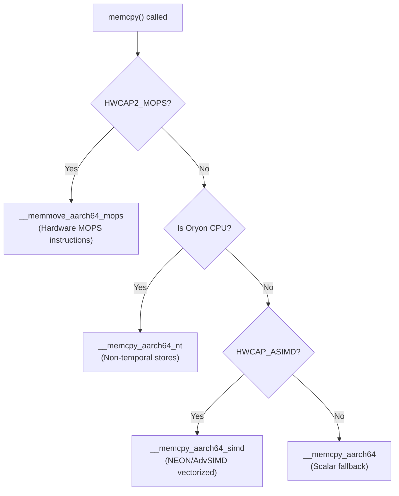

同样的模式也适用于 `memmove`、`memset`、`strlen`、`strchr` 以及其他
热点字符串函数。当存在 `HWCAP2_MTE` 时，会选择支持 MTE 的变体：

```cpp
// bionic/libc/arch-arm64/ifuncs.cpp
DEFINE_IFUNC_FOR(memset) {
  if (arg->_hwcap2 & HWCAP2_MOPS) {
    RETURN_FUNC(memset_func_t, __memset_aarch64_mops);
  } else if (__bionic_is_oryon(arg->_hwcap)) {
    RETURN_FUNC(memset_func_t, __memset_aarch64_nt);
  } else {
    RETURN_FUNC(memset_func_t, __memset_aarch64);
  }
}
```

```cpp
// bionic/libc/arch-arm64/ifuncs.cpp
DEFINE_IFUNC_FOR(strchr) {
  if (arg->_hwcap2 & HWCAP2_MTE) {
    RETURN_FUNC(strchr_func_t, __strchr_aarch64_mte);
  } else {
    RETURN_FUNC(strchr_func_t, __strchr_aarch64);
  }
}
```

### 59.8.3 Bionic：ARM 32 位 CPU 变体字符串函数

ARM 32 位 bionic 同样使用运行时 ifunc 分发，但选择机制不同。每个 CPU 变体实现都被无条件编译进 libc。它们全部列在 `bionic/libc/Android.bp` 中单个
`arm:` `srcs:` 块之下。`bionic/libc/arch-arm/ifuncs.cpp` 中的解析器在加载时挑选其中一个。它们从 `/dev/cpu_variant:arm` 读取 CPU 名称，而不像 ARM64 那样查询 `HWCAP` 位。源代码树中为每个 CPU 变体包含独立的目录：

```
arch-arm/cortex-a7/string/memcpy.S    - Tuned for A7's in-order pipeline
arch-arm/cortex-a9/string/memcpy.S    - Tuned for A9's partial out-of-order
arch-arm/cortex-a15/string/memcpy.S   - Tuned for A15's full out-of-order
arch-arm/cortex-a53/string/memcpy.S   - Tuned for A53's 64-bit in-order
arch-arm/cortex-a55/string/memcpy.S   - Tuned for A55's enhanced in-order
arch-arm/krait/string/memcpy.S        - Tuned for Qualcomm Krait
arch-arm/kryo/string/memcpy.S         - Tuned for Qualcomm Kryo
```

每个 `memcpy.S` 都包含不同的手写汇编，它们利用目标核心的流水线特性——预取距离、存储缓冲深度、缓存行大小以及 NEON 指令调度。

### 59.8.4 Bionic：带向量扩展的 RISC-V 字符串函数

bionic 中的 RISC-V 字符串实现由 SiFive 贡献，并使用了 RISC-V 向量扩展：

```
bionic/libc/arch-riscv64/string/
    memchr.S    memcmp.S    memcpy.S     memmove.S    memset.S
    stpcpy.S    stpncpy.S   strcat.S     strchr.S     strchrnul.S
    strcmp.S    strcpy.S    strlen.S     strncat.S    strncmp.S
    strnlen.S   strrchr.S
```

这些文件中的版权头把它们归属于“The Android Open
Source Project”和“SiFive, Inc.”两者。SiFive 公司是领先的 RISC-V 芯片设计商。它贡献了这些优化实现。

### 59.8.5 Bionic：底层架构函数

每种架构都必须用汇编实现一组核心底层函数。这些函数无法用 C 编写，因为它们以 C 无法表达的方式操纵栈、寄存器或执行上下文：

| 函数 | 用途 | 为什么用汇编？ |
|---|---|---|
| `__bionic_clone.S` | `clone()` 系统调用包装器 | 必须设置子进程栈并调用入口点 |
| `_exit_with_stack_teardown.S` | 线程退出 | 必须在自身运行时释放自己的栈 |
| `setjmp.S` | 非局部跳转（同时定义 `setjmp` 和 `longjmp`） | 必须保存/恢复所有被调用者保存的寄存器 |
| `syscall.S` | 原始系统调用接口 | 必须把参数移到系统调用寄存器 |
| `vfork.S` | `vfork()` 实现 | 不能破坏父进程的栈帧 |

ARM64 的 `setjmp.S` 展示了所需的寄存器级细节：

```asm
// bionic/libc/arch-arm64/bionic/setjmp.S
// According to AARCH64 PCS document we need to save the following
// registers:
//
// Core     x19 - x30, sp (see section 5.1.1)
// VFP      d8 - d15 (see section 5.1.2)
//
// The internal structure of a jmp_buf is totally private.
// Current layout (changes from release to release):
//
// word   name            description
// 0      sigflag/cookie  setjmp cookie in top 63 bits, signal mask flag in low bit
// 1      sigmask         signal mask (not used with _setjmp / _longjmp)
// 2      core_base       base of core registers (x18-x30, sp)
// 16     float_base      base of float registers (d8-d15)
// 24     checksum
// 25     reserved        reserved entries (room to grow)
```

### 59.8.6 Bionic：MTE 集成

ARM64 bionic 包含控制 MTE 行为的 ELF note。存在两种变体：

- `note_memtag_heap_async.S` —— 请求异步 MTE 检查（较低
  开销，延迟报错）

- `note_memtag_heap_sync.S` —— 请求同步 MTE 检查（较高
  开销，立即报错）

```asm
// bionic/libc/arch-arm64/bionic/note_memtag_heap_async.S
  .section ".note.android.memtag", "a", %note
  .p2align 2
  .long 1f - 0f                 // int32_t namesz
  .long 3f - 2f                 // int32_t descsz
  .long NT_ANDROID_TYPE_MEMTAG  // int32_t type
0:
  .asciz "Android"              // char name[]
1:
  .p2align 2
2:
  .long (NT_MEMTAG_LEVEL_ASYNC | NT_MEMTAG_HEAP) // value
3:
```

这些 note 被链接进选择启用 MTE 的二进制文件。动态链接器在主程序运行之前读取它们，并配置进程的内存标记模式。

### 59.8.7 ART 运行时：架构特定的入口点

Android Runtime（ART）包含大量用于 JIT 编译、垃圾回收和 JNI 转换的架构特定代码。每种架构都有一套完整的入口点文件：

```
art/runtime/arch/arm64/
    asm_support_arm64.S              - Assembly constants and macros
    asm_support_arm64.h              - Shared constants
    callee_save_frame_arm64.h        - Callee-save frame layout
    context_arm64.cc                 - CPU context save/restore
    entrypoints_init_arm64.cc        - Entrypoint table initialization
    fault_handler_arm64.cc           - Signal handler for null checks
    instruction_set_features_arm64.cc - ISA feature detection
    jni_entrypoints_arm64.S          - JNI call trampolines
    quick_entrypoints_arm64.S        - Quick compiler entrypoints
    registers_arm64.cc               - Register definitions
    thread_arm64.cc                  - Thread-local storage access
```

每种架构都复制了同样的结构：

```
art/runtime/arch/
    arm/     - ARM32 entrypoints
    arm64/   - ARM64 entrypoints
    x86/     - x86 entrypoints
    x86_64/  - x86_64 entrypoints
    riscv64/ - RISC-V 64 entrypoints
```

### 59.8.8 ART：指令集特性检测

ART 的 `instruction_set_features.cc` 将特性检测分发给
架构相关的实现：

```cpp
// art/runtime/arch/instruction_set_features.cc
std::unique_ptr<const InstructionSetFeatures> InstructionSetFeatures::FromVariant(
    InstructionSet isa, const std::string& variant, std::string* error_msg) {
  switch (isa) {
    case InstructionSet::kArm:
    case InstructionSet::kThumb2:
      return ArmInstructionSetFeatures::FromVariant(variant, error_msg);
    case InstructionSet::kArm64:
      return Arm64InstructionSetFeatures::FromVariant(variant, error_msg);
    case InstructionSet::kRiscv64:
      return Riscv64InstructionSetFeatures::FromVariant(variant, error_msg);
    case InstructionSet::kX86:
      return X86InstructionSetFeatures::FromVariant(variant, error_msg);
    case InstructionSet::kX86_64:
      return X86_64InstructionSetFeatures::FromVariant(variant, error_msg);
    // ...
  }
}
```

ARM64 特性检测（`instruction_set_features_arm64.cc`）
尤其详细，它跟踪具体的 CPU 勘误和可选 ISA 扩展：

```cpp
// art/runtime/arch/arm64/instruction_set_features_arm64.cc
static const char* arm64_variants_with_a53_835769_bug[] = {
    "default", "generic",
    "cortex-a53", "cortex-a53.a57", "cortex-a53.a72",
    "cortex-a57", "cortex-a72", "cortex-a73",
};

static const char* arm64_variants_with_crc[] = {
    "default", "generic", "cortex-a35", "cortex-a53", ...
};

static const char* arm64_variants_with_lse[] = {
    "cortex-a55", "cortex-a75", "cortex-a76", "kryo385", "kryo785",
};

static const char* arm64_variants_with_fp16[] = {
    "cortex-a55", "cortex-a75", "cortex-a76", "kryo385", "kryo785",
};

static const char* arm64_variants_with_dotprod[] = {
    "cortex-a55", "cortex-a75", "cortex-a76",
};
```

ART JIT 编译器使用这些特性列表来决定生成哪些指令。例如，如果 `has_lse` 为真，JIT 可以发出 LSE
（Large System Extensions）原子指令。它们取代较慢的 LL/SC
（Load-Linked/Store-Conditional）循环序列。

ART 还使用 `FromVariantAndHwcap()` 把编译时的特性假设与运行时的硬件能力进行校验：

```cpp
// art/runtime/arch/instruction_set_features.cc (line 55-80)
std::unique_ptr<const InstructionSetFeatures> InstructionSetFeatures::FromVariantAndHwcap(
    InstructionSet isa, const std::string& variant, std::string* error_msg) {
  auto variant_features = FromVariant(isa, variant, error_msg);
  if (variant_features == nullptr) return nullptr;

  // Pixel3a is wrongly reporting itself as cortex-a75, so validate the
  // features with hwcaps.
  if (isa == InstructionSet::kArm64) {
    auto new_features = down_cast<const Arm64InstructionSetFeatures*>(
        variant_features.get())->IntersectWithHwcap();
    if (!variant_features->Equals(new_features.get())) {
      LOG(WARNING) << "Mismatch between instruction set variant of device ("
            << *variant_features << ") and features returned by the hardware ("
            << *new_features << ")";
    }
    return new_features;
  }
  return variant_features;
}
```

关于 Pixel 3a 的注释很有启发性——它表明即使是 Google 自己的设备也可能有错误的
`TARGET_CPU_VARIANT` 设置，因此运行时校验是必不可少的。

### 59.8.9 ART：Quick 入口点

`quick_entrypoints_arm64.S` 文件包含桥接托管（Java/Kotlin）代码与 ART
运行时的汇编例程。这些是 Android 中性能最关键的代码之一。该文件以被调用者保存帧设置宏开始：

```asm
// art/runtime/arch/arm64/quick_entrypoints_arm64.S (line 45-60)
.macro SETUP_SAVE_REFS_AND_ARGS_FRAME
    LOAD_RUNTIME_INSTANCE xIP0
    ldr xIP0, [xIP0, RUNTIME_SAVE_REFS_AND_ARGS_METHOD_OFFSET]
    INCREASE_FRAME FRAME_SIZE_SAVE_REFS_AND_ARGS
    SETUP_SAVE_REFS_AND_ARGS_FRAME_INTERNAL sp
    str xIP0, [sp]
    mov xIP0, sp
    str xIP0, [xSELF, # THREAD_TOP_QUICK_FRAME_OFFSET]
.endm
```

这些宏管理托管代码（使用 ART 的调用约定）与原生代码（使用平台 ABI）之间的转换。
`THREAD_TOP_QUICK_FRAME_OFFSET` 引用 ART 用来跟踪当前托管栈帧的线程本地存储——这对垃圾回收、栈遍历和异常处理至关重要。

### 59.8.10 ART：多种特性检测策略

ART 实现了八种不同的入口点用于检测 CPU 特性（七种构造方法加上 `IntersectWithHwcap()`）。没有任何单一检测方法在所有设备上都可靠：

```cpp
// art/runtime/arch/arm64/instruction_set_features_arm64.h (line 35-55)
// 1. FromVariant() - Parse a CPU variant string like "cortex-a75"
static Arm64FeaturesUniquePtr FromVariant(const std::string& variant, std::string* error_msg);

// 2. FromBitmap() - Parse a bitmap (used for serialization/deserialization)
static Arm64FeaturesUniquePtr FromBitmap(uint32_t bitmap);

// 3. FromCppDefines() - Use C preprocessor defines set by the compiler
static Arm64FeaturesUniquePtr FromCppDefines();

// 4. FromCpuInfo() - Parse /proc/cpuinfo
static Arm64FeaturesUniquePtr FromCpuInfo();

// 5. FromHwcap() - Use the kernel's AT_HWCAP auxiliary vector
static Arm64FeaturesUniquePtr FromHwcap();

// 6. FromAssembly() - Run assembly tests to probe feature availability
static Arm64FeaturesUniquePtr FromAssembly();

// 7. FromCpuFeatures() - Use external cpu_features library
static Arm64FeaturesUniquePtr FromCpuFeatures();

// 8. IntersectWithHwcap() - Validate variant features against hardware
Arm64FeaturesUniquePtr IntersectWithHwcap() const;
```

ARM64 上的首选做法是 `FromVariantAndHwcap()`，它首先从构建时的变体字符串创建特性，然后针对运行时硬件能力进行校验。这个两步过程能够捕获像
Pixel 3a 这样的情况，即设备错误地报告自己的 CPU 变体。

对于 RISC-V，目前只有 `FromVariant()` 和 `FromCppDefines()` 可用——硬件检测路径仍然是桩实现。

### 59.8.11 架构特定的构建模式总结

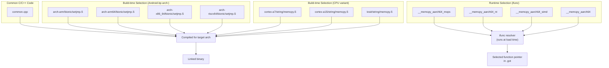

三级优化策略：

1. **架构选择**（构建时）：`Android.bp` 中的 `arch:` 块
   为每种架构选择完全不同的源文件。这适用于各架构之间有根本差异的代码（系统调用包装器、
   setjmp、线程创建）。

2. **CPU 变体选择**（构建时）：对于 ARM 32 位，每个主要 CPU 变体都存在单独的手工调优
   实现。构建系统把它们全部编译进同一个二进制文件。ifunc 机制或链接器根据设备配置
   选择合适的那个。

3. **运行时硬件检测**（加载时）：ARM64 的 ifunc 解析器在库加载时检查
   `hwcap` 位，以便为实际硬件选择最佳实现。这处理了构建时不知道确切 CPU 型号，或者单个二进制文件必须运行在多个硬件
   世代上的情况。

### 59.8.12 ARM 32 位指令集：ARM 与 Thumb

ARM 32 位在 AOSP 架构中有一个独特特性：两种指令编码。ARM 工具链支持在它们之间切换：

```go
// build/soong/cc/config/arm_device.go
armArmCflags = []string{}

armThumbCflags = []string{
    "-mthumb",
    "-Os",
}
```

工具链的 `InstructionSetFlags()` 方法在它们之间进行选择：

```go
// build/soong/cc/config/arm_device.go
func (t *toolchainArm) InstructionSetFlags(isa string) (string, error) {
    switch isa {
    case "arm":
        return "${config.ArmArmCflags}", nil
    case "thumb", "":
        return "${config.ArmThumbCflags}", nil
    default:
        return t.toolchainBase.InstructionSetFlags(isa)
    }
}
```

**Thumb 模式**（默认）使用 16 位指令编码，配合 `-Os`
（优化体积）。这显著减小了代码体积——对于主要为了兼容性而存在的 32 位次要架构来说至关重要。

**ARM 模式**使用 32 位指令编码。模块可以通过其 `Android.bp` 中的
`instruction_set: "arm"` 属性选择启用 ARM 模式。当它们需要完整的 32 位指令集（例如，用于使用 Thumb 中不可用指令的手工调优汇编）时，会这样做。

### 59.8.13 ARM 32 位软浮点与 NEON

ARM 32 位 Android 使用软浮点 ABI（`-mfloat-abi=softfp`）。浮点值在函数调用边界以整数寄存器传递，即使计算使用了硬件 FPU：

```go
// build/soong/cc/config/arm_device.go
armArchVariantCflags = map[string][]string{
    "armv7-a": []string{
        "-march=armv7-a",
        "-mfloat-abi=softfp",
        "-mfpu=vfpv3-d16",
    },
    "armv7-a-neon": []string{
        "-march=armv7-a",
        "-mfloat-abi=softfp",
        "-mfpu=neon",
    },
    "armv8-a": []string{
        "-march=armv8-a",
        "-mfloat-abi=softfp",
        "-mfpu=neon-fp-armv8",
    },
    "armv8-2a": []string{
        "-march=armv8.2-a",
        "-mfloat-abi=softfp",
        "-mfpu=neon-fp-armv8",
    },
}
```

`-mfpu=` 标志指定 FPU 类型：

- `vfpv3-d16`：带 16 个双精度寄存器的基础 VFP（无 NEON）
- `neon`：完整的 NEON SIMD 单元
- `neon-fp-armv8`：带 ARMv8 浮点扩展的 NEON

`armv7-a-neon` 变体是现代 32 位设备最常用的，因为它启用了 NEON SIMD 优化。

### 59.8.14 Bionic 各架构的 strip 配置

就连二进制文件被 strip 的方式也因架构而异。Bionic 的
`Android.bp` 为每种架构配置了不同的 strip 行为：

```
// bionic/libc/Android.bp
arch: {
    arm: {
        // arm32 does not produce complete exidx unwind information,
        // so keep the .debug_frame which is relatively small and does
        // include needed unwind information.
        // See b/132992102 for details.
        strip: {
            keep_symbols_and_debug_frame: true,
        },
    },
    arm64: {
        strip: {
            keep_symbols: true,
        },
    },
    riscv64: {
        strip: {
            keep_symbols: true,
        },
    },
    x86: {
        strip: {
            keep_symbols: true,
        },
    },
    x86_64: {
        strip: {
            keep_symbols: true,
        },
    },
},
```

ARM 32 位是唯一需要 `keep_symbols_and_debug_frame` 的架构。
这是因为 ARM 32 位使用不同的展开机制（`.ARM.exidx` 段中的 EXIDX 表）。该机制在某些情况下并不完整。
因此 `.debug_frame` 段必须作为回退方案保留。所有其他架构都使用基于 DWARF 的展开，只需要保留符号表。

### 59.8.15 页大小宏处理

bionic 的页大小宏处理是架构感知的：

```go
// build/soong/cc/config/arm64_device.go
pctx.VariableFunc("Arm64Cflags", func(ctx android.PackageVarContext) string {
    flags := arm64Cflags
    if ctx.Config().NoBionicPageSizeMacro() {
        flags = append(flags, "-D__BIONIC_NO_PAGE_SIZE_MACRO")
    } else {
        flags = append(flags, "-D__BIONIC_DEPRECATED_PAGE_SIZE_MACRO")
    }
    return strings.Join(flags, " ")
})
```

x86_64 也存在同样的模式：

```go
// build/soong/cc/config/x86_64_device.go
pctx.VariableFunc("X86_64Cflags", func(ctx android.PackageVarContext) string {
    flags := x86_64Cflags
    if ctx.Config().NoBionicPageSizeMacro() {
        flags = append(flags, "-D__BIONIC_NO_PAGE_SIZE_MACRO")
    } else {
        flags = append(flags, "-D__BIONIC_DEPRECATED_PAGE_SIZE_MACRO")
    }
    return strings.Join(flags, " ")
})
```

这与在 ARM64 上支持 16KB 页的持续努力有关。
`<unistd.h>` 中的 `PAGE_SIZE` 宏传统上返回 4096，但在运行 16KB 内核的设备上这
是错误的。
`__BIONIC_NO_PAGE_SIZE_MACRO` 标志使 bionic 完全不定义 `PAGE_SIZE`，
强制代码在运行时调用 `getpagesize()` 或 `sysconf(_SC_PAGE_SIZE)`。
`__BIONIC_DEPRECATED_PAGE_SIZE_MACRO` 标志保留该宏但将其标记为已弃用，当代码使用它时会产生警告。

产品配置选择启用此行为：

```makefile
# build/make/target/product/aosp_arm64.mk
PRODUCT_NO_BIONIC_PAGE_SIZE_MACRO := true
```

### 59.8.16 ARM 32 位 LPAE 变通方案

几个 ARM 32 位 CPU 变体需要一个手动定义来宣告大物理地址扩展（LPAE）支持：

```go
// build/soong/cc/config/arm_device.go
"cortex-a7": []string{
    "-mcpu=cortex-a7",
    "-mfpu=neon-vfpv4",
    // Fake an ARM compiler flag as these processors support LPAE which clang
    // don't advertise.
    // TODO This is a hack and we need to add it for each processor that
    // supports LPAE until some better solution comes around. See Bug 27340895
    "-D__ARM_FEATURE_LPAE=1",
},
```

这是一个长期存在的变通方案（Bug 27340895）：Clang 不会为支持它的处理器自动定义
`__ARM_FEATURE_LPAE`。使用 LPAE 特有的 `ldrd`/`strd` 指令（64 位原子
加载/存储）的代码依赖该宏来检测硬件支持。

---

## 59.9 LFI 工具链：ARM64 上的轻量级故障隔离

Android 17 新增了第六个工具链，它根本不对应任何新的 CPU
架构。它是一个为轻量级故障隔离（LFI）而构建的 ARM64 变体。LFI 是一种进程内沙箱。它把不可信的原生代码限制在地址空间的一个受限区域中。它不需要独立的进程，也不需要跨越硬件域。该工具链位于各架构设备配置旁边的自己的文件中：

**源文件**：`build/soong/cc/config/arm64_lfi_device.go`

### 59.9.1 为什么需要一个独立的工具链

59.1.1 节展示了 `toolchainFactories` 是以操作系统、架构以及一个布尔型 LFI 标志为键的。`registerLFIToolchainFactory` 填充 `true` 槽位。

原因是 LFI 是一种代码生成属性。被沙箱化的代码必须以不同的目标和受约束的指令选择来编译。这让 LFI 改写器/验证器能够证明代码始终留在其沙箱内。该决定必须在工具链被解析时做出。这发生得很早，而且只取决于目标的架构。因此 LFI 被建模为一个并行工具链，而不是添加到普通工具链中的一个标志。

`android.Target` 一侧有三个相匹配的部分。它有一个专门的
`LFI bool` 字段。它有一个 `AndroidLFITarget`，当模块选择启用时，它位于模块目标列表的开头。它还有一个由架构变更器生成的、独立的 `lfi_`
变体名称：

```go
// build/soong/android/arch.go
// If this is an LFI (Lightweight Fault Isolation) arch variant. There is also an LFI
// transition mutator, but we have separate LFI arch variants as well because toolchain
// resolution happens early, based on arch.
LFI bool
```

```go
// build/soong/android/arch.go
func (target Target) ArchVariation() string {
    var variation string
    if target.NativeBridge {
        variation = "native_bridge_"
    } else if target.LFI {
        variation = "lfi_"
    }
    variation += target.Arch.String()
    return variation
}
```

### 59.9.2 LFI ARM64 工具链

LFI 工具链复用 ARM64 的标志组装辅助函数，但把架构固定为一个固定的配置。工厂会忽略板卡声明的变体。它强制使用 `armv8-a`，并带 Cortex-A53 调优和
`branchprot` 特性。这是 LFI 编译器目前支持的唯一配置：

```go
// build/soong/cc/config/arm64_lfi_device.go
func arm64LFIToolchainFactory(arch android.Arch) Toolchain {
    // Force armv8-a when compiling for lfi, as that's all the lfi compiler supports for now.
    arch = android.Arch{
        ArchType:     android.Arm64,
        ArchVariant:  "armv8-a",
        CpuVariant:   "cortex-a53",
        Abi:          []string{"arm64-v8a"},
        ArchFeatures: []string{"branchprot"},
    }
    toolchainCflags, toolchainLdflags := arm64ToolchainFlags(arch)
    return &toolchainLFIArm64{
        toolchainCflags:  toolchainCflags,
        toolchainLdflags: toolchainLdflags,
    }
}

func init() {
    registerLFIToolchainFactory(android.Android, android.Arm64, arm64LFIToolchainFactory)
}
```

工厂调用 `arm64ToolchainFlags`。这就是 59.2.6 节从普通 ARM64 工厂中提取出来的辅助函数。因此 LFI
工具链继承了与普通构建完全相同的 PAC/BTI 标志和 Cortex-A53 勘误修复。这就是该辅助函数被拆分出来的原因。

工具链类型本身与普通 ARM64 工具链有两处不同。首先，它的 Clang 三元组是 LFI 后端所识别的一个自定义三元组。
其次，它嵌入的是 `toolchainLFI`（来自 `build/soong/cc/config/lfi.go`），而不是
`toolchainBionic`。因此它在链接时没有 CRT 对象，并把 `Lfi()` 报告为 true：

```go
// build/soong/cc/config/arm64_lfi_device.go
func (t *toolchainLFIArm64) ClangTriple() string {
    return "aarch64_lfi-unknown-linux-android30"
}

func (t *toolchainLFIArm64) Cflags() string {
    return "${config.Arm64Cflags} -mno-outline-atomics"
}
```

```go
// build/soong/cc/config/lfi.go
type toolchainLFI struct {
    toolchainBase
    toolchainNoCrt
}

func (toolchainLFI) Lfi() bool { return true }
```

`aarch64_lfi-` 三元组把编译器引导到对沙箱友好的代码模型。`-mno-outline-atomics` 标志让原子操作保持内联。这是因为
外部的原子辅助函数会调用沙箱之外的运行时支持。
这就是 59.1.2 节加到 `Toolchain`
接口上的 `Lfi()` 方法所带来的具体收益。普通的 bionic 工具链返回 `false`，只有
这个工具链返回 `true`。因此构建的其余部分可以根据是否产出沙箱化代码来分支。

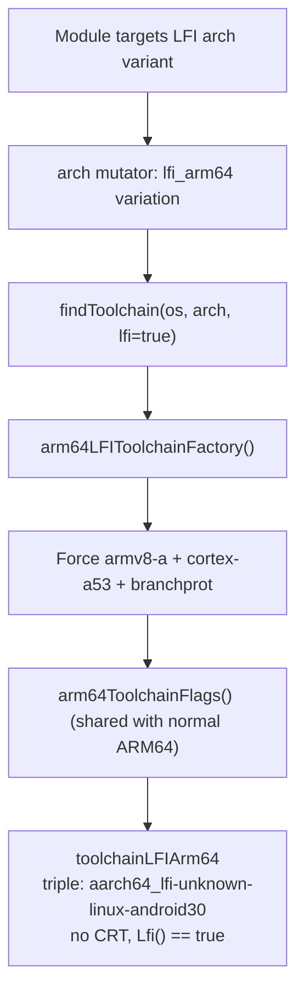

## 59.10 默认使用 16KB 页大小

Android 17 对架构支持而言最具分量的变更，在任何单独的 `-march=` 标志中都是不可见的。平台现在默认把 64 位二进制文件按 16KB 页大小对齐。ARM64 长期以来一直允许 4KB、16KB 和 64KB 页。直到
最近，AOSP 发布的二进制文件都是按 4KB 页对齐的，而 16KB 页内核无法加载它们。Android 17 把默认值朝相反方向改了。

### 59.10.1 构建侧的默认值

`TARGET_MAX_PAGE_SIZE_SUPPORTED` 控制 ELF 段的对齐。
它的默认值在 `build/make/core/config.mk` 中计算：

```makefile
# build/make/core/config.mk
ifdef PRODUCT_MAX_PAGE_SIZE_SUPPORTED
  TARGET_MAX_PAGE_SIZE_SUPPORTED := $(PRODUCT_MAX_PAGE_SIZE_SUPPORTED)
else ifeq ($(strip $(call is-low-mem-device)),true)
  # Low memory device will have 4096 binary alignment.
  TARGET_MAX_PAGE_SIZE_SUPPORTED := 4096
else ifeq ($(call math_lt,$(VSR_VENDOR_API_LEVEL),34),true)
  TARGET_MAX_PAGE_SIZE_SUPPORTED := 4096
else ifeq (,$(filter arm64 x86_64,$(TARGET_ARCH)))
  # TARGET_MAX_PAGE_SIZE_SUPPORTED > 4096 is only supported in arm64 and
  # x86_64 targets.
  TARGET_MAX_PAGE_SIZE_SUPPORTED := 4096
else
  # The default binary alignment for userspace is 16384.
  TARGET_MAX_PAGE_SIZE_SUPPORTED := 16384
endif
```

默认值是 16384（16KB），除非有东西选择退出。这些情况是：低内存设备、仍处于较旧 VSR API 版本的厂商，或者 32 位 / RISC-V 目标。
这里只有 arm64 和 x86_64 支持大于 4KB 的页。

该值直接流入各架构的链接器标志，成为 `MaxPageSizeSupported()`。
59.2.7 节展示了该值如何喂给 ARM64 的 `-Wl,-z,max-page-size=` 标志。
x86_64 工具链以同样的方式消费它。RISC-V 保持硬编码的 4096
（59.4.4 节）。

### 59.10.2 Bionic 侧的宏

按 16KB 页对齐段只是故事的一半。把 `PAGE_SIZE` 硬编码为编译期常量 4096 的代码，在 16KB 内核上会算出错误的缓冲区大小和
`mmap` 对齐。Bionic 用 59.8.15 节描述的页大小宏控制来解决这一问题。标志
`-D__BIONIC_NO_PAGE_SIZE_MACRO` 完全移除 `PAGE_SIZE` 常量，因此
代码必须在运行时调用 `getpagesize()` 或 `sysconf(_SC_PAGE_SIZE)`。标志
`-D__BIONIC_DEPRECATED_PAGE_SIZE_MACRO` 保留该宏但标记它的使用。通用 AOSP arm64 产品开启了严格形式：

```makefile
# build/make/target/product/aosp_arm64.mk
PRODUCT_NO_BIONIC_PAGE_SIZE_MACRO := true
```

Soong 把 `PRODUCT_NO_BIONIC_PAGE_SIZE_MACRO` 读作 `NoBionicPageSizeMacro()`。
它选择每个 LP64
架构的基础 cflags 函数追加的两个宏中的哪一个。这些就是 59.2 节和 59.8.15
节中的 `Arm64Cflags` 与 `X86_64Cflags`
`VariableFunc`。对 Android 17 而言，最终效果是平台二进制文件按 16KB 对齐。同时，C 库拒绝让新的
平台代码假定一个固定的页大小。因此同一个镜像在 4KB 和 16KB 内核上都能正确运行。

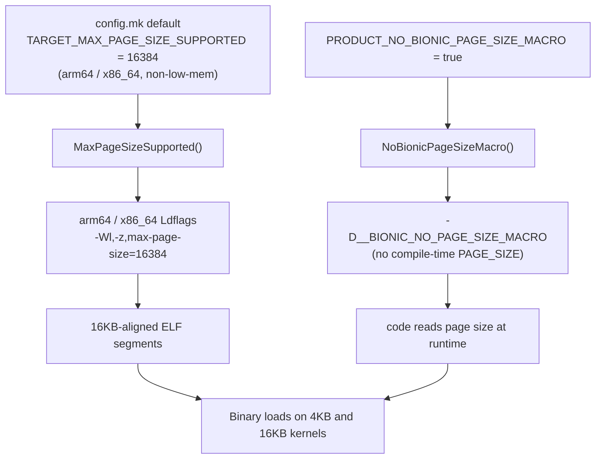

---

## 59.11 动手实践

### 练习 1：查看你设备的架构标志

查阅你设备（或某个参考设备）的 `BoardConfig.mk`，并追踪编译器标志：

```bash
# 1. Find the architecture configuration
cat device/generic/arm64/BoardConfig.mk

# 2. Look up the arch variant flags
grep -A 3 '"armv8-a"' build/soong/cc/config/arm64_device.go

# 3. Look up the CPU variant flags
grep -A 3 '"cortex-a55"' build/soong/cc/config/arm64_device.go

# 4. Check what global flags are applied
head -60 build/soong/cc/config/global.go
```

**需要回答的问题**：

- 你设备上使用什么 `-march=` 标志？
- 是否应用了 Cortex-A53 勘误 843419 修复？
- 你设备启用了哪些安全特性（PAC/BTI、MTE）？

### 练习 2：添加一个新的架构变体

要添加一个假设的新 ARM64 变体（例如 ARMv9.5-A）：

1. 在 `arm64_device.go` 中把该变体添加到 `arm64ArchVariantCflags`：

```go
"armv9-5a": {"-march=armv9.5-a"},
```

2. 创建一个使用它的 `BoardConfig.mk`：

```makefile
TARGET_ARCH := arm64
TARGET_ARCH_VARIANT := armv9-5a
TARGET_CPU_VARIANT := generic
TARGET_CPU_ABI := arm64-v8a
```

3. 构建并验证：

```bash
# The build system will validate the variant exists
m libc
```

### 练习 3：研究 ifunc 分发

研究 bionic 如何在运行时选择优化实现：

```bash
# 1. Read the ifunc resolver for memcpy
# File: bionic/libc/arch-arm64/ifuncs.cpp

# 2. Run on a device and check which implementation was selected
adb shell 'cat /proc/self/maps | grep memcpy'

# 3. Disassemble the selected implementation
adb shell 'objdump -d /apex/com.android.runtime/lib64/bionic/libc.so' | \
    grep -A 20 '__memcpy_aarch64_simd'
```

### 练习 4：跨架构比较字符串函数

比较 `memcpy` 在不同架构上是如何实现的：

```bash
# ARM 32-bit (multiple CPU-variant implementations)
ls bionic/libc/arch-arm/*/string/memcpy.S

# ARM64 (runtime-selected via ifunc)
cat bionic/libc/arch-arm64/ifuncs.cpp | grep -A 10 'DEFINE_IFUNC_FOR(memcpy)'

# RISC-V (vector extension based, from SiFive)
head -50 bionic/libc/arch-riscv64/string/memcpy.S

# x86_64 (SSE-based)
ls bionic/libc/arch-x86_64/string/
```

**需要回答的问题**：

- ARM 32 位有多少个不同的 `memcpy` 实现？
- ARM64 的 `memcpy` 首先检查哪个硬件特性？
- RISC-V 的 `memcpy` 使用哪个 RISC-V 扩展？

### 练习 5：为多种架构构建

为不同架构构建同一个模块，看看标志差异：

```bash
# Build for ARM64
lunch aosp_arm64-userdebug
m libcutils

# Build for x86_64
lunch aosp_x86_64-userdebug
m libcutils

# Compare the ninja commands to see different flags
cat out/build-aosp_arm64-userdebug.ninja | grep 'libcutils.*\.o' | head -1
cat out/build-aosp_x86_64-userdebug.ninja | grep 'libcutils.*\.o' | head -1
```

### 练习 6：追踪完整的标志链

针对某个具体模块，通过追踪 Soong 源代码，重构完整的编译器标志列表：

1. 从 `global.go` 中的 `commonGlobalCflags` 开始
2. 添加来自 `global.go` 的 `deviceGlobalCflags`
3. 添加架构特定的 `Cflags()`（例如 `Arm64Cflags`）
4. 添加 `ToolchainCflags()`（架构变体 + CPU 变体）
5. 添加模块自己 `Android.bp` 中的 `cflags`
6. 追加来自 `global.go` 的 `noOverrideGlobalCflags`

写出完整的标志列表，并验证它与 Ninja 生成的结果一致。

### 练习 7：探索 ART 的架构支持

考察 ART 如何处理架构特定的代码生成：

```bash
# 1. List all architecture-specific ART files
ls art/runtime/arch/arm64/
ls art/runtime/arch/riscv64/

# 2. Read the instruction set features for ARM64
cat art/runtime/arch/arm64/instruction_set_features_arm64.cc | head -100

# 3. Compare the entrypoint counts across architectures
wc -l art/runtime/arch/*/quick_entrypoints_*.S
```

**需要回答的问题**：

- ART 为 ARM64 识别哪些 CPU 变体？
- ART 为 Cortex-A53 变通处理哪些勘误？
- ART 是否为任何 ARM64 变体启用了 SVE 支持？

### 练习 8：调查 RISC-V 的准备情况

评估 AOSP 中 RISC-V 支持的现状：

```bash
# 1. Check which prebuilt modules are missing for RISC-V
grep -r "ALLOW_MISSING_DEPENDENCIES" device/generic/art/riscv64/

# 2. Count RISC-V-specific source files in bionic
find bionic/libc/arch-riscv64 -name '*.S' | wc -l

# 3. Check the ISA string
grep 'march=' build/soong/cc/config/riscv64_device.go

# 4. Look at the Berberis translation framework
ls frameworks/libs/binary_translation/
```

**需要回答的问题**：

- AOSP 要求哪些 RISC-V 扩展？
- 为什么使用 `-mno-implicit-float`？
- RISC-V Android 的页大小是多少？
- Berberis 支持哪个翻译方向？

---

### 练习 9：创建一个最小设备配置

为一个假设的 RISC-V 设备编写一份完整的 `BoardConfig.mk`：

```makefile
# device/mycompany/myriscv/BoardConfig.mk
TARGET_NO_BOOTLOADER := true
TARGET_NO_KERNEL := true

TARGET_ARCH := riscv64
TARGET_CPU_ABI := riscv64
TARGET_CPU_VARIANT := generic
TARGET_ARCH_VARIANT :=

TARGET_SUPPORTS_64_BIT_APPS := true

# No secondary architecture for RISC-V
# (There is no 32-bit RISC-V Android port)

BOARD_SYSTEMIMAGE_PARTITION_SIZE := 2147483648
BOARD_USERDATAIMAGE_PARTITION_SIZE := 576716800
BOARD_FLASH_BLOCK_SIZE := 512
```

然后创建产品配置：

```makefile
# device/mycompany/myriscv/myriscv.mk
$(call inherit-product, $(SRC_TARGET_DIR)/product/core_64_bit_only.mk)
$(call inherit-product, $(SRC_TARGET_DIR)/product/generic_system.mk)

PRODUCT_NAME := myriscv
PRODUCT_DEVICE := myriscv
PRODUCT_BRAND := MyCompany
PRODUCT_MODEL := RISC-V Development Board
```

**需要回答的问题**：

- 为什么 RISC-V 使用 `core_64_bit_only.mk` 而不是 `core_64_bit.mk`？
- 如果把 `TARGET_ARCH_VARIANT` 设为非空值会发生什么？
- 会包含哪个 Zygote 脚本？

### 练习 10：分析完整的标志链

使用本章介绍的工具，为某个具体文件重构准确的编译器调用。选择一个像 `liblog` 这样的简单模块：

```bash
# 1. Find the ninja rule for a liblog source file
grep 'liblog.*logging.cpp.*\.o' out/combined-*.ninja | head -1

# 2. Extract and format the flags
# Look for the complete clang command line

# 3. Categorize each flag into its source:
#    - global.go commonGlobalCflags
#    - global.go deviceGlobalCflags
#    - arm64_device.go Arm64Cflags
#    - arm64_device.go toolchainCflags (arch variant + CPU variant)
#    - Module's own cflags from Android.bp
#    - global.go noOverrideGlobalCflags
```

这个练习展示了 59.6.5 节所描述的分层标志系统的实际结果。

---

## 总结

Android 的架构支持是一个分层系统，建立在一组小型设计原则之上：

1. **工具链抽象**：`toolchain.go` 中的 `Toolchain` 接口
   把架构细节隐藏在一个统一的 API 背后。五种受支持的架构（ARM、ARM64、x86、x86_64、RISC-V 64）各自提供一个工厂。
   该工厂产出一个带有正确编译器标志的 `Toolchain` 实现。

2. **三层标志分层**：全局标志（安全、优化、警告）应用于所有代码。架构标志（`-march=`、`-mcpu=`）针对目标 ISA 进行调优。不可覆盖的标志强制执行关键安全警告。

3. **用于双架构的 multilib**：`compile_multilib` 属性和
   `TARGET_2ND_ARCH` 机制让单个设备同时支持 32 位和 64 位代码，这对 ARM64 转型至关重要。

4. **架构特定的热点路径**：bionic 和
   ART 中的性能关键代码为每种架构手工编写汇编。最多有三层优化选择：架构、CPU 变体，以及通过 ifunc 进行的运行时
   硬件检测。

5. **务实的 big.LITTLE 调优**：AOSP 不针对最快的核心进行优化，而是针对能效核心调优，以避免在异构配置中出现病态的减速。

6. **用于跨架构兼容的 Native Bridge**：
   `NativeBridgeCallbacks` 接口支持二进制翻译（Berberis、Houdini），以便运行外部架构的原生代码。

7. **一个并行的 LFI 工具链**：Android 17 把轻量级故障隔离建模为一个独立的 ARM64 工具链（`Lfi()` 返回 true）。它通过工具链工厂 map 中的
   `lfi bool` 键解析。它复用普通的 ARM64 标志逻辑，并固定一个对沙箱友好的目标三元组。

Android 17 还把 16KB 页大小对齐设为 arm64 和 x86_64 上 64 位二进制文件的默认值。它新增了 Intel `pantherlake` x86/x86_64 变体，ART 的特性表也与之相对应。它用
`zvbb` 向量位操作扩展扩展了 RISC-V 基线 ISA。它还将锁定的 Clang 推进到
`clang-r584948`。

下表总结了每种受支持架构的特性：

| 特性 | ARM (32-bit) | ARM64 | x86 | x86_64 | RISC-V 64 |
|---|---|---|---|---|---|
| 位数 | 32 | 64 | 32 | 64 | 64 |
| Clang Triple | `armv7a-linux-androideabi` | `aarch64-linux-android` | `i686-linux-android` | `x86_64-linux-android` | `riscv64-linux-android` |
| 架构变体（有名称的） | 4 | 10 | 15 | 13 | 0 |
| CPU 变体 | 18 | 10 | 0 | 0 | 0 |
| SIMD | NEON | NEON/SVE | SSE/AVX | SSE/AVX | RVV |
| 默认 `-march=` | `armv7-a` | `armv8-a` | `prescott` | `x86-64` | `rv64gcv_zba_zbb_zbs_zvbb` |
| 指令集 | ARM + Thumb | AArch64 | x86 | x86-64 | RV64 + C |
| 勘误变通方案 | Cortex-A8 | Cortex-A53 | 无 | 无 | QEMU V |
| 默认最大页大小 | 4KB | 16KB | 4KB | 16KB | 4KB |
| 浮点 ABI | 软（`softfp`） | 硬 | 不适用 | 不适用 | 硬 |
| Yasm 支持 | 否 | 否 | 是 | 是 | 否 |
| 作为次要架构 | ARM64 | 不适用 | x86_64 | 不适用 | 不适用 |
| 工具链基础 | `toolchain32Bit` | `toolchain64Bit` | `toolchain32Bit` | `toolchain64Bit` | `toolchain64Bit` |

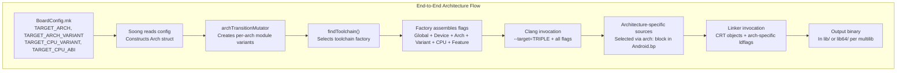

架构支持的关键源文件如下：

| 文件 | 用途 |
|---|---|
| `build/soong/cc/config/arm64_device.go` | ARM64 工具链配置 |
| `build/soong/cc/config/arm_device.go` | ARM 32 位工具链配置 |
| `build/soong/cc/config/x86_64_device.go` | x86_64 工具链配置 |
| `build/soong/cc/config/x86_device.go` | x86 工具链配置 |
| `build/soong/cc/config/riscv64_device.go` | RISC-V 64 工具链配置 |
| `build/soong/cc/config/arm64_lfi_device.go` | ARM64 轻量级故障隔离工具链 |
| `build/soong/cc/config/lfi.go` | LFI 工具链基础类型 |
| `build/soong/cc/config/global.go` | 全局编译器标志、Clang 版本 |
| `build/soong/cc/config/toolchain.go` | Toolchain 接口与工厂 map |
| `build/soong/cc/config/clang.go` | Clang 特有的标志过滤 |
| `build/soong/cc/config/bionic.go` | Bionic CRT 对象与默认值 |
| `build/soong/cc/linker.go` | RELR / 打包重定位链接器标志 |
| `build/soong/android/arch.go` | Multilib、架构变更器、LFI 目标 |
| `build/make/core/config.mk` | `TARGET_MAX_PAGE_SIZE_SUPPORTED` 默认值（16KB） |
| `bionic/libc/arch-arm64/ifuncs.cpp` | ARM64 运行时函数分发 |
| `art/runtime/arch/instruction_set_features.cc` | ART ISA 特性检测 |
| `device/generic/arm64/BoardConfig.mk` | ARM64 参考设备配置 |
| `build/make/target/product/core_64_bit.mk` | 64 位产品配置 |
| `frameworks/libs/binary_translation/` | Berberis 二进制翻译 |
