# 第 18 章：ART 运行时

Android 运行时（ART）是每个 Android 应用的核心托管执行环境。它加载、验证并执行 DEX 字节码——即 Java 和 Kotlin 源文件的编译产物。ART 在 Android 5.0（Lollipop）中取代了 Dalvik。自那时起，它发生了巨大的变化。最初它只是一个简单的"解释器加 AOT"模型，如今已演变为一个复杂的多层编译引擎，具备并发垃圾回收、设备端基于 profile 的优化，以及通过 Project Mainline 实现的模块化交付。

本章追溯 Android 上托管代码的整个生命周期。首先介绍 DEX 文件格式，然后讲解提前编译（AOT）和即时编译（JIT）、内存管理以及本地代码互操作。内容基于 AOSP 源代码。

---

## 18.1 ART 架构

### 18.1.1 目录布局

`art/` 下的 ART 项目按以下主要子目录组织：

| 目录 | 用途 |
|-----------|---------|
| `runtime/` | 核心运行时：类链接器、GC、JIT、JNI、线程 |
| `compiler/` | 优化编译器后端（11 个子目录） |
| `dex2oat/` | 提前编译驱动器（5 个子目录） |
| `libdexfile/` | DEX 文件解析与验证库 |
| `libartbase/` | ART 各组件共享的基础工具 |
| `libartpalette/` | 平台抽象层 |
| `libartservice/` | Java 侧 ART 服务（`com.android.server.art`） |
| `libarttools/` | 命令行工具实用程序 |
| `libprofile/` | profile 数据读写 |
| `libnativebridge/` | 用于 ISA 翻译的 NativeBridge 接口 |
| `libnativeloader/` | 按应用加载本地库 |
| `libelffile/` | 用于 OAT 文件的 ELF 文件读取 |
| `odrefresh/` | OTA 更新后的设备端刷新 |
| `openjdkjvm/` | JVM 接口实现 |
| `openjdkjvmti/` | 用于调试的 JVMTI 代理实现 |
| `artd/` | ART 守护进程（dexopt 服务） |
| `perfetto_hprof/` | Perfetto 堆分析器集成 |
| `dalvikvm/` | `dalvikvm` 命令行启动器 |
| `dexdump/` | DEX 文件转储工具 |
| `oatdump/` | OAT 文件转储工具 |
| `profman/` | profile 管理器工具 |
| `sigchainlib/` | 信号链库 |
| `disassembler/` | 机器码反汇编 |
| `tools/` | 杂项辅助脚本与工具 |
| `test/` | 测试基础设施与测试用例 |
| `benchmark/` | 性能基准测试 |
| `build/` | 构建系统集成 |

### 18.1.2 运行时单例

`Runtime` 类是拥有所有主要子系统的中心单例。它声明于 `art/runtime/runtime.h`，实现于 `art/runtime/runtime.cc`。

```
// art/runtime/runtime.h, line 130
class Runtime {
 public:
  static bool Create(RuntimeArgumentMap&& runtime_options)
      SHARED_TRYLOCK_FUNCTION(true, Locks::mutator_lock_);

  bool Start() UNLOCK_FUNCTION(Locks::mutator_lock_);

  static Runtime* Current() {
    return instance_;
  }
  ...
};
```

`Runtime` 所拥有的关键子系统：

- **ClassLinker** —— 类加载、链接、验证、解析
- **Heap**（gc::Heap）—— 托管堆、垃圾回收器
- **Jit**（jit::Jit）—— JIT 编译器前端、线程池、性能分析
- **JitCodeCache** —— 编译后代码的存储、代码的垃圾回收
- **JavaVMExt** —— JNI JavaVM 实现、本地库管理
- **InternTable** —— 字符串驻留
- **ThreadList** —— 线程管理、挂起、检查点
- **OatFileManager** —— OAT 文件的发现与加载
- **MonitorList** / **MonitorPool** —— 对象监视器管理
- **SignalCatcher** —— 用于 ANR 转储的 SIGQUIT 处理程序
- **Instrumentation** —— 方法进入/退出钩子
- **Trace** —— 方法跟踪
- **RuntimeCallbacks** —— 插件与代理的扩展点

### 18.1.3 运行时启动序列

当 Zygote 进程启动，或直接调用 `dalvikvm` 时，运行时遵循以下初始化序列：

1. **解析选项** —— `Runtime::ParseOptions()` 处理命令行标志，如堆大小、编译器过滤器和 GC 配置。
2. **创建运行时** —— `Runtime::Create()` 分配并初始化单例 `Runtime` 实例。
3. **初始化堆** —— `gc::Heap` 构造函数创建内存空间（region space、大对象空间、非移动空间），并选择垃圾回收器。
4. **加载启动镜像** —— `ClassLinker::InitFromBootImage()` 将预编译的启动镜像（`.art` 文件）映射到内存，加载 `java.lang.Object`、`java.lang.String` 等基础类。
5. **初始化类链接器** —— 注册启动类路径 DEX 文件，建立 DexCache 对象，初始化驻留表。
6. **创建 JIT** —— 如果启用了 JIT 编译（应用进程的默认行为），`Jit::Create()` 会加载编译器共享库并创建 JIT 线程池。
7. **启动** —— `Runtime::Start()` 转换到完全运行状态：启动信号捕获线程、堆任务处理器和终结器守护线程。

```
// art/runtime/runtime.cc, lines 96-97 (include chain)
#include "jit/jit.h"
#include "jit/jit_code_cache.h"
```

### 18.1.4 Zygote 与进程模型

ART 严重依赖 Zygote 进程模型来实现高效的进程创建：

1. **Zygote 启动** —— Zygote 进程启动 ART 运行时，加载启动镜像，并预先初始化常用类。
2. **Fork** —— 当需要新的应用进程时，Zygote 执行 `fork()`。子进程继承：
   - 整个启动镜像内存映射（共享、只读）
   - 已加载的类及其元数据
   - 驻留表
   - JIT 代码缓存（在 zygote JIT 模式下）
3. **特化** —— 子进程通过以下方式特化：
   - 加载应用的 DEX 文件和 OAT 文件
   - 创建应用特定的类加载器
   - 针对应用的内存类别调整 GC 配置
   - 启动 JIT 线程池

这意味着 ART 运行时的启动开销只需支付一次（在 Zygote 中）。所有应用通过写时复制语义共享启动镜像的内存页。

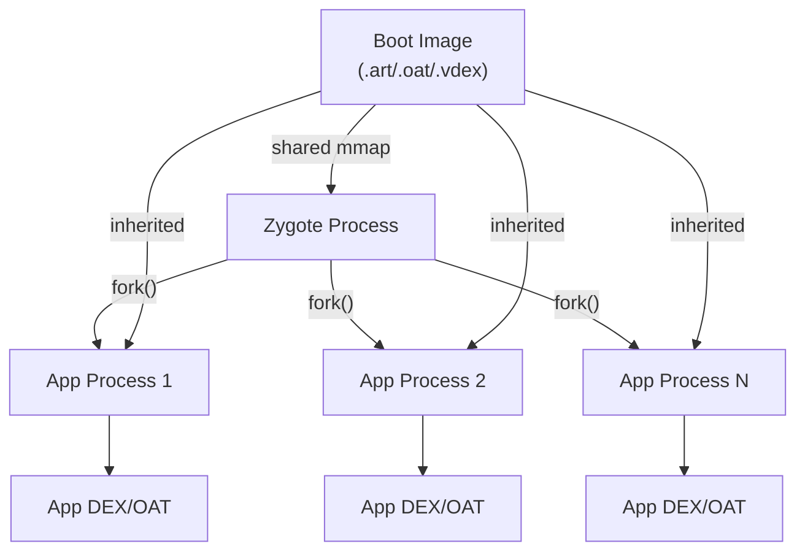

Zygote 操作的关键运行时方法：

```
// art/runtime/runtime.h (selected methods)
bool IsZygote() const { return is_zygote_; }
bool IsPrimaryZygote() const { return is_primary_zygote_; }
bool IsSystemServer() const { return is_system_server_; }

void SetAsSystemServer() {
  is_system_server_ = true;
  is_zygote_ = false;
  is_primary_zygote_ = false;
}
```

### 18.1.5 应用镜像

除启动镜像外，ART 还可以创建按应用划分的镜像，用于捕获某个应用的预初始化类状态。当使用 `speed-profile` 过滤器时，App 镜像由 `dex2oat` 创建，并以 `.art` 文件形式与 `.oat` 文件一起存储。

App 镜像包含：

- 来自应用 DEX 文件的预初始化类
- 应用使用的已解析字符串
- 应用 DEX 文件的 DexCache 条目

应用启动时，运行时将应用镜像映射到堆中，避免了重新加载和重新初始化这些类的开销。这显著降低了类数量众多的应用的冷启动延迟。

### 18.1.6 编译流水线概述

ART 使用多层编译策略：

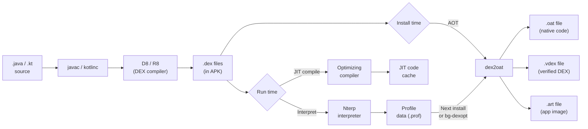

该流水线支持多种"编译器过滤器"，用于控制 `dex2oat` 执行的工作（见第 18.3.3 节）。

### 18.1.7 执行模式

ART 为给定方法提供四种执行模式：

1. **解释器（Nterp）** —— 一个手写汇编解释器，逐条执行 DEX 字节码指令。Nterp 针对每种架构（ARM64、x86-64、RISC-V）进行了优化，同时收集性能分析数据。
2. **基线 JIT** —— 一种快速的非优化 JIT 编译，可迅速为跨过热度阈值的方法生成本地代码。
3. **优化 JIT** —— 针对热点方法的完全优化编译。
4. **AOT（dex2oat）** —— 存储在 OAT 文件中的提前编译本地代码。

`art/runtime/compilation_kind.h` 中的 `CompilationKind` 枚举定义了：

```
// art/runtime/compilation_kind.h, lines 27-32
enum class CompilationKind {
  kOsr = 0,        // On-Stack Replacement
  kFast = 1,       // Fast (pattern-matched) compilation
  kBaseline = 2,   // Non-optimizing baseline
  kOptimized = 3,  // Full optimization
};
```

### 18.1.8 Nterp：快速解释器

Nterp 是 ART 的主要解释器——它是旧式 mterp 解释器的汇编继任者，因此其源代码仍位于 `mterp/` 目录下。与传统的基于 C++ switch 的解释器不同，Nterp 为每种支持的架构用手工编写的汇编实现。这消除了 C++ 函数调用的开销，并支持寄存器到寄存器的 DEX 字节码执行。

源代码：`art/runtime/interpreter/mterp/`（特定架构的汇编文件）。

Nterp 的关键特性：

1. **直接线程化** —— 每个 DEX 指令处理程序直接跳转到下一条指令的处理程序，避免了 switch 派发开销。
2. **寄存器映射** —— DEX 虚拟寄存器映射到栈上的一段连续内存区域，常用寄存器保留在机器寄存器中。
3. **热度计数** —— 每次方法调用和向后跳转都会递减热度计数器。当计数器减到零时，通知 JIT。（相比之下，接收者类型内联缓存不由 Nterp 填充——它们由基线 JIT 编译的代码通过 `art_quick_update_inline_cache` 入口点记录。）
4. **GC 协作** —— Nterp 在向后跳转和方法入口处包含安全点检查，用于 GC 挂起。

Nterp 在启动延迟（零编译时间）和执行速度（比朴素的 C++ 解释器快 2-5 倍）之间取得了良好的平衡。

### 18.1.9 线程模型

ART 通过 `Thread` 类（`art/runtime/thread.h`）和 `ThreadList` 类（`art/runtime/thread_list.h`）管理 Java 线程。

每个 `Thread` 对象包含：

- **线程本地状态** —— 当前状态（Runnable、Native、Suspended、WaitingForGc 等）
- **托管栈** —— 用于栈遍历的托管帧链
- **JNI 本地引用** —— 线程本地 JNI 引用表
- **TLAB** —— 用于快速对象分配的线程本地分配缓冲区
- **标记栈** —— 用于并发 GC 的线程本地标记栈
- **异常** —— 当前挂起的异常
- **解释器缓存** —— 解释器使用的已解析 DEX 项的每线程缓存

线程状态控制 GC 协作：

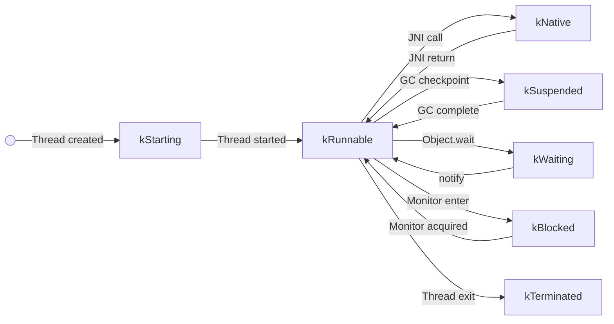

只有处于 `kRunnable` 状态的线程才能访问托管堆。GC 在执行某些操作之前，需要所有 mutator 线程到达安全点（从 kRunnable 转换出去）。

### 18.1.10 锁基础设施

ART 使用明确定义的锁层级来防止死锁。该层级通过注解（`REQUIRES`、`REQUIRES_SHARED`、`GUARDED_BY`）和编译时检查来强制执行。

关键锁（按获取顺序）：

1. **mutator_lock_** —— 主读写锁，将 mutator 线程（读者）与 GC（排他写者）分开。大多数运行时操作以共享模式持有该锁。
2. **heap_bitmap_lock_** —— 在标记和清除期间保护 GC 位图。
3. **thread_list_lock_** —— 保护全局线程列表。
4. **classlinker_classes_lock_** —— 在类加载期间保护类表。
5. **dex_lock_** —— 保护已注册的 DEX 文件列表。
6. **jni_libraries_lock_** —— 保护本地库表。

### 18.1.11 信号链库

信号链库（`art/sigchainlib/`）提供信号处理管理，允许 ART 的信号处理程序与应用和 NDK 的信号处理程序共存。当信号到达时：

1. ART 的处理程序获得首先处理的机会。
2. 如果 ART 不处理它（不是托管故障），它会链到下一个处理程序。
3. 如果没有处理程序处理它，则采取默认动作。

这对以下场景至关重要：

- 空指针异常检测（SIGSEGV）
- 栈溢出检测（SIGSEGV/SIGBUS）
- GC 隐式挂起（读屏障页上的 SIGSEGV）
- ANR 转储生成（SIGQUIT）

### 18.1.12 异常处理

ART 的异常处理遵循 Java 异常模型：

1. **抛出** —— 当 `throw` 指令执行时，运行时在当前线程上设置挂起异常。
2. **展开** —— 栈遍历器沿调用栈向上搜索匹配的 `catch` 处理程序。
3. **捕获** —— 如果找到匹配的处理程序，执行从处理程序的 PC 恢复。捕获的异常通过 `move-exception` 指令存储在特殊寄存器中。
4. **未捕获** —— 如果没有找到处理程序，则调用线程的 `UncaughtExceptionHandler`。

对于编译后的代码，异常处理使用栈映射表来确定每个 PC 处活跃的处理程序。对于解释执行的代码，则查阅 CodeItem 中的 try-item 表。

`CommonThrows` 模块（`art/runtime/common_throws.h`）为常见异常提供工厂函数：

```
// art/runtime/common_throws.h (selected)
void ThrowNullPointerExceptionForFieldAccess(ArtField*, ArtMethod*, bool is_read);
void ThrowNullPointerExceptionForMethodAccess(uint32_t method_idx, InvokeType);
void ThrowArrayIndexOutOfBoundsException(int index, int length);
void ThrowClassCastException(ObjPtr<mirror::Class> dest_type, ObjPtr<mirror::Class> src_type);
void ThrowArithmeticExceptionDivideByZero();
void ThrowStackOverflowError(Thread* self);
void ThrowNoSuchMethodError(InvokeType, mirror::Class*, std::string_view, Signature);
void ThrowNoSuchFieldError(std::string_view scope, ObjPtr<mirror::Class> c,
                           std::string_view type, std::string_view name);
```

### 18.1.13 监视器与同步

Java 的 `synchronized` 关键字以及 `Object.wait()` / `Object.notify()` 通过监视器系统（`art/runtime/monitor.h`）实现。

#### 瘦锁与胖锁

ART 使用两级锁方案：

1. **瘦锁** —— 对于无竞争的同步，瘦锁直接存储在对象的锁字中。锁字是每个对象的第二个字，位于类指针之后。瘦锁获取是单个 CAS（比较并交换）操作：

      ```
      Lock Word layout (32 bits):
      [31:30] State (00=thin/unlocked, 01=fat, 10=hash, 11=forwarding address)
      [29]    Mark bit (GC)
      [28]    Read barrier state
      [27:16] Lock count (recursion depth for thin locks, 12 bits)
      [15:0]  Owner thread ID (for thin locks)
      ```

2. **胖锁** —— 当另一个线程试图获取被不同线程持有的瘦锁时，会检测到竞争。然后瘦锁被"膨胀"为胖锁。胖锁使用带条件变量的 `Monitor` 对象，以支持 `wait()` / `notify()`。

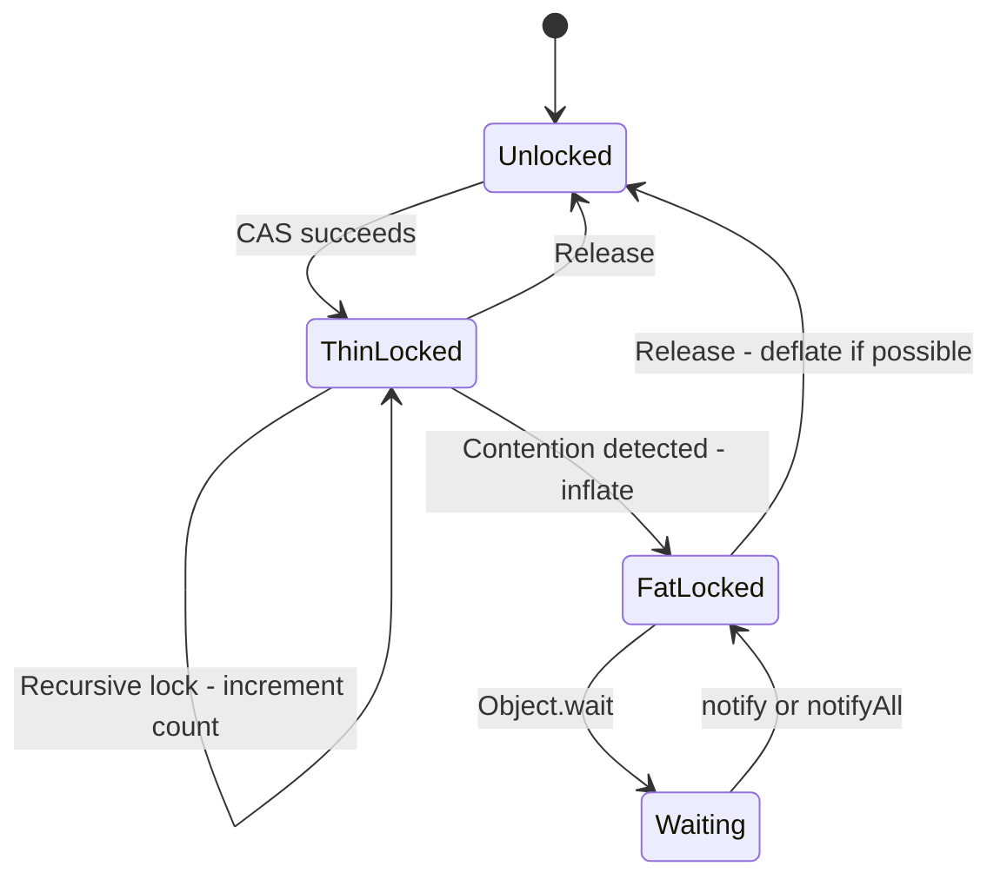

#### 监视器池

`MonitorPool`（`art/runtime/monitor_pool.h`）预分配 Monitor 对象，以避免在锁膨胀期间发生分配（这可能在不方便的时候触发 GC）。

### 18.1.14 内建函数

ART 将某些 Java 方法识别为"内建函数"（intrinsics），并提供绕过正常调用序列的优化实现。内建函数在特定架构的代码生成器中实现，并为以下操作提供显著加速：

- **数学运算** —— `Math.abs()`、`Math.min()`、`Math.max()`、`Math.sqrt()` 直接使用硬件指令。
- **字符串操作** —— `String.charAt()`、`String.compareTo()`、`String.equals()` 使用优化的汇编。
- **对象操作** —— `Object.getClass()` 直接读取类字段。
- **系统操作** —— `System.arraycopy()` 使用优化的内存拷贝。
- **Unsafe 操作** —— `Unsafe.compareAndSwapInt()` 等使用硬件 CAS 指令。
- **线程操作** —— `Thread.currentThread()` 直接读取线程本地存储。

内建函数识别由 `ArtMethod::access_flags_` 中的 `kAccIntrinsic` 访问标志位控制。具体的内建函数由访问标志中的其他位标识：

```
// art/runtime/art_method.h, lines 256-258
bool IsIntrinsic() const {
  return IsIntrinsic(GetAccessFlags());
}
```

### 18.1.15 内存表示

ART 为对象使用经过精心设计、以性能为导向的特定内存表示：

#### 对象布局

每个 Java 对象以一个两字的头部开始：

1. **类指针**（`klass_`，32 位，偏移 0 处的压缩引用）—— 指向 `mirror::Class` 对象的引用。
2. **锁字**（`monitor_`，偏移 4 处的 32 位）—— 监视器状态、哈希码或 GC 转发指针。

实例字段位于头部之后，按最小化填充的顺序排列：

- 先是引用（为了 GC 扫描效率）
- 然后是 64 位字段、32 位字段、16 位字段、8 位字段

#### 数组布局

数组在对象头部之后还有一个字：

- **长度**（32 位）—— 元素个数

数组元素位于长度字段之后，按其自然对齐方式对齐。

#### 字符串布局

`java.lang.String` 对象包含：

- 对象头部（锁字 + 类指针）
- `count`（32 位）—— 字符个数
- `hash`（32 位）—— 缓存的哈希码
- 字符数据（内联，位于字段之后）

字符串可以使用 UTF-16 或压缩（Latin-1）编码。编码由 `count` 字段中的一位标志指示。

### 18.1.16 关键数据结构

#### ArtMethod

每个 Java/Kotlin 方法在内部由一个 `ArtMethod` 对象表示（声明于 `art/runtime/art_method.h` 第 89 行）。`ArtMethod` 不是托管 GC 对象——它分配在 LinearAlloc 中，并由托管的 `java.lang.reflect.Method` 对象指向。

```
// art/runtime/art_method.h, lines 89-99
class EXPORT ArtMethod final {
 public:
  DECLARE_RUNTIME_DEBUG_FLAG(kCheckDeclaringClassState);
  static constexpr uint32_t kRuntimeMethodDexMethodIndex = 0xFFFFFFFF;

  ArtMethod() : access_flags_(0), dex_method_index_(0),
      method_index_(0), hotness_count_(0) { }
  ...
};
```

关键字段包括：

- `declaring_class_` —— 指向声明类的 GC 根
- `access_flags_` —— 方法修饰符和运行时标志（为并发访问而原子化）
- `dex_method_index_` —— DEX 文件 method_id 表的索引
- `method_index_` —— 虚表或 iftable 索引
- `hotness_count_` —— JIT 用于性能分析的计数器
- `ptr_sized_fields_.data_` —— 指向 DEX CodeItem（解释执行的方法）或性能分析信息
- `ptr_sized_fields_.entry_point_from_quick_compiled_code_` —— 指向编译后代码或跳板的函数指针

ART 通过入口点字段选择执行模式。该字段可以指向解释器桥、JIT 编译的代码、AOT 编译的代码或解析跳板（用于未解析的方法）。

ArtMethod 提供丰富的查询方法来检查方法属性：

```
// art/runtime/art_method.h, lines 168-258 (selected)
// Each predicate is an instance/static pair: the instance method reads
// the access flags and delegates to a static overload.
bool IsPublic() const { return IsPublic(GetAccessFlags()); }
static bool IsPublic(uint32_t access_flags) {
  return (access_flags & kAccPublic) != 0;
}

bool IsPrivate() const { return IsPrivate(GetAccessFlags()); }
static bool IsPrivate(uint32_t access_flags) {
  return (access_flags & kAccPrivate) != 0;
}

bool IsStatic() const { return IsStatic(GetAccessFlags()); }
static bool IsStatic(uint32_t access_flags) {
  return (access_flags & kAccStatic) != 0;
}

// ... IsConstructor(), IsDirect(), IsSynchronized(), IsFinal() follow
// the same pattern ...

bool IsIntrinsic() const { return IsIntrinsic(GetAccessFlags()); }
static bool IsIntrinsic(uint32_t access_flags) {
  return (access_flags & kAccIntrinsic) != 0;
}
```

"直接"方法与"虚"方法的区别对派发至关重要：

- **直接方法**（static、private、构造函数）直接派发到其实现——无需虚表查找。
- **虚方法**（其他所有方法）通过虚表或接口方法表（IMT）派发。

#### ArtMethod 入口点

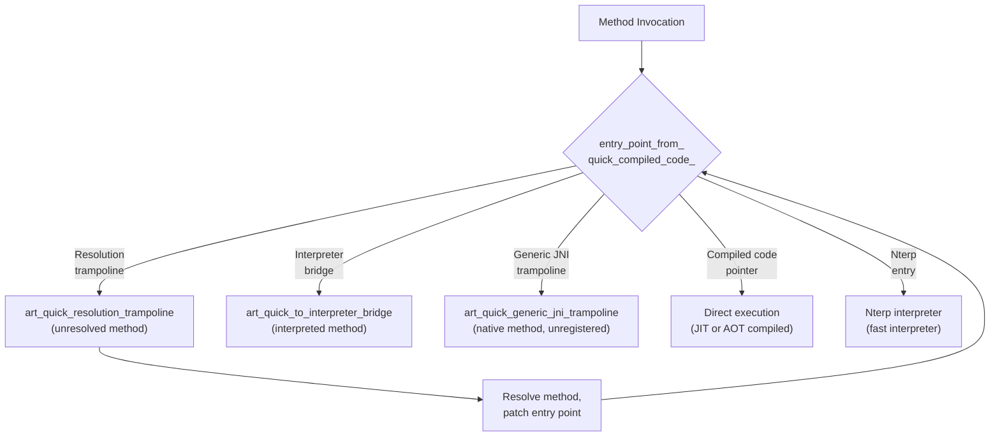

#### mirror::Class

已加载类的托管表示。包含虚表、iftable（接口表）、字段数组、方法数组以及类状态（已验证、已初始化等）。作为托管对象，`mirror::Class` 实例位于 GC 堆上，受垃圾回收和重定位影响。

`mirror::Class` 的关键组件：

- **vtable** —— `ArtMethod*` 数组，用于虚方法派发
- **iftable** —— 将接口映射到其方法数组的接口表
- **imt** —— 接口方法表（基于哈希的快速派发）
- **sfields** —— 静态字段数组
- **ifields** —— 实例字段数组
- **class_size** —— 该类实例的大小
- **status** —— 当前类状态（已加载、已验证、已初始化等）
- **class_loader** —— 指向加载此类的 ClassLoader 的引用
- **class_flags** —— 一个 `uint32_t` 位集（`art/runtime/mirror/class_flags.h`），GC 和运行时用它在不检查整个类的情况下走快速路径。常见情况是 `kClassFlagNormal`；其他位标记字符串、数组、引用类、类加载器、dex cache，以及（Android 17）record 和 value 类。确切的布局，以及 Android 17 如何重写 record 类，将在第 18.11 节中介绍。

#### DexCache

按 DEX 文件划分的已解析字符串、类型、方法和字段的缓存。加速重复查找，无需从 DEX 文件重新解析。

DexCache 在 DEX 文件打开时由 ClassLinker 创建，并以托管的 `mirror::DexCache` 对象形式存储在堆上。它包含：

- **已解析字符串数组** —— 将 `StringIndex` 映射到 `mirror::String*`
- **已解析类型数组** —— 将 `TypeIndex` 映射到 `mirror::Class*`
- **已解析方法数组** —— 将方法索引映射到 `ArtMethod*`
- **已解析字段数组** —— 将字段索引映射到 `ArtField*`

未解析的条目包含 `null`（或 `GcRoot<nullptr>`），在首次访问时触发解析。

#### InternTable

驻留表存储 `java.lang.String` 对象的规范实例。当调用 `String.intern()` 时，驻留表返回已存在的规范实例，或者插入该字符串并返回它。启动镜像用常用字符串预先填充驻留表。

#### LinearAlloc

一种指针碰撞分配器（bump-pointer allocator），用于那些从不单独释放（仅在整个类加载器卸载时释放）的运行时元数据。用于：

- `ArtMethod` 数组
- `ArtField` 数组
- 类表
- IMT 冲突表
- DexCache 后备存储

---

## 18.2 DEX 文件格式

DEX（Dalvik Executable）文件格式是 ART 使用的字节码容器。与 Java 的 `.class` 文件（每个类一个文件）不同，单个 `.dex` 文件将一次编译单元中的所有类打包到一个去重的结构中。该结构针对内存映射访问进行了优化。

源代码：`art/libdexfile/`（解析和验证 DEX 文件的库）。

### 18.2.1 头部结构

DEX 头部定义于 `art/libdexfile/dex/dex_file.h`：

```
// art/libdexfile/dex/dex_file.h, lines 134-179
struct Header {
  Magic magic_ = {};              // "dex\n035\0" or similar
  uint32_t checksum_ = 0;        // adler32 of everything except magic and this field
  Sha1 signature_ = {};          // SHA-1 hash of the rest of the file
  uint32_t file_size_ = 0;       // size of entire file
  uint32_t header_size_ = 0;     // offset to start of next section
  uint32_t endian_tag_ = 0;      // 0x12345678
  uint32_t link_size_ = 0;       // unused
  uint32_t link_off_ = 0;        // unused
  uint32_t map_off_ = 0;         // offset to map list
  uint32_t string_ids_size_ = 0; // number of StringIds
  uint32_t string_ids_off_ = 0;  // file offset of StringIds array
  uint32_t type_ids_size_ = 0;   // number of TypeIds
  uint32_t type_ids_off_ = 0;    // file offset of TypeIds array
  uint32_t proto_ids_size_ = 0;  // number of ProtoIds
  uint32_t proto_ids_off_ = 0;   // file offset of ProtoIds array
  uint32_t field_ids_size_ = 0;  // number of FieldIds
  uint32_t field_ids_off_ = 0;   // file offset of FieldIds array
  uint32_t method_ids_size_ = 0; // number of MethodIds
  uint32_t method_ids_off_ = 0;  // file offset of MethodIds array
  uint32_t class_defs_size_ = 0; // number of ClassDefs
  uint32_t class_defs_off_ = 0;  // file offset of ClassDef array
  uint32_t data_size_ = 0;       // size of data section
  uint32_t data_off_ = 0;        // file offset of data section
};
```

DEX 版本 41（magic 为 `dex\n041\0`）增加了*容器*支持：多个逻辑 DEX 文件被拼接成一个连续的 blob。每个文件携带两个额外的头部字，指向其所在容器。DEX 容器版本常量为 `DexFile::kDexContainerVersion = 41`（`art/libdexfile/dex/dex_file.h`，第 112 行），扩展头部为 `HeaderV41`：

```
// art/libdexfile/dex/dex_file.h, lines 181-184
struct HeaderV41 : public Header {
  uint32_t container_size_ = 0;  // total size of all dex files in the container
  uint32_t header_offset_ = 0;   // offset of this dex's header in the container
};
```

对于 V41 或更新版本的文件，`DexFile::HasDexContainer()` 返回 true（即使容器只包含单个 DEX）。`GetDexContainerRange()` 重建整个容器的跨度。它从 `Begin()` 回退 `header_offset_` 字节，并跨越 `container_size_` 字节（`art/libdexfile/dex/dex_file.h`，第 291-303 行）。加载器以此为基础处理多条目情况。它通过 `DexFileLoader::OpenOne(header_offset, ...)` 逐个打开容器条目，并按头部偏移在容器中向前遍历。当最后一个条目被消费后，单文件 `Open()` 辅助函数会断言 `IsDexContainerLastEntry()`（第 213 行）。

多 DEX 校验和的计算也感知容器。在 `DexFileLoader::GetMultiDexChecksum()`（`art/libdexfile/dex/dex_file_loader.h`，第 113 行）中，一个非主条目的 V41 条目，如果其位置校验和与前一条目相同，则只被计数一次。

Android 17 的两个加固修复加强了这条路径。首先，验证器现在会拒绝声明的 `container_size_` 超过实际映射大小的头部。其检查消息为："[V41] Check that the claimed size is LE than the actual size"。其次，加载器会忽略容器之后多余的字节。因此，普通的 `.dex` 文件必须恰好包含一个容器（"Ensure we ignore superfluous data after dex container"）。关于 V41 的推广与 profile 及 dex2oat 如何交互，参见第 18.11 节（Android 17 变更）。

### 18.2.2 文件布局

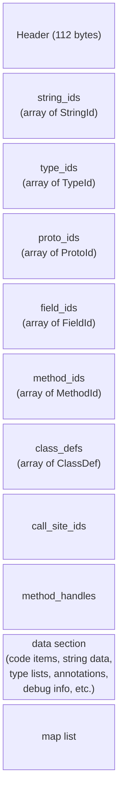

### 18.2.3 索引表

DEX 格式使用索引表来去重数据。每个表都是固定大小的结构数组，整个文件中都使用指向这些表的索引。

**StringId**（`art/libdexfile/dex/dex_file_structs.h`，第 52 行）：
```
struct StringId {
  uint32_t string_data_off_;  // offset to MUTF-8 string data
};
```

**TypeId**（第 60 行）：
```
struct TypeId {
  dex::StringIndex descriptor_idx_;  // index into string_ids
};
```

**FieldId**（第 68 行）：
```
struct FieldId {
  dex::TypeIndex class_idx_;   // defining class
  dex::TypeIndex type_idx_;    // field type
  dex::StringIndex name_idx_;  // field name
};
```

**MethodId**（第 89 行）：
```
struct MethodId {
  dex::TypeIndex class_idx_;   // defining class
  dex::ProtoIndex proto_idx_;  // method prototype (return type + parameters)
  dex::StringIndex name_idx_;  // method name
};
```

**ProtoId**（第 78 行）：
```
struct ProtoId {
  dex::StringIndex shorty_idx_;     // shorty descriptor (e.g., "VIL")
  dex::TypeIndex return_type_idx_;  // return type
  uint16_t pad_;                    // alignment padding
  uint32_t parameters_off_;         // offset to TypeList for parameters
};
```

### 18.2.4 ClassDef 与类数据

**ClassDef** 结构（`art/libdexfile/dex/dex_file_structs.h`，第 108 行）定义了一个类：

```
struct ClassDef {
  dex::TypeIndex class_idx_;       // this class's type
  uint16_t pad1_;
  uint32_t access_flags_;          // ACC_PUBLIC, ACC_FINAL, etc.
  dex::TypeIndex superclass_idx_;  // superclass type
  uint16_t pad2_;
  uint32_t interfaces_off_;        // offset to TypeList of interfaces
  dex::StringIndex source_file_idx_;  // source file name
  uint32_t annotations_off_;       // annotations directory
  uint32_t class_data_off_;        // offset to class_data_item
  uint32_t static_values_off_;     // initial static field values
};
```

`class_data_item`（由 `class_data_off_` 指向）使用 LEB128 编码存储：

- 静态字段的数量
- 实例字段的数量
- 直接方法（static、private、构造函数）的数量
- 虚方法的数量
- 每个字段：字段索引增量和访问标志
- 每个方法：方法索引增量、访问标志和代码偏移

### 18.2.5 CodeItem —— 方法字节码

`CodeItem` 结构包含一个方法的实际 DEX 字节码。在标准 DEX 格式中，它包括：

- `registers_size` —— 使用的寄存器数量
- `ins_size` —— 传入参数寄存器的数量
- `outs_size` —— 传出参数寄存器的数量
- `tries_size` —— try/catch 块的数量
- `debug_info_off` —— 调试信息的偏移
- `insns_size` —— 16 位代码单元的数量
- `insns[]` —— 字节码指令
- Try 项和 catch 处理程序数据（如果 `tries_size > 0`）

### 18.2.6 Map 项类型

DEX 文件末尾的 map 列表提供了一个带类型的目录。map 项类型码定义于 `art/libdexfile/dex/dex_file.h`（第 190-211 行）：

```
enum MapItemType : uint16_t {
  kDexTypeHeaderItem               = 0x0000,
  kDexTypeStringIdItem             = 0x0001,
  kDexTypeTypeIdItem               = 0x0002,
  kDexTypeProtoIdItem              = 0x0003,
  kDexTypeFieldIdItem              = 0x0004,
  kDexTypeMethodIdItem             = 0x0005,
  kDexTypeClassDefItem             = 0x0006,
  kDexTypeCallSiteIdItem           = 0x0007,
  kDexTypeMethodHandleItem         = 0x0008,
  kDexTypeMapList                  = 0x1000,
  kDexTypeTypeList                 = 0x1001,
  kDexTypeAnnotationSetRefList     = 0x1002,
  kDexTypeAnnotationSetItem        = 0x1003,
  kDexTypeClassDataItem            = 0x2000,
  kDexTypeCodeItem                 = 0x2001,
  kDexTypeStringDataItem           = 0x2002,
  kDexTypeDebugInfoItem            = 0x2003,
  kDexTypeAnnotationItem           = 0x2004,
  kDexTypeEncodedArrayItem         = 0x2005,
  kDexTypeAnnotationsDirectoryItem = 0x2006,
  kDexTypeHiddenapiClassData       = 0xF000,
};
```

### 18.2.7 类型描述符

DEX 类型描述符遵循 JNI 约定：

| 描述符 | 类型 |
|-----------|------|
| `V` | void |
| `Z` | boolean |
| `B` | byte |
| `S` | short |
| `C` | char |
| `I` | int |
| `J` | long |
| `F` | float |
| `D` | double |
| `Ljava/lang/String;` | 对象引用 |
| `[I` | int 数组 |
| `[[Ljava/lang/Object;` | 二维 Object 数组 |

### 18.2.8 隐藏 API 数据

自 Android P 起，DEX 格式包含一个 `HiddenapiClassData` 段（`art/libdexfile/dex/dex_file_structs.h`，第 274 行），为每个字段和方法标记隐藏 API 限制标志。这支持"unsupported"和"blocked"两种强制执行级别（见第 18.10.15 节），防止应用访问内部平台 API。

### 18.2.9 Method Handle 与 Call Site 项

DEX 版本 38+ 通过以下方式增加了对 `invokedynamic` 的支持：

- **MethodHandleItem**（第 179 行）—— 指向静态/实例 getter、setter 和方法调用器的引用
- **CallSiteIdItem**（第 189 行）—— 指向用于动态调用的引导方法的引用

这些对于 lambda 表达式和其他基于 `invokedynamic` 的特性至关重要。

### 18.2.10 DEX 字节码指令

DEX 字节码使用 16 位指令单元。指令编码为一到五个 16 位字。第一个字的低 8 位总是包含操作码。操作码空间涵盖约 256 条指令，按类别组织：

#### 移动指令
```
00: nop
01: move vA, vB               (4-bit registers)
02: move/from16 vAA, vBBBB    (8-bit and 16-bit registers)
03: move/16 vAAAA, vBBBB      (16-bit registers)
04: move-wide vA, vB          (wide move, 64-bit)
07: move-object vA, vB        (object reference move)
0a: move-result vAA           (captures return value)
0b: move-result-wide vAA
0c: move-result-object vAA
0d: move-exception vAA        (captures exception in catch)
```

#### 返回指令
```
0e: return-void
0f: return vAA
10: return-wide vAA
11: return-object vAA
```

#### 常量指令
```
12: const/4 vA, #+B           (4-bit constant)
13: const/16 vAA, #+BBBB      (16-bit constant)
14: const vAA, #+BBBBBBBB     (32-bit constant)
15: const/high16 vAA, #+BBBB0000
18: const-wide vAA, #+BBBBBBBBBBBBBBBB  (64-bit constant)
1a: const-string vAA, string@BBBB
1c: const-class vAA, type@BBBB
```

#### 实例与静态操作
```
52-58: iget, iget-wide, iget-object, iget-boolean, ...
59-5f: iput, iput-wide, iput-object, iput-boolean, ...
60-66: sget, sget-wide, sget-object, sget-boolean, ...
67-6d: sput, sput-wide, sput-object, sput-boolean, ...
```

#### 调用指令
```
6e: invoke-virtual {vC..vG}, method@BBBB
6f: invoke-super {vC..vG}, method@BBBB
70: invoke-direct {vC..vG}, method@BBBB
71: invoke-static {vC..vG}, method@BBBB
72: invoke-interface {vC..vG}, method@BBBB
74: invoke-virtual/range {vCCCC..vNNNN}, method@BBBB
```

#### 算术与逻辑
```
90-af: add, sub, mul, div, rem, and, or, xor, shl, shr, ushr
       (for int, long, float, double variants)
b0-cf: add/2addr, sub/2addr, mul/2addr, ...
       (2-address form: vA = vA op vB)
d0-d7: add-int/lit16, rsub-int, mul-int/lit16, ...
       (immediate operand forms)
```

#### 比较与分支
```
2d-31: cmpl-float, cmpg-float, cmpl-double, cmpg-double, cmp-long
32-37: if-eq, if-ne, if-lt, if-ge, if-gt, if-le
38-3d: if-eqz, if-nez, if-ltz, if-gez, if-gtz, if-lez
28-2a: goto, goto/16, goto/32
2b: packed-switch
2c: sparse-switch
```

#### 数组操作
```
44-4a: aget, aget-wide, aget-object, aget-boolean, ...
4b-51: aput, aput-wide, aput-object, aput-boolean, ...
21: array-length vA, vB
23: new-array vA, vB, type@CCCC
24: filled-new-array {vC..vG}, type@BBBB
```

#### 对象操作
```
1f: check-cast vAA, type@BBBB
20: instance-of vA, vB, type@CCCC
22: new-instance vAA, type@BBBB
27: throw vAA
```

每条指令操作 DEX 虚拟寄存器（编号从 0 到 `registers_size - 1`）。最后的 `ins_size` 个寄存器是该方法的传入参数。

### 18.2.11 MUTF-8 字符串编码

DEX 文件使用 Modified UTF-8（MUTF-8）进行字符串编码，它与标准 UTF-8 有两点不同：

1. **空字符**（U+0000）编码为两个字节 `0xC0 0x80`，而不是单个零字节。这允许 C 风格的以空字符结尾的字符串处理。
2. **增补字符**（U+10000 及以上）编码为两个三字节序列，分别表示 UTF-16 代理对，而不是单个四字节 UTF-8 序列。

DEX 文件中的字符串数据前面有一个 ULEB128 编码的长度（UTF-16 代码单元的数量，而不是字节数），后面跟一个空终止符。

### 18.2.12 LEB128 编码

DEX 格式广泛使用 LEB128（小端基 128）编码来表示可变长度整数。这为小数值节省了空间：

- **ULEB128**（无符号）：每个字节使用 7 个数据位和 1 个延续位。值 0-127 使用 1 个字节，128-16383 使用 2 个字节，依此类推。
- **SLEB128**（有符号）：类似，但带符号扩展。
- **ULEB128p1**：对值+1 进行 ULEB128 编码，用于经常为零（默认值或"无值"情况）的值。

LEB128 用于：

- 类数据项（字段/方法计数和增量）
- 调试信息
- 注解编码
- 隐藏 API 标志

### 18.2.13 注解

DEX 格式支持 Java 注解，具有三个可见性级别（定义于 `art/libdexfile/dex/dex_file.h`，第 231-235 行）：

```
enum class DexVisibility : uint8_t {
  kBuild         = 0x00,  // visible at build time only
  kRuntime       = 0x01,  // visible at runtime via reflection
  kSystem        = 0x02,  // visible to the runtime system only
};
```

注解数据的组织方式为：

1. **AnnotationsDirectoryItem** —— 每个类的所有注解的目录：
   ```
   struct AnnotationsDirectoryItem {
     uint32_t class_annotations_off_;
     uint32_t fields_size_;
     uint32_t methods_size_;
     uint32_t parameters_size_;
   };
   ```

2. **AnnotationSetItem** —— 单个目标（类、字段、方法或参数）的一组注解。

3. **AnnotationItem** —— 单个注解，包含可见性标志和编码的注解数据。

注解数据使用带类型码的标记编码方案：

```
// art/libdexfile/dex/dex_file.h, lines 237-255
kDexAnnotationByte          = 0x00,
kDexAnnotationShort         = 0x02,
kDexAnnotationChar          = 0x03,
kDexAnnotationInt           = 0x04,
kDexAnnotationLong          = 0x06,
kDexAnnotationFloat         = 0x10,
kDexAnnotationDouble        = 0x11,
kDexAnnotationString        = 0x17,
kDexAnnotationType          = 0x18,
kDexAnnotationField         = 0x19,
kDexAnnotationMethod        = 0x1a,
kDexAnnotationEnum          = 0x1b,
kDexAnnotationArray         = 0x1c,
kDexAnnotationAnnotation    = 0x1d,
kDexAnnotationNull          = 0x1e,
kDexAnnotationBoolean       = 0x1f,
```

### 18.2.14 调试信息

DEX 调试信息段包含用于源码级调试的信息：

- **行号表** —— 将字节码偏移映射到源行号。使用紧凑的类字节码编码，带有用于推进行号和 PC 的操作码。
- **局部变量表** —— 记录每个方法局部变量的名称、类型和作用域。

调试信息是可选的，可以从发布版本中剥离以减小 DEX 文件大小。调试信息操作码包括：

```
DBG_END_SEQUENCE       = 0x00  // End of debug info
DBG_ADVANCE_PC         = 0x01  // Advance PC, no line change
DBG_ADVANCE_LINE       = 0x02  // Advance line, no PC change
DBG_START_LOCAL        = 0x03  // Start of local variable scope
DBG_START_LOCAL_EXTENDED = 0x04  // With type signature
DBG_END_LOCAL          = 0x05  // End of local variable scope
DBG_RESTART_LOCAL      = 0x06  // Restart a previously ended local
DBG_SET_PROLOGUE_END   = 0x07  // Mark end of method prologue
DBG_SET_EPILOGUE_BEGIN = 0x08  // Mark start of method epilogue
DBG_SET_FILE           = 0x09  // Set source file name
// 0x0a-0xff: Special opcodes encoding line + PC advancement
```

### 18.2.15 DEX 文件实例解析

为了说明完整的 DEX 文件结构，考虑一个简单的类：

```java
package com.example;

public class Hello {
    private String message;

    public Hello(String msg) {
        this.message = msg;
    }

    public String getMessage() {
        return message;
    }

    public static void main(String[] args) {
        Hello h = new Hello("world");
        System.out.println(h.getMessage());
    }
}
```

这将生成一个大致包含以下内容的 DEX 文件：

- **字符串池**：15-20 个条目，包括 "com/example/Hello"、"Ljava/lang/String;"、"getMessage"、"main"、"message"、"\<init\>"、"world"、"Ljava/io/PrintStream;"、"println" 等。
- **类型池**：5-8 个条目，包括 `Lcom/example/Hello;`、`Ljava/lang/String;`、`Ljava/lang/Object;`、`[Ljava/lang/String;`、`Ljava/io/PrintStream;`、`Ljava/lang/System;`、`V`（void）。
- **原型池**：3-4 个条目，对应方法签名，如 `(Ljava/lang/String;)V`、`()Ljava/lang/String;`、`([Ljava/lang/String;)V`。
- **字段池**：2+ 个条目，对应 `Hello.message` 和 `System.out`。
- **方法池**：5+ 个条目，对应 `Hello.<init>`、`Hello.getMessage`、`Hello.main`、`Object.<init>`、`PrintStream.println`。
- **类定义**：1 个条目，对应 `com.example.Hello`。
- **代码项**：3 个条目，对应 Hello 的三个方法。

### 18.2.16 标准 DEX 与容器 DEX

ART 曾经支持两种磁盘上的 DEX 变体。它们是传统的标准 DEX 和内部的*紧凑 DEX*（`CompactDexFile`）。紧凑 DEX 重新编码代码项和调试信息，以缩小 VDEX 文件。

紧凑 DEX 已被移除；代码树中仅剩的 `DexFile` 子类是 `StandardDexFile`（`art/libdexfile/dex/standard_dex_file.h`）。紧凑 DEX 过去所扮演的节省空间的角色，如今由 DEX *容器*格式（V41，第 18.2.1 节）填补。多个逻辑 DEX 文件共享一个映射的 blob。未更改的共享数据（字符串、类型列表、调试信息）只布局一次，而不是每个 DEX 各布局一次。

容器是标准格式本身的属性。因此 ART 不再需要一个单独的紧凑子类。单个 `StandardDexFile` 实例可以是一个容器条目，加载器通过 `HasDexContainer()` 和 `IsDexContainerLastEntry()` 来区分条目。

### 18.2.17 DEX 文件验证

`DexFileVerifier` 在加载期间验证 DEX 文件：

- 魔数和版本检查
- 校验和验证（adler32）
- 段偏移和大小边界检查
- 字符串数据编码验证（MUTF-8）
- 类定义顺序（自版本 37 起强制执行）
- 交叉引用一致性（类型/字段/方法引用）
- 代码项验证（寄存器数量、处理程序偏移）

验证对安全性至关重要——格式错误的 DEX 文件可能导致运行时崩溃或被用于代码执行漏洞攻击。

### 18.2.18 DexFile 类 API

`DexFile` 类（`art/libdexfile/dex/dex_file.h`，第 110 行）提供了访问 DEX 文件内容的主要 API：

```
// art/libdexfile/dex/dex_file.h (selected API)
class DexFile {
 public:
  static constexpr size_t kDexMagicSize = 4;
  static constexpr size_t kDexVersionLen = 4;
  static constexpr uint32_t kDexContainerVersion = 41;
  static constexpr size_t kSha1DigestSize = 20;
  static constexpr uint32_t kDexEndianConstant = 0x12345678;
  static constexpr uint16_t kDexNoIndex16 = 0xFFFF;
  static constexpr uint32_t kDexNoIndex32 = 0xFFFFFFFF;
  ...
};
```

关键操作：

- `GetStringData()` —— 获取字符串的原始 MUTF-8 字节
- `GetTypeDescriptor()` —— 获取类型的描述符字符串
- `GetMethodDeclaringClassDescriptor()` —— 获取方法的声明类
- `FindClassDef()` —— 查找给定类型描述符的 ClassDef
- `GetCodeItem()` —— 获取方法的字节码
- `GetProtoParameters()` —— 获取方法原型的参数类型

---

## 18.3 编译：dex2oat

`dex2oat` 是提前编译（AOT）编译器，将 DEX 字节码转换为本地机器码。它在应用安装时、后台优化（"bg-dexopt"）期间以及引导时运行，用于编译启动类路径。

源代码：`art/dex2oat/`（5 个子目录），主入口位于 `art/dex2oat/dex2oat.cc`。

### 18.3.1 架构

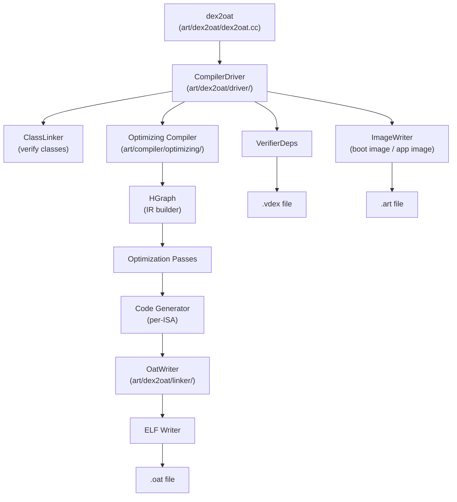

### 18.3.2 dex2oat 入口点

`dex2oat` 二进制文件的 main 函数调用 `Dex2Oat` 类，该类协调整个编译流水线。主源文件（`art/dex2oat/dex2oat.cc`）是 ART 中较大的文件之一。

返回码定义于第 114 行：

```
// art/dex2oat/dex2oat.cc, lines 114-118
enum class ReturnCode : int {
  kNoFailure = 0,
  kOther = 1,
  kCreateRuntime = 2,
};
```

### 18.3.3 编译器过滤器

编译器过滤器控制 `dex2oat` 执行多少工作。它们定义于 `art/libartbase/base/compiler_filter.h`：

```
// art/libartbase/base/compiler_filter.h, lines 34-43
enum Filter {
  kAssumeVerified,    // Skip verification, mark all verified
  kVerify,            // Only verify classes (no compilation)
  kSpaceProfile,      // Minimize space, guided by profile
  kSpace,             // Minimize space
  kSpeedProfile,      // Maximize speed, guided by profile
  kSpeed,             // Maximize speed (compile everything)
  kEverythingProfile, // Compile everything possible, per profile
  kEverything,        // Compile absolutely everything
};
```

默认过滤器是 `kSpeed`：

```
static const Filter kDefaultCompilerFilter = kSpeed;
```

实际上，Android 包管理器对大多数应用安装使用 `speed-profile`，对非常大的应用回退到 `verify`：

```
// art/dex2oat/dex2oat.cc, line 129
static constexpr CompilerFilter::Filter kLargeAppFilter = CompilerFilter::kVerify;
```

### 18.3.4 基于 profile 的编译（speed-profile）

`speed-profile` 过滤器是生产设备上最常见的过滤器。它的工作方式如下：

1. **Profile 收集** —— 在应用执行期间，JIT 记录哪些方法是热点（被频繁调用）。它还记录哪些类在启动时被使用，以及哪些方法使用内联缓存。这些数据被持久化到 `/data/misc/profiles/cur/<user>/<package>/primary.prof`。
2. **Profile 合并** —— `profman` 工具（`art/profman/`）将当前 profile 与参考 profile 合并。
3. **选择性编译** —— `dex2oat --compiler-filter=speed-profile` 读取合并后的 profile，只对标记为热点的方法进行 AOT 编译。其他方法保留为 DEX 形式，将在运行时被解释执行或 JIT 编译。
4. **启动优化** —— 启动时使用的类在应用镜像（`.art` 文件）中预初始化，减少类加载开销。

### 18.3.5 启动镜像编译

启动镜像包含核心平台类（`java.lang.*`、`android.*` 等）的预编译代码。它在设备构建期间编译，或在 OTA 更新后由 `odrefresh` 编译（见第 18.8 节）。

启动镜像由每种 ISA 的三类文件组成：

| 文件 | 内容 |
|------|---------|
| `boot.art` | 堆镜像：预初始化的类对象、驻留字符串 |
| `boot.oat` | 启动类路径方法的编译后本地代码 |
| `boot.vdex` | 已验证的 DEX 数据和验证器依赖项 |

启动镜像以只读方式内存映射，并通过 Zygote fork 模型在所有进程间共享。

### 18.3.6 输出文件格式

#### OAT 文件

OAT 文件是一个 ELF 共享库，包含编译后的本地代码。其头部定义于 `art/runtime/oat/oat.h`：

```
// art/runtime/oat/oat.h, lines 47-51
class PACKED(4) OatHeader {
 public:
  static constexpr std::array<uint8_t, 4> kOatMagic { { 'o', 'a', 't', '\n' } };
  static constexpr std::array<uint8_t, 4> kOatVersion{{'2', '7', '5', '\0'}};
  ...
};
```

OAT 头部存储键值元数据，包括：

- `compiler-filter` —— 用于编译的过滤器
- `bootclasspath` —— 编译时的启动类路径
- `bootclasspath-checksums` —— 用于失效检查的校验和
- `dex2oat-cmdline` —— 用于编译的完整命令
- `compilation-reason` —— 编译被触发的原因
- `concurrent-copying` —— 编译时的 GC 配置

跳板桩（Trampoline stubs）定义为 `StubType` 枚举值（`art/runtime/oat/oat.h`，第 35-43 行）：

```
enum class StubType {
  kJNIDlsymLookupTrampoline,
  kJNIDlsymLookupCriticalTrampoline,
  kQuickGenericJNITrampoline,
  kQuickIMTConflictTrampoline,
  kQuickResolutionTrampoline,
  kQuickToInterpreterBridge,
  kNterpTrampoline,
};
```

#### VDEX 文件

VDEX 文件存储已验证的 DEX 数据和验证器依赖项。其格式描述于 `art/runtime/vdex_file.h`（第 47-78 行）：

```
// File format:
//   VdexFileHeader
//   VdexSectionHeader[kNumberOfSections]
//
//   Checksum section:     VdexChecksum[D]
//   Dex section:          DEX[0] ... DEX[D-1]
//   VerifierDeps section: verification dependencies
//   TypeLookupTable:      fast type lookup data
```

VDEX 各段枚举为：

```
// art/runtime/vdex_file.h, lines 80-86
enum VdexSection : uint32_t {
  kChecksumSection = 0,
  kDexFileSection = 1,
  kVerifierDepsSection = 2,
  kTypeLookupTableSection = 3,
  kNumberOfSections = 4,
};
```

VDEX 文件支持更快的重新验证：如果验证器依赖项没有变化，ART 可以跳过重新验证类，直接使用存储的验证结果。

### 18.3.7 编译流水线内部

`dex2oat` 编译流水线遵循以下步骤：

1. **解析参数** —— 处理 `--dex-file`、`--oat-file`、`--compiler-filter`、`--instruction-set`、profile 路径等。
2. **创建运行时** —— 启动一个精简的 ART 运行时，不包含 JIT，使用最小堆，并带有 AOT 编译器回调。
3. **打开 DEX 文件** —— 从 APK 或独立 DEX 文件加载输入 DEX 文件。
4. **验证类** —— 使用验证器检查字节码的正确性。在 `VerifierDeps` 结构中记录验证器依赖项。
5. **编译方法** —— 对于符合编译器过滤器的方法，调用 Optimizing 编译器生成本地代码。
6. **写入输出** —— `OatWriter` 生成 `.oat` ELF 文件、`.vdex` 文件，以及可选的 `.art` 镜像文件。

### 18.3.8 CompilerDriver

`CompilerDriver`（`art/dex2oat/driver/compiler_driver.h`）协调输入 DEX 文件中所有方法的编译。它管理：

1. **并行性** —— 使用线程池跨 CPU 核心并发编译多个方法。
2. **类解析** —— 解析编译所需的类。
3. **方法编译派发** —— 根据编译器过滤器和 profile 数据决定编译哪些方法。
4. **验证** —— 在编译前驱动类验证器。
5. **事务支持** —— 跟踪 AOT 编译期间类初始化的副作用，以便回滚。

#### CompilerOptions

`CompilerOptions`（`art/compiler/driver/compiler_options.h`）配置编译行为：

- **指令集** —— 目标 ISA（ARM、ARM64、x86、x86-64、RISC-V 64）
- **指令集特性** —— CPU 特性（ARM 上的 NEON；x86 上的 SSSE3 / SSE4.1 / SSE4.2 / AVX / AVX2 / POPCNT）。对于 x86，这些由命名的 CPU 变体通过 `X86InstructionSetFeatures::FromVariant()`（`art/runtime/arch/x86/instruction_set_features_x86.cc`）派生。Android 17 增加了 `pantherlake` 变体（见第 18.11 节）。与 `kabylake` 和 `alderlake` 一样，它启用 AVX2。
- **编译器过滤器** —— 编译什么
- **Profile** —— 用于 PGO 的 profile 文件路径
- **Debuggable** —— 是否生成可调试代码
- **内联最大代码单元数** —— 内联的最大方法大小
- **线程数** —— 编译并行度

### 18.3.9 AOT 的优化编译器

当 `dex2oat` 编译一个方法时，它调用与 JIT 相同的优化编译器后端。关键区别在于 AOT 编译：

- 有更多时间进行优化（没有交互延迟约束）
- 可以应用更激进的优化
- 生成位置无关代码（用于重定位）
- 生成用于 GC 和去优化的栈映射表
- 更激进地解析和内联（了解完整的类路径）

每个方法的编译流水线：

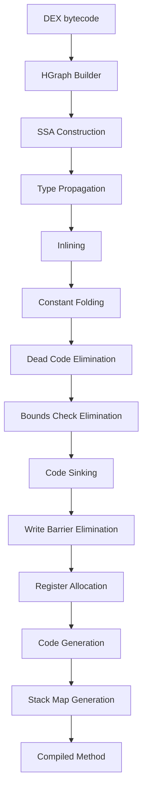

### 18.3.10 链接器与镜像写入器

编译完成后，`OatWriter`（`art/dex2oat/linker/oat_writer.h`）将编译后的方法汇编成 ELF 格式的 OAT 文件。关键操作：

1. **方法排序** —— 方法按提高代码局部性的顺序排列。
2. **重定位** —— 代码被编译为位置无关，并在加载时重定位。
3. **去重** —— 相同的编译后方法可以共享代码。
4. **BSS 段** —— BSS（Block Started by Symbol）段存储对启动镜像对象的惰性解析引用。

`ImageWriter`（`art/dex2oat/linker/image_writer.h`）为启动镜像和应用镜像创建 `.art` 镜像文件。它：

1. **计算镜像布局** —— 确定哪些对象进入镜像及其位置。
2. **初始化类** —— 在编译时运行类初始化器，以便静态状态被捕获到镜像中。
3. **修复引用** —— 将对象引用修补为镜像空间地址。
4. **生成重定位信息** —— 记录哪些字段需要在加载时修补。

### 18.3.11 编译时验证

`dex2oat` 在编译期间执行类验证。验证器检查每个方法字节码的类型安全性、寄存器一致性和访问控制违规。

验证结果记录在 `VerifierDeps` 结构中，并存储在 VDEX 文件中。在运行时，如果验证器依赖项没有变化，运行时可以跳过重新验证——这是一项显著的启动优化。

验证器依赖项包括：

- 被假定为可赋值给其他类型的类型
- 被假定为不可赋值的类型
- 验证期间解析的类
- 验证期间解析的字段类型
- 验证期间解析的方法签名

### 18.3.12 事务模式

在启动镜像编译期间，`dex2oat` 运行类初始化器（`<clinit>`），以便将初始化状态捕获到镜像中。然而，某些初始化器可能有副作用，在编译时并不理想（例如，访问网络、写入文件）。事务机制（`art/dex2oat/transaction.h`）提供回滚能力：

1. 类初始化期间的所有堆修改都被记录。
2. 如果初始化失败或被认为不安全，事务被回滚，将堆恢复到初始化前的状态。
3. 如果初始化成功，事务被提交，初始化状态被捕获到镜像中。

```
// art/dex2oat/transaction.h (purpose)
// Track all changes that happen during class initialization in AOT
// compilation so they can be rolled back if needed.
```

### 18.3.13 AOT 类链接器

`AotClassLinker`（`art/dex2oat/aot_class_linker.h`）扩展了标准 `ClassLinker`，加入了 AOT 特有的行为：

- 防止类初始化副作用逃逸出编译器
- 跟踪哪些类在编译时成功初始化
- 管理事务系统以实现安全的类初始化
- 记录哪些类可以被假定为在运行时已预初始化

### 18.3.14 SDK 检查器

SDK 检查器（`art/dex2oat/sdk_checker.h`）验证编译后的代码没有使用目标 SDK 版本上不可用的 API。这对于启动镜像编译尤为重要，因为编译后的代码必须与设备的 SDK 级别兼容。

### 18.3.15 dex2oat 参数处理

`dex2oat` 接受一套全面的命令行参数。最重要的包括：

| 参数 | 用途 |
|----------|---------|
| `--dex-file=<path>` | 输入 DEX 文件或 APK |
| `--dex-fd=<fd>` | 输入 DEX 文件描述符 |
| `--zip-fd=<fd>` | 输入 ZIP 文件描述符 |
| `--zip-location=<path>` | 预期的 ZIP 位置 |
| `--oat-file=<path>` | 输出 OAT 文件路径 |
| `--oat-fd=<fd>` | 输出 OAT 文件描述符 |
| `--compiler-filter=<filter>` | 编译级别 |
| `--instruction-set=<isa>` | 目标架构 |
| `--instruction-set-features=<features>` | CPU 特性 |
| `--profile-file=<path>` | 用于 PGO 的 profile |
| `--profile-file-fd=<fd>` | profile 文件描述符 |
| `--boot-image=<path>` | 启动镜像位置 |
| `--image=<path>` | 输出镜像文件（用于启动镜像） |
| `--app-image-file=<path>` | 输出应用镜像 |
| `--class-loader-context=<context>` | 类加载器层次结构 |
| `--compiler-backend` | 已弃用的空操作，被显式忽略（Optimizing 是唯一的后端） |
| `-j<n>` | 编译线程数 |
| `--cpu-set=<cpus>` | 编译的 CPU 亲和性 |
| `--swap-file=<path>` | 低内存设备的交换文件 |
| `--runtime-arg <arg>` | 向运行时传递参数 |
| `--debuggable` | 生成可调试代码 |
| `--compilation-reason=<reason>` | 编译被触发的原因 |

参数解析器使用声明式选项定义格式，从 `art/dex2oat/dex2oat_options.def` 生成。

### 18.3.16 OAT 文件结构（详细）

OAT 文件是一个 ELF 共享库，结构如下：

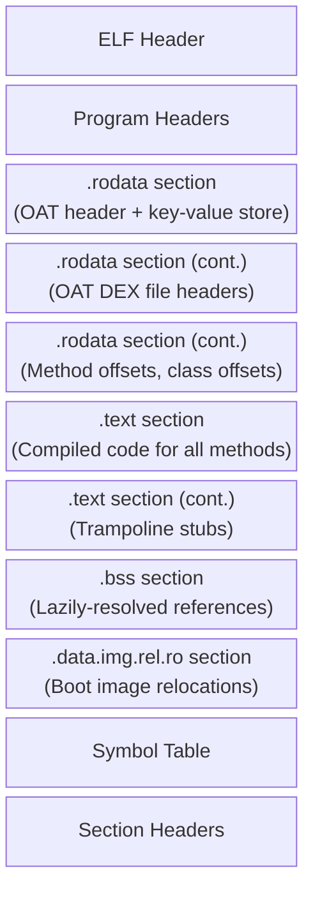

在 `.text` 段内，方法按 DEX 文件和类组织。每个编译后的方法都有：

- 代码前有一个 `OatQuickMethodHeader`
- 本地代码本身
- 栈映射表（CodeInfo）紧接在头部和代码之前存储，通过从代码指针减去 `code_info_offset_` 来访问（用于 GC 和去优化）

`OatQuickMethodHeader` 本身非常精简：单个 `code_info_offset_` 字段，后面是代码（`art/runtime/oat/oat_quick_method_header.h`）。代码大小、帧大小和核心/FP 寄存器溢出掩码不存储在头部中。它们通过 `CodeInfo::DecodeCodeSize()` 和 `CodeInfo::DecodeFrameInfo()` 从 CodeInfo blob 按需解码。

### 18.3.17 多镜像编译

对于启动镜像，`dex2oat` 将多个 DEX 文件编译为一组协调的输出文件。启动镜像被拆分为多个组件：

1. **核心镜像**（`boot.art/oat/vdex`）—— 包含来自 `core-oj.jar`、`core-libart.jar` 等的核心 Java 类。
2. **框架扩展**（`boot-framework.art/oat/vdex`）—— 包含 Android 框架类。
3. **Mainline 扩展** —— 包含 Mainline 模块中的类。

每个组件可以引用较早组件中的类，但不能引用较晚组件中的类，从而形成分层依赖结构。

### 18.3.18 看门狗

`dex2oat` 包含一个看门狗线程，如果编译耗时过长，它会杀死进程。默认超时时间为 9 分 30 秒（略少于 PackageManagerService 的 10 分钟看门狗）：

```
// art/dex2oat/dex2oat.cc, lines 337-350
static constexpr int64_t kWatchdogSlowdownFactor = kIsDebugBuild ? 5U : 1U;
static constexpr int64_t kWatchDogTimeoutSeconds =
    kWatchdogSlowdownFactor * (9 * 60 + 30);
```

### 18.3.19 交换文件

对于 RAM 有限的设备，`dex2oat` 可以使用交换文件来降低峰值内存使用。交换阈值配置为：

```
// art/dex2oat/dex2oat.cc, lines 125-126
static constexpr size_t kDefaultMinDexFilesForSwap = 2;
static constexpr size_t kDefaultMinDexFileCumulativeSizeForSwap = 20 * MB;
```

---

## 18.4 JIT 编译器

JIT（即时）编译器在运行时将频繁执行的方法从 DEX 字节码编译为本地机器码。与在安装时运行的 `dex2oat` 不同，JIT 在应用进程内、执行期间工作。

源代码：`art/runtime/jit/`（前端）和 `art/compiler/`（后端）。

### 18.4.1 JIT 架构

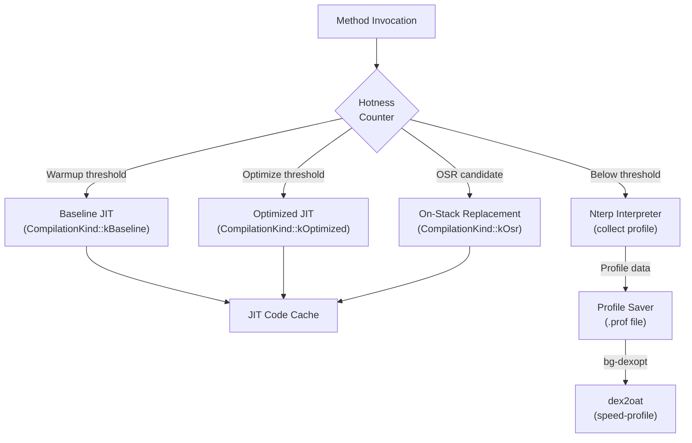

### 18.4.2 Jit 类

`Jit` 类（`art/runtime/jit/jit.h`，第 197 行）管理 JIT 子系统：

```
// art/runtime/jit/jit.h, lines 197-212
class Jit {
 public:
  static constexpr int16_t kJitRecheckOSRThreshold = 101;

  virtual ~Jit();
  static std::unique_ptr<Jit> Create(JitCodeCache* code_cache, JitOptions* options);

  EXPORT bool CompileMethod(ArtMethod* method,
                            Thread* self,
                            CompilationKind compilation_kind,
                            bool prejit,
                            bool dynamic_instrumentation = false)
      REQUIRES_SHARED(Locks::mutator_lock_);
  ...
};
```

### 18.4.3 方法性能分析与热度

每个 `ArtMethod` 都有一个 `hotness_count_` 字段，每次方法被解释执行时都会递减。当计数达到某些阈值时，JIT 采取行动：

- **预热阈值** —— 方法已被调用足够多次，值得进行基线编译。由 `JitOptions::GetWarmupThreshold()` 控制。
- **优化阈值** —— 方法足够热，可以进行完全优化。由 `JitOptions::GetOptimizeThreshold()` 控制。

`Jit::AddSamples()` 方法（第 269 行）是热点检测的入口点：

```
// art/runtime/jit/jit.h, lines 269-270
ALWAYS_INLINE void AddSamples(Thread* self, ArtMethod* method)
    REQUIRES_SHARED(Locks::mutator_lock_);
```

特殊常量控制 JIT 行为：

```
// art/runtime/jit/jit.h, lines 66-68
static constexpr int16_t kJitCheckForOSR = -1;
static constexpr int16_t kJitHotnessDisabled = -2;
static constexpr uint16_t kIndividualSharedMethodHotnessThreshold = 0x3f;
```

### 18.4.4 JIT 线程池

JIT 使用自定义线程池（`JitThreadPool`，第 120 行），按类型为编译排序优先级。它维护四个独立的队列：

```
// art/runtime/jit/jit.h, lines 167-172
std::deque<ArtMethod*> osr_queue_;       // On-Stack Replacement
std::deque<ArtMethod*> fast_queue_;      // Pattern-matched fast compilations
std::deque<ArtMethod*> baseline_queue_;  // Non-optimizing baseline
std::deque<ArtMethod*> optimized_queue_; // Full optimization
```

`TryGetTaskLocked()` 先排空通用任务队列，然后按 OSR > fast > baseline > optimized 的顺序遍历每种类型的编译队列。在这些按类型划分的队列中，OSR 最先得到服务，因为用户正在热循环中主动等待。但一个待处理的通用任务（例如 zygote 验证任务）总是会抢占甚至 OSR 编译。

每个队列还有一个对应的集合，以防止重复入队：

```
// art/runtime/jit/jit.h, lines 177-180
std::set<ArtMethod*> osr_enqueued_methods_;
std::set<ArtMethod*> fast_enqueued_methods_;
std::set<ArtMethod*> baseline_enqueued_methods_;
std::set<ArtMethod*> optimized_enqueued_methods_;
```

### 18.4.5 JIT 编译器接口

JIT 前端通过 `JitCompilerInterface` 抽象类（`art/runtime/jit/jit.h`，第 71 行）与编译器通信：

```
// art/runtime/jit/jit.h, lines 71-86
class JitCompilerInterface {
 public:
  virtual ~JitCompilerInterface() {}
  virtual bool CompileMethod(Thread* self,
                             JitMemoryRegion* region,
                             ArtMethod* method,
                             CompilationKind compilation_kind,
                             bool dynamic_instrumentation = false)
      REQUIRES_SHARED(Locks::mutator_lock_) = 0;
  virtual void TypesLoaded(mirror::Class**, size_t count) = 0;
  virtual bool GenerateDebugInfo() = 0;
  virtual void ParseCompilerOptions() = 0;
  virtual bool IsBaselineCompiler() const = 0;
  virtual void SetDebuggableCompilerOption(bool value) = 0;
  virtual uint32_t GetInlineMaxCodeUnits() const = 0;
  ...
};
```

### 18.4.6 编译流程

当方法变热时，会调用 `Jit::CompileMethodInternal()`（`art/runtime/jit/jit.cc`，第 157 行）：

```
// art/runtime/jit/jit.cc, lines 157-163
bool Jit::CompileMethodInternal(ArtMethod* method,
                                Thread* self,
                                CompilationKind compilation_kind,
                                bool prejit,
                                bool dynamic_instrumentation) {
  DCHECK(Runtime::Current()->UseJitCompilation());
  DCHECK(!method->IsRuntimeMethod());
  ...
```

如果满足以下条件，编译会被拒绝：

- 方法有活动的断点（第 185 行）
- 方法不可编译（例如，因类重定义而过时，第 192 行）
- 方法是代理方法
- 方法被标记为预编译，而这不是预编译请求（第 170 行）

### 18.4.7 模式匹配

ART 为简单方法包含了一条快速路径——"小模式匹配器"（`art/runtime/jit/small_pattern_matcher.h`）。模式匹配器适用于 ARM/ARM64 方法。某些方法匹配已知模式（例如，简单的 getter、setter、平凡返回）。对于这些方法，JIT 可以安装预编写的本地桩，而不是运行完整的编译器：

```
// art/runtime/jit/jit.cc, lines 138-154
bool Jit::TryPatternMatch(ArtMethod* method_to_compile,
                           CompilationKind compilation_kind) {
  if (kRuntimeISA == InstructionSet::kArm ||
      kRuntimeISA == InstructionSet::kArm64) {
    if (!Runtime::Current()->IsJavaDebuggable() && ...) {
      const void* pattern = SmallPatternMatcher::TryMatch(method_to_compile);
      if (pattern != nullptr) {
        VLOG(jit) << "Successfully pattern matched "
                  << method_to_compile->PrettyMethod();
        Runtime::Current()->GetInstrumentation()->UpdateMethodsCode(
            method_to_compile, pattern);
        return true;
      }
    }
  }
  return false;
}
```

### 18.4.8 栈上替换（OSR）

OSR 允许 JIT 在方法仍在执行时（通常在热循环内部）用编译后的代码替换解释执行的方法帧。`OsrData` 结构（`art/runtime/jit/jit.h`，第 93 行）存储：

```
// art/runtime/jit/jit.h, lines 93-102
struct OsrData {
  const uint8_t* native_pc;  // native PC to jump to
  size_t frame_size;          // frame size of compiled code
  void* memory[0];            // dynamically allocated frame copy
};
```

OSR 以素数间隔进行检查，以避免别名模式：

```
// art/runtime/jit/jit.h, line 192
static constexpr int16_t kJitRecheckOSRThreshold = 101;
```

### 18.4.9 JIT 代码缓存

`JitCodeCache`（`art/runtime/jit/jit_code_cache.h`）管理 JIT 编译代码的内存。它由以下部分组成：

- **代码区域** —— 保存编译后本地代码的可执行内存
- **数据区域** —— 保存元数据、性能分析信息、根的不可执行内存
- **位图** —— 跟踪哪些代码条目是存活的（用于代码 GC）

代码缓存有固定的最大容量（通常为 64 MB），在空间不足时可以对过时的编译代码进行垃圾回收。

### 18.4.10 分层编译

ART 实现了分层编译模型：

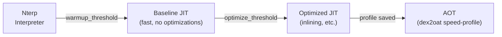

每个层级以编译时间为代价提供越来越高的性能：

| 层级 | 延迟 | 代码质量 | Profile 收集 |
|------|---------|-------------|-------------------|
| Nterp | 无 | 解释执行 | 是（计数器） |
| Baseline JIT | 低（毫秒） | 基础本地代码 | 是（内联缓存） |
| Optimized JIT | 中（数十毫秒） | 优化本地代码 | 否 |
| AOT | 高（秒） | 完全优化 | 否 |

### 18.4.11 Zygote JIT 编译

在 Zygote 进程中，JIT 在早期启动期间预编译启动类路径方法。`ZygoteMap` 类（`art/runtime/jit/jit_code_cache.h`，第 109 行）管理一个共享内存区域，将方法映射到编译后的代码：

```
// art/runtime/jit/jit_code_cache.h, lines 111-117
struct Entry {
  ArtMethod* method;
  const void* code_ptr;
};
```

zygote 编译状态机跟踪进度：

```
// art/runtime/jit/jit_code_cache.h, lines 95-100
enum class ZygoteCompilationState : uint8_t {
  kInProgress = 0,
  kDone = 1,
  kNotifiedOk = 2,
  kNotifiedFailure = 3,
};
```

编译完成后，zygote 通知子进程，它们可以通过共享内存（memfd）映射启动镜像方法代码。

### 18.4.12 优化编译器

优化编译器后端（`art/compiler/optimizing/`）通过以下步骤将 DEX 字节码转换为高度优化的本地代码：

1. **图构建**（`builder.cc`）—— DEX 字节码被转换为 HGraph 中间表示（IR）。
2. **SSA 构建**（`ssa_builder.cc`）—— IR 被转换为静态单赋值形式。
3. **优化遍** —— 应用一系列优化遍：
    - 常量折叠（`constant_folding.cc`）
    - 死代码消除（`dead_code_elimination.cc`）
    - 内联（`inliner.cc`）
    - 边界检查消除（`bounds_check_elimination.cc`）
    - 代码下沉（`code_sinking.cc`）
    - 写屏障消除（`write_barrier_elimination.cc`）
    - 寄存器分配（`register_allocator_linear_scan.cc`）
    - 以及更多（`art/compiler/optimizing/` 目录包含 100+
      个源文件）
4. **代码生成** —— 特定架构的代码生成器：
    - ARM32：`code_generator_arm_vixl.cc`
    - ARM64：`code_generator_arm64.cc`
    - x86：`code_generator_x86.cc`
    - x86-64：`code_generator_x86_64.cc`
    - RISC-V 64：`code_generator_riscv64.cc`
5. **栈映射表生成** —— 生成栈映射表用于 GC 根跟踪和去优化。

### 18.4.13 优化编译器遍详解

优化编译器应用大量优化遍。以下是关键优化遍及其效果的更详细视图：

#### 内联（`inliner.cc`）

方法内联用被调用方法的主体替换方法调用。这消除了调用开销，并启用进一步的优化（如穿过内联代码的常量传播）。JIT 使用内联缓存来指导虚调用的内联决策。性能分析可以显示某个虚调用点几乎总是指向同一个具体类。然后内联器可以带类型检查守卫地推测性内联该实现。

#### 常量折叠（`constant_folding.cc`）

在编译时计算具有常量操作数的表达式。例如，`2 + 3` 变成 `5`。这在常量表达式链中传播，有时会消除整个代码分支。

#### 死代码消除（`dead_code_elimination.cc`）

移除没有可观察效果的代码：

- 结果从未被使用的指令
- 总是被执行或从不被执行的分支（常量折叠之后）
- 对从未被读取的变量的存储

#### 边界检查消除（`bounds_check_elimination.cc`）

当编译器能够证明索引始终在边界内时，移除冗余的数组边界检查。这在循环变量受数组长度约束的循环中特别有效。

#### 代码下沉（`code_sinking.cc`）

将指令移近其结果被使用的位置，可能移入较少执行的路径。这减少了寄存器压力，并可以避免在公共路径上执行不必要的指令。

#### 写屏障消除（`write_barrier_elimination.cc`）

当编译器能够证明写屏障（引用写入的 GC 通知）不必要时，移除冗余的写屏障。例如，对尚未逃逸出分配线程的新分配对象的存储不需要写屏障。

#### 构造函数栅栏冗余消除

当编译器能够证明 Java 内存模型保证不需要时，移除插入在对象构造之后的冗余内存栅栏。

#### 控制流简化（`control_flow_simplifier.cc`）

简化控制流图：

- 移除空块
- 合并只有一个后继/前驱的块
- 简化具有已知条件的有条件分支

#### SSA 优化

SSA 构建之后，多个优化遍利用 SSA 特性：

- **Phi 消除** —— 移除平凡的 phi 节点
- **拷贝传播** —— 用原始值替换拷贝
- **GVN（全局值编号）** —— 识别并消除冗余计算

#### 寄存器分配（`register_allocator_linear_scan.cc`）

将 SSA 形式的无限虚拟寄存器映射到有限的机器寄存器集合。使用线性扫描分配，它在合理的编译时间内提供良好的代码质量。当寄存器耗尽时，将值溢出到栈上。

#### 特定架构的优化

每个代码生成器应用特定架构的优化：

- **ARM64**：NEON 向量化（128 位）、配对加载/存储、条件选择
- **x86-64**：SIMD 向量化和寻址模式优化。向量宽度遵循检测到的特性。在 SSE4.1 下是 128 位 XMM，在 AVX2 可用时是 256 位 YMM（`HLoopOptimization` 读取 `CodeGeneratorX86_64::GetSIMDRegisterWidth()`，后者在 AVX2 下返回 `4 * kX86_64WordSize`）。Android 17 将 AVX2 代码生成扩展到 x86-64（见第 18.11 节）。
- **RISC-V 64**：感知扩展的代码生成

### 18.4.14 入口点

入口点系统（`art/runtime/entrypoints/`）提供编译代码（或解释器）与运行时服务之间的桥梁。入口点是存储在每线程表中的函数指针，编译代码在执行无法内联处理的操作时调用它们。

关键入口点类别：

#### Quick 入口点（`runtime_entrypoints_list.h`）

```
// art/runtime/entrypoints/quick/runtime_entrypoints_list.h (selected)
// Allocation entrypoints
void* artAllocObjectFromCodeResolved(mirror::Class*, Thread*);
void* artAllocObjectFromCodeInitialized(mirror::Class*, Thread*);
void* artAllocArrayFromCodeResolved(mirror::Class*, int32_t, Thread*);

// Type check entrypoints
void artThrowClassCastExceptionForObject(mirror::Object*, mirror::Class*, Thread*);
uint32_t artInstanceOfFromCode(mirror::Object*, mirror::Class*);

// Lock entrypoints
void artLockObjectFromCode(mirror::Object*, Thread*);
void artUnlockObjectFromCode(mirror::Object*, Thread*);

// Field access entrypoints (per kind: Get/Set x Static/Instance)
mirror::Object* artGetObjInstanceFromCode(uint32_t, mirror::Object*, ArtMethod*, Thread*);
int artSet32StaticFromCode(uint32_t, int32_t, ArtMethod*, Thread*);

// Exception entrypoints
void artThrowNullPointerExceptionFromCode(Thread*);
void artThrowDivZeroFromCode(Thread*);
void artThrowStackOverflowFromCode(Thread*);
void artThrowArrayBoundsFromCode(int32_t, int32_t, Thread*);

// GC entrypoints
void artReadBarrierSlow(mirror::Object*, mirror::Object*, uint32_t);
```

#### 运行时 ASM 入口点（`runtime_asm_entrypoints.h`）

这些是特定架构的汇编桩：

- `art_quick_resolution_trampoline` —— 解析未解析的方法，并修补调用者的调用点。
- `art_quick_to_interpreter_bridge` —— 从编译代码转换到解释器以处理未编译的方法。
- `art_quick_generic_jni_trampoline` —— 用于本地方法的通用 JNI 桥。
- `art_quick_imt_conflict_trampoline` —— 在接口派发期间解析 IMT 冲突。
- `art_quick_deoptimize` —— 处理从编译代码回解释器的去优化。

每种架构（ARM、ARM64、x86、x86-64、RISC-V）在 `art/runtime/arch/<isa>/quick_entrypoints_<isa>.S` 中都有这些汇编桩的自己的实现。

### 18.4.15 内联缓存

内联缓存是一种性能分析机制，记录在虚调用点观察到的具体类型。当基线 JIT 编译的代码执行虚调用时，内联缓存会用接收者的类来更新。

内联缓存的类型：

- **单态** —— 观察到单一类型（最常见，支持内联）
- **多态** —— 观察到 2-4 种类型（可生成类型检查级联）
- **Megamorphic** —— 类型过多（回退到虚表派发）

优化编译器使用内联缓存数据来：

1. 带类型守卫地推测性内联单态目标
2. 为多态调用点生成类型检查级联
3. 将 megamorphic 调用点保留为虚派发

### 18.4.16 ProfilingInfo

`ProfilingInfo`（`art/runtime/jit/profiling_info.h`）结构存储解释器和基线 JIT 代码收集的每方法性能分析数据：

- **内联缓存** —— 每个调用点的接收者类型
- **分支数据** —— 哪些分支被执行/未被执行
- **方法计数器** —— 调用次数

ProfilingInfo 分配在 JIT 代码缓存的数据区域中，并随过时的编译代码一起被垃圾回收。

### 18.4.17 JIT 内存区域

`JitMemoryRegion`（`art/runtime/jit/jit_memory_region.h`）管理用于 JIT 编译代码的可执行内存。它使用双重映射技术：

1. **可写映射** —— 供 JIT 编译器写入生成的代码。此映射具有写权限但不执行。
2. **可执行映射** —— 供运行时执行编译代码。此映射具有执行权限但不可写。

两个映射指向相同的物理内存（通过 `memfd` 或 `ashmem`）。这强制执行 W^X（Write XOR Execute）安全策略：没有任何内存区域同时可写和可执行。

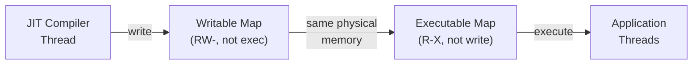

JIT 代码缓存被划分为：

- **代码区域** —— 存储编译后的本地代码（可执行）
- **数据区域** —— 存储元数据、性能分析信息、根（不可执行）

```
// art/runtime/jit/jit_code_cache.h, line 84
using CodeCacheBitmap = gc::accounting::MemoryRangeBitmap<kJitCodeAccountingBytes>;
```

### 18.4.18 JIT 代码垃圾回收

JIT 代码缓存容量有限。当它填满时，JIT 执行代码垃圾回收，以从以下来源回收空间：

- 已被更新编译取代的方法
- 属于已卸载类加载器的方法
- 不再热的方法（基于调用次数）

代码 GC 使用 `CodeCacheBitmap` 跟踪哪些代码条目是存活的。在代码 GC 清扫期间：

1. 遍历所有线程的栈，找到当前在栈上的方法。
2. 遍历所有 `ArtMethod` 入口点，找到当前已安装的代码。
3. 将所有被引用的代码条目标记为存活。
4. 释放未标记的代码条目。

代码 GC 可以通过设置 `SetGarbageCollectCode(false)` 来禁用，以下情况会这样做：

- 启用了调试信息生成（需要稳定的代码地址）
- `JitAtFirstUse()` 模式处于活动状态（防止死锁）

### 18.4.19 profile 文件格式

profile 文件（`.prof`）使用定义于 `art/libprofile/profile/profile_compilation_info.h` 的二进制格式。该格式包含：

1. **文件头部** —— 魔数、版本、校验和
2. **DEX 文件记录** —— 每个 DEX 文件：
    - DEX 文件位置和校验和
    - 热方法集合（位图或方法索引列表）
    - 启动方法集合
    - 启动后方法集合
3. **内联缓存数据** —— 每个被分析的调用点：
    - 方法索引
    - 调用指令的 DEX PC
    - 观察到的接收者类型

`profman` 工具（`art/profman/`）提供 profile 操作：

- `profman --dump-only` —— 以人类可读格式转储 profile
- `profman --create-profile-from` —— 从文本格式创建 profile
- `profman --profile-file` —— 合并多个 profile
- `profman --generate-boot-image-profile` —— 生成启动镜像 profile

### 18.4.20 编译原因

Android 系统跟踪每次编译为何执行。常见的编译原因包括：

| 原因 | 触发 | 典型过滤器 |
|--------|---------|----------------|
| `first-boot` | 恢复出厂设置后的首次启动 | speed-profile |
| `boot-after-ota` | 系统更新后的启动 | speed-profile |
| `install` | 应用安装 | verify/speed-profile |
| `bg-dexopt` | 后台优化 | speed-profile |
| `inactive` | 应用长期未使用 | verify（回收空间） |
| `cmdline` | 手动 `cmd package compile` | 按指定 |
| `ab-ota` | A/B OTA 优化 | speed-profile |
| `prebuilt` | 系统镜像上的预构建 | speed/speed-profile |

编译原因存储在 OAT 头部的 `kCompilationReasonKey` 字段中，可以用 `oatdump` 查看。

### 18.4.21 Profile 保存器

`ProfileSaver`（`art/runtime/jit/profile_saver.h`）在一个后台线程中运行，并定期将性能分析数据写入磁盘：

```
// art/runtime/jit/jit.h, lines 288-292
void StartProfileSaver(const std::string& profile_filename,
                       const std::vector<std::string>& code_paths,
                       const std::string& ref_profile_filename,
                       AppInfo::CodeType code_type);
```

Profile 数据包括：

- 热方法（带调用次数的方法索引）
- 启动方法（应用启动期间调用的方法）
- 内联缓存数据（调用点观察到的接收者类型）
- 热类（启动期间使用的类）

---

## 18.5 垃圾回收

ART 的垃圾回收器回收那些不再可达的对象所占用的内存。GC 子系统是应用性能最关键的组件之一——GC 停顿直接影响 UI 流畅度。

源代码：`art/runtime/gc/`（包括 `heap.h`、`heap.cc`、`collector/`、`space/`、`accounting/`）。

### 18.5.1 GC 架构概述

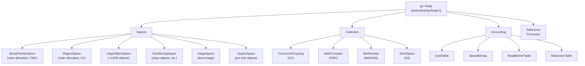

### 18.5.2 回收器类型

ART 支持多种回收器类型，定义于 `art/runtime/gc/collector_type.h`（第 28-68 行）：

```
enum CollectorType {
  kCollectorTypeNone,
  kCollectorTypeMS,           // Non-concurrent mark-sweep
  kCollectorTypeCMS,          // Concurrent mark-sweep
  kCollectorTypeCMC,          // Concurrent mark-compact (default)
  kCollectorTypeCMCBackground,
  kCollectorTypeSS,           // Semi-space
  kCollectorTypeHeapTrim,
  kCollectorTypeCC,           // Concurrent copying
  kCollectorTypeCCBackground,
  ...
};
```

默认回收器在构建时确定：

```
// art/runtime/gc/collector_type.h, lines 71-83
static constexpr CollectorType kCollectorTypeDefault =
#if ART_DEFAULT_GC_TYPE_IS_CMC
    kCollectorTypeCMC
#elif ART_DEFAULT_GC_TYPE_IS_SS
    kCollectorTypeSS
#elif ART_DEFAULT_GC_TYPE_IS_CMS
    kCollectorTypeCMS
#elif ART_DEFAULT_GC_TYPE_IS_MS
    kCollectorTypeMS
#else
#error "ART default GC type must be set"
#endif
    ;
```

基于 userfaultfd 的**并发标记压缩**（CMC）回收器是 AOSP 构建的默认值：`ART_DEFAULT_GC_TYPE` 构建变量在 `art/build/art.go` 中默认为 `CMC`。**并发复制**（CC）回收器是较旧的回收器，仍在某些配置和设备上使用。

### 18.5.3 分配器类型

ART 为不同堆空间支持多种分配器类型：

```
// art/runtime/gc/allocator_type.h
enum AllocatorType {
  kAllocatorTypeBumpPointer,     // Global CAS-based bump-pointer allocator
                                 // (BumpPointer spaces are used only for
                                 // ZygoteSpace construction)
  kAllocatorTypeTLAB,            // Thread-local allocation buffer
  kAllocatorTypeRosAlloc,        // Runs-of-Slots allocator
  kAllocatorTypeDlMalloc,        // Doug Lea's malloc
  kAllocatorTypeNonMoving,       // Non-moving space allocator
  kAllocatorTypeLOS,             // Large Object Space
  kAllocatorTypeRegion,          // Region-based allocator
  kAllocatorTypeRegionTLAB,      // Region-based TLAB
};
```

CC 回收器的默认分配器是 `kAllocatorTypeRegionTLAB`：每个线程在 region space 中获得一个 TLAB，用于快速、无锁的分配。

对于非移动空间，使用 `kAllocatorTypeNonMoving`；当设置了 `kUseRosAlloc` 时，该空间本身由 RosAllocSpace（`art/runtime/gc/allocator/rosalloc.h`）支撑。RosAlloc（Runs of Slots Allocator）是一个线程感知、按大小类划分的分配器，它提供：

- 常用大小类的每线程空闲列表
- 小对象的无锁分配
- GC 期间高效的批量释放
- 按 run 的内存核算

### 18.5.4 核算基础设施

GC 核算子系统（`art/runtime/gc/accounting/`）提供跟踪存活对象和脏区域所需的数据结构：

#### 卡片表（`card_table.h`）

卡片表将堆划分为固定大小的卡片（每个 1024 字节，`art/runtime/gc/accounting/card_table.h` 中的 `kCardShift = 10`）。每张卡片有一个字节表示其状态：

- **干净** —— 此区域中没有引用被修改过
- **脏** —— 已发生至少一次引用写入

在分代或并发回收期间，只有脏卡片需要被扫描以查找跨代或跨空间引用。扫描之后，卡片被清理。

#### 空间位图（`space_bitmap.h`）

一个位图，堆中每个对象对齐大小的块对应一位。用于：

- **存活位图** —— 标记哪些位置包含存活对象
- **标记位图** —— 在标记阶段用于跟踪可达对象

GC 之后，标记位图成为新的存活位图（位图交换）。

#### 修改联合表（`mod_union_table.h`）

跟踪从免疫空间（启动镜像、zygote 空间）到收集空间的引用。由于免疫空间不会被回收，必须通过修改联合表而不是扫描整个免疫空间来找到它们发出的引用。

#### 读屏障表（`read_barrier_table.h`）

由 CC 回收器用来跟踪哪些堆区域需要读屏障处理。当 mutator 从该表中的区域读取引用时，必须检查被引用的对象是否需要被复制到 to-space。

### 18.5.5 并发复制回收器

CC 回收器（`art/runtime/gc/collector/concurrent_copying.h`）曾是 ART 长期以来的默认回收器。它仍在没有 userfaultfd 支持的构建配置上运行。CMC 是当今 AOSP 构建选择的回收器（`ART_DEFAULT_GC_TYPE` 在 `art/build/art.go` 第 50 行默认为 `CMC`）。CC 使用基于 region 的复制算法，该算法主要与应用（mutator）线程并发运行。

```
// art/runtime/gc/collector/concurrent_copying.h, lines 59-76
class ConcurrentCopying : public GarbageCollector {
 public:
  static constexpr bool kEnableNoFromSpaceRefsVerification = kIsDebugBuild;
  static constexpr bool kEnableFromSpaceAccountingCheck = kIsDebugBuild;
  static constexpr bool kVerboseMode = false;
  static constexpr bool kGrayDirtyImmuneObjects = true;

  ConcurrentCopying(Heap* heap,
                    bool young_gen,
                    bool use_generational_cc,
                    const std::string& name_prefix = "",
                    bool measure_read_barrier_slow_path = false);
  ...
};
```

#### CC 回收阶段

CC 回收器分五个阶段运行：

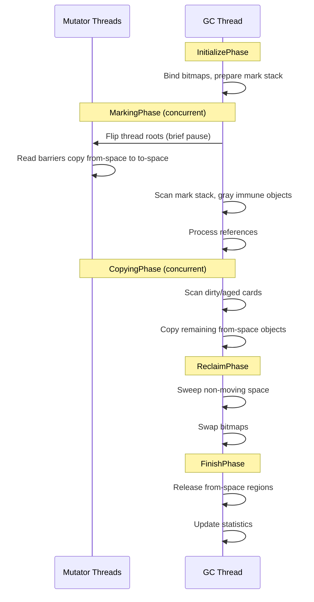

1. **InitializePhase** —— 绑定位图，准备标记栈，捕获存活栈冻结大小。
2. **MarkingPhase** —— 在短暂的 STW（stop-the-world）停顿中翻转线程根。翻转之后，mutator 线程使用读屏障帮助 GC 将对象从 from-space 复制到 to-space。GC 线程并发地扫描标记栈。
3. **CopyingPhase** —— 扫描脏卡片和老化卡片条目，以查找从免疫空间（启动镜像、zygote 空间）进入 region space 的引用。复制任何剩余的 from-space 对象。
4. **ReclaimPhase** —— 清扫非移动空间和大对象空间。交换分配位图。
5. **FinishPhase** —— 释放已疏散的 region，重置标记栈，记录性能统计信息。

#### 读屏障

CC 回收器使用读屏障来维持"to-space 不变量"：mutator 代码看到的每一个引用都必须指向 to-space 副本。当 mutator 读取对 from-space 对象的引用时，读屏障会触发一次到 to-space 的复制并更新该引用。

标记栈模式控制引用的跟踪方式：

```
// art/runtime/gc/collector/concurrent_copying.h, lines 393-401
enum MarkStackMode {
  kMarkStackModeOff = 0,
  kMarkStackModeThreadLocal,  // Thread-local mark stacks
  kMarkStackModeShared,       // Shared GC mark stack with lock
  kMarkStackModeGcExclusive   // GC-only, no lock needed
};
```

#### 转发指针

当 CC 回收器将对象从 from-space 复制到 to-space 时，它会在原始对象的锁字中安装一个转发指针。这允许：

- 其他线程遇到 from-space 对象时能找到它的 to-space 副本
- GC 避免对同一对象重复复制
- 读屏障高效地重定向引用

```
// art/runtime/gc/collector/concurrent_copying.h, lines 155-156
static mirror::Object* GetFwdPtrUnchecked(mirror::Object* from_ref)
    REQUIRES_SHARED(Locks::mutator_lock_);
```

#### 免疫空间

不受回收影响的空间（启动镜像、zygote 空间）称为"免疫空间"。CC 回收器仍必须扫描免疫空间对象以查找进入收集空间的引用。这通过以下方式高效完成：

1. 用于跟踪免疫空间中脏页的**修改联合表**
2. 用于查找被修改引用的**卡片表扫描**
3. 对引用 from-space 对象的免疫对象的**灰色标记**

```
// art/runtime/gc/collector/concurrent_copying.h, line 386
ImmuneSpaces immune_spaces_;
```

#### 标记栈处理

CC 回收器并发处理标记栈：

1. 从标记栈弹出一个对象。
2. 扫描对象的所有引用字段。
3. 对于每个指向 from-space 对象的引用，将其复制到 to-space 并将副本压入标记栈。
4. 重复直到标记栈为空。

根据 GC 阶段，标记栈可以处于不同的模式：

- **线程本地模式** —— 每个线程有自己的标记栈，以避免竞争。
- **共享模式** —— 所有线程共享一个带锁的标记栈。
- **GC 独占模式** —— 只有 GC 线程访问标记栈。

### 18.5.6 分代回收

CC 回收器通过 `use_generational_cc_` 标志支持分代回收：

```
// art/runtime/gc/collector/concurrent_copying.h, lines 340-344
// If true, enable generational collection when using the CC collector,
// i.e. use sticky-bit CC for minor collections and (full) CC for
// major collections.
const bool use_generational_cc_;
const bool young_gen_;
```

在分代模式下：

- **Minor（young-gen）回收**使用 sticky-bit 标记，只追踪最近分配的对象和脏卡片。
- **Major（完全）回收**追踪整个堆，疏散所有 from-space 对象。

GC 类型反映了这一点：

```
// art/runtime/gc/collector/concurrent_copying.h, lines 95-99
GcType GetGcType() const override {
  return (use_generational_cc_ && young_gen_)
      ? kGcTypeSticky
      : kGcTypePartial;
}
```

### 18.5.7 堆空间

`gc::Heap` 类管理多个内存空间：

```
// art/runtime/gc/heap.h, lines 135-151 (selected constants)
class Heap {
 public:
  static constexpr size_t kPartialTlabSize = 16 * KB;
  static constexpr size_t kDefaultInitialSize = 2 * MB;
  static constexpr size_t kDefaultMaximumSize = 256 * MB;
  static constexpr size_t kDefaultNonMovingSpaceCapacity = 64 * MB;
  static constexpr size_t kDefaultMaxFree = 32 * MB;
  static constexpr size_t kDefaultMinFree = kDefaultMaxFree / 4;
  static constexpr size_t kDefaultTLABSize = 32 * KB;
  static constexpr double kDefaultTargetUtilization = 0.6;
  static constexpr double kDefaultHeapGrowthMultiplier = 2.0;
  static constexpr size_t kMinLargeObjectThreshold = 12 * KB;
  ...
};
```

#### RegionSpace

CC 回收器的主要分配空间。它将内存划分为固定大小的 region（通常每个 256 KB）。

源代码：`art/runtime/gc/space/region_space.h`

```
// art/runtime/gc/space/region_space.h, lines 47-55
class RegionSpace final : public ContinuousMemMapAllocSpace {
 public:
  enum EvacMode {
    kEvacModeNewlyAllocated,
    kEvacModeLivePercentNewlyAllocated,
    kEvacModeForceAll,
  };
  ...
};
```

Region 为 256 KB（`kRegionSize`，`art/runtime/gc/space/region_space.h`，第 236 行），可以处于以下几种状态之一：

- **空闲** —— 可用于分配
- **打开** —— 正在被分配（每个线程一个，用于 TLAB）
- **新分配** —— 自上次 GC 以来分配的
- **已疏散** —— 正在从中复制（from-space）
- **To-space** —— 复制对象的目标
- **大** —— 大对象跨越多个 region

当 CC 回收器回收一个已疏散的 region 时，它通过 `ZeroAndProtectRegion()` 将支撑页清零并释放，后者调用 `art/libartbase/base/mem_map.cc` 中共享的 `ZeroMemory()` 辅助函数。在 Android 17 中，该辅助函数再次将驻留页交给内核，使用 `MADV_FREE` 而不是 `MADV_DONTNEED`（`ClearMemory()`，第 1300-1315 行）。`MADV_FREE` 让内核在内存压力下惰性回收这些页。页保持映射状态，再次触碰时零开销。因此，被释放后又迅速重新分配的 region 可以避免硬页错误。

这条路径曾被临时强制使用 `MADV_DONTNEED`。Android 17 提交 "Revert 'Temporarily disable MADV_FREE use with CC GC'" 将 `MADV_FREE` 恢复为驻留回收的默认方式。非驻留页仍使用 `MADV_DONTNEED`。更广泛的 Android 17 内存管理情况见第 18.11 节。

#### 线程本地分配缓冲区（TLAB）

每个线程从 region space 中获得一个 TLAB，用于无锁分配。默认 TLAB 大小为 32 KB，当 region 部分填满时使用 16 KB 的部分 TLAB：

```
// art/runtime/gc/heap.h, lines 138-139
static constexpr size_t kPartialTlabSize = 16 * KB;
static constexpr bool kUsePartialTlabs = true;
```

#### NonMovingSpace

不可移动的对象（例如被本地代码引用的类对象）被分配在非移动空间中（默认容量 64 MB）。

#### LargeObjectSpace

大于 12 KB 的原始类型数组被放置在大对象空间中，该空间使用空闲列表或基于映射的分配器：

```
// art/runtime/gc/heap.h, lines 167-170
static constexpr space::LargeObjectSpaceType kDefaultLargeObjectSpaceType =
    USE_ART_LOW_4G_ALLOCATOR ?
        space::LargeObjectSpaceType::kFreeList
      : space::LargeObjectSpaceType::kMap;
```

#### ImageSpace

包含启动镜像（`.art` 文件）和应用镜像的只读内存映射区域。

### 18.5.8 GC 触发条件

GC 可以由各种原因触发，枚举于 `art/runtime/gc/gc_cause.h`（第 28-71 行）：

```
enum GcCause {
  kGcCauseNone,                    // Invalid placeholder
  kGcCauseForAlloc,                // Allocation failure
  kGcCauseBackground,              // Proactive background GC
  kGcCauseExplicit,                // System.gc()
  kGcCauseForNativeAlloc,          // Native allocation watermark exceeded
  kGcCauseCollectorTransition,     // Foreground/background transition
  kGcCauseDisableMovingGc,         // GetPrimitiveArrayCritical
  kGcCauseTrim,                    // Heap trim
  kGcCauseInstrumentation,         // Instrumentation exclusion
  kGcCauseAddRemoveAppImageSpace,  // Image space changes
  kGcCauseDebugger,                // Debugger exclusion
  kGcCauseHomogeneousSpaceCompact, // Background compaction
  kGcCauseClassLinker,             // Class linker operations
  kGcCauseJitCodeCache,            // JIT code cache operations
  kGcCauseAddRemoveSystemWeakHolder,
  kGcCauseHprof,                   // Heap profiling
  kGcCauseGetObjectsAllocated,
  kGcCauseProfileSaver,            // Profile saver
  kGcCauseDeletingDexCacheArrays,  // Startup optimization
  kGcCauseClampGrowthLimit,        // Clamping heap to growth-limit
};
```

### 18.5.9 引用处理

`ReferenceProcessor`（`art/runtime/gc/reference_processor.h`）处理 Java 引用对象（`SoftReference`、`WeakReference`、`PhantomReference`、`FinalizerReference`）：

```
// art/runtime/gc/reference_processor.h, lines 47-64
class ReferenceProcessor {
 public:
  ReferenceProcessor();
  void Setup(Thread* self, collector::GarbageCollector* collector,
             bool concurrent, bool clear_soft_references);
  void ProcessReferences(Thread* self, TimingLogger* timings);
  void EnableSlowPath();
  ObjPtr<mirror::Object> GetReferent(Thread* self,
                                      ObjPtr<mirror::Reference> reference);
  ...
};
```

在 GC 期间：

1. 如果内存不足，**软引用**会被清除（由 `clear_soft_references` 标志控制）。
2. 指向不可达对象的**弱引用**会被清除。
3. **终结器引用**被排队等待终结。
4. **幻影引用**在其 referent 被回收后被排队。

### 18.5.10 卡片表

卡片表（`art/runtime/gc/accounting/card_table.h`）跟踪自上次 GC 以来哪些内存区域被写入过。每张卡片代表堆的一个固定大小的区域。当引用字段被写入时，相应的卡片被"弄脏"。在 GC 期间，只有脏卡片需要被扫描以查找跨代或跨空间引用。

### 18.5.11 GC 性能目标

ART 的 GC 被设计用于最小化停顿：

```
// art/runtime/gc/heap.h, lines 146-149
static constexpr size_t kDefaultLongPauseLogThreshold = MsToNs(5);
static constexpr size_t kDefaultLongPauseLogThresholdGcStress = MsToNs(50);
static constexpr size_t kDefaultLongGCLogThreshold = MsToNs(100);
static constexpr size_t kDefaultLongGCLogThresholdGcStress = MsToNs(1000);
```

超过 5 毫秒的停顿会被记录为"长停顿"。总时长超过 100 毫秒的 GC 周期会被记录为"长 GC"。这些阈值帮助开发者识别与 GC 相关的卡顿。

### 18.5.12 本地内存跟踪

ART 监控本地内存分配，并在本地分配超过水位线时触发 GC。通知间隔取决于平台：

```
// art/runtime/gc/heap.h, lines 179-183
#ifdef __ANDROID__
static constexpr uint32_t kNotifyNativeInterval = 64;
#else
static constexpr uint32_t kNotifyNativeInterval = 384;
#endif
```

### 18.5.13 对象分配

对象分配走 TLAB 的快速路径和堆分配器的慢速路径。主要分配入口点是 `Heap::AllocObject()`：

```
// art/runtime/gc/heap.h, lines 256-272
template <bool kInstrumented = true, typename PreFenceVisitor>
mirror::Object* AllocObject(Thread* self,
                            ObjPtr<mirror::Class> klass,
                            size_t num_bytes,
                            const PreFenceVisitor& pre_fence_visitor)
    REQUIRES_SHARED(Locks::mutator_lock_) {
  return AllocObjectWithAllocator<kInstrumented>(
      self, klass, num_bytes, GetCurrentAllocator(), pre_fence_visitor);
}
```

对于必须不可移动的对象（例如被本地代码引用的类对象），使用单独的分配器：

```
// art/runtime/gc/heap.h, lines 274-292
template <bool kInstrumented = true, typename PreFenceVisitor>
mirror::Object* AllocNonMovableObject(Thread* self,
                                      ObjPtr<mirror::Class> klass,
                                      size_t num_bytes,
                                      const PreFenceVisitor& pre_fence_visitor)
    REQUIRES_SHARED(Locks::mutator_lock_) {
  mirror::Object* obj = AllocObjectWithAllocator<kInstrumented>(
      self, klass, num_bytes, GetCurrentNonMovingAllocator(),
      pre_fence_visitor);
  return obj;
}
```

#### 分配快速路径（TLAB）

CC 回收器的典型分配路径：

1. 检查 TLAB 是否有足够的空间。
2. 在 TLAB 内指针碰撞式分配（无需锁，线程本地）。
3. 如果 TLAB 耗尽，从 RegionSpace 请求新的 TLAB。
4. 如果 RegionSpace 已满，触发 GC 并重试。

#### 分配慢速路径

当快速路径失败时：

1. 尝试从新的 region 分配。
2. 如果没有可用的 region，触发一次并发 GC。
3. 等待 GC 完成。
4. 重试分配。
5. 如果仍然失败，触发更激进的 GC（完全回收）。
6. 如果仍然失败，抛出 `OutOfMemoryError`。

### 18.5.14 堆构造

Heap 构造函数接受大量反映 GC 配置复杂性的参数：

```
// art/runtime/gc/heap.h, lines 208-251 (constructor signature)
Heap(size_t initial_size,
     size_t growth_limit,
     size_t min_free,
     size_t max_free,
     double target_utilization,
     bool enable_time_based_gc_trigger,
     size_t memory_gc_cost_factor,
     double foreground_heap_growth_multiplier,
     size_t stop_for_native_allocs,
     size_t capacity,
     size_t non_moving_space_capacity,
     const std::vector<std::string>& boot_class_path,
     ...
     CollectorType foreground_collector_type,
     CollectorType background_collector_type,
     space::LargeObjectSpaceType large_object_space_type,
     size_t large_object_threshold,
     size_t parallel_gc_threads,
     size_t conc_gc_threads,
     bool low_memory_mode,
     bool use_generational_gc,
     ...);
```

关键参数包括：

- `initial_size` / `capacity` —— 堆大小的上下限
- `target_utilization` —— 存活对象与堆大小的目标比率（默认 0.6）
- `foreground_collector_type` / `background_collector_type` —— 前台（交互）和后台（空闲）模式的 GC 算法
- `parallel_gc_threads` / `conc_gc_threads` —— 并行和并发 GC 阶段的线程数
- `use_generational_gc` —— 启用分代回收
- `low_memory_mode` —— 以性能为代价减少内存占用

### 18.5.15 进程状态与 GC 行为

GC 根据应用的进程状态调整其行为：

- **前台（交互）** —— 使用前台回收器（通常是 CC）。以低延迟为目标。堆增长更激进以避免 GC 停顿。
- **后台（空闲）** —— 可能切换到后台回收器进行压缩。堆被裁剪以减少内存占用。

`foreground_heap_growth_multiplier`（默认 2.0）控制应用在前台时堆可以在多大程度上超出目标利用率增长：

```
// art/runtime/gc/heap.h, line 155
static constexpr double kDefaultHeapGrowthMultiplier = 2.0;
```

### 18.5.16 堆裁剪

堆可以被裁剪，将未使用的内存释放回操作系统。这发生在应用进入后台或一段时间不活动之后：

```
// art/runtime/gc/heap.h, line 192
static constexpr uint64_t kHeapTrimWait = MsToNs(5000);
```

裁剪会在上次 GC 之后等待 5 秒再执行，以避免在分配与裁剪之间产生抖动。

### 18.5.17 标记压缩回收器（CMC）

标记压缩回收器（`art/runtime/gc/collector/mark_compact.h`）是 CC 的较新替代方案，它使用 Linux 的 userfaultfd 机制原地压缩堆。这避免了单独 to-space 的需要，减少了内存开销。CMC 是 AOSP 构建中的默认回收器（`ART_DEFAULT_GC_TYPE` 构建变量默认为 `CMC`）。

CMC 在两个主要阶段中运行：

1. **标记阶段** —— 使用标记位图并发标记所有可达对象。
2. **压缩阶段** —— 通过将对象向堆开头滑动来原地压缩对象。使用 userfaultfd 处理来自访问尚未压缩页的 mutator 线程的页错误。

与 CC 相比，CMC 的优势：

- 更低的内存开销（不需要单独的 to-space）
- 压缩后更好的内存局部性
- 相同堆利用率下更低的 RSS（常驻集大小）

### 18.5.18 GC 验证

在调试构建中，ART 可以执行广泛的 GC 验证：

```
// art/runtime/gc/heap.h, lines 366-371
void VerifyHeap() REQUIRES(!Locks::heap_bitmap_lock_);
size_t VerifyHeapReferences(bool verify_referents = true)
    REQUIRES(Locks::mutator_lock_);
bool VerifyMissingCardMarks()
    REQUIRES(Locks::heap_bitmap_lock_, Locks::mutator_lock_);
```

验证检查包括：

- 所有引用都指向堆上的有效对象
- 没有指向已释放对象的悬空引用
- 卡片表条目被正确维护
- 读屏障不变量被保持
- 没有 from-space 引用逃逸到 mutator 线程

---

## 18.6 类加载与链接

类链接器负责加载、验证、解析和初始化 Java 类。它是 ART 中最复杂的组件之一，实现于 `art/runtime/class_linker.cc`。

源代码：`art/runtime/class_linker.h`、`art/runtime/class_linker.cc`（约 514 KiB）。

### 18.6.1 类加载流水线

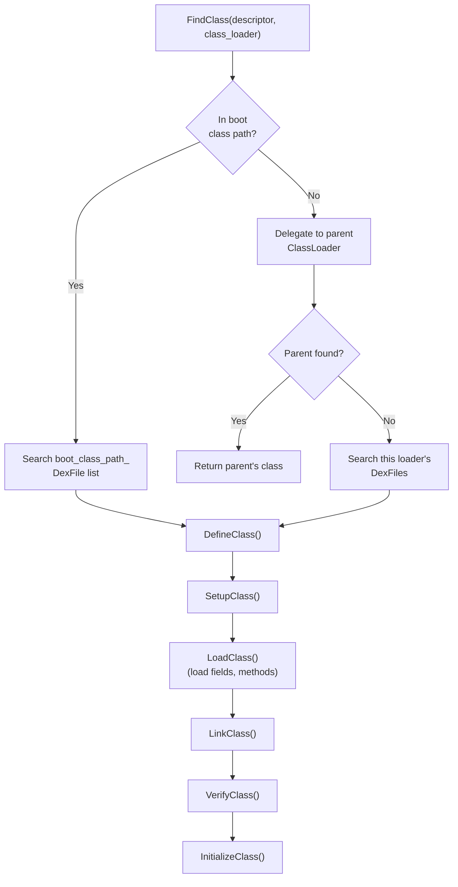

### 18.6.2 ClassLinker 初始化

`ClassLinker` 类（`art/runtime/class_linker.h`，第 167 行）在运行时启动期间创建：

```
// art/runtime/class_linker.h, lines 168-173
class ClassLinker {
 public:
  static constexpr bool kAppImageMayContainStrings = true;
  explicit ClassLinker(InternTable* intern_table,
                       bool fast_class_not_found_exceptions = true);
  virtual ~ClassLinker();
  ...
};
```

有两种初始化路径：

1. **InitFromBootImage**（第 182 行）—— 从 `.art` 文件加载预编译的启动镜像。这是生产环境中使用的快速路径。
2. **InitWithoutImage**（第 176 行）—— 从原始 DEX 文件引导。仅在生成启动镜像或测试期间使用。

### 18.6.3 FindClass

类加载的主要入口点是 `FindClass()`：

```
// art/runtime/class_linker.h, lines 213-218
ObjPtr<mirror::Class> FindClass(Thread* self,
                                 const char* descriptor,
                                 size_t descriptor_length,
                                 Handle<mirror::ClassLoader> class_loader)
    REQUIRES_SHARED(Locks::mutator_lock_)
    REQUIRES(!Locks::dex_lock_);
```

该方法实现了标准的 Java 类加载委托模型：

1. 检查类是否已加载（在 `ClassTable` 中）。
2. 如果指定了类加载器，首先委托给父类加载器。
3. 如果父类加载器找不到该类，搜索此加载器的 DEX 文件。
4. 如果没有指定类加载器（`null`），搜索启动类路径。

系统类的便捷重载：

```
// art/runtime/class_linker.h, lines 230-234
ObjPtr<mirror::Class> FindSystemClass(Thread* self, const char* descriptor)
    REQUIRES_SHARED(Locks::mutator_lock_)
    REQUIRES(!Locks::dex_lock_) {
  return FindClass(self, descriptor, strlen(descriptor),
                   ScopedNullHandle<mirror::ClassLoader>());
}
```

### 18.6.4 DefineClass

一旦找到类的 DEX 文件位置，`DefineClass()` 就会创建 `mirror::Class` 对象：

```
// art/runtime/class_linker.h, lines 247-250
ObjPtr<mirror::Class> DefineClass(Thread* self,
                                   const char* descriptor,
                                   size_t descriptor_length,
                                   size_t hash,
                                   ...);
```

这涉及：

1. 在非移动空间中**分配 Class 对象**。
2. 从 `ClassDef` **建立类元数据**（访问标志、超类索引等）。
3. **加载字段和方法** —— 从类数据创建 `ArtField` 和 `ArtMethod` 数组。
4. **注册到类表**，以便未来的查找能找到此类。

### 18.6.5 类链接

`LinkClass()` 将已加载的类连接到其类型层次结构：

1. **超类链接** —— 解析并链接超类。验证它不是 final（不可扩展），也不是接口（当使用 `extends` 扩展时）。
2. **接口链接** —— 解析所有实现的接口并构建 iftable（接口方法表）。
3. **方法链接** —— 填充虚表（虚方法派发表）和 IMT（接口方法表）。
4. **字段布局** —— 计算字段偏移，处理对齐要求和引用字段排序。
5. **访问检查** —— 验证类对其超类和接口有适当的访问权限。

### 18.6.6 类验证

验证确保字节码是类型安全的，并且不违反 JVM 规范。验证器（`art/runtime/verifier/class_verifier.h`）检查每个方法的字节码：

- **类型检查** —— 验证操作数类型符合指令要求（例如，`iadd` 操作 int，而不是对象）。
- **分支目标** —— 验证所有分支/跳转目标都是有效的指令边界。
- **对象初始化** —— 验证在使用新分配的对象之前调用了 `<init>`。
- **访问控制** —— 验证字段/方法访问遵守 `public`/`protected`/`private` 修饰符。
- **寄存器一致性** —— 验证寄存器在控制流合并处不以冲突的类型使用。

验证结果缓存在 VDEX 文件的 `VerifierDeps` 段中，因此如果依赖项没有变化，后续加载可以跳过重新验证。

### 18.6.7 类初始化

`InitializeClass()` 运行类的静态初始化器（`<clinit>`）并初始化静态字段。类必须在其静态字段被访问或其静态方法被调用之前被初始化。

类状态经过以下状态推进（定义于 `art/runtime/class_status.h`）：

| 状态 | 含义 |
|--------|---------|
| `kNotReady` | 类尚未加载 |
| `kIdx` | 已加载；超类/接口仍以 DEX 类型索引形式持有 |
| `kLoaded` | DEX 索引值已解析（字段和方法已加载，尚未链接） |
| `kResolving` | 正在解析 |
| `kResolved` | 超类和接口已解析 |
| `kVerifying` | 正在验证 |
| `kVerified` | 验证完成 |
| `kInitializing` | `<clinit>` 正在运行 |
| `kInitialized` | 完全初始化，可供使用 |
| `kVisiblyInitialized` | 初始化对所有线程可见 |

### 18.6.8 接口方法表（IMT）

IMT 是基于哈希的派发表，提供快速的接口方法调用。每个类有一个固定大小的 IMT（通常为 43 个条目）。接口方法的槽位由其声明类、名称和签名的混合哈希派生（`art/runtime/imtable-inl.h`）。默认方法则将其方法索引与 `kSizeTruncToPowerOfTwo - 1`（31）进行掩码运算：

- **单个条目** —— 如果只有一个接口方法映射到某个槽位，该槽位包含指向 `ArtMethod` 的直接指针。
- **冲突条目** —— 如果有多个接口方法哈希到同一槽位，该槽位指向一个执行线性搜索的冲突解析表。

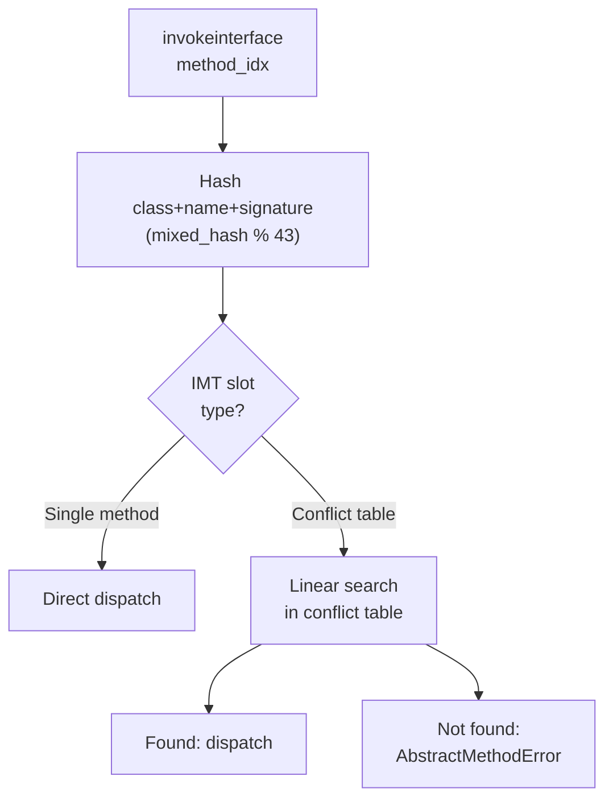

IMT 为常见情况（无冲突）提供 O(1) 派发，并对冲突槽位回退到 O(n)（实践中很少见）。

### 18.6.9 虚方法表（vtable）

虚表是 `ArtMethod*` 的数组，提供虚方法派发。每个类继承其父类的虚表条目，并覆盖它重新实现的那些条目。方法的虚表索引在链接时分配并保持不变。

虚派发：`vtable[method.method_index_]` 给出虚方法调用的最派生实现。

### 18.6.10 类链接内部

类链接过程是 ART 中最错综复杂的部分之一。以下是每个链接步骤的更详细视图：

#### 步骤 1：超类解析

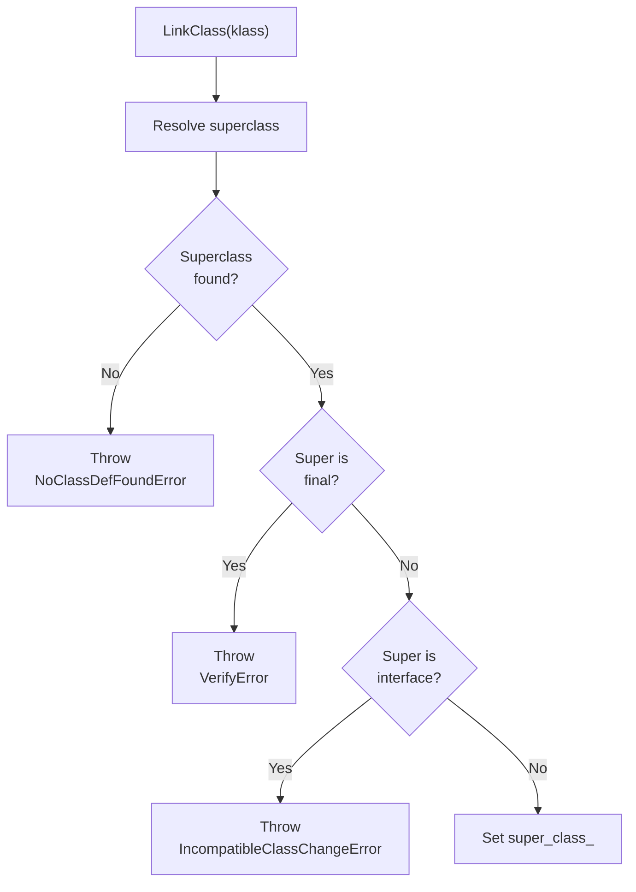

#### 步骤 2：接口解析

对于 `interfaces_off_` 类型列表中的每个接口：

1. 解析接口类型。
2. 验证它确实是一个接口（而不是类）。
3. 通过结合超类的 iftable 和新接口来构建 iftable（接口方法表）。

#### 步骤 3：虚方法链接

虚方法链接填充虚表：

1. 复制超类的虚表。
2. 对于此类中声明的每个虚方法：
    a. 检查它是否覆盖了超类方法（相同的名称和签名）。
    b. 如果覆盖，替换虚表条目。
    c. 如果是新方法，追加到虚表。
3. 对于每个尚未实现的接口方法：
    a. 检查继承的方法是否提供了实现。
    b. 如果不存在实现且类不是抽象类，报错。

#### 步骤 4：字段布局

字段布局确定每个字段的内存偏移：

1. 以超类的实例大小作为基础偏移开始。
2. 按类型对字段分组并排序以获得最优打包：
    - 引用在前（为了 GC 扫描）
    - 然后按递减的对齐要求
3. 计算对齐所需的填充。
4. 将类的 `object_size_` 设置为总实例大小。

#### 步骤 5：IMT 填充

构建接口方法表：

1. 对于 iftable 中的每个接口方法：
    a. 将方法哈希到 IMT 槽位。
    b. 如果槽位为空，直接存储该方法。
    c. 如果槽位有冲突，创建或扩展冲突表。
2. 在类中安装 IMT。

### 18.6.11 类加载器上下文

`ClassLoaderContext`（`art/runtime/class_loader_context.h`）跟踪给定类加载器的 DEX 文件搜索路径。这对于以下方面很重要：

- **dex2oat** —— 需要知道类加载器上下文以正确解析跨 DEX 引用。
- **OAT 文件验证** —— OAT 头部中存储的类路径必须与当前类加载器上下文匹配，文件才有效。

### 18.6.12 DexCache

每个加载的 DEX 文件都有一个对应的 `mirror::DexCache` 对象，缓存已解析的：

- **字符串** —— 从 `StringId` 索引解析
- **类型** —— 已解析的 `mirror::Class` 对象
- **方法** —— 已解析的 `ArtMethod` 指针
- **字段** —— 已解析的 `ArtField` 指针

DexCache 加速对同一实体的重复解析。未解析的条目包含 `null`，并在首次访问时触发解析尝试。

### 18.6.13 解析：字符串、类型、方法、字段

ClassLinker 为主要 DEX 实体提供解析服务。解析将符号引用（索引）转换为直接运行时指针，并将结果缓存在 DexCache 中。

#### 字符串解析

```
// art/runtime/class_linker.h, lines 277-288
ObjPtr<mirror::String> ResolveString(dex::StringIndex string_idx,
                                     ArtField* referrer);
ObjPtr<mirror::String> ResolveString(dex::StringIndex string_idx,
                                     ArtMethod* referrer);
ObjPtr<mirror::String> ResolveString(dex::StringIndex string_idx,
                                     Handle<mirror::DexCache> dex_cache);
```

字符串解析从 DEX 文件读取 MUTF-8 编码的字符串数据，在堆上创建 `mirror::String` 对象，并将其缓存在 DexCache 中。会查询驻留表以确保字符串去重。

#### 类型解析

```
// art/runtime/class_linker.h, lines 299-316
ObjPtr<mirror::Class> ResolveType(dex::TypeIndex type_idx,
                                   ObjPtr<mirror::Class> referrer);
ObjPtr<mirror::Class> ResolveType(dex::TypeIndex type_idx,
                                   ArtField* referrer);
ObjPtr<mirror::Class> ResolveType(dex::TypeIndex type_idx,
                                   ArtMethod* referrer);
ObjPtr<mirror::Class> ResolveType(dex::TypeIndex type_idx,
                                   Handle<mirror::DexCache> dex_cache,
                                   Handle<mirror::ClassLoader> class_loader);
```

类型解析通过以下方式将 `TypeIndex` 转换为 `mirror::Class*`：

1. 从 DEX 文件查找类型描述符字符串。
2. 使用适当的类加载器调用 `FindClass()`。
3. 在 DexCache 中缓存结果。

#### 方法解析

```
// art/runtime/class_linker.h, lines 343-385
ArtMethod* LookupResolvedMethod(uint32_t method_idx,
                                ObjPtr<mirror::DexCache> dex_cache,
                                ObjPtr<mirror::ClassLoader> class_loader);
ArtMethod* FindResolvedMethod(ObjPtr<mirror::Class> klass,
                               ObjPtr<mirror::DexCache> dex_cache,
                               ObjPtr<mirror::ClassLoader> class_loader,
                               uint32_t method_idx);
ArtMethod* ResolveMethodId(uint32_t method_idx,
                            Handle<mirror::DexCache> dex_cache,
                            Handle<mirror::ClassLoader> class_loader);
```

方法解析：

1. 解析声明类。
2. 在类层次结构中搜索该方法（虚方法用虚表，static/private 方法用直接方法列表）。
3. 检查调用类型兼容性。
4. 验证访问权限。
5. 在 DexCache 中缓存已解析的 `ArtMethod*`。

#### 字段解析

```
// art/runtime/class_linker.h, lines 395-418
ArtField* ResolveField(uint32_t field_idx, ArtMethod* referrer,
                        bool is_static);
ArtField* ResolveField(uint32_t field_idx,
                        Handle<mirror::DexCache> dex_cache,
                        Handle<mirror::ClassLoader> class_loader,
                        bool is_static);
ArtField* ResolveFieldJLS(uint32_t field_idx,
                           Handle<mirror::DexCache> dex_cache,
                           Handle<mirror::ClassLoader> class_loader);
```

字段解析遵循 Java 语言规范（JLS）规则：

1. 解析声明类。
2. 在类及其超类中搜索该字段。
3. 如果未找到，搜索实现的接口。
4. 缓存已解析的 `ArtField*`。

`ResolveFieldJLS` 变体遵循 Java 字段解析语义（它按 JLS 定义的顺序搜索类层次结构）。带 `is_static` 的 `ResolveField` 在静态或实例字段数组中执行直接查找。

### 18.6.14 ClassTable

`ClassTable`（`art/runtime/class_table.h`）是一个基于哈希的数据结构，将类描述符映射到 `mirror::Class` 对象。每个类加载器（以及启动类路径）都有自己的 ClassTable。

操作：

- **查找** —— 按描述符查找类的平均 O(1) 时间
- **插入** —— 注册新定义的类
- **访问** —— 迭代所有类（GC 用于根扫描）
- **大小** —— 报告已加载类的数量

ClassTable 使用读写锁（`classlinker_classes_lock_`）来保护类加载期间的并发访问。

### 18.6.15 类层次结构分析（CHA）

CHA（`art/runtime/cha.h`）跟踪 JIT 编译器在去虚拟化过程中做出的单一实现假设。当一个被加载的类覆盖了先前被假定为单一实现的方法时，CHA 会使编译代码失效并触发去优化。

这使得推测性去虚拟化成为可能。当只有一种实现已知时，JIT 可以内联虚方法调用。它必须准备好在动态类加载破坏该假设时进行去优化。

### 18.6.16 AddImageSpace

对于启动镜像和应用镜像，`AddImageSpace()` 向类链接器注册一个预编译的 `.art` 镜像空间（已映射并添加到堆中）。这使其类可用：

```
// art/runtime/class_linker.h, lines 196-201
bool AddImageSpace(gc::space::ImageSpace* space,
                   Handle<mirror::ClassLoader> class_loader,
                   ClassLoaderContext* context,
                   const std::vector<std::unique_ptr<const DexFile>>& dex_files,
                   std::string* error_msg);
```

这是启动镜像类对所有进程可用的主要机制。Zygote 映射它们，子进程通过 `fork()` 继承这些映射。

---

## 18.7 JNI 桥接

Java 本地接口（JNI）是托管 Java 代码调用本地（C/C++）代码以及反之的标准机制。ART 的 JNI 实现位于 `art/runtime/jni/`（25 个文件）。

### 18.7.1 JNI 架构

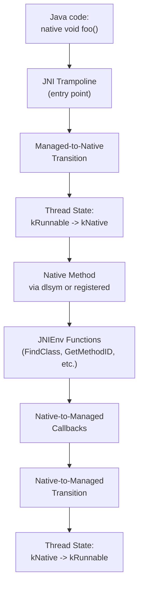

### 18.7.2 JavaVMExt

`JavaVMExt`（`art/runtime/jni/java_vm_ext.h`，第 50 行）用 ART 特有的功能扩展了标准 JNI `JavaVM` 接口：

```
// art/runtime/jni/java_vm_ext.h, lines 50-57
class JavaVMExt : public JavaVM {
 public:
  static std::unique_ptr<JavaVMExt> Create(Runtime* runtime,
                                           const RuntimeArgumentMap& runtime_options,
                                           std::string* error_msg);
  ~JavaVMExt();
  ...
};
```

关键职责：

- **本地库加载** —— `LoadNativeLibrary()`（第 106 行）加载共享库并调用 `JNI_OnLoad`。
- **全局引用** —— 管理全局和弱全局引用表。
- **CheckJNI** —— 用于调试的可选 JNI 参数验证。

```
// art/runtime/jni/java_vm_ext.h, lines 106-110
bool LoadNativeLibrary(JNIEnv* env,
                       const std::string& path,
                       jobject class_loader,
                       jclass caller_class,
                       std::string* error_msg);
```

### 18.7.3 JNIEnvExt

`JNIEnvExt`（`art/runtime/jni/jni_env_ext.h`，第 40 行）用每线程状态扩展了标准 JNI `JNIEnv`：

```
// art/runtime/jni/jni_env_ext.h, lines 40-44
class JNIEnvExt : public JNIEnv {
 public:
  static JNIEnvExt* Create(Thread* self, JavaVMExt* vm, std::string* error_msg);
  static jint GetEnvHandler(JavaVMExt* vm, void** out, jint version);
  ~JNIEnvExt();
  ...
};
```

关键特性：

- **本地引用表** —— `locals_` 管理每帧的本地引用。
- **引用帧** —— `PushFrame()` / `PopFrame()` 管理 JNI 本地引用帧，以限定引用的生命周期。
- **监视器跟踪** —— `RecordMonitorEnter()` / `CheckMonitorRelease()` 跟踪 CheckJNI 模式下的监视器操作。
- **临界区** —— `critical_` 计数器跟踪活动的 `GetPrimitiveArrayCritical` / `GetStringCritical` 调用，这些调用会阻止 GC 移动对象。

### 18.7.4 本地方法注册

本地方法可以通过两种方式注册：

1. **动态链接** —— ART 使用 `dlsym()` 按其 JNI 修饰名称（例如 `Java_com_example_MyClass_nativeMethod`）查找本地方法。
2. **显式注册** —— `RegisterNatives()` 直接为本地方法注册函数指针，绕过 `dlsym()`。

`JNI dlsym lookup trampoline`（`art/runtime/oat/oat.h` 第 37 行中的桩类型 `kJNIDlsymLookupTrampoline`）是动态链接的本地方法的入口点。首次调用时，它通过 `dlsym()` 解析本地函数，并修补方法的入口点。

### 18.7.5 托管到本地的转换

当托管代码调用本地方法时，ART 必须：

1. **转换线程状态**从 `kRunnable` 到 `kNative`。在本地状态下，线程不会被 GC 检查点挂起。
2. **将托管帧压入栈**，其中包含用于栈遍历的方法信息。
3. **处理调用约定** —— 将托管调用约定的参数转换为本地（C/C++）调用约定。
4. **设置 JNIEnv** —— 将 `JNIEnv*` 作为第一个参数传递给本地函数。
5. **处理返回值** —— 将本地返回值转换回托管类型。

### 18.7.6 本地到托管的转换

当本地代码回调托管代码时（例如，通过 `CallVoidMethod()`），ART 必须：

1. **转换线程状态**从 `kNative` 回到 `kRunnable`。
2. **检查挂起的异常**。
3. **检查 GC 挂起请求**，并在需要时遵守。
4. **解析目标方法**（如需要）。
5. **通过适当的入口点调用方法**。

### 18.7.7 CheckJNI

CheckJNI（`art/runtime/jni/check_jni.cc`）是一个调试设施，用额外的验证包装所有 JNI 函数：

- 验证 `jobject` 引用是有效的（不是过时的，不是在需要时为空）。
- 验证 `jmethodID` 和 `jfieldID` 与预期类型匹配。
- 验证数组在边界内被访问。
- 验证临界区规则被遵守。
- 检测线程安全违规（从不同线程使用错误的 `JNIEnv`）。

CheckJNI 默认对可调试应用启用，也可以通过 `-Xcheck:jni` 全局启用。

### 18.7.8 JNI 临界区

`GetPrimitiveArrayCritical()` 和 `GetStringCritical()` 提供指向数组/字符串数据的直接指针，无需复制。当临界区处于活动状态时，GC 无法移动对象，这会降低 GC 性能：

```
// art/runtime/jni/jni_env_ext.h, lines 95-100
uint32_t GetCritical() const { return critical_; }
void SetCritical(uint32_t new_critical) { critical_ = new_critical; }
uint64_t GetCriticalStartUs() const { return critical_start_us_; }
```

### 18.7.9 间接引用表

JNI 对象引用（`jobject`、`jclass`、`jstring` 等）不是指向托管对象的直接指针。相反，它们是索引到引用表中的不透明句柄，正是这种间接性让 GC 可以在不使 JNI 引用失效的情况下移动对象。

有三种引用表：

- **本地引用表** —— 每个 JNIEnv，生命周期有界。在 `JNIEnvExt` 中存储为 `jni::LocalReferenceTable locals_`（`art/runtime/jni/jni_env_ext.h`，第 171 行），实现于 `art/runtime/jni/local_reference_table.h`。
- **全局引用表** —— 进程范围，需要显式删除。
- **弱全局引用表** —— 进程范围，由 GC 清除。

`IndirectReferenceTable`（`art/runtime/jni/indirect_reference_table.h`）只支撑后两种：其头部自述"用于全局和弱全局 JNI 引用"。本地引用有自己的表类型，因为它们需要不同的编码和更廉价的压栈/出栈行为。这三种表都共享存储在句柄低两位中的 `IndirectRefKind` 标签（`kJniTransition`、`kLocal`、`kGlobal`、`kWeakGlobal`）。`GetObjectRefType()` 和引用解码的快速路径使用此标签来区分它们。

### 18.7.10 JNI 跳板类型

OAT 文件包含几种与 JNI 相关的跳板类型：

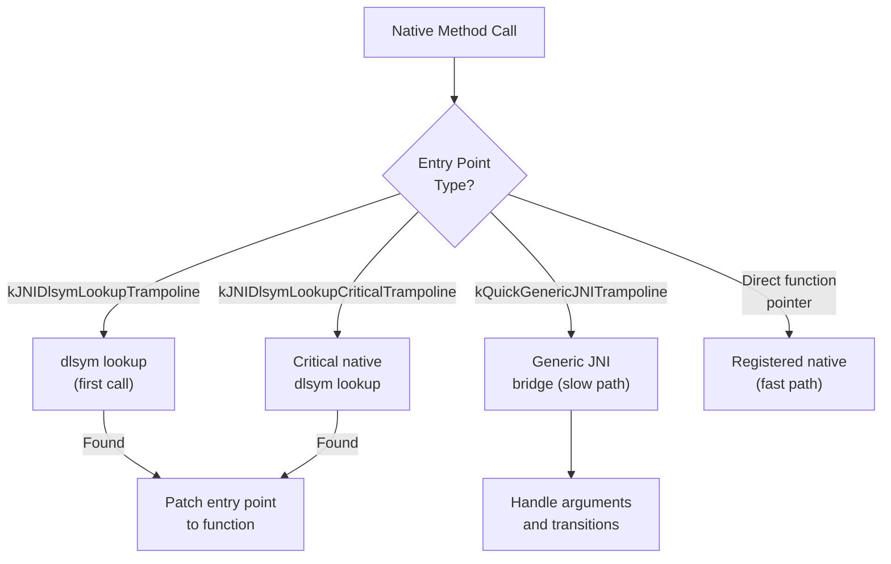

1. **JNI dlsym 查找跳板** —— 用于本地实现尚未通过 `dlsym()` 解析的方法。首次调用时，它按名称解析函数并修补入口点。

2. **JNI dlsym 查找临界跳板** —— 与上面类似，但用于 `@CriticalNative` 方法，后者使用不带 `JNIEnv*` 和 `jobject` 参数的精简调用约定。

3. **Quick 通用 JNI 跳板** —— 一个通用桥，处理任何 JNI 方法的托管到本地转换。它编组参数、转换线程状态并处理返回值。

4. **直接函数指针** —— 在 `RegisterNatives()` 之后或 dlsym 跳板解析函数之后，入口点被修补为直接调用本地函数。

### 18.7.11 @CriticalNative 和 @FastNative

ART 支持两种 Android 特有的 JNI 优化：

**@FastNative** —— 带有 `@FastNative` 注解的方法使用优化的调用约定，它：

- 跳过 Runnable 到 Native 以及 Native 到 Runnable 的线程状态转换；线程在整个调用期间保持在 `kRunnable` 状态
- 仍然接收 `JNIEnv*` 和一个 JNI 本地引用帧，并且挂起的异常在返回时交付，与普通 JNI 一样
- 对不阻塞的短时运行方法更快

**@CriticalNative** —— 带有 `@CriticalNative` 注解的方法使用更加精简的约定：

- 不传递 `JNIEnv*` 或 `jobject`（jclass）参数
- 完全不进行线程状态转换
- 无法调用任何 JNI 函数
- 无法访问 Java 对象
- 尽可能最快的本地调用路径
- 适用于纯计算（例如，数学运算）

### 18.7.12 栈遍历

当 GC 需要找到所有根引用，或当异常正在展开时，ART 必须遍历混合的托管/本地调用栈。栈遍历器必须处理：

- **编译帧** —— 使用栈映射表查找根引用和去优化点。
- **解释器帧** —— 遍历影子帧链。
- **JNI 帧** —— 识别托管调用者和本地被调用者。
- **转换帧** —— 托管/本地边界处的特殊帧。

栈遍历器实现于 `art/runtime/stack.h`。它是 ART 中架构敏感度最高的部分之一，因为它必须理解每种 ISA 的调用约定和帧布局。

---

## 18.8 odrefresh 与 OTA

`odrefresh`（On-Device Refresh）负责确保 AOT 编译产物在系统更新（OTA）、APEX 模块更新或系统属性变化后保持最新。

源代码：`art/odrefresh/`（33 个文件）。

### 18.8.1 目的

设备在更新后启动时，预编译的启动镜像和系统服务器产物可能已经过时，因为：

1. ART APEX 已更新为新的编译器或运行时。
2. 启动类路径 JAR 发生了变化。
3. 系统服务器 JAR 已更新。
4. 影响编译的系统属性发生了变化。

`odrefresh` 检测这些情况，并使用 `dex2oat` 触发重新编译。

### 18.8.2 架构

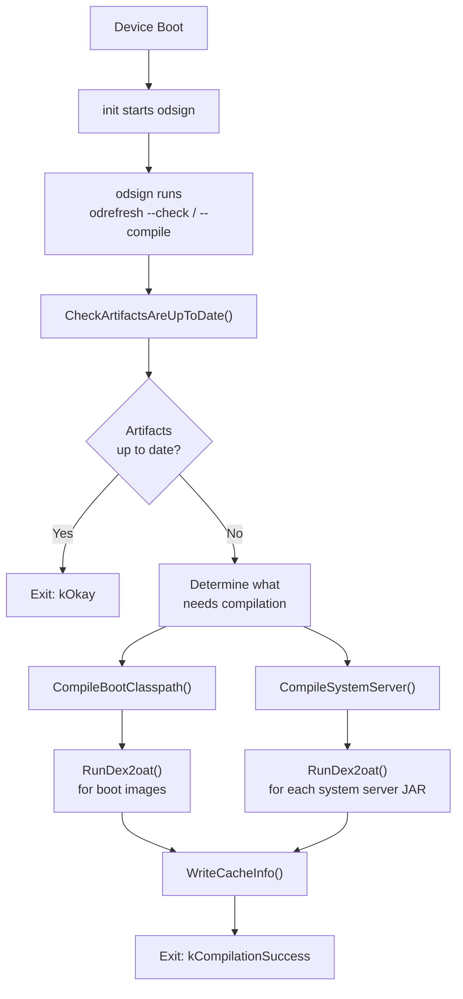

### 18.8.3 OnDeviceRefresh 类

主类是 `OnDeviceRefresh`（`art/odrefresh/odrefresh.h`，第 159 行）：

```
// art/odrefresh/odrefresh.h, lines 159-177
class OnDeviceRefresh final {
 public:
  explicit OnDeviceRefresh(
      const OdrConfig& config,
      android::base::function_ref<int(const char*, const char*)> setfilecon,
      android::base::function_ref<int(const char*, unsigned int)> restorecon);

  ExitCode CheckArtifactsAreUpToDate(
      OdrMetrics& metrics,
      CompilationOptions* compilation_options) const;

  ExitCode Compile(OdrMetrics& metrics,
                   CompilationOptions compilation_options) const;

  bool RemoveArtifactsDirectory() const;
  ...
};
```

### 18.8.4 前置条件检查

在编译之前，`odrefresh` 使用分层方法检查前置条件：

```
// art/odrefresh/odrefresh.h, lines 109-157
class PreconditionCheckResult {
 public:
  static PreconditionCheckResult NoneOk(OdrMetrics::Trigger trigger);
  static PreconditionCheckResult BootImageMainlineExtensionNotOk(
      OdrMetrics::Trigger trigger);
  static PreconditionCheckResult SystemServerNotOk(
      OdrMetrics::Trigger trigger);
  static PreconditionCheckResult AllOk();

  bool IsAllOk() const;
  bool IsPrimaryBootImageOk() const;
  bool IsBootImageMainlineExtensionOk() const;
  bool IsSystemServerOk() const;
  ...
};
```

检查审查：

1. **APEX 版本** —— 是否有任何 APEX 被更新？
2. **启动类路径校验和** —— BCP JAR 校验和是否匹配？
3. **系统属性** —— 与编译相关的属性是否发生了变化？
4. **产物存在性** —— 所有预期的输出文件是否存在？

### 18.8.5 编译选项

`CompilationOptions` 结构定义了需要编译的内容：

```
// art/odrefresh/odrefresh.h, lines 57-67
struct CompilationOptions {
  // Boot images to generate, per ISA
  std::vector<std::pair<InstructionSet, BootImages>>
      boot_images_to_generate_for_isas;
  // System server JARs to compile
  std::set<std::string> system_server_jars_to_compile;

  static CompilationOptions CompileAll(const OnDeviceRefresh& odr);
  int CompilationUnitCount() const;
};
```

启动镜像的结构为：

```
// art/odrefresh/odrefresh.h, lines 46-55
struct BootImages {
  static constexpr int kMaxCount = 2;
  bool primary_boot_image : 1;
  bool boot_image_mainline_extension : 1;
  int Count() const;
};
```

两个启动镜像是：

1. **主启动镜像** —— 核心 ART 和框架类
2. **Mainline 扩展** —— 来自可 Mainline 更新模块的类

### 18.8.6 缓存信息

`odrefresh` 维护一个缓存信息文件（XML），记录上次编译时的状态。在后续启动时，它将当前状态与缓存信息进行比较，以确定是否需要重新编译。

缓存信息包括：

- APEX 版本和上次更新时间戳
- 启动类路径组件校验和
- 系统服务器组件校验和
- 系统属性值
- dex2oat 启动类路径配置

### 18.8.7 编译结果

`CompilationResult` 结构跟踪每次编译的结果：

```
// art/odrefresh/odrefresh.h, lines 69-107
struct CompilationResult {
  OdrMetrics::Status status = OdrMetrics::Status::kOK;
  std::string error_msg;
  int64_t elapsed_time_ms = 0;
  std::optional<ExecResult> dex2oat_result;

  static CompilationResult Ok() { return {}; }
  static CompilationResult Dex2oatOk(int64_t elapsed_time_ms,
                                      const ExecResult& dex2oat_result);
  static CompilationResult Error(OdrMetrics::Status status,
                                  const std::string& error_msg);
  ...
};
```

### 18.8.8 指标与报告

`odrefresh` 收集详细的指标（`art/odrefresh/odr_metrics.h`），包括编译时间、触发原因、成功/失败状态和 dex2oat 退出码。这些指标通过 statsd（`art/odrefresh/odr_statslog_android.cc`）报告给系统，用于监控整个机群的编译健康状况。

### 18.8.9 odrefresh 执行流程（详细）

`odrefresh` 在启动时的完整执行流程：

```mermaid
flowchart TD
    A["odrefresh --compile"] --> B["GetApexInfoList()"]
    B --> C["ReadCacheInfo()"]
    C --> D{"Cache info\nexists?"}
    D -->|No| E["CheckSystemPropertiesAreDefault()"]
    D -->|Yes| F["CheckSystemPropertiesHaveNotChanged()"]
    E --> G["CheckPreconditionForSystem()"]
    F --> G
    G --> H["CheckPreconditionForData()"]
    H --> I["CheckBootClasspathArtifactsAreUpToDate()"]
    I --> J["CheckSystemServerArtifactsAreUpToDate()"]
    J --> K{"Need\ncompilation?"}
    K -->|No| L["Exit: kOkay"]
    K -->|Yes| M["CreateStagingDirectory()"]
    M --> N["CompileBootClasspath()"]
    N --> O["CompileSystemServer()"]
    O --> P["CleanupArtifactDirectory()"]
    P --> Q["WriteCacheInfo()"]
    Q --> R["Exit: kCompilationSuccess"]
```

### 18.8.10 时间管理

`odrefresh` 仔细管理编译时间以避免延迟启动：

- 最大执行时间限制防止失控的编译阻塞设备启动。
- 每次 `dex2oat` 调用都有每进程超时。
- 跟踪编译进度，以便在时间耗尽时可以保存部分结果。

### 18.8.11 暂存与原子性

为了防止编译中断造成的损坏，`odrefresh` 使用暂存目录模式：

1. 创建一个临时暂存目录。
2. 将所有编译输出写入暂存目录。
3. 成功后，将暂存目录内容原子地重命名到最终位置。
4. 失败时，删除暂存目录。

这确保产物目录始终包含旧的已验证产物或新的完整集合，绝不会是部分写入的状态。

### 18.8.12 fs-verity 集成

编译产物通过 odsign（On-Device Signing）由 fs-verity（基于文件的验证）保护。在 `odrefresh` 生成新产物后，odsign 将其添加到 fs-verity 以检测篡改。`RefreshExistingArtifacts()` 方法用于规避在重新添加现有文件方面存在问题的旧版 odsign：

```
// art/odrefresh/odrefresh.h, lines 259-260
// Loads artifacts to memory and writes them back. This is a workaround
// for old versions of odsign.
android::base::Result<void> RefreshExistingArtifacts() const;
```

### 18.8.13 启动镜像布局

启动镜像被拆分到多个文件中以实现模块化：

| 组件 | 内容 | 位置 |
|-----------|---------|----------|
| 主启动镜像 | 核心 ART 类 | `/system/framework/` |
| 框架扩展 | 框架类 | `/system/framework/` |
| Mainline 扩展 | Mainline 模块类 | `/data/misc/apexdata/com.android.art/` |
| 系统服务器 | 系统服务器 JAR | `/data/misc/apexdata/com.android.art/` |

暂存目录模式确保原子更新：产物首先写入暂存目录，然后重命名到位。

---

## 18.9 libnativeloader

`libnativeloader` 管理每个应用的本地（C/C++）共享库如何加载，强制执行命名空间隔离，以防止应用访问内部平台库。

源代码：`art/libnativeloader/`（23 个文件）。

### 18.9.1 目的

Android 基于命名空间的库加载服务于几个目标：

1. **API 强制执行** —— 应用只能链接公开的 NDK 库。内部平台库被隐藏。
2. **供应商隔离** —— 供应商库（在 `/vendor` 上）与系统库隔离，以支持 Treble。
3. **APEX 隔离** —— APEX 模块中的库拥有专用命名空间。
4. **安全性** —— 防止应用加载任意系统库以利用内部 API。

### 18.9.2 架构

```mermaid
flowchart TD
    A["System.loadLibrary('foo')"] --> B["Runtime.loadLibrary0()"]
    B --> C["NativeLoader\n(art/libnativeloader)"]
    C --> D{"ClassLoader\ntype?"}
    D -->|"Boot CL"| E["Default namespace"]
    D -->|"App CL"| F["LibraryNamespaces::Create()"]
    F --> G["Create linker\nnamespace"]
    G --> H["Configure\nlinks & paths"]
    H --> I["android_dlopen_ext()\nwith namespace"]
    E --> J["dlopen()"]
```

### 18.9.3 库命名空间

`LibraryNamespaces` 类（`art/libnativeloader/library_namespaces.h`，第 67 行）是核心管理器：

```
// art/libnativeloader/library_namespaces.h, lines 67-99
class LibraryNamespaces {
 public:
  LibraryNamespaces() : initialized_(false), app_main_namespace_(nullptr) {}

  void Initialize();
  void Reset();
  Result<NativeLoaderNamespace*> Create(JNIEnv* env,
                                         uint32_t target_sdk_version,
                                         jobject class_loader,
                                         ApiDomain api_domain,
                                         bool is_shared,
                                         const std::string& dex_path,
                                         jstring library_path_j,
                                         jstring permitted_path_j,
                                         jstring uses_library_list_j);
  NativeLoaderNamespace* FindNamespaceByClassLoader(JNIEnv* env,
                                                     jobject class_loader);
  ...
};
```

### 18.9.4 API 域

库按其分区组织到 API 域中：

```
// art/libnativeloader/library_namespaces.h, lines 52-57
using ApiDomain = enum {
  API_DOMAIN_DEFAULT = 0,  // Ordinary apps
  API_DOMAIN_VENDOR = 1,   // Vendor partition
  API_DOMAIN_PRODUCT = 2,  // Product partition
  API_DOMAIN_SYSTEM = 3,   // System and system_ext partitions
};
```

### 18.9.5 命名命名空间

定义了几个众所周知的命名空间名称：

```
// art/libnativeloader/library_namespaces.h, lines 41-48
constexpr const char* kVendorNamespaceName = "sphal";
constexpr const char* kProductNamespaceName = "product";
constexpr const char* kVndkNamespaceName = "vndk";
constexpr const char* kVndkProductNamespaceName = "vndk_product";
```

`sphal`（SP-HAL）命名空间包含实现同进程 HAL 的供应商库（例如，GPU 驱动程序、编解码器实现）。

### 18.9.6 应用的命名空间创建

当应用的类加载器首次需要加载本地库时，`LibraryNamespaces::Create()` 会创建一个新的链接器命名空间，其中包含：

1. **搜索路径** —— 可以加载库的目录（例如，应用的本地库目录）。
2. **允许路径** —— 命名空间被允许访问的目录（比搜索路径更宽）。
3. **链接** —— 到其他命名空间的连接，允许从这些命名空间加载库（例如，到平台命名空间的链接以获取 NDK 库）。
4. **共享标志** —— 这是否是共享命名空间（对其他命名空间可见）。
5. **目标 SDK 版本** —— 较旧的应用为向后兼容获得对更多库的访问。

### 18.9.7 APEX 命名空间

APEX 模块有自己的链接器命名空间，由其 APEX 名称标识。`FindApexNamespace()` 函数将本地库的位置解析到适当的 APEX 命名空间：

```
// art/libnativeloader/native_loader.cpp, lines 84-98
std::optional<NativeLoaderNamespace> FindApexNamespace(
    const char* caller_location) {
  std::optional<std::string> name =
      nativeloader::FindApexNamespaceName(caller_location);
  if (name.has_value()) {
    Result<NativeLoaderNamespace> ns =
        NativeLoaderNamespace::GetExportedNamespace(
            name.value(), /*is_bridged=*/false);
    return ns.value();
  }
  return std::nullopt;
}
```

### 18.9.8 公开库

应用可访问的库集合由以下定义：

- `/system/etc/public.libraries.txt` —— 系统公开库
- `/vendor/etc/public.libraries.txt` —— 供应商公开库
- 运行时检测到的 NDK 库列表

`public_libraries.cpp` 文件管理这些列表，并使其可用于命名空间配置。

### 18.9.9 Native Bridge 集成

当在原生桥（native bridge）下运行时（例如，用于 ISA 翻译，如 ARM-on-x86），`libnativeloader` 创建"桥接"（bridged）命名空间，通过原生桥路由库加载。每次命名空间查找都带有一个 `is_bridged` 参数，用于在原生桥和直接链接器之间选择。APEX 查找路径显示了该参数的使用。此处它被硬编码为 `false`，因为此调用上方的源代码注释说明原生桥从不用于 APEX：

```
// art/libnativeloader/native_loader.cpp, lines 87-89
// Native Bridge is never used for APEXes.
Result<NativeLoaderNamespace> ns =
    NativeLoaderNamespace::GetExportedNamespace(
        name.value(), /*is_bridged=*/false);
```

### 18.9.10 库加载流程

当 Java 中调用 `System.loadLibrary("foo")` 时，会发生以下序列：

```mermaid
sequenceDiagram
    participant Java as Java Code
    participant Runtime as Runtime
    participant NL as NativeLoader
    participant NS as LibraryNamespaces
    participant Linker as Dynamic Linker

    Java->>Runtime: System.loadLibrary("foo")
    Runtime->>Runtime: Resolve library name<br/>("foo" -> "libfoo.so")
    Runtime->>NL: OpenNativeLibrary()
    NL->>NS: FindNamespaceByClassLoader()
    alt Namespace exists
        NS-->>NL: Return existing namespace
    else Namespace not found
        NL->>NS: Create() new namespace
        NS->>Linker: android_create_namespace()
        NS->>Linker: Configure links
        NS-->>NL: Return new namespace
    end
    NL->>Linker: android_dlopen_ext()<br/>with namespace
    Linker-->>NL: Handle or error
    NL->>Runtime: Call JNI_OnLoad()
    Runtime-->>Java: Library loaded
```

关键点：

1. 库名称根据类加载器的库搜索路径解析为完整路径。
2. 为类加载器创建（或找到）一个链接器命名空间。
3. 库在该命名空间内加载，限制它可以看到哪些其他库。
4. 调用 `JNI_OnLoad` 以允许库注册本地方法。

### 18.9.11 错误处理

常见的本地库加载错误：

| 错误 | 原因 |
|-------|-------|
| `UnsatisfiedLinkError: dlopen failed: library not found` | 库不在搜索路径中 |
| `UnsatisfiedLinkError: dlopen failed: namespace isolation` | 库被命名空间规则阻止 |
| `UnsatisfiedLinkError: JNI_ERR returned from JNI_OnLoad` | 库的 JNI_OnLoad 失败 |
| `UnsatisfiedLinkError: No implementation found` | 本地方法未注册 |

调试提示：

- 使用 `adb logcat -s linker` 查看详细的链接器错误
- 使用 `adb logcat -s nativeloader` 查看命名空间解析
- 使用 `adb shell cat /linkerconfig/ld.config.txt` 读取生成的配置
  以查看命名空间配置

### 18.9.12 命名空间链接

命名空间链接是一个链接器命名空间可以访问另一个命名空间的库的机制。链接是有方向的，并指定哪些库可以被访问：

```mermaid
flowchart LR
    A["App Namespace\n(classloader-namespace)"] -->|"public libs"| B["Default\nNamespace"]
    A -->|"NDK libs\n(libc.so, libm.so, ...)"| C["Platform\nNamespace"]
    A -->|"if vendor app"| D["Vendor\nNamespace (sphal)"]
    A -->|"VNDK libs"| E["VNDK\nNamespace"]
    F["APEX Namespace\n(com_android_art)"] -->|"ART libs"| B
```

关键链接规则：

- **应用到平台**：应用只能链接到 `public.libraries.txt`（NDK 稳定集）中列出的库。
- **应用到供应商**：只有供应商应用（在 `/vendor` 或 `/oem` 上）可以访问供应商特定的库。
- **平台到 APEX**：平台命名空间有指向 APEX 命名空间的链接，用于访问模块特定的库。
- **跨 APEX**：APEX 模块可以通过链接器配置的显式命名空间链接彼此链接。

### 18.9.13 目标 SDK 版本的影响

目标 SDK 版本影响哪些库可访问：

- 目标 SDK &lt; 24 的应用可以访问一些历史上可加载的私有库（为了向后兼容）。
- 目标 SDK >= 24 的应用被严格限制在 NDK 稳定集中。
- 目标 SDK >= 28 的应用在访问供应商库方面有额外限制。

这种渐进式强制执行允许较旧的应用继续工作，同时鼓励新应用只使用稳定 API。

### 18.9.14 测试命名空间行为

`NATIVELOADER_DEFAULT_NAMESPACE_LIBS` 环境变量提供了一个测试逃生舱：

```
// art/libnativeloader/native_loader.cpp, lines 59-77
// NATIVELOADER_DEFAULT_NAMESPACE_LIBS is an environment variable that
// can be used to list extra libraries that libnativeloader will load
// from the default namespace. The libraries must be listed without
// paths, and then LD_LIBRARY_PATH is typically set to the directories
// to load them from.
```

这主要用于在 APEX 环境中通过 `dalvikvm` 执行的 ART 运行测试。

---

## 18.10 ART 调试

ART 通过 JVMTI（JVM 工具接口）代理、方法跟踪和各种诊断工具提供全面的调试支持。

源代码：`art/openjdkjvmti/`（JVMTI 实现）、`art/runtime/debugger.h`（运行时中的调试支持）。

### 18.10.1 调试架构

```mermaid
flowchart TD
    A["Debugger\n(Android Studio)"] --> B["adb / jdwp"]
    B --> C["JDWP Protocol"]
    C --> D["ART Runtime\nDebugger Support"]
    D --> E["JVMTI Agent\n(openjdkjvmti)"]
    E --> F["Breakpoints\n(ti_breakpoint.h)"]
    E --> G["Single Stepping\n(ti_method.h)"]
    E --> H["Class Redefinition\n(ti_redefine.h)"]
    E --> I["Heap Inspection\n(ti_heap.h)"]
    E --> J["Thread Control\n(ti_thread.h)"]
    E --> K["Method Tracing\n(ti_method.h)"]
```

### 18.10.2 可调试运行时状态

运行时支持三种调试状态，定义于 `art/runtime/runtime.h`（第 145-156 行）：

```
// art/runtime/runtime.h, lines 145-156
enum class RuntimeDebugState {
  // No debug features / method tracing
  kNonJavaDebuggable,
  // Method tracing and restricted debug features
  // (redefinition not supported)
  kJavaDebuggable,
  // Full debug features including redefinition
  // (set at startup, never transitions out)
  kJavaDebuggableAtInit
};
```

当调试器附加或方法跟踪开始时，运行时转换到 `kJavaDebuggable`。这启用：

- 将编译代码去优化为解释模式
- 方法进入/退出插桩
- 断点插入
- 栈帧检查

### 18.10.3 JVMTI 实现

ART 在 `art/openjdkjvmti/` 中实现 JVMTI 规范。实现按能力组织到特定文件中：

| 文件 | 能力 |
|------|-----------|
| `ti_breakpoint.h/cc` | 设置/清除断点 |
| `ti_method.h/cc` | 方法进入/退出事件、单步执行 |
| `ti_class.h/cc` | 类加载/准备事件 |
| `ti_redefine.h/cc` | 类重定义（热替换） |
| `ti_heap.h/cc` | 堆遍历、对象标记 |
| `ti_stack.h/cc` | 栈帧检查 |
| `ti_thread.h/cc` | 线程开始/结束事件、挂起 |
| `ti_threadgroup.h/cc` | 线程组枚举 |
| `ti_monitor.h/cc` | 监视器竞争事件 |
| `ti_field.h/cc` | 字段访问/修改事件 |
| `ti_jni.h/cc` | JNI 函数拦截 |
| `ti_search.h/cc` | 类搜索路径操作 |
| `ti_properties.h/cc` | 系统属性访问 |
| `ti_timers.h/cc` | 定时器信息 |
| `ti_dump.h/cc` | VM 内部状态转储（DataDumpRequest / DumpInternalState） |
| `ti_allocator.h/cc` | JVMTI 内存分配 |
| `ti_extension.h/cc` | ART 特有的 JVMTI 扩展 |
| `ti_logging.h/cc` | 日志控制 |
| `ti_phase.h/cc` | VM 阶段事件 |

主入口点是 `art/openjdkjvmti/OpenjdkJvmTi.cc`，它实现了包含所有 JVMTI 函数实现的 `JvmtiFunctions` 类。

全局 JVMTI 基础设施：

```
// art/openjdkjvmti/OpenjdkJvmTi.cc, lines 81-83
EventHandler* gEventHandler;
DeoptManager* gDeoptManager;
AllocationManager* gAllocManager;
```

### 18.10.4 断点

断点的工作方式：

1. **去优化方法** —— 如果方法有编译代码（JIT 或 AOT），入口点被替换为解释器桥。方法随后在解释器中运行。
2. **安装断点回调** —— 解释器在每个 DEX PC 处检查断点，并触发 JVMTI 断点事件。
3. **通知代理** —— 使用线程、方法和位置信息调用 JVMTI 事件回调。

### 18.10.5 类重定义

ART 通过 `art/openjdkjvmti/ti_redefine.h` 中的两个入口点支持类重定义（热替换）。标准的 JVMTI `RedefineClasses` 函数（第 89 行）执行非结构化重定义——方法体可以改变，但类的形状不能改变。结构化重定义是 ART 特有的 JVMTI 扩展，即 `com.android.art.class.structurally_redefine_classes`。它注册于 `art/openjdkjvmti/ti_extension.cc`（第 420-423 行），并由 `Redefiner::StructurallyRedefineClasses`（第 92 行）支撑。它接受增量式更改——新方法和字段——但仍禁止删除或更改超类型和实现的接口。这两者共同支撑了 Android Studio 的"Apply Changes"功能，该功能在不重启应用的情况下修改类。

重定义过程：

1. 根据旧定义验证新类定义。
2. 创建新的 `ArtMethod` 和 `ArtField` 数组。
3. 用新定义更新 `mirror::Class` 对象。
4. 使受影响方法的所有编译代码失效。
5. 将旧方法标记为"过时"，以便栈帧仍可引用它们。

### 18.10.6 方法跟踪

ART 通过 `Trace` 类（`art/runtime/trace.h`）支持方法跟踪。有两种跟踪机制可用：

1. **方法跟踪** —— 记录带时间戳的方法进入/退出事件。输出格式与 Android Studio 的 CPU 分析器兼容。
2. **基于采样的分析** —— 定期采样运行线程的调用栈以构建统计 profile。

跟踪通过以下方式启用：

- Java 中的 `Debug.startMethodTracing()`
- 命令行中的 `am profile start <process> <file>`
- JVMTI 方法进入/退出事件

### 18.10.7 基于信号的诊断

ART 为诊断安装信号处理程序：

- **SIGQUIT** —— 将线程栈、GC 信息和锁状态转储到 logcat。这是 ANR（应用无响应）跟踪背后的机制。由 `SignalCatcher` 线程处理。
- **SIGSEGV** —— `FaultHandler` 检查段错误以确定它们是否是：
  - 托管堆上的空指针解引用（抛出 `NullPointerException`）
  - 栈溢出（抛出 `StackOverflowError`）
  - 隐式挂起检查（用于 GC 挂起）
  - 真正的崩溃（转发到默认处理程序）

### 18.10.8 dexdump 和 oatdump

ART 包含用于检查编译产物的命令行工具：

- **dexdump**（`art/dexdump/`）—— 以人类可读格式转储 DEX 文件的内容。
- **oatdump**（`art/oatdump/`）—— 转储 OAT 文件的内容，包括 OAT 头部、编译方法元数据和反汇编的本地代码。

### 18.10.9 imgdiag

`imgdiag` 工具（`art/imgdiag/`）比较运行进程对启动镜像页的视图与磁盘上的启动镜像，以识别脏页。这对于测量运行时启动镜像修改的内存成本非常有用。

### 18.10.10 Perfetto 集成

ART 与 Perfetto（`art/perfetto_hprof/`）集成以进行堆分析。配置后，ART 可以将堆快照输出到 Perfetto trace，从而能够使用 Perfetto UI 进行分析。

### 18.10.11 ART 指标

ART 通过其指标框架（`art/libartbase/base/metrics/metrics.h`）收集运行时指标。指标包括：

- GC 停顿时间和持续时间
- JIT 编译次数和时间
- 类验证时间
- 方法解析时间
- 代码缓存使用情况
- 堆大小和利用率

这些指标通过 statsd 报告，用于机群范围的监控。

### 18.10.12 诊断命令

ART 响应几个可以从主机触发的诊断命令：

#### SIGQUIT 线程转储

向进程发送 SIGQUIT（信号 3）会触发完整的线程转储：

```bash
adb shell kill -3 <pid>
# tombstoned writes the dump to /data/anr/trace_<NN> (and a copy to logcat)
adb shell ls -t /data/anr/
```

转储包括：

- 所有带行号的 Java 线程栈
- 线程状态（Runnable、Waiting、Sleeping 等）
- 锁信息（哪些线程持有哪些监视器）
- GC 统计信息
- JIT 编译统计信息
- 堆摘要
- 类加载器信息
- 已加载本地库列表

#### dumpsys meminfo

```bash
adb shell dumpsys meminfo <pid>
```

显示 ART 特有的内存细分：

- **Java Heap** —— 托管堆上的对象
- **Native Heap** —— 本地分配（malloc）
- **Code** —— 编译代码（OAT、JIT）
- **.art mmap** —— 启动镜像和应用镜像映射
- **.dex mmap** —— DEX 文件映射
- **.oat mmap** —— OAT 文件映射
- **.so mmap** —— 本地库映射

#### ART 特有的系统属性

| 属性 | 效果 |
|----------|--------|
| `dalvik.vm.heapsize` | 最大堆大小 |
| `dalvik.vm.heapgrowthlimit` | 默认堆增长限制 |
| `dalvik.vm.heapmaxfree` | GC 后保留的空闲字节的上限（堆会缩减到低于它） |
| `dalvik.vm.heapminfree` | GC 后保留的空闲字节的下限（堆增长的底线） |
| `dalvik.vm.heaptargetutilization` | GC 目标利用率 |
| `dalvik.vm.usejit` | 启用/禁用 JIT |
| `dalvik.vm.profilebootclasspath` | 分析启动类路径 |
| `dalvik.vm.jitthreshold` | JIT 编译阈值 |
| `dalvik.vm.dex2oat-threads` | dex2oat 线程数 |
| `dalvik.vm.image-dex2oat-threads` | 启动镜像编译线程 |
| `dalvik.vm.checkjni` | 启用 CheckJNI |
| `dalvik.vm.extra-opts` | 额外的 VM 选项 |
| `persist.device_config.runtime_native.usap_pool_enabled` | USAP 池 |

### 18.10.13 运行时插桩

`Instrumentation` 类（`art/runtime/instrumentation.h`）提供方法进入、方法退出和分支事件的钩子。插桩是以下功能的基础：

- 方法跟踪
- 代码覆盖率
- 性能分析
- 调试器支持

当插桩处于活动状态时，编译代码被去优化为解释模式，以便插桩回调在每个方法边界触发。

### 18.10.14 去优化

去优化是从编译代码执行切换到解释执行的过程。当以下情况时需要：

- 在编译方法中设置了断点
- 类在编译代码引用它时被重定义
- CHA 假设被无效
- 插桩被启用

`DeoptimizationKind` 枚举（`art/runtime/deoptimization_kind.h`）定义了去优化发生的原因：

- `kFullFrame` —— 完整帧去优化
- `kCHA` —— 类层次结构分析假设被无效
- `kJitSameTarget` —— JIT 编译代码需要更新
- 以及其他几个用于特定场景的原因

### 18.10.15 隐藏 API 强制执行

ART 强制执行对非 SDK（隐藏）API 访问的限制。当应用试图使用隐藏 API（通过反射或 JNI）时，ART 检查 API 的限制级别：

- **`sdk`** —— 始终可访问
- **`unsupported`** —— `@UnsupportedAppUsage`；可访问但生成日志警告
- **`max-target-O/P/Q/R/S`** —— 仅对目标 SDK 版本或更旧版本的应用可访问
- **`blocked`** —— 始终拒绝，抛出异常

（定义于 `art/libartbase/base/hiddenapi_flags.h`）

隐藏 API 数据存储在 DEX 文件的 `HiddenapiClassData` 段中（见第 18.2.8 节），并在反射和 JNI 方法解析期间被检查。

### 18.10.16 ART 测试基础设施

ART 测试套件（`art/test/`）是 AOSP 中最全面的测试套件之一，包含：

- **JNI 测试** —— 验证 JNI 函数正确性
- **GC 测试** —— 对垃圾回收器进行压力测试
- **编译器测试** —— 验证优化正确性
- **DEX 验证器测试** —— 确保格式错误的 DEX 文件被拒绝
- **JVMTI 测试** —— 测试调试和分析功能
- **运行时测试** —— 测试类加载、异常处理、线程

测试在主机和设备目标上运行，许多测试包含 Java 组件和本地（C++）组件。

### 18.10.17 ART 守护进程（artd）

`artd` 服务（`art/artd/`）是 ART Service 的特权垫片组件。它执行需要 `system_server` 不具备的提升权限的任务。此类任务包括文件系统的操作和调用 `dex2oat`。其 Binder 接口（`IArtd`）是 ART Service
Java 代码内部的，涵盖：

- 执行 dex 优化（`dexopt()`）并检查是否需要（`getDexoptNeeded()`、`getDexoptStatus()`）
- 管理 profile（合并、删除、清理）

后台 dex 优化（bg-dexopt）由在 `system_server` 中运行的 ART Service Java 代码调度，然后调用 `artd` 来完成特权工作。ART Service 作为一个整体取代了旧的、嵌入在包管理器中的进程内 dex 优化逻辑，提供了更好的隔离性和可测试性。

### 18.10.18 dexoptanalyzer

`dexoptanalyzer` 工具（`art/dexoptanalyzer/`）确定 DEX 文件是否需要优化。它检查：

- 当前的编译器过滤器
- profile 是否已更改
- 启动类路径是否已更新
- OAT 文件是否仍然有效

包管理器和 `artd` 使用它来决定是否调用 `dex2oat`。

---

## 18.11 Android 17 变更

Android 17 发布的 ART 模块包含一组聚焦的运行时、编译器和 GC 变更。它们都没有改变上文所述的架构。其中几项触及了前面各节引用的数据结构和代码路径，因此本节连同其源代码引用一起收集这些变更。

### 18.11.1 Pantherlake x86 ISA 变体（AVX2）

ART 的 x86 后端在编译时不会用 `CPUID` 探测 CPU。相反，它被赋予一个*命名变体*——很像编译器的 `-march=`/`-mtune=` 目标。它将该名称映射到一组固定的指令集特性。已识别变体的列表，以及每个变体所隐含的特性，位于 `art/runtime/arch/x86/instruction_set_features_x86.cc` 中。因此，新增一个 CPU 世代只是将名称添加到 `x86_known_variants` 并在其符合条件的特性数组中列出的问题。

**`pantherlake` 是什么。** Panther Lake 是 Intel 的客户端（消费级/移动）CPU 世代——比 ART 列表中已有的 Kaby Lake 和 Alder Lake 部件更新。就 ART 的目的而言，唯一显著的事实是它的向量 ISA。与其他 Intel *客户端*硅片一样，它公开 AVX 和 AVX2，但不公开仅服务器端的 AVX-512。这正是为什么它的条目止步于 AVX2 并且不声明 AVX-512 特性的原因。

ART 之所以关心这个名称，原因是代码生成。一个构建可以以 x86-64 为目标——Android 模拟器、x86 Chromebook 和其他 x86 形态因子。对于这样的构建，名称 `pantherlake` 告诉 `dex2oat` 和优化编译器该 CPU 的确切特性集。然后它们发出更宽的向量化代码。如果没有该名称，它们会保守地假设一个基线 x86 芯片。Android 17 将其添加为已知变体：

```
// art/runtime/arch/x86/instruction_set_features_x86.cc, lines 43-115
static constexpr const char* x86_known_variants[] = {
    "atom", "sandybridge", "silvermont", "goldmont", "goldmont-plus",
    "goldmont-without-sha-xsaves", "tremont", "kabylake", "alderlake",
    "pantherlake", "default",
};
// ... pantherlake also appears in the ssse3 / sse4_1 / sse4_2 / popcnt / avx / avx2 arrays
static constexpr const char* x86_variants_with_avx2[] = {
    "kabylake", "alderlake", "pantherlake",
};
```

因为 `pantherlake` 列在 `x86_variants_with_avx2` 中，`X86InstructionSetFeatures::FromVariant("pantherlake", ...)` 返回一个 `HasAVX2()` 为 true 的特性集（连同 SSSE3、SSE4.1、SSE4.2、AVX 和 POPCNT）。特性字符串为 `ssse3,sse4.1,sse4.2,avx,avx2,popcnt`（位图 `63`）。单元
测试 `X86FeaturesFromPantherlakeVariant`
（`art/runtime/arch/x86/instruction_set_features_x86_test.cc`）为 32 位 `kX86` 和 64 位 `kX86_64` 两种指令集断言这一确切结果。这使得 `pantherlake` 与 `kabylake` 和 `alderlake` 并列为 ART 在 AVX2 层级上识别的仅有的三个变体。它已知的较旧的 Silvermont、Goldmont 和 Tremont 家族止步于 SSE4.2/POPCNT，没有 AVX 或 AVX2。Atom 更早止步于 SSSE3。

AVX2 位位于特性位图的第 4 位
（`kAvx2Bitfield = 1 << 4`，
`art/runtime/arch/x86/instruction_set_features_x86.h`，第 141 行）。一项 Android 17 修复纠正了该位位置，使 x86 特性的位图编码能够正确往返。

### 18.11.2 x86-64 上的 AVX2 向量化

检测到 AVX2 后，优化编译器将其 SIMD 代码生成从 128 位 XMM 寄存器扩展到 256 位 YMM 寄存器。该决策在 `CodeGeneratorX86_64::GetSIMDRegisterWidth()` 中做出：

```
// art/compiler/optimizing/code_generator_x86_64.h, lines 460-462
size_t GetSIMDRegisterWidth() const override {
  return GetInstructionSetFeatures().HasAVX2() ? 4 * kX86_64WordSize : 2 * kX86_64WordSize;
}
```

`4 * kX86_64WordSize` 是 32 字节（256 位 YMM）；没有 AVX2 时宽度为 `2 * kX86_64WordSize`（16 字节，128 位 XMM）。循环向量化器在决定向量操作打包多少通道时读取此宽度。`HLoopOptimization::TrySetVectorType()` 为 x86 和 x86-64 情况将通道数计算为 `simd_register_size_ / DataType::Size(type)`（`art/compiler/optimizing/loop_optimization.cc`，第 2161-2219 行）。它将通道数传递给 `TrySetVectorLength()`，后者只存储并验证结果。因此，AVX2 目标上的 `float`/`int` 循环每次迭代处理八个元素而不是四个。Android 17 添加了 x86-64 的基于 AVX2 的向量化路径；
`art/compiler/optimizing/code_generator_vector_x86_64.cc` 中匹配的向量发射器根据
`GetInstructionSetFeatures().HasAVX2()` 分支以发射 YMM 形式。

```mermaid
flowchart TD
    A["x86-64 CPU variant<br/>(e.g. pantherlake)"] --> B["X86InstructionSetFeatures::<br/>FromVariant"]
    B --> C{"HasAVX2()?"}
    C -->|"yes"| D["GetSIMDRegisterWidth()<br/>= 32 bytes (256-bit YMM)"]
    C -->|"no"| E["GetSIMDRegisterWidth()<br/>= 16 bytes (128-bit XMM)"]
    D --> F["HLoopOptimization:<br/>8 floats / iteration"]
    E --> G["HLoopOptimization:<br/>4 floats / iteration"]
```

### 18.11.3 DEX 容器格式（V41）

第 18.2.1 节介绍了 `HeaderV41` 扩展和容器概念。Android 17 是 V41 容器格式在整个工具链中成熟的地方：

- **加载器和验证器**：`DexFile::kDexContainerVersion = 41` 控制容器处理（`art/libdexfile/dex/dex_file.h`，第 112 行）。加载器将任何版本 `>= 41` 的非主 DEX 作为容器条目打开。它验证最后一个条目的末尾与容器末尾匹配（`art/libdexfile/dex/dex_file_loader.h`，第 113 和 213 行）。两项加固修复已经落地。验证器拒绝声明的 `container_size_` 超过实际映射大小的头部。加载器现在忽略容器之后任何多余的字节，因此普通的 `.dex` 必须恰好包含一个容器。
- **Profile**：容器可以将过去是 `classes.dex`、`classes2.dex`……的内容打包到单个 zip 条目中，因此 zip 条目名称不再是唯一的 profile 键。`ProfileCompilationInfo::GetProfileDexFileBaseKey()` 将 V41 容器 DEX 文件切换到扁平化索引语法（`base.apk!1`、`base.apk!2`……），而不是传统的 `base.apk!classes2.dex`，而普通的多 DEX APK 保留旧的 zip 条目名称形式（`art/libprofile/profile/profile_compilation_info.cc`，第 645-663 行）。

V41 的推广在发布标志（`RELEASE_USE_DEX_V41`）之后分阶段进行。该标志在开发期间反复切换，之后才确定下来。无论标志如何，该格式和解析它的运行时代码都存在于 Android 17 ART 模块中。因此，从 `dex2oat` 或构建系统接收 V41 编码 DEX 的设备都能正确解析它。

### 18.11.4 Value 类和 Record 类

`mirror::Class` 携带一个 `class_flags` 位集
（`art/runtime/mirror/class_flags.h`），GC 和运行时会查阅它以走快速路径。Android 17 在此做出两项相关变更。

**Value 类（新标志）。** 一个新位标记基于值的类：

```
// art/runtime/mirror/class_flags.h, line 78
static constexpr uint32_t kClassFlagValue             = 0x00008000;
```

当验证器发现其上有 `Ljdk/internal/ValueBased;` 运行时注解时，类会被标记。这受 `value_classes` aconfig 标志（`art/build/flags/art-flags.aconfig`）控制，因此除非该标志开启，否则它是无效的：

```
// art/runtime/class_linker.cc, lines 10319-10331 (condensed)
bool ClassLinker::VerifyValueClass(Handle<mirror::Class> klass) {
  if (!com::android::art::flags::value_classes()) {
    return true;
  }
  ValueClassAnnotationVisitor visitor;
  annotations::VisitClassAnnotations(klass, &visitor);
  if (visitor.IsValueClass()) {
    klass->SetValueClass();   // sets kClassFlagValue
  }
  return true;
}
```

Value 类仍然是预览阶段的 Java 特性。目前该标志只记录该属性（`IsValueClass()` 变为可查询）。完整的身份和不可变性检查尚待推出。

**Record 类（现在是"普通"）。** Record 类的检测方式相同——`@dalvik.annotation.Record` 注解驱动 `SetRecordClass()`，后者设置 `kClassFlagRecord = 0x00000800`（`art/runtime/mirror/class_flags.h`，第 66 行）。Android 17 的变更是设置 record 标志不再*清除* `kClassFlagNormal`：

```
// art/runtime/mirror/class.h, lines 346-348
ALWAYS_INLINE void SetRecordClass() REQUIRES_SHARED(Locks::mutator_lock_) {
  AddRemoveClassFlags(kClassFlagRecord);   // was: AddRemoveClassFlags(kClassFlagRecord, kClassFlagNormal)
}
```

Records 是一种语言特性，其唯一的运行时义务是真正的不可变性；对于对象扫描，它们的表现与普通类完全一样。通过保持 `kClassFlagNormal` 被设置，GC 快速路径（`MarkSweep::ScanObjectVisit`、`Object::FastVisitReferences`）不再需要对 `kClassFlagRecord` 特殊处理，只需测试 `kClassFlagNormal` 即可。`kClassFlagRecord` 和 `kClassFlagValue` 都被添加到 `kClassFlagPerfettoIgnoredFlags` 中，以便堆转储工具在对对象种类进行分类时将它们屏蔽（`art/runtime/mirror/class_flags.h`，第 96-97 行）。

### 18.11.5 为 CC GC 重新启用 MADV_FREE

当并发复制回收器回收一个已疏散的 region 时，它通过 `art/libartbase/base/mem_map.cc` 中的 `ZeroMemory()` 释放支撑页。对于*驻留*页，该辅助函数将范围交给内核并使用 `MADV_FREE`；只有非驻留页使用 `MADV_DONTNEED`：

```
// art/libartbase/base/mem_map.cc, lines 1300-1315
static inline void ClearMemory(uint8_t* page_begin, size_t size, bool resident, size_t page_size) {
  if (resident) {
    RawClearMemory(page_begin, page_begin + size);
#ifdef MADV_FREE
    bool res = madvise(page_begin, size, MADV_FREE);
    CHECK_NE(res, -1) << "madvise failed";
#endif  // MADV_FREE
  } else {
    bool res = madvise(page_begin, size, MADV_DONTNEED);
    CHECK_NE(res, -1) << "madvise failed";
  }
}
```

`MADV_FREE` 比 `MADV_DONTNEED` 更廉价。内核保持页映射状态，并仅在内存压力下惰性回收它们。因此，被释放后又迅速重用的 region 避免了硬页错误和新的零填充。此行为曾为 CC GC 临时禁用。Android 17 提交 "Revert 'Temporarily disable MADV_FREE use with CC GC'" 将 `MADV_FREE` 恢复为驻留回收的默认方式。ART 的 region 空间回收通过 `RegionSpace::ZeroAndProtectRegion()` -> `ZeroMemory()` 到达此辅助函数（`art/runtime/gc/space/region_space.cc`，第 396-397 行）。

### 18.11.6 dex2oat 和 17 工具链

上述 Android 17 ART 变更通过 `dex2oat`（第 18.3 节）流转，而不改变其整体结构：

- `dex2oat` 将其生成的 OAT/VDEX 中的目标指令集及其特性记录在案。因此，在配置为 `pantherlake` 的 x86-64 构建上，它在优化器可以应用的地方发出感知 AVX2（256 位 YMM）的向量化代码。
- 当构建或运行时提供 V41 容器 DEX 时，`dex2oat` 通过第 18.11.3 节所述的同一 `DexFileLoader` 容器路径消费它。它读取的 profile 使用容器条目的扁平化索引 profile 键。
- Record 和 value 类标志在类链接期间设置（`ClassLinker::LinkSuperClass` -> `VerifyRecordClass` / `VerifyValueClass`）。因此 `dex2oat` 构建的 AOT 编译镜像携带运行时会计算的相同 `class_flags`。

这些都没有改变 OAT/VDEX 文件格式版本，也没有改变第 18.8 节所述的 odrefresh 重新编译触发条件。

### 18.11.7 libcore 类库升级到 OpenJDK 25

ART 执行的 Java 类库是 `libcore`（项目 `libcore/`，其 `ojluni/` 树保存了源自 OpenJDK 的 `java.*` 源代码）。它在逐文件的基础上跟踪上游 OpenJDK，而不是整体跟进。映射表 `libcore/EXPECTED_UPSTREAM` 记录了每个 `ojluni` 文件上次重新基准（rebase）自的确切上游发布标签。

Android 17 推进了这一跟踪，因此现在最大的单一文件组跟随 **OpenJDK 25**（`jdk25u/jdk-25.0.1-ga`）。在大约 2,774 个映射文件中，约 1,206 个引用 `jdk-25.0.1-ga` 标签（外加 `java.lang.foreign.MemoryLayout` 的一个早期 `jdk-25+26` 构建）。这使得 25 成为多数版本。

libcore 仍然是有意的混合。文件仍停留在 `jdk21u/jdk-21.0.6-ga`、`jdk17u/jdk-17.0.14-ga`、`jdk11u/jdk-11.0.26-ga`，甚至在 Android 带有本地差异或尚未重新基准的地方停留在 `jdk8u`/`jdk7u` 标签上。因此"OpenJDK 25"描述的是主导跟踪点，而不是统一的基线。此次升级纯粹是类库刷新。它不改变本章所述的 ART 运行时、编译器、GC 或 DEX/OAT 格式。它只改变 `dex2oat` 编译和运行时加载的 `java.*` 源代码。

### 18.11.8 分代标记压缩回收

第 18.5.6 节描述了并发复制回收器的分代回收（`use_generational_cc_` / `young_gen_` 标志）。第 18.5.17 节的标记压缩回收器获得了同样的分代处理。Minor GC 只追踪和压缩最近分配的对象，而不是整个堆。该特性由 `use_generational_cmc` aconfig 标志和 `persist.device_config.runtime_native_boot.use_generational_gc` 系统属性控制，两者都在 `ShouldUseGenerationalGC()` 中读取：

```
// art/runtime/gc/collector/mark_compact.cc, lines 331-338
bool ShouldUseGenerationalGC() {
  if (gUseUserfaultfd && !com::android::art::flags::use_generational_cmc()) {
    return false;
  }
  return GetBoolProperty(
      "persist.device_config.runtime_native_boot.use_generational_gc", true);
}
```

该标志本身被固定为只读（`art/build/flags/art-flags.aconfig`，`use_generational_cmc` 条目，命名空间 `art_performance`）。当分代 CMC 开启时，`MarkCompact` 保持 `use_generational_` 被设置，并为每次 minor 回收翻转 `young_gen_`（`art/runtime/gc/collector/mark_compact.cc`，第 508-511、524-525 行）。新的 `YoungMarkCompact` 包装类从其 `GetGcType()` 报告 `kGcTypeSticky`（`art/runtime/gc/collector/mark_compact.h`，第 69 行）。相比之下，`MarkCompact::GetGcType()` 返回 `kGcTypePartial`（第 148 行）。

与两代的 CC 方案不同，分代 CMC 跟踪三代，并按年龄提升，而不是在单次存活之后提升：

```
// art/runtime/gc/collector/mark_compact.cc, lines 1190-1196 (condensed)
// All allocations since the last GC are in the young generation. Objects that
// survive one GC move to the mid generation; objects that survive a second
// contiguous GC are promoted to the old generation. A young GC marks both
// young and mid objects, then compacts and promotes the survivors one
// generation up.
```

旧代不被压缩；`mid_gen_end_` 指针在标记期间将 young 与 mid 分隔，并在一个周期结束时成为 `old_gen_end_`。卡片表（第 18.5.10 节）识别持有指向较年轻代引用的旧代对象，因此 minor GC 无需重新扫描整个堆。

### 18.11.9 static final 字段不再可通过反射写入

在 Android 17 之前，应用可以通过反射（`Field.setAccessible(true)` 后跟 `Field.set(...)`）或 JNI（`SetStatic<Type>Field`）覆盖 `static final` 字段。对于目标 SDK 37 的应用（`SdkVersion::kC`，`art/libartbase/base/sdk_version.h` 第 44 行），ART 现在拒绝这些写入。反射路径抛出 `IllegalAccessException`，JNI 路径是致命的（见下文）。门控条件是目标 SDK 版本，因此现有二进制文件在针对新目标重新编译之前可以继续工作。

该决策位于 `ArtField::IsUnmodifiable()` 中，后者对目标 Android B（SDK 36）或更旧版本的应用短路：

```
// art/runtime/art_field-inl.h, lines 528-534
// Before and on Android B any field could be overwritten using reflection, with
// final fields in record classes being the only exception. For compatibility,
// allow apps targeting B or an older release to overwrite such fields.
uint32_t target_sdk_version = Runtime::Current()->GetTargetSdkVersion();
if (IsSdkVersionSetAndAtMost(target_sdk_version, SdkVersion::kB)) {
  return false;
}
```

对于目标 SDK 37 或更高版本的应用，该方法对普通的 `static final` 字段返回 true，反射路径抛出：

```
// art/runtime/native/java_lang_reflect_Field.cc, lines 351-385 (condensed)
ALWAYS_INLINE inline static bool ThrowIAEIfFieldIsNotOverwritable(
    ObjPtr<mirror::Field> field) {
  ArtField* art_field = field->GetArtField();
  // ... record an overwrite-attempt metric ...
  if (art_field->IsWriteProtected()) {
    // System.in/out/err: modifiable via setIn/setOut/setErr only.
    // Reflection/JNI may still overwrite them for apps targeting B or older.
    ...
  } else if (!IsUnmodifiable(field)) {
    return false;
  }
  ThrowIllegalAccessException(...);
  return true;
}
```

JNI 路径强制执行同样的规则，但要严厉得多。每个 `SetStatic<Type>Field` 实现都经过 `EnsureModifiable()`，后者调用 `RecordModificationAttempt()`，然后当 `IsUnmodifiable()` 成立时，执行一条 `LOG(FATAL) << "Cannot set ..."`，中止整个进程（`art/runtime/jni/jni_internal.cc`，第 1666-1688 行）。此处不抛出异常——`IllegalAccessException` 仅是反射的行为。

两个例外保留了下来。一个是写保护的 `System.in`/`out`/`err` 字段（只能通过 `System.setIn/setOut/setErr` 修改）。另一个是 Java 可调试运行时下的类重定义，Android Studio 依赖它来热替换字段。目标 SDK 37 及更高版本的应用还失去了修改类型为 `MethodHandle`、`VarHandle`、`Atomic*FieldUpdater` 或 `Unsafe` 的 `static final` 字段的能力。即使普通字段仍然可写，这也成立（`art/runtime/art_field-inl.h`，第 536-552 行）。

每次尝试都会递增一个运行时指标：启动类路径字段的 `BcpStaticFinalFieldOverwrite` 和应用字段的 `AppStaticFinalFieldOverwrite`。因此平台可以测量有多少应用仍在依赖旧行为。

---

## 18.12 原生 Rust Zygote（zygote_next）

Android 17 发布了用 Rust 编写的 zygote 进程的第二个、从零开始的重新实现。它位于自己的顶级项目 `system/zygote/` 中，并构建一个名为 `zygote_next` 的守护进程二进制文件（`system/zygote/zygote/Android.bp`，`rust_binary { name: "zygote_next" }` 目标）。它用 Rust 编写，分布在少数几个 crate 中。它是一项实验，旨在取代第 18.1.4 节所述的经典 C++/Java zygote（以及 `frameworks/base/cmds/app_process` 中的启动器）。本节解释它是什么，以及它在结构上与经典 zygote 有何不同。最重要的是，它解释了 zygote 是如何被门控的，因为它不是 Android 17 中的默认进程启动器。

### 18.12.1 为什么需要原生 Rust Zygote

经典 zygote 是一个 Java 类（`ZygoteInit` / `frameworks/base/core/java/com/android/internal/os/Zygote*`）。原生的 `app_process` 运行器启动它，嵌入 ART 运行时，然后运行 `com.android.internal.os.ZygoteInit` 的 main。它的 fork、文件描述符卫生、能力丢弃以及 SELinux/UID 转换部分在 Java 中实现，部分在 C++ JNI 辅助函数中实现。这段代码是安全关键的。它以 root 身份运行，并精确决定应用进程继承什么。它也恰好是那种指针加系统调用的代码，C++ 内存安全缺陷在其中最为危险。

原生 zygote 用 Rust 重写了这一层，理由有三条，在项目结构（`system/zygote/README.md`）中都可见：

- **内存安全。** 最底层的 crate `zygote-sys`（`system/zygote/zygote-sys/`）是单一的 `unsafe` FFI 边界。它将原始 `libc`/Linux 系统调用（`fork`、`clone3`、`setresuid`/`setresgid`、`prctl`、`epoll_wait`、socket 调用）包装成返回安全的 `Result` 的 Rust API。它以同样的方式包装 Android 特有的辅助函数（SELinux 上下文、cpuset 策略）。它之上的一切——服务器循环、spawn 逻辑、`child_process.rs` 中的能力/rlimit 处理——都是安全的 Rust。
- **启动和占用。** 原生守护进程避免了仅为运行启动器逻辑而嵌入完整的托管运行时。`zygote_next` 二进制文件预加载共享库，然后 fork。它不启动 ART 来运行 Java spawn 代码。
- **可维护性。** 安全关键的文件描述符允许列表是 `system/zygote/zygote/src/species/android_native.rs` 中的数据表，带有显式的逐条目审查操作，而不是分散的命令式检查。

这并不取代 ART 运行时本身。派生出的 Android 应用进程仍然需要第 18.1 到 18.6 节所述的托管运行时、启动镜像和类预加载。原生 zygote 取代的是*进程创建和特化机制*，而不是 ART。

### 18.12.2 Species 与 Subspecies 模型

经典 zygote 固化了一种"什么会被 fork"的概念（一个托管应用进程）。少数特殊情况被硬塞进去（system_server fork、app-zygote、WebView zygote）。原生 zygote 用 `Species` trait（`system/zygote/zygote/src/species.rs`）将这种可变性抽象化。一个 species 是一组回调，用于决定某种类型的子进程预加载什么，以及它可以继承哪些文件描述符和 socket。这些回调还决定控制权最终如何移交给新进程（`gestate` 方法，它从不返回）。

17 中实现的 species 由 `SpeciesTag` 标记
（`system/zygote/zygote/src/species.rs`）：

- `AndroidNative`（`"android-native-app"`，位于 `system/zygote/zygote/src/species/android_native.rs`）—— 生成普通 Android 应用进程的 species。这是 `zygote_next.rc` 服务启动时使用的 species（`--species android-native-app`）。
- `LibApp`（`"lib-app"`，位于 `system/zygote/zygote/src/species/lib_app.rs`）—— 加载一个导出 `zygote_entry` 符号的共享库并将控制权交给它；用于原生、非托管负载。
- `Mock`（`"mock"`）—— 仅用于测试的 species。

**Subspecies** 是原生 zygote 对经典*子 zygote*（app-zygote / per-app-zygote 和 WebView zygote）的等价物。服务器不是 fork 一个立即变成应用的子进程，而是可以 fork 一个自身变成新的 zygote 服务器的子进程。这个新服务器绑定到自己的 socket，并准备好以受限的 profile 派生更多进程。

这由 `SpawnSubspecies` 消息驱动，并由
`Server::handle_message_spawn_subspecies` ->
`Server::re_initialize_as_subspecies`（`system/zygote/zygote/src/server.rs`）处理。
该处理器重置文件描述符注册表，并为子服务器重新绑定 epoll 循环和信号处理。
`SpawnSubspeciesAndroidNative` 负载携带子 species 将要强制执行的受限库路径、UID/GID 范围和预加载函数。经典的 app-zygote 在限制沙箱化进程时扮演相同的角色。

下图显示了原生 zygote 的 species fork 模型，以及 subspecies 如何成为第二个服务器。

```mermaid
flowchart TD
    Init["init starts<br/>zygote_next (disabled by default)"] --> Server["zygote_next Server<br/>(species: android-native-app)"]
    Server -->|"preload libraries"| Server

    SS["system_server / framework<br/>(NativeZygoteProcess client)"] -->|"Spawn (FlatBuffers)"| Server
    SS -->|"SpawnSubspecies (FlatBuffers)"| Server

    Server -->|"fork() + Species::gestate()"| App1["App process<br/>(AndroidNative species)"]
    Server -->|"fork() + re_initialize_as_subspecies()"| Sub["Subspecies server<br/>(own socket, restricted profile)"]

    Sub -->|"fork() + gestate()"| App2["Sandboxed child process"]
```

### 18.12.3 FlatBuffers 命令 IPC

经典 zygote 的命令协议是在 `stream` `LocalSocket` 上写入的以换行符分隔的文本参数列表（`system/core/rootdir/init.zygote64.rc` 中的 `socket zygote stream 660 root system` 行，它支撑一个 `LocalServerSocket`）。新的 `zygote_next` 使用 `seqpacket` socket 代替。原生 zygote 用一个类型化的、FlatBuffers 编码的命令协议取代了它。模式位于 `system/zygote/zygote-messages/schemas/messages.fbs`，并被编译到 `zygote-messages` crate（`system/zygote/zygote-messages/`）中的 Rust 绑定。

根类型是包装 `Message` union 的 `Parcel`。union 成员是完整的命令词汇表。

`IdentityQuery` / `IdentityQueryResponse` 询问服务器它是什么 species/arch。`Spawn` 和 `SpawnSubspecies` 携带一个包含 UID/GID、能力、rlimit、SELinux `se_info` 和调度优先级的 `SpawnCommon`。它们还携带一个 `SpawnPayload` union，用于选择 `SpawnAndroidNative`、`SpawnSubspeciesAndroidNative`、`SpawnLibApp` 或 `SpawnMock`。`SpawnResponse` 携带派生进程的 PID。`Stat` / `StatResponse` 用于进程内省。

在框架一侧，客户端是 `NativeZygoteProcess`
（`frameworks/base/core/java/android/os/NativeZygoteProcess.java`），一个连接到 `zygote_next` seqpacket socket 的 `IZygoteProcess` 实现，并调用 `frameworks/base/core/jni/android_os_NativeZygoteProcess.cpp` 中的 JNI 方法。JNI 层构建 FlatBuffer（`CreateSpawnParcel`）并将其写入 socket。该文件中的一个注释说 `RESPONSE_DATA_BUF_SIZE` 必须与 `system/zygote/zygote-messages/src/lib.rs` 中的 `MESSAGE_BUFFER_SIZE` 保持同步。这表明双方共享一个模式。

服务器的 `epoll` 循环分发每个解码后的 `Message`（`system/zygote/zygote/src/server.rs` 第 1156 行的 `Server::serve`）。`IdentityQuery` 会得到应答。`Spawn`/`SpawnSubspecies` 触发一次 `fork()`，随后是 `child_process::re_initialize`，然后是 `Species::gestate`（用于应用）或 `re_initialize_as_subspecies`（用于 subspecies 服务器）。

### 18.12.4 与经典 Zygote 及启动流程的关系

原生 zygote 复用了第 18.1.4 节中经典模型的相同 fork-and-specialize 思想。一个长期运行的服务器一次性预加载共享资源。然后它为每个进程 `fork()` 一个子进程并重新初始化它。

重新初始化会丢弃能力边界集，设置辅助组，并设置 rlimit。然后它用目标 GID 调用 `setresgid`。接下来，它在仍拥有特权时应用 seccomp 过滤器，早于 UID 更改。最后它用目标 UID 调用 `setresuid` 并覆盖能力集（`system/zygote/zygote/src/child_process.rs` 中的 `child_process::re_initialize`）。这些机制几乎与 Java `Zygote.forkAndSpecialize` 路径一一对应。按 species 划分的允许列表驱动文件描述符清理，而不是经典 `ZygoteCommandBuffer` 参数解析。

不同的是启动接线以及进程如何选择使用哪个 zygote：

- **启动顺序（交叉引用第 4 章，Boot and Init）。** 经典主 zygote 由启动早期的 init `.rc` 服务启动。原生 zygote 的服务 `zygote_next` 在 `system/zygote/zygote/zygote_next.rc` 中标记为 `disabled`。它只在属性 `persist.zygote.zygote_next.start_on_boot` 为 `true` 时稍后自动启动。否则，它会在首次请求原生进程时按需启动。init 服务排序和属性触发的启动见第 4 章。
- **system_server（交叉引用第 20 章，system_server）。** 经典 zygote 仍然像第 20 章所述那样 fork `system_server`；原生 zygote 在 17 中不改变该路径。原生 zygote 的 *subspecies* 是子/app zygote 的类似物，而不是 system_server 的类似物。
- **选择由标志门控。** `Process.start` 仅在 aconfig 标志 `android.os.Flags.nativeFrameworkPrototype()` 启用*并且*设置了每进程 `ZYGOTE_POLICY_FLAG_NATIVE_PROCESS` 策略位时才选择原生路径（`frameworks/base/core/java/android/os/Process.java` 中的 `isNative` 计算）。否则它会回退到经典 `ZygoteProcess`。

### 18.12.5 Android 17 中的默认状态与标志门控状态

原生 Rust zygote 在 Android 17 中是**实验性的，且默认关闭**。证据在三层中一致：

- init 服务 `zygote_next` 声明为 `disabled`
  （`system/zygote/zygote/zygote_next.rc`）；除非设置了持久化的启用属性，否则没有任何东西在启动时启动它。
- 控制框架侧的 aconfig 标志是
  `frameworks/base/core/java/android/os/flags.aconfig` 中的 `native_framework_prototype`。事实上，它在标准发布配置中被覆盖为 `ENABLED`
  （`build/release/aconfig/trunk_staging/android.os/native_framework_prototype_flag_values.textproto` 和 `cp2a` 变体），因此 `nativeFrameworkPrototype()` 返回 true。让普通进程关闭 `zygote_next` 的是 `isNative` 计算中的*第二*个门：每进程 `ZYGOTE_POLICY_FLAG_NATIVE_PROCESS` 位。该位恰好在一处被设置（`ActiveServices.java`）。它仅在 `nativeFrameworkPrototype() && r.mIsNativeIsolated` 时设置，其中 `mIsNativeIsolated` 需要 `ServiceInfo.FLAG_NATIVE_SERVICE` 与 `FLAG_ISOLATED_PROCESS` 一起——一种新的仅原生的隔离服务类型。普通应用和 `system_server` 从不设置该位，因此它们总是回退到经典 `ZygoteProcess`。
- Java 客户端被标注为 `@hide`，并带有关于仍在向对等演进的 TODO（`NativeZygoteProcess.java`）。JNI 层带有一个 TODO，一旦 `zygote_next` 在所有形态因子上使用，就移除其临时的启用逻辑（`android_os_NativeZygoteProcess.cpp`）。

换句话说，第 18.1.4 节的经典 C++/Java zygote 仍然是 Android 17 中的默认进程启动器。Rust `zygote_next` 是一个前瞻性的原型，启用的构建可以按进程选择启用。它打算最终取代经典 zygote，但在 17 中没有这样做。

---

---

## 18.13 ART 参考摘要

本节收集运行时的跨子系统参考材料。它包含三个部分：一个将各部分联系在一起的数据流图、一张代表性性能特性表，以及按版本划分的 ART 版本历史。

### 18.13.1 架构交叉引用

下图显示了典型应用执行期间 ART 各子系统之间的主要数据流：

```mermaid
flowchart TD
    subgraph "Install Time"
        A1["APK\n(classes.dex)"] --> A2["dex2oat"]
        A2 --> A3[".oat\n(native code)"]
        A2 --> A4[".vdex\n(verified DEX)"]
        A2 --> A5[".art\n(app image)"]
    end

    subgraph "Runtime: Class Loading"
        B1["ClassLinker"] --> B2["DexFileLoader"]
        B2 --> B3["DexFile"]
        B1 --> B4["OatFileManager"]
        B4 --> B5["OatFile"]
        B1 --> B6["ClassVerifier"]
        B6 --> B7["VerifierDeps"]
    end

    subgraph "Runtime: Execution"
        C1["Nterp\nInterpreter"] --> C2["JIT\nCompiler"]
        C2 --> C3["JIT Code\nCache"]
        C1 --> C4["Profile\nSaver"]
        C4 --> C5[".prof\nfile"]
        C5 -->|"bg-dexopt"| A2
    end

    subgraph "Runtime: Memory"
        D1["gc::Heap"] --> D2["RegionSpace"]
        D1 --> D3["LargeObjectSpace"]
        D1 --> D4["NonMovingSpace"]
        D1 --> D5["ConcurrentCopying\nCollector"]
        D5 --> D6["CardTable"]
        D5 --> D7["ReadBarrierTable"]
    end

    subgraph "Runtime: Native"
        E1["JavaVMExt"] --> E2["JNIEnvExt"]
        E2 --> E3["LocalRefTable"]
        E1 --> E4["NativeLibraries"]
        E4 --> E5["libnativeloader"]
        E5 --> E6["LinkerNamespace"]
    end

    A3 --> B5
    A4 --> B3
    A5 --> B1
    B1 --> C1
    C1 --> D1
    B1 --> E1
```

### 18.13.2 性能特性

理解 ART 的性能特性有助于开发者做出明智的选择：

| 操作 | 典型延迟 | 备注 |
|-----------|----------------|-------|
| 对象分配（TLAB） | 10-50 ns | 指针碰撞，线程本地 |
| 对象分配（慢速路径） | 100-500 ns | region 分配 + 可能的 GC |
| 虚方法调用（编译后） | 5-10 ns | 虚表查找 + 间接调用 |
| 接口方法调用（IMT，无冲突） | 5-15 ns | 哈希 + 间接调用 |
| 接口方法调用（IMT，有冲突） | 20-100 ns | 冲突表中的线性搜索 |
| JNI 调用（标准） | 100-500 ns | 线程状态转换开销 |
| JNI 调用（@FastNative） | 30-100 ns | 减少的开销 |
| JNI 调用（@CriticalNative） | 5-20 ns | 接近原生的调用速度 |
| 类加载 | 10-100 us | 取决于类的复杂度 |
| 类验证 | 50-500 us | 取决于方法数量/复杂度 |
| JIT 基线编译 | 1-10 ms | 每方法 |
| JIT 优化编译 | 5-50 ms | 每方法，带内联 |
| Minor GC（young gen CC） | 总计 1-5 ms，停顿 &lt;1 ms | 分代，并发 |
| Major GC（完全 CC） | 总计 10-100 ms，停顿 1-5 ms | 完整堆，并发 |
| dex2oat（speed-profile） | 5-60 秒 | 每应用，取决于 profile |
| dex2oat（启动镜像） | 30-120 秒 | 完整启动类路径 |

### 18.13.3 版本历史

ART 在各 Android 版本中显著演进：

| Android 版本 | ART 变更 |
|----------------|------------|
| 5.0 (Lollipop) | ART 成为默认运行时，取代 Dalvik |
| 6.0 (Marshmallow) | 改进的 GC 和编译器 |
| 7.0 (Nougat) | 新增 JIT 编译器，混合 AOT+JIT 模型，基于 profile 的编译 |
| 8.0 (Oreo) | 并发复制回收器，更快的启动 |
| 9.0 (Pie) | 隐藏 API 限制，紧凑 DEX |
| 10 | 分代 CC，改进的启动 |
| 11 | 内存受限设备优化 |
| 12 | ART 模块（Mainline），odrefresh |
| 13 | 改进的基于 profile 的优化 |
| 14 | 标记压缩（CMC）回收器，RISC-V 支持 |
| 15 | 持续的 CMC 推广，改进的 JIT |
| 16 | DEX 容器（V41）的基础工作 |
| 17 | 分代标记压缩（CMC）GC，static final 字段不再可通过反射写入，libcore 升级到 OpenJDK 25，Pantherlake x86 变体（AVX2），x86-64 的 AVX2 向量化，V41 容器成熟，value 类标志，record 类视为普通类，为 CC GC 重新启用 MADV_FREE |

用于进一步探索的关键源文件：

| 组件 | 文件 |
|-----------|------|
| 运行时单例 | `art/runtime/runtime.h` |
| DEX 文件格式 | `art/libdexfile/dex/dex_file.h` |
| DEX 结构 | `art/libdexfile/dex/dex_file_structs.h` |
| dex2oat 驱动器 | `art/dex2oat/dex2oat.cc` |
| 编译器过滤器 | `art/libartbase/base/compiler_filter.h` |
| JIT 前端 | `art/runtime/jit/jit.h` |
| JIT 代码缓存 | `art/runtime/jit/jit_code_cache.h` |
| 优化编译器 | `art/compiler/optimizing/optimizing_compiler.cc` |
| GC 堆 | `art/runtime/gc/heap.h` |
| CC 回收器 | `art/runtime/gc/collector/concurrent_copying.h` |
| Region 空间 | `art/runtime/gc/space/region_space.h` |
| 页回收（MADV_FREE） | `art/libartbase/base/mem_map.cc` |
| 类标志 | `art/runtime/mirror/class_flags.h` |
| x86 ISA 特性 | `art/runtime/arch/x86/instruction_set_features_x86.cc` |
| x86-64 SIMD 宽度 | `art/compiler/optimizing/code_generator_x86_64.h` |
| 类链接器 | `art/runtime/class_linker.cc` |
| JNI VM | `art/runtime/jni/java_vm_ext.h` |
| JNI env | `art/runtime/jni/jni_env_ext.h` |
| OAT 头部 | `art/runtime/oat/oat.h` |
| VDEX 格式 | `art/runtime/vdex_file.h` |
| odrefresh | `art/odrefresh/odrefresh.h` |
| libnativeloader | `art/libnativeloader/library_namespaces.h` |
| JVMTI | `art/openjdkjvmti/OpenjdkJvmTi.cc` |

---

## 18.14 动手实践

### 练习 18.1 —— 检查 DEX 文件

使用 `dexdump` 检查 DEX 文件的内容：

```bash
# Build dexdump if needed
m dexdump

# Dump the header of framework.jar's DEX file
dexdump -f /system/framework/framework.jar 2>&1 | head -50

# Dump a specific class
dexdump -d /system/framework/framework.jar 2>&1 | \
    grep -A 20 "Class descriptor.*android/app/Activity"
```

观察字符串池大小、类型数量、方法数量和类定义。将头部字段与第
18.2 节的 `DexFile::Header` 结构进行比较。

### 练习 18.2 —— 检查 OAT 头部元数据

使用 `oatdump` 检查启动镜像的 OAT 头部：

```bash
m oatdump

# Dump the boot image OAT header
oatdump --oat-file=/system/framework/arm64/boot.oat --header-only

# Look for the compiler filter, boot classpath, and compilation reason
oatdump --oat-file=/system/framework/arm64/boot.oat --header-only | \
    grep -E "compiler-filter|compilation-reason|bootclasspath"
```

将 `kOatVersion` 与 `art/runtime/oat/oat.h` 中的值进行比较。

### 练习 18.3 —— 观察 JIT 编译

启用 JIT 日志并实时观察编译：

```bash
# Enable JIT verbose logging
adb shell setprop dalvik.vm.extra-opts "-verbose:jit"

# Start an app and observe JIT compilations in logcat
adb logcat -s 'art:V' | grep -i jit
```

你应该看到有关方法编译、模式匹配和代码缓存操作的消息。查找：

- "JIT compiling" —— 方法正在被编译
- "Successfully pattern matched" —— 方法被匹配到了快速桩
- "JIT code cache" —— 代码缓存操作

### 练习 18.4 —— 触发并观察 GC

强制执行垃圾回收并观察 GC 日志：

```bash
# Enable GC verbose logging
adb shell setprop dalvik.vm.extra-opts "-verbose:gc"

# Force GC via DDMS or:
adb shell kill -10 <pid>  # SIGUSR1

# Observe GC log
adb logcat -s 'art:I' | grep -E "GC|gc"
```

GC 日志条目包括：

- 回收器类型（CC、CMC 等）
- GC 原因（Alloc、Background、Explicit 等）
- 停顿时间
- 释放的对象/字节
- 堆利用率

### 练习 18.5 —— 分析应用 profile 并触发 bg-dexopt

捕获 profile 并触发后台优化：

```bash
# Get the current profile for an app
adb shell dumpsys package <package> | grep -A5 "dexopt state"

# Force profile compilation
adb shell cmd package bg-dexopt-job <package>

# Check the compilation result
adb shell dumpsys package <package> | grep -A5 "dexopt state"
```

观察编译器过滤器从 `verify` 或 `speed-profile` 变为更高的优化级别。

### 练习 18.6 —— 检查 odrefresh 行为

在模拟 APEX 更新后检查 odrefresh 状态：

```bash
# Check current odrefresh status
adb shell cat /data/misc/apexdata/com.android.art/cache-info.xml

# Check which ISAs have boot images
adb shell ls /data/misc/apexdata/com.android.art/dalvik-cache/

# Force odrefresh to check artifacts
adb shell /apex/com.android.art/bin/odrefresh --check
```

### 练习 18.7 —— 检查本地库命名空间

检查 libnativeloader 如何为应用配置命名空间：

```bash
# List public libraries
adb shell cat /system/etc/public.libraries.txt

# Check vendor public libraries
adb shell cat /vendor/etc/public.libraries.txt 2>/dev/null

# See the linker namespace configuration generated by linkerconfig
adb shell cat /linkerconfig/ld.config.txt

# Watch libnativeloader resolve namespaces as apps start
adb logcat -s nativeloader
```

### 练习 18.8 —— 使用 JVMTI 进行调试

附加 JVMTI 代理到运行中的进程：

```bash
# Enable debuggable mode for an app
adb shell setprop wrap.<package> \
    'am start -D -n <package>/<activity>'

# List available JVMTI agents
ls /apex/com.android.art/lib64/
```

在 Android Studio 中，使用"Attach Debugger"功能。选择"Java and
Native"调试类型以同时查看 Java 和本地栈帧。

### 练习 18.9 —— 遍历类加载链

编写一个小测试来演示类加载器委托：

```java
// In an Android test
ClassLoader cl = getClass().getClassLoader();
while (cl != null) {
    Log.d("ClassLoader", cl.getClass().getName());
    cl = cl.getParent();
}
// Expected output:
// dalvik.system.PathClassLoader
// java.lang.BootClassLoader
```

将其与第 18.6.3 节所述的 `FindClass` 委托模型进行比较。

### 练习 18.10 —— 测量 GC 停顿时间

为运行中的应用收集 GC 指标：

```bash
# Dump ART runtime info
adb shell kill -3 <pid>  # SIGQUIT

# Read the newest trace file (dumps land as /data/anr/trace_<NN>)
adb shell ls -t /data/anr/
adb shell cat /data/anr/trace_00 | head -100
```

查找显示以下内容的 "Cumulative GC" 部分：

- 总 GC 时间
- GC 周期数
- 平均和最大停顿时间
- 堆利用率
- 每次周期释放的字节数

### 练习 18.11 —— 手动构建并运行 dex2oat

手动调用 dex2oat 以了解其命令行接口：

```bash
# Run dex2oat with verbose output
/apex/com.android.art/bin/dex2oat \
    --dex-file=/path/to/app.apk \
    --oat-file=/tmp/app.oat \
    --compiler-filter=speed-profile \
    --profile-file=/path/to/primary.prof \
    --instruction-set=arm64 \
    --verbose-methods=toString,hashCode \
    2>&1 | head -100
```

将可用选项与 `art/dex2oat/dex2oat.cc` 中的代码进行比较。

### 练习 18.12 —— 跟踪 ART 启动

使用 Perfetto 跟踪 ART 的启动序列：

```bash
# Record a Perfetto trace with ART categories
perfetto -c - --txt <<EOF
buffers: { size_kb: 63488 }
data_sources: {
  config {
    name: "linux.ftrace"
    ftrace_config {
      ftrace_events: "ftrace/print"
      atrace_categories: "dalvik"
      atrace_categories: "art"
    }
  }
}
duration_ms: 10000
EOF
```

在 Perfetto UI 中，查找：

- `ClassLinker::InitFromBootImage` —— 启动镜像加载
- `VerifyClass` —— 类验证
- `Jit::CompileMethod` —— JIT 编译
- GC 停顿事件

### 练习 18.13 —— 检查 ArtMethod 内部

使用 `adb` 转储运行中进程的方法信息：

```bash
# Dump all methods of a specific class
adb shell cmd activity dumpheap <process-name> /data/local/tmp/heap.hprof
# Then analyze with Android Studio's heap profiler

# Alternatively, use SIGQUIT to see method info in the trace
adb shell kill -3 <pid>
adb shell ls -t /data/anr/
adb shell cat /data/anr/trace_00 | grep -A5 "ArtMethod"
```

### 练习 18.14 —— 比较编译器过滤器

使用不同的编译器过滤器编译同一个 APK 并比较结果：

```bash
# Verify only (fastest compile, slowest run)
dex2oat --compiler-filter=verify --dex-file=app.apk --oat-file=verify.oat

# Speed (compile everything)
dex2oat --compiler-filter=speed --dex-file=app.apk --oat-file=speed.oat

# Compare file sizes
ls -la verify.oat speed.oat

# Compare using oatdump
oatdump --oat-file=verify.oat --header-only
oatdump --oat-file=speed.oat --header-only
```

观察 OAT 文件大小和编译方法数量的差异。

### 练习 18.15 —— 监控类加载

启用类加载详细日志并观察类加载器委托：

```bash
# Enable verbose class loading
adb shell setprop dalvik.vm.extra-opts "-verbose:class"

# Launch an app
adb shell am start -n com.example.app/.MainActivity

# Watch class loading in logcat
adb logcat -s 'art:V' | grep -E "Loading|Loaded|Linking|Verified"
```

你应该看到每个类的进展：Loading -> Loaded -> Linking -> Verified
-> Initializing -> Initialized。

### 练习 18.16 —— 检查启动镜像

检查启动镜像的内容：

```bash
# List boot image files
adb shell ls -la /system/framework/arm64/boot*.art
adb shell ls -la /system/framework/arm64/boot*.oat
adb shell ls -la /system/framework/arm64/boot*.vdex

# Dump boot image info
oatdump --image=/system/framework/arm64/boot.art

# Count classes in the boot image
oatdump --image=/system/framework/arm64/boot.art | \
    grep "class_def" | wc -l
```

### 练习 18.17 —— 基于 profile 的优化工作流

模拟完整的 PGO 工作流：

```bash
# Step 1: Install app (gets verify filter initially)
adb install app.apk

# Step 2: Use the app to generate profile data

# Step 3: Check profile exists
adb shell ls -la /data/misc/profiles/cur/0/com.example.app/

# Step 4: Merge profiles
adb shell cmd package compile -m speed-profile -f com.example.app

# Step 5: Verify the result
adb shell dumpsys package com.example.app | grep "compilation"
```

### 练习 18.18 —— 探索 GC 空间

转储运行中进程的堆空间布局：

```bash
# Trigger heap dump via SIGQUIT
adb shell kill -3 <pid>

# Look for space information in the trace (files are /data/anr/trace_<NN>)
adb shell ls -t /data/anr/
adb shell cat /data/anr/trace_00 | grep -A20 "Heap:"
```

你应该看到：

- 带大小和利用率的 RegionSpace
- LargeObjectSpace
- 非移动空间
- 镜像空间（启动镜像）
- 总堆大小和空闲空间

### 练习 18.19 —— VDEX 文件分析

检查 VDEX 文件的内容：

```bash
# Find the VDEX file for an app
adb shell find /data/dalvik-cache -name "*.vdex" | head -5

# oatdump has no standalone VDEX mode; pass the corresponding OAT/ODEX
# file and the VDEX header and verifier dependencies are printed as part
# of that output
oatdump --oat-file=/path/to/file.odex
```

### 练习 18.20 —— 理解 ArtMethod 入口点

编写一个简单的应用并观察方法入口点如何变化：

```java
public class EntryPointDemo {
    // This method starts interpreted
    public static int compute(int n) {
        int sum = 0;
        for (int i = 0; i < n; i++) {
            sum += i;
        }
        return sum;
    }

    public static void main(String[] args) {
        // First call: interpreted via Nterp
        compute(10);

        // After many calls: JIT compiles it
        for (int i = 0; i < 100000; i++) {
            compute(100);
        }
        // Now compute() runs compiled code
    }
}
```

监控 JIT 编译：
```bash
adb shell setprop dalvik.vm.extra-opts "-verbose:jit"
adb logcat -s art | grep "compute"
```

你应该看到方法从解释执行过渡到基线编译，再到优化编译。

### 练习 18.21 —— 检查监视器竞争

创建一个具有监视器竞争的多线程应用，并观察瘦锁到胖锁的膨胀：

```java
public class MonitorDemo {
    static final Object lock = new Object();
    static volatile int counter = 0;

    public static void main(String[] args) throws Exception {
        Thread[] threads = new Thread[10];
        for (int i = 0; i < 10; i++) {
            threads[i] = new Thread(() -> {
                for (int j = 0; j < 10000; j++) {
                    synchronized (lock) {
                        counter++;
                    }
                }
            });
        }
        for (Thread t : threads) t.start();
        for (Thread t : threads) t.join();
        System.out.println("Counter: " + counter);
    }
}
```

可以通过以下方式观察监视器竞争：
```bash
# Enable monitor logging
adb shell setprop dalvik.vm.extra-opts "-verbose:monitor"
adb logcat | grep "monitor"
```

### 练习 18.22 —— 端到端的基于 profile 的编译

执行完整的基于 profile 的编译周期：

```bash
# 1. Check initial compilation state
adb shell dumpsys package com.example.app | grep "status"

# 2. Clear existing profiles
adb shell pm art clear-app-profiles com.example.app

# 3. Use the app normally for 5 minutes to generate profile data

# 4. Dump the profile
adb shell cmd package dump-profiles com.example.app

# 5. Trigger PGO compilation
adb shell cmd package compile -m speed-profile -f com.example.app

# 6. Verify the new compilation state
adb shell dumpsys package com.example.app | grep "status"

# 7. Compare cold-start time before and after PGO
adb shell am force-stop com.example.app
time adb shell am start -W com.example.app/.MainActivity
```

### 练习 18.23 —— 检查锁字

使用堆转储检查对象锁状态：

```bash
# Capture a heap dump
adb shell am dumpheap <pid> /data/local/tmp/heap.hprof
adb pull /data/local/tmp/heap.hprof

# Analyze with Android Studio's Memory Profiler or jhat
# Look for objects with non-zero lock word values
# indicating active monitors or hash codes
```

### 练习 18.24 —— 比较解释器与编译执行的性能

创建一个微基准测试，并使用不同的编译设置运行它：

```bash
# Run with interpreter only (no JIT, no AOT)
adb shell setprop dalvik.vm.usejit false
adb shell cmd package compile -m verify -f com.example.benchmark

# Run the benchmark and record time

# Run with JIT enabled
adb shell setprop dalvik.vm.usejit true
# Run the benchmark again and compare

# Run with full AOT
adb shell cmd package compile -m speed -f com.example.benchmark
# Run the benchmark again and compare all three
```

典型的加速比：

- 解释器：1x（基线）
- 基线 JIT：3-5x
- 优化 JIT/AOT：5-20x（取决于工作负载）

### 练习 18.25 —— 模拟 OTA 并观察 odrefresh

模拟 OTA 更新后会发生什么：

```bash
# Check current odrefresh cache info
adb shell cat /data/misc/apexdata/com.android.art/cache-info.xml

# Delete artifacts to simulate need for recompilation
adb shell rm -rf /data/misc/apexdata/com.android.art/dalvik-cache/

# Trigger odrefresh manually
adb shell /apex/com.android.art/bin/odrefresh --compile

# Check metrics
adb shell cat /data/misc/apexdata/com.android.art/cache-info.xml
```

---

---

## 总结

ART 运行时是一个多层执行引擎，平衡了启动延迟、峰值吞吐量、内存效率和可调试性。它的关键架构决策包括：

1. **多层编译** —— 解释器、基线 JIT、优化 JIT 和 AOT 编译协同工作。基于 profile 的优化弥合了冷启动性能与峰值吞吐量之间的差距。
2. **并发垃圾回收** —— CC 回收器通过读屏障与 mutator 线程并发地复制对象。这在典型工作负载下带来亚毫秒级的停顿时间。更新的 CMC 回收器通过原地压缩进一步降低了内存开销。
3. **DEX 作为通用格式** —— DEX 文件格式提供了紧凑、去重、可内存映射的字节码表示。VDEX 文件缓存验证结果，OAT 文件存储预编译的本地代码。
4. **模块化交付** —— 通过 Project Mainline，ART 模块（APEX）可以独立于系统其他部分进行更新。`odrefresh` 确保编译产物在更新后被重新生成。
5. **命名空间隔离** —— `libnativeloader` 在应用、供应商和平台本地库之间强制执行严格的边界。这同时支持 Treble 兼容性和安全性。
6. **丰富的调试** —— JVMTI 支持实现了功能齐全的调试，包括断点、类重定义、堆检查和方法跟踪——所有这些都建立在坚实的运行时插桩基础之上。
7. **JNI 桥接** —— JNI 实现支持多个优化层级（@CriticalNative、@FastNative、标准 JNI），并通过 CheckJNI 提供全面的调试支持。间接引用表防止 GC 引起的对象移动。
8. **设备端刷新** —— `odrefresh` 确保编译产物在系统更新后得以保留。它检测 APEX 版本、启动类路径校验和与系统属性的变化，然后触发选择性的重新编译。
