# 第 15 章：音频系统 (空间音频)

Android 音频栈是 AOSP 中性能最关键的子系统之一。它必须把音频采样从 Java 应用程序一路交付到硬件 DAC，并且保证确定性的延迟。与此同时，它还支持效果处理、策略驱动的路由、带头部跟踪的空间音频，以及面向专业级录音的低延迟 MMAP 路径。本章追踪音频栈的每一层，从 Java 的 `AudioTrack` API 一直到 Audio HAL 芯片接口。它使用 AOSP 树中的真实源代码文件。

核心音频服务位于 `frameworks/av/` 之下，仅 AudioFlinger 就包含大量 C++ 代码。相当规模的代码还分布在 Audio Policy 引擎、AAudio/Oboe 服务、效果库以及头部跟踪流水线中。我们将阅读关键的数据结构，并逐行跟随混音线程循环。我们还会解释每一项优化，例如 FastMixer（SCHED_FIFO 优先级 3）和 MMAP 零拷贝路径。在 MMAP 路径中，HAL 缓冲区被直接映射进客户端，因此数据绕过了 AudioFlinger 的混音器。AudioFlinger 仍然打开流，并运行负责控制和路由的 MmapThread。

---

## 15.1 音频架构概览

### 15.1.1 整体图景

Android 的音频系统是一个分层流水线。音频数据从应用代码出发，流经多个进程边界，最终到达硬件：

```
Application (Java / NDK)
       |
       v
AudioTrack / AAudio  (client library, in app process)
       |  Binder IPC
       v
AudioFlinger         (audioserver process -- mixing, effects)
       |  HAL interface
       v
Audio HAL            (vendor process or same process via HIDL/AIDL)
       |
       v
Hardware (codec / DSP / DAC)
```

Audio Policy Service 与 AudioFlinger 一起运行在 `audioserver` 进程中。它不触碰音频数据；它负责做出路由决策——使用哪个输出设备、应用哪些效果，以及如何处理音量。

### 15.1.2 进程与服务

`audioserver` 进程托管三个主要服务：

| 服务 | Binder 接口 | 源码 |
|---------|-----------------|--------|
| AudioFlinger | `IAudioFlinger` | `frameworks/av/services/audioflinger/AudioFlinger.cpp` |
| AudioPolicyService | `IAudioPolicyService` | `frameworks/av/services/audiopolicy/service/AudioPolicyService.cpp` |
| AAudioService | `IAAudioService` | `frameworks/av/services/oboeservice/AAudioService.cpp` |

AudioFlinger 最先注册：

```cpp
// AudioFlinger.cpp, line 303-308
void AudioFlinger::instantiate() {
    sp<IServiceManager> sm(defaultServiceManager());
    sm->addService(String16(IAudioFlinger::DEFAULT_SERVICE_NAME),
                   new AudioFlingerServerAdapter(new AudioFlinger()), false,
                   IServiceManager::DUMP_FLAG_PRIORITY_DEFAULT);
}
```

### 15.1.3 信号流图

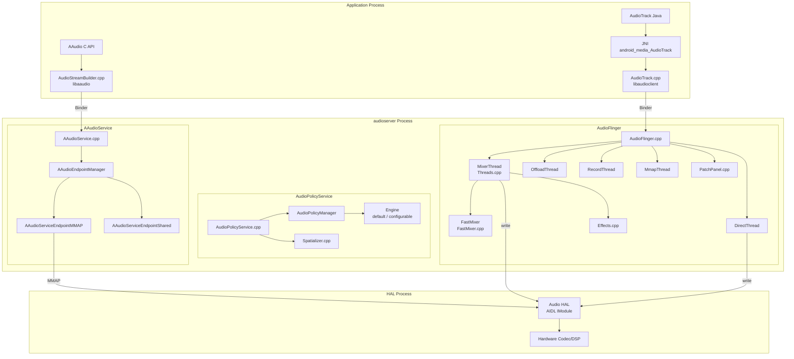

### 15.1.4 数据路径与控制路径

音频系统中有两条不同的路径：

**数据路径** —— 实际的 PCM 采样。在正常的混音路径中，数据流如下：

1. 应用写入共享内存环形缓冲区（即“cblk”）。
2. AudioFlinger 的 MixerThread 读取所有活动轨道，并将它们混音。
3. 混音结果被写入 HAL 输出流。

**控制路径** —— 路由决策、音量变化、设备连接：

1. 应用调用 `AudioManager`（Java）。
2. `AudioPolicyService` 通过 Binder 接收请求。
3. `AudioPolicyManager` 做出路由决策。
4. AudioFlinger 被指示创建/修改线程和 patch。

### 15.1.5 共享内存架构

客户端与服务器之间的所有音频数据传输都使用共享内存，而不是 Binder 事务。关键结构是 `audio_track_cblk_t`，定义于：

```
frameworks/av/include/private/media/AudioTrackShared.h
```

该控制块包含：

- 读位置（服务器侧）和写位置（客户端侧）
- 用于检测欠载/过载的标志
- 音量和静音状态
- 一种基于 futex 的低延迟唤醒信令机制

对于默认流式轨道（`ALLOC_CBLK`），音频缓冲区位于同一块共享内存中，紧跟在 `audio_track_cblk_t` 控制块之后。文件 `frameworks/av/services/audioflinger/Tracks.cpp` 一次性分配 `sizeof(audio_track_cblk_t) + bufferSize`，并把 `mBuffer` 指向 cblk 之后。只有只读快速捕获情形（`ALLOC_READONLY`）、管道情形（`ALLOC_PIPE`）以及客户端提供的静态缓冲区使用单独的内存区域。无论哪种方式，内存都被映射进客户端和服务器两个地址空间。这消除了进程间传输时的数据拷贝。

### 15.1.6 audioserver 进程

`audioserver` 二进制文件是托管所有音频服务的原生守护进程。它在启动过程中较早启动，由 init 拉起：

```
# From audioserver.rc (simplified)
service audioserver /system/bin/audioserver
    class core
    user audioserver
    group audio camera drmrpc media mediadrm net_bt net_bt_admin
    capabilities BLOCK_SUSPEND SYS_NICE
    ioprio rt 4
    task_profiles ProcessCapacityHigh HighPerformance
    onrestart restart vendor.audio-hal
```

audioserver 进程的关键方面：

- 以 `audioserver` 用户运行，具有 `audio` 组权限。
- 具有 `BLOCK_SUSPEND` 能力，用于在播放期间保持设备唤醒。
- 具有 `SYS_NICE` 能力，用于设置实时线程优先级。
- 使用 `ioprio rt 4` 设置实时 I/O 优先级。
- 使用 `ProcessCapacityHigh` 和 `HighPerformance` 任务配置文件进行 CPU 调度优化。
- 重启 audioserver 也会重启厂商音频 HAL。

进程结构：

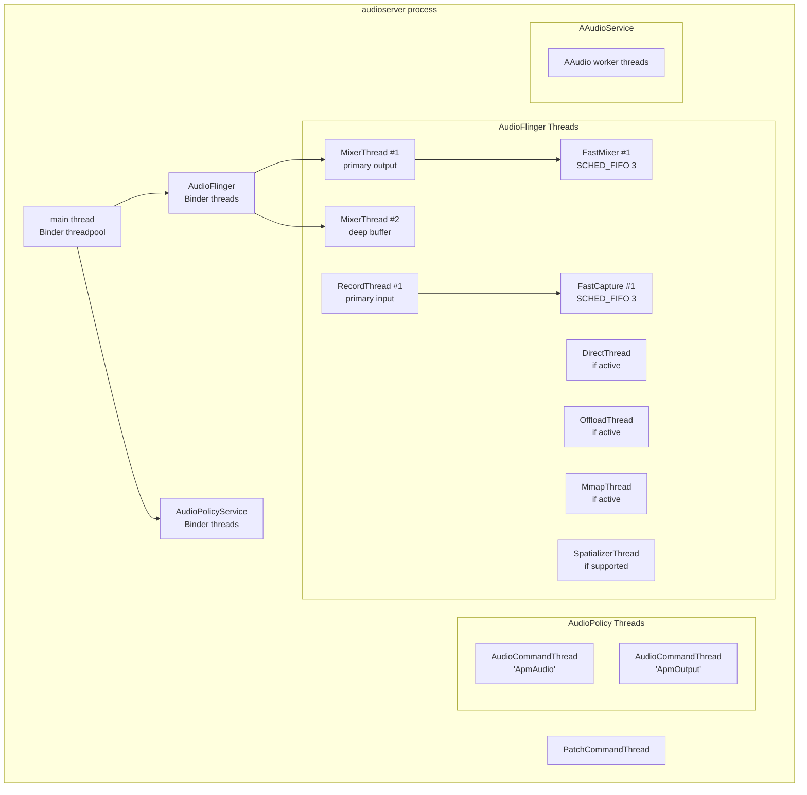

### 15.1.7 线程类型概览

AudioFlinger 根据输出创建不同的线程类型：

| 线程类型 | 类 | 用途 | 源码位置 |
|------------|-------|---------|----------------|
| Mixer | `MixerThread` | 混音多个 PCM 轨道 | `Threads.cpp` line ~5159+ |
| Direct | `DirectOutputThread` | 单个 PCM 或压缩轨道 | `Threads.cpp` |
| Offload | `OffloadThread` | 硬件压缩播放 | `Threads.cpp` |
| Duplicating | `DuplicatingThread` | 镜像到多个输出 | `Threads.cpp` |
| Record | `RecordThread` | 从输入捕获 | `Threads.cpp` |
| Mmap | `MmapPlaybackThread` / `MmapCaptureThread` | MMAP 零拷贝 | `Threads.cpp` |
| Spatializer | `SpatializerThread` | 空间音频混音 | `Threads.cpp` |

每个线程都与一个 HAL 输出或输入流关联，并以高优先级实时线程运行。

### 15.1.8 音频格式支持

Android 支持广泛的音频格式：

| 类别 | 格式 |
|----------|---------|
| PCM | 16-bit, 24-bit packed, 32-bit, 8.24 fixed, float |
| Compressed lossy | MP3, AAC, AAC-LC, HE-AAC, Vorbis, Opus |
| Compressed lossless | FLAC, ALAC |
| Spatial | Dolby Atmos, DTS:X (passthrough) |
| Voice | AMR-NB, AMR-WB, AMR-WB+, EVRC |

PCM 格式流经混音器和效果链。压缩格式可能先在软件中解码（通过 MediaCodec）再到达 AudioTrack，或者直接发送到 HAL 进行硬件解码（offload 路径）。

---

## 15.2 AudioFlinger

AudioFlinger 是 Android 音频的核心混音引擎。它是音频栈中最复杂的单一组件，核心实现分布在六个源文件中：

| 文件 | 用途 |
|------|---------|
| `AudioFlinger.cpp` | 服务入口点、Binder 方法 |
| `Threads.cpp` | 所有线程循环的实现 |
| `Tracks.cpp` | 轨道对象（播放、录音、mmap） |
| `Effects.cpp` | 效果链管理 |
| `PatchPanel.cpp` | 音频路由 patch |
| `fastpath/FastMixer.cpp` | 低延迟快速混音路径 |

前五个文件位于 `frameworks/av/services/audioflinger/` 之下。快速路径代码位于 `fastpath/` 子目录（`FastMixer.cpp`、`FastCapture.cpp`、`FastThread.cpp`、`StateQueue.cpp` 以及它们的 dump/state 辅助文件）。audioflinger 目录现在还带有 `afutils/`、`datapath/`、`sounddose/` 和 `timing/` 子目录，分别存放工具、HAL 流、声音剂量和帧计数器辅助代码。线程类本身在 `Threads.h` 中声明，并在 `Threads.cpp` 中实现。

### 15.2.1 AudioFlinger 初始化

`AudioFlinger` 构造函数出奇地简单。繁重的工作发生在 `onFirstRef()` 中：

```cpp
// AudioFlinger.cpp, line 310-341
AudioFlinger::AudioFlinger()
{
    // Move the audio session unique ID generator start base as time passes
    // to limit risk of generating the same ID again after an audioserver restart.
    timespec ts{};
    clock_gettime(CLOCK_MONOTONIC, &ts);
    uint32_t movingBase = (uint32_t)std::max((long)1, ts.tv_sec);
    for (unsigned use = AUDIO_UNIQUE_ID_USE_UNSPECIFIED;
            use < AUDIO_UNIQUE_ID_USE_MAX; use++) {
        mNextUniqueIds[use] =
                ((use == AUDIO_UNIQUE_ID_USE_SESSION
                  || use == AUDIO_UNIQUE_ID_USE_CLIENT) ?
                    movingBase : 1) * AUDIO_UNIQUE_ID_USE_MAX;
    }
    BatteryNotifier::getInstance().noteResetAudio();
}
```

会话 ID 生成器使用基于单调时间的偏移量，以避免 audioserver 重启后发生冲突。这一点至关重要，因为客户端在重连时会复用之前分配的会话 ID。

在 `onFirstRef()` 中，基于工厂的设备发现开始：

```cpp
// AudioFlinger.cpp, line 342-363
void AudioFlinger::onFirstRef()
{
    audio_utils::lock_guard _l(mutex());
    mMode = AUDIO_MODE_NORMAL;
    mDeviceEffectManager = sp<DeviceEffectManager>::make(
            sp<IAfDeviceEffectManagerCallback>::fromExisting(this)),
    mDevicesFactoryHalCallback = new DevicesFactoryHalCallbackImpl;
    mDevicesFactoryHal->setCallbackOnce(mDevicesFactoryHalCallback);
    // ...
    mPatchPanel = IAfPatchPanel::create(
            sp<IAfPatchPanelCallback>::fromExisting(this));
    mMelReporter = sp<MelReporter>::make(
            sp<IAfMelReporterCallback>::fromExisting(this),
            mPatchPanel);
}
```

### 15.2.2 类层次结构

AudioFlinger 通过菱形继承模式实现多个回调接口：

```cpp
// AudioFlinger.h, line 60-67
class AudioFlinger
    : public AudioFlingerServerAdapter::Delegate  // IAudioFlinger client interface
    , public IAfClientCallback
    , public IAfDeviceEffectManagerCallback
    , public IAfMelReporterCallback
    , public IAfPatchPanelCallback
    , public IAfThreadCallback
{
```

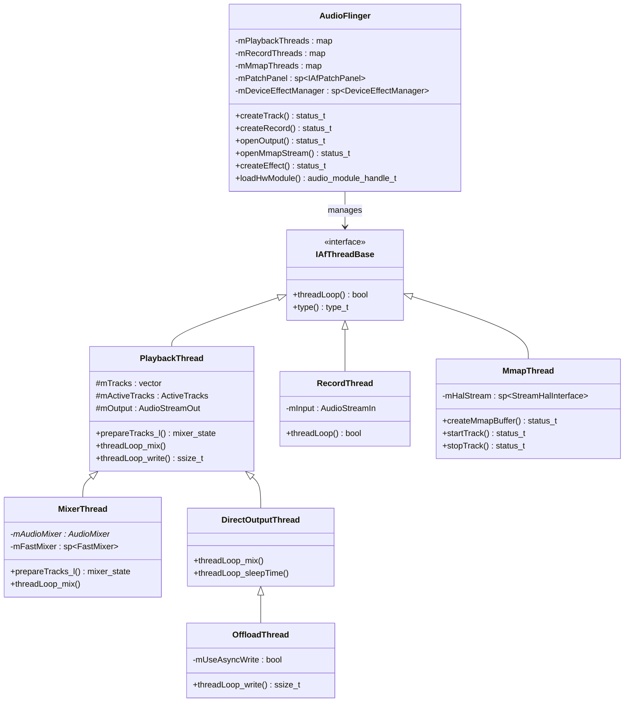

### 15.2.3 Binder 接口

AudioFlinger 暴露了一个丰富的 Binder 接口，包含 50 多个方法。完整列表在 `AudioFlinger.cpp` 中以宏的形式定义：

```cpp
// AudioFlinger.cpp, line 173-244
#define IAUDIOFLINGER_BINDER_METHOD_MACRO_LIST \
BINDER_METHOD_ENTRY(createTrack) \
BINDER_METHOD_ENTRY(createRecord) \
BINDER_METHOD_ENTRY(sampleRate) \
BINDER_METHOD_ENTRY(format) \
BINDER_METHOD_ENTRY(frameCount) \
BINDER_METHOD_ENTRY(latency) \
BINDER_METHOD_ENTRY(setMasterVolume) \
BINDER_METHOD_ENTRY(setMasterMute) \
// ... 40+ more entries
BINDER_METHOD_ENTRY(getSoundDoseInterface) \
BINDER_METHOD_ENTRY(getAudioPolicyConfig) \
BINDER_METHOD_ENTRY(getAudioMixPort) \
BINDER_METHOD_ENTRY(resetReferencesForTest) \
```

每个 Binder 方法都通过 `MethodStatistics` 基础设施进行统计跟踪和性能分析。

### 15.2.4 轨道创建

当应用调用 `new AudioTrack()` 时，会调用 Binder 的 `createTrack` 方法。关键参数（来自 `AudioFlinger.h` 第 82-83 行）：

```cpp
status_t createTrack(const media::CreateTrackRequest& input,
        media::CreateTrackResponse& output) final EXCLUDES_AudioFlinger_Mutex;
```

请求指定了音频属性（usage、content type）、格式、采样率、声道掩码、帧数和标志。AudioFlinger：

1. 验证属性来源（AudioFlinger.cpp 中第 126-157 行）。
2. 向 AudioPolicyService 询问正确的输出句柄。
3. 查找或创建合适的播放线程。
4. 为轨道的音频缓冲区分配共享内存。
5. 创建 `Track` 对象并将其附加到线程。

### 15.2.5 硬件模块加载

AudioFlinger 通过工厂模式加载 HAL 模块。众所周知的模块 ID 是：

```cpp
// AudioFlinger.cpp, line 684-688
static const char * const audio_interfaces[] = {
    AUDIO_HARDWARE_MODULE_ID_PRIMARY,
    AUDIO_HARDWARE_MODULE_ID_A2DP,
    AUDIO_HARDWARE_MODULE_ID_USB,
};
```

`findSuitableHwDev_l()` 方法（第 690 行）遍历已加载的 HAL 模块，以找到支持所请求设备类型的模块。

### 15.2.6 MixerThread 循环

MixerThread 是音频混音发生的地方。它在 `Threads.cpp` 中的 `threadLoop()` 方法是 Android 音频的心脏。循环遵循以下结构：

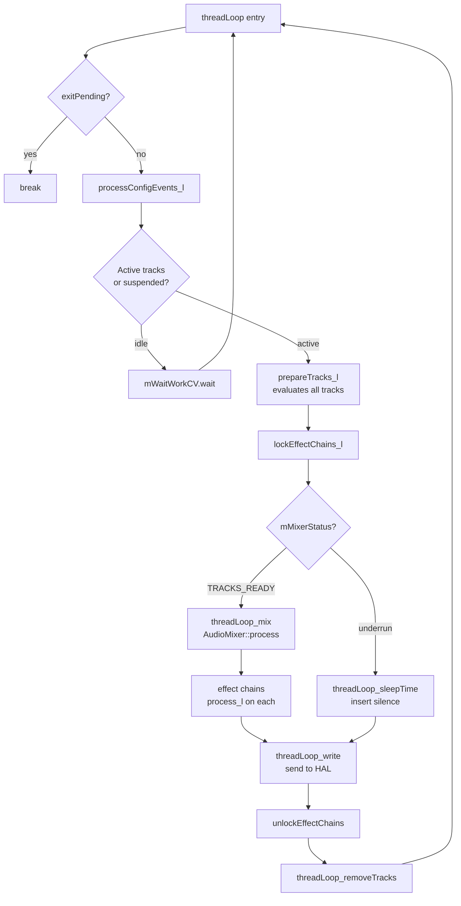

`Threads.cpp` 中的关键时序常量：

```cpp
// Threads.cpp, line 132-134
static const int8_t kMaxTrackRetries = 50;
static const int8_t kMaxTrackStartupRetries = 50;

// Threads.cpp, line 154
static const int32_t kMaxTrackRetriesDirectMs = 200;

// Threads.cpp, line 169
static const uint32_t kMinThreadSleepTimeUs = 5000;

// Threads.cpp, line 181-182
static const uint32_t kNormalPlaybackPeriodMs =
        property_get_int32("persist.audio.normal_playback_period_ms", 20);

// Threads.cpp, line 189
static constexpr uint32_t kMaxNormalPlaybackPeriodMs = 24;
```

最小正常播放周期默认为 20ms，但可以通过 `persist.audio.normal_playback_period_ms` 属性按设备覆盖。

混音循环以约 20ms 的周期运行。每个周期：

1. **`prepareTracks_l()`** —— 评估所有轨道，确定哪些处于活动状态，为每个活动轨道设置 AudioMixer（采样率、音量、格式）。
2. **`threadLoop_mix()`** —— 调用 `AudioMixer::process()`，从所有活动轨道缓冲区读取数据并混音进 `mMixerBuffer`。
3. **效果处理** —— 线程循环遍历已锁定的效果链，并在每个效果链上调用 `IAfEffectChain::process_l()`，在混音后的音频上运行效果。
4. **`threadLoop_write()`** —— 将最终缓冲区写入 HAL。

### 15.2.7 threadLoop_write() 方法

写路径有两个分支（来自 `Threads.cpp` 第 3660-3726 行）：

```cpp
// Threads.cpp, line 3660-3726
ssize_t PlaybackThread::threadLoop_write()
{
    mInWrite = true;
    ssize_t bytesWritten;
    const size_t offset = mCurrentWriteLength - mBytesRemaining;

    // If an NBAIO sink is present, use it to write the normal mixer's submix
    if (mNormalSink != 0) {
        const size_t count = mBytesRemaining / mFrameSize;
        ATRACE_BEGIN("write");
        // update the setpoint when AudioFlinger::mScreenState changes
        const uint32_t screenState = mAfThreadCallback->getScreenState();
        if (screenState != mScreenState) {
            mScreenState = screenState;
            MonoPipe *pipe = (MonoPipe *)mPipeSink.get();
            if (pipe != NULL) {
                pipe->setAvgFrames((mScreenState & 1) ?
                        (pipe->maxFrames() * 7) / 8 : mNormalFrameCount * 2);
            }
        }
        ssize_t framesWritten = mNormalSink->write(
                (char *)mSinkBuffer + offset, count);
        ATRACE_END();
        // ...
    } else {
        // Direct output and offload threads
        ATRACE_BEGIN("write");
        bytesWritten = mOutput->write(
                (char *)mSinkBuffer + offset, mBytesRemaining);
        ATRACE_END();
    }
    // ...
}
```

对于已初始化 FastMixer 的混音线程，写入会通过 NBAIO（Non-Blocking Audio I/O）的 `MonoPipe`（`mPipeSink`）到达 FastMixer。没有 FastMixer 的混音线程使用 `mOutputSink`，即直接在 HAL 流之上的 NBAIO sink。Direct 和 offload 线程没有 NBAIO sink，而是直接写入 HAL 流。

屏幕状态优化值得关注。当屏幕关闭时，管道的平均帧设定点被提高到最大值的 7/8。更深的缓冲区意味着更少的唤醒和更低的功耗。当屏幕开启时，它被设置为正常帧数的 2 倍，即更浅的缓冲区，在 UI 活动期间保持低延迟。

### 15.2.8 待机管理

线程在可配置的延迟（默认 3 秒）之后进入待机状态：

```cpp
// Threads.cpp, line 252-262
static const nsecs_t kDefaultStandbyTimeInNsecs = seconds(3);

static nsecs_t getStandbyTimeInNanos() {
    static nsecs_t standbyTimeInNanos = []() {
        const int ms = property_get_int32(
                "ro.audio.flinger_standbytime_ms",
                kDefaultStandbyTimeInNsecs / NANOS_PER_MILLISECOND);
        ALOGI("%s: Using %d ms as standby time", __func__, ms);
        return milliseconds(ms);
    }();
    return standbyTimeInNanos;
}
```

在待机状态下，线程释放 HAL 流并停止其唤醒锁，节省大量功耗。offload 输出的待机延迟更短：

```cpp
// Threads.cpp, line 184
static const nsecs_t kOffloadStandbyDelayNs = seconds(1);
```

### 15.2.9 轨道

轨道对象表示线程内的单个音频流。基类 `TrackBase` 定义于 `Tracks.cpp`：

```cpp
// Tracks.cpp, line 89-138
TrackBase::TrackBase(
        IAfThreadBase *thread,
            const sp<Client>& client,
            const audio_attributes_t& attr,
            uint32_t sampleRate,
            audio_format_t format,
            audio_channel_mask_t channelMask,
            size_t frameCount,
            void *buffer,
            size_t bufferSize,
            audio_session_t sessionId,
            pid_t creatorPid,
            uid_t clientUid,
            bool isOut,
            const alloc_type alloc,
            track_type type,
            audio_port_handle_t portId,
            std::string metricsId,
            const std::string& codecProvenance)
    : mThread(thread),
      mAllocType(alloc),
      mClient(client),
      mCblk(NULL),
      mState(IDLE),
      mAttr(attr),
      mSampleRate(sampleRate),
      mFormat(format),
      mChannelMask(channelMask),
      mChannelCount(isOut ?
              audio_channel_count_from_out_mask(channelMask) :
              audio_channel_count_from_in_mask(channelMask)),
      mCodecProvenance(codecProvenance),
      mFrameSize(audio_bytes_per_frame(mChannelCount, format)),
      mFrameCount(frameCount),
      mSessionId(sessionId),
      // ...
```

每个轨道都有一个原子生成的唯一 ID：

```cpp
// Tracks.cpp, line 86
static volatile int32_t nextTrackId = 55;
```

Track 层次结构为：

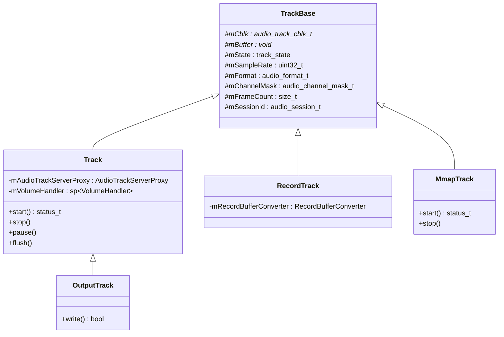

### 15.2.10 FastMixer —— 低延迟路径

FastMixer 是一个独立的高优先级线程，为延迟敏感的轨道绕过正常的混音循环。它定义于：

```
frameworks/av/services/audioflinger/fastpath/FastMixer.cpp
```

FastMixer 的设计规则很严格（来自源文件头部注释）：

```cpp
// FastMixer.cpp, line 17-21
// <IMPORTANT_WARNING>
// Design rules for threadLoop() are given in the comments at section
// "Fast mixer thread" of StateQueue.h.  In particular, avoid library
// and system calls except at well-known points.
// </IMPORTANT_WARNING>
```

FastMixer 使用以下四种策略之一进行配置：

```cpp
// Threads.cpp, line 202-216
static const enum {
    FastMixer_Never,    // never initialize or use: for debugging only
    FastMixer_Always,   // always initialize and use, even if not needed
    FastMixer_Static,   // initialize if needed, then use all the time
    FastMixer_Dynamic,  // initialize if needed, then use dynamically
} kUseFastMixer = FastMixer_Static;
```

默认值是 `FastMixer_Static`：一旦初始化，FastMixer 就持续运行。优先级为：

```cpp
// Threads.cpp, line 226-228
static const int kPriorityAudioApp = 2;
static const int kPriorityFastMixer = 3;
static const int kPriorityFastCapture = 3;
```

快速轨道乘数控制共享缓冲区的大小：

```cpp
// Threads.cpp, line 237-244
static const int kFastTrackMultiplier = 2;
static const int kFastTrackMultiplierMin = 1;
static const int kFastTrackMultiplierMax = 2;
static int sFastTrackMultiplier = kFastTrackMultiplier;
```

#### FastMixer 线程循环

FastMixer 的 `onWork()` 方法（第 328 行）是紧凑的内层循环：

```cpp
// FastMixer.cpp, line 328-333
void FastMixer::onWork()
{
    const FastMixerState * const current =
            (const FastMixerState *) mCurrent;
    FastMixerDumpState * const dumpState =
            (FastMixerDumpState *) mDumpState;
```

它处理三个命令：

- `MIX` —— 把轨道混音进混音器缓冲区
- `WRITE` —— 把缓冲区写入输出 sink
- `MIX_WRITE` —— 两种操作合并

当输出配置变化时，FastMixer 会重新配置：

```cpp
// FastMixer.cpp, line 245-270
if (frameCount > 0 && mSampleRate > 0) {
    mMixer = new AudioMixer(frameCount, mSampleRate);
    // ...
    mPeriodNs = (frameCount * 1000000000LL) / mSampleRate;     // 1.00
    mUnderrunNs = (frameCount * 1750000000LL) / mSampleRate;   // 1.75
    mOverrunNs = (frameCount * 500000000LL) / mSampleRate;     // 0.50
    mForceNs = (frameCount * 950000000LL) / mSampleRate;       // 0.95
    mWarmupNsMin = (frameCount * 750000000LL) / mSampleRate;   // 0.75
    mWarmupNsMax = (frameCount * 1250000000LL) / mSampleRate;  // 1.25
}
```

这些时序阈值定义了 FastMixer 在何时认为一个周期是欠载（1.75 倍周期）或过载（0.5 倍周期）。

#### FastMixer 中的轨道更新

单个轨道在 `updateMixerTrack()` 中更新：

```cpp
// FastMixer.cpp, line 123-191
void FastMixer::updateMixerTrack(int index, Reason reason) {
    // ...
    switch (reason) {
    case REASON_REMOVE:
        mMixer->destroy(index);
        break;
    case REASON_ADD: {
        const status_t status = mMixer->create(
                index, fastTrack->mChannelMask,
                fastTrack->mFormat, AUDIO_SESSION_OUTPUT_MIX);
        // ...
    }
        [[fallthrough]];
    case REASON_MODIFY:
        mMixer->setBufferProvider(index, fastTrack->mBufferProvider);
        // set volume, resample, format, channel mask, haptic parameters
        mMixer->enable(index);
        break;
    }
}
```

音量来自轨道的 `VolumeProvider`：

```cpp
// FastMixer.cpp, line 155-161
float vlf, vrf;
if (fastTrack->mVolumeProvider != nullptr) {
    const gain_minifloat_packed_t vlr =
            fastTrack->mVolumeProvider->getVolumeLR();
    vlf = float_from_gain(gain_minifloat_unpack_left(vlr));
    vrf = float_from_gain(gain_minifloat_unpack_right(vlr));
} else {
    vlf = vrf = AudioMixer::UNITY_GAIN_FLOAT;
}
```

### 15.2.11 PatchPanel —— 音频路由

PatchPanel 管理源与 sink 之间的音频路由 patch：

```
frameworks/av/services/audioflinger/PatchPanel.cpp
```

一个 patch 连接音频端口——它可以是设备到设备（硬件 patch）、设备到混音，或混音到设备。创建逻辑处理几种场景：

```cpp
// PatchPanel.cpp, line 112-135
status_t PatchPanel::createAudioPatch_l(
        const struct audio_patch* patch,
        audio_patch_handle_t *handle,
        bool endpointPatch)
{
    // ...
    if (!audio_patch_is_valid(patch) ||
            (patch->num_sinks == 0 && patch->num_sources != 2)) {
        return BAD_VALUE;
    }
    // limit number of sources to 1 for now or 2 sources for
    // special cross hw module case.
    if (patch->num_sources > 2) {
        return INVALID_OPERATION;
    }
```

两个源的特殊情况处理跨 HW 模块路由，即音频必须跨两个不同的 HAL 模块路由（例如 primary 到 USB）。

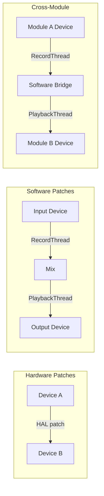

### 15.2.12 扩展声道与精度
MixerThread 支持超出立体声的扩展声道配置：

```cpp
// Threads.cpp, line 267
constexpr bool kEnableExtendedChannels = true;
```

以及扩展精度格式：

```cpp
// Threads.cpp, line 301
constexpr bool kEnableExtendedPrecision = true;
```

有效的 PCM sink 格式（第 305-317 行）：

```cpp
bool IAfThreadBase::isValidPcmSinkFormat(audio_format_t format) {
    switch (format) {
    case AUDIO_FORMAT_PCM_16_BIT:
        return true;
    case AUDIO_FORMAT_PCM_FLOAT:
    case AUDIO_FORMAT_PCM_24_BIT_PACKED:
    case AUDIO_FORMAT_PCM_32_BIT:
    case AUDIO_FORMAT_PCM_8_24_BIT:
        return kEnableExtendedPrecision;
    default:
        return false;
    }
}
```

### 15.2.13 createTrack() 深入剖析

完整的 `createTrack()` 实现（`AudioFlinger.cpp` 中第 1038 行）展示了完整的轨道创建流水线：

```cpp
// AudioFlinger.cpp, line 1038-1075
status_t AudioFlinger::createTrack(
        const media::CreateTrackRequest& _input,
        media::CreateTrackResponse& _output)
{
    ATRACE_CALL();
    CreateTrackInput input =
            VALUE_OR_RETURN_STATUS(CreateTrackInput::fromAidl(_input));
    CreateTrackOutput output;

    sp<IAfTrack> track;
    sp<Client> client;
    status_t lStatus;
    audio_stream_type_t streamType;
    audio_port_handle_t portId = AUDIO_PORT_HANDLE_NONE;
    std::vector<audio_io_handle_t> secondaryOutputs;
    bool isSpatialized = false;
    bool isBitPerfect = false;

    audio_io_handle_t effectThreadId = AUDIO_IO_HANDLE_NONE;
    std::vector<int> effectIds;
    audio_attributes_t localAttr = input.attr;
```

该方法随后验证属性来源，在需要时分配会话 ID，并向 AudioPolicyService 查询正确的输出：

```cpp
// AudioFlinger.cpp, line 1069-1091
    sessionId = input.sessionId;
    if (sessionId == AUDIO_SESSION_ALLOCATE) {
        sessionId = (audio_session_t)
                newAudioUniqueId(AUDIO_UNIQUE_ID_USE_SESSION);
    }

    lStatus = AudioSystem::getOutputForAttr(
            &localAttr, &output.outputId, sessionId,
            &streamType, adjAttributionSource,
            &input.config, input.flags,
            &selectedDeviceIds, &portId, &secondaryOutputs,
            &isSpatialized, &isBitPerfect);
```

找到输出之后，它验证格式和声道掩码，定位播放线程，注册客户端，并处理效果链迁移：

```cpp
// AudioFlinger.cpp, line 1114-1157
    {
        audio_utils::lock_guard _l(mutex());
        IAfPlaybackThread* thread =
                checkPlaybackThread_l(output.outputId);
        client = registerClient(
                adjAttributionSource.pid,
                adjAttributionSource.uid);

        // check if an effect chain with the same session ID is
        // present on another output thread and move it here
        for (const auto& [outputId, t] : mPlaybackThreads) {
            if (outputId != output.outputId) {
                uint32_t sessions =
                        t->hasAudioSession(sessionId);
                if (sessions & IAfThreadBase::EFFECT_SESSION) {
                    effectThread = t.get();
                    break;
                }
            }
        }

        track = thread->createTrack_l(client, streamType,
                localAttr, &output.sampleRate,
                input.config.format,
                input.config.channel_mask,
                &output.frameCount,
                &output.notificationFrameCount,
                input.notificationsPerBuffer, input.speed,
                input.sharedBuffer, sessionId,
                &output.flags, callingPid,
                adjAttributionSource,
                input.clientInfo.clientTid,
                &lStatus, portId,
                input.audioTrackCallback,
                isSpatialized, isBitPerfect,
                &output.afTrackFlags);
```

输出结构捕获了关于线程实际配置的关键信息：

```cpp
// AudioFlinger.cpp, line 1161-1167
        output.afFrameCount = thread->frameCount();
        output.afSampleRate = thread->sampleRate();
        output.afChannelMask =
                static_cast<audio_channel_mask_t>(
                thread->channelMask() |
                thread->hapticChannelMask());
        output.afFormat = thread->format();
        output.afLatencyMs = thread->latency();
        output.portId = portId;
```

### 15.2.14 dump() 系统

AudioFlinger 的 dump 系统非常全面，支持选择性调试：

```cpp
// AudioFlinger.cpp, line 838-849
static void dump_printHelp(int fd) {
    constexpr static auto helpStr =
            "AudioFlinger dumpsys help options\n"
            "  -h/--help: Print this help text\n"
            "  --hal: Include dump of audio hal\n"
            "  --stats: Include call/lock/watchdog stats\n"
            "  --effects: Include effect definitions\n"
            "  --memory: Include memory dump\n"
            "  -a/--all: Print all except --memory\n"sv;
    write(fd, helpStr.data(), helpStr.length());
}
```

dump 方法遍历所有线程类型：

```cpp
// AudioFlinger.cpp, line 930-952
        // dump playback threads
        for (const auto& [_, thread] : mPlaybackThreads) {
            thread->dump(fd, args);
        }
        // dump record threads
        for (const auto& [_, thread] : mRecordThreads) {
            thread->dump(fd, args);
        }
        // dump mmap threads
        for (const auto& [_, thread] : mMmapThreads) {
            thread->dump(fd, args);
        }
        // dump orphan effect chains
        if (mOrphanEffectChains.size() != 0) {
            writeStr(fd, "  Orphan Effect Chains\n");
            for (const auto& [_, effectChain] :
                    mOrphanEffectChains) {
                effectChain->dump(fd, args);
            }
        }
```

它还会 dump 电源管理、互斥锁统计和内存状态：

```cpp
// AudioFlinger.cpp, line 974-979
        dprintf(fd, "\n ## BEGIN power dump\n");
        writeStr(fd, media::psh_utils::AudioPowerManager::
                getAudioPowerManager().toString());
```

```cpp
// AudioFlinger.cpp, line 819-822
    writeStr(fd, audio_utils::mutex::all_stats_to_string());
    writeStr(fd, audio_utils::mutex::all_threads_to_string());
```

### 15.2.15 线程循环中的效果处理

混音线程循环中的效果处理阶段值得详细关注。混音之后，效果链被处理：

```cpp
// Threads.cpp, line 4419-4445
        if (mSleepTimeUs == 0 && mType != OFFLOAD) {
            for (size_t i = 0; i < effectChains.size(); i++) {
                effectChains[i]->process_l();
                // Handle haptic data from effect chain
                if (activeHapticSessionId != AUDIO_SESSION_NONE
                        && activeHapticSessionId ==
                           effectChains[i]->sessionId()) {
                    uint32_t hapticSessionChannelCount =
                            mEffectBufferValid ?
                            audio_channel_count_from_out_mask(
                                    mMixerChannelMask) :
                            mChannelCount;
                    const size_t audioBufferSize =
                            mNormalFrameCount *
                            audio_bytes_per_frame(
                                    hapticSessionChannelCount,
                                    AUDIO_FORMAT_PCM_FLOAT);
                    memcpy_by_audio_format(
                            (uint8_t*)effectChains[i]->outBuffer()
                                    + audioBufferSize,
                            AUDIO_FORMAT_PCM_FLOAT,
                            (const uint8_t*)effectChains[i]->inBuffer()
                                    + audioBufferSize,
                            AUDIO_FORMAT_PCM_FLOAT,
                            mNormalFrameCount * mHapticChannelCount);
                }
            }
        }
```

触觉数据被特殊处理。它从效果输入缓冲区直接拷贝到输出缓冲区，绕过效果处理。原因是 HapticGenerator 效果生成触觉声道。链中后续的效果不应处理它们。

对于 offload 轨道，即使没有音频数据，效果仍然会被处理：

```cpp
// Threads.cpp, line 4451-4455
        if (mType == OFFLOAD) {
            for (size_t i = 0; i < effectChains.size(); i++) {
                effectChains[i]->process_l();
            }
        }
```

效果处理之后，效果缓冲区被拷贝到 sink 缓冲区，并带有 PCM float 钳制以保证 HAL 安全：

```cpp
// Threads.cpp, line 4496-4503
                static constexpr float HAL_FLOAT_SAMPLE_LIMIT = 2.0f;
                memcpy_to_float_from_float_with_clamping(
                        static_cast<float*>(mSinkBuffer),
                        static_cast<const float*>(effectBuffer),
                        framesToCopy,
                        HAL_FLOAT_SAMPLE_LIMIT /* absMax */);
```

钳制到 +/- 2.0f 可防止 HAL 无法处理 NaN 或极大浮点值的情况。

### 15.2.16 写入时序与抖动跟踪

写入 HAL 之后，线程循环跟踪时序抖动：

```cpp
// Threads.cpp, line 4533-4580
                    const int64_t lastIoBeginNs = systemTime();
                    ret = threadLoop_write();
                    const int64_t lastIoEndNs = systemTime();
                    // ...
                    writePeriodNs = lastIoEndNs - mLastIoEndNs;

                    if (audio_has_proportional_frames(mFormat)) {
                        if (mMixerStatus == MIXER_TRACKS_READY &&
                                loopCount == lastLoopCountWritten + 1) {
                            const double jitterMs =
                                TimestampVerifier<int64_t, int64_t>::
                                    computeJitterMs(
                                        {frames, writePeriodNs},
                                        {0, 0}, mSampleRate);
                            const double processMs =
                                (lastIoBeginNs - mLastIoEndNs) * 1e-6;

                            audio_utils::lock_guard _l(mutex());
                            mIoJitterMs.add(jitterMs);
                            mProcessTimeMs.add(processMs);
                        }

                        // write blocked detection
                        const int64_t deltaWriteNs =
                                lastIoEndNs - lastIoBeginNs;
                        if ((mType == MIXER || mType == SPATIALIZER)
                                && deltaWriteNs > maxPeriod) {
                            mNumDelayedWrites++;
                            if ((lastIoEndNs - lastWarning) >
                                    kWarningThrottleNs) {
                                ATRACE_NAME("underrun");
                                ALOGW("write blocked for %lld msecs",
                                    (long long)deltaWriteNs /
                                    NANOS_PER_MILLISECOND);
                            }
                        }
                    }
```

这一跟踪对于调试延迟问题至关重要。抖动统计和 MonoPipe 深度可在 dumpsys 输出中获得。

### 15.2.17 SpatializerThread

`SpatializerThread` 是用于空间音频的专用 `MixerThread`：

```cpp
// Threads.cpp, line 8130-8146
sp<IAfPlaybackThread> IAfPlaybackThread::createSpatializerThread(
        const sp<IAfThreadCallback>& afThreadCallback,
        AudioStreamOut* output,
        audio_io_handle_t id,
        bool systemReady,
        audio_config_base_t* mixerConfig) {
    return sp<SpatializerThread>::make(
            afThreadCallback, output, id,
            systemReady, mixerConfig);
}

SpatializerThread::SpatializerThread(
        const sp<IAfThreadCallback>& afThreadCallback,
        AudioStreamOut* output,
        audio_io_handle_t id,
        bool systemReady,
        audio_config_base_t *mixerConfig)
    : MixerThread(afThreadCallback, output, id,
                   systemReady, SPATIALIZER, mixerConfig)
{
}
```

它管理 HAL 延迟模式以支持低延迟头部跟踪：

```cpp
// Threads.cpp, line 8148-8185
void SpatializerThread::setHalLatencyMode_l() {
    if (mSupportedLatencyModes.empty()) {
        return;
    }
    if (mActiveTracks.empty()) {
        return;
    }

    audio_latency_mode_t latencyMode = AUDIO_LATENCY_MODE_FREE;
    if (mSupportedLatencyModes.size() == 1) {
        latencyMode = mSupportedLatencyModes[0];
    } else if (mSupportedLatencyModes.size() > 1) {
        for (const auto& track : mActiveTracks) {
            if (track->isSpatialized()) {
                latencyMode = mRequestedLatencyMode;
                break;
            }
        }
    }

    if (latencyMode != mSetLatencyMode) {
        status_t status =
                mOutput->stream->setLatencyMode(latencyMode);
        if (status == NO_ERROR) {
            mSetLatencyMode = latencyMode;
        }
    }
}
```

它还管理空间化效果和回退 downmixer：

```cpp
// Threads.cpp, line 8196-8247
void SpatializerThread::checkOutputStageEffects()
{
    bool hasVirtualizer = false;
    bool hasDownMixer = false;
    {
        audio_utils::lock_guard _l(mutex());
        sp<IAfEffectChain> chain =
                getEffectChain_l(AUDIO_SESSION_OUTPUT_STAGE);
        if (chain != 0) {
            hasVirtualizer =
                chain->getEffectFromType_l(FX_IID_SPATIALIZER)
                    != nullptr;
            hasDownMixer =
                chain->getEffectFromType_l(EFFECT_UIID_DOWNMIX)
                    != nullptr;
        }
    }

    if (hasVirtualizer) {
        // Spatializer present, disable downmixer
        if (finalDownMixer != nullptr) {
            int32_t ret;
            finalDownMixer->asIEffect()->disable(&ret);
        }
    } else if (!hasDownMixer) {
        // No spatializer and no downmixer, create a downmixer
        // as fallback to handle multichannel content
        // ...
    }
}
```

当空间化效果处于活动状态时，它处理多声道到双耳的渲染。当它不活动时（例如效果被移除），会自动创建一个 downmixer 作为回退。downmixer 防止多声道音频直接输出到立体声输出。

### 15.2.18 RecordThread

RecordThread 处理音频捕获，并使用输入标志创建：

```cpp
// Threads.cpp, line 8263-8271
sp<IAfRecordThread> IAfRecordThread::create(
        const sp<IAfThreadCallback>& afThreadCallback,
        AudioStreamIn* input,
        audio_io_handle_t id,
        bool systemReady) {
    if (input->flags & AUDIO_INPUT_FLAG_DIRECT) {
        return sp<DirectRecordThread>::make(
                afThreadCallback, input, id, systemReady);
    }
    return sp<RecordThread>::make(
            afThreadCallback, RECORD, input, id, systemReady);
}
```

RecordThread 构造函数设置 NBAIO 源和只读堆：

```cpp
// Threads.cpp, line 8273-8320
RecordThread::RecordThread(/* ... */)
    : ThreadBase(afThreadCallback, id, type, systemReady,
            false /* isOut */, input, nullptr /* output */),
      mSource(mInput),
      mRsmpInBuffer(NULL),
      mRsmpInRear(0),
      mReadOnlyHeap(new MemoryDealer(
              kRecordThreadReadOnlyHeapSize,
              "RecordThreadRO",
              MemoryHeapBase::READ_ONLY)),
      mFastTrackAvail(false),
      mBtNrecSuspended(false)
{
    snprintf(mThreadName, kThreadNameLength, "AudioIn_%X", id);
    readInputParameters_l();

    mInputSource = new AudioStreamInSource(input->stream);
    size_t numCounterOffers = 0;
    const NBAIO_Format offers[1] = {
            Format_from_SR_C(mSampleRate, mChannelCount, mFormat)};
```

只读堆大小为 0xD000（53,248 字节），用于快速 AudioRecord 客户端缓冲区。

### 15.2.19 挂起的输出

当线程被挂起时（例如在 BT SCO 通话期间），它会模拟向 HAL 写入：

```cpp
// Threads.cpp, line 4409-4417
            if (isSuspended()) {
                mSleepTimeUs = suspendSleepTimeUs();
                const size_t framesRemaining =
                        mBytesRemaining / mFrameSize;
                mBytesWritten += mBytesRemaining;
                mFramesWritten += framesRemaining;
                mSuspendedFrames += framesRemaining;
                mBytesRemaining = 0;
            }
```

`mSuspendedFrames` 计数器调整内核 HAL 位置，以便在挂起期间仍保持准确的时间戳。

### 15.2.20 MelReporter —— 声音剂量监测

AudioFlinger 包含一个用于听力保护合规的 MEL（瞬时暴露级）报告器。它与 PatchPanel 一起初始化：

```cpp
// AudioFlinger.cpp, line 349-351
mMelReporter = sp<MelReporter>::make(
        sp<IAfMelReporterCallback>::fromExisting(this),
        mPatchPanel);
```

MelReporter 监测输出电平并计算累积声音暴露，以符合听力安全法规（IEC 62368-1）。

### 15.2.21 析构函数与资源清理

AudioFlinger 的析构函数有条不紊地关闭所有线程：

```cpp
// AudioFlinger.cpp, line 475-500
AudioFlinger::~AudioFlinger()
{
    while (!mRecordThreads.empty()) {
        closeInput_nonvirtual(mRecordThreads.begin()->first);
    }
    while (!mPlaybackThreads.empty()) {
        closeOutput_nonvirtual(mPlaybackThreads.begin()->first);
    }
    while (!mMmapThreads.empty()) {
        const audio_io_handle_t io = mMmapThreads.begin()->first;
        if (mMmapThreads.begin()->second->isOutput()) {
            closeOutput_nonvirtual(io);
        } else {
            closeInput_nonvirtual(io);
        }
    }
    for (const auto& [_, audioHwDevice] : mAudioHwDevs) {
        delete audioHwDevice;
    }
    mPatchCommandThread->exit();
}
```

### 15.2.22 MMAP 流支持

AudioFlinger 为 AAudio 低延迟路径打开 MMAP 流：

```cpp
// AudioFlinger.cpp, line 502-538
status_t AudioFlinger::openMmapStream(
        const media::OpenMmapRequest& request,
        media::OpenMmapResponse* response)
{
    // ... parse request ...
    status_t status = MmapStreamInterface::parseRequest(
            request, &isOutput, &attr, &config, &client,
            &deviceIds, &sessionId, &callback, &offloadInfo);
    // ...
    status = openMmapStreamImpl(isOutput, attr, &config, client,
            &deviceIds, &sessionId, callback,
            offloadInfo.format == AUDIO_FORMAT_DEFAULT ?
                    nullptr : &offloadInfo,
            interface, &portId);
```

MMAP 路径创建 `MmapThread` 而不是普通的 MixerThread。该线程直接管理硬件共享内存缓冲区，提供尽可能最低的延迟。

---

## 15.3 Audio Policy Service

Audio Policy Service 是 Android 音频路由的大脑。它决定使用哪个输出设备、如何处理音量，以及何时创建或关闭音频流。源码位于：

```
frameworks/av/services/audiopolicy/service/AudioPolicyService.cpp
frameworks/av/services/audiopolicy/AudioPolicyInterface.h
```

### 15.3.1 架构

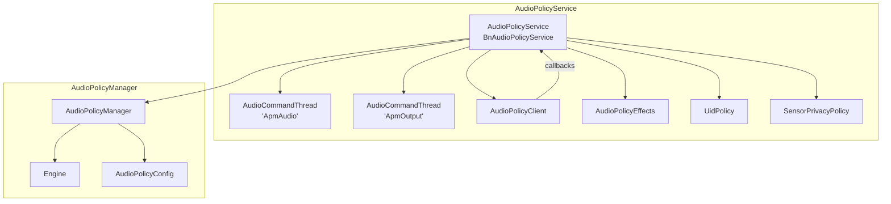

### 15.3.2 初始化

`AudioPolicyService` 在 `onFirstRef()` 中的初始化（第 279-336 行）创建命令线程，加载策略管理器，并初始化空间化器：

```cpp
// AudioPolicyService.cpp, line 241-254
AudioPolicyService::AudioPolicyService()
    : BnAudioPolicyService(),
      mAudioPolicyManager(NULL),
      mAudioPolicyClient(NULL),
      mPhoneState(AUDIO_MODE_INVALID),
      mCaptureStateNotifier(false),
      mCreateAudioPolicyManager(createAudioPolicyManager),
      mDestroyAudioPolicyManager(destroyAudioPolicyManager),
      mUsecaseValidator(media::createUsecaseValidator()),
      mPermissionController(sp<NativePermissionController>::make())
{
      setMinSchedulerPolicy(SCHED_NORMAL, ANDROID_PRIORITY_AUDIO);
      setInheritRt(true);
}
```

### 15.3.3 策略管理器的创建

策略管理器是动态加载的，允许厂商提供自定义实现：

```cpp
// AudioPolicyService.cpp, line 210-238
static AudioPolicyInterface* createAudioPolicyManager(
        AudioPolicyClientInterface *clientInterface)
{
    AudioPolicyManager *apm = nullptr;
    media::AudioPolicyConfig apmConfig;
    if (status_t status = clientInterface->getAudioPolicyConfig(&apmConfig);
            status == OK) {
        auto config = AudioPolicyConfig::loadFromApmAidlConfigWithFallback(
                apmConfig);
        apm = new AudioPolicyManager(config,
                loadApmEngineLibraryAndCreateEngine(
                        config->getEngineLibraryNameSuffix(),
                        apmConfig.engineConfig),
                clientInterface);
    } else {
        auto config =
                AudioPolicyConfig::loadFromApmXmlConfigWithFallback();
        apm = new AudioPolicyManager(config,
                loadApmEngineLibraryAndCreateEngine(
                        config->getEngineLibraryNameSuffix()),
                clientInterface);
    }
    status_t status = apm->initialize();
    if (status != NO_ERROR) {
        delete apm;
        apm = nullptr;
    }
    return apm;
}
```

有两种配置路径：

1. **基于 AIDL 的配置**，来自 HAL（`getAudioPolicyConfig`）
2. **基于 XML 的回退**（`audio_policy_configuration.xml`）

自定义策略管理器也可以通过共享库加载：

```cpp
// AudioPolicyService.cpp, line 256-277
void AudioPolicyService::loadAudioPolicyManager()
{
    mLibraryHandle = dlopen(kAudioPolicyManagerCustomPath, RTLD_NOW);
    if (mLibraryHandle != nullptr) {
        mCreateAudioPolicyManager =
            reinterpret_cast<CreateAudioPolicyManagerInstance>(
                dlsym(mLibraryHandle, "createAudioPolicyManager"));
        mDestroyAudioPolicyManager =
            reinterpret_cast<DestroyAudioPolicyManagerInstance>(
                dlsym(mLibraryHandle, "destroyAudioPolicyManager"));
```

自定义库路径为：

```cpp
// AudioPolicyService.cpp, line 57
static const char kAudioPolicyManagerCustomPath[] =
        "libaudiopolicymanagercustom.so";
```

### 15.3.4 AudioPolicyInterface

`AudioPolicyInterface` 定义了 AudioPolicyService 与 AudioPolicyManager 之间的契约。关键类别：

```cpp
// AudioPolicyInterface.h, line 80-105
class AudioPolicyInterface
{
public:
    typedef enum {
        API_INPUT_INVALID = -1,
        API_INPUT_LEGACY  = 0,
        API_INPUT_MIX_CAPTURE,
        API_INPUT_MIX_EXT_POLICY_REROUTE,
        API_INPUT_MIX_PUBLIC_CAPTURE_PLAYBACK,
        API_INPUT_TELEPHONY_RX,
    } input_type_t;

    typedef enum {
        API_OUTPUT_INVALID = -1,
        API_OUTPUT_LEGACY  = 0,
        API_OUT_MIX_PLAYBACK,
        API_OUTPUT_TELEPHONY_TX,
    } output_type_t;
```

接口方法被组织为若干组：

**配置：**
```cpp
virtual void onNewAudioModulesAvailable() = 0;
virtual status_t setDeviceConnectionState(...) = 0;
virtual void setPhoneState(audio_mode_t state) = 0;
virtual void setForceUse(...) = 0;
```

**路由：**
```cpp
virtual status_t getOutputForAttr(
        const audio_attributes_t *attr,
        audio_io_handle_t *output,
        audio_session_t session,
        audio_stream_type_t *stream,
        const AttributionSourceState& attributionSource,
        audio_config_t *config,
        audio_output_flags_t *flags,
        DeviceIdVector *selectedDeviceIds,
        audio_port_handle_t *portId,
        std::vector<audio_io_handle_t> *secondaryOutputs,
        output_type_t *outputType,
        bool *isSpatialized,
        bool *isBitPerfect) = 0;
```

**音量：**
```cpp
virtual void initStreamVolume(audio_stream_type_t stream,
                              int indexMin, int indexMax) = 0;
virtual status_t setStreamVolumeIndex(audio_stream_type_t stream,
                                      int index, bool muted,
                                      audio_devices_t device) = 0;
virtual status_t setVolumeIndexForAttributes(
        const audio_attributes_t &attr, int index,
        bool muted, audio_devices_t device) = 0;
```

**Patch 与端口：**
```cpp
virtual status_t createAudioPatch(
        const struct audio_patch *patch,
        audio_patch_handle_t *handle, uid_t uid) = 0;
virtual status_t releaseAudioPatch(
        audio_patch_handle_t handle, uid_t uid) = 0;
```

### 15.3.5 音频效果集成

AudioPolicyService 在初始化期间加载效果：

```cpp
// AudioPolicyService.cpp, line 302-312
    const sp<EffectsFactoryHalInterface> effectsFactoryHal =
            EffectsFactoryHalInterface::create();
    auto audioPolicyEffects =
            sp<AudioPolicyEffects>::make(effectsFactoryHal);
    auto uidPolicy = sp<UidPolicy>::make(this);
    auto sensorPrivacyPolicy =
            sp<SensorPrivacyPolicy>::make(this);
    {
        audio_utils::lock_guard _l(mMutex);
        mAudioPolicyEffects = audioPolicyEffects;
        mUidPolicy = uidPolicy;
        mSensorPrivacyPolicy = sensorPrivacyPolicy;
    }
    uidPolicy->registerSelf();
    sensorPrivacyPolicy->registerSelf();
```

`UidPolicy` 跟踪应用生命周期，用于音频焦点和录音权限。`SensorPrivacyPolicy` 在用户切换传感器隐私开关时强制执行麦克风隐私。

默认设备效果在音频系统就绪时初始化：

```cpp
// AudioPolicyService.cpp, line 342-349
void AudioPolicyService::onAudioSystemReady() {
    sp<AudioPolicyEffects> audioPolicyEffects;
    {
        audio_utils::lock_guard _l(mMutex);
        audioPolicyEffects = mAudioPolicyEffects;
    }
    audioPolicyEffects->initDefaultDeviceEffects();
}
```

### 15.3.6 默认引擎与可配置引擎

音频策略引擎有两种形态：

```
frameworks/av/services/audiopolicy/enginedefault/   -- hardcoded rules
frameworks/av/services/audiopolicy/engineconfigurable/ -- XML-driven rules
```

**默认引擎**（`enginedefault`）实现固定的路由策略（STRATEGY_MEDIA、STRATEGY_PHONE 等），设备选择逻辑是硬编码的。

**可配置引擎**（`engineconfigurable`）使用 Parameter Framework，允许厂商通过 XML 配置文件自定义路由规则。这是复杂音频拓扑（汽车、智能显示屏等）的首选方案。

### 15.3.7 Binder 方法

AudioPolicyService 暴露了 80 多个 Binder 方法：

```cpp
// AudioPolicyService.cpp, line 74-188
#define IAUDIOPOLICYSERVICE_BINDER_METHOD_MACRO_LIST \
BINDER_METHOD_ENTRY(onNewAudioModulesAvailable) \
BINDER_METHOD_ENTRY(setDeviceConnectionState) \
// ...
BINDER_METHOD_ENTRY(getSpatializer) \
BINDER_METHOD_ENTRY(canBeSpatialized) \
BINDER_METHOD_ENTRY(getDirectPlaybackSupport) \
BINDER_METHOD_ENTRY(getDirectProfilesForAttributes) \
BINDER_METHOD_ENTRY(getSupportedMixerAttributes) \
BINDER_METHOD_ENTRY(setPreferredMixerAttributes) \
// ...
```

### 15.3.8 命令线程

来自 Binder 调用的命令被排队，并在专用线程上异步执行：

```cpp
// AudioPolicyService.cpp, line 292-294
mAudioCommandThread = new AudioCommandThread(
        String8("ApmAudio"), this);
mOutputCommandThread = new AudioCommandThread(
        String8("ApmOutput"), this);
```

为了安全起见，配置了超时：

```cpp
// AudioPolicyService.cpp, line 61-65
static const nsecs_t kAudioCommandTimeoutNs = seconds(3);
static const nsecs_t kPatchAudioCommandTimeoutNs = seconds(4);
```

patch 创建使用更长的超时，以应对蓝牙设备协商。

### 15.3.9 音量管理架构

Audio Policy Manager 管理一个复杂的音量层级：

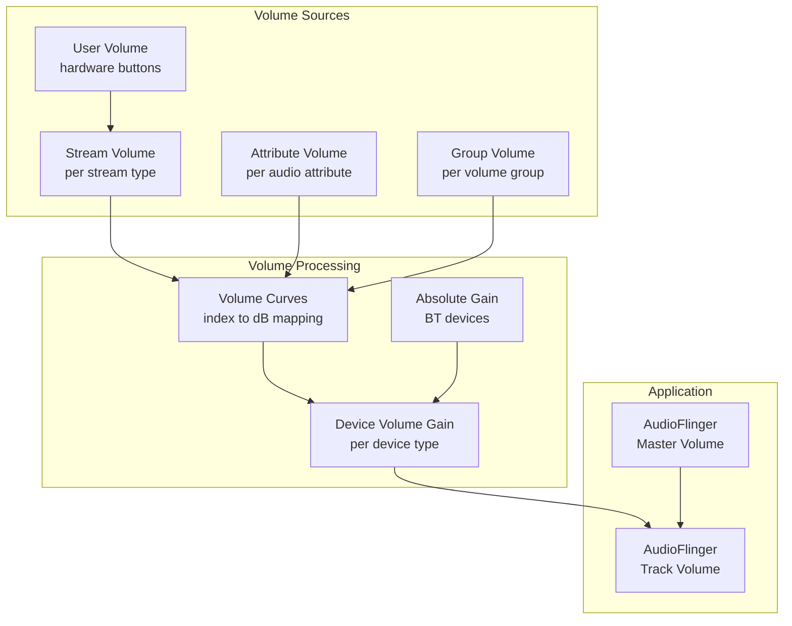

`AudioPolicyInterface` 在多个层级上定义音量控制：

```cpp
// AudioPolicyInterface.h, line 204-296
    virtual void initStreamVolume(audio_stream_type_t stream,
            int indexMin, int indexMax) = 0;
    virtual status_t setStreamVolumeIndex(
            audio_stream_type_t stream,
            int index, bool muted,
            audio_devices_t device) = 0;
    virtual status_t setVolumeIndexForAttributes(
            const audio_attributes_t &attr,
            int index, bool muted,
            audio_devices_t device) = 0;
    virtual status_t setVolumeIndexForGroup(
            volume_group_t groupId, uid_t uid, int index,
            bool muted, audio_devices_t device) = 0;
```

音量组允许应用定义超出传统流类型的自定义音量旋钮。每个组都有自己的最小/最大范围和音量曲线。这在汽车音频中特别有用，因为需要多个独立的音量控制（导航、娱乐、通话、通知）。

### 15.3.10 音频焦点与并发

Audio Policy Service 与 Java 的 `AudioService` 协作，强制执行音频焦点规则。当多个应用同时请求音频时：

| 场景 | 策略决策 |
|----------|----------------|
| Music + Navigation | Duck music volume |
| Music + Phone Call | Pause/duck music, route call |
| Game + Notification | Duck game audio briefly |
| Music + Alarm | Both play, alarm wins focus |
| Recording + Call | May deny recording |

`UidPolicy` 跟踪应用的前后台状态：

```cpp
// AudioPolicyService.cpp, line 305-306
    auto uidPolicy = sp<UidPolicy>::make(this);
    // ...
    uidPolicy->registerSelf();
```

后台应用的音频可能根据配置的策略被暂停或降低音量。

### 15.3.11 空间化器集成

AudioPolicyService 在初始化期间创建空间化器：

```cpp
// AudioPolicyService.cpp, line 317-334
if (mAudioPolicyManager != nullptr) {
    audio_utils::lock_guard _l(mMutex);
    const audio_attributes_t attr =
            attributes_initializer(AUDIO_USAGE_MEDIA);
    AudioDeviceTypeAddrVector devices;
    bool hasSpatializer =
            mAudioPolicyManager->canBeSpatialized(&attr, nullptr, devices);
    if (hasSpatializer) {
        mMutex.unlock();
        mSpatializer = Spatializer::create(this, effectsFactoryHal);
        mMutex.lock();
    }
}
```

注意仔细的锁管理：`Spatializer::create()` 会获取自己的锁，因此必须释放 AudioPolicyService 的互斥锁以避免死锁。

### 15.3.12 后台音频加固（Android 17 / API 37）

第 15.3.10 节中的前台/后台策略决定并发音频如何混音。Android 17 在 Java 的 `AudioService` 中增加了一个独立的门控。该门控可以直接拒绝后台应用的音频操作本身。面向 API 37（`Build.VERSION_CODES.CINNAMON_BUN = 37`）的应用在从后台请求音频焦点和更改音量方面受到限制。逻辑位于 `HardeningEnforcer`：

```
Source: frameworks/base/services/core/java/com/android/server/audio/HardeningEnforcer.java
        frameworks/base/services/core/java/com/android/server/audio/AudioService.java, line 12795
```

`AudioService.requestAudioFocus()` 调用 `mHardeningEnforcer.blockFocusMethod()`，当它返回 true 时，返回 `AudioManager.AUDIOFOCUS_REQUEST_FAILED`（值 0）而不是授予焦点。诸如 `setStreamVolume()` 之类的音量入口点以同样的方式经由 `blockVolumeMethod()` 路由。

该执行器不直接测试进程状态。它询问 AppOps 调用者是否可以执行该操作，后台限制被表示为这些 AppOps 对后台 uid 被拒绝：

- `OP_TAKE_AUDIO_FOCUS` 控制音频焦点请求
- `OP_CONTROL_AUDIO` 是严格（完整）的音频控制门控
- `OP_CONTROL_AUDIO_PARTIAL` 是部分音量控制门控

如果 AppOps 拒绝该操作，执行器计算出一个执行级别（`DENIED_IF_PARTIAL` 或 `DENIED_IF_FULL`），然后决定是否真正阻止，并叠加若干豁免：

```java
// HardeningEnforcer.blockFocusMethod(), frameworks/.../audio/HardeningEnforcer.java, line 425
boolean isPreCinnamonBun = targetSdk < Build.VERSION_CODES.CINNAMON_BUN;
// ...
} else if (isPreCinnamonBun) {
    yield new int[]{DENIED_IF_PARTIAL,
        AUDIO_HARDENING_REPORTED__EXEMPTION_REASON__HARDENING_EXEMPTION_TARGET_SDK};
```

面向低于 API 37 的应用被保持在 `DENIED_IF_PARTIAL`（豁免原因记录为 `HARDENING_EXEMPTION_TARGET_SDK`）。它只在部分加固下被阻止。面向 API 37 或更高版本且没有其他豁免的应用落入 `DENIED_IF_FULL` 并被阻止。其他豁免在 target-SDK 检查之前短路。这些调用者被允许或保持在部分级别。它们是特权调用者（持有诸如 `MODIFY_AUDIO_SETTINGS_PRIVILEGED` 之类的权限）、由 `SCHEDULE_EXACT_ALARM`/`USE_EXACT_ALARM` 支持的 `USAGE_ALARM` 焦点请求，以及持有 `BLUETOOTH_CONNECT` 的调用者。

两个层级的执行由 `com.android.media.audio` 中的标志控制：部分层级使用 `hardeningPartial()` / `hardeningPartialVolume()`，严格层级使用 `hardeningStrict()`。按调用覆盖（`HardeningOverride.ENABLE`/`DISABLE`，以及 `AudioManager.HARDENING_THROW`，它将阻止转换为 `IllegalStateException` 用于测试）可以强制任一方向的决策。每个决策都被写入 `AUDIO_HARDENING_REPORTED` 指标原子，附带其 API 类型、执行级别和豁免原因。这样，在启用严格层级之前就可以衡量推出情况。

### 15.3.13 专用助手音量流（Android 17）

Android 17 允许助手的语音音频独立于媒体音量进行控制。两个部分使之成为可能。音频属性 `USAGE_ASSISTANT`（`frameworks/base/media/java/android/media/AudioAttributes.java:216`）已经将播放标记为助手输出。Android 17 增加了一个专用音频模式 `MODE_ASSISTANT_CONVERSATION`。它从原生 `AudioSystem` 一路延伸到公开的 `AudioManager`：

```java
// frameworks/base/media/java/android/media/AudioSystem.java:236
public static final int MODE_ASSISTANT_CONVERSATION  = 7;

// frameworks/base/media/java/android/media/AudioManager.java:3869
public static final int MODE_ASSISTANT_CONVERSATION =
        AudioSystem.MODE_ASSISTANT_CONVERSATION;
```

当助手应用进入此模式时，策略引擎为其输出提供独立的音量曲线。用户（或连接的蓝牙耳机的音量键）随后可以在媒体保持安静的同时提高助手音量。用户还可以在静音助手的同时不静音媒体。这是第 15.3.12 节后台音频加固在音量端的补充。加固决定应用*是否*可以播放。助手模式决定一旦允许播放就应用*哪条音量曲线*。

Android 17 在捕获端的一项相关新增是 `android.permission.BYPASS_CONCURRENT_RECORD_AUDIO_RESTRICTION` 权限（`frameworks/base/core/res/AndroidManifest.xml:7511`）。它允许特权助手或无障碍组件与电话通话并发捕获音频。它还允许与其他否则会独占麦克风的敏感捕获会话并发捕获。

---

## 15.4 AAudio

AAudio 是 Android 现代的原生音频 API，于 Android 8.0（Oreo）中引入。它提供直接的 C API 以实现高性能音频，具有两种数据路径模式：MMAP（零拷贝）和 Legacy（经由 AudioTrack/AudioRecord 回退）。

源码位于：
```
frameworks/av/media/libaaudio/ (215 files)
```

组织为以下子目录：

| 目录 | 用途 |
|-----------|---------|
| `src/core/` | `AudioStream.cpp`、`AudioStreamBuilder.cpp` |
| `src/client/` | 客户端流的实现 |
| `src/fifo/` | 无锁 FIFO 缓冲区 |
| `src/flowgraph/` | 音频格式转换图 |
| `src/binding/` | Binder 消息类型 |
| `src/legacy/` | Legacy 回退路径 |
| `src/utility/` | 工具类 |

### 15.4.1 AudioStream 基类

所有 AAudio 流都派生自 `AudioStream`：

```cpp
// AudioStream.cpp, line 54-59
AudioStream::AudioStream()
        : mPlayerBase(new MyPlayerBase())
        , mStreamId(AAudio_getNextStreamId())
{
    setPeriodNanoseconds(0);
}
```

流 ID 是顺序的，从 1 开始：

```cpp
// AudioStream.cpp, line 49-52
static aaudio_stream_id_t AAudio_getNextStreamId() {
    static std::atomic <aaudio_stream_id_t> nextStreamId{1};
    return nextStreamId++;
}
```

`open()` 方法从打开请求中复制参数。注意，客户端构建器（`AudioStreamBuilder`）和服务端都汇聚到一个 `AAudioStreamOpenRequest`。因此，`AudioStream::open()` 接受该请求类型，而不是直接接受构建器。AAudioService 调用 `open()` 而从不调用 `build()`：

```cpp
// AudioStream.cpp, line 81-130
aaudio_result_t AudioStream::open(const AAudioStreamOpenRequest& openRequest)
{
    aaudio_result_t result = openRequest.validate();
    if (result != AAUDIO_OK) {
        return result;
    }

    mSamplesPerFrame = openRequest.getSamplesPerFrame();
    mChannelMask = openRequest.getChannelMask();
    mSampleRate = openRequest.getSampleRate();
    mDeviceIds = openRequest.getDeviceIds();
    mFormat = openRequest.getFormat();
    mSharingMode = openRequest.getSharingMode();
    mSharingModeMatchRequired = openRequest.isSharingModeMatchRequired();
    mPerformanceMode = openRequest.getPerformanceMode();

    mUsage = openRequest.getUsage();
    if (mUsage == AAUDIO_UNSPECIFIED) {
        mUsage = AAUDIO_USAGE_MEDIA;
    }
    mContentType = openRequest.getContentType();
    if (mContentType == AAUDIO_UNSPECIFIED) {
        mContentType = AAUDIO_CONTENT_TYPE_MUSIC;
    }
    // ... tags, spatialization, input preset, capture policy ...

    // callbacks
    mFramesPerDataCallback = openRequest.getFramesPerDataCallback();
    mDataCallbackProc = openRequest.getDataCallbackProc();
    // ...
}
```

### 15.4.2 流架构

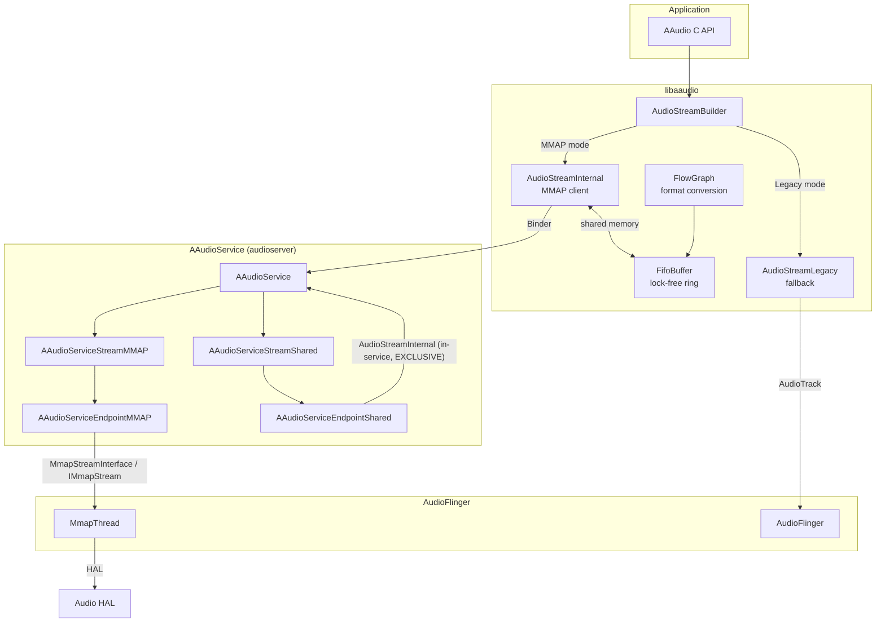

注意循环回到 `AAudioService` 的路径：`AAudioServiceEndpointShared` 本身并不与 AudioFlinger 通信。它把客户端流混音进一个单一的 `AudioStreamInternal`，并以 `AAUDIO_SHARING_MODE_EXCLUSIVE`
（`frameworks/av/services/oboeservice/AAudioServiceEndpointShared.cpp`）对它在服务端打开的流进行操作。结果，混音结果像任何独占流一样经由
`AAudioServiceEndpointMMAP` 到达 AudioFlinger 的 `MmapThread`。

### 15.4.3 MMAP 模式

MMAP 模式是低延迟路径。它把 HAL 的硬件缓冲区直接映射进客户端进程的地址空间，消除所有中间拷贝。数据路径完全绕过 AudioFlinger 的混音器。

关键特性：

- 延迟可低至 1-2ms
- 需要 HAL 支持（`AUDIO_OUTPUT_FLAG_MMAP_NOIRQ`）
- 在客户端与 HAL 之间使用共享内存
- 无软件混音——独占硬件访问

MMAP 路径流经：

1. `AudioStreamInternal`（客户端）
2. `AAudioService.openStream()`（Binder）
3. `AAudioServiceStreamMMAP`（服务端）
4. `AAudioServiceEndpointMMAP`（HAL 接口）
5. `MmapStreamInterface`（AudioFlinger）—— 在 Android 17 中，这是一个位于稳定的 AIDL `IMmapStream` binder 接口之上的轻量 C++
   适配器（第 15.11 节）

### 15.4.4 Legacy 回退

当 MMAP 不可用时（较旧的硬件、不支持共享模式），AAudio 回退到 legacy 路径：

1. `AudioStreamLegacy` 包装一个 `AudioTrack` 或 `AudioRecord`。
2. 数据经由正常的 AudioFlinger 混音路径流动。
3. 延迟更高（通常为 20-40ms）。

该回退对应用是透明的——无论底层路径如何，都使用相同的 AAudio API。

### 15.4.5 FIFO 缓冲区

无锁 FIFO 对 AAudio 的低延迟运行至关重要：

```cpp
// FifoBuffer.cpp, line 42-54
FifoBuffer::FifoBuffer(int32_t bytesPerFrame)
        : mBytesPerFrame(bytesPerFrame) {}

FifoBufferAllocated::FifoBufferAllocated(
        int32_t bytesPerFrame,
        fifo_frames_t capacityInFrames)
        : FifoBuffer(bytesPerFrame)
{
    mFifo = std::make_unique<FifoController>(
            capacityInFrames, capacityInFrames);
    int32_t bytesPerBuffer = bytesPerFrame * capacityInFrames;
    mInternalStorage = std::make_unique<uint8_t[]>(bytesPerBuffer);
}
```

`FifoControllerIndirect` 变体使用外部提供的读/写索引指针，从而支持共享内存 MMAP 路径：

```cpp
// FifoBuffer.cpp, line 56-69
FifoBufferIndirect::FifoBufferIndirect(
        int32_t bytesPerFrame,
        fifo_frames_t capacityInFrames,
        fifo_counter_t *readIndexAddress,
        fifo_counter_t *writeIndexAddress,
        void *dataStorageAddress)
        : FifoBuffer(bytesPerFrame)
        , mExternalStorage(static_cast<uint8_t *>(dataStorageAddress))
{
    mFifo = std::make_unique<FifoControllerIndirect>(
            capacityInFrames, capacityInFrames,
            readIndexAddress, writeIndexAddress);
}
```

包装缓冲区逻辑处理环形特性：

```cpp
// FifoBuffer.cpp, line 75-84
void FifoBuffer::fillWrappingBuffer(
        WrappingBuffer *wrappingBuffer,
        int32_t framesAvailable,
        int32_t startIndex) {
    wrappingBuffer->data[1] = nullptr;
    wrappingBuffer->numFrames[1] = 0;
    uint8_t *storage = getStorage();
    if (framesAvailable > 0) {
        fifo_frames_t capacity = mFifo->getCapacity();
        uint8_t *source = &storage[convertFramesToBytes(startIndex)];
```

### 15.4.6 FlowGraph —— 格式转换

flowgraph 模块执行采样格式转换和声道混音。它使用基于节点的图架构，带有专用转换器：

| 节点类 | 用途 |
|-----------|---------|
| `SourceFloat` | 从输入读取 float 采样 |
| `SourceI16` / `SourceI24` / `SourceI32` | 读取整数采样 |
| `SinkFloat` | 将 float 采样写入输出 |
| `SinkI16` / `SinkI24` / `SinkI32` | 写入整数采样 |
| `MonoToMultiConverter` | 把单声道上混为多声道 |
| `MultiToMonoConverter` | 下混为单声道 |
| `ChannelCountConverter` | 通用声道数转换 |
| `RampLinear` | 音量渐变 |
| `SampleRateConverter` | 重采样 |
| `ClipToRange` | 削波保护 |
| `Limiter` | 动态限制 |

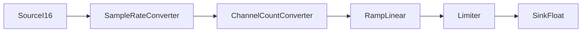

### 15.4.7 AAudio 流状态

AAudio 流遵循严格的状态机：

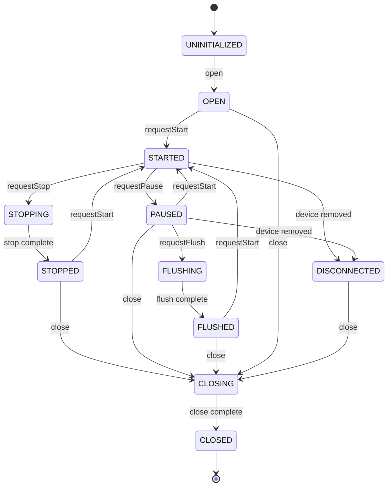

流销毁时有一个安全断言：

```cpp
// AudioStream.cpp, line 75-78
LOG_ALWAYS_FATAL_IF(
    !(getState() == AAUDIO_STREAM_STATE_CLOSED
      || getState() == AAUDIO_STREAM_STATE_UNINITIALIZED),
    "~AudioStream() - still in use, state = %s disconnected = %d",
    AudioGlobal_convertStreamStateToText(getState()),
    isDisconnected());
```

### 15.4.8 AudioStreamBuilder 模式

AAudio 使用 builder 模式创建流。构建器在创建流之前收集所有参数。关键方法：

```c
// Public C API
AAudio_createStreamBuilder(&builder);
AAudioStreamBuilder_setDeviceId(builder, deviceId);
AAudioStreamBuilder_setSampleRate(builder, 48000);
AAudioStreamBuilder_setChannelCount(builder, 2);
AAudioStreamBuilder_setFormat(builder, AAUDIO_FORMAT_PCM_FLOAT);
AAudioStreamBuilder_setBufferCapacityInFrames(builder, 480);
AAudioStreamBuilder_setPerformanceMode(builder,
        AAUDIO_PERFORMANCE_MODE_LOW_LATENCY);
AAudioStreamBuilder_setSharingMode(builder,
        AAUDIO_SHARING_MODE_EXCLUSIVE);
AAudioStreamBuilder_setDataCallback(builder, callback, userData);
AAudioStreamBuilder_setErrorCallback(builder, errorCb, userData);
AAudioStreamBuilder_openStream(builder, &stream);
AAudioStreamBuilder_delete(builder);
```

构建器验证确保在尝试打开流之前所有参数一致。`open()` 方法从 `AAudioStreamOpenRequest` 中复制已验证的参数：

```cpp
// AudioStream.cpp, line 81-130
aaudio_result_t AudioStream::open(const AAudioStreamOpenRequest& openRequest)
{
    aaudio_result_t result = openRequest.validate();
    if (result != AAUDIO_OK) {
        return result;
    }
    // Copy parameters from the Builder because the Builder may
    // be deleted after this call.
    mSamplesPerFrame = openRequest.getSamplesPerFrame();
    mChannelMask = openRequest.getChannelMask();
    mSampleRate = openRequest.getSampleRate();
    mDeviceIds = openRequest.getDeviceIds();
    mFormat = openRequest.getFormat();
    mSharingMode = openRequest.getSharingMode();
    // ...
    mUsage = openRequest.getUsage();
    if (mUsage == AAUDIO_UNSPECIFIED) {
        mUsage = AAUDIO_USAGE_MEDIA;
    }
    mContentType = openRequest.getContentType();
    if (mContentType == AAUDIO_UNSPECIFIED) {
        mContentType = AAUDIO_CONTENT_TYPE_MUSIC;
    }
    // ...
    mSpatializationBehavior =
            openRequest.getSpatializationBehavior();
    if (mSpatializationBehavior == AAUDIO_UNSPECIFIED) {
        mSpatializationBehavior =
                AAUDIO_SPATIALIZATION_BEHAVIOR_AUTO;
    }
    mIsContentSpatialized = openRequest.isContentSpatialized();
    mInputPreset = openRequest.getInputPreset();
    if (mInputPreset == AAUDIO_UNSPECIFIED) {
        mInputPreset = AAUDIO_INPUT_PRESET_VOICE_RECOGNITION;
    }
    // ...
}
```

注意默认值：`AAUDIO_USAGE_MEDIA`、`AAUDIO_CONTENT_TYPE_MUSIC`、`AAUDIO_SPATIALIZATION_BEHAVIOR_AUTO`、`AAUDIO_INPUT_PRESET_VOICE_RECOGNITION`。即使应用没有显式设置所有参数，这些默认值也能确保合理的行为。

### 15.4.9 AAudio 回调模式

AAudio 支持两种数据交付回调模式：

**标准回调** —— 精确地以 `framesPerDataCallback` 帧被调用：

```cpp
// AudioStream.cpp, line 126-132
    mFramesPerDataCallback = openRequest.getFramesPerDataCallback();
    mDataCallbackProc = openRequest.getDataCallbackProc();
    mPartialDataCallbackProc = openRequest.getPartialDataCallbackProc();
    if (mPartialDataCallbackProc != nullptr) {
        mDataCallbackWrapper =
                &AudioStream::partialDataCallbackInternal;
    } else if (mDataCallbackProc != nullptr) {
        mDataCallbackWrapper =
                &AudioStream::dataCallbackInternal;
    }
```

**部分回调** —— 可能以少于请求的帧数被调用。该模式是为音频系统需要以不同于应用预期的方式切分缓冲区边界的场景添加的。它提高了与各种 HAL 实现的兼容性。

### 15.4.10 IsochronousClockModel

`src/client/IsochronousClockModel.cpp` 中的 `IsochronousClockModel` 通过建模硬件时钟来提供准确的时间戳估计：

```
frameworks/av/media/libaaudio/src/client/IsochronousClockModel.cpp
```

它跟踪帧位置与时间之间的关系，并对以下各项进行补偿：

- 应用 CPU 与音频硬件之间的时钟漂移
- 回调交付中的抖动
- 流启动或重新配置时的相位不连续

### 15.4.11 指标与日志

AAudio 在流打开时记录详细指标：

```cpp
// AudioStream.cpp, line 149-165
void AudioStream::logOpenActual() {
    if (mMetricsId.size() > 0) {
        android::mediametrics::LogItem item(mMetricsId);
        item.set(AMEDIAMETRICS_PROP_EVENT,
                 AMEDIAMETRICS_PROP_EVENT_VALUE_OPEN)
            .set(AMEDIAMETRICS_PROP_PERFORMANCEMODEACTUAL,
                 AudioGlobal_convertPerformanceModeToText(
                         getPerformanceMode()))
            .set(AMEDIAMETRICS_PROP_SHARINGMODEACTUAL,
                 AudioGlobal_convertSharingModeToText(
                         getSharingMode()))
            .set(AMEDIAMETRICS_PROP_BUFFERCAPACITYFRAMES,
                 getBufferCapacity())
            .set(AMEDIAMETRICS_PROP_BURSTFRAMES,
                 getFramesPerBurst())
            // ...
```

---

## 15.5 Oboe 服务（AAudioService）

AAudioService 运行在 `audioserver` 进程内，管理服务端 AAudio 流。它分布在大约 40 个文件中定义：

```
frameworks/av/services/oboeservice/ (43 files)
```

### 15.5.1 服务架构

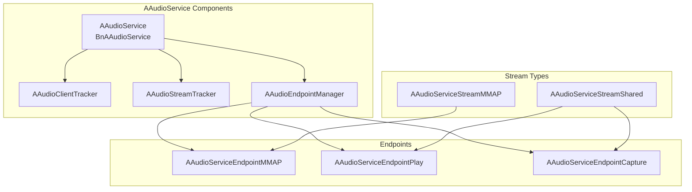

### 15.5.2 流打开

`openStream()` 方法（`AAudioService.cpp` 第 101-170 行）处理 MMAP 和共享流的创建：

```cpp
// AAudioService.cpp, line 101-145
Status AAudioService::openStream(
        const StreamRequest &_request,
        StreamParameters* _paramsOut,
        int32_t *_aidl_return)
{
    // ...
    const aaudio_performance_mode_t performanceMode =
            configurationInput.getPerformanceMode();
    if (performanceMode != AAUDIO_PERFORMANCE_MODE_LOW_LATENCY &&
        performanceMode != AAUDIO_PERFORMANCE_MODE_POWER_SAVING_OFFLOADED) {
        ALOGE("%s denied performance mode as %d for mmap path",
              __func__, performanceMode);
        AIDL_RETURN(AAUDIO_ERROR_ILLEGAL_ARGUMENT);
    }
```

MMAP offload 模式有更严格的要求：

```cpp
// AAudioService.cpp, line 147-151
if (performanceMode ==
        AAUDIO_PERFORMANCE_MODE_POWER_SAVING_OFFLOADED &&
        (sharingMode != AAUDIO_SHARING_MODE_EXCLUSIVE ||
         !sharingModeMatchRequired)) {
    ALOGE("%s mmap offload must be exclusive", __func__);
    AIDL_RETURN(AAUDIO_ERROR_ILLEGAL_ARGUMENT);
}
```

每个进程有一个流上限：

```cpp
// AAudioService.cpp, line 46
#define MAX_STREAMS_PER_PROCESS   8
```

```cpp
// AAudioService.cpp, line 162-168
const int32_t count =
        AAudioClientTracker::getInstance().getStreamCount(pid);
if (count >= MAX_STREAMS_PER_PROCESS) {
    ALOGE("openStream(): exceeded max streams per process %d >= %d",
          count,  MAX_STREAMS_PER_PROCESS);
    AIDL_RETURN(AAUDIO_ERROR_UNAVAILABLE);
}
```

### 15.5.3 MMAP 端点

`AAudioServiceEndpointMMAP` 管理硬件 MMAP 缓冲区：

```cpp
// AAudioServiceEndpointMMAP.cpp, line 42-48
#define AAUDIO_BUFFER_CAPACITY_MIN    (4 * 512)
#define AAUDIO_SAMPLE_RATE_DEFAULT    48000

// Estimated hardware timing offsets
#define OUTPUT_ESTIMATED_HARDWARE_OFFSET_NANOS \
        (3 * AAUDIO_NANOS_PER_MILLISECOND)
#define INPUT_ESTIMATED_HARDWARE_OFFSET_NANOS \
        (-1 * AAUDIO_NANOS_PER_MILLISECOND)
```

端点尝试以请求的格式打开，并按优先级列表回退：

```cpp
// AAudioServiceEndpointMMAP.cpp, line 78-88
const static std::map<audio_format_t, audio_format_t>
        NEXT_FORMAT_TO_TRY = {
    {AUDIO_FORMAT_PCM_FLOAT,         AUDIO_FORMAT_PCM_32_BIT},
    {AUDIO_FORMAT_PCM_32_BIT,        AUDIO_FORMAT_PCM_24_BIT_PACKED},
    {AUDIO_FORMAT_PCM_24_BIT_PACKED, AUDIO_FORMAT_PCM_8_24_BIT},
    {AUDIO_FORMAT_PCM_8_24_BIT,      AUDIO_FORMAT_PCM_16_BIT}
};
```

打开过程以不同配置尝试最多 10 次：

```cpp
// AAudioServiceEndpointMMAP.cpp, line 50
#define AAUDIO_MAX_OPEN_ATTEMPTS    10
```

```cpp
// AAudioServiceEndpointMMAP.cpp, line 133
while (numberOfAttempts < AAUDIO_MAX_OPEN_ATTEMPTS) {
    if (configsTried.find(config) != configsTried.end()) {
        break;
    }
    configsTried.insert(config);
    audio_config_base_t previousConfig = config;
    result = openWithConfig(&config);
    if (result != AAUDIO_ERROR_UNAVAILABLE) {
        break;
    }
    // Try other formats
    if ((previousConfig.format == config.format) &&
            (previousConfig.sample_rate == config.sample_rate)) {
        config.format = getNextFormatToTry(config.format);
    }
    numberOfAttempts++;
}
```

### 15.5.4 端点抢占

当请求第二个独占 MMAP 流时，第一个流的端点被“抢占”——它从独占转换为共享。`openStream()` 方法使用 `mOpenLock` 来序列化这一过程：

```cpp
// AAudioService.cpp, line 134
std::unique_lock ul(mOpenLock);
```

注释解释了顺序要求：
```
// 1) Thread A opens exclusive MMAP endpoint
// 2) Thread B wants exclusive, steals from A under this lock
// 3) Thread B opens shared MMAP endpoint
// 4) Thread A gets lock and also opens shared stream
```

### 15.5.5 MMAP 端点 —— openWithConfig 详解

`openWithConfig()` 方法揭示了完整的 MMAP 流打开序列：

```cpp
// AAudioServiceEndpointMMAP.cpp, line 171-249
aaudio_result_t AAudioServiceEndpointMMAP::openWithConfig(
        audio_config_base_t* config) {
    aaudio_result_t result = AAUDIO_OK;
    audio_config_base_t currentConfig = *config;
    android::DeviceIdVector deviceIds;

    const audio_attributes_t attributes =
            getAudioAttributesFrom(this);

    if (mRequestedDeviceId != AAUDIO_UNSPECIFIED) {
        deviceIds.push_back(mRequestedDeviceId);
    }

    const aaudio_direction_t direction = getDirection();

    if (direction == AAUDIO_DIRECTION_OUTPUT) {
        mHardwareTimeOffsetNanos =
                OUTPUT_ESTIMATED_HARDWARE_OFFSET_NANOS;
    } else if (direction == AAUDIO_DIRECTION_INPUT) {
        mHardwareTimeOffsetNanos =
                INPUT_ESTIMATED_HARDWARE_OFFSET_NANOS;
    }
```

硬件时序偏移补偿了 MMAP 时间戳与实际硬件 DAC/ADC 操作之间的延迟：

- 输出：+3ms（音频比时间戳晚到达 DAC）
- 输入：-1ms（音频比时间戳早到达 ADC）

对于 offload MMAP，还会准备额外的 offload 信息：

```cpp
// AAudioServiceEndpointMMAP.cpp, line 207-216
    audio_offload_info_t* info = nullptr;
    audio_offload_info_t offloadInfo = AUDIO_INFO_INITIALIZER;
    if (getPerformanceMode() ==
            AAUDIO_PERFORMANCE_MODE_POWER_SAVING_OFFLOADED) {
        offloadInfo.format = config->format;
        offloadInfo.sample_rate = config->sample_rate;
        offloadInfo.channel_mask = config->channel_mask;
        offloadInfo.stream_type = AUDIO_STREAM_MUSIC;
        offloadInfo.has_video = false;
        info = &offloadInfo;
    }
```

实际的 HAL 打开使用 `MmapStreamInterface::openMmapStream()`：

```cpp
// AAudioServiceEndpointMMAP.cpp, line 214-226
    const std::lock_guard<std::mutex> lock(mMmapStreamLock);
    const status_t status = MmapStreamInterface::openMmapStream(
            isOutput,
            attributes,
            config,
            mMmapClient,
            &deviceIds,
            &sessionId,
            this, // callback
            info,
            mMmapStream,
            &mPortHandle);
```

在 Android 17 中，`mMmapStream` 是一个 `sp<MmapStreamInterface>`，它包装稳定的 AIDL `IMmapStream` binder 代理，而不是指向 AudioFlinger 的原始 C++ 指针。参见
`frameworks/av/services/oboeservice/AAudioServiceEndpointMMAP.h` 第 144 行，
该成员在那里被声明为 `GUARDED_BY(mMmapStreamLock)`。此后每个控制调用——`createTrack()`、`startTrack()`、`stopTrack()`、
`releaseTrack()`、`standby()`——都跨该 binder 边界转发。
第 15.11 节详细介绍了这个新接口。

### 15.5.6 共享端点

对于共享模式，`AAudioServiceEndpointShared` 子类管理混音：

- `AAudioServiceEndpointPlay` —— 混音多个客户端流用于播放
- `AAudioServiceEndpointCapture` —— 将捕获数据分发到多个客户端

`AAudioMixer` 类处理混音，以 float 精度在采样级别工作。

### 15.5.7 客户端跟踪

`AAudioClientTracker` 监控客户端进程及其流。当客户端进程死亡时（Binder death 通知），其所有流都会被自动关闭，防止资源泄漏。

### 15.5.8 共享环形缓冲区

`SharedRingBuffer` 提供服务端与客户端之间的共享内存传输：

```
frameworks/av/services/oboeservice/SharedRingBuffer.cpp
```

它用共享内存分配包装一个 `FifoBuffer`，为 AAudio 的数据传输提供零拷贝路径。

---

## 15.6 音频效果

Android 提供了全面的音频效果框架，既有内置效果，也有厂商提供的效果。源码涵盖：

```
frameworks/av/media/libeffects/ (314 files)
```

### 15.6.1 效果框架架构

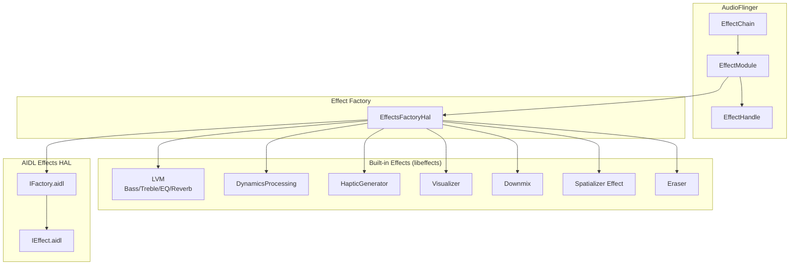

### 15.6.2 EffectBase —— 效果状态机

每个效果模块都派生自 `EffectBase`，它管理一个状态机：

```cpp
// Effects.cpp, line 103-112
EffectBase::EffectBase(
        const sp<EffectCallbackInterface>& callback,
        effect_descriptor_t *desc,
        int id,
        audio_session_t sessionId,
        bool pinned)
    : mPinned(pinned),
      mCallback(callback), mId(id), mSessionId(sessionId),
      mDescriptor(*desc)
{
}
```

状态转换：

```cpp
// Effects.cpp, line 115-150
status_t EffectBase::setEnabled_l(bool enabled)
{
    if (enabled != isEnabled()) {
        switch (mState) {
        // going from disabled to enabled
        case IDLE:
            mState = STARTING;
            break;
        case STOPPED:
            mState = RESTART;
            break;
        case STOPPING:
            mState = ACTIVE;
            break;
        // going from enabled to disabled
        case RESTART:
            mState = STOPPED;
            break;
        case STARTING:
            mState = IDLE;
            break;
        case ACTIVE:
            mState = STOPPING;
            break;
        case DESTROYED:
            return NO_ERROR;
        }
```

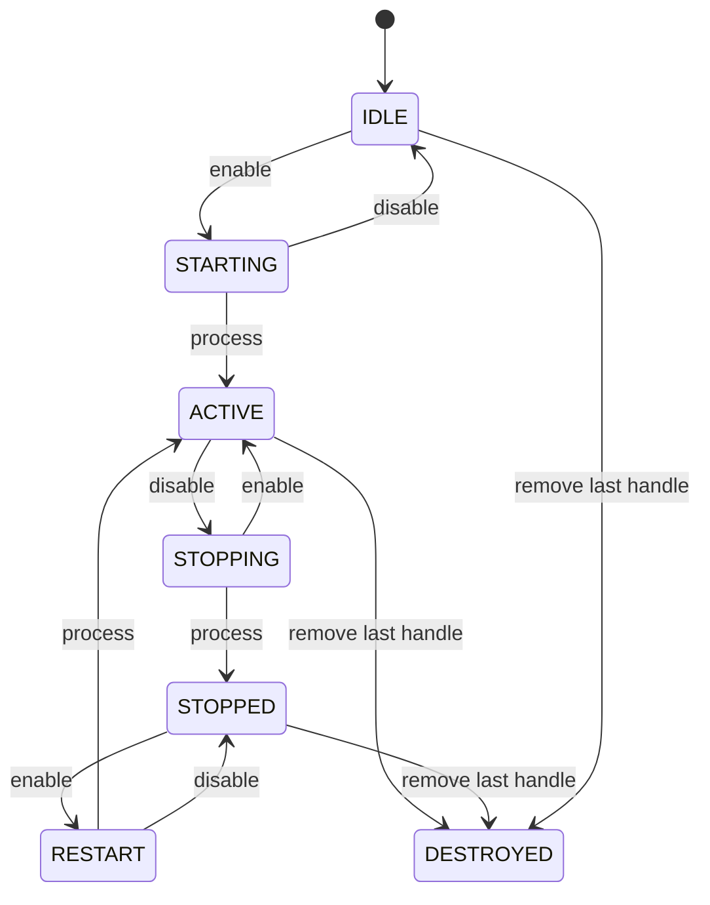

### 15.6.3 效果句柄与优先级

效果支持多个句柄，并以基于优先级的控制方式运作。第一个未销毁的句柄是“控制”句柄：

```cpp
// Effects.cpp, line 205-241
status_t EffectBase::addHandle(IAfEffectHandle *handle)
{
    status_t status;

    audio_utils::lock_guard _l(mutex());
    int priority = handle->priority();
    size_t size = mHandles.size();
    IAfEffectHandle *controlHandle = nullptr;
    size_t i;
    for (i = 0; i < size; i++) {
        IAfEffectHandle *h = mHandles[i];
        if (h == NULL || h->disconnected()) {
            continue;
        }
        if (controlHandle == NULL) {
            controlHandle = h;
        }
        if (h->priority() <= priority) {
            break;
        }
    }
    if (i == 0) {
        // inserted in first place, take control
        bool enabled = false;
        if (controlHandle != NULL) {
            enabled = controlHandle->enabled();
            controlHandle->setControl(false, true, enabled);
        }
        handle->setControl(true, false, enabled);
        status = NO_ERROR;
    } else {
        status = ALREADY_EXISTS;
    }
    // ... ALOGV trace elided
    mHandles.insert(mHandles.begin() + i, handle);
    return status;
}
```

句柄无论哪种情况都插入到位置 `i`——返回状态才是区别所在。只有落在首位的句柄才取得控制权并返回 `NO_ERROR`。优先级较低的句柄仍然会被注册，但报告 `ALREADY_EXISTS`。这告诉调用者另一个句柄已经拥有该效果的控制权。

### 15.6.4 策略注册

效果向 Audio Policy Manager 注册：

```cpp
// Effects.cpp, line 244-310
status_t EffectBase::updatePolicyState()
{
    // ...
    if (doRegister) {
        if (registered) {
            status = AudioSystem::registerEffect(
                &mDescriptor, io, strategy, mSessionId, mId);
        } else {
            status = AudioSystem::unregisterEffect(mId);
        }
    }
    if (registered && doEnable) {
        status = AudioSystem::setEffectEnabled(mId, enabled);
    }
}
```

### 15.6.5 LVM（LifeVibes 模块）

LVM 是 NXP 的 “LifeVibes” 音频模块库。其 Music bundle 在一个库中提供四个效果：

```
frameworks/av/media/libeffects/lvm/
```

| 效果 | 描述 |
|--------|-------------|
| BassBoost | 低频增强 |
| Equalizer | 5 段参数均衡器 |
| Virtualizer | 立体声扩展 |
| Volume | 主音量/增益控制 |

Reverb（PresetReverb 和 EnvironmentalReverb）是一个单独的 LVM 库，由
`frameworks/av/media/libeffects/lvm/wrapper/Reverb/` 构建为
`libreverbwrapper` / `libreverbaidl`，不属于该 bundle。

该 bundle 的 AIDL 包装器位于：
```
frameworks/av/media/libeffects/lvm/wrapper/Aidl/
  - BundleContext.cpp
  - EffectBundleAidl.cpp
```

### 15.6.6 DynamicsProcessing

动力学处理效果提供逐声道的多段压缩：

```
frameworks/av/media/libeffects/dynamicsproc/
  - dsp/DPBase.cpp
  - dsp/DPFrequency.cpp
```

它支持：

- Pre-EQ（逐声道）
- 多段压缩（逐声道、逐频段）
- Post-EQ（逐声道）
- Limiter（逐声道）

### 15.6.7 触觉生成器

触觉生成器把音频信号转换为触觉反馈：

```
frameworks/av/media/libeffects/hapticgenerator/
  - Processors.cpp
  - EffectHapticGenerator.cpp
  - aidl/HapticGeneratorContext.cpp
  - aidl/EffectHapticGenerator.cpp
```

AudioFlinger 在线程级别集成触觉生成：

```cpp
// Threads.cpp, line 4308-4325
if (mHapticChannelCount > 0) {
    for (const auto& track : mActivePlaybackTracksView) {
        sp<IAfEffectChain> effectChain =
                getEffectChain_l(track->sessionId());
        if (effectChain != nullptr
                && effectChain->containsHapticGeneratingEffect_l()) {
            activeHapticSessionId = track->sessionId();
            isHapticSessionSpatialized =
                    mType == SPATIALIZER && track->isSpatialized();
            break;
        }
    }
}
```

FastMixer 也处理触觉参数：

```cpp
// FastMixer.cpp, line 180-185
mMixer->setParameter(index, AudioMixer::TRACK,
        AudioMixer::HAPTIC_ENABLED,
        (void *)(uintptr_t)fastTrack->mHapticPlaybackEnabled);
mMixer->setParameter(index, AudioMixer::TRACK,
        AudioMixer::HAPTIC_SCALE,
        (void *)(&(fastTrack->mHapticScale)));
mMixer->setParameter(index, AudioMixer::TRACK,
        AudioMixer::HAPTIC_MAX_AMPLITUDE,
        (void *)(&(fastTrack->mHapticMaxAmplitude)));
```

### 15.6.8 Visualizer

Visualizer 效果捕获音频波形和 FFT 数据用于可视化：

```
frameworks/av/media/libeffects/visualizer/
  - EffectVisualizer.cpp
  - aidl/
```

它是 AudioFlinger 在效果匹配期间检查的效果之一：

```cpp
// AudioFlinger.cpp, line 61
#include <system/audio_effects/effect_visualizer.h>
```

### 15.6.9 AIDL 效果接口

现代 Android 使用 AIDL 作为效果 HAL 接口：

```
hardware/interfaces/audio/aidl/ (326 AIDL files total)
```

关键效果 AIDL 接口：

| 文件 | 用途 |
|------|---------|
| `IFactory.aidl` | 用于创建和枚举的效果工厂 |
| `IEffect.aidl` | 单个效果实例的控制 |
| `Parameter.aidl` | 效果参数的读取/设置 |
| `Descriptor.aidl` | 效果类型与能力描述 |
| `State.aidl` | 效果状态机 |
| `Capability.aidl` | 效果能力声明 |

在 AIDL 中定义的效果类型：

| AIDL 文件 | 效果类型 |
|-----------|------------|
| `AcousticEchoCanceler.aidl` | 语音通话的 AEC |
| `NoiseSuppression.aidl` | 语音通话的 NS |
| `AutomaticGainControlV1.aidl` | AGC v1 |
| `AutomaticGainControlV2.aidl` | AGC v2 |
| `BassBoost.aidl` | 低频增强 |
| `Equalizer.aidl` | 参数均衡器 |
| `Virtualizer.aidl` | 立体声扩展 |
| `LoudnessEnhancer.aidl` | 响度增强 |
| `PresetReverb.aidl` | 预设混响环境 |
| `EnvironmentalReverb.aidl` | 可配置混响 |
| `DynamicsProcessing.aidl` | 多段压缩 |
| `HapticGenerator.aidl` | 音频到触觉转换 |
| `Visualizer.aidl` | 波形/FFT 捕获 |
| `Spatializer.aidl` | 空间音频渲染 |
| `Downmix.aidl` | 声道下混 |
| `Volume.aidl` | 音量控制 |
| `Eraser.aidl` | 音频源擦除 |

### 15.6.10 Eraser 效果

Eraser 效果是效果库中较新的新增：

```
frameworks/av/media/libeffects/eraser/
```

它从混音后的流中移除特定音频源——例如，从音乐中移除人声。AIDL 接口定义于：

```
hardware/interfaces/audio/aidl/aidl_api/android.hardware.audio.effect/current/
    android/hardware/audio/effect/Eraser.aidl
```

### 15.6.11 Downmix 效果

Downmix 效果把多声道音频转换为立体声：

```
frameworks/av/media/libeffects/downmix/
```

当没有可用的空间化效果时，SpatializerThread 会自动使用它。当多声道内容需要在立体声输出上播放时，框架使用它。下混算法遵循标准的 ITU-R BS.775 声道折叠建议。

### 15.6.12 效果工厂与发现

效果工厂 HAL 提供效果发现和实例化：

```cpp
// Effects.cpp, line 22-48 (includes)
#include <media/audiohal/EffectHalInterface.h>
#include <media/audiohal/EffectsFactoryHalInterface.h>
```

AudioFlinger 在启动时查询工厂，以构建可用效果的目录。每个效果由以下项标识：

- **Type UUID** —— 效果的类别（例如均衡器、混响）
- **Implementation UUID** —— 具体的实现
- **API version** —— 兼容级别

在调用 `createEffect()` 时，效果描述符会被匹配：

```cpp
// AudioFlinger.h, line 167-171
    status_t getEffectDescriptor(
            const effect_uuid_t* pUuid,
            const effect_uuid_t* pTypeUuid,
            uint32_t preferredTypeFlag,
            effect_descriptor_t* descriptor) const final;
```

### 15.6.13 设备效果

设备效果应用于音频端口设备，而不是基于会话的效果链。`DeviceEffectManager` 处理这些效果：

```cpp
// AudioFlinger.cpp, line 338-339
    mDeviceEffectManager = sp<DeviceEffectManager>::make(
            sp<IAfDeviceEffectManagerCallback>::fromExisting(this)),
```

设备效果通过 HAL 添加/移除：

```cpp
// AudioFlinger.cpp, line 660-682
status_t AudioFlinger::addEffectToHal(
        const struct audio_port_config *device,
        const sp<EffectHalInterface>& effect) {
    audio_utils::lock_guard lock(hardwareMutex());
    if (auto it = mAudioHwDevs.find(
            device->ext.device.hw_module);
            it != mAudioHwDevs.end()) {
        const AudioHwDevice* const audioHwDevice = it->second;
        return audioHwDevice->hwDevice()->addDeviceEffect(
                device, effect);
    }
    return NO_INIT;
}

status_t AudioFlinger::removeEffectFromHal(
        const struct audio_port_config *device,
        const sp<EffectHalInterface>& effect) {
    audio_utils::lock_guard lock(hardwareMutex());
    if (auto it = mAudioHwDevs.find(
            device->ext.device.hw_module);
            it != mAudioHwDevs.end()) {
        return it->second->hwDevice()->removeDeviceEffect(
                device, effect);
    }
    return NO_INIT;
}
```

### 15.6.14 效果链处理

在混音线程循环中，效果在混音之后、写入 HAL 之前被处理：

```cpp
// Threads.cpp, line 4368-4395
uint32_t mixerChannelCount = mEffectBufferValid ?
    audio_channel_count_from_out_mask(mMixerChannelMask)
    : mChannelCount;
if (mMixerBufferValid &&
        (mEffectBufferValid || !mHasDataCopiedToSinkBuffer)) {
    void *buffer = mEffectBufferValid ?
            mEffectBuffer : mSinkBuffer;
    audio_format_t format = mEffectBufferValid ?
            mEffectBufferFormat : mFormat;

    if (!mEffectBufferValid) {
        if (requireMonoBlend()) {
            mono_blend(mMixerBuffer, mMixerBufferFormat,
                    mChannelCount, mNormalFrameCount, true);
        }
        if (!hasFastMixer()) {
            mBalance.setBalance(mMasterBalance.load());
            mBalance.process(
                    (float *)mMixerBuffer, mNormalFrameCount);
        }
    }
    memcpy_by_audio_format(buffer, format,
            mMixerBuffer, mMixerBufferFormat,
            mNormalFrameCount *
            (mixerChannelCount + mHapticChannelCount));
}
```

数据流取决于是否使用了效果缓冲区。当 `mEffectBuffer` 有效时，`mMixerBuffer` 首先被拷贝到 `mEffectBuffer`。然后处理效果。单声道混合和平衡随后在通往 `mSinkBuffer` 的路上应用。当没有效果缓冲区时，单声道混合和平衡直接应用于 `mMixerBuffer`。结果直接拷贝到 `mSinkBuffer`，后者供给 HAL。

---

## 15.7 空间音频与头部跟踪

Android 的空间音频系统通过带头部跟踪的多声道渲染，创造沉浸式 3D 音频体验。实现跨越多个组件：

| 组件 | 文件 |
|-----------|------|
| Head Tracking Processor | `frameworks/av/media/libheadtracking/HeadTrackingProcessor.cpp` |
| Sensor Pose Provider | `frameworks/av/media/libheadtracking/SensorPoseProvider.cpp` |
| Spatializer (C++) | `frameworks/av/services/audiopolicy/service/Spatializer.cpp` |
| Spatializer (Java) | `frameworks/base/media/java/android/media/Spatializer.java` |
| SpatializerHelper (Java) | `frameworks/base/services/core/java/com/android/server/audio/SpatializerHelper.java` |

### 15.7.1 系统架构

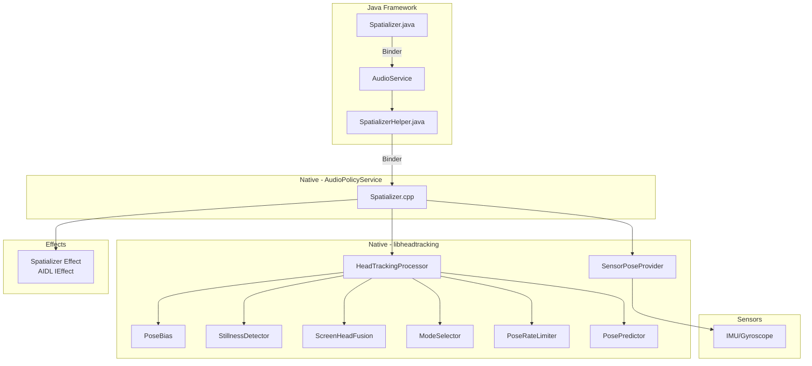

### 15.7.2 Head Tracking Processor

`HeadTrackingProcessor` 是核心位姿计算引擎：

```cpp
// HeadTrackingProcessor.cpp, line 37-57
class HeadTrackingProcessorImpl : public HeadTrackingProcessor {
  public:
    HeadTrackingProcessorImpl(
            const Options& options,
            HeadTrackingMode initialMode)
        : mOptions(options),
          mHeadStillnessDetector(StillnessDetector::Options{
                  .defaultValue = false,
                  .windowDuration = options.autoRecenterWindowDuration,
                  .translationalThreshold =
                          options.autoRecenterTranslationalThreshold,
                  .rotationalThreshold =
                          options.autoRecenterRotationalThreshold,
          }),
          mScreenStillnessDetector(StillnessDetector::Options{
                  .defaultValue = true,
                  .windowDuration = options.screenStillnessWindowDuration,
                  .translationalThreshold =
                          options.screenStillnessTranslationalThreshold,
                  .rotationalThreshold =
                          options.screenStillnessRotationalThreshold,
          }),
          mModeSelector(ModeSelector::Options{
                  .freshnessTimeout = options.freshnessTimeout},
                  initialMode),
          mRateLimiter(PoseRateLimiter::Options{
                  .maxTranslationalVelocity =
                          options.maxTranslationalVelocity,
                  .maxRotationalVelocity =
                          options.maxRotationalVelocity})
    {}
```

该处理器组合多个子组件：

- **StillnessDetector**（2 个实例）—— 检测头部或屏幕何时足够稳定以触发自动重新居中。
- **PoseBias**（2 个实例）—— 维护用于重新居中的参考位姿。
- **ScreenHeadFusion** —— 融合屏幕与头部跟踪数据。
- **ModeSelector** —— 在跟踪模式之间选择。
- **PoseRateLimiter** —— 平滑模式变化后的不连续。
- **PosePredictor** —— 预测未来头部位置以降低延迟。

### 15.7.3 头部跟踪模式

支持三种模式：

```cpp
// HeadTrackingProcessor.cpp, line 228-237
std::string toString(HeadTrackingMode mode) {
    switch (mode) {
        case HeadTrackingMode::STATIC:
            return "STATIC";
        case HeadTrackingMode::WORLD_RELATIVE:
            return "WORLD_RELATIVE";
        case HeadTrackingMode::SCREEN_RELATIVE:
            return "SCREEN_RELATIVE";
    }
}
```

| 模式 | 描述 |
|------|-------------|
| STATIC | 无头部跟踪，固定的虚拟扬声器位置 |
| WORLD_RELATIVE | 声源在现实世界中固定 |
| SCREEN_RELATIVE | 声源随屏幕移动 |

### 15.7.4 位姿预测

有四种预测类型可用：

```cpp
// HeadTrackingProcessor.cpp, line 240-248
std::string toString(PosePredictorType posePredictorType) {
    switch (posePredictorType) {
        case PosePredictorType::AUTO: return "AUTO";
        case PosePredictorType::LAST: return "LAST";
        case PosePredictorType::TWIST: return "TWIST";
        case PosePredictorType::LEAST_SQUARES: return "LEAST_SQUARES";
    }
}
```

预测器补偿传感器读取与音频渲染之间的延迟：

```cpp
// HeadTrackingProcessor.cpp, line 63-64
const Pose3f predictedWorldToHead = mPosePredictor.predict(
        timestamp, worldToHead, headTwist,
        mOptions.predictionDuration);
```

### 15.7.5 自动重新居中

当头部或屏幕静止时，处理器会自动重新居中：

```cpp
// HeadTrackingProcessor.cpp, line 91-118
void calculate(int64_t timestamp) override {
    bool screenStable = true;

    if (mWorldToScreenTimestamp.has_value()) {
        const Pose3f worldToLogicalScreen =
                mScreenPoseBias.getOutput();
        screenStable =
                mScreenStillnessDetector.calculate(timestamp);
        mModeSelector.setScreenStable(
                mWorldToScreenTimestamp.value(), screenStable);
        if (!screenStable) {
            recenter(true, false, "calculate: screen movement");
        }
    }

    if (mWorldToHeadTimestamp.has_value()) {
        Pose3f worldToHead = mHeadPoseBias.getOutput();
        bool headStable =
                mHeadStillnessDetector.calculate(timestamp);
        if (headStable || !screenStable) {
            recenter(true, false, "calculate: head movement");
            worldToHead = mHeadPoseBias.getOutput();
        }
    }
```

屏幕移动会触发头部重新居中，因为参考坐标系已经改变。头部静止会触发重新居中，以把虚拟扬声器位置带回听者正前方。

### 15.7.6 传感器位姿提供者

`SensorPoseProvider` 与 Android 传感器框架接口，获取头部朝向数据：

```cpp
// SensorPoseProvider.cpp, line 59-66
class EventQueueGuard {
  public:
    EventQueueGuard(const sp<SensorEventQueue>& queue,
                    Looper* looper) : mQueue(queue) {
        mQueue->looper = Looper_to_ALooper(looper);
        mQueue->requestAdditionalInfo = false;
        looper->addFd(mQueue->getFd(), kIdent,
                ALOOPER_EVENT_INPUT, nullptr, nullptr);
    }
```

它使用 `SensorEnableGuard` 进行 RAII 传感器管理：

```cpp
// SensorPoseProvider.cpp, line 86-98
class SensorEnableGuard {
  public:
    SensorEnableGuard(const sp<SensorEventQueue>& queue,
                      int32_t sensor)
        : mQueue(queue), mSensor(sensor) {}

    ~SensorEnableGuard() {
        if (mSensor != SensorPoseProvider::INVALID_HANDLE) {
            int ret = mQueue->disableSensor(mSensor);
            if (ret) {
                ALOGE("Failed to disable sensor: %s",
                      strerror(ret));
            }
        }
    }
```

### 15.7.7 Spatializer（原生）

Spatializer 类把一切联系在一起：

```cpp
// Spatializer.cpp, line 46-58
namespace android {
using aidl_utils::binderStatusFromStatusT;
using aidl_utils::statusTFromBinderStatus;
using android::content::AttributionSourceState;
using binder::Status;
using media::HeadTrackingMode;
using media::Pose3f;
using media::SensorPoseProvider;
using media::audio::common::HeadTracking;
using media::audio::common::Spatialization;
```

声道掩码选择找到最大支持的掩码：

```cpp
// Spatializer.cpp, line 61-74
static audio_channel_mask_t getMaxChannelMask(
        const std::vector<audio_channel_mask_t>& masks,
        size_t channelLimit = SIZE_MAX) {
    uint32_t maxCount = 0;
    audio_channel_mask_t maxMask = AUDIO_CHANNEL_NONE;
    for (auto mask : masks) {
        const size_t count =
                audio_channel_count_from_out_mask(mask);
        if (count > channelLimit) continue;
        if (count > maxCount) {
            maxMask = mask;
            maxCount = count;
        }
    }
    return maxMask;
}
```

### 15.7.8 显示方向与速率限制

当位姿变化很大时（例如重新居中或模式变化之后），速率限制器可防止令人不适的不连续：

```cpp
// HeadTrackingProcessor.cpp, line 131-136
        HeadTrackingMode prevMode = mModeSelector.getActualMode();
        mModeSelector.calculate(timestamp);
        if (mModeSelector.getActualMode() != prevMode) {
            mRateLimiter.enable();
        }
        mRateLimiter.setTarget(
                mModeSelector.getHeadToStagePose());
        mHeadToStagePose =
                mRateLimiter.calculatePose(timestamp);
```

速率限制器约束平移速度和旋转速度：

```cpp
// HeadTrackingProcessor.cpp, line 55-57
          mRateLimiter(PoseRateLimiter::Options{
                  .maxTranslationalVelocity =
                          options.maxTranslationalVelocity,
                  .maxRotationalVelocity =
                          options.maxRotationalVelocity})
```

这确保了即使底层位姿突然变化，过渡仍然平滑，防止令人分心的音频伪影。

### 15.7.9 处理器的内部状态

处理器维护丰富的内部状态用于调试：

```cpp
// HeadTrackingProcessor.cpp, line 200-218
  private:
    const Options mOptions;
    float mPhysicalToLogicalAngle = 0;
    float mPendingPhysicalToLogicalAngle = 0;
    std::optional<int64_t> mWorldToHeadTimestamp;
    std::optional<int64_t> mWorldToScreenTimestamp;
    Pose3f mHeadToStagePose;
    PoseBias mHeadPoseBias;
    PoseBias mScreenPoseBias;
    StillnessDetector mHeadStillnessDetector;
    StillnessDetector mScreenStillnessDetector;
    ScreenHeadFusion mScreenHeadFusion;
    ModeSelector mModeSelector;
    PoseRateLimiter mRateLimiter;
    PosePredictor mPosePredictor;
    static constexpr std::size_t mMaxLocalLogLine = 10;
    SimpleLog mLocalLog{mMaxLocalLogLine};
```

`SimpleLog` 提供滚动的重新居中事件历史，用于调试：

```cpp
// HeadTrackingProcessor.cpp, line 143-153
    void recenter(bool recenterHead, bool recenterScreen,
                  std::string source) override {
        if (recenterHead) {
            mHeadPoseBias.recenter();
            mHeadStillnessDetector.reset();
            mLocalLog.log("recenter Head from %s",
                          source.c_str());
        }
        if (recenterScreen) {
            mScreenPoseBias.recenter();
            mScreenStillnessDetector.reset();
            mLocalLog.log("recenter Screen from %s",
                          source.c_str());
        }
```

### 15.7.10 空间音频处理流水线

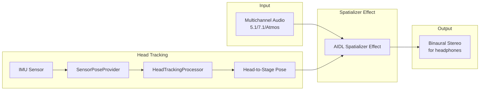

空间化效果接收：

1. 多声道音频输入，上限为 `FCC_LIMIT` 个声道（AOSP 中默认为 12）
2. 来自头部跟踪处理器的头部到舞台的位姿
3. 配置参数（级别、模式）

它输出双耳立体声音频，营造出扬声器环绕听者的错觉，虚拟扬声器位置会跟踪听者的头部运动。

### 15.7.11 显示方向处理

当设备显示屏旋转时，虚拟扬声器位置必须相应旋转：

```cpp
// HeadTrackingProcessor.cpp, line 70-81
void setWorldToScreenPose(int64_t timestamp,
        const Pose3f& worldToScreen) override {
    if (mPhysicalToLogicalAngle !=
            mPendingPhysicalToLogicalAngle) {
        mRateLimiter.enable();
        mPhysicalToLogicalAngle =
                mPendingPhysicalToLogicalAngle;
    }
    Pose3f worldToLogicalScreen = worldToScreen *
            Pose3f(rotateY(-mPhysicalToLogicalAngle));
```

`physicalToLogicalAngle` 被应用为 Y 轴旋转，以便从物理屏幕方向变换到逻辑（内容）方向。

---

## 15.8 Audio HAL

Audio HAL（硬件抽象层）定义了 Android 音频框架与厂商特定音频硬件驱动之间的接口。

### 15.8.1 HAL 演进

Android 经历了几代 HAL 接口：

| 版本 | 技术 | 目录 |
|---------|-----------|-----------|
| 2.0 - 7.1 | HIDL | `hardware/interfaces/audio/2.0/` 到 `7.1/` |
| Current | AIDL | `hardware/interfaces/audio/aidl/` |

AIDL HAL 是当前标准，在核心、效果和通用定义中共有 326 个 AIDL 文件。

### 15.8.2 AIDL 核心接口：IModule

核心 HAL 接口是 `IModule`：

```
hardware/interfaces/audio/aidl/android/hardware/audio/core/IModule.aidl
```

```java
// IModule.aidl, line 45-59
/**
 * Each instance of IModule corresponds to a separate audio module.
 * The system may have multiple modules due to the physical
 * architecture, for example, it can have multiple DSPs or other
 * audio I/O units which are not interconnected in hardware directly.
 * Usually there is at least one audio module which is responsible
 * for the "main" (or "built-in") audio functionality of the system.
 * Even if the system lacks any physical audio I/O capabilities,
 * there will be a "null" audio module.
 */
@VintfStability
interface IModule {
```

关键的 `IModule` 方法：

| 方法 | 用途 |
|--------|---------|
| `setModuleDebug()` | 配置调试/测试行为 |
| `getTelephony()` | 获取电话控制接口 |
| `getBluetooth()` | 获取蓝牙 SCO/HFP 接口 |
| `getBluetoothA2dp()` | 获取蓝牙 A2DP 接口 |
| `getBluetoothLe()` | 获取蓝牙 LE Audio 接口 |
| `connectExternalDevice()` | 通知设备连接 |
| `getAudioPorts()` | 列出可用的音频端口 |
| `getAudioRoutes()` | 列出可用的音频路由 |
| `openOutputStream()` | 打开输出流 |
| `openInputStream()` | 打开输入流 |
| `setAudioPatch()` | 创建/修改音频 patch |
| `getMmapPolicyInfos()` | 查询 MMAP 支持 |
| `getSoundDose()` | 获取声音剂量监测接口 |

### 15.8.3 核心 AIDL 类型

`hardware/interfaces/audio/aidl/android/hardware/audio/core/` 中的关键 AIDL 文件：

| 文件 | 用途 |
|------|---------|
| `IModule.aidl` | 主 HAL 模块接口 |
| `IStreamIn.aidl` | 输入流接口 |
| `IStreamOut.aidl` | 输出流接口 |
| `IStreamCommon.aidl` | 通用流操作 |
| `IStreamCallback.aidl` | 异步流完成回调 |
| `IStreamOutEventCallback.aidl` | 输出流事件 |
| `StreamDescriptor.aidl` | 流共享内存布局 |
| `AudioPatch.aidl` | 音频 patch 定义 |
| `AudioRoute.aidl` | 音频路由定义 |
| `MmapBufferDescriptor.aidl` | MMAP 缓冲区描述 |
| `IConfig.aidl` | 全局音频配置 |
| `IBluetooth.aidl` | 蓝牙 SCO/HFP 控制 |
| `IBluetoothA2dp.aidl` | 蓝牙 A2DP 控制 |
| `IBluetoothLe.aidl` | 蓝牙 LE Audio 控制 |
| `ITelephony.aidl` | 电话音频控制 |
| `sounddose/ISoundDose.aidl` | 声音剂量监测 |

### 15.8.4 流描述符与共享内存

`StreamDescriptor` 定义了框架与 HAL 之间用于零拷贝数据传输的共享内存布局。它包含：

- 音频数据 FMQ（Fast Message Queue）描述符
- 用于 HAL 命令的命令 FMQ 描述符
- 用于 HAL 响应的回复 FMQ 描述符
- 以帧计的缓冲区大小
- 以字节计的帧大小

FMQ 机制使用带有无锁环形缓冲区的共享内存，类似于 AAudio 的 FIFO，但位于 HAL 层面。

### 15.8.5 音频 Patch 模型

HAL 使用基于 patch 的路由模型。一个音频 patch 连接源与 sink：

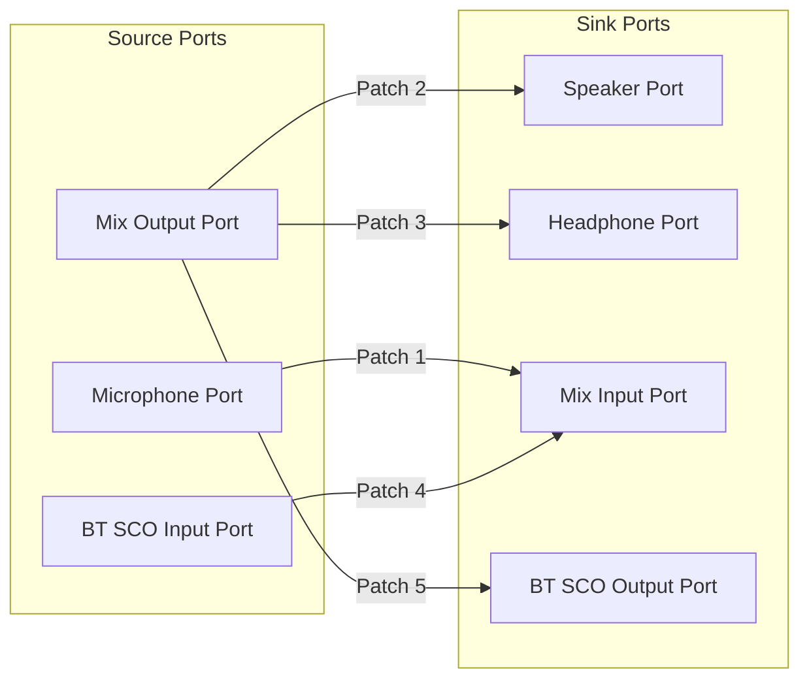

### 15.8.6 从 HIDL 迁移到 AIDL

框架同时支持 HIDL 和 AIDL HAL。HAL 版本在启动时检查：

```cpp
// AudioFlinger.cpp, line 106-107
static const AudioHalVersionInfo kMaxAAudioPropertyDeviceHalVersion =
        AudioHalVersionInfo(AudioHalVersionInfo::Type::HIDL, 7, 1);
```

对于高于 HIDL 7.1 的 HAL 版本，AAudio 配置直接来自 HAL。对于较旧的版本，它回退到系统属性：

```cpp
// AudioFlinger.cpp, line 343-346
if (mDevicesFactoryHal->getHalVersion() <=
        kMaxAAudioPropertyDeviceHalVersion) {
    mAAudioBurstsPerBuffer =
            getAAudioMixerBurstCountFromSystemProperty();
    mAAudioHwBurstMinMicros =
            getAAudioHardwareBurstMinUsecFromSystemProperty();
}
```

### 15.8.7 HAL 中的 MMAP 支持

MMAP 支持通过 `getMmapPolicyInfos()` 查询：

```cpp
// AudioFlinger.cpp, line 398-423
status_t AudioFlinger::getMmapPolicyInfos(
        AudioMMapPolicyType policyType,
        std::vector<AudioMMapPolicyInfo> *policyInfos) {
    audio_utils::lock_guard _l(mutex());
    if (const auto it = mPolicyInfos.find(policyType);
            it != mPolicyInfos.end()) {
        *policyInfos = it->second;          // cached result
        return NO_ERROR;
    }
    if (mDevicesFactoryHal->getHalVersion() >
            kMaxAAudioPropertyDeviceHalVersion) {
        audio_utils::lock_guard lock(hardwareMutex());
        for (const auto& [module, audioHwDevice] : mAudioHwDevs) {
            std::vector<AudioMMapPolicyInfo> infos;
            const status_t status =
                    audioHwDevice->getMmapPolicyInfos(
                            policyType, &infos);
            policyInfos->insert(policyInfos->end(),
                    infos.begin(), infos.end());
        }
        mPolicyInfos[policyType] = *policyInfos;
    } else {
        getMmapPolicyInfosFromSystemProperty(
                policyType, policyInfos);
        mPolicyInfos[policyType] = *policyInfos;
    }
    return NO_ERROR;
}
```

Android 17 添加了 `mPolicyInfos` 缓存作为第一层检查，因此在首次调用之后，重复的 MMAP 策略查询完全跳过 HAL 往返。

### 15.8.8 蓝牙音频集成

AIDL HAL 提供三个独立的蓝牙接口，反映不同的蓝牙音频协议：

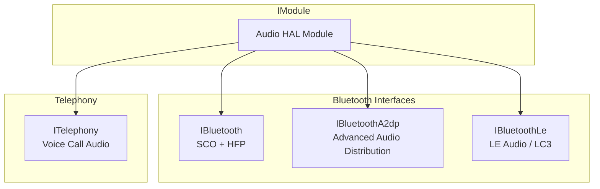

来自 IModule AIDL 注释：

```java
// IModule.aidl, line 93-100
    /**
     * Retrieve the interface to control Bluetooth SCO and HFP.
     *
     * If the HAL module supports either the SCO Link or
     * Hands-Free Profile functionality (or both) for Bluetooth,
     * it must return an instance of the IBluetooth interface.
     */
    @nullable IBluetooth getBluetooth();
```

这种分离允许不同的音频路径：

- **SCO/HFP** —— 窄带（8kHz）或宽带（16kHz）语音
- **A2DP** —— 高质量音乐流（SBC、AAC、LDAC、aptX）
- **LE Audio** —— 采用 LC3 编解码器的新一代低功耗音频

### 15.8.9 声音剂量接口

HAL 包含用于听力保护的声音剂量监测：

```
hardware/interfaces/audio/aidl/android/hardware/audio/core/sounddose/ISoundDose.aidl
```

该接口让 HAL 可以直接从硬件 DSP 报告 MEL（瞬时暴露级）数据。该数据可能比 AudioFlinger 的 MelReporter 中的软件 MEL 计算更准确。

### 15.8.10 VINTF 稳定性

所有 AIDL 接口都标记为 `@VintfStability`：

```java
// IModule.aidl, line 60
@VintfStability
interface IModule {
```

这意味着它们属于 Vendor Interface（VINTF）清单，并受严格兼容性要求的约束。框架和 HAL 版本可以独立更新。AIDL 版本系统保持向后兼容。

### 15.8.11 默认 HAL 实现

参考实现提供于：

```
hardware/interfaces/audio/aidl/default/
```

该实现既作为厂商模板，也作为用于模拟器和 CTS 测试的功能性空音频 HAL。它以合理的默认值实现所有必需的 IModule 方法。

### 15.8.12 设备连接管理

AudioFlinger 管理设备连接状态转换：

```cpp
// AudioFlinger.cpp, line 425-445
status_t AudioFlinger::setDeviceConnectedState(
        const struct audio_port_v7 *port,
        media::DeviceConnectedState state) {
    status_t result = NO_INIT;
    audio_utils::lock_guard _l(mutex());
    audio_utils::lock_guard lock(hardwareMutex());

    if (auto it = mAudioHwDevs.find(port->ext.device.hw_module);
            it != mAudioHwDevs.end()) {
        const AudioHwDevice* const audioHwDevice = it->second;
        mHardwareStatus = AUDIO_HW_SET_CONNECTED_STATE;
        const sp<DeviceHalInterface>& dev =
                audioHwDevice->hwDevice();
        result = state ==
                media::DeviceConnectedState::PREPARE_TO_DISCONNECT
            ? dev->prepareToDisconnectExternalDevice(port)
            : dev->setConnectedState(port,
                state == media::DeviceConnectedState::CONNECTED);
        mHardwareStatus = AUDIO_HW_IDLE;
    }
    return result;
}
```

`PREPARE_TO_DISCONNECT` 状态允许 HAL 优雅地处理设备移除（例如在设备消失之前重新路由音频）。

---

## 15.9 原生音频 API

### 15.9.1 AudioTrack（原生 C++）

原生 `AudioTrack` 类是音频播放的主要客户端 API。它定义于：

```
frameworks/av/media/libaudioclient/AudioTrack.cpp
```

#### 最小帧数

最小缓冲区大小根据 HAL 计算：

```cpp
// AudioTrack.cpp, line 118-122
status_t AudioTrack::getMinFrameCount(
        size_t* frameCount,
        audio_stream_type_t streamType,
        uint32_t sampleRate)
{
```

#### 音高与速度

AudioTrack 通过以下工具支持播放速度和音高控制：

```cpp
// AudioTrack.cpp, line 97-113
static const bool kFixPitch = true;

static inline uint32_t adjustSampleRate(
        uint32_t sampleRate, float pitch) {
    return kFixPitch ? (sampleRate * pitch + 0.5) : sampleRate;
}

static inline float adjustSpeed(float speed, float pitch) {
    return kFixPitch ?
        speed / max(pitch, AUDIO_TIMESTRETCH_PITCH_MIN_DELTA) :
        speed;
}

static inline float adjustPitch(float pitch) {
    return kFixPitch ? AUDIO_TIMESTRETCH_PITCH_NORMAL : pitch;
}
```

`kFixPitch` 变通方案使用采样率转换器来模拟音高，因为时间拉伸器的音高设置工作不正常。

#### 关键操作

| 方法 | 描述 |
|--------|-------------|
| `set()` | 用格式、速率、声道掩码配置轨道 |
| `start()` | 开始播放 |
| `stop()` | 停止播放 |
| `pause()` | 暂停播放 |
| `flush()` | 丢弃待处理的数据 |
| `write()` | 写入音频数据（阻塞或非阻塞） |
| `obtainBuffer()` / `releaseBuffer()` | 直接缓冲区访问 |
| `setVolume()` | 设置左/右音量 |
| `setPlaybackRate()` / `setSampleRate()` | 设置播放速度/音高或采样率 |
| `getTimestamp()` | 获取呈现时间戳 |

### 15.9.2 AudioRecord（原生 C++）

原生 `AudioRecord` 类处理音频捕获：

```
frameworks/av/media/libaudioclient/AudioRecord.cpp
```

最小帧数计算：

```cpp
// AudioRecord.cpp, line 51-79
status_t AudioRecord::getMinFrameCount(
        size_t* frameCount,
        uint32_t sampleRate,
        audio_format_t format,
        audio_channel_mask_t channelMask)
{
    size_t size;
    status_t status = AudioSystem::getInputBufferSize(
            sampleRate, format, channelMask, &size);
    // We double the size of input buffer for ping pong use
    const auto frameSize = audio_bytes_per_frame(
            audio_channel_count_from_in_mask(channelMask), format);
    if (frameSize == 0 ||
            ((*frameCount = (size * 2) / frameSize) == 0)) {
        return BAD_VALUE;
    }
    return NO_ERROR;
}
```

“乒乓”翻倍确保应用读取一个缓冲区的同时 HAL 填充另一个。

### 15.9.3 AudioSystem

`AudioSystem` 提供静态工具方法，作为 AudioFlinger 和 AudioPolicyService 两者的客户端入口点：

```
frameworks/av/media/libaudioclient/AudioSystem.cpp
```

它维护服务连接状态：

```cpp
// AudioSystem.cpp, line 71-79
std::mutex AudioSystem::gMutex;
dynamic_policy_callback AudioSystem::gDynPolicyCallback = NULL;
record_config_callback AudioSystem::gRecordConfigCallback = NULL;
routing_callback AudioSystem::gRoutingCallback = NULL;
vol_range_init_req_callback
        AudioSystem::gVolRangeInitReqCallback = NULL;

std::mutex AudioSystem::gApsCallbackMutex;
std::mutex AudioSystem::gErrorCallbacksMutex;
std::set<audio_error_callback>
        AudioSystem::gAudioErrorCallbacks;
```

关键静态方法：

| 方法 | 用途 |
|--------|---------|
| `getOutputForAttr()` | 获取音频属性的输出句柄 |
| `getInputForAttr()` | 获取音频属性的输入句柄 |
| `startOutput()` / `stopOutput()` | 向策略通知流活动 |
| `getOutputSamplingRate()` | 查询输出采样率 |
| `getOutputFrameCount()` | 查询输出缓冲区大小 |
| `getOutputLatency()` | 查询输出延迟 |
| `setParameters()` | 设置 HAL 参数 |
| `getParameters()` | 获取 HAL 参数 |
| `registerEffect()` | 向策略注册效果 |
| `setEffectEnabled()` | 启用/禁用效果 |
| `onNewAudioModulesAvailable()` | 处理新的 HAL 模块 |

### 15.9.4 AudioTrack.java（Java API）

Java 的 `AudioTrack` 类是最常用的音频播放 API：

```
frameworks/base/media/java/android/media/AudioTrack.java
```

它通过 JNI 包装原生 `AudioTrack`，并添加：

- 构建器模式用于构造
- 自动格式协商
- 音频焦点集成
- VolumeShaper 支持
- 路由回调支持
- 空间音频属性

Java API 暴露了完整的播放模式范围：

- `MODE_STREAM` —— 带阻塞写入的流式模式
- `MODE_STATIC` —— 静态缓冲区模式（加载一次，播放多次）

它还支持：

- `WRITE_BLOCKING` / `WRITE_NON_BLOCKING` 写入语义
- 用于压缩音频直通的 `ENCAPSULATION_MODE_*`
- 性能模式：`PERFORMANCE_MODE_LOW_LATENCY`、
  `PERFORMANCE_MODE_NONE`、`PERFORMANCE_MODE_POWER_SAVING`

### 15.9.5 AudioTrack 构造流程

一个 `AudioTrack` 从 Java 到原生的完整生命周期：

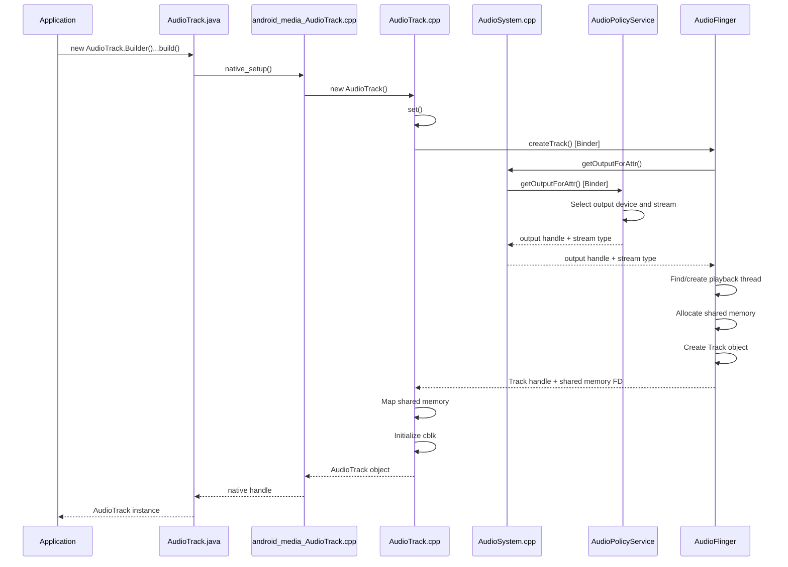

路由决策发生在服务器端，而不是客户端。原生 `AudioTrack` 只进行一次服务器调用，`audioFlinger->createTrack()`
（`frameworks/av/media/libaudioclient/AudioTrack.cpp:1906`）。然后
`AudioFlinger::createTrack()` 调用
`AudioSystem::getOutputForAttr()` 进入音频策略服务以选择输出和流类型
（`frameworks/av/services/audioflinger/AudioFlinger.cpp:1092`）。之后，它定位播放线程。

### 15.9.6 AudioRecord 构造流程

AudioRecord 遵循类似的模式，但用于输入：

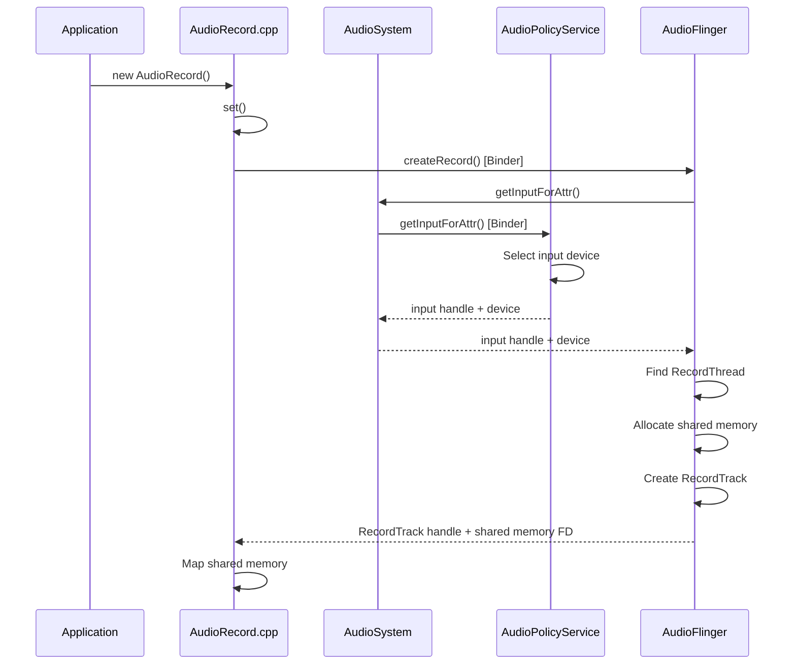

同样的服务器端拆分同样适用于捕获。客户端唯一的服务器调用是
`audioFlinger->createRecord()`
（`frameworks/av/media/libaudioclient/AudioRecord.cpp:906`）。
`AudioFlinger::createRecord()` 调用 `AudioSystem::getInputForAttr()`
（`frameworks/av/services/audioflinger/AudioFlinger.cpp:2432`），让策略服务选择输入。RecordThread 和 RecordTrack 在此之后创建。

录音的最小帧数使用“乒乓”翻倍：

```cpp
// AudioRecord.cpp, line 51-79
status_t AudioRecord::getMinFrameCount(
        size_t* frameCount,
        uint32_t sampleRate,
        audio_format_t format,
        audio_channel_mask_t channelMask)
{
    size_t size;
    status_t status = AudioSystem::getInputBufferSize(
            sampleRate, format, channelMask, &size);
    // We double the size of input buffer for ping pong use
    // of record buffer.
    const auto frameSize = audio_bytes_per_frame(
            audio_channel_count_from_in_mask(channelMask),
            format);
    if (frameSize == 0 ||
            ((*frameCount = (size * 2) / frameSize) == 0)) {
        ALOGE(...);  // unsupported configuration
        return BAD_VALUE;
    }
    return NO_ERROR;
}
```

### 15.9.7 AudioSystem 作为服务代理

AudioSystem 维护到 AudioFlinger 和 AudioPolicyService 两者的单例连接。它提供隐藏 Binder IPC 的静态方法：

```cpp
// AudioSystem.cpp, line 71-79
std::mutex AudioSystem::gMutex;
dynamic_policy_callback AudioSystem::gDynPolicyCallback = NULL;
record_config_callback AudioSystem::gRecordConfigCallback = NULL;
routing_callback AudioSystem::gRoutingCallback = NULL;
vol_range_init_req_callback
        AudioSystem::gVolRangeInitReqCallback = NULL;

std::mutex AudioSystem::gApsCallbackMutex;
std::mutex AudioSystem::gErrorCallbacksMutex;
std::set<audio_error_callback>
        AudioSystem::gAudioErrorCallbacks;
```

它还处理服务死亡通知，允许客户端通过重新建立连接和重新创建轨道从 audioserver 崩溃中恢复。

### 15.9.8 VolumeShaper

原生和 Java 的 AudioTrack 都支持 `VolumeShaper`，它随时间提供平滑的音量过渡：

```mermaid
graph LR
    subgraph "VolumeShaper Configuration"
        Times["Times: [0.0, 0.5, 1.0]"]
        Volumes["Volumes: [0.0, 1.0, 0.0]"]
        Interpolation[LINEAR or CUBIC]
        Duration["Duration: 1000ms"]
    end

    subgraph "Application"
        VS[VolumeShaper]
    end

    subgraph "AudioFlinger"
        VH["VolumeHandler<br/>per-track"]
    end

    Times --> VS
    Volumes --> VS
    Interpolation --> VS
    Duration --> VS
    VS -->|apply| VH
    VH -->|modulates| Audio[Audio Data]
```

VolumeShaper 配置被发送到 AudioFlinger，并在混音循环中应用。这使得平滑的淡入/淡出效果成为可能，而无需应用修改音频数据。

### 15.9.9 Offload 播放

对于压缩音频（MP3、AAC 等），可以使用
`AUDIO_OUTPUT_FLAG_COMPRESS_OFFLOAD` 创建 AudioTrack。这会把压缩数据直接发送到 HAL 进行硬件解码：

```mermaid
graph LR
    AT["AudioTrack<br/>compressed data"] -->|write| AF[OffloadThread]
    AF -->|compressed write| HAL["Audio HAL<br/>HW decoder"]
    HAL --> DAC[DAC]
```

好处：

- 播放期间 CPU 空闲（显著省电）
- 无软件解码开销
- 硬件精确的无缝播放

限制：

- 同时只能有一条 offload 流（通常如此）
- 有限的格式支持（取决于硬件）
- 效果可能不可用
- 初始启动延迟更高

### 15.9.10 Direct 播放

Direct 播放（`AUDIO_OUTPUT_FLAG_DIRECT`）将 PCM 数据发送到 HAL
而不进行混音。它用于：

- 高分辨率音频（高采样率下的 24-bit/32-bit）
- 多声道音频（5.1、7.1）
- 直通格式（Dolby、DTS）

DirectOutputThread 的逻辑比 MixerThread 更简单，因为它只处理单个轨道。

### 15.9.11 共享内存传输

客户端-服务器数据传输使用通过 Binder 映射的共享内存：

```mermaid
sequenceDiagram
    participant App as Application
    participant AT as AudioTrack
    participant Cblk as audio_track_cblk_t (shared memory)
    participant AF as AudioFlinger MixerThread

    App->>AT: write(buffer, size)
    AT->>Cblk: Copy data to shared buffer
    AT->>Cblk: Release-store new write position (mRear)

    Note over AF: Thread loop running
    AF->>Cblk: Read write position
    AF->>Cblk: Copy data from shared buffer
    AF->>Cblk: Update read position
    AF->>Cblk: futex wake (if client blocked)
    AF->>AF: Mix with other tracks
    AF->>AF: Write to HAL
```

futex 流量是服务器到客户端的方向，而不是反过来。在播放时，客户端从不唤醒混音线程：`ClientProxy::releaseBuffer()` 只对
`mRear` 执行原子 release-store
（`frameworks/av/media/libaudioclient/AudioTrackShared.cpp:407`），完全没有系统调用。`ServerProxy::releaseBuffer()`（第 968 行）和
`ServerProxy::flushBufferIfNeeded()`（第 799 行）设置 `CBLK_FUTEX_WAKE` 并
发出 `FUTEX_WAKE`。这释放了在
`ClientProxy::obtainBuffer()`（第 342 行）中等待缓冲区空间的客户端。客户端自己的 futex 唤醒保留给错误路径
`binderDied()` 和 `interrupt()`。因为唤醒只在确实有等待者暂停时发生，正常情况的数据传输保持无锁且无系统调用。

### 15.9.12 音量与增益管理

Android 音频系统中的音量流经多个阶段：

```mermaid
graph LR
    AV["App Volume<br/>AudioTrack.setVolume"] --> TV["Track Volume<br/>in AudioFlinger"]
    TV --> MV[Master Volume]
    SV["Stream Volume<br/>AudioPolicy"] --> MV
    MV --> HV[HAL Volume]
    HV --> HW[Hardware Gain]
```

每个阶段都可以独立应用增益。轨道音量通过共享内存控制块设置，并在混音期间应用。主音量和流音量由 AudioPolicyService 管理，并在 AudioFlinger 中作为软件增益应用。

---

## 15.10 调试与性能分析

### 15.10.1 音频系统属性

控制音频行为的关键系统属性：

| 属性 | 默认值 | 描述 |
|----------|---------|-------------|
| `ro.audio.flinger_standbytime_ms` | 3000 | 待机延迟 |
| `af.fast_track_multiplier` | 2 | 快速轨道缓冲区乘数 |
| `aaudio.mmap_policy` | 1 (NEVER) | MMAP 使用策略；设备将其覆盖为 2 (AUTO) 以启用 MMAP |
| `aaudio.mmap_exclusive_policy` | 0 (UNSPECIFIED) | 独占 MMAP 策略；设备将其覆盖为 2 (AUTO) |
| `aaudio.hw_burst_min_usec` | varies | HAL 最小突发大小 |
| `audio.timestamp.corrected_input_device` | NONE | 时间戳校正 |

### 15.10.2 Media Metrics

每个音频操作都通过 MediaMetrics 系统记录指标：

```cpp
// AudioFlinger.cpp, line 337-340
    mediametrics::LogItem(mMetricsId)
        .set(AMEDIAMETRICS_PROP_EVENT,
             AMEDIAMETRICS_PROP_EVENT_VALUE_CTOR)
        .record();
```

查询指标：
```bash
adb shell dumpsys media.metrics --since -60
```

这会显示过去 60 秒中的所有音频事件。负参数表示“过去的秒数”。正值是自 Unix 纪元以来的绝对秒数。事件包括：

- 轨道创建/销毁
- 流打开/关闭
- 设备路由变化
- 效果启用/禁用
- 欠载/过载事件

### 15.10.3 Systrace 集成

AudioFlinger 使用 `ATRACE_TAG_AUDIO` 进行 systrace 集成：

```cpp
// AudioFlinger.cpp, line 20
#define ATRACE_TAG ATRACE_TAG_AUDIO
```

关键跟踪点：

- `AudioFlinger::createTrack` —— 轨道创建延迟
- `write` —— HAL 写入持续时间
- `underrun` —— 欠载检测

客户端库（`libaudioclient`）本身不包含 atrace 插桩。客户端的 `AudioTrack::write()` 调用不会作为跟踪片段出现。只有服务器端活动可见。

### 15.10.4 互斥锁统计

AudioFlinger 使用 `audio_utils::mutex`，它跟踪锁争用：

```cpp
// AudioFlinger.cpp, line 830-831
    writeStr(fd, audio_utils::mutex::all_stats_to_string());
    writeStr(fd, audio_utils::mutex::all_threads_to_string());
```

互斥锁统计显示：

- 总锁获取次数
- 争用次数（线程不得不等待的次数）
- 最大等待时间
- 当前持有者

### 15.10.5 常见音频问题

| 问题 | 症状 | 诊断 |
|-------|---------|-----------|
| Underrun | 音频毛刺/咔哒声 | 检查 `dumpsys` 中的欠载计数，增大缓冲区大小 |
| High latency | 明显延迟 | 检查 MMAP 是否可用，验证快速轨道的使用 |
| No audio | 无声 | 检查 `dumpsys` 中的 patch，验证设备路由 |
| Distortion | 音频削波 | 检查音量级别，查找 float 溢出 |
| Echo | 自听 | 检查 AEC 效果是否附加到输入流 |
| Routing wrong | 错误扬声器 | 检查 AudioPolicy 路由规则 |

### 15.10.6 TimerQueue

AudioFlinger 使用 TimerQueue 进行延迟操作：

```cpp
// AudioFlinger.cpp, line 362
    ALOGD("%s: TimerQueue %s", __func__,
            mTimerQueue->ready() ? "ready" : "uninitialized");
```

TimerQueue dump 可在统计输出中获得：

```cpp
// AudioFlinger.cpp, line 1015-1016
        dprintf(fd, "\n ## BEGIN TimerQueue dump\n");
        dprintf(fd, "%s\n", mTimerQueue->toString().c_str());
```

### 15.10.7 PowerManager 集成

AudioFlinger 通过 `AudioPowerManager` 与 Android 电源管理系统集成：

```cpp
// AudioFlinger.cpp, line 984-989
        dprintf(fd, "\n ## BEGIN power dump\n");
        char value[PROPERTY_VALUE_MAX];
        property_get("ro.build.display.id", value,
                     "Unknown build");
        std::string build(value);
        writeStr(fd, build + "\n");
        writeStr(fd, media::psh_utils::AudioPowerManager::
                getAudioPowerManager().toString());
```

电源管理器跟踪：

- 每个线程的唤醒锁获取与释放
- 用于电池归因的音频活动时长
- 每个客户端和每个轨道的功耗与健康统计（电源轨能量、电池电压和充电计数器）
- 应用冻结状态，通过 `setFrozen()` / `isFrozen()`
- 设备电源状态转换

### 15.10.8 TimeCheck 看门狗

AudioFlinger 使用 TimeCheck 作为 HAL 调用的看门狗：

```cpp
// AudioFlinger.cpp, line 826-827
    dprintf(fd, "\nTimeCheck:\n");
    writeStr(fd, mediautils::TimeCheck::toString());
```

TimeCheck 监控对 HAL 的 binder 调用。每个 HAL 调用的 `TIME_CHECK()`
宏以零超时和 `crashOnTimeout=false` 创建，因此它只记录调用统计——它从不触发。以显式超时创建的 TimeCheck 实例在到期时更为严厉。

`onTimeout()` 信号通知
音频 HAL 进程生成 tombstone，并发出带有超时分析的 FATAL 日志。然后它中止卡住的线程。如果失败，它会中止整个 audioserver 进程。由此产生的崩溃和重启正是防止整个音频系统无限挂起的手段。

### 15.10.9 死锁检测

AudioFlinger 的 dump 系统检测潜在的死锁：

```cpp
// AudioFlinger.cpp, line 110-112
constexpr auto kDeadlockedString =
        "AudioFlinger may be deadlocked\n"sv;
constexpr auto kHardwareLockedString =
        "Hardware lock is taken\n"sv;
constexpr auto kClientLockedString =
        "Client lock is taken\n"sv;
```

在 dump 期间，它使用 `FallibleLockGuard`，尝试在不阻塞的情况下获取锁：

```cpp
// AudioFlinger.cpp, line 925-935
    {
        FallibleLockGuard l{hardwareMutex()};
        if (!l) writeStr(fd, kHardwareLockedString);
    }
    {
        FallibleLockGuard l{mutex()};
        if (!l) writeStr(fd, kDeadlockedString);
        {
            FallibleLockGuard ll{clientMutex()};
            if (!ll) writeStr(fd, kClientLockedString);
            dumpClients_ll(fd, parsedArgs.shouldDumpMem);
        }
```

如果 dump 期间任何锁都无法获取，它会报告该情况，但继续 dump 无需该锁即可获得的任何状态。这确保了即使音频系统出现问题，`dumpsys` 也永远不会挂起。

### 15.10.10 内存泄漏检测

AudioFlinger 可以 dump 不可达内存用于泄漏检测：

```cpp
// AudioFlinger.cpp, line 1019-1024
    if (parsedArgs.shouldDumpMem) {
        dprintf(fd, "\n ## BEGIN memory dump \n");
        writeStr(fd, dumpMemoryAddresses(100 /* limit */));
        dprintf(fd, "\nDumping unreachable memory:\n");
        writeStr(fd, GetUnreachableMemoryString(
                true /* contents */, 100 /* limit */));
    }
```

这使用 `memunreachable` 库来查找仍已分配但不再被引用的内存——这是内存泄漏的迹象。运行命令：

```bash
adb shell dumpsys media.audio_flinger --memory
```

### 15.10.11 电池归因

AudioFlinger 自身对电池记账的贡献很小：在启动时它重置全局音频电池状态——此调用中没有按 UID 的归因：

```cpp
// AudioFlinger.cpp, line 333
    BatteryNotifier::getInstance().noteResetAudio();
```

存在一个遗留钩子，在轨道开始或停止时更新电池数据。它默认被编译移除。`Configuration.h` 附带
被注释掉的 `//#define ADD_BATTERY_DATA`：

```cpp
// Threads.cpp, line 3649-3656
#ifdef ADD_BATTERY_DATA
    for (const auto& track : tracksToRemove) {
        if (track->isExternalTrack()) {
            addBatteryData(
                IMediaPlayerService::kBatteryDataAudioFlingerStop);
        }
    }
#endif
```

在原版 AOSP 构建中，该代码块永远不会运行，因此此代码不执行按应用的音频电池归因。

---

## 15.11 稳定的 MMAP AIDL 接口（Android 17）

在 AAudio 的大部分历史中，MMAP 控制路径通过原始 C++ 对象跨越 AudioFlinger 边界。AudioFlinger 把一个 `sp<MmapStreamInterface>` 交给 AAudioService，其虚方法（`createMmapBuffer()`、`createTrack()`、`start()`、`stop()`、`standby()`）在进程内被调用。这之所以能工作，是因为双方在 `audioserver` 内链接了相同的 C++ ABI。但它把 MMAP 表面留在了稳定的、有版本的 binder 世界之外。音频栈的其余部分早已迁移到那个世界。

Android 17 弥合了这一差距。MMAP 流现在通过一个稳定的 AIDL binder 接口 `IMmapStream` 控制，该接口声明于
`frameworks/av/media/libaudioclient/aidl/android/media/IMmapStream.aidl`。旧的 C++
`MmapStreamInterface` 作为新 binder 代理之上的轻量便捷包装器保留下来。已经使用它的调用者可以继续编译。实际的控制流量现在经由一个有版本的接口传输。

### 15.11.1 IMmapStream 接口

`IMmapStream` 是一个隐藏（`@hide`）的 binder 接口，其方法映射 MMAP 客户端驱动硬件流所需的操作：

```aidl
// IMmapStream.aidl
interface IMmapStream {
    MmapBufferInfo createMmapBuffer(in int minSizeFrames);
    MmapStreamPosition getMmapPosition();
    MmapObservablePosition getObservablePosition();
    MmapCreateTrackResponse createTrack(in AudioClient client,
                                        in AudioAttributes attr);
    void startTrack(in int portId);
    void stopTrack(in int portHandle);
    void releaseTrack(in int portId);
    void standby();
    void reportData(in byte[] buffer);
    void drain(long wakeUpNanos, boolean allowSoftWakeUp,
               out TimerQueueHandle handle);
    void activate(in TimerQueueHandle handle);
    void setPlaybackParameters(in AudioPlaybackRate rate);
    void getPlaybackParameters(out AudioPlaybackRate rate);
}
```

缓冲区交接是一个 parcelable，而不是原始结构体。`createMmapBuffer()`
返回一个 `MmapBufferInfo`，其中携带作为
`ParcelFileDescriptor` 的共享内存文件描述符。内核缓冲区通过正常的 binder FD 机制传输和回收：

```aidl
// MmapBufferInfo.aidl
parcelable MmapBufferInfo {
    ParcelFileDescriptor sharedFd;
    int bufferSizeFrames;
    int burstSizeFrames;
    int flags;  // audio_mmap_buffer_flag
}
```

位置和轨道创建结果同样是接口上的嵌套 parcelable（`MmapStreamPosition`、`MmapObservablePosition` 以及
`MmapCreateTrackResponse`，后者返回分配的 `portId` 和线程的 `ioHandle`）。

### 15.11.2 获取流：openMmapStream

客户端不再接收裸 C++ 指针。它调用
`IAudioFlingerService.openMmapStream()`，后者接收一个 `OpenMmapRequest` 并
返回一个 `OpenMmapResponse`，其 `stream` 字段就是 `IMmapStream` binder：

```aidl
// IAudioFlingerService.aidl, line 145
OpenMmapResponse openMmapStream(in OpenMmapRequest request);
```

```aidl
// OpenMmapResponse.aidl
parcelable OpenMmapResponse {
    AudioConfigBase config;
    int[] deviceIds;
    int sessionId;
    IMmapStream stream;   // the AIDL control interface
    int portId;
}
```

在 AudioFlinger 一侧，`openMmapStream()` 解析请求并打开或复用一个 `MmapThread`。然后它把该线程包装进一个适配器，并将适配器放入响应：

```cpp
// AudioFlinger.cpp, line 512-550 (abridged)
status_t AudioFlinger::openMmapStream(const media::OpenMmapRequest& request,
                                media::OpenMmapResponse* response) {
    // ... parse request into native types ...
    sp<media::IMmapStream> interface;
    audio_port_handle_t portId;
    status = openMmapStreamImpl(isOutput, attr, &config, client, &deviceIds,
                                &sessionId, callback, offloadInfoOrNull,
                                interface, &portId);
    // build the AIDL response (even on error, to permit retry)
    MmapStreamInterface::buildResponse(
        isOutput, config, deviceIds, sessionId, interface, portId, response);
    return status;
}
```

`openMmapStreamImpl()` 从选定的线程生成 binder 对象：

```cpp
// AudioFlinger.cpp, line 649
interface = IAfMmapThread::createMmapStreamInterfaceAdapter(thread);
```

### 15.11.3 服务器端适配器

把内部 `MmapThread` 变成 binder 对象的适配器是
`MmapThreadHandle`，一个 `BnMmapStream` 子类。它以强指针持有线程，并把每个 AIDL 调用转发到线程的 C++ 接口
（`IAfMmapThread`）。在此过程中，它在 AIDL parcelable 与遗留原生类型之间转换：

```cpp
// Threads.cpp, line 10378
class MmapThreadHandle : public media::BnMmapStream {
public:
    explicit MmapThreadHandle(const sp<IAfMmapThread>& thread);
    binder::Status createMmapBuffer(int32_t minSizeFrames,
            media::MmapBufferInfo* _aidl_return) final;
    binder::Status startTrack(int32_t portId) final;
    binder::Status stopTrack(int32_t portId) final;
    // ... remaining IMmapStream methods ...
private:
    const sp<IAfMmapThread> mThread;
};

// Threads.cpp, line 10409
sp<media::IMmapStream> IAfMmapThread::createMmapStreamInterfaceAdapter(
        const sp<IAfMmapThread>& mmapThread) {
    return sp<MmapThreadHandle>::make(mmapThread);
}
```

`createMmapBuffer()` 最清楚地说明了转换工作。原生 `MmapThread` 填充一个 `audio_mmap_buffer_info` 结构体。句柄把其字段拷贝进 `MmapBufferInfo` parcelable。它还对共享内存 FD 执行 `dup()`，放进 `ParcelFileDescriptor`，以便 binder 可以拥有该传输：

```cpp
// Threads.cpp, line 10427
binder::Status MmapThreadHandle::createMmapBuffer(
        int32_t minSizeFrames, media::MmapBufferInfo* _aidl_return) {
    struct audio_mmap_buffer_info info;
    const status_t status = mThread->createMmapBuffer(minSizeFrames, &info);
    if (status == NO_ERROR) {
        const int bufferFd = info.shared_memory_fd;
        _aidl_return->sharedFd.reset(binder::unique_fd(dup(bufferFd)));
        _aidl_return->bufferSizeFrames = info.buffer_size_frames;
        _aidl_return->burstSizeFrames = info.burst_size_frames;
        _aidl_return->flags = static_cast<int32_t>(info.flags);
    }
    return aidl_utils::binderStatusFromStatusT(status);
}
```

轨道方法在相反方向做同样的转换。
`startTrack(int32_t portId)` 和 `stopTrack(int32_t portId)` 把 AIDL 的
`int32_t` 翻译回原生的 `audio_port_handle_t`。然后它们调用线程。

### 15.11.4 客户端保留 MmapStreamInterface

AAudioService 端点不必重写。它仍然持有一个 `sp<MmapStreamInterface>`：

```cpp
// AAudioServiceEndpointMMAP.h, line 144
android::sp<android::MmapStreamInterface> mMmapStream GUARDED_BY(mMmapStreamLock);
```

在 Android 17 中，该 `MmapStreamInterface` 围绕
`openMmapStream()` 返回的 `IMmapStream` binder 代理构造，并将其存储在
`const sp<media::IMmapStream> mStream` 成员中
（`frameworks/av/media/libaudioclient/include/media/MmapStreamInterface.h`，第
248 行）。每个 C++ 调用——`createMmapBuffer()`、`createTrack()`、`startTrack()`、
`stopTrack()`、`releaseTrack()`、`standby()`——现在委托给 `mStream` 上对应的
binder 方法。端点代码读起来与之前完全一样：

```cpp
// AAudioServiceEndpointMMAP.cpp, line 800
const status_t status = mMmapStream->createMmapBuffer(minSizeFrames,
                                                      &mMmapBufferinfo);
// AAudioServiceEndpointMMAP.cpp, line 402 / 421
mMmapStream->startTrack(clientHandle);
mMmapStream->stopTrack(clientHandle);
```

### 15.11.5 为什么这很重要

```mermaid
graph TB
    subgraph "Client side (AAudioService endpoint)"
        EP["AAudioServiceEndpointMMAP"]
        MSI["MmapStreamInterface<br/>C++ wrapper"]
        PROXY["BpMmapStream<br/>binder proxy"]
    end

    subgraph "Server side (AudioFlinger)"
        AF["AudioFlinger.openMmapStream()"]
        HANDLE["MmapThreadHandle<br/>BnMmapStream"]
        MT["MmapThread (IAfMmapThread)"]
    end

    EP --> MSI
    MSI --> PROXY
    PROXY -.->|"IMmapStream binder"| HANDLE
    AF -->|"createMmapStreamInterfaceAdapter()"| HANDLE
    HANDLE --> MT
    MT -->|HAL| HALOUT["Audio HAL"]
```

把 MMAP 控制迁移到与 `@VintfStability` 相邻的稳定 AIDL 表面上，为音频团队带来了音频栈其余部分已经拥有的同样的好处：有版本的、可内省的接口，以及能正确携带其 FD 生命周期的 parcelable 缓冲区描述符。它们还包括未来把 MMAP 控制端点放在与其调用者不同进程中的选项。

该接口上的两个
新控制方法是 `drain()` 和 `activate()`。它们交换一个 `TimerQueueHandle`。它们还让服务端可以针对 AudioFlinger 的 `TimerQueue`（第 15.10.6 节）调度客户端唤醒，而不是忙等。新的省电 offloaded MMAP 模式就是这样协调其排空的。

---

## 15.12 音频管理的蓝牙 SCO（Android 17）

蓝牙上的免提语音音频运行在 SCO（同步面向连接）链路上，而不是 A2DP 或 LE Audio 数据路径上。在 Android 的大部分历史中，蓝牙协议栈决定何时建立和断开该 SCO 链路。应用调用 `AudioManager.startBluetoothSco()`。请求到达耳机协议（HFP）服务。蓝牙协议栈打开链路，之后再通知音频框架。

Android 17 反转了这种所有权。音频框架现在像路由到扬声器或有线耳机一样驱动 SCO 路由。HFP 协议遵循音频框架的引导，而不是反过来。

### 15.12.1 通信设备模型

旧 SCO 调用的替代方案是 `AudioManager` 上的通信设备 API：
`frameworks/base/media/java/android/media/AudioManager.java` 暴露
`setCommunicationDevice(AudioDeviceInfo)`、`clearCommunicationDevice()`、
`getCommunicationDevice()` 和 `getAvailableCommunicationDevices()`。想要在蓝牙耳机上获得通话音频的应用从可用列表中选择匹配的
`AudioDeviceInfo`，然后调用 `setCommunicationDevice()`。框架发现这是一个 SCO 设备并建立链路。较旧的入口点已被弃用，转而使用此表面：

| 已弃用方法 | 替代方法 |
|-------------------|-------------|
| `startBluetoothSco()` | `setCommunicationDevice(AudioDeviceInfo)` |
| `startBluetoothScoVirtualCall()` | `setCommunicationDevice(AudioDeviceInfo)` |
| `stopBluetoothSco()` | `clearCommunicationDevice()` |
| `setBluetoothScoOn(boolean)` | `setCommunicationDevice(AudioDeviceInfo)` |
| `isBluetoothScoOn()` | `getCommunicationDevice()` |

这些方法上的 `@deprecated` javadoc 直接指明了其替代方法。已弃用的调用仍然有效：`AudioService` 把它们转发给
`AudioDeviceBroker.startBluetoothScoForClient()` /
`stopBluetoothScoForClient()`，后者把它们转换为与 `setCommunicationDevice()` 执行的相同的通信设备选择。

### 15.12.2 现在谁拥有 SCO

交接由 `AudioDeviceBroker` 中的单个标志控制
（`frameworks/base/services/core/java/com/android/server/audio/AudioDeviceBroker.java`）：

```java
// AudioDeviceBroker.java
private final boolean mScoManagedByAudio;
...
mScoManagedByAudio = scoManagedByAudio()
        && BluetoothProperties.isScoManagedByAudioEnabled().orElse(false);
```

只有当 `scoManagedByAudio()` 特性标志和
`bluetooth.sco.managed_by_audio` 系统属性一致时，该标志才为 true。当它被设置时，解析为 SCO 设备的通信设备选择会使
`AudioDeviceBroker` 调用 `BtHelper`。该调用自行启动或停止 SCO。代理不会等待蓝牙协议栈报告链路。当标志清除时，代理保持遗留路径，因此设备可以回退到旧行为。

HFP 协议读取相同的设置：
`packages/modules/Bluetooth/android/app/src/com/android/bluetooth/hfp/HeadsetService.java`
在启动时调用 `mNativeInterface.setIsScoManagedByAudio(...)`。它在连接逻辑中检查
`isScoManagedByAudioEnabled()`。当新模式开启时，它把 SCO 音频启动推迟给音频框架。`HeadsetService` 中某字段上的注释直接标记了新的依赖关系：设备可能处于
“等待音频框架启动 SCO”的状态。

### 15.12.3 下到 HAL

当音频框架决定 SCO 应该开启还是关闭时，它通过音频 HAL 而不是通过蓝牙控制来配置链路。
`IBluetooth` 接口
（`hardware/interfaces/audio/aidl/android/hardware/audio/core/IBluetooth.aidl`）
携带一个 `ScoConfig` parcelable 和一个 `setScoConfig(ScoConfig)` 方法：

```java
// IBluetooth.aidl
parcelable ScoConfig {
    @nullable Boolean isEnabled;        // SCO on/off
    @nullable Boolean isNrecEnabled;    // noise reduction / echo cancel
    @VintfStability enum Mode { UNSPECIFIED, SCO, SCO_WB, SCO_SWB }
    Mode mode = Mode.UNSPECIFIED;       // narrowband / wideband / super-wideband
    @nullable @utf8InCpp String debugName;
}
ScoConfig setScoConfig(in ScoConfig config);
```

从框架参数到该调用的桥接位于
`frameworks/av/media/libaudiohal/impl/DeviceHalAidl.cpp`。其
`filterAndUpdateBtScoParameters()` 读取遗留的 `BT_SCO`、`bt_headset_nrec` 和
`bt_wbs` 参数键。它把它们转换为对 HAL 的 `setScoConfig()` 调用。`ScoConfig` 中未设置的字段保留其当前值。因此框架可以只翻转启用位或只更改编解码器模式，而不改变其余部分。结果是 SCO 路由现在流经与任何其他设备相同的链条：

```mermaid
graph TD
    APP["App: setCommunicationDevice(BT SCO device)"]
    AS["AudioService"]
    ADB["AudioDeviceBroker<br/>(mScoManagedByAudio)"]
    BTH["BtHelper"]
    HAL["DeviceHalAidl<br/>filterAndUpdateBtScoParameters()"]
    IBT["IBluetooth.setScoConfig(ScoConfig)"]
    HFP["HeadsetService (HFP)<br/>follows audio framework"]
    HFPJNI["HFP native interface"]
    PROP["bluetooth.sco.managed_by_audio<br/>(shared system property)"]

    APP --> AS
    AS --> ADB
    ADB -->|start/stop SCO| BTH
    ADB --> HAL
    HAL --> IBT
    PROP -.->|read by| ADB
    PROP -.->|read by| HFP
    HFP -->|setIsScoManagedByAudio| HFPJNI
```

对应用而言，实际变化很小：从 `startBluetoothSco()` /
`setBluetoothScoOn()` 迁移到 `setCommunicationDevice()`——自通信设备 API 引入以来，后者一直是推荐的调用。架构变化更大。SCO 不再是由蓝牙协议拥有的特殊情况。它是一个可路由的设备。音频策略和音频 HAL 把它与扬声器、有线耳机和 LE Audio 一起管理。

---

## 15.13 动手实践

### 练习 1：dump 音频系统状态

使用 `dumpsys` 检查运行中的音频系统：

```bash
# Dump AudioFlinger state
adb shell dumpsys media.audio_flinger

# Dump AudioPolicy state
adb shell dumpsys media.audio_policy

# Dump AAudio service state
adb shell dumpsys media.aaudio
```

在 AudioFlinger dump 中寻找的关键项：

- **线程列表** —— 显示所有活动的混音、direct 和 mmap 线程。
- **轨道列表** —— 显示每个线程的所有活动和非活动轨道。
- **效果链** —— 显示附加到每个会话的效果。
- **Patch 列表** —— 显示所有活动的音频 patch。
- **FastMixer 状态** —— 显示快速轨道活动和时序统计。

### 练习 2：追踪一个 AudioTrack 从 Java 到 HAL

1. 启用音频跟踪：
```bash
adb shell atrace --async_start -c -b 65536 audio
```

2. 在设备上播放一些音频。

3. 捕获跟踪：
```bash
adb shell atrace --async_stop -c -b 65536 audio > /tmp/audio_trace.txt
```

4. 在 Perfetto 或 systrace 中打开。在 audioserver 线程上寻找这些片段名称（客户端库自身不发出 atrace 事件）：
   - `createTrack` —— `AudioFlinger::createTrack` 中的 ATRACE_CALL
   - `write` —— `threadLoop_write`（以及 FastMixer）中的 HAL 写入
   - `read` —— 捕获线程 HAL 读取
   - `sleep` —— 混音线程周期之间的空闲时间
   - `underrun` —— 欠载事件
   - `cycle_ms` / `load_us` 计数器 —— FastMixer 周期时间和 CPU 负载

### 练习 3：观察 FastMixer

```bash
# Check if FastMixer is active
adb shell dumpsys media.audio_flinger | grep -A 20 "FastMixer"
```

dump 显示：

- 快速轨道数量
- 周期时间（最小、最大、均值、标准差）
- 欠载和过载计数
- CPU 负载统计

### 练习 4：列出音频设备和 Patch

```bash
# List audio ports
adb shell dumpsys media.audio_policy | grep -A 5 "Audio Ports"

# List audio patches
adb shell dumpsys media.audio_flinger | grep -A 20 "Patches"
```

每个 patch 显示源和 sink 端口句柄以及关联的线程。它还显示该 patch 是硬件 patch 还是软件 patch。

### 练习 5：AAudio MMAP 检测

检查设备是否支持 MMAP：

```bash
# Check MMAP policy
adb shell dumpsys media.audio_flinger | grep -i mmap

# Check AAudio configuration
adb shell getprop aaudio.mmap_policy
adb shell getprop aaudio.mmap_exclusive_policy
```

取值：

- `1` = 从不使用 MMAP
- `2` = 在可用时使用 MMAP
- `3` = 始终使用 MMAP

### 练习 6：音频效果检查

```bash
# List available effects
adb shell dumpsys media.audio_flinger | grep -A 3 "Effect"

# List effects on a specific session
adb shell dumpsys media.audio_flinger | grep -B 2 -A 10 "Effect Chain"
```

### 练习 7：构建并运行 AAudio CTS 测试

```bash
# Build AAudio tests
cd $ANDROID_BUILD_TOP
m cts -j$(nproc)

# Run AAudio tests
adb shell am instrument -w \
    android.nativemedia.aaudio/androidx.test.runner.AndroidJUnitRunner
```

### 练习 8：监测声音剂量

```bash
# Check MEL (Momentary Exposure Level) reporting
adb shell dumpsys media.audio_flinger | grep -A 10 "Sound Dose"
```

MelReporter 跟踪所有输出流上的累积声音暴露。

### 练习 9：空间音频测试

```bash
# Check spatializer status
adb shell dumpsys media.audio_policy | grep -A 20 "Spatializer"

# Check head tracking status
adb shell dumpsys media.audio_policy | grep -i "head.tracking"
```

空间化器 dump 显示：

- 是否启用了空间化
- 当前头部跟踪模式（STATIC、WORLD_RELATIVE、SCREEN_RELATIVE）
- 支持的声道掩码
- 已连接的传感器信息

### 练习 10：编写一个最小 AAudio 应用

创建一个简单的 AAudio 音调生成器：

```c
#include <aaudio/AAudio.h>
#include <math.h>

#define SAMPLE_RATE 48000
#define FREQUENCY 440.0

static double phase = 0.0;

aaudio_data_callback_result_t dataCallback(
        AAudioStream *stream,
        void *userData,
        void *audioData,
        int32_t numFrames) {
    float *output = (float *)audioData;
    double phaseIncrement = 2.0 * M_PI * FREQUENCY / SAMPLE_RATE;

    for (int i = 0; i < numFrames; i++) {
        output[i] = (float)sin(phase) * 0.3f;
        phase += phaseIncrement;
        if (phase >= 2.0 * M_PI) phase -= 2.0 * M_PI;
    }
    return AAUDIO_CALLBACK_RESULT_CONTINUE;
}

int main() {
    AAudioStreamBuilder *builder;
    AAudioStream *stream;

    AAudio_createStreamBuilder(&builder);
    AAudioStreamBuilder_setFormat(builder, AAUDIO_FORMAT_PCM_FLOAT);
    AAudioStreamBuilder_setChannelCount(builder, 1);
    AAudioStreamBuilder_setSampleRate(builder, SAMPLE_RATE);
    AAudioStreamBuilder_setPerformanceMode(builder,
            AAUDIO_PERFORMANCE_MODE_LOW_LATENCY);
    AAudioStreamBuilder_setDataCallback(builder,
            dataCallback, NULL);

    AAudioStreamBuilder_openStream(builder, &stream);
    AAudioStreamBuilder_delete(builder);

    AAudioStream_requestStart(stream);

    // Play for 5 seconds
    sleep(5);

    AAudioStream_requestStop(stream);
    AAudioStream_close(stream);
    return 0;
}
```

构建命令：
```makefile
# Android.bp
cc_binary {
    name: "aaudio_tone",
    srcs: ["aaudio_tone.c"],
    shared_libs: ["libaaudio"],
}
```

### 练习 11：检查 Audio Policy 配置

```bash
# Find the audio policy configuration file
adb shell find /vendor/etc -name "audio_policy_configuration*.xml" 2>/dev/null

# Read it
adb shell cat /vendor/etc/audio_policy_configuration.xml
```

XML 文件定义：

- 音频模块（primary、a2dp、usb 等）
- 设备端口（扬声器、麦克风、耳机等）
- Mix 端口（带有支持格式的输出和输入流）
- 音频路由（端口之间的连接）
- 默认音量曲线

### 练习 12：探索 AAudio FIFO

编写一个测量实际 AAudio FIFO 特性的程序：

```c
#include <aaudio/AAudio.h>
#include <stdio.h>

int main() {
    AAudioStreamBuilder *builder;
    AAudioStream *stream;

    AAudio_createStreamBuilder(&builder);
    AAudioStreamBuilder_setPerformanceMode(builder,
            AAUDIO_PERFORMANCE_MODE_LOW_LATENCY);
    AAudioStreamBuilder_setSharingMode(builder,
            AAUDIO_SHARING_MODE_EXCLUSIVE);
    AAudioStreamBuilder_setFormat(builder,
            AAUDIO_FORMAT_PCM_FLOAT);
    AAudioStreamBuilder_setChannelCount(builder, 2);
    AAudioStreamBuilder_openStream(builder, &stream);

    printf("Sample rate: %d\n",
            AAudioStream_getSampleRate(stream));
    printf("Frames per burst: %d\n",
            AAudioStream_getFramesPerBurst(stream));
    printf("Buffer capacity: %d frames\n",
            AAudioStream_getBufferCapacityInFrames(stream));
    printf("Buffer size: %d frames\n",
            AAudioStream_getBufferSizeInFrames(stream));
    printf("Sharing mode: %s\n",
            AAudioStream_getSharingMode(stream) ==
                AAUDIO_SHARING_MODE_EXCLUSIVE ?
                "EXCLUSIVE" : "SHARED");
    printf("Performance mode: %d\n",
            AAudioStream_getPerformanceMode(stream));
    printf("Direction: %s\n",
            AAudioStream_getDirection(stream) ==
                AAUDIO_DIRECTION_OUTPUT ?
                "OUTPUT" : "INPUT");

    AAudioStream_close(stream);
    AAudioStreamBuilder_delete(builder);
    return 0;
}
```

### 练习 13：监测效果链活动

```bash
# Watch effect chains in real-time
watch -n 1 'adb shell dumpsys media.audio_flinger \
    | grep -A 5 "Effect Chain"'
```

播放音乐并观察：

- 哪些效果附加到音乐会话
- 哪些效果位于 OUTPUT_STAGE 会话
- 空间化效果是否处于活动状态

### 练习 14：捕获 Audio Policy 决策

```bash
# Enable verbose audio policy logging
adb shell setprop log.tag.AudioPolicyService V
adb shell setprop log.tag.AudioPolicyManager V

# Watch the log for routing decisions
adb logcat -s AudioPolicyService:V AudioPolicyManager:V
```

现在插入耳机并观察：

- 设备连接事件
- 从扬声器切换到耳机的路由决策
- 音频 patch 的创建
- 新设备的音量曲线调整

### 练习 15：测量音频往返延迟

使用内置的 OboeTester 应用或构建一个：

```bash
# Install OboeTester (from the Oboe repository)
adb install OboeTester.apk
```

在 OboeTester 中：

1. 选择 “Round Trip Latency” 测试
2. 握住手机，使扬声器朝向麦克风
3. 点击 “Test”
4. 应用测量音频从扬声器传播到麦克风的时间

比较以下各项的结果：

- AAudio MMAP 独占模式
- AAudio 共享模式
- Legacy AudioTrack 路径
- 不同的缓冲区大小

### 练习 16：观察线程调度

```bash
# Check audio thread priorities
adb shell ps -eT | grep audio

# Check real-time priorities
adb shell cat /proc/$(adb shell pidof audioserver)/task/*/sched | head -60
```

音频线程通常运行在：

- MixerThread：默认以 CFS 运行于 `ANDROID_PRIORITY_URGENT_AUDIO`。当其正常缓冲区周期短于
  `persist.audio.normal_priority_playback_period_ms`（默认 20 ms）时，它会被提升到
  SCHED_FIFO 1。在具有短混音器缓冲区的设备上，这是常见情况。该提升也适用于特殊情况，如 ARC、手表上的 `af.watch.thread.priority` 覆盖，或空间化器线程提升
- FastMixer：SCHED_FIFO 优先级 3
- FastCapture：SCHED_FIFO 优先级 3
- 注册的客户端应用音频线程：SCHED_FIFO 优先级 2
  （`kPriorityAudioApp`）

### 练习 17：检查 AIDL Audio HAL

在具有 AIDL Audio HAL 的设备上：

```bash
# Check if AIDL HAL is running
adb shell service list | grep audio

# Dump HAL state
adb shell dumpsys media.audio_flinger --hal

# List available audio ports from HAL
adb shell dumpsys media.audio_flinger | grep -A 2 "Audio port"
```

### 练习 18：头部跟踪调试

```bash
# Check head tracking sensor status
adb shell dumpsys media.audio_policy | grep -i sensor

# Check pose data
adb shell dumpsys media.audio_policy | \
    grep -A 30 "HeadTrackingProcessor"
```

dump 显示：

- 当前头部到舞台的位姿（旋转四元数 + 平移）
- 活动的跟踪模式
- 静止检测器状态
- 速率限制器状态
- 最近的重新居中历史

### 练习 19：监测 MMAP 流健康

```bash
# Check active MMAP streams
adb shell dumpsys media.aaudio | grep -A 10 "MMAP"

# Check endpoint state
adb shell dumpsys media.aaudio | \
    grep -A 20 "AAudioServiceEndpoint"
```

寻找：

- 活动的 MMAP 端点数量
- 硬件时间戳偏移
- 帧传输计数
- 共享内存文件描述符

### 练习 20：Audio HAL 延迟模式

```bash
# Check supported latency modes
adb shell dumpsys media.audio_flinger | \
    grep -i "latency.mode"

# Check current latency mode
adb shell dumpsys media.audio_flinger | \
    grep -A 5 "SpatializerThread"
```

具有空间音频支持的设备可能显示：

- `AUDIO_LATENCY_MODE_FREE` —— 无延迟约束
- `AUDIO_LATENCY_MODE_LOW` —— 用于头部跟踪的低延迟

## 总结

Android 音频系统是系统工程的杰作。它平衡了相互竞争的需求：游戏和专业音频的低延迟，以及音乐播放的能效；多样化硬件配置的灵活性，以及带实时头部跟踪的空间音频的复杂性。

使其奏效的关键架构决策：

1. **共享内存数据路径** —— 音频数据从不跨越 Binder。带有基于 futex 信令的 `audio_track_cblk_t` 控制块在应用与 AudioFlinger 之间提供零拷贝、近零延迟的传输。

2. **双混音器架构** —— 正常的 MixerThread 处理带效果和重采样的常见情况。FastMixer 为延迟关键的轨道提供专用的 SCHED_FIFO 优先级 3 路径。

3. **MMAP 零拷贝路径** —— AAudio 的 MMAP 模式把 HAL 缓冲区直接映射进应用，完全绕过 AudioFlinger，实现低于 2ms 的延迟。

4. **策略/机制分离** —— AudioFlinger 处理音频数据（“机制”），而 AudioPolicyService 处理路由决策（“策略”）。这使热路径保持简单，把复杂性移到控制路径。

5. **分层 HAL 接口** —— AIDL Audio HAL 在硬件之上提供清晰的抽象。IModule/IStream 模型支持从简单编解码器到带 MMAP 支持的复杂 DSP 链的一切。

我们审视的源文件代表了整个 Android 平台中性能最关键的一些代码。理解这一架构对于任何从事音频硬件集成、音频应用性能优化或音频框架开发的人来说都是必不可少的。

### 源文件参考

下表列出了本章审视的所有主要源文件，包括其位置和大小：

| 文件 | 路径（相对于 AOSP 根目录） |
|------|------------------------------|
| AudioFlinger.cpp | `frameworks/av/services/audioflinger/AudioFlinger.cpp` |
| AudioFlinger.h | `frameworks/av/services/audioflinger/AudioFlinger.h` |
| Threads.cpp | `frameworks/av/services/audioflinger/Threads.cpp` |
| Threads.h | `frameworks/av/services/audioflinger/Threads.h` |
| Tracks.cpp | `frameworks/av/services/audioflinger/Tracks.cpp` |
| Effects.cpp | `frameworks/av/services/audioflinger/Effects.cpp` |
| PatchPanel.cpp | `frameworks/av/services/audioflinger/PatchPanel.cpp` |
| FastMixer.cpp | `frameworks/av/services/audioflinger/fastpath/FastMixer.cpp` |
| IAfThread.h | `frameworks/av/services/audioflinger/IAfThread.h` |
| AudioPolicyService.cpp | `frameworks/av/services/audiopolicy/service/AudioPolicyService.cpp` |
| AudioPolicyInterface.h | `frameworks/av/services/audiopolicy/AudioPolicyInterface.h` |
| Spatializer.cpp | `frameworks/av/services/audiopolicy/service/Spatializer.cpp` |
| AudioStream.cpp | `frameworks/av/media/libaaudio/src/core/AudioStream.cpp` |
| FifoBuffer.cpp | `frameworks/av/media/libaaudio/src/fifo/FifoBuffer.cpp` |
| AAudioService.cpp | `frameworks/av/services/oboeservice/AAudioService.cpp` |
| AAudioServiceEndpointMMAP.cpp | `frameworks/av/services/oboeservice/AAudioServiceEndpointMMAP.cpp` |
| IMmapStream.aidl | `frameworks/av/media/libaudioclient/aidl/android/media/IMmapStream.aidl` |
| HeadTrackingProcessor.cpp | `frameworks/av/media/libheadtracking/HeadTrackingProcessor.cpp` |
| SensorPoseProvider.cpp | `frameworks/av/media/libheadtracking/SensorPoseProvider.cpp` |
| AudioTrack.cpp | `frameworks/av/media/libaudioclient/AudioTrack.cpp` |
| AudioRecord.cpp | `frameworks/av/media/libaudioclient/AudioRecord.cpp` |
| AudioSystem.cpp | `frameworks/av/media/libaudioclient/AudioSystem.cpp` |
| AudioTrack.java | `frameworks/base/media/java/android/media/AudioTrack.java` |
| Spatializer.java | `frameworks/base/media/java/android/media/Spatializer.java` |
| SpatializerHelper.java | `frameworks/base/services/core/java/com/android/server/audio/SpatializerHelper.java` |
| IModule.aidl | `hardware/interfaces/audio/aidl/android/hardware/audio/core/IModule.aidl` |

### 关键概念词汇表

| 术语 | 定义 |
|------|-----------|
| **cblk** | `audio_track_cblk_t` —— AudioTrack 客户端与 AudioFlinger 服务器之间的共享内存控制块 |
| **Fast track** | 绕过正常混音器并直接进入 FastMixer 以获得更低延迟的轨道 |
| **MMAP** | Memory-Mapped Audio —— 把 HAL 缓冲区映射进客户端地址空间的零拷贝路径 |
| **NBAIO** | Non-Blocking Audio I/O —— 混音线程与 FastMixer 之间使用的内部 I/O 抽象 |
| **MonoPipe** | 用于连接 MixerThread 与 FastMixer 的单读者、单写者 FIFO |
| **Patch** | HAL 中源端口与 sink 端口之间的音频路由连接 |
| **Session** | 用于对相关音频流和效果进行分组的唯一标识符 |
| **Effect chain** | 应用于特定会话的有序音频效果列表 |
| **Offload** | 压缩音频的硬件加速解码 |
| **Direct** | 不经软件混音直达 HAL 的单流路径 |
| **Burst** | 每个 HAL 读/写周期处理的帧数 |
| **Standby** | 释放 HAL 流的省电状态 |
| **MEL** | Momentary Exposure Level —— 用于听力保护的声音剂量测量 |
| **Spatializer** | 3D 音频渲染器，把多声道转换为带头部跟踪的双耳音频 |
| **Head-to-Stage Pose** | 从听者头部到虚拟扬声器舞台的 3D 旋转/平移 |
| **FMQ** | Fast Message Queue —— AIDL HAL 中用于零拷贝数据传输的共享内存队列 |

### 架构决策记录

| 决策 | 理由 | 权衡 |
|----------|-----------|-----------|
| 数据使用共享内存 | 零拷贝，最低延迟 | cblk 同步的复杂性 |
| FastMixer 使用 SCHED_FIFO 3 | 保证低延迟混音 | 优先级高于大多数应用 |
| MMAP 绕过 AudioFlinger 的混音器 | 可实现低于 2ms 的延迟 | 无软件混音或效果 |
| 双引擎（默认/可配置） | 简单的默认值，对 OEM 灵活 | 需要维护两条代码路径 |
| AIDL HAL 迁移 | 类型安全，版本管理 | 与 HIDL 支持并存的过渡期 |
| 头部跟踪放在独立库中 | 可复用，可测试 | 位姿数据需要额外 IPC |
| 效果优先级系统 | 多个客户端可以共享效果 | 复杂的句柄管理 |
| 逐流音量配合 VolumeShaper | 平滑过渡，逐应用控制 | 需要调试多个音量阶段 |

### 延伸阅读

要更深入地探索本章涵盖的主题，以下 AOSP 目录包含额外的源码和文档：

**AudioFlinger 内部：**
```
frameworks/av/services/audioflinger/afutils/     -- Utility classes
frameworks/av/services/audioflinger/datapath/    -- Data path helpers
frameworks/av/services/audioflinger/fastpath/    -- Fast mixer/capture
frameworks/av/services/audioflinger/sounddose/   -- Sound dose monitoring
frameworks/av/services/audioflinger/timing/      -- Timing utilities
```

**Audio Policy 实现：**
```
frameworks/av/services/audiopolicy/managerdefault/  -- Default APM
frameworks/av/services/audiopolicy/common/          -- Common utilities
frameworks/av/services/audiopolicy/config/          -- Configuration parser
frameworks/av/services/audiopolicy/engine/          -- Engine interface
```

**音频工具：**
```
system/media/audio_utils/      -- Audio math, format conversion
system/media/audio/            -- Audio type definitions
frameworks/av/media/libnbaio/  -- Non-blocking audio I/O
frameworks/av/media/libmedia/  -- Media framework utilities
```

**Audio HAL 实现：**
```
hardware/interfaces/audio/aidl/default/  -- Reference AIDL HAL
hardware/interfaces/audio/common/        -- Common HAL types
hardware/interfaces/audio/effect/        -- Effect HAL types
```

**测试：**
```
frameworks/av/services/audioflinger/TEST_MAPPING
frameworks/av/media/libaaudio/tests/
cts/tests/tests/media/audio/
```

音频系统随着每个 Android 版本继续演进。近期新增包括 AIDL Audio HAL 迁移和 MMAP PCM offload 支持，还包括在 Android 17 中把 MMAP 流控制迁移到稳定的 AIDL `IMmapStream` 接口（第 15.11 节）。其他新增包括改进的空间音频（支持多个头部跟踪器）以及用于听力保护合规的声音剂量监测。用于音频源分离的 Eraser 效果也是新增功能。

然而，核心架构仍然异常稳定。AudioFlinger 混音循环、共享内存数据路径以及策略/机制分离已经经历了超过 15 年的 Android 版本发布的验证。
