# 第 30 章：后台任务

后台工作是移动操作系统中永恒的张力所在。用户希望邮件保持同步、照片得到备份、新闻信息流不断刷新、通知及时送达。但每一项后台操作都会消耗电池、占用网络带宽，并与前台应用争夺 CPU 和内存。一台典型设备上安装了数百个应用。这带来了"公地悲剧"：每个应用的后台工作单独来看都合情合理，但汇总起来却对电池续航造成毁灭性影响。

Android 的应对方案在十年间不断演进，限制日益严苛。本章梳理整个后台执行基础设施。涵盖以下主题：

- Android 8.0 引入的执行限制
- JobScheduler，它用支持约束感知的调度器取代了临时的后台工作
- AlarmManager，它处理基于时间的唤醒
- WorkManager 抽象层
- 前台服务及其不断演变的要求
- 限制隐式唤醒的广播限制

---

## 30.1 后台执行限制

Android 8.0（Oreo，API 26）引入了平台历史上最严格的后台执行限制。在 Oreo 之前，任何应用都可以几乎不受限制地启动服务、注册广播接收器并在后台执行工作。结果是电池续航差、系统性能下降。

### 30.1.1 Oreo 之前的问题

在 Android 8.0 之前，后台滥用现象十分普遍：

- 应用启动长期运行的服务并无限期驻留
- 数十个应用注册同一个隐式广播（例如 `CONNECTIVITY_CHANGED`），造成广播风暴，唤醒所有已注册的应用
- 后台服务在毫无协调的情况下消耗 CPU、内存和网络
- 用户无法了解哪些应用正在后台消耗资源

### 30.1.2 后台服务限制

从 Android 8.0 开始，面向 API 26+ 的应用受到以下限制：

1. **后台服务限制**：处于后台的应用无法自由调用 `startService()`。如果应用不在前台（没有可见的活动、没有正在运行的前台服务），调用 `startService()` 会抛出 `IllegalStateException`。

2. **允许的替代方案**：
    - `startForegroundService()` —— 启动的服务必须立即调用 `startForeground()` 并发布一条通知（平台强制执行 30 秒的默认超时；参见 §30.5.7）
    - `JobScheduler.schedule()` —— 调度支持约束感知的工作
    - `WorkManager.enqueue()` —— 调度可延迟的工作（AndroidX）

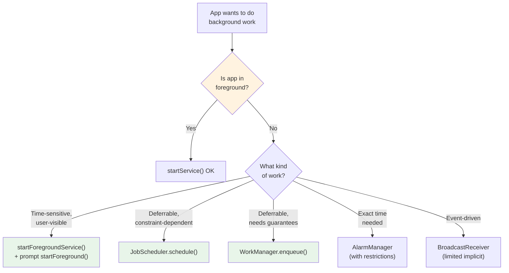

### 30.1.3 前台状态定义

如果以下任一条件为真，系统就认定应用处于"前台"：

| Condition | Example |
|-----------|---------|
| 有可见的活动 | 应用已打开并在屏幕上 |
| 有前台服务 | 音乐播放器、导航、文件上传 |
| 通过前台应用连接 | ContentProvider 正被前台应用使用 |
| 位于临时白名单中 | 刚收到高优先级 FCM 消息 |

精确的前台/后台状态由 `ActivityManagerService` 及其针对每个应用 UID 的 `UidRecord` 跟踪。

### 30.1.4 应用待机分组（App Standby Buckets）

Android 9.0（Pie，API 28）引入了 **App Standby Buckets（应用待机分组）**。这些分组根据用户最近何时以及多频繁地与每个应用交互，进一步细化后台限制：

| Bucket | Criteria | Job Frequency | Alarm Frequency |
|--------|----------|--------------|-----------------|
| **活跃（Active）** | 当前正在使用或刚刚使用过 | 无限制 | 无限制 |
| **工作集（Working Set）** | 经常使用，当前未活跃 | 最多延迟 2 小时 | 最多延迟 6 分钟 |
| **频繁（Frequent）** | 经常使用但非每日使用 | 最多延迟 8 小时 | 最多延迟 30 分钟 |
| **稀少（Rare）** | 很少使用 | 最多延迟 24 小时 | 最多延迟 2 小时 |
| **受限（Restricted）** | 极少用户交互，耗电量高 | 最多 24 小时，每天 1 个作业 | 最多延迟 24 小时 |

分组分配由 `UsageStatsManagerInternal` 和 `AppStandbyInternal` 管理：

```java
// Bucket indices defined in JobSchedulerService
// frameworks/base/apex/jobscheduler/service/java/com/android/server/job/
//     JobSchedulerService.java
public static final int ACTIVE_INDEX = 0;
public static final int WORKING_INDEX = 1;
public static final int FREQUENT_INDEX = 2;
public static final int RARE_INDEX = 3;
public static final int NEVER_INDEX = 4;
public static final int RESTRICTED_INDEX = 5;
public static final int EXEMPTED_INDEX = 6;
```

### 30.1.5 Doze 模式与应用待机

Android 6.0 引入了 **Doze 模式（打盹模式）**，当设备静止、未连接电源且屏幕长时间关闭时，它会限制后台活动。Android 7.0 增加了更轻量的"移动中的 Doze（Doze on the go）"，在屏幕关闭时（即使设备在移动）就会激活。

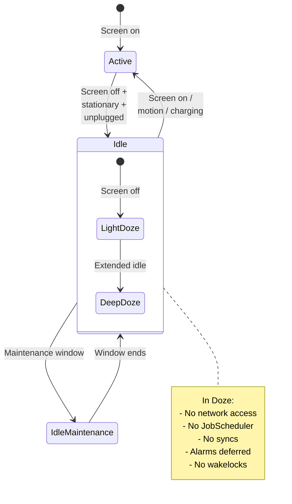

在 Doze 期间，系统：

- 延迟所有闹钟（`setAlarmClock()` 和列入白名单的精确闹钟除外）
- 阻断网络访问
- 挂起作业和同步
- 忽略唤醒锁（wakelock）
- 定期开启 **维护窗口**，被延迟的工作可在窗口内执行

### 30.1.6 省电模式

省电模式（Battery Saver，由用户手动开启或在低电量时自动触发）增加了进一步的限制：

- 减少后台网络访问
- 延迟作业和闹钟
- 降低定位精度
- 限制后台 CPU 使用
- 限制视觉效果（动画、动态壁纸）

### 30.1.7 后台限制的历史演变

| Android Version | API | Key Restriction |
|----------------|-----|-----------------|
| 6.0 (Marshmallow) | 23 | Doze 模式、应用待机 |
| 7.0 (Nougat) | 24 | 移动中的 Doze、限制隐式广播 |
| 8.0 (Oreo) | 26 | 后台服务限制、广播限制 |
| 9.0 (Pie) | 28 | 应用待机分组 |
| 10 (Q) | 29 | 后台活动启动限制 |
| 11 (R) | 30 | 前台服务类型要求 |
| 12 (S) | 31 | 精确闹钟限制、从后台启动前台服务 |
| 12L | 32 | 进一步的前台服务限制 |
| 13 (T) | 33 | 按应用语言、精细化的运行时权限 |
| 14 (U) | 34 | 强制执行前台服务类型、限制 `SCHEDULE_EXACT_ALARM` |
| 15 (V) | 35 | `dataSync` 前台服务 6 小时超时 |
| 16 | 36 | 对所有应用忽略 `setImportantWhileForeground()` 作业标志，不论目标 SDK |
| 17 | 37 | 新的 `getPendingJobReasons*()` 诊断、放弃作业检测、按网络的连接批处理、Perfetto 作业跟踪、闹钟前启动用户 |

---

## 30.2 JobScheduler

JobScheduler 是 Android 用于调度可延迟后台工作的主要机制。它在 Android 5.0（API 21）中引入。它让应用声明*需要做什么工作*以及*在什么条件下*执行，然后由系统决定*何时*运行它。这使系统能够批量处理工作、将其延迟到最佳时机（例如充电且连接 Wi-Fi 时），并执行待机分组配额。

### 30.2.1 架构概览

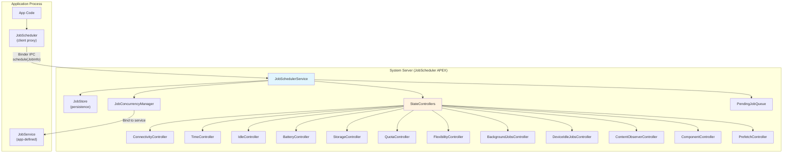

关键组件都位于 JobScheduler APEX 模块中：

**源代码路径**：`frameworks/base/apex/jobscheduler/service/java/com/android/server/job/`

### 30.2.2 JobSchedulerService

`JobSchedulerService` 是核心协调者。它继承 `SystemService` 并实现两个监听器接口：

```java
// frameworks/base/apex/jobscheduler/service/java/com/android/server/job/
//     JobSchedulerService.java
public class JobSchedulerService extends com.android.server.SystemService
        implements StateChangedListener, JobCompletedListener {

    public static final String TAG = "JobScheduler";

    /** The default maximum number of jobs that we allow an app to schedule */
    private static final int DEFAULT_MAX_JOBS_PER_APP = 150;

    /** Master list of jobs. */
    final JobStore mJobs;

    /** List of controllers that will notify this service of updates to jobs. */
    final List<StateController> mControllers;

    /** Queue of pending jobs ready to execute. */
    private final PendingJobQueue mPendingJobQueue = new PendingJobQueue();

    /** Manages concurrent job execution slots. */
    final JobConcurrencyManager mConcurrencyManager;

    // ...
}
```

关键常量与限制：

- **DEFAULT_MAX_JOBS_PER_APP = 150**：每个应用默认最多可有 150 个已调度作业。实际上限通过构造函数传入，因此是可配置的，而不是硬编码的 `MAX_JOBS_PER_APP` 常量。
- **NUM_COMPLETED_JOB_HISTORY = 20**：系统为调试目的保留最近完成的 20 个作业的记录

构造函数还接入了 `JobPerfettoTracer`（参见 §30.7），以便将每个作业的生命周期输出到 Perfetto 跟踪中：

```java
// frameworks/base/apex/jobscheduler/service/java/com/android/server/job/
//     JobSchedulerService.java
this(context, DEFAULT_MAX_JOBS_PER_APP, null, JobPerfettoTracer.create());
```

### 30.2.3 JobInfo：声明工作与约束

应用使用 `JobInfo.Builder` 描述其作业：

```java
JobInfo jobInfo = new JobInfo.Builder(JOB_ID,
        new ComponentName(context, MyJobService.class))
    // Constraints
    .setRequiredNetworkType(JobInfo.NETWORK_TYPE_UNMETERED)
    .setRequiresCharging(true)
    .setRequiresDeviceIdle(true)
    .setRequiresBatteryNotLow(true)
    .setRequiresStorageNotLow(true)

    // Timing
    .setMinimumLatency(15 * 60 * 1000)     // Don't run for at least 15 min
    .setOverrideDeadline(60 * 60 * 1000)    // Must run within 1 hour
    .setPeriodic(24 * 60 * 60 * 1000)       // Repeat every 24 hours

    // Persistence
    .setPersisted(true)  // Survive reboots

    // Content triggers
    .addTriggerContentUri(
        new JobInfo.TriggerContentUri(
            MediaStore.Images.Media.EXTERNAL_CONTENT_URI,
            JobInfo.TriggerContentUri.FLAG_NOTIFY_FOR_DESCENDANTS))

    // Backoff policy
    .setBackoffCriteria(30_000, JobInfo.BACKOFF_POLICY_EXPONENTIAL)

    // Expedited job (API 31+)
    .setExpedited(true)

    // Estimated network usage
    .setEstimatedNetworkBytes(
        5 * 1024 * 1024,   // 5 MB download
        1024 * 1024)        // 1 MB upload

    .build();

// Schedule the job
JobScheduler scheduler = context.getSystemService(JobScheduler.class);
int result = scheduler.schedule(jobInfo);
// result == JobScheduler.RESULT_SUCCESS or RESULT_FAILURE
```

### 30.2.4 约束类型

约束系统是 JobScheduler 价值的核心。每个约束由专门的 `StateController` 管理：

| Constraint | Controller | Source File |
|-----------|-----------|------------|
| 网络类型/连接 | `ConnectivityController` | `controllers/ConnectivityController.java` |
| 时间（延迟、截止期限、周期） | `TimeController` | `controllers/TimeController.java` |
| 设备空闲 | `IdleController` | `controllers/IdleController.java` |
| 充电/电量不低 | `BatteryController` | `controllers/BatteryController.java` |
| 存储空间不低 | `StorageController` | `controllers/StorageController.java` |
| Content URI 变化 | `ContentObserverController` | `controllers/ContentObserverController.java` |
| 配额执行 | `QuotaController` | `controllers/QuotaController.java` |
| 灵活性 | `FlexibilityController` | `controllers/FlexibilityController.java` |
| 后台限制 | `BackgroundJobsController` | `controllers/BackgroundJobsController.java` |
| Doze 模式 | `DeviceIdleJobsController` | `controllers/DeviceIdleJobsController.java` |
| 应用组件已启用 | `ComponentController` | `controllers/ComponentController.java` |
| 预取时机 | `PrefetchController` | `controllers/PrefetchController.java` |

所有控制器源文件位于：

**源代码路径**：`frameworks/base/apex/jobscheduler/service/java/com/android/server/job/controllers/`

有些控制器（`BatteryController`、`ConnectivityController`、`IdleController`）直接继承 `RestrictingController` 而非 `StateController`。`RestrictingController` 增加了两个钩子——`startTrackingRestrictedJobLocked()` 和 `stopTrackingRestrictedJobLocked()`——使这些控制器也能跟踪所属应用位于 `RESTRICTED` 待机分组的作业。在该分组中，约束必须更严格地保持满足。`IdleController` 的空闲检测管道位于 `controllers/idle/` 子包（`DeviceIdlenessTracker`、`CarIdlenessTracker` 以及 `IdlenessTracker`/`IdlenessListener` 接口）。这让同一个控制器在手持设备与车载设备上可以使用不同的"空闲"定义。

### 30.2.5 StateController 架构

所有控制器都继承抽象基类 `StateController`：

```java
// frameworks/base/apex/jobscheduler/service/java/com/android/server/job/
//     controllers/StateController.java
public abstract class StateController {
    protected final JobSchedulerService mService;
    protected final StateChangedListener mStateChangedListener;
    protected final Context mContext;
    protected final Object mLock;

    /**
     * Implement the logic here to decide whether a job should be
     * tracked by this controller.
     */
    public abstract void maybeStartTrackingJobLocked(
            JobStatus jobStatus, JobStatus lastJob);

    /**
     * Remove job from this controller's tracking.
     */
    public abstract void maybeStopTrackingJobLocked(
            JobStatus jobStatus, JobStatus lastJob);

    /**
     * Called when a controller's state changes to evaluate
     * which jobs are now ready.
     */
    public void evaluateStateLocked(JobStatus jobStatus) {}
}
```

每个控制器跟踪一组作业，并在 `JobStatus` 对象上维护约束满足位。当控制器的状态发生变化（例如设备连接到 Wi-Fi）时，它通过 `StateChangedListener` 接口通知 `JobSchedulerService`，从而触发对待处理作业的重新评估。

### 30.2.6 JobStatus：作业的内部表示

`JobStatus` 是已调度作业的内部表示。它将原始 `JobInfo` 与控制器跟踪的运行时状态聚合在一起：

```java
// frameworks/base/apex/jobscheduler/service/java/com/android/server/job/
//     controllers/JobStatus.java

/**
 * Uniquely identifies a job internally.
 * Created from the public JobInfo object when it lands on the scheduler.
 * Contains current state of the requirements of the job, as well as a
 * function to evaluate whether it's ready to run.
 */
public final class JobStatus {
    // Explicit constraints share the JobInfo.CONSTRAINT_FLAG_* low bits
    public static final int CONSTRAINT_CHARGING = JobInfo.CONSTRAINT_FLAG_CHARGING;      // 1 << 0
    public static final int CONSTRAINT_BATTERY_NOT_LOW =
            JobInfo.CONSTRAINT_FLAG_BATTERY_NOT_LOW;                                     // 1 << 1
    public static final int CONSTRAINT_IDLE = JobInfo.CONSTRAINT_FLAG_DEVICE_IDLE;       // 1 << 2
    public static final int CONSTRAINT_STORAGE_NOT_LOW =
            JobInfo.CONSTRAINT_FLAG_STORAGE_NOT_LOW;                                     // 1 << 3

    // The remaining explicit constraints occupy the high bits
    public static final int CONSTRAINT_TIMING_DELAY = 1 << 31;
    public static final int CONSTRAINT_DEADLINE = 1 << 30;
    public static final int CONSTRAINT_CONNECTIVITY = 1 << 28;
    public static final int CONSTRAINT_CONTENT_TRIGGER = 1 << 26;

    // Implicit constraints the system adds on top of what the app requested
    public static final int CONSTRAINT_DEVICE_NOT_DOZING = 1 << 25;        // Implicit
    public static final int CONSTRAINT_WITHIN_QUOTA = 1 << 24;             // Implicit
    public static final int CONSTRAINT_PREFETCH = 1 << 23;
    public static final int CONSTRAINT_BACKGROUND_NOT_RESTRICTED = 1 << 22; // Implicit
    public static final int CONSTRAINT_FLEXIBLE = 1 << 21;                  // Implicit

    // The job is ready when all required constraints are satisfied
    public boolean isReady() {
        return isReady(mSatisfiedConstraintsOfInterest);
    }
}
```

低四位（`CONSTRAINT_CHARGING`、`CONSTRAINT_BATTERY_NOT_LOW`、`CONSTRAINT_IDLE`、`CONSTRAINT_STORAGE_NOT_LOW`）与应用直接设置的 `JobInfo.CONSTRAINT_FLAG_*` 值共用。高位保存时间、连接和内容触发约束。它们还保存*隐式*约束（`CONSTRAINT_DEVICE_NOT_DOZING`、`CONSTRAINT_WITHIN_QUOTA`、`CONSTRAINT_BACKGROUND_NOT_RESTRICTED`、`CONSTRAINT_FLEXIBLE`）。无论应用请求了什么，系统都会叠加这些约束。因此，只设置了网络约束的作业仍可能处于挂起状态。Doze、配额和后台限制同样是约束，由各自的控制器进行评估。

### 30.2.7 作业调度流程

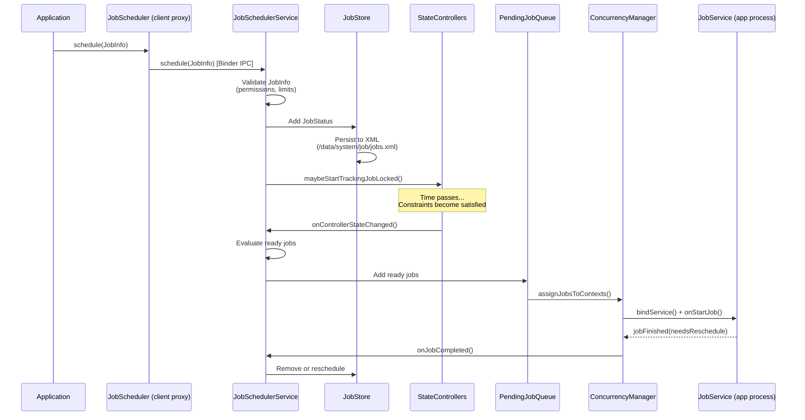

### 30.2.8 JobStore：持久化

`JobStore` 将已调度作业持久化到 XML，使其在重启后仍然保留：

**源代码路径**：`frameworks/base/apex/jobscheduler/service/java/com/android/server/job/JobStore.java`

```java
// frameworks/base/apex/jobscheduler/service/java/com/android/server/job/
//     JobStore.java
package com.android.server.job;

// Jobs are stored at /data/system/job/jobs.xml
// The format is XML with each job's constraints, timing, and metadata
```

该文件使用 `AtomicFile` 原子写入，以防止意外关机时损坏。启动时，`JobStore` 读取此文件以恢复所有已持久化的作业（那些通过 `setPersisted(true)` 创建的作业）。

### 30.2.9 ConnectivityController：网络约束

`ConnectivityController` 跟踪网络状态并评估每个作业的网络约束是否满足：

**源代码路径**：`frameworks/base/apex/jobscheduler/service/java/com/android/server/job/controllers/ConnectivityController.java`

```java
// frameworks/base/apex/jobscheduler/service/java/com/android/server/job/
//     controllers/ConnectivityController.java
package com.android.server.job.controllers;

// Tracks network types: NONE, ANY, UNMETERED, NOT_ROAMING, CELLULAR
// Uses ConnectivityManager.NetworkCallback to monitor changes
// Evaluates NetworkCapabilities for each job's requirements
```

控制器向 `ConnectivityManager` 注册一个 `NetworkCallback`，并在网络状态发生变化时重新评估所有被跟踪的作业。它还考虑应用的数据节省状态和按流量计费的网络策略。

### 30.2.10 QuotaController：执行配额

`QuotaController` 根据待机分组分配强制执行每个应用的执行时间配额：

```java
// frameworks/base/apex/jobscheduler/service/java/com/android/server/job/
//     controllers/QuotaController.java

// Legacy quota windows and limits per standby bucket:
// Active:     10 min / 10 min window  (effectively unlimited)
// Working:    10 min / 2 hour window
// Frequent:   10 min / 8 hour window
// Rare:       10 min / 24 hour window
// Restricted: 10 min / 24 hour window, max 10 jobs
```

配额系统跟踪滚动窗口内累计的作业执行时间。当应用超过其配额时，其作业会被延迟，直到窗口向前滚动到配额再次可用。

这些数字是*默认值*，不是常量。`QuotaController.QcConstants` 从 `DeviceConfig` 命名空间读取每个配额值，因此 Google 可以在不修改框架的情况下按版本调整它们。源代码中并列保留了三代默认值——`DEFAULT_LEGACY_*`、`DEFAULT_CURRENT_*` 和 `DEFAULT_LATEST_*`——运行时选择生效的一套。在 Android 17 代码树中，与旧值相比，"current"/"latest" 默认值明显放宽了窗口：

| Bucket | 旧版配额 / 窗口 | 当前/最新配额 / 窗口 |
|--------|------------------------|---------------------------------|
| 活跃 | 10 分钟 / 10 分钟 | 20 分钟 / 60 分钟 |
| 工作集 | 10 分钟 / 2 小时 | 10 分钟 / 4 小时 |
| 频繁 | 10 分钟 / 8 小时 | 10 分钟 / 12 小时 |
| 稀少 | 10 分钟 / 24 小时 | 10 分钟 / 24 小时 |
| 受限 | 10 分钟 / 24 小时，10 个作业 | 10 分钟 / 24 小时，10 个作业 |

加急作业（EJ）获得在同一控制器中跟踪的独立预算。该预算在滚动 24 小时窗口内有自己按分组设置的限额。例如，`ACTIVE` 为 30 分钟、`WORKING` 为 15 分钟、`FREQUENT`/`RARE` 为 10 分钟、`RESTRICTED` 为 5 分钟。因此，加急工作的突发不会消耗常规作业配额。

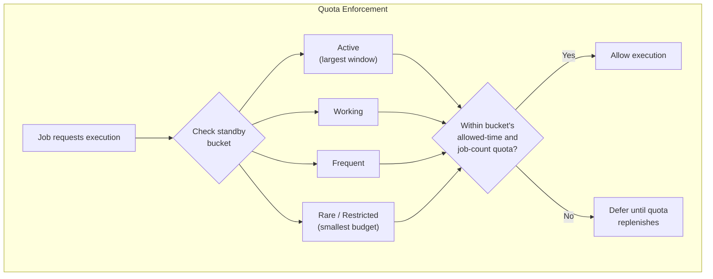

### 30.2.11 FlexibilityController

`FlexibilityController` 管理作业新鲜度与系统效率之间的权衡。它定义了一组 `FLEXIBLE_CONSTRAINTS`。系统级的约束包括充电、电量不低和设备空闲，外加作业专属的连接约束。控制器在作业生命周期的早期将它们视为*软*偏好。

一个新调度的作业最初被要求满足所有这些约束。这样它就会在最高效的时机运行，例如在空闲时一边充电一边连着 Wi-Fi。随着作业接近截止期限，控制器逐步放弃这些灵活约束。到达回退截止期限时，这些约束不再有任何要求，作业可以无视设备状态运行。没有显式截止期限的作业回退到 `FcConfig.DEFAULT_FALLBACK_FLEXIBILITY_DEADLINE_MS`。正是这一点让 JobScheduler 能够为合适的时机保留低优先级工作，同时绝不会让其饿死。

### 30.2.12 JobConcurrencyManager

`JobConcurrencyManager` 控制可以同时运行的作业数量：

**源代码路径**：`frameworks/base/apex/jobscheduler/service/java/com/android/server/job/JobConcurrencyManager.java`

```java
// frameworks/base/apex/jobscheduler/service/java/com/android/server/job/
//     JobConcurrencyManager.java
package com.android.server.job;

// Manages a pool of JobServiceContext objects (execution slots)
// Balances reserved slots across the WORK_TYPE_* categories
// Total concurrent slots depend on device RAM: low-RAM devices get 8;
// otherwise 16/20/32/40 by total memory (DEFAULT_CONCURRENCY_LIMIT)
```

该管理器将正在运行的作业划分为 `WORK_TYPE_*` 位集，并为每个类别保留一定数量的并发执行槽位。因此低优先级工作无法挤占高优先级工作：

| Work Type Constant | Meaning |
|-------------------|---------|
| `WORK_TYPE_TOP` | 针对处于 `TOP` 进程状态（当前活跃用户）的应用的作业 |
| `WORK_TYPE_FGS` | 针对处于前台服务状态或更高状态的应用的作业 |
| `WORK_TYPE_UI` | 允许作为用户发起的作业（UIJ）运行的作业 |
| `WORK_TYPE_EJ` | 允许作为加急作业运行的作业 |
| `WORK_TYPE_BG` | 面向活跃用户的普通后台作业 |
| `WORK_TYPE_BGUSER_IMPORTANT` | 面向完全转入后台的用户的 FGS/EJ/UIJ 作业 |
| `WORK_TYPE_BGUSER` | 面向完全转入后台的用户的普通后台作业 |

在多用户设备上，这两种 `BGUSER` 类型在当前活跃用户和其他（后台）用户之间分配并发额度。因此，后台用户的作业不会挤占前台用户的作业。

### 30.2.13 JobService：应用侧实现

应用实现 `JobService` 以接收并执行已调度的作业：

```java
public class MyJobService extends JobService {

    @Override
    public boolean onStartJob(JobParameters params) {
        // Called on the main thread when the job should start
        // Return true if work is ongoing (async)
        // Return false if work is already complete

        new Thread(() -> {
            try {
                doWork(params);
            } finally {
                // MUST call jobFinished when async work completes
                jobFinished(params, false /* needsReschedule */);
            }
        }).start();

        return true; // Work is asynchronous
    }

    @Override
    public boolean onStopJob(JobParameters params) {
        // Called when the system wants to stop the job
        // (constraint no longer satisfied, or preempted)
        // Return true to reschedule, false to drop

        cancelOngoingWork();
        return true; // Reschedule this job
    }
}
```

必须在清单文件中声明该服务并要求 `BIND_JOB_SERVICE` 权限：

```xml
<service
    android:name=".MyJobService"
    android:permission="android.permission.BIND_JOB_SERVICE"
    android:exported="false" />
```

### 30.2.14 限制与热节流

`JobRestriction` 类允许系统根据超出常规约束的设备状况阻止作业执行。当前的限制是温度状态：

```java
// frameworks/base/apex/jobscheduler/service/java/com/android/server/job/
//     restrictions/ThermalStatusRestriction.java
// Blocks jobs when device is in thermal throttling state
```

`ThermalStatusRestriction` 继承抽象类 `JobRestriction`。当设备越过温度阈值时，它会以 `INTERNAL_STOP_REASON_DEVICE_THERMAL` 停止受影响的作业。在 Android 17 代码树中，它报告的是*特定的*挂起原因——`PENDING_JOB_REASON_DEVICE_STATE_THERMAL`——而非旧的通用原因 `PENDING_JOB_REASON_DEVICE_STATE`。因此，查询作业为何卡住的应用现在可以将热节流与其他设备状态阻塞区分开来。参见 §30.7 中关于新的挂起原因 API 的内容。

**源代码路径**：`frameworks/base/apex/jobscheduler/service/java/com/android/server/job/restrictions/`

### 30.2.15 调试 JobScheduler

```bash
# Dump all scheduled jobs
adb shell dumpsys jobscheduler

# Dump jobs for a specific package
adb shell dumpsys jobscheduler | grep -A 20 "com.example.myapp"

# Force-run a specific job
adb shell cmd jobscheduler run -f com.example.myapp 42

# View job execution history
adb shell dumpsys jobscheduler | grep "completed"

# Check standby bucket for an app
adb shell am get-standby-bucket com.example.myapp

# Set standby bucket for testing
adb shell am set-standby-bucket com.example.myapp rare
```

---

## 30.3 AlarmManager

`AlarmManager` 是 Android 中最古老的后台调度机制，比 `JobScheduler` 早了数年。它向应用传递基于时间的回调，可以是在某个特定时刻，也可以是在某个延迟之后。与 `JobScheduler` 不同，`AlarmManager` 针对的是*时间精度*，而不是*约束满足*。

### 30.3.1 架构

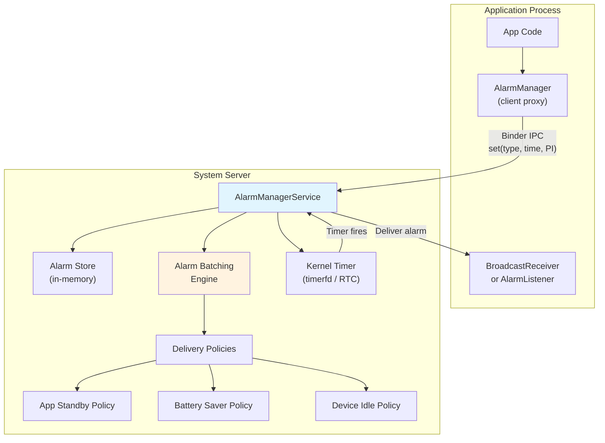

**源代码路径**：`frameworks/base/apex/jobscheduler/service/java/com/android/server/alarm/AlarmManagerService.java`

`AlarmManagerService` 是一个庞大而复杂的服务，在 Android 的历史上经历了显著演变。关键 import 揭示了它的职责：

```java
// frameworks/base/apex/jobscheduler/service/java/com/android/server/alarm/
//     AlarmManagerService.java
package com.android.server.alarm;

// Key constants from the imports:
import static android.app.AlarmManager.ELAPSED_REALTIME;
import static android.app.AlarmManager.ELAPSED_REALTIME_WAKEUP;
import static android.app.AlarmManager.RTC;
import static android.app.AlarmManager.RTC_WAKEUP;
import static android.app.AlarmManager.FLAG_ALLOW_WHILE_IDLE;
import static android.app.AlarmManager.FLAG_IDLE_UNTIL;
import static android.app.AlarmManager.FLAG_WAKE_FROM_IDLE;
import static android.app.AlarmManager.FLAG_PRIORITIZE;
```

### 30.3.2 闹钟类型

Android 基于两个维度——时间基准和唤醒行为——支持四种闹钟类型：

| Type | Time Base | Wakes Device | Use Case |
|------|-----------|-------------|----------|
| `RTC_WAKEUP` | 挂钟时间（UTC） | 是 | 日历事件、定时通知 |
| `RTC` | 挂钟时间（UTC） | 否 | 非紧急的基于时间的更新 |
| `ELAPSED_REALTIME_WAKEUP` | 距开机时长 | 是 | 周期性检查、心跳 |
| `ELAPSED_REALTIME` | 距开机时长 | 否 | UI 计时器、非关键的周期性工作 |

`_WAKEUP` 变体会将设备从睡眠（Doze）中唤醒以传递闹钟。非唤醒闹钟会被延迟，直到设备已经处于唤醒状态。

### 30.3.3 精确闹钟与非精确闹钟

这是闹钟调度中最重要的区分之一：

**精确闹钟**在请求的精确时刻触发。它们面向的是面向用户的承诺，例如日历事件通知和服药提醒。

```java
AlarmManager am = context.getSystemService(AlarmManager.class);

// Exact alarm -- fires at the precise time
am.setExact(AlarmManager.RTC_WAKEUP,
    triggerTimeMillis,
    pendingIntent);

// Exact alarm that can fire during Doze
am.setExactAndAllowWhileIdle(AlarmManager.RTC_WAKEUP,
    triggerTimeMillis,
    pendingIntent);

// Alarm clock (shown to user, always fires on time)
am.setAlarmClock(
    new AlarmManager.AlarmClockInfo(triggerTimeMillis, showIntent),
    pendingIntent);
```

**非精确闹钟**允许系统将闹钟与附近时刻的闹钟一起批量处理，从而减少设备唤醒次数：

```java
// Inexact alarm -- system may batch with nearby alarms
am.set(AlarmManager.ELAPSED_REALTIME_WAKEUP,
    SystemClock.elapsedRealtime() + 30 * 60 * 1000,
    pendingIntent);

// Inexact repeating alarm
am.setInexactRepeating(AlarmManager.ELAPSED_REALTIME_WAKEUP,
    SystemClock.elapsedRealtime() + 60 * 1000,
    AlarmManager.INTERVAL_HALF_HOUR,
    pendingIntent);

// Window alarm -- fires within a time window
am.setWindow(AlarmManager.ELAPSED_REALTIME_WAKEUP,
    triggerTime,
    windowLength,
    pendingIntent);
```

### 30.3.4 精确闹钟限制（API 31+）

从 Android 12（API 31）开始，精确闹钟需要 `SCHEDULE_EXACT_ALARM` 权限，这是一项用户可以撤销的特殊权限：

```xml
<uses-permission android:name="android.permission.SCHEDULE_EXACT_ALARM" />
```

从 Android 14（API 34）开始，新安装的应用**默认不会授予**该权限。应用必须引导用户前往特殊的应用访问界面：

```java
// Check if exact alarms are allowed
if (!alarmManager.canScheduleExactAlarms()) {
    // Direct user to settings
    Intent intent = new Intent(Settings.ACTION_REQUEST_SCHEDULE_EXACT_ALARM);
    startActivity(intent);
}
```

豁免该权限的情况有：

- 闹钟应用（持有 `SET_ALARM` 权限 + 闹钟应用角色）
- 系统应用
- 使用 `setAlarmClock()` 的应用（始终豁免，因为它们对用户可见）

AlarmManagerService 会跟踪精确闹钟权限状态：

```java
// From AlarmManagerService.java imports
import static com.android.server.alarm.Alarm.EXACT_ALLOW_REASON_ALLOW_LIST;
import static com.android.server.alarm.Alarm.EXACT_ALLOW_REASON_COMPAT;
import static com.android.server.alarm.Alarm.EXACT_ALLOW_REASON_LISTENER;
import static com.android.server.alarm.Alarm.EXACT_ALLOW_REASON_NOT_APPLICABLE;
import static com.android.server.alarm.Alarm.EXACT_ALLOW_REASON_PERMISSION;
import static com.android.server.alarm.Alarm.EXACT_ALLOW_REASON_POLICY_PERMISSION;
import static com.android.server.alarm.Alarm.EXACT_ALLOW_REASON_PRIORITIZED;
```

### 30.3.5 闹钟批处理

对于非精确闹钟，系统会将附近时刻的闹钟打包在一起，以尽量减少唤醒次数：

```mermaid
gantt
    title Alarm Batching
    dateFormat HH:mm
    axisFormat %H:%M

    section Without Batching
    App A alarm    :a1, 09:00, 1m
    App B alarm    :a2, 09:05, 1m
    App C alarm    :a3, 09:12, 1m
    App D alarm    :a4, 09:18, 1m
    App E alarm    :a5, 09:22, 1m

    section With Batching
    Batch 1 (A+B+C)  :b1, 09:12, 3m
    Batch 2 (D+E)    :b2, 09:22, 2m
```

批处理将唤醒次数从 5 次减少到 2 次。系统创建时间窗口，并将非精确闹钟对齐到相同的窗口边界。`setWindow()` 让开发者可以在一定程度上控制可接受的窗口大小。

### 30.3.6 空闲分发

`AlarmManagerService` 支持空闲分发闹钟，它们只在 Doze 维护窗口期间触发：

```java
// Flags from AlarmManagerService.java
FLAG_ALLOW_WHILE_IDLE          // Can fire during Doze (with quotas)
FLAG_ALLOW_WHILE_IDLE_COMPAT   // Compat mode for older targeting
FLAG_IDLE_UNTIL                // Schedules the next Doze state transition
FLAG_WAKE_FROM_IDLE            // Can wake device from Doze
FLAG_PRIORITIZE                // Gets priority delivery
```

需要在 Doze 期间触发闹钟的应用可以使用 `setAndAllowWhileIdle()` 或 `setExactAndAllowWhileIdle()`。系统按每个应用的配额对这些闹钟进行限速，而不是采用固定的最小间隔。在 Android 17 代码树中，`AlarmManagerService.Constants` 中的默认值允许在 `DEFAULT_ALLOW_WHILE_IDLE_WINDOW` 的一小时窗口内进行 `DEFAULT_ALLOW_WHILE_IDLE_QUOTA = 72` 次 while-idle 闹钟传递。这适用于面向较新 API 级别的应用。仍采用旧版"兼容"行为的应用每个窗口只能获得 `DEFAULT_ALLOW_WHILE_IDLE_COMPAT_QUOTA = 7` 次。所有这些值都可通过 `DeviceConfig` 调整，因此确切上限可能因版本而异。

### 30.3.7 闹钟传递策略

多层策略可以延迟闹钟传递：

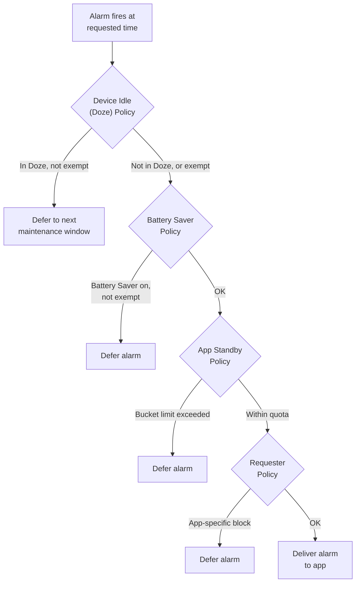

### 30.3.8 基于监听器的闹钟

Android 7.0 引入了 `AlarmManager.OnAlarmListener`，作为同一进程内闹钟传递 `PendingIntent` 的替代方案：

```java
AlarmManager am = getSystemService(AlarmManager.class);

// Listener-based alarm (no PendingIntent needed)
am.set(AlarmManager.ELAPSED_REALTIME,
    SystemClock.elapsedRealtime() + 5000,
    "my-alarm-tag",
    () -> {
        // This runs on the specified handler's thread
        Log.d("Alarm", "Alarm fired!");
    },
    handler);
```

监听器闹钟比 `PendingIntent` 闹钟更高效，因为它们避免了构造和传递 `PendingIntent` 的 IPC 开销。但是，它们仅在应用进程存活时有效。

### 30.3.9 AlarmManager 与 JobScheduler 对比

| Feature | AlarmManager | JobScheduler |
|---------|-------------|-------------|
| 时间精度 | 高（精确/窗口） | 低（延迟到最佳时机） |
| 约束支持 | 无（仅时间） | 丰富（网络、充电、空闲……） |
| 批处理 | 非精确闹钟由系统管理 | 始终由系统管理 |
| 持久化 | 无法跨重启（所有闹钟，包括 `setAlarmClock`，都会丢失；应用必须在 `ACTION_BOOT_COMPLETED` 时重新调度） | `setPersisted(true)` |
| 电源效率 | 较低（唤醒次数多） | 较高（批量处理、延迟） |
| 适用场景 | 日历事件、闹钟 | 同步、上传、维护 |
| API 级别 | 1+ | 21+ |

**经验法则**：仅当你需要在特定时刻触发时才使用 `AlarmManager`。对于所有其他后台工作，请使用 `JobScheduler` 或 `WorkManager`。

### 30.3.10 调试 AlarmManager

```bash
# Dump all pending alarms
adb shell dumpsys alarm

# Dump alarms for a specific package
adb shell dumpsys alarm | grep -A 5 "com.example.myapp"

# Check exact alarm permission
adb shell appops get com.example.myapp SCHEDULE_EXACT_ALARM

# View alarm statistics
adb shell dumpsys alarm | grep -A 20 "Alarm Stats"

# Set the system wall clock (RTC alarms scheduled before this time will then be due)
adb shell cmd alarm set-time <epoch_millis>
```

---

## 30.4 WorkManager

WorkManager 是一个 AndroidX 库（并非 AOSP 本身的一部分），它为可延迟、有保障的后台工作提供高层 API。它是现代 Android 应用中大多数后台工作的**推荐 API**。它在 `JobScheduler`、`AlarmManager` 和其他机制之上进行抽象，提供统一的、向后兼容的解决方案。

### 30.4.1 WorkManager 存在的原因

后台执行 API 的碎片化给应用开发者带来了问题：

| API Level | Available Mechanism | Limitation |
|-----------|-------------------|------------|
| 1-13 | 仅有 `AlarmManager` | 无约束、无批处理 |
| 14-20 | `AlarmManager` + 自定义服务 | 无约束 API |
| 21-22 | 引入 `JobScheduler` | 约束有限 |
| 23+ | `JobScheduler` + Doze | 交互复杂 |
| 26+ | 后台服务限制 | 旧代码失效 |

WorkManager 对此进行了全面抽象：

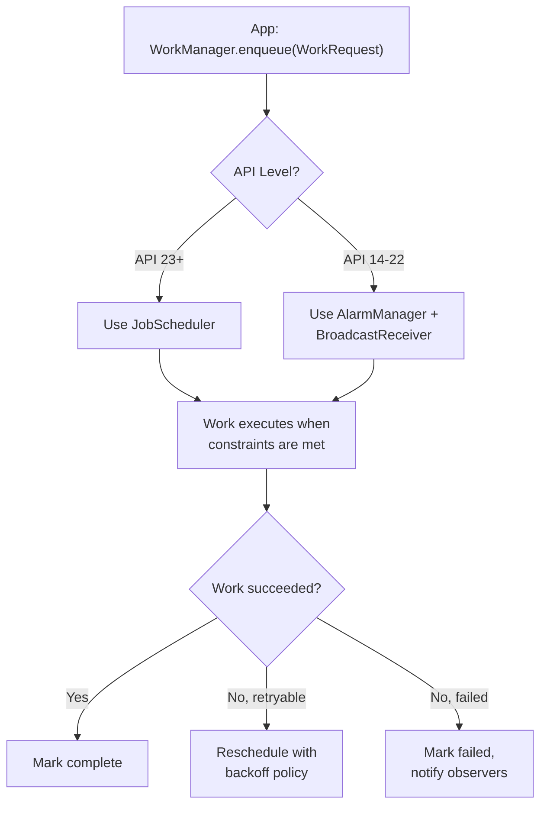

### 30.4.2 核心概念

WorkManager 引入了几个关键抽象：

**WorkRequest**：定义一个带有可选约束和调度的工作单元：

```java
// One-time work
OneTimeWorkRequest uploadWork = new OneTimeWorkRequest.Builder(UploadWorker.class)
    .setConstraints(new Constraints.Builder()
        .setRequiredNetworkType(NetworkType.UNMETERED)
        .setRequiresCharging(true)
        .build())
    .setBackoffCriteria(BackoffPolicy.EXPONENTIAL, 30, TimeUnit.SECONDS)
    .addTag("upload")
    .setInputData(new Data.Builder()
        .putString("file_path", "/sdcard/photo.jpg")
        .build())
    .build();

// Periodic work
PeriodicWorkRequest syncWork = new PeriodicWorkRequest.Builder(
        SyncWorker.class, 1, TimeUnit.HOURS)
    .setConstraints(new Constraints.Builder()
        .setRequiredNetworkType(NetworkType.CONNECTED)
        .build())
    .build();
```

**Worker**：实际的工作实现：

```java
public class UploadWorker extends Worker {
    public UploadWorker(Context context, WorkerParameters params) {
        super(context, params);
    }

    @Override
    public Result doWork() {
        String filePath = getInputData().getString("file_path");
        try {
            uploadFile(filePath);
            return Result.success();
        } catch (IOException e) {
            return Result.retry(); // Will be retried with backoff
        }
    }
}
```

**工作链**：组合复杂的工作图：

```java
WorkManager.getInstance(context)
    // First: download data (can run in parallel)
    .beginWith(Arrays.asList(downloadWork1, downloadWork2))
    // Then: process the downloaded data
    .then(processWork)
    // Finally: upload the result
    .then(uploadWork)
    .enqueue();
```

### 30.4.3 架构

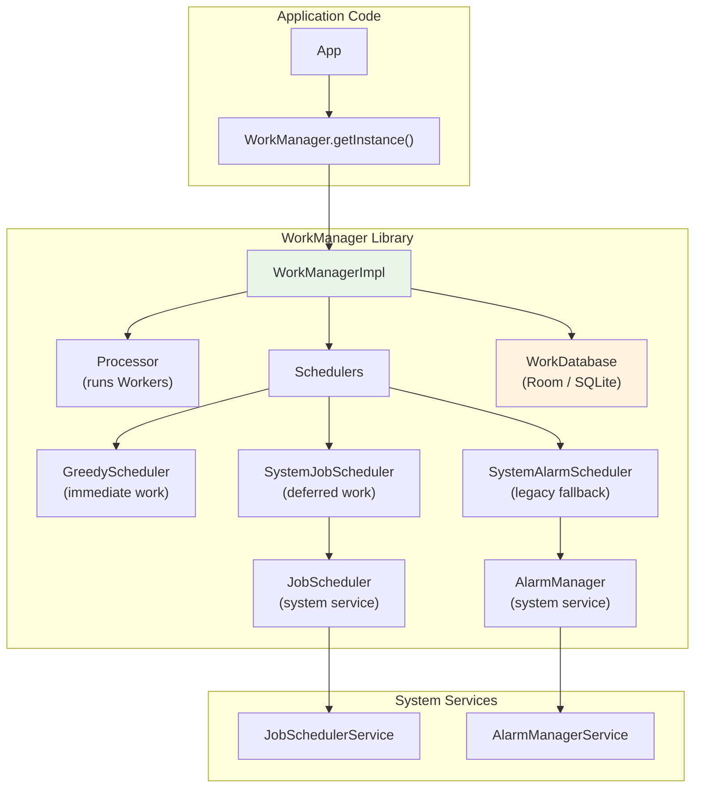

关键的架构决策：

1. **使用 Room 数据库持久化**：WorkManager 将所有工作请求存储在 Room（SQLite）数据库中。这确保了工作在进程死亡和设备重启后仍然存在。

2. **调度器委托**：在 API 23+ 上，WorkManager 为每个延迟的 `WorkRequest` 创建一个 `JobInfo`，并将调度委托给 `JobScheduler`。在较旧的 API 上，它使用 `AlarmManager` 加 `BroadcastReceiver`。

3. **贪婪调度器**：对于没有约束的工作，WorkManager 的 `GreedyScheduler` 会立即运行该工作，而不经过 `JobScheduler`。

4. **可观察的工作**：WorkManager 返回 `LiveData<WorkInfo>` 或 `Flow<WorkInfo>`，应用可以观察它们来跟踪工作进度和完成情况。

### 30.4.4 WorkManager 与 JobScheduler 的集成

当 WorkManager 委托给 JobScheduler 时，它会创建一个映射 WorkRequest 约束的 JobInfo：

| WorkManager Constraint | JobInfo Equivalent |
|----------------------|-------------------|
| `NetworkType.CONNECTED` | `setRequiredNetworkType(NETWORK_TYPE_ANY)` |
| `NetworkType.UNMETERED` | `setRequiredNetworkType(NETWORK_TYPE_UNMETERED)` |
| `requiresCharging()` | `setRequiresCharging(true)` |
| `requiresDeviceIdle()` | `setRequiresDeviceIdle(true)` |
| `requiresBatteryNotLow()` | `setRequiresBatteryNotLow(true)` |
| `requiresStorageNotLow()` | `setRequiresStorageNotLow(true)` |

WorkManager 的 `SystemJobService`（继承自 `JobService`）接收来自 `JobSchedulerService` 的回调，并将其分发到相应的 `Worker`。

### 30.4.5 工作状态

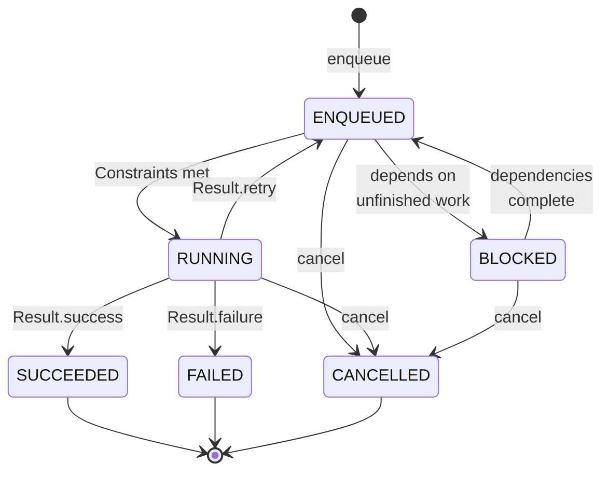

### 30.4.6 唯一工作

WorkManager 支持唯一工作以防止重复调度：

```java
// Unique one-time work
WorkManager.getInstance(context).enqueueUniqueWork(
    "sync-data",                              // Unique name
    ExistingWorkPolicy.REPLACE,               // KEEP, REPLACE, or APPEND
    oneTimeWorkRequest);

// Unique periodic work
WorkManager.getInstance(context).enqueueUniquePeriodicWork(
    "periodic-sync",
    ExistingPeriodicWorkPolicy.KEEP,          // KEEP or UPDATE
    periodicWorkRequest);
```

这避免了每次应用启动时都调度重复周期性工作的常见 bug。

### 30.4.7 加急工作

对于 API 31+ 上的时间敏感型工作，WorkManager 支持映射到 JobScheduler 加急作业的加急工作：

```java
OneTimeWorkRequest urgentWork = new OneTimeWorkRequest.Builder(UrgentWorker.class)
    .setExpedited(OutOfQuotaPolicy.RUN_AS_NON_EXPEDITED_WORK_REQUEST)
    .build();

WorkManager.getInstance(context).enqueue(urgentWork);
```

在 API 31+ 上，这使用 `JobInfo.Builder.setExpedited(true)`。在较旧的 API 上，WorkManager 会回退到前台服务。

### 30.4.8 长时间运行的工作

对于可能超过标准 10 分钟执行限制的工作：

```java
public class LongUploadWorker extends CoroutineWorker {
    @Override
    public ForegroundInfo getForegroundInfo() {
        return new ForegroundInfo(
            NOTIFICATION_ID,
            createNotification("Uploading..."),
            ServiceInfo.FOREGROUND_SERVICE_TYPE_DATA_SYNC);
    }

    @Override
    public Result doWork() {
        setForeground(getForegroundInfo());
        // This work can now run for an extended time
        performLongUpload();
        return Result.success();
    }
}
```

Worker 调用 `setForeground()`。结果是该 Worker 被提升为前台服务，从而不受标准执行时间限制的约束。

---

## 30.5 前台服务

前台服务是执行用户明确知晓的工作的服务，通过通知栏中的常驻通知来表明。它们豁免后台执行限制，可以无限期运行，但在现代 Android 版本中受到的限制日益增多。

### 30.5.1 创建前台服务

```java
public class MusicService extends Service {
    private static final int NOTIFICATION_ID = 1;
    private static final String CHANNEL_ID = "music_playback";

    @Override
    public int onStartCommand(Intent intent, int flags, int startId) {
        Notification notification = new NotificationCompat.Builder(this, CHANNEL_ID)
            .setContentTitle("Playing Music")
            .setContentText("Artist - Song Title")
            .setSmallIcon(R.drawable.ic_music_note)
            .setPriority(NotificationCompat.PRIORITY_LOW)
            .build();

        // Must call promptly after startForegroundService()
        // (30-second platform default timeout; see 30.5.7)
        startForeground(NOTIFICATION_ID, notification,
            ServiceInfo.FOREGROUND_SERVICE_TYPE_MEDIA_PLAYBACK);

        return START_STICKY;
    }
}
```

启动前台服务：

```java
// From Android 8.0+, use startForegroundService()
Intent serviceIntent = new Intent(context, MusicService.class);

if (Build.VERSION.SDK_INT >= Build.VERSION_CODES.O) {
    context.startForegroundService(serviceIntent);
} else {
    context.startService(serviceIntent);
}
```

### 30.5.2 前台服务类型（API 29+）

Android 10 引入了强制性的前台服务类型。Android 14（API 34）使清单中的 `foregroundServiceType` 属性成为必需项。

| 类型 | 常量 | 适用场景 | 所需权限 |
|------|----------|----------|-------------------|
| 相机 | `camera` | 相机预览、视频录制 | `FOREGROUND_SERVICE_CAMERA` |
| 连接设备 | `connectedDevice` | 蓝牙、USB、配套设备 | `FOREGROUND_SERVICE_CONNECTED_DEVICE` |
| 数据同步 | `dataSync` | 云同步、备份 | `FOREGROUND_SERVICE_DATA_SYNC` |
| 健康 | `health` | 健身追踪、心率 | `FOREGROUND_SERVICE_HEALTH` |
| 定位 | `location` | 导航、位置追踪 | `FOREGROUND_SERVICE_LOCATION` + `ACCESS_*_LOCATION` |
| 媒体播放 | `mediaPlayback` | 音乐、播客、有声书 | `FOREGROUND_SERVICE_MEDIA_PLAYBACK` |
| 媒体处理 | `mediaProcessing` | 视频/照片编辑与处理（6 小时限制） | `FOREGROUND_SERVICE_MEDIA_PROCESSING` |
| 媒体投影 | `mediaProjection` | 屏幕捕获、投射 | `FOREGROUND_SERVICE_MEDIA_PROJECTION` |
| 麦克风 | `microphone` | 录音、VoIP | `FOREGROUND_SERVICE_MICROPHONE` |
| 电话呼叫 | `phoneCall` | VoIP、通话应用 | `FOREGROUND_SERVICE_PHONE_CALL` |
| 远程消息 | `remoteMessaging` | 在配套设备上的消息收发 | `FOREGROUND_SERVICE_REMOTE_MESSAGING` |
| 短服务 | `shortService` | 简短的用户发起的工作（&lt; 3 分钟） | 无 |
| 特殊用途 | `specialUse` | 上述未涵盖的场景 | `FOREGROUND_SERVICE_SPECIAL_USE` |
| 系统豁免 | `systemExempted` | 仅限系统应用 | （仅限系统） |

```xml
<!-- In AndroidManifest.xml -->
<service
    android:name=".MusicService"
    android:foregroundServiceType="mediaPlayback"
    android:exported="false">
</service>

<!-- Required permission -->
<uses-permission android:name="android.permission.FOREGROUND_SERVICE" />
<uses-permission android:name="android.permission.FOREGROUND_SERVICE_MEDIA_PLAYBACK" />
```

### 30.5.3 前台服务生命周期

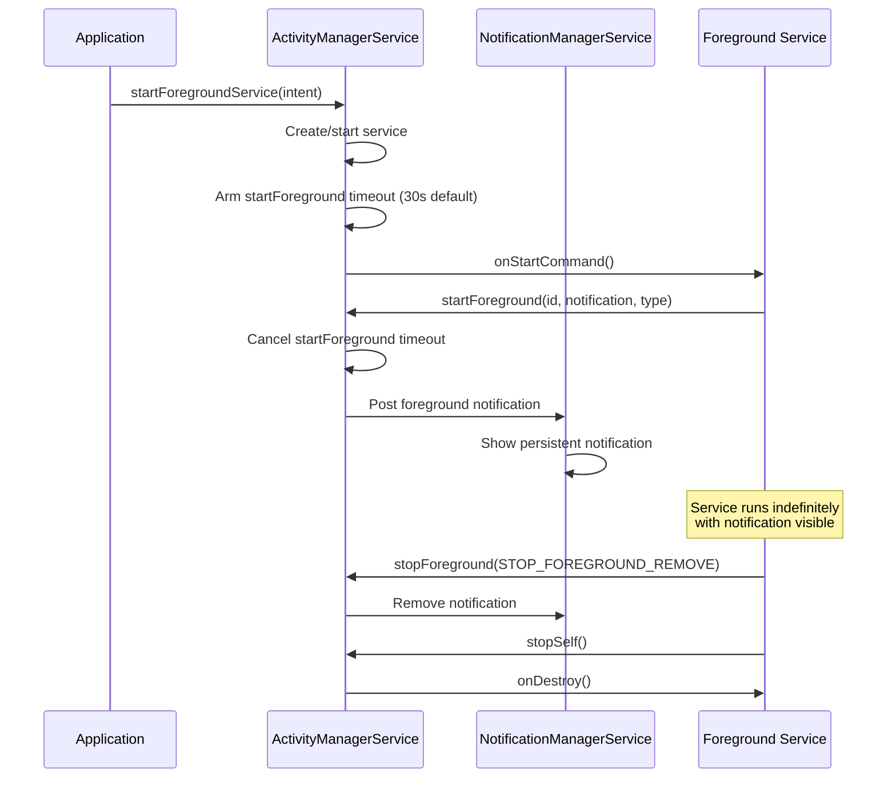

### 30.5.4 后台启动限制（API 31+）

Android 12 引入了从后台启动前台服务的限制。应用在后台时不能调用 `startForegroundService()`，除非拥有有效的豁免：

| 豁免 | 描述 |
|-----------|-------------|
| 高优先级 FCM | 应用收到了高优先级推送消息 |
| 闹钟/闹钟时钟 | 应用的闹钟刚刚触发 |
| 地理围栏/活动过渡 | 与位置相关的触发 |
| 系统广播 | 某些系统广播（开机、语言环境变化） |
| `SYSTEM_ALERT_WINDOW` | 应用拥有悬浮窗权限 |
| 配套设备 | 应用管理配套设备 |
| `START_ACTIVITIES_FROM_BACKGROUND` | 特权权限 |

没有豁免的应用应改用 `WorkManager` 并配合 `setExpedited()` 或 `setForeground()`。

### 30.5.5 短服务（API 34+）

Android 14 引入了 `shortService` 前台服务类型，用于简短的用户发起的操作。这些操作需要在前台运行，但只需很短时间（3 分钟以内）：

```java
// Start a short foreground service
startForeground(NOTIFICATION_ID, notification,
    ServiceInfo.FOREGROUND_SERVICE_TYPE_SHORT_SERVICE);

// System will call onTimeout() after approximately 3 minutes
@Override
public void onTimeout(int startId, int fgsType) {
    // Must stop the service or upgrade to a longer type
    stopSelf();
}
```

短服务的权限要求比其他类型更少，适合发送消息或处理支付等一次性操作。

### 30.5.6 数据同步前台服务超时（API 35+）

从 Android 15 开始，`dataSync` 前台服务具有约 6 小时的超时时间。超时后，系统会调用 `onTimeout()`，服务必须停止或转换为其他类型。这防止了有问题的代码可能遗留的无限期数据同步服务。

同一版本为视频和照片编辑增加了 `mediaProcessing` 类型（`ServiceInfo.java` 中的值 `1 << 13`）。该类型同样带有 6 小时限制和相同的 `onTimeout()` 约定。在 `ActiveServices` 中，活动的超时时间由 `mDataSyncFgsTimeoutDuration` 和匹配的媒体处理常量驱动，因此这两种长时间运行的类型共享相同的执行路径：

```java
// frameworks/base/services/core/java/com/android/server/am/ActiveServices.java
if ((foregroundServiceType & ServiceInfo.FOREGROUND_SERVICE_TYPE_MEDIA_PROCESSING)
        == ServiceInfo.FOREGROUND_SERVICE_TYPE_MEDIA_PROCESSING) {
    fgsType = ServiceInfo.FOREGROUND_SERVICE_TYPE_MEDIA_PROCESSING;
    // ... timeout = mAm.mConstants.mMediaProcessingFgsTimeoutDuration
}
```

`shortService` 超时通过独立的 `SERVICE_SHORT_FGS_TIMEOUT_MSG` 处理消息强制执行，并带有自己的 `OOM_ADJ_REASON_SHORT_FGS_TIMEOUT` 调整。这反映出短服务设计为持续数分钟而非数小时。

### 30.5.7 前台服务 ANR

如果前台服务在 `startForegroundService()` 之后没有及时调用 `startForeground()`，系统会生成 `ForegroundServiceDidNotStartInTimeException` 崩溃。开发者指南建议在几秒内调用 `startForeground()`。平台强制执行的窗口要更长。AOSP 默认值为 30 秒（`frameworks/base/services/core/java/com/android/server/am/ActivityManagerConstants.java` 中的 `DEFAULT_SERVICE_START_FOREGROUND_TIMEOUT_MS`，可通过 `DeviceConfig` 中的 `mServiceStartForegroundTimeoutMs` 调整）。之后再经过 10 秒的 ANR 延迟（`DEFAULT_SERVICE_START_FOREGROUND_ANR_DELAY_MS`），`ActiveServices` 才会真正抛出异常。在 API 31+ 上，如果应用在后台启动且没有豁免，则会抛出 `ForegroundServiceStartNotAllowedException`。

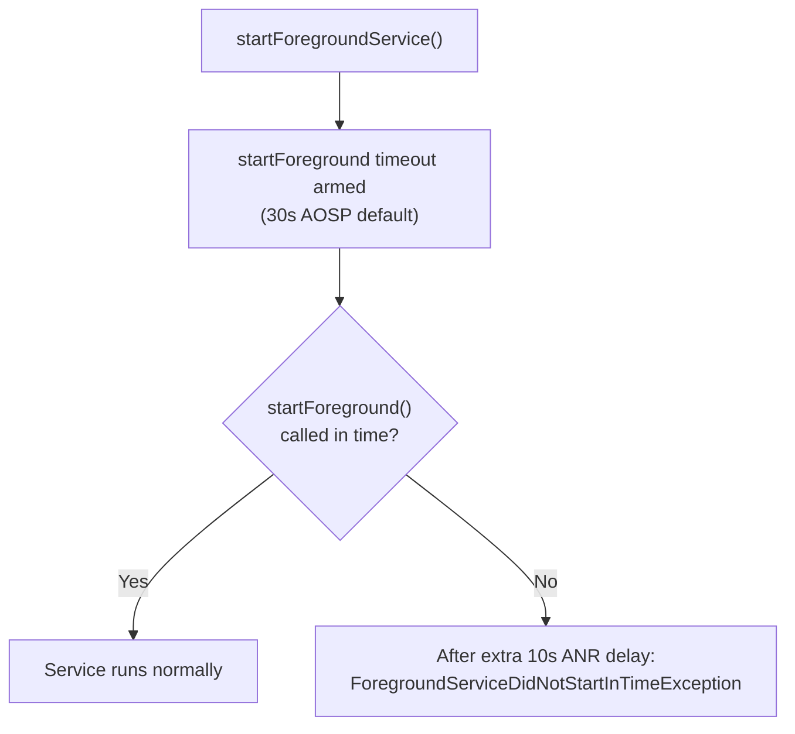

### 30.5.8 通知要求

每个前台服务都必须有一个可见的通知：

```java
// Create notification channel (required API 26+)
NotificationChannel channel = new NotificationChannel(
    CHANNEL_ID,
    "Background Service",
    NotificationManager.IMPORTANCE_LOW);  // LOW = no sound
channel.setDescription("Shows when the service is active");
notificationManager.createNotificationChannel(channel);

// Build the notification
Notification notification = new NotificationCompat.Builder(this, CHANNEL_ID)
    .setContentTitle("Syncing Data")
    .setContentText("Uploading 42 files...")
    .setSmallIcon(R.drawable.ic_sync)
    .setOngoing(true)                    // Cannot be swiped away
    .setProgress(100, 42, false)         // Show progress bar
    .addAction(R.drawable.ic_cancel, "Cancel",
        cancelPendingIntent)             // User can cancel
    .build();
```

通知具有双重作用。它向用户通报正在进行的工作。它还提供了问责性：如果用户看到意外通知，就知道是哪个应用在消耗资源，并可以将其停止。

### 30.5.9 用户可见的前台服务通知

从 Android 13（API 33）开始，前台服务任务管理器（SystemUI 中的 `FgsManagerController`，位于 `frameworks/base/packages/SystemUI/src/com/android/systemui/qs/FgsManagerController.kt`）在通知栏中增加了"活跃应用"入口。它列出当前正在运行前台服务的应用，每个应用都带有一个"停止"按钮。这让用户可以控制行为异常的应用，而无需进入"设置"。

---

## 30.6 广播限制

广播是 Android 的事件系统：它们向应用通知系统事件（网络变化、电池状态、屏幕开/关），并支持应用间通信。然而，隐式广播——那些发送给任何已注册接收器而非特定组件的广播——是后台唤醒的主要来源。

### 30.6.1 隐式广播问题

以 `ACTION_CONNECTIVITY_CHANGE` 为例。在 Android 7.0 之前，每个为该广播注册清单接收器的应用在网络每次变化时都会被唤醒。安装数百个应用的情况下，单次 Wi-Fi 开关就可能同时启动 50 多个应用进程。

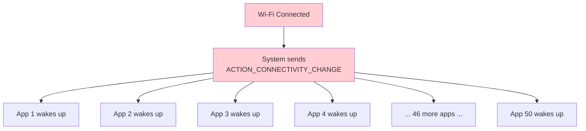

### 30.6.2 广播限制时间线

| Version | API | Restriction |
|---------|-----|------------|
| 7.0 | 24 | `CONNECTIVITY_ACTION` 不再传递给清单接收器 |
| 7.0 | 24 | `ACTION_NEW_PICTURE`、`ACTION_NEW_VIDEO` 受限 |
| 8.0 | 26 | 大多数隐式广播对清单接收器被阻止 |
| 8.0 | 26 | 为关键广播设置显式例外列表 |

### 30.6.3 显式广播与隐式广播

**隐式广播**面向匹配 intent 过滤器的任何接收器：

```xml
<!-- This manifest receiver NO LONGER WORKS for most broadcasts (API 26+) -->
<receiver android:name=".NetworkChangeReceiver">
    <intent-filter>
        <action android:name="android.net.conn.CONNECTIVITY_CHANGE" />
    </intent-filter>
</receiver>
```

**显式广播**面向特定组件：

```java
// This still works -- explicit broadcast to a specific receiver
Intent intent = new Intent(context, MyReceiver.class);
intent.setAction("com.example.MY_ACTION");
context.sendBroadcast(intent);
```

### 30.6.4 豁免广播

某些系统广播豁免于隐式广播限制，因为它们对应用的正确行为至关重要。豁免列表包括：

| Broadcast | Reason for Exemption |
|-----------|---------------------|
| `ACTION_BOOT_COMPLETED` | 应用需要在开机后恢复闹钟/状态 |
| `ACTION_LOCALE_CHANGED` | 应用需要刷新依赖语言环境的缓存 |
| `ACTION_MY_PACKAGE_REPLACED` | 应用需要知道何时被更新 |
| `ACTION_PACKAGE_ADDED/REMOVED` | 包管理 |
| `ACTION_TIMEZONE_CHANGED` | 时间敏感的应用需要立即收到通知 |
| `ACTION_TIME_SET` | 类似时区变化 |
| `USB_DEVICE_ATTACHED` | USB 配件应用 |
| `ACTION_HEADSET_PLUG` | 音频应用需要了解音频路由 |
| `ACTION_CONNECTION_STATE_CHANGED`（蓝牙） | 配套设备应用 |

### 30.6.5 隐式广播的替代方案

对于每个受限的隐式广播，Android 都提供了推荐的替代方案：

| Restricted Broadcast | Alternative |
|---------------------|-------------|
| `CONNECTIVITY_CHANGE` | 使用 `setRequiredNetworkType()` 的 `JobScheduler`，或 `ConnectivityManager.registerNetworkCallback()` |
| `ACTION_POWER_CONNECTED/DISCONNECTED` | 使用 `setRequiresCharging()` 的 `JobScheduler` |
| `ACTION_NEW_PICTURE/VIDEO` | 针对 `MediaStore` 使用 `addTriggerContentUri()` 的 `JobScheduler` |
| 自定义周期性唤醒 | 使用 `PeriodicWorkRequest` 的 `WorkManager` |

### 30.6.6 按 Context 注册的接收器

虽然清单注册的接收器在隐式广播方面受到限制，但**按 Context 注册的接收器**（通过 `registerReceiver()` 注册的）不受限制：

```java
// Context-registered receivers still work for all broadcasts
// But only while the app process is alive
BroadcastReceiver receiver = new BroadcastReceiver() {
    @Override
    public void onReceive(Context context, Intent intent) {
        // Handle connectivity change
    }
};

IntentFilter filter = new IntentFilter(ConnectivityManager.CONNECTIVITY_ACTION);
registerReceiver(receiver, filter);

// Must unregister to avoid leaks
unregisterReceiver(receiver);
```

关键区别在于：按 Context 注册的接收器仅在应用已经运行时有效。它们不会从停止状态启动应用。这正是该限制有效性的核心——它防止广播风暴同时启动数十个休眠的应用。

### 30.6.7 有序广播与粘性广播

Android 还支持有序广播（接收器按优先级顺序处理广播，并且可以中止它）和粘性广播（已弃用）。限制规则同样适用于所有广播类型——限制针对的是*接收器注册机制*（清单 vs. Context），而不是广播类型。

### 30.6.8 受保护的广播

系统服务可以将广播声明为"受保护"，这意味着只有系统才能发送它们：

```xml
<!-- In the framework's AndroidManifest.xml -->
<protected-broadcast android:name="android.intent.action.BOOT_COMPLETED" />
<protected-broadcast android:name="android.intent.action.LOCALE_CHANGED" />
```

如果非系统应用尝试发送受保护的广播，系统会记录警告，并可能拒绝它。

---

## 30.7 Android 17 后台执行变更

Android 17 源代码树是对后台调度的细化，而非重建。JobScheduler 的控制器架构、AlarmManager 服务和前台服务规则都保持了上文所述的相同形态。发生变化的主要是*诊断能力*、*多用户正确性*，以及一组用于微调批处理和配额的功能标志。

其中大多数行为都由 `aconfig` 标志控制，这是 AOSP 在运行时开关背后发布更改的机制。少数并非如此。例如，§30.7.8 中的闹钟前启动用户功能由一个配置资源布尔值加上多用户检查保护。它没有 aconfig 标志。

### 30.7.1 调度器背后的 aconfig 标志

后台调度在 jobscheduler APEX 内的四个 `aconfig` 文件中公开其标志。框架侧的标志（位于 `backstage_power` 命名空间）控制新的公共 API；服务侧的标志控制内部行为。

| aconfig file | Scope |
|--------------|-------|
| `framework/aconfig/job.aconfig` | 新的 `JobScheduler`/`JobInfo` API |
| `framework/aconfig/alarm.aconfig` | `AlarmManager` 监听器/配额行为 |
| `service/aconfig/job.aconfig` | 内部作业批处理与限制 |
| `service/aconfig/device_idle.aconfig` | Doze（`DeviceIdleController`）调优 |

**源代码路径**：`frameworks/base/apex/jobscheduler/framework/aconfig/` 和
`frameworks/base/apex/jobscheduler/service/aconfig/`

### 30.7.2 新的挂起原因诊断 API

长期以来，询问作业为何没有运行的唯一途径是 `JobScheduler.getPendingJobReason(int jobId)`，即使多个约束未满足，它也只返回一个原因。Android 17 取代了它。该方法在形式上并未被标记为 `@Deprecated`，但 `@apiNote` 现在引导调用者使用 `getPendingJobReasons(int)`。Android 17 还增加了三个更丰富的 API，声明在 `frameworks/base/apex/jobscheduler/framework/java/android/app/job/JobScheduler.java` 中：

```java
// Returns ALL the reasons a job is currently pending, not just one.
@NonNull @PendingJobReason
public int[] getPendingJobReasons(int jobId);

// A truncated time-stamped history of why the job was pending.
// Not persisted across reboots.
@NonNull
public List<PendingJobReasonsInfo> getPendingJobReasonsHistory(int jobId);

// An aggregated view: each PENDING_JOB_REASON_* mapped to the total
// time the job spent pending for that reason over its lifetime.
@NonNull
public Map<Integer, Duration> getPendingJobReasonStats(int jobId);
```

这些对应于 `get_pending_job_reasons_api`、`get_pending_job_reasons_history_api` 和 `get_pending_job_reason_stats_api` 标志。配套的 `enhanced_pending_and_stop_reasons_api` 标志添加了更具体的原因代码。例如，温度 `JobRestriction` 现在报告 `PENDING_JOB_REASON_DEVICE_STATE_THERMAL`，而不是通用的 `PENDING_JOB_REASON_DEVICE_STATE`（参见 §30.2.14）。有了它，应用就可以将热节流与 doze 或其他设备状态阻塞区分开来。由于这些历史记录都不会在重启后持久化，因此它们仅用于实时调试，而不是长期遥测。

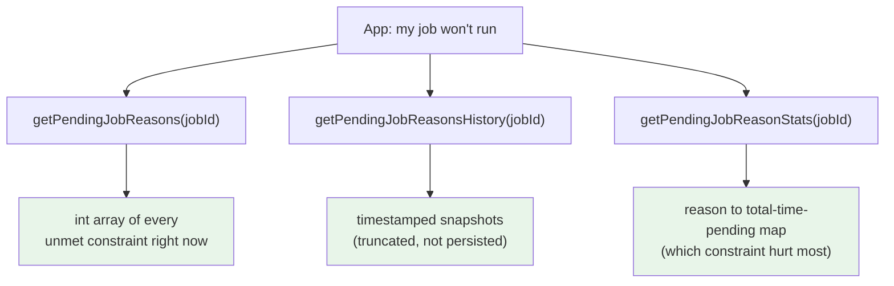

### 30.7.3 作业上的调试标签和跟踪标签

`job_debug_info_apis` 标志为作业添加了开发者附加的元数据。`JobInfo.Builder.addDebugTag(String)` 附加自由格式的调试标签（每个作业最多 32 个，每个 127 字符，不含 PII）。`setTraceTag(String)` 附加一个出现在系统跟踪中的标签。这些标签会显示在 `dumpsys jobscheduler` 输出和 Perfetto 作业跟踪事件（§30.7.4）中。这让在诊断调度问题时区分应用众多已调度作业中的哪一个变得容易得多：

```java
// frameworks/base/apex/jobscheduler/framework/java/android/app/job/JobInfo.java
new JobInfo.Builder(JOB_ID, component)
    .addDebugTag("nightly-photo-sync")
    .setTraceTag("photo-sync")
    .build();
```

### 30.7.4 Perfetto 作业跟踪

Android 17 通过外部 Perfetto SDK 路由 JobScheduler 的跟踪。新的 `JobPerfettoTracer`（`JobPerfettoTracer.java`，Copyright 2025）在 `JobSchedulerService` 构造函数中创建。它为每个作业的生命周期发出一个即时跟踪事件，并标记该作业的组件和任何跟踪标签。这取代了旧的临时 `Trace` 调用。它还将作业执行显示为 Perfetto 捕获中的一等 track 事件，与系统其余部分的跟踪并列。

**源代码路径**：`frameworks/base/apex/jobscheduler/service/java/com/android/server/job/JobPerfettoTracer.java`

### 30.7.5 放弃作业检测

一个长期存在的故障模式是应用从 `onStartJob()` 返回 `true`（承诺进行异步工作）却从不调用 `jobFinished()`。作业的执行上下文会一直被占用直到超时，从而浪费一个并发槽位。`handle_abandoned_jobs` 标志为此添加了检测。当 `JobServiceContext` 对作业超时时，它会检查该作业是否已被放弃。如果是，它会报告一个不同的停止原因，而不是普通的超时：

```java
// frameworks/base/apex/jobscheduler/service/java/com/android/server/job/
//     JobServiceContext.java
if (android.app.job.Flags.handleAbandonedJobs()
        && executing != null
        && executing.isAbandoned()) {
    stopReason = JobParameters.STOP_REASON_TIMEOUT_ABANDONED;
    internalStopReason = JobParameters.INTERNAL_STOP_REASON_TIMEOUT_ABANDONED;
    // " and maybe abandoned" appended to the stop message
}
```

新的 `STOP_REASON_TIMEOUT_ABANDONED` 让系统能够统计重复发生的放弃失败（`JobStatus.getNumAbandonedFailures()`），并将长期行为异常的作业与仅仅运行时间长的作业区别对待。一个 `CompatChanges` 门（`OVERRIDE_HANDLE_ABANDONED_JOBS`）允许在过渡期间按 UID 选择退出更严格的行为。

### 30.7.6 更智能的作业批处理

三个服务侧标志调整就绪作业实际*何时*启动，用一点延迟换取更少的唤醒和射频激活：

- `batch_active_bucket_jobs`：`ACTIVE` 分组中的作业现在被纳入批处理范围，而不是允许它们一旦就绪就立即运行。
- `batch_connectivity_jobs_per_network`：受连接约束的作业会被保留，直到有多个作业就绪（或网络已经处于活动状态），因此一次射频唤醒可以同时服务多个作业。
- `do_not_force_rush_execution_at_boot`：调度器不再在开机后立即强制加急执行作业，从而平滑开机后的 CPU 和 I/O 峰值。

还有两个标志限制应用可以向调度器提出多少要求。`enforce_proxied_jobs_limit` 限制间接调度的作业数量（例如通过 `SyncManager`）。`limit_per_uid_cumulative_workitem_size` 限制应用的 `JobWorkItem` 可以在系统中钉住的内存总量。`include_job_name_in_anr_message` 是一个小而实用的调试改进：违规作业的组件名称现在会出现在响应缓慢的 ANR 消息中。

### 30.7.7 用户发起作业的通知

用户发起作业（UIJ）在运行时必须显示通知，类似于前台服务。这在 Android 17 中并非新内容。集中式的 `JobNotificationCoordinator`（`JobNotificationCoordinator.java`，Copyright 2022）随 UIJ 本身在 Android 14（API 34）中一起发布。它将每个正在运行的 UIJ 映射到其附加的应用通知。它通过 `NotificationManagerInternal` 为该通知标记用户发起作业标志。它还限制应用在作业运行期间静默取消 UIJ 的通知。

这样，用户始终保留一个可见、可操作的指示器（以及停止工作的方法）。当作业停止或完成时，通过从 `JobServiceContext` 调用的 `removeNotificationAssociation()` 拆除该关联——以及在适当情况下通知本身。Android 17 原样继承了这个协调器。此处之所以介绍它，是因为它是本章其余部分所依赖的 UIJ 行为的基础。

**源代码路径**：`frameworks/base/apex/jobscheduler/service/java/com/android/server/job/JobNotificationCoordinator.java`

### 30.7.8 在闹钟触发前启动用户

在多用户和私密空间设备上，应用可以属于一个*已停止*的用户。它的闹钟可能会被错过，因为在闹钟时刻到来时该用户（以及该应用）并未运行。Android 17 用 `UserWakeupStore`（`UserWakeupStore.java`，Copyright 2024）弥补了这一缺口。

该功能不在 aconfig 标志之后。`AlarmManagerService` 仅在 `UserManager.supportsMultipleUsers()` 为 true *且*配置资源布尔值 `config_allowAlarmsOnStoppedUsers` 已设置时才设置 `mStartUserBeforeScheduledAlarms`（AlarmManagerService.java:1873-1875）。启用后，`AlarmManagerService` 按用户记录该用户有闹钟到期的最早时间。它还将对有待处理闹钟的用户 ID 集合持久化到系统数据目录下的 XML 文件中：

```java
// frameworks/base/apex/jobscheduler/service/java/com/android/server/alarm/
//     AlarmManagerService.java
mUserWakeupStore.addUserWakeup(userId, convertToElapsed(...));
// ... at delivery time, the affected users are started first:
final int[] userIds = mUserWakeupStore.getUserIdsToWakeup(nowELAPSED);
```

由于该列表是持久化的，即使设备重启后，设置了闹钟的用户也可以被启动。该存储还刻意错开连续的用户启动（它们之间有固定延迟）。这样，系统就不会尝试在同一时刻启动多个已停止的用户。这正是使定时闹钟对私密空间和辅助资料档案应用可靠的主要原因。

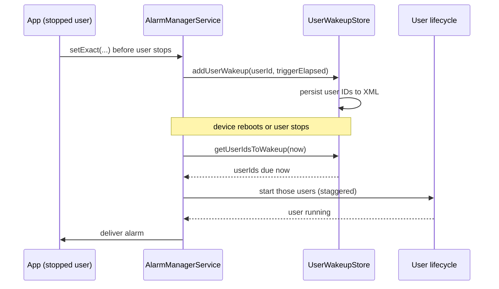

### 30.7.9 AlarmManager 监听器与配额标志

`alarm.aconfig` 标志细化了 while-idle 行为：

- `allow_listeners_while_idle`：基于 `OnAlarmListener` 的闹钟（§30.3.8 中的进程内变体）现在可以被允许在 doze 期间按 while-idle 配额触发。它们有自己的 `DEFAULT_ALLOW_WHILE_IDLE_LISTENER_QUOTA`（每个窗口 72 次）。这与 `PendingIntent` while-idle 闹钟已有的配额相匹配。
- `allow_alarms_with_relaxed_quota`：某些允许在空闲期间触发的监听器闹钟被授予宽松配额路径，在传递时通过 `Flags.allowAlarmsWithRelaxedQuota()` 在 `AlarmManagerService` 中进行检查。

### 30.7.10 Doze 调优标志

`device_idle.aconfig` 标志调整 Doze 的行为方式，而不改变其状态机（§30.1.5）：

- `disable_wakelocks_in_light_idle`：在*轻度*空闲期间忽略唤醒锁，而不仅仅是深度空闲期间，从而堵住一个耗电通道。
- `quick_doze_on_lid_close`：当折叠屏或笔记本式设备的盖子合上时快速进入 Doze，而不是等待正常的静止计时器。
- `allow_non_wake_up_deep_alarms`（Wear）：允许在 Wear 设备的深度空闲期间评估非唤醒闹钟。
- `support_allow_while_idle_quota_zero`：支持将 while-idle 配额一路配置到零，在需要时完全阻止 while-idle 闹钟。

这些都不会改变公共闹钟或作业 API。它们是平台（以及 OEM，针对 Wear 和折叠屏设备）用来调优 doze/待机电池权衡的调节旋钮。

---

## 30.8 动手实践

本节提供动手练习来探索 Android 的后台任务调度基础设施。

### 30.8.1 练习：检查 JobScheduler 状态

```bash
# Dump all scheduled jobs
adb shell dumpsys jobscheduler

# The output includes:
# - Registered jobs (per-app, with constraints)
# - Currently running jobs
# - Pending job queue
# - Controller states
# - Quota usage per standby bucket
# - Recent execution history

# Look at registered jobs for a specific package
adb shell dumpsys jobscheduler | grep -B 2 -A 20 "com.google.android.gms"

# Check standby buckets for all apps
adb shell dumpsys usagestats | grep -A 2 "bucket"

# View job execution timeline
adb shell dumpsys jobscheduler | grep -A 20 "Recently completed jobs"
```

### 30.8.2 练习：调度并监控作业

创建一个简单的作业：

```java
public class DemoJobService extends JobService {
    private static final String TAG = "DemoJob";

    @Override
    public boolean onStartJob(JobParameters params) {
        Log.d(TAG, "Job started: id=" + params.getJobId()
            + " network=" + params.getNetwork());

        // Simulate async work
        new Thread(() -> {
            try {
                Thread.sleep(5000); // 5 seconds of work
            } catch (InterruptedException e) {
                Thread.currentThread().interrupt();
            }
            Log.d(TAG, "Job completed: id=" + params.getJobId());
            jobFinished(params, false);
        }).start();

        return true;
    }

    @Override
    public boolean onStopJob(JobParameters params) {
        Log.d(TAG, "Job stopped: id=" + params.getJobId()
            + " reason=" + params.getStopReason());
        return true; // Reschedule
    }
}
```

调度它：

```java
ComponentName service = new ComponentName(this, DemoJobService.class);

JobInfo.Builder builder = new JobInfo.Builder(1001, service)
    .setRequiredNetworkType(JobInfo.NETWORK_TYPE_ANY)
    .setRequiresCharging(false)
    .setMinimumLatency(5000)      // 5 seconds minimum delay
    .setOverrideDeadline(30000);  // 30 seconds maximum delay

JobScheduler scheduler = getSystemService(JobScheduler.class);
int result = scheduler.schedule(builder.build());
Log.d("Schedule", "Result: " + (result == JobScheduler.RESULT_SUCCESS
    ? "SUCCESS" : "FAILURE"));
```

通过 adb 强制运行它：

```bash
# Force run the job immediately (bypass constraints)
adb shell cmd jobscheduler run -f com.example.myapp 1001

# Watch logcat for the job output
adb logcat -s DemoJob:D

# Check the job's current state
adb shell dumpsys jobscheduler | grep -A 15 "com.example.myapp"
```

### 30.8.3 练习：测试闹钟调度

```java
public class AlarmDemoActivity extends Activity {

    @Override
    protected void onCreate(Bundle savedInstanceState) {
        super.onCreate(savedInstanceState);

        AlarmManager am = getSystemService(AlarmManager.class);

        // 1. Inexact alarm (batched by system)
        PendingIntent inexactPi = PendingIntent.getBroadcast(this, 0,
            new Intent(this, AlarmReceiver.class).setAction("INEXACT"),
            PendingIntent.FLAG_IMMUTABLE);
        am.set(AlarmManager.ELAPSED_REALTIME_WAKEUP,
            SystemClock.elapsedRealtime() + 60_000, inexactPi);

        // 2. Exact alarm (requires SCHEDULE_EXACT_ALARM on API 31+)
        if (am.canScheduleExactAlarms()) {
            PendingIntent exactPi = PendingIntent.getBroadcast(this, 1,
                new Intent(this, AlarmReceiver.class).setAction("EXACT"),
                PendingIntent.FLAG_IMMUTABLE);
            am.setExact(AlarmManager.RTC_WAKEUP,
                System.currentTimeMillis() + 30_000, exactPi);
        }

        // 3. Alarm clock (always fires on time, shows in status bar)
        PendingIntent clockPi = PendingIntent.getActivity(this, 2,
            new Intent(this, AlarmDemoActivity.class),
            PendingIntent.FLAG_IMMUTABLE);
        PendingIntent alarmPi = PendingIntent.getBroadcast(this, 3,
            new Intent(this, AlarmReceiver.class).setAction("ALARM_CLOCK"),
            PendingIntent.FLAG_IMMUTABLE);
        am.setAlarmClock(
            new AlarmManager.AlarmClockInfo(
                System.currentTimeMillis() + 120_000, clockPi),
            alarmPi);

        Log.d("AlarmDemo", "Alarms scheduled");
    }
}
```

通过 adb 监控：

```bash
# View all pending alarms
adb shell dumpsys alarm | head -100

# View alarms for your package
adb shell dumpsys alarm | grep -A 5 "com.example.myapp"

# View alarm statistics
adb shell dumpsys alarm | grep -A 30 "Alarm Stats"

# View alarm clock (shown to user)
adb shell dumpsys alarm | grep "AlarmClock"
```

### 30.8.4 练习：WorkManager 工作链

```java
// Step 1: Create workers
public class DownloadWorker extends Worker {
    @Override public Result doWork() {
        String url = getInputData().getString("url");
        Log.d("WM", "Downloading: " + url);
        // Simulate download
        try { Thread.sleep(2000); } catch (Exception e) {}
        return Result.success(new Data.Builder()
            .putString("local_path", "/data/downloaded_file")
            .build());
    }
}

public class ProcessWorker extends Worker {
    @Override public Result doWork() {
        String path = getInputData().getString("local_path");
        Log.d("WM", "Processing: " + path);
        try { Thread.sleep(3000); } catch (Exception e) {}
        return Result.success(new Data.Builder()
            .putString("processed_path", "/data/processed_file")
            .build());
    }
}

public class UploadWorker extends Worker {
    @Override public Result doWork() {
        String path = getInputData().getString("processed_path");
        Log.d("WM", "Uploading: " + path);
        try { Thread.sleep(2000); } catch (Exception e) {}
        return Result.success();
    }
}

// Step 2: Build and enqueue the chain
OneTimeWorkRequest download = new OneTimeWorkRequest.Builder(DownloadWorker.class)
    .setInputData(new Data.Builder().putString("url", "https://example.com/data").build())
    .addTag("pipeline")
    .build();

OneTimeWorkRequest process = new OneTimeWorkRequest.Builder(ProcessWorker.class)
    .addTag("pipeline")
    .build();

OneTimeWorkRequest upload = new OneTimeWorkRequest.Builder(UploadWorker.class)
    .setConstraints(new Constraints.Builder()
        .setRequiredNetworkType(NetworkType.CONNECTED)
        .build())
    .addTag("pipeline")
    .build();

WorkManager.getInstance(context)
    .beginWith(download)
    .then(process)
    .then(upload)
    .enqueue();

// Step 3: Observe the chain
WorkManager.getInstance(context)
    .getWorkInfosByTagLiveData("pipeline")
    .observe(this, workInfos -> {
        for (WorkInfo info : workInfos) {
            Log.d("WM", "Work " + info.getId()
                + " state=" + info.getState()
                + " progress=" + info.getProgress());
        }
    });
```

### 30.8.5 练习：测试 Doze 模式

```bash
# Re-enable device idle mode (if previously disabled); the force-idle
# commands below are what actually put the device into Doze
adb shell dumpsys deviceidle enable

# Force device into light Doze
adb shell dumpsys deviceidle force-idle light

# Force device into deep Doze
adb shell dumpsys deviceidle force-idle deep

# Check Doze state
adb shell dumpsys deviceidle get deep
adb shell dumpsys deviceidle get light

# Step through Doze states
adb shell dumpsys deviceidle step light
adb shell dumpsys deviceidle step deep

# Observe: your scheduled jobs and alarms will be deferred

# Exit Doze
adb shell dumpsys deviceidle unforce
adb shell dumpsys deviceidle disable

# Check which apps are whitelisted from Doze
adb shell dumpsys deviceidle whitelist
```

### 30.8.6 练习：测试应用待机分组

```bash
# Check current bucket for an app
adb shell am get-standby-bucket com.example.myapp

# Set bucket for testing
adb shell am set-standby-bucket com.example.myapp active
adb shell am set-standby-bucket com.example.myapp working_set
adb shell am set-standby-bucket com.example.myapp frequent
adb shell am set-standby-bucket com.example.myapp rare
adb shell am set-standby-bucket com.example.myapp restricted

# Observe the effect on your scheduled jobs
adb shell dumpsys jobscheduler | grep -A 10 "com.example.myapp"

# Restore automatic bucket assignment: set the bucket back to active;
# the system then re-ages it based on real usage (there is no dedicated
# reset command -- only set-standby-bucket and get-standby-bucket exist)
adb shell am set-standby-bucket com.example.myapp active
```

### 30.8.7 练习：测试后台限制

```bash
# Restrict background for an app (simulates Battery Saver per-app restriction)
adb shell cmd appops set com.example.myapp RUN_IN_BACKGROUND deny
adb shell cmd appops set com.example.myapp RUN_ANY_IN_BACKGROUND deny

# Observe: background services will be stopped, jobs deferred

# Reset
adb shell cmd appops set com.example.myapp RUN_IN_BACKGROUND allow
adb shell cmd appops set com.example.myapp RUN_ANY_IN_BACKGROUND allow

# Simulate Battery Saver mode
adb shell settings put global low_power 1

# Observe the effect on pending jobs
adb shell dumpsys jobscheduler | grep "Ready"

# Disable Battery Saver
adb shell settings put global low_power 0
```

### 30.8.8 练习：带类型的前台服务

```java
public class LocationTrackingService extends Service {
    private static final int NOTIFICATION_ID = 100;
    private LocationManager locationManager;
    private LocationListener locationListener;

    @Override
    public void onCreate() {
        super.onCreate();
        locationManager = getSystemService(LocationManager.class);
        locationListener = location -> {
            Log.d("LocationFGS", "Location: " + location.getLatitude()
                + ", " + location.getLongitude());
        };
    }

    @Override
    public int onStartCommand(Intent intent, int flags, int startId) {
        Notification notification = new NotificationCompat.Builder(
                this, "location_channel")
            .setContentTitle("Tracking Location")
            .setContentText("Your location is being tracked")
            .setSmallIcon(R.drawable.ic_location)
            .setOngoing(true)
            .build();

        // Specify the foreground service type
        startForeground(NOTIFICATION_ID, notification,
            ServiceInfo.FOREGROUND_SERVICE_TYPE_LOCATION);

        // Now we can request location updates in the background
        locationManager.requestLocationUpdates(
            LocationManager.GPS_PROVIDER, 5000, 10, locationListener);

        return START_STICKY;
    }

    @Override
    public void onDestroy() {
        locationManager.removeUpdates(locationListener);
        super.onDestroy();
    }

    @Override
    public IBinder onBind(Intent intent) {
        return null;
    }
}
```

所需的清单条目：

```xml
<uses-permission android:name="android.permission.FOREGROUND_SERVICE" />
<uses-permission android:name="android.permission.FOREGROUND_SERVICE_LOCATION" />
<uses-permission android:name="android.permission.ACCESS_FINE_LOCATION" />

<service
    android:name=".LocationTrackingService"
    android:foregroundServiceType="location"
    android:exported="false" />
```

监控前台服务：

```bash
# List running foreground services
adb shell dumpsys activity services | grep "isForeground=true"

# Detailed service info
adb shell dumpsys activity services com.example.myapp

# Check foreground service types in use (the FGS type bitmask is printed
# as types=0x... on the same line as isForeground=)
adb shell dumpsys activity services | grep "types=0x"
```

### 30.8.9 练习：观察广播限制

```java
// This manifest receiver will NOT work on API 26+ for most implicit broadcasts
// <receiver android:name=".ConnectivityReceiver">
//     <intent-filter>
//         <action android:name="android.net.conn.CONNECTIVITY_CHANGE" />
//     </intent-filter>
// </receiver>

// Instead, register at runtime:
public class MainActivity extends Activity {
    private BroadcastReceiver connectivityReceiver;

    @Override
    protected void onResume() {
        super.onResume();
        connectivityReceiver = new BroadcastReceiver() {
            @Override
            public void onReceive(Context context, Intent intent) {
                Log.d("Broadcast", "Network changed: " + intent.getAction());
            }
        };
        registerReceiver(connectivityReceiver,
            new IntentFilter(ConnectivityManager.CONNECTIVITY_ACTION));
    }

    @Override
    protected void onPause() {
        super.onPause();
        if (connectivityReceiver != null) {
            unregisterReceiver(connectivityReceiver);
            connectivityReceiver = null;
        }
    }
}

// Or better yet, use the modern approach:
ConnectivityManager cm = getSystemService(ConnectivityManager.class);
cm.registerDefaultNetworkCallback(new ConnectivityManager.NetworkCallback() {
    @Override
    public void onAvailable(Network network) {
        Log.d("Network", "Connected: " + network);
    }

    @Override
    public void onLost(Network network) {
        Log.d("Network", "Disconnected: " + network);
    }
});
```

### 30.8.10 练习：构建完整的后台任务解决方案

将所有概念组合成一个稳健的后台同步解决方案：

```java
// 1. Define the worker
public class DataSyncWorker extends CoroutineWorker {

    @Override
    public ForegroundInfo getForegroundInfo() {
        return createForegroundInfo("Syncing data...");
    }

    @Override
    public Result doWork() {
        // Report progress
        setProgress(new Data.Builder()
            .putInt("progress", 0)
            .build());

        try {
            // Step 1: Download updates
            List<Update> updates = downloadUpdates();
            setProgress(new Data.Builder().putInt("progress", 33).build());

            // Step 2: Apply updates locally
            applyUpdates(updates);
            setProgress(new Data.Builder().putInt("progress", 66).build());

            // Step 3: Upload local changes
            uploadChanges();
            setProgress(new Data.Builder().putInt("progress", 100).build());

            return Result.success();
        } catch (IOException e) {
            Log.e("Sync", "Sync failed", e);
            if (getRunAttemptCount() < 3) {
                return Result.retry();
            } else {
                return Result.failure(new Data.Builder()
                    .putString("error", e.getMessage())
                    .build());
            }
        }
    }
}

// 2. Schedule periodic sync
public class SyncScheduler {
    public static void schedulePeriodicSync(Context context) {
        Constraints constraints = new Constraints.Builder()
            .setRequiredNetworkType(NetworkType.CONNECTED)
            .setRequiresBatteryNotLow(true)
            .build();

        PeriodicWorkRequest syncRequest =
            new PeriodicWorkRequest.Builder(
                DataSyncWorker.class,
                1, TimeUnit.HOURS,          // Repeat every hour
                15, TimeUnit.MINUTES)       // Flex window: 15 min
            .setConstraints(constraints)
            .setBackoffCriteria(
                BackoffPolicy.EXPONENTIAL,
                WorkRequest.MIN_BACKOFF_MILLIS,
                TimeUnit.MILLISECONDS)
            .addTag("periodic-sync")
            .build();

        WorkManager.getInstance(context).enqueueUniquePeriodicWork(
            "data-sync",
            ExistingPeriodicWorkPolicy.KEEP,
            syncRequest);
    }

    // One-time immediate sync (user-initiated)
    public static void syncNow(Context context) {
        OneTimeWorkRequest syncRequest =
            new OneTimeWorkRequest.Builder(DataSyncWorker.class)
            .setExpedited(OutOfQuotaPolicy.RUN_AS_NON_EXPEDITED_WORK_REQUEST)
            .setConstraints(new Constraints.Builder()
                .setRequiredNetworkType(NetworkType.CONNECTED)
                .build())
            .addTag("immediate-sync")
            .build();

        WorkManager.getInstance(context).enqueueUniqueWork(
            "immediate-sync",
            ExistingWorkPolicy.REPLACE,
            syncRequest);
    }
}

// 3. Observe sync status in UI
public class SyncStatusFragment extends Fragment {
    @Override
    public void onViewCreated(View view, Bundle savedInstanceState) {
        WorkManager.getInstance(requireContext())
            .getWorkInfosForUniqueWorkLiveData("data-sync")
            .observe(getViewLifecycleOwner(), workInfos -> {
                if (workInfos == null || workInfos.isEmpty()) return;
                WorkInfo info = workInfos.get(0);

                switch (info.getState()) {
                    case RUNNING:
                        int progress = info.getProgress().getInt("progress", 0);
                        showProgress(progress);
                        break;
                    case SUCCEEDED:
                        showSuccess();
                        break;
                    case FAILED:
                        String error = info.getOutputData().getString("error");
                        showError(error);
                        break;
                    case ENQUEUED:
                        showWaiting();
                        break;
                }
            });
    }
}
```

### 30.8.11 小结：选择合适的 API

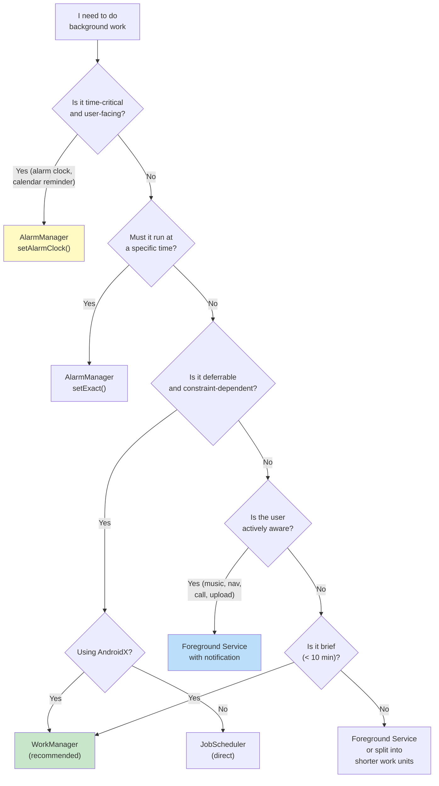

### 30.8.12 关键源代码路径小结

| Component | Source Path |
|-----------|------------|
| JobSchedulerService | `frameworks/base/apex/jobscheduler/service/java/com/android/server/job/JobSchedulerService.java` |
| JobStore | `frameworks/base/apex/jobscheduler/service/java/com/android/server/job/JobStore.java` |
| JobConcurrencyManager | `frameworks/base/apex/jobscheduler/service/java/com/android/server/job/JobConcurrencyManager.java` |
| JobServiceContext | `frameworks/base/apex/jobscheduler/service/java/com/android/server/job/JobServiceContext.java` |
| StateController（基类） | `frameworks/base/apex/jobscheduler/service/java/com/android/server/job/controllers/StateController.java` |
| JobStatus | `frameworks/base/apex/jobscheduler/service/java/com/android/server/job/controllers/JobStatus.java` |
| ConnectivityController | `frameworks/base/apex/jobscheduler/service/java/com/android/server/job/controllers/ConnectivityController.java` |
| TimeController | `frameworks/base/apex/jobscheduler/service/java/com/android/server/job/controllers/TimeController.java` |
| QuotaController | `frameworks/base/apex/jobscheduler/service/java/com/android/server/job/controllers/QuotaController.java` |
| FlexibilityController | `frameworks/base/apex/jobscheduler/service/java/com/android/server/job/controllers/FlexibilityController.java` |
| BatteryController | `frameworks/base/apex/jobscheduler/service/java/com/android/server/job/controllers/BatteryController.java` |
| IdleController | `frameworks/base/apex/jobscheduler/service/java/com/android/server/job/controllers/IdleController.java` |
| BackgroundJobsController | `frameworks/base/apex/jobscheduler/service/java/com/android/server/job/controllers/BackgroundJobsController.java` |
| DeviceIdleJobsController | `frameworks/base/apex/jobscheduler/service/java/com/android/server/job/controllers/DeviceIdleJobsController.java` |
| ContentObserverController | `frameworks/base/apex/jobscheduler/service/java/com/android/server/job/controllers/ContentObserverController.java` |
| ThermalStatusRestriction | `frameworks/base/apex/jobscheduler/service/java/com/android/server/job/restrictions/ThermalStatusRestriction.java` |
| PrefetchController | `frameworks/base/apex/jobscheduler/service/java/com/android/server/job/controllers/PrefetchController.java` |
| RestrictingController | `frameworks/base/apex/jobscheduler/service/java/com/android/server/job/controllers/RestrictingController.java` |
| JobNotificationCoordinator | `frameworks/base/apex/jobscheduler/service/java/com/android/server/job/JobNotificationCoordinator.java` |
| JobPerfettoTracer | `frameworks/base/apex/jobscheduler/service/java/com/android/server/job/JobPerfettoTracer.java` |
| AlarmManagerService | `frameworks/base/apex/jobscheduler/service/java/com/android/server/alarm/AlarmManagerService.java` |
| UserWakeupStore | `frameworks/base/apex/jobscheduler/service/java/com/android/server/alarm/UserWakeupStore.java` |
| JobScheduler（公共 API） | `frameworks/base/apex/jobscheduler/framework/java/android/app/job/JobScheduler.java` |
| 调度器 aconfig 标志 | `frameworks/base/apex/jobscheduler/framework/aconfig/`、`frameworks/base/apex/jobscheduler/service/aconfig/` |
| JobSchedulerInternal | `frameworks/base/apex/jobscheduler/framework/java/com/android/server/job/JobSchedulerInternal.java` |

---

**本章要点：**

1. **后台限制无处不在**：自 Android 8.0 以来，应用无法自由运行后台服务。此后每个版本都增加了进一步的限制。应用必须从一开始就围绕这些限制进行设计。

2. **JobScheduler 是平台原语**：所有基于约束的后台工作都应该通过 JobScheduler 进行（直接或通过 WorkManager）。其控制器架构拥有 12 个以上的 `StateController`，提供了灵活、可扩展的约束评估系统。

3. **AlarmManager 仅用于时间特定的工作**：将其用于闹钟、日历提醒和其他面向用户的定时事件。精确闹钟权限限制了访问以防止滥用。

4. **WorkManager 是推荐的抽象层**：对于 AndroidX 应用，WorkManager 在 JobScheduler 和 AlarmManager 之上提供了持久化、工作链、可观察性和向后兼容性。

5. **前台服务需要类型和通知**：现代 Android 强制执行带类型的前台服务并要求相应权限。通知既充当用户信息，也充当问责机制。

6. **广播限制防止唤醒风暴**：面向隐式广播的清单注册接收器大多被阻止。应用必须改用按 Context 注册的接收器、JobScheduler 内容触发器或 `ConnectivityManager` 回调。

7. **待机分组对所有内容分层**：应用的后台执行预算取决于其待机分组，这反映了用户参与度。活跃应用获得更多预算；很少使用的应用受到严格限制。
