# 第 9 章：Binder IPC

Binder 是 Android 进程间通信的核心。每一次 Activity 启动、每一次服务调用、每一次权限检查、每一次界面合成都要经过 Binder。它不仅仅是一种 IPC 机制——它是让 Android 组件架构得以实现的面向对象中间件。理解 Binder 是理解 AOSP 中其他一切的前提。

本章从内核驱动、C++ 和 Rust 用户空间库一路剖析到 AIDL 代码生成工具链，最后以充当系统名称服务的 `servicemanager` 收尾。到本章结束时，你将能够追踪一次完整的事务——从客户端进程、穿过内核、一直到服务端进程。你还将亲手构建自己的 Binder 服务。

---

## 9.1 为什么选择 Binder？

### 9.1.1 问题：移动操作系统需要安全、快速的 IPC

Android 在不同的进程中运行数十个系统服务（Activity Manager、Window Manager、Package Manager、SurfaceFlinger 等）。运行在各自沙箱进程中的应用程序必须每秒与这些服务通信数百次。IPC 机制必须满足若干苛刻的要求：

1. **基于身份的安全性。** 内核必须权威地识别调用者（UID、PID、SELinux 上下文），以便服务器能够做出访问控制决策。传统的 Unix IPC（管道、Unix 套接字）可以通过 `SO_PEERCRED` 传递凭据，但这是以连接为单位，而不是以事务为单位。

2. **对象引用语义。** 客户端应当能够持有服务端进程中某个特定对象的引用。当该对象消亡时，客户端应收到死亡通知。当最后一个引用被释放时，对象应被清理。

3. **单次拷贝数据传输。** 为了在移动硬件上获得性能，数据在地址空间之间最多应拷贝一次。传统的消息传递（管道、消息队列）需要先从发送者拷贝到内核，再从内核拷贝到接收者——共两次拷贝。

4. **同步与异步调用。** 必须同时支持请求-应答（同步）和即发即弃（oneway / 异步）两种模式。

5. **线程池管理。** 内核应当能够管理服务端进程中的线程池，按需创建新线程并回收空闲线程。

### 9.1.2 历史背景

Binder 的历史早于 Android。它源自 OpenBinder，由 Dianne Hackborn 等人于 2000 年代初在 Be Inc.（BeOS 的创造者）开发。当 Palm 收购 Be 的技术后，OpenBinder 继续发展。当 Google 构建 Android 时，该团队（其中包括 Hackborn）将 OpenBinder 改造成了后来的 Android Binder。

原始设计的关键洞见在于：移动设备需要一种*基于能力*的 IPC 系统，其中对象引用就是能力。Unix IPC 机制是面向通道的（你连接到一个命名端点），而不是面向对象的（你持有对某个特定对象的引用）。Binder 通过内核驱动提供对象引用语义，从而弥合了这一鸿沟。

内核驱动最初位于树外（在 Android 内核的 `drivers/ staging/android/` 目录中）。多年来，它被清理并合并进上游 Linux 内核的 `drivers/android/` 目录。现代 Linux 内核（5.0+）已包含 binder 驱动，无需任何 Android 专属补丁。

### 9.1.3 与传统 Unix IPC 的比较

| 机制 | 拷贝次数 | 身份 | 对象引用 | 线程管理 |
|-----------|--------|----------|-------------|-------------|
| **管道** | 2（写 + 读） | 无每消息身份 | 否 | 否 |
| **Unix 套接字** | 2（发送 + 接收） | SO_PEERCRED（按连接） | 否 | 否 |
| **共享内存** | 0 | 无 | 否 | 否 |
| **SysV 消息队列** | 2 | 有限（uid 检查） | 否 | 否 |
| **Binder** | **1**（驱动拷贝进接收方的 mmap 缓冲区） | **按事务**（UID、PID、SELinux SID） | **是**（引用计数、死亡通知） | **是**（内核管理的线程池） |

**管道和 Unix 套接字**需要两次拷贝：一次从发送方的缓冲区到内核，另一次从内核到接收方的缓冲区。它们不提供每消息身份——`SO_PEERCRED` 只能告诉你是谁打开了连接，而无法告诉你在多路复用的连接上是谁发送了某条特定消息。

**共享内存**（`ashmem` 或 `memfd`）实现了零拷贝，但不提供同步、消息成帧或身份信息。它与 Binder *结合*使用（例如，SurfaceFlinger 使用共享内存缓冲区，但控制平面使用 Binder）。

**Binder** 通过内存映射实现了单次拷贝。内核映射接收方地址空间中的一个区域，然后将发送方的数据直接拷贝到该区域。接收方直接从自己映射的内存中读取数据，无需额外的拷贝。

### 9.1.4 单次拷贝机制

当一个进程打开 `/dev/binder` 时，它会调用 `mmap()` 来映射 binder 缓冲区。如 `ProcessState.cpp` 中所定义：

```cpp
// frameworks/native/libs/binder/ProcessState.cpp
#define BINDER_VM_SIZE ((1 * 1024 * 1024) - sysconf(_SC_PAGE_SIZE) * 2)
```

这会创建一个约 1 MB 的缓冲区（减去两页作为保护页）。当事务到达时，binder 驱动在接收方的映射区域内分配空间，并将发送方的数据直接拷贝到那里。接收方直接从自己的虚拟地址空间读取数据——只需一次拷贝。

```
Sender                    Kernel                    Receiver
┌─────────┐    copy_from_user     ┌──────────────┐
│  Parcel │ ─────────────────────>│  Receiver's  │
│  data   │                       │  mmap buffer │
└─────────┘                       └──────────────┘
                                        │
                                        │ (already in receiver's
                                        │  address space)
                                        v
                                  ┌──────────────┐
                                  │  Receiver    │
                                  │  reads data  │
                                  └──────────────┘
```

### 9.1.5 基于身份的安全性

每一次 Binder 事务都携带发送方的 UID 和 PID，这些值由内核驱动注入（而非用户空间）。发送方无法伪造这些值。接收进程通过以下方式读取它们：

```cpp
// frameworks/native/libs/binder/include/binder/IPCThreadState.h
[[nodiscard]] pid_t getCallingPid() const;
[[nodiscard]] uid_t getCallingUid() const;
[[nodiscard]] const char* getCallingSid() const;  // SELinux Security ID
```

这种按事务的身份是 Android 权限模型的基础。当应用调用 `ActivityManager.startActivity()` 时，system_server 收到该 Binder 事务，读取调用者的 UID，并检查该 UID 是否拥有所需权限。

### 9.1.6 对象引用与死亡通知

Binder 提供了分布式对象模型。服务器创建一个 `BBinder` 对象（即“节点”）。当它通过 Binder 将该对象发送给客户端时，客户端收到一个 `BpBinder`（即“代理”）。内核驱动维护节点的引用计数——当所有代理都被释放后，节点即可被垃圾回收。

如果服务器进程死亡，内核驱动会向每个注册了 `DeathRecipient` 的客户端发送 `BR_DEAD_BINDER` 通知：

```cpp
// frameworks/native/libs/binder/include/binder/IBinder.h
class DeathRecipient : public virtual RefBase {
public:
    virtual void binderDied(const wp<IBinder>& who) = 0;
};

virtual status_t linkToDeath(const sp<DeathRecipient>& recipient,
                             void* cookie = nullptr,
                             uint32_t flags = 0) = 0;
```

Android 正是通过这种方式检测应用崩溃，并在 `ActivityManagerService`、`WindowManagerService` 等组件中触发清理。

### 9.1.7 三个 Binder 域

现代 Android 有三个独立的 binder 设备节点，每个都有自己的上下文管理器。Project Treble（Android 8.0）引入了这种划分，以便在 IPC 层强制执行框架/供应商边界：

```mermaid
graph TB
    subgraph "Framework Domain"
        A[Apps] <-->|"/dev/binder"| B[system_server]
        B <-->|"/dev/binder"| C[servicemanager]
    end

    subgraph "HAL Domain (deprecated)"
        D["Framework<br/>clients"] <-->|"/dev/hwbinder"| E[HAL services]
        E <-->|"/dev/hwbinder"| F[hwservicemanager]
    end

    subgraph "Vendor Domain"
        G["Vendor<br/>processes"] <-->|"/dev/vndbinder"| H[Vendor services]
        H <-->|"/dev/vndbinder"| I[vndservicemanager]
    end

    style A fill:#e1f5fe
    style B fill:#e1f5fe
    style C fill:#e1f5fe
    style D fill:#fff3e0
    style E fill:#fff3e0
    style F fill:#fff3e0
    style G fill:#e8f5e9
    style H fill:#e8f5e9
    style I fill:#e8f5e9
```

| 域 | 设备 | 上下文管理器 | 接口语言 | 状态 |
|--------|--------|----------------|-------------------|--------|
| 框架 | `/dev/binder` | `servicemanager` | AIDL | 活跃 |
| HAL | `/dev/hwbinder` | `hwservicemanager` | HIDL | **已弃用**（Android 13+） |
| 供应商 | `/dev/vndbinder` | `vndservicemanager` | AIDL | 活跃 |

SELinux 以非对称方式强制执行这些边界。打开 `/dev/binder` 本身*并不*受限——`system/sepolicy/private/domain.te` 将 `binder_device` 的读/写权限授予除 `hwservicemanager` 和 `vndservicemanager` 之外的所有域。这两个域被从 `allow` 规则中剔除，并且 `neverallow` 行进一步禁止它们。

真正将供应商代码挡在框架域之外的是*服务*层面。SELinux `service_manager` 针对 `service_contexts` 的 add/find 检查决定了哪些域可以注册或查找每个命名服务。`__ANDROID_VNDK__` 构建标志首先就让供应商库默认使用 `/dev/vndbinder`。反向的限制更为严格：在完整 Treble 设备上，`neverallow` 完全禁止框架（`coredomain`）进程访问 `/dev/vndbinder`。进程的默认设备取决于构建变体：

```cpp
// frameworks/native/libs/binder/ProcessState.cpp
#ifdef __ANDROID_VNDK__
const char* kDefaultDriver = "/dev/vndbinder";
#else
const char* kDefaultDriver = "/dev/binder";
#endif
```

§9.6 深入讨论了 HAL 域（`hwservicemanager` 以及 HIDL → AIDL 迁移）。

---

## 9.2 Binder 驱动

binder 驱动是一个 Linux 内核模块（现已在上游内核的 `drivers/android/` 目录下主线化）。它实现了一个字符设备（`/dev/binder`），用户空间通过 `ioctl()` 和 `mmap()` 与之通信。

### 9.2.1 关键 ioctl 命令

驱动暴露了多个 ioctl 命令，其中最重要的是：

| ioctl | 用途 |
|-------|---------|
| `BINDER_WRITE_READ` | 主力命令：在一次调用中发送命令并接收响应 |
| `BINDER_SET_MAX_THREADS` | 配置内核管理的线程最大数量 |
| `BINDER_SET_CONTEXT_MGR` | 声明调用进程为上下文管理器（服务管理器） |
| `BINDER_SET_CONTEXT_MGR_EXT` | 同上，但带有安全上下文标志 |
| `BINDER_GET_NODE_DEBUG_INFO` | 获取 binder 节点的调试信息 |
| `BINDER_GET_NODE_INFO_FOR_REF` | 获取句柄的引用计数信息 |

`binder_module.h` 头文件将用户空间与内核接口桥接起来：

```cpp
// frameworks/native/libs/binder/binder_module.h
#include <linux/android/binder.h>
#include <sys/ioctl.h>
```

### 9.2.2 BINDER_WRITE_READ 结构

所有事务数据都流经 `binder_write_read` 结构：

```c
struct binder_write_read {
    binder_size_t write_size;       /* bytes to write */
    binder_size_t write_consumed;   /* bytes consumed by driver */
    binder_uintptr_t write_buffer;  /* pointer to write commands */
    binder_size_t read_size;        /* bytes available to read */
    binder_size_t read_consumed;    /* bytes written by driver */
    binder_uintptr_t read_buffer;   /* pointer to read buffer */
};
```

一次 `ioctl(fd, BINDER_WRITE_READ, &bwr)` 调用既能发送出站命令，也能接收入站响应。`IPCThreadState::talkWithDriver()` 的工作方式正是如此：

```cpp
// frameworks/native/libs/binder/IPCThreadState.cpp (line ~1268)
status_t IPCThreadState::talkWithDriver(bool doReceive)
{
    if (mProcess->mDriverFD < 0) {
        return -EBADF;
    }

    binder_write_read bwr;

    // Is the read buffer empty?
    const bool needRead = mIn.dataPosition() >= mIn.dataSize();
    const size_t outAvail = (!doReceive || needRead) ? mOut.dataSize() : 0;

    bwr.write_size = outAvail;
    bwr.write_buffer = (uintptr_t)mOut.data();

    if (doReceive && needRead) {
        bwr.read_size = mIn.dataCapacity();
        bwr.read_buffer = (uintptr_t)mIn.data();
    } else {
        bwr.read_size = 0;
        bwr.read_buffer = 0;
    }

    // Return immediately if there is nothing to do.
    if ((bwr.write_size == 0) && (bwr.read_size == 0)) return NO_ERROR;

    bwr.write_consumed = 0;
    bwr.read_consumed = 0;
    status_t err;
    do {
#if defined(BINDER_WITH_KERNEL_IPC)
        if (ioctl(mProcess->mDriverFD, BINDER_WRITE_READ, &bwr) >= 0)
            err = NO_ERROR;
        else
            err = -errno;
#else
        err = INVALID_OPERATION;
#endif
    } while (err == -EINTR);
    // ...
}
```

### 9.2.3 事务协议：BC_ 与 BR_ 命令

写缓冲区包含 **BC_（Binder Command）** 代码。读缓冲区返回 **BR_（Binder Return）** 代码。完整的集合在内核头文件中定义，并在 `IPCThreadState.cpp` 中有所体现：

**BC_（命令——从用户空间到驱动）：**

```cpp
// frameworks/native/libs/binder/IPCThreadState.cpp (line ~135)
static const char* kCommandStrings[] = {
    "BC_TRANSACTION",
    "BC_REPLY",
    "BC_ACQUIRE_RESULT",
    "BC_FREE_BUFFER",
    "BC_INCREFS",
    "BC_ACQUIRE",
    "BC_RELEASE",
    "BC_DECREFS",
    "BC_INCREFS_DONE",
    "BC_ACQUIRE_DONE",
    "BC_ATTEMPT_ACQUIRE",
    "BC_REGISTER_LOOPER",
    "BC_ENTER_LOOPER",
    "BC_EXIT_LOOPER",
    "BC_REQUEST_DEATH_NOTIFICATION",
    "BC_CLEAR_DEATH_NOTIFICATION",
    "BC_DEAD_BINDER_DONE",
    "BC_TRANSACTION_SG",
    "BC_REPLY_SG",
    "BC_REQUEST_FREEZE_NOTIFICATION",
    "BC_CLEAR_FREEZE_NOTIFICATION",
    "BC_FREEZE_NOTIFICATION_DONE",
};
```

**BR_（返回——从驱动到用户空间）：**

```cpp
// frameworks/native/libs/binder/IPCThreadState.cpp (line ~109)
static const char* kReturnStrings[] = {
    "BR_ERROR",
    "BR_OK",
    "BR_TRANSACTION/BR_TRANSACTION_SEC_CTX",
    "BR_REPLY",
    "BR_ACQUIRE_RESULT",
    "BR_DEAD_REPLY",
    "BR_TRANSACTION_COMPLETE",
    "BR_INCREFS",
    "BR_ACQUIRE",
    "BR_RELEASE",
    "BR_DECREFS",
    "BR_ATTEMPT_ACQUIRE",
    "BR_NOOP",
    "BR_SPAWN_LOOPER",
    "BR_FINISHED",
    "BR_DEAD_BINDER",
    "BR_CLEAR_DEATH_NOTIFICATION_DONE",
    "BR_FAILED_REPLY",
    "BR_FROZEN_REPLY",
    "BR_ONEWAY_SPAM_SUSPECT",
    "BR_TRANSACTION_PENDING_FROZEN",
    "BR_FROZEN_BINDER",
    "BR_CLEAR_FREEZE_NOTIFICATION_DONE",
};
```

### 9.2.4 事务数据结构

每个 `BC_TRANSACTION` 和 `BR_TRANSACTION` 都携带一个 `binder_transaction_data`：

```c
struct binder_transaction_data {
    union {
        __u32 handle;     /* target: handle (proxy side) */
        binder_uintptr_t ptr; /* target: binder (local node) */
    } target;
    binder_uintptr_t cookie;  /* target object cookie */
    __u32 code;               /* transaction command (interface-specific) */
    __u32 flags;              /* TF_ONE_WAY, TF_ACCEPT_FDS, etc. */
    pid_t sender_pid;         /* filled in by driver */
    uid_t sender_euid;        /* filled in by driver */
    binder_size_t data_size;  /* number of bytes of data */
    binder_size_t offsets_size; /* number of bytes of offsets */
    union {
        struct {
            binder_uintptr_t buffer;  /* pointer to transaction data */
            binder_uintptr_t offsets; /* pointer to offsets array */
        } ptr;
        __u8 buf[8];
    } data;
};
```

`sender_pid` 和 `sender_euid` 字段由内核驱动填写，而非用户空间。这正是 Binder 身份不可伪造的原因。

### 9.2.5 完整的事务流程

下图展示了一次同步 Binder 事务的完整生命周期：

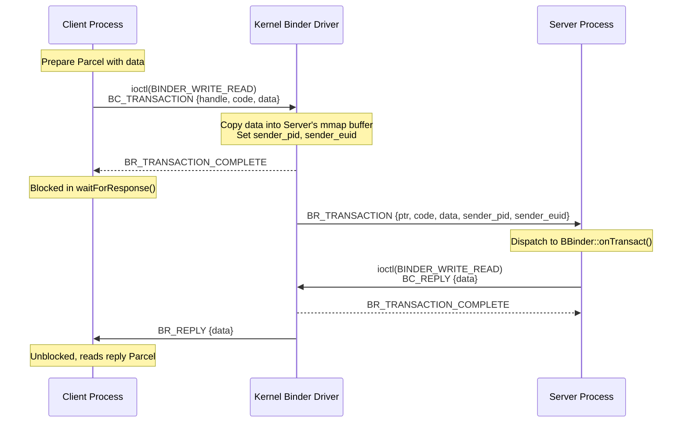

对于 **oneway（异步）** 事务，流程更短：

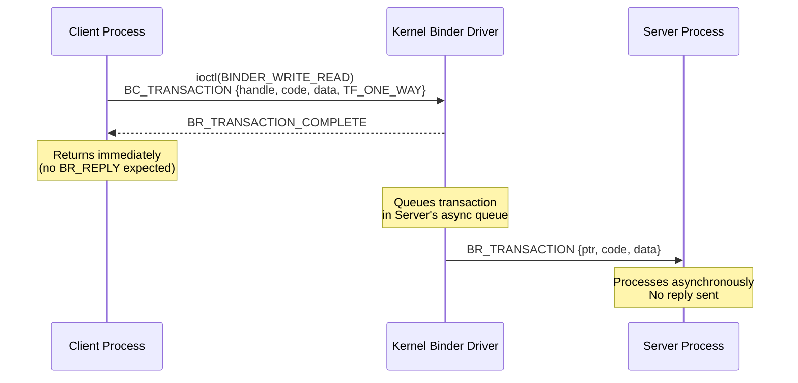

### 9.2.6 内存映射与缓冲区管理

当 `ProcessState` 打开 binder 驱动时，它会调用 `mmap()`：

```cpp
// frameworks/native/libs/binder/ProcessState.cpp
#define BINDER_VM_SIZE ((1 * 1024 * 1024) - sysconf(_SC_PAGE_SIZE) * 2)
```

这个 1 MB（减去保护页）的缓冲区在用户空间以只读方式映射——只有内核能写入其中。驱动在此缓冲区内为入站事务分配子区域。接收方处理完事务后，必须发出 `BC_FREE_BUFFER` 将缓冲区归还给驱动。

该缓冲区大小是所有并发入站事务总大小的硬性上限。如果一个进程有过多待处理事务，缓冲区就会被填满，新的事务将以 `FAILED_TRANSACTION` 失败。这就是为什么当 binder 缓冲区利用率过高时系统会记录警告。

### 9.2.7 引用计数

驱动维护 binder 节点上的引用计数。有四个命令用于管理引用：

| 命令 | 效果 |
|---------|--------|
| `BC_INCREFS` | 增加弱引用计数 |
| `BC_ACQUIRE` | 增加强引用计数 |
| `BC_RELEASE` | 减少强引用计数 |
| `BC_DECREFS` | 减少弱引用计数 |

在 `IPCThreadState.cpp` 中：

```cpp
// frameworks/native/libs/binder/IPCThreadState.cpp (line ~996)
void IPCThreadState::incStrongHandle(int32_t handle, BpBinder *proxy)
{
    LOG_REMOTEREFS("IPCThreadState::incStrongHandle(%d)\n", handle);
    mOut.writeInt32(BC_ACQUIRE);
    mOut.writeInt32(handle);
    // ...
}

void IPCThreadState::decStrongHandle(int32_t handle)
{
    LOG_REMOTEREFS("IPCThreadState::decStrongHandle(%d)\n", handle);
    mOut.writeInt32(BC_RELEASE);
    mOut.writeInt32(handle);
    flushIfNeeded();
}
```

当强引用计数降为零且不存在弱引用时，内核驱动会清理该节点。

### 9.2.8 死亡通知

当一个进程死亡时，内核驱动会遍历该进程中持有的对 binder 节点的所有引用，并向每个注册了死亡通知的进程发送 `BR_DEAD_BINDER`：

```cpp
// frameworks/native/libs/binder/IPCThreadState.cpp (line ~1050)
status_t IPCThreadState::requestDeathNotification(int32_t handle, BpBinder* proxy)
{
    mOut.writeInt32(BC_REQUEST_DEATH_NOTIFICATION);
    mOut.writeInt32((int32_t)handle);
    mOut.writePointer((uintptr_t)proxy);
    return NO_ERROR;
}
```

### 9.2.9 冻结进程通知

缓存应用冻结本身（freezer cgroup）早于这一 API。较新的是 binder 冻结通知协议（`BC_REQUEST_FREEZE_NOTIFICATION` / `BR_FROZEN_BINDER` / `FrozenStateChangeCallback`），其可用性通过 `ProcessState::DriverFeature::FREEZE_NOTIFICATION` 在运行时探测。当一个进程被冻结时（例如 freezer cgroup 中的缓存应用），驱动可以通知客户端：

```cpp
// frameworks/native/libs/binder/IPCThreadState.cpp (line ~1066)
status_t IPCThreadState::addFrozenStateChangeCallback(int32_t handle, BpBinder* proxy) {
    static bool isSupported =
            ProcessState::isDriverFeatureEnabled(
                ProcessState::DriverFeature::FREEZE_NOTIFICATION);
    if (!isSupported) {
        return INVALID_OPERATION;
    }
    proxy->getWeakRefs()->incWeak(proxy);
    mOut.writeInt32(BC_REQUEST_FREEZE_NOTIFICATION);
    mOut.writeInt32((int32_t)handle);
    mOut.writePointer((uintptr_t)proxy);
    // ...
}
```

`FrozenStateChangeCallback` 接口让客户端能够作出响应：

```cpp
// frameworks/native/libs/binder/include/binder/IBinder.h
class FrozenStateChangeCallback : public virtual RefBase {
public:
    enum class State {
        FROZEN,
        UNFROZEN,
    };
    virtual void onStateChanged(const wp<IBinder>& who, State state) = 0;
};
```

### 9.2.10 线程池管理

驱动管理每个进程中的线程池。当所有现有线程都在忙于处理事务时，可能又会有新的事务到达。此时驱动会发送 `BR_SPAWN_LOOPER`，通知该进程创建一个新线程。最大线程数由以下方式配置：

```cpp
// frameworks/native/libs/binder/ProcessState.cpp (line ~451)
status_t ProcessState::setThreadPoolMaxThreadCount(size_t maxThreads) {
    LOG_ALWAYS_FATAL_IF(mThreadPoolStarted && maxThreads < mMaxThreads,
           "Binder threadpool cannot be shrunk after starting");
    status_t result = NO_ERROR;
    if (ioctl(mDriverFD, BINDER_SET_MAX_THREADS, &maxThreads) != -1) {
        mMaxThreads = maxThreads;
    } else {
        result = -errno;
        ALOGE("Binder ioctl to set max threads failed: %s", strerror(-result));
    }
    return result;
}
```

默认的最大线程数为 15：

```cpp
#define DEFAULT_MAX_BINDER_THREADS 15
```

### 9.2.11 成为上下文管理器

每个 binder 域中只能有一个进程成为“上下文管理器”——即持有句柄 0 的进程。`servicemanager` 正是通过这种方式注册自己的：

```cpp
// frameworks/native/libs/binder/ProcessState.cpp (line ~234)
bool ProcessState::becomeContextManager()
{
    std::unique_lock<std::mutex> _l(mLock);

    flat_binder_object obj {
        .flags = FLAT_BINDER_FLAG_TXN_SECURITY_CTX,
    };

    int result = ioctl(mDriverFD, BINDER_SET_CONTEXT_MGR_EXT, &obj);

    // fallback to original method
    if (result != 0) {
        android_errorWriteLog(0x534e4554, "121035042");
        int unused = 0;
        result = ioctl(mDriverFD, BINDER_SET_CONTEXT_MGR, &unused);
    }
    // ...
    return result == 0;
}
```

`FLAT_BINDER_FLAG_TXN_SECURITY_CTX` 标志请求驱动在发往上下文管理器的每个事务中包含 SELinux 安全上下文。

---

## 9.3 libbinder（C++ 与 Rust）

源目录：`frameworks/native/libs/binder/`

该目录包含约 80 个源文件，实现了用户空间的 Binder 框架。关键的类构成了一个清晰的层次结构：

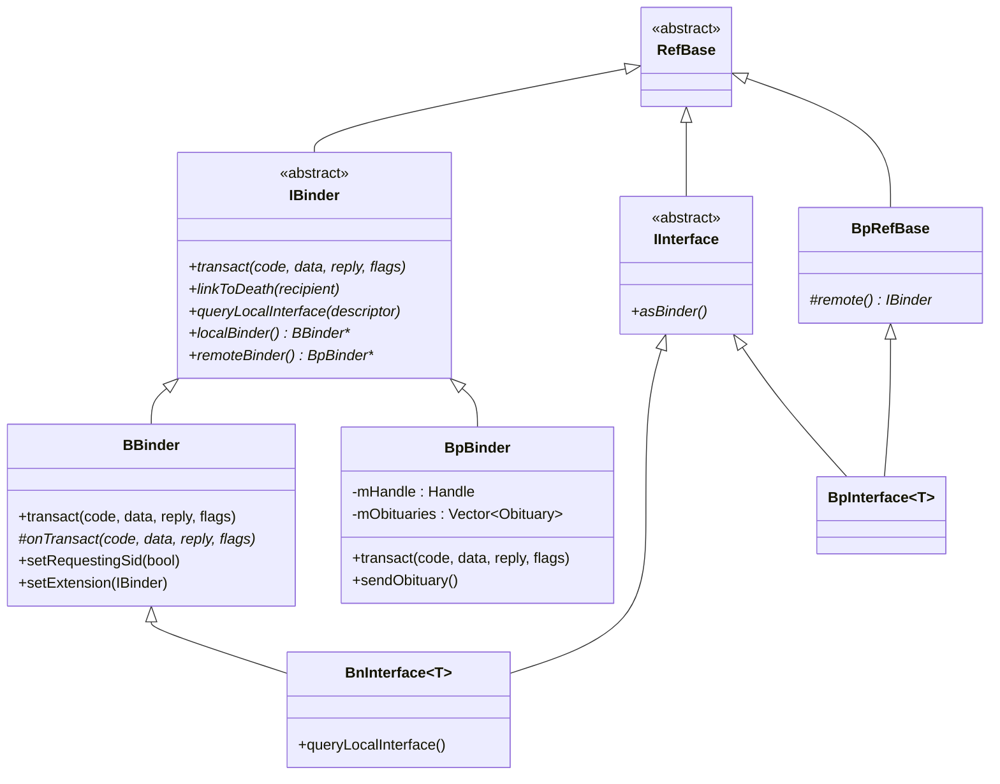

### 9.3.1 IBinder——基础接口

`IBinder` 是所有 binder 对象的抽象基类。其最重要的成员是 `transact()`：

```cpp
// frameworks/native/libs/binder/include/binder/IBinder.h (line ~186)
virtual status_t transact(uint32_t code,
                          const Parcel& data,
                          Parcel* reply,
                          uint32_t flags = 0) = 0;
```

它还定义了众所周知的事务代码：

```cpp
// frameworks/native/libs/binder/include/binder/IBinder.h (line ~54)
enum {
    FIRST_CALL_TRANSACTION = 0x00000001,
    LAST_CALL_TRANSACTION = 0x00ffffff,

    PING_TRANSACTION        = B_PACK_CHARS('_', 'P', 'N', 'G'),
    DUMP_TRANSACTION        = B_PACK_CHARS('_', 'D', 'M', 'P'),
    SHELL_COMMAND_TRANSACTION = B_PACK_CHARS('_', 'C', 'M', 'D'),
    INTERFACE_TRANSACTION   = B_PACK_CHARS('_', 'N', 'T', 'F'),
    EXTENSION_TRANSACTION   = B_PACK_CHARS('_', 'E', 'X', 'T'),
    DEBUG_PID_TRANSACTION   = B_PACK_CHARS('_', 'P', 'I', 'D'),
    SET_RPC_CLIENT_TRANSACTION = B_PACK_CHARS('_', 'R', 'P', 'C'),

    FLAG_ONEWAY     = 0x00000001,
    FLAG_CLEAR_BUF  = 0x00000020,
    FLAG_PRIVATE_VENDOR = 0x10000000,
};
```

`B_PACK_CHARS` 宏将四个 ASCII 字符编码进一个 32 位整数，生成十六进制下可读的事务代码（`_PNG`、`_DMP` 等）。这些是由所有 binder 对象理解的"元事务"。

接口特定的事务使用从 `FIRST_CALL_TRANSACTION`（1）开始的代码。AIDL 从该基数开始顺序为方法编号。

### 9.3.2 BBinder——服务端对象

`BBinder` 表示一个本地 binder 对象——即驻留在当前进程中的对象。它是服务端一侧。

```cpp
// frameworks/native/libs/binder/include/binder/Binder.h (line ~31)
class BBinder : public IBinder {
public:
    BBinder();
    virtual const String16& getInterfaceDescriptor() const;
    virtual bool isBinderAlive() const;
    virtual status_t pingBinder();

    // transact() is final -- it calls onTransact()
    virtual status_t transact(uint32_t code, const Parcel& data,
                              Parcel* reply, uint32_t flags = 0) final;

protected:
    virtual ~BBinder();
    // Subclasses override this to handle transactions
    virtual status_t onTransact(uint32_t code, const Parcel& data,
                                Parcel* reply, uint32_t flags = 0);
};
```

`transact()` 方法被标记为 `final`——派生类改为重写 `onTransact()`。这是一种模板方法模式：`transact()` 处理元事务（ping、dump、shell 命令等），并将接口特定的调用委托给 `onTransact()`。

这些类的大小受到严格控制，并用 `static_assert` 强制执行：

```cpp
// frameworks/native/libs/binder/Binder.cpp (line ~54)
#ifdef __LP64__
static_assert(sizeof(IBinder) == 24);
static_assert(sizeof(BBinder) == 40);
#else
static_assert(sizeof(IBinder) == 12);
static_assert(sizeof(BBinder) == 20);
#endif
```

这些大小是冻结的，因为 `BBinder` 是预编译供应商库所使用的 ABI 的一部分。

### 9.3.3 BpBinder——客户端代理

`BpBinder` 是对另一个进程中 binder 对象的代理。它持有一个内核句柄（一个整数）或一个 RPC 会话引用：

```cpp
// frameworks/native/libs/binder/include/binder/BpBinder.h (line ~180)
struct BinderHandle {
    int32_t handle;
};
struct RpcHandle {
    sp<RpcSession> session;
    uint64_t address;
};
using Handle = std::variant<BinderHandle, RpcHandle>;
```

当你在 `BpBinder` 上调用 `transact()` 时，它会委托给 `IPCThreadState::transact()`，后者将数据打包并发送到内核：

```cpp
// frameworks/native/libs/binder/IPCThreadState.cpp (line ~919)
status_t IPCThreadState::transact(int32_t handle,
                                  uint32_t code, const Parcel& data,
                                  Parcel* reply, uint32_t flags)
{
    // ...
    flags |= TF_ACCEPT_FDS;
    err = writeTransactionData(BC_TRANSACTION, flags, handle, code, data, nullptr);

    if (err != NO_ERROR) {
        if (reply) reply->setError(err);
        return (mLastError = err);
    }

    if ((flags & TF_ONE_WAY) == 0) {
        // Synchronous: wait for reply
        if (reply) {
            err = waitForResponse(reply);
        } else {
            Parcel fakeReply;
            err = waitForResponse(&fakeReply);
        }
    } else {
        // Oneway: just wait for TRANSACTION_COMPLETE
        err = waitForResponse(nullptr, nullptr);
    }
    return err;
}
```

#### Binder 代理节流

BpBinder 包含复杂的代理计数跟踪机制，以防止 binder 代理泄漏（系统不稳定的常见原因）：

```cpp
// frameworks/native/libs/binder/BpBinder.cpp (line ~71)
uint32_t BpBinder::sBinderProxyCountHighWatermark = 2500;
uint32_t BpBinder::sBinderProxyCountLowWatermark = 2000;
uint32_t BpBinder::sBinderProxyCountWarningWatermark = 2250;
```

当一个进程累积超过 2500 个 binder 代理引用（通常是由于泄漏）时，系统会触发一个回调。该回调可以杀死出问题的进程。

### 9.3.4 ProcessState——每进程单例

`ProcessState` 是一个单例，管理整个进程的 binder 驱动连接：

```cpp
// frameworks/native/libs/binder/ProcessState.cpp (line ~106)
sp<ProcessState> ProcessState::self()
{
    return init(kDefaultDriver, false /*requireDefault*/);
}
```

它打开 binder 驱动、映射缓冲区，并管理句柄到对象的映射。关键职责：

1. **驱动初始化：** 打开 `/dev/binder`（或 `/dev/vndbinder`），映射事务缓冲区。

2. **句柄表：** 将内核句柄映射到 `BpBinder` 对象：
   ```cpp
   struct handle_entry {
       IBinder* binder;
       RefBase::weakref_type* refs;
   };
   Vector<handle_entry> mHandleToObject;
   ```

3. **上下文对象：** 句柄 0 是上下文管理器（`servicemanager`）：
   ```cpp
   sp<IBinder> ProcessState::getContextObject(const sp<IBinder>& /*caller*/)
   {
       sp<IBinder> context = getStrongProxyForHandle(0);
       // ...
       return context;
   }
   ```

4. **线程池：** 派生和管理 binder 线程：
   ```cpp
   void ProcessState::startThreadPool()
   {
       std::unique_lock<std::mutex> _l(mLock);
       if (!mThreadPoolStarted) {
           mThreadPoolStarted = true;
           spawnPooledThread(true);
       }
   }
   ```

5. **fork 安全：** `fork()` 之后不能使用 Binder，因为内核驱动状态是按进程的。`ProcessState` 安装了 `pthread_atfork` 处理器：
   ```cpp
   int ret = pthread_atfork(ProcessState::onFork,
                            ProcessState::parentPostFork,
                            ProcessState::childPostFork);
   ```

### 9.3.5 IPCThreadState——每线程状态

`IPCThreadState` 是一个线程局部对象，管理与 binder 驱动的实际通信：

```cpp
// frameworks/native/libs/binder/IPCThreadState.cpp (line ~374)
IPCThreadState* IPCThreadState::self()
{
    if (gHaveTLS.load(std::memory_order_acquire)) {
restart:
        const pthread_key_t k = gTLS;
        IPCThreadState* st = (IPCThreadState*)pthread_getspecific(k);
        if (st) return st;
        return new IPCThreadState;
    }
    // ...first-time TLS setup...
}
```

关键成员：

```cpp
// frameworks/native/libs/binder/include/binder/IPCThreadState.h (line ~240)
const sp<ProcessState>    mProcess;
Vector<BBinder*>          mPendingStrongDerefs;
Vector<RefBase::weakref_type*> mPendingWeakDerefs;
Parcel                    mIn;     // incoming data from driver
Parcel                    mOut;    // outgoing data to driver
pid_t                     mCallingPid;
const char*               mCallingSid;
std::optional<uid_t>      mCallingUid;
int32_t                   mWorkSource;
```

`mIn` 和 `mOut` `Parcel` 对象充当 `BINDER_WRITE_READ` ioctl 的写缓冲区和读缓冲区。它们以 256 字节的容量初始化：

```cpp
// frameworks/native/libs/binder/IPCThreadState.cpp (line ~1127)
IPCThreadState::IPCThreadState()
      : mProcess(ProcessState::self()),
        // ...
{
    pthread_setspecific(gTLS, this);
    clearCaller();
    mIn.setDataCapacity(256);
    mOut.setDataCapacity(256);
}
```

### 9.3.6 线程池循环

当一个线程加入 binder 线程池时，它会进入一个处理事务的循环：

```cpp
// frameworks/native/libs/binder/IPCThreadState.cpp (line ~839)
void IPCThreadState::joinThreadPool(bool isMain)
{
    mProcess->mCurrentThreads++;
    mOut.writeInt32(isMain ? BC_ENTER_LOOPER : BC_REGISTER_LOOPER);

    mIsLooper = true;
    status_t result;
    do {
        processPendingDerefs();
        // now get the next command to be processed, waiting if necessary
        result = getAndExecuteCommand();

        // Let this thread exit the thread pool if it is no longer
        // needed and it is not the main process thread.
        if(result == TIMED_OUT && !isMain) {
            break;
        }
    } while (result != -ECONNREFUSED && result != -EBADF);

    mOut.writeInt32(BC_EXIT_LOOPER);
    mIsLooper = false;
    // ...
}
```

`BC_ENTER_LOOPER`（主线程）与 `BC_REGISTER_LOOPER`（派生线程）之间的区别向驱动传达了两件事。主线程永远不应超时。派生线程可以被回收。

### 9.3.7 事务执行

当事务到达时，`getAndExecuteCommand()` 读取它并进行分发：

```cpp
// frameworks/native/libs/binder/IPCThreadState.cpp (line ~730)
status_t IPCThreadState::getAndExecuteCommand()
{
    status_t result;
    int32_t cmd;

    result = talkWithDriver();
    if (result >= NO_ERROR) {
        size_t IN = mIn.dataAvail();
        if (IN < sizeof(int32_t)) return result;
        cmd = mIn.readInt32();

        size_t newThreadsCount =
            mProcess->mExecutingThreadsCount.fetch_add(1) + 1;
        // ...starvation detection...

        result = executeCommand(cmd);

        // ...thread count bookkeeping...
    }
    return result;
}
```

饥饿检测值得注意：如果所有线程都忙碌超过 100ms，系统会记录错误：

```cpp
if (starvationTime > 100ms) {
    ALOGE("binder thread pool (%zu threads) starved for %" PRId64 " ms",
          maxThreads, to_ms(starvationTime));
}
```

### 9.3.8 调用者身份管理

Binder 的一个关键特性是能够临时清除调用者身份，以代表调用者执行特权操作：

```cpp
// frameworks/native/libs/binder/IPCThreadState.cpp (line ~562)
int64_t IPCThreadState::clearCallingIdentity()
{
    // ignore mCallingSid for legacy reasons
    uid_t callingUid = mCallingUid.has_value() ? mCallingUid.value() : getuid();
    int64_t token = packCallingIdentity(mHasExplicitIdentity,
                                        callingUid, mCallingPid);
    clearCaller();
    mHasExplicitIdentity = true;
    return token;
}
```

身份被打包进一个 64 位令牌：

```
 32b          1b              1b                 30b
[ calling uid | calling pid(sign) | has explicit identity | calling pid(rest) ]
```

这就是在 system_server 中普遍使用的 `Binder.clearCallingIdentity()` / `Binder.restoreCallingIdentity()` 模式。

### 9.3.9 IInterface 与模板模式

`IInterface` 是有类型 Binder 接口的基类。模板类 `BnInterface<T>` 和 `BpInterface<T>` 创建服务端和客户端两侧：

```cpp
// frameworks/native/libs/binder/include/binder/IInterface.h (line ~69)
template <typename INTERFACE>
class BnInterface : public INTERFACE, public BBinder {
public:
    virtual sp<IInterface> queryLocalInterface(const String16& _descriptor);
    virtual const String16& getInterfaceDescriptor() const;
    typedef INTERFACE BaseInterface;
protected:
    virtual IBinder* onAsBinder();
};

template <typename INTERFACE>
class BpInterface : public INTERFACE, public BpRefBase {
public:
    explicit BpInterface(const sp<IBinder>& remote);
    typedef INTERFACE BaseInterface;
protected:
    virtual IBinder* onAsBinder();
};
```

`interface_cast<>` 模板将一个 `IBinder` 转换为有类型的接口：

```cpp
template<typename INTERFACE>
inline sp<INTERFACE> interface_cast(const sp<IBinder>& obj)
{
    return INTERFACE::asInterface(obj);
}
```

### 9.3.10 Parcel 类

`Parcel` 是 Binder 事务的序列化容器。它持有有类型的数据、binder 对象引用和文件描述符：

```cpp
// frameworks/native/libs/binder/include/binder/Parcel.h (line ~64)
class Parcel {
    friend class IPCThreadState;
    friend class RpcState;
public:
    Parcel();
    ~Parcel();

    const uint8_t* data() const;
    size_t dataSize() const;
    size_t dataAvail() const;
    size_t dataPosition() const;
    // ...
};
```

Parcel 支持写入基本类型（`writeInt32`、`writeFloat`、`writeString16`）、binder 引用（`writeStrongBinder`）、文件描述符（`writeFileDescriptor`）和复杂类型（`writeParcelable`）。

### 9.3.11 Rust Binder

源目录：`frameworks/native/libs/binder/rust/`

Android 通过围绕 NDK binder 库的安全封装支持用 Rust 编写的 Binder 服务。关键类型与 C++ 层次结构相对应：

```rust
// frameworks/native/libs/binder/rust/src/proxy.rs
/// A strong reference to a Binder remote object.
/// This struct encapsulates the generic C++ `sp<IBinder>` class.
pub struct SpIBinder(ptr::NonNull<sys::AIBinder>);
```

```rust
// frameworks/native/libs/binder/rust/src/native.rs
/// Rust wrapper around Binder remotable objects.
/// Implements the C++ `BBinder` class.
#[repr(C)]
pub struct Binder<T: Remotable> {
    ibinder: *mut sys::AIBinder,
    rust_object: *mut T,
}
```

`Interface` trait 是 `IInterface` 的 Rust 对应物：

```rust
// frameworks/native/libs/binder/rust/src/binder.rs
/// Super-trait for Binder interfaces.
/// This is equivalent `IInterface` in C++.
pub trait Interface: Send + Sync + DowncastSync {
    fn as_binder(&self) -> SpIBinder {
        panic!("This object was not a Binder object and cannot be converted into an SpIBinder.")
    }

    fn dump(&self, _writer: &mut dyn Write, _args: &[&CStr]) -> Result<()> {
        Ok(())
    }
}
```

AIDL 编译器生成使用 `declare_binder_interface!` 宏的 Rust 代码：

```rust
// frameworks/native/libs/binder/rust/src/lib.rs (example from docs)
declare_binder_interface! {
    ITest["android.os.ITest"] {
        native: BnTest(on_transact),
        proxy: BpTest,
    }
}
```

Rust binder 库构建在 NDK binder API（`libbinder_ndk`）之上。这使得它可以在无法依赖平台 `libbinder.so` 的 APEX 模块中使用。

### 9.3.12 完整的类层次结构

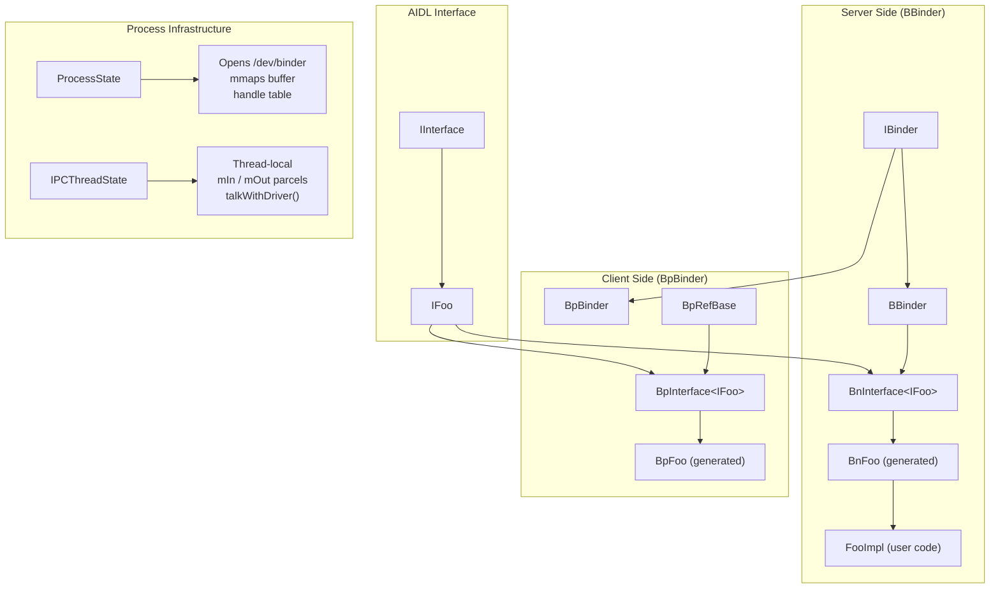

---

## 9.4 AIDL 代码生成

源目录：`system/tools/aidl/`

AIDL（Android 接口定义语言）是定义 Binder 接口的主要方式。AIDL 编译器将 `.aidl` 文件翻译成 Java、C++、NDK C++ 和 Rust 存根。

### 9.4.1 AIDL 编译器架构

AIDL 编译器是一个单一二进制文件，处理所有后端目标：

```
system/tools/aidl/
├── main.cpp                 # Main entry point
├── aidl.cpp                 # Compiler driver / compilation logic
├── aidl_language.h          # AST definitions
├── aidl_language_l.ll       # Lexer (flex)
├── aidl_language_y.yy       # Parser (bison)
├── aidl_to_java.cpp         # Java backend
├── aidl_to_java.h
├── aidl_to_cpp.cpp          # C++ backend
├── aidl_to_cpp.h
├── aidl_to_ndk.cpp          # NDK C++ backend
├── aidl_to_ndk.h
├── aidl_to_rust.cpp         # Rust backend
├── aidl_to_rust.h
├── generate_java.cpp        # Java code generation
├── generate_cpp.cpp         # C++ code generation
├── generate_ndk.cpp         # NDK code generation
├── generate_rust.cpp        # Rust code generation
├── aidl_checkapi.cpp        # API compatibility checking
├── aidl_dumpapi.cpp         # API dumping
└── ...
```

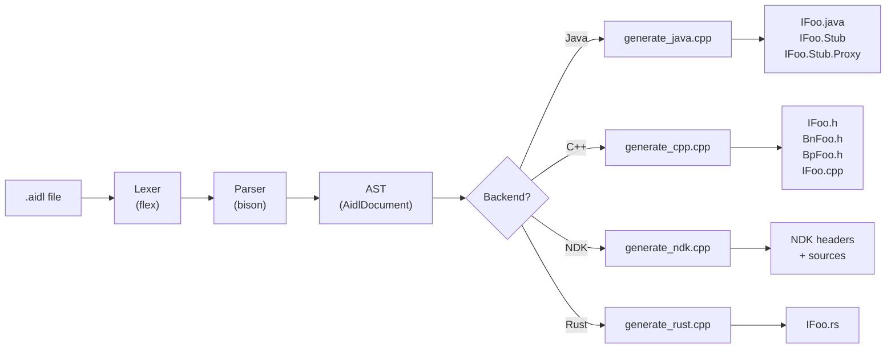

### 9.4.2 AIDL 语法

一个典型的 AIDL 接口定义：

```aidl
// android/os/IServiceManager.aidl
package android.os;

import android.os.IServiceCallback;

interface IServiceManager {
    // Get a binder by name; returns immediately
    // (deprecated, prefer getService2/waitForService)
    IBinder getService(String name);

    // Check without blocking
    IBinder checkService(String name);

    // Register a service
    void addService(String name, IBinder service,
                    boolean allowIsolated, int dumpPriority);

    // List registered services
    String[] listServices(int dumpPriority);

    // Register for notifications when a service is added
    void registerForNotifications(String name,
                                  IServiceCallback callback);

    // Check if a service is declared in VINTF manifest
    boolean isDeclared(String name);
}
```

### 9.4.3 AIDL 类型映射

AIDL 类型按后端映射到不同的目标类型：

| AIDL 类型 | Java | C++ | Rust |
|-----------|------|-----|------|
| `boolean` | `boolean` | `bool` | `bool` |
| `byte` | `byte` | `int8_t` | `i8` |
| `char` | `char` | `char16_t` | `u16` |
| `int` | `int` | `int32_t` | `i32` |
| `long` | `long` | `int64_t` | `i64` |
| `float` | `float` | `float` | `f32` |
| `double` | `double` | `double` | `f64` |
| `String` | `String` | `String16` | `String` |
| `IBinder` | `IBinder` | `sp<IBinder>` | `SpIBinder` |
| `FileDescriptor` | `FileDescriptor` | `unique_fd` | --（不支持；请使用 `ParcelFileDescriptor`） |
| `ParcelFileDescriptor` | `ParcelFileDescriptor` | `ParcelFileDescriptor` | `ParcelFileDescriptor` |
| `T[]` | `T[]` | `vector<T>` | `Vec<T>` |
| `List<T>` | `List<T>` | `vector<T>` | `Vec<T>` |
| `Map` | `Map` | --（不支持） | -- |

NDK 后端也拒绝 `FileDescriptor`。NDK 后端和 Rust 后端都会报告错误 "Prefer ParcelFileDescriptor"（`system/tools/aidl/aidl_language.cpp:1604`）。

C++ 后端的辅助函数定义在：

```cpp
// system/tools/aidl/aidl_to_cpp.h
std::string CppNameOf(const AidlTypeSpecifier& type,
                      const AidlTypenames& typenames);
std::string ParcelReadMethodOf(const AidlTypeSpecifier& type,
                               const AidlTypenames& typenames);
std::string ParcelWriteMethodOf(const AidlTypeSpecifier& type,
                                const AidlTypenames& typenames);
```

### 9.4.4 方向说明符：in、out、inout

AIDL 方法参数可以带有控制编组的方向说明符：

```aidl
interface IFoo {
    void process(in ParcelFileDescriptor input,
                 out ParcelFileDescriptor output,
                 inout Bundle data);
}
```

| 方向 | 含义 | 生成的代码 |
|-----------|---------|----------------|
| `in`（默认） | 数据从客户端流向服务端 | 客户端写入，服务端读取 |
| `out` | 数据从服务端流向客户端 | 服务端写入，客户端从回复中读取 |
| `inout` | 数据双向流动 | 客户端写入，服务端读取 + 写入，客户端读取回复 |

基本类型始终是 `in`。`out` 和 `inout` 说明符仅对 parcelable 类型、数组和其他非基本类型有效。

### 9.4.5 oneway 方法

标记为 `oneway` 的方法是即发即弃的——客户端不等待回复：

```aidl
oneway interface ICallback {
    void onResult(int status);
}
```

在 `oneway` 接口中，所有方法都必须是 `oneway`。或者，也可以单独标记各个方法：

```aidl
interface IFoo {
    void syncMethod();              // synchronous
    oneway void asyncNotify(int x); // asynchronous
}
```

Oneway 调用：

- 在驱动将事务排队后立即返回
- 不能向调用者返回值或抛出异常
- 按每个 binder 对象串行执行（由驱动排队）
- 在内核中使用 `TF_ONE_WAY` 标志

### 9.4.6 Parcelable 类型

AIDL 支持结构化的 parcelable 类型：

```aidl
// Structured parcelable (AIDL-defined)
parcelable ConnectionInfo {
    String ipAddress;
    int port;
}

// Unstructured parcelable (Java-only, defined elsewhere)
parcelable Bundle;
```

结构化 parcelable 完全在 AIDL 中定义，编译器为所有后端生成完整的序列化代码。非结构化 parcelable 是对实现了 `Parcelable` 的 Java 类的不透明引用。

### 9.4.7 生成的代码：Java

对于接口 `IFoo`，Java 后端生成：

```
IFoo.java
├── interface IFoo extends android.os.IInterface
├── static class Stub extends android.os.Binder implements IFoo
│   └── static class Proxy implements IFoo
└── static class Default implements IFoo
```

`Stub` 类是服务端一侧。其 `onTransact()` 解开传入的 parcel 并分发到相应的方法：

```java
// Generated code (simplified)
@Override
public boolean onTransact(int code, Parcel data, Parcel reply, int flags) {
    switch (code) {
        case TRANSACTION_getService: {
            data.enforceInterface(DESCRIPTOR);
            String _arg0 = data.readString();
            IBinder _result = this.getService(_arg0);
            reply.writeNoException();
            reply.writeStrongBinder(_result);
            return true;
        }
        // ...
    }
    return super.onTransact(code, data, reply, flags);
}
```

`Stub.Proxy` 类是客户端一侧。每个方法将参数编组进一个 Parcel 并调用 `transact()`：

```java
// Generated code (simplified)
@Override
public IBinder getService(String name) throws RemoteException {
    Parcel _data = Parcel.obtain();
    Parcel _reply = Parcel.obtain();
    try {
        _data.writeInterfaceToken(DESCRIPTOR);
        _data.writeString(name);
        mRemote.transact(TRANSACTION_getService, _data, _reply, 0);
        _reply.readException();
        return _reply.readStrongBinder();
    } finally {
        _reply.recycle();
        _data.recycle();
    }
}
```

### 9.4.8 生成的代码：C++

C++ 后端生成头文件和实现文件：

```
IFoo.h      - Pure virtual interface
BnFoo.h     - Server-side stub (extends BnInterface<IFoo>)
BpFoo.h     - Client-side proxy (extends BpInterface<IFoo>)
IFoo.cpp    - Implementation of BnFoo::onTransact() and BpFoo methods
```

代码生成上下文定义在：

```cpp
// system/tools/aidl/aidl_to_cpp.h
struct CodeGeneratorContext {
  CodeWriter& writer;
  const AidlTypenames& types;
  const AidlTypeSpecifier& type;
  const string name;
  const bool isPointer;
};
```

生成的 `BpFoo` 方法调用 `remote()->transact()`：

```cpp
// Generated code (simplified)
::android::binder::Status BpFoo::getService(
        const ::std::string& name,
        ::android::sp<::android::IBinder>* _aidl_return) {
    ::android::Parcel _aidl_data;
    _aidl_data.markForBinder(remoteStrong());
    _aidl_data.writeInterfaceToken(getInterfaceDescriptor());
    _aidl_data.writeUtf8AsUtf16(name);

    ::android::Parcel _aidl_reply;
    ::android::status_t _aidl_ret_status = remote()->transact(
        BnFoo::TRANSACTION_getService, _aidl_data, &_aidl_reply, 0);
    // ...read reply...
}
```

### 9.4.9 生成的代码：Rust

Rust 后端生成 AIDL 接口 trait 的实现：

```rust
// Generated code (simplified)
impl IFoo for BpFoo {
    fn getService(&self, name: &str) -> binder::Result<Option<SpIBinder>> {
        let _aidl_data = self.build_parcel_getService(name)?;
        let _aidl_reply = self.binder.submit_transact(
            transactions::getService,
            _aidl_data,
            binder::binder_impl::FLAG_PRIVATE_LOCAL,
        );
        self.read_response_getService(name, _aidl_reply)
    }
}
```

### 9.4.10 NDK 后端与 CPP 后端

AIDL 生成两个不同的 C++ 后端：

**CPP 后端（libbinder）：**

- 链接 `libbinder.so`（平台库）
- 使用 `sp<IBinder>`、`Parcel`、`BBinder`、`BpBinder`
- 只能在平台中使用（不能在 APEX 模块中）
- 可以使用所有 libbinder 特性

**NDK 后端（libbinder_ndk）：**

- 链接 `libbinder_ndk.so`（NDK 稳定库）
- 使用 `AIBinder`、`AParcel`、NDK 类型
- 可以在 APEX 模块中使用（稳定 ABI）
- 将 libbinder_ndk C API 封装在 C++ 包装器中
- Rust binder 库底层使用的就是这个

构建系统根据 `backend` 配置选择后端：

```
aidl_interface {
    name: "android.hardware.foo",
    backend: {
        cpp: {
            enabled: true,   // generates libbinder (platform) code
        },
        ndk: {
            enabled: true,   // generates libbinder_ndk (APEX-safe) code
        },
        java: {
            enabled: true,
        },
        rust: {
            enabled: true,
        },
    },
}
```

对于 HAL 服务（可能位于 APEX 模块中），必须使用 NDK 后端。对于 system_server 服务，通常使用 CPP 后端。

### 9.4.11 枚举和常量声明

AIDL 支持枚举和常量：

```aidl
@Backing(type="int")
enum Status {
    OK = 0,
    ERROR = 1,
    UNAVAILABLE = 2,
}

interface IFoo {
    const int MAX_SIZE = 1024;
    const String DESCRIPTOR = "android.hardware.foo.IFoo";

    Status getStatus();
}
```

`@Backing` 注解指定底层整数类型。如果不指定，AIDL 枚举的默认底层类型是 `byte`。

### 9.4.12 Union 类型

AIDL 支持带标签的联合体：

```aidl
union MediaContent {
    String url;
    byte[] rawData;
    ParcelFileDescriptor fileHandle;
}
```

在 C++ 中，这会生成一个带有标签枚举和访问器方法的类。同一时间只有一个变体处于激活状态。

### 9.4.13 可空类型

AIDL 支持带有 `@nullable` 注解的可空引用类型：

```aidl
interface IFoo {
    @nullable IBinder getOptionalService();
    void process(@nullable String optionalName);
}
```

在 C++ 中，可空类型表示为 `std::optional<T>` 或可空指针。在 Java 中，它们映射到普通的可空引用。在 Rust 中，它们映射到 `Option<T>`。

### 9.4.14 注解

AIDL 支持若干影响代码生成的注解：

| 注解 | 适用对象 | 效果 |
|-----------|-----------|--------|
| `@nullable` | 参数、返回值 | 允许 null 值 |
| `@utf8InCpp` | 字符串类型 | 使用 `std::string` 而非 `String16` |
| `@Backing(type=T)` | 枚举 | 指定底层整数类型 |
| `@VintfStability` | 接口、parcelable | 标记为 VINTF 稳定 |
| `@JavaPassthrough` | 任意 | 将注解透传到 Java |
| `@EnforcePermission(value=/anyOf=/allOf=)` | 接口、方法 | 生成权限检查 |
| `@PropagateAllowBlocking` | 方法 | 将调用方的 allow-blocking-calls 属性传播到回复 parcel 中返回的 binder 对象（`Parcel.setPropagateAllowBlocking()`） |
| `@SuppressWarnings` | 任意 | 抑制 AIDL 警告 |
| `@JavaOnlyStableParcelable` | Parcelable | 仅 Java 的稳定 parcelable |
| `@JavaDelegator` | 接口 | 生成委托器实现 |
| `@Descriptor` | 接口 | 覆盖接口描述符 |

### 9.4.15 API 版本管理与稳定性

AIDL 支持跨 Android 版本保持向后兼容的稳定接口。构建系统跟踪 API 表面：

```
aidl_api/
└── android.os.IServiceManager/
    ├── 1/
    │   └── android/os/IServiceManager.aidl
    ├── 2/
    │   └── android/os/IServiceManager.aidl
    └── current/
        └── android/os/IServiceManager.aidl
```

`aidl_checkapi.cpp` 工具验证新版本是向后兼容的：

- 只能添加方法（不能删除或重新排序）
- 方法签名不能改变
- Parcelable 字段只能追加
- 枚举值只能添加

### 9.4.16 事务 ID 分配

AIDL 接口中的每个方法都会获得一个从 `FIRST_CALL_TRANSACTION` 开始的事务代码：

```cpp
// system/tools/aidl/aidl_to_cpp.h
std::string GetTransactionIdFor(const std::string& clazz,
                                const AidlMethod& method);
```

方法按声明顺序顺序编号：

| 方法 | 事务代码 |
|--------|-----------------|
| 第一个方法 | `FIRST_CALL_TRANSACTION + 0` = `1` |
| 第二个方法 | `FIRST_CALL_TRANSACTION + 1` = `2` |
| 第三个方法 | `FIRST_CALL_TRANSACTION + 2` = `3` |
| ... | ... |

这种顺序编号就是 AIDL 稳定接口不能重新排序方法的原因。

### 9.4.17 AIDL 编译流水线

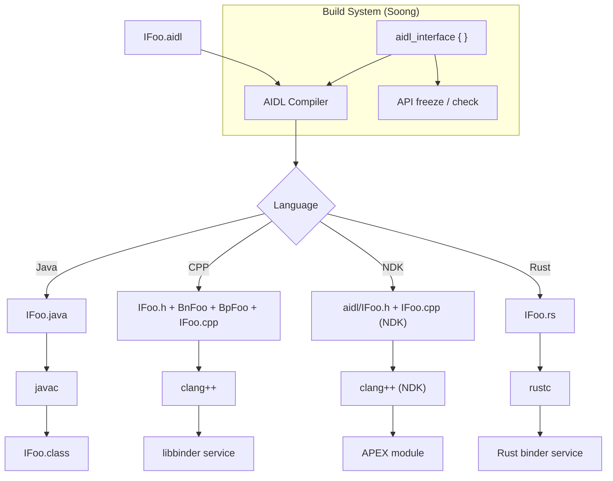

---

## 9.5 servicemanager

源目录：`frameworks/native/cmds/servicemanager/`

`servicemanager` 是 binder 栈中的第一个服务。它也是 init 启动的最早的服务之一（在 `on init` 中，位于 `logd` 和 `lmkd` 之后——`system/core/rootdir/init.rc:464`）。它是所有 Binder 服务的名称服务器：进程按名称注册服务，客户端按名称查找它们。

### 9.5.1 架构概览

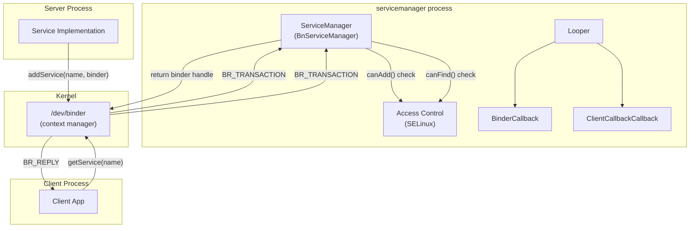

### 9.5.2 启动序列

`servicemanager` 在启动早期由 init 启动。它的 init.rc：

```rc
# frameworks/native/cmds/servicemanager/servicemanager.rc
service servicemanager /system/bin/servicemanager
    class core animation
    user system
    group system readproc
    critical
    file /dev/kmsg w
    onrestart setprop servicemanager.ready false
    onrestart restart --only-if-running apexd
    onrestart restart audioserver
    onrestart restart gatekeeperd
    onrestart class_restart --only-enabled main
    onrestart class_restart --only-enabled hal
    onrestart class_restart --only-enabled early_hal
    task_profiles ProcessCapacityHigh
    shutdown critical
```

`critical` 标志意味着如果 `servicemanager` 崩溃次数过多，系统将重启。`onrestart` 触发器会重启所有依赖的服务。

`main.cpp` 中的 `main()` 函数：

```cpp
// frameworks/native/cmds/servicemanager/main.cpp (line ~146)
int main(int argc, char** argv) {
    android::base::InitLogging(argv, android::base::KernelLogger);

    const char* driver = argc == 2 ? argv[1] : "/dev/binder";

    sp<ProcessState> ps = ProcessState::initWithDriver(driver);
    ps->setThreadPoolMaxThreadCount(0);
    ps->setCallRestriction(ProcessState::CallRestriction::FATAL_IF_NOT_ONEWAY);

    IPCThreadState::self()->disableBackgroundScheduling(true);

    sp<ServiceManager> manager =
        sp<ServiceManager>::make(std::make_unique<Access>());
    manager->setRequestingSid(true);
    if (!manager->addService("manager", manager,
            false /*allowIsolated*/,
            IServiceManager::DUMP_FLAG_PRIORITY_DEFAULT).isOk()) {
        LOG(ERROR) << "Could not self register servicemanager";
    }

    IPCThreadState::self()->setTheContextObject(manager);
    if (!ps->becomeContextManager()) {
        LOG(FATAL) << "Could not become context manager";
    }

    sp<Looper> looper = Looper::prepare(false /*allowNonCallbacks*/);
    sp<BinderCallback> binderCallback = BinderCallback::setupTo(looper);
    ClientCallbackCallback::setupTo(looper, manager, binderCallback);

    if (!SetProperty("servicemanager.ready", "true")) {
        LOG(ERROR) << "Failed to set servicemanager ready property";
    }

    while(true) {
        looper->pollAll(-1);
    }
}
```

关键初始化步骤：

1. **打开驱动**：使用 `ProcessState::initWithDriver("/dev/binder")`
2. **将最大线程数设为 0**——servicemanager 使用单线程事件循环
3. **设置 FATAL_IF_NOT_ONEWAY**——servicemanager 绝不能发出阻塞调用
4. **创建 ServiceManager**：使用一个 `Access` 对象进行 SELinux 检查
5. **启用 SID 请求**（`setRequestingSid(true)`），使每个事务都包含调用方的 SELinux 上下文
6. **成为上下文管理器**：通过 `becomeContextManager()`
7. **进入事件循环**：使用 `Looper::pollAll(-1)`

`BinderCallback` 使用 `IPCThreadState::setupPolling()` 获取一个 binder 驱动的文件描述符，然后将其添加到 `Looper` 中：

```cpp
// frameworks/native/cmds/servicemanager/main.cpp (line ~59)
class BinderCallback : public LooperCallback {
public:
    static sp<BinderCallback> setupTo(const sp<Looper>& looper) {
        sp<BinderCallback> cb = sp<BinderCallback>::make();
        cb->mLooper = looper;

        IPCThreadState::self()->setupPolling(&cb->mBinderFd);
        LOG_ALWAYS_FATAL_IF(cb->mBinderFd < 0,
            "Failed to setupPolling: %d", cb->mBinderFd);

        int ret = looper->addFd(cb->mBinderFd, Looper::POLL_CALLBACK,
                                Looper::EVENT_INPUT, cb, nullptr);
        LOG_ALWAYS_FATAL_IF(ret != 1,
            "Failed to add binder FD to Looper");
        return cb;
    }

    int handleEvent(int, int, void*) override {
        IPCThreadState::self()->handlePolledCommands();
        return 1;  // Continue receiving callbacks.
    }
};
```

### 9.5.3 ServiceManager 类

`ServiceManager` 类继承自 `BnServiceManager`（由 AIDL 生成），并实现 `DeathRecipient` 接口：

```cpp
// frameworks/native/cmds/servicemanager/ServiceManager.h (line ~41)
class ServiceManager : public os::BnServiceManager,
                       public IBinder::DeathRecipient {
public:
    ServiceManager(std::unique_ptr<Access>&& access);
    ~ServiceManager();

    binder::Status getService(const std::string& name,
                              sp<IBinder>* outBinder) override;
    binder::Status checkService(const std::string& name,
                                sp<IBinder>* outBinder) override;
    binder::Status addService(const std::string& name,
                              const sp<IBinder>& binder,
                              bool allowIsolated,
                              int32_t dumpPriority) override;
    binder::Status listServices(int32_t dumpPriority,
                                std::vector<std::string>* outList) override;
    binder::Status registerForNotifications(
        const std::string& name,
        const sp<IServiceCallback>& callback) override;
    binder::Status isDeclared(const std::string& name,
                              bool* outReturn) override;
    // ...

    void binderDied(const wp<IBinder>& who) override;

private:
    struct Service {
        sp<IBinder> binder;         // not null
        bool allowIsolated;
        int32_t dumpPriority;
        bool hasClients = false;
        bool guaranteeClient = false;
        Access::CallingContext ctx;  // process that registered this
        ssize_t getNodeStrongRefCount();
        ~Service();
    };

    using ServiceMap = std::map<std::string, Service>;
    ServiceMap mNameToService;
    // ...
    std::unique_ptr<Access> mAccess;
};
```

### 9.5.4 服务注册（addService）

当服务端进程调用 `addService()` 时：

```cpp
// frameworks/native/cmds/servicemanager/ServiceManager.cpp (line ~512)
Status ServiceManager::addService(const std::string& name,
                                  const sp<IBinder>& binder,
                                  bool allowIsolated,
                                  int32_t dumpPriority) {
    SM_PERFETTO_TRACE_FUNC(PERFETTO_TE_PROTO_FIELDS(
            PERFETTO_TE_PROTO_FIELD_CSTR(kProtoServiceName, name.c_str())));

    auto ctx = mAccess->getCallingContext();

    // Security: Only system UIDs can register services
    if (multiuser_get_app_id(ctx.uid) >= AID_APP) {
        return Status::fromExceptionCode(Status::EX_SECURITY,
            "App UIDs cannot add services.");
    }

    // SELinux: Check if this caller can add this service name. canAddService()
    // also resolves whether the name is fronted by an RPC Accessor (see 9.5.5).
    std::optional<std::string> accessorName;
    if (auto status = canAddService(ctx, name, &accessorName);
            !status.isOk()) {
        return status;
    }

    if (binder == nullptr) {
        return Status::fromExceptionCode(Status::EX_ILLEGAL_ARGUMENT,
            "Null binder.");
    }

    if (!isValidServiceName(name)) {
        return Status::fromExceptionCode(Status::EX_ILLEGAL_ARGUMENT,
            "Invalid service name.");
    }

#ifndef VENDORSERVICEMANAGER
    // VINTF: For HAL services, verify VINTF manifest declaration. The vendor
    // service manager is compiled with VENDORSERVICEMANAGER and skips this.
    if (!meetsDeclarationRequirements(ctx, binder, name)) {
        return Status::fromExceptionCode(Status::EX_ILLEGAL_ARGUMENT,
            "VINTF declaration error.");
    }
#endif  // !VENDORSERVICEMANAGER

    // Register for death notification to clean up when server dies
    if (binder->remoteBinder() != nullptr &&
        binder->linkToDeath(sp<ServiceManager>::fromExisting(this)) != OK) {
        return Status::fromExceptionCode(Status::EX_ILLEGAL_STATE,
            "Couldn't linkToDeath.");
    }

    // Store the service (mNameToService[name] = Service{...})
    // and notify any processes waiting via registerForNotifications().
    // ...
    return Status::ok();
}
```

函数体由 `SM_PERFETTO_TRACE_FUNC` 进行门控。因此，每次 `addService` / `getService` / `checkService` 调用都会作为 Perfetto 切片输出到 `servicemanager` 轨道上（见 9.10.2）。`#ifndef VENDORSERVICEMANAGER` 保护条件很重要。框架和供应商服务管理器是*同一个*二进制文件构建两次，只有框架构建强制执行 VINTF 声明。

服务名称验证很严格：

```cpp
// frameworks/native/cmds/servicemanager/ServiceManager.cpp (line ~494)
bool isValidServiceName(const std::string& name) {
    if (name.size() == 0) return false;
    if (name.size() > 127) return false;

    for (char c : name) {
        if (c == '_' || c == '-' || c == '.' || c == '/') continue;
        if (c >= 'a' && c <= 'z') continue;
        if (c >= 'A' && c <= 'Z') continue;
        if (c >= '0' && c <= '9') continue;
        return false;
    }
    return true;
}
```

### 9.5.5 服务查找（getService / checkService）

```cpp
// frameworks/native/cmds/servicemanager/ServiceManager.cpp (line ~395)
Status ServiceManager::getService(const std::string& name,
                                  sp<IBinder>* outBinder) {
    *outBinder = tryGetBinder(name, true).service;
    return Status::ok();
}

Status ServiceManager::checkService(const std::string& name,
                                    sp<IBinder>* outBinder) {
    *outBinder = tryGetBinder(name, false).service;
    return Status::ok();
}
```

区别在于：`getService()` 传入 `startIfNotFound=true`，如果服务未运行，它会尝试通过 init 启动该服务。`checkService()` 立即返回（找不到时返回 null）。

普通的 `getService` / `checkService` 只返回一个原始的 `IBinder`。现代客户端调用更丰富的 `getService2` / `checkService2` 变体。它们返回一个 `os::Service` 联合体（`frameworks/native/cmds/servicemanager/ServiceManager.cpp:431`）：

```cpp
os::Service ServiceManager::tryGetService(const std::string& name,
                                          bool startIfNotFound) {
    std::optional<std::string> accessorName;
#ifndef VENDORSERVICEMANAGER
    accessorName = getVintfAccessorName(name);
#endif
    if (accessorName.has_value()) {
        // The service lives behind an RPC Accessor (e.g. inside a VM).
        // Return the Accessor binder, not the service itself.
        auto ctx = mAccess->getCallingContext();
        if (!mAccess->canFind(ctx, name)) {
            return os::Service::make<os::Service::Tag::accessor>(nullptr);
        }
        return os::Service::make<os::Service::Tag::accessor>(
                tryGetBinder(*accessorName, startIfNotFound).service);
    } else {
        return os::Service::make<os::Service::Tag::serviceWithMetadata>(
                tryGetBinder(name, startIfNotFound));
    }
}
```

Android 16 引入了 `os::Service` 带标签联合体以及 `getService2` / `checkService2` 变体。借助它，服务管理器会返回*要么*一个普通的本地 binder *要么*一个 RPC Accessor。客户端使用 Accessor 建立到服务的 socket 连接。该服务运行在内核 binder 不可用的地方（例如在受保护的 VM 内部）。Accessor 路径在 9.9.10 中介绍。

### 9.5.6 SELinux 访问控制

服务管理器的每个操作都由 SELinux 门控：

```cpp
// frameworks/native/cmds/servicemanager/Access.cpp (line ~130)
bool Access::canFind(const CallingContext& ctx, const std::string& name) {
    return actionAllowedFromLookup(ctx, name, "find");
}

bool Access::canAdd(const CallingContext& ctx, const std::string& name) {
    return actionAllowedFromLookup(ctx, name, "add");
}

bool Access::canList(const CallingContext& ctx) {
    return actionAllowed(ctx, mThisProcessContext, "list", "service_manager");
}
```

实际检查使用 `selinux_check_access()`：

```cpp
// frameworks/native/cmds/servicemanager/Access.cpp (line ~142)
bool Access::actionAllowed(const CallingContext& sctx, const char* tctx,
                           const char* perm, const std::string& tname) {
    const char* tclass = "service_manager";

    AuditCallbackData data = {
        .context = &sctx,
        .tname = &tname,
    };

    return 0 == selinux_check_access(sctx.sid.c_str(), tctx, tclass, perm,
        reinterpret_cast<void*>(&data));
}
```

调用上下文从 `IPCThreadState` 获取：

```cpp
// frameworks/native/cmds/servicemanager/Access.cpp (line ~113)
Access::CallingContext Access::getCallingContext() {
    IPCThreadState* ipc = IPCThreadState::self();
    const char* callingSid = ipc->getCallingSid();
    pid_t callingPid = ipc->getCallingPid();

    return CallingContext {
        .debugPid = callingPid,
        .uid = ipc->getCallingUid(),
        .sid = callingSid ? std::string(callingSid)
                          : getPidcon(callingPid),
    };
}
```

### 9.5.7 VINTF 清单集成

对于 HAL 服务，`servicemanager` 验证该服务已在 VINTF 清单中声明：

```cpp
// frameworks/native/cmds/servicemanager/ServiceManager.cpp (line ~342)
static bool meetsDeclarationRequirements(const Access::CallingContext& ctx,
                                         const sp<IBinder>& binder,
                                         const std::string& name) {
    if (!Stability::requiresVintfDeclaration(binder)) {
        return true;
    }
    return isVintfDeclared(ctx, name);
}
```

这确保了 HAL 服务在设备清单文件中被正确声明，防止临时性的服务注册。

### 9.5.8 客户端回调支持

Servicemanager 包含一个基于定时器的系统，用于跟踪服务是否有活跃客户端（用于惰性服务）：

```cpp
// frameworks/native/cmds/servicemanager/main.cpp (line ~92)
class ClientCallbackCallback : public LooperCallback {
    // Fires every 5 seconds
    int handleEvent(int fd, int, void*) override {
        uint64_t expirations;
        int ret = read(fd, &expirations, sizeof(expirations));
        mManager->handleClientCallbacks();
        mBinderCallback->repoll();
        return 1;
    }
};
```

### 9.5.9 dumpsys 集成

`dumpsys` 命令行工具与 servicemanager 通信，以列出服务并转储它们的状态。当你运行：

```bash
adb shell dumpsys activity
```

这会：

1. 调用 `servicemanager.checkService("activity")` 获取 ActivityManager binder
2. 在该 binder 上调用 `IBinder::DUMP_TRANSACTION`
3. 服务将状态写入提供的文件描述符

servicemanager 中的 `listServices()` 调用返回按转储优先级过滤的服务：

```cpp
// From ServiceManager.h
binder::Status listServices(int32_t dumpPriority,
                            std::vector<std::string>* outList) override;
```

转储优先级使 `dumpsys` 可以先转储关键服务：

```cpp
static const int DUMP_FLAG_PRIORITY_CRITICAL = 1 << 0;
static const int DUMP_FLAG_PRIORITY_HIGH     = 1 << 1;
static const int DUMP_FLAG_PRIORITY_NORMAL   = 1 << 2;
static const int DUMP_FLAG_PRIORITY_DEFAULT  = 1 << 3;
```

### 9.5.10 服务注册流程（完整）

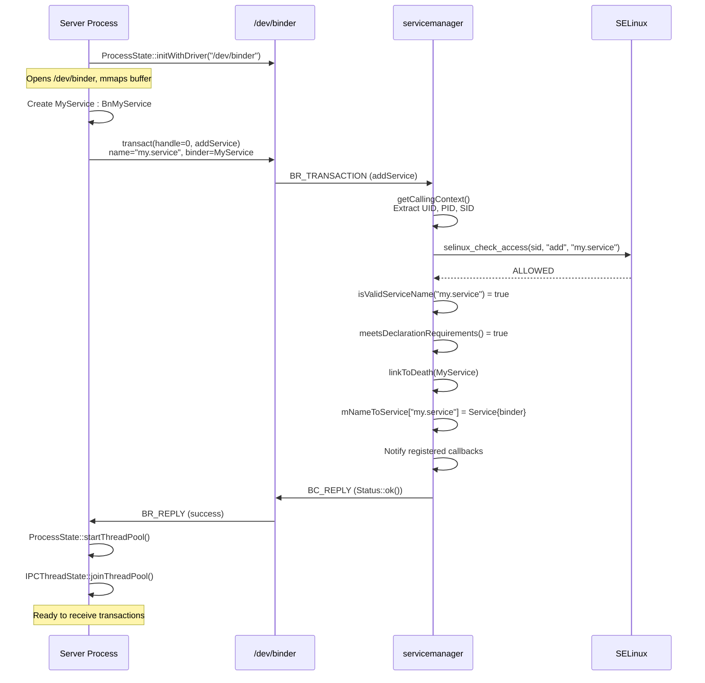

### 9.5.11 服务查找流程（完整）

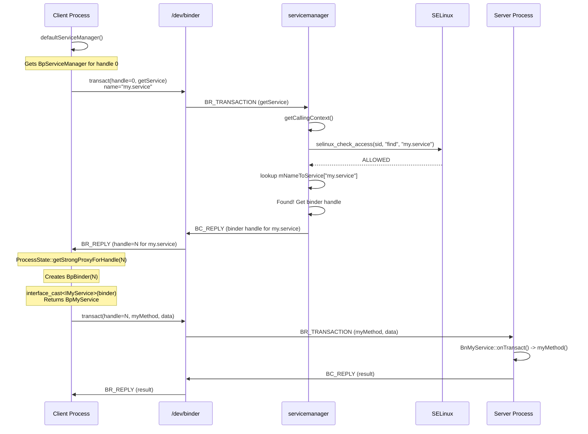

### 9.5.12 vndservicemanager

供应商服务管理器是同一个二进制文件，用不同的标志编译而成：

```rc
# frameworks/native/cmds/servicemanager/vndservicemanager.rc
service vndservicemanager /vendor/bin/vndservicemanager /dev/vndbinder
    class core
    user system
    group system readproc
    file /dev/kmsg w
    task_profiles ServiceCapacityLow
    onrestart class_restart main
    onrestart class_restart hal
    onrestart class_restart early_hal
    shutdown critical
```

它使用 `/dev/vndbinder` 而不是 `/dev/binder`，为供应商服务创建了一个完全独立的命名空间。VNDK（Vendor NDK）构建配置确保供应商库默认使用 `/dev/vndbinder`——参见 §9.1.7 中的 `kDefaultDriver` 选择。

### 9.5.13 LazyServiceRegistrar

对于只应在有客户端时才运行的服务，Android 提供了 `LazyServiceRegistrar`：

```cpp
// frameworks/native/libs/binder/include/binder/LazyServiceRegistrar.h
class LazyServiceRegistrar {
public:
    static LazyServiceRegistrar& getInstance();

    status_t registerService(
        const sp<IBinder>& service,
        const std::string& name = "default",
        bool allowIsolated = false,
        int dumpFlags = IServiceManager::DUMP_FLAG_PRIORITY_DEFAULT);

    void forcePersist(bool persist);

    void setActiveServicesCallback(
        const std::function<bool(bool)>& activeServicesCallback);

    bool tryUnregister();
    void reRegister();
};
```

当所有客户端断开连接时，惰性服务会关闭。当客户端请求该服务时，init 会重启它。这用于那些空闲时保持运行开销很大的 HAL 服务。

### 9.5.14 waitForService 与高效轮询

获取服务的推荐方式是 `waitForService`，它使用 `registerForNotifications` 进行高效阻塞，而不是轮询：

```cpp
// frameworks/native/libs/binder/include/binder/IServiceManager.h
template<typename INTERFACE>
sp<INTERFACE> waitForService(const String16& name) {
    const sp<IServiceManager> sm = defaultServiceManager();
    return interface_cast<INTERFACE>(sm->waitForService(name));
}
```

对于 VINTF 声明的服务：

```cpp
template<typename INTERFACE>
sp<INTERFACE> waitForVintfService(
        const String16& instance = String16("default")) {
    return waitForDeclaredService<INTERFACE>(
        INTERFACE::descriptor + String16("/") + instance);
}
```

---

## 9.6 hwservicemanager 与 HIDL Binder

源目录：`system/hwservicemanager/`

HAL 域（`/dev/hwbinder`）及其上下文管理器 `hwservicemanager` 是 §9.1.7 中介绍的三个 binder 域中的第二个。本节介绍 HIDL ABI、向 `/dev/binder` 上 AIDL 的迁移，以及相关的供应商域组件（`vndservicemanager`、passthrough HAL）。

### 9.6.1 hwservicemanager

`hwservicemanager` 管理 `/dev/hwbinder` 上的 HIDL 服务：

```rc
# system/hwservicemanager/hwservicemanager.rc
service hwservicemanager /system/system_ext/bin/hwservicemanager
    user system
    disabled
    group system readproc
    critical
    onrestart setprop hwservicemanager.ready false
    onrestart class_restart --only-enabled main
    onrestart class_restart --only-enabled hal
    onrestart class_restart --only-enabled early_hal
    task_profiles ServiceCapacityLow HighPerformance
    class animation
    shutdown critical
```

注意 `disabled` 关键字——它仅意味着该服务不会随其 `animation` 类自动启动；`init.rc` 会用 `start hwservicemanager` 显式启动它。即使在已将所有 HAL 迁移到 AIDL 的设备上，`hwservicemanager` *也*会启动。它的 `main()`（`system/hwservicemanager/service.cpp`）通过 VINTF 发现其自身的传输方式为 `EMPTY`，记录 HIDL 不受支持，设置 `hwservicemanager.disabled=true` 属性，然后休眠。随后 `hwservicemanager.rc` 中的 `on property:hwservicemanager.disabled=true` 触发器会停止该进程。

`hwservicemanager` 使用 HIDL `IServiceManager` 接口：

```cpp
// system/hwservicemanager/ServiceManager.h
struct ServiceManager : public V1_2::IServiceManager,
                        hidl_death_recipient {
    Return<sp<IBase>> get(const hidl_string& fqName,
                          const hidl_string& name) override;
    Return<bool> add(const hidl_string& name,
                     const sp<IBase>& service) override;
    Return<Transport> getTransport(const hidl_string& fqName,
                                   const hidl_string& name);
    Return<void> list(list_cb _hidl_cb) override;
    Return<void> listByInterface(const hidl_string& fqInstanceName,
                                 listByInterface_cb _hidl_cb) override;
    Return<bool> registerForNotifications(
        const hidl_string& fqName,
        const hidl_string& name,
        const sp<IServiceNotification>& callback) override;
    // ...
};
```

### 9.6.2 HIDL 与 AIDL

| 特性 | HIDL | AIDL |
|---------|------|------|
| 传输 | `/dev/hwbinder` | `/dev/binder` 或 `/dev/vndbinder` |
| 服务命名 | `package@version::IInterface/instance` | `package.IInterface/instance` |
| 版本管理 | 包级别（`@1.0`、`@1.1`） | 方法级别（只能追加） |
| 语言支持 | C++、Java | C++、Java、NDK C++、Rust |
| 状态 | **已废弃** | 活跃，推荐使用 |
| Passthrough 模式 | 支持 | 不适用 |

HIDL 使用如下形式的完全限定名（FQN）：
```
android.hardware.camera.provider@2.4::ICameraProvider/internal/0
```

AIDL 使用点分隔的名称：
```
android.hardware.camera.provider.ICameraProvider/internal/0
```

### 9.6.3 从 HIDL 到 AIDL 的迁移

从 Android 13 开始，所有新的 HAL 接口都必须使用 AIDL。现有的 HIDL 接口正在后续版本中逐步迁移到 AIDL。迁移路径：

1. 在 `hardware/interfaces/` 中定义新的 AIDL 接口
2. 使用 AIDL 实现服务
3. 向 `servicemanager` 而不是 `hwservicemanager` 注册
4. 将 VINTF 清单从 `hidl` 格式更新为 `aidl` 格式
5. 最终移除 HIDL 接口

从 HIDL 迁移到 AIDL 的服务使用 `/dev/binder` 并向常规 `servicemanager` 注册，但它们的名称会依据 VINTF 清单进行验证。

### 9.6.4 Passthrough HAL

HIDL 支持一种"passthrough"模式，HAL 作为共享库直接加载到客户端进程中（无 IPC）。这用于图形 HAL 等性能关键的 HAL。AIDL 不支持 passthrough 模式——所有通信都通过 Binder IPC 进行。passthrough 功能由直接 dlopen 机制替代：

```cpp
// frameworks/native/libs/binder/include/binder/IServiceManager.h
void* openDeclaredPassthroughHal(const String16& interface,
                                 const String16& instance, int flag);
```

---

## 9.7 Binder 内部机制：深入剖析

本节是对 `libbinder` 内部数据流和状态机的详细演练。它面向需要理解 Binder 事务中确切代码路径的内核和框架开发者。

### 9.7.1 writeTransactionData 函数

出站事务数据就是在这里格式化的：

```cpp
// frameworks/native/libs/binder/IPCThreadState.cpp (line ~1387)
status_t IPCThreadState::writeTransactionData(int32_t cmd,
    uint32_t binderFlags, int32_t handle, uint32_t code,
    const Parcel& data, status_t* statusBuffer)
{
    binder_transaction_data tr;

    tr.target.ptr = 0;
    tr.target.handle = handle;
    tr.code = code;
    tr.flags = binderFlags;
    tr.cookie = 0;
    tr.sender_pid = 0;
    tr.sender_euid = 0;

    const status_t err = data.errorCheck();
    if (err == NO_ERROR) {
        tr.data_size = data.ipcDataSize();
        tr.data.ptr.buffer = data.ipcData();
        tr.offsets_size = data.ipcObjectsCount()*sizeof(binder_size_t);
        tr.data.ptr.offsets = data.ipcObjects();
    } else if (statusBuffer) {
        tr.flags |= TF_STATUS_CODE;
        *statusBuffer = err;
        tr.data_size = sizeof(status_t);
        tr.data.ptr.buffer = reinterpret_cast<uintptr_t>(statusBuffer);
        tr.offsets_size = 0;
        tr.data.ptr.offsets = 0;
    } else {
        return (mLastError = err);
    }

    mOut.writeInt32(cmd);
    mOut.write(&tr, sizeof(tr));

    return NO_ERROR;
}
```

注意 `sender_pid` 和 `sender_euid` 被设为 0——内核驱动会用实际值填充它们。

### 9.7.2 executeCommand 函数（BR_TRANSACTION）

当事务到达服务端时，`executeCommand()` 处理 `BR_TRANSACTION` 命令。这是最复杂的情况：

```cpp
// frameworks/native/libs/binder/IPCThreadState.cpp (line ~1510)
case BR_TRANSACTION_SEC_CTX:
case BR_TRANSACTION:
    {
        binder_transaction_data_secctx tr_secctx;
        binder_transaction_data& tr = tr_secctx.transaction_data;

        if (cmd == (int) BR_TRANSACTION_SEC_CTX) {
            result = mIn.read(&tr_secctx, sizeof(tr_secctx));
        } else {
            result = mIn.read(&tr, sizeof(tr));
            tr_secctx.secctx = 0;
        }

        Parcel buffer;
        buffer.ipcSetDataReference(
            reinterpret_cast<const uint8_t*>(tr.data.ptr.buffer),
            tr.data_size,
            reinterpret_cast<const binder_size_t*>(tr.data.ptr.offsets),
            tr.offsets_size/sizeof(binder_size_t), freeBuffer);

        // Save and set the caller identity
        const pid_t origPid = mCallingPid;
        const char* origSid = mCallingSid;
        const auto origUid = mCallingUid;  // std::optional<uid_t>

        mCallingPid = tr.sender_pid;
        mCallingSid = reinterpret_cast<const char*>(tr_secctx.secctx);
        mCallingUid = tr.sender_euid;

        // Dispatch to the target binder object
        if (tr.target.ptr) {
            if (reinterpret_cast<RefBase::weakref_type*>(tr.target.ptr)
                        ->attemptIncStrong(this)) {
                BBinder* binder = reinterpret_cast<BBinder*>(tr.cookie);
                error = doTransactBinder(binder, tr.code, buffer, &reply, tr.flags);
                binder->decStrong(this);
            }
        } else {
            // target.ptr == 0 means this is for the context manager
            BBinder* binder = the_context_object.get();
            error = doTransactBinder(binder, tr.code, buffer, &reply, tr.flags);
        }

        // For synchronous calls, send the reply
        if ((tr.flags & TF_ONE_WAY) == 0) {
            buffer.setDataSize(0);  // Free buffer before reply
            sendReply(reply, (tr.flags & kForwardReplyFlags));
        }

        // Restore caller identity
        mCallingPid = origPid;
        mCallingSid = origSid;
        mCallingUid = origUid;
    }
```

关键观察：

1. **身份设置：** 调用方的 PID、UID 和 SELinux SID 从事务数据中提取并存储在线程局部状态中。这就是 `getCallingPid()`、`getCallingUid()` 和 `getCallingSid()` 返回的内容。

2. **强引用获取：** 在调用进入 BBinder 之前，代码尝试将弱引用提升为强引用。这处理了 BBinder 可能正处于销毁过程中的竞态。

3. **缓冲区管理：** 入站事务的缓冲区在发送回复之前被释放（`buffer.setDataSize(0)`）。这避免了竞态。在竞态中，客户端收到回复并在原始事务使用的空间被释放之前又发送了另一个事务。

4. **上下文管理器分发：** 当 `tr.target.ptr` 为 null 时，事务被定向到上下文管理器（`the_context_object`），即 `servicemanager`。

引用计数命令也在 `executeCommand()` 中处理：

```cpp
// frameworks/native/libs/binder/IPCThreadState.cpp (line ~1444)
case BR_ACQUIRE:
    refs = (RefBase::weakref_type*)mIn.readPointer();
    obj = (BBinder*)mIn.readPointer();
    obj->incStrong(mProcess.get());
    mOut.writeInt32(BC_ACQUIRE_DONE);
    mOut.writePointer((uintptr_t)refs);
    mOut.writePointer((uintptr_t)obj);
    break;

case BR_RELEASE:
    refs = (RefBase::weakref_type*)mIn.readPointer();
    obj = (BBinder*)mIn.readPointer();
    mPendingStrongDerefs.push(obj);
    break;

case BR_INCREFS:
    refs = (RefBase::weakref_type*)mIn.readPointer();
    obj = (BBinder*)mIn.readPointer();
    refs->incWeak(mProcess.get());
    mOut.writeInt32(BC_INCREFS_DONE);
    mOut.writePointer((uintptr_t)refs);
    mOut.writePointer((uintptr_t)obj);
    break;

case BR_DECREFS:
    refs = (RefBase::weakref_type*)mIn.readPointer();
    obj = (BBinder*)mIn.readPointer();
    mPendingWeakDerefs.push(refs);
    break;
```

注意 `BR_RELEASE` 和 `BR_DECREFS` 不会立即递减引用计数。相反，它们被排队到 `mPendingStrongDerefs` 和 `mPendingWeakDerefs` 中，稍后由 `processPendingDerefs()` 处理。这避免了潜在的死锁，并确保析构函数不会在线程处理驱动命令的过程中运行。

### 9.7.3 BBinder::transact 与模板方法模式

当事务到达一个 BBinder 时，`transact()` 方法（它是 `final` 的）处理元事务并委托给 `onTransact()`：

```cpp
// frameworks/native/libs/binder/Binder.cpp (simplified)
status_t BBinder::transact(uint32_t code, const Parcel& data,
                           Parcel* reply, uint32_t flags)
{
    data.setDataPosition(0);

    if (reply != nullptr && (flags & FLAG_CLEAR_BUF)) {
        reply->markSensitive();
    }

    switch (code) {
        case PING_TRANSACTION:
            err = pingBinder();
            break;
        case START_RECORDING_TRANSACTION:
            err = startRecordingTransactions(data);
            break;
        case STOP_RECORDING_TRANSACTION:
            err = stopRecordingTransactions();
            break;
        case EXTENSION_TRANSACTION:
            LOG_ALWAYS_FATAL_IF(reply == nullptr, "reply == nullptr");
            err = reply->writeStrongBinder(getExtension());
            break;
        case DEBUG_PID_TRANSACTION:
            LOG_ALWAYS_FATAL_IF(reply == nullptr, "reply == nullptr");
            err = reply->writeInt32(getDebugPid());
            break;
        case SET_RPC_CLIENT_TRANSACTION:
            err = setRpcClientDebug(data);
            break;
        default:
            err = onTransact(code, data, reply, flags);
            break;
    }

    if (reply != nullptr) {
        reply->setDataPosition(0);
        if (reply->dataSize() > binder::kLogTransactionsOverBytes) {
            // ...log warning about large replies...
        }
    }
    return err;
}
```

其余的元事务——`INTERFACE_TRANSACTION`、`DUMP_TRANSACTION` 和 `SHELL_COMMAND_TRANSACTION`——由基类 `BBinder::onTransact()`（`frameworks/native/libs/binder/Binder.cpp:1102-1140`）处理，子类对无法识别的代码会落到这个基类实现。

AIDL 生成的 `BnFoo::onTransact()` 才是分发到你的特定接口方法的函数。

### 9.7.4 BBinder::Extras 与惰性初始化模式

BBinder 对其"extras"使用惰性初始化——即大多数 binder 对象永远不需要的可选元数据：

```cpp
// frameworks/native/libs/binder/Binder.cpp (line ~294)
class BBinder::Extras {
public:
    sp<IBinder> mExtension;
    int mPolicy = SCHED_NORMAL;
    int mPriority = 0;
    bool mRequestingSid = false;
    bool mInheritRt = false;
    bool mRecordingOn = false;

    RpcMutex mLock;
    std::set<sp<RpcServerLink>> mRpcServerLinks;
    BpBinder::ObjectManager mObjectMgr;
    uint16_t mMinThreads = kDefaultMinThreads;
    unique_fd mRecordingFd;
};
```

`Extras` 指针存储为 `std::atomic<Extras*>`，并在首次访问时通过 `getOrCreateExtras()` 分配。由于大多数 binder 对象从不使用扩展、自定义调度或录制，这保持了 `BBinder` 基类的小巧（在 LP64 上为 40 字节）。

### 9.7.5 waitForResponse 循环（续）

发送事务后，线程进入一个等待回复的循环：

```cpp
// frameworks/native/libs/binder/IPCThreadState.cpp (line ~1153)
status_t IPCThreadState::waitForResponse(Parcel *reply,
                                         status_t *acquireResult)
{
    uint32_t cmd;
    int32_t err;

    while (1) {
        if ((err=talkWithDriver()) < NO_ERROR) break;
        err = mIn.errorCheck();
        if (err < NO_ERROR) break;
        if (mIn.dataAvail() == 0) continue;

        cmd = (uint32_t)mIn.readInt32();

        switch (cmd) {
        case BR_TRANSACTION_COMPLETE:
            if (!reply && !acquireResult) goto finish;
            break;

        case BR_DEAD_REPLY:
            err = DEAD_OBJECT;
            goto finish;

        case BR_FAILED_REPLY:
            err = FAILED_TRANSACTION;
            goto finish;

        case BR_FROZEN_REPLY:
            err = enableFrozenObjectErrorCode() ? FROZEN_OBJECT : FAILED_TRANSACTION;
            goto finish;

        case BR_REPLY:
            LOG_ALWAYS_FATAL_IF(reply == NULL, "Unexpected BR_REPLY");
            binder_transaction_data tr;
            err = mIn.read(&tr, sizeof(tr));
            ALOG_ASSERT(err == NO_ERROR, "Not enough command data for brREPLY");
            if (err != NO_ERROR) goto finish;
            if ((tr.flags & TF_STATUS_CODE) == 0) {
                reply->ipcSetDataReference(
                    reinterpret_cast<const uint8_t*>(tr.data.ptr.buffer),
                    tr.data_size,
                    reinterpret_cast<const binder_size_t*>(tr.data.ptr.offsets),
                    tr.offsets_size/sizeof(binder_size_t),
                    freeBuffer);
            } else {
                err = *reinterpret_cast<const status_t*>(tr.data.ptr.buffer);
                freeBuffer(/* ... */);
            }
            goto finish;

        default:
            err = executeCommand(cmd);
            if (err != NO_ERROR) goto finish;
            break;
        }
    }
    // ...
}
```

`default` 分支很重要。当线程等待回复时，它可能从驱动收到其他命令（如 `BR_DEAD_BINDER` 死亡通知或嵌套的 `BR_TRANSACTION` 调用）。这些由 `executeCommand()` 处理。

`BR_FROZEN_REPLY` 分支值得仔细查看。当目标进程处于 freezer cgroup（一个缓存应用）中、因而无法服务同步事务时，内核会返回它。历史上 `libbinder` 将其合并为通用的 `FAILED_TRANSACTION` 状态，调用方无法将其与真正的失败区分开。Android 17 将两者分开。

当构建时标志 `android.os.binder.flags.enable_frozen_object_error` 被设置时，辅助函数 `enableFrozenObjectErrorCode()` 返回 true。然后 `waitForResponse()` 将 `BR_FROZEN_REPLY` 映射为专用的 `FROZEN_OBJECT` 状态码（`frameworks/native/libs/binder/IPCThreadState.cpp:105` 以及 `frameworks/native/libs/binder/flags.aconfig` 中的标志定义）。`FROZEN_OBJECT` 在 `system/core/libutils/include/utils/Errors.h:72` 中定义为 `UNKNOWN_ERROR + 9`。该标志是 `is_fixed_read_only`，因此它会编译为常量，死分支会被优化掉。这让调用方可以在目标解冻后重试，而不是将短暂的冻结视为硬错误。

### 9.7.6 嵌套事务

Binder 支持重入调用。假设进程 A 调用进程 B。如果 B 在处理 A 的请求时回调到 A，驱动会将回调投递给 A 中的同一个线程。该线程正在等待 B 的回复。这在 `waitForResponse()` 中通过 `default` 分支调用 `executeCommand()` 来检测。

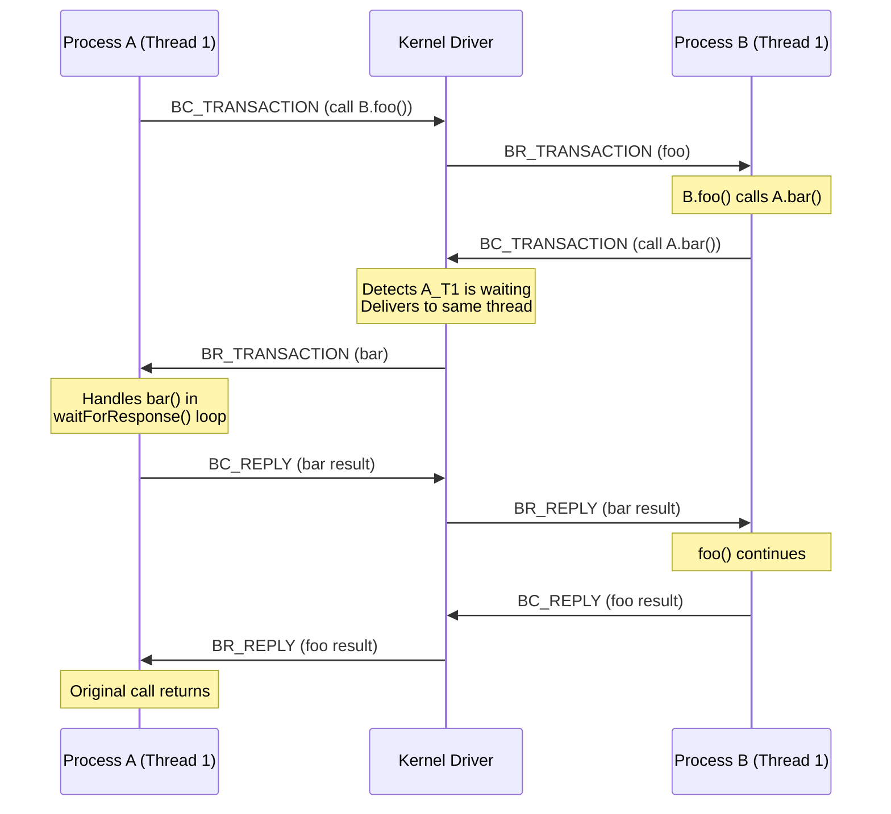

### 9.7.7 Binder 上下文对象（句柄 0）

句柄 0 是特殊的——它始终指向上下文管理器（`servicemanager`）。当进程首次需要与 servicemanager 通信时，它调用：

```cpp
// frameworks/native/libs/binder/ProcessState.cpp (line ~183)
sp<IBinder> ProcessState::getContextObject(const sp<IBinder>& /*caller*/)
{
    sp<IBinder> context = getStrongProxyForHandle(0);
    if (context) {
        internal::Stability::markCompilationUnit(context.get());
    }
    return context;
}
```

`getStrongProxyForHandle(0)` 路径有特殊处理——它在创建代理之前发送 `PING_TRANSACTION`，以确保上下文管理器存活：

```cpp
// frameworks/native/libs/binder/ProcessState.cpp (line ~361)
if (handle == 0) {
    // Special case for context manager...
    IPCThreadState* ipc = IPCThreadState::self();
    Parcel data;
    status_t status = ipc->transact(
            0, IBinder::PING_TRANSACTION, data, nullptr, 0);
    if (status == DEAD_OBJECT)
       return nullptr;
}
```

### 9.7.8 稳定性强制

`Stability` 类确保 binder 对象不会被跨不兼容的域使用：

```cpp
// frameworks/native/libs/binder/include/binder/Stability.h
class Stability {
    enum Level : int16_t {
        UNDECLARED = 0,     // Within a compilation unit
        VENDOR = 0b000011,  // Vendor stability
        SYSTEM = 0b001100,  // System stability
        VINTF = 0b111111,   // VINTF-stable (cross-partition)
    };
};
```

`VINTF` 稳定的 binder 可以跨框架/供应商边界使用。`SYSTEM` 稳定的 binder 只能在系统分区内使用。这防止了不稳定接口被意外跨分区使用。

### 9.7.9 Parcel 内部机制

`Parcel` 类管理一个扁平字节缓冲区和一个"objects"数组，后者跟踪嵌入的 binder 引用和文件描述符：

```
┌──────────────────────────────────────────┐
│                 Parcel                   │
│                                          │
│  data: [int32 | string | binder | int32] │
│         ↑                ↑               │
│  objects: [           offset=12        ] │
│                                          │
│  The objects array stores offsets into   │
│  the data buffer where flat_binder_obj   │
│  structs are embedded.                   │
└──────────────────────────────────────────┘
```

当内核驱动拷贝一个 Parcel 时，它处理 objects 数组以：

- 将 binder 节点引用转换为句柄（反之亦然）
- 将文件描述符复制到目标进程
- 维护 binder 节点上的引用计数

### 9.7.10 ProcessState 构造函数

`ProcessState` 的完整初始化会打开驱动并进行 mmap：

```cpp
// frameworks/native/libs/binder/ProcessState.cpp
ProcessState::ProcessState(const char* driver)
    : mDriverName(String8(driver))
    , mDriverFD(-1)
    , mVMStart(MAP_FAILED)
    , mExecutingThreadsCount(0)
    , mMaxThreads(DEFAULT_MAX_BINDER_THREADS)
    , mCurrentThreads(0)
    , mKernelStartedThreads(0)
    , mStarvationStartTime(never())
    , mForked(false)
    , mThreadPoolStarted(false)
    , mThreadPoolSeq(1)
    , mIsOutgoingTransactionsAuditable(false)
    , mCallRestriction(CallRestriction::NONE)
{
    String8 error;
    unique_fd opened = open_driver(driver, &error);
    if (opened.ok()) {
        // ...
        mVMStart = mmap(nullptr, BINDER_VM_SIZE,
                        PROT_READ,
                        MAP_PRIVATE | MAP_NORESERVE,
                        opened.get(), 0);
        // ...
    }
    // ...
    if (opened.ok()) {
        mDriverFD = opened.release();
    }
}
```

缓冲区仅以 `PROT_READ` 映射——只有内核可以向其中写入。

### 9.7.11 Binder 缓存

近期版本的 AOSP 包含一个 `BinderCacheWithInvalidation`，它缓存服务查找以避免反复往返 servicemanager：

```cpp
// frameworks/native/libs/binder/BackendUnifiedServiceManager.h
class BinderCacheWithInvalidation
      : public std::enable_shared_from_this<BinderCacheWithInvalidation> {
    class BinderInvalidation : public IBinder::DeathRecipient {
    public:
        void binderDied(const wp<IBinder>& who) override {
            sp<IBinder> binder = who.promote();
            if (std::shared_ptr<BinderCacheWithInvalidation> cache =
                    mCache.lock()) {
                cache->removeItem(mKey, binder);
            }
        }
    };

    struct Entry {
        sp<IBinder> service;
        sp<BinderInvalidation> deathRecipient;
    };

public:
    sp<IBinder> getItem(const std::string& key) const {
        std::lock_guard<std::mutex> lock(mCacheMutex);
        if (auto it = mCache.find(key); it != mCache.end()) {
            return it->second.service;
        }
        return nullptr;
    }
    // ...
};
```

当目标服务死亡时（使用 `linkToDeath`），缓存会自动使条目失效。由于 `getService()` 调用极其频繁，这是一项重大的性能优化。

### 9.7.12 defaultServiceManager() 单例

`defaultServiceManager()` 函数返回服务管理器的缓存引用：

```cpp
// frameworks/native/libs/binder/IServiceManager.cpp:333
sp<IServiceManager> defaultServiceManager()
{
    std::call_once(gSmOnce, []() {
        gDefaultServiceManager =
            sp<CppBackendShim>::make(getBackendUnifiedServiceManager());
    });

    return gDefaultServiceManager;
}
```

等待发生在 `getBackendUnifiedServiceManager()` 内部（`frameworks/native/libs/binder/BackendUnifiedServiceManager.cpp:510`）。它首先等待 `servicemanager.ready` 系统属性。然后它以 1 秒的休眠重试对上下文对象的 `interface_cast`，直到上下文对象出现。这就是为什么在启动早期调用 `defaultServiceManager()` 是安全的——它会等待 servicemanager 启动。

### 9.7.13 Flat Binder 对象

当一个 binder 引用被序列化进 Parcel 时，它被写为一个 `flat_binder_object`：

```c
struct flat_binder_object {
    struct binder_object_header hdr;
    __u32 flags;
    union {
        binder_uintptr_t binder;  /* local object */
        __u32 handle;             /* remote handle */
    };
    binder_uintptr_t cookie;
};
```

内核驱动在拷贝期间在本地对象和远程句柄之间进行转换。当进程 A 发送一个包含本地 BBinder 指针的 `flat_binder_object` 时，驱动将其转换为进程 B 句柄表中的句柄。当进程 B 将该句柄发送回来时，驱动将其转换回原始的 BBinder 指针。

这种转换对用户空间是透明的——Parcel 的 `writeStrongBinder()` 和 `readStrongBinder()` 方法处理序列化，内核处理句柄到指针的转换。

### 9.7.14 Parcel Objects 数组

Parcel 的"objects 数组"跟踪数据缓冲区内所有嵌入的 `flat_binder_object` 结构的字节偏移量。当内核驱动将一个 Parcel 从一个进程拷贝到另一个进程时，它：

1. 拷贝原始数据缓冲区
2. 遍历 objects 数组
3. 对每个偏移量，读取该位置的 `flat_binder_object`
4. 转换 binder 引用（本地指针 ↔ 远程句柄）
5. 将文件描述符复制到目标进程

这就是 `Parcel::ipcObjectsCount()` 和 `Parcel::ipcObjects()` 存在的原因：
```cpp
// From writeTransactionData():
tr.offsets_size = data.ipcObjectsCount() * sizeof(binder_size_t);
tr.data.ptr.offsets = data.ipcObjects();
```

### 9.7.15 事务标志

有几个标志控制事务行为：

| 标志 | 值 | 含义 |
|------|-------|---------|
| `TF_ONE_WAY` | 0x01 | 异步（即发即弃） |
| `TF_ROOT_OBJECT` | 0x04 | 内容是 binder RPC 的根对象 |
| `TF_STATUS_CODE` | 0x08 | 数据是状态码（错误回复） |
| `TF_ACCEPT_FDS` | 0x10 | 允许在事务中传递文件描述符 |
| `TF_CLEAR_BUF` | 0x20 | 使用后清除事务缓冲区（用于敏感数据） |
| `TF_UPDATE_TXN` | 0x40 | 更新已有的待处理异步事务 |

`TF_ACCEPT_FDS` 标志总是由 `IPCThreadState::transact()` 设置：
```cpp
flags |= TF_ACCEPT_FDS;
```

`TF_CLEAR_BUF` 标志用于包含敏感数据（如密码或加密密钥）的事务。它告诉内核在事务完成后将缓冲区清零。

---

## 9.8 高级主题

### 9.8.1 Binder 观察者

`BinderObserver` 基础设施（通过 `BINDER_WITH_OBSERVERS` 启用）为 binder 事务提供遥测：

```cpp
// frameworks/native/libs/binder/include/binder/ProcessState.h
#if defined(LIBBINDER_BINDER_OBSERVER) && defined(BINDER_WITH_KERNEL_IPC) && \
        !defined(__ANDROID_VENDOR__)
#define BINDER_WITH_OBSERVERS
#endif
```

启用后，每个 `IPCThreadState` 都有一个统计队列：

```cpp
// frameworks/native/libs/binder/include/binder/IPCThreadState.h
#ifdef BINDER_WITH_OBSERVERS
    std::shared_ptr<BinderStatsSpscQueue> mBinderStatsQueue;
#endif
```

### 9.8.2 调用限制

`ProcessState` 支持调用限制以捕获不正确的用法：

```cpp
// frameworks/native/libs/binder/include/binder/ProcessState.h
enum class CallRestriction {
    NONE,                   // all calls okay
    ERROR_IF_NOT_ONEWAY,    // log when calls are blocking
    FATAL_IF_NOT_ONEWAY,    // abort process on blocking calls
};
```

`servicemanager` 使用 `FATAL_IF_NOT_ONEWAY`，因为它绝不能发出阻塞的 binder 调用。这避免了死锁。所有进程都需要 servicemanager，因此 servicemanager 的一个阻塞调用可能会使系统死锁。

### 9.8.3 后台调度

当调用来自后台调度组中的进程时，接收线程也会切换到该组。结果，工作以调用方的优先级运行。在其服务中持有锁的服务器不希望在其他线程等待这些锁时发生这种优先级降级。因此，它可以禁用这种行为：

```cpp
// frameworks/native/libs/binder/IPCThreadState.cpp
void IPCThreadState::disableBackgroundScheduling(bool disable)
{
    gDisableBackgroundScheduling.store(disable, std::memory_order_relaxed);
}
```

`servicemanager` 禁用后台调度，因为它应该始终以高优先级运行。

### 9.8.4 调度器策略继承

BBinder 支持继承调用方的调度器策略：

```cpp
// frameworks/native/libs/binder/include/binder/Binder.h
void setMinSchedulerPolicy(int policy, int priority);
bool isInheritRt();
void setInheritRt(bool inheritRt);
```

当 `inheritRt` 为 true 且调用方是实时线程时，接收线程会继承实时调度策略。这只持续该事务期间。这对音频和显示流水线至关重要。

### 9.8.5 扩展

扩展机制允许向 binder 对象附加额外的接口，而无需修改其原始接口：

```cpp
// frameworks/native/libs/binder/include/binder/IBinder.h (line ~157)
status_t getExtension(sp<IBinder>* out);
```

用法模式（来自 IBinder.h 文档）：

```cpp
// Server side:
sp<MyFoo> foo = new MyFoo; // AOSP class
sp<MyBar> bar = new MyBar; // custom extension
foo->setExtension(bar);

// Client side:
sp<IBinder> barBinder;
binder->getExtension(&barBinder);
sp<IBar> bar = interface_cast<IBar>(barBinder);
// bar is null if no extension or wrong type
```

这是下游供应商在不修改 AOSP 接口的情况下对其进行扩展的推荐方式。

### 9.8.6 Binder 录制

BBinder 支持将所有事务录制到文件描述符，用于调试和重放：

```cpp
// frameworks/native/libs/binder/include/binder/BpBinder.h
status_t startRecordingBinder(const binder::unique_fd& fd);
status_t stopRecordingBinder();
```

这限制为仅 root 访问，并且必须在构建时用 `BINDER_ENABLE_RECORDING` 显式启用。录制的事务可以使用 `RecordedTransaction` 类进行重放，用于测试和调试。

### 9.8.7 Binder 接口稳定性级别

稳定性系统防止不稳定接口被意外跨边界使用：

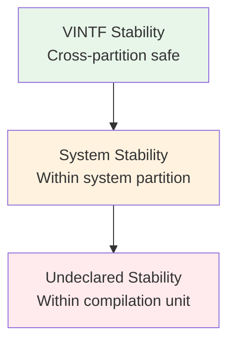

当 binder 对象跨越分区边界（例如从 system 到 vendor）时，会检查稳定性级别。VINTF 稳定的接口可以跨越任何边界。system 稳定的接口只能在系统分区内使用。未声明的接口（默认）只能在其编译单元内使用。

这在运行时由 `Stability` 类强制执行，该类在每个 binder 对象创建时为其盖上稳定性级别戳。

### 9.8.8 Binder 线程池配置模式

不同的服务使用不同的线程池配置：

| 服务 | 最大线程数 | 模式 |
|---------|------------|---------|
| servicemanager | 0 | 使用 Looper 的单线程事件循环 |
| system_server | 31 | 面向众多并发客户端的大线程池 |
| SurfaceFlinger | 4 | 面向显示客户端的中等线程池 |
| 典型 HAL | 0 | 单主线程 + 按需派生 |
| 媒体服务 | 可变 | 取决于并发流数量 |

线程数是内核管理的上限。总线程数为：
```
total = startThreadPool(1) + setThreadPoolMaxThreadCount(N) + joinThreadPool(M)
      = 1 + N + M
```

其中：

- `startThreadPool()` 总是派生 1 个线程
- 内核可以根据需要派生最多 N 个额外的线程
- M 个额外的线程通过 `joinThreadPool()` 直接加入

---

## 9.9 RPC Binder

传统的 Binder 依赖 `/dev/binder` 内核驱动，这要求两个通信进程共享同一个 Linux 内核。RPC Binder（在 Android 12 中引入）用**基于 socket 的传输**取代了内核驱动。这使得 Binder 通信可以跨越内核边界：在虚拟机之间、通过网络连接，或进入可信执行环境。

### 9.9.1 为什么需要 RPC Binder？

内核 binder 驱动有一个根本性约束：客户端和服务器必须运行在同一个内核上，并能够访问同一个 `/dev/binder` 设备。这在几种场景下会失效：

| 场景 | 问题 | RPC Binder 解决方案 |
|---|---|---|
| 受保护 VM（pKVM） | 客户机 VM 无法访问主机的 `/dev/binder` | vsock 传输 |
| Microdroid | 运行隔离工作负载的轻量级 VM | Unix 域套接字引导 |
| Trusty TEE | 安全世界有独立的内核 | TIPC 传输 |
| 远程调试 | 开发机 ≠ 设备内核 | TCP/inet 传输 |
| CompOS | 在隔离 VM 中编译 | 到主机服务的 vsock |

### 9.9.2 架构

RPC Binder 映射了内核 binder 的 BBinder/BpBinder 模型，但用 socket 上的用户空间线路协议取代了驱动：

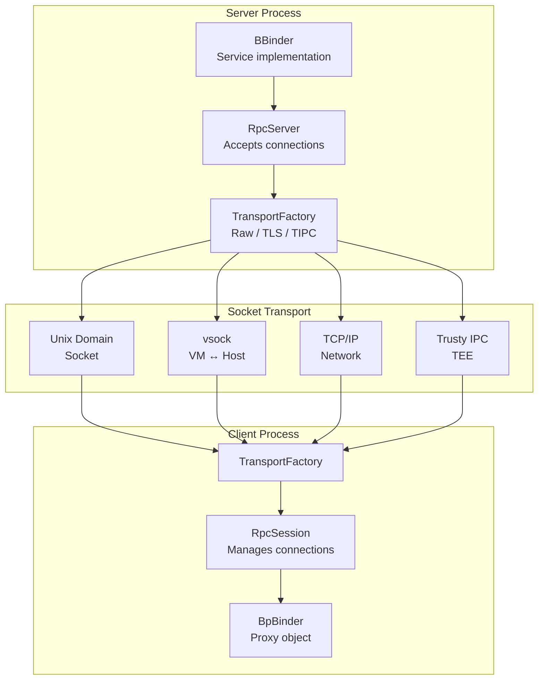

关键洞见是**AIDL 接口在 RPC Binder 上无需更改即可工作**。用 `BnFoo`（继承 `BBinder`）实现的服务可以通过 `RpcServer` 暴露，服务本身无需任何代码更改。客户端通过 `RpcSession` 获得一个 `BpBinder` 代理，并像调用内核 binder 代理一样调用它。

### 9.9.3 核心类

#### RpcServer

`RpcServer` 监听传入的连接并将其分发给处理线程。它支持多种传输设置方法：

```cpp
// Source: frameworks/native/libs/binder/include/binder/RpcServer.h:57-190
sp<RpcServer> server = RpcServer::make();

// Choose ONE transport:
server->setupUnixDomainServer("/path/to/socket");
server->setupVsockServer(VMADDR_CID_ANY, port, &assignedPort);
server->setupInetServer("0.0.0.0", port, &assignedPort);
server->setupUnixDomainSocketBootstrapServer(bootstrapFd);

// Configure:
server->setRootObject(myService);         // Single root object
server->setPerSessionRootObject(factory);  // Per-session factory
server->setMaxThreads(4);                  // Thread pool size

// Start accepting connections:
server->join();  // Blocking
```

`setPerSessionRootObject()` 工厂函数为每个客户端会话创建一个全新的根 binder 对象——当服务器需要每客户端状态或隔离时很有用。

#### RpcSession

`RpcSession` 建立到 `RpcServer` 的出站连接并提供客户端 binder 代理：

```cpp
// Source: frameworks/native/libs/binder/include/binder/RpcSession.h:125-141
sp<RpcSession> session = RpcSession::make();
session->setupUnixDomainClient("/path/to/socket");
// or: session->setupVsockClient(cid, port);
// or: session->setupInetClient("10.0.0.1", port);

sp<IBinder> root = session->getRootObject();
sp<IMyService> service = IMyService::asInterface(root);
service->doSomething();  // RPC call over socket
```

#### RpcState

`RpcState` 实现线路协议状态机——将事务序列化为 `RpcWireTransaction` 结构，管理跨 socket 的 binder 引用计数，并处理异步（oneway）事务排序。

### 9.9.4 线路协议

RPC 线路协议定义在 `RpcWireFormat.h` 中，由长度前缀消息组成：

#### 连接握手

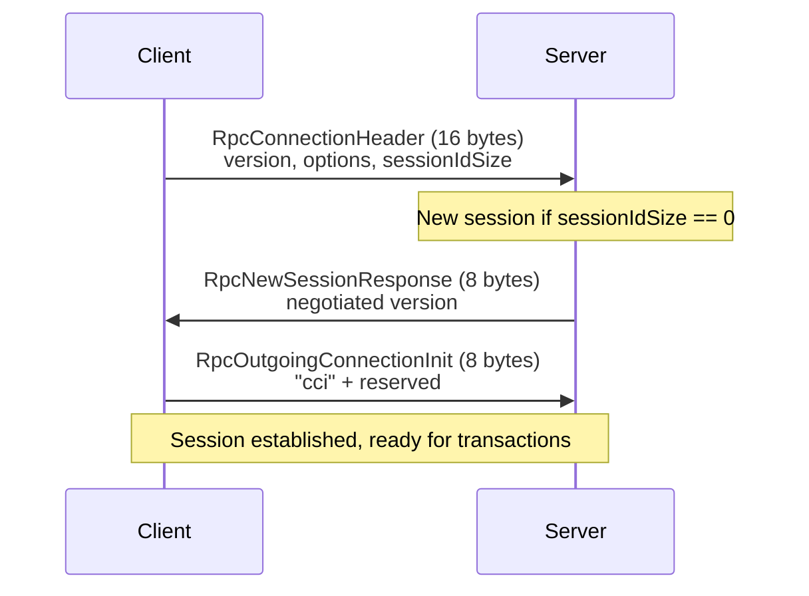

```cpp
// Source: frameworks/native/libs/binder/RpcWireFormat.h:47-56
struct RpcConnectionHeader {
    uint32_t version;              // max supported by caller
    uint8_t  options;              // RPC_CONNECTION_OPTION_INCOMING
    uint8_t  fileDescriptorTransportMode;
    uint8_t  reserved[8];
    uint16_t sessionIdSize;        // 0 = new session, 32 = existing
};
static_assert(sizeof(RpcConnectionHeader) == 16);
```

会话 ID 为 32 字节（`kSessionIdBytes`），在创建新会话时由服务器随机生成。

#### 事务格式

线路上的每个消息都以 `RpcWireHeader` 开头：

```cpp
// Source: frameworks/native/libs/binder/RpcWireFormat.h:123-129
struct RpcWireHeader {
    uint32_t command;     // RPC_COMMAND_TRANSACT / REPLY / DEC_STRONG
    uint32_t bodySize;
    uint32_t reserved[2];
};

struct RpcWireTransaction {
    RpcWireAddress address;   // 8 bytes: target binder address
    uint32_t code;            // Transaction code (AIDL method index)
    uint32_t flags;           // FLAG_ONEWAY, etc.
    uint64_t asyncNumber;     // Ordering for oneway calls
    uint32_t parcelDataSize;  // Parcel payload size
    uint32_t reserved[3];
    uint8_t  data[];          // Parcel data follows
};
```

`asyncNumber` 字段确保 oneway 事务按顺序投递，因为 socket 传输不保证跨多个连接的顺序投递。

#### 协议版本

| 版本 | 特性 |
|---|---|
| 0 | 初始协议 |
| 1 | 回复中的显式 parcel 大小 |
| 2 | 事务头中的 Binder 位置（当前稳定版） |
| 3 | 下一版本（开发中） |
| 0xF0000000 | 实验性（仅开发） |

版本协商发生在连接握手期间。客户端发送其支持的最高版本。服务器以它支持的且 ≤ 客户端最高版本的最高版本进行响应。

### 9.9.5 传输层

#### Unix 域套接字

设备上 RPC Binder 最常用的传输方式。用于同一台机器上的进程间通信，当内核 binder 不可用或不可取时：

```cpp
// Server side
server->setupUnixDomainServer("/dev/socket/my_rpc_service");

// Client side
session->setupUnixDomainClient("/dev/socket/my_rpc_service");
```

bootstrap 变体传递一个已连接的 socket 对，适用于父子进程通信：

```cpp
// Source: frameworks/native/libs/binder/RpcServer.cpp:66
status_t RpcServer::setupUnixDomainSocketBootstrapServer(unique_fd bootstrapFd);
```

#### Vsock（虚拟机套接字）

Vsock 提供 VM 客户机与其主机之间的直接通信，无需网络配置。这是 **pKVM 受保护 VM** 和 **Microdroid** 的主要传输方式：

```cpp
// Source: frameworks/native/libs/binder/RpcServer.cpp:74
status_t RpcServer::setupVsockServer(unsigned bindCid, unsigned port,
                                      unsigned* assignedPort);
```

```rust
// Source: packages/modules/Virtualization/android/virtmgr/src/virtualmachine.rs:1662
let (vm_server, _) = RpcServer::new_vsock(service, cid, port)
    .context(format!("Could not start RpcServer on port {port}"))?;
```

#### TCP/IP（Inet）

用于可网络访问的 RPC 服务，主要用于测试和远程调试场景：

```cpp
// Source: frameworks/native/libs/binder/RpcServer.cpp
status_t RpcServer::setupInetServer(const char* address, unsigned int port,
                                     unsigned int* assignedPort);
```

#### Trusty TIPC

一种用于与 Trusty TEE（可信执行环境）通信的专用传输。使用 Trusty 的 IPC 机制而不是 socket：

```cpp
// Source: frameworks/native/libs/binder/trusty/RpcServerTrusty.cpp
// Separate RpcServerTrusty class with TIPC-specific transport
// Source: frameworks/native/libs/binder/trusty/RpcTransportTipcTrusty.cpp
// TIPC transport implementation for the Trusty-side binder
```

Trusty 传输让 Android 服务可以调用安全世界服务（如 Keymaster 或 Gatekeeper）。它们使用与常规 binder 调用相同的 AIDL 接口定义。

### 9.9.6 安全：TLS 与认证

RPC Binder 支持 TLS 加密，用于跨越信任边界的传输：

```cpp
// Create server with TLS (verifier: RpcCertificateVerifier, auth: RpcAuth)
auto tlsFactory = RpcTransportCtxFactoryTls::make(verifier, std::move(auth));
sp<RpcServer> server = RpcServer::make(std::move(tlsFactory));
```

TLS 实现使用 OpenSSL 并支持：

- **`RpcAuth`**——使用证书和私钥配置 SSL 上下文
- **`RpcCertificateVerifier`**——自定义对等证书验证回调
- **证书格式**——PEM 和 DER（`RpcCertificateFormat.h`）
- **密钥格式**——PEM 和 DER（`RpcKeyFormat.h`）

对于单台设备内部的传输（Unix 域套接字），TLS 通常是不必要的——改用原始（未加密）传输：

```cpp
// Source: frameworks/native/libs/binder/RpcServer.cpp:57
sp<RpcServer> RpcServer::make(
        std::unique_ptr<RpcTransportCtxFactory> rpcTransportCtxFactory) {
    // Default is without TLS
    if (rpcTransportCtxFactory == nullptr)
        rpcTransportCtxFactory = binder::os::makeDefaultRpcTransportCtxFactory();
    // ...
}
```

### 9.9.7 文件描述符传输

RPC Binder 可以使用 socket 辅助数据（SCM_RIGHTS）跨进程边界传递文件描述符，类似于内核 binder 的 flat_binder_object：

```cpp
// Source: frameworks/native/libs/binder/include/binder/RpcSession.h:107-113
enum class FileDescriptorTransportMode : uint8_t {
    NONE   = 0,   // No FD passing (default)
    UNIX   = 1,   // Unix domain socket ancillary data
    TRUSTY = 2,   // Trusty IPC handles
};
```

这对于跨 RPC 边界共享内存映射缓冲区、硬件设备句柄或其他内核资源至关重要。

### 9.9.8 线程模型

RPC Binder 为每个会话管理两个连接池：

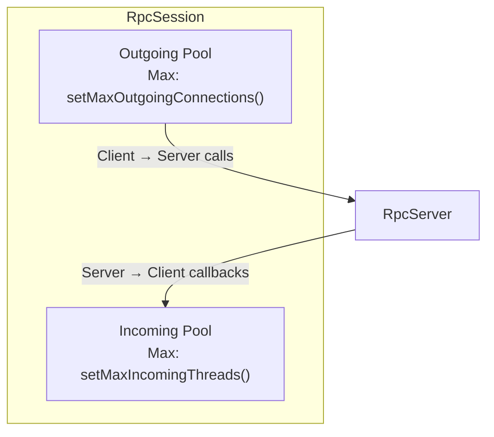

- **出站连接**承载客户端到服务器的事务。连接池受 `setMaxOutgoingConnections()` 限制（默认 10）。
- **入站连接**处理服务器到客户端的回调（反向调用）。受 `setMaxIncomingThreads()` 限制。
- **服务器线程**通过 `RpcServer::setMaxThreads()` 管理。

对于嵌入式环境（Trusty），可以通过 `BINDER_RPC_SINGLE_THREADED` 编译标志使用**单线程模式**，该模式用无操作实现替换互斥锁和线程。

### 9.9.9 Rust 和 NDK 绑定

#### Rust API

`rpcbinder` crate 为 RPC Binder 提供 Rust 绑定：

```rust
// Source: packages/modules/Virtualization/android/virtmgr/src/main.rs:35
use rpcbinder::{FileDescriptorTransportMode, RpcServer};

// Source: packages/modules/Virtualization/android/virtmgr/src/virtualmachine.rs:1662
let (vm_server, _) = RpcServer::new_vsock(service, cid, port)?;
```

Rust API 支持：

- `RpcServer::new_vsock()`——vsock 服务器
- `RpcServer::new_unix_domain_bootstrap()`——bootstrap 服务器
- `RpcSession`——客户端连接
- `FileDescriptorTransportMode`——FD 传递配置

#### NDK API（不稳定）

NDK 为 RPC Binder 提供 C API，目前标记为不稳定（仅限平台）：

```cpp
// Source: frameworks/native/libs/binder/include_rpc_unstable/binder_rpc_unstable.hpp
ARpcSession* ARpcSession_new();
void ARpcSession_free(ARpcSession* session);
AIBinder* ARpcSession_setupUnixDomainBootstrapClient(
        ARpcSession* session, int bootstrapFd);
void ARpcSession_setMaxIncomingThreads(ARpcSession* session, size_t threads);
void ARpcSession_setMaxOutgoingConnections(ARpcSession* session, size_t connections);
void ARpcSession_setFileDescriptorTransportMode(
        ARpcSession* session, ARpcSession_FileDescriptorTransportMode mode);
```

### 9.9.10 AOSP 中的用例

#### Microdroid 和受保护 VM

RPC Binder 的主要生产用例是 **Microdroid**——一个用于隔离计算的轻量级 Android VM。虚拟机管理器（`virtmgr`）通过 vsock 使用 RPC Binder 向客户机 VM 暴露服务：

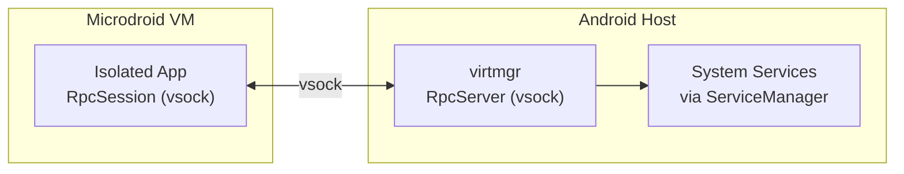

客户机 VM 没有 `/dev/binder` 设备。与主机的所有 binder 通信都通过 vsock 上的 RPC Binder 进行。`virtmgr` 守护进程创建一个 `RpcServer`，接受来自客户机的 vsock 连接，提供对一组精选主机服务的访问。

```rust
// Source: packages/modules/Virtualization/android/virtmgr/src/virtualmachine.rs:1662
let (vm_server, _) = RpcServer::new_vsock(service, cid, port)
    .context(format!("Could not start RpcServer on port {port}"))?;
```

NDK 演示程序（`vm_demo_native`）运行在 Android 主机上：它使用 Unix 域套接字 bootstrap `RpcSession` 访问 `virtmgr` 的 `IVirtualizationService`，然后启动并驱动 VM：

```cpp
// Source: packages/modules/Virtualization/android/vm_demo_native/main.cpp:126-132
// (declarations in frameworks/native/libs/binder/include_rpc_unstable/binder_rpc_unstable.hpp)
std::unique_ptr<ARpcSession, decltype(&ARpcSession_free)>
    session(ARpcSession_new(), &ARpcSession_free);
ARpcSession_setFileDescriptorTransportMode(session.get(),
    ARpcSession_FileDescriptorTransportMode::Unix);
ARpcSession_setMaxIncomingThreads(session.get(), VIRTMGR_THREADS);
AIBinder* binder = ARpcSession_setupUnixDomainBootstrapClient(
    session.get(), fd);
```

#### CompOS（编译操作系统）

CompOS 在隔离 VM 中运行 `dex2oat`（DEX 到原生编译），以保证启动完整性。它使用 RPC Binder 接收来自主机的编译请求并返回编译产物。

#### Trusty TEE 通信

通过 TIPC 的 RPC Binder 为 Trusty 安全世界服务提供标准的 AIDL 接口。Keymaster 和 Gatekeeper 等服务无需自定义 IPC 协议，可以在 Android 和 Trusty 两侧使用相同的 AIDL 定义：

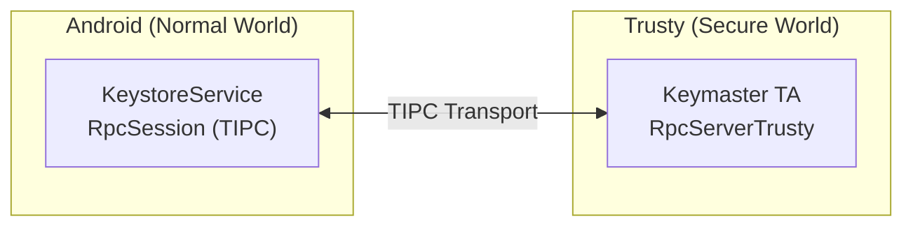

#### 通过 Accessor API 在 VM 中访问服务

在 VM 中运行 binder 客户端最难的部分不是传输，而是*发现*。针对 `defaultServiceManager()` 编写的代码期望按名称查找服务并获得一个 binder。但客户机 VM 没有内核 `servicemanager`，也没有 `/dev/binder`。Android 16 通过 RPC **Accessor** API 弥合了这一差距。它允许进程注册一个回调，按需生成到真实服务的连接。现有的 `IServiceManager` 风格查找随后透明地通过 RPC Binder 路由。

有两层。`libbinder` 中的 C++ 层注册一个提供者，将实例名称映射到 `Accessor` binder：

```cpp
// Source: frameworks/native/libs/binder/include/binder/IServiceManager.h:275-290
typedef std::function<sp<IBinder>(const String16& instance)> RpcAccessorProvider;

[[nodiscard]] std::weak_ptr<AccessorProvider> addAccessorProvider(
        std::set<std::string>&& instances, RpcAccessorProvider&& providerCallback);
```

NDK 层（`libbinder_ndk`）将同样的机制暴露为稳定的 C API。进程注入一次提供者回调；服务管理器 shim 在第一次请求已注册的实例时调用它：

```cpp
// Source: frameworks/native/libs/binder/ndk/include_platform/android/binder_rpc.h:94-168
typedef ABinderRpc_Accessor* _Nullable
        (*ABinderRpc_AccessorProvider_getAccessorCallback)(
                const char* _Nonnull instance, void* _Nullable data);

ABinderRpc_AccessorProvider* _Nullable ABinderRpc_registerAccessorProvider(
        ABinderRpc_AccessorProvider_getAccessorCallback _Nonnull provider,
        const char* _Nonnull const* _Nonnull instances, size_t numInstances,
        void* _Nullable data,
        ABinderRpc_AccessorProviderUserData_deleteCallback _Nullable onDelete);

void ABinderRpc_unregisterAccessorProvider(
        ABinderRpc_AccessorProvider* _Nonnull provider);
```

`ABinderRpc_Accessor` 本身由一个连接信息回调构建，该回调返回实例的 socket 坐标（vsock CID/端口、Unix 路径等）：

```cpp
// Source: frameworks/native/libs/binder/ndk/include_platform/android/binder_rpc.h:223-299
ABinderRpc_Accessor* _Nullable ABinderRpc_Accessor_new(
        const char* _Nonnull instance,
        ABinderRpc_ConnectionInfoProvider _Nonnull provider,
        void* _Nullable data,
        ABinderRpc_ConnectionInfoProviderUserData_delete _Nullable onDelete);

binder_status_t ABinderRpc_Accessor_delegateAccessor(const char* _Nonnull instance,
        AIBinder* _Nonnull binder, AIBinder* _Nullable* _Nonnull outDelegator);
```

匹配的 C++ 自由函数 `delegateAccessor()`（`frameworks/native/libs/binder/include/binder/IServiceManager.h:347`）包装从另一个进程获得的 Accessor，使其可以在本地重新提供服务。这些 API 在 Android 17 周期中被提升到 LLNDK。这让核心平台之外的平台组件（如 `virtmgr`）可以使用它们。

服务管理器从另一侧进行配合。9.5.5 节展示了这一点。当请求的实例在 VINTF 中声明了 Accessor 时，`tryGetService()` 返回一个 `os::Service::Tag::accessor` binder 而不是服务本身。新的 `IServiceManager::checkServiceAccess` AIDL 方法（`frameworks/native/cmds/servicemanager/ServiceManager.cpp:1213`）允许像 `virtmgr` 这样的可信代理将某个名称的 SELinux `find`/`add`/`list` 检查委托给 `servicemanager`。代理代表 VM 客户端执行此操作。结果，即使传输是 socket，策略决策仍然使用真实的调用方上下文进行。

### 9.9.11 内核 Binder 与 RPC Binder

| 方面 | 内核 Binder | RPC Binder |
|---|---|---|
| **传输** | `/dev/binder` 驱动 | Socket（Unix/vsock/TCP/TIPC） |
| **数据拷贝** | 通过 `mmap` 单次拷贝 | 标准 socket 发送/接收 |
| **范围** | 仅限同一内核 | 跨内核、跨机器 |
| **FD 传递** | `flat_binder_object` | `SCM_RIGHTS` 辅助数据 |
| **线程管理** | 内核管理的线程池 | 用户空间线程池 |
| **引用计数** | 内核跟踪 | 线路协议（`DEC_STRONG`） |
| **死亡通知** | 内核讣告 | 连接关闭检测 |
| **性能** | 更低延迟（mmap） | 更高延迟（socket 拷贝） |
| **安全** | 来自内核的 UID/PID | TLS 证书 / socket 权限 |
| **AIDL 兼容性** | 原生 | 完全兼容（相同接口） |

---

## 9.10 调试与诊断

### 9.10.1 debugfs 接口

binder 驱动通过 debugfs 暴露调试信息：

```
/sys/kernel/debug/binder/
├── failed_transaction_log  # Log of failed transactions
├── state                   # Current driver state
├── stats                   # Global statistics
├── transaction_log         # Recent transaction log
└── proc/                   # Per-process information
    ├── <pid>                # one file per process, named by decimal PID
    └── ...
```

**示例：查看所有 binder 进程：**
```bash
adb shell cat /sys/kernel/debug/binder/state
```

**示例：查看特定进程的事务：**
```bash
adb shell cat /sys/kernel/debug/binder/proc/<pid>
```

### 9.10.2 Perfetto 跟踪

`servicemanager` 与 Perfetto 集成进行跟踪：

```cpp
// frameworks/native/cmds/servicemanager/ServiceManager.cpp
#define SM_PERFETTO_TRACE_FUNC(...) \
    PERFETTO_TE_SCOPED(servicemanager, \
        PERFETTO_TE_SLICE_BEGIN(__func__) __VA_OPT__(,) __VA_ARGS__)
```

每次 `addService`、`getService` 和 `checkService` 调用都会被跟踪。

### 9.10.3 service 命令

`service` shell 命令直接与服务交互：

```bash
# List all services
adb shell service list

# Check if a service exists
adb shell service check SurfaceFlinger

# Call a service method (raw)
adb shell service call SurfaceFlinger 1
# 1 = FIRST_CALL_TRANSACTION (first method in ISurfaceComposer)
```

### 9.10.4 常见错误码

| 错误 | 含义 |
|-------|---------|
| `DEAD_OBJECT` | 服务端进程已死亡 |
| `FAILED_TRANSACTION` | 事务失败（缓冲区溢出、进程冻结等） |
| `PERMISSION_DENIED` | SELinux 拒绝了访问 |
| `BAD_TYPE` | 接口描述符不匹配 |
| `UNKNOWN_TRANSACTION` | 服务端无法识别该事务代码 |
| `FDS_NOT_ALLOWED` | 该事务中不允许文件描述符 |

### 9.10.5 诊断 Binder 缓冲区耗尽

当进程的 binder 缓冲区被填满时，你会看到如下错误：

```
binder: 1234:5678 transaction failed 29201, size 100-0 line 3170
```

要诊断：

```bash
# Check buffer allocation for a specific process
adb shell cat /sys/kernel/debug/binder/proc/<pid>

# Look for "allocated" and "free" buffer sizes
# A process with many pending incoming transactions will show high allocation
```

常见原因：

1. **缓慢的 onTransact 处理器：** 服务端处理事务耗时过长，缓冲区被排队的请求填满
2. **Binder 线程饥饿：** 所有线程都忙，新事务排队
3. **大型事务：** 通过 Binder 发送位图或大数据，而不是使用共享内存

### 9.10.6 使用 atrace 跟踪 Binder 事务

```bash
# Enable binder tracing
adb shell atrace --async_start -c binder_driver binder_lock

# Collect the trace
adb shell atrace --async_stop > trace.txt

# View in Perfetto UI
```

### 9.10.7 监控 Binder 代理计数

```bash
# Check per-UID and per-process BinderProxy counts
adb shell dumpsys activity binder-proxies
```

注意，binder 代理是进程内核 binder 句柄表中的句柄，而不是文件描述符。因此，统计 `/proc/<pid>/fd` 下的条目对代理计数毫无说明。

libbinder 的默认水位线是 2000 低 / 2250 警告 / 2500 高（`frameworks/native/libs/binder/BpBinder.cpp:71-76`）。它们可以通过 `BpBinder::setBinderProxyCountWatermarks()` 以编程方式覆盖（对 Java 暴露为 `BinderInternal.nSetBinderProxyCountWatermarks`）；在真实设备上 system_server 将它们提高到 5500 低 / 5750 警告 / 6000 高。

### 9.10.8 使用 binder::Status::exceptionToString

调试 AIDL binder 异常时，可以用 `binder::Status::exceptionToString()` 解码状态码（`frameworks/native/libs/binder/include/binder/Status.h:109`，`frameworks/native/libs/binder/Status.cpp:67`）：

| 异常代码 | 名称 | 含义 |
|----------------|------|---------|
| -1 | `EX_SECURITY` | 安全违规 |
| -2 | `EX_BAD_PARCELABLE` | parcelable 数据错误 |
| -3 | `EX_ILLEGAL_ARGUMENT` | 参数无效 |
| -4 | `EX_NULL_POINTER` | 空指针 |
| -5 | `EX_ILLEGAL_STATE` | 状态无效 |
| -6 | `EX_NETWORK_MAIN_THREAD` | 在主线程上进行网络操作 |
| -7 | `EX_UNSUPPORTED_OPERATION` | 不支持的操作 |
| -8 | `EX_SERVICE_SPECIFIC` | 服务特定错误（带详细代码） |
| -9 | `EX_PARCELABLE` | 自定义 parcelable 异常 |
| -129 | `EX_TRANSACTION_FAILED` | 事务失败 |

这些是 AIDL `binder::Status` 异常代码，与内核级的 `status_t` 返回代码不同。

### 9.10.9 Generic-Netlink Binder 报告

9.10.1 中的 debugfs 文件是一个*拉取*接口：用户空间必须去读取它们。Android 17 添加了一个*推送*诊断通道，用户空间可以订阅即时发生的驱动端 binder 错误，实现在 `frameworks/native/libs/binder/BinderNetlink.cpp`。它使用 Linux generic netlink 而不是 debugfs。

`BinderNetlink::open()` 解析名为 `"binder"` 的内核 generic-netlink 族（`genl_ctrl_resolve`）并加入其多播组 `"report"`（`genl_ctrl_resolve_grp`）。内核随后为值得关注的每个事件多播一份报告，`getReport()` / `readReport()` 将 netlink 属性解码为 `Report` 结构。属性集（`frameworks/native/libs/binder/BinderNetlink.cpp:43`）携带错误代码和事务的上下文：

| 属性 | 含义 |
|-----------|---------|
| `BINDER_A_REPORT_ERROR` | 该事件的驱动端错误代码 |
| `BINDER_A_REPORT_CONTEXT` | 哪个 binder 上下文（binder / hwbinder / vndbinder） |
| `BINDER_A_REPORT_FROM_PID` / `..._FROM_TID` | 发送方进程和线程 |
| `BINDER_A_REPORT_TO_PID` / `..._TO_TID` | 目标进程和线程 |
| `BINDER_A_REPORT_IS_REPLY` | 失败的事务是否为回复 |
| `BINDER_A_REPORT_FLAGS` / `..._CODE` / `..._DATA_SIZE` | 事务标志、代码和大小 |

每份报告都指明两个端点和 binder 上下文。因此，守护进程可以构建*谁*正在遭遇 `FAILED_TRANSACTION`、缓冲区满或目标冻结错误的全系统图景，而无需抓取每个进程的 debugfs。`getStatistics()` 为无法解码的 netlink 消息暴露错误计数器——`mUnknownCommand`（意外的命令类型）和 `mUnknownAttribute`（意外的 netlink 属性类型）。该特性依赖一个匹配的内核 uapi 头文件（`<linux/android/binder_netlink.h>`）。当该头文件不存在时，该文件编译一份属性定义的本地副本。这使得构建仍然可以在较旧的内核上工作。

---

## 9.11 Android 17 更新

Binder 已经成熟，因此 Android 17 的更改是增量式的而非结构性的。内核驱动、`libbinder` ABI 和 AIDL 工具链在形态上没有变化。本周期的工作集中在三个主题上。第一个是可诊断性（更丰富的错误代码和基于推送的报告通道）。第二个是信息损失更少的 freezer 交互。第三个是扩展 RPC Binder，让 binder 客户端可以在根本没有内核 binder 的地方运行。

前面的小节将这些内容融入了相关的代码路径。本节将它们汇总在一起，以便在一个位置看到 17 的增量。

### 9.11.1 冻结目标的独立错误代码

发往 freezer cgroup 中进程的同步事务一直会失败。但 `libbinder` 将该失败报告为通用的 `FAILED_TRANSACTION`，它看起来与缓冲区满或格式错误的调用错误没有区别。Android 17 添加了一个专用的 `FROZEN_OBJECT` 状态（`system/core/libutils/include/utils/Errors.h:72`，定义为 `UNKNOWN_ERROR + 9`）。

当构建标志 `android.os.binder.flags.enable_frozen_object_error`（`frameworks/native/libs/binder/flags.aconfig`）被设置时，`waitForResponse()` 将内核的 `BR_FROZEN_REPLY` 映射为 `FROZEN_OBJECT` 而不是 `FAILED_TRANSACTION`。代码位于 `frameworks/native/libs/binder/IPCThreadState.cpp:1196`。第 105 行的 `enableFrozenObjectErrorCode()` 辅助函数对它进行门控。

该标志是 `is_fixed_read_only`，因此它是编译期常量，未使用的分支会被死代码消除。带来的好处是调用方现在可以将"被调用方暂时冻结，解冻后重试"与真正的错误区分开来。这与 9.2.9 中的冻结通知机制相配合：注册了 `FrozenStateChangeCallback` 的客户端会在目标解冻时得知，并可以重新发起调用。

### 9.11.2 Generic-Netlink Binder 报告

9.10.9 节描述了新的 `BinderNetlink.cpp` 诊断通道。它是对内核 binder 驱动 `"binder"` 族和 `"report"` 多播组的 generic-netlink 订阅。驱动在事件发生时将结构化错误报告（`BINDER_A_REPORT_ERROR`、`BINDER_A_REPORT_CONTEXT`、发送方/目标 PID 和 TID、标志、代码、大小）推送到用户空间。这是第一个不需要轮询 debugfs 的 binder 诊断界面。每份报告都指明两个端点和 binder 上下文，因此守护进程可以在全系统范围内归因失败。

### 9.11.3 Binder Observer：延迟直方图与垃圾调用检测

9.8.1 中引入的可选 `BinderObserver` 基础设施在本周期发展出了更丰富的统计流水线，位于 `frameworks/native/libs/binder/observer/`。`IPCThreadState::doTransactBinder()`——`executeCommand()` 在 `BR_TRANSACTION` 路径上调用的函数——现在用 `BinderObserver::onBeginTransaction()` / `onEndTransaction()`（`frameworks/native/libs/binder/IPCThreadState.cpp:1748`）为每个被服务的事务加上时间范围，记录调用 UID、接口和方法。`HistogramScale`（`frameworks/native/libs/binder/observer/HistogramScale.h`）以指数级（因子 1.2）将事务延迟分桶。`BinderStatsPusher`（`frameworks/native/libs/binder/observer/BinderStatsPusher.h`）汇总收集到的 `BinderCallData`。它将数据作为原子指标推送到 `statsd`，包括一个 binder-spam 信号。

每线程统计队列是惰性分配的，因此从未选择启用的进程没有任何开销。`frameworks/native/libs/binder/flags.aconfig` 中的两个只读标志对新行为进行门控：`binder_stats_v3`（延迟直方图、主线程检测、进程状态检测）和 9.11.1 中的 `enable_frozen_object_error`。

### 9.11.4 惰性进程身份

`clearCaller()` 以前在每次清除身份时都会急切地执行 `getuid()` 系统调用——这在 `system_server` 中是一项可测量的开销，因为它位于热门的 `clearCallingIdentity()` 路径上。Android 17 将 `mCallingUid` 改为 `std::optional<uid_t>`（`frameworks/native/libs/binder/include/binder/IPCThreadState.h:259`）。因此 `clearCaller()` 只需执行 `mCallingUid.reset()`。`getuid()` 系统调用被推迟到调用方真正请求 UID 且没有事务身份在作用域内时才执行。在这种情况下，`getCallingUid()`（`frameworks/native/libs/binder/IPCThreadState.cpp:463`）返回 `mCallingUid.has_value() ? mCallingUid.value() : getuid()`。PID 不受影响——`clearCaller()` 仍然每次都调用 `getpid()`。

### 9.11.5 RPC Binder Accessor 进入 LLNDK

最大的 RPC Binder 变化是 9.9.10 和 9.5.5 中详述的 **Accessor** 发现机制。进程注册一个 `RpcAccessorProvider`（`frameworks/native/libs/binder/include/binder/IServiceManager.h:275`）——或者通过 NDK 注册一个 `ABinderRpc_AccessorProvider`（`frameworks/native/libs/binder/ndk/include_platform/android/binder_rpc.h:147`）——将服务实例名称映射到 Accessor binder。当实例被声明为 accessor-backed 时，普通的 `IServiceManager` 查找随后透明地通过 RPC Binder 路由。服务管理器返回一个 `os::Service::Tag::accessor` binder（9.5.5）。新的 `IServiceManager::checkServiceAccess` AIDL 方法（`frameworks/native/cmds/servicemanager/ServiceManager.cpp:1213`）允许像 `virtmgr` 这样的可信代理使用真实调用方的上下文委托 SELinux 检查。

这些 NDK API 在本周期被提升到 LLNDK。核心平台之外的平台组件因此可以使用它们。这让受保护 VM 内部的客户端可以按名称调用主机服务，而永远不触碰 `/dev/binder`。

### 9.11.6 Private Compute Core 事务审计

对于 Private Compute Core / Private Compute Services 进程，Android 17 在 `libbinder` 中添加了可选的出站事务审计。当框架标志 `android.app.privatecompute.flags.enablePccFrameworkSupport` 开启时，会为 PCC/PCS UID 设置 `ProcessState::isOutgoingTransactionsAuditable()`。

`BR_TRANSACTION` 服务路径调用 `IPCThreadState::logPccTransaction()`（`frameworks/native/libs/binder/IPCThreadState.cpp:1698`）。该函数处理 PCC/PCS 进程服务的每个入站事务，且其调用方在 PCC UID 范围（`AID_PCC_COMPONENT_PROCESS_START`..`END`）之外。它将事务的接口和方法名记录到 `PersistableBundle` 中。然后它将该 bundle 转发给 `pcc_sandbox_native` 服务的审计日志。

查找是限速的，因此审计服务缺失不会导致日志刷屏。这为 PCC 沙箱提供了一份权威记录，记录哪些非 PCC 调用方通过 binder 进入了沙箱。

---

## 9.12 动手试试：编写一个 Binder 服务

本节逐步创建一个完整的 Binder 服务和客户端。我们将创建一个演示完整生命周期的简单"echo"服务。

### 9.12.1 第 1 步：定义 AIDL 接口

创建 AIDL 文件：

```aidl
// hardware/interfaces/example/echo/aidl/android/hardware/echo/IEchoService.aidl
package android.hardware.echo;

interface IEchoService {
    /** Echo back the input string */
    String echo(in String input);

    /** Return the number of echo calls made */
    int getCallCount();

    /** Fire-and-forget notification */
    oneway void ping();
}
```

### 9.12.2 第 2 步：构建配置

为 AIDL 接口创建 `Android.bp`：

```
// hardware/interfaces/example/echo/aidl/Android.bp
aidl_interface {
    name: "android.hardware.echo",
    vendor_available: true,
    srcs: ["android/hardware/echo/*.aidl"],
    stability: "vintf",
    backend: {
        cpp: {
            enabled: true,
        },
        java: {
            enabled: true,
        },
        rust: {
            enabled: true,
        },
    },
}
```

### 9.12.3 第 3 步：实现服务（C++）

```cpp
// hardware/interfaces/example/echo/aidl/default/EchoService.h
#pragma once

#include <aidl/android/hardware/echo/BnEchoService.h>
#include <atomic>

namespace aidl::android::hardware::echo {

class EchoService : public BnEchoService {
public:
    // Synchronous: echo back the input
    ndk::ScopedAStatus echo(const std::string& input,
                            std::string* _aidl_return) override {
        mCallCount++;
        *_aidl_return = "Echo: " + input;
        return ndk::ScopedAStatus::ok();
    }

    // Synchronous: return call count
    ndk::ScopedAStatus getCallCount(int32_t* _aidl_return) override {
        *_aidl_return = mCallCount.load();
        return ndk::ScopedAStatus::ok();
    }

    // Oneway: no reply needed
    ndk::ScopedAStatus ping() override {
        ALOGI("Ping received! Call count: %d", mCallCount.load());
        return ndk::ScopedAStatus::ok();
    }

private:
    std::atomic<int32_t> mCallCount{0};
};

}  // namespace aidl::android::hardware::echo
```

### 9.12.4 第 4 步：服务主入口点

```cpp
// hardware/interfaces/example/echo/aidl/default/main.cpp
#include "EchoService.h"

#include <android-base/logging.h>
#include <android/binder_manager.h>
#include <android/binder_process.h>

using aidl::android::hardware::echo::EchoService;

int main() {
    // Initialize the binder thread pool
    ABinderProcess_setThreadPoolMaxThreadCount(0);

    // Create the service
    std::shared_ptr<EchoService> echo =
        ndk::SharedRefBase::make<EchoService>();

    // Register with servicemanager
    const std::string instance =
        std::string() + EchoService::descriptor + "/default";
    binder_status_t status = AServiceManager_addService(
        echo->asBinder().get(), instance.c_str());
    CHECK_EQ(status, STATUS_OK)
        << "Failed to register " << instance;

    LOG(INFO) << "EchoService registered as " << instance;

    // Join the thread pool (blocks forever)
    ABinderProcess_startThreadPool();
    ABinderProcess_joinThreadPool();

    // Should not reach here
    LOG(FATAL) << "EchoService exited unexpectedly";
    return EXIT_FAILURE;
}
```

### 9.12.5 第 5 步：服务的构建配置

```
// hardware/interfaces/example/echo/aidl/default/Android.bp
cc_binary {
    name: "android.hardware.echo-service",
    relative_install_path: "hw",
    vendor: true,
    srcs: ["main.cpp"],
    shared_libs: [
        "libbase",
        "libbinder_ndk",
        "android.hardware.echo-V1-ndk",
    ],
}
```

### 9.12.6 第 6 步：Init 配置

```rc
// hardware/interfaces/example/echo/aidl/default/echo-service.rc
service vendor.echo /vendor/bin/hw/android.hardware.echo-service
    class hal
    user system
    group system
```

### 9.12.7 第 7 步：VINTF 清单条目

添加到设备清单：

```xml
<hal format="aidl">
    <name>android.hardware.echo</name>
    <version>1</version>
    <fqname>IEchoService/default</fqname>
</hal>
```

### 9.12.8 第 8 步：编写客户端

```cpp
// A simple client that calls the echo service
#include <aidl/android/hardware/echo/IEchoService.h>
#include <android/binder_manager.h>
#include <android-base/logging.h>

using aidl::android::hardware::echo::IEchoService;

int main() {
    // Get the service
    const std::string instance =
        std::string() + IEchoService::descriptor + "/default";
    std::shared_ptr<IEchoService> service =
        IEchoService::fromBinder(
            ndk::SpAIBinder(AServiceManager_waitForService(
                instance.c_str())));
    CHECK(service != nullptr) << "Failed to get " << instance;

    // Make an echo call
    std::string result;
    auto status = service->echo("Hello, Binder!", &result);
    CHECK(status.isOk()) << "echo failed: "
                         << status.getDescription();
    LOG(INFO) << "Echo result: " << result;

    // Get call count
    int32_t count;
    status = service->getCallCount(&count);
    CHECK(status.isOk());
    LOG(INFO) << "Call count: " << count;

    // Send a oneway ping (returns immediately)
    status = service->ping();
    CHECK(status.isOk());
    LOG(INFO) << "Ping sent (oneway)";

    return 0;
}
```

### 9.12.9 第 9 步：用 Rust 实现

Rust 版服务：

```rust
// Rust service implementation
use binder::BinderFeatures;
use android_hardware_echo::aidl::android::hardware::echo::IEchoService::{
    BnEchoService, IEchoService,
};
use std::sync::atomic::{AtomicI32, Ordering};

struct EchoService {
    call_count: AtomicI32,
}

impl binder::Interface for EchoService {}

impl IEchoService for EchoService {
    fn echo(&self, input: &str) -> binder::Result<String> {
        self.call_count.fetch_add(1, Ordering::Relaxed);
        Ok(format!("Echo: {}", input))
    }

    fn getCallCount(&self) -> binder::Result<i32> {
        Ok(self.call_count.load(Ordering::Relaxed))
    }

    fn ping(&self) -> binder::Result<()> {
        log::info!("Ping received! Count: {}",
                   self.call_count.load(Ordering::Relaxed));
        Ok(())
    }
}

fn main() {
    binder::ProcessState::start_thread_pool();

    let service = EchoService {
        call_count: AtomicI32::new(0),
    };
    let service_binder = BnEchoService::new_binder(
        service,
        BinderFeatures::default(),
    );

    binder::add_service(
        &format!("{}/default", <BnEchoService as IEchoService>::get_descriptor()),
        service_binder.as_binder(),
    ).expect("Failed to register service");

    binder::ProcessState::join_thread_pool();
}
```

### 9.12.10 第 10 步：用 Java 实现客户端

```java
// Java client for the echo service
import android.hardware.echo.IEchoService;
import android.os.IBinder;
import android.os.ServiceManager;
import android.util.Log;

public class EchoClient {
    private static final String TAG = "EchoClient";
    private static final String SERVICE_NAME =
        "android.hardware.echo.IEchoService/default";

    public static void main(String[] args) {
        // Get the service from service manager
        IBinder binder = ServiceManager.waitForService(SERVICE_NAME);
        if (binder == null) {
            Log.e(TAG, "Failed to get echo service");
            return;
        }

        // Convert to typed interface
        IEchoService service = IEchoService.Stub.asInterface(binder);
        if (service == null) {
            Log.e(TAG, "Failed to cast to IEchoService");
            return;
        }

        try {
            // Make a synchronous echo call
            String result = service.echo("Hello from Java!");
            Log.i(TAG, "Echo result: " + result);

            // Get the call count
            int count = service.getCallCount();
            Log.i(TAG, "Call count: " + count);

            // Send a oneway ping
            service.ping();
            Log.i(TAG, "Ping sent");

        } catch (android.os.RemoteException e) {
            Log.e(TAG, "Remote exception: " + e.getMessage());
        }
    }
}
```

在底层，`IEchoService.Stub.asInterface(binder)` 检查该 binder 是本地对象（同一进程）还是远程代理：

- 如果是本地对象，它直接返回实际的 `IEchoService` 实现（零拷贝，无 IPC）
- 如果是远程代理，它将其包装在 `IEchoService.Stub.Proxy` 中，通过 binder 编组调用

这就是 `queryLocalInterface()` 优化，它避免了进程内调用的不必要序列化。

### 9.12.11 第 11 步：处理死亡通知

```cpp
// C++ example: Register for death notifications
class MyDeathRecipient : public android::IBinder::DeathRecipient {
public:
    void binderDied(const android::wp<android::IBinder>& who) override {
        ALOGE("Echo service died! Attempting to reconnect...");
        // Reconnect logic here
    }
};

// In client code:
sp<MyDeathRecipient> deathRecipient = sp<MyDeathRecipient>::make();
status_t status = binder->linkToDeath(deathRecipient);
if (status != OK) {
    ALOGE("Failed to link to death: %d", status);
}
```

死亡通知对健壮的客户端实现至关重要。当服务端进程崩溃时，客户端收到通知，可以尝试重新连接或清理资源。

### 9.12.12 第 12 步：调试你的服务

**列出所有已注册的服务：**

```bash
adb shell service list
# or
adb shell dumpsys -l
```

**检查你的服务是否已注册：**

```bash
adb shell service check android.hardware.echo.IEchoService/default
```

**从命令行调用服务方法：**

```bash
adb shell service call android.hardware.echo.IEchoService/default \
    1 s16 "Hello"
# 1 = FIRST_CALL_TRANSACTION (echo method)
# s16 = String16 argument
```

**转储服务状态：**

```bash
adb shell dumpsys android.hardware.echo.IEchoService/default
```

**查看 binder 调试信息：**

```bash
adb shell cat /sys/kernel/debug/binder/stats
adb shell cat /sys/kernel/debug/binder/transactions
adb shell cat /sys/kernel/debug/binder/state
```

**使用 systrace/perfetto 查看 binder 调用：**

```bash
adb shell perfetto -o /data/misc/perfetto-traces/trace \
    -c - <<EOF
buffers: {
    size_kb: 63488
}
data_sources: {
    config {
        name: "linux.ftrace"
        ftrace_config {
            ftrace_events: "binder/*"
        }
    }
}
duration_ms: 5000
EOF
```

### 9.12.13 常见陷阱

1. **Binder 线程池未启动。** 如果你忘记调用 `ABinderProcess_startThreadPool()`，你的服务会注册但永远不会响应事务。

2. **在 oneway 方法中阻塞。** Oneway 方法应该快速返回。长时间运行的工作应提交到单独的工作线程。

3. **Binder 缓冲区溢出。** 1 MB 的 mmap 缓冲区在所有待处理的入站事务之间共享。通过 Binder 发送大数据（如大位图）是一种反模式——应改用 `ashmem` 或 `ParcelFileDescriptor`。

4. **Binder 代理泄漏。** 累积过多 `BpBinder` 引用而不释放会触发代理节流（水位线为 2500）。这通常表现为 `JavaBinder: !!! FAILED BINDER TRANSACTION !!!`。

5. **缺少 VINTF 声明。** 没有 VINTF 清单条目的 HAL 服务将注册失败，返回 `EX_ILLEGAL_ARGUMENT`。

6. **binder 域错误。** 供应商进程默认使用 `/dev/vndbinder`。如果你不小心注册到了错误的域，其他域中的客户端就无法找到你的服务。

7. **使用 binder 之后 fork。** `ProcessState` 安装的 fork 处理器会在子进程中使 binder FD 失效。在 `fork()` 之后使用 Binder 会崩溃：
   ```cpp
   static void verifyNotForked(bool forked) {
       LOG_ALWAYS_FATAL_IF(forked,
           "libbinder ProcessState can not be used after fork");
   }
   ```

### 9.12.14 完整 Binder 服务的架构

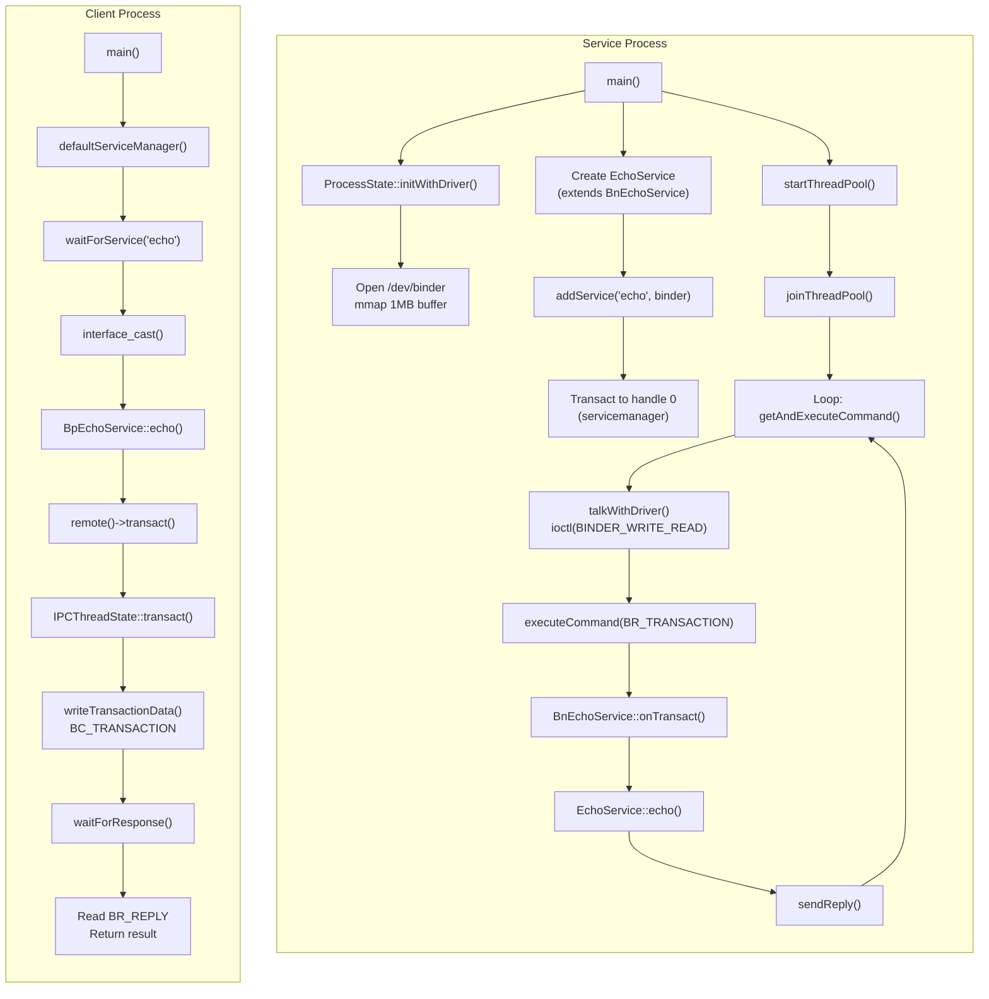

---

## 9.13 小结

### 关键源文件

| 组件 | 路径 |
|-----------|------|
| ProcessState | `frameworks/native/libs/binder/ProcessState.cpp` |
| IPCThreadState | `frameworks/native/libs/binder/IPCThreadState.cpp` |
| IBinder 头文件 | `frameworks/native/libs/binder/include/binder/IBinder.h` |
| BBinder | `frameworks/native/libs/binder/Binder.cpp` |
| BpBinder | `frameworks/native/libs/binder/BpBinder.cpp` |
| IInterface | `frameworks/native/libs/binder/include/binder/IInterface.h` |
| Parcel | `frameworks/native/libs/binder/include/binder/Parcel.h` |
| IServiceManager | `frameworks/native/libs/binder/include/binder/IServiceManager.h` |
| servicemanager 主程序 | `frameworks/native/cmds/servicemanager/main.cpp` |
| ServiceManager | `frameworks/native/cmds/servicemanager/ServiceManager.cpp` |
| 访问控制 | `frameworks/native/cmds/servicemanager/Access.cpp` |
| servicemanager.rc | `frameworks/native/cmds/servicemanager/servicemanager.rc` |
| vndservicemanager.rc | `frameworks/native/cmds/servicemanager/vndservicemanager.rc` |
| AIDL 编译器 | `system/tools/aidl/aidl.cpp` |
| AIDL 转 C++ | `system/tools/aidl/aidl_to_cpp.cpp` |
| AIDL 转 Java | `system/tools/aidl/aidl_to_java.cpp` |
| AIDL 转 Rust | `system/tools/aidl/aidl_to_rust.cpp` |
| Rust binder | `frameworks/native/libs/binder/rust/src/lib.rs` |
| Rust binder trait | `frameworks/native/libs/binder/rust/src/binder.rs` |
| Rust 代理 | `frameworks/native/libs/binder/rust/src/proxy.rs` |
| Rust native | `frameworks/native/libs/binder/rust/src/native.rs` |
| hwservicemanager | `system/hwservicemanager/ServiceManager.h` |
| hwservicemanager.rc | `system/hwservicemanager/hwservicemanager.rc` |
| LazyServiceRegistrar | `frameworks/native/libs/binder/include/binder/LazyServiceRegistrar.h` |
| 内核头文件桥接 | `frameworks/native/libs/binder/binder_module.h` |
| libbinder 特性标志 | `frameworks/native/libs/binder/flags.aconfig` |
| Netlink 报告（17） | `frameworks/native/libs/binder/BinderNetlink.cpp` |
| Binder 观察者（17） | `frameworks/native/libs/binder/observer/BinderObserver.cpp` |
| Binder 统计推送器（17） | `frameworks/native/libs/binder/observer/BinderStatsPusher.h` |
| RPC Accessor（NDK） | `frameworks/native/libs/binder/ndk/include_platform/android/binder_rpc.h` |
| Rust RPC Accessor | `frameworks/native/libs/binder/rust/src/accessor.rs` |
| 错误代码 | `system/core/libutils/include/utils/Errors.h` |

### 架构小结

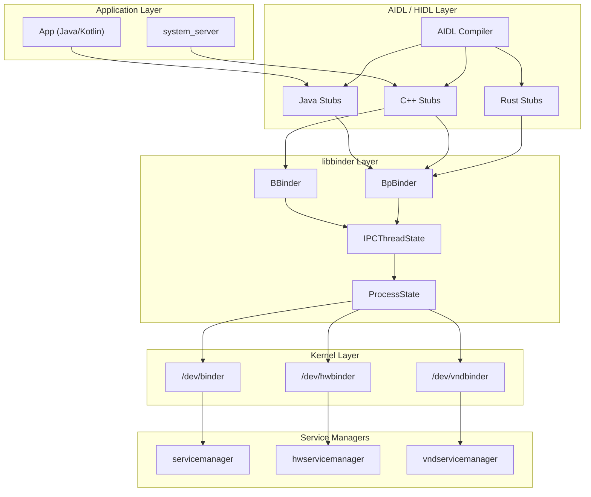

### 关键要点

1. **Binder 是一种单次拷贝的 IPC 机制**，通过内存映射实现高性能。内核将数据直接拷贝进接收方的映射缓冲区。

2. **每一次事务都携带经内核验证的身份**（UID、PID、SELinux 上下文），这使其成为 Android 安全模型的基础。

3. **对象引用语义**配合引用计数和死亡通知，实现了健壮的分布式对象生命周期管理。

4. **架构是分层的：** 内核驱动 → libbinder（C++/Rust）→ AIDL 生成的存根 → 服务实现。

5. **servicemanager 是整个系统的名称服务器**，受 SELinux 和 VINTF 清单验证保护。

6. **三个 binder 域**（binder、hwbinder、vndbinder）在框架和供应商之间强制执行 Treble 架构边界。

7. **AIDL 是所有新 Binder 接口的标准接口定义语言**，为 Java、C++、NDK C++ 和 Rust 生成代码。

8. **HIDL 和 hwbinder 已被废弃**，从 Android 13 起 HAL 接口改用 AIDL。

9. **Android 17 打磨了 binder 的边缘，而不是重塑它。** 这些变化包括：针对冻结目标的专用 `FROZEN_OBJECT` 错误，以及用于驱动端错误报告的 generic-netlink 推送通道。其他变化包括 binder 观察者中的延迟直方图统计，以及热门的 `clearCallingIdentity()` 路径上惰性获取的进程 UID。最后，RPC Binder Accessor 被提升到 LLNDK，因此 binder 客户端可以在完全没有内核 binder 的 VM 内部运行。

---

*下一章：第 10 章将探讨硬件抽象层（HAL）架构，建立在此处涵盖的 AIDL 和 binder 概念之上。*
