# 第 7 章：Bionic 与 Linker

Android 并不使用 GNU C 库（glibc）。相反，它依赖 **Bionic**——一个
从零开始为移动设备设计的自定义 C 库。

本章是对四个主题的深入的源码级剖析。第一个是 Bionic 的架构。第二个是它的系统调用接口。第三个是加载 Android 上每个原生二进制文件的动态链接器。第四个是 VNDK 命名空间隔离。这种隔离在库加载层面强制执行 Treble 架构边界。

Android 上的每一个原生进程都会经过此处检视的代码。这包括引导系统的 init 守护进程，也包括你片刻之前启动的那个应用。源码文件位于 AOSP 代码树的 `bionic/` 目录下，辅助基础设施位于 `system/linkerconfig/` 和 `build/soong/cc/`。

---

## 7.1 Bionic：Android 的 C 库

### 7.1.1 为什么不使用 glibc？

选择创建一个新的 C 库而不是采用 glibc，是 Android 历史上最早且最具深远影响的决定之一。原因既有法律上的，也有技术上的：

1. **许可证。** glibc 采用 LGPL 许可。LGPL 允许动态链接，而不会对调用方代码施加 copyleft 义务。但 Android 团队希望为设备制造商和应用开发者避免任何模糊之处。Bionic 采用三条款 BSD 许可证，实质上不对下游使用施加任何限制。

2. **体积。** glibc 是为通用 Linux 系统设计的。它支持数十种语言区域、庞大的国际化机制、NSS（名称服务切换）模块，以及丰富的 GNU 扩展集。在闪存和 RAM 受限的移动设备上，这种开销是不受欢迎的。Bionic 剥离了 Android 不需要的一切。

3. **启动速度。** 每个 Android 应用都以 Zygote 进程的 fork 启动，许多原生守护进程在启动期间运行。成百上千个进程重复执行动态链接和 C 库初始化所耗费的时间。Bionic 专为快速启动而设计。它的动态链接器精简，初始化路径短。它的线程局部存储（TLS）布局在编译时固定，而不是在运行时计算。

4. **Android 特定功能。** Bionic 直接与 Android 的属性系统、日志基础设施（liblog）、安全模型（在 Zygote fork 时应用的 seccomp-BPF 过滤器）以及内存分配器（Scudo）集成。这些集成需要对 glibc 进行大量补丁。

5. **线程模型。** Bionic 的 pthread 实现与 Linux 内核的线程原语（clone、futex、robust mutex）紧密耦合。它省略了 Android 不使用的特性，如 POSIX 线程取消。

### 7.1.2 源码树布局

Bionic C 库的源码位于：

```
bionic/libc/
```

该目录包含 39 个顶层条目（其中 26 个是目录）。最重要的是：

| 目录 | 用途 |
|-----------|---------|
| `bionic/` | 核心 C 库实现（约 240 个 .cpp 文件） |
| `arch-arm/` | ARM 32 位汇编与架构特定代码 |
| `arch-arm64/` | AArch64 汇编、IFUNC 解析器、Oryon 优化 |
| `arch-x86/` | x86 32 位代码 |
| `arch-x86_64/` | x86-64 代码 |
| `arch-riscv64/` | RISC-V 64 位代码 |
| `arch-common/` | 与架构无关的汇编辅助代码 |
| `include/` | 暴露给 NDK 的公共 C 库头文件 |
| `kernel/` | 净化后的 Linux 内核头文件 |
| `private/` | libc 与链接器共享的内部头文件 |
| `seccomp/` | Seccomp-BPF 策略生成与安装 |
| `stdio/` | 标准 I/O 实现 |
| `dns/` | DNS 解析器（精简版 NetBSD 解析器） |
| `upstream-freebsd/` | 从 FreeBSD 导入的代码 |
| `upstream-netbsd/` | 从 NetBSD 导入的代码 |
| `upstream-openbsd/` | 从 OpenBSD 导入的代码 |
| `async_safe/` | 异步信号安全的日志与格式化 |
| `system_properties/` | Android 属性系统客户端 |
| `tools/` | 代码生成脚本（gensyscalls.py、genseccomp.py） |
| `tzcode/` | 时区处理（来自 IANA tz 数据库） |
| `platform/` | 平台特定头文件 |
| `memory/` | 分配器插桩：`malloc_debug/`、`malloc_hooks/`、`replay/`、`trace_analysis/` |
| `portable-simd/` | 架构可移植的 SIMD 字符串例程（见 7.1.7 节） |

`bionic/libc/portable-simd/` 目录是最近新增的。它包含一组 SIMD 字符串函数（`strlen`、`strnlen`、`memchr`、`memrchr`、`strspn`、`strcspn`、`wcslen`、`wmemchr`）。每个函数都基于 `VectorTraits` 接口以模板形式编写一次。每个模板按向量类型（SSE、AVX2 等）实例化。7.1.7 节详细考察该目录。

### 7.1.3 核心库：bionic/libc/bionic/

`bionic/libc/bionic/` 目录是 C 库的核心。它包含约 240 个源文件，实现了从 `malloc()` 到 `pthread_create()` 的所有内容。关键文件包括：

**进程初始化：**

- `libc_init_common.cpp` -- 静态和动态可执行文件的公共初始化
- `libc_init_dynamic.cpp` -- 动态链接可执行文件的初始化路径
- `libc_init_static.cpp` -- 静态链接可执行文件的初始化路径

**线程：**

- `pthread_create.cpp` -- 线程创建
- `pthread_mutex.cpp` -- 互斥锁实现（使用 Linux futex）
- `pthread_cond.cpp` -- 条件变量
- `pthread_rwlock.cpp` -- 读写锁
- `pthread_internal.h` -- 内部线程状态结构

**内存分配：**

- `malloc_common.cpp` -- 分配器的分发层

来自 `bionic/libc/bionic/malloc_common.cpp`（第 67-77 行）：

```cpp
extern "C" void* calloc(size_t n_elements, size_t elem_size) {
  auto dispatch_table = GetDispatchTable();
  if (__predict_false(dispatch_table != nullptr)) {
    return MaybeTagPointer(dispatch_table->calloc(n_elements, elem_size));
  }
  void* result = Malloc(calloc)(n_elements, elem_size);
  if (__predict_false(result == nullptr)) {
    warning_log("calloc(%zu, %zu) failed: returning null pointer", n_elements, elem_size);
  }
  return MaybeTagPointer(result);
}
```

这种分发模式是 Bionic 内存分配架构的基础。`GetDispatchTable()` 调用检查是否已安装调试分配器或性能分析分配器。如果是，调用将转到该分配器。否则，它通过 `Malloc()` 宏落到 Scudo（默认分配器）。

`MaybeTagPointer()` 调用实现了 Bionic 的软件 tagged-pointer 方案。在 AArch64 上，当堆标记级别为 TBI 时，它将固定的 `0xB4` 堆标记按位或入指针的顶字节。这依赖 CPU 的 Top-Byte-Ignore 特性（见 7.1.10 节中的 "Tagged pointers"）。真正的 MTE 内存标记在支持该硬件的 Scudo 内部进行。此调用并不执行它。

每个分配器入口点都经过相同的模式。`reallocarray`（历史上是薄薄的一层包装）现在与 `malloc`、`calloc`、`realloc`、`memalign` 等一样，是分发表的完整成员。因此调试和挂钩分配器可以拦截它的溢出检查乘法。来自 `bionic/libc/bionic/malloc_common.cpp`（第 220-227 行）：

```cpp
extern "C" void* reallocarray(void* old_mem, size_t item_count, size_t item_size) {
  auto dispatch_table = GetDispatchTable();
  old_mem = MaybeUntagAndCheckPointer(old_mem);
  if (__predict_false(dispatch_table != nullptr)) {
    return MaybeTagPointer(dispatch_table->reallocarray(old_mem, item_count, item_size));
  }
  return MaybeTagPointer(Malloc(reallocarray)(old_mem, item_count, item_size));
}
```

同样的 `dispatch_table` 间接层也支撑 `bionic/libc/include/malloc.h` 中声明的 `mallopt()` 调优旋钮。其中包括由内存压力响应者使用的 purge 系列。`M_PURGE` 将空闲内存归还给内核（API 28）。`M_PURGE_ALL` 归还所有内存（API 34）。`M_PURGE_FAST` 是一种快速的、非阻塞的部分 purge，旨在被频繁调用。它在 Android 17 的 API 37 中添加。

**系统调用包装：**

- `clone.cpp`、`exec.cpp`、`fork.cpp` -- 进程管理
- `socketpair.cpp`、`accept.cpp` -- 网络 I/O

**字符串与内存操作：**

- 通过 IFUNC（间接函数）分发进行架构优化

**动态库支持：**

- `dl_iterate_phdr_static.cpp` -- 静态可执行文件的 `dl_iterate_phdr`
- `bionic/libdl/libdl.cpp` -- libc 侧的 `dlopen`/`dlsym`/`dlclose` 桩，它们
  转发到链接器的 `__loader_*` 入口点（真正的实现是
  `bionic/linker/dlfcn.cpp`）

### 7.1.4 进程初始化

当动态链接的可执行文件启动时，内核会映射该可执行文件和动态链接器（见 7.3 节）。链接器执行重定位，然后运行构造函数。`__libc_preinit` 在 libc.so 的 `.init_array` 中注册为优先级为 1 的构造函数，因此它在所有初始化器中最先运行。这个函数定义在 `bionic/libc/bionic/libc_init_dynamic.cpp` 中，因此在其他任何共享库初始化器之前运行：

来自 `bionic/libc/bionic/libc_init_dynamic.cpp`（第 29-42 行）：

```cpp
/*
 * This source files provides two important functions for dynamic
 * executables:
 *
 * - a C runtime initializer (__libc_preinit), which is called by
 *   the dynamic linker when libc.so is loaded. This happens before
 *   any other initializer (e.g. static C++ constructors in other
 *   shared libraries the program depends on).
 *
 * - a program launch function (__libc_init), which is called after
 *   all dynamic linking has been performed.
 */
```

初始化顺序如下：

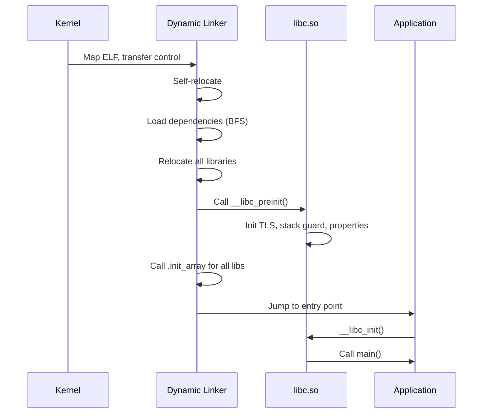

`__libc_preinit_impl` 函数执行以下关键步骤：

1. **TLS 生成计数器同步** -- 向链接器注册 libc 的 TLS 生成计数器副本，使 TLS 模块保持同步。
2. **全局变量初始化** -- 设置 `__libc_globals`，一个包含分配器分发表的写保护结构。
3. **公共初始化** -- 调用 `__libc_init_common()`，它初始化系统属性客户端，设置 `environ` 指针，并初始化 fdsan 和 fdtrack。（分配器初始化单独在 `__libc_preinit_impl` 中进行，通过 `__libc_init_scudo()` 和 `__libc_globals.mutate(__libc_init_malloc)`。）
4. **Netd 客户端初始化** -- 注册 DNS 解析钩子。
5. **回调注册** -- 向链接器提供 HWASan 库加载/卸载事件的回调。（`__libc_init` 稍后注册 MTE 栈重映射回调 `memtag_stack_dlopen_callback`。）

来自 `bionic/libc/bionic/libc_init_common.cpp`（第 58-61 行）：

```cpp
__LIBC_HIDDEN__ constinit WriteProtected<libc_globals> __libc_globals;
__LIBC_HIDDEN__ constinit _Atomic(bool) __libc_memtag_stack;
__LIBC_HIDDEN__ constinit bool __libc_memtag_stack_abi;
```

`WriteProtected<>` 模板将全局变量结构映射到通常只读的内存中。修改通过 `WriteProtected<>::mutate()` 进行，它在 mutator 回调期间通过 `mprotect()` 将页面设为可写，然后重新保护（例如 `__libc_globals.mutate(__libc_init_malloc)`）。这保护分配器分发表等关键数据免受损坏。（链接器使用单独的机制 `ProtectedDataGuard` 保护其自身内部数据；见 7.3.13 节。）

### 7.1.5 线程局部存储与 Bionic TCB

Bionic 的 TLS 实现与内核紧密集成。每个线程都有一个**线程控制块（TCB）**，可通过专用寄存器访问（AArch64 上为 TPIDR_EL0，x86-64 上为 FS 段）。文件 `bionic/libc/private/bionic_tls.h` 定义了 TCB 布局。

来自 `bionic/libc/bionic/pthread_create.cpp`（第 62-71 行）：

```cpp
__attribute__((no_stack_protector))
void __init_tcb_stack_guard(bionic_tcb* tcb) {
  // GCC looks in the TLS for the stack guard on x86, so copy it there
  // from our global.
  tcb->tls_slot(TLS_SLOT_STACK_GUARD) = reinterpret_cast<void*>(__stack_chk_guard);
}

void __init_bionic_tls_ptrs(bionic_tcb* tcb, bionic_tls* tls) {
  tcb->thread()->bionic_tcb = tcb;
  tcb->thread()->bionic_tls = tls;
  tcb->tls_slot(TLS_SLOT_BIONIC_TLS) = tls;
}
```

关键 TLS 槽位包括：

| 槽位 | 用途 |
|------|---------|
| `TLS_SLOT_SELF` | 指向 TCB 自身的指针 |
| `TLS_SLOT_THREAD_ID` | 用于快速 `gettid()` 的线程 ID |
| `TLS_SLOT_STACK_GUARD` | 用于 `-fstack-protector` 的栈金丝雀 |
| `TLS_SLOT_BIONIC_TLS` | 指向完整 `bionic_tls` 结构的指针 |
| `TLS_SLOT_DTV` | 用于 ELF TLS 的动态线程向量 |
| `TLS_SLOT_ART_THREAD_SELF` | ART 中 `Thread::Current()` 的快速存储 |

这种固定布局意味着访问线程局部状态不需要函数调用或哈希表查找——只需寄存器读取和常量偏移。尤其是栈保护金丝雀，在受栈保护代码的每个函数入口和出口处都会访问。因此将其放在固定 TLS 槽位中对性能至关重要。

### 7.1.6 架构特定优化

Bionic 为性能关键函数提供架构特定的实现。最值得注意的是字符串和内存操作。

**IFUNC（间接函数）分发：**

在 AArch64 上，`memcpy`、`memset`、`strcmp` 和 `strlen` 等函数在程序启动时通过 GNU IFUNC 解析器分发。解析器检查 CPU 能力并选择最优实现。

来自 `bionic/libc/arch-arm64/ifuncs.cpp`（第 37-50 行、70-82 行）：

```cpp
inline int implementer(uint64_t midr_el1) { return (midr_el1 >> 24) & 0xff; }
inline int variant(uint64_t midr_el1) { return (midr_el1 >> 20) & 0xf; }
inline int part(uint64_t midr_el1) { return (midr_el1 >> 4) & 0xfff; }
inline int revision(uint64_t midr_el1) { return (midr_el1 >> 0) & 0xf; }

static inline bool __bionic_is_oryon(unsigned long hwcap) {
  if (!(hwcap & HWCAP_CPUID)) return false;
  unsigned long midr;
  __asm__ __volatile__("mrs %0, MIDR_EL1" : "=r"(midr));
  return implementer(midr) == 'Q' && part(midr) <= 15;
}

// ...

DEFINE_IFUNC_FOR(memcpy) {
  if (arg->_hwcap2 & HWCAP2_MOPS) {
    RETURN_FUNC(memcpy_func_t, __memmove_aarch64_mops);
  } else if (__bionic_is_oryon(arg->_hwcap)) {
    RETURN_FUNC(memcpy_func_t, __memcpy_aarch64_nt);
  } else if (arg->_hwcap & HWCAP_ASIMD) {
    RETURN_FUNC(memcpy_func_t, __memcpy_aarch64_simd);
  } else {
    RETURN_FUNC(memcpy_func_t, __memcpy_aarch64);
  }
}
```

这段代码揭示了 AArch64 上的四种 `memcpy` 实现：

1. **MOPS（内存操作）** -- 使用 Armv8.8-A 的 CPYFE 指令进行硬件加速内存拷贝。这是受支持芯片上最快的路径。
2. **Oryon 非临时** -- 高通 Oryon 核心（implementer 'Q'，part 0-15）受益于绕过缓存层次结构的非临时存储，用于大规模拷贝。实现位于 `bionic/libc/arch-arm64/oryon/memcpy-nt.S`。
3. **ASIMD（NEON）** -- 使用 128 位 SIMD 加载/存储对。大多数 AArch64 设备上的标准快速路径。
4. **通用** -- 针对缺少 ASIMD 的核心的标量回退方案（在 AArch64 上是理论上的，但为了完整性而保留）。

类似地，`memchr` 也有 MTE 感知变体和标准变体：

```cpp
DEFINE_IFUNC_FOR(memchr) {
  if (arg->_hwcap2 & HWCAP2_MTE) {
    RETURN_FUNC(memchr_func_t, __memchr_aarch64_mte);
  } else {
    RETURN_FUNC(memchr_func_t, __memchr_aarch64);
  }
}
```

MTE 感知变体的编写方式是：它绝不会读越过缓冲区当前 16 字节标记粒度的末尾。普通的 SIMD 例程可以随意执行这种超读，但在 MTE 下它会出错。该文件中的六个解析器（`memcmp`、`stpcpy`、`strcmp`、`strcpy`、`strncmp` 和 `strnlen`）带有显式的 `// TODO: enable the SVE version.` 注释。SVE 优化例程在上游存在，但在相关 HWCAP 检测接好之前被禁用。因此这些解析器落到通用的 `__*_aarch64` 例程。（`memcpy` 和 `strlen` 不在其中——`memcpy` 按 MOPS、Oryon 或 ASIMD 分发，`strlen` 按 MTE 分发。）

这些解析器在其间选择的手工调优 AArch64 实现并不在 Bionic 内部维护。它们来自 Arm 的 `arm-optimized-routines` 项目，检出于 `external/arm-optimized-routines/`，并作为 `libarm-optimized-routines-string` 和 `libarm-optimized-routines-mem` 静态库拉入 libc（`bionic/libc/Android.bp`）。刷新该导入是 Bionic 在不手工重写汇编的情况下获取新微架构调优的方式。

**架构特定汇编文件：**

每个架构目录都包含关键路径的手写汇编：

| 架构 | 关键汇编文件 |
|-------------|-------------------|
| `arch-arm64/bionic/` | `syscall.S`、`setjmp.S`、`vfork.S`、`__bionic_clone.S` |
| `arch-arm64/string/` | `__memcpy_chk.S`、`__memset_chk.S` |
| `arch-arm64/oryon/` | `memcpy-nt.S`、`memset-nt.S` |
| `arch-arm/bionic/` | `syscall.S`、`setjmp.S`、`vfork.S`、`__bionic_clone.S` |
| `arch-arm/cortex-*/`、`arch-arm/krait/`、`arch-arm/kryo/` | Cortex-A53/A55/A7/A9/A15/Krait/Kryo 特定例程 |
| `arch-x86_64/bionic/` | `syscall.S`、`setjmp.S` |
| `arch-x86_64/string/` | SSE/AVX 优化的字符串操作 |
| `arch-riscv64/bionic/` | `syscall.S`、`setjmp.S` |
| `arch-riscv64/string/` | RISC-V 字符串操作 |

ARM 32 位代码树尤为丰富，包含 Cortex-A53、Cortex-A55、Cortex-A7、Cortex-A9、Cortex-A15、Krait（高通）和 Kryo（高通）的 CPU 特定子目录。ARM 上的 IFUNC 解析器（`bionic/libc/arch-arm/ifuncs.cpp`）在运行时从中选择。首先它从 `/dev/cpu_variant:arm` 设备节点读取 CPU 变体名称。它使用原始的 `openat`/`read` 系统调用，因为 IFUNC 解析器运行时 libc 尚未初始化。然后它将名称与已知变体名称表进行匹配。如果节点不存在，则回退到通用实现。

### 7.1.7 上游代码与 BSD 渊源

Bionic 并非从零实现所有内容。它从三个 BSD 操作系统导入代码：

- **OpenBSD**：提供 `arc4random`、子串搜索函数（`memmem`、`strstr`、`strcasestr`），以及大部分 stdio 和 stdlib。OpenBSD 对安全的关注使其成为加固实现的天然来源。历史上与 OpenBSD 关联的一些函数如今已在树内重写。`strlcpy`/`strlcat` 现在是 `bionic/libc/bionic/string.cpp` 中的 Android 自研代码，`reallocarray` 位于 `bionic/libc/bionic/malloc_common.cpp`。

- **FreeBSD**：贡献了数学库（`libm`）的部分内容、语言区域支持，以及一些字符串函数。

- **NetBSD**：提供 DNS 解析器（`bionic/libc/dns/`）和一些杂项工具函数。

导入内容保存在独立目录中（`upstream-openbsd/`、`upstream-freebsd/`、`upstream-netbsd/`）。它们定期更新，以纳入上游错误修复和安全补丁。在 x86-64 上，几个字符串函数已切换到 FreeBSD 的优化实现（`strrchr`、`strchrnul`——后者定义在 `strchr.S` 中——以及 `memccpy`）。下面描述的 portable-simd 例程如今服务于 `memchr` 和 `memrchr`。函数 `strtok`/`strtok_r`/`strpbrk`/`strsep` 已基于 Bionic 自己的 `strcspn`/`strspn` 重写（`bionic/libc/bionic/string.cpp`）。

**portable-SIMD 实验：**

手写的逐架构汇编速度快，但维护成本高。为了以一小部分工作量获得大部分提速，Bionic 添加了 `bionic/libc/portable-simd/` 目录。它包含以 `VectorTraits` 接口上的 C++ 模板形式编写一次并按向量类型实例化的字符串例程。模板针对 Google 的 Highway SIMD 库（`external/google-highway`）编译，该库以仅头文件方式引入：

来自 `bionic/libc/portable-simd/portable_simd_detail.h`（第 88-92 行）：

```cpp
#include <hwy/highway.h>

// Convenience shortcut for "the highway namespace that's been selected through
// PSIMD_TARGET_*."
namespace hn = hwy::HWY_NAMESPACE;
```

Highway 自身的运行时分发被禁用（`HWY_COMPILE_ONLY_STATIC 1`）。像 `strlen.cpp` 这样的单个源文件按每个目标变体（SSE、AVX2 等）静态编译一次。相应 Soong 变体中的 `PSIMD_TARGET_*` 定义选择目标。Bionic 自己的 IFUNC 解析器（例如 `bionic/libc/arch-x86_64/ifuncs.cpp`）在运行时选择正确的变体。

函数通过 `portable_simd_exports.h` 导出给 libc 的其余部分。首批迁移的是 `strlen`、`strnlen`、`memchr`、`memrchr`、`strspn`、`strcspn`、`wcslen` 和 `wmemchr`。该目录的 `README.md` 明确说明了目标。目标是“以一小部分工作量获得精心编写的汇编 80% 以上的好处”，而不是超越最佳的手工调优例程。

### 7.1.8 属性系统客户端

Bionic 实现了 Android 属性系统的一部分（`__system_property_get`、`__system_property_set`）。`bionic/libc/system_properties/` 中的客户端代码提供对映射到每个进程的共享内存区域的无锁读取。Android 上的每个进程就是这样读取系统属性而无需 IPC 开销的。

`__libc_init_common()` 初始化属性区域：

来自 `bionic/libc/bionic/libc_init_common.cpp`（第 54 行）：

```cpp
extern "C" int __system_properties_init(void);
```

此函数映射属性区域文件（`/dev/__properties__/`）并为属性读取设置内部数据结构。

### 7.1.9 Bionic 与 glibc：功能对比

| 特性 | Bionic | glibc |
|---------|--------|-------|
| 许可证 | BSD | LGPL |
| 体积（strip 后） | 约 1 MB | 约 8 MB |
| 语言区域支持 | 最小（ASCII + UTF-8） | 完整的 ICU 级别 |
| NSS 模块 | 无 | 有 |
| 线程取消 | 无 | 有 |
| 栈保护 | 固定 TLS 槽位 | 可变偏移 |
| 默认分配器 | Scudo | ptmalloc2 |
| 从 APK `dlopen` | 有（ZIP 文件支持） | 无 |
| `android_dlopen_ext` | 有 | 不适用 |
| seccomp 集成 | 内置 | 外部 |
| 属性系统 | 内置 | 不适用 |
| FORTIFY_SOURCE | 增强 | 标准 |

### 7.1.10 内存安全特性

Bionic 集成了几个 glibc 中没有对应物的安全特性：

**MTE（内存标记扩展）：**
在 Armv8.5-A 及以后的硬件上，Bionic 对堆内存和栈内存都支持 MTE。`arch-arm64/bionic/` 中的 `note_memtag_heap_async.S` 和 `note_memtag_heap_sync.S` 文件包含请求对堆分配进行 MTE 的 ELF note。

**Scudo 加固分配器：**
Bionic 的默认分配器是 Scudo，一个提供保护页、隔离区和完整性检查的安全加固分配器。`malloc_common.cpp` 中的分发机制让调试分配器可以透明地替换 Scudo。

**GWP-ASan：**
一种采样分配器，可在生产环境中捕获释放后使用和缓冲区溢出错误，通过 `gwp_asan_wrappers.h` 集成。

**FORTIFY_SOURCE：**
Bionic 的 FORTIFY 实现比 glibc 的更激进，对字符串和内存函数中的缓冲区溢出增加了编译时和运行时检查。

**Tagged pointers：**
Bionic 可以标记堆指针的顶字节（ARM 上的 Top-Byte Ignore / TBI），以检测特定类别的内存损坏。即使没有 MTE 硬件，它也可以做到。

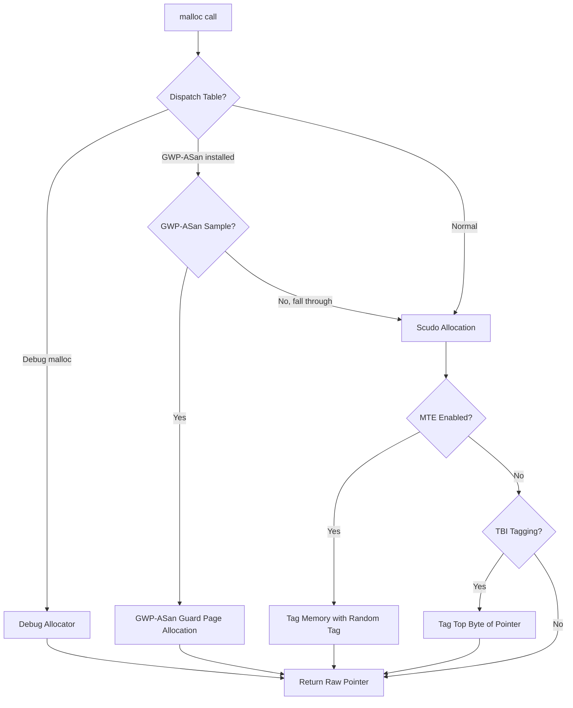

---

## 7.2 系统调用接口

### 7.2.1 Android 上的系统调用如何工作

用户空间代码与 Linux 内核之间的每次交互都要经过一次系统调用。Bionic 提供该接口的用户空间一半。这一半分为两部分。薄薄的汇编桩负责从用户模式切换到内核模式。C 包装函数提供 POSIX API。

系统调用接口有三层：

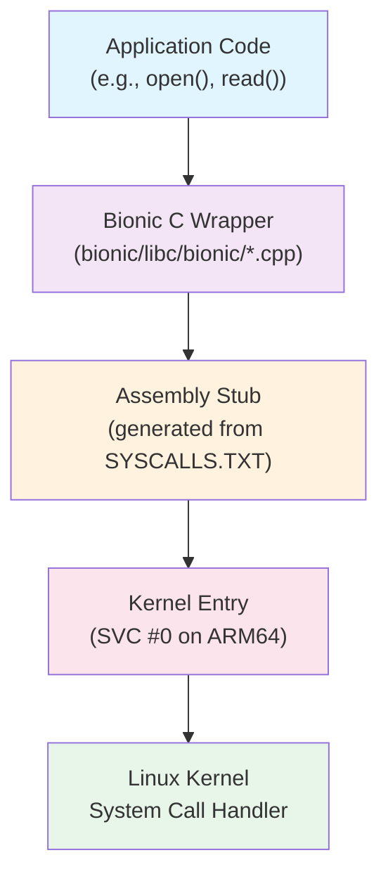

### 7.2.2 SYSCALLS.TXT：系统调用定义文件

Bionic 中的所有系统调用桩都从一个定义文件自动生成：

**源文件：** `bionic/libc/SYSCALLS.TXT`

来自 `bionic/libc/SYSCALLS.TXT`（第 1-14 行）：

```
# This file is used to automatically generate bionic's system call stubs.
#
# It is processed by a python script named gensyscalls.py,
# normally run via the genrules in libc/Android.bp.
#
# Each non-blank, non-comment line has the following format:
#
#     func_name[|alias_list][:syscall_name[:socketcall_id]]([parameter_list]) arch_list
#
# where:
#     arch_list ::= "all" | arches
#     arches    ::= arch |  arch "," arches
#     arch      ::= "arm" | "arm64" | "riscv64" | "x86" | "x86_64" | "lp32" | "lp64"
```

SYSCALLS.TXT 中的每一行描述一个系统调用。它给出函数名、可选别名、参数类型，以及要为其生成桩的架构。该格式支持几种重要模式：

**直接系统调用映射：**
```
read(int, void*, size_t)        all
write(int, const void*, size_t) all
```

**重命名的系统调用（C 名与内核名不同时）：**
```
__close:close(int)  all
__getpid:getpid()  all
__openat:openat(int, const char*, int, mode_t) all
```

`__close:close` 语法的意思是“生成一个名为 `__close` 的函数，它调用内核的 `close` 系统调用”。应用调用的实际 `close()` 函数是 `bionic/libc/bionic/` 中的一个 C 包装器。它在调用 `__close` 之前执行额外工作（如 FORTIFY 检查或 fdsan 验证）。

**架构条件系统调用：**
```
getuid:getuid32()   lp32
getuid()            lp64
```

在 32 位平台（`lp32`）上，`getuid` 函数调用内核的 `getuid32` 系统调用（因为最初的 `getuid` 使用 16 位 UID）。在 64 位平台（`lp64`）上，它直接调用 `getuid`。

**别名函数：**
```
lseek|lseek64(int, off_t, int) lp64
_exit|_Exit:exit_group(int)    all
```

管道符号创建共享同一实现的多个符号别名。在 64 位系统上，`lseek` 和 `lseek64` 完全相同，因为 `off_t` 是 64 位的。

**x86 socketcall 多路复用：**
```
__socket:socketcall:1(int, int, int) x86
__connect:socketcall:3(int, struct sockaddr*, socklen_t) x86
```

在 32 位 x86 上，套接字操作通过单个 `socketcall` 系统调用多路复用，并带有数字子命令。Bionic 的生成器会自动处理这一点。

### 7.2.3 系统调用桩的生成

`gensyscalls.py` 脚本（`bionic/libc/tools/gensyscalls.py`）读取
SYSCALLS.TXT 并生成架构特定的汇编桩。支持的架构为：

```python
SupportedArchitectures = [ "arm", "arm64", "riscv64", "x86", "x86_64" ]
```

**ARM 32 位桩（4 个或更少的寄存器参数）：**

```asm
ENTRY(%(func)s)
    mov     ip, r7
    .cfi_register r7, ip
    ldr     r7, =%(__NR_name)s
    swi     #0
    mov     r7, ip
    .cfi_restore r7
    DO_SYSCALL_RETURN
END(%(func)s)
```

在 ARM 上，系统调用号放入寄存器 r7，SWI（软件中断）指令陷入内核。桩保存并恢复 r7（它在 Thumb 模式下是帧指针），以避免破坏调用栈。`DO_SYSCALL_RETURN` 宏（`bionic/libc/private/bionic_asm_arm.h`）展开为：

```asm
    cmn     r0, #(MAX_ERRNO + 1)
    bxls    lr
    b       __set_errno_internal
```

如果返回值不在 errno 范围内，`bxls lr` 直接返回；否则 `__set_errno_internal` 对值取负并存入 `errno`。

**AArch64 系统调用函数：**

来自 `bionic/libc/arch-arm64/bionic/syscall.S`（第 31-46 行）：

```asm
ENTRY(syscall)
    // Move the syscall number up.
    mov x8, x0

    // Shuffle the arguments down.
    mov x0, x1
    mov x1, x2
    mov x2, x3
    mov x3, x4
    mov x4, x5
    mov x5, x6

    // Make the system call.
    svc #0
    DO_SYSCALL_RETURN
END(syscall)
```

这是 AArch64 的通用 `syscall()` 函数。系统调用号放入 x8，最多六个参数放入 x0-x5。`SVC #0` 指令进入内核。`DO_SYSCALL_RETURN` 宏定义在 `bionic/libc/private/bionic_asm_arm64.h` 中，展开为：

```asm
cmp     x0, #-MAX_ERRNO
b.hs    __set_errno_internal
ret
```

如果 x0 包含 [-MAX_ERRNO, -1] 范围内的值，控制权跳转到 `__set_errno_internal`，它对错误取负并存入 `errno`。

### 7.2.4 系统调用目录

SYSCALLS.TXT 按若干类别定义系统调用。以下是主要分组的分解：

**进程与身份管理：**
```
getuid(), getgid(), geteuid(), getegid()
setuid(), setgid(), setresuid(), setresgid()
getpid(), getppid(), getpgid(), getsid()
kill(), tgkill()
execve(), clone(), _exit()
```

**文件描述符：**
```
read(), write(), pread64(), pwrite64()
__close:close(), __openat:openat()
__fcntl64:fcntl64() (lp32), __fcntl:fcntl() (lp64)
__dup:dup(), __dup3:dup3()
```

**内存管理：**
```
__mmap2:mmap2() (lp32), mmap|mmap64() (lp64)
munmap(), mprotect(), madvise(), mremap()
__brk:brk(), mseal() (lp64 only)
```

**文件系统：**
```
chdir(), mount(), umount2(), getcwd()
fstatat64(), statx()
setxattr(), getxattr(), listxattr()
```

**网络（按架构）：**
```
__socket:socket()              arm,lp64
__socket:socketcall:1()        x86
bind(), listen(), __accept4:accept4()
```

**信号：**
```
__rt_sigaction:rt_sigaction()
__rt_sigprocmask:rt_sigprocmask()
__rt_sigsuspend:rt_sigsuspend()
__signalfd4:signalfd4()
```

**架构特定：**
```
__set_tls:__ARM_NR_set_tls(void*)                    arm
cacheflush:__ARM_NR_cacheflush(long, long, long)     arm
__riscv_flush_icache:riscv_flush_icache(void*, void*, unsigned long) riscv64
__set_thread_area:set_thread_area(void*)              x86
arch_prctl(int, unsigned long)                        x86_64
```

**VDSO 加速调用：**
```
__clock_getres:clock_getres(clockid_t, struct timespec*) all
__clock_gettime:clock_gettime(clockid_t, struct timespec*) all
__gettimeofday:gettimeofday(struct timeval*, struct timezone*) all
```

VDSO（虚拟动态共享对象）通常处理这三个系统调用。内核将 VDSO 映射到每个进程中。VDSO 包含这些调用的从内核管理的共享内存页读取的用户空间实现，避免了完整内核切换的开销。Bionic 的动态链接器显式加载 VDSO（见 7.3 节）。

### 7.2.5 LP32 与 LP64 的差异

系统调用接口在 32 位与 64 位平台之间差异显著：

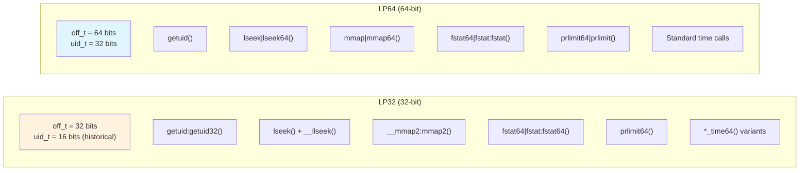

在 32 位系统上，许多系统调用带有 `64` 后缀，或使用寄存器对来传递 64 位参数。SYSCALLS.TXT 生成器会自动处理 ABI 要求，包括 ARM 的约束——64 位参数对必须从偶数编号的寄存器开始。

time64 变体（`SECCOMP_ALLOWLIST_COMMON.TXT` 第 76-91 行）尤其值得注意：

```
clock_gettime64(clockid_t, timespec64*) lp32
clock_settime64(clockid_t, const timespec64*) lp32
futex_time64(int*, int, int, const timespec64*, int*, int) lp32
```

这些是为 Y2038 问题添加的：有符号 32 位 `time_t` 会在 2038 年 1 月 19 日溢出。

> `*_time64` 系统调用即使在 32 位平台上也使用 64 位时间结构。

### 7.2.6 Seccomp-BPF：系统调用过滤

Android 使用 seccomp-BPF（基于 Berkeley Packet Filter 的安全计算）限制应用进程可用的系统调用。这是一个关键安全边界。即使攻击者在应用进程内获得任意代码执行能力，他们也无法调用被 seccomp 过滤器拦截的危险系统调用。

seccomp 策略由多个文本文件构建：

| 文件 | 用途 |
|------|---------|
| `SYSCALLS.TXT` | Bionic 所需的系统调用基础集 |
| `SECCOMP_ALLOWLIST_COMMON.TXT` | 额外允许的调用（所有进程） |
| `SECCOMP_ALLOWLIST_APP.TXT` | 额外允许的调用（仅应用进程） |
| `SECCOMP_ALLOWLIST_SYSTEM.TXT` | 额外允许的调用（仅系统服务器） |
| `SECCOMP_BLOCKLIST_APP.TXT` | 即使存在于 SYSCALLS.TXT 中也从应用移除的调用 |
| `SECCOMP_BLOCKLIST_COMMON.TXT` | 从所有 Zygote 子进程移除的调用 |
| `SECCOMP_PRIORITY.TXT` | 优先检查的系统调用（热路径优化） |

**最终策略的公式：**

```
Final Allowlist = SYSCALLS.TXT - BLOCKLIST + ALLOWLIST
```

来自 `bionic/libc/SECCOMP_BLOCKLIST_APP.TXT`（第 1-7 行）：

```
# The final seccomp allowlist is SYSCALLS.TXT - SECCOMP_BLOCKLIST.TXT
#   + SECCOMP_ALLOWLIST.TXT
# Any entry in the blocklist must be in the syscalls file and not be in
#   the allowlist file
```

**应用被拦截的系统调用：**

`SECCOMP_BLOCKLIST_APP.TXT` 文件从应用进程中移除危险的系统调用：

```
# Syscalls to modify IDs.
setgid32(gid_t)     lp32
setgid(gid_t)       lp64
setuid32(uid_t)     lp32
setuid(uid_t)       lp64

# Syscalls to modify times.
adjtimex(struct timex*)   all
clock_adjtime(clockid_t, struct timex*)   all
clock_settime(clockid_t, const struct timespec*)  all
settimeofday(const struct timeval*, const struct timezone*)   all

# Dangerous operations
chroot(const char*)  all
init_module(void*, unsigned long, const char*)  all
delete_module(const char*, unsigned int)   all
mount(const char*, const char*, const char*, unsigned long, const void*)  all
reboot(int, int, int, void*)  all
```

这些系统调用存在于 SYSCALLS.TXT 中（因为系统守护进程需要它们），但对非特权应用进程来说过于危险。

**公共拦截列表**（`SECCOMP_BLOCKLIST_COMMON.TXT`）增加了：

```
swapon(const char*, int) all
swapoff(const char*) all
```

**应用允许列表**（`SECCOMP_ALLOWLIST_APP.TXT`）重新启用应用需要但不在基础 SYSCALLS.TXT 集中的特定调用，通常出于向后兼容：

```
# Needed for debugging 32-bit Chrome
pipe(int pipefd[2])  lp32

# b/34813887
open(const char *path, int oflag, ... ) lp32,x86_64

# Not used by bionic in U because riscv64 doesn't have it, but still
# used by legacy apps (http://b/254179267).
renameat(int, const char*, int, const char*)  arm,x86,arm64,x86_64
```

每个条目都引用一个 Android bug 跟踪器 ID，记录该例外存在的原因。

**优先级优化：**

来自 `bionic/libc/SECCOMP_PRIORITY.TXT`（第 9-10 行）：

```
futex
ioctl
```

BPF 过滤器优先检查这两个系统调用。`futex` 和 `ioctl` 是典型 Android 进程中调用最频繁的系统调用（futex 用于互斥锁/条件变量操作，ioctl 用于 Binder IPC）。因此优先检查它们可将每个系统调用执行的平均 BPF 指令数降至最低。

### 7.2.7 Seccomp 策略的安装

seccomp 过滤器在 Zygote 特化期间安装到 fork 出的子进程中。
`frameworks/base/core/jni/com_android_internal_os_Zygote.cpp` 中的
`SpecializeCommon()` 调用 `SetUpSeccompFilter()`。该函数根据 uid 选择
`set_app_seccomp_filter()`、`set_app_zygote_seccomp_filter()` 或
`set_system_seccomp_filter()`。文件 `bionic/libc/seccomp/seccomp_policy.cpp`
实现了这些过滤器安装函数。

来自 `bionic/libc/seccomp/seccomp_policy.cpp`（第 33-94 行）：

```cpp
#if defined __arm__ || defined __aarch64__
#define PRIMARY_ARCH AUDIT_ARCH_AARCH64
static const struct sock_filter* primary_app_filter = arm64_app_filter;
// ...
#define SECONDARY_ARCH AUDIT_ARCH_ARM
static const struct sock_filter* secondary_app_filter = arm_app_filter;
// ...
#elif defined __i386__ || defined __x86_64__
#define PRIMARY_ARCH AUDIT_ARCH_X86_64
// ...
#define SECONDARY_ARCH AUDIT_ARCH_I386
// ...
#elif defined(__riscv)
#define PRIMARY_ARCH AUDIT_ARCH_RISCV64
// ...
#endif
```

过滤器处理双架构系统（例如运行 32 位应用的 64 位内核）。它检查 seccomp 数据结构中的架构字段，并跳转到相应的过滤器：

来自 `bionic/libc/seccomp/seccomp_policy.cpp`（第 128-141 行）：

```cpp
static size_t ValidateArchitectureAndJumpIfNeeded(filter& f) {
    f.push_back(BPF_STMT(BPF_LD|BPF_W|BPF_ABS, arch_nr));
    f.push_back(BPF_JUMP(BPF_JMP|BPF_JEQ|BPF_K, PRIMARY_ARCH, 2, 0));
    f.push_back(BPF_JUMP(BPF_JMP|BPF_JEQ|BPF_K, SECONDARY_ARCH, 1, 0));
    Disallow(f);
    return f.size() - 2;
}
```

**BPF 程序结构：**

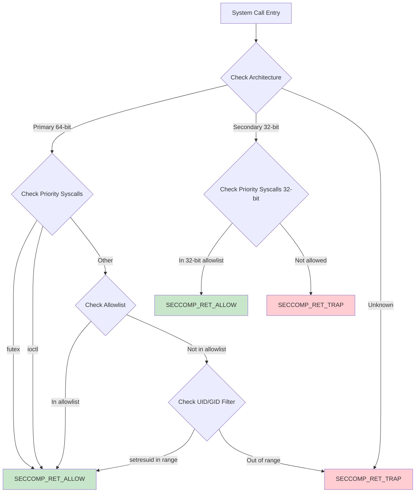

会生成三个独立的过滤器配置：

1. **应用过滤器** -- 用于常规应用进程
2. **应用 Zygote 过滤器** -- 用于应用 zygote 进程（供隔离服务使用）
3. **系统过滤器** -- 用于系统服务器和特权守护进程

过滤器从 C 结构编译为 BPF 字节码，并使用 `prctl(PR_SET_SECCOMP)` 安装：

来自 `bionic/libc/seccomp/seccomp_policy.cpp`（第 193-199 行）：

```cpp
static bool install_filter(filter const& f) {
    struct sock_fprog prog = {
        static_cast<unsigned short>(f.size()),
        const_cast<struct sock_filter*>(&f[0]),
    };
    if (prctl(PR_SET_SECCOMP, SECCOMP_MODE_FILTER, &prog) < 0) {
```

`SECCOMP_RET_TRAP` 动作向进程发送 SIGSYS 信号，Android 的 debuggerd 会捕获它用于崩溃报告。这会产生一份清晰的崩溃报告，指明被禁止的系统调用，有助于调试。

### 7.2.8 VDSO：避免系统调用开销

对于性能最敏感的系统调用，内核提供了一个虚拟动态共享对象（VDSO）。这是一个极小的共享库，内核将其映射到每个进程的地址空间中。Bionic 的动态链接器显式定位并链接 VDSO。

来自 `bionic/linker/linker_main.cpp`（第 184-205 行）：

```cpp
static void add_vdso() {
  ElfW(Ehdr)* ehdr_vdso = reinterpret_cast<ElfW(Ehdr)*>(
      getauxval(AT_SYSINFO_EHDR));
  if (ehdr_vdso == nullptr) {
    return;
  }

  vdso = soinfo_alloc(&g_default_namespace, "[vdso]", nullptr, 0, 0);

  vdso->phdr = reinterpret_cast<ElfW(Phdr)*>(
      reinterpret_cast<char*>(ehdr_vdso) + ehdr_vdso->e_phoff);
  vdso->phnum = ehdr_vdso->e_phnum;
  vdso->base = reinterpret_cast<ElfW(Addr)>(ehdr_vdso);
  vdso->size = phdr_table_get_load_size(vdso->phdr, vdso->phnum);
  vdso->load_bias = get_elf_exec_load_bias(ehdr_vdso);

  if (!vdso->prelink_image() ||
      !vdso->link_image(SymbolLookupList(vdso), vdso, nullptr, nullptr)) {
    __linker_cannot_link(g_argv[0]);
  }

  // Prevent accidental unloads...
  vdso->set_dt_flags_1(vdso->get_dt_flags_1() | DF_1_NODELETE);
  vdso->set_linked();
}
```

VDSO 通过 `AT_SYSINFO_EHDR` 辅助向量条目定位，内核在 exec 时将其放在进程栈上。链接器像对待任何其他共享库一样对待 VDSO。它创建一个 `soinfo` 结构并运行 prelink 和 link 阶段。但 VDSO 的代码完全在用户空间运行。它读取内核维护的数据结构来回答“现在几点了？”之类的查询，无需模式切换。

Bionic 中由 VDSO 加速的调用：

- `clock_gettime()` -- 调用最频繁的时间函数
- `clock_getres()` -- 时钟分辨率查询
- `gettimeofday()` -- 传统的日期时间查询
- `time()` -- 仅 x86/x86_64，通过 `__vdso_time`
- `__riscv_hwprobe()` -- 仅 riscv64，通过 `__vdso_riscv_hwprobe`

---

## 7.3 动态链接器

### 7.3.1 概述

动态链接器（64 位设备上为 `/system/bin/linker64`，32 位设备上为
`/system/bin/linker`）负责加载 Android 上的每个动态链接可执行文件和共享库。
它是内核映射新进程后执行的第一段用户空间代码。它的正确运行对系统中的每个
原生二进制文件都至关重要。

链接器源码位于 `bionic/linker/`，包含 42 个 `.cpp` 文件（含头文件约 70 个）。
关键文件有：

| 文件 | 用途 |
|------|---------|
| `linker.cpp` | 核心链接逻辑：库搜索、加载、命名空间管理 |
| `linker_phdr.cpp` | ELF 解析、段加载、地址空间管理 |
| `linker_main.cpp` | 入口点、初始化、主链接序列 |
| `linker_relocate.cpp` | 重定位处理 |
| `linker_namespaces.h` | 命名空间数据结构 |
| `linker_soinfo.h` | `soinfo` 结构定义 |
| `linker_config.cpp` | 配置文件解析器 |
| `dlfcn.cpp` | `dlopen`/`dlsym` API 表面 |

### 7.3.2 链接器入口点

当内核执行一个动态链接的 ELF 二进制文件时，它会：

1. 映射可执行文件的 PT_LOAD 段
2. 读取 PT_INTERP 段以找到链接器路径（例如 `/system/bin/linker64`）
3. 将链接器映射到进程中
4. 设置辅助向量（AT_PHDR、AT_ENTRY、AT_BASE 等）
5. 将控制权转移给链接器的入口点

链接器的入口点是 `_start`（在架构特定的汇编中），它调用
`__linker_init`。这个函数面临一个引导问题：链接器本身是一个动态链接的
二进制文件，需要先完成自身的重定位，然后才能重定位其他任何东西。

解决方案是两阶段初始化：

1. **自重定位** -- 仅使用位置无关代码（不依赖外部符号引用）处理链接器
   自身的重定位
2. **主链接** -- 加载并链接可执行文件及其所有依赖

### 7.3.3 主链接序列

`bionic/linker/linker_main.cpp` 中的 `linker_main` 函数编排整个链接过程。

来自 `bionic/linker/linker_main.cpp`（第 297-525 行）：

```cpp
static ElfW(Addr) linker_main(KernelArgumentBlock& args,
                               const char* exe_to_load) {
  ProtectedDataGuard guard;

  // Sanitize the environment.
  __libc_init_AT_SECURE(args.envp);

  // Initialize system properties
  __system_properties_init();

  // Initialize platform properties.
  platform_properties_init();

  // Register the debuggerd signal handler.
  linker_debuggerd_init();
```

该函数依次经历以下阶段：

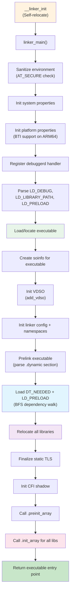

**阶段 1：环境与安全**

```cpp
  // These should have been sanitized by __libc_init_AT_SECURE, but the
  // test doesn't cost us anything.
  const char* ldpath_env = nullptr;
  const char* ldpreload_env = nullptr;
  if (!getauxval(AT_SECURE)) {
    ldpath_env = getenv("LD_LIBRARY_PATH");
    ldpreload_env = getenv("LD_PRELOAD");
  }
```

当设置了 `AT_SECURE` 时（可执行文件是 setuid/setgid），`LD_LIBRARY_PATH`
和 `LD_PRELOAD` 会被忽略。这防止了提权攻击——用户设置这些变量以将恶意
库注入特权进程。

**阶段 2：可执行文件初始化**

来自 `bionic/linker/linker_main.cpp`（第 340-358 行）：

```cpp
  const ExecutableInfo exe_info = exe_to_load ?
      load_executable(exe_to_load) :
      get_executable_info(args.argv[0]);

  soinfo* si = soinfo_alloc(&g_default_namespace,
                            exe_info.path.c_str(), &exe_info.file_stat,
                            0, RTLD_GLOBAL);
  somain = si;
  si->phdr = exe_info.phdr;
  si->phnum = exe_info.phdr_count;
  si->set_should_pad_segments(exe_info.should_pad_segments);
  get_elf_base_from_phdr(si->phdr, si->phnum, &si->base, &si->load_bias);
  si->size = phdr_table_get_load_size(si->phdr, si->phnum);
  si->dynamic = nullptr;
  si->set_main_executable();
  init_link_map_head(*si);
  set_bss_vma_name(si);
```

`get_executable_info` 函数从辅助向量（`AT_PHDR`、`AT_PHNUM`、
`AT_ENTRY`）中读取可执行文件的程序头。内核已经映射了可执行文件，因此
链接器只需找到这些头。

`soinfo` 结构是链接器的每库元数据。它从自定义块分配器
（`LinkerTypeAllocator<soinfo>`）分配，该分配器以页大小的块映射内存，
从而能够通过 `ProtectedDataGuard` 实现写保护。

**阶段 3：命名空间初始化与依赖加载**

```cpp
  std::vector<android_namespace_t*> namespaces =
      init_default_namespaces(exe_info.path.c_str());

  if (!si->prelink_image()) __linker_cannot_link(g_argv[0]);

  // Load ld_preloads and dependencies.
  for (const ElfW(Dyn)* d = si->dynamic; d->d_tag != DT_NULL; ++d) {
    if (d->d_tag == DT_NEEDED) {
      const char* name = fix_dt_needed(
          si->get_string(d->d_un.d_val), si->get_realpath());
      needed_library_name_list.push_back(name);
    }
  }

  if (!find_libraries(&g_default_namespace, si,
                      needed_library_names, needed_libraries_count,
                      nullptr, &g_ld_preloads, ld_preloads_count,
                      RTLD_GLOBAL, nullptr,
                      true /* add_as_children */, &namespaces)) {
    __linker_cannot_link(g_argv[0]);
  }
```

`prelink_image` 方法解析 `.dynamic` 段以提取符号表、重定位表、
DT_NEEDED 条目以及初始化/终结函数。`find_libraries` 函数随后执行广度优先
的依赖遍历，加载每个库并将其添加到适当的命名空间。

**阶段 4：构造函数调用与移交**

```cpp
  si->call_pre_init_constructors();
  si->call_constructors();

  ElfW(Addr) entry = exe_info.entry_point;
  return entry;
```

所有库加载并重定位完成后，链接器按依赖顺序（叶子优先，根最后）调用
初始化函数。然后它返回可执行文件的入口点地址，控制权转移给应用程序。

### 7.3.4 soinfo 结构

`soinfo` 结构是链接器对已加载共享库的表示。每个库——包括可执行文件
自身、链接器和 VDSO——都有一个。

来自 `bionic/linker/linker_soinfo.h`（第 157-248 行）：

```cpp
struct soinfo {
  const ElfW(Phdr)* phdr;
  size_t phnum;
  ElfW(Addr) base;
  size_t size;

  ElfW(Dyn)* dynamic;
  soinfo* next;

 private:
  uint32_t flags_;
  const char* strtab_;
  ElfW(Sym)* symtab_;

  size_t nbucket_;
  size_t nchain_;
  uint32_t* bucket_;
  uint32_t* chain_;

#if defined(USE_RELA)
  ElfW(Rela)* plt_rela_;
  size_t plt_rela_count_;
  ElfW(Rela)* rela_;
  size_t rela_count_;
#else
  ElfW(Rel)* plt_rel_;
  size_t plt_rel_count_;
  ElfW(Rel)* rel_;
  size_t rel_count_;
#endif

  linker_ctor_function_t* preinit_array_;
  size_t preinit_array_count_;
  linker_ctor_function_t* init_array_;
  size_t init_array_count_;
  linker_dtor_function_t* fini_array_;
  size_t fini_array_count_;

  linker_ctor_function_t init_func_;
  linker_dtor_function_t fini_func_;

#if defined(__arm__)
  uint32_t* ARM_exidx;
  size_t ARM_exidx_count;
#endif

  link_map link_map_head;
  bool constructors_called;
  ElfW(Addr) load_bias;
  bool has_DT_SYMBOLIC;
};
```

`flags_` 字段中的关键标志：

| 标志 | 值 | 含义 |
|------|-------|---------|
| `FLAG_LINKED` | 0x00000001 | 库已完全链接 |
| `FLAG_EXE` | 0x00000004 | 这是主可执行文件 |
| `FLAG_LINKER` | 0x00000010 | 这是链接器自身 |
| `FLAG_GNU_HASH` | 0x00000040 | 使用 GNU 哈希表 |
| `FLAG_MAPPED_BY_CALLER` | 0x00000080 | 内存由外部提供 |
| `FLAG_IMAGE_LINKED` | 0x00000100 | `link_image` 已运行 |
| `FLAG_PRELINKED` | 0x00000400 | `prelink_image` 已运行 |
| `FLAG_GLOBALS_TAGGED` | 0x00000800 | MTE 全局变量已标记 |

`soinfo` 结构通过 `next` 指针形成一个单链表，由 `solist_add_soinfo` 和
`solist_remove_soinfo` 维护。列表顺序为：

1. 主可执行文件（`somain`）
2. 链接器自身（`solinker`）
3. VDSO（如果存在）
4. 其他所有库，按加载顺序

### 7.3.5 ELF 加载：ElfReader 类

`bionic/linker/linker_phdr.cpp` 中的 `ElfReader` 类处理将 ELF 文件
读入并映射到内存的具体机制。

**读取 ELF 文件：**

来自 `bionic/linker/linker_phdr.cpp`（第 171-208 行）：

```cpp
bool ElfReader::Read(const char* name, int fd, off64_t file_offset,
                     off64_t file_size) {
  if (did_read_) {
    return true;
  }
  name_ = name;
  fd_ = fd;
  file_offset_ = file_offset;
  file_size_ = file_size;

  if (ReadElfHeader() &&
      VerifyElfHeader() &&
      ReadProgramHeaders() &&
      CheckProgramHeaderAlignment() &&
      ReadSectionHeaders() &&
      ReadDynamicSection() &&
      ReadPadSegmentNote()) {
    did_read_ = true;
  }
  // ...
  return did_read_;
}
```

Read 阶段执行验证并读取元数据：

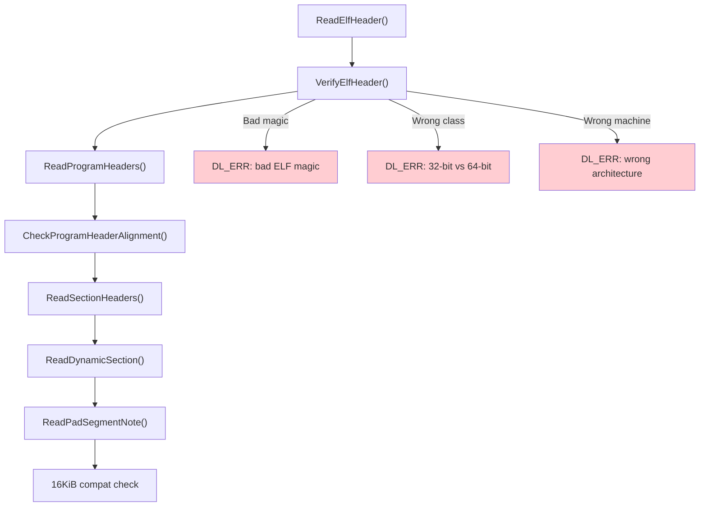

**ELF 头验证：**

来自 `bionic/linker/linker_phdr.cpp`（第 271-340 行）：

```cpp
bool ElfReader::VerifyElfHeader() {
  if (memcmp(header_.e_ident, ELFMAG, SELFMAG) != 0) {
    DL_ERR("\"%s\" has bad ELF magic", name_.c_str());
    return false;
  }

  int elf_class = header_.e_ident[EI_CLASS];
#if defined(__LP64__)
  if (elf_class != ELFCLASS64) {
    if (elf_class == ELFCLASS32) {
      DL_ERR("\"%s\" is 32-bit instead of 64-bit", name_.c_str());
    }
    return false;
  }
#endif

  if (header_.e_type != ET_DYN) {
    DL_ERR("\"%s\" has unexpected e_type: %d", name_.c_str(), header_.e_type);
    return false;
  }

  if (header_.e_machine != GetTargetElfMachine()) {
    DL_ERR("\"%s\" is for %s instead of %s",
           name_.c_str(),
           EM_to_string(header_.e_machine),
           EM_to_string(GetTargetElfMachine()));
    return false;
  }
  return true;
}
```

`GetTargetElfMachine()` 函数根据编译时架构返回预期的 ELF machine 类型：

```cpp
static int GetTargetElfMachine() {
#if defined(__arm__)
  return EM_ARM;
#elif defined(__aarch64__)
  return EM_AARCH64;
#elif defined(__i386__)
  return EM_386;
#elif defined(__riscv)
  return EM_RISCV;
#elif defined(__x86_64__)
  return EM_X86_64;
#endif
}
```

注意，链接器要求 `e_type == ET_DYN`。这意味着 Android 只加载位置无关
可执行文件（PIE）。出于安全考虑（ASLR 的有效性），非 PIE 支持在 API
级别 21 被移除。对于主可执行文件，该检查位于
`bionic/linker/linker_main.cpp`（约第 424 行）：

```cpp
if (elf_hdr->e_type != ET_DYN) {
    __linker_error("error: %s: Android only supports position-independent "
                   "executables (-fPIE)", exe_info.path.c_str());
}
```

**将段加载到内存中：**

来自 `bionic/linker/linker_phdr.cpp`（第 211-238 行）：

```cpp
bool ElfReader::Load(address_space_params* address_space) {
  CHECK(did_read_);
  if (did_load_) {
    return true;
  }
  bool reserveSuccess = ReserveAddressSpace(address_space);
  if (reserveSuccess && LoadSegments() && FindPhdr() &&
      FindGnuPropertySection()) {
    did_load_ = true;
#if defined(__aarch64__)
    if (note_gnu_property_->IsBTICompatible()) {
      did_load_ =
          (phdr_table_protect_segments(phdr_table_, phdr_num_, load_bias_,
               should_pad_segments_, should_use_16kib_app_compat_,
               note_gnu_property_.get()) == 0);
    }
#endif
  }
  return did_load_;
}
```

Load 阶段：

1. **ReserveAddressSpace** -- 通过 `mmap(PROT_NONE)` 为所有 PT_LOAD 段
   分配连续的虚拟地址范围。
2. **LoadSegments** -- 将每个 PT_LOAD 段从文件映射到保留范围内，并赋予
   适当的权限。
3. **FindPhdr** -- 在映射后的映像中定位程序头表。
4. **FindGnuPropertySection** -- 读取 `.note.gnu.property` 以获取
   AArch64 上的 BTI（分支目标标识）兼容性。
5. **BTI 保护** -- 如果库是 BTI 兼容的，对可执行段应用 `PROT_BTI`。

**带 ASLR 增强的地址空间预留：**

来自 `bionic/linker/linker_phdr.cpp`（第 591-643 行）：

```cpp
static void* ReserveWithAlignmentPadding(size_t size, size_t mapping_align,
                                         size_t start_align,
                                         void** out_gap_start,
                                         size_t* out_gap_size) {
  // ...
#if defined(__LP64__)
  size_t first_byte = reinterpret_cast<size_t>(
      __builtin_align_up(mmap_ptr, mapping_align));
  size_t last_byte = reinterpret_cast<size_t>(
      __builtin_align_down(mmap_ptr + mmap_size, mapping_align) - 1);
  if (first_byte / kGapAlignment != last_byte / kGapAlignment) {
    // This library crosses a 2MB boundary and will fragment a new huge
    // page. Insert a random number of inaccessible huge pages before it
    // to improve address randomization and make it harder to locate this
    // library code by probing.
    munmap(mmap_ptr, mmap_size);
    mapping_align = std::max(mapping_align, kGapAlignment);
    gap_size = kGapAlignment *
        (__libc_arc4random_uniform_or_zero(kMaxGapUnits - 1) + 1);
    // ... re-mmap with room for the gap ...
  }
#endif
```

这段代码实现了一项 ASLR 增强。当一个库的映射跨越 2MB（PMD 大小）边界时，
链接器在该库之前插入随机数量的不可访问 2MB 页。这使得攻击者更难通过
探测可读内存映射来定位库代码。间隙大小是随机的，每次加载库时都不同。
它是 1 到 31 个 2MB 单元。`kMaxGapUnits` 为 32，但均匀抽样是在
`kMaxGapUnits - 1` 上进行的，然后再加一。

注意
`__libc_arc4random_uniform_or_zero` 的使用。这个辅助函数纳入了
first-stage-init 特殊情况。在那种情况下，`getrandom(GRND_NONBLOCK)` 仍会
失败，因为内核熵池尚未初始化。该辅助函数返回零而不是崩溃，因此相同的代码
路径在早期启动和运行时都能工作。

### 7.3.6 加载偏置与虚拟地址计算

ELF 加载中的一个核心概念是**加载偏置（load bias）**：

来自 `bionic/linker/linker_phdr.cpp` 中的文档注释（第 74-149 行）：

```
An ELF file's program header table contains one or more PT_LOAD
segments, which corresponds to portions of the file that need to
be mapped into the process' address space.

Each loadable segment has the following important properties:
    p_offset  -> segment file offset
    p_filesz  -> segment file size
    p_memsz   -> segment memory size (always >= p_filesz)
    p_vaddr   -> segment's virtual address
    p_flags   -> segment flags (e.g. readable, writable, executable)
    p_align   -> segment's alignment

The load_bias must be added to any p_vaddr value read from the ELF
file to determine the corresponding memory address.

    load_bias = phdr0_load_address - page_start(phdr0->p_vaddr)
```

加载偏置是第一个段实际被映射的位置与其“想要”的位置（其 p_vaddr）之间的
差值。由于所有段都保持相对位置，将加载偏置加到任何 p_vaddr 上即可得到实际
内存地址：

```
actual_address = p_vaddr + load_bias
```

计算：

来自 `bionic/linker/linker_phdr.cpp`（第 516-553 行）：

```cpp
size_t phdr_table_get_load_size(const ElfW(Phdr)* phdr_table,
                                 size_t phdr_count,
                                 ElfW(Addr)* out_min_vaddr,
                                 ElfW(Addr)* out_max_vaddr) {
  ElfW(Addr) min_vaddr = UINTPTR_MAX;
  ElfW(Addr) max_vaddr = 0;

  for (size_t i = 0; i < phdr_count; ++i) {
    const ElfW(Phdr)* phdr = &phdr_table[i];
    if (phdr->p_type != PT_LOAD) {
      continue;
    }
    if (phdr->p_vaddr < min_vaddr) {
      min_vaddr = phdr->p_vaddr;
    }
    if (phdr->p_vaddr + phdr->p_memsz > max_vaddr) {
      max_vaddr = phdr->p_vaddr + phdr->p_memsz;
    }
  }

  min_vaddr = page_start(min_vaddr);
  max_vaddr = page_end(max_vaddr);

  return max_vaddr - min_vaddr;
}
```

### 7.3.7 16KiB 页大小兼容性

Android 正从 4KiB 向 16KiB 页大小过渡。链接器包含在 16KiB 页设备上加载
4KiB 对齐库的兼容性逻辑：

来自 `bionic/linker/linker_phdr.cpp`（第 194-206 行）：

```cpp
auto compat_prop_val =
    ::android::base::GetProperty("bionic.linker.16kb.app_compat.enabled", "false");

using ::android::base::ParseBool;
using ::android::base::ParseBoolResult;

should_use_16kib_app_compat_ =
    ParseBool(compat_prop_val) == ParseBoolResult::kTrue || get_16kb_appcompat_mode();

if (compat_prop_val == "fatal") {
  dlopen_16kib_err_is_fatal_ = true;
}
```

在兼容模式下，链接器将 ELF 段读入可写预留区。它不直接使用 `mmap()`。
这是因为 `mmap()` 要求映射按系统页大小（16KiB）对齐，但库的段可能只按
4KiB 对齐。兼容机制庞大到如今位于独立的编译单元
`bionic/linker/linker_phdr_16kib_compat.cpp` 中，与主
`linker_phdr.cpp` 分开。

这由系统属性
`bionic.linker.16kb.app_compat.enabled` 和一个 ELF note
（`NT_ANDROID_TYPE_PAD_SEGMENT`）控制，后者表明该库支持段填充以用于页
大小迁移。将该属性设置为字符串 `"fatal"` 会使失败的兼容 `dlopen` 中止而
非降级，这在测试期间捕获未填充的库很有用。

**细粒度保护与 RWX 回退：**

4KiB 对齐的段边界可能落在 16KiB 页的中间。因此，兼容加载器有时无法给
每个页赋予不同的 R-X / RW 权限。单个 16KiB 页可能横跨代码段和数据段。
当加载器无法精确满足段权限时，它会发出警告，并回退为将横跨区域映射为
RWX：

来自 `bionic/linker/linker_phdr_16kib_compat.cpp`（第 392-395 行）：

```cpp
void ElfReader::SetupRWXAppCompat() {
  // Warn and fallback to RWX mapping
  // ...
  DL_WARN("\"%s\": RX|RW compat loading failed, falling back to RWX compat: "
          "load segments [%s]", name_.c_str(), ...);
```

Android 17 收紧了这个回退。加载器不会让整个横跨区域保持可写且可执行。
它尽可能按对齐精确地保护段*中间*的页。重定位完成后，它恢复原始权限。
`soinfo::protect_16kib_app_compat_middle_pages()` 方法（同一文件）实现了
这一点，将 RWX 窗口收窄到真正横跨权限边界的页。这就是“16KiB 应用兼容
RWX 回退的细粒度保护”工作，Bionic 测试套件中的 `RWX_MiddlePageProtection`
回归测试对其进行守护。

### 7.3.8 重定位处理

所有段映射完成后，链接器必须处理**重定位**。这些是对代码和数据的修补，
用于编码对符号的引用。这些符号的地址在加载时之前是未知的。

重定位引擎位于 `bionic/linker/linker_relocate.cpp`。

来自 `bionic/linker/linker_relocate.cpp`（第 63-95 行）：

```cpp
class Relocator {
 public:
  Relocator(const VersionTracker& version_tracker,
            const SymbolLookupList& lookup_list)
      : version_tracker(version_tracker), lookup_list(lookup_list)
  {}

  soinfo* si = nullptr;
  const char* si_strtab = nullptr;
  size_t si_strtab_size = 0;
  ElfW(Sym)* si_symtab = nullptr;

  const VersionTracker& version_tracker;
  const SymbolLookupList& lookup_list;

  // Cache key/value for repeated symbol lookups
  ElfW(Word) cache_sym_val = 0;
  const ElfW(Sym)* cache_sym = nullptr;
  soinfo* cache_si = nullptr;
  // ...
};
```

`Relocator` 类维护处理某个库重定位的状态。符号缓存（第 78-81 行）是一项
关键优化。库中许多重定位引用同一个符号，缓存避免了重复的哈希表查找。

**重定位模式：**

来自 `bionic/linker/linker_relocate.cpp`（第 132-139 行）：

```cpp
enum class RelocMode {
  // Fast path for JUMP_SLOT relocations.
  JumpTable,
  // Fast path for typical relocations: ABSOLUTE, GLOB_DAT, or RELATIVE.
  Typical,
  // Handle all relocation types, including text sections and statistics.
  General,
};
```

链接器使用 `RelocMode` 上的模板特化生成重定位循环的三个版本。
`JumpTable` 和 `Typical` 模式是优化的快速路径，处理绝大多数重定位。
`General` 模式处理罕见情况，如 TLS 重定位、代码段重定位（仅 32 位）和
IFUNC。

**处理单个重定位：**

来自 `bionic/linker/linker_relocate.cpp`（第 163-176 行）：

```cpp
template <RelocMode Mode>
static bool process_relocation_impl(Relocator& relocator,
                                     const rel_t& reloc) {
  void* const rel_target = reinterpret_cast<void*>(
      relocator.si->apply_memtag_if_mte_globals(
          reloc.r_offset + relocator.si->load_bias));
  const uint32_t r_type = ELFW(R_TYPE)(reloc.r_info);
  const uint32_t r_sym = ELFW(R_SYM)(reloc.r_info);

  soinfo* found_in = nullptr;
  const ElfW(Sym)* sym = nullptr;
  const char* sym_name = nullptr;
  ElfW(Addr) sym_addr = 0;

  if (r_sym != 0) {
    sym_name = relocator.get_string(
        relocator.si_symtab[r_sym].st_name);
  }
```

对于每个重定位条目，链接器：

1. 计算目标地址（偏移 + load_bias）
2. 提取重定位类型和符号索引
3. 在字符串表中查找符号名
4. 将符号解析为地址
5. 应用重定位（将解析后的地址写入目标）

**带缓存的符号查找：**

来自 `bionic/linker/linker_relocate.cpp`（第 100-130 行）：

```cpp
static inline bool lookup_symbol(Relocator& relocator, uint32_t r_sym,
                                  const char* sym_name,
                                  soinfo** found_in,
                                  const ElfW(Sym)** sym) {
  if (r_sym == relocator.cache_sym_val) {
    *found_in = relocator.cache_si;
    *sym = relocator.cache_sym;
    count_relocation_if<DoLogging>(kRelocSymbolCached);
  } else {
    const version_info* vi = nullptr;
    if (!relocator.si->lookup_version_info(
            relocator.version_tracker, r_sym, sym_name, &vi)) {
      return false;
    }

    soinfo* local_found_in = nullptr;
    const ElfW(Sym)* local_sym = soinfo_do_lookup(
        sym_name, vi, &local_found_in, relocator.lookup_list);

    relocator.cache_sym_val = r_sym;
    relocator.cache_si = local_found_in;
    relocator.cache_sym = local_sym;
    *found_in = local_found_in;
    *sym = local_sym;
  }

  if (*sym == nullptr) {
    if (ELF_ST_BIND(relocator.si_symtab[r_sym].st_info) != STB_WEAK) {
      DL_ERR("cannot locate symbol \"%s\" referenced by \"%s\"",
             sym_name, relocator.si->get_realpath());
      return false;
    }
  }
  return true;
}
```

查找在可用时使用版本信息（ELF 符号版本化），这允许库导出同一符号的
多个版本。libc 就是这样在不破坏向后兼容性的情况下演进其 API 的。

**重定位统计：**

```cpp
void print_linker_stats() {
  LD_DEBUG(statistics,
           "RELO STATS: %s: %d abs, %d rel, %d symbol (%d cached)",
           g_argv[0],
           linker_stats.count[kRelocAbsolute],
           linker_stats.count[kRelocRelative],
           linker_stats.count[kRelocSymbol],
           linker_stats.count[kRelocSymbolCached]);
}
```

这些统计信息通过 `LD_DEBUG=statistics` 启用，揭示了重定位工作量。
一个典型的 Android 应用在启动期间可能处理数万个重定位。符号缓存通常
能达到 80% 以上的命中率，显著缩短了启动时间。

### 7.3.9 符号解析

符号解析是给定符号名查找其定义的过程。链接器支持两种哈希表格式：

1. **ELF 哈希**（经典的 `DT_HASH`）-- 最初的 ELF 哈希表
2. **GNU 哈希**（`DT_GNU_HASH`）-- 一种更高效的格式，使用 Bloom
   过滤器实现快速拒绝

来自 `bionic/linker/linker_soinfo.h`（第 80-98 行）：

```cpp
struct SymbolLookupLib {
  uint32_t gnu_maskwords_ = 0;
  uint32_t gnu_shift2_ = 0;
  ElfW(Addr)* gnu_bloom_filter_ = nullptr;

  const char* strtab_;
  size_t strtab_size_;
  const ElfW(Sym)* symtab_;
  const ElfW(Versym)* versym_;

  const uint32_t* gnu_chain_;
  size_t gnu_nbucket_;
  uint32_t* gnu_bucket_;

  soinfo* si_ = nullptr;

  bool needs_sysv_lookup() const {
    return si_ != nullptr && gnu_bloom_filter_ == nullptr;
  }
};
```

`SymbolLookupLib` 结构预提取了从库中进行符号查找所需的所有字段，避免
在重定位循环中重复的指针追逐。`needs_sysv_lookup()` 方法仅对缺少 GNU
哈希表的库返回 true（越来越少见）。

**GNU 哈希 Bloom 过滤器：**

GNU 哈希表包含一个 Bloom 过滤器。该过滤器让链接器能快速拒绝那些确定
不存在于某个库中的符号查找。这特别有效，因为大多数符号只在一两个库中
定义。因此，Bloom 过滤器无需检查哈希链即可拒绝针对其他库的绝大多数
查找。

**符号查找顺序：**

`SymbolLookupList` 类定义了搜索库的顺序：

```cpp
class SymbolLookupList {
  std::vector<SymbolLookupLib> libs_;
  SymbolLookupLib sole_lib_;
  const SymbolLookupLib* begin_;
  const SymbolLookupLib* end_;
  size_t slow_path_count_ = 0;
  // ...
};
```

对于带有 `DT_SYMBOLIC` 的库，先搜索其自身的符号表。否则，顺序遵循标准
ELF 规则：先全局作用域（所有以 RTLD_GLOBAL 加载的库），再局部作用域
（该库及其依赖）。

### 7.3.10 库搜索与加载

当链接器需要加载一个库（来自 DT_NEEDED 或 dlopen）时，它按定义的顺序
搜索多个位置。

来自 `bionic/linker/linker.cpp`（第 1051-1082 行）：

```cpp
static int open_library(android_namespace_t* ns,
                        ZipArchiveCache* zip_archive_cache,
                        const char* name, soinfo *needed_by,
                        off64_t* file_offset, std::string* realpath) {
  // If the name contains a slash, open directly
  if (strchr(name, '/') != nullptr) {
    return open_library_at_path(zip_archive_cache, name,
                                 file_offset, realpath);
  }

  // 1. LD_LIBRARY_PATH has the highest priority
  int fd = open_library_on_paths(zip_archive_cache, name, file_offset,
                                  ns->get_ld_library_paths(), realpath);

  // 2. Try the DT_RUNPATH, and verify accessibility
  if (fd == -1 && needed_by != nullptr) {
    fd = open_library_on_paths(zip_archive_cache, name, file_offset,
                                needed_by->get_dt_runpath(), realpath);
    if (fd != -1 && !ns->is_accessible(*realpath)) {
      close(fd);
      fd = -1;
    }
  }

  // 3. Search the namespace's default paths
  if (fd == -1) {
    fd = open_library_on_paths(zip_archive_cache, name, file_offset,
                                ns->get_default_library_paths(), realpath);
  }

  return fd;
}
```

搜索顺序为：

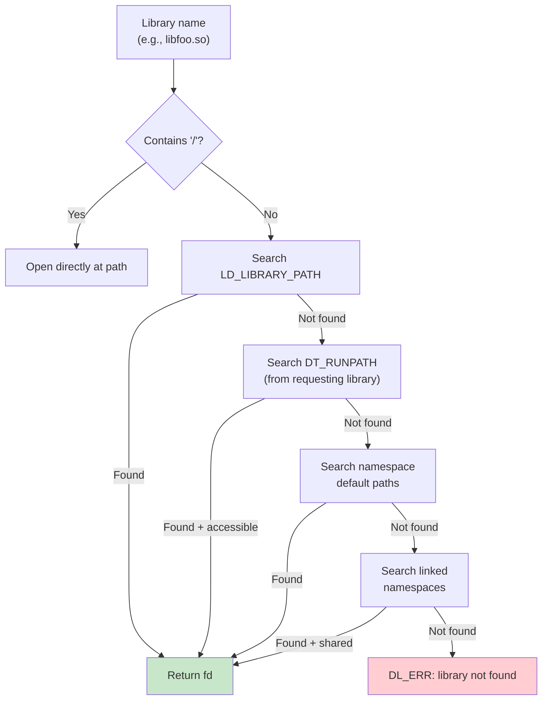

**从 APK 文件（ZIP）加载：**

Android 链接器的一个独特功能是能够直接从 APK 文件（即 ZIP 归档）加载
共享库。来自 `bionic/linker/linker.cpp`（第 927-996 行）：

```cpp
static int open_library_in_zipfile(ZipArchiveCache* zip_archive_cache,
                                    const char* const input_path,
                                    off64_t* file_offset,
                                    std::string* realpath) {
  // Treat an '!/' separator inside a path as the separator between
  // the zip file name and the subdirectory to search within it.
  const char* const separator = strstr(path, kZipFileSeparator);
  // ...
  ZipEntry entry;
  if (FindEntry(handle, file_path, &entry) != 0) {
    close(fd);
    return -1;
  }

  // Check if it is properly stored (not compressed, page-aligned)
  if (entry.method != kCompressStored ||
      (entry.offset % page_size()) != 0) {
    close(fd);
    return -1;
  }

  *file_offset = entry.offset;
  return fd;
}
```

库必须在 ZIP 文件内以未压缩且页对齐的方式存储。
链接器打开 APK，找到条目，并返回带有库数据偏移量的文件描述符。路径语法
使用 `!/` 作为分隔符：
`/data/app/com.example/base.apk!/lib/arm64-v8a/libfoo.so`。

### 7.3.11 依赖遍历与加载顺序

`find_libraries` 函数（在 `linker.cpp` 中）对依赖树执行广度优先遍历。
BFS 顺序确保依赖项先于需要它们的库被加载。

来自 `bionic/linker/linker.cpp`（第 703-741 行）：

```cpp
template<typename F>
static bool walk_dependencies_tree(soinfo* root_soinfo, F action) {
  SoinfoLinkedList visit_list;
  SoinfoLinkedList visited;

  visit_list.push_back(root_soinfo);

  soinfo* si;
  while ((si = visit_list.pop_front()) != nullptr) {
    if (visited.contains(si)) {
      continue;
    }

    walk_action_result_t result = action(si);

    if (result == kWalkStop) {
      return false;
    }

    visited.push_back(si);

    if (result != kWalkSkip) {
      si->get_children().for_each([&](soinfo* child) {
        visit_list.push_back(child);
      });
    }
  }

  return true;
}
```

这个 BFS 遍历器恰好有两个使用者：

- `dlsym(handle)` 基于句柄的符号查找（`dlsym_handle_lookup_impl`）
- `find_libraries` 期间收集每个局部组（第 6 步，链接局部组）

两个相关的操作可能会被认为会使用它，但实际上并没有。
`dlsym(RTLD_DEFAULT)` 走的是 `dlsym_linear_lookup`，即对命名空间的
soinfo 列表进行线性扫描。`soinfo::call_constructors` 处理构造函数顺序。
它对每个 soinfo 的子节点进行深度优先递归。

三种可能的操作结果（`kWalkStop`、`kWalkContinue`、`kWalkSkip`）让遍历器
既可用于搜索（找到即停），也可用于遍历（访问全部）操作。

### 7.3.12 dlopen/dlsym/dlclose API

应用在运行时通过 `dl*` 函数族与链接器交互。这些通过 `dlfcn.cpp` 暴露：

来自 `bionic/linker/dlfcn.cpp`（第 49-99 行）：

```cpp
extern "C" {
android_namespace_t* __loader_android_create_namespace(
    const char* name,
    const char* ld_library_path,
    const char* default_library_path,
    uint64_t type,
    const char* permitted_when_isolated_path,
    android_namespace_t* parent_namespace,
    const void* caller_addr) __LINKER_PUBLIC__;

void* __loader_android_dlopen_ext(
    const char* filename,
    int flags,
    const android_dlextinfo* extinfo,
    const void* caller_addr) __LINKER_PUBLIC__;

void* __loader_dlopen(
    const char* filename,
    int flags,
    const void* caller_addr) __LINKER_PUBLIC__;

void* __loader_dlsym(
    void* handle,
    const char* symbol,
    const void* caller_addr) __LINKER_PUBLIC__;

int __loader_dlclose(void* handle) __LINKER_PUBLIC__;
```

大多数加载和查找入口点——`__loader_dlopen`、
`__loader_android_dlopen_ext`、`__loader_dlsym`、`__loader_dlvsym` 和
`__loader_android_create_namespace`——都带有一个 `caller_addr` 参数。
链接器用它来确定命名空间上下文（`__loader_dlclose` 和少数其他几个不需要）。
链接器检查哪个 `soinfo` 包含调用者的地址。然后它确定调用者属于哪个
命名空间，并在该命名空间中搜索请求的库。

**Android 特定扩展：**

`android_dlopen_ext` 提供了标准 `dlopen` 之外的能力：

- `ANDROID_DLEXT_FORCE_LOAD` -- 即使已加载也强制加载
- `ANDROID_DLEXT_USE_LIBRARY_FD` -- 从显式文件描述符加载
- `ANDROID_DLEXT_RESERVED_ADDRESS` -- 在特定地址加载
- `ANDROID_DLEXT_USE_NAMESPACE` -- 加载到特定命名空间

### 7.3.13 受保护数据与安全

链接器保护其内部数据结构免受损坏：

来自 `bionic/linker/linker.cpp`（第 468-491 行）：

```cpp
ProtectedDataGuard::ProtectedDataGuard() {
  if (ref_count_++ == 0) {
    protect_data(PROT_READ | PROT_WRITE);
  }
  if (ref_count_ == 0) { // overflow
    async_safe_fatal("Too many nested calls to dlopen()");
  }
}

ProtectedDataGuard::~ProtectedDataGuard() {
  if (--ref_count_ == 0) {
    protect_data(PROT_READ);
  }
}

void ProtectedDataGuard::protect_data(int protection) {
  g_soinfo_allocator.protect_all(protection);
  g_soinfo_links_allocator.protect_all(protection);
  g_namespace_allocator.protect_all(protection);
  g_namespace_list_allocator.protect_all(protection);
}
```

所有四个分配器（soinfo、soinfo 链接、命名空间、命名空间链接）都以只读
内存映射保护。在修改任何链接器数据之前必须获取（通过 RAII）一个
`ProtectedDataGuard`。这是一项纵深防御措施。如果攻击者损坏了链接器数据
结构，链接器会以 SIGSEGV（访问违规）崩溃。它不会执行攻击者控制的代码。

### 7.3.14 链接器配置

链接器从若干位置之一读取其配置：

来自 `bionic/linker/linker.cpp`（第 98-103 行）：

```cpp
static const char* const kLdConfigArchFilePath =
    "/system/etc/ld.config." ABI_STRING ".txt";
static const char* const kLdConfigFilePath =
    "/system/etc/ld.config.txt";
static const char* const kLdConfigVndkLiteFilePath =
    "/system/etc/ld.config.vndk_lite.txt";
static const char* const kLdGeneratedConfigFilePath =
    "/linkerconfig/ld.config.txt";
```

首选来源是位于 `/linkerconfig/ld.config.txt` 的生成配置，由
`linkerconfig` 工具生成（见 7.4 节）。该文件定义命名空间、其搜索路径、
允许路径以及命名空间间链接。

配置文件格式使用 INI 风格的节：

```ini
[default]
namespace.default.search.paths = /system/${LIB}
namespace.default.permitted.paths = /system/${LIB}/hw
namespace.default.isolated = true

namespace.default.links = vndk,system
namespace.default.link.vndk.shared_libs = libcutils.so:libbase.so
namespace.default.link.system.shared_libs = libc.so:libm.so:libdl.so
```

`bionic/linker/linker_config.cpp` 中的 `ConfigParser` 类解析该格式，
支持赋值（`=`）、追加（`+=`）和节（`[name]`）指令。

### 7.3.15 完整的 ELF 加载流水线

以下是从 `dlopen("libfoo.so")` 到执行的完整流水线：

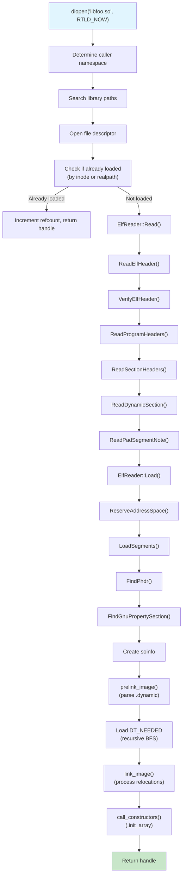

---

## 7.4 VNDK 与链接器命名空间

### 7.4.1 Treble 命名空间问题

Android 的 Treble 架构（在 Android 8.0 中引入）将**平台**（框架）与
**供应商**实现分离。目标是允许平台独立于供应商代码进行更新。但原生库
带来了一个挑战：如果一个供应商库和一个平台库都链接 `libutils.so`，
它们可能需要它的不同版本。

解决方案是**链接器命名空间**——链接器用于隔离不同库集合、使它们无法
看到彼此符号的机制。

### 7.4.2 android_namespace_t 结构

来自 `bionic/linker/linker_namespaces.h`（第 72-183 行）：

```cpp
struct android_namespace_t {
  const char* get_name() const { return name_.c_str(); }
  bool is_isolated() const { return is_isolated_; }
  bool is_also_used_as_anonymous() const {
    return is_also_used_as_anonymous_;
  }

  const std::vector<std::string>& get_ld_library_paths() const;
  const std::vector<std::string>& get_default_library_paths() const;
  const std::vector<std::string>& get_permitted_paths() const;
  const std::vector<std::string>& get_allowed_libs() const;

  const std::vector<android_namespace_link_t>& linked_namespaces() const;
  void add_linked_namespace(android_namespace_t* linked_namespace,
                            std::unordered_set<std::string> shared_lib_sonames,
                            bool allow_all_shared_libs);

  void add_soinfo(soinfo* si);
  void remove_soinfo(soinfo* si);
  const soinfo_list_t& soinfo_list() const;

  bool is_accessible(const std::string& path);
  bool is_accessible(soinfo* si);

 private:
  std::string name_;
  bool is_isolated_;
  bool is_exempt_list_enabled_;
  bool is_also_used_as_anonymous_;
  std::vector<std::string> ld_library_paths_;
  std::vector<std::string> default_library_paths_;
  std::vector<std::string> permitted_paths_;
  std::vector<std::string> allowed_libs_;
  std::vector<android_namespace_link_t> linked_namespaces_;
  soinfo_list_t soinfo_list_;
};
```

关键概念：

- **隔离命名空间**：当 `is_isolated_` 为 true 时，该命名空间只能从其
  `default_library_paths_` 和 `permitted_paths_` 加载库。这防止供应商代码
  意外加载平台库。

- **命名空间链接**：一个命名空间中的库可以通过链接对另一个命名空间
  可见。每个链接指定共享哪些库：

```cpp
struct android_namespace_link_t {
  android_namespace_t* linked_namespace_;
  std::unordered_set<std::string> shared_lib_sonames_;
  bool allow_all_shared_libs_;

  bool is_accessible(const char* soname) const {
    return allow_all_shared_libs_ ||
           shared_lib_sonames_.find(soname) != shared_lib_sonames_.end();
  }
};
```

- **允许的库**：对哪些库可以加载到命名空间中的另一层过滤，与路径无关。

### 7.4.3 命名空间架构

标准 Android 命名空间拓扑如下所示：

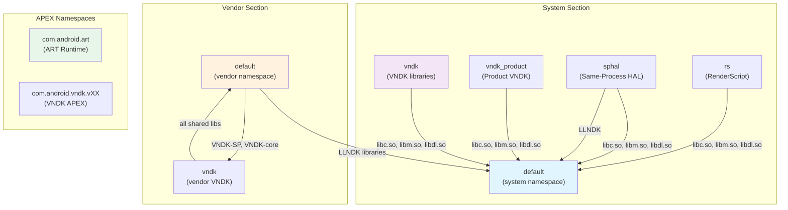

### 7.4.4 VNDK 库分类

VNDK（供应商 NDK）定义了四类库：

来自 `build/soong/cc/vndk.go`（第 23-29 行）：

```go
const (
    llndkLibrariesTxt       = "llndk.libraries.txt"
    vndkCoreLibrariesTxt    = "vndkcore.libraries.txt"
    vndkSpLibrariesTxt      = "vndksp.libraries.txt"
    vndkPrivateLibrariesTxt = "vndkprivate.libraries.txt"
    vndkProductLibrariesTxt = "vndkproduct.libraries.txt"
)
```

| 类别 | 说明 | 示例库 |
|----------|-------------|-------------------|
| **LL-NDK** | 低级 NDK；始终对供应商可用 | `libc.so`、`libm.so`、`libdl.so`、`liblog.so` |
| **VNDK-core** | 核心 VNDK；对供应商可用但有版本控制 | `libcutils.so`、`libbase.so`、`libutils.so` |
| **VNDK-SP** | 同进程 VNDK；加载到框架进程中 | `libhardware.so`、`libhidlbase.so` |
| **VNDK-private** | 仅对其他 VNDK 模块可用，不对供应商直接可用 | 内部 VNDK 实现库 |

构建系统中的 `VndkProperties` 结构定义了库如何声明其 VNDK 成员资格：

来自 `build/soong/cc/vndk.go`（第 45-76 行）：

```go
type VndkProperties struct {
    Vndk struct {
        // declared as a VNDK or VNDK-SP module
        Enabled *bool

        // declared as a VNDK-SP module, which is a subset of VNDK
        Support_system_process *bool

        // declared as a VNDK-private module
        Private *bool

        // Extending another module
        Extends *string
    }
}
```

### 7.4.5 VNDK APEX 与快照

上面的 VNDK 分类描述的是库。带版本的 VNDK 以 APEX 形式*打包*。因此设备
可以携带某个供应商镜像编译时所针对的精确 VNDK 构建。该包是
`packages/modules/vndk` 下的 `com.android.vndk` 模块。其
`apex/apex_manifest.json` 将其命名为 `com.android.vndk`，而
`apex/Android.bp` 为每个受支持的 VNDK 版本声明一个 `apex_vndk` 捆绑包，
例如：

```
apex_vndk {
    name: "com.android.vndk.v34",
    defaults: ["vndk-apex-defaults"],
    vndk_version: "34",
    system_ext_specific: true,
}
```

`apex_vndk` 是一种专用的 Soong 模块类型。`build/soong/apex/vndk.go`
（第 30-32 行）的头部注释说它“创建一个仅包含 VNDK 库的特殊 apex 模块
变体”。当设置了 `vndk_version` 时，该版本的 VNDK 库会被自动收集。省略
时则使用 `current` 版本。因此每个捆绑包都将特定 API 级别的 VNDK 冻结
快照打包到 `/apex/com.android.vndk.vXX/` 中。7.4.3 节的拓扑图展示了
`com.android.vndk.vXX` APEX 命名空间。

`apex/Android.bp` 中的几个属性很重要：

- 各捆绑包共享 `vndk-apex-defaults`，它设置了 `updatable: false`。
  VNDK APEX 是不可更新的 APEX。它是镜像的一部分，不通过网络分发，因为
  供应商代码是针对固定快照构建的。
- 每个版本都是 `system_ext_specific: true`，因此 APEX 从 `system_ext`
  分区安装。
- 带版本的名称（AOSP 17 中的 `com.android.vndk.v31` ... `com.android.vndk.v34`）
  让一个系统镜像可以携带多个快照。针对较旧 VNDK 构建的供应商分区因此
  可以在更新的系统上运行。

当供应商进程加载带版本的 VNDK 库时，链接器会从匹配的
`com.android.vndk.vXX` APEX 命名空间而不是从 `/system` 解析它。这使得
平台可以独立更新这些库的自身副本。

### 7.4.6 linkerconfig 工具

`system/linkerconfig/` 工具在启动时生成链接器配置。它由 init 在早期
启动序列中调用，并生成 `/linkerconfig/ld.config.txt`。

来自 `system/linkerconfig/main.cc`（第 33-43 行）：

```cpp
#include "linkerconfig/apex.h"
#include "linkerconfig/apexconfig.h"
#include "linkerconfig/baseconfig.h"
#include "linkerconfig/configparser.h"
#include "linkerconfig/context.h"
#include "linkerconfig/environment.h"
#include "linkerconfig/log.h"
#include "linkerconfig/namespacebuilder.h"
#include "linkerconfig/recovery.h"
#include "linkerconfig/variableloader.h"
#include "linkerconfig/variables.h"
```

该工具使用模块化的构建器模式。每个命名空间在
`system/linkerconfig/contents/namespace/` 中有专用构建器：

| 构建器文件 | 命名空间 | 用途 |
|-------------|-----------|---------|
| `systemdefault.cc` | `default`（system） | 框架代码 |
| `vendordefault.cc` | `default`（vendor） | 供应商二进制文件 |
| `vndk.cc` | `vndk` / `vndk_product` | VNDK 库 |
| `sphal.cc` | `sphal` | 同进程 HAL |
| `rs.cc` | `rs` | RenderScript |
| `apexdefault.cc` | APEX 特定 | 每个 APEX 的命名空间 |
| `productdefault.cc` | `default`（product） | product 分区 |
| `recoverydefault.cc` | `default`（recovery） | 恢复模式 |
| `isolateddefault.cc` | `default`（isolated） | 隔离进程 |

### 7.4.7 Bionic 库链接

每个命名空间都需要访问核心 Bionic 库。这由 `AddStandardSystemLinks`
函数配置：

来自 `system/linkerconfig/contents/common/system_links.cc`（第 29-62 行）：

```cpp
const std::vector<std::string> kBionicLibs = {
    "libc.so",
    "libdl.so",
    "libdl_android.so",
    "libm.so",
};

void AddStandardSystemLinks(const Context& ctx, Section* section) {
  const std::string system_ns_name = ctx.GetSystemNamespaceName();
  section->ForEachNamespaces([&](Namespace& ns) {
    if (ns.GetName() != system_ns_name) {
      ns.GetLink(system_ns_name).AddSharedLib(kBionicLibs);
    }
  });
}
```

这确保每个命名空间都能通过指向系统命名空间的链接解析 Bionic 的核心库。
没有它，基本 C 库函数将不可用。

### 7.4.8 系统命名空间配置

框架代码的系统（default）命名空间配置在
`system/linkerconfig/contents/namespace/systemdefault.cc` 中。

来自 `system/linkerconfig/contents/namespace/systemdefault.cc`（第 31-77 行）：

```cpp
void SetupSystemPermittedPaths(Namespace* ns) {
  std::string product = Var("PRODUCT");
  std::string system_ext = Var("SYSTEM_EXT");
  // ...
  const std::vector<std::string> permitted_paths = {
      "/system/${LIB}/drm",
      "/system/${LIB}/extractors",
      "/system/${LIB}/hw",
      "/system/${LIB}/vulkan",
      system_ext + "/${LIB}",

      // These are where odex files are located. libart has to be able to
      // dlopen the files
      "/system/framework",
      "/system/app",
      "/system/priv-app",
      system_ext + "/framework",
      system_ext + "/app",
      system_ext + "/priv-app",
      "/vendor/framework",
      "/vendor/app",
      "/vendor/priv-app",
      "/system/vendor/framework",
      "/system/vendor/app",
      "/system/vendor/priv-app",
      "/odm/framework",
      "/odm/app",
      "/odm/priv-app",
      "/oem/app",
      product + "/framework",
      product + "/app",
      product + "/priv-app",
      product + "/${LIB}/vulkan",
      "/data",
      "/mnt/expand",
      "/apex/com.android.runtime/${LIB}/bionic",
      "/system/${LIB}/bootstrap",
  };
```

注意关于 VNDK 隔离的显式注释：

```cpp
  // We can't have entire /system/${LIB} as permitted paths because
  // doing so makes it possible to load libs in /system/${LIB}/vndk*
  // directories by their absolute paths. VNDK libs are built with
  // previous versions of Android and thus must not be loaded into
  // this namespace.
```

这是安全边界的实际运作：尽管系统命名空间有广泛权限，但它有意排除
VNDK 目录以防止版本混用。

### 7.4.9 供应商命名空间配置

供应商进程在其自己的命名空间中运行，并有严格隔离：

来自 `system/linkerconfig/contents/namespace/vendordefault.cc`（第 35-68 行）：

```cpp
Namespace BuildVendorNamespace(const Context& ctx,
                                const std::string& name) {
  Namespace ns(name, /*is_isolated=*/true, /*is_visible=*/true);

  ns.AddSearchPath("/odm/${LIB}");
  ns.AddSearchPath("/vendor/${LIB}");
  ns.AddSearchPath("/vendor/${LIB}/hw");
  ns.AddSearchPath("/vendor/${LIB}/egl");

  ns.AddPermittedPath("/odm");
  ns.AddPermittedPath("/vendor");
  ns.AddPermittedPath("/system/vendor");

  // Links to other namespaces
  ns.GetLink("rs").AddSharedLib("libRS_internal.so");
  ns.AddRequires(base::Split(
      Var("LLNDK_LIBRARIES_VENDOR", ""), ":"));

  if (IsVendorVndkVersionDefined()) {
    ns.GetLink(ctx.GetSystemNamespaceName())
        .AddSharedLib(Var("SANITIZER_DEFAULT_VENDOR"));
    ns.GetLink("vndk").AddSharedLib({
        Var("VNDK_SAMEPROCESS_LIBRARIES_VENDOR"),
        Var("VNDK_CORE_LIBRARIES_VENDOR")});
  }
  return ns;
}
```

供应商命名空间：

- 是**隔离的**（`is_isolated=true`）——只能从列出的路径加载
- 可以搜索 `/odm/${LIB}` 和 `/vendor/${LIB}`（以及 hw/egl 子目录）
- 具有以下链接：
  - 指向**系统**命名空间的 LL-NDK 库（libc、libm、libdl、liblog）链接
  - 指向**VNDK**命名空间的带版本 VNDK 库链接
  - 指向 **RenderScript** 命名空间的 `libRS_internal.so` 链接

### 7.4.10 VNDK 命名空间配置

VNDK 命名空间是带版本 VNDK 库所在之处：

来自 `system/linkerconfig/contents/namespace/vndk.cc`（第 30-123 行）：

```cpp
Namespace BuildVndkNamespace(const Context& ctx,
                              VndkUserPartition vndk_user) {
  const char* name;
  if (is_system_or_unrestricted_section &&
      vndk_user == VndkUserPartition::Product) {
    name = "vndk_product";
  } else {
    name = "vndk";
  }

  Namespace ns(name, /*is_isolated=*/true,
               /*is_visible=*/is_system_or_unrestricted_section);

  // Search order:
  // 1. VNDK Extensions (vendor/lib/vndk-sp, vendor/lib/vndk)
  // 2. VNDK APEX (/apex/com.android.vndk.vXX/${LIB})
  // 3. vendor/lib or product/lib for extensions

  for (const auto& lib_path : lib_paths) {
    ns.AddSearchPath(lib_path + "/vndk-sp");
    if (!is_system_or_unrestricted_section) {
      ns.AddSearchPath(lib_path + "/vndk");
    }
  }
  ns.AddSearchPath("/apex/com.android.vndk.v" + vndk_version + "/${LIB}");
```

VNDK 命名空间的搜索顺序揭示了扩展机制：

1. **VNDK 扩展**（`/vendor/${LIB}/vndk-sp`）-- 供应商提供的 VNDK 库
   替代或扩展
2. **VNDK APEX**（`/apex/com.android.vndk.vXX/${LIB}`）-- 以 APEX 模块
   形式发布规范的 VNDK 库
3. **回退** -- 供 VNDK 扩展所依赖的库使用的供应商自有库目录

`vndk_product` 变体是 product 分区应用的并行命名空间，它可能使用与
供应商代码不同的 VNDK 版本。

### 7.4.11 豁免列表：向后兼容

链接器包含一个用于向后兼容的豁免列表：

来自 `bionic/linker/linker.cpp`（第 226-268 行）：

```cpp
static bool is_exempt_lib(android_namespace_t* ns, const char* name,
                           const soinfo* needed_by) {
  static const char* const kLibraryExemptList[] = {
    "libandroid_runtime.so",
    "libbinder.so",
    "libcrypto.so",
    "libcutils.so",
    "libexpat.so",
    "libgui.so",
    "libmedia.so",
    "libnativehelper.so",
    "libssl.so",
    "libstagefright.so",
    "libsqlite.so",
    "libui.so",
    "libutils.so",
    nullptr
  };

  // If you're targeting N, you don't get the exempt-list.
  if (get_application_target_sdk_version() >= 24) {
    return false;
  }
  // ...
}
```

针对 API 级别 23（Marshmallow）或更低版本的应用允许直接访问这些平台
库，即使它们不属于 NDK。这是必要的，因为许多 Treble 之前的应用依赖
这些私有库。针对 API 级别 24（Nougat）或更高版本的应用受严格的命名
空间隔离约束。

### 7.4.12 命名空间如何与 dlopen 交互

当应用调用 `dlopen("libfoo.so", RTLD_NOW)` 时，以下命名空间感知的
逻辑会执行：

1. 链接器从返回地址确定调用者的命名空间
2. 它搜索调用者的命名空间路径
3. 如果未找到，它检查链接的命名空间，但仅针对链接的
  shared_lib_sonames 集合中的库
4. 如果库位于隔离命名空间中，链接器验证它位于可访问路径上

可访问性检查：

来自 `bionic/linker/linker.cpp`（第 1221-1249 行）：

```cpp
  if ((fs_stat.f_type != TMPFS_MAGIC) && (!ns->is_accessible(realpath))) {
    const soinfo* needed_by = task->is_dt_needed() ?
        task->get_needed_by() : nullptr;
    if (is_exempt_lib(ns, name, needed_by)) {
      // Allow with warning for legacy apps
    } else {
      DL_OPEN_ERR("library \"%s\" needed or dlopened by \"%s\" is not "
                   "accessible for the namespace \"%s\"",
                   name, needed_or_dlopened_by, ns->get_name());
    }
  }
```

注意 `TMPFS_MAGIC` 例外：从 tmpfs（通过 `memfd_create()` 创建）加载的
库绕过可访问性检查。这使得应用可以在运行时创建库（例如 JIT 编译），
而无需在库搜索路径上有可写目录。

### 7.4.13 运行时命名空间创建

应用和框架可以通过 `android_create_namespace` API 在运行时创建新的
命名空间：

来自 `bionic/linker/dlfcn.cpp`（第 51-57 行）：

```cpp
android_namespace_t* __loader_android_create_namespace(
    const char* name,
    const char* ld_library_path,
    const char* default_library_path,
    uint64_t type,
    const char* permitted_when_isolated_path,
    android_namespace_t* parent_namespace,
    const void* caller_addr) __LINKER_PUBLIC__;
```

这被 `libnativeloader` 使用，它创建具有适当隔离的每应用命名空间。
每个应用获得自己的命名空间，可以看见：

- 应用自己的原生库（来自 APK）
- LL-NDK 库（通过指向系统命名空间的链接）
- VNDK-SP 库，但仅限未捆绑的*供应商*应用（链接到 `vndk` 命名空间）
  和未捆绑的*product*应用（链接到 `vndk_product`）。普通应用完全不获得
  VNDK 链接
  （`art/libnativeloader/library_namespaces.cpp`）
- 应用 `uses-native-library` 清单条目中列出的库

### 7.4.14 默认库路径

链接器根据设备配置定义默认库搜索路径：

来自 `bionic/linker/linker.cpp`（第 105-154 行）：

```cpp
#if defined(__LP64__)
static const char* const kSystemLibDir     = "/system/lib64";
static const char* const kOdmLibDir        = "/odm/lib64";
static const char* const kVendorLibDir     = "/vendor/lib64";
static const char* const kAsanSystemLibDir = "/data/asan/system/lib64";
static const char* const kAsanOdmLibDir    = "/data/asan/odm/lib64";
static const char* const kAsanVendorLibDir = "/data/asan/vendor/lib64";
#else
static const char* const kSystemLibDir     = "/system/lib";
// ...
#endif

static const char* const kDefaultLdPaths[] = {
  kSystemLibDir,
  kOdmLibDir,
  kVendorLibDir,
  nullptr
};

static const char* const kAsanDefaultLdPaths[] = {
  kAsanSystemLibDir,
  kSystemLibDir,
  kAsanOdmLibDir,
  kOdmLibDir,
  kAsanVendorLibDir,
  kVendorLibDir,
  nullptr
};

#if defined(__aarch64__)
static const char* const kHwasanSystemLibDir = "/system/lib64/hwasan";
static const char* const kHwasanOdmLibDir    = "/odm/lib64/hwasan";
static const char* const kHwasanVendorLibDir = "/vendor/lib64/hwasan";
#endif
```

有三组路径：

1. **默认** -- 正常运行：`/system/lib64`、`/odm/lib64`、`/vendor/lib64`
2. **ASan** -- AddressSanitizer 模式：优先搜索 `/data/asan/` 中的
   ASan 插桩库，回退到正常路径
3. **HWASan** -- 硬件 AddressSanitizer 模式（仅 AArch64）：优先搜索
   `hwasan/` 子目录中的 HWASan 插桩库

这使得消毒构建可以与生产构建在同一设备上共存，启用消毒器时消毒版本
优先。

### 7.4.15 实践中的命名空间隔离

以下是一个具体示例，展示在 Treble 兼容设备上供应商进程的命名空间隔离
如何工作：

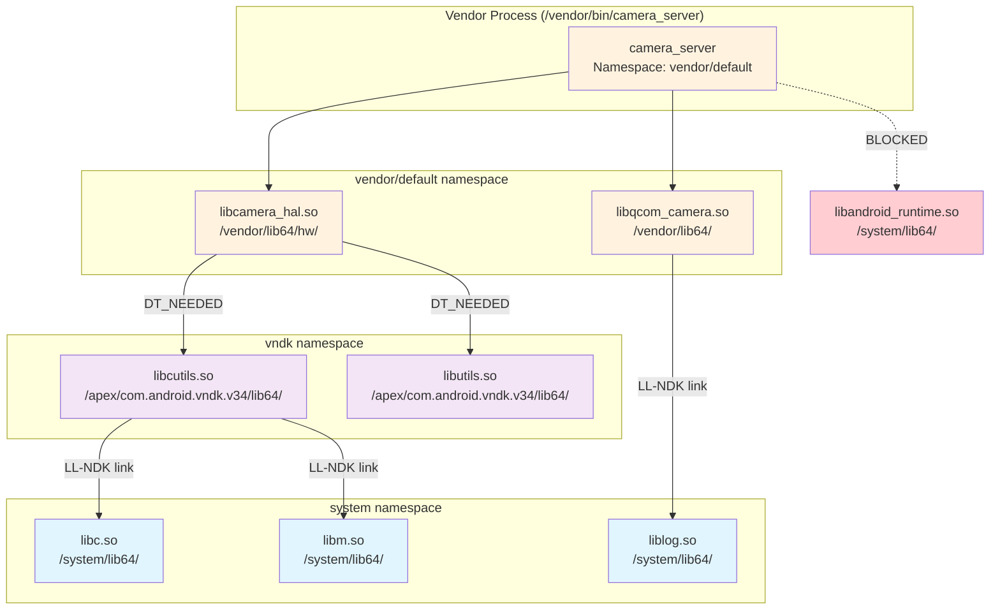

在此场景中：

- `camera_server` 位于 vendor/default 命名空间中
- 它可以加载自己的供应商库（`libcamera_hal.so`、`libqcom_camera.so`）
- 这些库可以通过 vndk 命名空间链接使用 VNDK 库（`libcutils.so`、
  `libutils.so`）
- 每个人都可以通过指向系统命名空间的链接使用 LL-NDK 库（`libc.so`、
  `libm.so`、`liblog.so`）
- 对平台私有库（`libandroid_runtime.so`）的直接访问被命名空间隔离
  **阻止**

### 7.4.16 VNDK 弃用与演进

VNDK 系统正在演进。最近的 AOSP 版本在 linkerconfig 中包含了一个
`--deprecate_vndk` 标志：

来自 `system/linkerconfig/main.cc`（第 62-63 行）：

```cpp
    {"deprecate_vndk", no_argument, 0, 'd'},
```
趋势是使用 APEX 模块进行库版本管理，而不是 VNDK 机制。每个 APEX 可以
携带自己的库版本，隔离在其自己的挂载命名空间和链接器命名空间中。这比
VNDK（共享单个进程地址空间）提供了更强的隔离，并更好地支持独立更新。

然而，对于与现有供应商实现的向后兼容性，VNDK 仍然至关重要，并且很可能
与基于 APEX 的解决方案共存多个 Android 世代。

### 7.4.17 综合起来：库加载决策树

当链接器遇到 `DT_NEEDED` 条目或 `dlopen` 调用时，完整的决策过程如下：

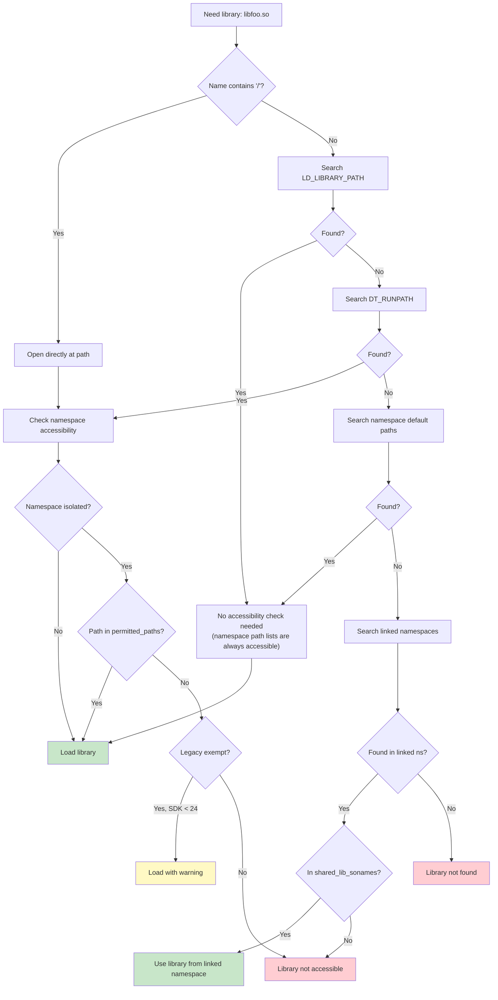

### 7.4.18 段加载详解

ElfReader 类中的 `LoadSegments()` 方法遍历每个 PT_LOAD 程序头，并将相应
的文件区域映射到保留的地址空间中。

来自 `bionic/linker/linker_phdr.cpp`（第 987-1086 行）：

```cpp
bool ElfReader::LoadSegments() {
  size_t seg_align = should_use_16kib_app_compat_ ?
      kCompatPageSize : kPageSize;

  if (kPageSize >= 16384 && min_align_ < kPageSize &&
      !should_use_16kib_app_compat_) {
    DL_ERR_AND_LOG(
        "\"%s\" program alignment (%zu) cannot be smaller than "
        "system page size (%zu)", name_.c_str(), min_align_, kPageSize);
    return false;
  }

  for (size_t i = 0; i < phdr_num_; ++i) {
    const ElfW(Phdr)* phdr = &phdr_table_[i];
    if (phdr->p_type != PT_LOAD) continue;

    ElfW(Addr) p_memsz = phdr->p_memsz;
    ElfW(Addr) p_filesz = phdr->p_filesz;
    _extend_load_segment_vma(phdr_table_, phdr_num_, i, &p_memsz,
                              &p_filesz, should_pad_segments_,
                              should_use_16kib_app_compat_);

    // Segment addresses in memory
    ElfW(Addr) seg_start = phdr->p_vaddr + load_bias_;
    ElfW(Addr) seg_end = seg_start + p_memsz;
    ElfW(Addr) seg_page_end = __builtin_align_up(seg_end, seg_align);
    ElfW(Addr) seg_file_end = seg_start + p_filesz;

    if (file_length != 0) {
      int prot = PFLAGS_TO_PROT(phdr->p_flags);
      if ((prot & (PROT_EXEC | PROT_WRITE)) == (PROT_EXEC | PROT_WRITE)) {
        if (DL_ERROR_AFTER(26, "\"%s\" has load segments that are both "
                           "writable and executable", name_.c_str())) {
          return false;
        }
      }

      if (should_use_16kib_app_compat_) {
        if (!CompatMapSegment(i, file_length)) return false;
      } else {
        if (!MapSegment(i, file_length)) return false;
      }
    }

    ZeroFillSegment(phdr);
    DropPaddingPages(phdr, seg_file_end);
    if (!MapBssSection(phdr, seg_page_end, seg_file_end)) return false;
  }
  return true;
}
```

每个 PT_LOAD 段经历四个子操作：

1. **MapSegment / CompatMapSegment** -- 使用 `mmap64()` 加 `MAP_FIXED`
   将文件内容映射到地址空间。对于 16KiB 兼容模式，兼容路径将数据读入
   现有的匿名映射，而不是直接使用 `mmap`。

2. **ZeroFillSegment** -- 如果段可写且其文件大小不足一个页边界，部分页
   的其余部分必须清零。ELF 规范对类似 BSS 的数据有此要求。

3. **DropPaddingPages** -- 当段扩展处于活动状态（用于页大小迁移）时，
   段之间的填充页使用 `MADV_DONTNEED` 释放以减少内存压力。

4. **MapBssSection** -- 如果 `p_memsz > p_filesz`，超出部分代表 BSS
   数据。链接器在段末尾映射额外的匿名页，并使用 `prctl(PR_SET_VMA)`
   将其命名为 `.bss`。

**MapSegment 详解：**

来自 `bionic/linker/linker_phdr.cpp`（第 868-893 行）：

```cpp
bool ElfReader::MapSegment(size_t seg_idx, size_t len) {
  const ElfW(Phdr)* phdr = &phdr_table_[seg_idx];
  void* start = reinterpret_cast<void*>(
      page_start(phdr->p_vaddr + load_bias_));
  const ElfW(Addr) offset = file_offset_ +
      page_start(phdr->p_offset);
  int prot = PFLAGS_TO_PROT(phdr->p_flags);

  void* seg_addr = mmap64(start, len, prot,
      MAP_FIXED | MAP_PRIVATE, fd_, offset);

  if (seg_addr == MAP_FAILED) {
    DL_ERR("couldn't map \"%s\" segment %zd: %m",
           name_.c_str(), seg_idx);
    return false;
  }

  // Mark segments as huge page eligible
  if ((phdr->p_flags & PF_X) && phdr->p_align == kPmdSize &&
      get_transparent_hugepages_supported()) {
    madvise(seg_addr, len, MADV_HUGEPAGE);
  }

  return true;
}
```

注意透明大页支持。对齐等于 PMD 大小的可执行段会收到 `MADV_HUGEPAGE`，
它告诉内核对这些映射使用大页。这减少了大型代码段的 TLB 未命中。PMD 大小
并不是固定的常量。`bionic/linker/linker_phdr.cpp` 将其定义为
`kPmdSize = (kPageSize / sizeof(uint64_t)) * kPageSize`，即一页 8 字节页表
条目覆盖的范围。在 4KiB 页设备上它等于 2MB，但在 16KiB 页设备上是 32MB。

**W+E 段拒绝：**

从 API 级别 26 开始，链接器拒绝同时可写和可执行（`W+E`）段的库。这是一项
安全措施：`W+E` 段会让能够写入内存的攻击者也能执行该内存，从而破坏
W^X 保护。

**用于页大小迁移的段扩展：**

`_extend_load_segment_vma` 函数扩展段中由文件支持的部分，以填充相邻
PT_LOAD 段之间的间隙。由于以下情况，这是必要的。系统的页大小可能大于
ELF 构建时的页大小。那么段之间的间隙将被映射为单独的 VMA（虚拟内存
区域），它们使用内核 slab 内存。当段连续时，内核可以将它们合并为单个
VMA：

来自 `bionic/linker/linker_phdr.cpp`（第 817-866 行）：

```cpp
static inline void _extend_load_segment_vma(
    const ElfW(Phdr)* phdr_table, size_t phdr_count,
    size_t phdr_idx, ElfW(Addr)* p_memsz,
    ElfW(Addr)* p_filesz, bool should_pad_segments,
    bool should_use_16kib_app_compat) {
  if (should_use_16kib_app_compat) return;

  const ElfW(Phdr)* phdr = &phdr_table[phdr_idx];

  // Don't do extension for p_align > 64KiB
  if (phdr->p_align <= kPageSize || phdr->p_align > 64*1024 ||
      !should_pad_segments) {
    return;
  }

  // Find next PT_LOAD segment
  const ElfW(Phdr)* next = nullptr;
  if (phdr_idx + 1 < phdr_count &&
      phdr_table[phdr_idx + 1].p_type == PT_LOAD) {
    next = &phdr_table[phdr_idx + 1];
  }

  if (!next || *p_memsz != *p_filesz) return;

  ElfW(Addr) next_start = page_start(next->p_vaddr);
  ElfW(Addr) curr_end = page_end(phdr->p_vaddr + *p_memsz);

  if (curr_end >= next_start) return;

  // Extend to be contiguous
  ElfW(Addr) extend = next_start - curr_end;
  *p_memsz += extend;
  *p_filesz += extend;
}
```

### 7.4.19 find_libraries 算法

`find_libraries` 函数是依赖解析的主力。它实现了一个多阶段算法，处理
循环依赖、跨命名空间加载以及用于 ASLR 的加载打乱。

来自 `bionic/linker/linker.cpp`（第 1459-1528 行）：

```cpp
static bool find_library_internal(android_namespace_t* ns,
                                   LoadTask* task,
                                   ZipArchiveCache* zip_archive_cache,
                                   LoadTaskList* load_tasks,
                                   int rtld_flags) {
  soinfo* candidate;

  // Phase 1: Check if already loaded (by soname)
  if (find_loaded_library_by_soname(ns, task->get_name(),
          true /* search_linked_namespaces */, &candidate)) {
    task->set_soinfo(candidate);
    return true;
  }

  // Phase 2: Try to load from this namespace
  if (load_library(ns, task, zip_archive_cache, load_tasks,
                   rtld_flags, true)) {
    return true;
  }

  // Phase 3: Exempt list fallback for legacy apps
  if (ns->is_exempt_list_enabled() &&
      is_exempt_lib(ns, task->get_name(), task->get_needed_by())) {
    ns = &g_default_namespace;
    if (load_library(ns, task, zip_archive_cache, load_tasks,
                     rtld_flags, true)) {
      return true;
    }
  }

  // Phase 4: Search linked namespaces
  for (auto& linked_namespace : ns->linked_namespaces()) {
    if (find_library_in_linked_namespace(linked_namespace, task)) {
      if (task->get_soinfo() != nullptr) {
        return true;  // Already loaded
      }
      // Ok to load in linked namespace
      if (load_library(linked_namespace.linked_namespace(), task,
                       zip_archive_cache, load_tasks, rtld_flags,
                       false)) {
        return true;
      }
    }
  }

  return false;
}
```

这四个阶段代表一条精心排序的回退链：

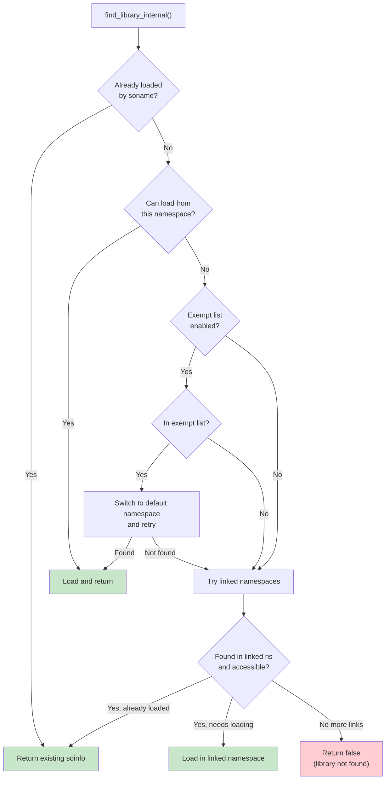

**用于 ASLR 的加载打乱：**

所有 LoadTask 创建之后但在加载之前，链接器会打乱加载顺序：

来自 `bionic/linker/linker.cpp`（第 1535-1543 行）：

```cpp
static void shuffle(std::vector<LoadTask*>* v) {
  if (!__libc_arc4random_ready()) return;

  for (size_t i = 0, size = v->size(); i < size; ++i) {
    size_t n = size - i;
    size_t r = arc4random_uniform(n);
    std::swap((*v)[n-1], (*v)[r]);
  }
}
```

这将库映射到内存的顺序随机化，补充了 `ReserveWithAlignmentPadding` 的
逐库 ASLR。即使攻击者知道进程加载哪些库，顺序也无法预测。
`__libc_arc4random_ready()` 守卫在 arc4random 尚无法产生真正随机数时
跳过打乱——特别是在第一阶段初始化中，`/dev/urandom` 和 `getentropy`
机制尚不可用之前。

### 7.4.20 重复检测与 Soname 约定

链接器使用两种策略来检测库是否已加载：

**按 inode（最强）：**

来自 `bionic/linker/linker.cpp`（第 1106-1137 行）：

```cpp
static bool find_loaded_library_by_inode(android_namespace_t* ns,
                                          const struct stat& file_stat,
                                          off64_t file_offset,
                                          bool search_linked_namespaces,
                                          soinfo** candidate) {
  auto predicate = [&](soinfo* si) {
    return si->get_st_ino() == file_stat.st_ino &&
           si->get_st_dev() == file_stat.st_dev &&
           si->get_file_offset() == file_offset;
  };

  *candidate = ns->soinfo_list().find_if(predicate);

  if (*candidate == nullptr && search_linked_namespaces) {
    for (auto& link : ns->linked_namespaces()) {
      android_namespace_t* linked_ns = link.linked_namespace();
      soinfo* si = linked_ns->soinfo_list().find_if(predicate);
      if (si != nullptr && link.is_accessible(si->get_soname())) {
        *candidate = si;
        return true;
      }
    }
  }
  return *candidate != nullptr;
}
```

**按 realpath（回退）：**

```cpp
static bool find_loaded_library_by_realpath(android_namespace_t* ns,
                                             const char* realpath,
                                             bool search_linked_namespaces,
                                             soinfo** candidate) {
  auto predicate = [&](soinfo* si) {
    return strcmp(realpath, si->get_realpath()) == 0;
  };
  // ...
}
```

基于 inode 的检查能正确处理符号链接和硬链接。如果
`/system/lib64/libfoo.so` 和 `/system/lib64/libfoo_v2.so` 是同一文件的硬
链接，inode 检测确保只加载一份。基于 realpath 的查找服务于
ASan/HWASan dlopen 路径转换。在链接器将绝对路径转换为其消毒对应项之前，
它会检查库是否已按未转换的路径加载。另外，当 `/proc` 未挂载时（早期
启动），`realpath_fd()` 无法解析规范路径。此时链接器使用给定路径作为库
的 realpath（`bionic/linker/linker.cpp`，第 988 和 1023 行）。

### 7.4.21 DT_NEEDED 处理与 DT_RUNPATH

当库首次加载时，链接器扫描其 `.dynamic` 段以查找 DT_NEEDED 条目（它
依赖的库）和 DT_RUNPATH（额外的搜索路径）：

来自 `bionic/linker/linker.cpp`（第 1276-1310 行）：

```cpp
  const ElfReader& elf_reader = task->get_elf_reader();
  for (const ElfW(Dyn)* d = elf_reader.dynamic();
       d->d_tag != DT_NULL; ++d) {
    if (d->d_tag == DT_RUNPATH) {
      si->set_dt_runpath(elf_reader.get_string(d->d_un.d_val));
    }
    if (d->d_tag == DT_SONAME) {
      si->set_soname(elf_reader.get_string(d->d_un.d_val));
    }
    if (d->d_tag == DT_FLAGS_1) {
      si->set_dt_flags_1(d->d_un.d_val);
    }
  }

  for (const ElfW(Dyn)* d = elf_reader.dynamic();
       d->d_tag != DT_NULL; ++d) {
    if (d->d_tag == DT_NEEDED) {
      const char* name = fix_dt_needed(
          elf_reader.get_string(d->d_un.d_val), elf_reader.name());
      load_tasks->push_back(
          LoadTask::create(name, si, ns, task->get_readers_map()));
    }
  }
```

DT_FLAGS_1 被提前检查，因为 `DF_1_GLOBAL` 标志决定该库是否应在全局作用域
中可见。这必须在库的依赖被加载之前知道，以便命名空间链接正确。

`fix_dt_needed` 函数处理一个向后兼容问题：一些较旧的 32 位库的 DT_NEEDED
条目带有绝对路径而不是裸 soname。对于针对 API 级别 22 或更低的应用，该
函数会剥离目录部分。

### 7.4.22 GDB 集成

链接器维护一个 GDB 用来发现已加载库的调试数据结构。这就是 `link_map`
结构，标准 ELF 调试接口的一部分。

来自 `bionic/linker/linker_main.cpp`（第 207-215 行）：

```cpp
static void init_link_map_head(soinfo& info) {
  auto& map = info.link_map_head;
  map.l_addr = info.load_bias;
  map.l_name = const_cast<char*>(info.get_realpath());
  phdr_table_get_dynamic_section(info.phdr, info.phnum,
      info.load_bias, &map.l_ld, nullptr);
}
```

每个 `soinfo` 包含一个构成双向链表一部分的 `link_map_head`。GDB 通过
`r_debug` 结构读取该列表。链接器的符号表以 `_r_debug` 形式暴露该结构。
GDB 使用该列表枚举已加载库、在新加载的代码中设置断点，并解析符号地址。

当库被加载或卸载时，链接器调用 `notify_gdb_of_load` 或
`notify_gdb_of_unload`。这些函数更新 `r_debug` 状态并触发 GDB 可以捕获的
断点：

来自 `bionic/linker/linker.cpp`（第 274-295 行）：

```cpp
static void notify_gdb_of_load(soinfo* info) {
  if (info->is_linker() || info->is_main_executable()) {
    return;
  }

  link_map* map = &(info->link_map_head);
  map->l_addr = info->load_bias;
  map->l_name = const_cast<char*>(info->get_realpath());
  map->l_ld = info->dynamic;

  CHECK(map->l_name != nullptr);
  CHECK(map->l_name[0] != '\0');

  notify_gdb_of_load(map);
}
```

### 7.4.23 CFI（控制流完整性）Shadow

链接器维护一个 CFI shadow——一个在运行时启用 LLVM 控制流完整性检查的
数据结构：

来自 `bionic/linker/linker.cpp`（第 173-177 行）：

```cpp
static CFIShadowWriter g_cfi_shadow;

CFIShadowWriter* get_cfi_shadow() {
  return &g_cfi_shadow;
}
```

所有库加载并链接完成后，链接器初始化 CFI shadow：

来自 `bionic/linker/linker_main.cpp`（第 503 行）：

```cpp
if (!get_cfi_shadow()->InitialLinkDone(solist_get_head()))
    __linker_cannot_link(g_argv[0]);
```

CFI shadow 将每个可执行页映射到一个 shadow 条目，记录哪些间接调用目标
是有效的。当一个经过 CFI 插桩的库进行间接调用时，它检查 shadow 以验证
目标是有效的函数入口点。无效目标通过 `__loader_cfi_fail` 触发受控崩溃。

### 7.4.24 链接器中的 TLS（线程局部存储）

链接器管理所有已加载库的 ELF TLS（线程局部存储）。在 C/C++ 中用
`__thread` 或 `thread_local` 声明的 TLS 变量需要逐线程副本，链接器负责
分配和初始化这些副本。

来自 `bionic/linker/linker_tls.h`（第 36-65 行）：

```cpp
void linker_setup_exe_static_tls(const char* progname);
void linker_finalize_static_tls();

void register_soinfo_tls(soinfo* si);
void unregister_soinfo_tls(soinfo* si);

const TlsModule& get_tls_module(size_t module_id);

struct TlsDescriptor {
#if defined(__arm__)
  size_t arg;
  TlsDescResolverFunc* func;
#else
  TlsDescResolverFunc* func;
  size_t arg;
#endif
};

struct TlsDynamicResolverArg {
  size_t generation;
  TlsIndex index;
};

extern "C" size_t tlsdesc_resolver_static(size_t);
extern "C" size_t tlsdesc_resolver_dynamic(size_t);
extern "C" size_t tlsdesc_resolver_unresolved_weak(size_t);
```

有两种 TLS 分配策略：

1. **静态 TLS** -- 用于可执行文件和启动时加载的库。总静态 TLS 大小在
   任何线程创建之前计算，每个线程的 TLS 块作为线程栈的一部分预先分配。

2. **动态 TLS** -- 用于在线程存在之后通过 `dlopen()` 加载的库。这些使用
   动态线程向量（DTV），当线程首次访问来自 dlopen 加载的库的 TLS 时惰性
   扩展。

三个 TLSDESC 解析器处理不同情况：

- `tlsdesc_resolver_static` -- 静态 TLS 的快速路径（单个偏移加法）
- `tlsdesc_resolver_dynamic` -- 动态 TLS 的慢路径（可能分配）
- `tlsdesc_resolver_unresolved_weak` -- 用于解析为 null 的弱 TLS 符号
  （返回虚拟地址）

### 7.4.25 MTE 全局变量支持

在支持 MTE（内存标记扩展）的 AArch64 硬件上，链接器可以为已加载库中的
全局变量打上标记：

来自 `bionic/linker/linker_soinfo.h`（第 70 行）：

```cpp
#define FLAG_GLOBALS_TAGGED   0x00000800 // globals have been tagged by MTE
```

`apply_memtag_if_mte_globals` 方法（在重定位期间使用）检查重定位目标
地址是否落在已标记的全局区域内，并应用适当的标记。这在运行时捕获全局
变量上的缓冲区溢出。

来自 `bionic/linker/linker_relocate.cpp`（第 169 行）：

```cpp
void* const rel_target = reinterpret_cast<void*>(
    relocator.si->apply_memtag_if_mte_globals(
        reloc.r_offset + relocator.si->load_bias));
```

### 7.4.26 调试链接器

链接器提供了几种调试机制：

**LD_DEBUG 环境变量：**

设置 `LD_DEBUG` 可启用详细日志。该值是以逗号分隔的类别列表：

| 值 | 记录内容 |
|-------|-------------|
| `all` | 所有调试输出 |
| `calls` | 构造函数、析构函数和 ifunc 调用 |
| `cfi` | CFI（控制流完整性）设置 |
| `dynamic` | 动态段处理 |
| `lookup` | 符号查找结果 |
| `props` | ELF 属性处理 |
| `reloc` | 重定位处理 |
| `timing` | 总链接时间（微秒） |
| `statistics` | 重定位计数（绝对、相对、符号、缓存） |

任何其他标记都会使链接器以用法错误中止，并列出可接受的值。这包括
`any`，它只是 `linker_debug.cpp` 中的一个内部标志名。

**LD_SHOW_AUXV：**

设置此环境变量会在启动时转储辅助向量，显示 AT_PHDR、AT_ENTRY、
AT_BASE、AT_HWCAP 等。

**链接器日志：**

来自 `bionic/linker/linker_main.cpp`（第 508-513 行）：

```cpp
if (g_linker_debug_config.timing) {
    gettimeofday(&t1, nullptr);
    long long t0_us = (t0.tv_sec * 1000000LL) + t0.tv_usec;
    long long t1_us = (t1.tv_sec * 1000000LL) + t1.tv_usec;
    LD_DEBUG(timing, "LINKER TIME: %s: %lld microseconds",
             g_argv[0], t1_us - t0_us);
}
```

注意，`LD_DEBUG` 和 `LD_SHOW_AUXV` 仅在未设置 `AT_SECURE` 时才被尊重
（即，对非 setuid/非 setgid 进程）。这防止了来自特权进程的信息泄露。

### 7.4.27 ldd 工具

Android 的链接器包含内置的 `ldd` 等效功能。当以
`linker64 --list /path/to/binary` 调用时，链接器设置 `g_is_ldd` 标志：

来自 `bionic/linker/linker_main.cpp`（第 489-492 行）：

```cpp
  // Exit early for ldd. We don't want to run the code that was loaded,
  // so skip the constructor calls. Skip CFI setup because it would call
  // __cfi_init in libdl.so.
  if (g_is_ldd) _exit(EXIT_SUCCESS);
```

在 ldd 模式下，链接器加载所有依赖（在过程中打印其路径），但在调用构造
函数之前退出。这安全地揭示了依赖树，而不执行任何库代码。

### 7.4.28 链接器命名空间生命周期

命名空间在进程启动和运行时有定义的生命周期：

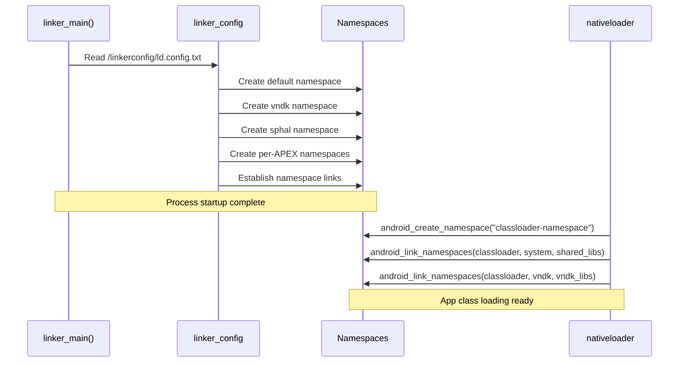

初始命名空间在 `init_default_namespaces()` 期间从链接器配置文件创建。
随后，Java 类加载器为应用加载原生库。此时，`libnativeloader` 调用
`android_create_namespace` 创建应用特定的命名空间。它以适当的库允许列表
将该命名空间链接到系统和 VNDK 命名空间。

---

## 7.5 Musl：主机侧的 Bionic 替代品

虽然 Bionic 是 Android 面向设备目标的 C 库，AOSP 还集成了 **musl libc**
作为**主机工具编译**的替代 C 库。本节解释 musl 为什么存在于 AOSP 中、它如何
集成，以及何时用它代替 glibc。

### 7.5.1 AOSP 中为什么有 Musl？

Android 的构建系统运行在 Linux 主机上。默认情况下，主机工具（如
`aapt2`、`dex2oat` 或 `zipalign`）针对 **glibc** 编译，这是大多数 Linux
发行版上的标准 C 库。然而，glibc 对构建工具分发有缺点：

- **动态链接依赖** — glibc 二进制文件依赖主机的精确 glibc 版本，导致在
  较旧系统上出现 "GLIBC_2.XX not found" 错误
- **庞大的共享库占用** — glibc 会拉入许多共享对象
- **复杂的静态链接** — glibc 不鼓励静态链接，且静态链接时有已知问题
  （NSS、locale、dlopen）

Musl 解决了这些问题：

- **干净的静态链接** — musl 从一开始就为静态链接而设计
- **最小依赖** — 生成自包含的二进制文件
- **可移植的输出** — 静态链接的 musl 二进制文件可在任何 Linux 内核版本上
  运行，无需担心 glibc 版本

### 7.5.2 Musl 源码与版本

Musl 位于 AOSP 代码树的 `external/musl/`：

```
external/musl/
├── Android.bp              # Build rules
├── sources.bp              # Generated source file lists
├── README                  # Upstream v1.2.5
├── METADATA                # Version and license info
├── android/                # Android-specific adaptations
│   ├── generate_bp.py      # Generates sources.bp from upstream
│   ├── relinterp.c         # Dynamic interpreter relocation
│   ├── ldso_trampoline.cpp # Loader trampoline
│   └── include/            # Android-specific header overrides
│       ├── features.h
│       ├── math.h
│       ├── resolv.h
│       └── string.h
├── include/                # musl public headers
├── src/                    # musl source (upstream)
│   ├── string/             # String operations
│   ├── malloc/             # Memory allocation
│   ├── thread/             # Threading primitives
│   ├── stdio/              # Standard I/O
│   └── ...
└── ldso/                   # Dynamic linker (musl's ld.so)
```

`android/` 目录包含 Android 特定的适配，用于弥合 musl 上游行为与 AOSP
需求之间的差异。

### 7.5.3 为主机构建启用 Musl

Musl 通过 `USE_HOST_MUSL` 环境变量激活：

```bash
# Enable musl for host tool compilation
export USE_HOST_MUSL=true
m aapt2   # Now compiled against musl instead of glibc
```

构建系统管道流经多个层：

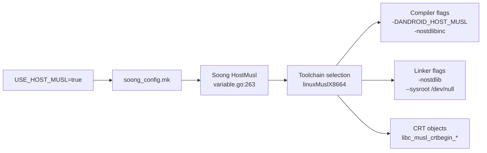

```go
// Source: build/soong/android/config.go:2523
func (c *config) UseHostMusl() bool {
    return Bool(c.productVariables.HostMusl)
}
```

### 7.5.4 构建系统集成

当启用 musl 时，Soong 选择专用的工具链工厂，覆盖默认的基于 glibc 的主机
编译：

```go
// Source: build/soong/cc/config/x86_linux_host.go:43
var linuxMuslCflags = []string{
    "-DANDROID_HOST_MUSL",
    "-nostdlibinc",
    "--sysroot /dev/null",
}
```

```go
// Source: build/soong/cc/config/x86_linux_host.go:66
var linuxMuslLdflags = []string{
    "-nostdlib",
    "--sysroot /dev/null",
}
```

`--sysroot /dev/null` 标志至关重要：它阻止编译器找到任何系统头文件或
库，确保与主机的 glibc 完全隔离。所有头文件都来自 musl 自己的
`include/` 目录。

#### 架构支持

Musl 支持四种主机架构，每种都有专用的 LLVM triple：

| 架构 | LLVM Triple | 工具链工厂 |
|---|---|---|
| x86 | `i686-linux-musl` | `linuxMuslX86ToolchainFactory` |
| x86_64 | `x86_64-linux-musl` | `linuxMuslX8664ToolchainFactory` |
| ARM | `arm-linux-musleabihf` | `linuxMuslArmToolchainFactory` |
| ARM64 | `aarch64-linux-musl` | `linuxMuslArm64ToolchainFactory` |

#### CRT 对象

Musl 提供自己的 C 运行时启动对象，定义在 `Android.bp` 中：

```
// Source: external/musl/Android.bp:460-505
libc_musl_crtbegin_dynamic  → Dynamic executable startup
libc_musl_crtbegin_static   → Static executable startup
libc_musl_crtbegin_so       → Shared library startup
libc_musl_crtend            → Executable cleanup
libc_musl_crtend_so         → Shared library cleanup
```

#### 默认共享库

```go
// Source: build/soong/cc/config/x86_linux_host.go:115
var MuslDefaultSharedLibraries = []string{"libc_musl"}
```

当 musl 激活时，`libc_musl` 取代 glibc 成为默认系统共享库。所有主机工具
改为链接到它。

### 7.5.5 预构建 Musl 工具链

预构建的 Clang 工具链包含所有受支持架构的 musl 运行时库（在当前默认工具
链目录下，`clang-<version>`）：

```
prebuilts/clang/host/linux-x86/clang-r584948/musl/
├── lib/
│   ├── x86_64-unknown-linux-musl/     # x86_64 runtime
│   ├── aarch64-unknown-linux-musl/    # ARM64 runtime
│   ├── arm-unknown-linux-musleabihf/  # ARM runtime
│   ├── i686-unknown-linux-musl/       # x86 runtime
│   └── libc_musl.so                   # Dynamic musl library
```

### 7.5.6 Bionic 与 Musl 的头文件共享

有趣的是，musl 复用了 Bionic 内核 UAPI 层的一些头文件。构建系统生成
一个包含 Bionic 内核头文件的 musl sysroot：

```java
// Source: bionic/libc/Android.bp:2973
cc_genrule {
    name: "libc_musl_sysroot_bionic_headers",
    // Copies bionic's kernel UAPI headers for musl's use
}
```

这确保 musl 和 bionic 在内核结构定义（`ioctl` 编号、套接字选项等）上
保持一致，因为两者最终都针对同一个 Linux 内核。

### 7.5.7 Musl 的消毒器限制

并非所有消毒器都能与 musl 配合工作。构建系统禁用了几个：

```go
// Source: build/soong/cc/sanitize.go:677-686
// CFI is disabled for musl
if ctx.toolchain().Musl() {
    s.Cfi = nil
}
// ARM64 address and HW address sanitizers are also disabled
```

消毒器运行时与 musl 静态链接，因为 musl 的动态链接器对 `LD_PRELOAD` 和
`dlopen` 有不同的语义。在 glibc 下，它们可以动态加载。

### 7.5.8 Bionic vs. Musl vs. Glibc

#### AOSP 三种 C 库的对比

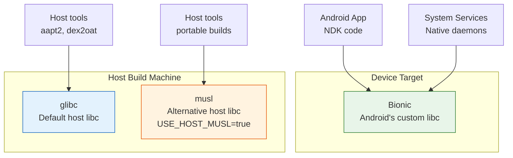

| 方面 | Bionic | glibc | musl |
|---|---|---|---|
| **目标** | Android 设备 | Linux 主机（默认） | Linux 主机（可选启用） |
| **静态链接** | 支持 | 有问题（NSS/locale） | 干净，推荐 |
| **二进制可移植性** | 不适用（仅设备） | 绑定主机 glibc 版本 | 在任何 Linux 上运行 |
| **体积** | 最小 | 大 | 最小 |
| **POSIX 符合性** | 部分（有意如此） | 完整 | 接近完整 |
| **线程模型** | pthread（自定义） | NPTL | 自定义轻量级 |
| **激活方式** | 设备的默认选择 | 主机的默认选择 | `USE_HOST_MUSL=true` |

### 7.5.9 何时使用 Musl

Musl 主要用于以下场景：

- **CI/CD 环境** — glibc 版本各异的构建服务器
- **密封构建** — 独立于主机系统库的可复现构建
- **分发** — 发布可跨 Linux 发行版工作的预构建主机工具
- **交叉编译** — 为 ARM 构建服务器构建主机工具（ARM64 musl
  工具链）

AOSP 构建基础设施正逐步为主机工具转向 musl，以提高构建密封性，减少
“在我的机器上能跑”的问题。

---

## 7.6 高级主题

### 7.6.1 soinfo 方法接口

`soinfo` 结构为链接器操作已加载库提供了丰富的方法接口。关键方法揭示了
已加载库的生命周期：

来自 `bionic/linker/linker_soinfo.h`（第 250-347 行）：

```cpp
struct soinfo {
  // Lifecycle
  void call_constructors();
  void call_destructors();
  void call_pre_init_constructors();
  bool prelink_image(bool deterministic_memtag_globals = false);
  bool link_image(const SymbolLookupList& lookup_list,
                  soinfo* local_group_root,
                  const android_dlextinfo* extinfo,
                  size_t* relro_fd_offset);
  bool protect_relro();
  bool protect_16kib_app_compat_code();

  // MTE support
  void tag_globals(bool deterministic_memtag_globals);
  ElfW(Addr) apply_memtag_if_mte_globals(ElfW(Addr) sym_addr) const;

  // Symbol lookup
  const ElfW(Sym)* find_symbol_by_name(SymbolName& symbol_name,
                                        const version_info* vi) const;
  ElfW(Sym)* find_symbol_by_address(const void* addr);

  ElfW(Addr) resolve_symbol_address(const ElfW(Sym)* s) const {
    if (ELF_ST_TYPE(s->st_info) == STT_GNU_IFUNC) {
      return call_ifunc_resolver(s->st_value + load_bias);
    }
    return static_cast<ElfW(Addr)>(s->st_value + load_bias);
  }

  // Reference counting
  size_t increment_ref_count();
  size_t decrement_ref_count();
  size_t get_ref_count() const;

  // Navigation
  soinfo* get_local_group_root() const;
  soinfo_list_t& get_children();
  soinfo_list_t& get_parents();
  android_namespace_t* get_primary_namespace();
  android_namespace_list_t& get_secondary_namespaces();

  // Version support
  const ElfW(Versym)* get_versym(size_t n) const;
  ElfW(Addr) get_verneed_ptr() const;
  size_t get_verneed_cnt() const;
  ElfW(Addr) get_verdef_ptr() const;
  size_t get_verdef_cnt() const;
};
```

`resolve_symbol_address` 方法尤其值得注意：对于标准符号，它只是将加载
偏置加到符号值上。但对于 GNU IFUNC 符号（`STT_GNU_IFUNC`），它调用
IFUNC 解析器函数以在运行时确定实际实现地址。架构特定优化（如 7.1.6 节
中的 memcpy 变体）就是这样分发的。

生命周期方法按严格顺序调用：

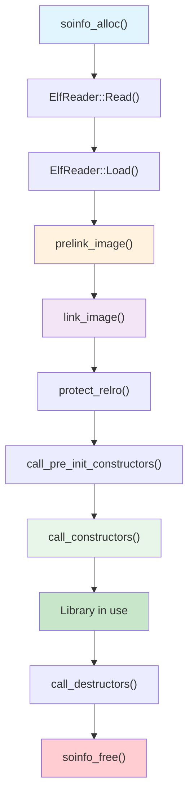

**prelink_image()** 解析 `.dynamic` 段以填充 soinfo 字段：符号表、字符串
表、哈希表、重定位表以及 init/fini 数组。它不解析任何符号。

**link_image()** 处理所有重定位，解析符号引用并修补代码和数据。完成此
步骤后，所有函数指针和全局变量引用都指向正确的地址。

**protect_relro()** 将 RELRO（重定位只读）页标记为只读。RELRO 是一项安全
特性。在重定位应用于 GOT（全局偏移表）后，这些页被重新映射为只读，以
防止 GOT 覆写攻击。

### 7.6.2 GNU 哈希：NEON 加速的符号查找

链接器包含针对 ARM 架构的 NEON 加速 GNU 哈希实现：

来自 `bionic/linker/linker_gnu_hash.h`（第 35-54 行）：

```cpp
#if defined(__arm__) || defined(__aarch64__)
#define USE_GNU_HASH_NEON 1
#else
#define USE_GNU_HASH_NEON 0
#endif

#if USE_GNU_HASH_NEON
#include "arch/arm_neon/linker_gnu_hash_neon.h"
#endif

static std::pair<uint32_t, uint32_t>
calculate_gnu_hash_simple(const char* name) {
  uint32_t h = 5381;
  const uint8_t* name_bytes =
      reinterpret_cast<const uint8_t*>(name);
  #pragma unroll 8
  while (*name_bytes != 0) {
    h += (h << 5) + *name_bytes++; // h*33 + c
  }
  return { h, reinterpret_cast<const char*>(name_bytes) - name };
}

static inline std::pair<uint32_t, uint32_t>
calculate_gnu_hash(const char* name) {
#if USE_GNU_HASH_NEON
  return calculate_gnu_hash_neon(name);
#else
  return calculate_gnu_hash_simple(name);
#endif
}
```

GNU 哈希函数（`h = h * 33 + c`，从 5381 开始）是著名的 DJB 哈希。简单
实现使用 `#pragma unroll 8` 提示编译器展开循环。在 ARM 上，NEON 实现
使用 SIMD 指令并行处理多个字节，对长符号名来说速度可测量地更快。

该函数同时返回哈希值和符号名长度。长度是哈希计算的副产品（我们扫描到
空终止符），避免了稍后查找中多余的 `strlen()` 调用。

### 7.6.3 CFI Shadow 架构

CFI（控制流完整性）shadow 是由链接器管理的关键安全特性。它提供了一张
将代码地址映射到 CFI 验证信息的查找表。

来自 `bionic/linker/linker_cfi.h`（第 38-49 行）：

```cpp
// This class keeps the contents of CFI shadow up-to-date with the
// current set of loaded libraries.
// Shadow is mapped and initialized lazily as soon as the first
// CFI-enabled DSO is loaded. It is updated after any library is
// loaded (but before any constructors are ran), and before any
// library is unloaded.
class CFIShadowWriter : private CFIShadow {
  uint16_t* MemToShadow(uintptr_t x) {
    return reinterpret_cast<uint16_t*>(
        *shadow_start + MemToShadowOffset(x));
  }
```

shadow 有以下特征：

- **惰性初始化** -- 直到第一个启用 CFI 的库被加载才创建，避免对不使用
  CFI 的进程造成开销。
- **16 位粒度** -- 每个 shadow 条目是一个 16 位值，编码一段代码地址的
  验证信息。
- **更新时机** -- 在库加载后（构造函数之前）和库卸载前更新。这确保构造
  函数期间的 CFI 检查在一致的 shadow 上操作。
- **集成** -- 当 CFI 检查失败时调用 `dlfcn.cpp` 中的 `__loader_cfi_fail`
  函数，提供一个带有诊断信息的集中式崩溃处理器。

### 7.6.4 块分配器

链接器使用自定义块分配器来分配 soinfo 及相关结构，而不是使用 malloc。
这带来两个好处：

1. **确定性的布局** -- 所有 soinfo 结构都在已知页中，使得通过
   `ProtectedDataGuard` 进行写保护成为可能。
2. **不依赖 malloc** -- 在 libc 加载之前的早期初始化期间，链接器不能使用
   malloc（它位于 libc.so 中）。

来自 `bionic/linker/linker.cpp`（第 89-91 行）：

```cpp
static LinkerTypeAllocator<soinfo> g_soinfo_allocator;
static LinkerTypeAllocator<LinkedListEntry<soinfo>> g_soinfo_links_allocator;
static LinkerTypeAllocator<android_namespace_t> g_namespace_allocator;
static LinkerTypeAllocator<LinkedListEntry<android_namespace_t>>
    g_namespace_list_allocator;
```

`LinkerTypeAllocator` 以页大小的块分配对象。当需要新对象且当前块已满时，
会 `mmap` 一个新页。分配器跟踪所有页，使 `protect_all()` 能遍历它们并用
`mprotect()` 更改其保护。

来自 `bionic/linker/linker.cpp`（第 484-491 行）：

```cpp
void ProtectedDataGuard::protect_data(int protection) {
  g_soinfo_allocator.protect_all(protection);
  g_soinfo_links_allocator.protect_all(protection);
  g_namespace_allocator.protect_all(protection);
  g_namespace_list_allocator.protect_all(protection);
}
```

这意味着在 `dlopen`/`dlclose` 调用之间，所有链接器元数据都是只读的。
攻击者如果损坏 soinfo 结构（例如，为了重定向函数指针），会在损坏被利用
之前触发页错误。

### 7.6.5 链接器中的消毒器支持

链接器与几个消毒器深度集成：

**ASan（AddressSanitizer）：**

ASan 插桩的库安装在 `/data/asan/system/lib64/`（以及 vendor/odm 的类似
路径）。检测到 ASan 模式时，链接器将这些路径放在最前面，确保库的插桩
版本优先于生产版本。

**HWASan（硬件 AddressSanitizer）：**

HWASan 插桩的库位于 `hwasan/` 子目录中。链接器通过弱回调通知 HWASan
库加载/卸载事件：

来自 `bionic/libc/bionic/libc_init_dynamic.cpp`（第 75-80 行）：

```cpp
extern "C" __attribute__((weak)) void __hwasan_library_loaded(
    ElfW(Addr) base,
    const ElfW(Phdr)* phdr,
    ElfW(Half) phnum);
extern "C" __attribute__((weak)) void __hwasan_library_unloaded(
    ElfW(Addr) base,
    const ElfW(Phdr)* phdr,
    ElfW(Half) phnum);
```

这些弱符号仅在存在 HWASan 运行时的情况下才解析，使同一个链接器二进制
文件在有无 HWASan 时都能工作。

**MTE（内存标记扩展）：**

MTE 支持在多个层面集成：

- **栈标记** -- 链接器在加载所有通过其 `.dynamic` 段请求栈标记的库之后
  调用 `__libc_init_mte_stack()`。
- **堆标记** -- 通过 ELF note（`note_memtag_heap_async.S` /
  `note_memtag_heap_sync.S`）启用。
- **全局标记** -- 链接器的 `tag_globals()` 方法对选择加入的库中的全局
  变量应用 MTE 标记。

### 7.6.6 完整的进程启动序列

综合本章中的所有组件，以下是动态链接的 Android 应用从 `exec()` 到
`main()` 的完整序列：

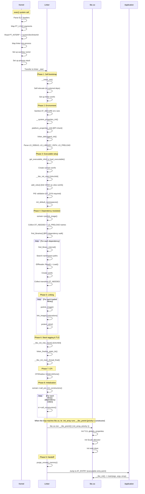

这个序列说明了为什么链接器是 Android 中性能最敏感的组件之一。在链接器
中花费的每一微秒都会被每次进程启动所放大。链接器的精心优化——符号缓存、
模板特化的重定位循环、NEON 加速哈希、受保护数据守卫——都服务于最小化
这一启动开销。

### 7.6.7 错误消息与诊断

链接失败时，链接器提供详细的错误消息。理解这些消息对于调试原生库问题
至关重要：

| 错误消息 | 原因 | 解决方案 |
|--------------|-------|---------|
| `"libfoo.so" not found` | 库不在任何搜索路径上 | 检查命名空间路径、APK 库目录 |
| `cannot locate symbol "bar" referenced by "libfoo.so"` | 未解析的强符号 | 检查库依赖、符号可见性 |
| `"libfoo.so" is not accessible for the namespace "default"` | 命名空间隔离 | 检查 linkerconfig、uses-native-library 清单 |
| `"libfoo.so" is 32-bit instead of 64-bit` | ABI 不匹配 | 为正确的架构构建库 |
| `"libfoo.so" has bad ELF magic` | 文件损坏或非 ELF 文件 | 验证文件完整性 |
| `Android only supports position-independent executables` | 非 PIE 可执行文件 | 用 -fPIE -pie 重新构建 |
| `has load segments that are both writable and executable` | W+E 段（API >= 26） | 修复链接器脚本，使用独立段 |
| `program alignment cannot be smaller than system page size` | 16KiB 系统上的 4KiB 库 | 用 16KiB 对齐重新构建或启用兼容模式 |

每条错误消息都经过精心设计，包含库名称，并在适用时包含命名空间上下文。
Android bug 跟踪器条目促成了许多这些错误和例外。它们以
`http://b/NNNNN` 引用的形式出现在 `bionic/linker/linker.cpp` 中周围源码
注释里。它们不会出现在运行时错误文本本身中。

### 7.6.8 性能考虑

链接器的性能直接影响应用启动时间和系统启动时间。关键性能特征：

**重定位处理：**

- 模板特化的 `process_relocation_impl<Mode>` 生成三条独立的代码路径，
  消除了常见情况的分支开销。
- 符号缓存在典型工作负载中将冗余的哈希表查找减少了 80% 以上。
- `__predict_false` 和 `__predict_true` 提示指导编译器的分支预测优化。

**ELF 加载：**

- `ElfReader` 使用 `MappedFileFragment` 对头文件进行零拷贝读取（mmap
  而不是 read）。
- 段映射使用 `MAP_FIXED | MAP_PRIVATE`，它告诉内核替换现有的 PROT_NONE
  映射而不创建新的 VMA。
- 透明大页（`MADV_HUGEPAGE`）减少了大型可执行段的 TLB 压力。

**内存管理：**

- 块分配器避免了链接器内部结构 malloc/free 的开销。
- `purge_unused_memory()` 在将控制权移交给应用之前调用，归还不再需要的
  任何内部缓冲区。
- RELRO 保护防止对已解析的 GOT 条目的意外写入，改善缓存行为（只读页可
  在进程间共享）。

**启动计时：**

当 `LD_DEBUG=timing` 时，链接器记录并报告其总执行时间：

```
LINKER TIME: /system/bin/app_process64: 15234 microseconds
```

典型值从简单可执行文件的 5ms 到具有许多原生依赖的应用的 50ms+ 不等。
Android 团队持续优化这条路径，因为它直接影响用户感知的应用启动延迟。

---

## 7.7 Android 17 中的变化

Android 17 中的 Bionic 不是一次重新设计。它是沿着已确立路线积累的加固与
性能工作。这些包括更严密的内存安全、16KiB 页大小过渡，以及从手写汇编
缓慢迁移。本节汇集在 17 设备上阅读或调试原生代码时最可能遇到的变更。

### 7.7.1 进程创建：clone3 与 SME 状态

Android 17 为 libc 添加了正规的 `clone3()` 包装器。以前代码只能通过原始
的 `syscall()` 接口触达 `clone3` 系统调用。现在有了一等函数。它具有参数
验证以及与 `clone()` 用来保持 Bionic 线程 ID 缓存一致的相同的序言/尾声
簿记。

来自 `bionic/libc/bionic/clone.cpp`（第 161-180 行）：

```cpp
int clone3(struct clone_args* cl_args, size_t size, int (*fn)(void*), void* arg) {
  bool invalid_args = (cl_args == nullptr) || ((cl_args->flags & CLONE_VM) && fn == nullptr) ||
                      (fn == nullptr && cl_args->stack != 0) ||
                      (fn != nullptr && cl_args->stack == 0);
  if (invalid_args) {
    errno = EINVAL;
    return -1;
  }
  clone_id_info ciinfo = clone_prologue(cl_args->flags);
  int clone_result;
  if (fn != nullptr) {
    clone_result = __bionic_clone3(cl_args, size, fn, arg);
  } else {
    clone_result = syscall(SYS_clone3, cl_args, size);
  }
  return clone_epilogue(ciinfo, clone_result);
}
```

该函数在 API 级别 38 引入（`bionic/libc/libc.map.txt`）。它在公共
seccomp 允许列表上（`bionic/libc/SECCOMP_ALLOWLIST_COMMON.TXT`）。当提供
了子入口函数时，它会分派到架构桩 `__bionic_clone3`，例如在
`bionic/libc/arch-arm64/bionic/__bionic_clone.S` 中。

进程创建还获得了对 Arm 可伸缩矩阵扩展（SME）的正确处理。在 AAPCS64 下，
SME `ZA` 数组在 `vfork()` 之间是私有的，因此返回时的状态必须是“off”。
Bionic 现在在入口处显式禁用它，而不是假定调用方已经禁用。

来自 `bionic/libc/arch-arm64/bionic/vfork.S`（第 35-43 行）：

```asm
    // AAPCS64 defines SME ZA interface as private for vfork(), which means
    // that ZA state on entry can be "dormant" or "off", while on return it
    // can be unchanged or "off". Handling the dormant state would make the
    // code unnecessary complex, so for simplicity turn ZA state off on entry
    // which ensures that the state on return will be "off" as well.
    str lr, [sp, #-16]!
    // ...
    bl __arm_za_disable
```

同样的 `ZA` 清除也应用于 `clone()`，因此任一路径都不会将流式 SME 状态
泄漏到新创建的线程或进程中。

### 7.7.2 可移植 SIMD 与 FreeBSD 字符串刷新

字符串和内存例程继续从定制汇编中迁出。如 7.1.7 节所述，Android 17 引入
了 `bionic/libc/portable-simd/`。它是一组向量字符串函数。它们基于 Google
的 Highway SIMD 库以模板形式编写一次，并按向量类型实例化。首批迁移者是
`strlen`、`memchr`、`strspn` 和 `strcspn`。

在 x86-64 上，几个
函数切换到了 FreeBSD 的优化实现。函数
`strtok`、`strpbrk` 和 `strsep` 基于 Bionic 自己的
`strcspn`/`strspn` 重写（`bionic/libc/bionic/string.cpp`）。净效果是待维护
的架构特定汇编文件更少，同时保持了大部分性能。

在 AArch64 上，IFUNC 解析器在其间选择的优化例程仍然来自
`external/arm-optimized-routines/` 下的 Arm `arm-optimized-routines` 项目。
libc 将它们作为 `libarm-optimized-routines-string` 和
`libarm-optimized-routines-mem` 静态库包含。刷新该导入是新的微架构调优
落地的方式。

### 7.7.3 分配器：新的 mallopt 旋钮与 reallocarray

Scudo 仍然是默认分配器，如 7.1.3 节所述通过 `malloc_common.cpp` 分发。
Android 17 添加了两项可见的改进。第一，`reallocarray` 是分配器分发表的
完整成员，而不是一层薄包装，因此调试和挂钩分配器可以拦截它的溢出检查
乘法。第二，一个新的快速 purge `mallopt()` 选项让内存压力响应者可以
快速归还空闲内存而不阻塞。

来自 `bionic/libc/include/malloc.h`（第 240-248 行）：

```cpp
/**
 * mallopt() option to immediately purge all possible memory back to
 * the kernel. This call will execute fast and might not release as
 * much memory to the kernel as a normal purge call. This is meant to
 * be used frequently but not block for a long period of time. The value
 * is ignored.
 *
 * Available since API level 37.
 */
#define M_PURGE_FAST (-105)
```

`M_PURGE_FAST` 补充了现有的 `M_PURGE`（API 28）和 `M_PURGE_ALL`
（API 34）。希望在每个内存压力信号上修剪堆的守护进程可以调用它，而
不会有长时间停顿的风险。

### 7.7.4 16KiB 页大小：细粒度兼容保护

16KiB 页大小过渡是此领域正在进行的最大变更。7.3.7 节涵盖了兼容加载器；
Android 17 的贡献是使 RWX 回退远不宽松。当 4KiB 段边界落在 16KiB 页的
中间时，加载器以前将整个横跨区域映射为可读写执行。现在
`soinfo::protect_16kib_app_compat_middle_pages()`
（`bionic/linker/linker_phdr_16kib_compat.cpp`）将可写可执行窗口限制为
真正横跨权限边界的页，并在重定位完成后恢复更严格的权限。新的
`RWX_MiddlePageProtection` 回归测试守护此行为。兼容代码庞大到如今位于
独立的编译单元中，与 `linker_phdr.cpp` 分开。

### 7.7.5 链接器加固：XOM、BTI Note 与标记地址处理

三项链接器侧的加固变更值得一提：

- **链接器二进制文件的仅执行内存（XOM）。** 此前的一次回退在链接器中
  禁用了 XOM。Android 17 重新启用它。它从
  `bionic/linker/Android.bp` 的构建配置中移除了禁用行（并在
  `bionic/libc/Android.bp` 中有配套清理）。XOM 使链接器自身的代码页仅
  可执行（不可读），因此获得读原语的攻击者无法反汇编加载器以寻找
  gadget。这是构建层面的变更，而非源码层面的开关。

- **完整的 BTI 覆盖。** 链接器和 Oryon 汇编例程获得了缺失的分支目标
  标识指令和 `.note.gnu.property` 条目。每个可被间接分支到达的汇编入口
  点现在都会发出 `NOTE_GNU_PROPERTY()`。例如，见
  `bionic/libc/arch-arm64/oryon/memcpy-nt.S` 的末尾。因此，强制执行 BTI
  的代码可以调用这些例程而不会出错。

- **标记地址纪律。** 链接器现在仅在启用 MTE 且符号的段可读时才调用
  `get_tagged_address`。TLS 符号走单独的路径。可读段检查现在位于 MTE
  检查之后。这些变更避免对进程不被允许解引用的地址应用内存标记。以前，
  这样的标记可能将良性的重定位在 MTE 硬件上变成故障。

### 7.7.6 LFI：用于进程内沙箱的最小化 Libc 与 Libm

Android 17 添加了 **LFI（轻量级故障隔离）** 的脚手架，这是一种进程内
沙箱机制，作为工具链中的汇编改写遍实现（`build/soong/cc/lfi.go`）。为
LFI 编译的代码在同一地址空间内的软件强制沙箱中运行，这意味着它不能
链接正常的 libc 和 libm。

为支持这一点，Bionic 发布了精简的、可静态链接的变体：

```
// bionic/libc/Android.bp
cc_library_static {
    name: "libc_lfi",
    // ...
    whole_static_libs: ["libarm-optimized-routines-mem"],
    lfi_supported: true,
}
```

`libm_lfi` 是配套的数学库（`bionic/libm/Android.bp`），由一小部分 FreeBSD
`msun` 源码加上 `libarm-optimized-routines-math` 构建。这些库有意做到
最小：仅足够沙箱模块使用的 C 和数学运行时，标记为 `lfi_supported: true`
以便 Soong 构建 LFI 变体。两个模块都对构建系统可见，以便其他启用 LFI 的
项目可以依赖它们。LFI 本身（`external/lfi` 和 `system/lfi` 下的沙箱
运行时）超出了本章范围。这里相关的要点是，Bionic 现在提供了它所需的 C
库基础。

### 7.7.7 内核头文件与身份

两项较小的更新补全了画面。Bionic 的净化内核 UAPI 头文件已 uprev 到
Linux 6.19（`bionic/libc/kernel/uapi/linux/version.h` 报告
`LINUX_VERSION_MAJOR 6`、`LINUX_VERSION_PATCHLEVEL 19`）。这是新的系统
调用号和结构定义到达用户空间的方式。

Android 17 还为新的平台守护进程引入了若干保留用户 ID。它们定义在
`system/core/libcutils/include_outside_system/cutils/android_filesystem_config.h`。
`AID_PMGD`（1098）是进程内存守护进程。软件定义汽车（SDV）代理是
`AID_SDV_SD_AGENT`、`AID_SDV_DT_AGENT`、
`AID_SDV_RPC_AGENT` 和 `AID_SDV_INIT_OPEN_DICE`（1099-1102）。

Bionic 的
`getpwnam`/`getgrnam` 查找会解析这些名称。因此，该变更以 Bionic 的
`grp_pwd` 测试中的新条目形式出现。尽管这些 ID 本身定义在 Bionic 代码树
之外，这种情况也会发生。

---

## 7.8 参考表与交叉引用

本节汇集支持本章其余部分的参考材料。它包含逐架构的系统调用约定、
`ld.config.txt` 语法、术语表，以及指向相关章节的指针。

### 7.8.1 架构特定的系统调用约定

为帮助在特定架构上工作的读者，以下是 Bionic 支持的所有五种架构的系统
调用约定参考表：

| 架构 | 系统调用号 | 参数 1 | 参数 2 | 参数 3 | 参数 4 | 参数 5 | 参数 6 | 指令 | 返回值 |
|-------------|---------------|-------|-------|-------|-------|-------|-------|-------------|--------|
| arm | r7 | r0 | r1 | r2 | r3 | r4 | r5 | `swi #0` | r0 |
| arm64 | x8 | x0 | x1 | x2 | x3 | x4 | x5 | `svc #0` | x0 |
| x86 | eax | ebx | ecx | edx | esi | edi | ebp | `call __kernel_syscall` | eax |
| x86_64 | rax | rdi | rsi | rdx | r10 | r8 | r9 | `syscall` | rax |
| riscv64 | a7 | a0 | a1 | a2 | a3 | a4 | a5 | `ecall` | a0 |

出错时，返回值在 [-4095, -1] 范围内（按 Bionic 的说法是 [-MAX_ERRNO, -1]）。
Bionic 桩对这个值取负并通过 `__set_errno_internal` 将其存入 `errno`。

注意 x86 的特殊性。首先，入口指令是间接的。生成的桩调用
`__kernel_syscall`。它解析为内核通过 `AT_SYSINFO` 发布的 vDSO 入口点
（通常是 `sysenter`；见
`bionic/libc/arch-x86/bionic/__libc_init_sysinfo.cpp`）。只有在没有 vDSO
入口可用时，桩才回退到普通的 `int $0x80`
（`bionic/libc/arch-x86/bionic/__libc_int0x80.S`）。

其次，32 位 x86 只有六个寄存器可用于系统调用参数。套接字操作通过带子
命令编号的 `socketcall` 系统调用多路复用。这种多路复用在所有其他架构上
都不存在。

### 7.8.2 链接器配置文件格式

为完整起见，以下是链接器在启动时解析的 `ld.config.txt` 文件格式的语法：

```
config     := section*
section    := "[" name "]" newline property*
property   := name "=" value newline
            | name "+=" value newline

# Namespace properties
namespace.<ns>.search.paths = <colon-separated-paths>
namespace.<ns>.permitted.paths = <colon-separated-paths>
namespace.<ns>.asan.search.paths = <colon-separated-paths>
namespace.<ns>.asan.permitted.paths = <colon-separated-paths>
namespace.<ns>.hwasan.search.paths = <colon-separated-paths>
namespace.<ns>.hwasan.permitted.paths = <colon-separated-paths>
namespace.<ns>.isolated = true|false
namespace.<ns>.visible = true|false
namespace.<ns>.links = <comma-separated-ns-names>
namespace.<ns>.link.<target>.shared_libs = <colon-separated-libs>
namespace.<ns>.link.<target>.allow_all_shared_libs = true|false
namespace.<ns>.allowed_libs = <colon-separated-libs>

# Section selectors
dir.<section> = <path-prefix>
additional.namespaces = <comma-separated-ns-names>
```

路径中的 `${LIB}` 占位符在 32 位系统上扩展为 `lib`，在 64 位系统上扩展
为 `lib64`。`ld.config.txt` 路径还支持 `${SDK_VER}`、
`${VNDK_VER}` 和 `${VNDK_APEX_VER}`（`bionic/linker/linker_config.cpp`）。
注意，`$ORIGIN`（包含请求库的目录）*不是* `ld.config.txt` 的占位符——
它只在展开 `DT_RUNPATH` 条目时被替换。

### 7.8.3 关键术语表

| 术语 | 定义 |
|------|-----------|
| **ASLR** | 地址空间布局随机化；随机化内存布局 |
| **BTI** | 分支目标标识；ARM 安全特性 |
| **CFI** | 控制流完整性；防止间接调用劫持 |
| **DT_NEEDED** | 列出所需依赖的动态表条目 |
| **DT_RUNPATH** | 带有额外库搜索路径的动态表条目 |
| **ELF** | 可执行与可链接格式；可执行文件的二进制格式 |
| **GOT** | 全局偏移表；存储已解析的符号地址 |
| **IFUNC** | 间接函数；运行时解析的函数选择 |
| **LFI** | 轻量级故障隔离；进程内软件沙箱 |
| **LL-NDK** | 低级 NDK；始终对供应商可用的库 |
| **加载偏置** | ELF 虚拟地址与实际内存地址之间的偏移 |
| **MTE** | 内存标记扩展；ARM 内存安全特性 |
| **PLT** | 过程链接表；实现惰性符号解析 |
| **PMD** | 页中间目录；一页页表条目覆盖的范围——4KiB 页为 2MB，16KiB 页为 32MB |
| **RELRO** | 重定位只读；GOT 的安全加固 |
| **Seccomp-BPF** | 基于 Berkeley Packet Filter 的安全计算 |
| **SME** | 可伸缩矩阵扩展；具有私有 ZA 状态的 ARM 矩阵数学特性 |
| **soinfo** | 共享对象信息；已加载库的链接器元数据 |
| **soname** | 共享对象名称；规范的库标识符 |
| **TLS** | 线程局部存储；逐线程变量 |
| **VNDK** | 供应商 NDK；面向 Treble 的带版本库接口 |
| **VNDK-SP** | VNDK 同进程；加载到框架进程中的库 |
| **VDSO** | 虚拟动态共享对象；内核映射的用户空间系统调用 |
| **W^X** | 写异或执行；防止 W+E 页的安全策略 |
| **XOM** | 仅执行内存；不可读的代码页 |

### 7.8.4 延伸阅读与交叉引用

本章涵盖的主题与本书中其他几个章节相关联：

- **第 4 章（启动与 Init）**：init 进程是第一个用户空间进程，也是
  Bionic 和动态链接器的最早使用者之一。理解链接器的第一阶段 init 特例
  （无 arc4random、无 /proc）需要理解启动序列。

- **第 5 章（内核）**：7.2 节描述的系统调用接口是用户空间与内核空间的
  边界。seccomp-BPF 过滤器由内核的 seccomp 基础设施强制执行。

- **第 9 章（Binder IPC）**：Binder 是 `ioctl` 系统调用最频繁的用户，
  这就是 `ioctl` 在 seccomp 优先级列表中的原因。Binder 驱动的文件描述符
  是任何 Android 进程在链接器移交控制权后最先打开的东西之一。

- **第 18 章（ART 运行时）**：ART 运行时大量使用 `dlopen()` 加载 JNI
  库，`libnativeloader` 创建每应用的链接器命名空间。ART 的 OAT 文件通过
  7.3 节描述的相同 ELF 加载流水线加载。

- **第 10 章（HAL 与 HIDL）**：同进程 HAL（SP-HAL）机制依赖 `sphal`
  链接器命名空间。该命名空间用于将供应商 HAL 实现直接加载到框架进程中。
  在这样做的同时保持了命名空间隔离。

- **第 40 章（安全）**：本章描述了内存安全特性（MTE、CFI、
  FORTIFY_SOURCE、seccomp-BPF、W^X、RELRO、XOM）。它们构成了 Android
  原生代码安全模型的基础。链接器的命名空间隔离也是 Treble 安全边界的
  关键组成部分。

## 7.9 动手实践：检视 Bionic 与链接器

这些实验仅使用标准 Android 设备或模拟器上的工具（通过 `adb shell`）加
一台主机 NDK 工具链。

1. **观察链接器工作。** 用启用链接器调试的方式运行一个二进制文件，
   观察重定位统计与计时：

   ```bash
   adb shell 'LD_DEBUG=statistics,timing /system/bin/app_process64 / com.android.commands.am.Am 2>&1' | head
   ```

    （此处 LD_DEBUG 被尊重，因为 shell 不是 AT_SECURE 进程。链接器仅对
    setuid/AT_SECURE 二进制文件剥离此类环境变量。）

    查找 `RELO STATS` 行（绝对/相对/符号计数和缓存命中，来自
    `bionic/linker/linker_relocate.cpp` 中的 `print_linker_stats`）以及
    `LINKER TIME` 行。

2. **用内置 ldd 列出二进制文件的依赖。** 链接器兼任 `ldd`
   （7.4.27 节）：

   ```bash
   adb shell linker64 --list /system/bin/surfaceflinger
   ```

    它加载每个依赖并打印其路径，然后在运行构造函数之前退出。

3. **读取生成的链接器配置。** 检视 `linkerconfig` 在启动时生成的命名
   空间与链接（7.4.6 节）：

   ```bash
   adb shell cat /linkerconfig/ld.config.txt | head -60
   ```

    将 `[system]`、`[vendor]` 和 APEX 节与
    `system/linkerconfig/contents/namespace/` 中的命名空间构建器对照。

4. **确认内核头文件 uprev。** 验证此设备的 libc 是基于 Linux 6.19 UAPI
   头文件构建的（7.7.7 节）：

   ```bash
   grep -A2 LINUX_VERSION_MAJOR \
     $ANDROID_BUILD_TOP/bionic/libc/kernel/uapi/linux/version.h
   ```

5. **触发快速 purge。** 从原生代码调用
   `mallopt(M_PURGE_FAST, 0)`（7.7.3 节）。观察前后
   `adb shell dumpsys meminfo <pid>` 中的进程 RSS。将其与较慢的
   `mallopt(M_PURGE, 0)` 比较。

---

## 小结

本章追踪了 Android 原生执行环境中的一条路径。这条路径从最低层开始：
从 `SYSCALLS.TXT` 生成的系统调用桩，以及约束允许哪些调用的 seccomp-BPF
过滤器。它继续穿过提供 POSIX 基础的 C 库。它结束于编排库加载、符号解析
和命名空间隔离的动态链接器。

关键要点：

1. **Bionic 是为 Android 量身打造的。** 它的 BSD 许可证、小体积、快速
   启动和深度 Android 集成使其与 glibc 根本不同。架构特定的 IFUNC 分发
   （具有 MOPS、Oryon、NEON、MTE 路径）体现了为核心操作投入的性能工程。

2. **系统调用接口是生成的，而非手写的。** `SYSCALLS.TXT` +
   `gensyscalls.py` 方法为所有五种架构提供了唯一事实来源。它以声明式
   方式处理架构特定问题（32 位 UID 调用、socketcall 多路复用、time64
   变体）。

3. **Seccomp-BPF 在系统调用层面创建了安全边界。** 允许列表/拦截列表
   组合（对 `futex` 和 `ioctl` 有优先级优化）限制了应用进程的内核攻击
   面。架构感知的 BPF 程序处理双 ABI 系统。

4. **动态链接器是所有原生代码的守门人。** 它的 ElfReader 验证并加载
   ELF 文件，带有 ASLR 增强、16KiB 页兼容性和 BTI 支持。重定位引擎为
   性能使用基于模板的快速路径和符号缓存。

5. **链接器命名空间强制执行 Treble 架构边界。** 由 `linkerconfig` 配置
   的 `android_namespace_t` 结构为平台、供应商和 product 代码创建隔离
   世界。LL-NDK 和 VNDK 库在这些世界之间提供受控接口，而豁免列表为旧
   应用保持向后兼容性。

这些组件共同构成了每个 Android 进程运行所依赖的原生运行时基础。对于
从事系统级 Android 开发、调试库加载问题或实现平台安全特性的任何人来
说，理解它们都是必不可少的。

Android 17 是锐化而非重塑这一基础。它增加了这些变更：

- 带有 SME 感知进程创建的一等 `clone3()` 包装器。
- 字符串例程向可移植 SIMD 和 FreeBSD 导入的迁移。
- 更快的 `mallopt` purge。
- 16KiB 页兼容回退的细粒度保护。
- 链接器中重新启用的仅执行内存和完整的 BTI 覆盖。
- 用于进程内沙箱的 `libc_lfi`/`libm_lfi` 基础（7.7 节）。

理解 Bionic 和动态链接器是理解系统层面 Android 的基础。每个原生组件
——从 init 守护进程到最复杂的图形流水线——都会经过此处记录的代码路径。

### 关键源文件参考

| 文件 | 路径 | 用途 |
|------|------|---------|
| SYSCALLS.TXT | `bionic/libc/SYSCALLS.TXT` | 系统调用定义 |
| gensyscalls.py | `bionic/libc/tools/gensyscalls.py` | 桩生成器 |
| SECCOMP_BLOCKLIST_APP.TXT | `bionic/libc/SECCOMP_BLOCKLIST_APP.TXT` | 应用被拦截的系统调用 |
| SECCOMP_ALLOWLIST_APP.TXT | `bionic/libc/SECCOMP_ALLOWLIST_APP.TXT` | 应用额外的允许系统调用 |
| SECCOMP_ALLOWLIST_COMMON.TXT | `bionic/libc/SECCOMP_ALLOWLIST_COMMON.TXT` | 所有人额外的允许系统调用 |
| SECCOMP_BLOCKLIST_COMMON.TXT | `bionic/libc/SECCOMP_BLOCKLIST_COMMON.TXT` | 公共被拦截系统调用 |
| SECCOMP_PRIORITY.TXT | `bionic/libc/SECCOMP_PRIORITY.TXT` | 热路径系统调用 |
| seccomp_policy.cpp | `bionic/libc/seccomp/seccomp_policy.cpp` | BPF 过滤器生成 |
| syscall.S (arm64) | `bionic/libc/arch-arm64/bionic/syscall.S` | AArch64 系统调用入口 |
| __bionic_clone.S (arm64) | `bionic/libc/arch-arm64/bionic/__bionic_clone.S` | clone/clone3 桩 |
| clone.cpp | `bionic/libc/bionic/clone.cpp` | clone()/clone3() 包装器 |
| ifuncs.cpp (arm64) | `bionic/libc/arch-arm64/ifuncs.cpp` | IFUNC 解析器 |
| portable-simd | `bionic/libc/portable-simd/` | 基于 Highway 的可移植 SIMD 字符串例程 |
| string.cpp | `bionic/libc/bionic/string.cpp` | 可移植/FreeBSD 字符串函数 |
| malloc.h | `bionic/libc/include/malloc.h` | mallopt 旋钮（M_PURGE_FAST 等） |
| libc_init_dynamic.cpp | `bionic/libc/bionic/libc_init_dynamic.cpp` | 动态初始化 |
| libc_init_common.cpp | `bionic/libc/bionic/libc_init_common.cpp` | 公共初始化 |
| malloc_common.cpp | `bionic/libc/bionic/malloc_common.cpp` | 分配器分发 |
| pthread_create.cpp | `bionic/libc/bionic/pthread_create.cpp` | 线程创建 |
| linker.cpp | `bionic/linker/linker.cpp` | 核心链接器逻辑 |
| linker_main.cpp | `bionic/linker/linker_main.cpp` | 链接器入口与主序列 |
| linker_phdr.cpp | `bionic/linker/linker_phdr.cpp` | ELF 加载 |
| linker_phdr_16kib_compat.cpp | `bionic/linker/linker_phdr_16kib_compat.cpp` | 16KiB 页兼容加载器 |
| linker_relocate.cpp | `bionic/linker/linker_relocate.cpp` | 重定位处理 |
| linker_namespaces.h | `bionic/linker/linker_namespaces.h` | 命名空间结构 |
| linker_soinfo.h | `bionic/linker/linker_soinfo.h` | soinfo 定义 |
| linker_config.cpp | `bionic/linker/linker_config.cpp` | 配置文件解析器 |
| dlfcn.cpp | `bionic/linker/dlfcn.cpp` | dlopen/dlsym API |
| version.h | `bionic/libc/kernel/uapi/linux/version.h` | 净化内核头文件版本 |
| lfi.go | `build/soong/cc/lfi.go` | LFI 构建集成 |
| vndk.go | `build/soong/cc/vndk.go` | VNDK 构建定义 |
| main.cc | `system/linkerconfig/main.cc` | Linkerconfig 入口点 |
| systemdefault.cc | `system/linkerconfig/contents/namespace/systemdefault.cc` | 系统命名空间 |
| vendordefault.cc | `system/linkerconfig/contents/namespace/vendordefault.cc` | 供应商命名空间 |
| vndk.cc | `system/linkerconfig/contents/namespace/vndk.cc` | VNDK 命名空间 |
| system_links.cc | `system/linkerconfig/contents/common/system_links.cc` | Bionic 库链接 |
