# 第 4 章：启动与 Init

从按下电源键到进入 Android 主屏幕，这是整个系统编程领域中最精心编排的流程之一。Android 的启动过程跨越多个特权级别。它始于在裸机机器模式下运行的固件，经过 Linux 内核的 ring-0 初始化，最终以在用户空间运行的基于 Java 的系统服务结束。

详细理解这一流程，对于任何从事平台 bring-up、调试启动失败或优化启动时间的开发者来说都至关重要。对于那些只是想了解 Android 如何“活”起来的开发者来说，这一点同样重要。

本章通过实际的 AOSP 源代码，追踪从引导加载程序到主屏幕的完整启动路径。我们将阅读真实的 C++ 和 Java 文件，并研究 init.rc 语言。我们还将建立一个心智模型，理解支配每个组件何时启动的依赖链。

---

## 4.1 Android 启动流程概述

### 4.1.1 完整的启动流程

Android 启动流程由八个主要阶段组成。每个阶段都按照精心设计的顺序将控制权移交给下一个阶段，并带有严格的依赖关系，这些依赖决定了何时能发生什么。

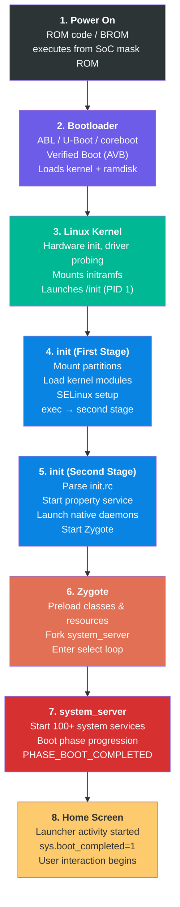

### 4.1.2 逐阶段总结

**阶段 1：上电（ROM 代码）**

当按下电源键时，SoC（System-on-Chip，片上系统）开始执行其内部掩膜 ROM 中的代码。这是一段在制造过程中烧录到芯片内部的小型、不可变的代码。该 ROM 代码初始化最基础的硬件（时钟发生器、内存控制器）。随后它会从一个固定的存储位置（通常是 eMMC/UFS 启动分区的开头）加载主引导加载程序，并将控制权移交给它。该阶段完全是厂商特定的，不属于 AOSP 的一部分。

**阶段 2：引导加载程序（ABL/U-Boot）**

引导加载程序是第一个可以在设备之间有所不同的软件组件。在现代 Android 设备上，这通常是高通平台的 Android Bootloader（ABL），或其他各种 SoC 使用的 U-Boot。引导加载程序的主要职责包括：

- 初始化 DRAM 和关键外设
- 实现 Android Verified Boot（AVB）以确保系统完整性
- 选择正确的启动槽位（A/B 分区）
- 加载 Linux 内核、ramdisk 和 DTB（设备树二进制文件）
- 设置内核命令行参数
- 将控制权移交给内核

**阶段 3：Linux 内核**

Linux 内核初始化硬件子系统，探测设备驱动程序，并挂载初始 RAM 文件系统（initramfs）。然后它启动第一个用户空间进程：`/init`，该进程以 PID 1 运行。内核在启动期间的行为由从引导加载程序和设备树传入的命令行参数控制。

**阶段 4：init（第一阶段）**

init 进程分两个阶段执行。第一阶段 init 在最小化环境中从 ramdisk 运行。它的任务是加载内核模块并挂载必要的分区（`/system`、`/vendor`、`/product`）。然后它对自己调用 `exec()`，作为 `init selinux_setup`。这是一个独立的阶段，在调用 exec 进入第二阶段 init 之前加载 SELinux 策略。

这种两阶段设计的存在是因为第一阶段 init 需要在加载 SELinux 策略之前运行，而第二阶段 init 在完整的 SELinux 强制管控下运行。

**阶段 5：init（第二阶段）**

第二阶段 init 是主要的用户空间编排器。它解析声明服务和动作的 init.rc 配置文件。它启动属性服务（Android 的键值配置系统）。它启动原生守护进程（surfaceflinger、servicemanager、logd）。最后，它启动 Zygote。

**阶段 6：Zygote**

Zygote 是一个专门的进程，它将 Android 框架的核心类和资源预加载到内存中，然后进入一个循环等待 fork 请求。每个 Android 应用进程都是通过从 Zygote fork 而创建的，这使得每个应用都能以预先初始化的框架代码进行“热启动”。

**阶段 7：system_server**

`system_server` 是从 Zygote fork 出来的第一个进程。它承载了 100 多个系统服务——ActivityManagerService、PackageManagerService、WindowManagerService 等等。这些服务经过精心排序的启动阶段推进，每个阶段都会解锁更多功能。

**阶段 8：主屏幕**

一旦 system_server 到达 `PHASE_BOOT_COMPLETED`，系统就已准备就绪。启动器 activity 被启动，启动动画被关闭。属性 `sys.boot_completed` 被设置为 `1`。这向所有组件发出信号，表明设备已完全正常运行。

---

## 4.2 引导加载程序与验证启动

### 4.2.1 Android Bootloader 架构

Android 并不强制要求特定的引导加载程序实现。相反，它定义了一组任何引导加载程序都必须满足的要求：

1. **A/B 槽位管理**：通过双启动槽位支持无缝更新
2. **验证启动**：实现 Android Verified Boot（AVB）协议
3. **Fastboot 协议**：支持 fastboot 烧录协议
4. **内核加载**：能够加载和解压缩内核、ramdisk 和 DTB
5. **启动模式选择**：支持正常启动、恢复、fastboot 和充电模式

Android 生态中最常见的引导加载程序实现有：

- **ABL（Android Bootloader）**：高通用于骁龙平台的基于 UEFI 的引导加载程序
- **U-Boot**：许多 ARM SoC 厂商使用的开源引导加载程序
- **coreboot**：一些源自 Chromebook 的 Android 设备使用

### 4.2.2 启动分区

现代 Android 设备使用多分区启动映像布局。理解这些分区对于任何从事启动工作的人来说都至关重要：

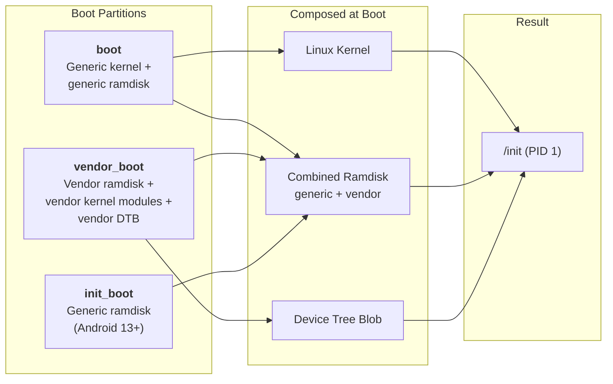

**boot 分区**：包含 Linux 内核映像，以及在 Android 13 之前的通用 ramdisk。启动映像头部（定义在 `system/tools/mkbootimg/include/bootimg/bootimg.h` 中）包含关于内核大小、ramdisk 大小、页大小、操作系统版本和头部版本的元数据。

**vendor_boot 分区**：在 Android 11（启动映像头部 v3）中引入。包含供应商 ramdisk（带有设备特定的 init 文件和固件）、供应商内核模块和设备树二进制文件。该分区允许供应商独立于通用启动映像更新其启动组件。

**init_boot 分区**：在 Android 13（启动映像头部 v4）中引入。将通用 ramdisk 从 boot 分区移出，放入其自己的分区。这使得可以通过 GKI（通用内核映像）更新独立地更新通用 ramdisk（其中包含第一阶段 init）。

### 4.2.3 Android Verified Boot（AVB）

Android Verified Boot 确保所有被执行的代码和数据都来自可信来源。AVB 实现位于 `external/avb/` 中，是 Android 启动链中最关键的安全组件之一。

#### AVB 库结构

核心 AVB 库位于 `external/avb/libavb/`。主头文件是 `external/avb/libavb/libavb.h`，它包含了所有组件头文件：

| 头文件 | 用途 |
|---|---|
| `avb_vbmeta_image.h` | VBMeta 映像格式与解析 |
| `avb_slot_verify.h` | 槽位验证逻辑 |
| `avb_crypto.h` | 密码学原语 |
| `avb_hashtree_descriptor.h` | Hashtree（dm-verity）描述符 |
| `avb_hash_descriptor.h` | 启动映像的哈希描述符 |
| `avb_chain_partition_descriptor.h` | 跨分区的信任链 |
| `avb_ops.h` | 引导加载程序操作接口 |
| `avb_footer.h` | 附加到已验证分区的页脚 |

#### VBMeta 映像结构

VBMeta 映像是 AVB 的基石。如 `external/avb/libavb/avb_vbmeta_image.h`（第 64-116 行）中所定义：

```
+-----------------------------------------+
| Header data - fixed size (256 bytes)    |
+-----------------------------------------+
| Authentication data - variable size     |
+-----------------------------------------+
| Auxiliary data - variable size          |
+-----------------------------------------+
```

头部恰好是 `AVB_VBMETA_IMAGE_HEADER_SIZE`（256）字节，并以魔术字节 `AVB0`（`AVB_MAGIC`）开头。根据源文件第 42-46 行：

```c
// external/avb/libavb/avb_vbmeta_image.h, lines 42-46
#define AVB_VBMETA_IMAGE_HEADER_SIZE 256
#define AVB_MAGIC "AVB0"
#define AVB_MAGIC_LEN 4
#define AVB_RELEASE_STRING_SIZE 48
```

vbmeta 标志控制验证行为。根据第 59-62 行：

```c
// external/avb/libavb/avb_vbmeta_image.h, lines 59-62
typedef enum {
  AVB_VBMETA_IMAGE_FLAGS_HASHTREE_DISABLED = (1 << 0),
  AVB_VBMETA_IMAGE_FLAGS_VERIFICATION_DISABLED = (1 << 1)
} AvbVBMetaImageFlags;
```

`HASHTREE_DISABLED` 关闭 dm-verity 运行时验证，而 `VERIFICATION_DISABLED` 禁用包括描述符解析在内的所有验证。这两个标志只能在设备解锁时设置。

#### 验证过程

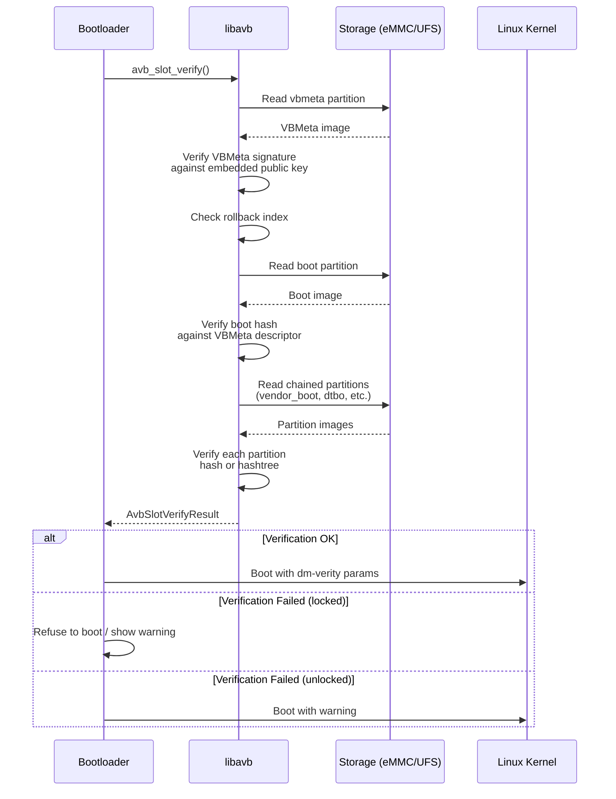

核心函数是 `avb_slot_verify()`，定义在 `external/avb/libavb/avb_slot_verify.h` 中。结果代码（第 48-58 行）准确告诉引导加载程序发生了什么：

```c
// external/avb/libavb/avb_slot_verify.h, lines 48-58
typedef enum {
  AVB_SLOT_VERIFY_RESULT_OK,
  AVB_SLOT_VERIFY_RESULT_ERROR_OOM,
  AVB_SLOT_VERIFY_RESULT_ERROR_IO,
  AVB_SLOT_VERIFY_RESULT_ERROR_VERIFICATION,
  AVB_SLOT_VERIFY_RESULT_ERROR_ROLLBACK_INDEX,
  AVB_SLOT_VERIFY_RESULT_ERROR_PUBLIC_KEY_REJECTED,
  AVB_SLOT_VERIFY_RESULT_ERROR_INVALID_METADATA,
  AVB_SLOT_VERIFY_RESULT_ERROR_UNSUPPORTED_VERSION,
  AVB_SLOT_VERIFY_RESULT_ERROR_INVALID_ARGUMENT
} AvbSlotVerifyResult;
```

每个结果代码对应一种特定的失败模式：

- `ERROR_VERIFICATION`：哈希不匹配——分区内容被篡改
- `ERROR_ROLLBACK_INDEX`：有人试图烧录一个更旧的、可能易受攻击的映像（回滚保护）
- `ERROR_PUBLIC_KEY_REJECTED`：签名密钥不在设备的可信密钥集中
- `ERROR_UNSUPPORTED_VERSION`：vbmeta 映像需要更新版本的 libavb

#### dm-verity 和 Hashtree 验证

对于像 `system` 和 `vendor` 这样的大型分区，在启动时计算整个分区的哈希会极其缓慢。相反，AVB 使用 **dm-verity**，这是一个 Linux 内核 device-mapper 目标，它在数据块从磁盘读取时即时验证它们。

dm-verity 使用 Merkle 树（哈希树）结构：

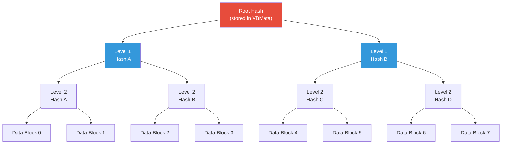

当一个数据块被读取时，内核计算它的哈希并沿树向上走，以对照根哈希进行验证。如果任何块被修改，哈希不匹配就会被检测到，内核根据配置的错误模式采取行动。

hashtree 错误模式定义在 `avb_slot_verify.h`（第 89-96 行）中：

```c
// external/avb/libavb/avb_slot_verify.h, lines 89-96
typedef enum {
  AVB_HASHTREE_ERROR_MODE_RESTART_AND_INVALIDATE,
  AVB_HASHTREE_ERROR_MODE_RESTART,
  AVB_HASHTREE_ERROR_MODE_EIO,
  AVB_HASHTREE_ERROR_MODE_LOGGING,
  AVB_HASHTREE_ERROR_MODE_MANAGED_RESTART_AND_EIO,
  AVB_HASHTREE_ERROR_MODE_PANIC
} AvbHashtreeErrorMode;
```

现代生产设备使用 `MANAGED_RESTART_AND_EIO`：当 dm-verity 检测到损坏时，设备默认重启。在报告一次由 hashtree 损坏引起的重启后，模式会切换到 `EIO`。在此模式下，设备向应用程序返回 I/O 错误而不是再次重启。这个状态机通过持久值 `avb.managed_verity_mode` 来跟踪。当检测到新的操作系统时，设备会切换回重启模式。

`RESTART_AND_INVALIDATE` 在检测到损坏时使当前槽位失效，并要求内核中启用 `CONFIG_DM_VERITY_AVB`。它是一种为 Android Things 设备保留的传统模式，不建议用于其他形态。`LOGGING` 模式仅在明确允许验证错误（已解锁设备）时可用，纯粹用于开发和调试。

#### 回滚保护

回滚保护防止攻击者烧录一个已知漏洞的旧版本 Android。该机制通过回滚索引工作：

1. 每个 vbmeta 映像包含一个回滚索引——一个单调递增的版本号
2. 设备将可接受的最小回滚索引存储在防篡改存储中（通常是 eMMC/UFS 上的 RPMB）
3. 在验证期间，如果 vbmeta 的回滚索引小于存储的最小值，则返回 `AVB_SLOT_VERIFY_RESULT_ERROR_ROLLBACK_INDEX`
4. 在成功启动后，存储的最小值被更新为与当前回滚索引匹配

### 4.2.4 恢复模式

Android 恢复系统提供了一个最小化环境，用于应用系统更新（OTA）和执行恢复出厂设置。恢复代码位于 `bootable/recovery/` 中。

恢复通过启动模式运行。`BootMode` 枚举声明在 `system/core/init/util.h`（第 43-47 行）中，由第一阶段和第二阶段 init 共享：

```cpp
// system/core/init/util.h, lines 43-47
enum class BootMode {
    NORMAL_MODE,
    RECOVERY_MODE,
    CHARGER_MODE,
};
```

在恢复模式时，第一阶段 init 走一条不同的路径——跳过正常的第一阶段挂载过程。根据 `first_stage_init.cpp` 第 535-536 行：

```cpp
// system/core/init/first_stage_init.cpp, lines 535-536
if (IsRecoveryMode()) {
    LOG(INFO) << "First stage mount skipped (recovery mode)";
```

现代 A/B 设备从常规 boot 分区启动恢复 ramdisk，而不是从单独的恢复分区。`ForceNormalBoot()` 函数（第 116 行）确定是否从恢复重定向到正常启动：

```cpp
// system/core/init/first_stage_init.cpp, lines 116-119
bool ForceNormalBoot(const std::string& cmdline, const std::string& bootconfig) {
    return bootconfig.find("androidboot.force_normal_boot = \"1\"") != std::string::npos ||
           cmdline.find("androidboot.force_normal_boot=1") != std::string::npos;
}
```

这允许同一个启动映像同时服务于正常启动和恢复启动，由 bootconfig 参数控制走哪条路径。

---

## 4.3 Init：第一个进程

Init 是 Android 中最重要的单个用户空间进程。它是 PID 1——所有其他进程的祖先。如果 init 崩溃，内核会 panic。init 负责：

- 挂载文件系统
- 加载 SELinux 策略
- 启动所有原生守护进程
- 管理 Android 属性系统
- 监控并重启崩溃的服务
- 处理重启和关机请求

### 4.3.1 两阶段设计

Android 的 init 使用两阶段架构。一个根本的“先有鸡还是先有蛋”问题驱动着这一设计。SELinux 策略位于 `/system` 分区上，但第一阶段 init 必须在挂载任何分区之前运行。这是因为第一阶段 init 正是负责挂载它们的进程。解决方案是将 init 拆分为两个阶段，作为同一个二进制文件的两次独立执行来运行。

入口点是 `system/core/init/main.cpp`。这个单一的 main() 函数充当 init 所有执行模式的调度点：

```cpp
// system/core/init/main.cpp, lines 53-87
int main(int argc, char** argv) {
#if __has_feature(address_sanitizer)
    __asan_set_error_report_callback(AsanReportCallback);
#elif __has_feature(hwaddress_sanitizer)
    __hwasan_set_error_report_callback(AsanReportCallback);
#endif
    // Boost prio which will be restored later
    setpriority(PRIO_PROCESS, 0, -20);
    if (!strcmp(basename(argv[0]), "ueventd")) {
        return ueventd_main(argc, argv);
    }

    if (argc > 1) {
        if (!strcmp(argv[1], "subcontext")) {
            android::base::InitLogging(argv, &android::base::KernelLogger);
            const BuiltinFunctionMap& function_map = GetBuiltinFunctionMap();

            return SubcontextMain(argc, argv, &function_map);
        }

        if (!strcmp(argv[1], "selinux_setup")) {
            return SetupSelinux(argv);
        }

        if (!strcmp(argv[1], "second_stage")) {
            return SecondStageMain(argc, argv);
        }
    }

#if defined(FIRST_STAGE_INIT) || defined(RECOVERY)
    return FirstStageMain(argc, argv);
#else
    LOG(FATAL) << "Second-stage init requires an argument to main()";
#endif
}
```

这表明同一个 `main()` 根据被调用的方式承担了五种不同的角色：

| 调用方式 | 函数 | 用途 |
|---|---|---|
| `init`（无参数） | `FirstStageMain()` | 第一阶段初始化（仅第一阶段/recovery 构建） |
| `init selinux_setup` | `SetupSelinux()` | 加载 SELinux 策略 |
| `init second_stage` | `SecondStageMain()` | init 主循环 |
| `init subcontext` | `SubcontextMain()` | SELinux 子上下文工作进程 |
| `ueventd`（符号链接） | `ueventd_main()` | 设备节点管理器 |

注意 fall-through 情形周围的预处理器保护：通往 `FirstStageMain()` 的无参数路径只在 `main.cpp` 编译时定义了 `FIRST_STAGE_INIT` 或 `RECOVERY` 时才存在。`/system/bin/init` 二进制文件（在 `system/core/init/Android.bp` 中不带这些定义构建为 `init_second_stage`）在不带参数调用时会以 `LOG(FATAL)` 中止。

注意第 60 行：进程优先级被立即提升到 -20（最高优先级），以确保 init 在启动期间获得尽可能多的 CPU 时间。这个优先级稍后会在 `init.cpp` 的第 1289 行、进入主事件循环之前被恢复为 0（正常）。

第一阶段 init 在 `system/core/init/first_stage_main.cpp` 中有一个独立的最小化入口点：

```cpp
// system/core/init/first_stage_main.cpp, lines 19-21
int main(int argc, char** argv) {
    return android::init::FirstStageMain(argc, argv);
}
```

之所以存在这个入口点，是因为第一阶段 init 被链接为一个独立的、更小的二进制文件，位于 ramdisk 中。完整的 `main.cpp` 二进制文件位于 `/system` 分区上。

### 4.3.2 第一阶段 Init：构建基础

第一阶段 init 的实现位于 `system/core/init/first_stage_init.cpp`。`FirstStageMain()` 函数（从第 338 行开始）是整个 Android 中最关键的代码之一。如果它失败，设备将无法启动。

#### 阶段 1：紧急基础设施

init 做的第一件事是记录启动时钟的起始时间，然后构建与外界通信所需的最小化文件系统基础设施：

```cpp
// system/core/init/first_stage_init.cpp, lines 338-352
int FirstStageMain(int argc, char** argv) {
    boot_clock::time_point start_time = boot_clock::now();

    std::vector<std::pair<std::string, int>> errors;
#define CHECKCALL(x) \
    if ((x) != 0) errors.emplace_back(#x " failed", errno);

    // Clear the umask.
    umask(0);

    CHECKCALL(clearenv());
    CHECKCALL(setenv("PATH", _PATH_DEFPATH, 1));
    // Get the basic filesystem setup we need put together in the initramdisk
    // on / and then we'll let the rc file figure out the rest.
    CHECKCALL(mount("tmpfs", "/dev", "tmpfs", MS_NOSUID, "mode=0755"));
```

`CHECKCALL` 宏值得关注：它不是在第一次失败时就中止，而是收集所有错误并在稍后报告。这是因为此时日志尚未初始化。我们甚至还没有 `/dev/kmsg`，因此在基本文件系统挂载完成之前无法报告错误。（注意，在 Android 17 中，reboot-on-panic 信号处理程序不再安装在 `FirstStageMain()` 的最顶部。它们稍后才会被安装，只有在设备创建完成且设备并非已经在尝试启动新槽位之后。参见阶段 3。）

关键文件系统的设置继续进行设备节点和伪文件系统（第 353-405 行）：

```cpp
// system/core/init/first_stage_init.cpp, lines 353-382
CHECKCALL(mkdir("/dev/pts", 0755));
CHECKCALL(mkdir("/dev/socket", 0755));
CHECKCALL(mkdir("/dev/dm-user", 0755));
CHECKCALL(mount("devpts", "/dev/pts", "devpts", 0, NULL));
CHECKCALL(mount("proc", "/proc", "proc", 0,
    "hidepid=2,gid=" MAKE_STR(AID_READPROC)));
// ...
CHECKCALL(mount("sysfs", "/sys", "sysfs", 0, NULL));
CHECKCALL(mount("selinuxfs", "/sys/fs/selinux", "selinuxfs", 0, NULL));

CHECKCALL(mknod("/dev/kmsg", S_IFCHR | 0600, makedev(1, 11)));
// ...
CHECKCALL(mknod("/dev/random", S_IFCHR | 0666, makedev(1, 8)));
CHECKCALL(mknod("/dev/urandom", S_IFCHR | 0666, makedev(1, 9)));
CHECKCALL(mknod("/dev/ptmx", S_IFCHR | 0666, makedev(5, 2)));
CHECKCALL(mknod("/dev/null", S_IFCHR | 0666, makedev(1, 3)));
```

注意这里的安全意识选择：

- `/proc` 以 `hidepid=2` 挂载，这会向非 root 用户隐藏其他进程的信息
- `/dev/kmsg` 的模式为 0600（仅 root），防止非特权访问内核消息
- 在 `/sys/fs/selinux` 上的 `selinuxfs` 挂载是为之后加载 SELinux 策略所必需的

只有在这些挂载完成之后，init 才能真正记录消息：

```cpp
// system/core/init/first_stage_init.cpp, lines 413-425
SetStdioToDevNull(argv);
// Now that tmpfs is mounted on /dev and we have /dev/kmsg, we can actually
// talk to the outside world...
InitKernelLogging(argv);

if (!errors.empty()) {
    for (const auto& [error_string, error_errno] : errors) {
        LOG(ERROR) << error_string << " " << strerror(error_errno);
    }
    LOG(FATAL) << "Init encountered errors starting first stage, aborting";
}

LOG(INFO) << "init first stage started!";
```

#### 阶段 2：内核模块加载

现代 Android 设备使用模块化内核，其中许多驱动程序作为内核模块加载，而不是编译进内核。第一阶段 init 必须加载这些模块，然后才能挂载分区（因为存储控制器驱动程序本身可能就是一个模块）：

```cpp
// system/core/init/first_stage_init.cpp, lines 453-470
boot_clock::time_point module_start_time = boot_clock::now();
int module_count = 0;
BootMode boot_mode = GetBootMode(cmdline, bootconfig);
if (!LoadKernelModules(boot_mode, want_console, want_parallel_mode, want_parallel_test,
                       module_count)) {
    if (want_console != FirstStageConsoleParam::DISABLED) {
        LOG(ERROR) << "Failed to load kernel modules, starting console";
    } else {
        LOG(FATAL) << "Failed to load kernel modules";
    }
}
if (module_count > 0) {
    auto module_elapse_time = std::chrono::duration_cast<std::chrono::milliseconds>(
            boot_clock::now() - module_start_time);
    setenv(kEnvInitModuleDurationMs,
           std::to_string(module_elapse_time.count()).c_str(), 1);
    LOG(INFO) << "Loaded " << module_count << " kernel modules took "
              << module_elapse_time.count() << " ms";
}
```

在 Android 17 中，并行模块加载不再是一个简单的开/关布尔值。`want_parallel_mode` 在上面的调用之前（第 439-451 行）从 bootconfig 中选择。`androidboot.load_modules_parallel` 可以是 `"true"`（NORMAL）、`"performance"`（PERFORMANCE）或 `"conservative"`（CONSERVATIVE）。每个值设置 `libmodprobe` 在依赖图上并行化的激进程度。NONE 是默认值。

单独的 `androidboot.load_modules_parallel_test=true` 启用测试模式。`LoadKernelModules()` 函数（第 218-296 行）在 `/lib/modules/` 下搜索模块目录，匹配正在运行的内核版本，并应用所选的并行模式：

```cpp
// system/core/init/first_stage_init.cpp, lines 287-290
bool retval = (want_parallel_mode != Modprobe::LoadParallelMode::NONE)
                      ? m.LoadModulesParallel(std::thread::hardware_concurrency(),
                                              want_parallel_mode, want_parallel_test)
                      : m.LoadListedModules(!want_console);
```

在 Android 17 中，模块目录搜索还具备页大小感知能力。它会跳过带 `_16k` 或 `_64k` 后缀的目录，除非该后缀与正在运行的内核的页大小匹配。因此，单个 `/lib/modules` 树可以并列提供 4K、16K 和 64K 模块集（`GetPageSizeSuffix()`，第 237-263 行）。

模块加载列表因启动模式而异。充电模式加载的模块较少，因为设备只需要显示充电动画：

```cpp
// system/core/init/first_stage_init.cpp, lines 190-212
std::string GetModuleLoadList(BootMode boot_mode, const std::string& dir_path) {
    std::string module_load_file;
    switch (boot_mode) {
        case BootMode::NORMAL_MODE:
            module_load_file = "modules.load";
            break;
        case BootMode::RECOVERY_MODE:
            module_load_file = "modules.load.recovery";
            break;
        case BootMode::CHARGER_MODE:
            module_load_file = "modules.load.charger";
            break;
    }
    // ...
}
```

#### 阶段 3：挂载分区

在内核模块（包括存储驱动程序）加载完成后，第一阶段 init 现在可以挂载必要的分区了。在 Android 17 中，休眠-恢复钩子会先运行。`MaybeResumeFromHibernation()`（第 472 行）检查 bootconfig 中的 `androidboot.hibernation_resume_device`。如果存在，它会被写入 `/sys/power/resume`。这让内核可以恢复休眠映像而不是冷启动。然后第一阶段挂载运行：

```cpp
// system/core/init/first_stage_init.cpp, lines 538-553
if (!fsm) {
    fsm = CreateFirstStageMount(cmdline);
}
if (!fsm) {
    LOG(FATAL) << "FirstStageMount not available";
}

if (!created_devices && !fsm->DoCreateDevices()) {
    LOG(FATAL) << "Failed to create devices required for first stage mount";
} else if (REBOOT_BOOTLOADER_ON_PANIC && !AttemptingToBootNewSlot()) {
    InstallRebootSignalHandlers();
}

if (!fsm->DoFirstStageMount()) {
    LOG(FATAL) << "Failed to mount required partitions early ...";
}
```

注意在 Android 17 中 reboot-on-panic 处理程序是在哪里安装的。它只发生在所需的块设备存在之后。它也只发生在设备*并非*已经在尝试启动新的 A/B 槽位（`AttemptingToBootNewSlot()`）时。更早地安装它们可能会在更新失败期间冒险重启回到已知有问题的槽位。

dm-verity 就是在这里配置的。Android 17 将第一阶段挂载拆分到三个文件中。`system/core/init/first_stage_mount.cpp` 中的 `FirstStageMount` 基类持有与设备无关的逻辑（读取 fstab、创建 device-mapper 节点、挂载分区）。Android 特定行为位于 `system/core/init/first_stage_mount_android.cpp` 中的 `FirstStageMountAndroid` 子类。这种行为包括逻辑/超级分区、DSU、snapuserd、overlay 和 verity。

工厂方法 `FirstStageMount::Create()`（在 `first_stage_mount_android.cpp`，第 48 行）构建正确的子类；Microdroid 使用单独的 `first_stage_mount_microdroid.cpp`。这一重构将仅属于 Android 的挂载代码与轻量级的 Microdroid VM 路径隔离开来。

#### 阶段 4：移交给 SELinux 设置

在分区挂载完成后，第一阶段 init 为 SELinux 过渡做准备，并 `exec()` 自己作为 "selinux_setup" 阶段：

```cpp
// system/core/init/first_stage_init.cpp, lines 571-589
const char* path = "/system/bin/init";
const char* args[] = {path, "selinux_setup", nullptr};
auto fd = open("/dev/kmsg", O_WRONLY | O_CLOEXEC);
dup2(fd, STDOUT_FILENO);
dup2(fd, STDERR_FILENO);
close(fd);
// (HWASan builds also re-export HWASAN_OPTIONS here.)
execv(path, const_cast<char**>(args));

// execv() only returns if an error happened, in which case we
// panic and never fall through this conditional.
PLOG(FATAL) << "execv(\"" << path << "\") failed";
```

注意关键细节：`execv()` 调用用 `/system/bin/init` 中完整的 init 二进制文件替换第一阶段 init 二进制文件（来自 ramdisk）。现在这是可能的，因为 `/system` 已经挂载。在 exec 之前，ramdisk 文件系统会被释放以回收内存（第 563 行）。第一阶段启动时间也被导出到环境中（通过 `kEnvFirstStageStartedAt`）。然后第二阶段可以为 bootstat 记录阶段启动时间：

```cpp
// system/core/init/first_stage_init.cpp, lines 562-564
if (old_root_dir && old_root_info.st_dev != new_root_info.st_dev) {
    FreeRamdisk(old_root_dir.get(), old_root_info.st_dev);
}
```

### 4.3.3 SELinux 设置：安全过渡

SELinux 设置阶段实现在 `system/core/init/selinux.cpp` 中。该文件以一段出色的注释块（第 18-50 行）开头，解释了整个 SELinux 策略加载策略。两个关键概念是：

1. **整体式策略**：传统设备使用单个 `/sepolicy` 文件
2. **拆分策略**：Treble 设备组合来自 `/system`、`/vendor`、`/product` 和 `/odm` 分区的策略

`SetupSelinux()` 函数（第 785-841 行）编排这一过程：

```cpp
// system/core/init/selinux.cpp, lines 785-841 (abridged)
int SetupSelinux(char** argv) {
    SetStdioToDevNull(argv);
    InitKernelLogging(argv);
    // ...
    SelinuxSetupKernelLogging();

    bool use_overlays = EarlySetupOverlays();

    if (IsMicrodroid()) {
        LoadSelinuxPolicyMicrodroid();
    } else {
        LoadSelinuxPolicyAndroid();
    }

    SelinuxSetEnforcement();
    // ...
    if (selinux_android_restorecon("/system/bin/init", 0) == -1) {
        PLOG(FATAL) << "restorecon failed of /system/bin/init failed";
    }
    // ...
    const char* path = "/system/bin/init";
    const char* args[] = {path, "second_stage", nullptr};
    execv(path, const_cast<char**>(args));
```

`LoadSelinuxPolicyAndroid()` 函数（第 690-713 行）展示了当 snapuserd（Virtual A/B 快照守护进程）正在运行时所需的精心五步流程：

```cpp
// system/core/init/selinux.cpp, lines 675-713 (comment + function)
// We use a five-step process to address this:
//  (1) Read the policy into a string, with snapuserd running.
//  (2) Rewrite the snapshot device-mapper tables, to generate new dm-user
//      devices and to flush I/O.
//  (3) Kill snapuserd, which no longer has any dm-user devices to attach to.
//  (4) Load the sepolicy and issue critical restorecons in /dev, carefully
//      avoiding anything that would read from /system.
//  (5) Re-launch snapuserd and attach it to the dm-user devices from step (2).
void LoadSelinuxPolicyAndroid() {
    MountMissingSystemPartitions();

    LOG(INFO) << "Opening SELinux policy";
    std::string policy;
    ReadPolicy(&policy);

    auto snapuserd_helper = SnapuserdSelinuxHelper::CreateIfNeeded();
    if (snapuserd_helper) {
        snapuserd_helper->StartTransition();
    }

    LoadSelinuxPolicy(policy);

    if (snapuserd_helper) {
        snapuserd_helper->FinishTransition();
        snapuserd_helper = nullptr;
    }
}
```

在加载 SELinux 策略并设置强制模式之后，`SetupSelinux()` 对 `/system/bin/init` 本身执行一次 `restorecon`。这让下一次 `exec()` 能够将 init 从内核域过渡到正确的 `init` SELinux 域。然后它 exec 进入第二阶段 init。

### 4.3.4 完整的第一阶段流程

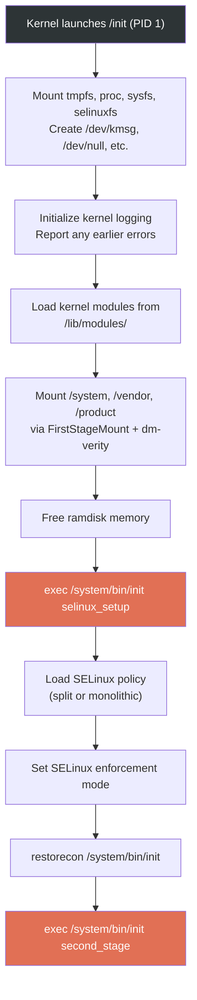

### 4.3.5 第二阶段 Init：主事件

第二阶段 init 是真正的编排开始的地方。`system/core/init/init.cpp` 中的 `SecondStageMain()` 函数（从第 1066 行开始）是 Android 用户空间启动的核心。

#### 初始设置

```cpp
// system/core/init/init.cpp, lines 1066-1069
int SecondStageMain(int argc, char** argv) {
    if (REBOOT_BOOTLOADER_ON_PANIC && !AttemptingToBootNewSlot()) {
        InstallRebootSignalHandlers();
    }

    boot_clock::time_point start_time = boot_clock::now();

    trigger_shutdown = [](const std::string& command) {
        shutdown_state.TriggerShutdown(command);
    };

    SetStdioToDevNull(argv);
    InitKernelLogging(argv);
    LOG(INFO) << "init second stage started!";
```

第二阶段 init 然后执行一系列快速的设置步骤：

1. **属性初始化**（第 1126 行）：`PropertyInit()` 设置属性系统，即 Android 的全局键值配置存储

2. **SELinux 上下文恢复**（第 1140-1141 行）：恢复第一阶段期间创建的 `/dev` 节点上的安全标签

3. **Epoll 事件循环设置**（第 1143-1154 行）：创建将驱动 init 主循环的事件循环，注册 SIGCHLD（子进程死亡）和 SIGTERM 的信号处理程序

4. **属性服务启动**（第 1155 行）：`StartPropertyService()` 启动属性服务线程，处理来自其他进程的属性设置请求

5. **启动脚本加载**（第 1208 行）：`LoadBootScripts()` 解析所有 init.rc 文件

```cpp
// system/core/init/init.cpp, lines 1126-1208
PropertyInit();

// Umount second stage resources after property service has read the .prop files.
UmountSecondStageRes();
// ...
MountExtraFilesystems();

// Now set up SELinux for second stage.
SelabelInitialize();
SelinuxRestoreContext();

Epoll epoll;
if (auto result = epoll.Open(); !result.ok()) {
    PLOG(FATAL) << result.error();
}
// ...
InstallSignalFdHandler(&epoll);
InstallInitNotifier(&epoll);
StartPropertyService(&property_fd);
// ...
ActionManager& am = ActionManager::GetInstance();
ServiceList& sm = ServiceList::GetInstance();

LoadBootScripts(am, sm);
```

#### 加载启动脚本

`LoadBootScripts()` 函数是 init.rc 文件被解析的地方：

```cpp
// system/core/init/init.cpp, lines 347-371
static void LoadBootScripts(ActionManager& action_manager, ServiceList& service_list) {
    Parser parser = CreateParser(action_manager, service_list);

    std::string bootscript = GetProperty("ro.boot.init_rc", "");
    if (bootscript.empty()) {
        parser.ParseConfig("/system/etc/init/hw/init.rc");
        if (!parser.ParseConfig("/system/etc/init")) {
            late_import_paths.emplace_back("/system/etc/init");
        }
        parser.ParseConfig("/system_ext/etc/init");
        if (!parser.ParseConfig("/vendor/etc/init")) {
            late_import_paths.emplace_back("/vendor/etc/init");
        }
        if (!parser.ParseConfig("/odm/etc/init")) {
            late_import_paths.emplace_back("/odm/etc/init");
        }
        if (!parser.ParseConfig("/product/etc/init")) {
            late_import_paths.emplace_back("/product/etc/init");
        }
    } else {
        parser.ParseConfig(bootscript);
    }
}
```

Init.rc 文件按特定顺序从六个位置加载：

1. `/system/etc/init/hw/init.rc` —— 主 init.rc 文件
2. `/system/etc/init/` —— 系统分区服务
3. `/system_ext/etc/init/` —— 系统扩展服务
4. `/vendor/etc/init/` —— 供应商服务
5. `/odm/etc/init/` —— ODM（原始设计制造商）服务
6. `/product/etc/init/` —— 产品特定服务

解析器识别三种节类型（来自 `CreateParser()`，第 283-292 行）：

```cpp
// system/core/init/init.cpp, lines 283-292
Parser CreateParser(ActionManager& action_manager, ServiceList& service_list) {
    Parser parser;

    parser.AddSectionParser("service",
                            std::make_unique<ServiceParser>(&service_list, GetSubcontext()));
    parser.AddSectionParser("on",
                            std::make_unique<ActionParser>(&action_manager, GetSubcontext()));
    parser.AddSectionParser("import", std::make_unique<ImportParser>(&parser));

    return parser;
}
```

#### 动作队列和触发器序列

在所有脚本加载完成后，init 为驱动整个启动的触发器序列排队：

```cpp
// system/core/init/init.cpp, lines 1238-1286
am.QueueBuiltinAction(SetupCgroupsAction, "SetupCgroups");
am.QueueEventTrigger("early-init");
am.QueueBuiltinAction(ConnectEarlyStageSnapuserdAction, "ConnectEarlyStageSnapuserd");

// Queue an action that waits for coldboot done so we know ueventd has set up
// all of /dev...
am.QueueBuiltinAction(wait_for_coldboot_done_action, "wait_for_coldboot_done");
// ...
// ... so that we can start queuing up actions that require stuff from /dev.
am.QueueBuiltinAction(SetMmapRndBitsAction, "SetMmapRndBits");
// ...

// Trigger all the boot actions to get us started.
am.QueueEventTrigger("init");

// Don't mount filesystems or start core system services in charger mode.
// (bootmode was computed earlier: BootMode bootmode = GetBootMode(); -- line 1180)
if (bootmode == BootMode::CHARGER_MODE) {
    am.QueueEventTrigger("charger");
} else {
    am.QueueEventTrigger("late-init");
}

// Run all property triggers based on current state of the properties.
am.QueueBuiltinAction(queue_property_triggers_action, "queue_property_triggers");
```

这建立了触发器顺序：`early-init` -> `init` -> `late-init`，这是 init.rc 触发链的骨干。

#### 主事件循环

init 然后进入它的无限事件循环：

```cpp
// system/core/init/init.cpp, lines 1289-1331
// Restore prio before main loop
setpriority(PRIO_PROCESS, 0, 0);
while (true) {
    const boot_clock::time_point far_future = boot_clock::time_point::max();
    boot_clock::time_point next_action_time = far_future;

    auto shutdown_command = shutdown_state.CheckShutdown();
    if (shutdown_command) {
        LOG(INFO) << "Got shutdown_command '" << *shutdown_command
                  << "' Calling HandlePowerctlMessage()";
        HandlePowerctlMessage(*shutdown_command);
    }

    if (!(prop_waiter_state.MightBeWaiting() || Service::is_exec_service_running())) {
        am.ExecuteOneCommand();
        if (am.HasMoreCommands()) {
            next_action_time = boot_clock::now();
        }
    }

    if (!IsShuttingDown()) {
        auto next_process_action_time = HandleProcessActions();
        if (next_process_action_time) {
            next_action_time = std::min(next_action_time, *next_process_action_time);
        }
    }

    std::optional<std::chrono::milliseconds> epoll_timeout;
    if (next_action_time != far_future) {
        epoll_timeout = std::chrono::ceil<std::chrono::milliseconds>(
                std::max(next_action_time - boot_clock::now(), 0ns));
    }
    auto epoll_result = epoll.Wait(epoll_timeout);
    if (!epoll_result.ok()) {
        LOG(ERROR) << epoll_result.error();
    }
    if (!IsShuttingDown()) {
        HandleControlMessages();
        SetUsbController(false);
    }
}
```

这个循环的每次迭代：

1. 检查待处理的关机命令
2. 执行一个排队的动作（如果不在等待属性或 exec 服务）
3. 处理进程超时和重启
4. 在 epoll 上等待信号、属性变化或超时

这种单线程、事件驱动的设计是有意为之的：它确保动作以确定性的顺序执行，并防止多线程执行可能发生的竞态条件。

### 4.3.6 Android 属性系统

属性系统是 Android 的全局键值存储，实现在 `system/core/init/property_service.cpp` 中。属性是启动期间配置和进程间通信的主要机制。

属性遵循决定其行为的命名约定：

| 前缀 | 行为 |
|---|---|
| `ro.*` | 只读；只能设置一次（通常在启动期间） |
| `persist.*` | 持久化到磁盘；重启后保留 |
| `sys.*` | 系统属性；通用 |
| `init.svc.*` | 由 init 自动设置以跟踪服务状态 |
| `ctl.*` | 控制属性；触发 init 动作（启动/停止/重启服务） |
| `next_boot.*` | 持久化，在下次启动时应用 |

属性服务对所有属性操作强制执行 SELinux MAC（强制访问控制）。在 `property_service.cpp` 中，`CheckPermissions()` 函数（声明在第 498 行左右）验证调用进程是否具有设置给定属性的 SELinux 权限：

```cpp
// system/core/init/property_service.cpp, lines 498-499
uint32_t CheckPermissions(const std::string& name, const std::string& value,
                          const std::string& source_context, const ucred& cr,
                          std::string* error) {
```

控制属性（`ctl.*`）得到特殊处理。当一个进程将 `ctl.start` 设置为某个服务名时，属性服务会将此作为控制消息转发给 init 的主循环。init 然后启动该服务。从第 439-465 行，`SendControlMessage()` 函数处理此事：

```cpp
// system/core/init/property_service.cpp, lines 439-466
static uint32_t SendControlMessage(const std::string& msg, const std::string& name,
                                   pid_t pid, SocketConnection* socket,
                                   std::string* error) {
    auto lock = std::lock_guard{accept_messages_lock};
    if (!accept_messages) {
        if (msg == "stop") return PROP_SUCCESS;
        *error = "Received control message after shutdown, ignoring";
        return PROP_ERROR_HANDLE_CONTROL_MESSAGE;
    }
    // ...
    bool queue_success = QueueControlMessage(msg, name, pid, fd);
```

`init.cpp` 中的 `PropertyChanged()` 函数（第 365-388 行）展示了属性变化如何在系统中流动：

```cpp
// system/core/init/init.cpp, lines 365-388
void PropertyChanged(const std::string& name, const std::string& value) {
    if (name == "sys.powerctl") {
        trigger_shutdown(value);
    } else if (name == "sys.shutdown.requested") {
        HandleShutdownRequestedMessage(value);
    }

    if (property_triggers_enabled) {
        ActionManager::GetInstance().QueuePropertyChange(name, value);
        WakeMainInitThread();
    }

    prop_waiter_state.CheckAndResetWait(name, value);
}
```

`sys.powerctl` 属性以最高紧迫性处理——它绕过正常的事件队列，触发立即关机/重启。

### 4.3.7 init.rc 语言

init.rc 语言是一种领域特定语言，用于声明 init 管理的服务和动作。主文件位于 `system/core/rootdir/init.rc`。

#### 文件结构与导入

init.rc 文件以引入额外配置文件的 import 语句开头：

```
# system/core/rootdir/init.rc, lines 7-13
import /init.environ.rc
import /system/etc/init/hw/init.usb.rc
import /init.${ro.hardware}.rc
import /vendor/etc/init/hw/init.${ro.hardware}.rc
import /system/etc/init/hw/init.usb.configfs.rc
import /system/etc/init/hw/init.${ro.zygote}.rc
```

注意属性展开的使用：`${ro.hardware}` 会被替换为设备的硬件名称。`${ro.zygote}` 决定使用哪个 Zygote 配置（32 位、64 位或两者）。

#### 动作与触发器

动作是在触发条件满足时执行的命令块：

```
on <trigger>
    <command>
    <command>
    ...
```

`early-init` 触发器最先运行并设置基本的内核参数：

```
# system/core/rootdir/init.rc, lines 15-40
on early-init
    # ... (bootchart setup elided)

    # Disable sysrq from keyboard
    write /proc/sys/kernel/sysrq 0

    # Android doesn't need kernel module autoloading, and it causes SELinux
    # denials.  So disable it by setting modprobe to the empty string.
    write /proc/sys/kernel/modprobe \n

    # Set the security context of /adb_keys if present.
    restorecon /adb_keys

    # Set the security context of /postinstall if present.
    restorecon /postinstall

    # memory.pressure_level used by lmkd
    chown root system /dev/memcg/memory.pressure_level
    chmod 0040 /dev/memcg/memory.pressure_level
    # app mem cgroups, used by activity manager, lmkd and zygote
    mkdir /dev/memcg/apps/ 0755 system system
    # cgroup for system_server and surfaceflinger
    mkdir /dev/memcg/system 0550 system system
```

`late-init` 触发器是主要的启动编排者，它将文件系统挂载和服务启动序列串联起来：

```
# system/core/rootdir/init.rc, lines 518-546
on late-init
    trigger early-fs

    # Mount fstab in init.{$device}.rc by mount_all command. Optional parameter
    # '--early' can be specified to skip entries with 'latemount'.
    # /system and /vendor must be mounted by the end of the fs stage,
    # while /data is optional.
    trigger fs
    trigger post-fs

    # Mount fstab in init.{$device}.rc by mount_all with '--late' parameter
    # to only mount entries with 'latemount'. This is needed if '--early' is
    # specified in the previous mount_all command on the fs stage.
    trigger late-fs

    # Now we can mount /data. File encryption requires keymaster to decrypt
    # /data, which in turn can only be loaded when system properties are present.
    trigger post-fs-data

    # Should be before netd, but after apex, properties and logging is available.
    trigger load-bpf-programs

    # Now we can start zygote.
    trigger zygote-start

    # Remove a file to wake up anything waiting for firmware.
    trigger firmware_mounts_complete
```

在 Android 17 中这里有一个单独的 `trigger load-bpf-programs`。更早的版本还会排队一个单独的 `bpf-progs-loaded` 触发器（以及一个 `wait_for_prop bpf.progs_loaded 1`）；那个额外的触发器已被移除，因此不要指望在当前的 `init.rc` 中找到它。

触发器链图：

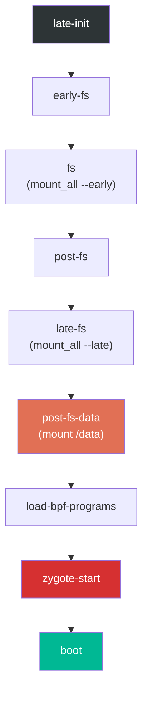

`post-fs-data` 触发器尤为重要，因为它准备 `/data` 分区：

```
# system/core/rootdir/init.rc, lines 663-680
on post-fs-data

    # Start checkpoint before we touch data
    exec - system system -- /system/bin/vdc checkpoint prepareCheckpoint

    # We chown/chmod /data again so because mount is run as root + defaults
    chown system system /data
    chmod 0771 /data
    # We restorecon /data in case the userdata partition has been reset.
    restorecon /data

    # Make sure we have the device encryption key.
    installkey /data

    # Start bootcharting as soon as possible after the data partition is
    # mounted to collect more data.
    mkdir /data/bootchart 0755 shell shell encryption=Require
    bootchart start
```

`zygote-start` 触发器是关键的 Java 运行时开始的地方：

```
# system/core/rootdir/init.rc, lines 1091-1095
on zygote-start
    wait_for_prop odsign.verification.done 1
    start statsd
    start zygote
    start zygote_secondary
```

注意 `wait_for_prop` 命令：Zygote 的启动受 `odsign.verification.done` 控制，该属性表明设备端签名验证已完成。这确保了 Zygote 将加载的 ART 工件已经过验证。

#### 属性触发器

动作也可以由属性变化触发：

```
on property:sys.boot_completed=1 && property:ro.config.batteryless=true
    write /proc/sys/vm/dirty_expire_centisecs 200
    write /proc/sys/vm/dirty_writeback_centisecs 200
```

每当任何属性发生变化时，属性触发器都会被评估。如果条件匹配，相关命令就会执行。复合触发器（使用 `&&`）要求所有条件同时为真。

#### 服务定义

服务是 init 管理的常驻进程。以下是来自 `system/core/rootdir/init.zygote64.rc` 的主 Zygote 服务定义：

```
# system/core/rootdir/init.zygote64.rc, lines 1-20
service zygote /system/bin/app_process64 -Xzygote /system/bin --zygote --start-system-server --socket-name=zygote
    class main
    priority -20
    user root
    group root readproc reserved_disk
    socket zygote stream 660 root system
    socket usap_pool_primary stream 660 root system
    onrestart exec_background - system system -- /system/bin/vdc volume abort_fuse
    onrestart write /sys/power/state on
    onrestart write /sys/power/wake_lock zygote_kwl
    onrestart restart audioserver
    onrestart restart cameraserver
    onrestart restart media
    onrestart restart --only-if-running media.tuner
    onrestart restart netd
    onrestart restart wificond
    task_profiles ProcessCapacityHigh MaxPerformance
    critical window=${zygote.critical_window.minute:-off} target=zygote-fatal
```

让我们逐一分解每个指令：

| 指令 | 含义 |
|---|---|
| `service zygote` | 声明一个名为 "zygote" 的服务 |
| `/system/bin/app_process64` | 可执行文件路径 |
| `-Xzygote` | 传递给 Dalvik/ART VM |
| `--zygote` | 告诉 app_process 以 Zygote 模式启动 |
| `--start-system-server` | 初始化后 fork system_server |
| `class main` | 属于 "main" 服务类 |
| `priority -20` | 以最高调度优先级运行 |
| `user root` / `group root` | 以 root 运行（Zygote 需要 root 来 fork 和设置 UID） |
| `socket zygote stream 660` | 在 `/dev/socket/zygote` 创建 UNIX 套接字 |
| `socket usap_pool_primary` | USAP（非特化应用进程）池的套接字 |
| `onrestart restart audioserver` | 当 Zygote 重启时，同时重启这些服务 |
| `critical window=...` | 如果 Zygote 崩溃过于频繁，重启设备 |

`critical` 指令是一个安全网。如果 Zygote 在指定窗口内反复崩溃，init 会中止并将设备重启到 `target=` 选项指定的目标。这里的目标是 `zygote-fatal`，当未给出目标时默认为 `bootloader`。这可以防止崩溃循环（`system/core/init/service.cpp` 中的 `Service::Reap()` 和 `system/core/init/reboot_utils.cpp` 中的 `SetFatalRebootTarget()`）。

对于同时支持 64 位和 32 位应用的设备，使用文件 `init.zygote64_32.rc`：

```
# system/core/rootdir/init.zygote64_32.rc, lines 1-11
import /system/etc/init/hw/init.zygote64.rc

service zygote_secondary /system/bin/app_process32 -Xzygote /system/bin --zygote --socket-name=zygote_secondary --enable-lazy-preload
    class main
    priority -20
    user root
    group root readproc reserved_disk
    socket zygote_secondary stream 660 root system
    socket usap_pool_secondary stream 660 root system
    onrestart restart zygote
    task_profiles ProcessCapacityHigh MaxPerformance
```

辅助 Zygote 使用 `--enable-lazy-preload`，这意味着它将类预加载推迟到第一个应用 fork 请求。这节省了启动时间，因为在现代设备上 32 位应用相对罕见。

### 4.3.8 init.rc 解析流程

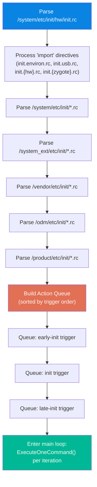

### 4.3.9 init.rc 内置命令摘要

下表列出了最常用的 init.rc 命令：

| 命令 | 示例 | 说明 |
|---|---|---|
| `mkdir` | `mkdir /data/system 0775 system system` | 创建带权限的目录 |
| `write` | `write /proc/sys/kernel/sysrq 0` | 向文件写入字符串 |
| `chmod` | `chmod 0660 /dev/kmsg` | 更改文件权限 |
| `chown` | `chown system system /data` | 更改文件所有权 |
| `mount` | `mount ext4 /dev/block/sda1 /system` | 挂载文件系统 |
| `mount_all` | `mount_all /vendor/etc/fstab.device` | 挂载 fstab 中的所有条目 |
| `start` | `start servicemanager` | 启动一个服务 |
| `stop` | `stop console` | 停止一个服务 |
| `restart` | `restart zygote` | 重启一个服务 |
| `setprop` | `setprop ro.build.type userdebug` | 设置系统属性 |
| `trigger` | `trigger late-init` | 触发一个触发器事件 |
| `exec` | `exec -- /system/bin/vdc ...` | Fork+exec 并等待完成 |
| `exec_start` | `exec_start apexd-bootstrap` | 启动一个服务并等待 |
| `wait` | `wait /dev/block/sda1 5` | 等待文件出现（超时） |
| `wait_for_prop` | `wait_for_prop odsign.verification.done 1` | 等待属性值 |
| `symlink` | `symlink ../tun /dev/net/tun` | 创建符号链接 |
| `restorecon` | `restorecon /dev` | 恢复 SELinux 上下文 |
| `installkey` | `installkey /data` | 安装加密密钥 |
| `class_start` | `class_start core` | 启动一个类中的所有服务 |
| `class_stop` | `class_stop late_start` | 停止一个类中的所有服务 |
| `enable` | `enable some_service` | 启用一个被禁用的服务 |
| `setrlimit` | `setrlimit nice 40 40` | 设置资源限制 |

注意 `import` 并未出现在此表中。尽管它看起来像是一个命令，但它是一个*节关键字*而非内置命令。它不在 `system/core/init/builtins.cpp` 的 `GetBuiltinFunctionMap()` 中。相反，它是在 `system/core/init/init.cpp` 中注册为节解析器的：

```cpp
parser.AddSectionParser("import", std::make_unique<ImportParser>(&parser));
```

`ImportParser` 在解析时运行，而不是作为动作命令运行。因此 `import` 只能出现在 rc 文件的顶层，绝不能出现在 `on` 块或服务定义内部。

---

## 4.4 Zygote：应用孵化器

Zygote 是让 Android 拥有惊人快速的应用程序启动时间的进程。它不是为每个新应用从头加载整个 Android 框架，而是一次性预加载框架，然后 fork 自己。子进程通过 Linux 的写时复制内存共享继承所有预加载的代码和数据，使得从框架的角度来看，应用启动几乎是瞬间完成的。

### 4.4.1 从 init 到 Zygote：原生桥接

当 init 启动 Zygote 服务时，它会执行 `app_process64`（或 `app_process32`），这是定义在 `frameworks/base/cmds/app_process/app_main.cpp` 中的原生入口点。

第 173 行的 `main()` 函数首先创建 `AppRuntime`，这是 `AndroidRuntime` 的一个子类，为 app_process 上下文定制行为：

```cpp
// frameworks/base/cmds/app_process/app_main.cpp, lines 173-189
int main(int argc, char* const argv[])
{
    // ...
    AppRuntime runtime(argv[0], computeArgBlockSize(argc, argv));
    // Process command line arguments
    // ignore argv[0]
    argc--;
    argv++;
```

在解析命令行参数之后，关键的决策点出现在第 257-282 行，此处 `--zygote` 标志决定了执行路径：

```cpp
// frameworks/base/cmds/app_process/app_main.cpp, lines 257-282
bool zygote = false;
bool startSystemServer = false;
bool application = false;
String8 niceName;
String8 className;

++i;  // Skip unused "parent dir" argument.
while (i < argc) {
    const char* arg = argv[i++];
    if (strcmp(arg, "--zygote") == 0) {
        zygote = true;
        niceName = ZYGOTE_NICE_NAME;
    } else if (strcmp(arg, "--start-system-server") == 0) {
        startSystemServer = true;
    } else if (strcmp(arg, "--application") == 0) {
        application = true;
    } else if (strncmp(arg, "--nice-name=", 12) == 0) {
        niceName = (arg + 12);
    } else if (strncmp(arg, "--", 2) != 0) {
        className = arg;
        break;
    } else {
        --i;
        break;
    }
}
```

在 Zygote 模式下，Dalvik 缓存被创建，ABI 信息被收集，然后以 `ZygoteInit` 作为入口类启动 Android 运行时：

```cpp
// frameworks/base/cmds/app_process/app_main.cpp, lines 305-343
if (!className.empty()) {
    // Not in zygote mode...
} else {
    // We're in zygote mode.
    maybeCreateDalvikCache();

    if (startSystemServer) {
        args.add(String8("start-system-server"));
    }

    char prop[PROP_VALUE_MAX];
    if (property_get(ABI_LIST_PROPERTY, prop, NULL) == 0) {
        LOG_ALWAYS_FATAL("app_process: Unable to determine ABI list...");
        return 11;
    }

    String8 abiFlag("--abi-list=");
    abiFlag.append(prop);
    args.add(abiFlag);
    // ...
}

if (zygote) {
    runtime.start("com.android.internal.os.ZygoteInit", args, zygote);
} else if (!className.empty()) {
    runtime.start("com.android.internal.os.RuntimeInit", args, zygote);
}
```

`runtime.start()` 调用启动 ART 虚拟机，加载指定的 Java 类，并调用其 `main()` 方法。这是从原生 C++ 代码到 Java 代码的过渡。

`AppRuntime` 类为生命周期事件提供回调方法。当进程从 Zygote fork 出来时，`onZygoteInit()` 回调（第 92-97 行）启动 Binder 线程池：

```cpp
// frameworks/base/cmds/app_process/app_main.cpp, lines 92-97
virtual void onZygoteInit()
{
    sp<ProcessState> proc = ProcessState::self();
    ALOGV("App process: starting thread pool.\n");
    proc->startThreadPool();
}
```

这一点至关重要。Zygote 本身并不启动 Binder 线程池（因为它不需要）。但从 Zygote fork 出来的每个子进程在特化时都会立即启动一个。这正是应用进程实现 IPC 的原因。

### 4.4.2 ZygoteInit.java：Java 端入口点

`frameworks/base/core/java/com/android/internal/os/ZygoteInit.java` 中的 `ZygoteInit.main()`（第 824 行）是 Java 入口点：

```java
// frameworks/base/core/java/com/android/internal/os/ZygoteInit.java, lines 824-941
@UnsupportedAppUsage
public static void main(String[] argv) {
    ZygoteServer zygoteServer = null;

    // Mark zygote start. This ensures that thread creation will throw
    // an error.
    ZygoteHooks.startZygoteNoThreadCreation();

    // Zygote goes into its own process group.
    try {
        Os.setpgid(0, 0);
    } catch (ErrnoException ex) {
        throw new RuntimeException("Failed to setpgid(0,0)", ex);
    }

    Runnable caller;
    try {
        // ...
        boolean startSystemServer = false;
        String zygoteSocketName = "zygote";
        String abiList = null;
        boolean enableLazyPreload = false;
        for (int i = 1; i < argv.length; i++) {
            if ("start-system-server".equals(argv[i])) {
                startSystemServer = true;
            } else if ("--enable-lazy-preload".equals(argv[i])) {
                enableLazyPreload = true;
            } else if (argv[i].startsWith(ABI_LIST_ARG)) {
                abiList = argv[i].substring(ABI_LIST_ARG.length());
            } else if (argv[i].startsWith(SOCKET_NAME_ARG)) {
                zygoteSocketName = argv[i].substring(SOCKET_NAME_ARG.length());
            }
        }
```

`ZygoteHooks.startZygoteNoThreadCreation()` 调用是一项安全措施：它将当前状态标记为任何创建新线程的尝试都会抛出异常。这是因为在多线程进程中 fork() 是危险的。只有调用线程会被复制到子进程。互斥锁和其他同步原语随后处于未定义状态。

### 4.4.3 类和资源预加载

`preload()` 方法（第 127-173 行）是 Zygote 付出加载 Android 框架的一次性成本的地方：

```java
// frameworks/base/core/java/com/android/internal/os/ZygoteInit.java, lines 127-173
static void preload(TimingsTraceLog bootTimingsTraceLog) {
    Log.d(TAG, "begin preload");
    bootTimingsTraceLog.traceBegin("BeginPreload");
    beginPreload();
    bootTimingsTraceLog.traceEnd(); // BeginPreload
    bootTimingsTraceLog.traceBegin("PreloadClasses");
    preloadClasses();
    bootTimingsTraceLog.traceEnd(); // PreloadClasses
    bootTimingsTraceLog.traceBegin("CacheNonBootClasspathClassLoaders");
    cacheNonBootClasspathClassLoaders();
    bootTimingsTraceLog.traceEnd(); // CacheNonBootClasspathClassLoaders
    bootTimingsTraceLog.traceBegin("PreloadResources");
    Resources.preloadResources();
    bootTimingsTraceLog.traceEnd(); // PreloadResources
    Trace.traceBegin(Trace.TRACE_TAG_DALVIK, "PreloadAppProcessHALs");
    nativePreloadAppProcessHALs();
    Trace.traceEnd(Trace.TRACE_TAG_DALVIK);
    Trace.traceBegin(Trace.TRACE_TAG_DALVIK, "PreloadGraphicsDriver");
    maybePreloadGraphicsDriver();
    Trace.traceEnd(Trace.TRACE_TAG_DALVIK);
    preloadSharedLibraries();
    preloadTextResources();
    // ...
    WebViewFactory.prepareWebViewInZygote();
    endPreload();
    warmUpJcaProviders();
    Log.d(TAG, "end preload");

    sPreloadComplete = true;
}
```

预加载序列：

1. **`preloadClasses()`**：从 `/system/etc/preloaded-classes` 加载约 19,000 个类（路径在第 111 行定义为 `PRELOADED_CLASSES`）。文件中的每一行都是一个完全限定类名，通过 `Class.forName()` 加载。

2. **`cacheNonBootClasspathClassLoaders()`**：为不在启动类路径上但旧应用所需的旧库预创建类加载器：
   - `android.hidl.base-V1.0-java.jar`
   - `android.hidl.manager-V1.0-java.jar`
   - `android.test.base.jar`
   - `org.apache.http.legacy.jar`

3. **`Resources.preloadResources()`**：将系统的默认资源（可绘制对象、布局、主题）加载到内存中。

4. **`nativePreloadAppProcessHALs()`**：预加载应用进程所需的 HAL（硬件抽象层）库。

5. **`maybePreloadGraphicsDriver()`**：进行一次 OpenGL/Vulkan 调用，强制将图形驱动程序加载到内存中。

6. **`preloadSharedLibraries()`**：加载关键的原生库：

    ```java
    // frameworks/base/core/java/com/android/internal/os/ZygoteInit.java, lines 195-207
    private static void preloadSharedLibraries() {
        Log.i(TAG, "Preloading shared libraries...");
        System.loadLibrary("android");
        System.loadLibrary("jnigraphics");
        // ...
    }
    ```

7. **`warmUpJcaProviders()`**：预初始化 Java 加密体系结构提供者，以避免加密操作的冷启动延迟。

`preloadClasses()` 方法（第 284-397 行）是最耗时的步骤。它在加载类时临时放弃 root 权限（以防止静态初始化器获得非预期的访问），然后在之后恢复它们：

```java
// frameworks/base/core/java/com/android/internal/os/ZygoteInit.java, lines 306-315
boolean droppedPriviliges = false;
if (reuid == ROOT_UID && regid == ROOT_GID) {
    try {
        Os.setregid(ROOT_GID, UNPRIVILEGED_GID);
        Os.setreuid(ROOT_UID, UNPRIVILEGED_UID);
    } catch (ErrnoException ex) {
        throw new RuntimeException("Failed to drop root", ex);
    }
    droppedPriviliges = true;
}
```

### 4.4.4 Fork system_server

预加载完成后，Zygote fork 出它的第一个也是最重要的子进程：`system_server`。`forkSystemServer()` 方法（第 691-799 行）设置 fork：

```java
// frameworks/base/core/java/com/android/internal/os/ZygoteInit.java, lines 718-729
/* Hardcoded command line to start the system server */
String[] args = {
        "--setuid=1000",
        "--setgid=1000",
        "--setgroups=1001,1002,1003,1004,1005,1006,1007,1008,1009,1010,1018,1021,1023,"
                + "1024,1032,1065,3001,3002,3003,3005,3006,3007,3009,3010,3011,3012",
        "--capabilities=" + capabilities + "," + capabilities,
        "--nice-name=system_server",
        "--runtime-args",
        "--target-sdk-version=" + VMRuntime.SDK_VERSION_CUR_DEVELOPMENT,
        "com.android.server.SystemServer",
};
```

关键细节：

- **UID 1000**：`system` 用户，而非 root。system_server 会放弃 root 权限。
- **组**：一组特定的补充组，提供对网络、蓝牙、日志和其他能力的访问。
- **能力**：Linux 能力（不要与 Android 权限混淆），包括 `CAP_KILL`、`CAP_NET_ADMIN`、`CAP_SYS_NICE` 等。
- **入口类**：`com.android.server.SystemServer`

实际的 fork 发生在第 777 行：

```java
// frameworks/base/core/java/com/android/internal/os/ZygoteInit.java, lines 777-783
/* Request to fork the system server process */
pid = Zygote.forkSystemServer(
        parsedArgs.mUid, parsedArgs.mGid,
        parsedArgs.mGids,
        parsedArgs.mRuntimeFlags,
        null,
        parsedArgs.mPermittedCapabilities,
        parsedArgs.mEffectiveCapabilities);
```

在子进程中（pid == 0），服务套接字被关闭（子进程不接收 fork 请求），system server 初始化开始：

```java
// frameworks/base/core/java/com/android/internal/os/ZygoteInit.java, lines 789-796
/* For child process */
if (pid == 0) {
    if (hasSecondZygote(abiList)) {
        waitForSecondaryZygote(socketName);
    }
    zygoteServer.closeServerSocket();
    return handleSystemServerProcess(parsedArgs);
}
```

### 4.4.5 Zygote 的 select 循环

fork 出 system_server 之后，Zygote 进入其 select 循环，等待来自 `system_server`（通过 `zygote` 套接字）的 fork 请求：

```java
// frameworks/base/core/java/com/android/internal/os/ZygoteInit.java, lines 901-916
if (startSystemServer) {
    Runnable r = forkSystemServer(abiList, zygoteSocketName, zygoteServer);
    if (r != null) {
        r.run();
        return;
    }
}

Log.i(TAG, "Accepting command socket connections");

// The select loop returns early in the child process after a fork and
// loops forever in the zygote.
caller = zygoteServer.runSelectLoop(abiList);
```

select 循环在 Zygote 进程中永远运行。当 ActivityManagerService 需要启动一个新应用时，它会向 Zygote 套接字发送命令。该命令指定 UID、GID、能力、SELinux 上下文和其他参数。Zygote fork，应用这些参数，子进程成为新应用。

### 4.4.6 USAP：非特化应用进程

现代 Android 包含 USAP（非特化应用进程）池，这是一种优化，Zygote 预先 fork 出一组非特化进程。当需要启动新应用时，不是 fork+特化（这需要时间），而是直接特化一个已经 fork 出来的 USAP。这减少了应用启动延迟。

USAP 套接字与主 Zygote 套接字一起创建（如 `init.zygote64.rc` 服务定义中所示）：

```
socket usap_pool_primary stream 660 root system
```

### 4.4.7 完整的 Zygote 流程

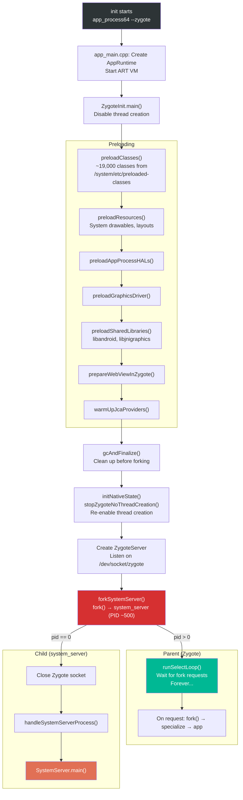

---

## 4.5 system_server 启动

`system_server` 进程是 Android 框架的中心枢纽。它承载了 100 多个系统服务，这些服务共同提供了应用所依赖的 API 和功能。入口点是 `frameworks/base/services/java/com/android/server/SystemServer.java` 中的 `SystemServer.java`。

### 4.5.1 SystemServer 入口点

第 726 行的 `main()` 方法极其简单：

```java
// frameworks/base/services/java/com/android/server/SystemServer.java, lines 726-728
public static void main(String[] args) {
    new SystemServer().run();
}
```

构造函数（第 730-743 行）记录启动信息：

```java
// frameworks/base/services/java/com/android/server/SystemServer.java, lines 730-743
public SystemServer() {
    // Check for factory test mode.
    mFactoryTestMode = FactoryTest.getMode();

    // Record process start information.
    mStartCount = SystemProperties.getInt(SYSPROP_START_COUNT, 0) + 1;
    mRuntimeStartElapsedTime = SystemClock.elapsedRealtime();
    mRuntimeStartUptime = SystemClock.uptimeMillis();

    // Remember if it's runtime restart or reboot.
    mRuntimeRestart = mStartCount > 1;
}
```

`mStartCount` 跟踪 system_server 自上次重启以来启动了多少次。计数大于 1 表示运行时重启（system_server 崩溃了，被 Zygote 重启，而 Zygote 本身又被 init 重启）。

### 4.5.2 run() 方法：引导

私有的 `run()` 方法（第 852-1099 行）包含完整的 system_server 初始化序列。它以关键的设置开始：

```java
// frameworks/base/services/java/com/android/server/SystemServer.java, lines 852-1001 (abridged)
private void run() {
    // ...
    t.traceBegin("InitBeforeStartServices");

    // Record the process start information in sys props.
    SystemProperties.set(SYSPROP_START_COUNT, String.valueOf(mStartCount));
    // ...

    // Here we go!
    Slog.i(TAG, "Entered the Android system server!");
    // ...

    // Mmmmmm... more memory!
    VMRuntime.getRuntime().clearGrowthLimit();

    // Ensure binder calls into the system always run at foreground priority.
    BinderInternal.disableBackgroundScheduling(true);

    // Increase the number of binder threads in system_server
    BinderInternal.setMaxThreads(sMaxBinderThreads);

    // Prepare the main looper thread (this thread).
    android.os.Process.setThreadPriority(
            android.os.Process.THREAD_PRIORITY_FOREGROUND);
    Looper.prepareMainLooper();
    // ...

    // Initialize native services.
    System.loadLibrary("android_servers");
    // ...

    // Initialize the system context.
    createSystemContext();
    // ...

    // Create the system service manager.
    mSystemServiceManager = new SystemServiceManager(mSystemContext);
```

关键设置步骤：

- **`clearGrowthLimit()`**：移除堆增长限制，让 system_server 可以访问所有可用的堆内存
- **`setMaxThreads(31)`**：将最大 Binder 线程数设置为 31（第 510 行的常量 `sMaxBinderThreads`），远高于普通应用的默认值
- **`Looper.prepareMainLooper()`**：为主线程设置消息循环
- **`System.loadLibrary("android_servers")`**：加载包含系统服务 JNI 实现的原生配套库
- **`createSystemContext()`**：创建服务所使用的系统级 `Context`

### 4.5.3 四个服务启动阶段

初始化之后，`run()` 分四个不同的阶段启动服务（第 1047-1050 行）：

```java
// frameworks/base/services/java/com/android/server/SystemServer.java, lines 1041-1050
// Start services.
try {
    t.traceBegin("StartServices");
    // ...
    startBootstrapServices(t);
    startCoreServices(t);
    startOtherServices(t);
    startApexServices(t);
    // ...
    CriticalEventLog.getInstance().logSystemServerStarted();
} catch (Throwable ex) {
    Slog.e("System", "************ Failure starting system services", ex);
    throw ex;
}
```

所有服务启动完成后，system_server 进入它的主循环：

```java
// frameworks/base/services/java/com/android/server/SystemServer.java, lines 1080-1082
// Loop forever.
Looper.loop();
throw new RuntimeException("Main thread loop unexpectedly exited");
```

### 4.5.4 引导服务

`startBootstrapServices()` 方法（第 1192-1461 行）启动那些具有复杂相互依赖关系、必须一起初始化的服务。这些是系统的绝对基础：

```java
// frameworks/base/services/java/com/android/server/SystemServer.java, lines 1186-1191
/**
 * Starts the small tangle of critical services that are needed to get the
 * system off the ground.  These services have complex mutual dependencies
 * which is why we initialize them all in one place here.
 */
private void startBootstrapServices(@NonNull TimingsTraceAndSlog t) {
```

引导服务启动顺序（摘自实际源代码）：

| 顺序 | 服务 | 源行 | 用途 |
|---|---|---|---|
| 1 | ArtModuleServiceInitializer | 1195 | ART 运行时集成 |
| 2 | Watchdog | 1208 | 死锁检测 |
| 3 | ProtoLogConfigurationService | 1215 | ProtoLog 框架 |
| 4 | PlatformCompat | 1226 | 应用兼容性框架 |
| 5 | FileIntegrityService | 1237 | 文件系统完整性 |
| 6 | Installer | 1244 | 软件包安装支持 |
| 7 | DeviceIdentifiersPolicyService | 1250 | 设备 ID 访问策略 |
| 8 | FeatureFlagsService | 1256 | 运行时特性标志 |
| 9 | UriGrantsManagerService | 1261 | Content URI 权限 |
| 10 | PowerStatsService | 1265 | 功耗测量 |
| 11 | IStatsService | 1270 | 统计收集（原生） |
| 12 | MemtrackProxyService | 1276 | 内存跟踪 |
| 13 | AccessCheckingService | 1281 | 权限和 AppOp 管理 |
| 14 | ActivityTaskManagerService + ActivityManagerService | 1290-1294 | Activity 生命周期、进程管理 |
| 15 | DataLoaderManagerService | 1302 | 增量数据加载 |
| 16 | IncrementalService | 1308 | 增量 APK 安装 |
| 17 | PowerManagerService | 1316 | 电源状态管理 |
| 18 | ThermalManagerService | 1320 | 热监控 |
| 19 | RecoverySystemService | 1331 | OTA 和恢复 |
| 20 | LightsService | 1336 | LED 和背光控制 |
| 21 | DisplayManagerService | 1349 | 显示管理 |
| 22 | PHASE_WAIT_FOR_DEFAULT_DISPLAY | 1355 | *首个启动阶段检查点* |
| 23 | DomainVerificationService | 1366 | 应用链接验证 |
| 24 | PackageManagerService | 1372 | 软件包管理 |
| 25 | DexUseManagerLocal | 1389 | DEX 文件使用跟踪 |
| 26 | UserManagerService | 1406 | 多用户管理 |
| 27 | OverlayManagerService | 1435 | 运行时资源叠加 |
| 28 | SensorPrivacyService | 1446 | 传感器访问控制 |
| 29 | SensorService | 1458 | 硬件传感器管理 |

注意第 22 步（第 1355 行）的 `PHASE_WAIT_FOR_DEFAULT_DISPLAY`：

```java
// frameworks/base/services/java/com/android/server/SystemServer.java, lines 1354-1356
// We need the default display before we can initialize the package manager.
t.traceBegin("WaitForDisplay");
mSystemServiceManager.startBootPhase(t, SystemService.PHASE_WAIT_FOR_DEFAULT_DISPLAY);
t.traceEnd();
```

这个启动阶段是一个同步点：`PackageManagerService` 需要显示指标来正确处理资源选择，因此在显示可用之前无法启动。

### 4.5.5 核心服务

`startCoreServices()` 方法（第 1467-1544 行）启动那些不具备引导服务复杂相互依赖关系的基本服务：

| 顺序 | 服务 | 用途 |
|---|---|---|
| 1 | SystemConfigService | 系统配置 |
| 2 | BatteryService | 电池电量跟踪 |
| 3 | UsageStatsService | 应用使用统计 |
| 4 | WebViewUpdateService | WebView 组件更新 |
| 5 | CachedDeviceStateService | 设备状态缓存 |
| 6 | BinderCallsStatsService | Binder 调用性能分析 |
| 7 | LooperStatsService | Handler 消息性能分析 |
| 8 | RollbackManagerService | APK 回滚管理 |
| 9 | NativeTombstoneManagerService | 原生崩溃跟踪 |
| 10 | BugreportManagerService | 错误报告捕获 |
| 11 | GpuService | GPU 驱动管理 |
| 12 | RemoteProvisioningService | 远程密钥配置 |

### 4.5.6 其他服务

`startOtherServices()` 方法（从第 1550 行开始）启动剩余的 70 多个系统服务。这是整个 SystemServer 中最长的方法，启动诸如以下的服务：

- WindowManagerService
- InputManagerService
- NetworkManagementService
- ConnectivityService
- NotificationManagerService
- LocationManagerService
- AudioService
- 以及更多

该方法还会根据设备特性标志启动 APEX 交付的服务以及传统的 Wear OS、TV 和 Automotive 服务。

### 4.5.7 启动阶段推进

系统服务经过定义良好的启动阶段推进。每个阶段代表系统就绪过程中的一个里程碑。服务可以注册以便在某个阶段到达时收到通知，从而执行依赖于其他服务可用的额外初始化。

```mermaid
flowchart LR
    P1["<b>PHASE_WAIT_FOR_<br/>DEFAULT_DISPLAY</b><br/>(100)<br/>Display available"]
    P2["<b>PHASE_LOCK_<br/>SETTINGS_READY</b><br/>(480)<br/>Lock screen ready"]
    P3["<b>PHASE_SYSTEM_<br/>SERVICES_READY</b><br/>(500)<br/>Core services ready"]
    P4["<b>PHASE_DEVICE_<br/>SPECIFIC_SERVICES_READY</b><br/>(520)<br/>Device services ready"]
    P5["<b>PHASE_ACTIVITY_<br/>MANAGER_READY</b><br/>(550)<br/>AMS ready"]
    P6["<b>PHASE_THIRD_PARTY_<br/>APPS_CAN_START</b><br/>(600)<br/>Apps can launch"]
    P7["<b>PHASE_BOOT_<br/>COMPLETED</b><br/>(1000)<br/>Boot done"]

    P1 --> P2 --> P3 --> P4 --> P5 --> P6 --> P7

    style P1 fill:#0984e3,color:#fff
    style P3 fill:#e17055,color:#fff
    style P6 fill:#00b894,color:#fff
    style P7 fill:#d63031,color:#fff
```

| 阶段 | 值 | 说明 |
|---|---|---|
| `PHASE_WAIT_FOR_DEFAULT_DISPLAY` | 100 | 默认显示已可用 |
| `PHASE_LOCK_SETTINGS_READY` | 480 | 锁屏设置已可用 |
| `PHASE_SYSTEM_SERVICES_READY` | 500 | 核心系统服务已可使用 |
| `PHASE_DEVICE_SPECIFIC_SERVICES_READY` | 520 | 设备特定服务已就绪 |
| `PHASE_ACTIVITY_MANAGER_READY` | 550 | ActivityManagerService 已可启动 activity |
| `PHASE_THIRD_PARTY_APPS_CAN_START` | 600 | 第三方应用可以启动 |
| `PHASE_BOOT_COMPLETED` | 1000 | 启动完成，所有服务正在运行 |

`ActivityManagerService.finishBooting()` 驱动最终阶段：它调用 `startBootPhase(t, SystemService.PHASE_BOOT_COMPLETED)`（`frameworks/base/services/core/java/com/android/server/am/ActivityManagerService.java`，第 5967 行），之后设置系统属性 `sys.boot_completed=1` 和 `dev.bootcomplete=1`（第 5991-5992 行）。这是向所有系统组件发出的设备已完全运行的信号。注意，这个阶段并不会导致启动动画关闭或启动器启动。两者都在启动序列的更早时候发生（见下一节）。

### 4.5.8 启动动画生命周期

启动动画进程（`bootanim`）被声明为一个 init 服务，但不在 `init.rc` 中。它的定义位于 `frameworks/base/cmds/bootanimation/bootanim.rc`：

```
service bootanim /system/bin/bootanimation
    class core animation
    user graphics
    group graphics audio
    disabled
    oneshot
    ioprio rt 0
    task_profiles MaxPerformance
```

`disabled` 关键字意味着 `class_start core` 不会启动它——必须有东西显式启动它。那个东西就是 SurfaceFlinger。当显示就绪时，SurfaceFlinger 清除 exit 和 progress 属性。然后它通过 init 的控制属性请求该服务（`frameworks/native/services/surfaceflinger/SurfaceFlinger.cpp`，第 1132 行）：

```cpp
property_set("service.bootanim.exit", "0");
property_set("service.bootanim.progress", "0");
property_set("ctl.start", "bootanim");
```

一旦运行起来，`bootanimation` 会循环并显示默认的 Android 标志或自定义的厂商动画。它一直持续到 `WindowManagerService.performEnableScreen()` 将 `service.bootanim.exit` 属性设置为 `1`（`frameworks/base/services/core/java/com/android/server/wm/WindowManagerService.java`，第 4388 行）。当所有系统装饰窗口绘制完成时会发生这种情况。它在达到 `PHASE_BOOT_COMPLETED` 之前发生，而不是作为其一部分。

### 4.5.9 完整的 system_server 启动时间线

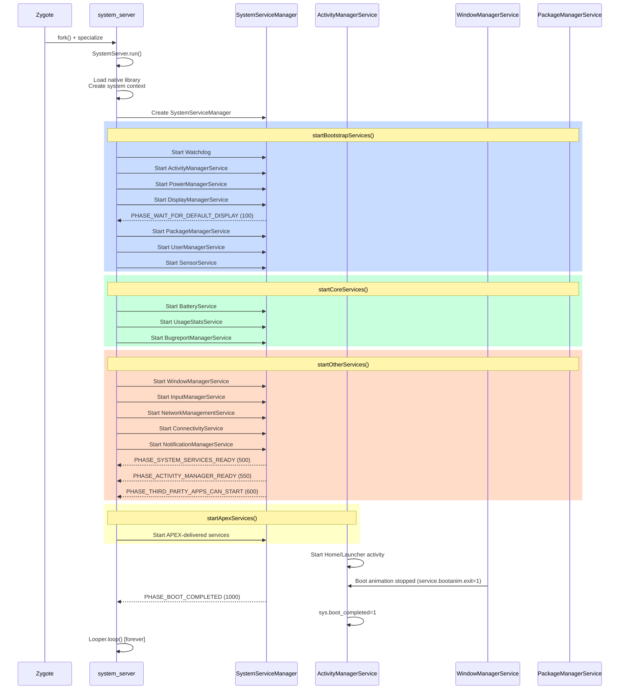

---

## 4.6 深入探究：init.rc 语言

本节为 init.rc 语言提供全面的参考，每个 Android 平台开发者都需要理解它。

### 4.6.1 节

Init.rc 文件由三种类型的节组成：

**动作**以 `on` 关键字开头：

```
on <trigger> [&& <trigger>]*
    <command>
    <command>
    ...
```

**服务**以 `service` 关键字开头：

```
service <name> <pathname> [ <argument> ]*
    <option>
    <option>
    ...
```

**导入**引入额外的 rc 文件：

```
import <path>
```

导入在当前文件的所有节被解析之后处理。属性展开（`${property.name}`）在导入路径中可用，允许硬件特定的配置：`import /init.${ro.hardware}.rc`。

### 4.6.2 触发器类型

Init 支持几种触发器类型：

**启动触发器**在启动序列期间触发一次：

| 触发器 | 触发时机 |
|---|---|
| `early-init` | 启动极早期，在大部分设置之前 |
| `init` | 在基本设备设置之后 |
| `late-init` | 主启动编排触发器 |
| `early-fs` | 在文件系统挂载之前 |
| `fs` | 文件系统挂载阶段 |
| `post-fs` | 在 /system 和 /vendor 挂载之后 |
| `late-fs` | 晚期文件系统挂载阶段 |
| `post-fs-data` | 在 /data 挂载之后 |
| `zygote-start` | 该启动 Zygote 了 |
| `boot` | 系统已准备好运行服务 |
| `charger` | 设备处于仅充电模式 |

**属性触发器**在属性匹配某个值时触发：

```
on property:ro.debuggable=1
    start adbd

on property:sys.boot_completed=1
    bootchart stop
```

**复合触发器**组合启动触发器和属性触发器：

```
on boot && property:ro.config.low_ram=true
    write /proc/sys/vm/dirty_expire_centisecs 200
    write /proc/sys/vm/dirty_background_ratio 5
```

复合触发器中的所有条件都必须为真，动作才会执行。复合触发器可以包含一个属性触发器。在这种情况下，当属性变化为指定值并且所有其他条件都满足时，动作触发。

### 4.6.3 init 触发器：系统配置

`init` 触发器（在 `system/core/rootdir/init.rc` 的第 106 行）执行基础的系统配置。以下是带注释的完整动作：

```
# system/core/rootdir/init.rc, lines 106-184 (selected)
on init
    sysclktz 0

    # Mix device-specific information into the entropy pool
    copy /proc/cmdline /dev/urandom
    copy /proc/bootconfig /dev/urandom

    symlink /proc/self/fd/0 /dev/stdin
    symlink /proc/self/fd/1 /dev/stdout
    symlink /proc/self/fd/2 /dev/stderr

    # cpuctl hierarchy for devices using utilclamp
    mkdir /dev/cpuctl/foreground
    mkdir /dev/cpuctl/background
    mkdir /dev/cpuctl/top-app
    mkdir /dev/cpuctl/rt
    mkdir /dev/cpuctl/system
    mkdir /dev/cpuctl/system-background
    mkdir /dev/cpuctl/dex2oat
```

这个动作设置系统时钟时区，并用启动信息为熵池播种。该种子提升了启动早期随机数的质量。该动作还创建标准的 I/O 符号链接。它设置用于进程调度的 CPU 控制组层次结构。

CPU 控制组（foreground、background、top-app 等）对 Android 的进程调度至关重要。ActivityManagerService 之后会根据重要性将进程分配到这些组，确保前台应用比后台进程获得更多 CPU 时间。

### 4.6.4 服务选项参考

init.rc 中最常用的服务选项：

| 选项 | 示例 | 说明 |
|---|---|---|
| `class <name>` | `class main` | 用于组启动/停止的服务类 |
| `user <name>` | `user system` | 以此用户运行 |
| `group <name> [<name>]*` | `group system inet` | 主组和补充组 |
| `capabilities <cap>+` | `capabilities NET_ADMIN NET_RAW` | 要保留的 Linux 能力 |
| `socket <name> <type> <perm> [user [group]]` | `socket zygote stream 660 root system` | 创建 UNIX 域套接字 |
| `file <path> <type>` | `file /dev/kmsg w` | 打开一个文件描述符 |
| `onrestart <command>` | `onrestart restart audioserver` | 重启时要运行的命令 |
| `oneshot` | | 进程退出时不重启 |
| `disabled` | | 不随类自动启动 |
| `critical [window=<min>] [target=<target>]` | `critical window=10 target=zygote-fatal` | 如果崩溃太频繁则重启 |
| `priority <int>` | `priority -20` | 调度优先级（-20 到 19） |
| `oom_score_adjust <int>` | `oom_score_adjust -1000` | OOM 杀手评分调整 |
| `namespace <ns>` | `namespace mnt` | 在挂载命名空间中运行 |
| `seclabel <label>` | `seclabel u:r:healthd:s0` | SELinux 安全标签 |
| `writepid <file>+` | `writepid /dev/cpuset/system/tasks` | 将 PID 写入这些文件 |
| `task_profiles <profile>+` | `task_profiles ProcessCapacityHigh` | 应用 cgroup/任务配置文件 |
| `interface <name> <instance>` | `interface aidl android.hardware.power.IPower/default` | 注册一个接口 |
| `stdio_to_kmsg` | | 将 stdout/stderr 重定向到 kmsg |
| `enter_namespace <ns> <path>` | `enter_namespace net /proc/1/ns/net` | 进入一个已存在的命名空间 |
| `gentle_kill` | | 停止时在 SIGKILL 之前发送 SIGTERM |
| `shutdown <behavior>` | `shutdown critical` | 系统关机期间的行为 |
| `restart_period <seconds>` | `restart_period 5` | 重启之间的最小时间 |
| `timeout_period <seconds>` | `timeout_period 10` | N 秒后杀死服务 |
| `updatable` | | 服务可被 APEX 覆盖 |
| `sigstop` | | fork 后发送 SIGSTOP（用于调试器附加） |

`ServiceParser::GetParserMap()`（`system/core/init/service_parser.cpp`）中的完整关键字映射注册了上面未显示的额外选项。它们是 `console`、`ioprio`、`keycodes`、`memcg.limit_in_bytes`、`memcg.limit_percent`、`memcg.limit_property`、`memcg.soft_limit_in_bytes`、`memcg.swappiness`、`override`、`reboot_on_failure`、`rlimit`、`setenv` 和 `shared_kallsyms`。

### 4.6.5 服务类

服务被分组到类中，让 init 能够一次启动或停止一组服务。标准类有：

| 类 | 用途 | 由谁启动 |
|---|---|---|
| `core` | 在 zygote 之前所需的核心服务 | `on boot` / `class_start core` |
| `main` | 主要服务 | `on nonencrypted` / `class_start main` |
| `late_start` | 启动后启动的服务 | `on nonencrypted` / `class_start late_start` |
| `hal` | 硬件抽象层服务 | `on boot` / `class_start hal` |
| `early_hal` | 早期所需的 HAL 服务（例如 FBE 解锁之前） | `on late-fs` / `class_start early_hal` |

（Zygote 属于 `class main`，但 `class_start main` 通常不会*启动*它。`on zygote-start` 更早触发，并且已经用 `start zygote` / `start zygote_secondary` 显式启动了它。因此对 Zygote 而言，稍后的 `class_start main` 是空操作。）

当执行 `class_start main` 时，所有带有 `class main` 且未被 `disabled` 的服务都会启动。类似地，`class_stop main` 会停止该类中的所有服务。

### 4.6.6 Ueventd：设备节点管理

正如 4.3.1 节所述，当 init 以 `ueventd` 的名字被调用时，它会成为设备节点管理器。Ueventd 监听内核 uevent，并在 `/dev/` 中以适当的权限创建设备节点。

Ueventd 的配置在 `ueventd.rc` 文件中。这些文件定义设备节点的所有权和权限：

```
# Example ueventd rules
/dev/null                 0666   root       root
/dev/zero                 0666   root       root
/dev/full                 0666   root       root
/dev/random               0666   root       root
/dev/urandom              0666   root       root
/dev/ashmem               0666   root       root
/dev/binder               0666   root       root
/dev/hwbinder             0666   root       root
/dev/vndbinder            0666   root       root
```

一个独立的 Rust 库 `system/libueventd-rs/`（约 1.9K 行代码）为通过内核 uevent（netlink）、sysfs 和 `/dev` 枚举和监听设备提供安全抽象。它有一个由 inotify 和 netlink 支持的事件流：inotify 监听 `/dev` 设备节点，而内核 uevent 和网络接口路径使用 netlink/rtnetlink。它是一个通用设备库，被诸如 `frameworks/native/services/serialservice/` 和 `frameworks/native/services/usbauthservice/` 之类的辅助服务使用。它（尚）未接入 init，也不会创建 `/dev` 节点。C++ 的 `ueventd`（`system/core/init/ueventd.cpp`、`devices.cpp`）仍然是活的设备节点管理器。

### 4.6.7 init.rc 处理顺序

理解 init.rc 文件的处理顺序对于调试启动问题至关重要。完整的顺序是：

1. `/system/etc/init/hw/init.rc` 首先被解析
2. 在该文件解析结束时，其 `import` 语句被递归处理。`system/core/init/import_parser.cpp` 中的 `ImportParser::EndFile()` 在每个文件的 EOF 处触发，因此被导入文件自身的导入也以同样的方式解析。
3. `/system/etc/init/` 中的文件被解析（按字母顺序）
4. `/system_ext/etc/init/` 中的文件被解析
5. `/vendor/etc/init/` 中的文件被解析
6. `/odm/etc/init/` 中的文件被解析
7. `/product/etc/init/` 中的文件被解析

唯一真正被延迟的工作是 `late_import_paths`。这些是在首次解析时无法读取的目录（例如在其分区挂载之前的 `/vendor/etc/init`）。它们被记录，并在之后 `mount_all` 期间再次解析。

在每个目录内，`.rc` 文件按字母顺序处理。这意味着用数字前缀命名你的 rc 文件（例如 `01-myservice.rc`）会影响处理顺序，尽管不建议依赖这一点。

---

## 4.7 深入探究：属性服务内部实现

属性服务是启动期间使用最频繁的 IPC 机制之一。本节详细考察它的实现。

### 4.7.1 属性存储

Android 属性存储在映射到 `/dev/__properties__/` 的共享内存区域中。属性区域被组织为一棵 trie（前缀树），以便高效查找。每个属性区域文件都会被内存映射到每一个读取属性的进程中，使得读取极其快速（无需 IPC）。

属性存储在 `PropertyInit()` 中初始化，该函数从 `init.cpp` 的 `SecondStageMain()`（第 1126 行）中调用。属性信息区域（`/dev/__properties__/property_info`）描述 trie 结构，并由 `property_info_area`（定义在 `property_service.cpp` 第 116 行）解析：

```cpp
// system/core/init/property_service.cpp, line 116
[[clang::no_destroy]] static PropertyInfoAreaFile property_info_area;
```

### 4.7.2 属性设置流程

当一个进程调用 `SystemProperties.set()`（Java）或 `__system_property_set()`（原生）时，请求通过一个 UNIX 域套接字流动。该套接字通向在 init 进程内运行的属性服务线程。流程如下：

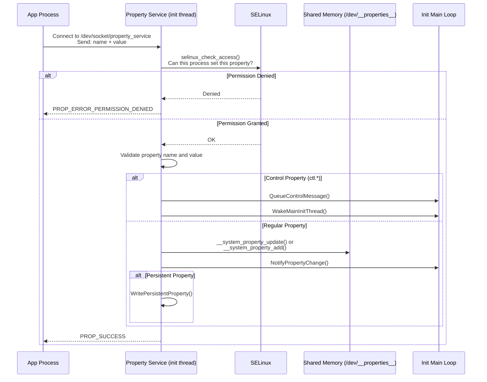

### 4.7.3 SELinux 属性访问控制

每次属性设置操作都会根据 SELinux 策略进行检查。`CheckMacPerms()` 函数（`property_service.cpp` 的第 162-176 行）执行这一检查：

```cpp
// system/core/init/property_service.cpp, lines 162-176
static bool CheckMacPerms(const std::string& name, const char* target_context,
                          const char* source_context, const ucred& cr) {
    if (!target_context || !source_context) {
        return false;
    }

    PropertyAuditData audit_data;
    audit_data.name = name.c_str();
    audit_data.cr = &cr;

    auto lock = std::lock_guard{selinux_check_access_lock};
    return selinux_check_access(source_context, target_context,
                                "property_service", "set",
                                &audit_data) == 0;
}
```

属性信息区域将属性名映射到 SELinux 上下文。例如，`ro.build.*` 属性可能映射到 `build_prop`，而 `persist.sys.*` 可能映射到 `system_prop`。每个上下文都有单独的 SELinux 规则，控制哪些域可以读取或写入带有该上下文的属性。

审计回调（第 123-134 行）为 SELinux 拒绝提供详细的日志记录：

```cpp
// system/core/init/property_service.cpp, lines 123-134
static int PropertyAuditCallback(void* data, security_class_t /*cls*/,
                                  char* buf, size_t len) {
    auto* d = reinterpret_cast<PropertyAuditData*>(data);

    if (!d || !d->name || !d->cr) {
        LOG(ERROR) << "AuditCallback invoked with null data arguments!";
        return 0;
    }

    snprintf(buf, len, "property=%s pid=%d uid=%d gid=%d",
             d->name, d->cr->pid, d->cr->uid, d->cr->gid);
    return 0;
}
```

### 4.7.4 属性服务线程

属性服务运行在它自己的线程中，与 init 的主循环分离。这一设计很重要。属性设置请求可以随时从任何进程到达，而在主循环中处理它们会延迟动作的执行。`SocketConnection` 类（从第 223 行开始）处理属性请求的线上协议：

```cpp
// system/core/init/property_service.cpp, lines 223-226
class SocketConnection {
  public:
    SocketConnection() = default;
    SocketConnection(int socket, const ucred& cred) : socket_(socket), cred_(cred) {}
```

每个连接通过 UNIX 套接字接收调用者的凭据（`ucred`），该凭据提供了调用进程的 PID、UID 和 GID。这些凭据与 SELinux 上下文结合，决定了是否允许属性设置。

### 4.7.5 持久化属性

带有 `persist.` 前缀的属性被持久化存储在 `/data/property/` 下的磁盘上。它们在重启后仍然保留。写入是异步处理的，以避免磁盘 I/O 阻塞属性设置调用：

```cpp
// system/core/init/property_service.cpp, lines 414-423
bool need_persist = StartsWith(name, "persist.") || StartsWith(name, "next_boot.");
if (socket && persistent_properties_loaded && need_persist) {
    if (persist_write_thread) {
        persist_write_thread->Write(name, value, std::move(*socket));
        return {};
    }
    WritePersistentProperty(name, value);
}
```

带有 `next_boot.` 前缀的属性也会被持久化，但它们在下次启动时而不是立即应用。

### 4.7.6 属性变化通知

当属性发生变化时，所有感兴趣的各方都会收到通知。`NotifyPropertyChange()` 函数（第 178-185 行）桥接属性服务线程和 init 的主循环：

```cpp
// system/core/init/property_service.cpp, lines 178-185
void NotifyPropertyChange(const std::string& name, const std::string& value) {
    auto lock = std::lock_guard{accept_messages_lock};
    if (accept_messages) {
        PropertyChanged(name, value);
    }
}
```

这调用 `init.cpp` 中的 `PropertyChanged()`，它会对属性触发器排队并唤醒主线程。唤醒机制使用一个 eventfd，如 `InstallInitNotifier()`（init.cpp 第 143-156 行）所示：

```cpp
// system/core/init/init.cpp, lines 143-156
static void InstallInitNotifier(Epoll* epoll) {
    wake_main_thread_fd = eventfd(0, EFD_CLOEXEC);
    if (wake_main_thread_fd == -1) {
        PLOG(FATAL) << "Failed to create eventfd for waking init";
    }
    auto clear_eventfd = [] {
        uint64_t counter;
        TEMP_FAILURE_RETRY(read(wake_main_thread_fd, &counter, sizeof(counter)));
    };

    if (auto result = epoll->RegisterHandler(wake_main_thread_fd, clear_eventfd);
        !result.ok()) {
        LOG(FATAL) << result.error();
    }
}
```

---

## 4.8 深入探究：system_server 服务分类

system_server 启动远超 100 个服务。理解这些类别和关键服务对平台开发者至关重要。

### 4.8.1 startOtherServices：框架的主体

`SystemServer.java` 中的 `startOtherServices()` 方法（从第 1550 行开始）是该类中最长的方法。它启动构成 Android 框架的“杂烩”服务。以下是该方法中启动的关键服务的详细分解：

**输入和显示服务（约第 1707-1765 行）：**

```java
// frameworks/base/services/java/com/android/server/SystemServer.java
t.traceBegin("StartInputManagerService");
inputManager = mSystemServiceManager.startService(
        InputManagerService.Lifecycle.class).getService();
t.traceEnd();

t.traceBegin("StartWindowManagerService");
mSystemServiceManager.startBootPhase(t, SystemService.PHASE_WAIT_FOR_SENSOR_SERVICE);
wm = WindowManagerService.main(context, inputManager, !mFirstBoot,
        new PhoneWindowManager(), mActivityManagerService.mActivityTaskManager);
ServiceManager.addService(Context.WINDOW_SERVICE, wm, /* allowIsolated= */ false,
        DUMP_FLAG_PRIORITY_CRITICAL | DUMP_FLAG_PRIORITY_HIGH | DUMP_FLAG_PROTO);
t.traceEnd();
```

注意 `PHASE_WAIT_FOR_SENSOR_SERVICE` 启动阶段门控——WindowManagerService 需要传感器服务（用于旋转检测）才能完全初始化。

**存储和内容服务：**

```java
t.traceBegin("StartStorageManagerService");
mSystemServiceManager.startService(StorageManagerService.Lifecycle.class);
storageManager = IStorageManager.Stub.asInterface(
        ServiceManager.getService("mount"));
t.traceEnd();
```

StorageManagerService 必须在 NotificationManagerService 之前启动，因为有关 USB 连接和存储事件的通知依赖于它。

**连接服务：**

网络栈尤其复杂，包含多个相互依赖的服务：

```java
t.traceBegin("StartBluetoothService");
mSystemServiceManager.startServiceFromJar(BLUETOOTH_SERVICE_CLASS,
    BLUETOOTH_APEX_SERVICE_JAR_PATH);
t.traceEnd();

t.traceBegin("IpConnectivityMetrics");
mSystemServiceManager.startService(IpConnectivityMetrics.class);
t.traceEnd();
```

蓝牙从一个 APEX jar（`/apex/com.android.bt/javalib/service-bluetooth.jar`）加载，展示了模块化系统服务已经变得多么彻底。

### 4.8.2 APEX 交付的服务

现代 Android 通过 APEX 包交付许多系统服务。其中大多数在 `startOtherServices()` 中通过 `mSystemServiceManager.startServiceFromJar(<class>, <apex jar path>)` 显式启动，该方法从 APEX 挂载内的 JAR 中加载服务类：

| APEX 模块 | 服务类 | 用途 |
|---|---|---|
| `com.android.os.statsd` | `StatsCompanion` | 统计收集 |
| `com.android.scheduling` | `RebootReadinessManagerService` | 安全重启调度 |
| `com.android.wifi` | `WifiService`、`WifiScanningService` | WiFi 管理 |
| `com.android.tethering` | `ConnectivityServiceInitializer` | 网络连接 |
| `com.android.uwb` | `UwbService` | 超宽带 |
| `com.android.bt` | `BluetoothService` | 蓝牙 |
| `com.android.devicelock` | `DeviceLockService` | 设备锁定/解锁 |
| `com.android.profiling` | `ProfilingService` | 系统性能分析 |

这些服务从各自 APEX 挂载（位于 `/apex/` 下）内的 JAR 文件中加载。例如：

```java
// frameworks/base/services/java/com/android/server/SystemServer.java
private static final String WIFI_APEX_SERVICE_JAR_PATH =
        "/apex/com.android.wifi/javalib/service-wifi.jar";
private static final String WIFI_SERVICE_CLASS =
        "com.android.server.wifi.WifiService";
```

单独的 `startApexServices()` 方法最后运行。之后不得再启动任何其他服务。它只涵盖那些 APEX 通过其清单中的 `<apex-system-service>` 标签声明的服务。它通过 `ApexManager.getInstance().getApexSystemServices()` 发现它们，并逐个启动——在给出声明的 JAR 路径时从该路径启动。在当前的树中，只有少数模块使用这种机制，例如 `com.android.scheduling`（`RebootReadinessManagerService`）和 `com.android.virt`（`VirtualizationSystemService`）。

### 4.8.3 安全模式检测

在启动大部分其他服务之前，WindowManagerService 会检查安全模式（第 1887 行）：

```java
// frameworks/base/services/java/com/android/server/SystemServer.java, line 1887
final boolean safeMode = wm.detectSafeMode();
if (safeMode) {
    Settings.Global.putInt(context.getContentResolver(),
            Settings.Global.AIRPLANE_MODE_ON, 1);
}
```

当用户在启动期间按住某些按钮时会触发安全模式。在安全模式下，第三方应用被禁用，飞行模式会自动启用。

### 4.8.4 服务启动时序约束

system_server 使用 `SystemServerInitThreadPool` 在可能的情况下并行化初始化。例如，辅助 Zygote 预加载和 HIDL 服务初始化在后台线程中运行：

```java
// frameworks/base/services/java/com/android/server/SystemServer.java, lines 1781-1786
SystemServerInitThreadPool.submit(() -> {
    TimingsTraceAndSlog traceLog = TimingsTraceAndSlog.newAsyncLog();
    traceLog.traceBegin(START_HIDL_SERVICES);
    startHidlServices();
    traceLog.traceEnd();
}, START_HIDL_SERVICES);
```

然而，并行化受到 Watchdog 的约束：如果一个线程持有锁的时间过长，Watchdog 会杀死 system_server。Watchdog 在引导服务中非常早地启动，以确保它能从最早的可能点检测到死锁。

### 4.8.5 最终移交

当所有服务都启动并且启动阶段完成后，system_server 进入它的主 Looper（第 1097 行）：

```java
// frameworks/base/services/java/com/android/server/SystemServer.java, lines 1096-1098
// Loop forever.
Looper.loop();
throw new RuntimeException("Main thread loop unexpectedly exited");
```

`Looper.loop()` 调用在正常运行下永远不会返回。主线程处理来自各种系统服务的消息，包括 ActivityManagerService 的处理消息、WindowManagerService 显示更新等等。如果主循环退出，RuntimeException 会导致 system_server 崩溃。这会触发 Zygote 重启，进而触发 init 重启 Zygote。整个 Java 框架都会重启。

---

## 4.9 启动时间测量与优化

理解启动性能对平台开发者至关重要。Android 提供了用于测量和优化启动时间的内置工具。

### 4.9.1 启动时间属性

Init 在系统属性中记录计时信息：

| 属性 | 说明 |
|---|---|
| `ro.boottime.init` | 第一阶段 init 开始时的时间戳 |
| `ro.boottime.init.first_stage` | 第一阶段 init 的持续时间 |
| `ro.boottime.init.selinux` | SELinux 设置的持续时间 |
| `ro.boottime.init.modules` | 内核模块加载的持续时间 |
| `ro.boottime.init.cold_boot_wait` | init 等待 ueventd 的时间 |

前四个在 `RecordStageBoottimes()`（init.cpp 第 904-931 行）中设置。`ro.boottime.init.cold_boot_wait` 单独在 `PropWaiterState::CheckAndResetWait()`（init.cpp 第 203 行）中设置。当 cold-boot-done 属性从 ueventd 到达时发生这种情况：

```cpp
// system/core/init/init.cpp, lines 904-931
static void RecordStageBoottimes(const boot_clock::time_point& second_stage_start_time) {
    int64_t first_stage_start_time_ns = -1;
    if (auto first_stage_start_time_str = getenv(kEnvFirstStageStartedAt);
        first_stage_start_time_str) {
        SetProperty("ro.boottime.init", first_stage_start_time_str);
        android::base::ParseInt(first_stage_start_time_str, &first_stage_start_time_ns);
    }
    // ...
    SetProperty("ro.boottime.init.first_stage",
                std::to_string(selinux_start_time_ns - first_stage_start_time_ns));
    SetProperty("ro.boottime.init.selinux",
                std::to_string(second_stage_start_time.time_since_epoch().count() -
                               selinux_start_time_ns));
    if (auto init_module_time_str = getenv(kEnvInitModuleDurationMs);
        init_module_time_str) {
        SetProperty("ro.boottime.init.modules", init_module_time_str);
        unsetenv(kEnvInitModuleDurationMs);
    }
}
```

### 4.9.2 Bootchart

Android 支持 bootchart，这是一个记录启动期间 CPU、磁盘 I/O 和进程活动的工具。在 Android 17 上，bootchart 在两个地方启动。为了从第二阶段 init 的最开始捕获，`on early-init` 块在一个 tmpfs 目录上启动它：

```
# system/core/rootdir/init.rc, lines 16-18
# Allow bootchart to capture from the beginning of second-stage init.
mkdir /dev/bootchart 0755 root root
bootchart start
```

它在之后从 `on post-fs-data` 重新启动，一旦 `/data` 被挂载，因此跟踪可以在重启后持久化：

```
# system/core/rootdir/init.rc, lines 679-680
mkdir /data/bootchart 0755 shell shell encryption=Require
bootchart start
```

Android 17 还添加了早期 bootchart。它可以从内核命令行 / bootconfig（`ro.boot.bootchart.enabled`）直接启用，因此图表甚至可以在 `bootchart start` 命令运行之前开始。`on early-init && property:ro.boot.bootchart.enabled=""`（init.rc 第 113 行）在功能关闭时删除该目录。

要捕获 bootchart：

```bash
# Enable bootchart (requires userdebug/eng build)
adb shell touch /data/bootchart/enabled

# Reboot the device
adb reboot

# After boot, pull the data
adb shell tar -czf /data/local/tmp/bootchart.tgz /data/bootchart/
adb pull /data/local/tmp/bootchart.tgz
```

### 4.9.3 systrace/Perfetto 启动跟踪

Android 的跟踪基础设施（Perfetto）可以捕获启动跟踪。system_server 在其整个初始化过程中使用 `TimingsTraceAndSlog` 来记录每个服务启动的精确计时：

```java
// Example from SystemServer.java
t.traceBegin("StartActivityManager");
// ... start AMS ...
t.traceEnd();
```

这些跟踪可以通过以下方式捕获：

```bash
# Capture a boot trace
adb shell atrace --async_start -b 32768 -c am wm dalvik
adb reboot
# After boot:
adb shell atrace --async_dump -o /data/local/tmp/boot_trace
adb pull /data/local/tmp/boot_trace
```

### 4.9.4 启动监视器

对于可调试的构建，init 支持一个启动超时监视器，如果启动未在指定时间内完成，它会触发内核 panic。Android 17 将其重构为仅在 `ro.debuggable` 构建上设置了 `ro.boot.boot_timeout` 时才生成的线程。Init.cpp 第 1158-1163 行对其进行门控。`StartSecondStageBootMonitor()` 位于第 1061 行。监视器主体是 `SecondStageBootMonitor()`（第 1035-1059 行）：

```cpp
// system/core/init/init.cpp, lines 1035-1059
static void SecondStageBootMonitor(int timeout_sec) {
    auto cur_time = boot_clock::now().time_since_epoch();
    int cur_sec = std::chrono::duration_cast<std::chrono::seconds>(cur_time).count();
    int extra_sec = timeout_sec <= cur_sec ? 0 : timeout_sec - cur_sec;
    auto boot_timeout = std::chrono::seconds(extra_sec);

    // since boot_completed isn't updated in the recovery boot, let's skip the monitor
    if (IsRecoveryMode()) {
        return;
    }

    LOG(INFO) << "Started BootMonitorThread, expiring in " << timeout_sec
              << " seconds from boot-up";

    if (!WaitForProperty("sys.boot_completed", "1", boot_timeout)) {
        LOG(ERROR) << "BootMonitorThread: boot didn't complete in " << timeout_sec
                   << " seconds. Trigger a panic!";
        std::this_thread::sleep_for(200ms);
        // trigger a kernel panic
        WriteStringToFile("c", PROC_SYSRQ);
    }
}
```

注意 Android 17 新增的 `IsRecoveryMode()` 提前返回。`sys.boot_completed` 在 recovery 启动期间永远不会被设置，因此监视器在那里总是会触发，现在它被跳过了。

这个安全网在开发期间非常宝贵。如果一个代码更改导致无限启动循环，设备最终会 panic。sysrq 触发的内核 panic 之后发生什么取决于内核和引导加载程序的配置（例如 ramdump 捕获或重启）。这给了开发者一个烧录修复映像的机会。（`REBOOT_BOOTLOADER_ON_PANIC` 是一个单独的机制：它安装信号处理程序，使得当 *init 自身* 崩溃时，`InitFatalReboot()` 将设备重启到引导加载程序。）

### 4.9.5 常见的启动优化技术

1. **并行内核模块加载**：在 bootconfig 中设置 `androidboot.load_modules_parallel` 以在第一阶段 init 期间启用并行模块加载。在 Android 17 上，这接受 `true`（NORMAL）、`performance` 或 `conservative`，用于调整 `libmodprobe` 并行遍历依赖图的激进程度

2. **延迟 Zygote 预加载**：辅助（32 位）Zygote 使用 `--enable-lazy-preload` 将类预加载推迟到首次使用

3. **SystemServerInitThreadPool**：system_server 使用线程池为独立的服务并行化服务初始化

4. **在 data 之前挂载的 APEX 激活**：在 Android 17 上，当设置了 `com.android.apex.flags.mount_before_data` 构建标志时，apexd 可以在 `/data` 被挂载之前激活 APEX。为了避免 apexd 在 `/dev/block/by-name/userdata` 符号链接上停滞，第一阶段 init 预先初始化 `userdata` 块设备。该钩子是 `system/core/init/first_stage_mount_android.cpp` 中的 `FirstStageMountAndroid::GetExtraBlockDevices()`（第 117-126 行）：

    ```cpp
    // system/core/init/first_stage_mount_android.cpp, lines 117-126
    void FirstStageMountAndroid::GetExtraBlockDevices(std::set<std::string>* devices) {
        if constexpr (com::android::apex::flags::mount_before_data()) {
            // Even before /data is mounted, apexd needs to access the block device
            // backing /data. Let's initialize "userdata" so that apexd can avoid
            // waiting for the symlink (/dev/block/by-name/userdata).
            if (data_on_userdata_) {
                devices->insert("userdata");
            }
        }
    }
    ```

   （更早的版本改为在 init 中预先创建一个 loop 设备池。那种 apexd 特定的 loop 预创建已被回退。mount-before-data 路径现在依赖上面的 userdata 设备钩子，加上 `system/core/init/mount_namespace.cpp` 中的引导挂载命名空间。）

5. **Bootchart 分析**：使用 bootchart 识别运行时间最长的启动步骤并进行优化

---

## 4.10 调试启动问题

### 4.10.1 访问启动日志

如果设备没有启动，使用这些方法访问启动日志：

**内核日志（dmesg）**：
```bash
adb shell dmesg > dmesg.log
```

**上次启动日志（如果设备至少启动过一次）**：
```bash
adb shell cat /sys/fs/pstore/console-ramoops-0
```

**Init 日志**：
```bash
adb shell logcat -b all -d | grep "init: "
```

**服务状态**：
```bash
adb shell getprop | grep "init.svc."
```

### 4.10.2 常见的启动失败

**"Failed to mount required partitions early"（早期挂载所需分区失败）**

这发生在第一阶段 init 中，当 `DoFirstStageMount()` 失败时。常见原因：

- 损坏的 fstab
- dm-verity 失败（损坏的系统映像）
- 缺少块设备（存储驱动程序未加载）

**"SELinux: Could not load policy"（无法加载策略）**

SELinux 策略在 selinux_setup 阶段加载失败。常见原因：

- system/vendor SELinux 策略版本不匹配
- 损坏的 precompiled_sepolicy
- 缺少策略文件

**"Zygote: Unable to determine ABI list"（无法确定 ABI 列表）**

`ro.product.cpu.abilist64`（或 `ro.product.cpu.abilist32`，取决于 `app_process` 的位数）属性未设置——致命消息实际上来自 `app_process`（`frameworks/base/cmds/app_process/app_main.cpp`），而不是 zygote 本身。这通常表明属性加载存在问题或缺少 `build.prop` 文件。

**服务循环崩溃**

如果带有 `critical` 标志的服务反复崩溃，init 会重启设备。检查 logcat 中的崩溃跟踪，并使用 `adb shell getprop init.svc.<name>` 监控服务状态。

### 4.10.3 第一阶段控制台

为了调试第一阶段 init 的失败，你可以启用一个控制台。向内核命令行或 bootconfig 添加 `androidboot.first_stage_console=1`。这会在第一阶段挂载之前进入一个 shell。该 shell 让你能够检查早期启动环境。

控制台支持在 `first_stage_init.cpp`（第 437-476 行）中：

```cpp
// system/core/init/first_stage_init.cpp, lines 437-438
auto want_console = ALLOW_FIRST_STAGE_CONSOLE ?
    FirstStageConsole(cmdline, bootconfig) : 0;
```

### 4.10.4 使用 adb 调试 init.rc

检查哪些触发器已经触发以及哪些服务正在运行：

```bash
# List all services and their states
adb shell getprop | grep init.svc

# Check if a specific trigger has fired (via property)
adb shell getprop sys.boot_completed

# Follow init's own log messages in the kernel log
adb shell dmesg | grep init:

# After logd is up, init messages also appear in logcat
adb logcat -s init
```

注意 init 没有信号触发的状态转储。它只为 SIGCHLD（以及容器中的 SIGTERM）安装处理程序，因此向 PID 1 发送 SIGQUIT 是空操作。可观察的服务状态完全存在于 `init.svc.<name>` 属性和 init 的日志行中。

---

## 4.11 深入探究：init 中的信号处理

由于 init 是 PID 1，它在信号处理方面有独特的职责。如果 PID 1 退出，内核会 panic。因此，init 必须极其谨慎地处理信号。

### 4.11.1 SIGCHLD：子进程死亡

当任何子进程死亡时，init 会收到 SIGCHLD。这就是 init 知道要重启服务的方式。信号处理设置在 `InstallSignalFdHandler()`（init.cpp 第 782-808 行）中：

```cpp
// system/core/init/init.cpp, lines 782-808
static void InstallSignalFdHandler(Epoll* epoll) {
    // Applying SA_NOCLDSTOP to a defaulted SIGCHLD handler prevents the
    // signalfd from receiving SIGCHLD when a child process stops or
    // continues (b/77867680#comment9).
    const struct sigaction act {
        .sa_flags = SA_NOCLDSTOP, .sa_handler = SIG_DFL
    };
    sigaction(SIGCHLD, &act, nullptr);

    // Register a handler to unblock signals in the child processes.
    const int result = pthread_atfork(nullptr, nullptr, &UnblockSignals);
    if (result != 0) {
        LOG(FATAL) << "Failed to register a fork handler: " << strerror(result);
    }

    Result<void> cs_result = RegisterSignalFd(epoll, SIGCHLD, Service::GetSigchldFd());
    if (!cs_result.ok()) {
        PLOG(FATAL) << cs_result.error();
    }

    if (!IsRebootCapable()) {
        Result<int> cs_result = CreateAndRegisterSignalFd(epoll, SIGTERM);
        if (!cs_result.ok()) {
            PLOG(FATAL) << cs_result.error();
        }
        sigterm_fd = cs_result.value();
    }
}
```

关键设计决策：

1. **SA_NOCLDSTOP**：只在子进程终止时接收 SIGCHLD，而不是在它们停止/继续时。这防止了用 SIGSTOP 调试进程时发生虚假唤醒。

2. **pthread_atfork**：注册 `UnblockSignals()` 作为 post-fork 处理程序。这确保从 init 通过 `fork()` 创建的子进程具有正常的信号处理，而不是继承 init 被阻塞的信号掩码。

3. **signalfd**：传统的信号处理程序本质上是竞争的，因此 init 使用 `signalfd` 代替。它将信号转换为文件描述符事件。Init 可以用 `epoll()` 多路复用这些事件。这将信号处理干净地集成到 init 的事件循环中。

### 4.11.2 SIGTERM：容器关闭

当 init 缺少 `CAP_SYS_BOOT` 能力时，会注册 SIGTERM 信号fd。当 `IsRebootCapable()` 返回 false 时就是这种情况，例如在容器化的 Android 中。SIGTERM 随后用于请求优雅关闭。根据第 713-721 行：

```cpp
// system/core/init/init.cpp, lines 713-721
static void HandleSigtermSignal(const signalfd_siginfo& siginfo) {
    if (siginfo.ssi_pid != 0) {
        // Drop any userspace SIGTERM requests.
        LOG(DEBUG) << "Ignoring SIGTERM from pid " << siginfo.ssi_pid;
        return;
    }

    HandlePowerctlMessage("shutdown,container");
}
```

注意安全检查：只有来自 PID 0（内核）的 SIGTERM 才会被遵守。任何向 init 发送 SIGTERM 的用户空间进程都会被静默忽略。

### 4.11.3 子进程中的信号处理

当 init fork 一个子进程（以启动服务）时，子进程必须解除 init 阻塞的信号。`UnblockSignals()` 函数（第 745-759 行）处理此事：

```cpp
// system/core/init/init.cpp, lines 745-759
static void UnblockSignals() {
    const struct sigaction act {
        .sa_handler = SIG_DFL
    };
    sigaction(SIGCHLD, &act, nullptr);

    sigset_t mask;
    sigemptyset(&mask);
    sigaddset(&mask, SIGCHLD);
    sigaddset(&mask, SIGTERM);

    if (sigprocmask(SIG_UNBLOCK, &mask, nullptr) == -1) {
        PLOG(FATAL) << "failed to unblock signals for PID " << getpid();
    }
}
```

这恢复了默认的 SIGCHLD 处理程序，并在子进程中解除 SIGCHLD 和 SIGTERM 的阻塞。如果没有这个，由 init 启动的服务会继承 init 被阻塞的信号掩码，并且无法检测它们自己的子进程何时退出。

---

## 4.12 深入探究：关机序列

关机序列是启动序列的逆向，它也同样被精心编排。

### 4.12.1 触发关机

关机通过设置 `sys.powerctl` 属性触发：

```bash
# Reboot the device
setprop sys.powerctl reboot

# Shutdown the device
setprop sys.powerctl shutdown

# Reboot to bootloader
setprop sys.powerctl reboot,bootloader

# Reboot to recovery
setprop sys.powerctl reboot,recovery
```

`init.cpp` 中的 `PropertyChanged()` 函数（第 372 行）会立即拦截 `sys.powerctl`，绕过正常的事件队列：

```cpp
// system/core/init/init.cpp, lines 365-373
void PropertyChanged(const std::string& name, const std::string& value) {
    if (name == "sys.powerctl") {
        trigger_shutdown(value);
    } else if (name == "sys.shutdown.requested") {
        HandleShutdownRequestedMessage(value);
    }
    // ...
}
```

### 4.12.2 关机状态机

`ShutdownState` 类（init.cpp 第 241-268 行）管理关机过程：

```cpp
// system/core/init/init.cpp, lines 241-268
static class ShutdownState {
  public:
    void TriggerShutdown(const std::string& command) {
        auto lock = std::lock_guard{shutdown_command_lock_};
        shutdown_command_ = command;
        do_shutdown_ = true;
        WakeMainInitThread();
    }

    std::optional<std::string> CheckShutdown() {
        auto lock = std::lock_guard{shutdown_command_lock_};
        if (do_shutdown_ && !IsShuttingDown()) {
            do_shutdown_ = false;
            return shutdown_command_;
        }
        return {};
    }
  private:
    std::mutex shutdown_command_lock_;
    std::string shutdown_command_;
    bool do_shutdown_ = false;
} shutdown_state;
```

设计是线程安全的：`TriggerShutdown()` 可以从属性服务线程调用，而 `CheckShutdown()` 从主 init 线程调用。锁确保关机命令在线程之间安全转移。

### 4.12.3 关机进程顺序

当关机被触发时，init 执行以下序列：

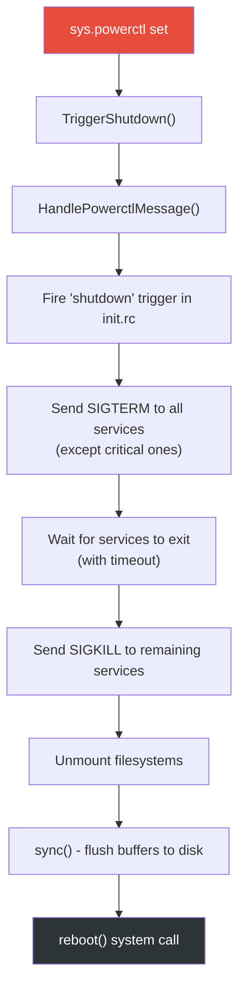

标记为 `shutdown critical` 的服务是最后被停止的，确保关键操作（如文件系统写入）可以在设备断电之前完成。

---

## 4.13 高级主题

### 4.13.1 挂载命名空间

Init 支持挂载命名空间，为不同的进程提供不同的文件系统视图。`SetupMountNamespaces()` 函数（在第 1198 行从 `SecondStageMain()` 中调用）创建独立的挂载命名空间：

```cpp
// system/core/init/init.cpp, line 1198
if (!SetupMountNamespaces()) {
    PLOG(FATAL) << "SetupMountNamespaces failed";
}
```

挂载命名空间用于：

- **APEX 管理**：APEX 在默认命名空间与引导命名空间中的挂载方式不同
- **供应商隔离**：供应商进程对 `/apex` 的视图可能与系统进程不同
- **linkerconfig**：不同的进程可能根据其命名空间拥有不同的链接器配置

### 4.13.2 Subcontext

Init 支持“子上下文”执行，其中某些 init 命令在一个具有不同 SELinux 上下文的独立进程中运行。这用于需要以供应商特定的 SELinux 权限运行的供应商 init 脚本。

根据 `main.cpp`（第 66-70 行）：

```cpp
// system/core/init/main.cpp, lines 66-70
if (!strcmp(argv[1], "subcontext")) {
    android::base::InitLogging(argv, &android::base::KernelLogger);
    const BuiltinFunctionMap& function_map = GetBuiltinFunctionMap();
    return SubcontextMain(argc, argv, &function_map);
}
```

子上下文进程通过套接字与 init 的主进程通信，接收要执行的命令并返回结果。这一设计允许供应商 init 脚本运行需要供应商 SELinux 权限的命令，而不必将这些权限授予 init 本身。

### 4.13.3 APEX init 脚本

APEX 可以包含自己的 init.rc 脚本。当一个 APEX 被激活时，init 会解析其脚本并将其集成到动作和服务列表中。`CreateApexConfigParser()` 函数（init.cpp 第 320-345 行）专门为 APEX 脚本创建一个解析器：

```cpp
// system/core/init/init.cpp, lines 320-345
Parser CreateApexConfigParser(ActionManager& action_manager, ServiceList& service_list) {
    Parser parser;
    auto subcontext = GetSubcontext();
    // ... read /apex/apex-info-list.xml and restrict each subcontext to the
    // APEXes that belong to its partition (PartitionMatchesSubcontext) ...
    parser.AddSectionParser("service",
        std::make_unique<ServiceParser>(&service_list, subcontext));
    parser.AddSectionParser("on",
        std::make_unique<ActionParser>(&action_manager, subcontext));
    return parser;
}
```

APEX init 脚本可以定义新的服务和动作，但它们被限制在其 SELinux 策略允许的操作范围内。在 Android 17 上，解析器还会读取 `/apex/apex-info-list.xml`。对于每个子上下文，它将接受其脚本的 APEX 集合缩小到那些分区与该子上下文匹配的 APEX。

### 4.13.4 控制消息：start/stop/restart

控制消息是系统服务在运行时启动和停止 init 管理的服务机制。控制消息映射定义在 init.cpp（第 528-542 行）中：

```cpp
// system/core/init/init.cpp, lines 528-542
static const std::map<std::string, ControlMessageFunction, std::less<>>&
    GetControlMessageMap() {
    [[clang::no_destroy]]
    static const std::map<std::string, ControlMessageFunction, std::less<>>
        control_message_functions = {
        {"sigstop_on",   [](auto* service) { service->set_sigstop(true);
                                              return Result<void>{}; }},
        {"sigstop_off",  [](auto* service) { service->set_sigstop(false);
                                              return Result<void>{}; }},
        {"oneshot_on",   [](auto* service) { service->set_oneshot(true);
                                              return Result<void>{}; }},
        {"oneshot_off",  [](auto* service) { service->set_oneshot(false);
                                              return Result<void>{}; }},
        {"start",        DoControlStart},
        {"stop",         DoControlStop},
        {"restart",      DoControlRestart},
    };
    return control_message_functions;
}
```

除了标准的 start/stop/restart 之外，控制消息还支持：

- `sigstop_on`/`sigstop_off`：启用/禁用在 fork 后向服务发送 SIGSTOP，这对于在服务运行任何代码之前附加调试器很有用
- `oneshot_on`/`oneshot_off`：动态更改服务是否在退出后重启
- `interface_start`/`interface_stop`/`interface_restart`：通过其注册的接口名而非服务名来控制服务

APEX 控制消息（`apex_load`/`apex_unload`）单独处理，允许在运行时加载和卸载 APEX init 脚本。

### 4.13.5 基于 Epoll 的事件循环架构

Init 的主循环建立在 Linux 的 `epoll` 设施之上，提供了一种高效的事件多路复用机制。这一架构值得详细研究，因为它是 init 整个运作的骨干。

epoll 实例在 `SecondStageMain()` 中创建：

```cpp
// system/core/init/init.cpp, lines 1143-1146
Epoll epoll;
if (auto result = epoll.Open(); !result.ok()) {
    PLOG(FATAL) << result.error();
}
```

三种类型的文件描述符向 epoll 注册：

1. **信号文件描述符**：SIGCHLD（子进程死亡）和 SIGTERM（关机请求）通过 `signalfd()` 转换为文件描述符事件。这避免了传统信号处理程序固有的竞争。

2. **唤醒 eventfd**：一个仅用 `EFD_CLOEXEC` 创建的 eventfd，用于在属性变化或控制消息从其他线程到达时唤醒主循环。这里重要的是它的计数器语义。Init 不关心 `WakeMainInitThread()` 被调用了多少次，只关心 epoll 是否唤醒。处理程序的 `read()` 是安全的，因为 epoll 已经报告该描述符可读。

3. **挂载事件处理程序**：监视文件系统挂载/卸载事件并相应地更新属性。

epoll 有一个“首个回调”机制，确保子进程回收总是在任何其他事件处理之前发生：

```cpp
// system/core/init/init.cpp, line 1151
epoll.SetFirstCallback(ReapAnyOutstandingChildren);
```

这防止了一个竞态条件。在这个竞态中，一个服务监视另一个服务的退出（通过 `init.svc.*` 属性），并在 init 回收僵尸进程之前请求重启。

主循环的结构（第 1289-1331 行）遵循经典的事件驱动模式：

1. 检查待处理的关机
2. 执行一个排队的动作（来自 init.rc 触发器）
3. 处理进程重启和超时
4. 根据待处理的工作计算睡眠超时
5. 在 epoll 上等待（带超时）
6. 处理控制消息

每次迭代只执行一个动作的设计（第 1305 行，`am.ExecuteOneCommand()`）是有意的：它防止任何单个动作突发使信号处理或属性处理饥饿。如果还有更多动作待处理，下一个动作时间被设置为“现在”，这会使 epoll 立即返回。

当没有待处理的工作时，init 调用 `mallopt(M_PURGE_ALL, 0)`（第 1330 行）将内存释放回内核。这是一个小而重要的优化。在稳定状态运行期间（启动后），init 大部分时间是空闲的。释放它的堆页减少了系统的内存压力。

### 4.13.6 GSI（通用系统映像）检查

Init 在第二阶段启动期间检查设备是否运行 GSI（init.cpp 第 1215-1224 行）：

```cpp
// system/core/init/init.cpp, lines 1215-1224
auto is_running = android::gsi::IsGsiRunning() ? "1" : "0";
SetProperty(gsi::kGsiBootedProp, is_running);
auto is_installed = android::gsi::IsGsiInstalled() ? "1" : "0";
SetProperty(gsi::kGsiInstalledProp, is_installed);
if (android::gsi::IsGsiRunning()) {
    std::string dsu_slot;
    if (android::gsi::GetActiveDsu(&dsu_slot)) {
        SetProperty(gsi::kDsuSlotProp, dsu_slot);
    }
}
```

这些属性让 init.rc 脚本和系统服务在 GSI 上运行时能够调整行为。GSI 通常用于 VTS（供应商测试套件）测试。

---

## 4.14 Android 17 启动与 Init 变更

Android 17 重构了启动路径的若干角落。这些变更归为四个主题。一个是将 Android 特定的第一阶段挂载逻辑与 Microdroid VM 路径拆分开的重构。另一个是新的 OTA 快照后端（UBLK）。最后两个是作为 init 服务运行的桌面/x86 固件崩溃收集器，以及更细粒度的启动检测。本节逐一讲解。

### 4.14.1 第一阶段挂载重构与 mount-before-data

更早的版本只有一个 `FirstStageMount` 实现。它将 Android 特定的关注点（逻辑“超级”分区、DSU、Virtual A/B snapuserd 守护进程、overlay、dm-verity）与通用挂载逻辑混合在一起。Android 17 将其拆分为一个类层次结构，使轻量级的 Microdroid VM 环境不再需要携带仅属于 Android 的代码。

基类 `FirstStageMount` 位于 `system/core/init/first_stage_mount.h` 和 `first_stage_mount.cpp` 中。它持有与设备无关的步骤——读取 fstab、创建所需的块设备、挂载分区——并暴露子类填充的虚拟钩子：

标题：第一阶段挂载类层次结构

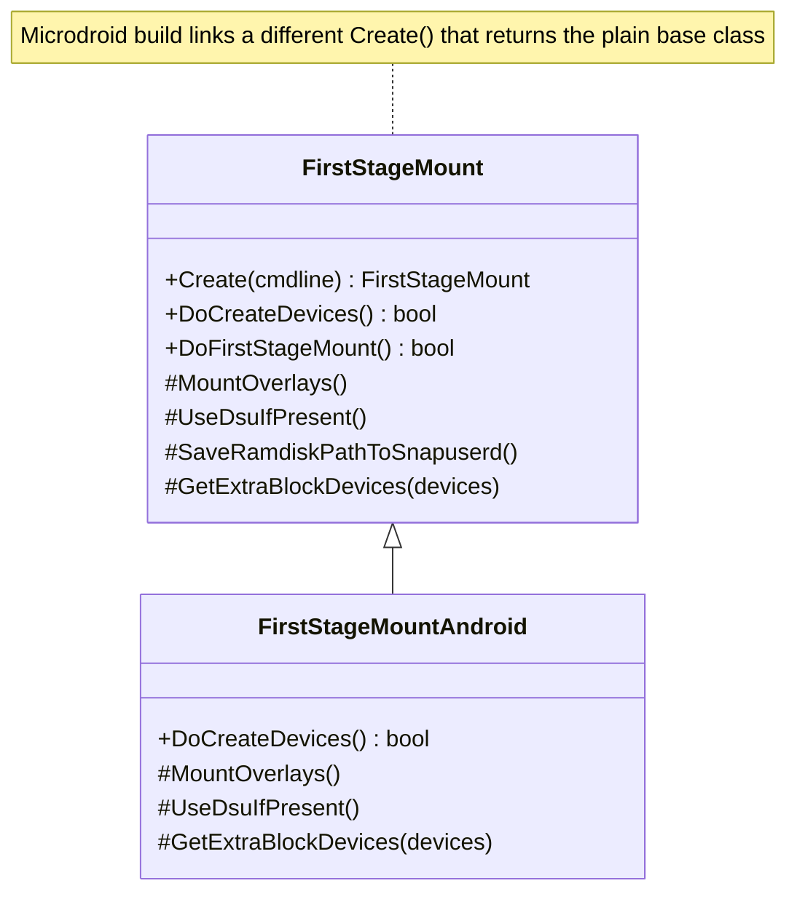

工厂方法 `FirstStageMount::Create()` 有两个在构建时互斥的定义。Android 构建链接 `system/core/init/first_stage_mount_android.cpp`（第 48 行）。它读取默认 fstab，判断 `/data` 是否由 `userdata` 分区支撑，将 fstab 过滤为第一阶段条目，并返回一个 `FirstStageMountAndroid`。Microdroid 构建则链接 `system/core/init/first_stage_mount_microdroid.cpp`，其 `Create()` 返回一个基于 microdroid 特定 fstab 的普通基类 `FirstStageMount`。最终效果是 `first_stage_init.cpp` 调用相同的 `CreateFirstStageMount()` -> `DoCreateDevices()` -> `DoFirstStageMount()` 序列，就像之前一样。但重量级的仅 Android 逻辑现在被隔离在子类中，而不是被编译进 Microdroid VM 映像。

这一重构启用了 **mount-before-data** 优化。当设置了 `com.android.apex.flags.mount_before_data` 构建标志时，apexd 可以在 `/data` 被挂载之前激活 APEX。这从关键的启动路径上削去了时间。

apexd 需要支撑 `/data` 的块设备。因此 `FirstStageMountAndroid` 通过 `GetExtraBlockDevices()` 钩子预先初始化 `userdata` 设备（见 4.9.5 节）。这避免了让 apexd 等待 `/dev/block/by-name/userdata` 符号链接出现。由此隐含的引导和默认挂载命名空间在 `system/core/init/mount_namespace.cpp` 中设置（第 92 行和第 208 行的 `mount_before_data` 分支）。注意，在 DSU/GSI 上 mount-before-data 被有意禁用，因为这些地方的分区布局与正常启动不同。

第一阶段 init 还新增了一个休眠-恢复钩子。`system/core/init/first_stage_init.cpp` 中的 `MaybeResumeFromHibernation()`（第 472 行，从 `FirstStageMain()` 调用）从 bootconfig 读取 `androidboot.hibernation_resume_device`，并且在存在时将其写入 `/sys/power/resume`。这让内核可以恢复休眠映像，而不是执行完整的冷启动。

### 4.14.2 UBLK：新的 OTA 快照后端

Virtual A/B OTA 将更新应用到非活动分区，作为写时复制（COW）快照，在运行时由一个用户空间守护进程服务。历史上该守护进程附加到 `dm-user` 块设备。Android 17 引入 **UBLK**（用户空间块设备）作为替代后端：COW 快照可以通过内核的 `ublk` 驱动程序而不是 `dm-user` 来服务。

这一选择通过更新负载传递。`system/update_engine/update_metadata.proto` 添加了一个 `disable_ublk` 字段（动态分区元数据的第 8 个字段）：

```proto
// system/update_engine/update_metadata.proto, lines 385-387
// Whether to disable UBLK for OTA. This will force dm-user as OTA backend
// choice even if device was configured for UBLK based snapshots.
optional bool disable_ublk = 8;
```

因此，一个设备可以被*配置*为基于 UBLK 的快照，而 OTA 负载仍然可以用 `disable_ublk` 强制走 dm-user 路径。成功更新后，update_engine 会报告是否实际使用了 UBLK。清理动作读取 `report.ublk_used()` 并将其合并到 OTA 指标中（`system/update_engine/aosp/cleanup_previous_update_action.cc`，约第 500 行）。在 init 一侧，snapuserd 过渡（在 4.3.3 节中描述）在 SELinux 设置期间的策略加载之后重新附加快照守护进程。UBLK 的工作改变了支撑这些快照设备的内核机制。它没有改变五步过渡本身。

### 4.14.3 ACPI BERT 收集器：桌面/x86 上的固件崩溃报告

Android 的桌面和 x86 形态运行在具有 UEFI/ACPI 固件的平台上。当该固件在启动期间检测到致命错误时，它会按照 ACPI APEI 规范记录一个 **BERT**（Boot Error Record Table，启动错误记录表）。Android 17 添加了一个小型 init 服务 `bert_collector`。它在下次启动时拾取该表并将其归档到 DropBox，因此它会作为崩溃报告保留下来。代码位于新仓库 `system/acpi/bert_collector` 中（改编自 ChromiumOS 崩溃报告器）。

该收集器是一个一次性守护进程，在启动后期启动，声明在 `system/acpi/bert_collector/bert_collector.rc` 中：

```
# system/acpi/bert_collector/bert_collector.rc
service bert_collector /system/bin/bert_collector
    user system
    group system
    class late_start
    oneshot
```

BERT 表只在固件遇到严重错误时才会创建。因此该服务在正常启动时什么也不做。它检查该表，找不到任何东西，然后退出。流程如下：

标题：BERT 收集器数据流

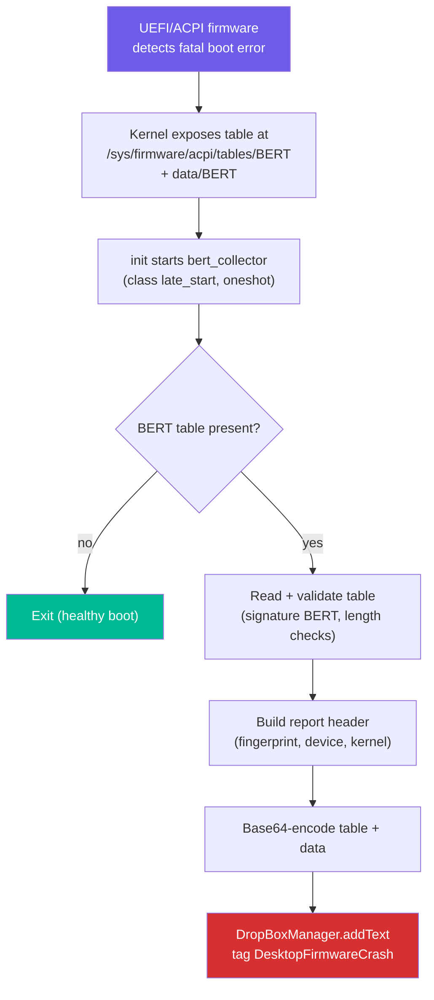

`system/acpi/bert_collector/bert_collector.cpp` 中的实现读取内核在 `/sys/firmware/acpi/tables` 下导出的两个文件：固定大小的 `BERT` 表和变长的 `data/BERT` 区域（路径定义在 `system/acpi/bert_collector/bert_collector.h` 中）。它验证该表（`BertCheckTable()` 确认 `BERT` 签名、预期的结构长度以及合理的区域长度）。它组装一份文本报告，其头部携带 `ro.build.fingerprint`、`ro.product.device`、`ro.revision` 和 `/proc/version`。然后它将原始表和数据进行 Base64 编码，放入报告正文。最后 `DumpReport()` 将报告交给 `DropBoxManager`，标签为 `DesktopFirmwareCrash`：

```cpp
// system/acpi/bert_collector/bert_collector.cpp, lines 166-178 (DumpReport)
bool DumpReport(const std::string &report, const android::String16 tag) {
  android::sp<android::os::DropBoxManager> dropbox(
      new android::os::DropBoxManager());
  android::binder::Status status = dropbox->addText(tag, report);
  // ... log and return status.isOk()
}
```

收集器将记录归档到 DropBox，因此固件崩溃会通过与墓碑（tombstone）和 ANR 相同的管道收集。错误报告和遥测随后可以将其呈现出来。崩溃不会在下次启动时丢失。该收集器被限制在拥有 ACPI 固件的平台上；在手机和其他不暴露 `/sys/firmware/acpi/tables/BERT` 的设备上它是空操作。

### 4.14.4 启动检测：事件时间戳和特性标志

Android 17 在 `system/core/init/init.aconfig` 中、`com.android.init.flags` 包下引入了 init 特性标志。两个标志与启动相关：

| 标志 | 效果 |
|---|---|
| `enable_init_event_timestamp` | 记录每个 `on <event>` 触发器的时间戳，以便启动时分析工具能够将时间归因到特定的 init 阶段 |
| `ignore_bionic_signal_profiler_before_exec` | 在 init 的子进程 `exec()` 之前忽略 bionic 信号分析器，避免在 fork/exec 窗口期间出现虚假的分析信号 |

`enable_init_event_timestamp` 标志与 4.9.2 节的 bootchart 变更搭配。早期 bootchart 可以通过 `ro.boot.bootchart.enabled` 从内核命令行开始。早期 bootchart 和按事件时间戳一起，让 Android 17 能够更细致地分解第二阶段 init 把时间花在了哪里。启用单独的跟踪不需要 userdebug 构建。

这些标志在构建时是只读的（`is_fixed_read_only: true`），因此它们对于一个给定的系统映像是固定的，而不是在运行时切换。

---

## 4.15 一张图中的完整启动序列

下图总结了本章涵盖的整个启动序列，展示了所有主要组件之间的流程：

```mermaid
flowchart TD
    subgraph "Hardware / Firmware"
        PO["Power On"]
        BROM["Boot ROM"]
        BL["Bootloader (ABL/U-Boot)"]
        AVB["Android Verified Boot<br/>Verify vbmeta → boot → vendor_boot"]
    end

    subgraph "Linux Kernel"
        KI["Kernel Init"]
        DP["Driver Probing"]
        RM["Mount initramfs"]
        PI["Launch /init (PID 1)"]
    end

    subgraph "First Stage Init"
        FS["Mount tmpfs, proc, sysfs"]
        KM["Load Kernel Modules"]
        FSM["Mount /system, /vendor<br/>(with dm-verity)"]
        FRR["Free ramdisk"]
        SEL["exec → selinux_setup"]
    end

    subgraph "SELinux Setup"
        SLP["Load SELinux Policy<br/>(split or monolithic)"]
        ENF["Set Enforcement Mode"]
        RC["restorecon /system/bin/init"]
        EX2["exec → second_stage"]
    end

    subgraph "Second Stage Init"
        PI2["Property Init"]
        PS["Start Property Service"]
        EP["Create Epoll Loop"]
        LBS["Load Boot Scripts<br/>(init.rc + all directories)"]
        TQ["Queue Triggers:<br/>early-init → init → late-init"]
    end

    subgraph "Trigger Chain"
        EI["early-init"]
        IN["init"]
        LI["late-init"]
        EFS["early-fs → fs → post-fs"]
        LFS["late-fs"]
        PFD["post-fs-data<br/>(mount /data)"]
        ZS["zygote-start"]
    end

    subgraph "Zygote"
        AP["app_process64 --zygote"]
        ART["Start ART VM"]
        PRE["Preload ~19K classes<br/>+ resources + drivers"]
        FSS["Fork system_server"]
        SSL["Enter select loop<br/>(wait for fork requests)"]
    end

    subgraph "system_server"
        SM["SystemServer.main()"]
        BS["startBootstrapServices()<br/>AMS, PMS, PowerManager, DisplayManager"]
        CS["startCoreServices()<br/>Battery, Usage, WebView"]
        OS["startOtherServices()<br/>70+ framework services"]
        AS["startApexServices()<br/>APEX-declared services"]
        P100["PHASE 100: Default Display"]
        P500["PHASE 500: System Services Ready"]
        P600["PHASE 600: Apps Can Start"]
        P1K["PHASE 1000: Boot Completed"]
    end

    subgraph "Home Screen"
        BC["sys.boot_completed=1"]
        BA["Dismiss boot animation"]
        HL["Launch Home/Launcher"]
        UI["User Interaction"]
    end

    PO --> BROM --> BL --> AVB --> KI
    KI --> DP --> RM --> PI
    PI --> FS --> KM --> FSM --> FRR --> SEL
    SEL --> SLP --> ENF --> RC --> EX2
    EX2 --> PI2 --> PS --> EP --> LBS --> TQ
    TQ --> EI --> IN --> LI
    LI --> EFS --> LFS --> PFD --> ZS
    ZS --> AP --> ART --> PRE --> FSS
    FSS --> SSL
    FSS --> SM --> BS --> CS --> OS --> AS
    BS --> P100
    OS --> P500
    OS --> P600
    AS --> P1K
    P1K --> BC --> BA --> HL --> UI

    style PO fill:#2d3436,color:#fff
    style AVB fill:#6c5ce7,color:#fff
    style PI fill:#00b894,color:#fff
    style SEL fill:#fdcb6e,color:#333
    style EX2 fill:#fdcb6e,color:#333
    style ZS fill:#e17055,color:#fff
    style FSS fill:#d63031,color:#fff
    style P1K fill:#d63031,color:#fff
    style UI fill:#00b894,color:#fff
```

---

## 4.16 参考：架构、术语表和延伸阅读

### 4.16.1 架构洞察

启动序列揭示了 Android 的几条基本设计原则：

**通过 exec 链实现关注点分离**：第一阶段 init、SELinux 设置和第二阶段 init 都是同一个二进制文件（`/system/bin/init`）。它们通过 `exec()` 作为独立的进程映像执行。每个阶段都有专注的职责，以及通向下一阶段的、定义良好的接口（通过命令行参数和环境变量）。

**事件驱动的单线程主循环**：Init 的主循环为了确定性而有意设计为单线程。属性、信号和定时器都通过 epoll 多路复用。唯一多线程的部分是属性服务线程，它通过 eventfd 与主循环通信。

**基于 fork 的进程创建**：Zygote 的 fork 模型是使 Android 的应用启动时间成为可能的关键优化。Zygote 一次性付出加载框架的成本，并通过写时复制在所有应用之间共享。因此 Android 避免了每个应用独立加载框架时会发生的 2-5 秒启动惩罚。

**启动阶段推进**：system_server 的分阶段启动允许服务执行分阶段的初始化。一个服务可以在其构造函数期间做基本设置。然后它可以等待 `PHASE_SYSTEM_SERVICES_READY` 再访问其他服务。它可以等待 `PHASE_BOOT_COMPLETED` 再假设系统完全运行。这消除了如果服务试图使用尚未启动的其他服务时会发生的与时间相关的错误。

**作为协调机制的属性触发器**：属性系统在启动期间充当轻量级的发布-订阅机制。服务通过设置属性（例如 `init.svc.zygote=running`）来宣告其状态，init.rc 触发器响应这些状态变化以编排启动序列。当需要严格排序时，`wait_for_prop` 命令提供同步等待。

**纵深防御**：启动序列实现了多层安全：

- AVB 确保只有经过验证的代码运行
- dm-verity 提供运行时完整性检查
- SELinux 将每个进程限制在其安全域中
- 属性系统对所有配置变更强制执行 MAC
- 服务以最小权限运行（用户/组/能力）

本章引用的源文件是 Android 启动过程的权威文档。当代码发生变化时，这些文档也随之变化。因此，阅读实际的源代码总是比任何外部文档（包括本书）更可靠。

### 4.16.2 术语表

| 术语 | 定义 |
|---|---|
| **ABL** | Android Bootloader；高通基于 UEFI 的引导加载程序 |
| **APEX** | Android Pony EXpress；可更新的系统组件包 |
| **AVB** | Android Verified Boot；信任链验证系统 |
| **BPF** | Berkeley Packet Filter；内核级数据包过滤 |
| **DTB** | Device Tree Blob；面向内核的硬件描述 |
| **dm-verity** | Device-mapper verity；运行时文件系统完整性验证 |
| **epoll** | Linux I/O 事件通知设施 |
| **fstab** | Filesystem table；描述挂载点和选项 |
| **GKI** | Generic Kernel Image；标准化的 Android 内核 |
| **GSI** | Generic System Image；用于测试的标准化系统分区 |
| **init.rc** | Init 配置文件语言 |
| **PID 1** | 第一个用户空间进程；Android 中的 init |
| **RPMB** | Replay Protected Memory Block；eMMC/UFS 上的安全存储 |
| **SELinux** | Security-Enhanced Linux；强制访问控制 |
| **SoC** | System on Chip；集成了 CPU、GPU 等的集成电路 |
| **USAP** | Unspecialized App Process；预先 fork 的 Zygote 子进程 |
| **VBMeta** | Verified Boot Metadata；已签名分区验证数据 |
| **Zygote** | 预加载框架并 fork 所有应用进程的进程 |
| **system_server** | 承载 100 多个系统服务的中央框架进程 |

### 4.16.3 延伸阅读

要继续探索本章涵盖的主题：

- **第 22 章**将介绍 Android 的进程管理，以及 ActivityManagerService 如何管理 Zygote 创建的应用程序进程的生命周期
- **第 9 章**将考察 system_server 服务用于与应用程序通信的 Binder IPC 机制
- `system/core/init/README.md` 中的 Android 源代码包含关于 init.rc 语言的额外文档
- `external/avb/README.md` 文件提供了关于 AVB 协议和工具的详细文档

---

## 4.17 动手实践：添加一个自定义 Init 服务

现在你了解了完整的启动序列。本练习添加一个自定义原生守护进程，在启动期间启动。

### 4.17.1 第 1 步：编写原生守护进程

创建一个简单的守护进程，每隔几秒向内核日志记录一条消息。

创建文件 `device/generic/car/mybootdaemon/mybootdaemon.cpp`：

```cpp
// device/generic/car/mybootdaemon/mybootdaemon.cpp
#include <android-base/logging.h>
#include <unistd.h>

int main(int /* argc */, char** argv) {
    // Initialize logging to the kernel log (kmsg).
    android::base::InitLogging(argv, &android::base::KernelLogger);

    LOG(INFO) << "mybootdaemon: Starting up!";

    // A real daemon would do useful work here.
    // This example simply logs heartbeat messages.
    int counter = 0;
    while (true) {
        LOG(INFO) << "mybootdaemon: heartbeat #" << counter++;
        sleep(10);
    }

    // Unreachable, but good practice.
    return 0;
}
```

### 4.17.2 第 2 步：创建构建文件

创建 `device/generic/car/mybootdaemon/Android.bp`：

```json
cc_binary {
    name: "mybootdaemon",
    srcs: ["mybootdaemon.cpp"],
    shared_libs: [
        "libbase",
        "liblog",
    ],
    init_rc: ["mybootdaemon.rc"],

    // Install to /system/bin
    vendor: false,
}
```

`init_rc` 字段告诉构建系统将我们的 init.rc 文件与二进制文件放在一起安装。构建系统会将其放在 `/system/etc/init/mybootdaemon.rc`，这是 init 在 `LoadBootScripts()` 期间解析的目录之一。

### 4.17.3 第 3 步：创建 init.rc 文件

创建 `device/generic/car/mybootdaemon/mybootdaemon.rc`：

```
service mybootdaemon /system/bin/mybootdaemon
    class late_start
    user system
    group system log
    disabled
    oneshot

on property:sys.boot_completed=1
    start mybootdaemon
```

让我们检查每个指令：

- **`service mybootdaemon`**：声明服务名
- **`/system/bin/mybootdaemon`**：可执行文件路径
- **`class late_start`**：属于 `late_start` 类，该类在 `zygote-start` 之后启动
- **`user system`**：以 `system` 用户（UID 1000）运行，而非 root
- **`group system log`**：用于系统访问和日志记录的补充组
- **`disabled`**：服务不会随其类自动启动——必须被显式启动
- **`oneshot`**：服务只运行一次，如果退出则不会重启

`on property:sys.boot_completed=1` 触发器在系统完全启动后启动我们的守护进程。这是启动自定义守护进程最安全的时间，因为所有系统服务都已可用。

### 4.17.4 第 4 步：添加 SELinux 策略

对于真实设备，你必须为你的守护进程创建 SELinux 策略。没有它，SELinux 会拒绝所有操作，你的守护进程将无法运行。

创建 `device/generic/car/sepolicy/private/mybootdaemon.te`：

```
# Define the mybootdaemon domain
type mybootdaemon, domain;
type mybootdaemon_exec, exec_type, file_type, system_file_type;

# Allow init to transition to our domain when starting the service
init_daemon_domain(mybootdaemon)

# Allow basic logging
allow mybootdaemon kmsg_device:chr_file { open write };

# Allow reading system properties
get_prop(mybootdaemon, default_prop)
```

并将文件上下文添加到 `device/generic/car/sepolicy/private/file_contexts`：

```
/system/bin/mybootdaemon      u:object_r:mybootdaemon_exec:s0
```

### 4.17.5 第 5 步：构建和测试

将模块添加到你的设备 makefile（例如 `device/generic/car/device.mk`）：

```makefile
PRODUCT_PACKAGES += mybootdaemon
```

构建系统映像：

```bash
source build/envsetup.sh
lunch <your_target>
m mybootdaemon
```

对于完整的系统映像构建：

```bash
m
```

### 4.17.6 第 6 步：验证

烧录映像或启动模拟器后：

```bash
# Check that the service is defined
adb shell getprop init.svc.mybootdaemon
# Expected: "running" (after boot completes)

# Check that the daemon process is alive (it registers no binder
# service, so it will not appear in `service list`)
adb shell ps -A | grep mybootdaemon

# View the daemon's log output
adb shell dmesg | grep mybootdaemon
# Expected output:
# mybootdaemon: Starting up!
# mybootdaemon: heartbeat #0
# mybootdaemon: heartbeat #1

# Manually stop and start the service
adb shell setprop ctl.stop mybootdaemon
adb shell getprop init.svc.mybootdaemon
# Expected: "stopped"

adb shell setprop ctl.start mybootdaemon
adb shell getprop init.svc.mybootdaemon
# Expected: "running"
```

### 4.17.7 常见陷阱

**问题：服务以 "permission denied" 启动失败**

这几乎总是 SELinux 问题。检查审计日志：

```bash
adb shell dmesg | grep "avc: denied"
```

使用 `audit2allow` 生成必要的策略规则。

**问题：服务启动但立即退出**

检查 init 是否在杀死服务。查找 `SVC_RESTARTING` 标志：

```bash
adb shell getprop init.svc.mybootdaemon
```

如果显示 "restarting"，说明你的服务正在崩溃。检查 logcat 和 dmesg 以获取崩溃信息。如果你的服务是 `oneshot` 并且正常退出，状态将是 "stopped"——这是预期行为。

**问题：服务在依赖项就绪之前启动**

使用属性触发器来控制启动。例如，要等待网络栈：

```
on property:sys.boot_completed=1 && property:init.svc.netd=running
    start mybootdaemon
```

**问题：服务以错误的 SELinux 上下文运行**

验证文件上下文：

```bash
adb shell ls -Z /system/bin/mybootdaemon
# Expected: u:object_r:mybootdaemon_exec:s0
```

并验证进程上下文：

```bash
adb shell ps -eZ | grep mybootdaemon
# Expected: u:r:mybootdaemon:s0
```

### 4.17.8 理解服务状态

Init 通过一组状态标志跟踪每个服务。理解这些状态对调试服务启动问题至关重要：

| 状态 | 属性值 | 含义 |
|---|---|---|
| `stopped` | `init.svc.<name>=stopped` | 服务未运行 |
| `running` | `init.svc.<name>=running` | 服务正在运行 |
| `stopping` | `init.svc.<name>=stopping` | 服务正在被停止 |
| `restarting` | `init.svc.<name>=restarting` | 服务将在延迟后重启 |

没有 `starting` 值。fork 在 `Service::Start()` 内部同步发生。因此属性直接从 `stopped`（或 `restarting`）移动到 `running`。失败的 fork 使其保持之前的值。

状态机：

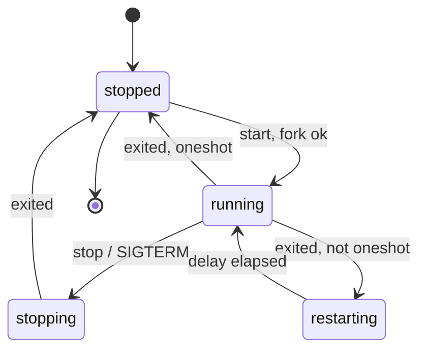

重启延迟（默认：5 秒）防止崩溃的服务通过紧密循环重启来耗尽所有 CPU。这个延迟可以用 `restart_period` 选项为每个服务定制。

`HandleProcessActions()` 函数（init.cpp 第 390-418 行）驱动重启逻辑：

```cpp
// system/core/init/init.cpp, lines 390-418
static std::optional<boot_clock::time_point> HandleProcessActions() {
    std::optional<boot_clock::time_point> next_process_action_time;
    for (const auto& s : ServiceList::GetInstance()) {
        if ((s->flags() & SVC_RUNNING) && s->timeout_period()) {
            auto timeout_time = s->time_started() + *s->timeout_period();
            if (boot_clock::now() > timeout_time) {
                s->Timeout();
            } else {
                if (!next_process_action_time ||
                    timeout_time < *next_process_action_time) {
                    next_process_action_time = timeout_time;
                }
            }
        }

        if (!(s->flags() & SVC_RESTARTING)) continue;

        auto restart_time = s->time_started() + s->restart_period();
        if (boot_clock::now() > restart_time) {
            if (auto result = s->Start(); !result.ok()) {
                LOG(ERROR) << "Could not restart process '" << s->name()
                           << "': " << result.error();
            }
        } else {
            if (!next_process_action_time ||
                restart_time < *next_process_action_time) {
                next_process_action_time = restart_time;
            }
        }
    }
    return next_process_action_time;
}
```

该函数遍历所有服务，检查两个条件：

1. **超时**：如果一个正在运行的服务有 `timeout_period` 并且已经超过它，该服务会被杀死
2. **重启**：如果一个服务处于 `SVC_RESTARTING` 状态并且重启延迟已经过去，该服务会被重启

该函数返回它下次需要运行的时间，用于在主循环中设置 epoll 超时。

### 4.17.9 高级：制作一个持久化守护进程

要创建一个在崩溃时被 init 自动重启的守护进程，修改 rc 文件：

```
service mybootdaemon /system/bin/mybootdaemon
    class late_start
    user system
    group system log

on property:sys.boot_completed=1
    enable mybootdaemon
    class_start late_start
```

如果没有 `oneshot` 指令，init 会在服务退出时自动重启它。使用 `enable` 命令而不是 `start`，以便允许服务随其类一起启动。

对于在崩溃次数过多时应该触发设备重启的关键服务：

```
service mybootdaemon /system/bin/mybootdaemon
    class late_start
    user system
    group system log
    critical
```

`critical` 指令告诉 init，如果服务在四分钟内崩溃超过四次，就重启设备。这是与 Zygote 本身使用的相同机制。

---

## 总结

本章追踪了从上电到主屏幕的完整 Android 启动序列：

1. **引导加载程序**使用 AVB（`external/avb/libavb/`）加载并验证内核
2. **Linux 内核**以 PID 1 启动 `/init`
3. **第一阶段 init**（`system/core/init/first_stage_init.cpp`）挂载分区并加载内核模块
4. **SELinux 设置**（`system/core/init/selinux.cpp`）加载安全策略并过渡到正确的安全域
5. **第二阶段 init**（`system/core/init/init.cpp`）解析 init.rc 文件，启动属性服务，并启动所有原生守护进程
6. **Zygote**（`frameworks/base/cmds/app_process/app_main.cpp` 和 `frameworks/base/core/java/com/android/internal/os/ZygoteInit.java`）预加载 Android 框架并 fork 出 `system_server`
7. **system_server**（`frameworks/base/services/java/com/android/server/SystemServer.java`）分四个阶段启动 100 多个系统服务，推进启动阶段里程碑，直到 `PHASE_BOOT_COMPLETED`

关键架构洞察：

- **两阶段 init** 解决了 SELinux 先有鸡还是先有蛋的问题：第一阶段在策略加载之前运行，第二阶段在完整的强制管控下运行
- **init.rc 触发器链**（`early-init` -> `init` -> `late-init` -> `early-fs` -> `fs` -> `post-fs` -> `post-fs-data` -> `zygote-start` -> `boot`）强制整个启动序列的依赖顺序
- **Zygote 的 fork 模型**通过预加载框架代码的写时复制内存共享，实现了快速的应用启动
- **system_server 中的启动阶段推进**允许服务根据其他哪些服务可用来进行分阶段初始化
- **属性系统**既充当配置存储又充当 IPC 机制，属性触发器驱动了大部分启动编排

### 关键源文件参考

下表提供了本章讨论的每个源文件的全面参考：

| 文件路径 | 用途 | 章节 |
|---|---|---|
| `system/core/init/first_stage_main.cpp` | 第一阶段 init 入口点 | 4.3.1 |
| `system/core/init/first_stage_init.cpp` | 第一阶段 init 实现 | 4.3.2 |
| `system/core/init/main.cpp` | Init 调度（所有模式） | 4.3.1 |
| `system/core/init/init.cpp` | 第二阶段 init + 主循环 | 4.3.5 |
| `system/core/init/selinux.cpp` | SELinux 策略加载 | 4.3.3 |
| `system/core/init/property_service.cpp` | 属性服务实现 | 4.3.6, 4.7 |
| `system/core/rootdir/init.rc` | 主 init.rc 配置 | 4.3.7 |
| `system/core/rootdir/init.zygote64.rc` | 64 位 Zygote 服务定义 | 4.3.7 |
| `system/core/rootdir/init.zygote64_32.rc` | 双 Zygote（64+32）定义 | 4.3.7 |
| `frameworks/base/cmds/app_process/app_main.cpp` | Zygote 原生入口点 | 4.4.1 |
| `frameworks/base/core/java/com/android/internal/os/ZygoteInit.java` | Zygote Java 入口点 | 4.4.2-4.4.5 |
| `frameworks/base/services/java/com/android/server/SystemServer.java` | system_server 入口点 | 4.5 |
| `external/avb/libavb/avb_vbmeta_image.h` | VBMeta 映像格式 | 4.2.3 |
| `external/avb/libavb/avb_slot_verify.h` | 槽位验证 API | 4.2.3 |
| `external/avb/libavb/avb_hashtree_descriptor.h` | dm-verity hashtree 格式 | 4.2.3 |
