# 第 64 章：Camera2 管线

相机子系统是 AOSP 中最复杂、对性能要求最高的管线之一。一次拍照可能涉及
数十个元数据键、多个输出 Surface、3A（自动曝光、自动对焦、
自动白平衡）收敛循环、硬件 ISP 配置，以及多帧降噪。所有这些工作都在
Java 框架代码、原生 C++ `CameraService`、AIDL/HIDL HAL 接口以及
厂商芯片之间协同编排。

本章追踪从面向应用的 `CameraManager` 向下贯穿 `CameraService`、
`Camera3Device`、相机 HAL，再向上经由 `CaptureResult` 交付的完整路径。
本章提到的每一个类、回调和线程都标注了其所在 AOSP 源文件的确切位置。

---

## 64.1 Camera2 架构

### 64.1.1 四层架构栈

Camera2 子系统跨越四层：

1. **Framework Java** -- `android.hardware.camera2.*`。应用通过
   `CameraManager`、`CameraDevice`、`CameraCaptureSession`、
   `CaptureRequest` 和 `CaptureResult` 与之交互。

2. **Camera Service (C++)** -- `frameworks/av/services/camera/libcameraservice/` 中的
   `CameraService`、`CameraDeviceClient` 和
   `Camera3Device`。这个原生服务作为 `media.camera` Binder 服务运行，
   管理客户端连接、强制执行权限，并驱动 HAL。

3. **Camera HAL** -- 厂商提供的 `ICameraDevice` / `ICameraDeviceSession`
   实现（AIDL 或 HIDL）。HAL 将 Camera2 抓拍请求转换为硬件 ISP 寄存器写入。

4. **硬件 ISP / 传感器** -- 实际的图像信号处理器和传感器芯片。

### 64.1.2 端到端架构图

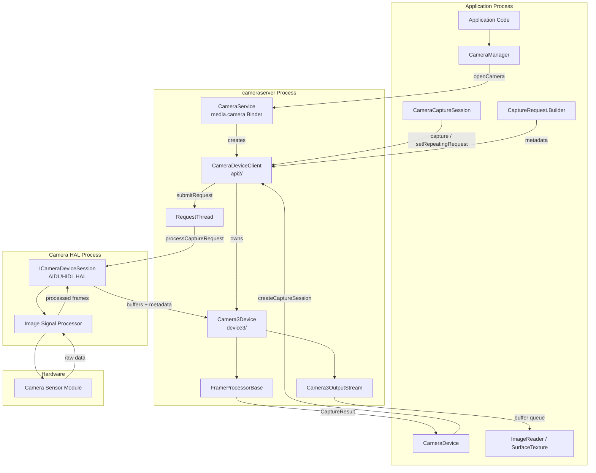

### 64.1.3 CameraManager —— 入口

`CameraManager` 是应用通过
`Context.getSystemService(Context.CAMERA_SERVICE)` 获取的系统服务。
它在源码中以 `@SystemService(Context.CAMERA_SERVICE)` 注解标注。

```
Source: frameworks/base/core/java/android/hardware/camera2/CameraManager.java
```

关键职责：

| 方法 | 用途 |
|--------|---------|
| `getCameraIdList()` | 返回可用相机 ID 的字符串数组 |
| `getCameraCharacteristics(id)` | 返回相机的静态元数据 |
| `openCamera(id, callback, handler)` | 异步打开相机设备 |
| `registerAvailabilityCallback()` | 在相机可用/不可用时通知 |
| `getConcurrentCameraIds()` | 返回可同时工作的相机 ID 集合 |

在内部，`CameraManager` 通过
`ServiceManager.getService("media.camera")` 获取 `ICameraService`
的引用并将其缓存：

```java
// Simplified from CameraManager.java
private ICameraService getCameraServiceLocked() {
    IBinder cameraServiceBinder = ServiceManager.getService("media.camera");
    ICameraService cameraService = ICameraService.Stub.asInterface(cameraServiceBinder);
    // Register a listener for device status changes
    cameraService.addListener(mCameraServiceListener);
    return cameraService;
}
```

`CameraManager` 维护三个内部缓存：

1. **设备 ID 缓存** -- 相机 ID 列表，通过
   `ICameraServiceListener.onStatusChanged()` 回调更新。

2. **特性缓存** -- 以相机 ID 为键的 `CameraCharacteristics`
   对象，在首次调用 `getCameraCharacteristics()` 时惰性填充。

3. **多分辨率配置缓存** -- 将逻辑相机 ID 映射到物理相机流配置，
   因计算需要多次 Binder 调用而进行缓存。

### 64.1.4 CameraDevice —— 设备句柄

`CameraDevice` 是表示已打开相机的抽象类。其具体实现是
`impl/` 包中的 `CameraDeviceImpl`。

```
Source: frameworks/base/core/java/android/hardware/camera2/CameraDevice.java
        frameworks/base/core/java/android/hardware/camera2/impl/CameraDeviceImpl.java
```

CameraDevice 定义了用于创建预配置抓拍请求的请求模板常量：

| 模板常量 | 值 | 用例 |
|-------------------|-------|----------|
| `TEMPLATE_PREVIEW` | 1 | 高帧率优先的预览 |
| `TEMPLATE_STILL_CAPTURE` | 2 | 质量优先的静态图像 |
| `TEMPLATE_RECORD` | 3 | 帧率稳定的视频录制 |
| `TEMPLATE_VIDEO_SNAPSHOT` | 4 | 视频录制期间的静态图像 |
| `TEMPLATE_ZERO_SHUTTER_LAG` | 5 | ZSL 抓拍 |
| `TEMPLATE_MANUAL` | 6 | 关闭全部自动功能的手动控制 |

`StateCallback` 抽象内部类提供生命周期通知：

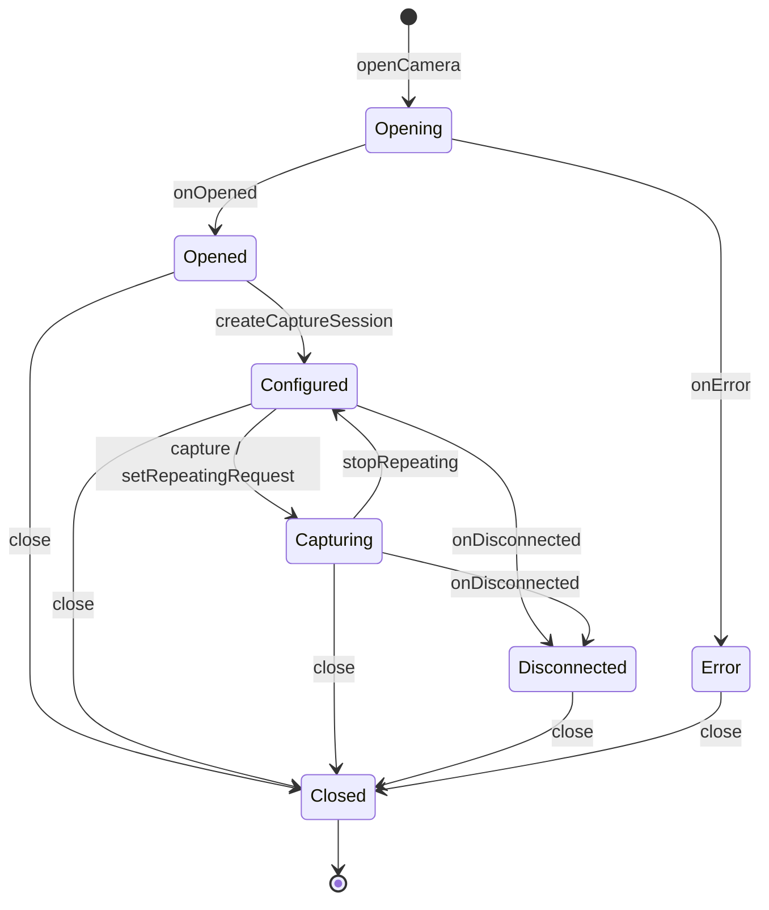

### 64.1.5 CameraDeviceImpl —— Java 侧实现

`CameraDeviceImpl` 是抽象类 `CameraDevice` 的具体实现。
它位于应用进程中，通过 `ICameraDeviceUser` Binder 接口与相机服务中的
`CameraDeviceClient` 通信。

```
Source: frameworks/base/core/java/android/hardware/camera2/impl/CameraDeviceImpl.java
```

关键内部组件：

| 组件 | 用途 |
|-----------|---------|
| `ICameraDeviceUserWrapper mRemoteDevice` | 封装指向 CameraDeviceClient 的 `ICameraDeviceUser` Binder 代理，将 `ServiceSpecificException` 转换为 `CameraAccessException` |
| `FrameNumberTracker mFrameNumberTracker` | 对结果交付排序 |
| `SparseArray<CaptureCallbackHolder> mCaptureCallbackMap` | 将序列号映射到回调 |
| `RequestLastFrameNumbersHolder` | 跟踪每种请求类型的最后一个帧号 |
| `CameraDeviceCallbacks` | 接收服务端结果的内部类 |

`CameraDeviceCallbacks` 内部类实现了
`ICameraDeviceCallbacks` AIDL 接口，是主要的结果交付路径。
当相机服务完成一帧的处理时，它会调用该回调对象上的方法：

```java
// Simplified from CameraDeviceImpl.CameraDeviceCallbacks
public class CameraDeviceCallbacks extends ICameraDeviceCallbacks.Stub {

    @Override
    public void onResultReceived(CameraMetadataInfo resultInfo,
            CaptureResultExtras resultExtras,
            PhysicalCaptureResultInfo[] physicalResults) {
        // Match result to pending request using frame number
        // Deliver partial or total result to application callback
    }

    @Override
    public void onCaptureStarted(CaptureResultExtras resultExtras,
            long timestamp) {
        // Deliver shutter callback to application
    }

    @Override
    public void onDeviceError(int errorCode, CaptureResultExtras resultExtras) {
        // Handle device errors, notify StateCallback
    }
}
```

### 64.1.6 硬件支持级别

Camera2 API 定义了硬件支持级别，用于指示设备能提供哪些功能。
可通过 `CameraCharacteristics.INFO_SUPPORTED_HARDWARE_LEVEL`
查询：

| 级别 | 说明 |
|-------|-------------|
| `LEGACY` | 向后兼容模式，仅支持最少的 Camera2 功能 |
| `LIMITED` | 大致等同于已废弃的 Camera API |
| `EXTERNAL` | 可拆卸相机（如 USB），略低于 LIMITED |
| `FULL` | 完整的 Camera2 功能集（手动控制、逐帧控制、RAW） |
| `LEVEL_3` | YUV 再处理 + RAW + 完整手动控制 + 全部 FULL 功能 |

```
Source: frameworks/base/core/java/android/hardware/camera2/CameraCharacteristics.java
        frameworks/base/core/java/android/hardware/camera2/CameraMetadata.java
```

### 64.1.7 CameraCaptureSession —— 已配置的管线

`CameraCaptureSession` 表示一组已配置的输出 Surface。
创建会话的开销很大（数百毫秒），因为相机设备必须配置其内部管线
并分配内存缓冲区。

```
Source: frameworks/base/core/java/android/hardware/camera2/CameraCaptureSession.java
        frameworks/base/core/java/android/hardware/camera2/impl/CameraCaptureSessionImpl.java
```

会话提供两种抓拍提交方式：

1. **单次抓拍** -- `capture(CaptureRequest, CaptureCallback, Handler)`。
   提交一个请求；用于静态照片。

2. **重复请求** -- `setRepeatingRequest(CaptureRequest, CaptureCallback, Handler)`。
   请求被持续重新提交，直到调用 `stopRepeating()`
   或新的重复请求将其替换。用于预览和视频。

会话还支持：

- **连拍** -- `captureBurst(List<CaptureRequest>, ...)` 原子地提交
  多个请求。

- **缓冲区预分配** -- `prepare(Surface)` 预分配输出缓冲区，
  以避免首帧分配延迟。

会话生命周期回调：

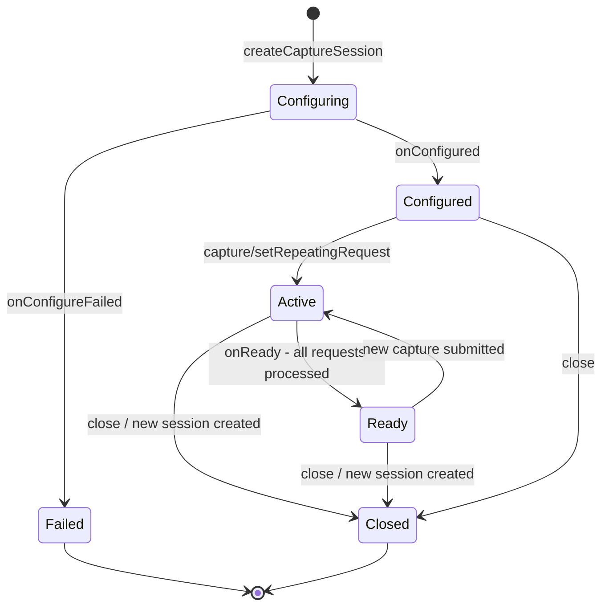

### 64.1.8 通过 OutputConfiguration 配置会话

`OutputConfiguration`（以及 `createCaptureSessionByOutputConfigurations()`）
在 API 24 引入；`SessionConfiguration` 包装器和
`createCaptureSession(SessionConfiguration)` 重载随后在 API 28 加入。
它们共同提供了对输出流设置方式的更多控制：

```
Source: frameworks/base/core/java/android/hardware/camera2/params/OutputConfiguration.java
        frameworks/base/core/java/android/hardware/camera2/params/SessionConfiguration.java
```

`OutputConfiguration` 支持：

| 特性 | 方法 | 用途 |
|---------|--------|---------|
| Surface 共享 | `enableSurfaceSharing()` | 一条流上的多个消费者 |
| 物理相机 | `setPhysicalCameraId()` | 将流路由到特定物理相机 |
| 延迟 Surface | 带 `Size` + `Class` 的构造函数 | 在 Surface 存在前配置流 |
| 组 ID | `OutputConfiguration(int, Surface)` | 对相关输出分组 |

`SessionConfiguration` 封装了完整配置：

```java
// Example: Creating a SessionConfiguration
List<OutputConfiguration> outputs = new ArrayList<>();
outputs.add(new OutputConfiguration(previewSurface));
outputs.add(new OutputConfiguration(imageReaderSurface));

SessionConfiguration config = new SessionConfiguration(
    SessionConfiguration.SESSION_REGULAR,  // or SESSION_HIGH_SPEED
    outputs,
    executor,
    stateCallback
);

cameraDevice.createCaptureSession(config);
```

### 64.1.9 无需重新配置即可更新输出 Surface（Android 17）

在 Android 17 之前，更改输出流写入哪个 `Surface` 的选项有限。
`finalizeOutputConfigurations()` 只能填充延迟 Surface 一次。
`updateOutputConfiguration()`（单个
`OutputConfiguration`，API 26）只能对使用
`enableSurfaceSharing()` 创建的输出添加或移除 Surface。
更换普通（非共享）输出的 Surface 意味着拆除会话并重建一个新会话，
这会在间隙中丢帧。Android 17 在 `CameraCaptureSession` 上新增了
`updateOutputConfigurations()`（注意是复数形式），
可在一次调用中整体替换所有已配置输出的 Surface：

```
Source: frameworks/base/core/java/android/hardware/camera2/CameraCaptureSession.java, line 1072
        frameworks/base/core/java/android/hardware/camera2/impl/CameraDeviceImpl.java, line 1289
```

```java
@FlaggedApi(Flags.FLAG_SEAMLESS_TRANSITIONS)
public void updateOutputConfigurations(@NonNull List<OutputConfiguration> configurations)
        throws CameraAccessException;
```

列表长度必须等于创建会话时的输出数量；
该调用是替换 Surface，而不是添加或删除流。每个提供的
`OutputConfiguration` 都是通过其属性（尺寸、格式等）而非身份
匹配回现有流的。因此新配置可以携带使用
`OutputConfiguration.addSurface()` 添加的新 Surface。
它也可以用 `makeDeferredAndRemoveSurfaces()` 再次标记为延迟形式。

该方法由 `FLAG_SEAMLESS_TRANSITIONS` 标志门控。
它是实现无缝用例切换背后的 API。应用无需重新运行
`createCaptureSession()`，即可更换预览 Surface，
或填充延迟的抓拍 Surface。

`CameraDeviceImpl.updateOutputConfigurations()` 中的实现会构建两张
当前已配置输出的映射。一张映射以配置原样为键，
另一张以其延迟形式为键。然后它将每个新配置匹配到一个流 ID。
匹配到的流 ID 和新配置通过一次 Binder 调用转发：

```
Source: frameworks/av/camera/aidl/android/hardware/camera2/ICameraDeviceUser.aidl, line 260
```

```aidl
void updateOutputConfigurations(in int[] streamIds, in OutputConfiguration[] configurations);
```

目标为被替换 Surface 的活动请求会被该调用停止。当一个仍有在途缓冲区的
Surface 被替换时，框架会持有旧 Surface 的弱引用（
`CameraDeviceImpl` 中的 `mReplacedOutputs`）。
这让尚未完成的缓冲区能够排空并归还，然后再拆除旧的生产者连接。
过期条目会在下一次 `updateOutputConfigurations()` 调用时被清理。

---

## 64.2 CameraService 内部剖析

### 64.2.1 CameraService —— 原生的守门人

`CameraService` 是仲裁所有相机访问的核心原生服务。
它运行在独立进程（`cameraserver`）中，以 `"media.camera"`
为名向服务管理器注册。

```
Source: frameworks/av/services/camera/libcameraservice/CameraService.h
        frameworks/av/services/camera/libcameraservice/CameraService.cpp
```

类层次结构：

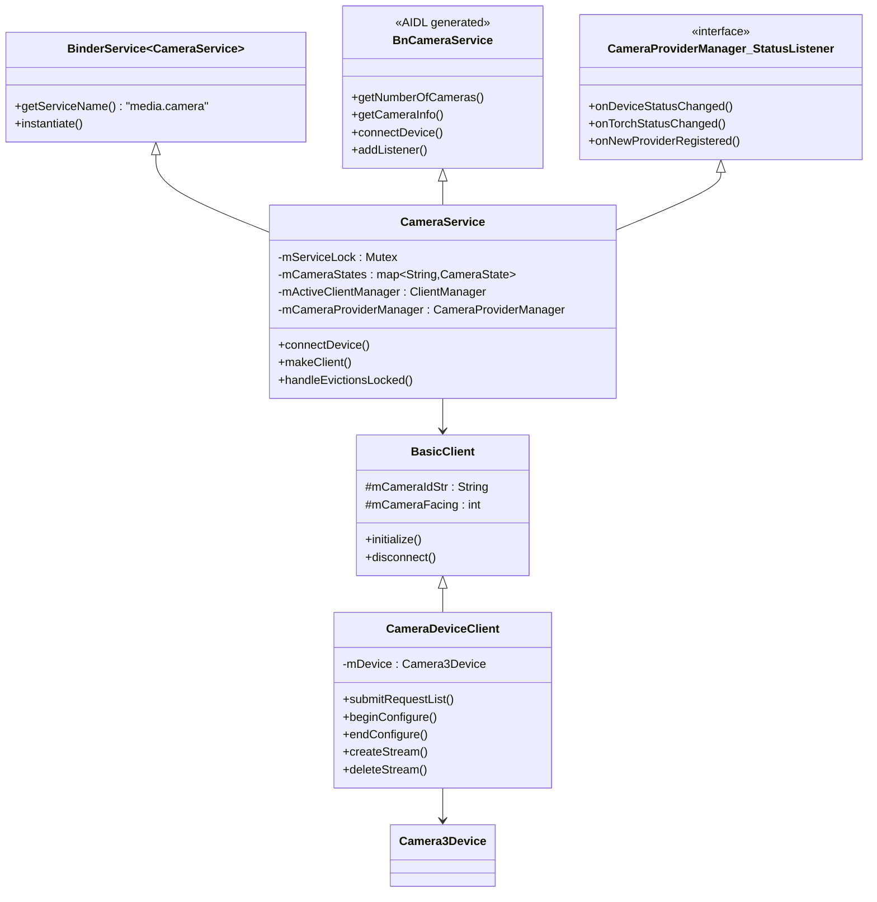

### 64.2.2 服务启动与 Provider 注册

当 `cameraserver` 启动时，`CameraService` 通过
`CameraProviderManager` 枚举相机 Provider。Provider 管理器通过
VINTF 清单发现相机 HAL 实现并建立连接：

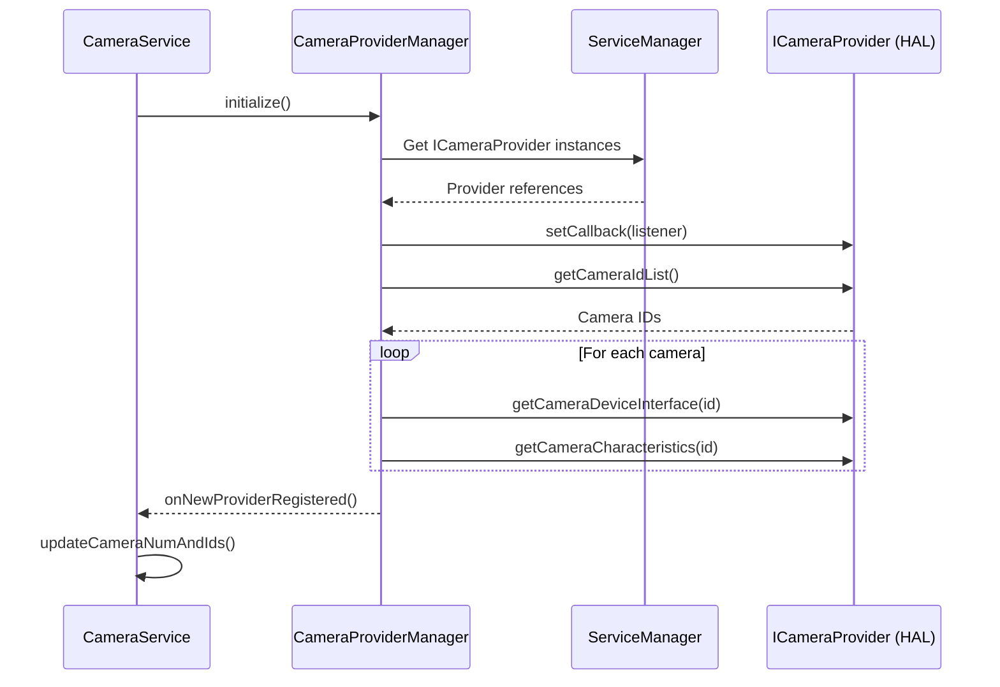

```
Source: frameworks/av/services/camera/libcameraservice/common/CameraProviderManager.h
        frameworks/av/services/camera/libcameraservice/common/CameraProviderManager.cpp
```

### 64.2.3 客户端连接与驱逐

当应用调用 `CameraManager.openCamera()` 时，Java 框架通过 AIDL
连接到 `CameraService`。服务执行多项检查，并可能驱逐现有的相机客户端：

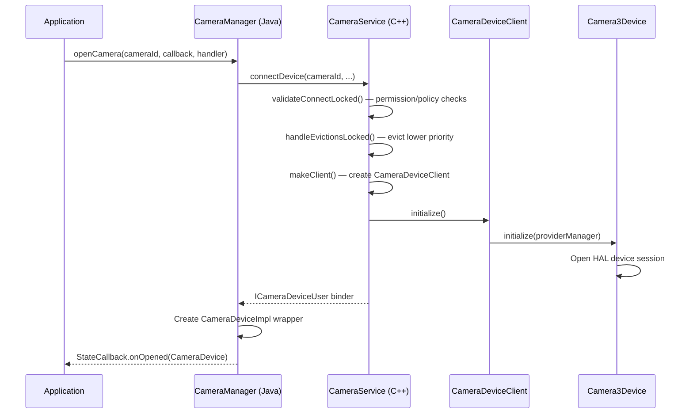

驱逐策略基于优先级：

| 优先级级别 | 说明 |
|----------------|-------------|
| 前台 Activity | 最高优先级 |
| 前台服务 | 高优先级 |
| 持久系统进程 | 高优先级 |
| 顶部 Activity（非焦点） | 中优先级 |
| 可见 Activity | 中优先级 |
| 后台进程 | 最低优先级 |

当高优先级客户端请求已被占用的相机时，
`ClientManager` 会驱逐低优先级客户端。被驱逐的客户端
会收到 `CameraDevice.StateCallback.onDisconnected()`。

```
Source: frameworks/av/services/camera/libcameraservice/utils/ClientManager.h
```

### 64.2.4 CameraDeviceClient —— API2 入口

`CameraDeviceClient` 是实现
`ICameraDeviceUser` AIDL 接口的每客户端对象。
它接收来自 Java 框架的抓拍请求，并将其转换为 `Camera3Device` 操作。

```
Source: frameworks/av/services/camera/libcameraservice/api2/CameraDeviceClient.h
        frameworks/av/services/camera/libcameraservice/api2/CameraDeviceClient.cpp
```

关键操作：

| AIDL 方法 | CameraDeviceClient 方法 | 说明 |
|-------------|---------------------------|-------------|
| `submitRequestList` | `submitRequestList()` | 提交抓拍/重复请求 |
| `beginConfigure` | `beginConfigure()` | 开始流配置 |
| `endConfigure` | `endConfigure()` | 完成流配置 |
| `createStream` | `createStream()` | 创建新的输出流 |
| `deleteStream` | `deleteStream()` | 删除输出流 |
| `waitUntilIdle` | `waitUntilIdle()` | 阻塞直到管线排空 |
| `flush` | `flush()` | 中止所有待处理请求 |

### 64.2.5 Camera3Device —— HAL 接口驱动器

`Camera3Device` 是管理 Camera HAL v3+ 接口的核心引擎。
它将框架请求转换为 HAL 抓拍请求，并将 HAL 结果路由回框架。

```
Source: frameworks/av/services/camera/libcameraservice/device3/Camera3Device.h
        frameworks/av/services/camera/libcameraservice/device3/Camera3Device.cpp
```

Camera3Device 继承自 `CameraDeviceBase` 并实现了多个接口：

```cpp
// From Camera3Device.h
class Camera3Device :
    public CameraDeviceBase,
    public camera3::SetErrorInterface,
    public camera3::InflightRequestUpdateInterface,
    public camera3::RequestBufferInterface,
    public camera3::FlushBufferInterface,
    public AttributionAndPermissionUtilsEncapsulator {
  friend class HidlCamera3Device;
  friend class AidlCamera3Device;
  // ...
};
```

它有两个传输相关的子类：

- `HidlCamera3Device` -- 用于基于 HIDL 的相机 HAL
- `AidlCamera3Device` -- 用于基于 AIDL 的相机 HAL

### 64.2.6 Camera3Device 内部线程

Camera3Device 拥有两个内部线程：`RequestThread` 和
`StatusTracker`。第三个线程 `FrameProcessorBase` 由
`CameraDeviceClient` 而非 Camera3Device 所有。它通过
`FrameProducer` 接口轮询 Camera3Device 以获取新的结果元数据。
它将这些元数据分发给已注册的监听器：

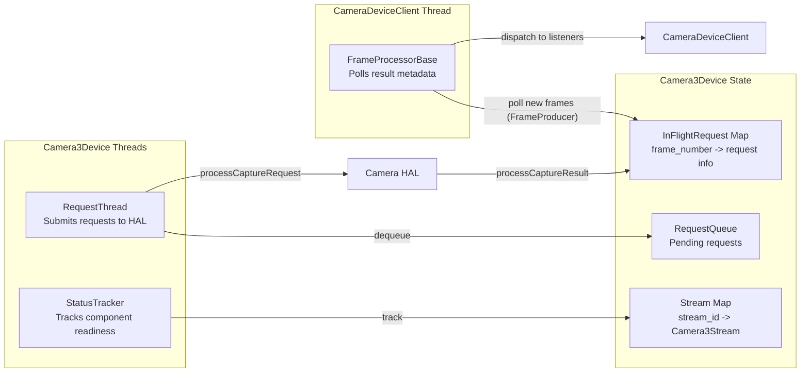

**RequestThread** 是最关键的线程。它在一个循环中运行：

1. 从请求队列中出队下一个 `CaptureRequest`
2. 应用任何逐帧元数据覆盖（3A 设置、裁剪区域等）
3. 应用流配置映射器（畸变校正、缩放比例、
   旋转裁剪）

4. 在 HAL 接口上调用 `processCaptureRequest()`
5. 在 `InFlightRequest` 映射中跟踪该请求

**FrameProcessorBase**（`api2/FrameProcessorBase.cpp`）是一个输出帧
元数据处理线程，归 `CameraDeviceClient` 所有，而非 Camera3Device：

1. 等待来自其帧生产者（即 Camera3Device，
   以 `wp<FrameProducer>` 持有）的新结果帧

2. 在就绪时检索部分和最终的 `CaptureResult` 元数据
3. 将元数据分发给已注册的 `FilteredListener`，后者将其转发到 Java

**StatusTracker** 监控所有流和 HAL 的就绪状态。
它合并状态更新，以避免"空闲"/"活动"状态频繁抖动。

### 64.2.7 元数据映射器

Camera3Device 应用多个元数据映射器，在应用坐标空间与 HAL 坐标空间之间
转换坐标和数值：

| 映射器 | 源文件 | 用途 |
|--------|-------------|---------|
| `DistortionMapper` | `device3/DistortionMapper.cpp` | 校正元数据中的镜头畸变 |
| `ZoomRatioMapper` | `device3/ZoomRatioMapper.cpp` | 将缩放比例转换为裁剪区域 |
| `RotateAndCropMapper` | `device3/RotateAndCropMapper.cpp` | 针对旋转裁剪调整元数据 |
| `UHRCropAndMeteringRegionMapper` | `device3/UHRCropAndMeteringRegionMapper.cpp` | 超高分辨率裁剪映射 |

这些映射器在请求提交和结果交付期间按顺序应用。
请求提交时，应用坐标被转换为 HAL 坐标。
结果交付时，HAL 坐标被转换回应用坐标。

### 64.2.8 CameraProviderManager —— HAL 发现

`CameraProviderManager` 负责发现、连接和管理相机 HAL Provider 服务。
它维护相机 ID 与其底层 HAL 实现之间的映射。

```
Source: frameworks/av/services/camera/libcameraservice/common/CameraProviderManager.h
        frameworks/av/services/camera/libcameraservice/common/CameraProviderManager.cpp
```

Provider 管理器同时处理 AIDL 和 HIDL HAL Provider：

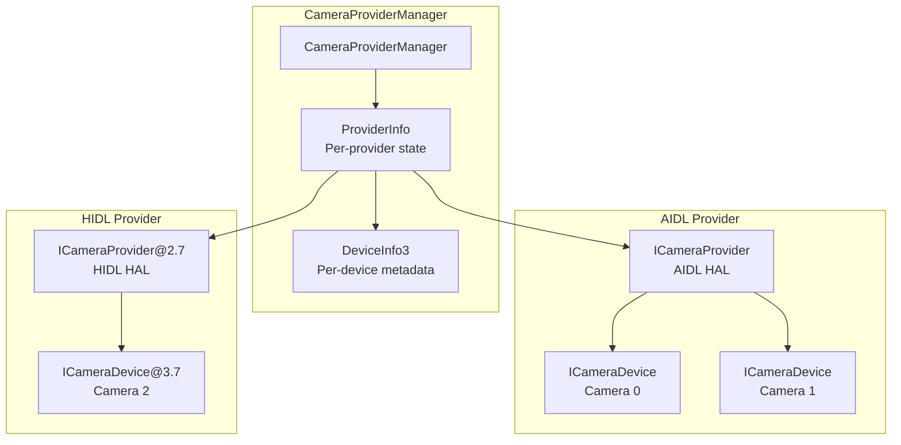

对于发现的每个相机，Provider 管理器缓存：

- **相机特性** -- 静态元数据（传感器尺寸、能力等）
- **资源开销** -- 表示该相机资源消耗的整数
- **冲突设备** -- 无法同时工作的其他相机
- **系统相机类型** -- PUBLIC、SYSTEM_ONLY_CAMERA 或 HIDDEN_SECURE_CAMERA

### 64.2.9 相机闪光灯控制

`CameraFlashlight` 独立于相机抓拍管线管理相机闪光灯（手电筒模式）：

```
Source: frameworks/av/services/camera/libcameraservice/CameraFlashlight.h
        frameworks/av/services/camera/libcameraservice/CameraFlashlight.cpp
```

手电筒模式通过框架中的 `CameraManager.setTorchMode()` 控制，
该调用会转换为 `CameraService::setTorchMode()`。
手电筒无需打开相机设备即可启用。

当应用打开相机设备时，该相机上任何已激活的手电筒都会自动关闭。
原因是 ISP 会接管闪光 LED 的控制。

### 64.2.10 CameraService 看门狗

`CameraServiceWatchdog` 是一个专用线程，用于监控相机操作是否超时。
如果相机 HAL 调用耗时超过配置的超时时间，看门狗可以触发恢复操作：

```
Source: frameworks/av/services/camera/libcameraservice/CameraServiceWatchdog.h
        frameworks/av/services/camera/libcameraservice/CameraServiceWatchdog.cpp
```

看门狗帮助检测并从厂商 HAL 挂起中恢复，这是生产设备上相机故障
最常见的原因之一。

---

## 64.3 抓拍管线

### 64.3.1 请求-结果模型

Camera2 使用完全异步的**请求-结果管线**。相机捕获的每一帧都是
应用提交的 `CaptureRequest` 的结果。
应用从不"拉取"帧——它配置所需的输出参数，相机再将结果推回。

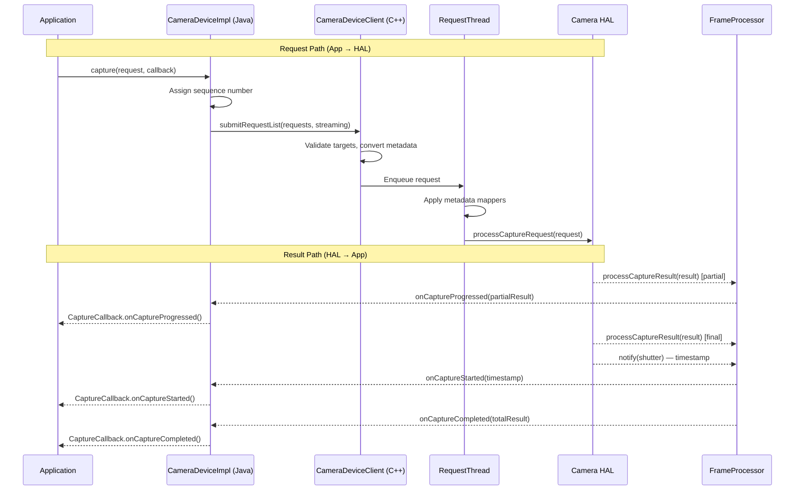

### 64.3.2 CaptureRequest 详解

`CaptureRequest` 是不可变的捆绑包，包含：

1. **目标 Surface** -- 本请求应接收图像数据的输出 Surface。

2. **元数据键** -- 数百个相机控制参数。
3. **标签** -- 可选的、应用定义的跟踪标签。
4. **物理相机设置** -- 面向逻辑多相机设备的逐物理相机覆盖。

```
Source: frameworks/base/core/java/android/hardware/camera2/CaptureRequest.java
```

`CaptureRequest.Builder` 从 `CameraDevice` 获取：

```java
// Creating a capture request
CaptureRequest.Builder builder = cameraDevice.createCaptureRequest(
    CameraDevice.TEMPLATE_STILL_CAPTURE
);
builder.addTarget(imageReaderSurface);
builder.set(CaptureRequest.CONTROL_AE_MODE, CameraMetadata.CONTROL_AE_MODE_ON);
builder.set(CaptureRequest.JPEG_QUALITY, (byte) 95);
builder.set(CaptureRequest.JPEG_ORIENTATION, orientation);
CaptureRequest request = builder.build();
```

CaptureRequest 中的关键元数据类别：

| 类别 | 示例键 | 说明 |
|----------|-------------|-------------|
| **3A 控制** | `CONTROL_AE_MODE`, `CONTROL_AF_MODE`, `CONTROL_AWB_MODE` | 自动曝光、对焦、白平衡 |
| **传感器** | `SENSOR_EXPOSURE_TIME`, `SENSOR_SENSITIVITY` | 直接传感器控制（手动模式） |
| **镜头** | `LENS_FOCAL_LENGTH`, `LENS_FOCUS_DISTANCE`, `LENS_APERTURE` | 镜头控制 |
| **缩放器** | `SCALER_CROP_REGION`, `CONTROL_ZOOM_RATIO` | 裁剪与缩放 |
| **闪光灯** | `FLASH_MODE`, `CONTROL_AE_PRECAPTURE_TRIGGER` | 闪光灯控制 |
| **JPEG** | `JPEG_QUALITY`, `JPEG_ORIENTATION`, `JPEG_THUMBNAIL_SIZE` | JPEG 编码参数 |
| **降噪** | `NOISE_REDUCTION_MODE` | 降噪级别 |
| **边缘增强** | `EDGE_MODE` | 锐化控制 |
| **色彩校正** | `COLOR_CORRECTION_MODE`, `COLOR_CORRECTION_TRANSFORM` | 色彩处理 |
| **色调映射** | `TONEMAP_MODE`, `TONEMAP_CURVE` | 色调映射控制 |

### 64.3.3 CaptureResult 详解

`CaptureResult` 包含相机设备为特定帧实际使用的设置，
以及关于抓拍的附加只读元数据：

```
Source: frameworks/base/core/java/android/hardware/camera2/CaptureResult.java
        frameworks/base/core/java/android/hardware/camera2/TotalCaptureResult.java
```

结果类型之间的区别：

| 类型 | 类 | 说明 |
|------|-------|-------------|
| **部分** | `CaptureResult` | 结果元数据的子集，提前交付 |
| **完整** | `TotalCaptureResult` | 包含所有可用元数据的完整结果 |

部分结果允许应用在完整结果就绪前收到关键元数据
（如 3A 状态），从而降低感知延迟。

关键只读结果元数据：

| 键 | 说明 |
|-----|-------------|
| `SENSOR_TIMESTAMP` | 帧曝光开始的精确时间戳 |
| `SENSOR_EXPOSURE_TIME` | 实际使用的曝光时间 |
| `SENSOR_SENSITIVITY` | 实际使用的 ISO |
| `CONTROL_AE_STATE` | AE 收敛状态（SEARCHING/CONVERGED/LOCKED） |
| `CONTROL_AF_STATE` | AF 收敛状态 |
| `CONTROL_AWB_STATE` | AWB 收敛状态 |
| `LENS_STATE` | STATIONARY 或 MOVING |
| `STATISTICS_FACES` | 检测到的人脸矩形、分数、ID |
| `STATISTICS_LENS_SHADING_MAP` | 逐通道镜头阴影校正图 |

### 64.3.4 帧号跟踪

通过管线提交的每个请求都会被分配一个单调递增的**帧号**。
这个数字将以下内容联系在一起：

- 应用提交的 `CaptureRequest`
- HAL `processCaptureRequest` 调用
- 快门通知（`notify(SHUTTER, frameNumber, timestamp)`）
- `CaptureResult` 元数据
- 输出图像缓冲区

`CameraDeviceImpl` 维护一个 `FrameNumberTracker`，
确保结果按顺序交付给应用：

```
Source: frameworks/base/core/java/android/hardware/camera2/impl/FrameNumberTracker.java
```

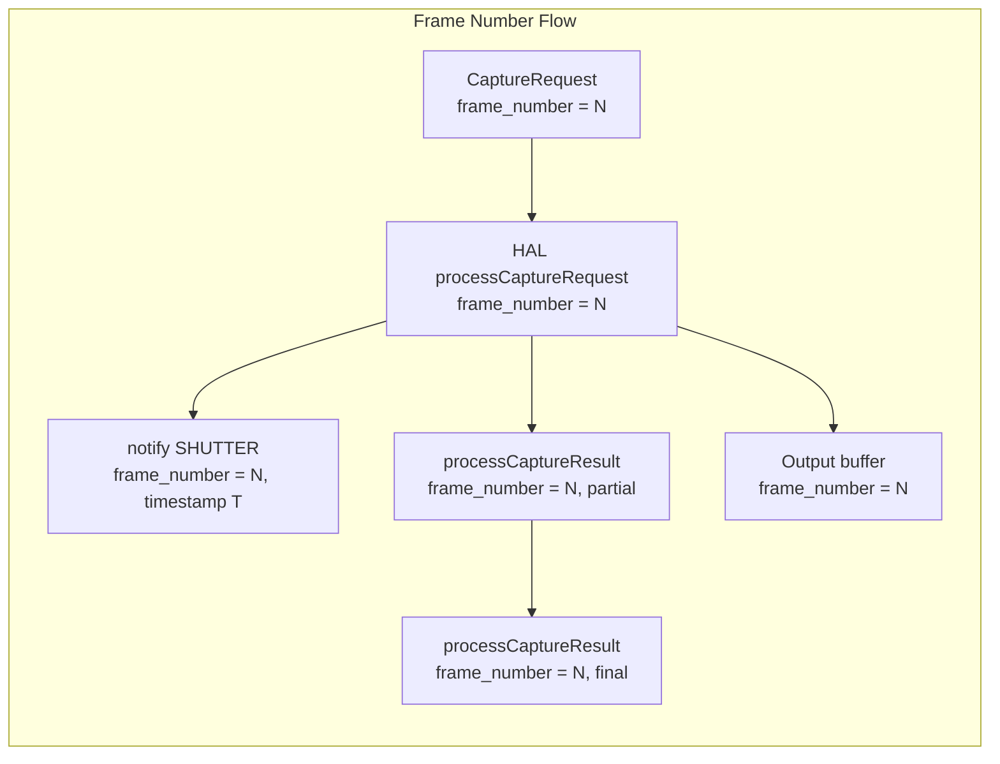

### 64.3.5 3A 收敛循环

抓拍管线最关键的环节之一是
**3A 收敛循环**。在此过程中，自动曝光（AE）、
自动对焦（AF）和自动白平衡（AWB）算法在拍照前达到稳定的设置。

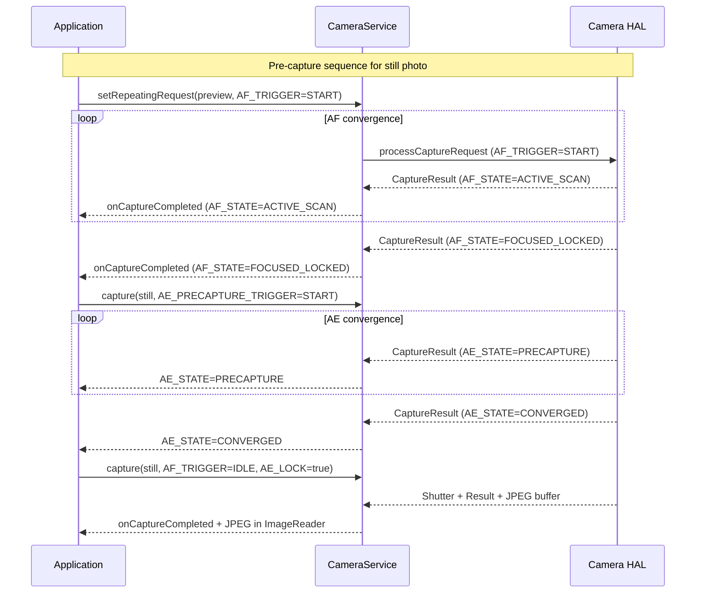

3A 状态机定义在 `CameraMetadata` 中：

**AF 状态机：**

| 状态 | 含义 |
|-------|---------|
| `INACTIVE` | AF 未做任何事 |
| `PASSIVE_SCAN` | 连续 AF 正在扫描 |
| `PASSIVE_FOCUSED` | 连续 AF 已对焦 |
| `PASSIVE_UNFOCUSED` | 连续 AF 无法找到焦点 |
| `ACTIVE_SCAN` | 触发的 AF 扫描正在进行 |
| `FOCUSED_LOCKED` | AF 锁定在目标上 |
| `NOT_FOCUSED_LOCKED` | AF 对焦失败，已锁定 |

**AE 状态机：**

| 状态 | 含义 |
|-------|---------|
| `INACTIVE` | AE 未激活 |
| `SEARCHING` | AE 正在收敛 |
| `CONVERGED` | AE 已稳定在曝光设置上 |
| `LOCKED` | AE 已锁定（用户请求） |
| `FLASH_REQUIRED` | 场景太暗，需要闪光灯 |
| `PRECAPTURE` | 预抓拍测光进行中 |

### 64.3.6 在途请求管理

`Camera3Device` 维护一个 `InFlightRequest` 映射，
跟踪 HAL 当前正在处理的每个请求：

```
Source: frameworks/av/services/camera/libcameraservice/device3/InFlightRequest.h
```

每个 `InFlightRequest` 存储：

- **帧号** -- 唯一标识符
- **请求元数据** -- 原始 CaptureRequest 设置
- **输出缓冲区跟踪** -- 哪些缓冲区已被归还
- **结果元数据** -- 累积的部分 + 最终元数据
- **快门时间戳** -- 传感器曝光开始的时间
- **错误状态** -- 是否发生过任何错误

只有在收到以下全部内容后，在途请求才会从映射中移除：

1. 快门通知
2. 所有部分结果元数据
3. 最终结果元数据
4. 所有输出缓冲区

### 64.3.7 HAL 契约

相机 HAL 必须满足严格的排序契约：

1. **快门通知** 必须按帧号顺序到达
2. **结果元数据** 必须按帧号顺序返回。
   请求 5 的元数据必须在请求 6 的元数据之前返回。
   在单个请求内部，部分结果仍可在快门通知之前或之后到达。

3. **给定流的输出缓冲区** 必须按 FIFO 顺序返回。
   流 A 上请求 5 的缓冲区必须先于流 A 上请求 6 的缓冲区。
   但不同流之间相互独立。因此流 A 上请求 5 的缓冲区
   可以合法地在流 B 上请求 6 的缓冲区之后到达。

4. 只有失败缓冲区（`BufferStatus.ERROR`）可豁免严格的
   逐流排序

5. `REQUEST_PIPELINE_MAX_DEPTH` 报告一帧从曝光到结果可用
   所经过的最大管线级数。框架用它来限制保持的在途请求数量。
   当管线已满时，`processCaptureRequest()` 可能阻塞。

```
Source: hardware/interfaces/camera/device/aidl/android/hardware/camera/device/ICameraDeviceCallback.aidl
        hardware/interfaces/camera/device/aidl/android/hardware/camera/device/ICameraDeviceSession.aidl
```

### 64.3.8 再处理

Camera2 支持再处理——将先前捕获的图像再次送回 ISP
进行附加处理（如 ZSL 抓拍）：

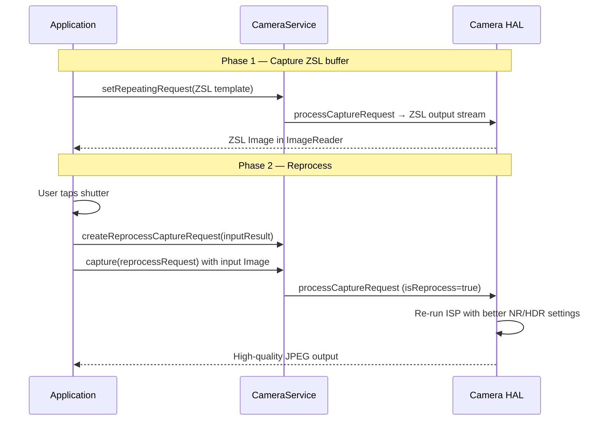

关键要求是使用 `CameraDevice.createReprocessableCaptureSession()`
创建的**可再处理抓拍会话**。该会话同时具有
输入配置（用于接收待再处理的帧）和输出配置
（用于再处理后的结果）。

### 64.3.9 DNG RAW 抓拍

Camera2 支持捕获 DNG（Digital Negative）RAW 图像，
用于专业摄影工作流：

```
Source: frameworks/base/core/java/android/hardware/camera2/DngCreator.java
```

```java
// Check RAW capability
int[] capabilities = characteristics.get(
    CameraCharacteristics.REQUEST_AVAILABLE_CAPABILITIES);
boolean hasRaw = Arrays.stream(capabilities)
    .anyMatch(c -> c == CameraMetadata.REQUEST_AVAILABLE_CAPABILITIES_RAW);

if (hasRaw) {
    // Get RAW output sizes
    StreamConfigurationMap map = characteristics.get(
        CameraCharacteristics.SCALER_STREAM_CONFIGURATION_MAP);
    Size[] rawSizes = map.getOutputSizes(ImageFormat.RAW_SENSOR);

    // Create ImageReader for RAW
    ImageReader rawReader = ImageReader.newInstance(
        rawSizes[0].getWidth(), rawSizes[0].getHeight(),
        ImageFormat.RAW_SENSOR, 2);

    // After capturing, create DNG file
    DngCreator dngCreator = new DngCreator(characteristics, captureResult);
    dngCreator.setOrientation(ExifInterface.ORIENTATION_NORMAL);
    dngCreator.setDescription("AOSP Camera2 RAW capture");
    // Write DNG to output stream
    dngCreator.writeImage(outputStream, rawImage);
    dngCreator.close();
}
```

`DngCreator` 将来自 `CameraCharacteristics` 和
`CaptureResult` 的相机校准数据、镜头校正配置、
色彩矩阵和噪声模型嵌入 DNG 文件。这使桌面 RAW 处理器
（Lightroom、RawTherapee）能够正确处理图像。

### 64.3.10 JPEG/R HDR 照片

Android 14 引入了 JPEG/R（也称 Ultra HDR），
它在标准 JPEG 文件内嵌入 HDR 增益图。相机服务通过
`JpegRCompositeStream` 实现此功能：

```
Source: frameworks/av/services/camera/libcameraservice/api2/JpegRCompositeStream.h
        frameworks/av/services/camera/libcameraservice/api2/JpegRCompositeStream.cpp
```

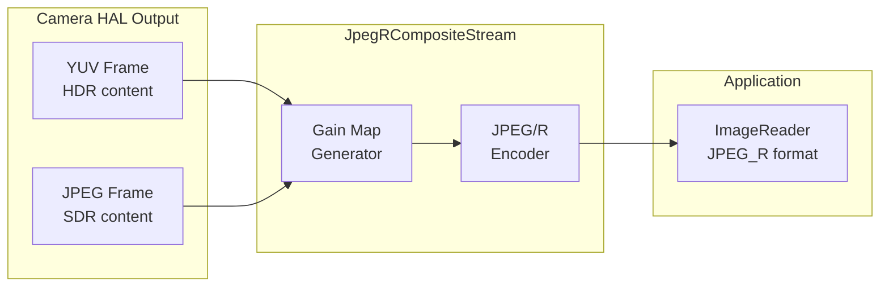

JPEG/R 文件向后兼容。不理解 HDR 的设备显示 SDR JPEG。
支持 HDR 的显示器使用增益图重建完整的 HDR 内容。

### 64.3.11 Flush 与 Idle

应用可使用两种机制排空管线：

- **`flush()`** -- 尽快中止所有待处理和进行中的请求。
  部分完成的请求以错误状态返回。
  用于切换模式或关闭相机时。

- **`waitUntilIdle()`** -- 阻塞直到所有已提交请求正常完成。
  在重复请求激活时不可调用。

```
Source: frameworks/av/services/camera/libcameraservice/device3/Camera3Device.cpp
  → Camera3Device::flush()
  → Camera3Device::waitUntilStateThenRelock()
```

---

## 64.4 图像流

### 64.4.1 流架构

Camera2 通过**流**交付图像数据。每个流由一个 BufferQueue
（生产者-消费者对）支撑，并在相机服务中由
`Camera3Stream` 子类表示：

```
Source: frameworks/av/services/camera/libcameraservice/device3/Camera3Stream.h
        frameworks/av/services/camera/libcameraservice/device3/Camera3Stream.cpp
        frameworks/av/services/camera/libcameraservice/device3/Camera3OutputStream.h
        frameworks/av/services/camera/libcameraservice/device3/Camera3OutputStream.cpp
        frameworks/av/services/camera/libcameraservice/device3/Camera3InputStream.h
        frameworks/av/services/camera/libcameraservice/device3/Camera3InputStream.cpp
```

流类型：

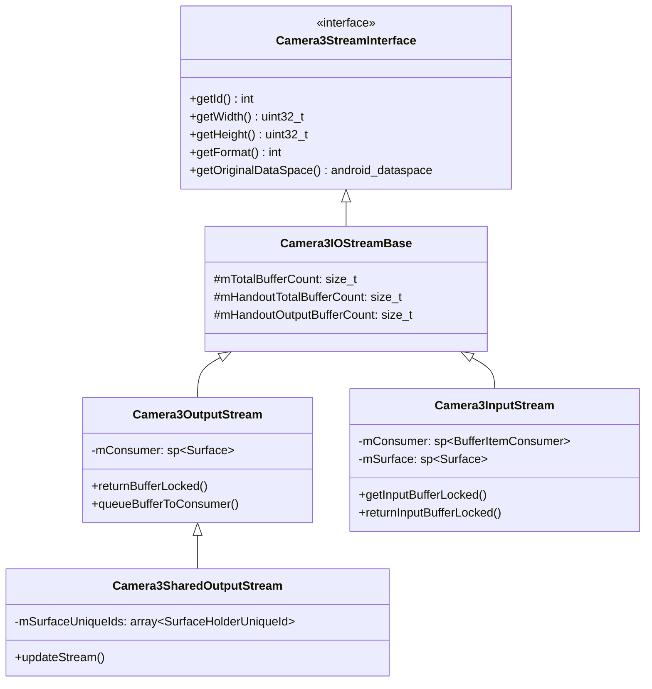

### 64.4.2 ImageReader

`ImageReader` 是应用接收相机图像数据进行处理
（而非用于显示）的主要机制：

```java
// Creating an ImageReader for JPEG capture
ImageReader imageReader = ImageReader.newInstance(
    4032, 3024,        // width x height
    ImageFormat.JPEG,  // format
    2                  // maxImages
);

imageReader.setOnImageAvailableListener(reader -> {
    Image image = reader.acquireLatestImage();
    if (image != null) {
        ByteBuffer buffer = image.getPlanes()[0].getBuffer();
        byte[] jpegBytes = new byte[buffer.remaining()];
        buffer.get(jpegBytes);
        // Save JPEG bytes
        image.close();
    }
}, backgroundHandler);
```

ImageReader 支持多种像素格式：

| 格式 | `ImageFormat` 常量 | 用例 |
|--------|----------------------|----------|
| JPEG | `JPEG` | 压缩的静态照片 |
| YUV_420_888 | `YUV_420_888` | 用于分析的灵活 YUV |
| RAW_SENSOR | `RAW_SENSOR` | Bayer 阵列原始数据 |
| RAW10 | `RAW10` | 10 位打包原始数据 |
| DEPTH16 | `DEPTH16` | 深度图 |
| DEPTH_POINT_CLOUD | `DEPTH_POINT_CLOUD` | 点云数据 |
| HEIC | `HEIC` | HEIF 编码的静态照片 |
| JPEG_R | `JPEG_R` | 嵌入增益图的 JPEG（HDR） |
| PRIVATE | `PRIVATE` | 用于预览/视频的不透明格式 |

```
Source: frameworks/base/core/java/android/media/ImageReader.java
        frameworks/base/core/jni/android_media_ImageReader.cpp
```

### 64.4.3 用于预览的 SurfaceTexture

对于相机预览，应用通常使用 `SurfaceTexture`（通过
`TextureView` 访问）或 `SurfaceView`。相机以 `PRIVATE`
格式传输帧，GPU 可直接合成：

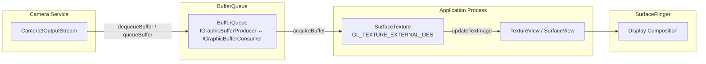

预览流使用 `PRIVATE` 格式，因为：

1. 确切的像素布局与设备相关（GPU 优化）
2. 无需 CPU 访问——像素直接从 ISP 到显示
3. 它避免了格式转换的开销

### 64.4.4 同时多流

Camera2 支持多个同时输出的流。有保障的流组合取决于硬件级别。
对于 `FULL` 设备，最小保障组合包括：

| 预览 | 静态抓拍 | 录制 | 分析 |
|---------|---------------|-----------|----------|
| `PRIVATE/MAXIMUM` | | | |
| `PRIVATE/PREVIEW` | `JPEG/MAXIMUM` | | |
| `PRIVATE/PREVIEW` | `PRIVATE/PREVIEW` | | |
| `PRIVATE/PREVIEW` | `YUV/PREVIEW` | | |
| `PRIVATE/PREVIEW` | `JPEG/MAXIMUM` | | `YUV/PREVIEW` |
| `PRIVATE/PREVIEW` | | `PRIVATE/MAXIMUM` | |
| `PRIVATE/PREVIEW` | `JPEG/MAXIMUM` | `PRIVATE/PREVIEW` | |

应用可通过 `CameraCharacteristics.SCALER_STREAM_CONFIGURATION_MAP`
查询确切支持的组合：

```java
StreamConfigurationMap map = characteristics.get(
    CameraCharacteristics.SCALER_STREAM_CONFIGURATION_MAP);

// Get supported output sizes for JPEG
Size[] jpegSizes = map.getOutputSizes(ImageFormat.JPEG);

// Get supported output sizes for preview
Size[] previewSizes = map.getOutputSizes(SurfaceTexture.class);

// Get minimum frame duration for a specific size+format
long minDuration = map.getOutputMinFrameDuration(ImageFormat.JPEG, jpegSizes[0]);
```

### 64.4.5 高速抓拍

Camera2 通过 `CameraConstrainedHighSpeedCaptureSession`
支持高速视频录制（120fps 或 240fps）：

```
Source: frameworks/base/core/java/android/hardware/camera2/CameraConstrainedHighSpeedCaptureSession.java
        frameworks/base/core/java/android/hardware/camera2/impl/CameraConstrainedHighSpeedCaptureSessionImpl.java
```

高速会话有显著的限制：

| 限制 | 说明 |
|-----------|-------------|
| 最多 2 个输出 Surface | 仅预览 + 录制 |
| 固定 FPS 范围 | 必须使用公布的某个高速 FPS 范围 |
| 无逐帧控制 | 大多数元数据设置在整个连拍中固定 |
| 无静态抓拍 | 高速录制期间无法抓拍 JPEG |
| 批量请求 | 多个请求作为单个批次提交 |

```java
// Query high-speed capabilities
StreamConfigurationMap map = characteristics.get(
    CameraCharacteristics.SCALER_STREAM_CONFIGURATION_MAP);
Size[] highSpeedSizes = map.getHighSpeedVideoSizes();

for (Size size : highSpeedSizes) {
    Range<Integer>[] fpsRanges =
        map.getHighSpeedVideoFpsRangesFor(size);
    for (Range<Integer> range : fpsRanges) {
        // e.g., Range(120, 120) or Range(240, 240)
        System.out.println(size + " @ " + range + " fps");
    }
}

// Create high-speed session
SessionConfiguration config = new SessionConfiguration(
    SessionConfiguration.SESSION_HIGH_SPEED,
    outputs,
    executor,
    stateCallback
);
cameraDevice.createCaptureSession(config);
```

`createHighSpeedRequestList()` 方法生成一批请求，
HAL 将其作为一组处理，从而实现高帧率：

```java
CaptureRequest.Builder builder =
    cameraDevice.createCaptureRequest(CameraDevice.TEMPLATE_RECORD);
builder.addTarget(previewSurface);
builder.addTarget(recorderSurface);

// This creates a batch of requests for high-speed capture
CameraConstrainedHighSpeedCaptureSession highSpeedSession =
    (CameraConstrainedHighSpeedCaptureSession) session;
List<CaptureRequest> highSpeedRequests =
    highSpeedSession.createHighSpeedRequestList(builder.build());

highSpeedSession.setRepeatingBurst(highSpeedRequests, callback, handler);
```

### 64.4.6 流用例（Android 13+）

Android 13 引入了 `StreamUseCase`——一个帮助相机 HAL
优化流配置的提示：

| 用例 | 常量 | 优化 |
|----------|----------|-------------|
| 默认 | `DEFAULT` | 无特定优化 |
| 预览 | `PREVIEW` | 面向显示优化 |
| 静态抓拍 | `STILL_CAPTURE` | 面向质量优化 |
| 视频录制 | `VIDEO_RECORD` | 面向编码优化 |
| 预览视频静帧 | `PREVIEW_VIDEO_STILL` | 三者兼顾的平衡 |
| 视频通话 | `VIDEO_CALL` | 面向会议优化 |
| 裁剪 RAW | `CROPPED_RAW` | 应用裁剪的 RAW |

### 64.4.7 缓冲区管理

相机服务中的"缓冲区管理"涵盖两个独立的机制。第一个是
`Camera3BufferManager`，一个服务端图形缓冲池。
它向属于同一流集的输出流分配并发放 Gralloc 缓冲区。
它还可以动态释放缓冲区。这样做的目的是让共享该流集的流
不会同时持有各自的最坏情况缓冲区数量：

```
Source: frameworks/av/services/camera/libcameraservice/device3/Camera3BufferManager.h
        frameworks/av/services/camera/libcameraservice/device3/Camera3BufferManager.cpp
```

第二个独立的区分是框架还是 HAL 驱动缓冲区交付，
这是与 HAL 协商确定的 Camera3Device 模式：

**框架管理的缓冲区**（传统方式）：

- 相机服务出队缓冲区并将其附加到每个请求
- `Camera3OutputStream.getBufferLocked()` 从消费者出队
- 服务控制缓冲区分配时机

**HAL 管理的缓冲区**（会话 HAL 缓冲区管理）：

- HAL 通过 `ICameraDeviceCallback` 上的
  `requestStreamBuffers()` 回调按需请求缓冲区

- 减少缓冲区分配开销
- 允许 HAL 跨流优化缓冲区使用

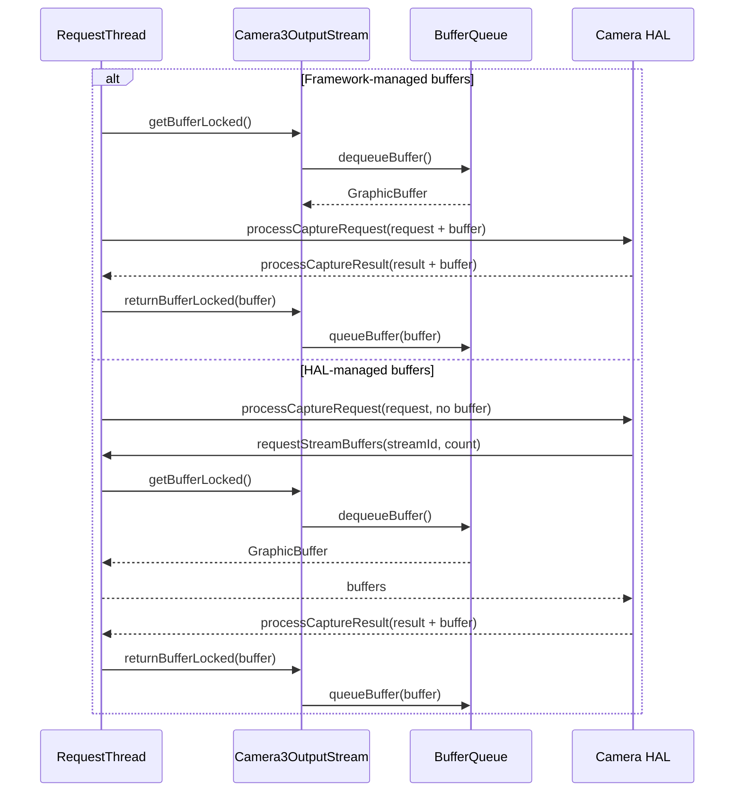

### 64.4.8 复合流

相机服务实现了多个**复合流**，它们在将 HAL 输出交付给应用之前
对其执行附加处理：

| 复合流 | 源文件 | 说明 |
|-----------------|-------------|-------------|
| `DepthCompositeStream` | `api2/DepthCompositeStream.cpp` | 合并深度 + 色彩，用于动态深度 JPEG |
| `HeicCompositeStream` | `api2/HeicCompositeStream.cpp` | 使用 MediaCodec 编码 HEIC |
| `JpegRCompositeStream` | `api2/JpegRCompositeStream.cpp` | 创建 JPEG/R（带增益图的 HDR 照片） |

这些复合流对应用是透明的。应用请求普通的 HEIC 或 DEPTH_JPEG
输出，相机服务在内部建立复合处理管线。

---

## 64.5 多相机

### 64.5.1 逻辑相机架构

从 Android 9（API 28）起，Camera2 引入了**逻辑多相机**模型。
逻辑相机是由两个或更多物理相机支撑的虚拟相机：

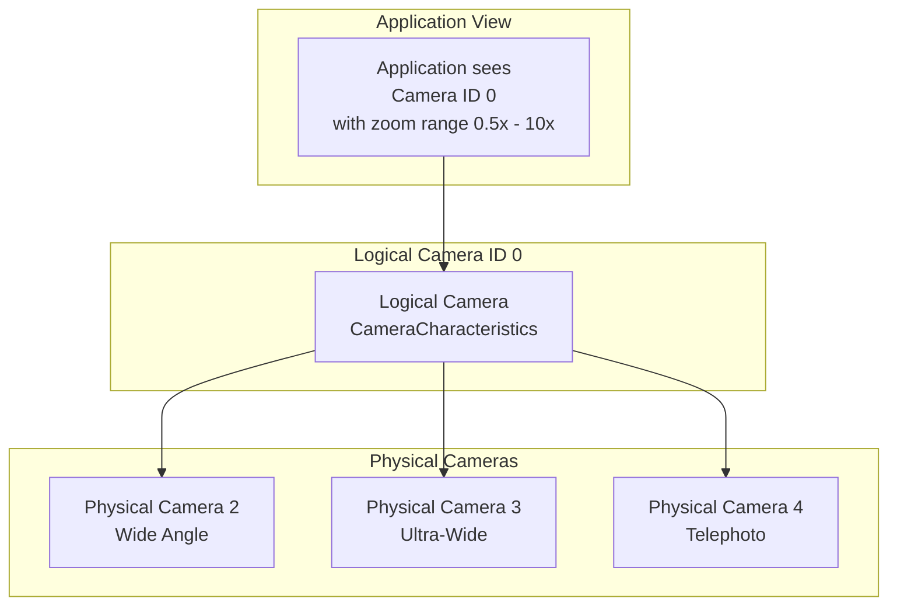

逻辑相机：

- 拥有自己的 `CameraCharacteristics`，表示组合后的能力
- 根据缩放比例在物理相机之间自动切换
- 处理 ISP 过渡、白平衡匹配和曝光同步

```java
// Query physical camera IDs
Set<String> physicalCameraIds = characteristics.getPhysicalCameraIds();
// Returns e.g., {"2", "3", "4"}

// Check if this is a logical multi-camera
int[] capabilities = characteristics.get(
    CameraCharacteristics.REQUEST_AVAILABLE_CAPABILITIES);
boolean isLogicalMultiCamera = Arrays.stream(capabilities)
    .anyMatch(c -> c == CameraMetadata.REQUEST_AVAILABLE_CAPABILITIES_LOGICAL_MULTI_CAMERA);
```

### 64.5.2 物理相机访问

应用可以通过逻辑相机访问单个物理相机，用于特定用例：

```java
// Route a specific stream to a physical camera
OutputConfiguration ultraWideConfig = new OutputConfiguration(ultraWideSurface);
ultraWideConfig.setPhysicalCameraId("3");  // Ultra-wide physical camera

OutputConfiguration teleConfig = new OutputConfiguration(teleSurface);
teleConfig.setPhysicalCameraId("4");  // Telephoto physical camera

SessionConfiguration sessionConfig = new SessionConfiguration(
    SessionConfiguration.SESSION_REGULAR,
    Arrays.asList(ultraWideConfig, teleConfig),
    executor, stateCallback
);
```

物理相机结果元数据通过 `TotalCaptureResult` 访问。
旧代码使用 `getPhysicalCameraResults()`，它返回一个 `Map<String,
CaptureResult>`。Android 17 弃用了该方法，改用
`getPhysicalCameraTotalResults()`，后者为每个物理相机返回完整的
`TotalCaptureResult` 对象，而不是普通的 `CaptureResult`：

```
Source: frameworks/base/core/java/android/hardware/camera2/TotalCaptureResult.java, line 187 (deprecated) and 212
```

```java
// Android 17: get the full TotalCaptureResult for a physical camera
Map<String, TotalCaptureResult> physResults = totalResult.getPhysicalCameraTotalResults();
TotalCaptureResult physicalResult = physResults.get("3");
if (physicalResult != null) {
    Long timestamp = physicalResult.get(CaptureResult.SENSOR_TIMESTAMP);
}
```

完整结果形式对再处理很重要。要从 `MultiResolutionImageReader`
再处理物理相机帧，应用必须将物理相机的 `TotalCaptureResult`
交给 `createReprocessCaptureRequest()`。
已弃用的映射无法提供它。

默认情况下，逻辑相机只为请求实际针对的物理流返回物理元数据。
Android 17 新增了 `LOGICAL_MULTI_CAMERA_ADDITIONAL_RESULTS` 键
（布尔值，在 `CaptureRequest` 和 `CaptureResult` 上均有）。
该键要求设备即使没有请求物理流，也在结果中包含支撑物理相机的
元数据。应用随后通过
`getPhysicalCameraTotalResults()` 读回它：

```
Source: frameworks/base/core/java/android/hardware/camera2/CaptureRequest.java, line 4438
        frameworks/base/core/java/android/hardware/camera2/CaptureResult.java, line 6115
```

```java
// Request additional physical metadata (gated by FLAG_LOGICAL_MULTI_CAMERA_ADDITIONAL_RESULTS)
builder.set(CaptureRequest.LOGICAL_MULTI_CAMERA_ADDITIONAL_RESULTS, true);
```

该键映射到 `ANDROID_LOGICAL_MULTI_CAMERA_ADDITIONAL_RESULTS`
元数据标签（HAL 版本 3.12）。该标签定义在
`system/media/camera/docs/metadata_definitions.xml` 中。
它在 `hardware/interfaces/camera/metadata/aidl/` 中以
`LogicalMultiCameraAdditionalResults` 枚举
（`OFF`/`ON`）呈现给厂商。

### 64.5.3 多相机的相机特性

逻辑相机的 `CameraCharacteristics` 包含描述多相机关系的键：

| 键 | 说明 |
|-----|-------------|
| `LOGICAL_MULTI_CAMERA_PHYSICAL_IDS` | 物理相机 ID 集合 |
| `LOGICAL_MULTI_CAMERA_SENSOR_SYNC_TYPE` | APPROXIMATE 或 CALIBRATED 同步 |
| `LENS_POSE_REFERENCE` | 坐标原点（PRIMARY_CAMERA 或 UNDEFINED） |
| `LENS_POSE_ROTATION` | 相对于参考的旋转 |
| `LENS_POSE_TRANSLATION` | 相对于参考的平移 |
| `LENS_INTRINSIC_CALIBRATION` | 焦距和主点 |
| `LENS_DISTORTION` | 径向和切向畸变系数 |

```
Source: frameworks/base/core/java/android/hardware/camera2/CameraCharacteristics.java
```

### 64.5.4 多分辨率流

对于物理相机具有不同最大分辨率的逻辑多相机，
`MultiResolutionImageReader` 提供了统一接口：

```
Source: frameworks/base/core/java/android/hardware/camera2/MultiResolutionImageReader.java
```

```java
// Get multi-resolution stream configurations
MultiResolutionStreamConfigurationMap multiResMap = characteristics.get(
    CameraCharacteristics.SCALER_MULTI_RESOLUTION_STREAM_CONFIGURATION_MAP);

Collection<MultiResolutionStreamInfo> streams =
    multiResMap.getOutputInfo(ImageFormat.JPEG);

// Create a MultiResolutionImageReader
MultiResolutionImageReader multiResReader =
    new MultiResolutionImageReader(streams, ImageFormat.JPEG, 2);

multiResReader.setOnImageAvailableListener(reader -> {
    Image image = reader.acquireNextImage();
    // Image size may vary depending on which physical camera was active
    image.close();
}, handler);
```

### 64.5.5 HAL 层面的物理相机流

当请求物理相机流时，相机服务使用带注解的流配置来配置 HAL：

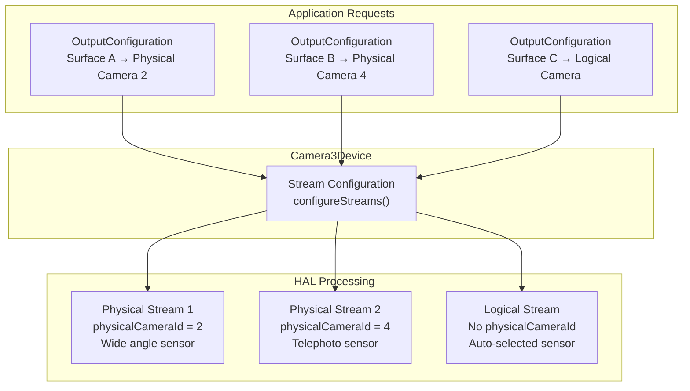

HAL 接收设置了 `physicalCameraId` 字段的 `StreamConfiguration`
条目（针对物理流）。HAL 负责：

1. 将每条流路由到正确的物理传感器
2. 当 `LOGICAL_MULTI_CAMERA_SENSOR_SYNC_TYPE` 为
   `CALIBRATED` 时，跨物理相机同步曝光

3. 应用逐物理相机的元数据覆盖
4. 对不同传感器的输出进行色彩匹配

### 64.5.6 相机位姿与校准

对于增强现实和计算摄影应用，多相机框架提供精确的几何校准数据：

| 特性键 | 类型 | 说明 |
|--------------------|------|-------------|
| `LENS_POSE_ROTATION` | float[4] | 相对于参考的四元数旋转 |
| `LENS_POSE_TRANSLATION` | float[3] | 以米为单位的平移 |
| `LENS_POSE_REFERENCE` | int | PRIMARY_CAMERA、GYROSCOPE 或 UNDEFINED |
| `LENS_INTRINSIC_CALIBRATION` | float[5] | fx、fy、cx、cy、s（焦距、主点、偏斜） |
| `LENS_DISTORTION` | float[5] | 径向 k1、k2、k3 和切向 p1、p2 |
| `LENS_RADIAL_DISTORTION` | float[6] | 已弃用——请使用 LENS_DISTORTION |

这些数值使应用能够：

- 从立体相机对计算深度
- 将 3D 点投影到相机图像上
- 在软件中校正镜头畸变
- 对齐来自不同物理相机的图像

### 64.5.7 并发相机访问

Android 11（API 30）引入了并发相机访问，允许应用
同时打开多个相机：

```java
// Query which cameras can operate concurrently
Set<Set<String>> concurrentCameraIds = cameraManager.getConcurrentCameraIds();
// e.g., {{"0", "1"}} means front+back can be open simultaneously

// Check if a specific configuration is supported
boolean supported = cameraManager.isConcurrentSessionConfigurationSupported(
    Map.of(
        "0", sessionConfig0,  // Back camera config
        "1", sessionConfig1   // Front camera config
    )
);
```

### 64.5.8 多相机数据流

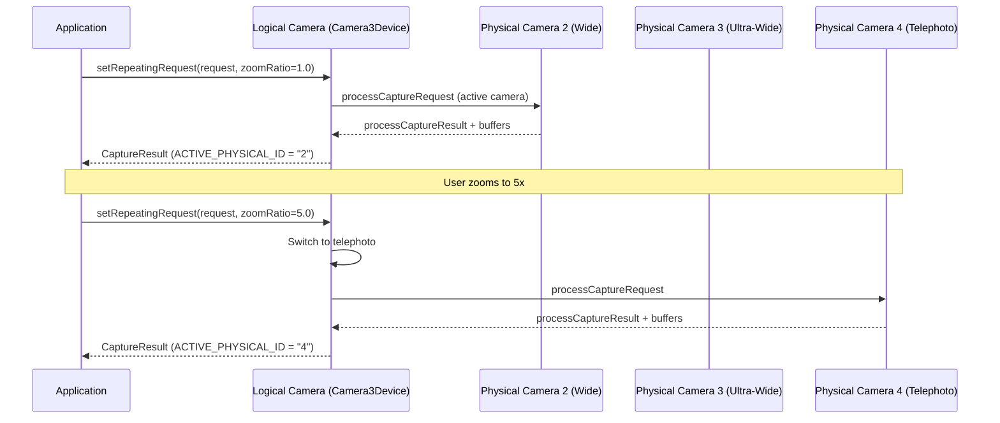

### 64.5.9 相机离线会话

Android 11 引入了 `CameraOfflineSession`，它允许应用
在保留在途抓拍请求的同时断开与相机设备的连接。
这对于长时间运行的多帧抓拍（如夜景模式）很有用，
应用希望在此期间释放相机供其他应用使用：

```
Source: frameworks/base/core/java/android/hardware/camera2/CameraOfflineSession.java
        frameworks/av/services/camera/libcameraservice/device3/Camera3OfflineSession.h
        frameworks/av/services/camera/libcameraservice/device3/Camera3OfflineSession.cpp
        frameworks/av/services/camera/libcameraservice/api2/CameraOfflineSessionClient.h
```

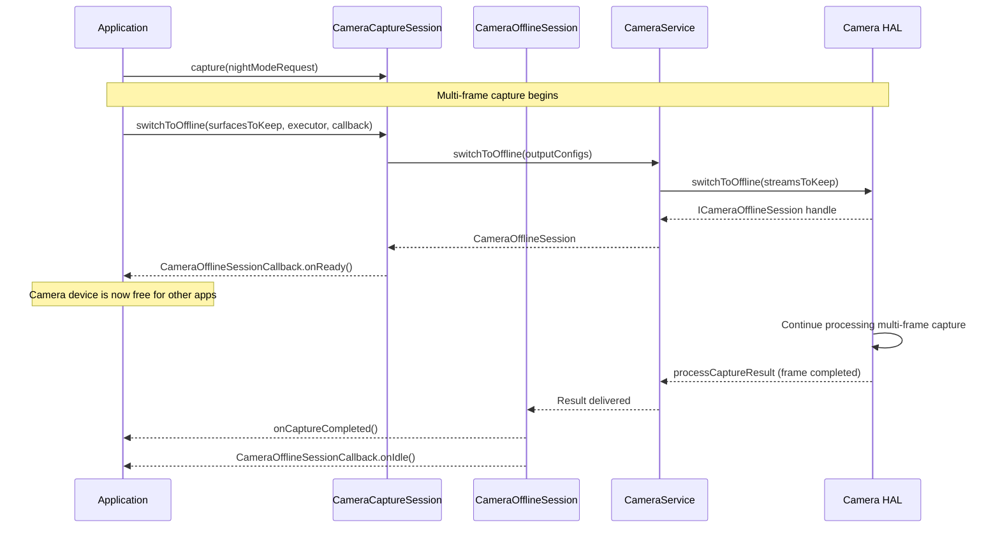

---

## 64.6 相机扩展

### 64.6.1 扩展架构

相机扩展（Android 12 引入，`CameraExtensionSession`）
提供对超出标准 Camera2 能力、由设备特定的图像处理算法的访问。
扩展通常使用多帧抓拍和复杂的后处理。

```
Source: frameworks/base/core/java/android/hardware/camera2/CameraExtensionSession.java
        frameworks/base/core/java/android/hardware/camera2/CameraExtensionCharacteristics.java
        frameworks/base/core/java/android/hardware/camera2/impl/CameraAdvancedExtensionSessionImpl.java
        frameworks/base/core/java/android/hardware/camera2/impl/CameraExtensionSessionImpl.java
```

### 64.6.2 支持的扩展类型

| 扩展类型 | 常量 | 值 | 说明 |
|---------------|----------|-------|-------------|
| 自动 | `EXTENSION_AUTOMATIC` | 0 | 设备选择的最佳模式 |
| 人脸润饰 | `EXTENSION_FACE_RETOUCH` | 1 | 皮肤平滑与美颜 |
| 人像虚化 | `EXTENSION_BOKEH` | 2 | 背景虚化 / 人像模式 |
| HDR | `EXTENSION_HDR` | 3 | 高动态范围合并 |
| 夜景模式 | `EXTENSION_NIGHT` | 4 | 多帧低光增强 |

这五个公共常量定义在 `CameraExtensionCharacteristics.java` 中；
OEM 定义的扩展从 `EXTENSION_VENDOR_START`（`0x4000`）开始。

```java
// Query supported extensions
CameraExtensionCharacteristics extChars =
    cameraManager.getCameraExtensionCharacteristics(cameraId);

List<Integer> supportedExtensions = extChars.getSupportedExtensions();
for (int extension : supportedExtensions) {
    // Get supported sizes for this extension
    List<Size> sizes = extChars.getExtensionSupportedSizes(
        extension, ImageFormat.JPEG);
}
```

### 64.6.3 扩展会话生命周期

创建扩展会话会取代标准的 `CameraCaptureSession`：

```mermaid
sequenceDiagram
    participant App as Application
    participant CDI as CameraDeviceImpl
    participant EXT as CameraExtensionSessionImpl
    participant HAL as Extension HAL Service

    App->>CDI: createExtensionSession(config)
    CDI->>EXT: Create extension session
    EXT->>HAL: Bind to extension service
    HAL-->>EXT: IAdvancedExtenderImpl / IImageCaptureExtenderImpl
    EXT->>EXT: Configure internal capture session
    EXT-->>App: StateCallback.onConfigured(CameraExtensionSession)

    App->>EXT: setRepeatingRequest(request, callback)
    EXT->>EXT: Translate to internal Camera2 requests
    EXT->>HAL: Process frames through extension pipeline
    HAL-->>EXT: Processed output
    EXT-->>App: ExtensionCaptureCallback.onCaptureProcessStarted()

    App->>EXT: capture(request, callback)
    Note over EXT,HAL: Multi-frame burst capture
    EXT->>HAL: Capture N frames
    HAL->>HAL: Post-process (NR, HDR, etc.)
    HAL-->>EXT: Final processed image
    EXT-->>App: ExtensionCaptureCallback.onCaptureResultAvailable()
```

### 64.6.4 扩展实现架构

扩展有两种实现模型：

**Basic Extender**（旧式）：

- 使用 `IImageCaptureExtenderImpl` 和 `IPreviewExtenderImpl`
- 框架管理抓拍管线
- 扩展处理单个帧

**Advanced Extender**（新式）：

- 使用 `IAdvancedExtenderImpl`
- 扩展控制整个相机管线
- 可以发出自己的抓拍请求
- 更灵活，适合复杂算法

```
Source: frameworks/base/core/java/android/hardware/camera2/extension/IAdvancedExtenderImpl.aidl
        frameworks/base/core/java/android/hardware/camera2/extension/IImageCaptureExtenderImpl.aidl
        frameworks/base/core/java/android/hardware/camera2/extension/IPreviewExtenderImpl.aidl
```

### 64.6.5 扩展代理服务

相机扩展由 OEM 提供的 APK 交付，这些 APK 通过代理服务
公开其功能：

```
Source: frameworks/base/core/java/android/hardware/camera2/extension/ICameraExtensionsProxyService.aidl
```

扩展发现过程：

```mermaid
graph TD
    A[CameraExtensionCharacteristics] -->|bind to| B[ICameraExtensionsProxyService]
    B -->|query| C{Extension Type?}
    C -->|Advanced| D[IAdvancedExtenderImpl]
    C -->|Basic| E["IImageCaptureExtenderImpl<br/>+ IPreviewExtenderImpl"]
    D -->|isExtensionAvailable| F[Check hardware capability]
    E -->|isExtensionAvailable| F
    F -->|true| G[Extension available]
    F -->|false| H[Extension unavailable]
```

### 64.6.6 扩展抓拍回调

`CameraExtensionSession.ExtensionCaptureCallback` 提供扩展特定的
生命周期回调：

```java
ExtensionCaptureCallback callback = new ExtensionCaptureCallback() {
    @Override
    public void onCaptureStarted(CameraExtensionSession session,
            CaptureRequest request, long timestamp) {
        // Shutter moment -- play sound, update UI
    }

    @Override
    public void onCaptureProcessStarted(CameraExtensionSession session,
            CaptureRequest request) {
        // Multi-frame capture complete, post-processing has begun
        // This is when the extension algorithm starts running
    }

    @Override
    public void onCaptureFailed(CameraExtensionSession session,
            CaptureRequest request) {
        // Extension capture failed
    }

    @Override
    public void onCaptureResultAvailable(CameraExtensionSession session,
            CaptureRequest request, TotalCaptureResult result) {
        // Result metadata available (API 34+)
    }
};
```

### 64.6.7 扩展元数据支持

从 Android 14 起，扩展可以上报和接受 Camera2 元数据键的一个子集：

```java
// Query supported request keys for an extension
Set<CaptureRequest.Key> requestKeys =
    extChars.getAvailableCaptureRequestKeys(EXTENSION_NIGHT);

// Query available result keys
Set<CaptureResult.Key> resultKeys =
    extChars.getAvailableCaptureResultKeys(EXTENSION_NIGHT);

// Extensions may support keys like:
// - CONTROL_ZOOM_RATIO
// - CONTROL_AF_MODE
// - CONTROL_AE_MODE
// - JPEG_QUALITY
// - JPEG_ORIENTATION
```

### 64.6.8 扩展强度控制（Android 15+）

Android 15 增加了扩展强度控制，允许应用调整扩展效果的强度。
强度是一项逐请求控制，即 `CaptureRequest.EXTENSION_STRENGTH`。
它是 `0` 到 `100` 范围内的单个整数。值 `0` 表示
"不做后处理，返回普通帧"，`100` 为最大效果。
只有当该键出现在扩展的 `getAvailableCaptureRequestKeys()` 列表中时
才可用。因此，应用必须检查该列表，而不能假定该控制存在：

```
Source: frameworks/base/core/java/android/hardware/camera2/CaptureRequest.java
  → EXTENSION_STRENGTH ("android.extension.strength")
```

```java
// Check whether the chosen extension accepts a strength control
Set<CaptureRequest.Key> requestKeys =
    extChars.getAvailableCaptureRequestKeys(
        CameraExtensionCharacteristics.EXTENSION_BOKEH);

if (requestKeys.contains(CaptureRequest.EXTENSION_STRENGTH)) {
    CaptureRequest.Builder builder =
        cameraDevice.createCaptureRequest(CameraDevice.TEMPLATE_STILL_CAPTURE);
    builder.set(CaptureRequest.EXTENSION_STRENGTH, 75);  // 75% effect
}
```

其含义取决于扩展。对于 `EXTENSION_BOKEH`，强度控制虚化程度。
对于 `EXTENSION_HDR` 和 `EXTENSION_NIGHT`，它控制融合的帧数
和结果亮度。对于 `EXTENSION_FACE_RETOUCH`，它控制美颜平滑程度。
如果客户端省略该值，扩展会选择一个默认值，并在相应的抓拍结果中
将其上报回来。

### 64.6.9 扩展 Postview

Postview 在扩展处理全分辨率输出的同时，提供一张快速的低分辨率预览图。
应用检查 `CameraExtensionCharacteristics.isPostviewAvailable()`，
从 `getPostviewSupportedSizes()` 中选择尺寸，并通过
`ExtensionSessionConfiguration.setPostviewOutputConfiguration()`
注册一个专用的 postview 输出 Surface。快速图像随后交付到该 Surface。
另外，`onCaptureProcessProgressed()` 报告从 0 到 100 的
增量后处理进度：

```mermaid
sequenceDiagram
    participant App as Application
    participant EXT as CameraExtensionSession
    participant HAL as Extension HAL

    App->>EXT: capture(request)
    EXT->>HAL: Begin multi-frame capture
    HAL-->>App: Postview image on postview output surface
    Note over App: Display postview as thumbnail
    HAL->>HAL: Full post-processing...
    EXT-->>App: onCaptureProcessProgressed(25%) ... (75%)
    HAL-->>EXT: Final high-quality image
    EXT-->>App: onCaptureResultAvailable()
    Note over App: Replace postview with final image
```

这一模式可见于 Google Camera 及类似应用——一张略微模糊的预览
立即出现，处理完成后再变得清晰。

### 64.6.10 扩展延迟

扩展可以上报其预期抓拍延迟：

```java
// Get estimated capture latency range (milliseconds)
Range<Long> latencyRange = extChars.getEstimatedCaptureLatencyRangeMillis(
    EXTENSION_NIGHT, captureSize, outputFormat
);
// e.g., Range(2000, 5000) means 2-5 seconds for night mode
```

这使应用能够在多帧抓拍和后处理阶段显示进度指示器。

---

## 64.7 相机 NDK

### 64.7.1 NDK 相机 API 概述

相机 NDK（`libcamera2ndk.so`）为原生应用提供对 Camera2 管线的
C 语言访问。它镜像了 Java API 的结构，并使用 C 函数前缀：

```
Source: frameworks/av/camera/ndk/NdkCameraManager.cpp
        frameworks/av/camera/ndk/NdkCameraDevice.cpp
        frameworks/av/camera/ndk/NdkCameraCaptureSession.cpp
        frameworks/av/camera/ndk/NdkCaptureRequest.cpp
        frameworks/av/camera/ndk/NdkCameraMetadata.cpp
```

头文件：

```
Source: frameworks/av/camera/ndk/include/camera/NdkCameraManager.h
        frameworks/av/camera/ndk/include/camera/NdkCameraDevice.h
        frameworks/av/camera/ndk/include/camera/NdkCameraCaptureSession.h
        frameworks/av/camera/ndk/include/camera/NdkCaptureRequest.h
        frameworks/av/camera/ndk/include/camera/NdkCameraMetadata.h
        frameworks/av/camera/ndk/include/camera/NdkCameraError.h
```

### 64.7.2 NDK API 映射

| Java API | NDK 结构体 / 函数前缀 | 头文件 |
|----------|------------------------------|--------|
| `CameraManager` | `ACameraManager_*` | `NdkCameraManager.h` |
| `CameraDevice` | `ACameraDevice_*` | `NdkCameraDevice.h` |
| `CameraCaptureSession` | `ACameraCaptureSession_*` | `NdkCameraCaptureSession.h` |
| `CaptureRequest` | `ACaptureRequest_*` | `NdkCaptureRequest.h` |
| `CameraMetadata` | `ACameraMetadata_*` | `NdkCameraMetadata.h` |
| `CaptureResult` | 使用 `ACameraMetadata` | `NdkCameraMetadata.h` |

### 64.7.3 NDK 相机生命周期

```c
// 1. Get camera manager
ACameraManager* manager = ACameraManager_create();

// 2. Get camera ID list
ACameraIdList* cameraIdList = NULL;
ACameraManager_getCameraIdList(manager, &cameraIdList);
const char* cameraId = cameraIdList->cameraIds[0];

// 3. Get camera characteristics
ACameraMetadata* characteristics = NULL;
ACameraManager_getCameraCharacteristics(manager, cameraId, &characteristics);

// 4. Open camera
ACameraDevice* device = NULL;
ACameraDevice_StateCallbacks deviceCallbacks = {
    .context = myContext,
    .onDisconnected = onDeviceDisconnected,
    .onError = onDeviceError,
};
ACameraManager_openCamera(manager, cameraId, &deviceCallbacks, &device);

// 5. Create capture request
ACaptureRequest* request = NULL;
ACameraDevice_createCaptureRequest(device, TEMPLATE_PREVIEW, &request);

// 6. Create output
ACaptureSessionOutput* output = NULL;
ACaptureSessionOutput_create(previewWindow, &output);
ACaptureSessionOutputContainer* outputs = NULL;
ACaptureSessionOutputContainer_create(&outputs);
ACaptureSessionOutputContainer_add(outputs, output);

// 7. Add target to request
ACameraOutputTarget* target = NULL;
ACameraOutputTarget_create(previewWindow, &target);
ACaptureRequest_addTarget(request, target);

// 8. Create capture session
ACameraCaptureSession* session = NULL;
ACameraCaptureSession_stateCallbacks sessionCallbacks = {
    .context = myContext,
    .onClosed = onSessionClosed,
    .onReady = onSessionReady,
    .onActive = onSessionActive,
};
ACameraDevice_createCaptureSession(device, outputs, &sessionCallbacks, &session);

// 9. Start repeating request
ACameraCaptureSession_setRepeatingRequest(session, NULL, 1, &request, NULL);
```

### 64.7.4 NDK 抓拍回调

```c
ACameraCaptureSession_captureCallbacks captureCallbacks = {
    .context = myContext,
    .onCaptureStarted = onCaptureStarted,
    .onCaptureProgressed = NULL,
    .onCaptureCompleted = onCaptureCompleted,
    .onCaptureFailed = onCaptureFailed,
    .onCaptureSequenceCompleted = onCaptureSequenceCompleted,
    .onCaptureSequenceAborted = onCaptureSequenceAborted,
    .onCaptureBufferLost = NULL,
};

void onCaptureCompleted(void* context,
        ACameraCaptureSession* session,
        ACaptureRequest* request,
        const ACameraMetadata* result) {
    // Read result metadata
    ACameraMetadata_const_entry entry;
    ACameraMetadata_getConstEntry(result, ACAMERA_SENSOR_TIMESTAMP, &entry);
    int64_t timestamp = entry.data.i64[0];
}
```

### 64.7.5 NDK 到框架的映射

在内部，NDK 相机调用与 Java API 走同一个 `CameraService`。
NDK 实现封装了 `ICameraDeviceUser`：

```mermaid
graph TD
    subgraph NDKL["NDK Layer"]
        NC[NdkCameraDevice.cpp]
        NI[impl/ACameraDevice.cpp]
    end

    subgraph BIPC["Binder IPC"]
        BINDER[ICameraDeviceUser.aidl]
    end

    subgraph CSV["Camera Service"]
        CDC[CameraDeviceClient]
        C3D[Camera3Device]
    end

    NC --> NI
    NI -->|Binder| BINDER
    BINDER --> CDC
    CDC --> C3D
```

NDK 使用相同的请求模板和相同的元数据标签空间。
其标签名称以 `ACAMERA_` 为前缀，而不是 `CaptureRequest.`。
它还使用相同的错误代码，这些代码映射到 `camera_status_t` 枚举值。

### 64.7.6 NDK 窗口目标

NDK 相机使用 `ANativeWindow` 作为 Surface 抽象。
它通常从以下位置获取：

- `ANativeWindow_fromSurface()` -- 来自经 JNI 传递的 Java `Surface`
- `ASurfaceTexture_acquireANativeWindow()` -- 来自 `ASurfaceTexture`
- `AImageReader_getWindow()` -- 来自用于 CPU 处理的 `AImageReader`

```c
// Using AImageReader with NDK camera
AImageReader* imageReader = NULL;
AImageReader_new(width, height, AIMAGE_FORMAT_JPEG, maxImages, &imageReader);

AImageReader_ImageListener listener = {
    .context = myContext,
    .onImageAvailable = onImageAvailable,
};
AImageReader_setImageListener(imageReader, &listener);

ANativeWindow* readerWindow = NULL;
AImageReader_getWindow(imageReader, &readerWindow);
// Use readerWindow as a capture target
```

### 64.7.7 NDK 物理相机访问

NDK 相机 API 还支持多相机功能（API 级别 29+）：

```c
// Get physical camera IDs
ACameraMetadata* chars = NULL;
ACameraManager_getCameraCharacteristics(manager, logicalCameraId, &chars);

ACameraMetadata_const_entry physicalCameraIds;
ACameraMetadata_getConstEntry(chars,
    ACAMERA_LOGICAL_MULTI_CAMERA_PHYSICAL_IDS, &physicalCameraIds);

// Create a physical-camera-aware capture request: the ACameraIdList
// names the physical IDs whose per-camera settings the request may carry.
ACaptureRequest* request = NULL;
const char* ids[] = {"2", "4"};
ACameraIdList physicalIdList = { 2, ids };  // numCameras, cameraIds
ACameraDevice_createCaptureRequest_withPhysicalIds(
    device, TEMPLATE_PREVIEW,
    &physicalIdList,
    &request);

// Per-physical-camera settings are written with the
// ACaptureRequest_setEntry_physicalCamera_* family, keyed by physical ID:
uint8_t aeMode = ACAMERA_CONTROL_AE_MODE_ON;
ACaptureRequest_setEntry_physicalCamera_u8(
    request, "2", ACAMERA_CONTROL_AE_MODE, 1, &aeMode);
```

本章前面的 Java 示例使用 `OutputConfiguration.setPhysicalCameraId()`
将整条流绑定到一个传感器。直接的 NDK 等价物是
`ACaptureSessionPhysicalOutput_create(window, physicalId, &output)`。
它创建一个路由到单个物理相机的会话输出。
上面所示的 `ACaptureRequest_setEntry_physicalCamera_*` setter
是另一种机制：它们携带逐物理相机的请求设置，而不是流路由。

### 64.7.8 NDK 元数据访问

NDK 通过标签常量提供类型化的元数据访问：

```c
// Read characteristics
ACameraMetadata_const_entry entry;

// Get sensor orientation
ACameraMetadata_getConstEntry(chars, ACAMERA_SENSOR_ORIENTATION, &entry);
int32_t orientation = entry.data.i32[0];

// Get supported output sizes for a format
ACameraMetadata_getConstEntry(chars,
    ACAMERA_SCALER_AVAILABLE_STREAM_CONFIGURATIONS, &entry);
// Entry contains quads of [format, width, height, input]
for (uint32_t i = 0; i < entry.count; i += 4) {
    int32_t format = entry.data.i32[i];
    int32_t width = entry.data.i32[i + 1];
    int32_t height = entry.data.i32[i + 2];
    int32_t isInput = entry.data.i32[i + 3];
    if (format == AIMAGE_FORMAT_JPEG && !isInput) {
        // Available JPEG output size: width x height
    }
}

// Set capture request parameters
uint8_t aeMode = ACAMERA_CONTROL_AE_MODE_ON;
ACaptureRequest_setEntry_u8(request,
    ACAMERA_CONTROL_AE_MODE, 1, &aeMode);

int32_t afRegion[] = {100, 100, 300, 300, 1000};  // x,y,w,h,weight
ACaptureRequest_setEntry_i32(request,
    ACAMERA_CONTROL_AF_REGIONS, 5, afRegion);

float zoomRatio = 2.0f;
ACaptureRequest_setEntry_float(request,
    ACAMERA_CONTROL_ZOOM_RATIO, 1, &zoomRatio);
```

### 64.7.9 NDK 错误处理

NDK 相机返回 `camera_status_t` 错误代码：

| 错误代码 | 值 | 含义 |
|------------|-------|---------|
| `ACAMERA_OK` | 0 | 成功 |
| `ACAMERA_ERROR_UNKNOWN` | -10000 | 未指定的失败（`ACAMERA_ERROR_BASE`） |
| `ACAMERA_ERROR_INVALID_PARAMETER` | -10001 | 无效参数 |
| `ACAMERA_ERROR_CAMERA_DISCONNECTED` | -10002 | 相机已断开连接 |
| `ACAMERA_ERROR_NOT_ENOUGH_MEMORY` | -10003 | 内存分配失败 |
| `ACAMERA_ERROR_METADATA_NOT_FOUND` | -10004 | 结果中不存在该元数据键 |
| `ACAMERA_ERROR_CAMERA_DEVICE` | -10005 | 致命相机设备错误 |
| `ACAMERA_ERROR_CAMERA_SERVICE` | -10006 | 相机服务错误 |
| `ACAMERA_ERROR_SESSION_CLOSED` | -10007 | 抓拍会话已关闭 |
| `ACAMERA_ERROR_INVALID_OPERATION` | -10008 | 无效的内部操作 |
| `ACAMERA_ERROR_STREAM_CONFIGURE_FAIL` | -10009 | 不支持该流配置 |
| `ACAMERA_ERROR_CAMERA_IN_USE` | -10010 | 相机已被打开 |
| `ACAMERA_ERROR_MAX_CAMERA_IN_USE` | -10011 | 达到最大同时相机数 |
| `ACAMERA_ERROR_CAMERA_DISABLED` | -10012 | 相机被策略禁用 |
| `ACAMERA_ERROR_PERMISSION_DENIED` | -10013 | 无相机权限 |
| `ACAMERA_ERROR_UNSUPPORTED_OPERATION` | -10014 | 操作不受支持 |

```
Source: frameworks/av/camera/ndk/include/camera/NdkCameraError.h
```

---

## 64.8 多客户端共享会话（Android 17）

在 Android 17 之前，相机是独占资源：一个相机 ID 只能由一个客户端持有。
更高优先级的客户端只能通过驱逐当前持有者来夺取它
（64.2.3 节）。Android 17 增加了可选的**共享模式**，
在此模式下多个客户端可同时持有同一台相机，
并遵循同一份共享流配置。这面向大屏视频会议等场景——
系统"特效" Surface 和应用 Surface 希望同时获得相同的传感器帧。

### 64.8.1 以共享模式打开相机

共享模式是一项特权、可选启用的能力。应用首先询问设备是否支持，
然后使用 `openCamera` 的共享变体打开：

```
Source: frameworks/base/core/java/android/hardware/camera2/CameraManager.java
  → isCameraDeviceSharingSupported(String)
  → openSharedCamera(String, Executor, CameraDevice.StateCallback)
```

```java
// Both APIs are @SystemApi and require SYSTEM_CAMERA + CAMERA permissions.
if (cameraManager.isCameraDeviceSharingSupported(cameraId)) {
    cameraManager.openSharedCamera(cameraId, executor, new CameraDevice.StateCallback() {
        @Override
        public void onOpenedInSharedMode(CameraDevice camera, boolean isPrimaryClient) {
            // isPrimaryClient tells this client whether it currently controls capture.
        }
        @Override
        public void onClientSharedAccessPriorityChanged(
                CameraDevice camera, boolean isPrimaryClient) {
            // Primary/secondary status can flip as higher-priority clients come and go.
        }
        @Override public void onOpened(CameraDevice camera) { /* non-shared path */ }
        @Override public void onDisconnected(CameraDevice camera) { camera.close(); }
        @Override public void onError(CameraDevice camera, int error) { camera.close(); }
    });
}
```

当 `isCameraDeviceSharingSupported` 返回 false 时，
`openSharedCamera` 会以 `UnsupportedOperationException` 被拒绝，
并且需要 `android.permission.SYSTEM_CAMERA` 和
`android.permission.CAMERA` 两项权限。两个新的
`StateCallback` 钩子——`onOpenedInSharedMode()` 和
`onClientSharedAccessPriorityChanged()`——定义在
`frameworks/base/core/java/android/hardware/camera2/CameraDevice.java` 中。

### 64.8.2 主客户端与次客户端

在所有以共享模式打开相机的客户端中，恰好有一个是
**主（primary）**客户端，其余为**次（secondary）**客户端。
优先级来自驱逐策略所使用的同样两个信号：进程状态和内存不足分数。
因此前台或系统客户端的优先级高于后台客户端。
随着客户端来去，主客户端可能发生变化，
每个客户端都会通过 `onClientSharedAccessPriorityChanged()` 得到通知。

两种角色的能力差异很大：

| 能力 | 主客户端 | 次客户端 |
|------------|----------------|------------------|
| 创建抓拍请求，设置任何抓拍参数 | 是 | 否 |
| `capture` / `setRepeatingRequest` / `stopRepeating` | 是 | 否 |
| `startStreaming` / `stopStreaming`（默认参数） | 是 | 是 |
| `captureBurst` / `setRepeatingBurst` / `switchToOffline` / `prepare` | 否（共享会话中不支持） | 否 |

次客户端不能发起抓拍请求。它们只能通过
`startStreaming(List<Surface>)` 请求会话以默认参数向自己的 Surface
传输帧，并通过 `stopStreaming()` 停止。

```
Source: frameworks/base/core/java/android/hardware/camera2/CameraSharedCaptureSession.java
  → startStreaming(List<Surface>, ...) / stopStreaming()
```

### 64.8.3 共享抓拍会话

当相机以共享模式打开时，唯一合法的会话类型是
`SessionConfiguration.SESSION_SHARED`；任何其他值都会抛出
`IllegalArgumentException`。生成的 `CameraCaptureSession`
可强制转换为 `CameraSharedCaptureSession`。

```
Source: frameworks/base/core/java/android/hardware/camera2/params/SessionConfiguration.java
  → SESSION_SHARED = CameraDevice.SESSION_OPERATION_MODE_SHARED
```

关键在于，共享会话不允许每个客户端选择自己的流几何参数。
每个客户端都必须使用通过 `CameraCharacteristics.SHARED_SESSION_CONFIGURATION`
（64.9.1 节）公开的单一、由设备公布的配置；
提供任何其他输出配置都会导致会话创建失败。
框架根据相机服务解析的厂商 XML 文件合成该键：

```
Source: frameworks/av/services/camera/libcameraservice/config/SharedSessionConfigReader.h
        frameworks/av/services/camera/libcameraservice/config/SharedSessionConfigUtils.h
```

`SharedSessionConfigReader::SharedSessionConfig` 描述一个允许的输出。
字段包括：Surface 类型、宽、高、可选的物理相机 ID、
流用例、时间戳基准、镜像模式、读出时间戳标志、格式、
用途和数据空间。`parseSharedSessionConfig()` 从共享会话 XML
解析所有这些字段。

### 64.8.4 经由服务的共享模式

Binder 接口新增了一个显式的 `sharedMode` 标志。
`ICameraService.connectDevice()` 现在带有一个末尾的
`boolean sharedMode` 参数。`ICameraDeviceUser` 公开了
`isPrimaryClient()`，使客户端可以查询自己的角色。
`ICameraDeviceCallbacks` 将
`onClientSharedAccessPriorityChanged(boolean primaryClient)` 通知
带回框架。

```
Source: frameworks/av/camera/aidl/android/hardware/ICameraService.aidl
  → connectDevice(..., boolean sharedMode)
        frameworks/av/camera/aidl/android/hardware/camera2/ICameraDeviceUser.aidl
  → isPrimaryClient()
        frameworks/av/camera/aidl/android/hardware/camera2/ICameraDeviceCallbacks.aidl
  → onClientSharedAccessPriorityChanged(boolean primaryClient)
```

在相机服务内部，`CameraService` 将 `sharedMode` 标志
贯穿每条连接路径。它还跟踪共享每台相机的 PID 集合，
并保持它们的相对优先级同步。下图展示了完整的
共享模式连接过程，以及一个稍后加入的次客户端：

```mermaid
sequenceDiagram
    participant A1 as Primary App
    participant A2 as Secondary App
    participant CS as CameraService (C++)
    participant CDC as CameraDeviceClient
    participant HAL as Camera HAL

    A1->>CS: connectDevice(sharedMode=true)
    CS->>CS: makeClient(sharedMode=true)
    CS->>CDC: initialize() — first shared client
    CS-->>A1: onOpenedInSharedMode(isPrimaryClient=true)

    A2->>CS: connectDevice(sharedMode=true)
    CS->>CS: addSharedClientPid() + updateSharedClientAccessPriorities()
    CS-->>A2: onOpenedInSharedMode(isPrimaryClient=false)

    A1->>CDC: setRepeatingRequest(preview)
    CDC->>HAL: processCaptureRequest
    A2->>CDC: startStreaming(secondarySurfaces)
    CDC->>CDC: matchSharedStreamingRequest()
    Note over CS: If A2 gains higher priority, primary flips
    CS-->>A1: onClientSharedAccessPriorityChanged(false)
    CS-->>A2: onClientSharedAccessPriorityChanged(true)
```

`CameraService` 提供配套机制，包括
`getHighestPrioritySharedClient()`、
`addSharedClientPid()` / `removeSharedClientPid()`、
`updateSharedClientAccessPriorities()` 和
`notifySharedClientPrioritiesChanged()`，
全部声明在 `frameworks/av/services/camera/libcameraservice/CameraService.h` 中。
在每客户端一侧，`CameraDeviceClient` 跟踪共享流请求和
共享请求映射（`mSharedStreamingRequest`、`mSharedRequestMap`），
并实现 `isPrimaryClient()`。

```
Source: frameworks/av/services/camera/libcameraservice/api2/CameraDeviceClient.h
  → isPrimaryClient(), matchSharedStreamingRequest(), matchSharedCaptureRequest()
```

### 64.8.5 NDK 中的共享模式

原生 API 镜像了 Java 接口。
`ACameraManager_isCameraDeviceSharingSupported()` 报告支持情况，
`ACameraManager_openSharedCamera()` 以共享模式打开，
次客户端通过 `ACameraCaptureSessionShared_startStreaming()` /
`ACameraCaptureSessionShared_stopStreaming()` 驱动帧
（另有逻辑多相机变体
`ACameraCaptureSessionShared_logicalCamera_startStreaming()`）。

```
Source: frameworks/av/camera/ndk/include/camera/NdkCameraManager.h
  → ACameraManager_openSharedCamera, ACameraManager_isCameraDeviceSharingSupported
        frameworks/av/camera/ndk/include/camera/NdkCameraCaptureSession.h
  → ACameraCaptureSessionShared_startStreaming / _stopStreaming
```

---

## 64.9 新增相机元数据分区（Android 17）

相机元数据标签空间被划分为编号的**分区**。
每个分区覆盖一个子系统（控制、传感器、镜头、缩放器等），
并占据标签命名空间的一个 16 位切片。Android 17 在
`system/media/camera/include/system/camera_metadata_tags.h`
的主枚举中追加了两个新分区，紧接在
`ANDROID_SECTION_COUNT` 之前：

```
Source: system/media/camera/include/system/camera_metadata_tags.h
  → ANDROID_SHARED_SESSION, ANDROID_DESKTOP_EFFECTS (then ANDROID_SECTION_COUNT)
        system/media/camera/docs/metadata_definitions.xml
  → <section name="sharedSession">, <section name="desktopEffects">
```

同样的两个分区被镜像到 HAL 的元数据 AIDL
（`hardware/interfaces/camera/metadata/aidl/.../CameraMetadataSection.aidl`），
使框架与 HAL 的标签命名空间保持一致。

### 64.9.1 sharedSession 分区

该分区支撑 64.8 节中的共享会话功能。它定义了
设备唯一的那份允许的共享配置：

| 标签 | 类型 | 可见性 | 用途 |
|-----|------|-----------|---------|
| `ANDROID_SHARED_SESSION_COLOR_SPACE` | enum | 仅框架 | 所有共享输出使用的色彩空间（`UNSPECIFIED`、`SRGB`、`DISPLAY_P3`、`BT2020_HLG`） |
| `ANDROID_SHARED_SESSION_OUTPUT_CONFIGURATIONS` | int64[] | 仅框架 | 允许的共享输出的打包列表（Surface 类型、尺寸、格式、镜像模式、读出时间戳标志、时间戳基准、数据空间、用途、流用例、物理 ID） |

HAL 不会设置这两个原始标签。Android 相机框架在相机可以以
共享模式打开时生成两者。随后它们作为合成的、带
`@SystemApi` 注解的键
`CameraCharacteristics.SHARED_SESSION_CONFIGURATION`
呈现给系统客户端，其值是一个枚举了许可输出配置的
`SharedSessionConfiguration` 对象。

```
Source: frameworks/base/core/java/android/hardware/camera2/CameraCharacteristics.java
  → SHARED_SESSION_COLOR_SPACE, SHARED_SESSION_OUTPUT_CONFIGURATIONS,
    SHARED_SESSION_CONFIGURATION (@SystemApi, @SyntheticKey)
        frameworks/base/core/java/android/hardware/camera2/params/SharedSessionConfiguration.java
```

### 64.9.2 desktopEffects 分区

`desktopEffects` 分区公开由相机设备自身应用的大屏视频会议特效，
受 `desktop_effects` aconfig 标志门控。
其所有标签均为 `system` 可见性，因此不属于公共 SDK。
设备通过 `ANDROID_DESKTOP_EFFECTS_CAPABILITIES`
公布其能应用哪些特效：

| 能力 | 控制标签 | 模式 |
|-----------|-------------|-------|
| `BACKGROUND_BLUR` | `ANDROID_DESKTOP_EFFECTS_BACKGROUND_BLUR_MODE` | `OFF`、`LIGHT`、`FULL` |
| `FACE_RETOUCH` | `ANDROID_DESKTOP_EFFECTS_FACE_RETOUCH_MODE`（+ `_FACE_RETOUCH_STRENGTH`） | `OFF`、`ON` |
| `PORTRAIT_RELIGHT` | `ANDROID_DESKTOP_EFFECTS_PORTRAIT_RELIGHT_MODE` | `OFF`、`ON` |

静态数组 `ANDROID_DESKTOP_EFFECTS_BACKGROUND_BLUR_MODES`
列出了设备支持哪些模糊模式；该键仅在 `BACKGROUND_BLUR`
出现在能力列表中时才存在。人脸润饰带有一个可选的
`ANDROID_DESKTOP_EFFECTS_FACE_RETOUCH_STRENGTH` 字节。

```
Source: system/media/camera/docs/metadata_definitions.xml
  → <section name="desktopEffects"> (aconfig_flag="desktop_effects")
        hardware/interfaces/camera/metadata/aidl/android/hardware/camera/metadata/
  → DesktopEffectsCapabilities.aidl, DesktopEffectsBackgroundBlurMode.aidl,
    DesktopEffectsFaceRetouchMode.aidl, DesktopEffectsPortraitRelightMode.aidl
```

由于这些特效运行在相机设备内部而非应用侧扩展中，
它们与 64.6 节的相机扩展不同。此处的相同概念操作
（模糊、润饰、重新打光）成为一等、由 HAL 上报的元数据控制，
面向系统会议 Surface 设计。

---

## 64.10 动手实践

### 练习 64.1：相机设备枚举

枚举设备上的所有相机并打印其特性：

```java
import android.hardware.camera2.*;
import android.util.Size;

public class CameraEnumerator {

    public void enumerateCameras(CameraManager cameraManager) throws Exception {
        String[] cameraIds = cameraManager.getCameraIdList();
        System.out.println("Found " + cameraIds.length + " cameras:");

        for (String id : cameraIds) {
            CameraCharacteristics chars =
                cameraManager.getCameraCharacteristics(id);

            // Facing direction
            Integer facing = chars.get(CameraCharacteristics.LENS_FACING);
            String facingStr = facing == CameraCharacteristics.LENS_FACING_FRONT
                ? "FRONT" : facing == CameraCharacteristics.LENS_FACING_BACK
                ? "BACK" : "EXTERNAL";

            // Hardware level
            Integer hwLevel = chars.get(
                CameraCharacteristics.INFO_SUPPORTED_HARDWARE_LEVEL);
            String levelStr;
            switch (hwLevel) {
                case CameraMetadata.INFO_SUPPORTED_HARDWARE_LEVEL_LEGACY:
                    levelStr = "LEGACY"; break;
                case CameraMetadata.INFO_SUPPORTED_HARDWARE_LEVEL_LIMITED:
                    levelStr = "LIMITED"; break;
                case CameraMetadata.INFO_SUPPORTED_HARDWARE_LEVEL_FULL:
                    levelStr = "FULL"; break;
                case CameraMetadata.INFO_SUPPORTED_HARDWARE_LEVEL_3:
                    levelStr = "LEVEL_3"; break;
                case CameraMetadata.INFO_SUPPORTED_HARDWARE_LEVEL_EXTERNAL:
                    levelStr = "EXTERNAL"; break;
                default: levelStr = "UNKNOWN"; break;
            }

            // Physical cameras
            Set<String> physicalIds = chars.getPhysicalCameraIds();

            // Max JPEG size
            StreamConfigurationMap map = chars.get(
                CameraCharacteristics.SCALER_STREAM_CONFIGURATION_MAP);
            Size[] jpegSizes = map.getOutputSizes(ImageFormat.JPEG);
            Size maxJpeg = jpegSizes[0]; // First is largest

            System.out.println("Camera " + id + ":");
            System.out.println("  Facing: " + facingStr);
            System.out.println("  HW Level: " + levelStr);
            System.out.println("  Max JPEG: " + maxJpeg);
            System.out.println("  Physical cameras: " + physicalIds);

            // Zoom range (API 30+)
            Range<Float> zoomRange = chars.get(
                CameraCharacteristics.CONTROL_ZOOM_RATIO_RANGE);
            if (zoomRange != null) {
                System.out.println("  Zoom range: " + zoomRange);
            }
        }
    }
}
```

**观察要点：**

- 逻辑相机如何上报物理相机 ID
- 硬件级别与可用功能之间的关系
- 指示多相机拼接的缩放比例范围

---

### 练习 64.2：预览 + 静态抓拍管线

构建一个最小化的预览 + 静态抓拍管线：

```java
import android.hardware.camera2.*;
import android.media.ImageReader;
import android.view.SurfaceHolder;

public class MinimalCameraCapture {

    private CameraDevice mCamera;
    private CameraCaptureSession mSession;
    private ImageReader mImageReader;

    public void startCamera(CameraManager manager, String cameraId,
            SurfaceHolder previewHolder) throws Exception {

        // Step 1: Create ImageReader for JPEG capture
        CameraCharacteristics chars =
            manager.getCameraCharacteristics(cameraId);
        StreamConfigurationMap map = chars.get(
            CameraCharacteristics.SCALER_STREAM_CONFIGURATION_MAP);
        Size maxJpeg = map.getOutputSizes(ImageFormat.JPEG)[0];
        mImageReader = ImageReader.newInstance(
            maxJpeg.getWidth(), maxJpeg.getHeight(),
            ImageFormat.JPEG, 2);

        mImageReader.setOnImageAvailableListener(reader -> {
            Image image = reader.acquireLatestImage();
            if (image != null) {
                // Process JPEG data
                System.out.println("Got JPEG: " +
                    image.getWidth() + "x" + image.getHeight());
                image.close();
            }
        }, backgroundHandler);

        // Step 2: Open camera
        manager.openCamera(cameraId, new CameraDevice.StateCallback() {
            @Override
            public void onOpened(CameraDevice camera) {
                mCamera = camera;
                createSession(previewHolder.getSurface());
            }
            @Override
            public void onDisconnected(CameraDevice camera) {
                camera.close();
            }
            @Override
            public void onError(CameraDevice camera, int error) {
                camera.close();
            }
        }, backgroundHandler);
    }

    private void createSession(Surface previewSurface) {
        try {
            // Step 3: Create session with preview + JPEG outputs
            SessionConfiguration config = new SessionConfiguration(
                SessionConfiguration.SESSION_REGULAR,
                Arrays.asList(
                    new OutputConfiguration(previewSurface),
                    new OutputConfiguration(mImageReader.getSurface())
                ),
                executor,
                new CameraCaptureSession.StateCallback() {
                    @Override
                    public void onConfigured(CameraCaptureSession session) {
                        mSession = session;
                        startPreview(previewSurface);
                    }
                    @Override
                    public void onConfigureFailed(CameraCaptureSession session) {
                        System.err.println("Session configuration failed!");
                    }
                }
            );
            mCamera.createCaptureSession(config);
        } catch (CameraAccessException e) {
            e.printStackTrace();
        }
    }

    private void startPreview(Surface previewSurface) {
        try {
            // Step 4: Start repeating preview request
            CaptureRequest.Builder previewBuilder =
                mCamera.createCaptureRequest(CameraDevice.TEMPLATE_PREVIEW);
            previewBuilder.addTarget(previewSurface);
            mSession.setRepeatingRequest(previewBuilder.build(),
                null, backgroundHandler);
        } catch (CameraAccessException e) {
            e.printStackTrace();
        }
    }

    public void captureStillPhoto() {
        try {
            // Step 5: Submit single still capture request
            CaptureRequest.Builder captureBuilder =
                mCamera.createCaptureRequest(CameraDevice.TEMPLATE_STILL_CAPTURE);
            captureBuilder.addTarget(mImageReader.getSurface());
            captureBuilder.set(CaptureRequest.JPEG_QUALITY, (byte) 95);

            mSession.capture(captureBuilder.build(),
                new CameraCaptureSession.CaptureCallback() {
                    @Override
                    public void onCaptureCompleted(
                            CameraCaptureSession session,
                            CaptureRequest request,
                            TotalCaptureResult result) {
                        Long exposureTime = result.get(
                            CaptureResult.SENSOR_EXPOSURE_TIME);
                        Integer sensitivity = result.get(
                            CaptureResult.SENSOR_SENSITIVITY);
                        System.out.println("Captured! Exposure: " +
                            exposureTime + "ns, ISO: " + sensitivity);
                    }
                }, backgroundHandler);
        } catch (CameraAccessException e) {
            e.printStackTrace();
        }
    }
}
```

**观察要点：**

- 每个操作的异步性质
- 预览以重复请求运行；抓拍是一次性的
- 会话必须预先配置好所有 Surface
- JPEG 图像通过 `ImageReader` 接收

---

### 练习 64.3：YUV 帧分析管线

添加实时帧分析，在预览的同时使用 YUV 流：

```java
// Create YUV ImageReader for real-time analysis
ImageReader analysisReader = ImageReader.newInstance(
    640, 480,
    ImageFormat.YUV_420_888,
    3  // Triple-buffer
);

analysisReader.setOnImageAvailableListener(reader -> {
    Image image = reader.acquireLatestImage();
    if (image == null) return;

    // Access Y, U, V planes
    Image.Plane yPlane = image.getPlanes()[0];
    Image.Plane uPlane = image.getPlanes()[1];
    Image.Plane vPlane = image.getPlanes()[2];

    ByteBuffer yBuffer = yPlane.getBuffer();
    int yRowStride = yPlane.getRowStride();
    int yPixelStride = yPlane.getPixelStride();

    // Calculate average luminance (simple brightness meter)
    long totalLuminance = 0;
    int pixelCount = 0;
    for (int row = 0; row < image.getHeight(); row += 10) {
        for (int col = 0; col < image.getWidth(); col += 10) {
            totalLuminance += yBuffer.get(row * yRowStride + col) & 0xFF;
            pixelCount++;
        }
    }
    float avgBrightness = (float) totalLuminance / pixelCount;
    System.out.println("Average brightness: " + avgBrightness);

    image.close();  // CRITICAL: always close to return buffer
}, backgroundHandler);
```

**观察要点：**

- YUV_420_888 保证设备无关的 YUV 格式
- 必须遵循 PixelStride 和 RowStride（它们并不总是连续的）
- `acquireLatestImage()` 丢弃旧帧，防止管线堆积
- `image.close()` 是强制的——不关闭会导致缓冲区泄漏

---

### 练习 64.4：手动曝光控制

实现一个演示逐帧元数据的手动曝光控制：

```java
// Check if manual sensor control is available
int[] capabilities = characteristics.get(
    CameraCharacteristics.REQUEST_AVAILABLE_CAPABILITIES);
boolean hasManualSensor = Arrays.stream(capabilities)
    .anyMatch(c -> c == CameraMetadata
        .REQUEST_AVAILABLE_CAPABILITIES_MANUAL_SENSOR);

if (hasManualSensor) {
    // Get sensor exposure time range
    Range<Long> exposureRange = characteristics.get(
        CameraCharacteristics.SENSOR_INFO_EXPOSURE_TIME_RANGE);
    // e.g., Range(13000, 683709000) = 13us to 683ms

    // Get sensor sensitivity (ISO) range
    Range<Integer> isoRange = characteristics.get(
        CameraCharacteristics.SENSOR_INFO_SENSITIVITY_RANGE);
    // e.g., Range(100, 6400)

    // Create manual exposure request
    CaptureRequest.Builder builder =
        cameraDevice.createCaptureRequest(CameraDevice.TEMPLATE_MANUAL);
    builder.addTarget(previewSurface);

    // Set manual AE off and specify exposure + ISO
    builder.set(CaptureRequest.CONTROL_AE_MODE,
        CameraMetadata.CONTROL_AE_MODE_OFF);
    builder.set(CaptureRequest.SENSOR_EXPOSURE_TIME,
        33_333_333L);  // 1/30 second
    builder.set(CaptureRequest.SENSOR_SENSITIVITY, 800);  // ISO 800

    session.setRepeatingRequest(builder.build(),
        new CameraCaptureSession.CaptureCallback() {
            @Override
            public void onCaptureCompleted(
                    CameraCaptureSession session,
                    CaptureRequest request,
                    TotalCaptureResult result) {
                // Verify actual values used
                Long actualExposure = result.get(
                    CaptureResult.SENSOR_EXPOSURE_TIME);
                Integer actualIso = result.get(
                    CaptureResult.SENSOR_SENSITIVITY);
                // These may differ slightly from requested values
            }
        }, handler);
}
```

**观察要点：**

- 手动控制需要 `MANUAL_SENSOR` 能力（FULL 或更高级别）
- 手动曝光时必须将 `CONTROL_AE_MODE` 设置为 `OFF`
- 结果上报实际使用的值，可能与请求值略有差异
- 逐帧控制意味着每一帧可以有不同的设置

---

### 练习 64.5：多相机变焦

演示跨物理相机的平滑变焦：

```java
// Get zoom ratio range
Range<Float> zoomRange = characteristics.get(
    CameraCharacteristics.CONTROL_ZOOM_RATIO_RANGE);
// e.g., Range(0.5, 10.0) for ultra-wide to telephoto

// Smooth zoom animation
float startZoom = 1.0f;
float endZoom = 5.0f;
int steps = 30;

for (int i = 0; i <= steps; i++) {
    float zoom = startZoom + (endZoom - startZoom) * i / steps;

    CaptureRequest.Builder builder =
        cameraDevice.createCaptureRequest(CameraDevice.TEMPLATE_PREVIEW);
    builder.addTarget(previewSurface);
    builder.set(CaptureRequest.CONTROL_ZOOM_RATIO, zoom);

    session.capture(builder.build(),
        new CameraCaptureSession.CaptureCallback() {
            @Override
            public void onCaptureCompleted(
                    CameraCaptureSession session,
                    CaptureRequest request,
                    TotalCaptureResult result) {
                // Check which physical camera is active
                String activePhysicalId = result.get(
                    CaptureResult.LOGICAL_MULTI_CAMERA_ACTIVE_PHYSICAL_ID);
                Float actualZoom = result.get(
                    CaptureResult.CONTROL_ZOOM_RATIO);
                System.out.println("Zoom: " + actualZoom +
                    " Active camera: " + activePhysicalId);
            }
        }, handler);
}
```

**观察要点：**

- 逻辑相机在变焦变化时自动切换物理相机
- `LOGICAL_MULTI_CAMERA_ACTIVE_PHYSICAL_ID` 揭示哪个传感器处于活动状态
- 相机之间的切换是无缝的（ISP 处理色彩/曝光匹配）
- 低于 1.0 的缩放比例表示超广角（如果支持）

---

### 练习 64.6：相机扩展——夜景模式

使用相机扩展拍摄夜景模式照片：

```java
// Check if night mode extension is available
CameraExtensionCharacteristics extChars =
    cameraManager.getCameraExtensionCharacteristics(cameraId);

if (extChars.getSupportedExtensions().contains(
        CameraExtensionCharacteristics.EXTENSION_NIGHT)) {

    // Get supported sizes
    List<Size> nightSizes = extChars.getExtensionSupportedSizes(
        CameraExtensionCharacteristics.EXTENSION_NIGHT, ImageFormat.JPEG);
    Size captureSize = nightSizes.get(0);  // Largest

    // Check latency
    Range<Long> latency = extChars.getEstimatedCaptureLatencyRangeMillis(
        CameraExtensionCharacteristics.EXTENSION_NIGHT,
        captureSize, ImageFormat.JPEG);
    System.out.println("Night mode latency: " + latency + " ms");

    // Create extension session
    OutputConfiguration captureOutput = new OutputConfiguration(
        imageReader.getSurface());
    OutputConfiguration previewOutput = new OutputConfiguration(
        previewSurface);

    ExtensionSessionConfiguration extConfig =
        new ExtensionSessionConfiguration(
            CameraExtensionCharacteristics.EXTENSION_NIGHT,
            Arrays.asList(captureOutput, previewOutput),
            executor,
            new CameraExtensionSession.StateCallback() {
                @Override
                public void onConfigured(CameraExtensionSession session) {
                    // Start preview
                    CaptureRequest.Builder previewBuilder =
                        cameraDevice.createCaptureRequest(
                            CameraDevice.TEMPLATE_PREVIEW);
                    previewBuilder.addTarget(previewSurface);
                    session.setRepeatingRequest(previewBuilder.build(),
                        executor, extensionCallback);

                    // Capture night mode photo
                    CaptureRequest.Builder captureBuilder =
                        cameraDevice.createCaptureRequest(
                            CameraDevice.TEMPLATE_STILL_CAPTURE);
                    captureBuilder.addTarget(imageReader.getSurface());
                    session.capture(captureBuilder.build(),
                        executor, extensionCallback);
                }
                @Override
                public void onClosed(CameraExtensionSession session) {}
                @Override
                public void onConfigureFailed(CameraExtensionSession session) {}
            }
        );

    cameraDevice.createExtensionSession(extConfig);
}
```

**观察要点：**

- 扩展会话完全取代标准抓拍会话
- 夜景模式因多帧抓拍可能耗时数秒
- 扩展处理帧堆叠和降噪的全部复杂性
- 并非所有设备都支持扩展；务必检查 `getSupportedExtensions()`

---

### 练习 64.7：NDK 相机预览

使用 C API 实现一个最小化的 NDK 相机预览：

```c
#include <camera/NdkCameraManager.h>
#include <camera/NdkCameraDevice.h>
#include <camera/NdkCameraCaptureSession.h>
#include <camera/NdkCaptureRequest.h>

// Global state
static ACameraManager* cameraManager = NULL;
static ACameraDevice* cameraDevice = NULL;
static ACameraCaptureSession* captureSession = NULL;
static ACaptureRequest* captureRequest = NULL;

// Device callbacks
static void onDisconnected(void* ctx, ACameraDevice* dev) {
    LOGI("Camera disconnected");
}
static void onError(void* ctx, ACameraDevice* dev, int err) {
    LOGE("Camera error: %d", err);
}

// Session callbacks
static void onSessionReady(void* ctx, ACameraCaptureSession* session) {
    LOGI("Session ready");
}
static void onSessionActive(void* ctx, ACameraCaptureSession* session) {
    LOGI("Session active");
}
static void onSessionClosed(void* ctx, ACameraCaptureSession* session) {
    LOGI("Session closed");
}

camera_status_t startNdkPreview(ANativeWindow* window) {
    camera_status_t status;

    // Create camera manager
    cameraManager = ACameraManager_create();

    // Get first camera ID
    ACameraIdList* idList = NULL;
    status = ACameraManager_getCameraIdList(cameraManager, &idList);
    if (status != ACAMERA_OK || idList->numCameras < 1) return status;

    const char* cameraId = idList->cameraIds[0];

    // Open camera
    ACameraDevice_StateCallbacks deviceCb = {
        .onDisconnected = onDisconnected,
        .onError = onError,
    };
    status = ACameraManager_openCamera(cameraManager, cameraId,
        &deviceCb, &cameraDevice);
    if (status != ACAMERA_OK) return status;

    // Create request
    status = ACameraDevice_createCaptureRequest(cameraDevice,
        TEMPLATE_PREVIEW, &captureRequest);
    if (status != ACAMERA_OK) return status;

    // Setup output
    ACameraOutputTarget* outputTarget = NULL;
    ACameraOutputTarget_create(window, &outputTarget);
    ACaptureRequest_addTarget(captureRequest, outputTarget);

    ACaptureSessionOutput* sessionOutput = NULL;
    ACaptureSessionOutput_create(window, &sessionOutput);
    ACaptureSessionOutputContainer* outputs = NULL;
    ACaptureSessionOutputContainer_create(&outputs);
    ACaptureSessionOutputContainer_add(outputs, sessionOutput);

    // Create session
    ACameraCaptureSession_stateCallbacks sessionCb = {
        .onReady = onSessionReady,
        .onActive = onSessionActive,
        .onClosed = onSessionClosed,
    };
    status = ACameraDevice_createCaptureSession(cameraDevice,
        outputs, &sessionCb, &captureSession);
    if (status != ACAMERA_OK) return status;

    // Start repeating request
    status = ACameraCaptureSession_setRepeatingRequest(captureSession,
        NULL, 1, &captureRequest, NULL);

    // Cleanup ID list
    ACameraManager_deleteCameraIdList(idList);

    return status;
}

void stopNdkPreview() {
    if (captureSession) {
        ACameraCaptureSession_stopRepeating(captureSession);
        ACameraCaptureSession_close(captureSession);
        captureSession = NULL;
    }
    if (cameraDevice) {
        ACameraDevice_close(cameraDevice);
        cameraDevice = NULL;
    }
    if (cameraManager) {
        ACameraManager_delete(cameraManager);
        cameraManager = NULL;
    }
}
```

**观察要点：**

- NDK API 完全镜像 Java API 的模式
- 资源清理是手动的（没有垃圾回收）
- 所有操作仍通过回调异步进行
- 底层使用的是同一个 `CameraService`

---

### 练习 64.8：用 dumpsys 追踪相机管线

使用 `dumpsys` 检查运行中的相机状态：

```bash
# List camera devices and their status
adb shell dumpsys media.camera

# Key sections in the output:
# 1. Camera provider HAL information
# 2. Active camera clients
# 3. Camera device state
# 4. Stream configurations
# 5. Last few capture requests/results
# 6. Error events

# Watch for specific tags during capture (shell command, not dumpsys)
adb shell cmd media.camera watch start \
    -m android.control.aeState,android.control.afState,android.sensor.exposureTime
# ... perform camera operations ...
adb shell cmd media.camera watch dump   # or "watch live" for continuous output
adb shell cmd media.camera watch stop

# Trace camera HAL calls
adb shell atrace --async_start -c camera
# ... perform camera operations ...
adb shell atrace --async_stop -c camera -o /data/local/tmp/trace.txt
adb pull /data/local/tmp/trace.txt

# Monitor camera framerate
adb shell dumpsys SurfaceFlinger --latency <surface-name>
```

**观察要点：**

- 活跃客户端信息（包名、PID、优先级）
- 流配置细节（分辨率、格式、用途标志）
- 3A 收敛状态的实时情况
- 从 HAL 到显示的帧交付延迟

---

### 练习 64.9：源代码探索

探索相机源代码以理解架构：

```bash
# Count classes in the Camera2 framework API
find frameworks/base/core/java/android/hardware/camera2/ \
    -name "*.java" | wc -l

# Explore the Camera3Device implementation
wc -l frameworks/av/services/camera/libcameraservice/device3/Camera3Device.cpp
# One of the largest files in the camera service

# Find all capture request metadata keys
grep -r "public static final Key" \
    frameworks/base/core/java/android/hardware/camera2/CaptureRequest.java \
    | wc -l
# Roughly 80 controllable parameters per frame

# See all stream types
ls frameworks/av/services/camera/libcameraservice/device3/Camera3*Stream*

# Find the HAL interface definition
find hardware/interfaces/camera/device/ -name "ICameraDeviceSession.aidl"

# Examine composite stream implementations
ls frameworks/av/services/camera/libcameraservice/api2/*CompositeStream*
```

**观察要点：**

- 相机子系统的庞大规模
- 可用于逐帧控制的元数据键的数量
- 面向不同输出格式的多种复合流实现
- AIDL HAL 接口如何映射到框架概念

---

## 总结

Camera2 管线是 AOSP 最复杂的子系统之一。
本章的关键架构要点：

1. **请求-结果模型** -- 每一帧都被显式请求，结果
   异步到达，并附带精确的逐帧元数据。

2. **三个进程边界** -- Java 框架到 `cameraserver`（Binder），
   `cameraserver` 到相机 HAL（AIDL/HIDL），HAL 到硬件。

3. **Camera3Device 是引擎** -- 它管理 HAL 生命周期、
   请求排队、结果路由和流管理，通过其
   RequestThread 和 StatusTracker 线程实现。
   CameraDeviceClient 的 FrameProcessorBase 线程轮询它以获取
   结果元数据。

4. **流即 BufferQueue** -- 每个输出 Surface 映射到一个
   由生产者-消费者缓冲队列支撑的 Camera3OutputStream。

5. **元数据映射器** -- 坐标空间变换（畸变、
   缩放、旋转）在应用与 HAL 之间透明地应用。

6. **扩展是扩展而非取代** -- 相机扩展构建在 Camera2 之上，
   使用相同的基础设施，但添加了 OEM 特定的
   多帧算法。

7. **NDK 对等性** -- NDK 相机 API 通过同一底层服务
   提供与 Java API 相同的功能。

8. **共享模式打破了单持有者规则** -- Android 17 让多个
   特权客户端通过 `openSharedCamera` 同时持有一台相机。
   一个主客户端驱动抓拍。次客户端针对单一设备公布的配置
   以默认参数传输流。

9. **元数据标签空间扩大了** -- Android 17 追加了
   `sharedSession` 和 `desktopEffects` 分区。
   后者将系统侧会议特效（背景虚化、人脸润饰、人像重新打光）
   公开为由 HAL 上报的控制。

下一章是 Custom ROM 指南——将全书内容串联起来的压轴章节。
它展示如何构建、定制和发布你自己的 Android 发行版。
