# 第 52 章：Companion 虚拟设备

Android 的 CompanionDeviceManager（CDM）和 VirtualDeviceManager（VDM）构成
了一套分层基础设施。它让手机能够与外部硬件——智能手表、平板电脑、车机、
PC，甚至 AR 眼镜——配对，并把它们呈现为一等的计算载体。CDM 负责管理设备
关联的生命周期、在场检测、安全传输通道以及跨设备数据同步。VDM 构建在 CDM
关联之上，它允许远端的配套设备承载虚拟显示屏、虚拟输入设备、虚拟传感器、
虚拟摄像头以及虚拟音频管道。实际上，它把整套 Android 体验投射到外部硬件上。

本章会完整走一遍这两个系统的服务端实现。它从最初的 BLE/蓝牙发现握手
开始，到一台运行中的虚拟显示屏——其中注入了触摸事件并重定向了音频流——结束。

所有源码路径均相对于 AOSP 源码树根目录。

---

## 52.1 CompanionDeviceManager 架构

### 52.1.1 服务概览

服务端入口是 `CompanionDeviceManagerService`，位于：

```
frameworks/base/services/companion/java/com/android/server/companion/
    CompanionDeviceManagerService.java
```

该文件充当协调者的角色。它自身并不实现全部功能，而是把任务委派给一组
专门的处理器和管理器。每一个都位于各自的子包中：

| 子包 | 关键类 | 职责 |
|--------------------|------------------------------------|-----------------------------------------------|
| `association/`     | `AssociationRequestsProcessor`     | 处理传入的关联请求          |
| `association/`     | `AssociationStore`                 | 关联记录的增删改查          |
| `association/`     | `DisassociationProcessor`          | 解除关联与角色清理          |
| `devicepresence/`  | `DevicePresenceProcessor`          | BLE/BT 在场监测             |
| `transport/`       | `CompanionTransportManager`        | 挂接/卸载数据传输           |
| `securechannel/`   | `SecureChannel`                    | 基于 UKEY2 的加密通道       |
| `datatransfer/`    | `SystemDataTransferProcessor`      | 跨设备权限同步              |
| `datatransfer/contextsync/` | `CrossDeviceSyncController` | 通话元数据同步              |
| `datatransfer/continuity/`  | `TaskContinuityManagerService` | 设备间任务交接              |
| `datasync/`        | `DataSyncProcessor`                | 通用元数据同步              |
| `actionrequest/`   | `ActionRequestProcessor`           | 应用驱动的动作请求          |
| `devicetrust/`     | `TrustedDeviceProcessor`           | 可信设备密钥交换（Android 17）      |
| `powerexemption/`  | `CompanionExemptionProcessor`      | 电源与自动撤销豁免（Android 17） |
| `virtual/`         | `VirtualDeviceManagerService`      | 虚拟设备的创建与管理        |

`devicetrust/` 和 `powerexemption/` 包是 Android 17 中新增的，将在 52.7 节
中介绍。`actionrequest/` 包已在 Android 16 中发布，并在 17 中增加了更多的
结果常量。
`CompanionDeviceManagerService` 还持有一个顶层的 `BackupRestoreProcessor`，用于在设备迁移过程中备份和恢复关联。

下面的类图展示了 `CompanionDeviceManagerService` 如何协调它的各个委派者：

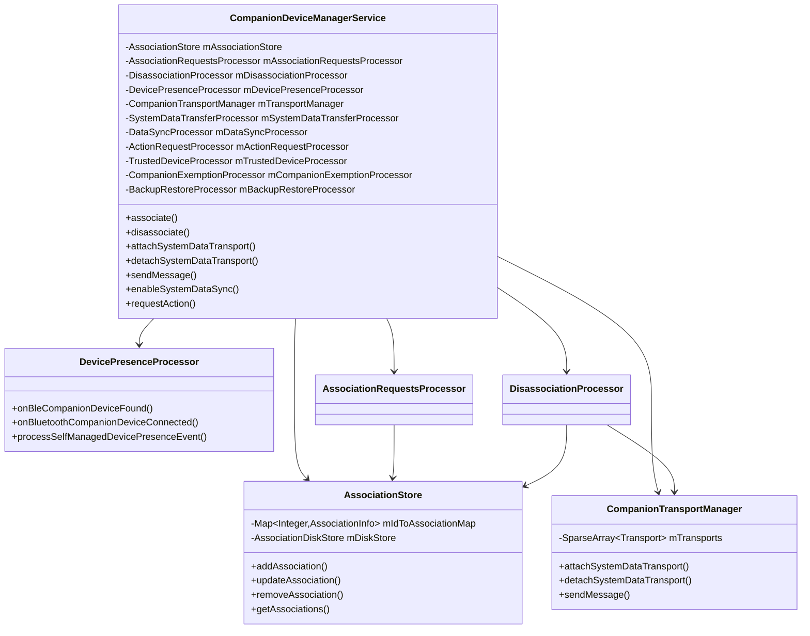

这些处理器字段在 `CompanionDeviceManagerService` 中集中声明（见
`frameworks/base/services/companion/java/com/android/server/companion/CompanionDeviceManagerService.java`，
第 154-170 行）。它们在构造函数（第 200-236 行）中完成装配。在那里，每个
处理器都会接收共享的 `AssociationStore` 和 `CompanionTransportManager`。
因此它们都观察同一套关联集合和同一批传输通道。

### 52.1.2 权限模型

CDM 强制执行一套严格的权限模型。关键权限在 `CompanionDeviceManagerService.java`
顶部以静态导入的方式声明：

```java
import static android.Manifest.permission.ACCESS_COMPANION_INFO;
import static android.Manifest.permission.ACCESS_COMPANION_MESSAGE_PCC;
import static android.Manifest.permission.ASSOCIATE_COMPANION_DEVICES;
import static android.Manifest.permission.BLUETOOTH_CONNECT;
import static android.Manifest.permission.DELIVER_COMPANION_MESSAGES;
import static android.Manifest.permission.MANAGE_COMPANION_DEVICES;
import static android.Manifest.permission.REQUEST_COMPANION_SELF_MANAGED;
import static android.Manifest.permission.REQUEST_OBSERVE_COMPANION_DEVICE_PRESENCE;
import static android.Manifest.permission.USE_COMPANION_TRANSPORTS;
```

源码出处：
`frameworks/base/services/companion/java/com/android/server/companion/CompanionDeviceManagerService.java`，第 20-28 行。

这些权限分别对应不同的能力：

- **ASSOCIATE_COMPANION_DEVICES** —— 创建任何新关联所必需。
- **REQUEST_COMPANION_SELF_MANAGED** —— 自管理关联所必需（即由应用自行
  管理传输，而不是依赖基于 MAC 地址的在场检测）。

- **REQUEST_OBSERVE_COMPANION_DEVICE_PRESENCE** —— 注册在场回调所必需
  （当配套设备出现或消失时，接收 BLE/BT 通知）。

- **USE_COMPANION_TRANSPORTS** —— 挂接用于跨设备消息传递的系统数据传输
  （文件描述符）所必需。

- **DELIVER_COMPANION_MESSAGES** —— 通过 CDM 传输发送消息所必需。

- **MANAGE_COMPANION_DEVICES** —— 用于 shell 命令和管理操作的系统级权限。

- **ACCESS_COMPANION_INFO** —— 查询其他用户的配套信息所必需。

- **ACCESS_COMPANION_MESSAGE_PCC** —— Android 17 新增；用于限制对
  Private Compute Core 消息路径的访问，该路径被可信设备和 AI 代理流程所使用。

### 52.1.3 启动流程

`CompanionDeviceManagerService` 是一个参与标准服务端启动生命周期的
`SystemService`。`CompanionTransportManager`、
`SystemDataTransferProcessor` 以及其他处理器都在服务构造函数中构造。在
`onStart()` 期间，服务会：

1. 通过 `AssociationStore.refreshCache()` 从磁盘读取已持久化的关联数据，
   并丢弃任何已被撤销的关联。
2. 读取 UUID 观察存储，并发布 binder 服务和本地服务。

随后 `onBootPhase()` 完成各阶段相关的工作：

1. 在 `PHASE_SYSTEM_SERVICES_READY` 时，注册负责跟踪包移除和变更的
   `PackageMonitor`。
2. 在 `PHASE_BOOT_COMPLETED` 时，初始化 `DevicePresenceProcessor` 以开始
   监测 BLE/BT 连接，调度
   `InactiveAssociationsRemovalService`，并调用
   `CrossDeviceSyncController.onBootCompleted()` 以进行通话元数据同步。

关联数据存储在设备加密（DE）存储中。因此在用户解锁设备之前即可访问它。
这一点在 `AssociationStore.refreshCache()` 的实现中有明确体现：

```java
// The data is stored in DE directories, so we can read the data for all users now
// (which would not be possible if the data was stored to CE directories).
Map<Integer, Associations> userToAssociationsMap =
        mDiskStore.readAssociationsByUsers(userIds);
```

源码出处：
`frameworks/base/services/companion/java/com/android/server/companion/association/AssociationStore.java`，第 177-180 行（位于第 164 行的 `refreshCache()` 内）。

### 52.1.4 内部 Binder Stub

真正的 IPC 端点是 `CompanionDeviceManagerService` 内部的内部类
`CompanionDeviceManagerImpl`。该类继承 `ICompanionDeviceManager.Stub`，并把
每一次 Binder 调用路由到相应的处理器。例如 `associate()` 调用：

1. 校验调用者身份与权限。
2. 委派给 `AssociationRequestsProcessor.processNewAssociationRequest()`。

类似地，`disassociate()` 会路由到 `DisassociationProcessor.disassociate()`。

该服务还会通过 `CompanionDeviceManagerServiceInternal` 发布内部 API，
其他系统服务可以通过 `LocalServices` 访问它们：

```
frameworks/base/services/companion/java/com/android/server/companion/
    CompanionDeviceManagerServiceInternal.java
```

### 52.1.5 Shell 命令接口

为便于调试和测试，CDM 通过以下方式暴露 shell 命令：

```
frameworks/base/services/companion/java/com/android/server/companion/
    CompanionDeviceShellCommand.java
```

这使得如下操作成为可能：

```bash
adb shell cmd companiondevice list 0
adb shell cmd companiondevice associate 0 com.example.app \
    --mac-address AA:BB:CC:DD:EE:FF
adb shell cmd companiondevice disassociate 0 com.example.app \
    --mac-address AA:BB:CC:DD:EE:FF
```

---

## 52.2 设备关联与发现

### 52.2.1 关联数据模型

每一种配套设备关系都由一个 `AssociationInfo` 对象表示。`AssociationInfo.Builder`
揭示了它的字段（来自 `AssociationRequestsProcessor.createAssociation()`）：

```java
final AssociationInfo association =
        new AssociationInfo.Builder(id, userId, packageName)
                .setDeviceMacAddress(macAddress)
                .setDisplayName(displayName)
                .setDeviceProfile(deviceProfile)
                .setAssociatedDevice(associatedDevice)
                .setSelfManaged(selfManaged)
                .setNotifyOnDeviceNearby(false)
                .setRevoked(false)
                .setPending(false)
                .setTimeApproved(timestamp)
                .setLastTimeConnected(Long.MAX_VALUE)
                .setSystemDataSyncFlags(0)
                .setTransportFlags(transportFlags)
                .setDeviceIcon(deviceIcon)
                .setDeviceId(null)
                .setPackagesToNotify(null)
                .setMetadata(new PersistableBundle())
                .setExtraPermissions(extraPermissions)
                .setRemoteAiAgentSupported(isRemoteAiAgentSupported)
                .build();
```

源码出处：
`frameworks/base/services/companion/java/com/android/server/companion/association/AssociationRequestsProcessor.java`，第 335-355 行。

最后两个 setter 是 Android 17 新增的。`setExtraPermissions()` 携带一组与该
关联绑定的可选权限。`setRemoteAiAgentSupported()` 记录该配套设备能否承载远端
AI 代理（供 52.8 节中的 Computer Control 流程使用）。该值来自
`AssociationRequest.isRemoteAiAgentSupported()`。

关键字段：

| 字段                  | 用途                                                       |
|------------------------|---------------------------------------------------------------|
| `id`                   | 唯一整数标识符，单调递增           |
| `userId`               | 拥有该关联的 Android 用户                    |
| `packageName`          | 配套应用的包名                              |
| `deviceMacAddress`     | 用于基于硬件在场检测的 MAC 地址             |
| `displayName`          | 配套设备的人类可读名称                  |
| `deviceProfile`        | 基于角色的配置文件（手表、眼镜、应用串流等）      |
| `selfManaged`          | 若为 true，由应用管理传输；不做基于 MAC 的监测   |
| `revoked`              | 若为 true，该关联等待最终清理              |
| `systemDataSyncFlags`  | 控制同步哪些系统数据的位掩码                |
| `transportFlags`       | 控制传输行为的旗标                          |
| `deviceId`             | 带有自定义 ID 和 MAC 的可选 `DeviceId`                    |
| `extraPermissions`     | Android 17：与该设备关联的额外权限      |
| `remoteAiAgentSupported` | Android 17：该配套设备能否承载远端 AI 代理 |

### 52.2.2 设备配置文件

设备配置文件决定了授予配套应用的权限和角色。需要用户确认的配置文件定义在
`AssociationRequestsProcessor` 中：

```java
private static final Set<String> DEVICE_PROFILES_WITH_REQUIRED_CONFIRMATION = new ArraySet<>(
        Arrays.asList(
                AssociationRequest.DEVICE_PROFILE_APP_STREAMING,
                AssociationRequest.DEVICE_PROFILE_NEARBY_DEVICE_STREAMING));
```

源码出处：
`frameworks/base/services/companion/java/com/android/server/companion/association/AssociationRequestsProcessor.java`，第 144-147 行。

完整的设备配置文件集合包括：

- **DEVICE_PROFILE_WATCH** —— 智能手表配套设备
- **DEVICE_PROFILE_GLASSES** —— AR/VR 眼镜
- **DEVICE_PROFILE_APP_STREAMING** —— 远端显示/应用串流
- **DEVICE_PROFILE_NEARBY_DEVICE_STREAMING** —— 附近设备投影
- **DEVICE_PROFILE_AUTOMOTIVE_PROJECTION** —— 车机投影
- **DEVICE_PROFILE_COMPUTER** —— 桌面/笔记本配套设备
- **DEVICE_PROFILE_WEARABLE_SENSING** —— 可穿戴健康/传感器设备
- **DEVICE_PROFILE_VIRTUAL_DEVICE** —— 受限的虚拟设备角色
  （`android.app.role.COMPANION_DEVICE_VIRTUAL_DEVICE`）
- **DEVICE_PROFILE_FITNESS_TRACKER** —— 健身手环/追踪器
  配套设备（旗标 `FLAG_BAND_DEVICE_PROFILE`）
- **DEVICE_PROFILE_MEDICAL** —— 医疗设备配套（旗标
  `FLAG_ENABLE_MEDICAL_PROFILE`）

最后两个是由旗标门控的配置文件，同时存在于 Android 16 和 17 中。它们始终
停留在各自的 aconfig 旗标之后。它们并不是 17 的新增项。两者都声明在
`frameworks/base/core/java/android/companion/AssociationRequest.java` 中。
每个都由 `@FlaggedApi` 注解保护，该注解指向
`frameworks/base/core/java/android/companion/flags.aconfig` 中的一个 aconfig 旗标。

`DEVICE_PROFILE_FITNESS_TRACKER` 映射到角色字符串
`android.app.role.COMPANION_DEVICE_FITNESS_TRACKER`，而
`DEVICE_PROFILE_MEDICAL` 映射到 `android.app.role.COMPANION_DEVICE_MEDICAL`。

每个配置文件都映射到一个 Android 角色。当创建关联时，配套应用会被自动授予
相应角色（如果尚未持有该角色）：

```java
addRoleHolderForAssociation(mContext, association, success -> {
    if (success) {
        Slog.i(TAG, "Added " + deviceProfile + " role to userId="
                + association.getUserId() + ", packageName="
                + association.getPackageName());
        mAssociationStore.addAssociation(association);
        sendCallbackAndFinish(association, callback, resultReceiver);
    } else {
        Slog.e(TAG, "Failed to add u" + association.getUserId()
                + "\\" + association.getPackageName()
                + " to the list of " + deviceProfile + " holders.");
        sendCallbackAndFinish(null, callback, resultReceiver);
    }
});
```

源码出处：
`AssociationRequestsProcessor.java`，第 390-403 行。

每个配置文件的角色到权限映射位于
`frameworks/base/services/companion/java/com/android/server/companion/utils/RolesUtils.java`。
那两个 Android 17 配置文件在那里的处理方式不同。
`DEVICE_PROFILE_FITNESS_TRACKER` 是一个*角色别名*。一个 `ROLE_ALIASES`
映射把它指向 `DEVICE_PROFILE_WATCH`。因此健身手环复用手表角色及其权限集
（通知、电话、通话记录、短信、联系人、日历、附近设备、媒体输出）。它并不
定义一个独立角色。

`DEVICE_PROFILE_MEDICAL` 是它自己的角色，在
`PROFILE_PERMISSION_SETS` 中拥有更窄的权限集合：
post-notifications、nearby devices、schedule-exact-alarm 以及
bypass-Do-Not-Disturb。这反映了医疗配套设备需要投递时间敏感的告警，而
不需要手表那样宽泛的消息访问能力。

### 52.2.3 关联流程

关联过程有两种变体：**完整流程**（带 UI）和
**无 UI 流程**（用于自管理关联）。`AssociationRequestsProcessor` 的
Javadoc 对两者都有说明：

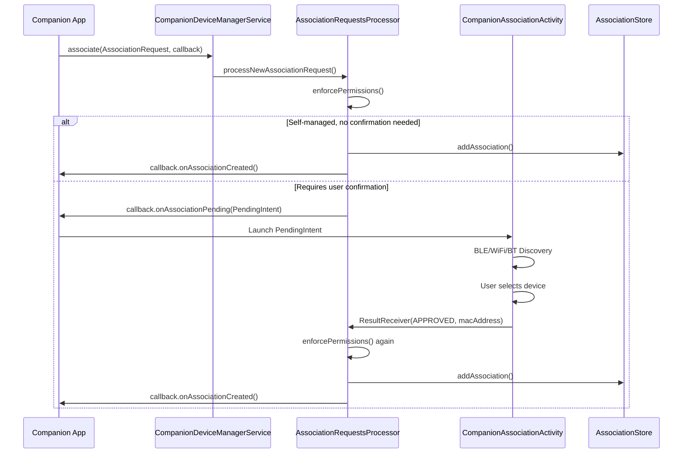

`processNewAssociationRequest()` 中的完整流程实现：

```java
public void processNewAssociationRequest(@NonNull AssociationRequest request,
        @NonNull String packageName, @UserIdInt int userId,
        @NonNull IAssociationRequestCallback callback) {
    // 1. Enforce permissions and other requirements.
    enforcePermissionForCreatingAssociation(mContext, request, packageUid);
    enforceUsesCompanionDeviceFeature(mContext, userId, packageName);

    // 2a. Check if association can be created without launching UI
    if (request.isSelfManaged() && !request.isForceConfirmation()
            && !DEVICE_PROFILES_WITH_REQUIRED_CONFIRMATION.contains(request.getDeviceProfile())
            && !willAddRoleHolder(request, packageName, userId)) {
        createAssociationAndNotifyApplication(request, packageName, userId,
                /* macAddress */ null, callback, /* resultReceiver */ null);
        return;
    }
    // ...
    // 2b. Build a PendingIntent for launching the confirmation UI
    request.setSkipPrompt(mayAssociateWithoutPrompt(packageName, userId));
    // ...
}
```

源码出处：
`AssociationRequestsProcessor.java`，第 171-249 行。权限辅助方法
`enforcePermissionForCreatingAssociation` 和
`enforceUsesCompanionDeviceFeature` 是来自
`com.android.server.companion.utils.PermissionsUtils`
和 `PackageUtils` 的静态导入。这项重构是在 Android 17 中引入的。

### 52.2.4 速率限制

无 UI 关联路径内置了速率限制以防止滥用：

```java
private static final int ASSOCIATE_WITHOUT_PROMPT_MAX_PER_TIME_WINDOW = 5;
private static final long ASSOCIATE_WITHOUT_PROMPT_WINDOW_MS = 60 * 60 * 1000; // 60 min
```

`mayAssociateWithoutPrompt()` 方法会检查该包在过去 60 分钟内创建了多少个
关联。一旦计数达到 5（检查条件为 `>=`），就会强制弹出提示：

```java
if (++recent >= ASSOCIATE_WITHOUT_PROMPT_MAX_PER_TIME_WINDOW) {
    Slog.w(TAG, "Too many associations: " + packageName + " already "
            + "associated " + recent + " devices within the last "
            + ASSOCIATE_WITHOUT_PROMPT_WINDOW_MS + "ms");
    return false;
}
```

源码出处：
`AssociationRequestsProcessor.java`，第 534-555 行（常量声明在第
140-141 行）。

### 52.2.5 AssociationStore —— 持久化与变更通知

`AssociationStore` 是关联记录的核心增删改查接口。它维护一个内存缓存
（`mIdToAssociationMap`），并经由 `AssociationDiskStore` 由磁盘存储作为
后端。

```
frameworks/base/services/companion/java/com/android/server/companion/association/
    AssociationStore.java
    AssociationDiskStore.java
    Associations.java
```

该存储支持两类变更监听器：

1. **本地监听器**（`OnChangeListener`）—— 供其他服务端组件使用
  （DevicePresenceProcessor、TransportManager 等）。

2. **远端监听器**（`IOnAssociationsChangedListener`）—— 供应用通过
   Binder 使用。

变更类型是枚举出来的：

```java
public static final int CHANGE_TYPE_ADDED = 0;
public static final int CHANGE_TYPE_REMOVED = 1;
public static final int CHANGE_TYPE_UPDATED_ADDRESS_CHANGED = 2;
public static final int CHANGE_TYPE_UPDATED_ADDRESS_UNCHANGED = 3;
public static final int CHANGE_TYPE_UPDATED_DATA_SYNC_TYPES = 4;
```

源码出处：
`AssociationStore.java`，第 77-81 行。Android 17 增加了
`CHANGE_TYPE_UPDATED_DATA_SYNC_TYPES`，在每个关联的系统数据同步旗标发生
变化时触发（参见 52.3.6 节的 `DataSyncProcessor`）。

通知逻辑会区分地址变更的更新和地址未变更的更新。只有重大变更（新增、
移除、地址变更）才会通知远端监听器——小的配置微调则不会：

```java
// Do NOT notify when UPDATED_ADDRESS_UNCHANGED, which means a minor tweak in
// association's configs, which "listeners" won't (and shouldn't) be able to see.
if (changeType != CHANGE_TYPE_UPDATED_ADDRESS_UNCHANGED) {
    mRemoteListeners.broadcast((listener, callbackUserId) -> { ... });
}
```

源码出处：
`AssociationStore.java`，第 601-608 行。

写操作被派发到一个单线程执行器，以避免阻塞调用者：

```java
private void writeCacheToDisk(@UserIdInt int userId) {
    mExecutor.execute(() -> {
        Associations associations = new Associations();
        synchronized (mLock) {
            associations.setMaxId(mMaxId);
            associations.setAssociations(
                    CollectionUtils.filter(mIdToAssociationMap.values().stream().toList(),
                            a -> a.getUserId() == userId));
        }
        mDiskStore.writeAssociationsForUser(userId, associations);
    });
}
```

源码出处：
`AssociationStore.java`，第 325-336 行。

### 52.2.6 解除关联

`DisassociationProcessor` 既处理用户发起的解除关联（通过 API），也处理
空闲自管理关联的自动清理。

```
frameworks/base/services/companion/java/com/android/server/companion/association/
    DisassociationProcessor.java
```

解除关联的原因会被记录以用于调试：

```java
public static final String REASON_REVOKED = "revoked";
public static final String REASON_SELF_IDLE = "self-idle";
public static final String REASON_SHELL = "shell";
public static final String REASON_LEGACY = "legacy";
public static final String REASON_API = "api";
public static final String REASON_PKG_DATA_CLEARED = "pkg-data-cleared";
```

源码出处：
`DisassociationProcessor.java`，第 71-76 行。

一个关键设计点是：如果在触发解除关联时配套应用进程正处于前台，那么真正的
移除会被推迟。关联会被标记为“已撤销”，并注册一个
`OnUidImportanceListener`。当进程转入后台后，清理才会完成。推迟适用于两种
情况。第一种是该关联持有的设备配置文件所对应的角色没有被其他任何关联使用。
第二种是无配置文件的关联携带了额外权限：

```java
if (packageProcessImportance <= IMPORTANCE_FOREGROUND
        && ((deviceProfile != null && !isRoleInUseByOtherAssociations)
                || (deviceProfile == null
                    && !CollectionUtils.isEmpty(association.getExtraPermissions())))) {
    // Need to remove the app from the list of role holders, but the process is
    // visible to the user at the moment, so we'll need to do it later.
    // ... (log elided)
    mAssociationStore.updateAssociation(id, a -> (new AssociationInfo.Builder(a))
            .setRevoked(true)
            .build());
    startListening();
    return;
}
```

源码出处：
`DisassociationProcessor.java`，第 160-174 行。

自管理关联在连续 90 天不活动后会被自动移除：

```java
private static final long ASSOCIATION_REMOVAL_TIME_WINDOW_DEFAULT = DAYS.toMillis(90);
```

源码出处：
`DisassociationProcessor.java`，第 82 行。

`InactiveAssociationsRemovalService`（一个 `JobService`）会周期性地调用
`removeIdleSelfManagedAssociations()` 来清理陈旧条目。

### 52.2.7 设备在场监测

`DevicePresenceProcessor` 跟踪配套设备是否在附近或已连接：

```
frameworks/base/services/companion/java/com/android/server/companion/devicepresence/
    DevicePresenceProcessor.java
    BleDeviceProcessor.java
    BluetoothDeviceProcessor.java
    CompanionAppBinder.java
    CompanionServiceConnector.java
    ObservableUuid.java
    ObservableUuidStore.java
```

该处理器处理多种在场事件类型：

```java
EVENT_BLE_APPEARED
EVENT_BLE_DISAPPEARED
EVENT_BT_CONNECTED
EVENT_BT_DISCONNECTED
EVENT_SELF_MANAGED_APPEARED
EVENT_SELF_MANAGED_DISAPPEARED
EVENT_SELF_MANAGED_NEARBY
EVENT_SELF_MANAGED_NOT_NEARBY
EVENT_ASSOCIATION_REMOVED
```

当配套设备出现（通过 BLE 扫描或 BT 连接）时，
`DevicePresenceProcessor` 可以绑定到配套应用的
`CompanionDeviceService`。该绑定由 `CompanionAppBinder`
和 `CompanionServiceConnector` 管理，它们负责在设备在场状态变化时维护
服务连接的生命周期。

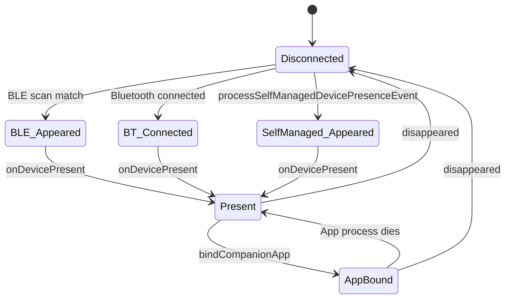

---

## 52.3 数据传输与上下文同步

### 52.3.1 传输架构

传输子系统在本地 Android 设备与其配套设备之间提供一条双向消息通道。该架构
是分层的：

```
frameworks/base/services/companion/java/com/android/server/companion/transport/
    Transport.java              -- abstract base class
    RawTransport.java           -- unencrypted transport
    SecureTransport.java        -- UKEY2-encrypted transport
    CompanionTransportManager.java  -- lifecycle manager
    CryptoManager.java          -- cryptographic utilities
```

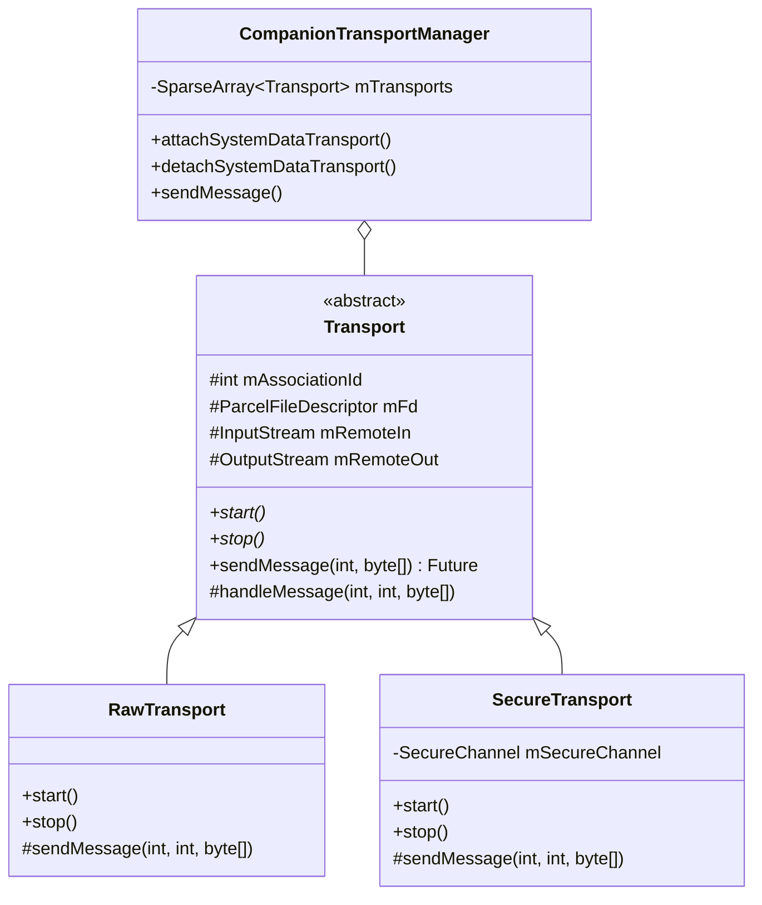

### 52.3.2 传输协议

`Transport` 基类定义了一条带有 12 字节头部的消息协议：

```java
protected static final int HEADER_LENGTH = 12;
```

消息按其最高字节分类：

```java
private static boolean isRequest(int message) {
    return (message & 0xFF000000) == 0x63000000;
}

private static boolean isResponse(int message) {
    return (message & 0xFF000000) == 0x33000000;
}

private static boolean isOneway(int message) {
    return (message & 0xFF000000) == 0x43000000;
}
```

源码出处：
`Transport.java`，第 133-143 行（`HEADER_LENGTH = 12` 声明在第 77 行）。

这种分类决定了消息的处理方式：

- **请求消息**（`0x63xxxxxx`）—— 等待来自远端的响应。
  发送者会得到一个 `CompletableFuture<byte[]>`，当响应到达时它会被完成。

- **单向消息**（`0x43xxxxxx`）—— 发出即忘；该 future 在发送后立即完成。

- **响应消息**（`0x33xxxxxx`）—— 完成一个挂起请求的 future。

标准消息类型包括：

```java
static final int MESSAGE_RESPONSE_SUCCESS = 0x33838567; // !SUC
static final int MESSAGE_RESPONSE_FAILURE = 0x33706573; // !FAI
```

以及来自 `CompanionDeviceManager` 的：

| 常量                               | 类型    | 用途                            |
|----------------------------------------|---------|------------------------------------|
| `MESSAGE_REQUEST_PING`                 | Request | 连接性检查                 |
| `MESSAGE_REQUEST_PERMISSION_RESTORE`   | Request | 权限同步负载             |
| `MESSAGE_REQUEST_CONTEXT_SYNC`         | Request | 通话元数据同步                 |
| `MESSAGE_REQUEST_REMOTE_AUTHENTICATION`| Request | 远端身份验证交换     |
| `MESSAGE_REQUEST_METADATA_UPDATE`      | Request | 元数据更新                    |
| `MESSAGE_ONEWAY_PING`                 | Oneway  | 轻量级 ping                   |
| `MESSAGE_ONEWAY_FROM_WEARABLE`        | Oneway  | 可穿戴设备发起的数据           |
| `MESSAGE_ONEWAY_TO_WEARABLE`          | Oneway  | 发往可穿戴设备的数据         |
| `MESSAGE_ONEWAY_TASK_CONTINUITY`      | Oneway  | 任务交接数据                  |

`Transport.handleMessage()` 中的消息处理管道：

```java
protected final void handleMessage(int message, int sequence, @NonNull byte[] data)
        throws IOException {
    if (isOneway(message)) {
        processOneway(message, data);
    } else if (isRequest(message)) {
        try {
            processRequest(message, sequence, data);
        } catch (IOException e) {
            Slog.w(TAG, "Failed to respond to 0x" + Integer.toHexString(message), e);
        }
    } else if (isResponse(message)) {
        processResponse(message, sequence, data);
    } else {
        Slog.w(TAG, "Unknown message 0x" + Integer.toHexString(message));
    }
}
```

源码出处：
`Transport.java`，第 335-356 行。

### 52.3.3 传输生命周期

`CompanionTransportManager` 管理每个关联的传输生命周期：

```java
/** Association id -> Transport */
@GuardedBy("mTransports")
private final SparseArray<Transport> mTransports = new SparseArray<>();
```

当配套应用调用 `attachSystemDataTransport()` 时，管理器会根据构建类型和配置
创建合适的传输类型：

```java
private Transport createTransport(AssociationInfo association,
        ParcelFileDescriptor fd, byte[] preSharedKey, int flags) {
    // If device is debug build, use hardcoded test key for authentication
    if (Build.isDebuggable()) {
        final byte[] testKey = "CDM".getBytes(StandardCharsets.UTF_8);
        return new SecureTransport(associationId, fd, mContext, testKey, null, 0);
    }

    // If either device is not Android, then use app-specific pre-shared key
    if (preSharedKey != null) {
        return new SecureTransport(associationId, fd, mContext, preSharedKey, null, 0);
    }

    // If none of the above applies, then use secure channel with attestation verification
    return new SecureTransport(associationId, fd, mContext, flags);
}
```

源码出处：
`CompanionTransportManager.java`，第 322-356 行。

传输类型的选择遵循以下优先级：

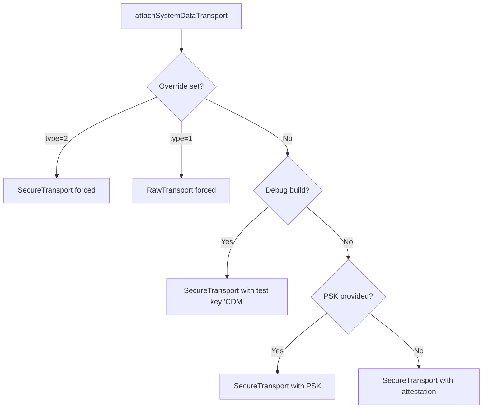

管理器还支持三类监听器：

1. **消息监听器**（`IOnMessageReceivedListener`）—— 按消息类型划分。
2. **事件监听器**（`IOnTransportEventListener`）—— 按关联划分。
3. **传输变更监听器**（`IOnTransportsChangedListener`）—— 针对任何传输的
   挂接/卸载。

### 52.3.4 安全通道（UKEY2）

`SecureChannel` 类使用 Google 的 UKEY2 协议实现了加密通信层：

```
frameworks/base/services/companion/java/com/android/server/companion/securechannel/
    SecureChannel.java
    AttestationVerifier.java
    AttestationVerificationException.java
    KeyStoreUtils.java
    SecureChannelException.java
```

该通道分三个阶段建立安全性：

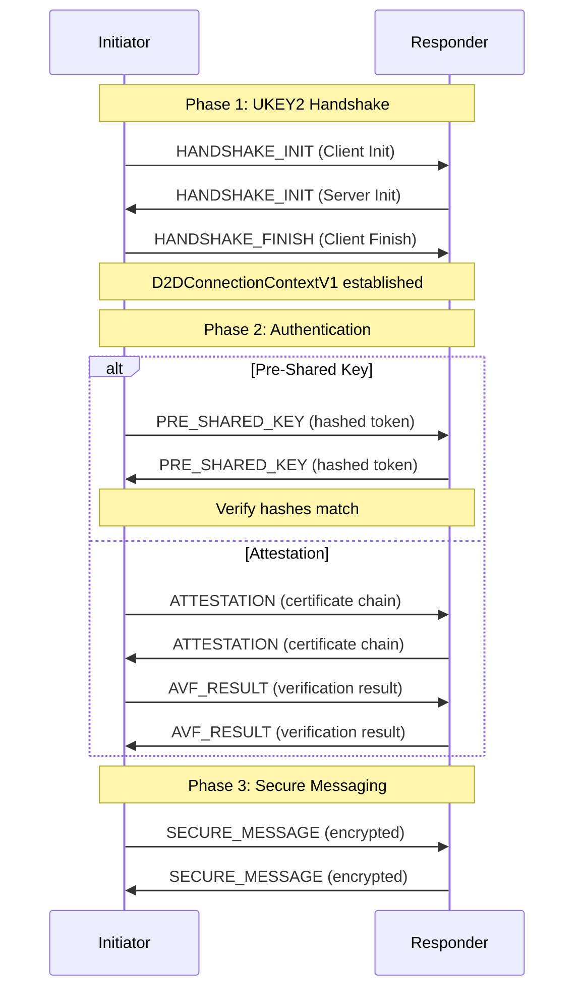

消息类型被编码为 2 字节值：

```java
private enum MessageType {
    HANDSHAKE_INIT(0x4849),   // HI
    HANDSHAKE_FINISH(0x4846), // HF
    PRE_SHARED_KEY(0x504b),   // PK
    ATTESTATION(0x4154),      // AT
    AVF_RESULT(0x5652),       // VR
    SECURE_MESSAGE(0x534d),   // SM
    UNKNOWN(0);               // X
}
```

源码出处：
`SecureChannel.java`，第 652-659 行。

该通道处理双方都可能同时尝试发起的潜在冲突。解决方法是使用 Client Init 消息
的字节级比较：

```java
// if received message is "larger" than the sent message, then reset the handshake context.
if (compareByteArray(mClientInit, handshakeMessage) < 0) {
    Slog.d(TAG, "Assigned: Responder");
    mHandshakeContext = null;
    return handshakeMessage;
} else {
    Slog.d(TAG, "Assigned: Initiator; Discarding received Client Init");
    // ...
}
```

源码出处：
`SecureChannel.java`，第 416-437 行。

预共享密钥身份验证通过把角色名称与密钥拼接后再进行哈希，来构造一个
角色专属的令牌：

```java
private byte[] constructToken(D2DHandshakeContext.Role role, byte[] authValue)
        throws GeneralSecurityException {
    MessageDigest hash = MessageDigest.getInstance("SHA-256");
    String roleName = role == Role.INITIATOR ? "Initiator" : "Responder";
    byte[] roleUtf8 = roleName.getBytes(StandardCharsets.UTF_8);
    int tokenLength = roleUtf8.length + authValue.length;
    return hash.digest(ByteBuffer.allocate(tokenLength)
            .put(roleUtf8)
            .put(authValue)
            .array());
}
```

源码出处：
`SecureChannel.java`，第 616-626 行。

### 52.3.5 权限同步

`SystemDataTransferProcessor` 管理配对设备之间运行时权限的同步：

```
frameworks/base/services/companion/java/com/android/server/companion/datatransfer/
    SystemDataTransferProcessor.java
    SystemDataTransferRequestStore.java
```

权限同步流程：

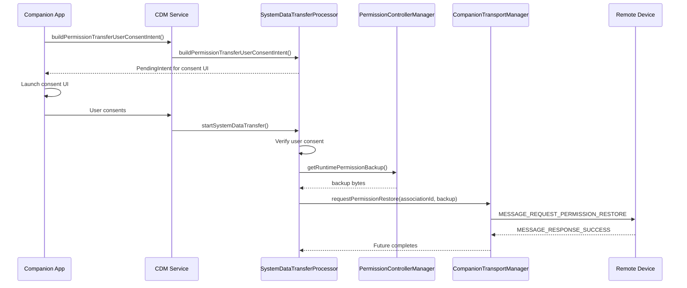

该处理器为传入的权限恢复请求注册了一个消息监听器：

```java
mTransportManager.addListener(MESSAGE_REQUEST_PERMISSION_RESTORE, messageListener);
```

当接收设备收到权限恢复消息时，它会应用这些权限：

```java
private void onReceivePermissionRestore(byte[] message) {
    if (!Build.isDebuggable() && !mContext.getPackageManager().hasSystemFeature(
            FEATURE_WATCH)) {
        Slog.e(LOG_TAG, "Permissions restore is only available on watch.");
        return;
    }
    mPermissionControllerManager.stageAndApplyRuntimePermissionsBackup(
            message, user);
}
```

源码出处：
`SystemDataTransferProcessor.java`，第 273-290 行。

请注意当前的限制：在正式发布版本中，权限恢复仅在手表设备上可用。这是一项
安全措施，用于防止未授权的权限提升。

### 52.3.6 元数据同步（DataSync）

`DataSyncProcessor`（版权 2025）支持配对设备之间的设备元数据同步。与权限同步
（传输运行时权限）不同，元数据同步交换的是任意的、以特性为键的
`PersistableBundle` 数据：

```
frameworks/base/services/companion/java/com/android/server/companion/datasync/
    DataSyncProcessor.java
    LocalMetadataStore.java
```

该处理器在构造时注册两个监听器：

```java
public DataSyncProcessor(
        AssociationStore associationStore,
        LocalMetadataStore localMetadataStore,
        CompanionTransportManager transportManager) {
    // ...
    mTransportManager.addListener(MESSAGE_REQUEST_METADATA_UPDATE,
            new IOnMessageReceivedListener.Stub() {
                @Override
                public void onMessageReceived(int associationId, byte[] data) {
                    onReceiveMetadataUpdate(associationId, data);
                }
            });
    mTransportManager.addListener(
            new IOnTransportsChangedListener.Stub() {
                @Override
                public void onTransportsChanged(List<AssociationInfo> associations) {
                    broadcastMetadata(associations);
                }
            });
}
```

源码出处：
`DataSyncProcessor.java`，第 62-86 行。

当传输连接建立时，处理器会自动把本地设备的元数据广播给所有新连接的关联。
元数据按用户 ID 分组以确保隐私：

```java
private void broadcastMetadata(List<AssociationInfo> associations) {
    SparseArray<List<AssociationInfo>> newAssociations = new SparseArray<>();
    synchronized (mAssociationsWithTransport) {
        // Isolate newly attached associations and group by user.
        for (AssociationInfo association : associations) {
            if (!mAssociationsWithTransport.contains(association.getId())) {
                int userId = association.getUserId();
                // ... add association to newAssociations.get(userId) ...
            }
        }
        // Update the set of associations with transport.
        mAssociationsWithTransport.clear();
        for (AssociationInfo association : associations) {
            mAssociationsWithTransport.add(association.getId());
        }
    }
    for (int i = 0; i < newAssociations.size(); i++) {
        sendMetadataUpdate(newAssociations.keyAt(i), newAssociations.valueAt(i));
    }
}
```

源码出处：
`DataSyncProcessor.java`，第 183-209 行。（Android 17 重写了该方法，改用显式的
`SparseArray` 分组，而不是旧的基于流的收集器。）

当从远端设备收到元数据时，负载会被解析并交给 `setRemoteMetadata()`，后者会
添加时间戳并更新关联记录：

```java
private void onReceiveMetadataUpdate(int associationId, byte[] data) {
    PersistableBundle metadata;
    try {
        metadata = PersistableBundle.readFromStream(new ByteArrayInputStream(data));
    } catch (IOException e) {
        throw new RuntimeException("Failed to parse received metadata", e);
    }
    setRemoteMetadata(associationId, metadata);
}
```

源码出处：
`DataSyncProcessor.java`，第 211-222 行。`setRemoteMetadata()` 在调用
`mAssociationStore.updateAssociation()` 之前，会用
`AssociationInfo.METADATA_TIMESTAMP`（第 149 行）给该 bundle 盖上时间戳。

在 Android 17 中，`LocalMetadataStore` 被精简为 `utils/` 包中一个共享的
`PersistableBundleStore` 辅助类的薄子类。它只提供日志标签和磁盘上的文件名：

```java
public class LocalMetadataStore extends PersistableBundleStore {

    private static final String TAG = "CDM_LocalMetadataStore";
    // A binary file w/o file extension
    private static final String FILE_NAME = "cdm_local_metadata";

    public String getTag() { return TAG; }
    public String getFileName() { return FILE_NAME; }
}
```

源码出处：
`LocalMetadataStore.java`（一个很小的文件）。缓存优先的读取、磁盘超时以及
按用户的 `SparseArray` 缓存现在位于
`frameworks/base/services/companion/java/com/android/server/companion/utils/PersistableBundleStore.java`，
`LocalMetadataStore` 和其他 CDM 存储都复用它。

元数据同步架构：

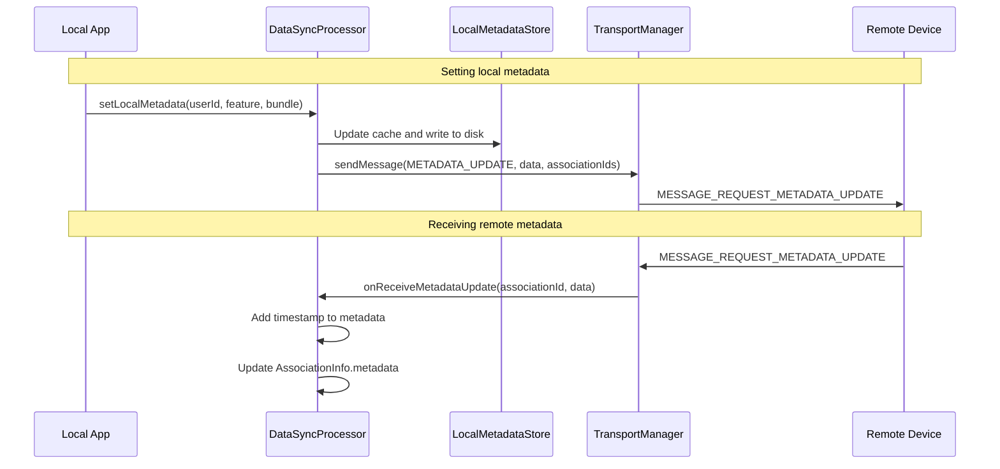

### 52.3.7 跨设备通话同步

`CrossDeviceSyncController` 使得通话元数据能够在配对设备之间同步。这让智能
手表可以显示来自手机的来电，或者让手机显示来自可穿戴设备的通话：

```
frameworks/base/services/companion/java/com/android/server/companion/datatransfer/contextsync/
    CrossDeviceSyncController.java
    CallMetadataSyncData.java
    CallMetadataSyncConnectionService.java
    CallMetadataSyncInCallService.java
    CrossDeviceCall.java
    CrossDeviceSyncControllerCallback.java
```

该控制器管理：

- **手机账户注册** —— 为远端设备创建虚拟手机账户。

- **通话元数据交换** —— 通过 `MESSAGE_REQUEST_CONTEXT_SYNC` 同步通话状态、
  来电者信息以及协调者数据。

- **双向通话控制** —— 允许任一设备接听、拒绝或结束通话。

### 52.3.8 任务连续性

`TaskContinuityManagerService` 支持配对设备之间无缝的任务交接。它在 Android 17
中围绕按用户的 `HandoffController` 进行了重构：

```
frameworks/base/services/companion/java/com/android/server/companion/datatransfer/continuity/
    TaskContinuityManagerService.java
    FeatureController.java
    MultiUserResourceCache.java
    connectivity/
    handoff/      -- HandoffController, In/OutboundHandoffRequestHandler
    messages/     -- HandoffRequestMessage, HandoffRequestResultMessage, etc.
    settings/     -- HandoffPreferenceStore, HandoffSettingsManager
    tasks/        -- TaskBroadcaster, RemoteTaskFactory, RemoteTaskListenerHolder
```

该服务就是一个普通的 `SystemService`。它的交接状态保存在一个
`MultiUserResourceCache<HandoffController>` 中，启用偏好按用户存放在
`HandoffPreferenceStore`/`HandoffSettingsManager` 中：

```java
public final class TaskContinuityManagerService extends SystemService {

    private final MultiUserResourceCache<HandoffController> mHandoffControllerCache;
    private HandoffPreferenceStore mHandoffPreferenceStore;
    private HandoffSettingsManager mHandoffSettingsManager;
    private TaskContinuityManagerServiceImpl mTaskContinuityManagerService;
    // ...
}
```

源码出处：
`TaskContinuityManagerService.java`，第 45-60 行。（Android 17 用由每个
`HandoffController` 拥有的按关联处理程序取代了旧的单实例
`InboundHandoffRequestController`/`OutboundHandoffRequestController` 字段，并且
`UniversalClipboardService` 已从该包中移除。）

在 `onStart()` 中，该服务在 `Context.TASK_CONTINUITY_SERVICE` 下发布一个
binder 服务，并提供以下 API：

- **注册远端任务监听器**（需要 `READ_REMOTE_TASKS`，通过内部 stub 上的
  `@EnforcePermission(READ_REMOTE_TASKS)` 强制）。

- **请求任务交接**（需要 `REQUEST_TASK_HANDOFF`）。

任务连续性消息使用 `MESSAGE_ONEWAY_TASK_CONTINUITY` 流经 CDM 传输。具体的消息
类型位于 `messages/` 下。它们包括
`HandoffRequestMessage` / `HandoffRequestResultMessage`（任务传输的请求/响应）
和 `HandoffActivityDataMessage`（要恢复的 activity 负载）。它们还包括
`TaskStackBroadcastMessage`（远端任务栈同步）和 `RemoteTaskInfo`（单个远端任务
描述符）。按关联的请求流程由 `handoff/` 中的
`InboundHandoffRequestHandler` 和 `OutboundHandoffRequestHandler` 驱动。

### 52.3.9 交接 Activity API

52.3.8 节介绍的是在设备之间移动任务的服务；本节介绍应用实际实现的表面。
*Handoff*（任务连续性的用户可见名称，Android 17 新增）是**按 activity** 可选
启用的。activity 通过 `Activity.setHandoffEnabled()` 声明它的状态可以迁移到另
一台设备，并在系统通过 `onHandoffActivityDataRequested()` 索取时提供该状态：

```java
// frameworks/base/core/java/android/app/Activity.java
@FlaggedApi(android.companion.Flags.FLAG_TASK_CONTINUITY)        // line 7770
public final boolean isHandoffEnabled() { ... }                 // line 7771

@FlaggedApi(android.companion.Flags.FLAG_TASK_CONTINUITY)        // line 7788
public final void setHandoffEnabled(                            // line 7789
        boolean handoffEnabled, @Nullable HandoffActivityParams params) { ... }

// Called by the system (never the app directly) to capture resumable state.
public HandoffActivityData onHandoffActivityDataRequested(      // line 10240
        @NonNull HandoffActivityDataRequestInfo requestInfo) { ... }
```

整个 API 都由 `task_continuity` aconfig 旗标门控
（`frameworks/base/core/java/android/companion/flags.aconfig:69`，命名空间
`companion`，导出为 `android.companion.Flags.FLAG_TASK_CONTINUITY`）。第二道
门是配套的 `CompanionDeviceManager.FLAG_TASK_CONTINUITY = 1 << 1`
（`CompanionDeviceManager.java:233`）数据同步能力。该能力授权传输在两个已关联
设备之间承载交接负载。没有 CDM 关联就不会有交接：该特性运行在 52.3.1-52.3.4 节
所述的同一条安全 CDM 通道上。

两个端点都是*真实的、由用户拥有的设备*——一台手机和一台平板，或一台手机和
一台 Chromebook——它们通过 CompanionDeviceManager（52.2 节）配对。这与 52.4-52.6
节中的虚拟显示屏无关，后者是单台设备驱动一个投射表面。在交接中，每台设备运行
它自己的一份应用副本。只有一份紧凑的描述符跨过链路。它告诉接收方如何重建该
activity（52.3.11 节）。

`HandoffActivityDataRequestInfo.isActiveRequest()` 告诉 activity*为什么*它被
索取。系统会发出两类请求（见 52.3.10 节）：

- 一个**缓存**请求（`isActiveRequest() == false`），在 activity 停止时被抢先
  获取，这样当附近设备提出请求时，快照已经就位；以及
- 一个**活动**请求（`isActiveRequest() == true`），在实际交接的时刻发出，用于
  捕获最新状态。

### 52.3.10 端到端交接流程

这些管道横跨应用的 `ActivityThread`、WindowManager 的
`ActivityTaskManagerService`、`TaskContinuityManagerService`，以及两台设备上的
CDM 传输。

*Handoff data flow across two paired devices*

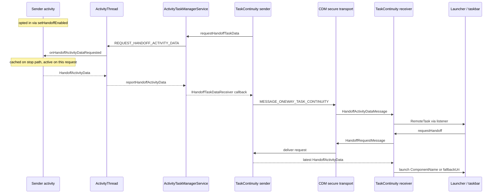

在**发送方**上，`ActivityThread` 从两个位置回调进 activity：

- 在 `callActivityOnSaveInstanceState()` 中（在停止路径上由
  `performStopActivityInner()` 调用），它会预先缓存一份快照。这一步由
  `android.companion.Flags.taskContinuity() && r.activity.isHandoffEnabled()`
  守护。该快照是
  `r.handoffActivityData = r.activity.onHandoffActivityDataRequested(requestInfo)`，
  其中 `isActiveRequest=false`（`ActivityThread.java:6982`-6990）。缓存的数据在
  `ActivityThread.java:6437` 处通过 `setHandoffActivityData()` 挂接到 `StopInfo`
  上。
- 当请求一次实时交接时，它会处理 `REQUEST_HANDOFF_ACTIVITY_DATA`
  消息（H-message id 173，`ActivityThread.java:2683`）。它以
  `isActiveRequest=true` 调用 `onHandoffActivityDataRequested(...)`
  （`ActivityThread.java:4846`）。它通过
  `ActivityTaskManager.reportHandoffActivityData(requestToken, data)`
  （`ActivityThread.java:4859`）返回结果。

该请求起源于 WindowManager。
`ActivityTaskManagerService.requestHandoffTaskData(int taskId, IHandoffTaskDataReceiver receiver)`
（`ActivityTaskManagerService.java:3973`）把请求扇出给任务栈顶的 activity。
然后它等待 activity 通过 `IHandoffTaskDataReceiver`
单向回调上报。该等待有一个超时（见第 489 行的常量）。按 activity 的启用位
本身通过 `ActivityClientController.setHandoffEnabled()`
（`ActivityClientController.java:366`）设置，并存储在 `ActivityRecord` 上。

从这里起，`TaskContinuityManagerService` 把 `HandoffActivityData` 序列化为一个
`HandoffActivityDataMessage`，并作为 `MESSAGE_ONEWAY_TASK_CONTINUITY`
（`0x43678884`，`CompanionDeviceManager.java:361`）通过 CDM 传输发送。在
**接收方**上，该服务重建远端任务并通知已注册的监听器。设备的启动器/任务栏把它
呈现为一个可从附近设备获取的任务。当用户点击它时，接收方调用
`requestHandoff(...)`。发送方返回它最新的 `HandoffActivityData`。接收方随后要么
深度链接进同一个应用，要么打开 Web 回退（52.3.11 节）。

AOSP 提供的是框架和系统服务，但不提供列出附近设备任务的启动器磁贴。该表面是
系统启动器/shell 的一部分。启动器/shell 通过 `TaskContinuityManager` 的监听器
API 消费远端任务。

### 52.3.11 应用到应用、应用到 Web，以及公共 Manager API

`HandoffActivityData`（`frameworks/base/core/java/android/app/HandoffActivityData.java:48`）
承载了接收方所需的一切，并支持两种投递模式：

- **应用到应用**：由一个 `ComponentName`（`getComponentName()`，第 112 行）加上
  一个额外的 `PersistableBundle` 构建。当接收方安装了同一个原生应用时，它会直接
  深度链接进去。
- **应用到 Web**：`HandoffActivityData.createWebHandoff(Uri)`（第 61 行）生成一个
  解析为 URL 的数据对象。任何应用到应用的负载也都可以携带一个回退 URI
  （`setFallbackUri()`），在接收方无法启动该组件时使用。

缺失的应用是否阻断交接，由
`HandoffActivityParams.isAllowHandoffWithoutPackageInstalled()`
（`HandoffActivityParams.java:98`）控制。当它被设置时，即使目标应用在另一台设备上
不存在，交接也会继续走到 Web 回退。

**交接可以携带什么数据。** `HandoffActivityData` 是一个小型的、完全可序列化的
描述符，而不是批量状态传输。它的整个负载只有三个字段
（`HandoffActivityData.java:50`-52）。它们是一个可选的 `ComponentName`（要重启的
activity）、一个可选的回退 `Uri`，以及一个额外的 `PersistableBundle`
（`getExtras()`，默认为空）。

这些额外项特意使用 `PersistableBundle` 而不是完整的 `Bundle`。因此只有
`PersistableBundle` 能够序列化的类型才能跨过链路传输：`boolean`、`int`、
`long`、`double`、`String`、它们的数组，以及嵌套的 `PersistableBundle`。
Parcelable、`Binder` 句柄、位图和文件描述符都不能放入其中。

框架还要求额外项是可跨设备移植的。Builder 的 `setExtras()`
javadoc（`HandoffActivityData.java:214`）对此有警告。它说这些额外项“必须可以安全
地传递到另一台设备，因此不应引用任何设备特定信息，例如文件路径”。

任何比原始状态更重的东西——一份编辑了一半的文档、一个已解码的媒体缓冲区、一个
已验证的会话——都不会被放在交接中传输。接收方 activity 需要从该组件加额外项重建
它。例如，它可以从用户账户或云端重新获取。在链路上，该描述符被包裹在一个
`HandoffActivityDataMessage` 中。该消息还携带了发送方应用的
`packageSignatureDigests`，因此接收方可以确认它启动的是同一个应用，而不是一个
仿冒品。

希望*观察并触发*交接的应用和启动器使用 `TaskContinuityManager` 系统服务
（`@SystemService(Context.TASK_CONTINUITY_SERVICE)`，
`TaskContinuityManager.java:46`）：

- `registerRemoteTaskListener(...)` / `unregisterRemoteTaskListener(...)` 用于接收
  配对设备通告的 `RemoteTask` 描述符集合。每个 `RemoteTask` 暴露
  `getTaskId()`、`getCompanionDeviceAssociationId()`、`getLabel()`、`getIcon()`
  和 `isHandoffEnabled()`。
- `requestHandoff(...)` 用于把一个任务拉到本机。

专门的权限守护这些调用。它们在 AIDL stub（`ITaskContinuityManager.aidl`）上强制
执行。权限包括 `READ_REMOTE_TASKS`（列出远端任务，第 29 行）、
`REQUEST_TASK_HANDOFF`（拉取一个任务，第 35 行）、
`MODIFY_HANDOFF_SETTINGS`（`setHandoffForDeviceEnabled`，第 39 行）和
`READ_HANDOFF_SETTINGS`（第 42 行）。

结果和可用性通过 `TaskContinuityManager` 上的 `HANDOFF_REQUEST_RESULT_*` 和
`HANDOFF_AVAILABILITY_STATUS_*` 常量返回（`TaskContinuityManager.java:59`-103）。
例如，当设备缺少无线电时，结果是
`HANDOFF_AVAILABILITY_STATUS_UNSUPPORTED_HARDWARE`。它是
`HANDOFF_REQUEST_RESULT_FAILURE_TIMEOUT` 当发送方从未上报其数据时。

---

## 52.4 VirtualDeviceManager

### 52.4.1 服务架构

`VirtualDeviceManagerService` 是管理虚拟设备的系统服务。它与 CDM 并列存在，但
服务于不同的目的。CDM 管理与配套硬件的_关联_。VDM 管理该硬件在 Android 框架
内部的_虚拟表示_。

```
frameworks/base/services/companion/java/com/android/server/companion/virtual/
    VirtualDeviceManagerService.java
    VirtualDeviceImpl.java
    VirtualDeviceShellCommand.java
    GenericWindowPolicyController.java
    InputController.java
    SensorController.java
    CameraAccessController.java
    VirtualDeviceLog.java
    PermissionUtils.java
    ViewConfigurationController.java
    audio/
    camera/
    computercontrol/   -- Computer Control sessions (covered in section 52.8)
```

该服务架构：

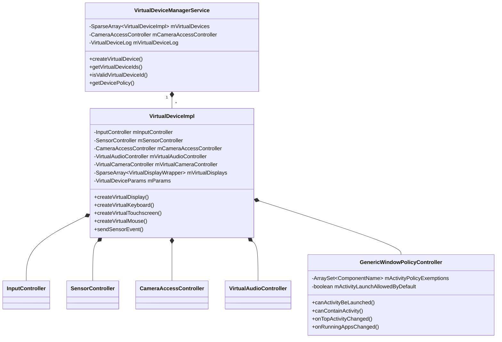

### 52.4.2 虚拟设备的创建

创建虚拟设备需要一条既有的 CDM 关联。`VirtualDeviceManagerService` 在创建期间
校验这一关系。

该服务通过一个内部 `LocalService` 类和一个公共 Binder stub 暴露其 Binder 接口。
创建流程：

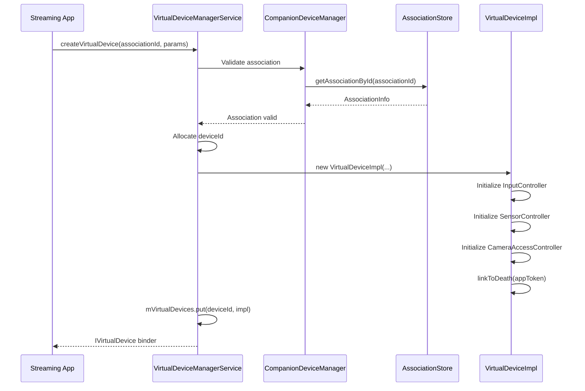

### 52.4.3 VirtualDeviceImpl —— 设备实例

`VirtualDeviceImpl` 是单个虚拟设备的具体实现。它继承 `IVirtualDevice.Stub`，
并实现 `IBinder.DeathRecipient`，以便在拥有该虚拟设备的应用进程死亡时自动清理。

构造函数初始化所有子系统控制器：

```java
VirtualDeviceImpl(
        @NonNull Context context,
        @Nullable AssociationInfo associationInfo,
        @NonNull VirtualDeviceManagerService service,
        @NonNull VirtualDeviceLog virtualDeviceLog,
        @NonNull IBinder token,
        @NonNull AttributionSource attributionSource,
        int deviceId,
        @DeviceProfile int deviceProfile,
        @Nullable CameraAccessController cameraAccessController,
        @NonNull PendingTrampolineCallback pendingTrampolineCallback,
        @NonNull IVirtualDeviceActivityListener activityListener,
        @Nullable IVirtualDeviceSoundEffectListener soundEffectListener,
        @NonNull VirtualDeviceParams params) {
```

源码出处：
`VirtualDeviceImpl.java`，第 489-502 行。在 Android 17 中，`associationInfo` 现在是
`@Nullable`。在正确的权限下，可以在没有 CDM 关联的情况下创建虚拟设备。Android 17
还新增了 `@DeviceProfile int deviceProfile` 参数。

关键初始化细节：

1. 该设备上所有虚拟显示屏的**默认显示旗标**：

    ```java
    private static final int DEFAULT_VIRTUAL_DISPLAY_FLAGS =
            DisplayManager.VIRTUAL_DISPLAY_FLAG_TOUCH_FEEDBACK_DISABLED
                    | DisplayManager.VIRTUAL_DISPLAY_FLAG_DESTROY_CONTENT_ON_REMOVAL
                    | DisplayManager.VIRTUAL_DISPLAY_FLAG_SUPPORTS_TOUCH
                    | DisplayManager.VIRTUAL_DISPLAY_FLAG_OWN_FOCUS;
    ```

    源码出处：
    `VirtualDeviceImpl.java`，第 176-180 行。

2. **持久化设备 ID** 由 CDM 关联推导而来：

    ```java
    static String createPersistentDeviceId(int associationId) {
        return PERSISTENT_ID_PREFIX_CDM_ASSOCIATION + associationId;
    }
    ```

    源码出处：
    `VirtualDeviceImpl.java`，第 680-682 行。

3. **设备策略**从 `VirtualDeviceParams` 复制而来：

    ```java
    mDevicePolicies = params.getDevicePolicies();
    ```

    这些策略在多个维度上控制行为：

    - `POLICY_TYPE_ACTIVITY` —— 哪些 activity 可以启动
    - `POLICY_TYPE_AUDIO` —— 音频路由行为
    - `POLICY_TYPE_CAMERA` —— 摄像头访问策略
    - `POLICY_TYPE_CLIPBOARD` —— 剪贴板隔离
    - `POLICY_TYPE_RECENTS` —— 任务是否出现在最近任务中
    - `POLICY_TYPE_BLOCKED_ACTIVITY` —— 被显式阻止的 activity

### 52.4.4 设备策略引擎

`VirtualDeviceParams` 定义了两种策略模式：

- `DEVICE_POLICY_DEFAULT` —— 应用框架默认行为。
- `DEVICE_POLICY_CUSTOM` —— 由应用指定允许列表或阻止列表。

对于 activity 启动，策略由 `GenericWindowPolicyController` 强制执行。VDM 所有者
可以动态更新策略：

```java
void setActivityLaunchDefaultAllowed(boolean activityLaunchDefaultAllowed) {
    synchronized (mGenericWindowPolicyControllerLock) {
        if (mActivityLaunchAllowedByDefault != activityLaunchDefaultAllowed) {
            mActivityPolicyExemptions.clear();
            mActivityPolicyPackageExemptions.clear();
        }
        mActivityLaunchAllowedByDefault = activityLaunchDefaultAllowed;
    }
}
```

### 52.4.5 Activity 监听与 Intent 拦截

`VirtualDeviceImpl` 设置了一个 `GwpcActivityListener`，用于在
`GenericWindowPolicyController` 的回调与客户端应用之间架起桥梁：

```java
private class GwpcActivityListener implements GenericWindowPolicyController.ActivityListener {

    @Override
    public void onTopActivityChanged(int displayId, @NonNull ComponentName topActivity,
            @UserIdInt int userId) {
        try {
            mActivityListener.onTopActivityChanged(displayId, topActivity, userId);
        } catch (RemoteException e) {
            Slog.w(TAG, "Unable to call mActivityListener for display: " + displayId, e);
        }
    }

    @Override
    public void onDisplayEmpty(int displayId) {
        try {
            mActivityListener.onDisplayEmpty(displayId);
        } catch (RemoteException e) {
            Slog.w(TAG, "Unable to call mActivityListener for display: " + displayId, e);
        }
    }
    // ...
}
```

源码出处：
`VirtualDeviceImpl.java`，第 310-330 行。

intent 拦截机制允许 VDM 所有者拦截在虚拟显示屏上启动的特定 intent：

```java
@GuardedBy("mIntentInterceptors")
private final Map<IBinder, IntentFilter> mIntentInterceptors = new ArrayMap<>();
```

当某个 activity 启动匹配到已注册的过滤器时，该启动会被中止。然后
`IVirtualDeviceIntentInterceptor` 回调会携带一个经过净化的 intent 触发。出于
隐私考虑，该 intent 只包含 action 和 data：

```java
IVirtualDeviceIntentInterceptor.Stub.asInterface(interceptor.getKey())
        .onIntentIntercepted(
                new Intent(intent.getAction(), intent.getData()));
```

源码出处：
`VirtualDeviceImpl.java`，第 423-425 行。

### 52.4.6 运行中应用的跟踪

`GwpcActivityListener.onRunningAppsChanged()` 回调维护按显示屏划分以及汇总的
运行中 UID/包名对集合：

```java
@GuardedBy("mVirtualDeviceLock")
private final SparseArray<ArraySet<Pair<Integer, String>>> mRunningUidPackagePairsPerDisplay =
        new SparseArray<>();
@GuardedBy("mVirtualDeviceLock")
private ArraySet<Pair<Integer, String>> mAllRunningUidPackagePairs = new ArraySet<>();
```

源码出处：
`VirtualDeviceImpl.java`，第 281-284 行。

当该集合发生变化时，它会通知多个子系统：

```java
mService.onRunningAppsChanged(
        mDeviceId, mOwnerPackageName, runningUids, newAllRunningUidPackagePairs);
if (mVirtualAudioController != null) {
    mVirtualAudioController.onRunningAppsChanged(runningUids);
}
if (mCameraAccessController != null) {
    mCameraAccessController.blockCameraAccessIfNeeded(runningUids);
}
```

源码出处：
`VirtualDeviceImpl.java`，第 467-474 行。

### 52.4.7 电源管理

虚拟设备有自己的电源状态，独立于物理设备。该实现处理锁定（当物理设备被锁定
时）以及显式的唤醒/休眠请求：

```java
void onLockdownChanged(boolean lockdownActive) {
    synchronized (mPowerLock) {
        if (lockdownActive != mLockdownActive) {
            mLockdownActive = lockdownActive;
            if (mLockdownActive) {
                goToSleepInternal(PowerManager.GO_TO_SLEEP_REASON_DISPLAY_GROUPS_TURNED_OFF);
            } else if (mRequestedToBeAwake) {
                wakeUpInternal(PowerManager.WAKE_REASON_DISPLAY_GROUP_TURNED_ON,
                        "android.server.companion.virtual:LOCKDOWN_ENDED");
            }
        }
    }
}
```

源码出处：
`VirtualDeviceImpl.java`，第 647-659 行。

`LOCK_STATE_ALWAYS_UNLOCKED` 选项需要 `ADD_ALWAYS_UNLOCKED_DISPLAY` 权限，并会
在所有显示屏上设置 `VIRTUAL_DISPLAY_FLAG_ALWAYS_UNLOCKED` 旗标。

### 52.4.8 镜像显示屏

VDM 支持用于屏幕共享场景的镜像显示屏。创建镜像显示屏需要特定的设备配置文件和
权限：

```java
private static final List<Integer> DEVICE_PROFILES_ALLOWING_MIRROR_DISPLAYS = List.of(
        VirtualDevice.DEVICE_PROFILE_APP_STREAMING);
```

源码出处：
`VirtualDeviceImpl.java`，第 184-185 行。（在 Android 17 中，该列表以整数常量
`VirtualDevice.DEVICE_PROFILE_*` 为键，而不是字符串
`AssociationRequest.DEVICE_PROFILE_*` 名称。）

在 Android Baklava 之后，需要 `ADD_MIRROR_DISPLAY` 权限，而不是依赖应用串流
角色：

```java
@ChangeId
@EnabledAfter(targetSdkVersion = Build.VERSION_CODES.BAKLAVA)
public static final long CHECK_ADD_MIRROR_DISPLAY_PERMISSION = 378605160L;
```

源码出处：
`VirtualDeviceImpl.java`，第 172-174 行。

### 52.4.9 死亡处理与清理

由于 `VirtualDeviceImpl` 实现了 `IBinder.DeathRecipient`，当拥有它的应用进程
死亡时，它会得到通知：

```java
try {
    token.linkToDeath(this, 0);
} catch (RemoteException e) {
    throw e.rethrowFromSystemServer();
}
```

源码出处：
`VirtualDeviceImpl.java`，第 615-619 行。

当死亡回调触发时，该设备会执行一次全面的清理。它关闭所有虚拟显示屏并释放所有
输入设备。它停止音频控制器并移除传感器。它还会关闭摄像头注入会话，并从服务的
设备映射中注销。

---

## 52.5 虚拟设备子系统

### 52.5.1 InputController

`InputController` 管理虚拟设备上虚拟输入设备的生命周期：

```
frameworks/base/services/companion/java/com/android/server/companion/virtual/
    InputController.java
```

它通过 `InputManagerInternal` 创建并跟踪虚拟输入设备：

```java
final class InputController {
    @GuardedBy("mLock")
    private final ArrayMap<IBinder, VirtualInputDevice> mInputDevices = new ArrayMap<>();

    private final InputManagerInternal mInputManagerInternal;
    private final InputManager mInputManager;
    private final WindowManager mWindowManager;
```

源码出处：
`InputController.java`，第 55-65 行。

该控制器支持七种虚拟输入设备类型：

| 方法                      | 设备类型              | 指标计数器键                                      |
|-----------------------------|--------------------------|----------------------------------------------------------|
| `createDpad()`              | Virtual D-pad            | `virtual_devices.value_virtual_dpad_created_count`       |
| `createKeyboard()`          | Virtual Keyboard         | `virtual_devices.value_virtual_keyboard_created_count`   |
| `createMouse()`             | Virtual Mouse            | `virtual_devices.value_virtual_mouse_created_count`      |
| `createTouchscreen()`       | Virtual Touchscreen      | `virtual_devices.value_virtual_touchscreen_created_count`|
| `createNavigationTouchpad()`| Navigation Touchpad      | `virtual_devices.value_virtual_navigationtouchpad_created_count` |
| `createStylus()`            | Virtual Stylus           | `virtual_devices.value_virtual_stylus_created_count`     |
| `createRotaryEncoder()`     | Rotary Encoder           | `virtual_devices.value_virtual_rotary_created_count`     |

每种创建都遵循相同的模式：

```java
IVirtualKeyboard createKeyboard(@NonNull IBinder token, @NonNull VirtualKeyboardConfig config)
        throws RemoteException {
    IVirtualKeyboard device = mInputManagerInternal.createVirtualKeyboard(token, config);
    Counter.logIncrementWithUid("virtual_devices.value_virtual_keyboard_created_count",
            mAttributionSource.getUid());
    addDevice(token, device.getInputDeviceId(), config);
    return device;
}
```

源码出处：
`InputController.java`，第 102-109 行。

`close()` 方法遍历所有被跟踪的设备，并通过 `InputManagerInternal` 关闭它们：

```java
void close() {
    mInputManager.unregisterInputDeviceListener(mInputDeviceListener);
    synchronized (mLock) {
        final Iterator<Map.Entry<IBinder, VirtualInputDevice>> iterator =
                mInputDevices.entrySet().iterator();
        while (iterator.hasNext()) {
            final Map.Entry<IBinder, VirtualInputDevice> entry = iterator.next();
            final IBinder token = entry.getKey();
            iterator.remove();
            mInputManagerInternal.closeVirtualInputDevice(token);
        }
    }
}
```

源码出处：
`InputController.java`，第 79-91 行。

额外的显示级设置通过该控制器管理：

```java
void setShowPointerIcon(boolean visible, int displayId);
void setMouseScalingEnabled(boolean enabled, int displayId);
void setDisplayEligibilityForPointerCapture(boolean isEligible, int displayId);
void setDisplayImePolicy(int displayId, @WindowManager.DisplayImePolicy int policy);
```

Android 17 把这套虚拟输入机制的一个具体使用者作为平台应用发布。
`packages/apps/VirtualGamepad/` 是一个平台签名的 Jetpack Compose 应用，它绘制
一个屏幕手柄，并为同一显示屏上运行的游戏合成手柄输入。该应用不经过
`VirtualDevice`。它通过隐藏的 `InputManager.createVirtualGamepad(VirtualGamepadConfig)`
入口点直接与输入栈通信。这是一个由 `INJECT_EVENTS` 守护的 `@hide` 平台 API，
只有平台签名的应用才能使用它（声明在
`frameworks/base/core/java/android/hardware/input/InputManager.java` 中）。
它建立在本节所描述的同一个 `createVirtual*` 设备族之上。

该应用的 `LocalGamepadBackend` 用 activity 的 `displayId` 作为
`associatedDisplayId` 来构建 `VirtualGamepadConfig`。然后它通过返回的
`VirtualGamepad` 句柄推送 `VirtualGamepadMotionEvent` 和 `VirtualKeyEvent`
对象（见
`packages/apps/VirtualGamepad/java/com/android/virtualgamepad/backend/LocalGamepadBackend.kt`）。
该应用持有 `INJECT_EVENTS` 和 `ASSOCIATE_INPUT_DEVICE_TO_DISPLAY`，并在连接了实体
手柄时自行结束。它是这里所覆盖的虚拟输入 API 的一个瘦客户端，而不是一个独立的
子系统。

### 52.5.2 SensorController

`SensorController` 管理虚拟传感器，这些传感器可以把配套设备的传感器数据馈送
到 Android 传感器框架中：

```
frameworks/base/services/companion/java/com/android/server/companion/virtual/
    SensorController.java
```

该控制器通过 `SensorManagerInternal` 创建“运行时传感器”：

```java
final int handle = mSensorManagerInternal.createRuntimeSensor(mVirtualDeviceId,
        config.getType(), config.getName(),
        config.getVendor() == null ? "" : config.getVendor(), config.getMaximumRange(),
        config.getResolution(), config.getPower(), config.getMinDelay(),
        config.getMaxDelay(), config.getFlags(), mRuntimeSensorCallback);
```

源码出处：
`SensorController.java`，第 132-136 行。

每个传感器由两个数据结构跟踪：

```java
@GuardedBy("mLock")
private final ArrayMap<IBinder, SensorDescriptor> mSensorDescriptors = new ArrayMap<>();

@GuardedBy("mLock")
private SparseArray<VirtualSensor> mVirtualSensors = new SparseArray<>();
```

`SensorDescriptor` 是一个简单的值类：

```java
static final class SensorDescriptor {
    private final int mHandle;
    private final int mType;
    private final String mName;
}
```

源码出处：
`SensorController.java`，第 356-365 行。

发送传感器事件经过原生传感器基础设施：

```java
boolean sendSensorEvent(@NonNull IBinder token, @NonNull VirtualSensorEvent event) {
    synchronized (mLock) {
        final SensorDescriptor sensorDescriptor = mSensorDescriptors.get(token);
        return mSensorManagerInternal.sendSensorEvent(
                sensorDescriptor.getHandle(), sensorDescriptor.getType(),
                event.getTimestampNanos(), event.getValues());
    }
}
```

源码出处：
`SensorController.java`，第 157-169 行。

该控制器还支持传感器附加信息（例如校准数据）：

```java
boolean sendSensorAdditionalInfo(@NonNull IBinder token,
        @NonNull VirtualSensorAdditionalInfo info) {
    // Wraps additional info in FRAME_BEGIN / data / FRAME_END
    mSensorManagerInternal.sendSensorAdditionalInfo(
            sensorDescriptor.getHandle(), SensorAdditionalInfo.TYPE_FRAME_BEGIN, ...);
    for (int i = 0; i < info.getValues().size(); ++i) {
        mSensorManagerInternal.sendSensorAdditionalInfo(
                sensorDescriptor.getHandle(), info.getType(), /* serial= */ i, ...);
    }
    mSensorManagerInternal.sendSensorAdditionalInfo(
            sensorDescriptor.getHandle(), SensorAdditionalInfo.TYPE_FRAME_END, ...);
}
```

源码出处：
`SensorController.java`，第 171-200 行。

`RuntimeSensorCallbackWrapper` 把框架的传感器配置请求桥接回 VDM 客户端：

```java
private final class RuntimeSensorCallbackWrapper
        implements SensorManagerInternal.RuntimeSensorCallback {

    @Override
    public int onConfigurationChanged(int handle, boolean enabled,
            int samplingPeriodMicros, int batchReportLatencyMicros) {
        VirtualSensor sensor = mVdmInternal.getVirtualSensor(mVirtualDeviceId, handle);
        mCallback.onConfigurationChanged(sensor, enabled, samplingPeriodMicros,
                batchReportLatencyMicros);
        return OK;
    }
}
```

源码出处：
`SensorController.java`，第 247-281 行。

还支持直接传感器通道，允许通过共享内存共享高频率的传感器数据：

```java
@Override
public int onDirectChannelCreated(ParcelFileDescriptor fd) {
    SharedMemory sharedMemory = SharedMemory.fromFileDescriptor(fd);
    final int channelHandle = sNextDirectChannelHandle.getAndIncrement();
    mCallback.onDirectChannelCreated(channelHandle, sharedMemory);
    return channelHandle;
}
```

源码出处：
`SensorController.java`，第 284-307 行。

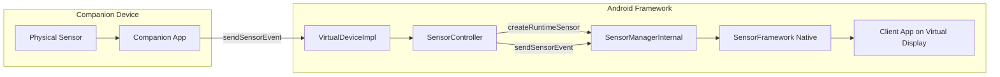

### 52.5.3 CameraAccessController

`CameraAccessController` 为在虚拟显示屏上运行的应用强制摄像头访问策略。它使用
摄像头注入框架来阻止摄像头访问：

```
frameworks/base/services/companion/java/com/android/server/companion/virtual/
    CameraAccessController.java
```

该控制器继承 `CameraManager.AvailabilityCallback`：

```java
final class CameraAccessController extends CameraManager.AvailabilityCallback
        implements AutoCloseable {
```

源码出处：
`CameraAccessController.java`，第 45-46 行。

它对观察者使用引用计数机制：

```java
public void startObservingIfNeeded() {
    synchronized (mObserverLock) {
        if (mObserverCount == 0) {
            mCameraManager.registerAvailabilityCallback(mContext.getMainExecutor(), this);
        }
        mObserverCount++;
    }
}
```

源码出处：
`CameraAccessController.java`，第 129-136 行。

当摄像头被打开（`onCameraOpened`）时，该控制器会检查打开摄像头的应用是否正在
任何虚拟设备上运行：

```java
@Override
public void onCameraOpened(@NonNull String cameraId, @NonNull String packageName) {
    synchronized (mLock) {
        // ...
        if (mVirtualDeviceManagerInternal != null
                && mVirtualDeviceManagerInternal.isAppRunningOnAnyVirtualDevice(appUid)) {
            startBlocking(packageName, cameraId);
            return;
        }
        // Track for future blocking if app moves to virtual display
        OpenCameraInfo openCameraInfo = new OpenCameraInfo(packageName, packageUids);
        mAppsToBlockOnVirtualDevice.put(cameraId, openCameraInfo);
    }
}
```

源码出处：
`CameraAccessController.java`，第 204-246 行。

阻止是通过摄像头注入实现的——注入一个不存在的外部摄像头 ID，这实际上把应用
与真实摄像头断开了：

```java
private void startBlocking(String packageName, String cameraId) {
    mCameraManager.injectCamera(packageName, cameraId, /* externalCamId */ "",
            mContext.getMainExecutor(),
            new CameraInjectionSession.InjectionStatusCallback() {
                @Override
                public void onInjectionSucceeded(@NonNull CameraInjectionSession session) {
                    CameraAccessController.this.onInjectionSucceeded(cameraId, packageName,
                            session);
                }
                @Override
                public void onInjectionError(@NonNull int errorCode) {
                    CameraAccessController.this.onInjectionError(cameraId, packageName,
                            errorCode);
                }
            });
}
```

源码出处：
`CameraAccessController.java`，第 270-296 行。

`ERROR_INJECTION_UNSUPPORTED` 错误是预期的，意味着摄像头已被成功阻止（没有可
映射的外部摄像头）。一个回调会通知 VDM 所有者：

```java
if (errorCode != ERROR_INJECTION_UNSUPPORTED) {
    Slog.e(TAG, "Unexpected injection error code:" + errorCode);
    return;
}
synchronized (mLock) {
    InjectionSessionData data = mPackageToSessionData.get(packageName);
    if (data != null) {
        mBlockedCallback.onCameraAccessBlocked(data.appUid);
    }
}
```

源码出处：
`CameraAccessController.java`，第 318-332 行。

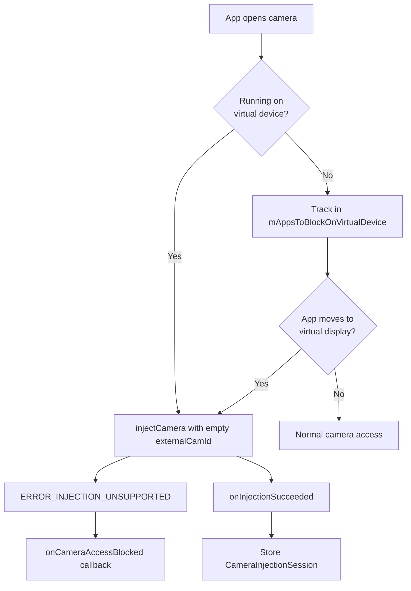

### 52.5.4 VirtualAudioController

`VirtualAudioController` 管理在虚拟显示屏上运行的应用的音频路由：

```
frameworks/base/services/companion/java/com/android/server/companion/virtual/audio/
    VirtualAudioController.java
    AudioPlaybackDetector.java
    AudioRecordingDetector.java
```

该控制器实现了音频播放和录制两类回调：

```java
public final class VirtualAudioController
        implements AudioPlaybackCallback, AudioRecordingCallback {
```

源码出处：
`VirtualAudioController.java`，第 52 行。

关键挑战是避免在过渡期间发生音频泄漏。当一个应用移入或移出虚拟显示屏时，它的
音频必须被重新路由，且不能有任何声音泄漏到物理扬声器。该控制器使用一个延迟
机制：

```java
private static final int UPDATE_REROUTING_APPS_DELAY_MS = 2000;

public void onRunningAppsChanged(@NonNull ArraySet<Integer> runningUids) {
    synchronized (mLock) {
        // ...
        // Do not change rerouted applications while any application is playing
        if (!mPlayingAppUids.isEmpty()) {
            Slog.i(TAG, "Audio is playing, do not change rerouted apps");
            return;
        }

        // An application previously playing audio was removed from the display.
        if (!oldPlayingAppUids.isEmpty()) {
            Slog.i(TAG, "The last playing app removed, delay change rerouted apps");
            mHandler.postDelayed(mUpdateAudioRoutingRunnable, UPDATE_REROUTING_APPS_DELAY_MS);
            return;
        }
    }

    notifyAppsNeedingAudioRoutingChanged();
}
```

源码出处：
`VirtualAudioController.java`，第 131-177 行（`UPDATE_REROUTING_APPS_DELAY_MS`
声明在第 54 行）。

路由通知通过 `IAudioRoutingCallback` 把需要重新路由音频的 UID 列表发送给客户端：

```java
private void notifyAppsNeedingAudioRoutingChanged() {
    int[] runningUids;
    synchronized (mLock) {
        runningUids = new int[mRunningAppUids.size()];
        for (int i = 0; i < mRunningAppUids.size(); i++) {
            runningUids[i] = mRunningAppUids.valueAt(i);
        }
    }
    synchronized (mCallbackLock) {
        if (mRoutingCallback != null) {
            mRoutingCallback.onAppsNeedingAudioRoutingChanged(runningUids);
        }
    }
}
```

源码出处：
`VirtualAudioController.java`，第 233-255 行。

该控制器还会通过 `IAudioConfigChangedCallback` 把播放和录制的配置变更转发给
客户端：

```java
@Override
public void onPlaybackConfigChanged(List<AudioPlaybackConfiguration> configs) {
    updatePlayingApplications(configs);
    List<AudioPlaybackConfiguration> audioPlaybackConfigurations;
    synchronized (mLock) {
        audioPlaybackConfigurations = findPlaybackConfigurations(configs, mRunningAppUids);
    }
    synchronized (mCallbackLock) {
        if (mConfigChangedCallback != null) {
            mConfigChangedCallback.onPlaybackConfigChanged(audioPlaybackConfigurations);
        }
    }
}
```

源码出处：
`VirtualAudioController.java`，第 180-197 行。

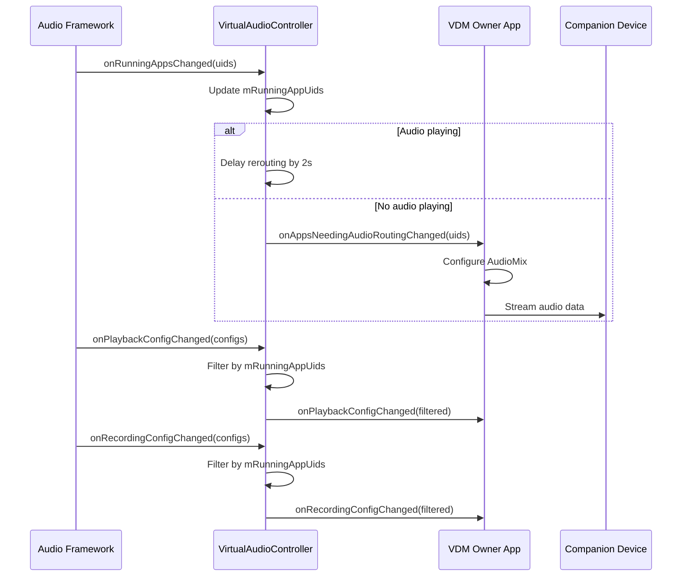

---

## 52.6 虚拟设备与显示集成

### 52.6.1 虚拟显示屏的创建

虚拟显示屏通过 `VirtualDeviceImpl` 创建，并被包裹在一个跟踪关联
`GenericWindowPolicyController` 的 `VirtualDisplayWrapper` 中：

```java
@GuardedBy("mVirtualDeviceLock")
private final SparseArray<VirtualDisplayWrapper> mVirtualDisplays = new SparseArray<>();
```

显示屏的创建过程：

1. VDM 所有者在其 `IVirtualDevice` 上调用 `createVirtualDisplay()`。
2. `VirtualDeviceImpl` 构造一个 `VirtualDisplayConfig`，其中包含基础旗标，
   再加上请求中带来的任何额外旗标。

3. 为此显示屏创建一个新的 `GenericWindowPolicyController`。
4. 显示屏通过 `DisplayManagerGlobal` 创建。
5. 该策略控制器通过 `setDisplayId()` 与显示屏注册。

默认旗标确保虚拟显示屏：

- **不**提供触摸反馈（触觉）。
- 当显示屏被移除时销毁内容。
- 支持触摸输入。
- 拥有自己的焦点（独立于默认显示屏）。

### 52.6.2 GenericWindowPolicyController —— Activity 策略执行

`GenericWindowPolicyController` 是决定哪些 activity 可以在虚拟显示屏上启动的
守门人。它继承 `DisplayWindowPolicyController`，WindowManager 会对每一次
activity 启动咨询它：

```
frameworks/base/services/companion/java/com/android/server/companion/virtual/
    GenericWindowPolicyController.java
```

`canContainActivity()` 的策略执行链：

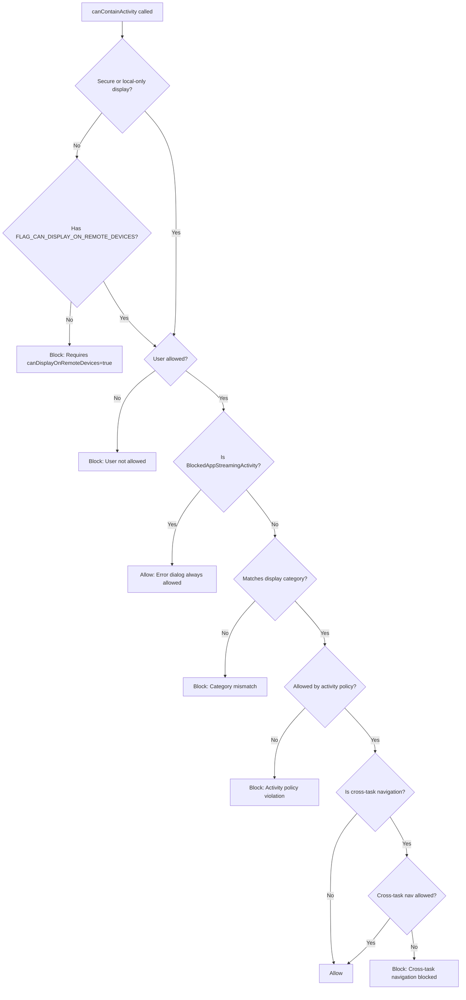

实现：

```java
@Override
public boolean canContainActivity(@NonNull ActivityInfo activityInfo,
        @WindowConfiguration.WindowingMode int windowingMode, int launchingFromDisplayId,
        boolean isNewTask) {
    if (!mIsSecureDisplay && (activityInfo.flags & FLAG_CAN_DISPLAY_ON_REMOTE_DEVICES) == 0
            && !mLocalDeviceOnly) {
        logActivityLaunchBlocked("Display requires android:canDisplayOnRemoteDevices=true");
        return false;
    }
    final UserHandle activityUser =
            UserHandle.getUserHandleForUid(activityInfo.applicationInfo.uid);
    if (!activityUser.isSystem() && !mAllowedUsers.contains(activityUser)) {
        return false;
    }
    // ...
    if (!isAllowedByPolicy(activityComponent)) {
        return false;
    }
    if (isNewTask && launchingFromDisplayId != DEFAULT_DISPLAY
            && !isAllowedByPolicy(mCrossTaskNavigationAllowedByDefault,
                    mCrossTaskNavigationExemptions, activityComponent)) {
        return false;
    }
    return true;
}
```

源码出处：
`GenericWindowPolicyController.java`，第 316-356 行。在 Android 17 中，对于使用
新的 `mLocalDeviceOnly` 旗标创建的显示屏（永不离开主机的本地虚拟显示屏），会跳过
`FLAG_CAN_DISPLAY_ON_REMOTE_DEVICES` 这一道门。在 Android 17 中，独立的镜像显示屏
短路逻辑也从该方法中移除了。

策略逻辑是一个异或模式：

```java
private boolean isAllowedByPolicy(ComponentName component) {
    synchronized (mGenericWindowPolicyControllerLock) {
        if (mActivityPolicyExemptions.contains(component)
                || mActivityPolicyPackageExemptions.contains(component.getPackageName())) {
            return !mActivityLaunchAllowedByDefault;
        }
        return mActivityLaunchAllowedByDefault;
    }
}
```

源码出处：
`GenericWindowPolicyController.java`，第 493-501 行。

当 `mActivityLaunchAllowedByDefault` 为 `true` 时，豁免列表充当**阻止列表**。
当它为 `false` 时，豁免充当**允许列表**。

### 52.6.3 安全窗口处理

当带有 `FLAG_SECURE` 的窗口出现在虚拟显示屏上时，策略控制器会通知 VDM 所有者，
并可选择阻止该窗口：

```java
@Override
public boolean keepActivityOnWindowFlagsChanged(ActivityInfo activityInfo, int windowFlags,
        int systemWindowFlags) {
    final int displayId = waitAndGetDisplayId();
    if (displayId != INVALID_DISPLAY) {
        final ComponentName componentName = activityInfo.getComponentName();
        // ... track per-component window flags via mWindowFlagsTracker ...
        if (Objects.equals(componentName, topComponentName)) {
            detectSecureWindowStatusChange(windowFlags, currentWindowFlags, componentName,
                    activityInfo.applicationInfo.uid, displayId);
        }
    }

    if (!CompatChanges.isChangeEnabled(ALLOW_SECURE_ACTIVITY_DISPLAY_ON_REMOTE_DEVICE,
            activityInfo.packageName,
            UserHandle.getUserHandleForUid(activityInfo.applicationInfo.uid))) {
        if (isSecureContent(windowFlags)
                || (systemWindowFlags & SYSTEM_FLAG_HIDE_NON_SYSTEM_OVERLAY_WINDOWS) != 0) {
            notifyActivityBlocked(activityInfo, /* intentSender= */ null);
            return false;
        }
    }
    return true;
}
```

源码出处：
`GenericWindowPolicyController.java`，第 365-399 行。Android 17 把安全窗口的
簿记重构为一个按组件的 `mWindowFlagsTracker` 和一个
`detectSecureWindowStatusChange()` 辅助方法。该辅助方法现在会触发
`onSecureWindowShown`/`onSecureWindowHidden` 这两个 activity 监听器回调。
`ALLOW_SECURE_ACTIVITY_DISPLAY_ON_REMOTE_DEVICE` 兼容性变更声明在第 126 行。

`ALLOW_SECURE_ACTIVITY_DISPLAY_ON_REMOTE_DEVICE` 兼容性变更（ID
`201712607`）是 `@EnabledSince` Tiramisu。对于目标版本为 Tiramisu 或更新的应用，
它默认开启，因此它们的 `FLAG_SECURE` 窗口在虚拟显示屏上是*被允许的*。目标版本
低于 T 的应用该变更被禁用，会走到上面的阻止分支，从而拒绝它们的安全窗口。

### 52.6.4 显示类别

虚拟显示屏可以被打上类别标签，activity 也可以声明所需的显示类别。匹配逻辑：

```java
private boolean activityMatchesDisplayCategory(ActivityInfo activityInfo) {
    if (mDisplayCategories.isEmpty()) {
        return activityInfo.requiredDisplayCategory == null;
    }
    return activityInfo.requiredDisplayCategory != null
                && mDisplayCategories.contains(activityInfo.requiredDisplayCategory);
}
```

源码出处：
`GenericWindowPolicyController.java`，第 473-479 行。

这使专门的显示屏成为可能（例如一个 "AUTOMOTIVE" 类别的显示屏，只显示带有
汽车标记的 activity）。

### 52.6.5 最近任务集成

`showTasksInHostDeviceRecents` 参数控制运行在虚拟显示屏上的 activity 是否出现在
主机设备的最近应用中：

```java
@Override
public boolean canShowTasksInHostDeviceRecents() {
    synchronized (mGenericWindowPolicyControllerLock) {
        return mShowTasksInHostDeviceRecents;
    }
}
```

源码出处：
`GenericWindowPolicyController.java`，第 447-451 行。

这可以动态更新：

```java
public void setShowInHostDeviceRecents(boolean showInHostDeviceRecents) {
    synchronized (mGenericWindowPolicyControllerLock) {
        mShowTasksInHostDeviceRecents = showInHostDeviceRecents;
    }
}
```

### 52.6.6 自定义主屏 Activity

虚拟显示屏可以指定一个自定义主屏 activity 组件：

```java
@Override
public @Nullable ComponentName getCustomHomeComponent() {
    return mCustomHomeComponent;
}
```

源码出处：
`GenericWindowPolicyController.java`，第 454-456 行。

这只适用于支持主屏 activity 的显示屏（使用相关的虚拟显示屏旗标创建）。如果为
null，则使用系统默认的次级主屏 activity。

### 52.6.7 应用串流架构

把这一切放在一起，从手机向配套设备串流应用遵循以下架构：

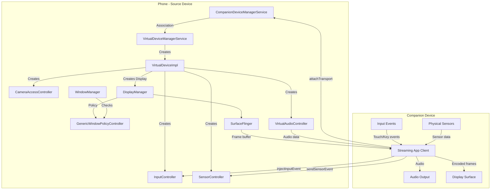

### 52.6.8 完整生命周期

虚拟设备会话的完整生命周期：

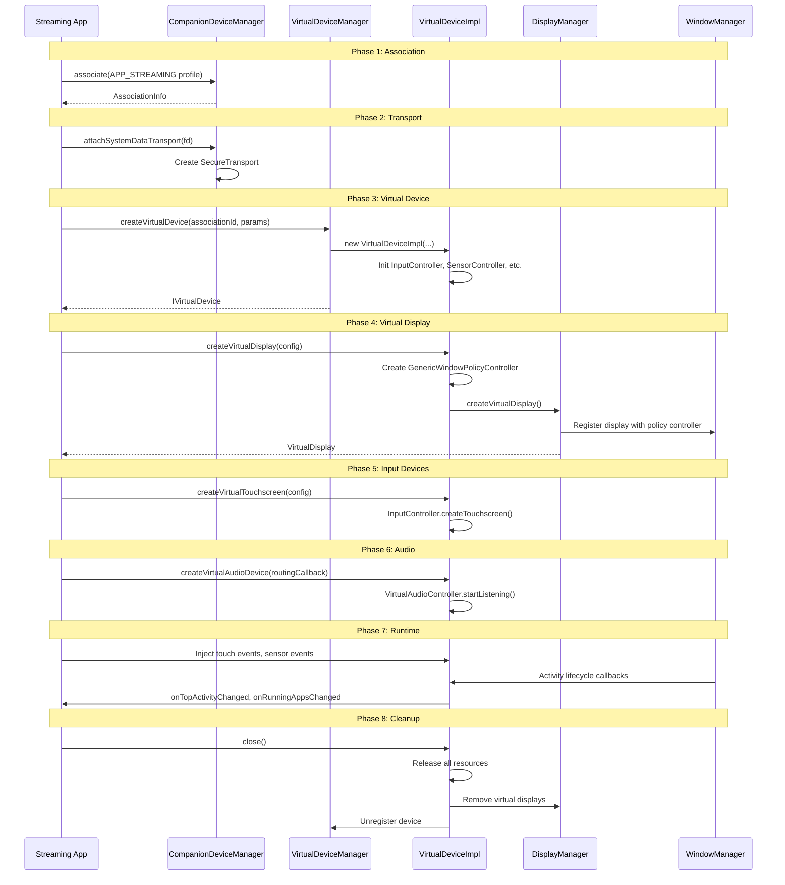

---

## 52.7 Android 17 中新增的 CDM 子系统

本节依次介绍 `frameworks/base/services/companion/java/com/android/server/companion/`
下的三个兄弟包，它们都被接入到 `CompanionDeviceManagerService` 中，与既有的处理
器并列。`devicetrust/` 和 `powerexemption/` 包是 Android 17 中新增的。
`actionrequest/` 包早在 Android 16 中就已发布，这里归到一起是为了提供上下文
（它在 17 中增加了更多的结果常量）。三者共享同一个 `AssociationStore`，因此
它们看到的是同一套关联集合。只有 `devicetrust/` 还接入了
`CompanionTransportManager`。`actionrequest/` 包通过 `CompanionAppBinder`
和 `DevicePresenceProcessor` 工作，而 `powerexemption/` 则通过
`PowerExemptionManager` 和 `ActivityTaskManagerInternal` 工作。

### 52.7.1 动作请求

`actionrequest/` 包让配套应用可以请求与其配对的设备激活或停用某项有状态能力，
并回传结果。`ActionRequestProcessor` 实现了
`requestAction -> notifyActionRequestResult` 循环，并跟踪每个关联当前处于
活动状态的动作：

```
frameworks/base/services/companion/java/com/android/server/companion/actionrequest/
    ActionRequestProcessor.java
```

受支持的动作是一组很小的固定集合，声明为 `STATEFUL_ACTIONS`：

```java
import static android.companion.ActionRequest.REQUEST_NEARBY_ADVERTISING;
import static android.companion.ActionRequest.REQUEST_NEARBY_SCANNING;
import static android.companion.ActionRequest.REQUEST_TRANSPORT;
// ...
private static final Set<Integer> STATEFUL_ACTIONS = Set.of(
        REQUEST_NEARBY_SCANNING,
        REQUEST_NEARBY_ADVERTISING,
        REQUEST_TRANSPORT);
```

源码出处：
`ActionRequestProcessor.java`，第 82-86 行。

`requestAction()` 会根据 `STATEFUL_ACTIONS` 校验该动作，然后把请求派发给每个
指定的关联（跳过那些已不存在的）。配套应用随后通过 `processActionResult()` 上报
`RESULT_ACTIVATED`、`RESULT_DEACTIVATED` 或
`RESULT_FAILED_TO_ACTIVATE`。该调用会更新处理器的按关联状态，并把结果扇出给
已注册的 `IOnActionResultListener` 回调：

```java
public void requestAction(@NonNull ActionRequest request,
        @NonNull String serviceName, int[] associationIds) {
    // ...
    if (!STATEFUL_ACTIONS.contains(action)) {
        Slog.w(TAG, "Action " + action + " is not a supported action.");
        return;
    }
    Binder.withCleanCallingIdentity(() -> {
        for (int id : associationIds) {
            final AssociationInfo association = mAssociationStore.getAssociationById(id);
            if (association == null) { continue; }
            handleActionRequest(association, request, serviceName);
        }
    });
}
```

源码出处：
`ActionRequestProcessor.java`，第 151-184 行。`CompanionDeviceManagerService`
在 Binder 接口上以 `requestAction()` 和 `setRequestActionAllowList()` 的形式暴露
它（见 `CompanionDeviceManagerService.java`，第 799 行和第 807 行）。

### 52.7.2 可信设备

`devicetrust/` 包建立并存储按关联划分的会话密钥。有了这些密钥，两台配对设备可以
互相识别为可信的。它们不需要每次重新运行完整的 UKEY2 认证握手。
`TrustedDeviceProcessor` 在传输管理器上注册 `MESSAGE_REQUEST_TRUSTED_DEVICE`，
并在传输连接时运行一次密钥交换：

```
frameworks/base/services/companion/java/com/android/server/companion/devicetrust/
    TrustedDeviceProcessor.java
    PskProvider.java               -- pre-shared-key provider interface
    BluetoothPasskeyProvider.java  -- "BT_PASSKEY" provider
    RandomKeyProvider.java         -- "RANDOM_KEY" provider
    TrustedDeviceStore.java        -- persisted session keys
```

```java
public class TrustedDeviceProcessor {
    private final SparseArray<Transport> mCurrentSessions = new SparseArray<>();
    private final Set<PskProvider> mPskProviders = new HashSet<>();
    // ...
    mTransportManager.addListener(MESSAGE_REQUEST_TRUSTED_DEVICE, mOnMessageReceivedListener);
    mTransportManager.addListener(mOnTransportChangedListener);
}
```

源码出处：
`TrustedDeviceProcessor.java`，第 59-87 行。

密钥通过 HKDF 派生（来自新的 `utils/` 包中 `CryptoUtils` 的
`hkdfExtract`/`hkdfExpand`）。可用的密钥集合由可插拔的 `PskProvider`
实现提供，每个实现以其 `getProviderName()` 字符串标识：
`BluetoothPasskeyProvider`（`"BT_PASSKEY"`）和 `RandomKeyProvider`
（`"RANDOM_KEY"`）。`CompanionDeviceManagerService`
动态注册和移除提供者：

```java
mTrustedDeviceProcessor.addPskProvider(new RandomKeyProvider());
// ...
mTrustedDeviceProcessor.removePskProvider(RandomKeyProvider.NAME);
```

源码出处：
`CompanionDeviceManagerService.java`，第 718-720 行。`PskProvider` 接口暴露三个
成员。`String getProviderName()` 是 `removePskProvider()` 所匹配的身份。
`byte[] getKey(int userId, int associationId)` 返回一个密钥。第三个成员是默认的
`void load(int userId)` 钩子（`PskProvider.java`，第 27-50 行）。
`loadKeysForUser()` 在用户解锁时对可用密钥做一次快照
（`TrustedDeviceProcessor.java`，第 111 行）。

### 52.7.3 电源豁免

`powerexemption/` 包把配套应用在设备关联期间获得的电源和后台执行豁免整合到一起。
这些豁免此前是分散的，现在由 `CompanionExemptionProcessor` 统一管理：

```
frameworks/base/services/companion/java/com/android/server/companion/powerexemption/
    CompanionExemptionProcessor.java
    CompanionExemptionStore.java
```

该处理器监听关联变更，当配套设备在场时，通过
`PowerExemptionManager` 把应用放入省电模式永久允许列表。当设备断开连接或关联被
移除时，该豁免会被撤销：

```java
public void exemptPackage(int userId, String packageName, boolean hasPresentDevices) {
    // ... resolve PackageInfo, then run as system ...
}
```

源码出处：
`CompanionExemptionProcessor.java`，第 127 行。该处理器还让配套应用豁免于权限
自动撤销（`updateAutoRevokeExemptions()`，第 212 行），并更新
`ActivityTaskManagerInternal` 对关联的视图（`updateAtm()`，第 107 行）。
`CompanionDeviceManagerService` 在用户解锁和包事件时驱动这些（见
`CompanionDeviceManagerService.java`，第 209-211、303、327 和 335 行）。

### 52.7.4 关联的备份与恢复

顶层的 `BackupRestoreProcessor` 让关联能够在设备迁移或一次备份恢复周期中存活。
它把关联的磁盘存储和系统数据传输请求存储序列化为一个带版本号的负载。在恢复时
它会把它们重建起来。它会把“待定”的关联一直持有到拥有它的应用被重新安装：

```java
class BackupRestoreProcessor {
    private static final int BACKUP_AND_RESTORE_VERSION = 0;

    byte[] getBackupPayload(int userId) { /* ... */ }
    void applyRestoredPayload(byte[] payload, int userId) { /* ... */ }
    public void restorePendingAssociations(int userId, String packageName) { /* ... */ }
}
```

源码出处：
`BackupRestoreProcessor.java`，第 48-209 行。当某个包被添加时，
`CompanionDeviceManagerService` 会调用
`mBackupRestoreProcessor.restorePendingAssociations(userId, packageName)`，以完成
绑定任何等待该应用的关联（`CompanionDeviceManagerService.java`，第 340 行）。

### 52.7.5 Health Connect 数据类型

Android 17 还新增了新的 Health Connect 记录类型，例如
`MenstrualCyclePhaseRecord`。这些不属于 CompanionDeviceManager 或
VirtualDeviceManager。它们完全位于 Health Connect（HealthFitness）主线模块中，
路径为
`packages/modules/HealthFitness/framework/java/android/health/connect/datatypes/MenstrualCyclePhaseRecord.java`，
服务端辅助类位于
`packages/modules/HealthFitness/service/java/com/android/server/healthconnect/fitness/recordhelpers/MenstrualCyclePhaseRecordHelper.java`。
配套应用（例如可穿戴设备）是通过常规的 Health Connect 权限和 API 表面访问这些
数据的，而不是通过 CDM 传输。因此，Health Connect 相关的材料会涵盖它，而不是本
章。

---

## 52.8 Computer Control 会话

`virtual/computercontrol/` 包是 Android 17 中 VDM 最大的新增部分。它实现了
**Computer Control**。这是一个受控的、设备上的自动化表面。一个被批准的代理驱动
一个虚拟显示屏、注入输入，并读回 UI 状态。该代理可以是远端 AI 代理，通过 52.2.1
节中关联的 `remoteAiAgentSupported` 旗标对外通告。此访问处于明确的用户同意和一个
按代理划分的允许列表之下。

```
frameworks/base/services/companion/java/com/android/server/companion/virtual/computercontrol/
    ComputerControlSessionProcessor.java   -- session lifecycle orchestrator
    ComputerControlSessionImpl.java        -- a single active session
    ComputerControlSessionRequest.java
    ComputerControlAllowlistController.java -- per-agent app allowlist + consent
    AutomatedPackagesRepository.java       -- which packages an agent may automate
    ComputerControlAudioCapture.java
    ComputerControlAudioInjector.java
    ComputerControlDataStore.java
    ComputerControlStatsController.java
    InteractiveMirrorImpl.java
    SessionLifecycle.java
    PausableTimer.java
```

### 52.8.1 服务集成

`VirtualDeviceManagerService` 拥有单个 `ComputerControlSessionProcessor` 和一个
`IComputerControlConsentManager`，两者都在构造时创建：

```java
private final ComputerControlSessionProcessor mComputerControlSessionProcessor;
private final IComputerControlConsentManager mComputerControlConsentManager;
// ...
mComputerControlSessionProcessor =
        new ComputerControlSessionProcessor(context, mLocalService, /* factory */ ...);
```

源码出处：
`VirtualDeviceManagerService.java`，第 166-167 行和第 218-219 行。该处理器在
服务的启动阶段被初始化（`initialize()`）并注册以进行监测（第 284 行和第 319 行）。

### 52.8.2 请求会话

客户端通过 VDM Binder 接口请求自动化，该接口会转发到
`processNewSessionRequest()`。该处理器首先检查可用性和调用者的
`ACCESS_COMPUTER_CONTROL` 权限，然后把会话创建提交到它的 handler 上：

```java
public void processNewSessionRequest(@NonNull ComputerControlSessionRequest request) {
    // ... validate ...
    mHandler.post(() -> createSession(request));
}
```

源码出处：
`ComputerControlSessionProcessor.java`，第 177 行。可用性由
`isComputerControlAvailable()`（第 290 行）门控，它从
`VirtualDeviceManagerService.java` 第 757 行可达。

VDM 服务、会话处理器、允许列表控制器和一个存活会话之间的关系：

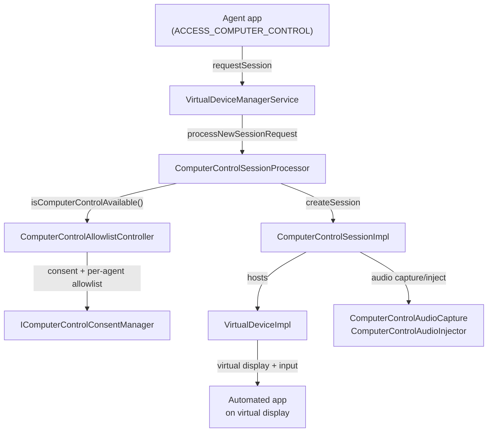

### 52.8.3 按代理划分的允许列表与同意

`ComputerControlAllowlistController` 强制执行某个代理被允许自动化哪些包。该处理器
暴露按代理划分的允许列表管理，供代理用来声明它的目标：

```java
public void addAppToAutomatableAppListForAgent(int agentUid, String agentPackageName, ...);
public void removeAppFromAutomatableAppListForAgent(int agentUid, ...);
public void clearAutomatableAppListForAgent(int agentUid, String agentPackageName);
public String[] getAutomatableAppListForAgent(int agentUid, String agentPackageName);
```

源码出处：
`ComputerControlSessionProcessor.java`，第 346-392 行。在目标可以被自动化之前，
该控制器会检查两件事。代理必须已被批准（`isPackageApprovedToRunAutomation()`，
第 399 行）。目标必须是可自动化的（`isPackageTargetableForAutomation()`，
第 407 行）。`ACCESS_COMPUTER_CONTROL` 权限本身是在
`ComputerControlAllowlistController` 内部强制执行的（见
`ComputerControlAllowlistController.java`，第 234 行）。

### 52.8.4 会话生命周期

一个 Computer Control 会话运行在一个虚拟显示屏上。`createSession()` 通过注入的
工厂构建一个 `VirtualDeviceImpl`，并挂接代理的输入和音频路径。它还会跟踪该会话，
以便 VDM 服务能够回答 `isComputerControlSession(deviceId)` 和
`isComputerControlDisplay(displayId)`。会话可以由用户意图关闭
（`closeSessionByUserIntent()`，第 473 行），并支持一种交接——一个镜像显示屏接替
另一个。配套音频路径（`ComputerControlAudioCapture` /
`ComputerControlAudioInjector`）让代理能通过该会话听到和发声，而
`InteractiveMirrorImpl` 提供代理所驱动的交互式镜像表面。

源码出处：
`ComputerControlSessionProcessor.java`，第 424-473 行；
`VirtualDeviceManagerService.java`，第 395 行和第 599 行。

---

## 52.9 CrossDeviceSync 服务

到目前为止涵盖的一切都位于 `system_server` 内部。52.3.7 节中的
`CrossDeviceSyncController` 是一个框架组件，它在 CDM 传输上中介*通话*元数据。
Android 17 还发布了一个*独立的*、规模大得多的应用层服务。它是 CDM 关联/传输机制
在通用数据同步上的主要生产使用者。它位于框架之外，作为一个独立的平台应用：

```
packages/services/CrossDeviceSync/
```

尽管名字相似，这并不是框架侧的控制器。它是一个特权的、平台签名的应用
（`com.android.crossdevicesync`）。它的职责是在手机与其可穿戴设备之间保持任意
的特性状态同步。例如飞行模式、情境化“模式”，以及类似的设备设置。它完全运行在
52.2 和 52.3 节所构建的 CDM 安全传输之上。它的代码没有任何部分运行在
`system_server` 中；它像其他配套应用一样通过公共的
`CompanionDeviceManager` SDK 与 CDM 通信，只是拥有提升了的权限。

### 52.9.1 它是什么以及如何打包

`CrossDeviceSync` 被声明为一个特权的、平台证书的 `android_app`，而不是一个
`system_server` jar：

```
android_app {
    name: "CrossDeviceSync",
    defaults: ["platform_app_defaults"],
    certificate: "platform",
    privileged: true,
    // ...
}
```

源码出处：
`packages/services/CrossDeviceSync/Android.bp`（`android_app` 块；整个项目带有
2025 年的版权和 `default_team:
trendy_team_wear_wear_frameworks`，将其标记为 Android 17 中新增的可穿戴组件）。

它的清单把该应用声明为 `persistent`、`directBootAware`，并由一个特性旗标门控。
至关重要的是，它请求了本章从框架侧描述的同一批配套权限：

```xml
<uses-permission android:name="android.permission.MANAGE_COMPANION_DEVICES" />
<uses-permission android:name="android.permission.USE_COMPANION_TRANSPORTS" />
<uses-permission android:name="android.permission.INTERACT_ACROSS_USERS" />
<uses-permission android:name="android.permission.NETWORK_AIRPLANE_MODE" />
```

源码出处：
`packages/services/CrossDeviceSync/AndroidManifest.xml`。`USE_COMPANION_TRANSPORTS`
正是 52.1.2 节列为挂接系统数据传输之门的那个权限。
`MANAGE_COMPANION_DEVICES` 是跨用户查询关联的管理权限。该清单还注册了两个组件：
`SyncService` 和 `BootReceiver`。

`BootReceiver` 监听 `LOCKED_BOOT_COMPLETED`，因此它可以在用户解锁之前启动。
这是可能的，因为关联数据存放在设备加密存储中，正如 52.1.3 节所解释的那样。该接收
器只为系统用户启动该服务。它会在其他每个用户上把自己禁用：

```java
if (context.getUser().equals(UserHandle.SYSTEM)) {
    context.startService(new Intent(context, SyncService.class));
} else {
    // disable the boot receiver for non-system users
}
```

源码出处：
`packages/services/CrossDeviceSync/src/com/android/crossdevicesync/BootReceiver.java`，
第 42-61 行。

### 52.9.2 SyncService 与组件图

`SyncService` 是一个普通的 `android.app.Service` —— 它在生产环境中不可绑定
（`onBind()` 在插桩测试之外返回 `null`）。它的全部工作都发生在 `onCreate()` 中，
后者通过一个 `SyncServiceInjector` 构建一组固定的协作者，并逐一初始化它们：

```java
mNetworkManager.init();
mMetadataPublisher.init();
mNotificationHelper.init();
for (var entry : mFeatureManagerSuppliers.entrySet()) {
    FeatureManager featureManager = entry.getValue().get();
    featureManager.init();
    mFeatureManagers.add(featureManager);
}
```

源码出处：
`packages/services/CrossDeviceSync/src/com/android/crossdevicesync/services/SyncService.java`，
第 79-97 行（拆卸是 `onDestroy()` 中的镜像，第 100-114 行）。

`SyncServiceInjectorImpl` 把整个图连接起来。各个部件，以及每个部件如何对应到本
章已经涵盖的材料：

| 组件 | 角色 | CDM 挂钩（涵盖于） |
|-----------|------|------------------------|
| `NetworkManager` | 跟踪关联/传输/在场，拥有按特性划分的“网络” | associations + transport + presence (52.2, 52.3) |
| `Messenger` | 在传输上可靠地批量投递消息 | `CompanionDeviceManager.sendMessage` (52.3.2) |
| `CompanionActionController` | 请求配套应用扫描/广播/挂接传输 | action requests (52.7.1) |
| `Advertiser` / `Scanner` | 驱动 `REQUEST_NEARBY_ADVERTISING` / `REQUEST_NEARBY_SCANNING` | action requests (52.7.1) |
| `MetadataPublisher` | 写入按用户的 CDM 元数据以供发现 | DataSync metadata (52.3.6) |
| `FeatureManager` (x2) | 网络上按特性划分的同步逻辑 | n/a (app-layer) |
| `SharedDataStore` | 最终一致、由 Submerge 支持的按特性存储 | n/a (app-layer) |

源码出处：
`packages/services/CrossDeviceSync/src/com/android/crossdevicesync/services/SyncServiceInjectorImpl.java`,
第 110-204 行。

### 52.9.3 运行在 CDM 传输之上

该服务从不打开自己的套接字。每一个触及远端设备的协作者都经过一个单一的
`CompanionDeviceManagerProxy`，它是公共的
`android.companion.CompanionDeviceManager` 周围一个薄薄的、可测试的包装器。它的
方法列表读起来就像本章中 CDM 表面的索引：
`getAllAssociations`、`addOnAssociationsChangedListener`、
`addOnTransportsChangedListener`、`setOnDevicePresenceEventListener`、
`sendMessage` / `addOnMessageReceivedListener`、`requestAction` /
`setOnActionResultListener`，以及 `setLocalMetadata` / `getLocalMetadata`。

源码出处：
`packages/services/CrossDeviceSync/src/com/android/crossdevicesync/common/CompanionDeviceManagerProxy.java`,
第 33-110 行。

`NetworkManager.init()` 是它挂接到框架的地方。它用当前的关联为自己播种。然后它
订阅关联变更和传输变更，并注册 messenger 的消息监听器：

```java
processAssociationsAndMessagesLocked(
        mCompanionDeviceManager.getAllAssociations(UserHandle.USER_ALL));
mCompanionDeviceManager.addOnAssociationsChangedListener(
        mMainExecutor, mOnAssociationsChanged, UserHandle.USER_ALL);
mCompanionDeviceManager.addOnTransportsChangedListener(
        mMainExecutor, mOnTransportChanged);
mMessenger.init();
mMessenger.registerMessageListener(mMainExecutor, mOnMessage);
mCompanionActionController.init();
```

源码出处：
`packages/services/CrossDeviceSync/src/com/android/crossdevicesync/network/NetworkManagerImpl.java`,
第 137-152 行。

实际的字节运行在单一的 CDM 消息类型上。`MessengerImpl` 用
`CompanionDeviceManager.MESSAGE_ONEWAY_CROSS_DEVICE_SYNC` 注册并发送：

```java
mCompanionDeviceManager.addOnMessageReceivedListener(
        mMainExecutor,
        CompanionDeviceManager.MESSAGE_ONEWAY_CROSS_DEVICE_SYNC,
        mMessageListener);
// ... and on the send path:
mCompanionDeviceManager.sendMessage(
        CompanionDeviceManager.MESSAGE_ONEWAY_CROSS_DEVICE_SYNC,
        encodedMessage,
        new int[] {associationId});
```

源码出处：
`packages/services/CrossDeviceSync/src/com/android/crossdevicesync/network/messenger/MessengerImpl.java`,
第 109-112 行和第 658-661 行。框架在
`frameworks/base/core/java/android/companion/CompanionDeviceManager.java`
第 405 行把该常量定义为 `MESSAGE_ONEWAY_CROSS_DEVICE_SYNC = 0x43676883`
（`+CDS` 标签）。它的最高字节 `0x43` 使它成为 52.3.2 节分类下的*单向*消息。
因此 CDM 会跨安全传输触发它，并不期望响应。

底层的 CDM 消息是发出即忘的，因此 messenger 在它之上添加了自己的可靠性。它把
出站消息和 ACK 批量打包成一个单一的 `BatchedMessage`。它通过定时器重试。它使用
一个远端实例 ID 在重连后丢弃重复项。相关的超时
（`RETRY_DELAY_MS`、`WAITING_FOR_TRANSPORT_TIMEOUT`、
`WAITING_FOR_ACK_TIMEOUT`）声明在 `MessengerImpl.java` 第 59-61 行。

在任何传输存在之前，该服务必须设法让配套侧出现。`CompanionActionController`
使用 52.7.1 节中 Android 17 的动作请求机制。它向它的关联发出
`REQUEST_TRANSPORT`、`REQUEST_NEARBY_SCANNING` 和
`REQUEST_NEARBY_ADVERTISING` 动作请求，并观察结果：

```java
mCompanionDeviceManager.requestAction(
        new ActionRequest.Builder(
                        ActionRequest.REQUEST_TRANSPORT, ActionRequest.OP_DEACTIVATE)
                .build(),
        mPackageName,
        associationIds);
```

源码出处：
`packages/services/CrossDeviceSync/src/com/android/crossdevicesync/network/companion/CompanionActionControllerImpl.java`,
第 112-130 行。因此该服务也是新的 `actionrequest/` 处理器的规范客户端。52.7.1
节描述的是框架那一半（`ActionRequestProcessor` 校验 `STATEFUL_ACTIONS`）。这是
驱动它的应用那一半。

端到端数据流，从本地特性变更向下到 CDM 传输再返回：

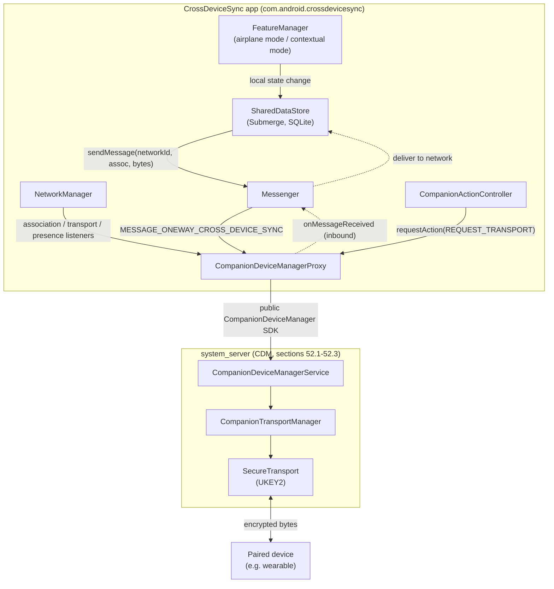

### 52.9.4 特性管理器与共享数据存储

同步逻辑被拆分为独立的 `FeatureManager` 插件。Android 17 发布两个，在注入器中按
名称注册：

- `AirplaneModeSyncManager`（"ApmSyncManager"）—— 在手机和手表之间镜像飞行
  模式。

- `ContextualModeSyncManager`（"CtxModeSyncManager"）—— 同步情境化“模式”（一个
  按用户划分的设置状态）。

源码出处：
`SyncServiceInjectorImpl.java`，第 183-204 行。

每个特性都在 `NetworkManager` 上创建一个命名的
`Network`（例如飞行模式特性使用 `NETWORK_ID = "apm_sync_network"`）。它把状态
存储在一个 `SharedDataStore` 中。该存储被描述为“一个与远端设备保持同步的数据
存储……最终在其他已授权设备之间同步”（`SharedDataStore.java`，第 30-37 行）。
具体实现 `SubmergeSharedDataStore` 在按特性划分的 SQLite 数据库之上叠加了 Google 的
*Submerge* 最终一致同步库。全局数据库是 `cross_device_sync_global_db`
（`SyncServiceInjectorImpl.java`，第 77 行）。

飞行模式特性还回扣到 52.2.1 节中按关联划分的 `systemDataSyncFlags`。它以
`CompanionDeviceManager.FEATURE_CROSS_DEVICE_SYNC` 和
`CompanionDeviceManager.FLAG_AIRPLANE_MODE` 为键。它用它们来决定某个关联是否
启用了同步（`AirplaneModeSyncManager.java`，第 19-23 行的导入）。
那就是框架侧的 `DataSyncProcessor`（52.3.6 节）和
`CHANGE_TYPE_UPDATED_DATA_SYNC_TYPES`（52.2.5 节）所管理的同一个旗标位掩码。通过
它，应用和框架对哪些特性处于活动状态达成一致。

最后，`MetadataPublisher` 写入按用户的 CDM 元数据
（`putBooleanMetaData` / `putIntMetaData` / `putStringMetaData`）。远端设备可以
用它来发现本设备支持什么。该元数据运行在 52.3.6 节的 DataSync 路径上，通过代理的
`setLocalMetadata` / `getLocalMetadata`（`MetadataPublisher.java`，第 20-37 行）。

### 52.9.5 调试表面

`SyncService.dump()` 在可调试构建上兼作 shell 命令入口点。
`SyncServiceShellCommand` 支持单一维护命令 `reset notifications`，它会清除受速率
限制的同步通知：

```bash
adb shell dumpsys activity service com.android.crossdevicesync/.services.SyncService \
    reset notifications
```

在非可调试构建上，同样的 `dump()` 会落到打印 `NetworkManager`、
`MetadataPublisher` 和按特性划分的状态。源码：
`SyncService.java`，第 125-140 行；
`packages/services/CrossDeviceSync/src/com/android/crossdevicesync/services/SyncServiceShellCommand.java`,
第 33-67 行。

简而言之，`CrossDeviceSync` 是 52.3.6 和 52.3.7 节中进程内控制器的产品化、应用层
对应物。它是一个特权的可穿戴配套应用。它把原始的 CDM 关联、传输、在场、动作和
元数据原语转化为一个最终一致的、多特性的同步织网。它没有向 `system_server`
本身添加任何东西。

---

## 52.10 动手实践

### 52.10.1 查看配套设备关联

列出用户 0 的所有关联：

```bash
adb shell cmd companiondevice list 0
```

该命令会先打印一行 `Max ID:`，随后是每条关联的
`AssociationInfo.toString()`，后者使用带 `m` 前缀的字段名和 `Date` 格式的时间
戳。示例输出（单个关联，此处为了可读性做了换行）：

```
Max ID: 1
Association{mId=1,
  mUserId=0,
  mPackageName='com.google.android.gms',
  mDeviceMacAddress=aa:bb:cc:dd:ee:ff,
  mDisplayName='Pixel Watch',
  mDeviceProfile='android.app.role.COMPANION_DEVICE_WATCH',
  mSelfManaged=false,
  mAssociatedDevice=null,
  mNotifyOnDeviceNearby=true,
  mRevoked=false,
  mPending=false,
  mTrusted=false,
  mTimeApprovedMs=Sat Mar 09 16:40:00 GMT 2024,
  mLastTimeConnectedMs=Sun Mar 10 20:26:40 GMT 2024,
  mSystemDataSyncFlags=0,
  mTransportFlags=0,
  mDeviceId=null,
  mPackagesToNotify=[],
  mMetadata=PersistableBundle[{}],
  mTimeMetadataSentMs=Thu Jan 01 00:00:00 GMT 1970,
  mExtraPermissions=null,
  mRemoteAiAgentSupported=false}
```

### 52.10.2 通过 shell 创建测试关联

创建一个用于测试的自管理关联。用户 ID 和包名是位置参数，每个选项都需要一个
显式的取值：

```bash
adb shell cmd companiondevice associate 0 com.example.myapp \
    --self-managed true \
    --profile android.app.role.COMPANION_DEVICE_APP_STREAMING
```

没有显示名称选项；shell 命令硬编码了显示名称（`CompanionDeviceShellCommand.java`
中的 `"fakeDisplayName"`）。

### 52.10.3 查看虚拟设备

CDM 和 VDM 是两个独立的可 dump 服务。要查看 CDM 状态，请使用
`companiondevice` 服务。这就是 `CompanionDeviceManagerService` 通过
`Context.COMPANION_DEVICE_SERVICE` 发布的名称：

```bash
adb shell dumpsys companiondevice
```

这会输出 CDM 状态：

- 关联（`AssociationStore`）
- 设备在场（`DevicePresenceProcessor`）
- 配套应用绑定（`CompanionAppBinder`）
- 活动传输（`CompanionTransportManager`）
- 系统数据传输请求（`SystemDataTransferRequestStore`）

虚拟设备、它们的显示屏、输入设备和传感器控制器由
`VirtualDeviceManagerService` 以 `virtualdevice` 服务名称（
`Context.VIRTUAL_DEVICE_SERVICE`）进行 dump：

```bash
adb shell dumpsys virtualdevice
```

### 52.10.4 使用 VirtualDeviceManager API

要通过编程方式创建虚拟设备，应用需要：

1. 一条具有合适设备配置文件的 CDM 关联。
2. `CREATE_VIRTUAL_DEVICE` 权限 —— 在核心清单中以
   `protectionLevel="internal|role"` 声明。它只授予给相关角色的持有者。普通应用
   无法请求它。
3. 对于某些特性，还需要额外权限：
    - 用于剪贴板策略定制的 `ADD_TRUSTED_DISPLAY`。
    - 用于始终解锁显示屏的 `ADD_ALWAYS_UNLOCKED_DISPLAY`。
    - 用于镜像显示屏的 `ADD_MIRROR_DISPLAY`。
    - 用于 computer control 特性的 `ACCESS_COMPUTER_CONTROL`。

示例代码流程：

```java
// Step 1: Create a CompanionDeviceManager association
CompanionDeviceManager cdm = getSystemService(CompanionDeviceManager.class);
AssociationRequest request = new AssociationRequest.Builder()
        .setDeviceProfile(AssociationRequest.DEVICE_PROFILE_APP_STREAMING)
        .setDisplayName("My Companion")
        .setSelfManaged(true)
        .build();
cdm.associate(request, callback, handler);

// Step 2: In the callback, create a virtual device
VirtualDeviceManager vdm = getSystemService(VirtualDeviceManager.class);
VirtualDeviceParams params = new VirtualDeviceParams.Builder()
        .setDevicePolicy(VirtualDeviceParams.POLICY_TYPE_AUDIO,
                VirtualDeviceParams.DEVICE_POLICY_CUSTOM)
        .setName("Streaming Device")
        .build();
VirtualDevice device = vdm.createVirtualDevice(associationInfo.getId(), params);

// Step 3: Create a virtual display (an Executor, then a VirtualDisplay.Callback)
VirtualDisplay display = device.createVirtualDisplay(
        new VirtualDisplayConfig.Builder("MyDisplay", 1920, 1080, 240)
                .build(),
        executor, displayCallback);

// Step 4: Create input devices
VirtualTouchscreenConfig touchConfig = new VirtualTouchscreenConfig.Builder(1920, 1080)
        .setAssociatedDisplayId(display.getDisplay().getDisplayId())
        .build();
device.createVirtualTouchscreen(touchConfig);
```

### 52.10.5 调试传输问题

要检查活动传输，请运行未经过滤的 CDM dump —— 传输管理器的状态是它的其中一个
部分（该 dump 不接受子参数）：

```bash
adb shell dumpsys companiondevice
```

没有用于覆盖传输类型的 shell 命令。在测试中，`@TestApi` 方法
`CompanionDeviceManager.overrideTransportType(int)`
（`CompanionDeviceManager.java`，第 2310 行）强制为之后挂接的传输指定类型。
使用 `0` 表示默认，`1` 表示 raw（未加密），`2` 表示 secure。它需要
`MANAGE_COMPANION_DEVICES` 权限。

### 52.10.6 查看窗口策略

要查看哪些 activity 在虚拟显示屏上被阻止：

```bash
adb logcat -s GenericWindowPolicyController
```

查找如下日志消息：

```
D GenericWindowPolicyController: Virtual device activity launch disallowed
    on display 2, reason: Activity launch disallowed by policy: com.example/.SecretActivity
```

### 52.10.7 测试传感器注入

虚拟传感器会出现在标准传感器列表中。要验证：

```bash
adb shell dumpsys sensorservice
```

通过 VDM 创建的虚拟传感器会以 `VirtualSensorConfig` 中指定的设备 ID 和名称显示。

### 52.10.8 监测音频路由

要监测虚拟设备的音频路由变化：

```bash
adb logcat -s VirtualAudioController
```

需要关注的关键消息：

```
I VirtualAudioController: Audio is playing, do not change rerouted apps
I VirtualAudioController: The last playing app removed, delay change rerouted apps
```

### 52.10.9 摄像头访问阻止

要监测虚拟设备上的摄像头阻止：

```bash
adb logcat -s CameraAccessController
```

查找：

```
D CameraAccessController: startBlocking() cameraId: 0 packageName: com.example.camera
```

### 52.10.10 关键源文件参考

作为快速参考，以下是本章讨论的所有关键源文件，按子系统组织：

**CompanionDeviceManager 核心：**

| 文件 | 路径 |
|------|------|
| Service entry point | `frameworks/base/services/companion/java/com/android/server/companion/CompanionDeviceManagerService.java` |
| Internal API | `frameworks/base/services/companion/java/com/android/server/companion/CompanionDeviceManagerServiceInternal.java` |
| Shell commands | `frameworks/base/services/companion/java/com/android/server/companion/CompanionDeviceShellCommand.java` |
| Configuration | `frameworks/base/services/companion/java/com/android/server/companion/CompanionDeviceConfig.java` |

**关联：**

| 文件 | 路径 |
|------|------|
| Request processing | `frameworks/base/services/companion/java/com/android/server/companion/association/AssociationRequestsProcessor.java` |
| CRUD store | `frameworks/base/services/companion/java/com/android/server/companion/association/AssociationStore.java` |
| Disk persistence | `frameworks/base/services/companion/java/com/android/server/companion/association/AssociationDiskStore.java` |
| Disassociation | `frameworks/base/services/companion/java/com/android/server/companion/association/DisassociationProcessor.java` |
| Idle cleanup | `frameworks/base/services/companion/java/com/android/server/companion/association/InactiveAssociationsRemovalService.java` |

**传输与安全：**

| 文件 | 路径 |
|------|------|
| Transport base | `frameworks/base/services/companion/java/com/android/server/companion/transport/Transport.java` |
| Raw transport | `frameworks/base/services/companion/java/com/android/server/companion/transport/RawTransport.java` |
| Secure transport | `frameworks/base/services/companion/java/com/android/server/companion/transport/SecureTransport.java` |
| Transport manager | `frameworks/base/services/companion/java/com/android/server/companion/transport/CompanionTransportManager.java` |
| Secure channel | `frameworks/base/services/companion/java/com/android/server/companion/securechannel/SecureChannel.java` |
| Attestation verifier | `frameworks/base/services/companion/java/com/android/server/companion/securechannel/AttestationVerifier.java` |

**设备在场：**

| 文件 | 路径 |
|------|------|
| Presence processor | `frameworks/base/services/companion/java/com/android/server/companion/devicepresence/DevicePresenceProcessor.java` |
| BLE processor | `frameworks/base/services/companion/java/com/android/server/companion/devicepresence/BleDeviceProcessor.java` |
| Bluetooth processor | `frameworks/base/services/companion/java/com/android/server/companion/devicepresence/BluetoothDeviceProcessor.java` |
| App binder | `frameworks/base/services/companion/java/com/android/server/companion/devicepresence/CompanionAppBinder.java` |

**数据传输：**

| 文件 | 路径 |
|------|------|
| Permission sync | `frameworks/base/services/companion/java/com/android/server/companion/datatransfer/SystemDataTransferProcessor.java` |
| Context sync | `frameworks/base/services/companion/java/com/android/server/companion/datatransfer/contextsync/CrossDeviceSyncController.java` |
| Task continuity | `frameworks/base/services/companion/java/com/android/server/companion/datatransfer/continuity/TaskContinuityManagerService.java` |

**Android 17 CDM 子系统：**

| 文件 | 路径 |
|------|------|
| Action requests | `frameworks/base/services/companion/java/com/android/server/companion/actionrequest/ActionRequestProcessor.java` |
| Trusted devices | `frameworks/base/services/companion/java/com/android/server/companion/devicetrust/TrustedDeviceProcessor.java` |
| Power exemptions | `frameworks/base/services/companion/java/com/android/server/companion/powerexemption/CompanionExemptionProcessor.java` |
| Backup/restore | `frameworks/base/services/companion/java/com/android/server/companion/BackupRestoreProcessor.java` |
| Shared bundle store | `frameworks/base/services/companion/java/com/android/server/companion/utils/PersistableBundleStore.java` |

**VirtualDeviceManager：**

| 文件 | 路径 |
|------|------|
| VDM service | `frameworks/base/services/companion/java/com/android/server/companion/virtual/VirtualDeviceManagerService.java` |
| Device impl | `frameworks/base/services/companion/java/com/android/server/companion/virtual/VirtualDeviceImpl.java` |
| Window policy | `frameworks/base/services/companion/java/com/android/server/companion/virtual/GenericWindowPolicyController.java` |
| Input controller | `frameworks/base/services/companion/java/com/android/server/companion/virtual/InputController.java` |
| Sensor controller | `frameworks/base/services/companion/java/com/android/server/companion/virtual/SensorController.java` |
| Camera controller | `frameworks/base/services/companion/java/com/android/server/companion/virtual/CameraAccessController.java` |
| Audio controller | `frameworks/base/services/companion/java/com/android/server/companion/virtual/audio/VirtualAudioController.java` |
| Computer Control (Android 17) | `frameworks/base/services/companion/java/com/android/server/companion/virtual/computercontrol/ComputerControlSessionProcessor.java` |

---

## Summary

CompanionDeviceManager 和 VirtualDeviceManager 共同构成了一套用于多设备 Android
体验的综合框架：

- **CDM** 处理信任关系：发现、用户同意、关联持久化、在场检测、安全传输和数据
  同步。它的模块化处理器架构让每个关注点相互隔离，同时 `AssociationStore` 提供
  了一个带变更通知的统一数据层。

- **VDM** 处理虚拟表示。它创建带有细粒度 activity 策略的虚拟显示屏。它从远端硬件
  注入输入，并把音频路由到/来自配套设备。它还提供虚拟传感器并控制摄像头访问。
  `GenericWindowPolicyController` 在 WindowManager 层级强制执行安全性。它确保只有
  已授权的 activity 才能出现在虚拟表面上。

- **传输层**把它们联系在一起。带有认证验证的 UKEY2 加密通道承载着权限同步数据、
  通话元数据、任务交接消息，以及配对设备之间的自定义应用数据。

- **安全模型**是分层的。CDM 权限为关联创建设门，设备配置文件控制角色授予。传输
  加密保护传输中的数据。摄像头注入阻止对硬件的未授权访问。窗口策略防止敏感
  activity 泄漏到远端显示屏。

- **Android 17 的新增内容**扩展了该框架。CDM 增加了持久化的可信设备密钥
  （`devicetrust/`）和整合后的电源豁免（`powerexemption/`）。它以新的结果常量扩展
  了既有的动作请求路径（`actionrequest/`，从 Android 16 沿用而来），并保留了关联
  备份/恢复。VDM 增加了 Computer Control 会话
  （`virtual/computercontrol/`）。这些会话让一个已批准的代理在明确的按代理同意
  之下自动化虚拟显示屏上的应用。

该架构支持从智能手表配对到完整桌面级应用串流的用例。它们全部使用同一套基础
基础设施。
