# 第 27 章：内容提供者

内容提供者（Content Provider）是 Android 四大基础应用组件之一。与 Activity、Service 和广播接收器不同，它们存在的唯一目的就是在进程边界之间充当结构化数据的中介。拨号应用查找一个电话号码，图库应用枚举照片，或者系统读取亮度设置。在每种情况下，都是由内容提供者来调解这次事务。

本章逐步介绍使内容提供者得以运作的框架机制，涵盖 Binder 传输层、URI 路由，以及随每台 Android 设备一起发布的具体实现。每一步都会引用真实的 AOSP 源码。

---

## 27.1 ContentProvider 架构

### 27.1.1 总体图景

内容提供者是一个进程内对象，它向其他进程暴露一个关系型（或类关系型）的数据接口。调用方从不直接实例化提供者，而是通过 `ContentResolver`。它解析 authority 字符串，获取到远程提供者的 Binder 句柄，并通过 IPC 编组参数。

```
frameworks/base/core/java/android/content/ContentProvider.java
frameworks/base/core/java/android/content/ContentResolver.java
frameworks/base/core/java/android/content/ContentProviderNative.java
frameworks/base/core/java/android/content/IContentProvider.java
```

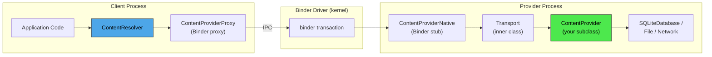

这条路径上的关键类有：

| 类 | 角色 | 源码 |
|-------|------|--------|
| `ContentResolver` | 客户端门面；解析 authority，获取提供者 | `frameworks/base/core/java/android/content/ContentResolver.java` |
| `ContentProviderProxy` | `ContentProviderNative` 中手写的 Binder 代理 | `frameworks/base/core/java/android/content/ContentProviderNative.java` |
| `ContentProviderNative` | 分发传入 Parcel 事务的 Binder 存根 | 同一文件 |
| `ContentProvider.Transport` | 继承 `ContentProviderNative` 的内部类；在委托之前执行权限检查 | `frameworks/base/core/java/android/content/ContentProvider.java` |
| `ContentProvider` | 提供者作者要继承的抽象基类 | 同一文件 |
| `IContentProvider` | IPC 接口定义（手写，而非 AIDL 生成） | `frameworks/base/core/java/android/content/IContentProvider.java` |

### 27.1.2 IContentProvider 接口

与大多数 Android IPC 接口不同，`IContentProvider` 并不是从 `.aidl` 文件生成的。它是一个手写的 Java 接口，继承自 `IInterface`：

```java
// frameworks/base/core/java/android/content/IContentProvider.java
public interface IContentProvider extends IInterface {
    Cursor query(@NonNull AttributionSource attributionSource, Uri url,
            @Nullable String[] projection,
            @Nullable Bundle queryArgs,
            @Nullable ICancellationSignal cancellationSignal)
            throws RemoteException;

    Uri insert(@NonNull AttributionSource attributionSource,
            Uri url, ContentValues initialValues, Bundle extras)
            throws RemoteException;

    int delete(@NonNull AttributionSource attributionSource,
            Uri url, Bundle extras)
            throws RemoteException;

    int update(@NonNull AttributionSource attributionSource,
            Uri url, ContentValues values, Bundle extras)
            throws RemoteException;

    // ... plus getType, openFile, openAssetFile, call, etc.
}
```

每个方法都带有一个 `AttributionSource`，它链式记录了调用方的 UID、包名以及任何下游归因信息。这取代了旧的 `callingPkg` 字符串参数，以便在多个跳转之间支持归因链。

### 27.1.3 URI 方案

每个内容提供者都通过一个 `content://` URI 来寻址：

```
content://authority/path/to/resource
  ^         ^          ^
  |         |          +-- Provider-interpreted path segments
  |         +------------- Registered authority (unique per provider)
  +----------------------- Scheme (always "content")
```

例如：

```
content://media/external/images/media/42
content://com.android.contacts/contacts/lookup/0n3A.../5
content://settings/system/screen_brightness
content://com.android.externalstorage.documents/document/primary%3ADownload%2Ffile.pdf
```

`ContentResolver` 声明了方案常量：

```java
// frameworks/base/core/java/android/content/ContentResolver.java (line 280)
public static final String SCHEME_CONTENT = "content";
```

### 27.1.4 UriMatcher

提供者使用 `android.content.UriMatcher` 将传入的 URI 模式映射到整数代码。这一点在 MediaProvider 内部的 `LocalUriMatcher` 中尤为明显：

```java
// packages/providers/MediaProvider/src/com/android/providers/media/LocalUriMatcher.java
static final int IMAGES_MEDIA        = 1;
static final int IMAGES_MEDIA_ID     = 2;
static final int AUDIO_MEDIA         = 100;
static final int AUDIO_MEDIA_ID      = 101;
static final int VIDEO_MEDIA         = 200;
static final int VIDEO_MEDIA_ID      = 201;
static final int FILES               = 700;
static final int FILES_ID            = 701;
static final int DOWNLOADS           = 800;
static final int DOWNLOADS_ID        = 801;
static final int PICKER_ID           = 901;
```

匹配器使用包含通配符的 URI 模式来填充（`*` 表示单个片段，`#` 表示数字片段）：

```java
mPublic.addURI(authority, "*/images/media",   IMAGES_MEDIA);
mPublic.addURI(authority, "*/images/media/#",  IMAGES_MEDIA_ID);
mPublic.addURI(authority, "*/audio/media",     AUDIO_MEDIA);
```

在查询时，`MediaProvider.queryInternal()` 通过 `matchUri()` 计算匹配代码，并将该代码传给 `getQueryBuilder()` / `getQueryBuilderInternal()`。这些方法中的大型 `switch (match)` 语句负责选择查询所对应的底层表和投影映射。

### 27.1.5 CRUD 操作

四个主要操作直接映射到 SQL 语义：

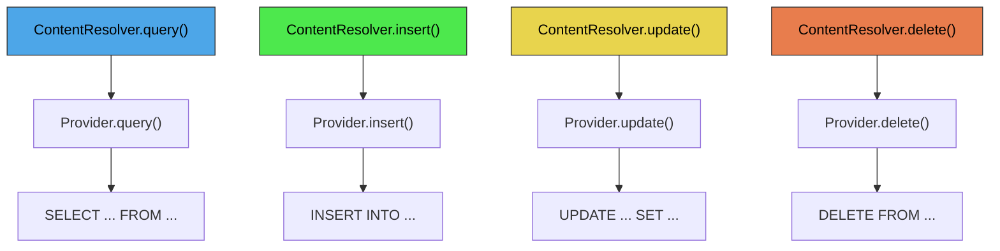

从 Android O 开始，框架鼓励使用结构化的查询参数（键值 Bundle），而不是原始 SQL 字符串。`ContentResolver` 中的相关常量如下：

```java
// frameworks/base/core/java/android/content/ContentResolver.java
public static final String QUERY_ARG_SQL_SELECTION = "android:query-arg-sql-selection";
public static final String QUERY_ARG_SQL_SELECTION_ARGS = "android:query-arg-sql-selection-args";
public static final String QUERY_ARG_SQL_SORT_ORDER = "android:query-arg-sql-sort-order";
public static final String QUERY_ARG_SQL_GROUP_BY = "android:query-arg-sql-group-by";
public static final String QUERY_ARG_SQL_LIMIT = "android:query-arg-sql-limit";
public static final String QUERY_ARG_SORT_COLUMNS = "android:query-arg-sort-columns";
public static final String QUERY_ARG_SORT_DIRECTION = "android:query-arg-sort-direction";
```

### 27.1.6 call() 方法

在 CRUD 之外，`ContentProvider.call()` 为任意的 RPC 式交互提供了一个逃生舱。提供者解释方法名并返回一个 `Bundle`：

```java
// frameworks/base/core/java/android/content/ContentProvider.java (line 2754)
public @Nullable Bundle call(@NonNull String authority, @NonNull String method,
        @Nullable String arg, @Nullable Bundle extras) {
    return call(method, arg, extras);
}
```

`SettingsProvider`（见 50.4 节）大量使用了这种模式。出于性能考虑，它几乎将所有读写操作都通过 `call()` 路由，而不是走标准的 CRUD 方法。

### 27.1.7 Binder 传输细节

`ContentProvider.Transport` 内部类继承自 `ContentProviderNative`（Binder 存根），并用权限强制执行逻辑包装每一次传入调用：

```java
// frameworks/base/core/java/android/content/ContentProvider.java (line 241)
class Transport extends ContentProviderNative {
    @Override
    public Cursor query(@NonNull AttributionSource attributionSource, Uri uri,
            @Nullable String[] projection, @Nullable Bundle queryArgs,
            @Nullable ICancellationSignal cancellationSignal) {
        uri = validateIncomingUri(uri);
        uri = maybeGetUriWithoutUserId(uri);
        if (enforceReadPermission(attributionSource, uri)
                != PermissionChecker.PERMISSION_GRANTED) {
            // Return empty cursor with correct columns
            if (projection != null) {
                return new MatrixCursor(projection, 0);
            }
            // ...
        }
        // ... delegate to mInterface.query()
    }
}
```

关于传输层的关键点如下：

1. **URI 校验** -- `validateIncomingUri()` 做三件事。它验证 authority 属于本提供者。对于在不允许跨用户重定向时携带其他用户 ID 的 URI，它会抛出 `SecurityException`。它还会规范化空的路径片段。随后，一个单独的 `maybeGetUriWithoutUserId()` 调用会剥离内嵌的用户 ID；`INTERACT_ACROSS_USERS` / `INTERACT_ACROSS_USERS_FULL` 检查位于 `ContentProvider.checkUser()` 中。
2. **权限强制执行** -- `enforceReadPermission()` 和 `enforceWritePermission()` 会检查提供者声明的读/写权限、路径级权限以及 AppOps。
3. **Cursor 适配** -- 对于跨进程查询，得到的 `Cursor` 会被包装进 `CursorToBulkCursorAdaptor`，它与客户端共享一个 `CursorWindow`（由共享内存支撑）。客户端收到的是一个包含该窗口文件描述符的 `BulkCursorDescriptor`。

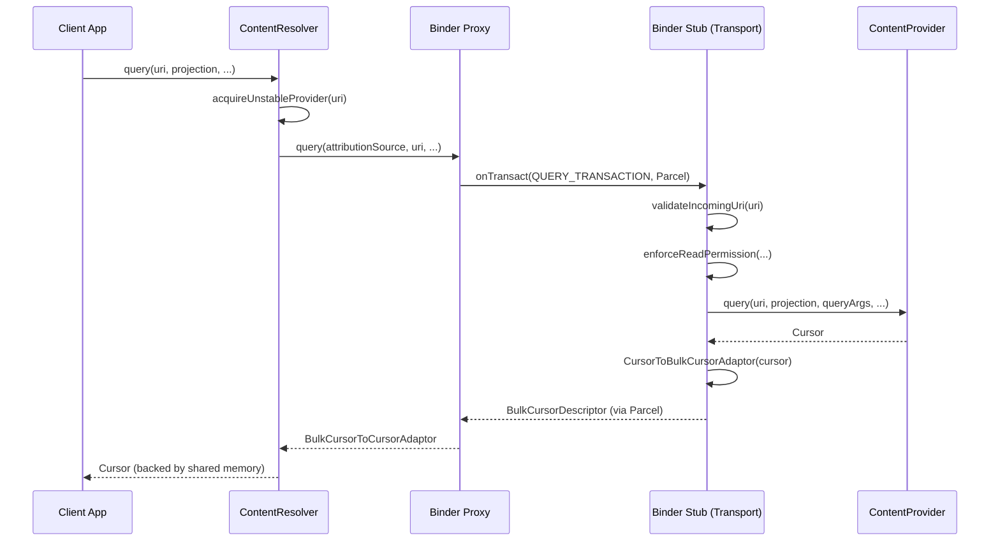

### 27.1.8 稳定与不稳定提供者引用

`ContentResolver` 区分两种提供者引用：

- **不稳定**（`acquireUnstableProvider`）-- 如果提供者崩溃，该引用会失效，但客户端进程不会被杀死。
- **稳定**（`acquireProvider`）-- 更强的绑定；历史上，提供者崩溃也会杀死客户端。

解析器首先尝试不稳定引用。如果提供者死亡（`DeadObjectException`），它会调用 `unstableProviderDied()`，然后使用稳定引用重试：

```java
// frameworks/base/core/java/android/content/ContentResolver.java (around line 2121)
try {
    fd = unstableProvider.openTypedAssetFile(...);
} catch (DeadObjectException e) {
    unstableProviderDied(unstableProvider);
    stableProvider = acquireProvider(uri);
    fd = stableProvider.openTypedAssetFile(...);
}
```

### 27.1.9 ContentProviderClient

对于对同一 authority 的重复调用，`ContentProviderClient` 可以避免重复的提供者查找：

```java
ContentProviderClient client = resolver.acquireContentProviderClient("media");
try {
    Cursor c = client.query(uri, null, null, null);
    // ... use cursor
} finally {
    client.close();
}
```

该客户端持有稳定引用或不稳定引用，并实现与 `ContentResolver` 相同的 `ContentInterface`，但会跳过 authority 解析这一步。

### 27.1.10 批量操作

`ContentProviderOperation` 允许将多个 CRUD 操作作为一次 IPC 调用发送，提供者可以在一个事务内执行它们：

```java
// frameworks/base/core/java/android/content/ContentProvider.java (line 2717)
public @NonNull ContentProviderResult[] applyBatch(@NonNull String authority,
        @NonNull ArrayList<ContentProviderOperation> operations)
        throws OperationApplicationException {
    return applyBatch(operations);
}

public @NonNull ContentProviderResult[] applyBatch(
        @NonNull ArrayList<ContentProviderOperation> operations)
        throws OperationApplicationException {
    final int numOperations = operations.size();
    final ContentProviderResult[] results = new ContentProviderResult[numOperations];
    for (int i = 0; i < numOperations; i++) {
        results[i] = operations.get(i).apply(this, results, i);
    }
    return results;
}
```

像 `ContactsProvider2` 这样的提供者会重写 `applyBatch()`，将整个操作集包裹进一个 SQLite 事务，从而显著提升批量联系人同步的性能。

### 27.1.11 文件描述符传递

内容提供者可以使用 `openFile()` 和 `openAssetFile()` 将原始文件描述符跨进程边界传递。MediaProvider 就是借此在不通过 Binder 复制字节的情况下传输实际媒体数据的：

```java
// ContentResolver.java (line 1555)
public final @Nullable InputStream openInputStream(@NonNull Uri uri)
        throws FileNotFoundException {
    Objects.requireNonNull(uri, "uri");
    String scheme = uri.getScheme();
    if (SCHEME_ANDROID_RESOURCE.equals(scheme)) {
        OpenResourceIdResult r = getResourceId(uri);
        return r.r.openRawResource(r.id);
    } else if (SCHEME_FILE.equals(scheme)) {
        return new FileInputStream(uri.getPath());
    } else {
        AssetFileDescriptor fd = openAssetFileDescriptor(uri, "r", null);
        return fd != null ? fd.createInputStream() : null;
    }
}
```

`openInputStream()` / `openOutputStream()` 这两个便捷方法处理三种 URI 方案：

| 方案 | 解析方式 |
|--------|-----------|
| `content://` | 通过 Binder 调用 `ContentProvider.openAssetFile()` 打开 |
| `android.resource://` | 从指定包中打开一个原始资源 |
| `file://` | 直接打开本地文件系统路径 |

对于 `content://` URI，提供者返回一个 `ParcelFileDescriptor`（它包装了一个可以通过 Binder 跨进程边界传递的 Linux 文件描述符）。所支持的文件描述符模式有：

| 模式 | 含义 |
|------|---------|
| `"r"` | 只读 |
| `"w"` | 只写（截断行为由提供者决定） |
| `"wt"` | 只写并截断 |
| `"wa"` | 只写并追加 |
| `"rw"` | 读写 |
| `"rwt"` | 读写并截断 |

在 Android 17 中，`ContentProvider.Transport` 会在委托给提供者之前对模式字符串进行净化。假设调用方请求打开一个文件时设置了截断位（`t`）或追加位（`a`），却没有设置写位（`w`）。传输层会静默丢弃这些位。这样可以防止一次名义上只读的打开操作去修改文件。该逻辑位于 `Transport.validateFileMode()` 中，传输层会从 `openFile()` 和 `openAssetFile()` 两处调用它：

```java
// frameworks/base/core/java/android/content/ContentProvider.java (line 795)
private String validateFileMode(String mode) {
    // We currently only support the following modes: r, w, wt, wa, rw, rwt
    if (mode != null && mode.indexOf('w') == -1) {
        // Don't allow truncation without write
        if (mode.indexOf('t') != -1) {
            mode = mode.replace("t", "");
        }
        // Don't allow appending without write
        if (mode.indexOf('a') != -1) {
            mode = mode.replace("a", "");
        }
    }
    return mode;
}
```

这种丢弃是刻意静默进行的（而不是抛出异常），以避免破坏那些传入了粗糙模式字符串的应用。真正到达 `enforceFilePermission()` 和提供者 `openFile()` 的是净化后的模式。

### 27.1.12 CursorWindow 与共享内存

当 `Cursor` 跨越进程边界时，实际数据并不会被序列化进一个 Parcel。相反，框架使用 `CursorWindow`——一块共享内存（通过 `ashmem` / `memfd`）——两个进程都可以读取它：

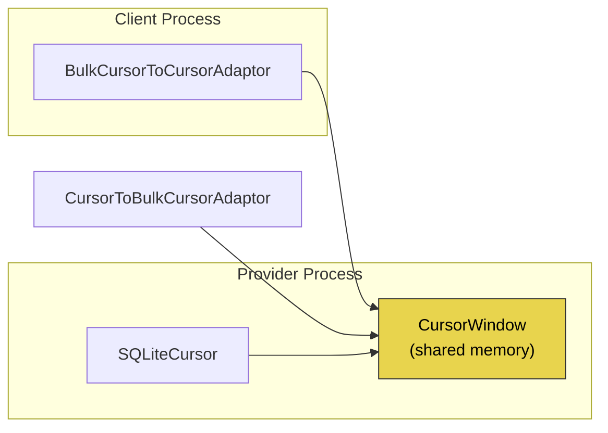

`CursorToBulkCursorAdaptor`（提供者侧）包装该游标，并通过 `IBulkCursor` Binder 接口将其暴露出来。`BulkCursorToCursorAdaptor`（客户端侧）提供一个由共享内存窗口支撑的标准 `Cursor` 接口。

`CursorWindow` 的大小并不是一个硬编码常量；它从设备资源读取，并在首次使用时缓存：

```java
// frameworks/base/core/java/android/database/CursorWindow.java (line 795)
private static int getCursorWindowSize() {
    if (sCursorWindowSize < 0) {
        // The cursor window size. resource xml file specifies the value in kB.
        // convert it to bytes here by multiplying with 1024.
        sCursorWindowSize = Resources.getSystem().getInteger(
                com.android.internal.R.integer.config_cursorWindowSize) * 1024;
    }
    return sCursorWindowSize;
}
```

`config_cursorWindowSize` 的默认值是 2048（KB），即得到 2 MB 的窗口，但设备叠加配置可以更改它。如果查询结果超过窗口大小，游标会在客户端迭代时按需填充窗口，从而自动分页。

### 27.1.13 ContentValues

`ContentValues` 是传给 `insert()` 和 `update()` 的列值对的标准容器。它本质上是一个实现了 `Parcelable` 的 `HashMap<String, Object>`：

```java
ContentValues values = new ContentValues();
values.put(MediaStore.MediaColumns.DISPLAY_NAME, "photo.jpg");
values.put(MediaStore.MediaColumns.MIME_TYPE, "image/jpeg");
values.put(MediaStore.MediaColumns.RELATIVE_PATH, "DCIM/Camera");
Uri uri = resolver.insert(MediaStore.Images.Media.EXTERNAL_CONTENT_URI, values);
```

值是类型安全的：`put()` 方法对 `String`、`Byte`、`Short`、`Integer`、`Long`、`Float`、`Double`、`Boolean` 和 `byte[]` 进行了重载。

### 27.1.14 ContentUris 工具类

`ContentUris` 工具类提供了处理以数字 ID 结尾的内容 URI 的辅助方法：

```java
// Append an ID to a base URI
Uri itemUri = ContentUris.withAppendedId(
    MediaStore.Images.Media.EXTERNAL_CONTENT_URI, 42);
// Result: content://media/external/images/media/42

// Parse the ID from a URI
long id = ContentUris.parseId(itemUri);
// Result: 42
```

### 27.1.15 线程安全

内容提供者的方法（`query`、`insert`、`update`、`delete`）可以被多个 Binder 线程并发调用。`ContentProvider` 中的 Javadoc 明确说明了这一点：

```
Data access methods (such as insert and update) may be called from many
threads at once, and must be thread-safe.  Other methods (such as onCreate)
are only called from the application main thread.
```

由 SQLite 支撑的提供者受益于 SQLite 内置的锁定机制。使用内存数据结构的提供者必须使用自己的同步机制。

---

## 27.2 ContentProvider 生命周期

### 27.2.1 提供者声明

每个内容提供者都必须在 `AndroidManifest.xml` 中声明：

```xml
<provider
    android:name=".MyContentProvider"
    android:authorities="com.example.myprovider"
    android:exported="true"
    android:readPermission="com.example.READ_DATA"
    android:writePermission="com.example.WRITE_DATA"
    android:multiprocess="false" />
```

关键属性：

| 属性 | 用途 |
|-----------|---------|
| `authorities` | authority 字符串的分号分隔列表 |
| `exported` | 其他应用是否可以访问此提供者 |
| `readPermission` | 读操作所需的权限 |
| `writePermission` | 写操作所需的权限 |
| `grantUriPermissions` | 是否允许临时的 URI 权限授予 |
| `multiprocess` | 若为 true，则在每个客户端进程中实例化（很少见） |
| `initOrder` | 同一进程中提供者之间的相对初始化顺序 |

### 27.2.2 Authority 注册

在安装时，`PackageManagerService` 会解析清单文件并记录 authority 到提供者的映射。当 `ContentResolver` 收到一个 URI 时，它会请求 `ActivityManagerService` 解析该 authority：

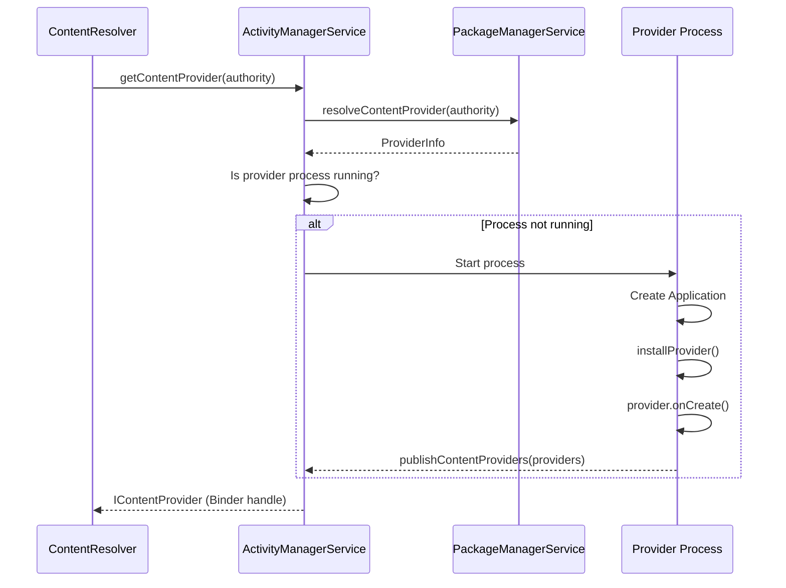

### 27.2.3 进程启动与提供者初始化

当 `ActivityThread` 创建一个应用时，它会在该进程调用 `Application.onCreate()` *之前*安装为该进程声明的所有提供者：

```
ActivityThread.handleBindApplication()
  -> installContentProviders(app, providers)
       -> for each ProviderInfo:
            installProvider(context, holder, info, ...)
              -> provider = instantiate via reflection
              -> provider.attachInfo(context, info)
                   -> set authority, permissions, flags
                   -> provider.onCreate()
  -> mInstrumentation.callApplicationOnCreate(app)
```

这个顺序至关重要：提供者在应用的 `onCreate()` 运行之前就已可用，这意味着 `Application.onCreate()` 中的任何初始化都可以立即使用内容提供者。

### 27.2.4 attachInfo() 方法

`ContentProvider.attachInfo()` 是框架的初始化钩子：

```java
// frameworks/base/core/java/android/content/ContentProvider.java (line 2667)
private void attachInfo(Context context, ProviderInfo info, boolean testing) {
    mNoPerms = testing;
    mCallingAttributionSource = new ThreadLocal<>();

    // Only allow it to be set once, so after the content service gives
    // this to us clients can't change it.
    if (mContext == null) {
        mContext = context;
        if (context != null && mTransport != null) {
            mTransport.mAppOpsManager = (AppOpsManager) context.getSystemService(
                    Context.APP_OPS_SERVICE);
        }
        mMyUid = Process.myUid();
        if (info != null) {
            setReadPermission(info.readPermission);
            setWritePermission(info.writePermission);
            setPathPermissions(info.pathPermissions);
            mExported = info.exported;
            mSingleUser = (info.flags & ProviderInfo.FLAG_SINGLE_USER) != 0;
            mSystemUserOnly = (info.flags & ProviderInfo.FLAG_SYSTEM_USER_ONLY) != 0;
            setAuthorities(info.authority);
        }
        if (Build.IS_DEBUGGABLE) {
            setTransportLoggingEnabled(Log.isLoggable(getClass().getSimpleName(),
                    Log.VERBOSE));
        }
        ContentProvider.this.onCreate();
    }
}
```

关键观察点：

1. `attachInfo()` 只能被调用一次（由 `mContext == null` 保护）。
2. 权限字符串、路径权限和导出状态都来自从清单文件解析出的 `ProviderInfo`。
3. `onCreate()` 在最后被调用——子类在这里执行数据库初始化。

### 27.2.5 提供者生命周期状态

与 Activity 不同，内容提供者具有简单的生命周期：

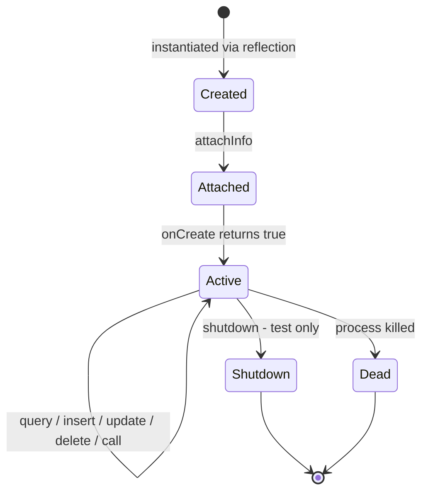

提供者没有暂停/恢复/停止状态。一旦创建，它们会在宿主进程的整个生命周期内保持活跃。系统可以在任何时候杀死该进程（基于 OOM 邻接分数），从而隐式销毁其中的提供者。

### 27.2.6 多 Authority 提供者

单个 `ContentProvider` 子类可以声明多个以分号分隔的 authority。在内部，`setAuthorities()` 会拆分该字符串：

```java
// frameworks/base/core/java/android/content/ContentProvider.java
private String mAuthority;
private String[] mAuthorities;
```

由于大多数提供者只有一个 authority，因此为了性能同时维护了 `String` 和 `String[]` 两种字段。

### 27.2.7 单用户与仅系统用户提供者

`ProviderInfo` 中的两个特殊标志控制多用户行为：

- `FLAG_SINGLE_USER` -- 该提供者运行在用户 0 的进程中，并为所有用户服务。TelephonyProvider 使用这种模式（其提供者声明 `android:singleUser="true"`）：只有一个进程，但它处理内嵌用户 ID 的 URI。（相比之下，MediaProvider 为每个用户运行一个实例。）
- `FLAG_SYSTEM_USER_ONLY` -- 该提供者仅对系统用户（用户 0）可用。

### 27.2.8 initOrder 与提供者顺序

当多个提供者共享同一进程时，`android:initOrder` 控制它们的初始化顺序。值较大的提供者先初始化。当某个提供者在自身 `onCreate()` 期间依赖另一个提供者已可用时，这一点很重要。

### 27.2.9 提供者死亡与重启

当提供者的进程死亡（OOM 杀死、崩溃等）时，系统会自动处理恢复：

1. 持有不稳定引用的客户端在下一次调用时会收到 `DeadObjectException`。`ContentResolver` 捕获该异常并透明地重新获取提供者（这可能会触发新的进程启动）。

2. 历史上，持有稳定引用的客户端会随提供者一起被杀死。现代 Android 更为宽松，但框架仍然区分这两种引用类型。

3. `ContentObserver` 的注册由 `system_server` 中的 `ContentService` 维护，因此它们在提供者重启后依然存活。然而，共享内存中任何挂起的游标数据都会丢失。

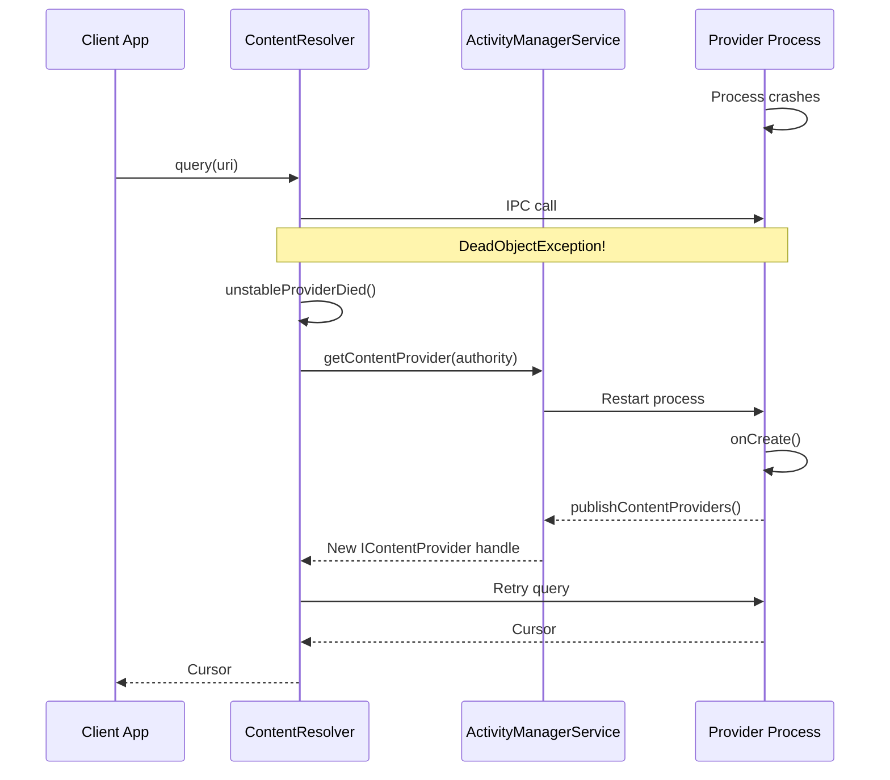

### 27.2.10 多进程提供者

设置 `android:multiprocess="true"` 会使提供者在每个客户端进程中实例化，而不是在提供者自己的进程中。这消除了 IPC 开销，但意味着：

- 每个实例操作的是各自独立的数据结构副本。
- 基于文件的数据库可能导致锁竞争。
- 提供者必须能安全地跨多个独立实例使用。

实际上，`multiprocess` 提供者很少见。它们主要用于只读提供者或由内存数据支撑的提供者。

---

## 27.3 MediaStore 与 MediaProvider

### 27.3.1 概述

MediaProvider 是 AOSP 中最复杂的内容提供者。它管理设备上的每个图像、视频、音频文件和下载项。该提供者作为一个 Mainline 模块（`com.android.providers.media.module`）交付，这意味着它可以独立于基础系统进行更新。

```
packages/providers/MediaProvider/src/com/android/providers/media/MediaProvider.java
```

`MediaProvider.java` 是 AOSP 中最大的单个源文件之一。它直接继承自 `ContentProvider`：

```java
// packages/providers/MediaProvider/.../MediaProvider.java (line 417)
public class MediaProvider extends ContentProvider {
```

### 27.3.2 Authority 与内容 URI

MediaProvider 注册了 authority `media`。它的 URI 遵循结构化的模式：

```
content://media/<volume>/<media-type>/<table>[/<id>]
```

| URI 模式 | 匹配代码 | 描述 |
|-------------|-----------|-------------|
| `content://media/*/images/media` | `IMAGES_MEDIA` (1) | 卷上的所有图像 |
| `content://media/*/images/media/#` | `IMAGES_MEDIA_ID` (2) | 按 ID 指定的单个图像 |
| `content://media/*/audio/media` | `AUDIO_MEDIA` (100) | 所有音频文件 |
| `content://media/*/audio/media/#` | `AUDIO_MEDIA_ID` (101) | 按 ID 指定的单个音频 |
| `content://media/*/video/media` | `VIDEO_MEDIA` (200) | 所有视频文件 |
| `content://media/*/video/media/#` | `VIDEO_MEDIA_ID` (201) | 按 ID 指定的单个视频 |
| `content://media/*/file` | `FILES` (700) | 所有文件（任意类型） |
| `content://media/*/file/#` | `FILES_ID` (701) | 按 ID 指定的单个文件 |
| `content://media/*/downloads` | `DOWNLOADS` (800) | 已下载的文件 |
| `content://media/*/downloads/#` | `DOWNLOADS_ID` (801) | 按 ID 指定的单个下载项 |

`*` 卷片段通常是 `internal` 或 `external_primary`，但也可以是可移除存储的 UUID。

### 27.3.3 卷系统

`MediaVolume` 表示 MediaProvider 中的一个存储卷：

```java
// packages/providers/MediaProvider/.../MediaVolume.java (line 49)
public final class MediaVolume implements Parcelable {
    private final @NonNull String mName;      // e.g., "external_primary"
    private final @Nullable UserHandle mUser; // null for public volumes
    private final @Nullable File mPath;       // mount point
    private final @Nullable String mId;       // e.g., "external;0"
    private final boolean mExternallyManaged; // managed outside Android
    private final boolean mPublicVolume;      // accessible to all users
}
```

MediaProvider 精确维护两个 SQLite 数据库：用于系统媒体的 `internal.db`，以及用于其他所有内容的 `external.db`。所有外部卷——主模拟存储*以及*可移除卡——共享 `external.db`，各行由 `volume_name` 列区分。（按卷划分的 `external-<uuid>.db` 文件是一种旧版布局；`isMediaDatabaseName()` 仍然识别该模式，只是为了能够清理陈旧文件。）

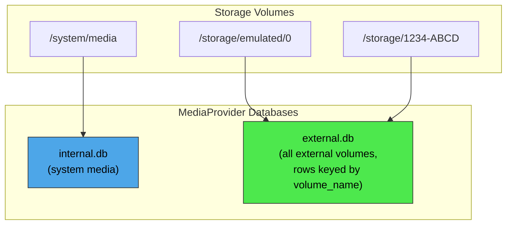

`VolumeCache` 类跟踪可用的卷，并将卷名映射到其挂载点和扫描路径。它并不了解数据库。

### 27.3.4 数据库模式

`DatabaseHelper` 类管理 SQLite 模式。主表是 `files`，它存储所有媒体的元数据：

| 列 | 类型 | 描述 |
|--------|------|-------------|
| `_id` | INTEGER | 主键 |
| `_data` | TEXT | 绝对文件路径 |
| `_display_name` | TEXT | 用户可见的文件名 |
| `_size` | INTEGER | 文件大小（字节） |
| `mime_type` | TEXT | MIME 类型 |
| `media_type` | INTEGER | 0=无，1=图像，2=音频，3=视频 |
| `title` | TEXT | 媒体标题 |
| `artist` | TEXT | 艺术家名称 |
| `album` | TEXT | 专辑名称 |
| `duration` | INTEGER | 时长（毫秒）（音频/视频） |
| `width` | INTEGER | 图像/视频宽度 |
| `height` | INTEGER | 图像/视频高度 |
| `date_added` | INTEGER | 插入时间戳 |
| `date_modified` | INTEGER | 修改时间戳 |
| `date_taken` | INTEGER | 拍摄时间戳（EXIF） |
| `owner_package_name` | TEXT | 创建该文件的应用包名 |
| `volume_name` | TEXT | 卷名 |
| `relative_path` | TEXT | 相对于卷根的路径 |
| `is_pending` | INTEGER | 若文件仍在写入则为 1 |
| `is_trashed` | INTEGER | 若文件在回收站中则为 1 |
| `is_favorite` | INTEGER | 若用户标记为收藏则为 1 |

### 27.3.5 媒体扫描

媒体扫描器发现存储上的文件，提取元数据，并在 `files` 表中插入或更新行。

```
packages/providers/MediaProvider/src/com/android/providers/media/scan/ModernMediaScanner.java
```

```java
// ModernMediaScanner.java (line 185)
public class ModernMediaScanner implements MediaScanner {
```

`ModernMediaScanner` 用纯 Java 实现取代了旧版原生扫描器。扫描器分阶段运行：

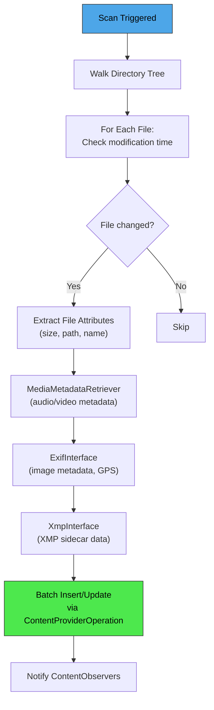

扫描原因被编码为整数常量，声明为裸接口字段，并从 statsd 日志符号初始化：

```java
// packages/providers/MediaProvider/src/com/android/providers/media/scan/MediaScanner.java
int REASON_UNKNOWN = MEDIA_PROVIDER_SCAN_OCCURRED__REASON__UNKNOWN;
int REASON_MOUNTED = MEDIA_PROVIDER_SCAN_OCCURRED__REASON__MOUNTED;
int REASON_DEMAND = MEDIA_PROVIDER_SCAN_OCCURRED__REASON__DEMAND;   // explicit scan request
int REASON_IDLE = MEDIA_PROVIDER_SCAN_OCCURRED__REASON__IDLE;       // idle maintenance
```

底层值（0 到 3）来自 statsd atom 定义（`frameworks/proto_logging/stats/atoms.proto`）中的 `MediaProviderScanOccurred.Reason` 枚举。

操作的批大小为 32 项：

```java
// ModernMediaScanner.java (line 209)
private static final int BATCH_SIZE = 32;
```

元数据提取遵循信任层级：文件属性的信任度最低，其次是 `MediaMetadataRetriever`，然后是 `ExifInterface`，最后 `XmpInterface` 的信任级别最高。每一层都可以覆盖上一层的值。

### 27.3.6 FUSE 集成

自 Android 11 起，MediaProvider 与 FUSE 文件系统层集成。当应用通过文件系统（而不是内容 URI）访问文件时，FUSE 守护进程会拦截该访问，并将其路由到 MediaProvider 进行权限检查：

```
packages/providers/MediaProvider/src/com/android/providers/media/fuse/FuseDaemon.java
packages/providers/MediaProvider/src/com/android/providers/media/fuse/ExternalStorageServiceImpl.java
```

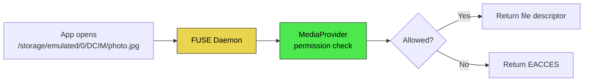

### 27.3.7 分区存储与访问模式

MediaProvider 会根据调用应用的目标 SDK 和权限强制执行不同的访问模式：

| 访问级别 | 获取方式 | 范围 |
|-------------|-------------|-------|
| 自有文件 | 无需权限 | `owner_package_name` 与调用方匹配的文件 |
| `READ_MEDIA_IMAGES` | 运行时权限 | 所有图像 |
| `READ_MEDIA_VIDEO` | 运行时权限 | 所有视频 |
| `READ_MEDIA_AUDIO` | 运行时权限 | 所有音频 |
| `ACCESS_MEDIA_LOCATION` | 运行时权限 | EXIF 中的 GPS 数据 |
| `MANAGE_EXTERNAL_STORAGE` | 特殊权限 | 所有文件（范围广泛） |
| 照片选择器 | 用户选择 | 仅所选条目 |

`AccessChecker` 类和 `LocalCallingIdentity` 将这些权限状态编码为位标志：

```java
// packages/providers/MediaProvider/.../LocalCallingIdentity.java
public static final int PERMISSION_IS_SELF             = 1 << 0;
public static final int PERMISSION_IS_SHELL            = 1 << 1;
public static final int PERMISSION_IS_MANAGER          = 1 << 2;
public static final int PERMISSION_IS_REDACTION_NEEDED = 1 << 8;
public static final int PERMISSION_READ_VIDEO          = 1 << 17;
public static final int PERMISSION_READ_IMAGES         = 1 << 18;
public static final int PERMISSION_IS_SYSTEM_GALLERY   = 1 << 22;
```

### 27.3.8 照片选择器

MediaProvider 从 Android 13 起内置了照片选择器。借助它，用户可以授权访问特定的照片/视频，而无需授予应用广泛的媒体权限：

```
packages/providers/MediaProvider/src/com/android/providers/media/photopicker/
```

选择器 URI 使用不同的路径片段：

```java
// LocalUriMatcher.java
static final int PICKER_ID = 901;
static final int PICKER_GET_CONTENT_ID = 906;
static final int PICKER_TRANSCODED_ID = 907;
static final int PICKER_INTERNAL_V2 = 908;
```

选择器还可以通过 `CloudMediaProviderContract` 呈现来自云媒体提供者（Google Photos 等）的条目。

### 27.3.9 转码

MediaProvider 包含视频转码支持。当面向较旧 SDK 的应用打开 HEVC 视频文件时，提供者可以透明地将其转码为 AVC（H.264）以实现兼容：

```
packages/providers/MediaProvider/src/com/android/providers/media/TranscodeHelper.java
packages/providers/MediaProvider/src/com/android/providers/media/TranscodeHelperImpl.java
```

转码在文件描述符级别透明处理。`FLAG_TRANSFORM_TRANSCODING` 位标志表示某次文件访问需要转码：

```java
// MediaProvider.java (line 426)
private static final int FLAG_TRANSFORM_TRANSCODING = 1 << 0;
```

### 27.3.10 脱敏 URI

为了隐私，MediaProvider 可以签发脱敏 URI，从图像中剥离位置元数据（GPS 坐标）。当没有 `ACCESS_MEDIA_LOCATION` 权限的应用打开一张照片时，它会收到一个删除了 EXIF 位置数据的脱敏文件描述符：

```java
// MediaProvider.java (line 429)
private static final int FLAG_TRANSFORM_REDACTION = 1 << 1;
```

脱敏 URI 使用一个特殊的合成路径前缀和一个唯一的基于哈希的标识符：

```java
// packages/providers/MediaProvider/.../util/SyntheticPathUtils.java (line 45)
public static final String REDACTED_URI_ID_PREFIX = "RUID";
public static final int REDACTED_URI_ID_SIZE = 36;
```

### 27.3.11 空闲维护

MediaProvider 在设备空闲期间执行后台维护。`IdleService` 处理诸如以下的任务：

- 重新扫描元数据可能已陈旧的文件
- 清理孤立的数据库行（磁盘上已不存在的文件）
- 更新特殊格式检测结果
- 处理回收站过期（回收站中的文件在 30 天后自动删除）

```java
// MediaProvider.java (line 482)
private static final int IDLE_MAINTENANCE_ROWS_LIMIT = 1000;
```

维护以每批 1,000 行的方式运行，以避免可能被中断的长时操作。

### 27.3.12 DatabaseHelper

`DatabaseHelper` 继承自 `SQLiteOpenHelper`，并管理 MediaProvider 创建的两个数据库实例的模式创建与升级：一个用于 `internal.db`，一个用于 `external.db`：

```java
// packages/providers/MediaProvider/.../DatabaseHelper.java (line 107)
public class DatabaseHelper extends SQLiteOpenHelper implements AutoCloseable {
```

关键常量：

```java
static final String INTERNAL_DATABASE_NAME = "internal.db";
static final String EXTERNAL_DATABASE_NAME = "external.db";
```

该辅助类定义了 `OnFilesChangeListener` 和 `OnLegacyMigrationListener` 回调接口。它持有由 `MediaProvider` 以匿名实现形式提供的监听器实例（`mFilesListener` 和 `MIGRATION_LISTENER`，传给 `DatabaseHelper` 构造函数）。该辅助类在模式变更以及从旧版 Android 的数据迁移期间与提供者协同工作。

### 27.3.13 备份与恢复

MediaProvider 包含一个数据库备份与恢复机制。它在 `/data/media/<user>/.transforms/recovery/` 下的按卷 LevelDB 表中存储文件路径到 `BackupIdRow` 的映射。文件系统扩展属性（xattrs）仅用于少数标量计数器（下一个所有者 ID、最后一次备份的代数，以及公共卷恢复标志）。这确保了在恢复出厂设置或设备迁移后重建数据库时，稳定的 URI 依然有效：

```
packages/providers/MediaProvider/src/com/android/providers/media/DatabaseBackupAndRecovery.java
packages/providers/MediaProvider/src/com/android/providers/media/stableuris/dao/BackupIdRow.java
```

### 27.3.14 `_data` 列弃用

历史上，应用可以读取 `_data` 列来获取媒体文件的绝对文件系统路径。从 Android 11（API 30）开始，该列返回 `/mnt/content/` 下的一个虚假路径。框架会在进程内拦截此路径，并将其转换回一次 `content://` 打开操作（见 27.9.14 节）：

```java
// ContentResolver.java (line 132 and line 145)
public static final boolean DEPRECATE_DATA_COLUMNS = true;
public static final String DEPRECATE_DATA_PREFIX = "/mnt/content/";
```

应用应使用 `ContentResolver.openFileDescriptor()` 或 `ContentResolver.openInputStream()`，而不是读取 `_data` 列。

---

## 27.4 ContactsProvider

### 27.4.1 概述

联系人内容提供者管理设备上的所有联系人数据。它是最复杂的提供者之一。它实现了三层数据模型（联系人、原始联系人和数据行）、自动聚合、同步适配器集成，以及企业联系人访问。

```
packages/providers/ContactsProvider/src/com/android/providers/contacts/ContactsProvider2.java
```

```java
// ContactsProvider2.java (line 251)
public class ContactsProvider2 extends AbstractContactsProvider
        implements OnAccountsUpdateListener {
```

### 27.4.2 三层数据模型

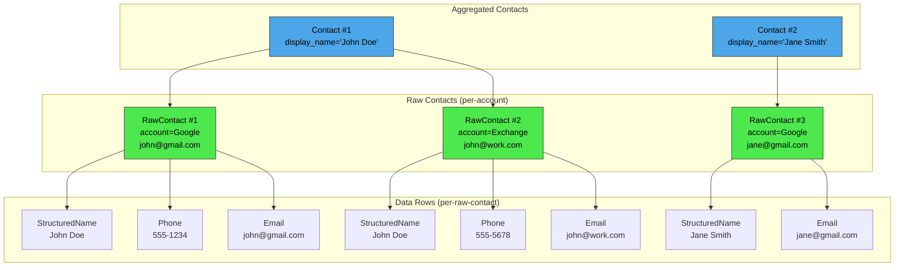

契约定义在 `android.provider.ContactsContract` 中：

| 表 | URI | 描述 |
|-------|-----|-------------|
| `Contacts` | `content://com.android.contacts/contacts` | 聚合后的联系人 |
| `RawContacts` | `content://com.android.contacts/raw_contacts` | 按账户划分的原始联系人 |
| `Data` | `content://com.android.contacts/data` | 各个数据项 |

### 27.4.3 数据行类型

每个数据行都有一个 `mimetype` 列，它决定了该行的种类。`DataRowHandler` 层次结构根据 MIME 类型分发 CRUD 操作：

```
packages/providers/ContactsProvider/src/com/android/providers/contacts/
  DataRowHandlerForStructuredName.java
  DataRowHandlerForPhoneNumber.java
  DataRowHandlerForEmail.java
  DataRowHandlerForPhoto.java
  DataRowHandlerForOrganization.java
  DataRowHandlerForNickname.java
  DataRowHandlerForNote.java
  DataRowHandlerForStructuredPostal.java
  DataRowHandlerForGroupMembership.java
  DataRowHandlerForIdentity.java
  DataRowHandlerForIm.java
  DataRowHandlerForCustomMimetype.java
```

每个处理器都知道如何校验、规范化和索引其特定的数据类型。例如，`DataRowHandlerForPhoneNumber` 会规范化电话号码以便一致地查找。

### 27.4.4 联系人聚合

聚合是将来自不同账户的原始联系人合并为统一联系人的过程。存在两种聚合器实现：

```
packages/providers/ContactsProvider/src/com/android/providers/contacts/aggregation/
  AbstractContactAggregator.java     -- Base class
  ContactAggregator.java              -- Original algorithm (v4)
  ContactAggregator2.java             -- Newer algorithm (v5)
```

聚合算法：

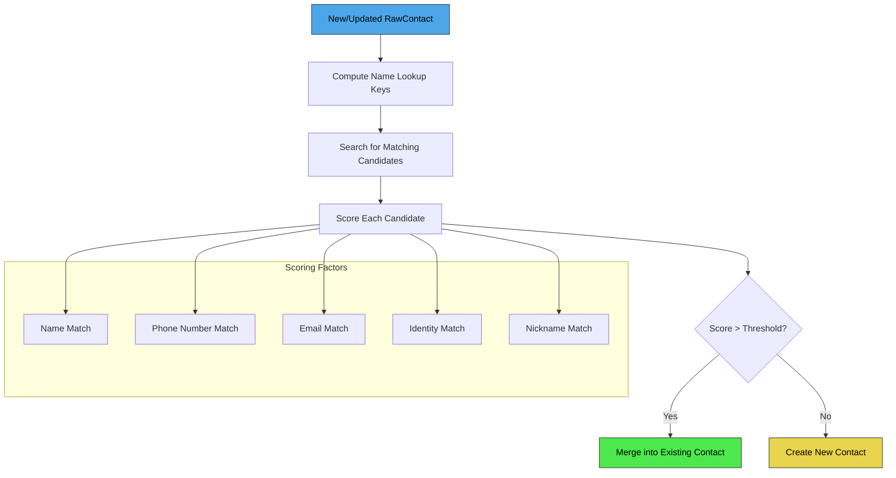

`ContactMatcher` 工具类计算原始联系人之间的匹配分数。用户还可以通过 `AggregationExceptions`（保持合并 / 保持分开）手动控制聚合。

### 27.4.5 URI 匹配

ContactsProvider2 定义了一整套 URI 代码：

```java
// ContactsProvider2.java (line 351)
public static final int CONTACTS                    = 1000;
public static final int CONTACTS_ID                 = 1001;
public static final int CONTACTS_LOOKUP             = 1002;
public static final int CONTACTS_LOOKUP_ID          = 1003;
public static final int CONTACTS_ID_DATA            = 1004;
public static final int CONTACTS_FILTER             = 1005;

public static final int RAW_CONTACTS                = 2002;
public static final int RAW_CONTACTS_ID             = 2003;
public static final int RAW_CONTACTS_ID_DATA        = 2004;

public static final int DATA                        = 3000;
public static final int DATA_ID                     = 3001;
public static final int PHONES                      = 3002;
public static final int EMAILS                      = 3005;
public static final int POSTALS                     = 3009;
```

### 27.4.6 联系人查找键

联系人由查找键而不是行 ID 唯一标识，因为 ID 在聚合过程中可能发生变化。查找键编码了组成该联系人的原始联系人：

```
content://com.android.contacts/contacts/lookup/0n3A412B507430/5
                                                ^^^^^^^^^^^^^  ^
                                                lookup_key     contact_id (hint)
```

`ContactLookupKey` 类解析此键，以便即使在重新聚合之后也能定位到该联系人。

### 27.4.7 企业联系人

`ContactsProvider2` 通过 `EnterpriseContactsCursorWrapper` 和 `EnterprisePolicyGuard` 支持跨 profile（工作 profile）的联系人查找。当查询 `Contacts.ENTERPRISE_CONTENT_URI` 时，提供者会透明地查询工作 profile 的联系人提供者并合并结果。

### 27.4.8 权限

```java
// ContactsProvider2.java (line 254-255)
private static final String READ_PERMISSION = "android.permission.READ_CONTACTS";
private static final String WRITE_PERMISSION = "android.permission.WRITE_CONTACTS";
```

此外，`android.contacts.permission.MANAGE_SIM_ACCOUNTS` 和 `android.permission.SET_DEFAULT_ACCOUNT_FOR_CONTACTS` 权限控制 SIM 联系人管理和默认账户配置。

### 27.4.9 ContactsDatabaseHelper

联系人数据库模式是 AOSP 中最复杂的模式之一：

```
packages/providers/ContactsProvider/src/com/android/providers/contacts/ContactsDatabaseHelper.java
```

在 `ContactsDatabaseHelper.Tables` 中定义的关键表：

| 表 | 用途 |
|-------|---------|
| `contacts` | 聚合后的联系人 |
| `raw_contacts` | 按账户划分的原始联系人 |
| `data` | 数据项（电话、电子邮件等） |
| `mimetypes` | MIME 类型注册表 |
| `accounts` | 账户名称/类型对 |
| `name_lookup` | 用于聚合的规范化姓名索引 |
| `phone_lookup` | 规范化电话号码索引 |
| `groups` | 联系人分组 |
| `agg_exceptions` | 手动聚合覆盖 |
| `settings` | 按账户的设置 |
| `directories` | 联系人目录（GAL 等） |
| `search_index` | 全文搜索索引 |
| `deleted_contacts` | 用于同步的墓碑记录 |
| `presence` | IM 在线状态 |
| `photo_files` | 照片文件元数据 |

在 `ContactsDatabaseHelper.Views` 中定义的视图：

| 视图 | 用途 |
|------|---------|
| `view_contacts` | 反规范化的联系人视图 |
| `view_data` | 与原始联系人和联系人连接后的数据 |
| `view_raw_contacts` | 带有账户信息的原始联系人 |
| `view_entities` | 用于同步的实体视图 |
| `view_stream_items` | 社交动态数据 |

### 27.4.10 搜索索引

`ContactsProvider2` 维护一个全文搜索索引以实现快速联系人查找。`SearchIndexManager` 用所有可搜索联系人数据的分词版本填充 `search_index` 表：

```
packages/providers/ContactsProvider/src/com/android/providers/contacts/SearchIndexManager.java
```

搜索索引同时支持前缀匹配（用于实时的边输入边搜索）和词元匹配。`FtsQueryBuilder` 根据用户输入构造 SQLite FTS 查询。

### 27.4.11 目录支持

联系人目录表示远程联系人来源，例如企业的全局地址列表（GAL）。客户端从 `Directory.CONTENT_URI` 枚举已注册的目录。它针对每个目录发出一次查询（例如，针对 `Contacts.CONTENT_FILTER_URI` 并附加 `?directory=<id>`）。提供者将每个此类查询转发给该参数所指定的唯一目录提供者。它以未合并的方式返回该游标：

```java
// ContactsProvider2.java
private ContactDirectoryManager mContactDirectoryManager;
```

`ContactDirectoryManager` 通过查询所有已安装包，查找宣告了目录支持的提供者，来发现目录提供者。

### 27.4.12 同步适配器集成

联系人支持 Android 同步框架。同步适配器（例如 Google 联系人同步、Exchange ActiveSync）使用特殊权限写入 `RawContacts` 和 `Data` 表。`CALLER_IS_SYNCADAPTER` 查询参数会改变行为：

- 当设置时，新的原始联系人会跳过自动分组簿记：不会应用自动添加的组成员身份，也不会在插入时更新收藏组。（聚合本身仍然会运行——它由 `RawContacts.AGGREGATION_MODE` 控制，而不是此标志。）
- 当设置时，删除为硬删除而不是软删除
- 在变更时不会自动设置 `dirty` 标志

这在 URI 中有所体现：

```
content://com.android.contacts/raw_contacts?caller_is_syncadapter=true
    &account_name=user@gmail.com&account_type=com.google
```

### 27.4.13 Profile 联系人

一个特殊的“profile”联系人代表设备所有者。它被单独存储，并拥有自己的 `ProfileProvider`（在内部属于 `ContactsProvider2` 的一部分）。Profile URI 使用不同的路径：

```
content://com.android.contacts/profile
content://com.android.contacts/profile/raw_contacts
content://com.android.contacts/profile/data
```

`ProfileAggregator` 单独处理 Profile 联系人的聚合，与常规联系人分开。

### 27.4.14 VCard 导出

`ContactsProvider2` 支持通过 `openAssetFile()` 方法将联系人导出为 vCard。当应用以 `text/x-vcard` MIME 类型打开一个联系人 URI 时，提供者会使用 `VCardComposer` 序列化该联系人：

```java
// ContactsProvider2.java imports
import com.android.vcard.VCardComposer;
import com.android.vcard.VCardConfig;
```

### 27.4.15 联系人选择器（Android 17）

读取联系人历来意味着持有 `READ_CONTACTS`，这即使应用只需要一个电话号码，也会授予它整个通讯录。Android 17 增加了一个选择器，只返回用户选择的联系人数据，调用方应用无需任何联系人权限。该契约位于框架中的 `frameworks/base/core/java/android/provider/ContactsPickerSessionContract.java`，选择器本身是 `packages/apps/ContactsPicker` 中一个全新的系统应用。整个 API 由 `enable_system_contacts_picker` 标志（`@FlaggedApi`）控制。

应用通过 `startActivityForResult()` 使用 `ACTION_PICK_CONTACTS` action（`"android.provider.action.PICK_CONTACTS"`，契约第 105 行）启动选择器。必需的 `EXTRA_PICK_CONTACTS_REQUESTED_DATA_FIELDS` extra 列出了应用想要的 MIME 类型（电话、电子邮件、邮政地址等，来自 `ContactsContract.CommonDataKinds`）。选择器既会将列表过滤为拥有这些字段之一的联系人也会把返回的列限制为这些字段。`EXTRA_PICK_CONTACTS_MATCH_ALL_DATA_FIELDS`、`EXTRA_PICK_CONTACTS_SELECTION_LIMIT`（默认 50，最大 100）以及标准的 `EXTRA_ALLOW_MULTIPLE` 用于调整选择。只有系统应用能解析此 action；文档字符串指出第三方处理程序会被忽略。

结果不是联系人数据本身，而是指向它的一次性指针。在选择时，选择器应用解析所选的行。选择器应用确实持有 `READ_CONTACTS`。它将一个会话插入到 `ContactsPickerSessionProvider` 中（`packages/apps/ContactsPicker` 通过位于 `packages/providers/ContactsProvider/src/com/android/providers/contacts/picker/ContactsPickerSessionProvider.java` 的提供者写入）。该提供者存储所选的 `ContactsContract.Data` 行 ID 以及请求方应用的 UID，然后返回形如 `content://com.android.contacts.picker.sessions/sessions/<session_id>` 的会话 URI。

会话 URI 经由结果 `Intent` 返回给调用方。该结果携带 `FLAG_GRANT_READ_URI_PERMISSION`，因此调用方获得恰好对该 URI 的临时读取访问权限，别无其他。对会话 URI 的查询会从 `ContactsContract.Data` 表中投影出所选字段对应的行。传入选择或选择参数的查询会抛出 `UnsupportedOperationException`，因为用户已经做出了选择。写入会话行本身受 `signature|privileged` 权限 `MANAGE_CONTACTS_PICKER_SESSION` 保护，因此只有选择器才能代表请求方创建会话。

下图展示了三个进程之间的会话交接。

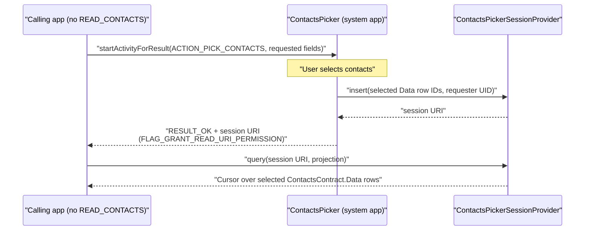

会话是短命的。`ContactsPickerSessionProvider` 安排一个每日运行的 `ContactsPickerJobService` 清理任务，删除超过 24 小时的会话。一旦该表达到 `MAX_SESSION_COUNT`（5000），一次插入就会裁剪掉最旧的行。

向后兼容通过同一个选择器应用实现。其 `AndroidManifest.xml` 为 `ACTION_PICK_CONTACTS` 和旧版的 `Intent.ACTION_PICK` 都注册了 intent 过滤器。`ContactsPickerAction`（`packages/apps/ContactsPicker/src/com/android/contactspicker/config/ContactsPickerAction.kt`）记录是哪个 action 启动了它。对于旧版的 `ACTION_PICK`，选择器返回旧的结果格式（一个或多个联系人内容 URI）。对于 `ACTION_PICK_CONTACTS`，它返回上述的单个会话 URI。已在使用 `ACTION_PICK` 的现有应用可以照常工作，并由相同的 UI 提供服务。

---

## 27.5 CalendarProvider

### 27.5.1 概述

`CalendarProvider2` 管理日历事件、参与者、提醒以及重复事件实例。

```
packages/providers/CalendarProvider/src/com/android/providers/calendar/CalendarProvider2.java
```

```java
// CalendarProvider2.java (line 104)
public class CalendarProvider2 extends SQLiteContentProvider
        implements OnAccountsUpdateListener {
```

注意，`CalendarProvider2` 继承自 `SQLiteContentProvider`，这是一个会自动将操作包裹进 SQLite 事务的便捷基类。

### 27.5.2 日历数据模型

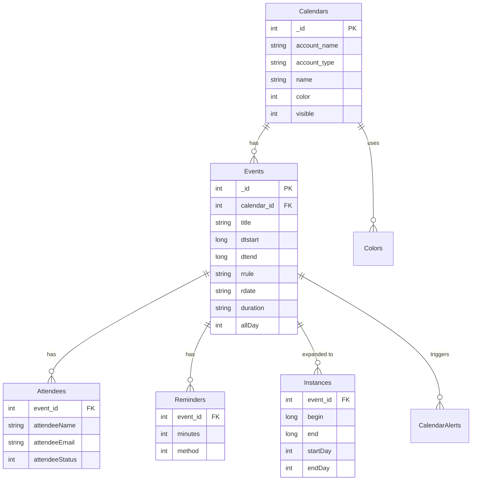

### 27.5.3 内容 URI

契约定义在 `android.provider.CalendarContract` 中：

| URI | 描述 |
|-----|-------------|
| `content://com.android.calendar/calendars` | 日历账户 |
| `content://com.android.calendar/events` | 日历事件 |
| `content://com.android.calendar/instances/when/<start>/<end>` | 范围内的展开实例 |
| `content://com.android.calendar/attendees` | 事件参与者 |
| `content://com.android.calendar/reminders` | 事件提醒 |
| `content://com.android.calendar/calendar_alerts` | 已触发的提醒 |
| `content://com.android.calendar/colors` | 日历/事件颜色 |
| `content://com.android.calendar/syncstate` | 同步适配器状态 |

### 27.5.4 重复展开

CalendarProvider 最复杂的职责之一是将重复事件（iCalendar RRULE/RDATE）展开为具体的实例。`CalendarInstancesHelper` 类计算展开窗口，并在 `Instances` 表中生成行：

```java
// CalendarProvider2.java
private CalendarInstancesHelper mInstancesHelper;
```

展开依赖 `calendarcommon2` 库：

```java
// Imports in CalendarProvider2.java
import com.android.calendarcommon2.EventRecurrence;
import com.android.calendarcommon2.RecurrenceProcessor;
import com.android.calendarcommon2.RecurrenceSet;
```

当查询命中 `Instances` URI 时，CalendarProvider 会检查展开窗口是否覆盖了所请求的时间范围，如有必要则进一步展开。

### 27.5.5 闹钟管理

`CalendarAlarmManager` 为事件提醒调度 Android 闹钟。当事件提醒时间到达时，闹钟触发，`CalendarProvider` 向 `CalendarAlerts` 表写入一条记录，这又会触发一个通知。

### 27.5.6 跨 Profile 日历

`CrossProfileCalendarHelper` 使受管 profile（工作 profile）能够与企业策略共享日历数据：

```java
// CalendarProvider2.java (line 200)
protected CrossProfileCalendarHelper mCrossProfileCalendarHelper;
```

### 27.5.7 权限

日历数据受以下权限保护：

```
android.permission.READ_CALENDAR
android.permission.WRITE_CALENDAR
```

### 27.5.8 CalendarDatabaseHelper

日历数据库模式包含以下表：

```
packages/providers/CalendarProvider/src/com/android/providers/calendar/CalendarDatabaseHelper.java
```

| 表（来自 CalendarDatabaseHelper.Tables） | 用途 |
|--------------------------------------------|---------|
| `Calendars` | 日历账户 |
| `Events` | 事件定义 |
| `Instances` | 展开的事件实例 |
| `Attendees` | 事件参与者 |
| `Reminders` | 事件提醒 |
| `CalendarAlerts` | 已触发的日历提醒 |
| `Colors` | 日历和事件颜色 |
| `ExtendedProperties` | 同步适配器扩展 |
| `EventsRawTimes` | 事件的原始时间值 |
| `CalendarCache` | 缓存的时区数据 |
| `_sync_state` | 同步适配器状态（伴随的 `_sync_state_metadata`） |

视图提供预先连接好的数据：

| 视图（来自 CalendarDatabaseHelper.Views） | 内容 |
|------------------------------------------|----------|
| `view_events` | 与 Calendars 连接后的事件 |

### 27.5.9 实例展开细节

实例展开算法对重复事件至关重要。考虑一个每周会议，从 1 月到 12 月每个星期一重复。日历不会存储 52 个独立的事件，而是存储一个带有 RRULE 的事件：

```
RRULE:FREQ=WEEKLY;BYDAY=MO;UNTIL=20261231T235959Z
```

客户端可以查询 `Instances` 表中的某个时间范围（例如 2026 年 3 月）。然后 `CalendarInstancesHelper` 计算重复事件的哪些发生落在该范围内。它为此使用 `RecurrenceProcessor`：

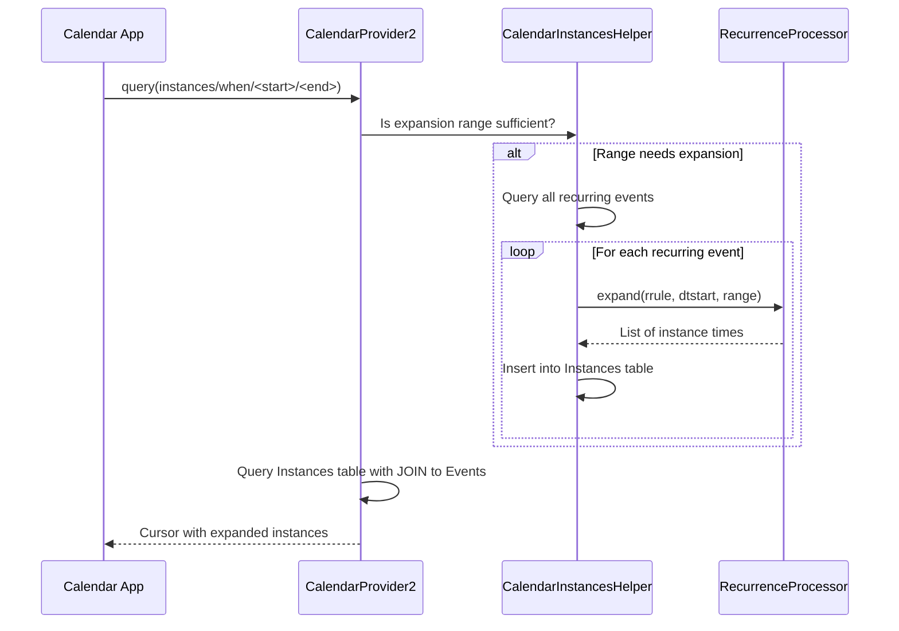

展开维护一个缓存窗口。如果查询落在已经展开的窗口内，则不需要新的展开。最小展开跨度为两个月：

```java
// CalendarProvider2.java (line 275)
private static final long MINIMUM_EXPANSION_SPAN =
        2L * 31 * 24 * 60 * 60 * 1000;
```

### 27.5.10 CalendarContract URI 匹配

`CalendarProvider2` 使用一个详尽的 `UriMatcher`。部分 URI 模式及其匹配代码：

```java
// CalendarProvider2.java (line 4880)
private static final int EVENTS                       = 1;
private static final int EVENTS_ID                    = 2;
private static final int INSTANCES                    = 3;
private static final int CALENDARS                    = 4;
private static final int CALENDARS_ID                 = 5;
private static final int ATTENDEES                    = 6;
private static final int ATTENDEES_ID                 = 7;
private static final int REMINDERS                    = 8;
private static final int REMINDERS_ID                 = 9;
private static final int EXTENDED_PROPERTIES          = 10;
private static final int CALENDAR_ALERTS              = 12;
private static final int CALENDAR_ALERTS_ID           = 13;
private static final int INSTANCES_BY_DAY             = 15;
private static final int SYNCSTATE                    = 16;
// ...
private static final int COLORS                       = 32;
```

### 27.5.11 事件变更跟踪

CalendarProvider 出于同步目的跟踪变更。当事件被修改时，提供者将其标记为脏，并记录是哪个同步适配器最后一次修改了它：

```java
// CalendarProvider2.java (line 213)
private static final String SQL_UPDATE_EVENT_SET_DIRTY_AND_MUTATORS = "UPDATE " +
        Tables.EVENTS + " SET " +
        Events.DIRTY + "=1," +
        Events.MUTATORS + "=? " +
        " WHERE " + Events._ID + "=?";
```

`MUTATORS` 列允许同步适配器过滤掉它们自己所做的更改，从而防止无限的同步循环。

### 27.5.12 搜索

CalendarProvider 支持跨事件标题、描述、位置以及参与者姓名/电子邮件的全文搜索。搜索查询会被分词，每个词元都与这些字段匹配：

```java
// CalendarProvider2.java (line 366)
private static final String[] SEARCH_COLUMNS = new String[] {
    CalendarContract.Events.TITLE,
    CalendarContract.Events.DESCRIPTION,
    CalendarContract.Events.EVENT_LOCATION,
    ATTENDEES_EMAIL_CONCAT,
    ATTENDEES_NAME_CONCAT
};
```

搜索使用 SQL `LIKE` 并带有自定义转义字符（`#`），以处理查询中的特殊字符：

```java
// CalendarProvider2.java (line 342)
private static final String SEARCH_ESCAPE_CHAR = "#";
// (line 349)
private static final Pattern SEARCH_ESCAPE_PATTERN =
    Pattern.compile("([%_" + SEARCH_ESCAPE_CHAR + "])");
```

---

## 27.6 SettingsProvider

### 27.6.1 概述

`SettingsProvider` 与其他内容提供者不同。它的主数据路径并不使用 SQLite（尽管存在一条旧版迁移路径）。相反，它将设置作为 XML 文件存储在设备系统目录中，由 `SettingsState` 类管理。

```
frameworks/base/packages/SettingsProvider/src/com/android/providers/settings/SettingsProvider.java
```

```java
// SettingsProvider.java (line 201)
public class SettingsProvider extends ContentProvider {
```

### 27.6.2 三个设置命名空间

设置被划分为三个具有不同安全级别的命名空间：

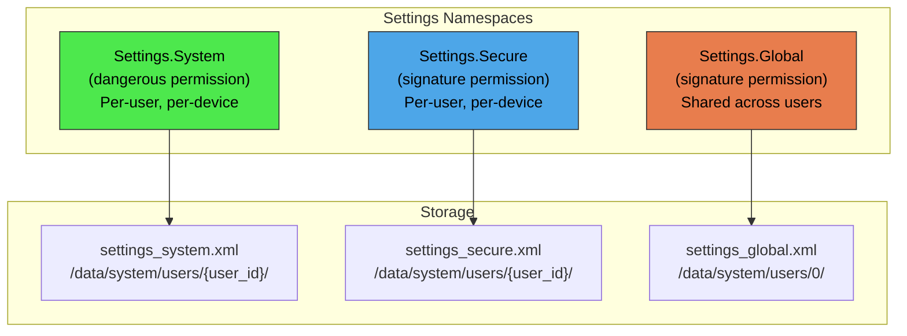

| 命名空间 | 权限级别 | 是否按用户？ | 典型设置 |
|-----------|-----------------|-----------|-----------------|
| `System` | 危险（`WRITE_SETTINGS`） | 是 | 屏幕亮度、字体大小、铃声 |
| `Secure` | 签名 | 是 | 默认输入法、无障碍设置 |
| `Global` | 签名 | 否（共享） | ADB 已启用、设备已配置、飞行模式 |

此外还有两个内部命名空间：

```java
// SettingsProvider.java (line 208-212)
public static final String TABLE_SYSTEM = "system";
public static final String TABLE_SECURE = "secure";
public static final String TABLE_GLOBAL = "global";
public static final String TABLE_SSAID  = "ssaid";   // Android ID per app
public static final String TABLE_CONFIG = "config";   // DeviceConfig flags
```

### 27.6.3 call() 方法优化

`SettingsProvider` 将所有读写操作都通过 `call()` 方法路由，而不是通过 `query()`/`insert()`/`update()`。这是一项显著的性能优化，因为 `call()` 避免了游标创建以及结果集的 Binder 编组开销：

```java
// SettingsProvider.java (line 463)
@Override
public Bundle call(String method, String name, Bundle args) {
    final int requestingUserId = getRequestingUserId(args);
    final int callingDeviceId = getDeviceId();
    switch (method) {
        case Settings.CALL_METHOD_GET_CONFIG -> {
            Setting setting = getConfigSetting(name);
            return packageValueForCallResult(...);
        }
        case Settings.CALL_METHOD_GET_GLOBAL -> {
            Setting setting = getGlobalSetting(name);
            return packageValueForCallResult(...);
        }
        case Settings.CALL_METHOD_GET_SECURE -> {
            Setting setting = getSecureSetting(name, requestingUserId, callingDeviceId);
            // ...
        }
        case Settings.CALL_METHOD_GET_SYSTEM -> {
            Setting setting = getSystemSetting(name, requestingUserId, callingDeviceId);
            // ...
        }
        case Settings.CALL_METHOD_PUT_GLOBAL -> { /* ... */ }
        case Settings.CALL_METHOD_PUT_SECURE -> { /* ... */ }
        case Settings.CALL_METHOD_PUT_SYSTEM -> { /* ... */ }
        // ... RESET, SET_ALL, etc.
    }
}
```

在客户端，`Settings.System.getString()`、`Settings.Secure.getInt()` 等都会通过 `ContentResolver.call()` 并使用相应的方法名进行调用，完全绕过 query/cursor 路径。

### 27.6.4 代际跟踪

SettingsProvider 实现了一个基于代际的缓存协议。每个设置命名空间都有一个代际计数器，每次变更都会递增。客户端（通过 `Settings` 类）在本地缓存值，仅在代际发生变化时才重新获取：

```
frameworks/base/packages/SettingsProvider/src/com/android/providers/settings/GenerationRegistry.java
```

这意味着读取一个自上次读取以来没有发生变化的设置需要零次 IPC 调用。代际索引通过一个共享内存的 `MemoryIntArray` 暴露给客户端。客户端可以在没有任何 Binder 往返的情况下轮询当前代际。只有代际不匹配才会强制进行一次 `call()`。

### 27.6.5 在命名空间之间迁移的设置

在 Android 的历史中，设置曾在命名空间之间迁移。提供者维护着迁移表：

```java
// SettingsProvider.java (line 304-328)
static final Set<String> sSecureMovedToGlobalSettings = new ArraySet<>();
static final Set<String> sSystemMovedToGlobalSettings = new ArraySet<>();
static final Set<String> sSystemMovedToSecureSettings = new ArraySet<>();
static final Set<String> sGlobalMovedToSecureSettings = new ArraySet<>();
static final Set<String> sGlobalMovedToSystemSettings = new ArraySet<>();
```

当客户端在错误的命名空间中查询一个设置时，提供者会透明地重定向到正确的命名空间。

### 27.6.6 校验

面向 API 23（Marshmallow）及以上版本的应用不能向 System 命名空间添加任意键——提供者会抛出 `IllegalArgumentException`。面向 API 22 或更低版本的应用只会得到一条记录在案的警告。提供者还会根据一组已注册的校验器来校验值：

```
frameworks/base/packages/SettingsProvider/src/android/provider/settings/validators/
  SystemSettingsValidators.java
  SecureSettingsValidators.java
  GlobalSettingsValidators.java
  Validator.java
  InclusiveIntegerRangeValidator.java
  InclusiveFloatRangeValidator.java
  DiscreteValueValidator.java
  ComponentNameListValidator.java
```

### 27.6.7 系统服务

SettingsProvider 还注册了两个系统服务：

```java
// SettingsProvider.java (line 457-458)
ServiceManager.addService("settings", new SettingsService(this));
ServiceManager.addService("device_config", new DeviceConfigService(this));
```

`device_config` 服务暴露 `TABLE_CONFIG` 命名空间，供功能标志和服务器推送配置使用。

### 27.6.8 虚拟设备支持（设备感知设置）

SettingsProvider 支持按虚拟设备设置覆盖项，这一特性在 Android 17 时期被改为设备感知。每次进入 `call()` 都会捕获请求用户和调用设备：

```java
// SettingsProvider.java (line 464-465)
final int requestingUserId = getRequestingUserId(args);
final int callingDeviceId = getDeviceId();
```

当调用上下文具有一个虚拟设备（例如配套显示屏或远程显示会话）时，提供者首先查找设备特定的值。然后，如果虚拟设备没有覆盖项，它会回退到默认设备的设置：

```java
// SettingsProvider.java (line 485-488)
if (callingDeviceId != Context.DEVICE_ID_DEFAULT
        && (setting == null || setting.isNull())) {
    setting = getSecureSetting(name, requestingUserId, Context.DEVICE_ID_DEFAULT);
}
```

由设备 ID 参与设置键的方式（27.6.10 节）可以得出两个重要约束：

1. 设备感知覆盖项仅适用于 `Secure` 和 `System` 命名空间。`Global`、`config` 和 `ssaid` 设置永远不按设备限定作用域。
2. 虚拟设备覆盖项有意*不*持久化到 XML。虚拟设备是临时性的，因此 `system_server` 只在内存中保存设备特定的值，并让它们在虚拟设备消失时随之消失。

### 27.6.9 SettingsState 类

每个设置命名空间都由一个 `SettingsState` 实例支撑，该实例处理内存存储和 XML 持久化：

```
frameworks/base/packages/SettingsProvider/src/com/android/providers/settings/SettingsState.java
```

```java
// SettingsState.java (line 99)
public class SettingsState {
```

`SettingsState` 将设置存储在内存中的 `ArrayMap<String, Setting>`（`mSettings`）里。每个 `Setting` 封装了名称、值、默认值、包名、标签，以及它是否在恢复期间被保留。

持久化模型是写后（write-behind）的：变更会立即记录在内存中，并异步刷新到 XML。然而，对于关键设置（如 `DEVICE_PROVISIONED`），写入是同步的：

```java
// SettingsProvider.java (line 292)
private static final Set<String> CRITICAL_GLOBAL_SETTINGS = new ArraySet<>();
static {
    CRITICAL_GLOBAL_SETTINGS.add(Settings.Global.DEVICE_PROVISIONED);
}

private static final Set<String> CRITICAL_SECURE_SETTINGS = new ArraySet<>();
static {
    CRITICAL_SECURE_SETTINGS.add(Settings.Secure.USER_SETUP_COMPLETE);
}
```

### 27.6.10 设置键派生

设置由一个复合键标识，该键包含设置类型、用户 ID 和设备 ID：

```java
// SettingsState.java (line 284)
public static long makeKey(int type, int userId, int deviceId) { ... }
public static boolean isGlobalSettingsKey(long key) { ... }
public static boolean isSecureSettingsKey(long key) { ... }
public static boolean isSystemSettingsKey(long key) { ... }
public static boolean isConfigSettingsKey(long key) { ... }
```

复合键是一个 `long`，因为它将设置类型、用户 ID 和设备 ID 打包进了单个值。

这使得同一个 `SettingsRegistry` 能够通过统一的键空间管理所有用户和虚拟设备的设置。

### 27.6.11 SettingsRegistry

`SettingsRegistry`（`SettingsProvider` 的一个内部类）管理所有 `SettingsState` 实例。它处理：

- 为新用户和新设备创建设置状态
- 将旧版（基于 SQLite）的设置迁移到 XML 格式
- 确保设置目录存在
- 管理设置的备份与恢复

```java
// SettingsProvider.java
@GuardedBy("mLock")
private SettingsRegistry mSettingsRegistry;
```

### 27.6.12 DeviceConfig（Config 命名空间）

`TABLE_CONFIG` 命名空间为 `android.provider.DeviceConfig` 提供支持，后者提供服务器推送的功能标志和实验配置。该命名空间不能直接被应用访问；只有系统组件和服务器推送机制才能读写它。

DeviceConfig 的同步模式：

```java
// SettingsProvider.java (line 537)
case Settings.CALL_METHOD_SET_SYNC_DISABLED_MODE_CONFIG -> {
    final int mode = getSyncDisabledMode(args);
    setSyncDisabledModeConfig(mode);
}
```

三种同步模式是：

- `SYNC_DISABLED_MODE_NONE` -- 正常运行
- `SYNC_DISABLED_MODE_UNTIL_REBOOT` -- 禁用直到下次重启
- `SYNC_DISABLED_MODE_PERSISTENT` -- 持续禁用

### 27.6.13 设置回退文件

SettingsProvider 为崩溃恢复创建设置文件的回退副本：

```java
// SettingsProvider.java (line 268)
public static final int WRITE_FALLBACK_SETTINGS_FILES_JOB_ID = 1;
public static final long ONE_DAY_INTERVAL_MILLIS = 24 * 60 * 60 * 1000L;
```

`WriteFallbackSettingsFilesJobService` 每天运行一次，并将当前的设置文件复制到回退位置。如果某个设置文件损坏，系统可以从回退副本中恢复。

### 27.6.14 即时应用设置

即时应用（无需安装即可运行的应用）对设置的访问受到限制。只有经过允许列表筛选的一部分设置可读：

```java
// SettingsProvider.java (line 272-274)
private static final Set<String> OVERLAY_ALLOWED_GLOBAL_INSTANT_APP_SETTINGS = new ArraySet<>();
private static final Set<String> OVERLAY_ALLOWED_SYSTEM_INSTANT_APP_SETTINGS = new ArraySet<>();
private static final Set<String> OVERLAY_ALLOWED_SECURE_INSTANT_APP_SETTINGS = new ArraySet<>();
```

这些允许列表从可通过叠加配置的资源数组中填充。

---

## 27.7 DocumentsProvider 与存储访问框架

### 27.7.1 概述

存储访问框架（SAF）于 Android 4.4 引入，它提供了一个统一 API，用于从任何来源访问文档。来源可以是本地存储、云盘、USB 设备或网络共享。其核心是 `DocumentsProvider`，它是 `ContentProvider` 的一个抽象子类：

```
frameworks/base/core/java/android/provider/DocumentsProvider.java
frameworks/base/core/java/android/provider/DocumentsContract.java
```

```java
// DocumentsProvider.java (line 149)
public abstract class DocumentsProvider extends ContentProvider {
```

### 27.7.2 URI 结构

DocumentsProvider 使用分层的 URI 方案：

```
content://<authority>/root                          -- All roots
content://<authority>/root/<rootId>                  -- Single root
content://<authority>/root/<rootId>/recent           -- Recent documents
content://<authority>/root/<rootId>/search           -- Search results
content://<authority>/document/<documentId>          -- Single document
content://<authority>/document/<documentId>/children -- Children of a directory
content://<authority>/tree/<treeId>/document/<docId> -- Document within a tree
```

这些模式在 `registerAuthority()` 中注册：

```java
// DocumentsProvider.java (line 196)
private void registerAuthority(String authority) {
    mAuthority = authority;
    mMatcher = new UriMatcher(UriMatcher.NO_MATCH);
    mMatcher.addURI(mAuthority, "root",                    MATCH_ROOTS);
    mMatcher.addURI(mAuthority, "root/*",                  MATCH_ROOT);
    mMatcher.addURI(mAuthority, "root/*/recent",           MATCH_RECENT);
    mMatcher.addURI(mAuthority, "root/*/search",           MATCH_SEARCH);
    mMatcher.addURI(mAuthority, "root/*/trash",            MATCH_TRASH);
    mMatcher.addURI(mAuthority, "document/*",              MATCH_DOCUMENT);
    mMatcher.addURI(mAuthority, "document/*/children",     MATCH_CHILDREN);
    mMatcher.addURI(mAuthority, "tree/*/document/*",       MATCH_DOCUMENT_TREE);
    mMatcher.addURI(mAuthority, "tree/*/document/*/children", MATCH_CHILDREN_TREE);
}
```

### 27.7.3 根与文档

SAF 模型有两个主要概念：

**根（Roots）** 表示顶级入口点（一张 SD 卡、一个 Google Drive 账户、一个下载文件夹）：

```java
// DocumentsContract.Root columns
Root.COLUMN_ROOT_ID       // Unique ID for this root
Root.COLUMN_FLAGS         // Capabilities (create, search, etc.)
Root.COLUMN_ICON          // Root icon resource
Root.COLUMN_TITLE         // Display title
Root.COLUMN_SUMMARY       // One-line summary
Root.COLUMN_DOCUMENT_ID   // ID of the root directory document
Root.COLUMN_AVAILABLE_BYTES // Free space
```

**文档（Documents）** 要么是文件（带有特定的 MIME 类型），要么是目录（MIME 类型为 `Document.MIME_TYPE_DIR`）：

```java
// DocumentsContract.Document columns
Document.COLUMN_DOCUMENT_ID  // Stable unique ID
Document.COLUMN_MIME_TYPE    // MIME type or vnd.android.document/directory
Document.COLUMN_DISPLAY_NAME // User-visible name
Document.COLUMN_FLAGS        // Capabilities per-document
Document.COLUMN_SIZE         // File size
Document.COLUMN_LAST_MODIFIED // Modification timestamp
```

### 27.7.4 安全模型

DocumentsProvider 强制执行一个严格的安全模型：

1. 提供者必须要求 `android.permission.MANAGE_DOCUMENTS`：

```java
// DocumentsProvider.java (line 170, check at line 180)
@Override
public void attachInfo(Context context, ProviderInfo info) {
    // ...
    if (!android.Manifest.permission.MANAGE_DOCUMENTS.equals(info.readPermission)
            || !android.Manifest.permission.MANAGE_DOCUMENTS.equals(info.writePermission)) {
        throw new SecurityException("Provider must be protected by MANAGE_DOCUMENTS");
    }
    // ...
}
```

2. 应用不能直接查询提供者。它们必须使用 intent：
   - `Intent.ACTION_OPEN_DOCUMENT` -- 选取一个现有文档
   - `Intent.ACTION_CREATE_DOCUMENT` -- 创建一个新的文档
   - `Intent.ACTION_OPEN_DOCUMENT_TREE` -- 选取一个目录

3. 系统的文档选择器 UI（DocumentsUI）持有 `MANAGE_DOCUMENTS` 并调解所有访问。它会向请求方应用授予窄范围的 URI 权限。

### 27.7.5 Tree URI

`ACTION_OPEN_DOCUMENT_TREE` 授予对整个目录子树的访问权限。生成的 tree URI 允许应用枚举、读取、写入和创建该树中的文档：

```java
// DocumentsProvider.java (line 222)
public boolean isChildDocument(String parentDocumentId, String documentId) {
    return false;  // Subclasses must implement for tree access
}
```

`enforceTree()` 方法校验通过 tree 授权访问的文档 URI 确实是所授予的树根的后代。

### 27.7.6 抽象方法

`DocumentsProvider` 的子类必须实现这四个抽象方法：

| 方法 | 用途 |
|--------|---------|
| `queryRoots()` | 返回所有可用的根 |
| `queryDocument()` | 返回单个文档的元数据 |
| `queryChildDocuments()` | 列出目录的子项 |
| `openDocument()` | 返回一个用于读/写的 `ParcelFileDescriptor` |

可选方法——在基类中是具体的，默认抛出 `UnsupportedOperationException`——包括 `createDocument()`、`deleteDocument()`、`renameDocument()`、`trashDocument()`、`restoreDocumentFromTrash()` 和 `findDocumentPath()`。

### 27.7.7 内置的 DocumentsProvider

AOSP 自带几个 DocumentsProvider 实现：

- **ExternalStorageProvider** -- 暴露 `/storage/*` 卷
- **MediaDocumentsProvider** -- 暴露按类型分类的媒体文件（图像、视频、音频）
- **DownloadStorageProvider** -- 暴露已下载的文件

```
packages/providers/MediaProvider/src/com/android/providers/media/MediaDocumentsProvider.java
```

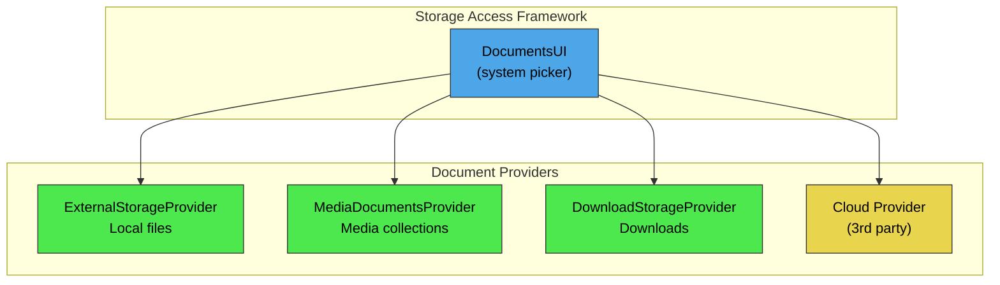

### 27.7.8 文档能力（标志）

每个文档通过标志宣告其能力：

```java
// DocumentsContract.Document
public static final int FLAG_SUPPORTS_THUMBNAIL    = 1;
public static final int FLAG_SUPPORTS_WRITE        = 1 << 1;
public static final int FLAG_SUPPORTS_DELETE        = 1 << 2;
public static final int FLAG_DIR_SUPPORTS_CREATE    = 1 << 3;
public static final int FLAG_DIR_PREFERS_GRID       = 1 << 4;
public static final int FLAG_DIR_PREFERS_LAST_MODIFIED = 1 << 5;
public static final int FLAG_SUPPORTS_RENAME        = 1 << 6;
public static final int FLAG_SUPPORTS_COPY          = 1 << 7;
public static final int FLAG_SUPPORTS_MOVE          = 1 << 8;
public static final int FLAG_VIRTUAL_DOCUMENT       = 1 << 9;
public static final int FLAG_SUPPORTS_REMOVE        = 1 << 10;
public static final int FLAG_SUPPORTS_SETTINGS      = 1 << 11;
```

根能力使用它们自己的一组标志：

```java
// DocumentsContract.Root
public static final int FLAG_SUPPORTS_CREATE  = 1;
public static final int FLAG_LOCAL_ONLY       = 1 << 1;
public static final int FLAG_SUPPORTS_RECENTS = 1 << 2;
public static final int FLAG_SUPPORTS_SEARCH  = 1 << 3;
public static final int FLAG_SUPPORTS_IS_CHILD = 1 << 4;
public static final int FLAG_SUPPORTS_EJECT   = 1 << 5;
```

### 27.7.9 虚拟文档

“虚拟文档”（带有 `FLAG_VIRTUAL_DOCUMENT` 标志）是没有原生文件表示、但可以按需转换的文档。例如，一个存储在云端的 Google Docs 文档可能就是虚拟的。它可以通过 `openTypedDocument()` 以 PDF 或 DOCX 的形式打开，但没有可供下载的原始文件。

### 27.7.10 DocumentsContract 辅助类

`DocumentsContract` 提供了用于处理文档 URI 的静态辅助方法。这些是应用和系统选择器所使用的主要 API：

```java
// Key methods in DocumentsContract
public static Uri buildDocumentUri(String authority, String documentId) { ... }
public static Uri buildTreeDocumentUri(String authority, String treeDocumentId) { ... }
public static Uri buildChildDocumentsUri(String authority, String parentDocumentId) { ... }
public static String getDocumentId(Uri documentUri) { ... }
public static String getTreeDocumentId(Uri treeUri) { ... }
public static boolean isTreeUri(Uri uri) { ... }
```

### 27.7.11 最近使用的文档

支持 `Root.FLAG_SUPPORTS_RECENTS` 的提供者必须实现 `queryRecentDocuments()`，它返回最近修改或访问过的文档。系统中 DocumentsUI 的“最近使用”视图会聚合来自所有提供者的最近文档。

### 27.7.12 DocumentsUI 系统应用

`DocumentsUI` 系统应用（位于 `packages/apps/DocumentsUI`）是用户与之交互的标准文件选择器。它：

1. 查询所有已注册的 `DocumentsProvider` 实现以获取它们的根
2. 呈现跨所有根的统一导航 UI
3. 处理向提供者的搜索委托
4. 向请求方应用授予 URI 权限

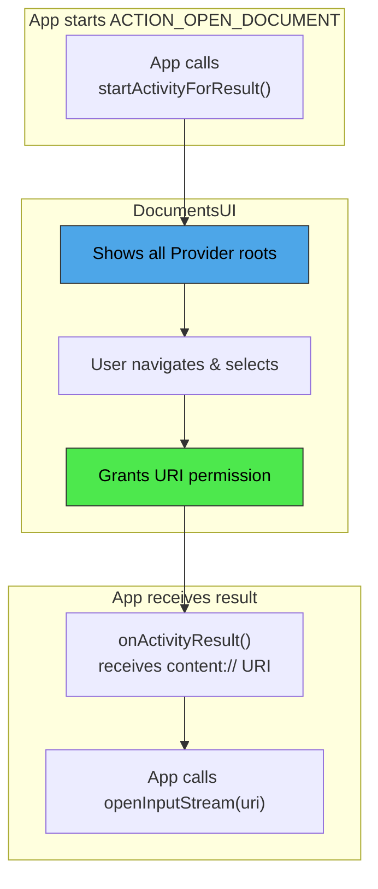

---

## 27.8 ContentObserver 与变更通知

### 27.8.1 观察者模式

Android 的内容提供者框架内置了观察者模式，允许组件在数据发生变化时接收通知。这通过三个协作的类来实现：

```
frameworks/base/core/java/android/database/ContentObserver.java
frameworks/base/core/java/android/content/ContentResolver.java  (registerContentObserver / notifyChange)
```

### 27.8.2 ContentObserver

`ContentObserver` 是一个接收变更回调的抽象类：

```java
// frameworks/base/core/java/android/database/ContentObserver.java (line 41)
public abstract class ContentObserver {
    public ContentObserver(Handler handler) {
        mHandler = handler;
        mExecutor = null;
    }

    // Override progression (oldest to newest):
    public void onChange(boolean selfChange) { }

    public void onChange(boolean selfChange, @Nullable Uri uri) {
        onChange(selfChange);
    }

    public void onChange(boolean selfChange, @Nullable Uri uri, @NotifyFlags int flags) {
        onChange(selfChange, uri);
    }

    public void onChange(boolean selfChange, @NonNull Collection<Uri> uris,
            @NotifyFlags int flags) {
        for (Uri uri : uris) {
            onChange(selfChange, uri, flags);
        }
    }
}
```

多个 `onChange()` 重载构成了一条委托链。较新的重载提供更多信息（URI、标志、用户句柄），并为向后兼容委托给较旧的重载。

### 27.8.3 注册

观察者通过 `ContentResolver` 注册：

```java
// ContentResolver.java (line 2762)
public final void registerContentObserver(@NonNull Uri uri,
        boolean notifyForDescendants, @NonNull ContentObserver observer) {
    // ...
}
```

`notifyForDescendants` 参数控制观察者是否会收到对注册 URI 的后代 URI 的变更通知。例如，以 `notifyForDescendants=true` 注册 `content://media/external`，当 `content://media/external/images/media/42` 发生变化时就会触发。

### 27.8.4 通知

提供者（或任何能访问 `ContentResolver` 的代码）触发通知：

```java
// ContentResolver.java (line 2862)
public void notifyChange(@NonNull Uri uri, @Nullable ContentObserver observer) {
    notifyChange(uri, observer, true /* sync to network */);
}

public void notifyChange(@NonNull Uri uri, @Nullable ContentObserver observer,
        @NotifyFlags int flags) {
    // ...
}

public void notifyChange(@NonNull Collection<Uri> uris,
        @Nullable ContentObserver observer, @NotifyFlags int flags) {
    // ...
}
```

通知标志：

```java
// ContentResolver.java (lines 693-746)
public static final int NOTIFY_SYNC_TO_NETWORK = 1 << 0;  // Trigger sync
public static final int NOTIFY_SKIP_NOTIFY_FOR_DESCENDANTS = 1 << 1;
public static final int NOTIFY_INSERT = 1 << 2;
public static final int NOTIFY_UPDATE = 1 << 3;
public static final int NOTIFY_DELETE = 1 << 4;
public static final int NOTIFY_NO_DELAY = 1 << 15;
```

### 27.8.5 通知流程

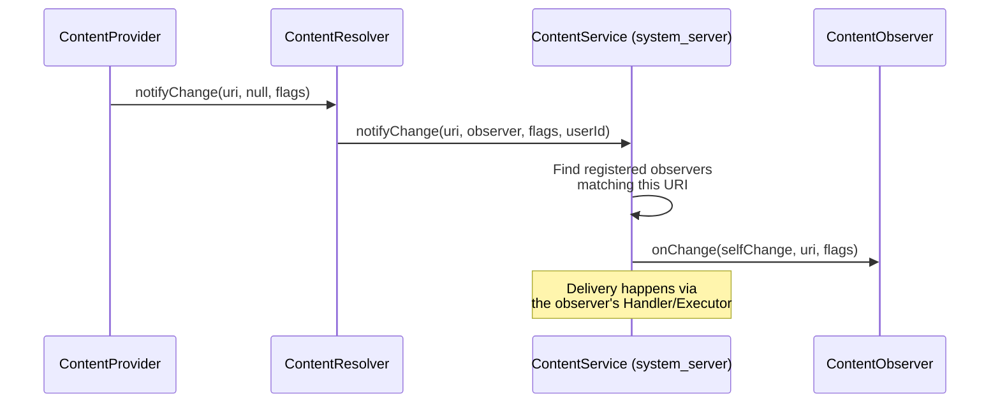

`ContentService`（运行在 `system_server` 中）维护一个按 URI 组织的已注册观察者树结构。当调用 `notifyChange()` 时，它会遍历这棵树以找到所有匹配的观察者，并考虑 `notifyForDescendants` 标志。

### 27.8.6 批量通知

自 Android 11 起，提供者可以将多个 URI 变更批量合并为一次通知：

```java
getContext().getContentResolver().notifyChange(
    List.of(uri1, uri2, uri3),
    null,  // observer
    ContentResolver.NOTIFY_INSERT
);
```

这减少了批量操作期间观察者被多次调用的开销。

### 27.8.7 传输层

`ContentObserver` 有一个内部 `Transport` 类，实现了 `IContentObserver`——`ContentService` 用于跨进程边界传递通知的 Binder 接口：

```java
// ContentObserver.java
public IContentObserver getContentObserver() {
    synchronized (mLock) {
        if (mTransport == null) {
            mTransport = new Transport(this);
        }
        return mTransport;
    }
}
```

传输层确保 `onChange()` 在正确的线程上分发（构造时指定的 `Handler` 或 `Executor`）。

### 27.8.8 常见用法模式

**模式 1：观察联系人变更**

```java
ContentObserver observer = new ContentObserver(new Handler(Looper.getMainLooper())) {
    @Override
    public void onChange(boolean selfChange, @Nullable Uri uri) {
        // Refresh contacts list
    }
};
getContentResolver().registerContentObserver(
    ContactsContract.Contacts.CONTENT_URI,
    true,  // notify for descendants
    observer
);
```

**模式 2：CursorLoader 自动刷新**

`CursorLoader` 会自动在其查询的 URI 上注册一个 `ContentObserver`。当提供者调用 `notifyChange()` 时，加载器会重新查询并将新鲜的游标传递给 `onLoadFinished()`。这就是为什么提供者必须在变更后调用 `notifyChange()`——它驱动了 UI 刷新循环。

**模式 3：提供者侧通知**

```java
// Inside a ContentProvider subclass:
@Override
public Uri insert(Uri uri, ContentValues values) {
    long id = db.insert(TABLE, null, values);
    Uri insertedUri = ContentUris.withAppendedId(uri, id);
    getContext().getContentResolver().notifyChange(insertedUri, null);
    return insertedUri;
}
```

### 27.8.9 同步到网络标志

`NOTIFY_SYNC_TO_NETWORK` 标志告诉同步框架该变更应传播到网络（即触发上传同步）：

```java
// ContentResolver.java
public static final int NOTIFY_SYNC_TO_NETWORK = 1 << 0;
```

当同步适配器进行本地变更时，它通常会省略此标志以避免触发另一个同步周期。当用户进行本地变更时，会设置此标志以确保变更到达服务器。

### 27.8.10 ContentService 架构

`ContentService` 运行在 `system_server` 中，管理内容观察者的全局注册表：

```
frameworks/base/services/core/java/com/android/server/content/ContentService.java
```

它的职责包括：

1. **观察者注册** -- 维护 URI 到观察者的映射树
2. **变更通知分发** -- 在 `notifyChange()` 时遍历观察者树，并在每个匹配的观察者上调用 `onChange()`
3. **同步调度** -- 在设置了 `NOTIFY_SYNC_TO_NETWORK` 时触发同步适配器运行
4. **跨用户通知** -- 确保为特定用户注册的观察者只接收该用户的通知

观察者树按 URI 片段分层组织，从而可以为 `notifyForDescendants` 功能进行高效的前缀匹配。

### 27.8.11 通知合并

提供者通常在单个批次中执行多次变更（例如在同步期间插入 100 个联系人）。如果不进行合并，这会触发 100 次独立的观察者通知，导致 UI 刷新 100 次。

有两种策略可以解决此问题：

1. **批量通知** -- 提供者推迟调用 `notifyChange()`，直到批次完成，然后在父 URI 上触发一次通知。

2. **基于集合的通知** -- 使用 `notifyChange(Collection<Uri>, ...)` 重载，在单个回调中传递所有已变更的 URI。

CalendarProvider 使用带有广播超时的防抖策略：

```java
// CalendarProvider2.java (line 385)
private static final long UPDATE_BROADCAST_TIMEOUT_MILLIS =
    DateUtils.SECOND_IN_MILLIS;
```

1 秒窗口内的任何变更通知都会被合并为一次广播。一个单独的 `SYNC_UPDATE_BROADCAST_TIMEOUT_MILLIS`（30 秒）则合并同步适配器产生的更嘈杂的变更流。

### 27.8.12 通过 setNotificationUri 实现游标自动刷新

当提供者从 `query()` 返回一个 `Cursor` 时，它应该在游标上调用 `setNotificationUri()`：

```java
Cursor c = db.query(...);
c.setNotificationUri(getContext().getContentResolver(), uri);
return c;
```

这会导致游标在指定的 URI 上注册一个 `ContentObserver`。当该 URI 被调用 `notifyChange()` 时，游标的 `onChange()` 会触发，进而通知任何监视它的 `CursorLoader` 重新查询。

正是这一机制让“加载数据、观察变更、自动刷新”的模式无需任何显式轮询即可工作：

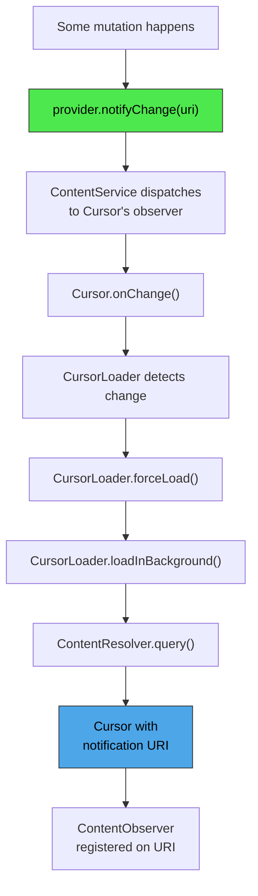

---

## 27.9 跨进程数据共享

### 27.9.1 权限模型

内容提供者使用分层权限模型：

```mermaid
graph TD
    A["Incoming Request"] --> B{Provider exported?}
    B -- No --> F{"Check URI<br/>permissions"}
    B -- Yes --> D{"Check read/write<br/>permission"}
    D -- Denied --> E{"Check path<br/>permissions"}
    E -- Denied --> F
    F -- Denied --> G["Return empty cursor<br/>or throw SecurityException"]
    D -- Granted --> H["Allow"]
    E -- Granted --> H
    F -- Granted --> H

    style A fill:#4da6e8,stroke:#333,color:#000
    style H fill:#4de84d,stroke:#333,color:#000
    style G fill:#e87d4d,stroke:#333,color:#000
```

### 27.9.2 提供者级权限

最简单的权限模型使用提供者声明的读写权限：

```xml
<provider
    android:readPermission="com.example.READ"
    android:writePermission="com.example.WRITE"
    ... />
```

任何拥有适当权限的调用方都可以完全访问该提供者。

### 27.9.3 路径权限

`PathPermission` 允许对特定 URI 路径进行更细粒度的控制：

```xml
<provider ...>
    <path-permission
        android:pathPrefix="/private/"
        android:readPermission="com.example.READ_PRIVATE"
        android:writePermission="com.example.WRITE_PRIVATE" />
</provider>
```

路径权限在提供者级检查失败后，于 `ContentProvider.Transport` 中进行检查：

```java
// ContentProvider.java -- inside Transport
private int enforceReadPermission(...) {
    // 1. Check provider-level readPermission
    // 2. Check each PathPermission that matches the URI
    // 3. Check URI permission grants
}
```

### 27.9.4 URI 权限授予

URI 授予是最灵活的权限机制。它们允许对特定 URI 进行临时访问，而无需调用方持有任何永久权限。

**通过 Intent 授予：**

```java
Intent intent = new Intent(Intent.ACTION_VIEW);
intent.setData(contentUri);
intent.addFlags(Intent.FLAG_GRANT_READ_URI_PERMISSION);
startActivity(intent);
```

**以编程方式授予：**

```java
grantUriPermission("com.example.other",
    contentUri,
    Intent.FLAG_GRANT_READ_URI_PERMISSION);
```

**提供者必须声明支持：**

```xml
<provider
    android:grantUriPermissions="true"
    ... />
```

或针对特定路径：

```xml
<provider ...>
    <grant-uri-permission android:pathPrefix="/shared/" />
</provider>
```

### 27.9.5 URI 授予管理

`UriGrantsManager` 系统服务跟踪活跃的 URI 权限授予：

```java
// frameworks/base/core/java/android/app/UriGrantsManager.java
```

授予由 `UriGrantsManagerService` 持久化存储，并且可以在重启后存活（对于带有 `FLAG_GRANT_PERSISTABLE_URI_PERMISSION` 的授予）。

```mermaid
sequenceDiagram
    participant App1 as App A (sender)
    participant AMS as ActivityManagerService
    participant UGM as UriGrantsManager
    participant App2 as App B (receiver)
    participant CP as ContentProvider

    App1->>AMS: startActivity(intent + FLAG_GRANT_READ_URI_PERMISSION)
    AMS->>UGM: grantUriPermission(appB, uri, READ)
    UGM->>UGM: Record grant: {uid, uri, mode, time}
    AMS->>App2: Launch activity with data=uri

    App2->>CP: query(uri)
    CP->>CP: Transport.enforceReadPermission()
    CP->>UGM: checkUriPermission(uri, callingUid, READ)
    UGM-->>CP: GRANTED
    CP-->>App2: Cursor
```

### 27.9.6 可持久化的 URI 权限

对于长期访问（例如用户通过 SAF 选取一个文件），应用可以获取可持久化权限：

```java
getContentResolver().takePersistableUriPermission(uri,
    Intent.FLAG_GRANT_READ_URI_PERMISSION);
```

这些权限在重启后依然有效，并由系统跟踪。应用可以查询其已持久化的权限：

```java
List<UriPermission> perms = getContentResolver().getPersistedUriPermissions();
```

### 27.9.7 跨用户访问

内容提供者支持系统组件的跨用户 URI 访问。URI 可以内嵌一个用户 ID：

```
content://10@com.android.contacts/contacts
```

`ContentProvider.Transport` 会剥离此用户 ID 前缀，并验证调用方拥有 `INTERACT_ACROSS_USERS` 或 `INTERACT_ACROSS_USERS_FULL` 权限。

对于克隆 profile，某些 authority 会被重定向。MediaProvider 被显式处理：

```java
// ContentProvider.java (line 162)
public static boolean isAuthorityRedirectedForCloneProfile(String authority) {
    return MediaStore.AUTHORITY.equals(authority);
}
```

### 27.9.8 AttributionSource 链

现代内容提供者 IPC 携带一个 `AttributionSource`，它不仅描述直接调用方，还描述完整的调用链：

```java
// IContentProvider interface
Cursor query(@NonNull AttributionSource attributionSource, Uri url, ...)
```

这在 App A 将访问委托给 App B、然后 App B 再调用提供者的场景中至关重要。提供者可以在归因链中看到两个应用，并验证最初的调用方是否已获授权。

### 27.9.9 AppOps 集成

除了静态权限之外，内容提供者还与 `AppOpsManager` 集成以实现运行时权限强制执行。`Transport` 类在委托给提供者之前会检查 AppOps：

```java
// ContentProvider.java (Transport inner class)
volatile AppOpsManager mAppOpsManager = null;
volatile int mReadOp = AppOpsManager.OP_NONE;
volatile int mWriteOp = AppOpsManager.OP_NONE;
```

这使系统能够在运行时撤销访问权限（例如当用户在设置中禁用某项权限时），而无需重启进程。

### 27.9.10 详细的权限强制执行流程

`ContentProvider.Transport` 内完整的权限强制执行流程遵循以下决策树：

```mermaid
flowchart TD
    A["Incoming Request"] --> C{"Same UID<br/>as provider?"}
    C -- Yes --> Z["Allowed"]
    C -- No --> D{"Provider exported<br/>and user allowed?"}
    D -- Yes --> F{"Check provider-level<br/>permission"}
    D -- No --> H{"Check URI<br/>permission grants"}
    F -- Granted --> I{"Check AppOps<br/>(read/write op)"}
    F -- Not Granted --> G{"Check path-level<br/>permissions"}
    G -- Granted --> I
    G -- Not Granted --> H
    H -- Granted --> I
    H -- Not Granted --> J["For query: return empty cursor<br/>For others: SecurityException"]
    I -- Allowed --> Z
    I -- Denied --> J

    style Z fill:#4de84d,stroke:#333,color:#000
    style J fill:#e87d4d,stroke:#333,color:#000
```

请注意此流程的两处微妙之处。未导出的提供者并非立即拒绝。组件和路径权限检查会被跳过，但 URI 权限授予检查仍会运行。这正是未导出的 `FileProvider` 通过 `grantUriPermission()` 发放访问权限的方式。

而 AppOps 是在权限或授予检查成功*之后*施加的一个额外关卡。`enforceReadPermission()` 只会在 `enforceReadPermissionInner()` 返回已授权之后才查阅 AppOp。AppOps 可以将放行变为拒绝，但绝不会反过来。

（由 `attachInfo(..., testing=true)` 设置的测试标志并不是权限绕过——它只会在 `setAppOps()` 中抑制 AppOps 注册。）

对于 `query()` 操作，硬性权限拒绝仍会抛出 `SecurityException`。*软性*拒绝则不同。它是一种 AppOps 的“已忽略”结果，例如运行时权限已被撤销的情况。此时它返回一个列名正确的空游标。这保持了 API 兼容性，并防止应用在权限于运行时被撤销时崩溃。

对于 `insert()`、`update()` 和 `delete()`，权限拒绝会抛出 `SecurityException`。

### 27.9.11 URI 授予的持久化

URI 权限授予可以是临时的或持久的：

**临时授予** 持续到接收组件（Activity）结束，或直到系统因内存压力而撤销它们。它们由以下方式创建：

```java
intent.addFlags(Intent.FLAG_GRANT_READ_URI_PERMISSION
              | Intent.FLAG_GRANT_WRITE_URI_PERMISSION);
```

**持久授予** 在重启后依然存在，并且必须由接收方显式获取：

```java
intent.addFlags(Intent.FLAG_GRANT_READ_URI_PERMISSION
              | Intent.FLAG_GRANT_PERSISTABLE_URI_PERMISSION);
// ...
// In the receiving Activity:
getContentResolver().takePersistableUriPermission(uri,
    Intent.FLAG_GRANT_READ_URI_PERMISSION);
```

系统限制每个应用已持久化的 URI 权限数量（通常为 512），以防止无限制的增长。

### 27.9.12 grantUriPermission 调用栈

当调用 `grantUriPermission()` 时，会进行以下校验：

1. 调用方 UID 本身必须持有对该 URI 的读/写访问权限。它从提供者声明的权限和路径权限，或从足够强、可重新授予的既有 URI 授予中获得此访问权限
2. 提供者必须具有 `grantUriPermissions="true"` 或一个匹配的 `<grant-uri-permission>` 元素
3. 目标包必须存在
4. 该授予会被记录在 `UriGrantsManagerService` 中

```mermaid
sequenceDiagram
    participant App as Source App
    participant AMS as ActivityManagerService
    participant UGM as UriGrantsManagerService
    participant PMS as PackageManagerService

    App->>AMS: grantUriPermission(targetPkg, uri, flags)
    AMS->>UGM: grantUriPermission(...)
    UGM->>PMS: getProviderInfo(authority)
    PMS-->>UGM: ProviderInfo
    UGM->>UGM: checkGrantUriPermission() against ProviderInfo
    UGM->>UGM: Allows grants? Patterns match? Caller holds access?
    UGM->>UGM: Record: {sourceUid, targetUid, uri, flags}
    UGM->>UGM: If persistent: write to XML
```

### 27.9.13 ContentProviderOperation 安全性

通过 `applyBatch()` 进行的批量操作继承了与单个调用相同的权限模型。整个批次以一次 IPC 调用到达。即便如此，`Transport.applyBatch()` 仍会预先遍历操作列表，并在委托给提供者之前对每个操作的 URI 强制执行读或写权限。拒绝会以 `OperationApplicationException` 中止整个批次。结果会按 URI 缓存（在已检查的读 URI 和写 URI 的 `ArraySet` 中），因此跨操作重复出现的 URI 只会被检查一次。

这意味着，拥有向该提供者写入权限的应用，可以在一个批次中执行插入、更新和删除的任意组合。

### 27.9.14 DEPRECATE_DATA_COLUMNS 机制

`ContentResolver` 中的 `DEPRECATE_DATA_COLUMNS` 机制会透明地将文件路径转换为内容 URI：

```java
// ContentResolver.java (line 132 and line 145)
public static final boolean DEPRECATE_DATA_COLUMNS = true;
public static final String DEPRECATE_DATA_PREFIX = "/mnt/content/";
```

假设一个应用从 MediaStore 读取 `_data` 列，得到一个类似 `/mnt/content/0@media/external/images/media/42` 的路径。拦截发生在应用自己的进程内，而不是在 FUSE 中。`AndroidForwardingOs` 是安装在每个应用进程中的 libcore `Os` 转发垫片，位于 `frameworks/base/core/java/android/app/AndroidForwardingOs.java`。它会检查 `open()`、`access()`、`stat()` 和 `unlink()` 等调用中是否包含 `/mnt/content/` 前缀。它将该路径转换回一个 `content://` URI。然后通过 `ContentResolver` 路由该操作，由其执行适当的权限检查。

这条迁移路径使依赖文件路径的旧版应用能够继续工作，同时仍然强制执行分区存储权限。

---

## 27.10 Android 17 中内容提供者的变更

Android 17（SDK 37，代号 Cinnamon Bun）并未对内容提供者模型进行大刀阔斧的重新设计。`IContentProvider` 的结构、`Transport` 权限流程以及 `CursorWindow` 传输机制都保持不变。变更是有针对性的：对文件打开模式的加固、对 `ContentProviderClient` 更精确的 ANR 契约，以及设备感知设置的形式化。本节将这些变更汇集于此。

### 27.10.1 文件打开模式净化

如 27.1.11 节所述，`ContentProvider.Transport` 现在会在权限检查和委托之前，将每个 `openFile()` / `openAssetFile()` 模式字符串都经过 `validateFileMode()` 处理。动机是一项安全修复。调用方可能请求一次读打开（`r`），但意外（或恶意地）设置了截断位（`t`）或追加位（`a`）。过去这可能导致通过看似读路径的写入。现在，只要写位 `w` 缺失，传输层就会静默剥离 `t` 和 `a`。

```mermaid
flowchart TD
    A["Caller: openFile(uri, mode)"] --> B["Transport.validateFileMode(mode)"]
    B --> C{"mode contains w?"}
    C -- "Yes" --> D["mode unchanged"]
    C -- "No" --> E["strip t and a bits"]
    D --> F["enforceFilePermission(updatedMode)"]
    E --> F
    F --> G["provider.openFile(uri, updatedMode)"]

    style A fill:#4da6e8,stroke:#333,color:#000
    style E fill:#e87d4d,stroke:#333,color:#000
    style G fill:#4de84d,stroke:#333,color:#000
```

该修复刻意保持宽容（丢弃位，而不是抛出异常）。这避免了破坏那些传入粗糙模式字符串的应用。其最终效果是，只读授权再也不能被胁迫去截断文件。

### 27.10.2 ContentProviderClient 在取消时的 ANR

长期以来，`ContentProviderClient.setDetectNotResponding(long)` 一直允许调用方启用一个看门狗。如果一次远程提供者调用阻塞的时间超过配置的超时，提供者进程就会因 ANR 而被杀死。原来的超时是固定的，它在调用发起时开始计时。这对于长时间运行、可取消的调用很不方便：一个 `query()` 或 `call()` 合法地运行了一段时间，但会遵守 `CancellationSignal`。

Android 17 添加了系统 API `setDetectNotRespondingOnCancel(long, long)`，由标志 `android.content.flags.enable_content_provider_client_anr_on_cancel` 控制：

```java
// frameworks/base/core/java/android/content/ContentProviderClient.java (line 222)
@SystemApi
@FlaggedApi(FLAG_ENABLE_CONTENT_PROVIDER_CLIENT_ANR_ON_CANCEL)
@RequiresPermission(android.Manifest.permission.REMOVE_TASKS)
public void setDetectNotRespondingOnCancel(
        @DurationMillisLong long timeoutFixedMillis,
        @DurationMillisLong long timeoutOnCancelMillis) {
    // ...
}
```

它配置两个独立的超时：

| 参数 | 适用于 | 计时起点 |
|-----------|-----------|--------------|
| `timeoutFixedMillis` | 没有 `CancellationSignal` 的调用，以及当 `timeoutOnCancelMillis` 为 0 时的可取消调用 | 调用发起时 |
| `timeoutOnCancelMillis` | 仅接收 `CancellationSignal` 的调用 | 取消信号触发时 |

因此对于可取消调用，看门狗测量的是提供者响应取消所花的时间，而不是该调用已运行多长时间。旧版的 `setDetectNotResponding(long)` 现在是一个薄薄的包装器，它以零 on-cancel 超时进行委托。因此现有调用方的行为与之前完全一致。

在内部，客户端在 `beforeRemote()` 中调度其看门狗可运行对象（`NotRespondingRunnable`、`CallNotCancelledRunnable`），并在 `afterRemote()` 中清除它们。Android 17 还添加了一个接收 `CancellationSignal` 的 `afterRemote()` 重载。借助它，客户端可以在调用返回后分离其 on-cancel 监听器。这阻止了在调用完成*之后*触发的取消误触 ANR 检测器。那样的取消曾是过去误报 ANR 的来源。

### 27.10.3 ContentProviderClient 重构

与 ANR 工作无关，`ContentProviderClient` 每个操作的样板代码在 Android 17 中被整合了。每个远程调用都有相同的重复模式：启用看门狗、发起 Binder 调用、转换 `RemoteException` / `DeadObjectException`，以及停用看门狗。该模式被提取为一组小型的辅助执行器和函数式接口。这是一次不改变 API 表面的内部清理。这就是为什么该文件中每个方法的主体现在比早期版本短得多。每个公共方法都将其远程调用通过一个共享执行器进行汇聚，该执行器负责 ANR 和异常处理。

### 27.10.4 设备感知设置

27.6.8 节所述的按虚拟设备设置方案在 Android 17 时期被提升为一种一等的、有文档记录的行为。`call()` 快速路径和旧版变更路径都通过 `getDeviceId()` 捕获调用设备 ID。它们将其贯穿到设置键中（27.6.10 节）。因此 `Secure` 和 `System` 设置可以携带一个虚拟设备覆盖项。当覆盖项缺失时，它会回退到默认设备的值。

如前所述，这些覆盖项是刻意设置为临时的（从不持久化），因为虚拟设备本身就是临时的。该机制仅限于 `Secure` 和 `System` 命名空间。`Global`、`config` 和 `ssaid` 仍然是设备无关的。

---

## 27.11 CallLogProvider：一个具体的提供者示例

系统的通话记录数据库位于 `CallLogProvider` 内容提供者（authority `call_log`）之后，通过 `android.provider.CallLog` URI 暴露。尽管名字如此，该提供者本身并不在 `packages/providers/CallLogProvider/` 中——它是在 `packages/providers/ContactsProvider/src/com/android/providers/contacts/CallLogProvider.java` 中实现的，并在 ContactsProvider 清单中声明。`packages/providers/CallLogProvider/` 包只发布备份这一半：用于备份通话记录的 `CallLogBackupAgent` 和 `CallLogChangeReceiver`。它是一个有用的具体示例，因为它将一个真实的 `ContentProvider`（通话记录存储）与伴随包中的 `BackupAgent` 配对。备份这一半由 `packages/providers/CallLogProvider/src/com/android/calllogbackup/CallLogBackupAgent.java` 实现，它继承 `android.app.backup.BackupAgent`，并在备份和恢复期间通过提供者读写通话记录行。

三个细节值得指出：

- **恢复时的去重。** `CallLogBackupAgent` 不会盲目地重新插入每一行已备份的数据。`removeDuplicateCalls()` 会将传入的行与现有日志（按键为日期和号码）进行匹配。这样，恢复到已经拥有重叠历史的设备上就不会产生重复。较新的批处理路径由 `packages/providers/CallLogProvider/calllogbackup_flags.aconfig` 中声明的 `batch_deduplication_enabled` 标志控制。
- **电话账户处理。** 通话记录行携带发起通话的 `PhoneAccountHandle`（`PHONE_ACCOUNT_COMPONENT_NAME`、`PHONE_ACCOUNT_ID`、`PHONE_ACCOUNT_ADDRESS`）。在备份时，该代理可以将一个电话账户的 ID 标记为待迁移（`IS_PHONE_ACCOUNT_MIGRATION_PENDING`）。然后在恢复到具有不同 SIM 的设备上时，可以按 ICCID 而不是过时的组件名重新映射该账户。
- **变更驱动的备份。** `CallLogChangeReceiver` 监听内部的 `CALL_LOG_CHANGE` 广播并调用 `BackupManager.dataChanged()`。因此对日志的编辑会调度一次新的备份。定期备份并不是唯一的触发条件。

本章介绍提供者机制。至于*谁*最先写入通话记录条目（通话服务和电话栈），参见第 36 章“电话与 RIL”。

## 27.12 ContactsKeysProvider：端到端加密联系人密钥

一个较新的提供者 `packages/providers/ContactsKeysProvider/` 为 `android.provider.E2eeContactKeysManager` API 提供支持，并存储按联系人划分的端到端加密密钥。消息应用使用这些密钥来验证它们所联系的联系人的身份。提供者类是 `packages/providers/ContactsKeysProvider/src/com/android/providers/contactkeys/E2eeContactKeysProvider.java`。它声明了 authority `com.android.contactkeys.contactkeysprovider` 并带有 `@FlaggedApi` 注解。因此它是一个由标志控制的 API 表面的一部分（`E2eeContactKeysManager` 位于 `frameworks/base/core/java/android/provider/E2eeContactKeysManager.java`）。

它是本章前面 CRUD 风格提供者的很好的对照，因为它刻意*不*使用表模型。`query()`、`insert()`、`update()`、`delete()` 和 `getType()` 重载都是空操作。一切都通过 `call()` 进行。它按方法名分发到诸如更新或插入联系人密钥、获取联系人密钥以及管理设备自身密钥等操作。访问由其清单中 `<provider>` 上声明的标准 `READ_CONTACTS` 和 `WRITE_CONTACTS` 权限，以及 `packages/providers/ContactsKeysProvider/src/com/android/providers/contactkeys/util/E2eeContactKeysPermissions.java` 中更细粒度的检查共同控制。关于端到端加密密钥验证背后的威胁模型，参见第 40 章“安全”。

## 27.13 PartnerBookmarksProvider：只读的 OEM 书签

`packages/providers/PartnerBookmarksProvider/` 是一个小型的内置提供者，它暴露一组 OEM 或运营商随设备附带的默认浏览器书签。提供者类（`packages/providers/PartnerBookmarksProvider/src/com/android/providers/partnerbookmarks/PartnerBookmarksProvider.java`）位于包 `com.android.providers.partnerbookmarks` 中，并注册 authority `com.android.partnerbookmarks`。浏览器在首次运行时通过 `packages/providers/PartnerBookmarksProvider/src/com/android/providers/partnerbookmarks/PartnerBookmarksContract.java` 中的契约读取合作伙伴书签一次，并将它们导入自己的书签存储。

它在这里有用有两个原因。第一，它是只读的：实现了 `query()`，但 `insert()`、`update()` 和 `delete()` 都会抛出 `UnsupportedOperationException`。一个提供者不必支持每个 CRUD 动词，只暴露数据的提供者可以通过拒绝变更调用来声明这一点。

第二，它展示了提供者如何从自己的资源播种一个真正的 SQLite 数据库。该提供者从字符串数组 `bookmarks`（交替的标题和 URL 条目）以及 `res/values/` 中的 `bookmark_preloads` 图标数组构建其数据库。每当 MCC/MNC 或区域配置发生变化时，它都会重建数据库。它通过 `SQLiteQueryBuilder` 在该数据库上服务查询。只有合作伙伴文件夹 ID 的 URI 直接用 `MatrixCursor` 应答。OEM 通过覆盖这些资源而不是写入提供者来定制随附的书签。

该契约暴露一个表 `bookmarks`，地址为 `content://com.android.partnerbookmarks/bookmarks`，其行要么是书签（`BOOKMARK_TYPE_BOOKMARK`），要么是文件夹（`BOOKMARK_TYPE_FOLDER`）。导入期望一个其父级为 `BOOKMARK_PARENT_ROOT_ID` 的单一顶级文件夹。多于一个根级条目会导致导入失败。这使合作伙伴的书签树保持格式良好。favicon 和触摸图标作为 `FAVICON` 和 `TOUCHICON` blob 列随行携带，因此浏览器无需网络获取即可显示它们。

## 27.14 动手实践

本节提供用于在 AOSP 构建或模拟器上探索内容提供者的实操练习。

### 27.14.1 从 Shell 查询 MediaStore

使用 `content` shell 命令查询 MediaProvider：

```bash
# List all images on external storage
adb shell content query --uri content://media/external/images/media \
    --projection _id:_display_name:mime_type:_size

# Query a specific image by ID
adb shell content query --uri content://media/external/images/media/42

# List all audio files
adb shell content query --uri content://media/external/audio/media \
    --projection _id:title:artist:album:duration

# List attached volumes
adb shell content query --uri content://media/

# Query the legacy FAT volume ID (a one-row "fsid" cursor, hard-coded to -1)
adb shell content query --uri content://media/external/fs_id
```

### 27.14.2 读写设置

```bash
# Read a system setting
adb shell settings get system screen_brightness

# Write a system setting
adb shell settings put system screen_brightness 128

# Read a secure setting
adb shell settings get secure default_input_method

# Read a global setting
adb shell settings get global airplane_mode_on

# List all settings in a namespace
adb shell settings list system
adb shell settings list secure
adb shell settings list global
```

### 27.14.3 查询联系人

```bash
# List all contacts
adb shell content query --uri content://com.android.contacts/contacts \
    --projection display_name

# List raw contacts
adb shell content query --uri content://com.android.contacts/raw_contacts \
    --projection _id:display_name_primary:account_name:account_type

# List all phone numbers
adb shell content query --uri content://com.android.contacts/data \
    --where "mimetype='vnd.android.cursor.item/phone_v2'"
```

### 27.14.4 查询日历事件

```bash
# List all calendars
adb shell content query --uri content://com.android.calendar/calendars \
    --projection _id:name:account_name:account_type

# List events
adb shell content query --uri content://com.android.calendar/events \
    --projection _id:title:dtstart:dtend:calendar_id
```

### 27.14.5 插入和删除内容

```bash
# Insert a new contact (raw contact + data)
adb shell content insert --uri content://com.android.contacts/raw_contacts \
    --bind account_type:s: --bind account_name:s:

# The above returns a URI like content://com.android.contacts/raw_contacts/1
# Then insert a name data row:
adb shell content insert --uri content://com.android.contacts/data \
    --bind raw_contact_id:i:1 \
    --bind mimetype:s:vnd.android.cursor.item/name \
    --bind data1:s:"Test User"

# Delete a contact
adb shell content delete --uri content://com.android.contacts/raw_contacts/1
```

### 27.14.6 观察内容变更

`content` shell 工具没有 `observe` 子命令（其子命令是 `insert`、`update`、`delete`、`query`、`call`、`read`、`write` 和 `gettype`）。要观察变更通知，请从代码中注册一个 `ContentObserver`，例如在一个小测试应用中：

```java
getContentResolver().registerContentObserver(
        MediaStore.Files.getContentUri("external"),
        /* notifyForDescendants= */ true,
        new ContentObserver(new Handler(Looper.getMainLooper())) {
            @Override
            public void onChange(boolean selfChange, Uri uri) {
                Log.d("ObserverDemo", "Changed: " + uri);
            }
        });
```

然后从 shell 触发一次变更并观察日志：

```bash
# Take a screenshot to create a new media file and trigger a scan:
adb shell screencap /sdcard/Pictures/test_observe.png
adb shell am broadcast -a android.intent.action.MEDIA_SCANNER_SCAN_FILE \
    -d file:///sdcard/Pictures/test_observe.png

# The observer's onChange() logs the changed URI:
adb logcat -s ObserverDemo
```

### 27.14.7 转储提供者状态

```bash
# Dump MediaProvider state
adb shell dumpsys activity provider com.android.providers.media.MediaProvider

# Dump SettingsProvider state
adb shell dumpsys activity provider com.android.providers.settings/.SettingsProvider

# Dump ContactsProvider state
adb shell dumpsys activity provider com.android.providers.contacts/.ContactsProvider2
```

### 27.14.8 检查 SAF

```bash
# List DocumentsProvider roots
adb shell content query \
    --uri content://com.android.externalstorage.documents/root

# List children of a root
adb shell content query \
    --uri content://com.android.externalstorage.documents/document/primary%3A/children
```

### 27.14.9 编写一个最小化 ContentProvider

创建一个简单的提供者来理解生命周期：

```java
public class NoteProvider extends ContentProvider {
    private static final String AUTHORITY = "com.example.notes";
    private static final Uri CONTENT_URI = Uri.parse("content://" + AUTHORITY + "/notes");
    private static final int NOTES = 1;
    private static final int NOTES_ID = 2;

    private static final UriMatcher sMatcher = new UriMatcher(UriMatcher.NO_MATCH);
    static {
        sMatcher.addURI(AUTHORITY, "notes", NOTES);
        sMatcher.addURI(AUTHORITY, "notes/#", NOTES_ID);
    }

    private SQLiteDatabase mDb;

    @Override
    public boolean onCreate() {
        SQLiteOpenHelper helper = new SQLiteOpenHelper(getContext(), "notes.db", null, 1) {
            @Override
            public void onCreate(SQLiteDatabase db) {
                db.execSQL("CREATE TABLE notes (_id INTEGER PRIMARY KEY, title TEXT, body TEXT)");
            }
            @Override
            public void onUpgrade(SQLiteDatabase db, int old, int neo) { }
        };
        mDb = helper.getWritableDatabase();
        return mDb != null;
    }

    @Override
    public Cursor query(Uri uri, String[] proj, String sel, String[] args, String order) {
        SQLiteQueryBuilder qb = new SQLiteQueryBuilder();
        qb.setTables("notes");
        switch (sMatcher.match(uri)) {
            case NOTES_ID:
                qb.appendWhere("_id=" + uri.getLastPathSegment());
                break;
        }
        Cursor c = qb.query(mDb, proj, sel, args, null, null, order);
        c.setNotificationUri(getContext().getContentResolver(), uri);
        return c;
    }

    @Override
    public Uri insert(Uri uri, ContentValues values) {
        long id = mDb.insert("notes", null, values);
        Uri result = ContentUris.withAppendedId(CONTENT_URI, id);
        getContext().getContentResolver().notifyChange(result, null);
        return result;
    }

    @Override
    public int update(Uri uri, ContentValues values, String sel, String[] args) {
        int count;
        switch (sMatcher.match(uri)) {
            case NOTES_ID:
                count = mDb.update("notes", values,
                    "_id=" + uri.getLastPathSegment(), null);
                break;
            default:
                count = mDb.update("notes", values, sel, args);
        }
        getContext().getContentResolver().notifyChange(uri, null);
        return count;
    }

    @Override
    public int delete(Uri uri, String sel, String[] args) {
        int count;
        switch (sMatcher.match(uri)) {
            case NOTES_ID:
                count = mDb.delete("notes",
                    "_id=" + uri.getLastPathSegment(), null);
                break;
            default:
                count = mDb.delete("notes", sel, args);
        }
        getContext().getContentResolver().notifyChange(uri, null);
        return count;
    }

    @Override
    public String getType(Uri uri) {
        switch (sMatcher.match(uri)) {
            case NOTES:    return "vnd.android.cursor.dir/vnd.example.note";
            case NOTES_ID: return "vnd.android.cursor.item/vnd.example.note";
            default:       return null;
        }
    }
}
```

在 AndroidManifest.xml 中注册：

```xml
<provider
    android:name=".NoteProvider"
    android:authorities="com.example.notes"
    android:exported="true"
    android:readPermission="com.example.READ_NOTES"
    android:writePermission="com.example.WRITE_NOTES"
    android:grantUriPermissions="true" />
```

### 27.14.10 跟踪提供者 IPC

使用系统跟踪来观察内容提供者 Binder 调用：

```bash
# Start a trace capturing activity manager and binder tags
adb shell atrace -t 10 -b 4096 am binder_driver -o /data/local/tmp/cp_trace.ctrace

# While tracing, perform some queries:
adb shell content query --uri content://settings/system/screen_brightness

# Pull and open the trace
adb pull /data/local/tmp/cp_trace.ctrace
# Open in https://ui.perfetto.dev/
```

在跟踪中，你会看到：

1. 调用方线程上的 `query` 事务
2. 提供者 Binder 线程上对应的 `onTransact(QUERY_TRANSACTION)`
3. 实际的 SQLite 查询（如果提供者使用 SQLite）
4. 游标通过 Binder 返回的序列化过程

### 27.14.11 检查提供者数据库

在 userdebug/eng 构建上，你可以直接检查提供者数据库：

```bash
# MediaProvider database
adb shell sqlite3 /data/data/com.android.providers.media.module/databases/external.db \
    ".schema files"

# ContactsProvider database
adb shell sqlite3 /data/data/com.android.providers.contacts/databases/contacts2.db \
    ".tables"

# CalendarProvider database
adb shell sqlite3 /data/data/com.android.providers.calendar/databases/calendar.db \
    "SELECT name FROM sqlite_master WHERE type='table'"
```

### 27.14.12 性能测试

测量内容提供者查询延迟：

```bash
# Time a MediaStore query
adb shell "time content query --uri content://media/external/images/media \
    --projection _id --sort '_id ASC LIMIT 100'"

# Benchmark SettingsProvider (call-based fast path)
adb shell "time settings get system screen_brightness"

# Compare with a direct ContentResolver query (much slower for Settings)
adb shell "time content query --uri content://settings/system \
    --where 'name=\"screen_brightness\"'"
```

你会观察到 `settings get`（使用 `call()` 路径）显著快于查询路径，这验证了 SettingsProvider 的架构选择。

---

## 总结

本章从架构基础到具体实现，追踪了内容提供者机制。关键要点如下：

1. **ContentProvider 是一个 Binder 服务** -- `Transport` 内部类继承自 `ContentProviderNative`，使每个提供者都成为一个透明处理 IPC 的 Binder 存根。

2. **ContentResolver 是唯一的入口点** -- 所有数据访问都通过 `ContentResolver`，它解析 authority、管理提供者生命周期，并处理稳定/不稳定引用。

3. **URI 方案即寻址模型** -- `content://` URI 方案通过 authority 和路径片段，以统一的方式寻址任何数据来源。来源从 SQLite 数据库到云存储不等。

4. **变更通知是内置的** -- `ContentObserver` 机制提供高效的、以 URI 为作用域的变更通知，通过 `CursorLoader` 及类似结构驱动响应式 UI 模式。

5. **系统提供者高度专门化** -- MediaProvider、ContactsProvider（三层聚合模型）、CalendarProvider（重复展开）以及 SettingsProvider（带有代际跟踪的基于 call 的快速路径）各自解决不同的问题。它们共享通用的 ContentProvider 框架。

6. **权限模型是分层的** -- 提供者级权限、路径权限、URI 授予、AppOps 以及归因来源协同工作，同时提供宽泛和细粒度的访问控制。

7. **Android 17 加固的是边缘而非核心** -- 框架在 `Transport` 中获得了文件打开模式净化（在没有写权限时丢弃截断/追加位）。它还为 `ContentProviderClient` 获得了一个感知取消的 ANR 契约（`setDetectNotRespondingOnCancel`）。该客户端的远程调用样板代码经过了一次内部重构。`Secure`/`System` 设置获得了一条有文档记录的设备感知路径。

### 引用的关键源文件

| 文件 | 描述 |
|------|-------------|
| `frameworks/base/core/java/android/content/ContentProvider.java` | 抽象基类 |
| `frameworks/base/core/java/android/content/ContentResolver.java` | 客户端门面 |
| `frameworks/base/core/java/android/content/ContentProviderNative.java` | Binder 存根 |
| `frameworks/base/core/java/android/content/ContentProviderClient.java` | 带有 ANR 检测的按 authority 客户端 |
| `frameworks/base/core/java/android/content/IContentProvider.java` | IPC 接口 |
| `frameworks/base/core/java/android/database/ContentObserver.java` | 变更观察者 |
| `frameworks/base/core/java/android/database/CursorWindow.java` | 共享内存游标窗口 |
| `frameworks/base/core/java/android/provider/DocumentsProvider.java` | SAF 基类 |
| `frameworks/base/core/java/android/provider/DocumentsContract.java` | SAF 契约常量 |
| `packages/providers/MediaProvider/src/.../MediaProvider.java` | MediaStore 实现 |
| `packages/providers/MediaProvider/src/.../LocalUriMatcher.java` | 媒体 URI 路由 |
| `packages/providers/MediaProvider/src/.../MediaVolume.java` | 卷表示 |
| `packages/providers/MediaProvider/src/.../scan/ModernMediaScanner.java` | 媒体文件扫描器 |
| `packages/providers/ContactsProvider/src/.../ContactsProvider2.java` | 联系人实现 |
| `packages/providers/ContactsProvider/src/.../aggregation/AbstractContactAggregator.java` | 联系人聚合基类 |
| `packages/providers/ContactsProvider/src/.../aggregation/ContactAggregator2.java` | 现代聚合算法 |
| `packages/providers/CalendarProvider/src/.../CalendarProvider2.java` | 日历实现 |
| `frameworks/base/packages/SettingsProvider/src/.../SettingsProvider.java` | 设置实现 |
| `frameworks/base/packages/SettingsProvider/src/.../SettingsState.java` | 设置持久化 |
| `frameworks/base/packages/SettingsProvider/src/.../GenerationRegistry.java` | 缓存失效 |
| `packages/providers/PartnerBookmarksProvider/src/.../PartnerBookmarksProvider.java` | 只读 OEM 书签提供者 |
