# 第 41 章：凭证管理器

凭证管理器（Credential Manager）框架在 Android 14 中引入，提供了一套用于管理用户凭证的统一 API。这些凭证包括密码、通行密钥（FIDO2/WebAuthn）、联合登录令牌以及数字身份证件。它取代了原本碎片化的独立自动填充服务与专有登录 SDK 生态，取而代之的是单个可插拔的系统服务。该服务在发起请求的应用与凭证提供方应用之间进行中介协调。

本章从面向客户端的 `CredentialManager` API 出发，完整梳理其架构：系统服务、提供方会话、选择界面以及提供方一侧的 `CredentialProviderService`。所有描述均以 `frameworks/base/services/credentials/` 与 `frameworks/base/core/java/android/credentials/` 下的真实 AOSP 源代码为基础。

---

## 41.1 凭证管理器架构

### 41.1.1 问题陈述

在凭证管理器出现之前，凭证检索涉及多种彼此割裂的机制：

| 机制 | 局限 |
|---|---|
| `AccountManager` | 仅管理账户令牌；没有标准化的通行密钥支持 |
| 自动填充框架（`AutofillService`） | 为填充视图而设计，并非面向现代凭证类型 |
| FIDO2 库（Play Services） | 专有实现；在 AOSP 构建中不可用 |
| 第三方密码管理器 | 各自都需要独立的集成路径 |

应用需要针对不同 API 来获取密码、通行密钥或联合凭证。用户不得不分别配置每一种机制。

### 41.1.2 设计目标

凭证管理器围绕以下原则设计：

1. **单一 API 表面** —— 一次调用即可检索任意凭证类型
2. **可插拔的提供方** —— 任何应用都可以注册为凭证提供方
3. **系统中介的选择** —— 凭证选择器界面由系统控制
4. **两阶段协议** —— 先发起"开始"查询，再由用户选择后完成最终操作
5. **按用户隔离** —— 每个 Android 用户都有独立的提供方配置

### 41.1.3 高层架构

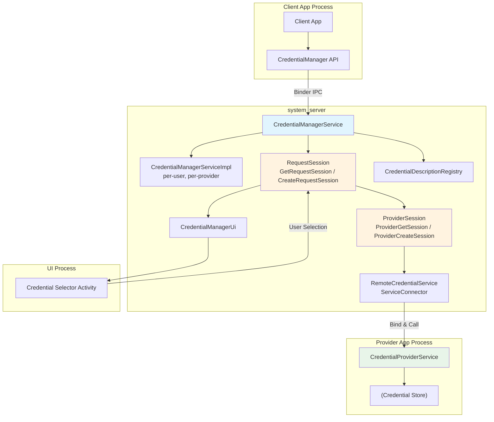

**源文件位置：**

| 组件 | 路径 |
|---|---|
| `CredentialManagerService` | `frameworks/base/services/credentials/java/com/android/server/credentials/CredentialManagerService.java` |
| `CredentialManagerServiceImpl` | `frameworks/base/services/credentials/java/com/android/server/credentials/CredentialManagerServiceImpl.java` |
| `RequestSession` | `frameworks/base/services/credentials/java/com/android/server/credentials/RequestSession.java` |
| `ProviderSession` | `frameworks/base/services/credentials/java/com/android/server/credentials/ProviderSession.java` |
| `RemoteCredentialService` | `frameworks/base/services/credentials/java/com/android/server/credentials/RemoteCredentialService.java` |
| `CredentialManagerUi` | `frameworks/base/services/credentials/java/com/android/server/credentials/CredentialManagerUi.java` |
| `CredentialProviderService` | `frameworks/base/core/java/android/service/credentials/CredentialProviderService.java` |
| `Credential` | `frameworks/base/core/java/android/credentials/Credential.java` |

### 41.1.4 关键抽象

该框架引入了多层抽象，使系统能够通过统一的协议处理多样化的凭证类型：

**Credential（凭证）** —— 一个保存凭证数据的类型化容器。`Credential` 类（`frameworks/base/core/java/android/credentials/Credential.java`）携带一个类型字符串和一个数据 `Bundle`：

```java
// From Credential.java
public final class Credential implements Parcelable {
    public static final String TYPE_PASSWORD_CREDENTIAL =
            "android.credentials.TYPE_PASSWORD_CREDENTIAL";

    private final String mType;
    private final Bundle mData;
}
```

具体的凭证类型由字符串常量标识：

| 类型常量 | 凭证种类 |
|---|---|
| `TYPE_PASSWORD_CREDENTIAL` | 用户名/密码对 |
| `"androidx.credentials.TYPE_PUBLIC_KEY_CREDENTIAL"` | 通行密钥（FIDO2/WebAuthn） |
| `"com.credman.IdentityCredential"` | 数字身份证件 |
| 自定义类型字符串 | 由提供方定义的凭证 |

**CredentialOption（凭证选项）** —— 指明客户端应用正在请求的内容。每个选项携带一个类型、检索数据（一个 `Bundle`）以及候选查询数据。

**CredentialProviderInfo（凭证提供方信息）** —— 关于已安装凭证提供方的元数据，包括其 `ComponentName`、能力（支持的凭证类型）以及它是否为系统提供方。

### 41.1.5 两阶段协议

一个根本性的设计选择是 system_server 与凭证提供方之间的两阶段通信：

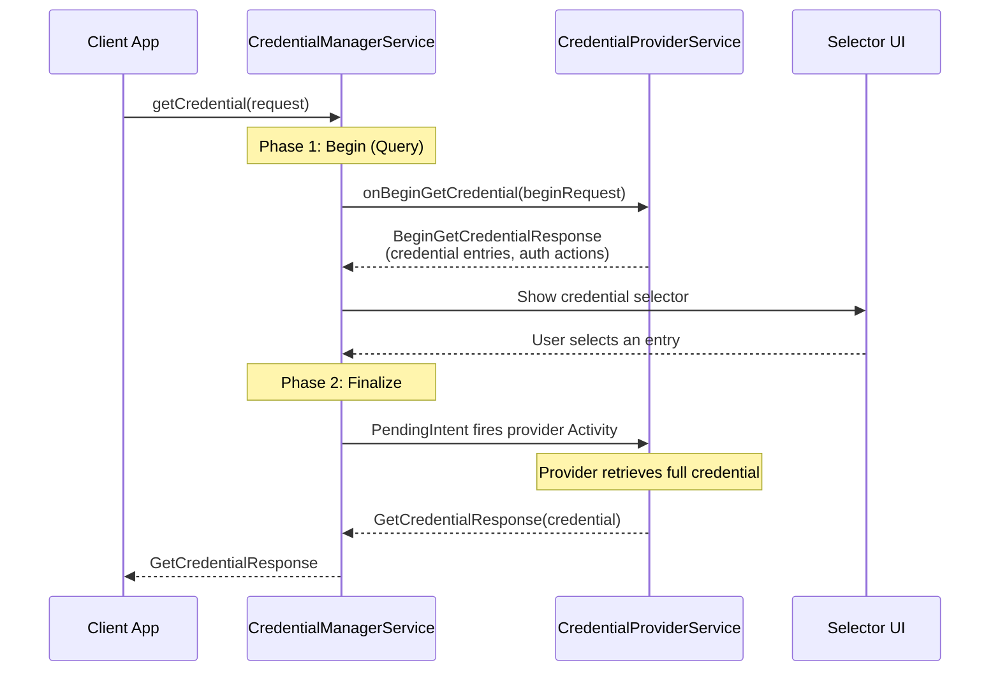

**第一阶段（开始/查询）：** 系统向每个已启用的提供方发送 `BeginGetCredentialRequest`。提供方以轻量级元数据回应——描述可用凭证的凭证条目、提供方被锁定时的认证操作，以及可选的远程条目。此时尚未交换任何实际的凭证数据。

**第二阶段（完成）：** 用户从系统界面中选择某个条目后，系统会触发附加在该条目上的 `PendingIntent`。提供方的 Activity 检索完整的凭证（可能在生物识别验证之后），并通过 `Activity.setResult()` 返回。

这种两阶段方法具有重要的安全属性：

- 凭证材料在用户明确选择之前绝不会加载到内存中
- 系统从不持有原始凭证；它只中介元数据
- 提供方可以在揭示数据之前要求认证（解锁、生物识别）

### 41.1.6 服务注册与发现

凭证管理器在 `SystemServer` 启动期间注册为系统服务：

```java
// From CredentialManagerService.java
@Override // from SystemService
public void onStart() {
    publishBinderService(CREDENTIAL_SERVICE, new CredentialManagerServiceStub());
}
```

服务名为 `Context.CREDENTIAL_SERVICE`，因此可以通过以下方式访问：

```java
CredentialManager cm = context.getSystemService(CredentialManager.class);
```

---

## 41.2 CredentialManagerService

### 41.2.1 服务层次结构

`CredentialManagerService` 继承 `AbstractMasterSystemService`，这是框架中用于管理按用户划分的子服务的模式。类层次结构为：

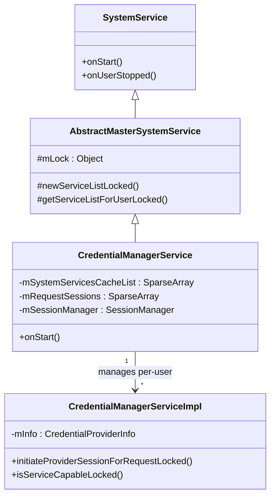

**来源：** `frameworks/base/services/credentials/java/com/android/server/credentials/CredentialManagerService.java`

### 41.2.2 构造函数与设置解析器

构造函数连接了基于设置的提供方解析：

```java
// From CredentialManagerService.java (line ~130)
public CredentialManagerService(@NonNull Context context) {
    super(
            context,
            new SecureSettingsServiceNameResolver(
                    context, Settings.Secure.CREDENTIAL_SERVICE,
                    /* isMultipleMode= */ true),
            null,
            PACKAGE_UPDATE_POLICY_REFRESH_EAGER);
    mContext = context;
}
```

关键细节：

| 参数 | 用途 |
|---|---|
| `Settings.Secure.CREDENTIAL_SERVICE` | 存储已启用提供方组件名称的设置键 |
| `isMultipleMode=true` | 允许多个并发提供方（不同于自动填充的单提供方模型） |
| `PACKAGE_UPDATE_POLICY_REFRESH_EAGER` | 在包发生变化时立即重建提供方列表 |

已启用的提供方以扁平化 `ComponentName` 字符串的冒号分隔列表形式存储在 `Settings.Secure.CREDENTIAL_SERVICE` 中。另一个设置 `Settings.Secure.CREDENTIAL_SERVICE_PRIMARY` 跟踪哪些提供方是"主要"提供方（在创建凭证时优先）。

### 41.2.3 系统提供方与用户可配置提供方

服务维护两类提供方：

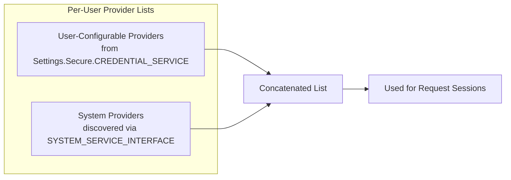

**用户可配置提供方** 是用户在设置中明确启用的提供方。它们声明标准的 `CredentialProviderService.SERVICE_INTERFACE` intent 过滤器。

**系统提供方** 是声明了 `CredentialProviderService.SYSTEM_SERVICE_INTERFACE` intent 过滤器的 OEM 预装提供方。无论用户设置如何，它们始终可用。系统通过以下方式发现它们：

```java
// From CredentialManagerService.java
private List<CredentialManagerServiceImpl> constructSystemServiceListLocked(
        int resolvedUserId) {
    List<CredentialProviderInfo> serviceInfos =
            CredentialProviderInfoFactory.getAvailableSystemServices(
                    mContext, resolvedUserId,
                    /* disableSystemAppVerificationForTests= */ false,
                    new HashSet<>());
    // ... wrap each in CredentialManagerServiceImpl
}
```

### 41.2.4 请求会话管理

所有进行中的凭证操作都通过请求会话按用户跟踪：

```java
// From CredentialManagerService.java
@GuardedBy("mLock")
private final SparseArray<Map<IBinder, RequestSession>> mRequestSessions =
        new SparseArray<>();
```

该 `SparseArray` 以用户 ID 为键。每个用户可以有多个并发请求会话（由 `IBinder` 令牌标识）。请求开始时添加会话，完成或取消时移除：

```java
private void addSessionLocked(@UserIdInt int userId,
        RequestSession requestSession) {
    synchronized (mLock) {
        mSessionManager.addSession(userId, requestSession.mRequestId, requestSession);
    }
}
```

这一行代码委托给内部的 `SessionManager`，其 `addSession()` 执行实际的映射插入（首次使用时创建按用户映射）：

```java
// CredentialManagerService.SessionManager.addSession()
@GuardedBy("mLock")
public void addSession(int userId, IBinder token, RequestSession requestSession) {
    if (mRequestSessions.get(userId) == null) {
        mRequestSessions.put(userId, new HashMap<>());
    }
    mRequestSessions.get(userId).put(token, requestSession);
}
```

### 41.2.5 CredentialManagerServiceStub（Binder 接口）

内部类 `CredentialManagerServiceStub` 实现了 `ICredentialManager.Stub`，并提供实际的 Binder 入口点。主要操作如下：

| 方法 | 用途 |
|---|---|
| `executeGetCredential()` | 检索现有凭证（密码、通行密钥） |
| `executeCreateCredential()` | 创建/保存新凭证 |
| `executePrepareGetCredential()` | 两步获取：先准备，再检索 |
| `getCandidateCredentials()` | 供自动填充用于获取候选凭证 |
| `clearCredentialState()` | 清除提供方一侧的状态（例如在登出时） |
| `setEnabledProviders()` | 配置哪些提供方处于活动状态 |
| `getCredentialProviderServices()` | 列出可用提供方 |
| `isEnabledCredentialProviderService()` | 检查特定提供方是否已启用 |
| `registerCredentialDescription()` | 注册用于匹配的凭证描述 |

### 41.2.6 获取凭证流程（详细）

`executeGetCredential()` 方法编排完整的获取流程：

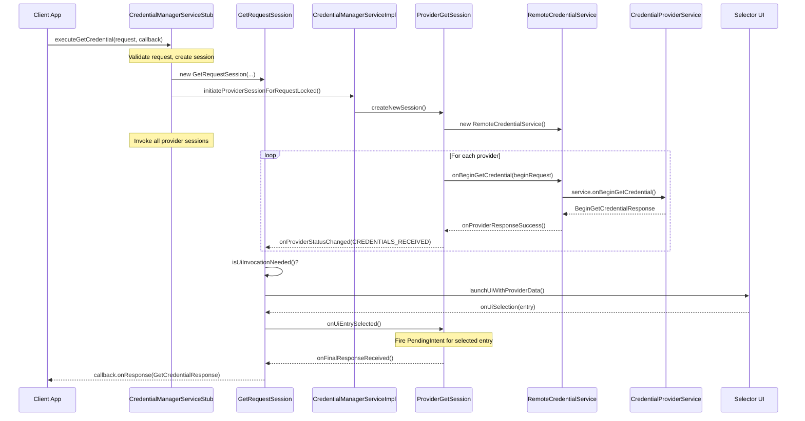

代码中的逐步流程：

1. **请求验证与会话创建：**
```java
// CredentialManagerServiceStub.executeGetCredential()
final GetRequestSession session = new GetRequestSession(
        getContext(), mSessionManager, mLock, userId, callingUid,
        callback, request,
        constructCallingAppInfo(callingPackage, userId, request.getOrigin()),
        getEnabledProvidersForUser(userId),
        CancellationSignal.fromTransport(cancelTransport),
        timestampBegan);
addSessionLocked(userId, session);
```

2. **发起提供方会话：** 服务遍历所有已启用的提供方，并为每个有能力处理请求的提供方创建 `ProviderGetSession`：
```java
List<ProviderSession> providerSessions =
        initiateProviderSessions(session, request.getCredentialOptions()
                .stream().map(CredentialOption::getType).collect(Collectors.toList()));
```

3. **提供方调用：** 每个 `ProviderSession.invokeSession()` 绑定到远程提供方并调用 `onBeginGetCredential`。

4. **响应聚合：** 当每个提供方作出响应时，会调用 `onProviderStatusChanged()`。当所有提供方都已响应且至少一个持有凭证时：
```java
// GetRequestSession.onProviderStatusChanged()
if (!isAnyProviderPending()) {
    if (isUiInvocationNeeded()) {
        getProviderDataAndInitiateUi();
    } else {
        respondToClientWithErrorAndFinish(
                GetCredentialException.TYPE_NO_CREDENTIAL, "No credentials available");
    }
}
```

5. **界面显示与用户选择：** 系统界面展示聚合后的凭证。选择后，`onUiSelection()` 将请求路由到相应的 `ProviderSession`。

6. **最终凭证交付：** 提供方的 `PendingIntent` 解析出完整凭证，该凭证经由 `onFinalResponseReceived()` 回传给客户端。

### 41.2.7 创建凭证流程

创建流程遵循类似模式，但使用 `CreateRequestSession` 和 `ProviderCreateSession`：

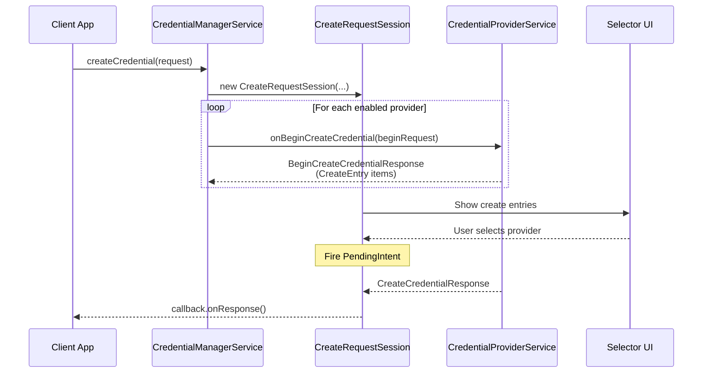

创建流程的不同之处在于：

- 只创建一个凭证（而不是从多个中选择）
- 响应包含 `CreateEntry` 条目，每个愿意保存的提供方各一个
- 主要提供方在界面中高亮显示，由 `Settings.Secure.CREDENTIAL_SERVICE_PRIMARY` 决定

### 41.2.8 权限模型

凭证管理器强制实施多项权限：

| 权限 | 用于 |
|---|---|
| `CREDENTIAL_MANAGER_SET_ORIGIN` | 设置自定义源（供浏览器发起跨源请求） |
| `CREDENTIAL_MANAGER_SET_ALLOWED_PROVIDERS` | 限制哪些提供方可以响应 |
| `WRITE_SECURE_SETTINGS` | 通过 `setEnabledProviders()` 配置已启用的提供方 |
| `QUERY_ALL_PACKAGES` 或 `LIST_ENABLED_CREDENTIAL_PROVIDERS` | 列出可用提供方 |
| `PROVIDE_REMOTE_CREDENTIALS` | 提供远程/混合条目（仅限 OEM） |

源（origin）对于 WebAuthn/通行密钥操作至关重要，在这些操作中浏览器代表 Web 应用行事。只有特权调用方（通常是具有适当权限的浏览器）才能设置源，提供方使用该源来验证依赖方。

### 41.2.9 包生命周期处理

当提供方包被更新或移除时，服务按用户逐一做出反应：

```java
// CredentialManagerService.handlePackageRemovedMultiModeLocked()
protected void handlePackageRemovedMultiModeLocked(String packageName, int userId) {
    updateProvidersWhenPackageRemoved(new SettingsWrapper(mContext), packageName, userId);
    List<CredentialManagerServiceImpl> services = peekServiceListForUserLocked(userId);
    // ... collect services whose component belongs to packageName, then for each:
    //   removeServiceFromCache(serviceToBeRemoved, userId);
    //   removeServiceFromSystemServicesCache(serviceToBeRemoved, userId);
    //   CredentialDescriptionRegistry.forUser(userId)
    //       .evictProviderWithPackageName(serviceToBeRemoved.getServicePackageName());
}
```

`userId` 参数很重要：`updateProvidersWhenPackageRemoved()` 会*为该用户*无条件写入 `CREDENTIAL_SERVICE` 和 `CREDENTIAL_SERVICE_PRIMARY` 设置。与之并列的路径 `updateProvidersWhenServiceRemoved()`（从 `handleServiceRemovedMultiModeLocked()` 进入）是 Android 17 中根据 `multi_user_fix_enabled` 标志来决定选择的地方。设置该标志后，它会为受影响的 `userId` 写入。旧路径则为 `UserHandle.myUserId()` 写入。这就是 41.8.2 节讨论的多用户正确性修复。对于包更新，`CredentialManagerServiceImpl.handlePackageUpdateLocked()` 会重新验证提供方的清单与能力。

---

## 41.3 凭证提供方

### 41.3.1 CredentialProviderService 契约

凭证提供方实现抽象 `Service` 类 `CredentialProviderService`。提供方必须处理三类回调：

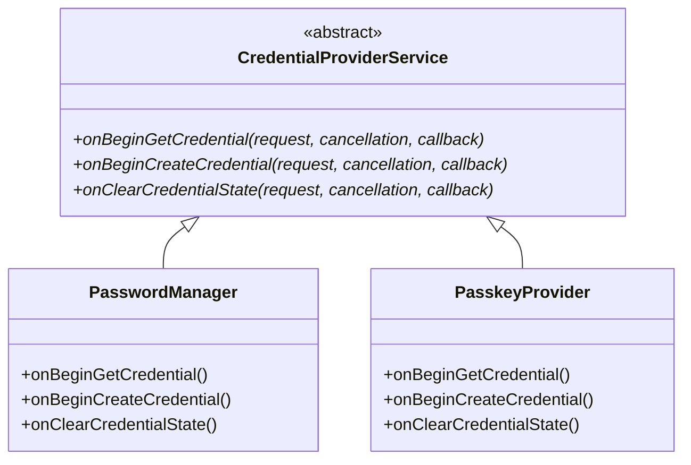

**来源：** `frameworks/base/core/java/android/service/credentials/CredentialProviderService.java`

### 41.3.2 清单文件声明

提供方通过 `AndroidManifest.xml` 注册：

```xml
<service
    android:name=".MyCredentialProvider"
    android:permission="android.permission.BIND_CREDENTIAL_PROVIDER_SERVICE"
    android:exported="true">

    <!-- Standard provider interface (user-configurable) -->
    <intent-filter>
        <action android:name="android.service.credentials.CredentialProviderService" />
    </intent-filter>

    <!-- Declare supported credential types in metadata -->
    <meta-data
        android:name="android.credentials.provider"
        android:resource="@xml/provider_config" />
</service>
```

元数据 XML 声明支持的凭证类型：

```xml
<!-- res/xml/provider_config.xml -->
<credential-provider xmlns:android="http://schemas.android.com/apk/res/android">
    <capabilities>
        <capability name="android.credentials.TYPE_PASSWORD_CREDENTIAL" />
        <capability name="androidx.credentials.TYPE_PUBLIC_KEY_CREDENTIAL" />
    </capabilities>
</credential-provider>
```

系统提供方使用不同的 intent 过滤器 action：
```xml
<action android:name="android.service.credentials.system.CredentialProviderService" />
```

### 41.3.3 服务能力检查

发起提供方会话时，系统会检查每个提供方是否支持所请求的凭证类型：

```java
// From CredentialManagerServiceImpl.java
@GuardedBy("mLock")
boolean isServiceCapableLocked(List<String> requestedOptions) {
    if (mInfo == null) {
        return false;
    }
    for (String capability : requestedOptions) {
        if (mInfo.hasCapability(capability)) {
            return true;
        }
    }
    return false;
}
```

只有能力匹配的提供方才会被列入请求会话。这防止了把密码请求发送给仅支持通行密钥的提供方（反之亦然）。

### 41.3.4 BeginGetCredentialRequest 与响应

"开始"阶段的请求包含：

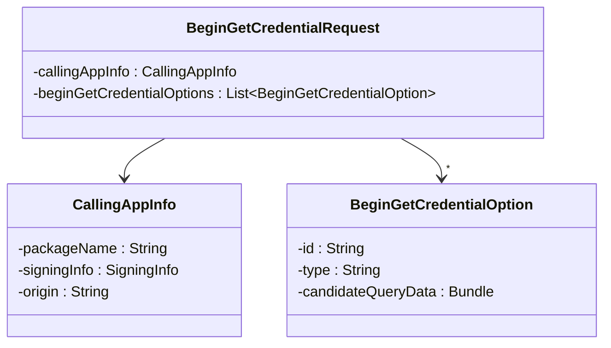

响应描述了提供方可以提供的内容：

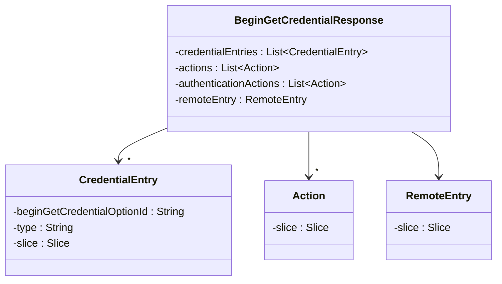

**CredentialEntry** —— 表示一条可用的凭证（例如"user@example.com 密码"或"example.com 的通行密钥"）。选中它时触发的 `PendingIntent` 并不是一个单独的字段，它作为 `SliceAction` 嵌入在条目的 `Slice` 中。`Action` 和 `RemoteEntry` 也以同样方式携带各自的 `PendingIntent`。

**Action** —— 提供方希望展示的通用操作（例如"管理密码"）。

**认证操作（Authentication Action）** —— 当提供方的保险库处于锁定状态时显示。选择它会启动提供方的解锁流程。解锁后，提供方通过 `EXTRA_BEGIN_GET_CREDENTIAL_RESPONSE` 返回实际的 `BeginGetCredentialResponse`。

**RemoteEntry** —— 用于混合/跨设备流程。仅对 OEM 配置的混合服务生效，通过以下方式检查：

```java
// From ProviderSession.java
protected boolean enforceRemoteEntryRestrictions(
        @Nullable ComponentName expectedRemoteEntryProviderService) {
    if (!mComponentName.equals(expectedRemoteEntryProviderService)) {
        Slog.w(TAG, "Remote entry being dropped as it is not from the service "
                + "configured by the OEM.");
        return false;
    }
    // Also verify PROVIDE_REMOTE_CREDENTIALS permission
}
```

### 41.3.5 RemoteCredentialService 连接

`RemoteCredentialService` 继承 `ServiceConnector.Impl`，以管理与每个提供方的绑定生命周期：

```java
// From RemoteCredentialService.java
public class RemoteCredentialService
        extends ServiceConnector.Impl<ICredentialProviderService> {

    private static final long TIMEOUT_REQUEST_MILLIS = 3 * DateUtils.SECOND_IN_MILLIS;
    private static final long TIMEOUT_IDLE_SERVICE_CONNECTION_MILLIS =
            5 * DateUtils.SECOND_IN_MILLIS;
}
```

**关键超时：**

- **请求超时：** 3 秒。如果提供方在 3 秒内没有响应，请求将被取消，该提供方被标记为失败。
- **空闲断开：** 5 秒。完成请求后，服务会在 5 秒无活动后解绑。

连接使用带有 `orTimeout()` 的 `CompletableFuture`：

```java
// From RemoteCredentialService.onBeginGetCredential()
CompletableFuture<BeginGetCredentialResponse> connectThenExecute =
        postAsync(service -> {
            CompletableFuture<BeginGetCredentialResponse> getCredentials =
                    new CompletableFuture<>();
            service.onBeginGetCredential(request, new IBeginGetCredentialCallback.Stub() {
                @Override
                public void onSuccess(BeginGetCredentialResponse response) {
                    getCredentials.complete(response);
                }
                @Override
                public void onFailure(String errorType, CharSequence message) {
                    getCredentials.completeExceptionally(
                            new GetCredentialException(errorType, errorMsg));
                }
                // ...
            });
            return getCredentials;
        }).orTimeout(TIMEOUT_REQUEST_MILLIS, TimeUnit.MILLISECONDS);
```

错误处理涵盖多种失败模式：

| 错误 | 常量 | 处理方式 |
|---|---|---|
| 提供方超时 | `ERROR_TIMEOUT` | 分发取消信号，提供方被标记为失败 |
| 提供方异常 | `ERROR_PROVIDER_FAILURE` | 异常传播到会话 |
| 任务取消 | `ERROR_TASK_CANCELED` | 确认取消 |
| Binder 死亡 | `binderDied()` | 调用 `onProviderServiceDied()` 回调 |
| 未知错误 | `ERROR_UNKNOWN` | 报告通用失败 |

### 41.3.6 ProviderSession 状态机

每个 `ProviderSession` 通过状态机跟踪其生命周期：

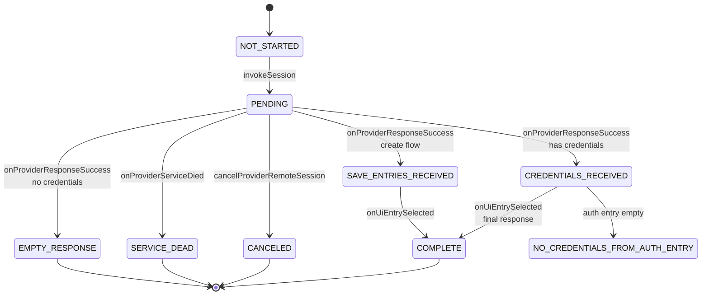

状态检查用于决定何时调用界面：

```java
// From ProviderSession.java
public static boolean isUiInvokingStatus(Status status) {
    return status == Status.CREDENTIALS_RECEIVED
            || status == Status.SAVE_ENTRIES_RECEIVED
            || status == Status.NO_CREDENTIALS_FROM_AUTH_ENTRY;
}

public static boolean isStatusWaitingForRemoteResponse(Status status) {
    return status == Status.PENDING;
}
```

`RequestSession` 会等待直到没有提供方处于 `PENDING` 状态，然后再决定是显示界面还是报告错误。

### 41.3.7 指标收集

凭证框架包含广泛的遥测功能。每个会话跟踪：

| 指标 | 收集器 |
|---|---|
| API 调用时间戳 | `RequestSessionMetric` |
| 每个提供方的候选阶段 | `CandidatePhaseMetric` |
| 界面调用计时 | `RequestSessionMetric.collectUiCallStartTime()` |
| 所选提供方状态 | `ChosenProviderFinalPhaseMetric` |
| 认证条目使用情况 | `BrowsedAuthenticationMetric` |
| 所选凭证类型 | `collectChosenClassType()` |

指标类位于：
`frameworks/base/services/credentials/java/com/android/server/credentials/metrics/`

---

## 41.4 通行密钥与 FIDO2

### 41.4.1 什么是通行密钥？

通行密钥是基于公钥密码学的 FIDO2/WebAuthn 凭证。与密码不同：

| 属性 | 密码 | 通行密钥 |
|---|---|---|
| 机密存储 | 服务器存储哈希 | 服务器仅存储公钥 |
| 防钓鱼 | 无 | 绑定源 |
| 重放攻击 | 可能发生 | 质询-响应机制可防止 |
| 用户体验 | 必须记住 | 生物识别/设备解锁 |
| 跨设备 | 手动输入 | 二维码或蓝牙混合 |

通行密钥由以下部分组成：

- 一个**私钥**，安全地存储在设备上（在凭证提供方中）
- 一个**公钥**，注册到依赖方（网站/应用）
- 一个**凭证 ID**，将二者关联起来

### 41.4.2 通行密钥创建（注册）

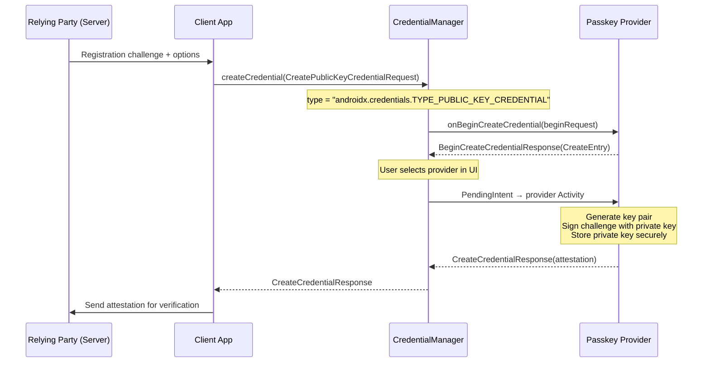

`CreatePublicKeyCredentialRequest` 携带一个符合 WebAuthn
`PublicKeyCredentialCreationOptions` 规范的 JSON 字符串：

```json
{
    "rp": { "id": "example.com", "name": "Example" },
    "user": { "id": "base64userId", "name": "user@example.com" },
    "challenge": "base64challenge",
    "pubKeyCredParams": [
        { "type": "public-key", "alg": -7 },
        { "type": "public-key", "alg": -257 }
    ],
    "authenticatorSelection": {
        "residentKey": "required",
        "userVerification": "required"
    }
}
```

算法标识符遵循 COSE 算法注册表：

- `-7`（ES256）：使用 P-256 和 SHA-256 的 ECDSA
- `-257`（RS256）：使用 SHA-256 的 RSASSA-PKCS1-v1_5

### 41.4.3 通行密钥认证（断言）

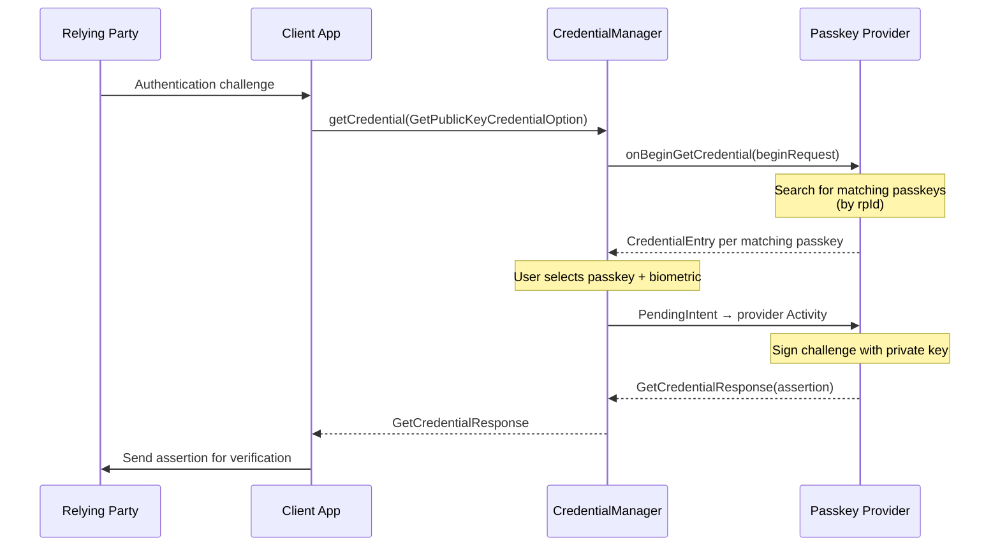

`GetPublicKeyCredentialOption` 包含一个符合
`PublicKeyCredentialRequestOptions` 的 JSON 字符串：

```json
{
    "rpId": "example.com",
    "challenge": "base64challenge",
    "allowCredentials": [],
    "userVerification": "required"
}
```

空的 `allowCredentials` 数组表示"可发现凭证"（通行密钥），此时提供方会在其存储中搜索任何与依赖方 ID 匹配的通行密钥。

### 41.4.4 源验证

为了提供防钓鱼能力，通行密钥必须验证源。当浏览器发起通行密钥操作时，它会设置源：

```java
// Browser sets origin for web-initiated requests
GetCredentialRequest request = new GetCredentialRequest.Builder()
        .addCredentialOption(publicKeyOption)
        .setOrigin("https://example.com")  // Requires CREDENTIAL_MANAGER_SET_ORIGIN
        .build();
```

传递给提供方的 `CallingAppInfo` 包括：

- 调用方应用的**包名**
- 调用方应用的**签名信息**（证书）
- **源**字符串（如果由特权调用方设置）

提供方会验证源与依赖方预期的源是否匹配，并验证调用方应用的签名证书与 Digital Asset Links 声明是否匹配。

### 41.4.5 混合/跨设备认证

跨设备通行密钥认证（用手机在笔记本电脑上登录）使用 FIDO2 混合传输。在凭证管理器模型中：

1. OEM 通过 `config_defaultCredentialManagerHybridService` 配置一个混合服务
2. 该服务可以在其 `BeginGetCredentialResponse` 中包含一个 `RemoteEntry`
3. 当用户选择远程条目时，混合流程开始（通常通过 BLE + CTAP2）

混合服务通过以下方式验证：
```java
// From RequestSession.java constructor
mHybridService = context.getResources().getString(
        R.string.config_defaultCredentialManagerHybridService);
```

只有经过 `enforceRemoteEntryRestrictions()` 验证的 OEM 指定服务才能提供远程条目。这防止了任意应用拦截跨设备认证流程。

### 41.4.6 证明（Attestation）

在通行密钥创建期间，提供方可能会生成一个证明语句，证明密钥是在特定硬件（例如 StrongBox、TEE）中创建的。证明数据包含在 `CreateCredentialResponse` 中，并转发给依赖方。

常见的证明格式：

- **None（无）：** 不做证明；提供方自签名
- **Packed（打包）：** 紧凑证明格式
- **Android Key Attestation：** 使用 Android 的硬件支持密钥证明链
- **TPM：** 可信平台模块证明（在 Android 上很少见）

---

## 41.5 密码与自动填充集成

### 41.5.1 密码凭证

密码凭证使用类型 `Credential.TYPE_PASSWORD_CREDENTIAL`。数据 Bundle 包含：

| 键 | 类型 | 描述 |
|---|---|---|
| `androidx.credentials.BUNDLE_KEY_ID` | String | 用户名/标识符 |
| `androidx.credentials.BUNDLE_KEY_PASSWORD` | String | 密码值 |

注意 `androidx.` 前缀：这些键是 Jetpack `androidx.credentials` 的约定，而不是框架常量。框架将该 Bundle 视为不透明数据。只有两端的 Jetpack 库才会解释这些键。

以密码为主的 `BeginGetCredentialResponse` 会返回 `CredentialEntry` 条目，每个匹配调用方应用的已存储密码各对应一个条目。

### 41.5.2 自动填充桥接

凭证管理器通过一条专门的代码路径与现有的自动填充框架集成。`getCandidateCredentials()` Binder 方法仅限于系统配置的凭证自动填充服务使用。在 Android 17 上，此调用方检查是无条件的。此前用于控制该检查的 `safeguard_candidate_credentials_api_caller` 错误修复标志已经毕业（转为正式）。该检查会拒绝无法明确识别的调用方：

```java
// From CredentialManagerServiceStub.getCandidateCredentials()
String credentialManagerAutofillCompName = mContext.getResources().getString(
        R.string.config_defaultCredentialManagerAutofillService);
ComponentName componentName = ComponentName.unflattenFromString(
        credentialManagerAutofillCompName);
if (componentName == null) {
    throw new SecurityException(
            "Credential Autofill service does not exist on this device.");
}
PackageManager pm = mContext.createContextAsUser(
        UserHandle.getUserHandleForUid(callingUid), 0).getPackageManager();
String callingProcessPackage = pm.getNameForUid(callingUid);
if (callingProcessPackage == null) {
    throw new SecurityException("Couldn't determine the identity of the caller.");
}
if (!Objects.equals(componentName.getPackageName(), callingProcessPackage)) {
    throw new SecurityException(callingProcessPackage
            + " is not the device's credential autofill package.");
}
```

这会创建一个 `GetCandidateRequestSession`，它将候选返回给自动填充服务，以显示在自动填充下拉菜单中。这在表单字段中提供了无缝的体验。

### 41.5.3 自动填充占位符

当一个仅提供凭证的提供方（没有自动填充服务组件）被设置为主要提供方时，系统会存储一个占位符值：

```java
// From CredentialManagerService.java
public static final String AUTOFILL_PLACEHOLDER_VALUE = "credential-provider";
```

这告诉自动填充框架，凭证管理由凭证管理器而非传统的 `AutofillService` 处理。

### 41.5.4 迁移路径

凭证管理器为旧版自动填充提供方提供了一条迁移路径：

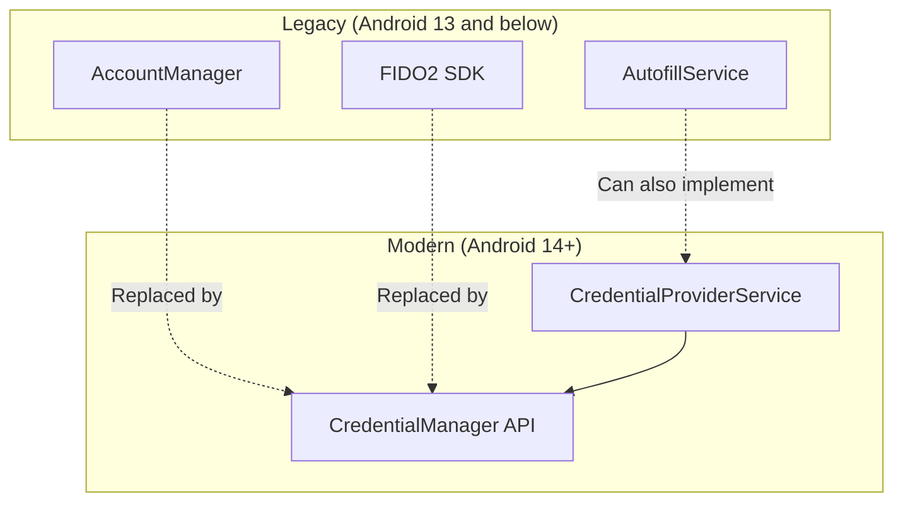

单个提供方应用可以同时实现 `AutofillService`（用于向后兼容）和 `CredentialProviderService`（用于现代流程）。系统通过自动填充桥接在二者之间进行协调。

---

## 41.6 数字凭证

### 41.6.1 身份证件

Android 的凭证管理器已扩展为支持数字身份证件——政府签发的身份证、驾照、医疗保险卡以及其他可验证凭证。它们使用数字凭证类型系统。

框架提供了一个通用容器；实际的凭证格式（如符合 ISO 18013-5 的 mDL、W3C 可验证凭证等）由提供方处理。

### 41.6.2 凭证描述注册表

`CredentialDescriptionRegistry` 是一个按用户划分的内存注册表，提供方在其中预先注册其可用凭证的描述。这使系统能够在不查询每个提供方的情况下将请求路由到合适的提供方：

```java
// From CredentialDescriptionRegistry.java
public class CredentialDescriptionRegistry {
    private static final int MAX_ALLOWED_CREDENTIAL_DESCRIPTIONS = 128;
    private static final int MAX_ALLOWED_ENTRIES_PER_PROVIDER = 16;

    private Map<String, Set<CredentialDescription>> mCredentialDescriptions;
    private int mTotalDescriptionCount;
}
```

**来源：** `frameworks/base/services/credentials/java/com/android/server/credentials/CredentialDescriptionRegistry.java`

该注册表：

- **按用户划分：** 每个用户通过 `SparseArray` 拥有独立的实例
- **内存存储：** 不会跨重启持久化；提供方在启动时重新注册
- **大小受限：** 总共最多 128 条描述，每个提供方最多 16 条

### 41.6.3 注册与匹配

提供方在启动时或其凭证清单发生变化时注册凭证描述：

```java
// Provider registers a digital ID credential
CredentialDescription description = new CredentialDescription(
        "com.credman.IdentityCredential",
        Set.of("org.iso.18013.5.1.family_name",
               "org.iso.18013.5.1.given_name",
               "org.iso.18013.5.1.portrait"),
        credentialEntries);

RegisterCredentialDescriptionRequest request =
        new RegisterCredentialDescriptionRequest(Set.of(description));
credentialManager.registerCredentialDescription(request);
```

当收到带有 `SUPPORTED_ELEMENT_KEYS` 的获取请求时，系统使用注册表查找匹配的提供方：

```java
// From CredentialDescriptionRegistry.java
public Set<FilterResult> getMatchingProviders(Set<Set<String>> supportedElementKeys) {
    Set<FilterResult> result = new HashSet<>();
    for (String packageName : mCredentialDescriptions.keySet()) {
        Set<CredentialDescription> currentSet = mCredentialDescriptions.get(packageName);
        for (CredentialDescription containedDescription : currentSet) {
            if (canProviderSatisfyAny(
                    containedDescription.getSupportedElementKeys(),
                    supportedElementKeys)) {
                result.add(new FilterResult(packageName,
                        containedDescription.getSupportedElementKeys(),
                        containedDescription.getCredentialEntries()));
            }
        }
    }
    return result;
}
```

匹配使用集合包含关系。请求携带的是*元素键集合的集合*（`Set<Set<String>>`）。`canProviderSatisfyAny()` 在提供方注册的键是所请求集合中*任意一个*的超集时返回 true。单集合辅助方法 `checkForMatch()` 执行实际的 `containsAll` 测试：

```java
// From CredentialDescriptionRegistry.java
private static boolean canProviderSatisfyAny(Set<String> registeredElementKeys,
        Set<Set<String>> requestedElementKeys) {
    for (Set<String> requestedUnflattenedString : requestedElementKeys) {
        if (registeredElementKeys.containsAll(requestedUnflattenedString)) {
            return true;
        }
    }
    return false;
}

static boolean checkForMatch(Set<String> registeredElementKeys,
        Set<String> requestedElementKeys) {
    return registeredElementKeys.containsAll(requestedElementKeys);
}
```

### 41.6.4 基于注册表的获取流程

当获取请求包含凭证描述选项时，系统会通过 `prepareProviderSessions()` 走一条不同的路径：

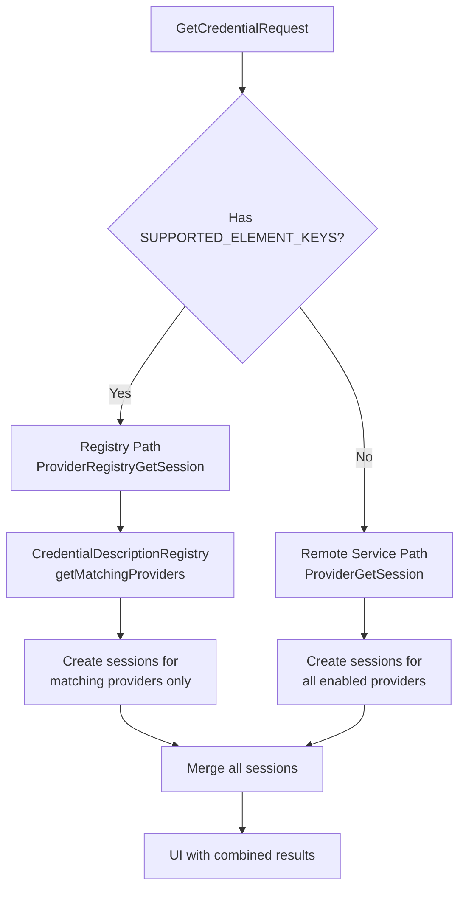

这种优化避免了绑定到不可能拥有匹配凭证的提供方，从而降低了数字凭证请求的延迟。

### 41.6.5 可验证展示

对于数字凭证用例，流程通常包括：

1. **验证方（Verifier）** 请求特定声明（例如"证明你已满 21 岁"）
2. **应用** 创建带有描述所需声明的元素键的 `GetCredentialRequest`
3. **系统** 通过注册表将请求路由到提供方
4. **提供方** 展示用户同意界面，显示将要共享的内容
5. **用户** 批准选择性披露
6. **提供方** 生成经过加密签名的展示
7. **响应** 通过系统回传给验证方

系统从不接触实际的凭证数据；它只在验证方与提供方之间协助建立连接。

---

## 41.7 内部类深入剖析

### 41.7.1 CredentialManagerUi 内部机制

`CredentialManagerUi` 类管理 system_server 与凭证选择器界面（通常实现在 SystemUI 或专用的选择器应用中）之间的桥接。

**来源：** `frameworks/base/services/credentials/java/com/android/server/credentials/CredentialManagerUi.java`

界面通过 `ResultReceiver` 模式运行：

```java
// From CredentialManagerUi.java
@NonNull
private final ResultReceiver mResultReceiver = new ResultReceiver(
        new Handler(Looper.getMainLooper())) {
    @Override
    protected void onReceiveResult(int resultCode, Bundle resultData) {
        handleUiResult(resultCode, resultData);
    }
};
```

来自界面的结果代码：

| 结果代码 | 常量 | 处理方式 |
|---|---|---|
| `RESULT_CODE_DIALOG_COMPLETE_WITH_SELECTION` | 用户选择了凭证 | 路由到 `ProviderSession.onUiEntrySelected()` |
| `RESULT_CODE_DIALOG_USER_CANCELED` | 用户关闭了对话框 | 调用 `onUiCancellation(true)` |
| `RESULT_CODE_CANCELED_AND_LAUNCHED_SETTINGS` | 用户进入了设置 | 调用 `onUiCancellation(false)` |
| `RESULT_CODE_DATA_PARSING_FAILURE` | 界面解析数据失败 | 调用 `onUiSelectorInvocationFailure()` |

界面状态跟踪可防止重复操作：

```java
// From CredentialManagerUi.java
enum UiStatus {
    IN_PROGRESS,       // Initial state; waiting for provider responses
    USER_INTERACTION,  // UI is displayed, user interacting
    NOT_STARTED,
    TERMINATED         // UI dismissed or failed
}
```

`createPendingIntent()` 方法构建选择器 Activity 的 intent。它打包：

- 描述正在请求内容的 `RequestInfo`
- 来自所有响应提供方的 `ProviderData`
- 用于接收选择结果的 `ResultReceiver`
- 用于指标统计的会话跟踪 ID

### 41.7.2 ProviderGetSession 详情

`ProviderGetSession` 是处理获取凭证的提供方通信的具体实现。它从客户端的 `GetCredentialRequest` 创建 `BeginGetCredentialRequest`：

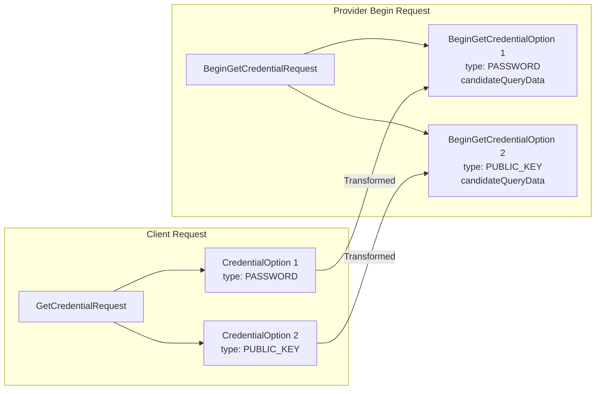

客户端请求中的每个 `CredentialOption` 都会转换为提供给提供方的 `BeginGetCredentialOption`。转换会剥离敏感的检索数据，只发送候选查询数据——即提供方在其存储中搜索所需的信息。

### 41.7.3 ProviderCreateSession 详情

对于凭证创建，`ProviderCreateSession` 将 `CreateCredentialRequest` 转换为 `BeginCreateCredentialRequest`：

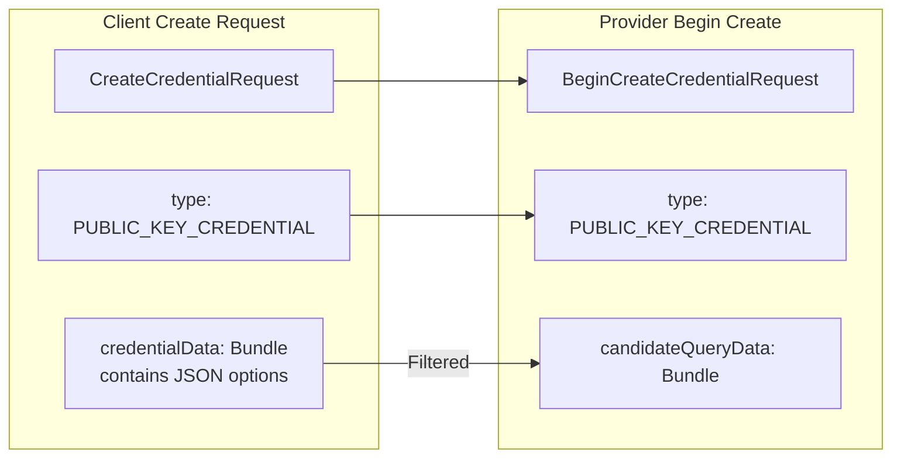

提供方返回的 `BeginCreateCredentialResponse` 包含 `CreateEntry` 条目。每个 `CreateEntry` 具有：

- 一个显示标题（例如"保存到 Google 密码管理器"）
- 用于实际保存流程的 `PendingIntent`
- 关于提供方的可选元数据

### 41.7.4 ClearRequestSession

清除凭证状态的流程更简单——它要求所有提供方清除调用方应用的任何缓存状态：

```java
// From ClearRequestSession.java
// Sends ClearCredentialStateRequest to all providers
// Useful when user signs out of an app
// Providers clear cached tokens, session state, etc.
```

此操作对安全清理至关重要。当用户退出某个应用时，该应用应调用 `clearCredentialState()`，以确保凭证提供方没有陈旧的认证状态。

### 41.7.5 设置集成

已启用的提供方列表存储在安全设置中，每个用户一个：

```
Settings.Secure.CREDENTIAL_SERVICE = "credential_service"
Settings.Secure.CREDENTIAL_SERVICE_PRIMARY = "credential_service_primary"
```

格式为冒号分隔的扁平化 ComponentName：

```
com.google.android.gms/.auth.credentials.CredentialProviderService:com.example/.MyProvider
```

主要提供方在创建界面中获得优先位置。系统通过以下方式读取这些设置：

```java
// From CredentialManagerService.java
static Set<ComponentName> getPrimaryProvidersForUserId(Context context, int userId) {
    SecureSettingsServiceNameResolver resolver = new SecureSettingsServiceNameResolver(
            context, Settings.Secure.CREDENTIAL_SERVICE_PRIMARY,
            /* isMultipleMode= */ true);
    String[] serviceNames = resolver.readServiceNameList(resolvedUserId);
    // Parse into ComponentName set
}
```

### 41.7.6 错误分类

凭证管理器定义了结构化的错误分类：

**获取凭证错误（`GetCredentialException`）：**

| 类型 | 含义 |
|---|---|
| `TYPE_NO_CREDENTIAL` | 在所有地方都未找到匹配的凭证 |
| `TYPE_USER_CANCELED` | 用户关闭了选择器 |
| `TYPE_INTERRUPTED` | 界面被中断（例如被另一个 activity） |
| `TYPE_UNKNOWN` | 未分类的错误 |

**创建凭证错误（`CreateCredentialException`）：**

| 类型 | 含义 |
|---|---|
| `TYPE_NO_CREATE_OPTIONS` | 没有提供方可以创建所请求的类型 |
| `TYPE_USER_CANCELED` | 用户关闭了创建界面 |
| `TYPE_INTERRUPTED` | 界面被中断 |
| `TYPE_UNKNOWN` | 未分类的错误 |

**清除凭证状态错误（`ClearCredentialStateException`）：**

| 类型 | 含义 |
|---|---|
| `TYPE_UNKNOWN` | 清除操作失败 |

错误通过 `RequestSession` 中的 `respondToClientWithErrorAndFinish()` 方法流转：

```java
// From RequestSession.java
protected void respondToClientWithErrorAndFinish(String errorType, String errorMsg) {
    // ... status checks
    try {
        invokeClientCallbackError(errorType, errorMsg);
    } catch (RemoteException e) {
        Slog.e(TAG, "Issue while responding to client with error : " + e);
    }
    boolean isUserCanceled = errorType.contains(MetricUtilities.USER_CANCELED_SUBSTRING);
    if (isUserCanceled) {
        finishSession(false, ApiStatus.USER_CANCELED.getMetricCode());
    } else {
        finishSession(false, ApiStatus.FAILURE.getMetricCode());
    }
}
```

### 41.7.7 取消架构

取消沿堆栈双向流动：

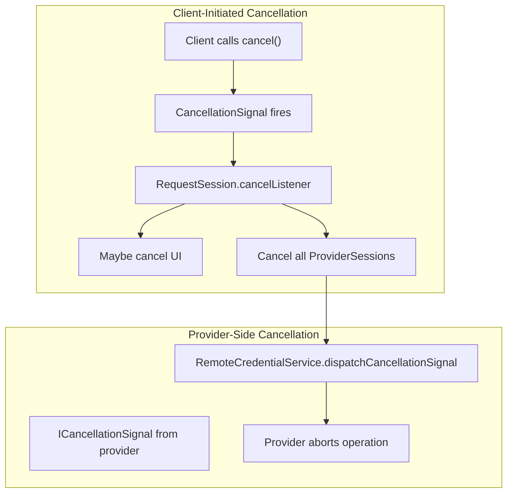

客户端在调用获取或创建时会收到一个 `ICancellationSignal` 传输通道：

```java
// Return type from executeGetCredential()
ICancellationSignal cancelTransport = CancellationSignal.createTransport();
// Client can call cancelTransport.cancel() at any time
```

取消时：

1. `RequestSession` 的取消监听器触发
2. 如果界面处于活动状态，会发送取消 intent 以关闭它
3. 所有挂起的 `ProviderSession` 实例都会收到取消信号
4. 会话以 `ApiStatus.CLIENT_CANCELED` 终止

### 41.7.8 线程模型

凭证管理器在多个线程上运行：

| 组件 | 线程 | 原因 |
|---|---|---|
| Binder 调用 | Binder 线程池 | 来自客户端应用的传入 IPC |
| 请求会话 | 主 handler | 界面回调与状态管理 |
| 提供方通信 | `ServiceConnector` 线程 | 异步服务绑定 |
| 结果投递 | 主 handler | 来自界面的 `ResultReceiver` |
| 指标日志 | 调用线程 | 同步指标收集 |

`RequestSession` 使用主线程 Handler：

```java
// From RequestSession.java
mHandler = new Handler(Looper.getMainLooper(), null, true);
```

提供方响应通过以下方式分发到主线程：

```java
// From RemoteCredentialService.java
connectThenExecute.whenComplete((result, error) ->
        Handler.getMain().post(() -> handleExecutionResponse(result, error, cancellationSink)));
```

### 41.7.9 特性标志

凭证管理器使用 `android.credentials.flags.Flags` 进行特性门控。标志集声明在 `frameworks/base/core/java/android/credentials/flags.aconfig` 中，并在仍然根据标志分支的调用点进行查询：

```java
// Referenced throughout the codebase:
import android.credentials.flags.Flags;

// RequestSession.logTrackOneCandidatesAndPrepareFinalPhaseLogs():
if (Flags.metricBugfixesContinued()) {
    mRequestSessionMetric.captureMissingLogMetadata();
}

// CredentialManagerService.updateProvidersWhenServiceRemoved(): per-user settings writes
if (Flags.multiUserFixEnabled()) {
    // write CREDENTIAL_SERVICE / CREDENTIAL_SERVICE_PRIMARY for the affected userId
    // (legacy path used UserHandle.myUserId())
}
```

这些标志使发布版本可以逐步推出行为变更，而无需代码分支。这遵循 AOSP 的 trunk-stable 开发模式。随着标志毕业为"已启动（launched）"，它们的分支会被折叠。到 Android 17 时，早期代码路径所引用的 `clear_session_enabled` 和 `hybrid_filter_opt_fix_enabled` 标志已被移除，其行为现在是无条件的。41.8 节中描述的几个错误修复标志仍然生效。

### 41.7.10 安全考虑

凭证管理器强制实施多项安全边界：

1. **包身份验证：** 每个请求都会根据 Binder 调用 UID 验证调用方的包名，以防止伪造：
   ```java
   enforceCallingPackage(callingPackage, callingUid);
   ```

2. **用于源绑定的签名信息：** `CallingAppInfo` 包含 `SigningInfo`，用于 asset link 验证：
   ```java
   callingAppInfo = new CallingAppInfo(realPackageName, packageInfo.signingInfo, origin);
   ```

3. **提供方绑定权限：** 提供方需要
    `BIND_CREDENTIAL_PROVIDER_SERVICE` 权限，以防止未经授权的服务绑定。

4. **源限制：** 只有拥有 `CREDENTIAL_MANAGER_SET_ORIGIN` 权限的调用方才能
    设置自定义源，防止应用冒充浏览器。

5. **Binder 死亡检测：** 客户端死亡会被检测到，会话会被清理：
   ```java
   private class RequestSessionDeathRecipient implements IBinder.DeathRecipient {
       @Override
       public void binderDied() {
           finishSession(isUiWaitingForData(), ApiStatus.BINDER_DIED.getMetricCode());
       }
   }
   ```

6. **远程条目限制：** 只有拥有
    `PROVIDE_REMOTE_CREDENTIALS` 权限的 OEM 指定服务才能提供跨设备条目。

7. **按用户隔离：** 提供方列表和请求会话严格按用户划分，
    防止跨用户凭证泄露。

### 41.7.11 测试支持

框架包含多项测试便利设施：

- `getCredentialProviderServicesForTesting()` 绕过系统应用验证
- `CredentialDescriptionRegistry.clearAllSessions()` 重置测试状态
- `CredentialDescriptionRegistry.setSession()` 允许注入测试数据
- `isCredentialDescriptionApiEnabled()` 可通过 DeviceConfig 切换

提供方一侧的测试：
```kotlin
// Use Jetpack Credential Manager test library
testImplementation("androidx.credentials:credentials-testing:1.x.y")
```

测试库提供了凭证管理器 API 的伪造实现，可以配置为返回特定响应，而无需真实的提供方。

### 41.7.12 Jetpack Credential Manager 与框架 API

`androidx.credentials` Jetpack 库在框架 API 之上进行了封装，并添加了多项功能：

| 特性 | 框架 API | Jetpack 库 |
|---|---|---|
| 可用性 | Android 14+ | Android 4.4+（通过 Play Services） |
| 通行密钥类型 | 原始 Bundle | `PublicKeyCredential` 类 |
| 密码类型 | 原始 Bundle | `PasswordCredential` 类 |
| Google 登录 | 不包含 | `GoogleIdTokenCredential` |
| 自定义类型 | 支持 | 类型安全的包装器 |
| 提供方 API | `CredentialProviderService` | 相同 |

在 Android 14+ 上，Jetpack 库直接委托给框架。在更早的版本上，它使用 Google Play Services 作为后端。这种双路径方法为开发者提供了适用于所有 Android 版本的单一 API。

### 41.7.13 会话管理与清理

`SessionManager` 跟踪所有活动的请求会话并确保清理：

```java
// SessionManager implements RequestSession.SessionLifetime
private final SessionManager mSessionManager = new SessionManager();
```

当会话完成（成功、错误或取消）时，它会回调：

```java
// From RequestSession.java
public interface SessionLifetime {
    void onFinishRequestSession(@UserIdInt int userId, IBinder token);
}
```

这会触发从 `mRequestSessions` 映射中的移除。如果没有适当的清理，被遗弃的会话将泄漏内存，并可能持有对提供方绑定的引用。

死亡接收者机制提供了额外的安全保障：

```java
// From RequestSession.java
private class RequestSessionDeathRecipient implements IBinder.DeathRecipient {
    @Override
    public void binderDied() {
        Slog.d(TAG, "Client binder died - clearing session");
        finishSession(isUiWaitingForData(), ApiStatus.BINDER_DIED.getMetricCode());
    }
}
```

如果客户端应用崩溃或被杀死，Binder 死亡会触发会话清理，防止资源泄漏和悬空的界面状态。

### 41.7.14 提供方响应聚合策略

当多个提供方响应获取请求时，系统必须聚合并连贯地展示其结果。聚合遵循以下规则：

1. **所有提供方并行查询：** 所有能力匹配的已启用提供方同时收到 `BeginGetCredentialRequest`

2. **等待全部响应或超时：** 系统等待直到所有提供方响应或 3 秒超时到期。任何超时的提供方都会被标记为失败

3. **凭证条目合并：** 来自所有提供方的所有凭证条目合并为一个列表供界面使用

4. **认证条目保留：** 每个提供方的认证操作（用于锁定的保险库）显示为一个单独的条目

5. **远程条目去重：** 只显示一个远程/混合条目（来自 OEM 配置的服务）

6. **主要提供方高亮：** 如果是创建请求，主要提供方获得优先位置

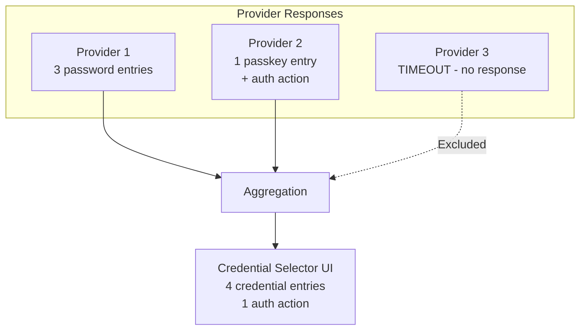

### 41.7.15 PrepareGetRequestSession

`PrepareGetRequestSession` 支持自动填充集成所使用的两步检索模式：

1. **准备阶段：** 查询提供方并缓存结果
2. **获取阶段：** 当用户与表单字段交互时使用缓存的结果

这避免了在用户点击字段的那一刻查询提供方所带来的延迟。准备阶段返回一个 `PrepareGetCredentialResponseInternal`，指示：

- 是否有可用的凭证结果
- 是否有可用的认证结果
- 是否有可用的远程结果
- 在需要结果时调用的 `PendingIntent`

### 41.7.16 提供方信息工厂

`CredentialProviderInfoFactory` 负责发现和构建提供方元数据：

```java
// From CredentialProviderInfoFactory.java (in service.credentials package)
// Discovers providers by querying PackageManager for:
// 1. Services declaring SERVICE_INTERFACE (user-configurable providers)
// 2. Services declaring SYSTEM_SERVICE_INTERFACE (system providers)
// 3. Parses metadata XML for capability declarations
// 4. Checks signing certificates for system provider validation
```

工厂方法：

- `getAvailableSystemServices()` —— 查找设备上的所有系统提供方
- `getCredentialProviderServices()` —— 获取按用户偏好过滤的提供方
- `create()` —— 为特定组件创建 `CredentialProviderInfo`

### 41.7.17 请求类型与 RequestInfo

`RequestInfo` 类封装了凭证请求的类型和参数。它是选择器界面的关键输入：

```java
// From RequestInfo.java
public static final String TYPE_GET = "android.credentials.selection.TYPE_GET";
public static final String TYPE_CREATE = "android.credentials.selection.TYPE_CREATE";
public static final String TYPE_GET_VIA_REGISTRY =
        "android.credentials.selection.TYPE_GET_VIA_REGISTRY";
```

| 请求类型 | 描述 | 使用方 |
|---|---|---|
| `TYPE_GET` | 标准凭证检索 | `executeGetCredential()` |
| `TYPE_CREATE` | 凭证创建/保存 | `executeCreateCredential()` |
| `TYPE_GET_VIA_REGISTRY` | 基于注册表的检索（数字凭证） | 带有元素键的 `executeGetCredential()` |

请求类型决定：

- 选择器使用哪种界面布局（凭证列表还是保存提示）
- 是否应用主要提供方高亮
- 条目如何排序和展示

### 41.7.18 已禁用的提供方数据

当选择器界面显示时，它可能包含有关已禁用提供方的信息：

```java
// From CredentialManagerUi.java
// Disabled providers are shown in the UI to inform users that
// additional credential sources exist but need to be enabled
// The UI may include a "More options" or "Enable provider" action
```

`DisabledProviderData` 类非常精简。它仅携带提供方的扁平化 `ComponentName` 字符串，继承自其 `ProviderData` 基类。它不持有显示名称、设置 intent 或支持的凭证类型列表。选择器界面通过 `PackageManager` 自行从组件名称解析提供方的标签和图标。

这仍然有助于用户发现并启用他们已安装但尚未激活的凭证提供方。

### 41.7.19 与 WebView 和浏览器的集成

对于基于 Web 的认证，通行密钥流程有一些特殊考虑：

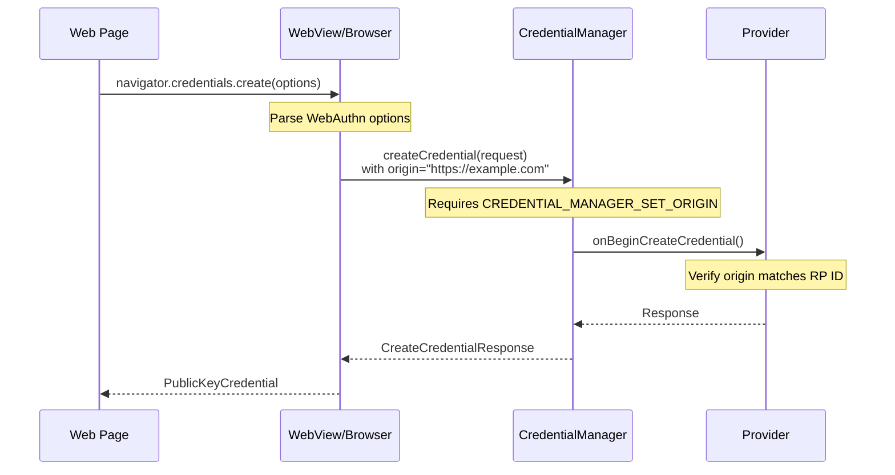

浏览器（或 WebView）负责：

1. 解析 JavaScript WebAuthn API 调用
2. 设置正确的源（需要特权权限）
3. 在 W3C WebAuthn 类型与 Android 凭证管理器类型之间进行映射
4. 以符合 W3C 的格式将结果返回给 JavaScript

`CallingAppInfo.getOrigin()` 方法提供 Web 源，提供方使用它进行依赖方验证。

### 41.7.20 凭证管理器与锁屏

凭证管理器以多种方式与锁屏交互：

1. **条件界面：** 在锁屏上，系统可以在自动填充输入法栏中显示凭证建议，而无需完整的应用上下文

2. **生物识别门控：** 通行密钥认证通常需要生物识别验证，提供方通过其 PendingIntent Activity 实现

3. **直接启动：** 在直接启动模式下（CE 存储解锁之前），只有 DE 存储的凭证可以访问。大多数凭证提供方将数据存储在 CE 存储中，因此直到用户解锁之前它们都不可用

4. **凭证管理器作为锁屏输入：** 一些 OEM 将通行密钥认证直接集成到锁屏流程中。这允许基于通行密钥的设备解锁，但它不属于 AOSP 的一部分

### 41.7.21 性能特征

凭证操作的典型耗时（在中端设备上测量）：

| 阶段 | 时长 | 瓶颈 |
|---|---|---|
| 会话创建 | 1-5 ms | 对象分配、锁获取 |
| 提供方绑定 | 50-200 ms | 服务连接建立 |
| 提供方查询（开始） | 100-500 ms | 提供方的凭证搜索 |
| 界面显示 | 50-100 ms | Activity 启动、布局加载 |
| 用户选择 | 可变 | 用户交互时间 |
| 提供方最终处理 | 100-300 ms | 凭证检索、生物识别 |
| 总计（最佳情况） | ~500 ms | 由提供方响应主导 |
| 超时（最坏情况） | 3000 ms | 强制执行的提供方超时 |

优化策略：

- 预热提供方绑定（由自动填充桥接完成）
- 使用 `PrepareGetRequestSession` 进行预取
- 使用 `CredentialDescriptionRegistry` 跳过不匹配的提供方
- 并行提供方查询（同时查询所有提供方）

---

## 41.8 Android 17 变更

凭证管理器框架在 Android 17 时已趋于成熟，因此该版本没有带来新的顶层架构。从 16 到 17 的工作是一系列正确性与加固修复。这些修复以新条目的形式出现在 `frameworks/base/core/java/android/credentials/flags.aconfig` 中。这项工作还淘汰了行为已毕业为无条件的标志。本节将每项变更映射到它所门控的代码。

### 41.8.1 Android 17 标志集

与本版本相关的标志，均位于 `credential_manager` 命名空间中：

| 标志 | 类型 | 变更内容 |
|---|---|---|
| `multi_user_fix_enabled` | bugfix | 包/服务移除期间的设置写入针对受影响的 `userId` |
| `parceled_credential_fix_enabled` | bugfix | `GetCredentialProviderData` 将条目列表作为 `ParceledListSlice` 打包 |
| `ttl_fix_enabled` | bugfix | 对"事务过大"打包失败的缓解 |
| `package_update_fix_enabled` | bugfix | 当提供方应用被更新或其组件变更时，将其从设置中移除 |
| `cpif_exc_fix_enabled` | bugfix | 捕获 `CredentialProviderInfoFactory` 内部抛出的异常 |
| `safeguard_candidate_credentials_api_caller` | bugfix | 将 `getCandidateCredentials()` 限制为凭证自动填充服务 |
| `metric_bugfixes_continued` | bugfix | 持续的指标日志修正（25Q3 工作） |

**来源：** `frameworks/base/core/java/android/credentials/flags.aconfig`

早期代码曾分支的两个标志已在 17 中被**移除**，其分支被折叠：`clear_session_enabled` 和 `hybrid_filter_opt_fix_enabled`。来自较旧资料的对 `Flags.clearSessionEnabled()` 的引用不再能在 17 代码树中编译，因为该符号已不存在。它所门控的会话清理行为现已始终开启。

### 41.8.2 多用户设置正确性

最重要的修复是 `multi_user_fix_enabled`。在此之前，提供方设置是针对 `UserHandle.myUserId()`（即 `system_server` 调用恰好解析到的用户）写入的，而不是针对实际发生包变更的用户。在多用户设备或工作资料上，为一个用户移除提供方可能会读取或写入另一个用户的 `CREDENTIAL_SERVICE` 值。

```java
// From CredentialManagerService.updateProvidersWhenServiceRemoved(), Android 17
if (Flags.multiUserFixEnabled()) {
    settingsWrapper.putStringForUser(
            Settings.Secure.CREDENTIAL_SERVICE_PRIMARY,
            String.join(SETTINGS_DELIMITER, filteredPrimaryProviders),
            userId,                       // affected user
            /* overrideableByRestore= */ true);
} else {
    settingsWrapper.putStringForUser(
            Settings.Secure.CREDENTIAL_SERVICE_PRIMARY,
            String.join(SETTINGS_DELIMITER, filteredPrimaryProviders),
            UserHandle.myUserId(),        // legacy: wrong user on multi-user devices
            /* overrideableByRestore= */ true);
}
```

对于 `CREDENTIAL_SERVICE`（次要）键也会出现同样的 `userId` 与 `myUserId()` 分支。该修复从 `handleServiceRemovedMultiModeLocked()`（41.2.9 节中包移除路径的服务移除对应物）进入。该方法将 `userId` 一路向下传递。

**来源：** `frameworks/base/services/credentials/java/com/android/server/credentials/CredentialManagerService.java`

### 41.8.3 打包大型提供方响应

存储了大量凭证的提供方可能会产生一个 `GetCredentialProviderData`，当构建界面 intent 时，其条目列表会溢出 Binder 事务限制。在 Android 17 中，`parceled_credential_fix_enabled` 将三个条目列表（凭证条目、操作标签、认证条目）从原始的 `writeTypedList()` 切换为 `ParceledListSlice`。该类型可以跨 Binder 流式传输大型列表，并且不会导致 `TransactionTooLargeException`：

```java
// From GetCredentialProviderData.writeToParcel(), Android 17
if (Flags.parceledCredentialFixEnabled()) {
    dest.writeTypedObject(new ParceledListSlice<>(mCredentialEntries), flags);
    dest.writeTypedObject(new ParceledListSlice<>(mActionChips), flags);
    dest.writeTypedObject(new ParceledListSlice<>(mAuthenticationEntries), flags);
} else {
    dest.writeTypedList(mCredentialEntries);
    dest.writeTypedList(mActionChips);
    dest.writeTypedList(mAuthenticationEntries);
}
```

`Parcel` 构造函数中的读取路径通过 `in.readTypedObject(ParceledListSlice.CREATOR)` 与此对应。配套的 `ttl_fix_enabled` 标志解决请求端相同类型的事务大小失败。二者结合使选择器对拥有数百个条目的密码管理器也能保持稳健。

**来源：** `frameworks/base/core/java/android/credentials/selection/GetCredentialProviderData.java`

### 41.8.4 加固提供方发现与自动填充调用方

两个修复加固了服务所依赖的边界：

- **`cpif_exc_fix_enabled`** 旨在捕获 `CredentialProviderInfoFactory` 解析格式错误的提供方清单时抛出的异常。这样，单个损坏的提供方包就不会导致整个枚举过程崩溃。然而，截至当前代码树，该标志仅在 `flags.aconfig` 中*声明*。尚无代码读取它，因此该受门控的修复尚未在任何调用点落地。

- **`safeguard_candidate_credentials_api_caller`**（现已毕业为无条件）强制执行：只有由 `config_defaultCredentialManagerAutofillService` 指定的 OEM 配置的凭证自动填充组件，才能调用 `getCandidateCredentials()`。如果无法解析调用方的组件名或无法确定其调用包，该检查会拒绝该调用方。它还会拒绝调用包与配置的自动填充服务不匹配的调用方（41.5.2 节）。这堵住了一条任意应用都能借此收割仅面向自动填充界面的凭证候选的路径。

**来源：** `frameworks/base/core/java/android/credentials/flags.aconfig`（标志声明）；`frameworks/base/services/credentials/java/com/android/server/credentials/CredentialManagerService.java`（`getCandidateCredentials()` 调用方检查）

### 41.8.5 身份凭证 API 弃用

与凭证管理器无关的是，Android 17 继续逐步淘汰较旧的 `android.security.identity`（Identity Credential）API。41.6 节中描述的数字凭证流程是首选路径。在此流程中，身份证件通过相同的 `CredentialManager` 路径流转。这是通过提供方定义的类型字符串（`"com.credman.IdentityCredential"`）和 `CredentialDescriptionRegistry` 来完成的。面向数字身份的应用代码应使用凭证管理器注册表路径，而不是已弃用的独立 API。

---

## 41.9 动手实践

### 41.9.1 检查凭证管理器状态

**列出已启用的凭证提供方：**

```bash
# Check the Settings.Secure value for the current user
adb shell settings get --user 0 secure credential_service

# Check primary providers
adb shell settings get --user 0 secure credential_service_primary
```

**关于 `dumpsys` 的说明：** 与大多数系统服务不同，`CredentialManagerService` 没有实现 dump 处理器。其发布的 `credential` binder 会回退到 `Binder` 的无操作 `dump()`，因此 `adb shell dumpsys credential` 不会打印任何有用的信息。要检查状态，请依赖上述 `Settings.Secure` 键和 logcat。该服务会在 `CredentialManager` 标签下记录提供方构建、会话生命周期和状态变更（参见 41.9.8 节）。

### 41.9.2 启用提供方

```bash
# Set a provider as enabled (requires WRITE_SECURE_SETTINGS)
adb shell settings put --user 0 secure credential_service \
    "com.example.myprovider/.MyCredentialProviderService"

# Set a provider as primary
adb shell settings put --user 0 secure credential_service_primary \
    "com.example.myprovider/.MyCredentialProviderService"
```

### 41.9.3 实现一个最小提供方

一个基本的密码提供方演示了两阶段协议。

**1. 服务声明（AndroidManifest.xml）：**

```xml
<service
    android:name=".DemoCredentialProvider"
    android:permission="android.permission.BIND_CREDENTIAL_PROVIDER_SERVICE"
    android:exported="true">
    <intent-filter>
        <action android:name="android.service.credentials.CredentialProviderService" />
    </intent-filter>
    <meta-data
        android:name="android.credentials.provider"
        android:resource="@xml/provider_config" />
</service>
```

**2. 提供方配置（res/xml/provider_config.xml）：**

```xml
<credential-provider xmlns:android="http://schemas.android.com/apk/res/android">
    <capabilities>
        <capability name="android.credentials.TYPE_PASSWORD_CREDENTIAL" />
    </capabilities>
</credential-provider>
```

**3. 服务实现。** 请注意，框架入口类（`android.service.credentials.CredentialEntry`、`CreateEntry`）没有构建器——它们唯一的构造函数接受一个预先构建的 `Slice`。在实践中，提供方继承 Jetpack 的 `androidx.credentials.provider.CredentialProviderService`，其类型化条目构建器（`PasswordCredentialEntry.Builder`、`CreateEntry.Builder` 等）在底层构造这些 Slice：

```kotlin
// Uses androidx.credentials.provider.* (Jetpack), not the raw framework classes
class DemoCredentialProvider : CredentialProviderService() {

    override fun onBeginGetCredentialRequest(
        request: BeginGetCredentialRequest,
        cancellationSignal: CancellationSignal,
        callback: OutcomeReceiver<BeginGetCredentialResponse,
                GetCredentialException>
    ) {
        val entries = mutableListOf<CredentialEntry>()

        for (option in request.beginGetCredentialOptions) {
            if (option is BeginGetPasswordOption) {
                // Look up stored credentials for the calling app
                val stored = lookupPasswords(request.callingAppInfo?.packageName)
                for (cred in stored) {
                    entries.add(
                        PasswordCredentialEntry.Builder(
                            this,
                            cred.username,
                            createPendingIntent(cred.id),
                            option
                        )
                        .build()
                    )
                }
            }
        }

        callback.onResult(
            BeginGetCredentialResponse.Builder()
                .setCredentialEntries(entries)
                .build()
        )
    }

    override fun onBeginCreateCredentialRequest(
        request: BeginCreateCredentialRequest,
        cancellationSignal: CancellationSignal,
        callback: OutcomeReceiver<BeginCreateCredentialResponse,
                CreateCredentialException>
    ) {
        callback.onResult(
            BeginCreateCredentialResponse.Builder()
                .addCreateEntry(
                    CreateEntry.Builder("Save to Demo Provider",
                        createSavePendingIntent()
                    ).build()
                ).build()
        )
    }

    override fun onClearCredentialStateRequest(
        request: ProviderClearCredentialStateRequest,
        cancellationSignal: CancellationSignal,
        callback: OutcomeReceiver<Void?, ClearCredentialException>
    ) {
        // Clear any cached credential state
        callback.onResult(null)
    }
}
```

**4. 客户端用法：**

```kotlin
val credentialManager = getSystemService(CredentialManager::class.java)

// Get a credential
val getRequest = GetCredentialRequest.Builder()
    .addCredentialOption(
        GetPasswordOption()
    )
    .build()

credentialManager.getCredential(
    context = this,
    request = getRequest,
    cancellationSignal = null,
    executor = mainExecutor,
    callback = object : OutcomeReceiver<GetCredentialResponse,
            GetCredentialException> {
        override fun onResult(result: GetCredentialResponse) {
            // Handle credential: result.credential.data
        }
        override fun onError(error: GetCredentialException) {
            // Handle error
        }
    }
)
```

### 41.9.4 调试提供方通信

**启用详细日志：**

```bash
adb shell setprop log.tag.CredentialManager VERBOSE
adb logcat -s CredentialManager
```

**监控提供方绑定：**

```bash
adb logcat | grep -E "CredentialManagerServiceImpl|RemoteCredentialService"
```

**检查超时问题：**

```bash
# The 3-second timeout is logged when providers are slow
adb logcat | grep "Remote provider response timed"
```

### 41.9.5 凭证描述 API

**检查描述 API 是否已启用：**

```bash
adb shell device_config get credential_manager enable_credential_description_api
```

**为测试启用它：**

```bash
adb shell device_config put credential_manager enable_credential_description_api true
```

### 41.9.6 测试通行密钥流程

要测试通行密钥的创建和认证：

1. 搭建一个 WebAuthn 依赖方（或使用 webauthn.io 进行测试）
2. 启用支持通行密钥的提供方（例如 Google 密码管理器）
3. 在测试应用或浏览器中：

```kotlin
// Create a passkey
val createRequest = CreateCredentialRequest(
    "androidx.credentials.TYPE_PUBLIC_KEY_CREDENTIAL",
    Bundle().apply {
        putString(
            "androidx.credentials.BUNDLE_KEY_REQUEST_JSON",
            """{"rp":{"id":"example.com","name":"Example"},
               "user":{"id":"dXNlcg","name":"user@example.com"},
               "challenge":"Y2hhbGxlbmdl",
               "pubKeyCredParams":[{"type":"public-key","alg":-7}],
               "authenticatorSelection":{"residentKey":"required"}}"""
        )
    }
)
credentialManager.createCredential(context, createRequest, ...)
```

### 41.9.7 DeviceConfig 标志

凭证管理器遵循多个 `DeviceConfig` 标志：

| 标志 | 命名空间 | 用途 |
|---|---|---|
| `enable_credential_manager` | `credential_manager` | 主启用/禁用开关 |
| `enable_credential_description_api` | `credential_manager` | 启用基于注册表的匹配 |

```bash
# Check if Credential Manager is enabled
adb shell device_config get credential_manager enable_credential_manager

# Disable for testing
adb shell device_config put credential_manager enable_credential_manager false
```

### 41.9.8 关键日志消息序列

在追踪完整的获取凭证流程时，按顺序查找以下日志消息：

```
CredentialManager: starting executeGetCredential with callingPackage: com.example.app
CredentialManager: CredentialManagerServiceImpl constructed for: com.provider/.Service
CredentialManager: Provider session created and being added for: com.provider/.Service
CredentialManager: Status changed for: com.provider/.Service, with status: CREDENTIALS_RECEIVED
CredentialManager: Provider status changed - ui invocation is needed
CredentialManager: For ui, provider data size: 1
CredentialManager: onFinalResponseReceived from: com.provider/.Service
CredentialManager: finishing session with propagateCancellation false
```

---

## 总结

凭证管理器框架将 Android 的凭证处理从一个碎片化的 API 集合转变为一个统一、安全且可扩展的系统。其架构建立在几个关键支柱之上：

- **`CredentialManagerService`** 编排整个流程，管理按用户划分的提供方实例与请求会话
- **两阶段协议**（开始/完成）确保凭证材料永远不会被不必要地加载或暴露给系统
- **`ProviderSession` 状态机** 通过定义良好的生命周期跟踪每个提供方的进度
- **`RemoteCredentialService`** 处理与提供方进程的异步绑定与通信，并带有严格的超时
- **`CredentialDescriptionRegistry`** 为数字凭证用例实现高效路由
- **通过 `CredentialManagerUi` 实现的系统中介界面** 确保用户始终看到可信的凭证选择器

该框架通过相同的统一路径支持密码、通行密钥（FIDO2/WebAuthn）和数字身份证件。它通过提供方能力系统为未来的凭证类型提供可扩展性。
