# 第 65 章：定制 ROM

本章是本书的收官之作。我们将前文 62 章涵盖的所有内容融为一体，包括构建系统、init、HAL、系统服务、SystemUI、模拟器、安全与签名。我们将它们整合成一次端到端的完整演练，演示如何构建、定制、签名并分发一个功能完备的定制 ROM。

我们的目标设备是 AOSP Goldfish 模拟器（`sdk_phone64_x86_64`）。这是一个刻意的选择：本书的每一位读者都拥有一台可以运行模拟器的笔记本或工作站，无需任何实体硬件。我们在这里构建的一切同样适用于实体设备，包括自定义设备树、overlay、应用、服务、开机动画、内核调整以及 HAL 修改。只有 `BoardConfig.mk` 和内核二进制文件会有所不同。

本章中的每一个文件路径、每一条命令、每一段代码片段，均已对照 Android 17（`android17-release`）AOSP 源码树逐一核实。在引用源文件时，我们会给出其完整的相对树路径，以便你可以在自己的检出副本中同步跟进。

---

## 65.1 规划你的定制 ROM

### 65.1.1 什么是“定制 ROM”？

定制 ROM 是 Android 的一种经过修改的构建版本，它会改动以下层次中的一个或多个：

| 层次 | 示例 | 复杂度 |
|-------|----------|------------|
| 产品配置 | 品牌标识、默认应用、壁纸 | 低 |
| 资源 overlay | 状态栏颜色、快捷设置布局、配置标志 | 低 |
| 预编译应用 | 添加/移除内置 APK | 低 |
| 框架行为 | 新的系统服务、修改的 API | 中 |
| SystemUI | 自定义状态栏、导航、主题 | 中 |
| 开机动画 | 自定义启动画面 | 低 |
| 内核 | 自定义模块、调度器调优 | 高 |
| HAL | 自定义硬件抽象层 | 高 |
| 签名与分发 | 发布密钥、OTA 包 | 中 |

知名的社区 ROM（LineageOS、/e/OS、GrapheneOS、CalyxOS、PixelExperience）各自组合了横跨所有这些层次的定制内容。在本章中，我们将触及每一个层次。

### 65.1.2 定义你的 ROM 目标

在动手写任何代码之前，先回答这些问题：

1. **目的是什么？** 以隐私为中心？性能优化？企业管理？学习练习？

2. **目标设备是什么？** 我们使用模拟器（`goldfish`/`ranchu`）；实体设备则需要 vendor blob 和内核源码。

3. **哪个 Android 版本？** 我们从 AOSP `main` 分支构建，在写作本书时 `main` 为 Android 17（平台 SDK 37，最后稳定版本 17）。锁定这些取值的发布配置位于 `build/release/` 之下；`build/release/flag_values/trunk_staging/RELEASE_PLATFORM_VERSION_LAST_STABLE.textproto` 中为 `"17"`，`RELEASE_PLATFORM_SDK_VERSION.textproto` 中为 `"37"`。

4. **品牌标识是什么？** 定制 ROM 名称、型号字符串、构建指纹。
5. **默认预装哪些应用？** 保留哪些 AOSP 应用、移除哪些、添加哪些第三方 APK？

6. **有哪些框架改动？** 新的服务、修改的行为、配置变更。

### 65.1.3 我们将构建的 ROM

贯穿本章，我们将构建 **"AospBook ROM"**——一个包含以下内容的定制 ROM：

- 一个继承自 Goldfish 的自定义设备配置
- 自定义品牌标识（产品名称、型号、构建指纹）
- 一个预编译的第三方应用
- 一个编译进系统镜像的自建示例应用
- 一个修改框架与 SystemUI 默认值的运行时资源 Overlay（RRO）
- 一个可通过 AIDL 访问的自定义系统服务
- 一个自定义开机动画
- SystemUI 主题修改
- 自定义签名密钥
- 一个 OTA 更新包
- 一个自定义内核模块
- 一个自定义 HAL 实现

### 65.1.4 架构总览

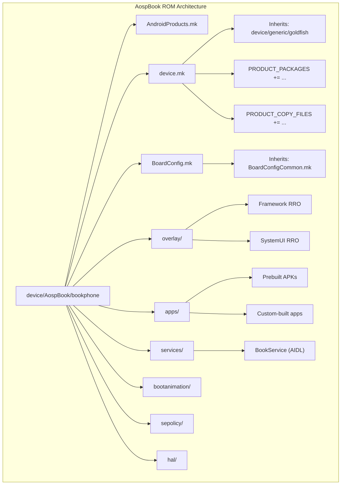

### 65.1.5 目录布局

以下是我们将在本章中逐步创建的目录树：

```
device/AospBook/bookphone/
    AndroidProducts.mk
    bookphone.mk                  # product makefile
    BoardConfig.mk
    device.mk                     # device-level config
    overlay/
        frameworks/
            base/
                core/res/res/values/config.xml
        BookSystemUIOverlay/
            AndroidManifest.xml
            Android.bp
            res/values/config.xml
    apps/
        BookSampleApp/
            Android.bp
            AndroidManifest.xml
            src/...
            res/...
        prebuilt/
            BookReader/
                Android.bp
                BookReader.apk
    services/
        BookService/
            Android.bp
            aidl/...
            src/...
    bootanimation/
        desc.txt
        part0/
        part1/
    hal/
        booklight/
            Android.bp
            aidl/...
            default/...
    sepolicy/
        vendor/
            file_contexts
            bookservice.te
            booklight.te
    keys/
        releasekey.pk8
        releasekey.x509.pem
        platform.pk8
        platform.x509.pem
        shared.pk8
        shared.x509.pem
        media.pk8
        media.x509.pem
```

---

## 65.2 搭建构建环境

### 65.2.1 硬件要求

构建 AOSP 是资源密集型任务。要求如下：

| 资源 | 最低 | 推荐 | 我们的配置 |
|----------|---------|-------------|-----------|
| 磁盘（源码） | 250 GB | 400 GB | 500 GB SSD |
| 磁盘（含构建产物） | 400 GB | 600 GB+ | 1 TB NVMe |
| 内存 | 32 GB | 64 GB+ | 64 GB |
| CPU 核心数 | 4 | 16+ | 16 核 |
| 操作系统 | Ubuntu 22.04+ | Ubuntu 24.04 LTS | Ubuntu 24.04 |
| 文件系统 | ext4（区分大小写） | ext4 | ext4 |

构建过程高度并行。每多一个核心，完整构建就能缩短数分钟。内存是第二重要的因素——链接器（`lld`）以及 javac/d8 编译阶段每个并行任务可能消耗 2-4 GB 内存。

关于构建工具链的说明：AOSP 自带预编译的宿主工具链。因此，你**不必**从发行版安装 JDK 或 C/C++ 编译器。构建会使用树内的 OpenJDK 和树内的 clang。全局默认为 jdk21，树内还提供了 jdk25 供选择性工具链使用（参见 `build/soong/ui/build/config.go` 中的 `ConfigJavaEnvironment`）。下面列出的宿主包仅是构建脚本会调用的支撑库和工具。

### 65.2.2 必需软件包（Ubuntu/Debian）

AOSP 构建系统依赖一组特定的宿主软件包。一次性全部安装：

```bash
# Update package lists
sudo apt-get update

# Essential build packages
sudo apt-get install -y \
    git-core gnupg flex bison build-essential \
    zip curl zlib1g-dev libc6-dev-i386 \
    x11proto-core-dev libx11-dev lib32z1-dev \
    libgl1-mesa-dev libxml2-utils xsltproc unzip \
    fontconfig libncurses5 procps python3 python3-pip \
    rsync libssl-dev

# For 64-bit hosts running 32-bit prebuilts
sudo apt-get install -y \
    lib32ncurses-dev lib32readline-dev lib32z1-dev

# For emulator GPU acceleration
sudo apt-get install -y \
    libvulkan-dev mesa-vulkan-drivers \
    libpulse0 libgl1

# For kernel building (if needed)
sudo apt-get install -y \
    bc cpio kmod libelf-dev

# Python dependencies (some build scripts require specific versions)
sudo apt-get install -y \
    python3-protobuf python3-setuptools
```

### 65.2.3 安装 `repo` 工具

`repo` 工具跨数百个 AOSP 仓库统一编排 Git：

```bash
# Create a bin directory in your home directory
mkdir -p ~/bin

# Download the repo launcher
curl https://storage.googleapis.com/git-repo-downloads/repo > ~/bin/repo

# Make it executable
chmod a+x ~/bin/repo

# Add to PATH (add to ~/.bashrc for persistence)
export PATH=~/bin:$PATH

# Verify installation
repo version
```

`repo` 启动器是一个 Python 脚本，负责从 Google 的仓库引导安装完整的 `repo` 工具。它要求 Python 3.6+。

### 65.2.4 初始化 AOSP 源码树

```bash
# Create your working directory
mkdir -p ~/aosp && cd ~/aosp

# Initialize the repo with the main branch
repo init -u https://android.googlesource.com/platform/manifest \
    -b main \
    --partial-clone \
    --clone-filter=blob:limit=10M

# Sync all repositories (this takes 1-3 hours on a fast connection)
repo sync -c -j$(nproc) --no-tags --no-clone-bundle
```

关键标志说明：

| 标志 | 用途 |
|------|---------|
| `-b main` | 跟踪 `main` 开发分支 |
| `--partial-clone` | 启用 Git 部分克隆（节省磁盘） |
| `--clone-filter=blob:limit=10M` | 初始仅下载小于 10 MB 的 blob |
| `-c` | 仅同步当前分支 |
| `-j$(nproc)` | 在所有 CPU 核心上并行 |
| `--no-tags` | 跳过 Git 标签（节省时间/空间） |
| `--no-clone-bundle` | 跳过 bundle 文件（有时更快） |

### 65.2.5 完整配置脚本

下面是一个完整、幂等的配置脚本，可在一台全新的 Ubuntu 22.04 机器上运行：

```bash
#!/bin/bash
# setup_aosp_build_env.sh -- Complete AOSP build environment setup
# Usage: sudo ./setup_aosp_build_env.sh

set -euo pipefail

echo "=== AOSP Build Environment Setup ==="

# 1. System packages
echo "[1/6] Installing system packages..."
apt-get update -qq
apt-get install -y -qq \
    git-core gnupg flex bison build-essential \
    zip curl zlib1g-dev libc6-dev-i386 \
    x11proto-core-dev libx11-dev lib32z1-dev \
    libgl1-mesa-dev libxml2-utils xsltproc unzip \
    fontconfig libncurses5 procps python3 python3-pip \
    rsync libssl-dev bc cpio kmod libelf-dev \
    lib32ncurses-dev lib32readline-dev lib32z1-dev \
    python3-protobuf python3-setuptools \
    libvulkan-dev mesa-vulkan-drivers libpulse0 libgl1

# 2. Java toolchain note
echo "[2/6] Java toolchain..."
# No host JDK install is needed: the AOSP build uses its in-tree prebuilt
# OpenJDK (prebuilts/jdk/jdk21, with jdk25 also in-tree) and sets JAVA_HOME
# itself when you source build/envsetup.sh and run lunch.

# 3. Configure Git
echo "[3/6] Configuring Git..."
git config --global user.email "${GIT_EMAIL:-builder@example.com}"
git config --global user.name "${GIT_NAME:-AOSP Builder}"
git config --global color.ui auto

# 4. Install repo
echo "[4/6] Installing repo tool..."
REPO_BIN="/usr/local/bin/repo"
if [ ! -f "$REPO_BIN" ]; then
    curl -s https://storage.googleapis.com/git-repo-downloads/repo > "$REPO_BIN"
    chmod a+x "$REPO_BIN"
fi
echo "repo version: $(repo version 2>/dev/null | head -1)"

# 5. Set up ccache (optional but recommended)
echo "[5/6] Configuring ccache..."
apt-get install -y -qq ccache
echo 'export USE_CCACHE=1' >> /etc/profile.d/aosp.sh
echo 'export CCACHE_EXEC=/usr/bin/ccache' >> /etc/profile.d/aosp.sh
echo 'export CCACHE_DIR=$HOME/.ccache' >> /etc/profile.d/aosp.sh
ccache -M 50G

# 6. Kernel tuning for large builds
echo "[6/6] Tuning kernel parameters..."
# Increase file watcher limit (build system uses inotify)
echo 'fs.inotify.max_user_watches=524288' >> /etc/sysctl.d/99-aosp.conf
# Increase open file limit
echo '* soft nofile 65536' >> /etc/security/limits.d/99-aosp.conf
echo '* hard nofile 65536' >> /etc/security/limits.d/99-aosp.conf
sysctl -p /etc/sysctl.d/99-aosp.conf

echo ""
echo "=== Setup Complete ==="
echo "Next steps:"
echo "  1. mkdir ~/aosp && cd ~/aosp"
echo "  2. repo init -u https://android.googlesource.com/platform/manifest -b main"
echo "  3. repo sync -c -j\$(nproc)"
echo "  4. source build/envsetup.sh"
echo "  5. lunch <target>"
echo "  6. m"
```

### 65.2.6 配置 ccache

编译器缓存 `ccache` 能大幅缩短重新构建的时间。在首次完整构建（约 2-4 小时）之后，仅改动少量文件的增量构建可在数分钟内完成。

```bash
# Set cache size (50 GB is reasonable for AOSP)
export USE_CCACHE=1
export CCACHE_EXEC=/usr/bin/ccache
export CCACHE_DIR=$HOME/.ccache
ccache -M 50G

# Add to ~/.bashrc for persistence
cat >> ~/.bashrc << 'EOF'
export USE_CCACHE=1
export CCACHE_EXEC=/usr/bin/ccache
export CCACHE_DIR=$HOME/.ccache
EOF
```

构建完成后查看缓存统计信息：

```bash
ccache -s
# Example output:
# cache hit (direct)                 123456
# cache hit (preprocessed)            12345
# cache miss                          23456
# cache hit rate                     84.56 %
```

### 65.2.7 初始化构建环境

每次打开新 shell 时，都要初始化构建环境：

```bash
cd ~/aosp

# Source the environment setup script
# Real file: build/make/envsetup.sh
source build/envsetup.sh

# This provides:
#   lunch    - Select a build target
#   m        - Build (make) from the tree root
#   mm       - Build from the current directory
#   mmm      - Build from a specified directory
#   croot    - cd to the tree root
#   godir    - Go to the directory containing a file
```

`envsetup.sh` 脚本（位于 `build/make/envsetup.sh`）为 shell 配置构建所需的函数和环境变量。它会扫描所有 `device/*/` 和 `vendor/*/` 目录中的 `vendorsetup.sh` 文件并将其 source 进来，从而注册额外的 lunch 目标。

### 65.2.8 理解 Lunch 目标

```bash
# Run lunch with no arguments for an interactive menu, or list the pieces
# of a target with the envsetup helpers:
list_products   # every product (TARGET_PRODUCT) the tree knows about
list_releases   # release configs (trunk_staging, next, ...)
list_variants   # user, userdebug, eng

# Select the emulator target (what we will base our ROM on)
lunch sdk_phone64_x86_64-trunk_staging-userdebug
```

`list_products`、`list_releases` 和 `list_variants` 是 `build/soong/bin/` 下的独立脚本。`build/make/envsetup.sh` 会通过其 `set_global_paths` 辅助函数将它们加入你的 `PATH`。`lunch` 本身接受完整的 `<product>-<release>-<variant>` 字符串。不带参数运行时，它会打印一个菜单。

一个 lunch 目标的形式为 `<product>-<release>-<variant>`：

| 组成部分 | 取值 | 说明 |
|-----------|--------|-------------|
| Product | `sdk_phone64_x86_64` | 定义于 `AndroidProducts.mk` |
| Release | `trunk_staging` | 发布配置 |
| Variant | `userdebug` | `user`、`userdebug` 或 `eng` |

三种构建变体控制可调试性：

| 变体 | `ro.debuggable` | `adb` | Root | 使用场景 |
|---------|-----------------|-------|------|----------|
| `user` | 0 | 默认关闭 | 无 | 生产/发布 |
| `userdebug` | 1 | 开启 | adb root | 带有接近生产行为特性的开发 |
| `eng` | 1 | 开启 | 始终 root | 完整开发/调试 |

对于我们的定制 ROM，我们将创建自己的 lunch 目标，取代 `sdk_phone64_x86_64`。

### 65.2.9 构建过程总览

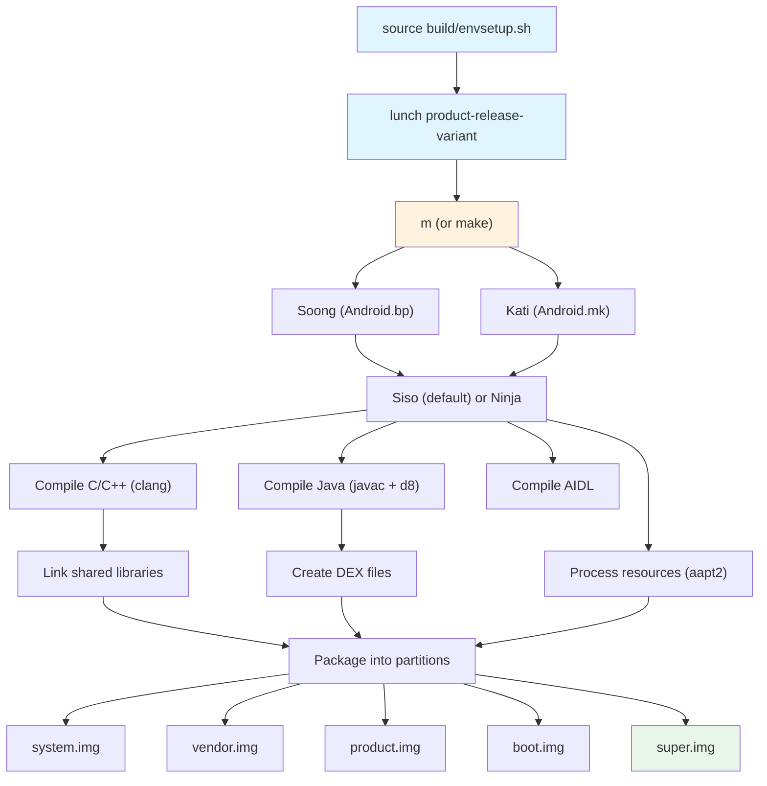

在 Android 17 中，最终构建步骤默认通过 **Siso** 而非经典的 Ninja 来运行。`build/soong/ui/build/config.go` 将 `NINJA_DEFAULT` 设为 `NINJA_SISO`。因此 `m` 默认使用 Siso 驱动 Soong 生成的构建图，除非显式覆盖。设置 `SOONG_NINJA=ninja` 可以回退到经典 Ninja。macOS 的 CI 构建机也会自动回退。

Siso 与 Soong 输出的 Ninja 清单保持线路兼容。因此，从 ROM 作者的角度来看，构建过程仍然“感觉像 Ninja”——同样是 `m` 命令，同样是 `out/` 目录布局。但它提供了更好的远程执行与缓存钩子。本章的所有内容在两种执行器下表现完全一致。

---

## 65.3 创建设备配置

这是定制 ROM 的核心：设备配置目录。它告诉构建系统构建什么、如何构建，以及每个分区中放什么。

### 65.3.1 理解 Goldfish 设备树

在创建我们自己的配置之前，先理解现有的模拟器设备树。Goldfish 模拟器配置位于：

```
device/generic/goldfish/
```

其结构为：

```
device/generic/goldfish/
    AndroidProducts.mk              # Lists all product makefiles
    64bitonly/
        product/
            sdk_phone64_x86_64.mk   # Product definition
    board/
        BoardConfigCommon.mk        # Common board configuration
        emu64x/
            BoardConfig.mk          # x86_64-specific board config
            details.mk              # Kernel and fstab setup
    product/
        phone.mk                    # Phone product configuration
        handheld.mk                 # Handheld device base
        base_handheld.mk            # Handheld base with sounds
        generic.mk                  # Vendor/generic config
        versions.mk                 # Shipping API level
    overlay/                        # Static resource overlays
    rro_overlays/                   # Runtime resource overlays
        ConnectivityOverlay/
        RanchuCommonOverlay/
        TetheringOverlay/
    hals/                           # HAL implementations
        audio/
        camera/
        sensors/
        radio/
    sepolicy/                       # SELinux policies
    init/                           # Init scripts
        init.ranchu.rc
```

`sdk_phone64_x86_64` 的产品定义链为：

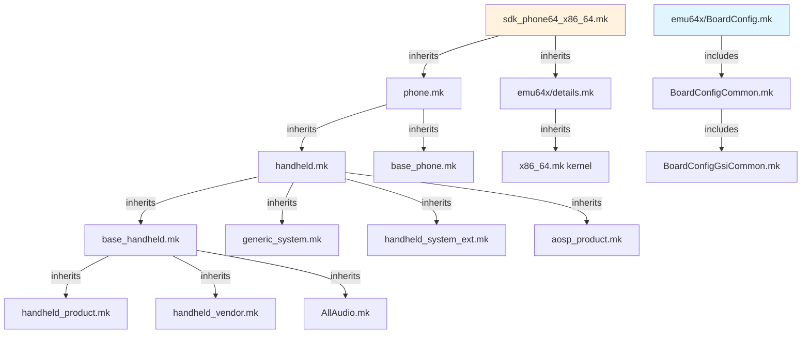

让我们查看这条链中的关键文件。

**`device/generic/goldfish/AndroidProducts.mk`**——列出每个产品的 makefile：

```makefile
# device/generic/goldfish/AndroidProducts.mk
PRODUCT_MAKEFILES := \
    $(LOCAL_DIR)/64bitonly/product/sdk_phone64_x86_64.mk \
    $(LOCAL_DIR)/64bitonly/product/sdk_phone64_arm64.mk \
    ...
```

**`device/generic/goldfish/64bitonly/product/sdk_phone64_x86_64.mk`**——
顶层产品定义：

```makefile
# device/generic/goldfish/64bitonly/product/sdk_phone64_x86_64.mk
PRODUCT_USE_DYNAMIC_PARTITIONS := true
BOARD_EMULATOR_DYNAMIC_PARTITIONS_SIZE ?= $(shell expr 1800 \* 1048576 )
BOARD_SUPER_PARTITION_SIZE := $(shell expr ... + 8388608 )

$(call inherit-product, $(SRC_TARGET_DIR)/product/core_64_bit_only.mk)
$(call inherit-product, device/generic/goldfish/board/emu64x/details.mk)
$(call inherit-product, device/generic/goldfish/product/phone.mk)

PRODUCT_BRAND := Android
PRODUCT_NAME := sdk_phone64_x86_64
PRODUCT_DEVICE := emu64x
PRODUCT_MODEL := Android SDK built for x86_64
```

这四个 `PRODUCT_*` 变量定义了构建目标的身份：

| 变量 | 用途 | 我们的取值 |
|----------|---------|-----------|
| `PRODUCT_NAME` | Lunch 目标名 | `bookphone` |
| `PRODUCT_DEVICE` | 主板/设备名，映射到 `BoardConfig.mk` | `bookdevice` |
| `PRODUCT_BRAND` | 设置中显示的品牌 | `AospBook` |
| `PRODUCT_MODEL` | 设置中显示的型号 | `AospBook Phone` |

**`device/generic/goldfish/board/BoardConfigCommon.mk`**——所有 Goldfish
目标共享的硬件级配置：

```makefile
# device/generic/goldfish/board/BoardConfigCommon.mk (key excerpts)
include build/make/target/board/BoardConfigGsiCommon.mk

BOARD_VENDOR_SEPOLICY_DIRS += device/generic/goldfish/sepolicy/vendor
TARGET_BOOTLOADER_BOARD_NAME := goldfish_$(TARGET_ARCH)

BUILD_EMULATOR_OPENGL := true
BUILD_QEMU_IMAGES := true
USE_OPENGL_RENDERER := true

# Emulator doesn't support sparse image format
TARGET_USERIMAGES_SPARSE_EXT_DISABLED := true

# emulator is Non-A/B device
AB_OTA_UPDATER := none

# emulator needs super.img
BOARD_BUILD_SUPER_IMAGE_BY_DEFAULT := true

# 8G + 8M
BOARD_SUPER_PARTITION_SIZE ?= 8598323200
BOARD_SUPER_PARTITION_GROUPS := emulator_dynamic_partitions

BOARD_EMULATOR_DYNAMIC_PARTITIONS_PARTITION_LIST := \
  system \
  system_dlkm \
  system_ext \
  product \
  vendor
```

### 65.3.2 创建我们的设备目录

现在创建我们自己的设备配置。约定为 `device/<vendor>/<device>`：

```bash
# Create the directory structure
mkdir -p device/AospBook/bookphone
```

### 65.3.3 AndroidProducts.mk

该文件向构建系统注册我们的产品：

```makefile
# device/AospBook/bookphone/AndroidProducts.mk
#
# This file is read by the build system to discover our product makefiles.
# Each entry in PRODUCT_MAKEFILES becomes a valid lunch target.

PRODUCT_MAKEFILES := \
    $(LOCAL_DIR)/bookphone.mk
```

当构建系统扫描 `device/` 目录时，它会寻找 `AndroidProducts.mk` 文件。`PRODUCT_MAKEFILES` 中列出的每个路径都会定义一个 lunch 目标，其名称即该 makefile 内部设置的 `PRODUCT_NAME`。

### 65.3.4 产品 Makefile：bookphone.mk

这是顶层产品定义。它继承自 Goldfish 以获得全部模拟器基础设施，然后叠加我们的定制内容：

```makefile
# device/AospBook/bookphone/bookphone.mk
#
# Top-level product makefile for AospBook Phone.
# This defines the lunch target "bookphone".
#
# Inherits from the Goldfish emulator to get all emulator-specific
# packages, HALs, kernel configuration, and hardware support.

# ============================================================
# Inherit from Goldfish emulator
# ============================================================

# Use dynamic partitions, same sizing as stock emulator
PRODUCT_USE_DYNAMIC_PARTITIONS := true
BOARD_EMULATOR_DYNAMIC_PARTITIONS_SIZE ?= $(shell expr 2400 \* 1048576)
BOARD_SUPER_PARTITION_SIZE := \
    $(shell expr $(BOARD_EMULATOR_DYNAMIC_PARTITIONS_SIZE) + 8388608)

# 64-bit only configuration
$(call inherit-product, $(SRC_TARGET_DIR)/product/core_64_bit_only.mk)

# Goldfish board details (kernel, fstab, etc.)
$(call inherit-product, device/generic/goldfish/board/emu64x/details.mk)

# Goldfish phone configuration (HALs, permissions, vendor packages)
$(call inherit-product, device/generic/goldfish/product/phone.mk)

# Our device-specific configuration
$(call inherit-product, device/AospBook/bookphone/device.mk)

# ============================================================
# Product identity
# ============================================================
PRODUCT_BRAND := AospBook
PRODUCT_NAME := bookphone
PRODUCT_DEVICE := bookdevice
PRODUCT_MODEL := AospBook Phone
PRODUCT_MANUFACTURER := AospBook

# Build fingerprint (shown in Settings > About phone)
BUILD_FINGERPRINT := AospBook/bookphone/bookdevice:17/BP1A.250505.005/eng.builder:userdebug/dev-keys

# ============================================================
# Additional product properties
# ============================================================
PRODUCT_PROPERTY_OVERRIDES += \
    ro.build.display.id=AospBook-1.0 \
    ro.aospbook.version=1.0.0 \
    ro.aospbook.build.type=development \
    persist.sys.timezone=America/Los_Angeles
```

### 65.3.5 设备 Makefile：device.mk

该文件包含设备特有的包、拷贝文件和属性：

```makefile
# device/AospBook/bookphone/device.mk
#
# Device-level configuration for AospBook Phone.
# This is where we add our custom packages, overlays, and copy files.

# ============================================================
# Custom packages
# ============================================================
PRODUCT_PACKAGES += \
    BookSampleApp \
    BookReader

# Custom system service
PRODUCT_PACKAGES += \
    BookService

# Custom overlays
PRODUCT_PACKAGES += \
    BookFrameworkOverlay \
    BookSystemUIOverlay

# Custom boot animation
PRODUCT_COPY_FILES += \
    device/AospBook/bookphone/bootanimation/bootanimation.zip:$(TARGET_COPY_OUT_PRODUCT)/media/bootanimation.zip

# ============================================================
# Custom properties
# ============================================================
PRODUCT_PRODUCT_PROPERTIES += \
    ro.aospbook.features.dark_mode_default=true \
    ro.aospbook.features.custom_qs=true

# ============================================================
# Soong namespace (allows our modules to be found)
# ============================================================
PRODUCT_SOONG_NAMESPACES += device/AospBook/bookphone
```

### 65.3.6 BoardConfig.mk

板级配置定义硬件级参数。由于我们的目标是模拟器，因此继承 Goldfish 的板级配置：

```makefile
# device/AospBook/bookphone/BoardConfig.mk
#
# Board configuration for AospBook Phone (emulator-based).
# This inherits from the Goldfish x86_64 board and customizes
# partition sizes and SELinux.

# x86_64 emulator architecture
TARGET_CPU_ABI := x86_64
TARGET_ARCH := x86_64
TARGET_ARCH_VARIANT := x86_64
TARGET_2ND_ARCH_VARIANT := x86_64

# Inherit common Goldfish board config
include device/generic/goldfish/board/BoardConfigCommon.mk

# ============================================================
# Partition sizes
# ============================================================
# Increase userdata for development (2 GB)
BOARD_USERDATAIMAGE_PARTITION_SIZE := 2147483648

# ============================================================
# SELinux
# ============================================================
BOARD_VENDOR_SEPOLICY_DIRS += device/AospBook/bookphone/sepolicy/vendor

# ============================================================
# Kernel
# ============================================================
# Use the same prebuilt kernel as Goldfish
# (See Section 65.11 for building a custom kernel)
TARGET_KERNEL_USE ?= 6.12

# ============================================================
# Recovery
# ============================================================
TARGET_NO_RECOVERY := true

# ============================================================
# Verified Boot
# ============================================================
BOARD_AVB_ENABLE := true
```

### 65.3.7 构建系统如何发现我们的产品

当你运行 `lunch bookphone-trunk_staging-userdebug` 时，构建系统：

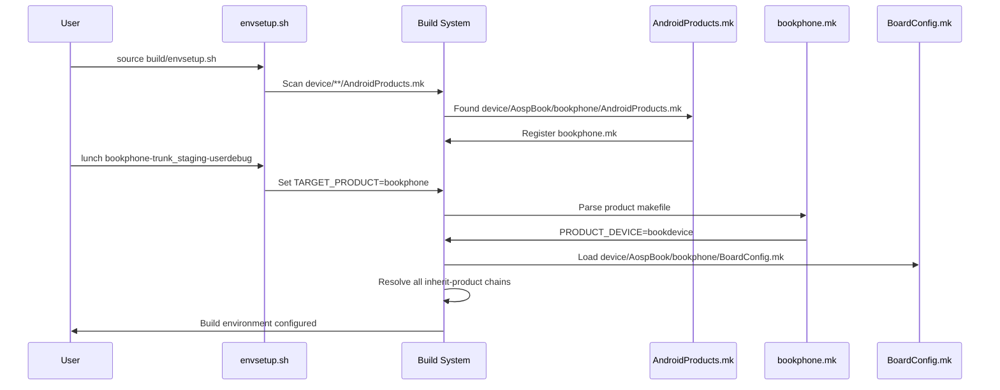

### 65.3.8 验证产品注册

创建这些文件后，验证构建系统是否识别你的产品：

```bash
# Source the environment
source build/envsetup.sh

# Check that our product appears in the list of registered products
list_products | grep bookphone
# Expected output: bookphone

# Select our target (product-release-variant triple)
lunch bookphone-trunk_staging-userdebug

# Verify the environment
echo "TARGET_PRODUCT=$TARGET_PRODUCT"         # bookphone
echo "TARGET_BUILD_VARIANT=$TARGET_BUILD_VARIANT" # userdebug
echo "TARGET_ARCH=$TARGET_ARCH"               # x86_64
printconfig
```

### 65.3.9 产品变量命名空间

构建系统定义了丰富的 `PRODUCT_*` 变量集。以下是构建 ROM 时最重要的一些：

| 变量 | 用途 | 示例 |
|----------|---------|---------|
| `PRODUCT_NAME` | Lunch 目标名 | `bookphone` |
| `PRODUCT_DEVICE` | 映射到板级配置目录 | `bookdevice` |
| `PRODUCT_BRAND` | 品牌字符串 | `AospBook` |
| `PRODUCT_MODEL` | 型号字符串 | `AospBook Phone` |
| `PRODUCT_MANUFACTURER` | 制造商字符串 | `AospBook` |
| `PRODUCT_PACKAGES` | 纳入构建的模块 | `BookSampleApp` |
| `PRODUCT_COPY_FILES` | 拷贝进镜像的文件 | `src:dest` 对 |
| `PRODUCT_PROPERTY_OVERRIDES` | 系统属性（`/system`） | `ro.foo=bar` |
| `PRODUCT_PRODUCT_PROPERTIES` | 产品属性（`/product`） | `ro.foo=bar` |
| `PRODUCT_VENDOR_PROPERTIES` | Vendor 属性（`/vendor`） | `ro.foo=bar` |
| `PRODUCT_SOONG_NAMESPACES` | Soong 模块搜索路径 | 目录路径 |
| `PRODUCT_ENFORCE_RRO_TARGETS` | 强制对目标使用 RRO | `framework-res` |
| `PRODUCT_ENFORCE_RRO_EXCLUDED_OVERLAYS` | 排除在 RRO 强制之外 | overlay 路径 |

### 65.3.10 继承机制

`$(call inherit-product, ...)` 函数是产品配置的基石。它的工作方式是将被包含 makefile 的变量值追加到包含方 makefile 的变量中：

```makefile
# In parent.mk:
PRODUCT_PACKAGES += ParentApp

# In child.mk:
$(call inherit-product, parent.mk)
PRODUCT_PACKAGES += ChildApp

# Result: PRODUCT_PACKAGES = ParentApp ChildApp
```

这与简单的 `include` 语句不同。`inherit-product` 函数使用命名空间机制，当多个 makefile 定义相同变量时防止变量冲突。

还有 `$(call inherit-product-if-exists, ...)`，如果文件不存在则静默成功——适用于可选的 vendor overlay。

### 65.3.11 通用系统镜像与设备 bring-up

我们的 `bookphone` 产品构建完整的设备镜像。Android 还提供一个**通用系统镜像（GSI）**：按照 Treble 接口契约构建的单一 `system.img`，可在任何符合 Treble 的 vendor 分区之上启动。GSI 是对照纯 AOSP 对新设备的 vendor 实现进行健全性检查的方式。GSI 上的兼容性测试套件（CTS-on-GSI）和 Vendor 测试套件也用它来验证 vendor/system 的拆分。

GSI 产品位于 `build/make/target/product/` 中：

```bash
lunch aosp_arm64-trunk_staging-userdebug   # arm64 GSI
lunch aosp_x86_64-trunk_staging-userdebug  # x86_64 GSI
```

`build/make/target/product/aosp_arm64.mk` 在自身注释中写明“aosp_arm64-userdebug 的系统镜像是一个 GSI”，并引入 `generic_system.mk` 与 `gsi_release.mk`；其板级配置来自 `build/make/target/board/BoardConfigGsiCommon.mk`。Android 17 还提供 `aosp_arm64_fullmte.mk`，这是一个强制开启 Arm 内存标记扩展（Memory Tagging Extension）的 GSI 变体，用于堆损坏测试。

在真实设备上使用 GSI 的 bring-up 流程为：

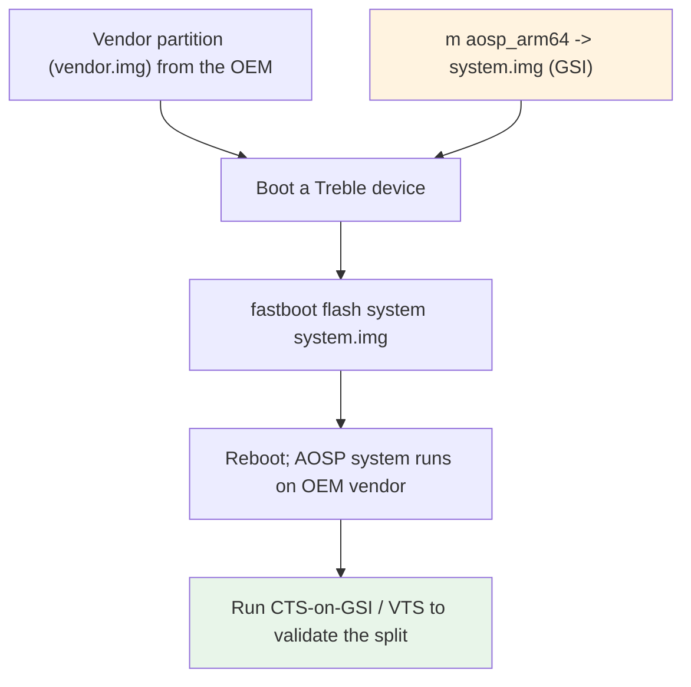

刷写 GSI 通常使用 `fastbootd`（用户态 fastboot），因为 `system` 是动态分区：

```bash
fastboot reboot fastboot          # enter fastbootd
fastboot flash system system.img  # the GSI
fastboot -w                        # wipe userdata (required on a different system)
fastboot reboot
```

GSI 是调试与合规性工具，不是日常使用的 ROM：它们不携带 vendor 应用，完全依赖设备现有的 vendor 分区。对于我们的定制 ROM，我们改为构建完整设备镜像。但当你把定制 ROM 带到一块新硬件上时，必须了解 GSI 这条路径。

---

## 65.4 添加自定义应用

### 65.4.1 理解 PRODUCT_PACKAGES

出现在 `PRODUCT_PACKAGES` 中的每个模块都会被构建并纳入相应的分区镜像。模块名映射到 `Android.bp`（Soong）或 `Android.mk`（Make）文件中定义的构建规则。

基础系统包在 `build/make/target/product/base_system.mk` 中定义：

```makefile
# build/make/target/product/base_system.mk (excerpt)
PRODUCT_PACKAGES += \
    abx \
    am \
    app_process \
    atrace \
    bootanimation \
    bootstat \
    bugreport \
    cmd \
    ...
```

这些是功能完整的 Android 系统所需的最小包集。我们的产品通过 Goldfish 手机配置链继承它们。

### 65.4.2 添加预编译 APK

假设你有一个想要纳入 ROM 的第三方 APK（例如 PDF 阅读器）。创建一个预编译模块：

```
device/AospBook/bookphone/apps/prebuilt/BookReader/
    Android.bp
    BookReader.apk
```

`Android.bp` 文件定义了一个预编译应用：

```json
// device/AospBook/bookphone/apps/prebuilt/BookReader/Android.bp
//
// Prebuilt APK for BookReader PDF viewer.
// This is included in the system image via PRODUCT_PACKAGES += BookReader.

android_app_import {
    name: "BookReader",

    // The APK file in this directory
    apk: "BookReader.apk",

    // Install to the /product partition (not /system)
    product_specific: true,

    // Other modules this APK replaces (removed from PRODUCT_PACKAGES)
    overrides: [],

    // Signature: presigned means keep the APK's existing signature
    presigned: true,

    // Optional: mark as privileged if it needs privileged permissions
    // privileged: true,

    // Optimize DEX code during build
    dex_preopt: {
        enabled: true,
    },
}
```

`android_app_import` 的关键属性：

| 属性 | 取值 | 说明 |
|----------|--------|-------------|
| `apk` | 文件名 | APK 文件的路径 |
| `presigned` | `true`/`false` | 保留原有签名还是重新签名 |
| `certificate` | `"platform"`、`"shared"`、`"media"`、路径 | 签名密钥 |
| `privileged` | `true`/`false` | 安装到 `priv-app/` |
| `product_specific` | `true`/`false` | 安装到 `/product` 分区 |
| `vendor` | `true`/`false` | 安装到 `/vendor` 分区 |
| `dex_preopt.enabled` | `true`/`false` | 在构建时预优化 DEX |

如果你的 APK 尚未使用正确的密钥签名，请改用 `certificate` 而非 `presigned`：

```json
android_app_import {
    name: "BookReader",
    apk: "BookReader.apk",
    product_specific: true,
    certificate: "platform",   // Re-sign with the platform key
    dex_preopt: {
        enabled: true,
    },
}
```

签名密钥名映射到 `build/make/target/product/security/` 中的文件：

| 密钥名 | 文件 | 用途 |
|----------|-------|----------|
| `platform` | `platform.pk8`、`platform.x509.pem` | 带有 `android:sharedUserId="android.uid.system"` 的系统应用 |
| `shared` | `shared.pk8`、`shared.x509.pem` | 共享数据的应用（通讯录、电话） |
| `media` | `media.pk8`、`media.x509.pem` | 媒体/下载系统应用 |
| `testkey` | `testkey.pk8`、`testkey.x509.pem` | 默认开发签名密钥 |

### 65.4.3 将自定义应用构建进镜像

现在让我们从源码创建一个自定义应用。这个应用将作为 AOSP 构建的一部分被编译、签名并放入系统镜像。

创建应用目录：

```
device/AospBook/bookphone/apps/BookSampleApp/
    Android.bp
    AndroidManifest.xml
    res/
        layout/
            activity_main.xml
        values/
            strings.xml
        mipmap-xxxhdpi/
            ic_launcher.png
    src/
        com/
            aospbook/
                sample/
                    MainActivity.java
```

**Android.bp**——Soong 构建定义：

```json
// device/AospBook/bookphone/apps/BookSampleApp/Android.bp
//
// Custom sample app built from source, included in the system image.

android_app {
    name: "BookSampleApp",

    // Source files
    srcs: ["src/**/*.java"],

    // Android SDK version to compile against
    sdk_version: "current",

    // Install to the /product partition
    product_specific: true,

    // Sign with the platform key
    certificate: "platform",

    // Resource directories
    resource_dirs: ["res"],

    // Static library dependencies
    static_libs: [
        "androidx.appcompat_appcompat",
        "com.google.android.material_material",
    ],

    // Optimize DEX code
    optimize: {
        enabled: true,
        shrink: true,
        optimize: true,
        proguard_flags_files: ["proguard-rules.pro"],
    },

    // DEX preoptimization
    dex_preopt: {
        enabled: true,
    },
}
```

**AndroidManifest.xml**：

```xml
<?xml version="1.0" encoding="utf-8"?>
<!-- device/AospBook/bookphone/apps/BookSampleApp/AndroidManifest.xml -->
<manifest xmlns:android="http://schemas.android.com/apk/res/android"
    package="com.aospbook.sample">

    <application
        android:label="@string/app_name"
        android:icon="@mipmap/ic_launcher"
        android:theme="@style/Theme.AppCompat.DayNight">

        <activity
            android:name=".MainActivity"
            android:exported="true">
            <intent-filter>
                <action android:name="android.intent.action.MAIN" />
                <category android:name="android.intent.category.LAUNCHER" />
            </intent-filter>
        </activity>
    </application>

</manifest>
```

**MainActivity.java**：

```java
// device/AospBook/bookphone/apps/BookSampleApp/src/com/aospbook/sample/MainActivity.java
package com.aospbook.sample;

import android.app.Activity;
import android.os.Build;
import android.os.Bundle;
import android.widget.TextView;

/**
 * Sample app demonstrating a custom app built into an AOSP-based ROM.
 *
 * This activity displays system information to verify that the custom
 * ROM is running correctly.
 */
public class MainActivity extends Activity {

    @Override
    protected void onCreate(Bundle savedInstanceState) {
        super.onCreate(savedInstanceState);

        TextView textView = new TextView(this);
        textView.setPadding(32, 32, 32, 32);
        textView.setTextSize(18);
        textView.setText(buildInfoString());
        setContentView(textView);
    }

    private String buildInfoString() {
        StringBuilder sb = new StringBuilder();
        sb.append("AospBook ROM Info\n");
        sb.append("=================\n\n");
        sb.append("Brand: ").append(Build.BRAND).append("\n");
        sb.append("Model: ").append(Build.MODEL).append("\n");
        sb.append("Device: ").append(Build.DEVICE).append("\n");
        sb.append("Product: ").append(Build.PRODUCT).append("\n");
        sb.append("Build ID: ").append(Build.DISPLAY).append("\n");
        sb.append("Android Version: ").append(Build.VERSION.RELEASE).append("\n");
        sb.append("SDK Level: ").append(Build.VERSION.SDK_INT).append("\n");
        sb.append("Build Type: ").append(Build.TYPE).append("\n");
        sb.append("Fingerprint: ").append(Build.FINGERPRINT).append("\n");

        // Check for our custom property
        String romVersion = System.getProperty("ro.aospbook.version", "unknown");
        sb.append("\nROM Version: ").append(romVersion).append("\n");

        return sb.toString();
    }
}
```

**res/values/strings.xml**：

```xml
<?xml version="1.0" encoding="utf-8"?>
<resources>
    <string name="app_name">AospBook Sample</string>
</resources>
```

**res/layout/activity_main.xml**：

```xml
<?xml version="1.0" encoding="utf-8"?>
<LinearLayout
    xmlns:android="http://schemas.android.com/apk/res/android"
    android:layout_width="match_parent"
    android:layout_height="match_parent"
    android:orientation="vertical"
    android:padding="16dp">

    <TextView
        android:id="@+id/info_text"
        android:layout_width="match_parent"
        android:layout_height="wrap_content"
        android:textSize="16sp"
        android:fontFamily="monospace" />

</LinearLayout>
```

### 65.4.4 移除默认应用

AOSP 本身没有“移除此包”的产品变量。你可能在 LineageOS 源码树中见过 `PRODUCT_PACKAGES_REMOVE`，但那是 vendor 扩展。`build/make/core/product.mk` 只声明了 `PRODUCT_PACKAGES` 及其 `_DEBUG`/`_ENG`/`_TESTS` 变体。在原生 AOSP 中，有两种移除默认应用的方式：

1. **不继承引入它的 makefile**——大多数默认应用通过 `$(call inherit-product, ...)` 链进入 `PRODUCT_PACKAGES`。如果你选择更精简的父 makefile，它们就完全不会被纳入。
2. **用替代模块覆盖它**——在 Soong 中声明 `overrides: ["Browser2"]` 的模块（Make 中为 `LOCAL_OVERRIDES_PACKAGES`）会将指定模块从 `PRODUCT_PACKAGES` 中移除。当两个模块都会被安装时就会生效：

```json
// In your replacement app's Android.bp
android_app {
    name: "BookBrowser",
    // Removes Browser2 from PRODUCT_PACKAGES when both would be installed
    overrides: ["Browser2"],
    // ...
}
```

使用 `overrides` 后，被替换的应用仍会被构建（它可能是其他模块的依赖），但不会安装到镜像中。

第一种方式——通过不继承特定 makefile 来排除整个 AOSP 应用类别——示例如下。例如，如果你不想要电话类应用：

```makefile
# Instead of inheriting full_base_telephony.mk, inherit full_base.mk
$(call inherit-product, $(SRC_TARGET_DIR)/product/full_base.mk)
```

### 65.4.5 特权应用与权限

安装到 `/system/priv-app/` 或 `/product/priv-app/` 的应用可以申请普通应用无法使用的特权权限。要使应用成为特权应用：

```json
// In Android.bp
android_app {
    name: "BookPrivilegedApp",
    privileged: true,
    product_specific: true,
    certificate: "platform",
    // ...
}
```

特权应用需要权限允许列表。创建：

```xml
<!-- device/AospBook/bookphone/permissions/privapp-permissions-bookphone.xml -->
<?xml version="1.0" encoding="utf-8"?>
<permissions>
    <privapp-permissions package="com.aospbook.privileged">
        <permission name="android.permission.MANAGE_USERS" />
        <permission name="android.permission.INTERACT_ACROSS_USERS" />
    </privapp-permissions>
</permissions>
```

并将其拷贝进镜像：

```makefile
# In device.mk
PRODUCT_COPY_FILES += \
    device/AospBook/bookphone/permissions/privapp-permissions-bookphone.xml:$(TARGET_COPY_OUT_PRODUCT)/etc/permissions/privapp-permissions-bookphone.xml
```

### 65.4.6 应用的安装位置

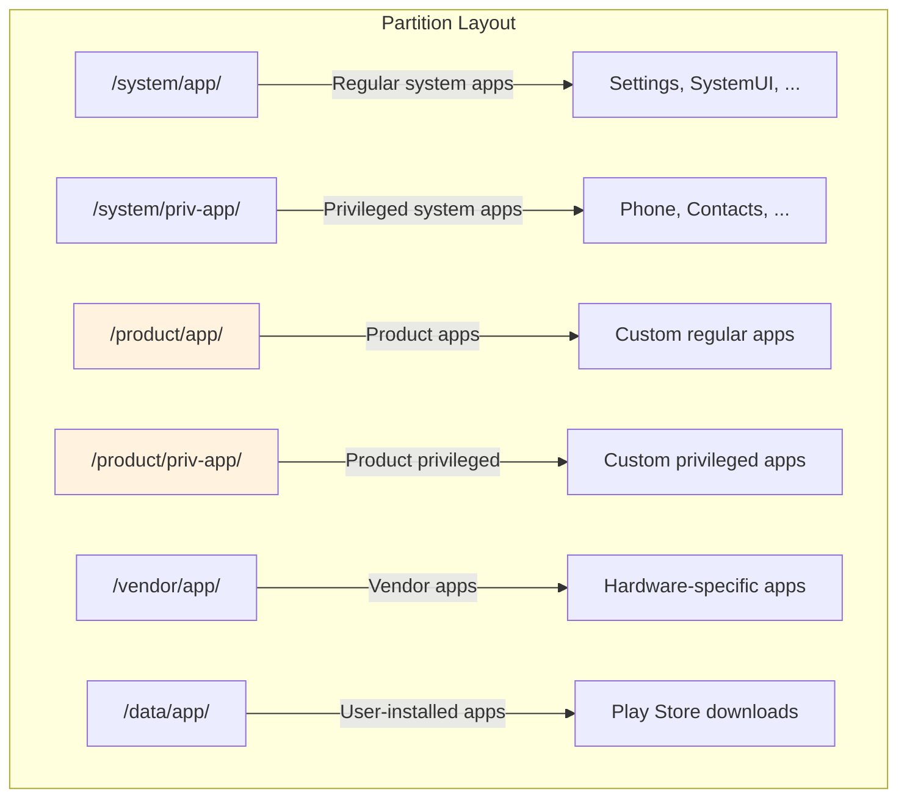

构建系统将模块属性映射到安装路径：

| `Android.bp` 属性 | 安装路径 |
|------------------------|-------------------|
| （无——默认） | `/system/app/<name>/` |
| `privileged: true` | `/system/priv-app/<name>/` |
| `product_specific: true` | `/product/app/<name>/` |
| `product_specific: true` + `privileged: true` | `/product/priv-app/<name>/` |
| `vendor: true` | `/vendor/app/<name>/` |
| `system_ext_specific: true` | `/system_ext/app/<name>/` |

---

## 65.5 修改框架行为

### 65.5.1 运行时资源 Overlay（RRO）

运行时资源 Overlay 是在不修改框架源码的情况下定制框架行为的推荐方式。RRO 是一个小型 APK，仅包含用于覆盖目标包中默认值的资源。

框架的可配置行为定义于：

```
frameworks/base/core/res/res/values/config.xml
```

该文件包含数百个配置值。RRO 可以覆盖其中任何一个。

**RRO 的工作原理：**

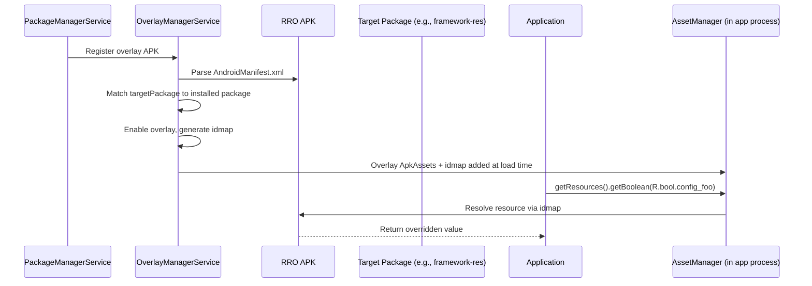

注意 `OverlayManagerService` 只在安装/启用时介入：它驱动 idmap 生成，并告知应用的 `ResourcesManager` 要加载哪个 overlay `ApkAssets`。逐资源的查找完全发生在应用进程内的 `AssetManager` 中（`frameworks/base/libs/androidfw/`），资源读取路径上没有任何到 system_server 的 IPC。

**创建框架 RRO：**

创建 overlay 目录结构：

```
device/AospBook/bookphone/overlay/BookFrameworkOverlay/
    Android.bp
    AndroidManifest.xml
    res/
        values/
            config.xml
            bools.xml
```

**Android.bp**：

```json
// device/AospBook/bookphone/overlay/BookFrameworkOverlay/Android.bp
//
// Runtime Resource Overlay for the framework (android package).
// Overrides default configuration values.

runtime_resource_overlay {
    name: "BookFrameworkOverlay",

    // The target package this overlay applies to
    // "android" is the framework-res package
    sdk_version: "current",

    // Install to the product partition
    product_specific: true,
}
```

**AndroidManifest.xml**：

```xml
<!-- device/AospBook/bookphone/overlay/BookFrameworkOverlay/AndroidManifest.xml -->
<manifest xmlns:android="http://schemas.android.com/apk/res/android"
    package="com.aospbook.overlay.framework">

    <application android:hasCode="false" />

    <overlay
        android:targetPackage="android"
        android:isStatic="true"
        android:priority="10"
        />
</manifest>
```

清单的关键属性：

| 属性 | 取值 | 含义 |
|-----------|-------|---------|
| `targetPackage` | `"android"` | Overlay 的目标是框架 |
| `isStatic` | `"true"` | 始终启用，用户无法禁用 |
| `priority` | `"10"` | 存在多个 overlay 时优先级高者胜出 |

**res/values/config.xml**——覆盖框架默认值：

```xml
<?xml version="1.0" encoding="utf-8"?>
<!-- Override framework configuration values -->
<resources>
    <!-- Enable dark mode by default -->
    <integer name="config_defaultNightMode">2</integer>
    <!-- 0=MODE_NIGHT_AUTO, 1=MODE_NIGHT_NO, 2=MODE_NIGHT_YES, 3=MODE_NIGHT_CUSTOM -->

    <!-- Default wallpaper component -->
    <string name="default_wallpaper_component" translatable="false">
        com.aospbook.wallpaper/.DefaultWallpaperService
    </string>

    <!-- Enable always-on display by default -->
    <bool name="config_dozeAlwaysOnDisplayAvailable">true</bool>

    <!-- Screen brightness settings -->
    <integer name="config_screenBrightnessSettingDefault">128</integer>
    <integer name="config_screenBrightnessSettingMinimum">10</integer>

    <!-- Lock screen: allow rotation -->
    <bool name="config_enableLockScreenRotation">true</bool>

    <!-- Power button behavior: long press = global actions (power) menu -->
    <integer name="config_longPressOnPowerBehavior">1</integer>

    <!-- Show battery percentage in status bar by default -->
    <bool name="config_defaultBatteryPercentageSetting">true</bool>

    <!-- Haptic feedback default -->
    <bool name="config_enableHapticTextHandle">true</bool>
</resources>
```

要查看所有可覆盖的框架配置值，请查看：

```
frameworks/base/core/res/res/values/config.xml
```

定制 ROM 常覆盖的一些值：

| 资源 | 类型 | 默认值 | 说明 |
|----------|------|---------|-------------|
| `config_defaultNightMode` | integer | 1 (MODE_NIGHT_NO) | 默认 UI 模式（深色/浅色） |
| `config_longPressOnPowerBehavior` | integer | 5（助手；1 = 电源菜单） | 电源键长按行为 |
| `config_dozeAlwaysOnDisplayAvailable` | bool | false | 息屏常显 |
| `config_enableLockScreenRotation` | bool | false | 锁屏旋转 |
| `config_screenBrightnessSettingDefault` | integer | 视情况而定 | 默认亮度 |
| `config_defaultBatteryPercentageSetting` | bool | false | 状态栏显示电量百分比 |
| `config_enableHapticTextHandle` | bool | false | 文本选择触感反馈 |

### 65.5.2 验证 RRO 安装

构建完成后，你可以验证 overlay 是否已生效：

```bash
# On the running device/emulator:
adb shell cmd overlay list
# Expected output includes:
# com.aospbook.overlay.framework
#     [x] com.aospbook.overlay.framework (targeting android, priority 10)

# Check a specific overlaid value:
adb shell cmd overlay dump com.aospbook.overlay.framework

# Or query the resource directly:
adb shell settings get system screen_brightness
```

### 65.5.3 修改框架源码

对于无法通过 RRO 实现的改动，必须直接修改框架源码。这是侵入性最强的定制形式，需要谨慎管理（尤其是在向新 AOSP 版本 rebase 时）。

**示例：向设置中添加自定义系统属性**

假设我们想在设置应用中展示 ROM 版本。“关于手机”界面从 `android.os.Build` 读取构建属性。

Build 类定义于：

```
frameworks/base/core/java/android/os/Build.java
```

我们可以添加一个新字段：

```java
// Add to frameworks/base/core/java/android/os/Build.java
// (inside the class body)

/**
 * The custom ROM version, as set by the ROM builder.
 * Read from the system property "ro.aospbook.version".
 */
public static final String AOSPBOOK_VERSION =
    SystemProperties.get("ro.aospbook.version", "unknown");
```

该属性由我们的产品配置设置：

```makefile
# In device.mk or bookphone.mk
PRODUCT_PROPERTY_OVERRIDES += ro.aospbook.version=1.0.0
```

### 65.5.4 添加新的系统服务

系统服务运行在 `system_server` 进程中，提供应用可通过 Binder IPC 调用的 API。这是最强大的框架定制形式。

**系统服务的架构：**

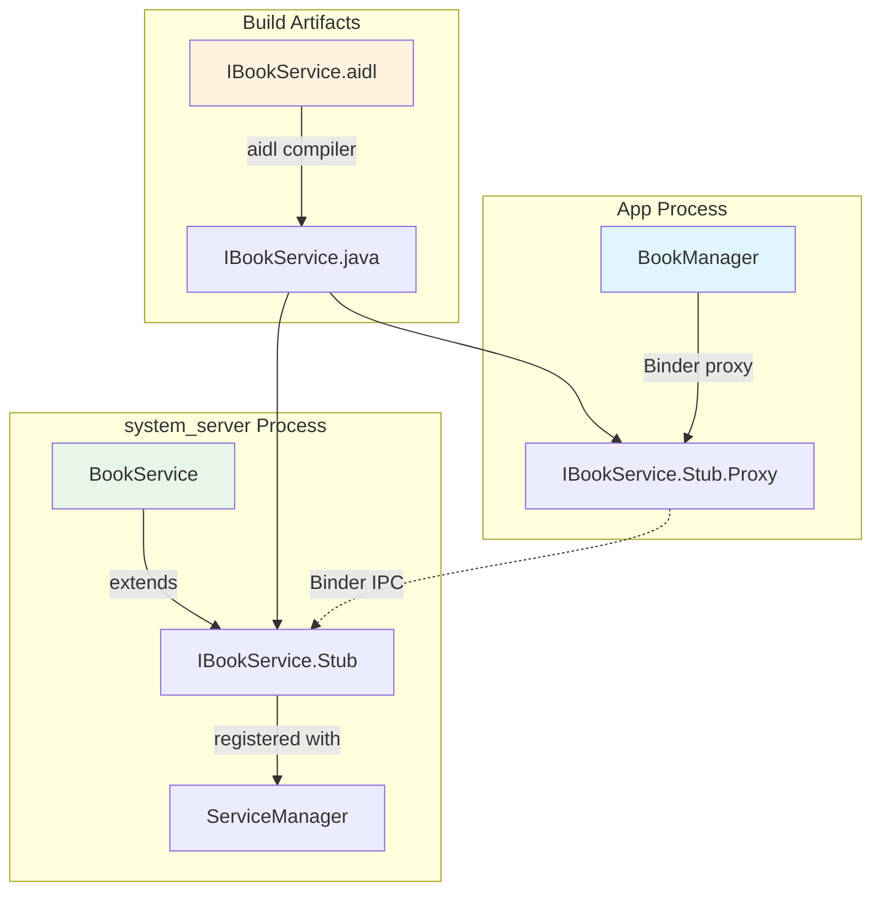

**第 1 步：定义 AIDL 接口**

创建目录结构：

```
device/AospBook/bookphone/services/BookService/
    Android.bp
    aidl/
        com/aospbook/service/
            IBookService.aidl
    src/
        com/aospbook/service/
            BookService.java
            BookServiceManager.java
```

**IBookService.aidl**：

```java
// device/AospBook/bookphone/services/BookService/aidl/com/aospbook/service/IBookService.aidl
package com.aospbook.service;

/**
 * System service interface for AospBook-specific functionality.
 * This service runs in system_server and provides ROM-specific
 * APIs to applications.
 */
interface IBookService {
    /**
     * Returns the current ROM version string.
     */
    String getRomVersion();

    /**
     * Returns the ROM build timestamp (epoch seconds).
     */
    long getBuildTimestamp();

    /**
     * Sets a custom user preference stored in the service.
     * @param key Preference key
     * @param value Preference value
     */
    void setPreference(String key, String value);

    /**
     * Gets a custom user preference.
     * @param key Preference key
     * @return The stored value, or null if not set
     */
    String getPreference(String key);

    /**
     * Returns a list of enabled AospBook features.
     */
    List<String> getEnabledFeatures();
}
```

**第 2 步：实现服务**

**BookService.java**：

```java
// device/AospBook/bookphone/services/BookService/src/com/aospbook/service/BookService.java
package com.aospbook.service;

import android.content.Context;
import android.os.RemoteException;
import android.os.SystemProperties;
import android.util.Log;

import java.util.ArrayList;
import java.util.HashMap;
import java.util.List;
import java.util.Map;

/**
 * System service implementation for AospBook ROM.
 *
 * This service is registered with ServiceManager under the name
 * "aospbook" and can be accessed by apps via BookServiceManager.
 *
 * Registration happens in SystemServer.java during the
 * startOtherServices() phase.
 */
public class BookService extends IBookService.Stub {
    private static final String TAG = "BookService";
    private static final String SERVICE_NAME = "aospbook";

    private final Context mContext;
    private final Map<String, String> mPreferences;

    public BookService(Context context) {
        mContext = context;
        mPreferences = new HashMap<>();
        Log.i(TAG, "BookService initialized");
    }

    @Override
    public String getRomVersion() throws RemoteException {
        return SystemProperties.get("ro.aospbook.version", "unknown");
    }

    @Override
    public long getBuildTimestamp() throws RemoteException {
        String timestamp = SystemProperties.get("ro.build.date.utc", "0");
        try {
            return Long.parseLong(timestamp);
        } catch (NumberFormatException e) {
            return 0;
        }
    }

    @Override
    public void setPreference(String key, String value) throws RemoteException {
        // In a production implementation, this would persist to disk
        // and enforce permission checks.
        enforceCallerPermission();
        synchronized (mPreferences) {
            mPreferences.put(key, value);
        }
        Log.d(TAG, "Preference set: " + key + " = " + value);
    }

    @Override
    public String getPreference(String key) throws RemoteException {
        synchronized (mPreferences) {
            return mPreferences.get(key);
        }
    }

    @Override
    public List<String> getEnabledFeatures() throws RemoteException {
        List<String> features = new ArrayList<>();

        if (SystemProperties.getBoolean(
                "ro.aospbook.features.dark_mode_default", false)) {
            features.add("dark_mode_default");
        }
        if (SystemProperties.getBoolean(
                "ro.aospbook.features.custom_qs", false)) {
            features.add("custom_qs");
        }

        return features;
    }

    /**
     * Returns the service name for ServiceManager registration.
     */
    public static String getServiceName() {
        return SERVICE_NAME;
    }

    private void enforceCallerPermission() {
        // In production, check a custom permission here:
        // mContext.enforceCallingOrSelfPermission(
        //     "com.aospbook.permission.MANAGE_PREFERENCES",
        //     "BookService");
    }
}
```

**第 3 步：Android.bp**

```json
// device/AospBook/bookphone/services/BookService/Android.bp

// AIDL interface library
java_library {
    name: "aospbook-service-aidl",
    srcs: ["aidl/**/*.aidl"],
    sdk_version: "system_current",
    product_specific: true,
}

// Service implementation (runs in system_server)
java_library {
    name: "BookService",
    srcs: ["src/**/*.java"],
    static_libs: [
        "aospbook-service-aidl",
    ],
    libs: [
        "framework",
        "services.core",
    ],
    product_specific: true,
}
```

**第 4 步：在 SystemServer 中注册服务**

`SystemServer`（位于
`frameworks/base/services/java/com/android/server/SystemServer.java`）是所有系统服务启动的地方。要添加我们的服务，需要修改
`startOtherServices()` 方法：

```java
// In frameworks/base/services/java/com/android/server/SystemServer.java
// Add to the startOtherServices(TimingsTraceAndSlog t) method, near the end.
// `t` is the TimingsTraceAndSlog parameter every startup step uses:

// AospBook custom service
t.traceBegin("StartBookService");
try {
    ServiceManager.addService("aospbook",
        new com.aospbook.service.BookService(mSystemContext));
} catch (Throwable e) {
    reportWtf("starting BookService", e);
}
t.traceEnd();
```

或者，采用侵入性更小的方式，可以使用 `SystemService` 子类并通过
`SystemServiceManager` 注册：

```java
// Alternative: device/AospBook/bookphone/services/BookService/src/.../BookSystemService.java
package com.aospbook.service;

import android.content.Context;
import android.os.ServiceManager;

import com.android.server.SystemService;

/**
 * SystemService wrapper for BookService.
 * This approach uses the SystemServiceManager lifecycle.
 */
public class BookSystemService extends SystemService {
    private BookService mService;

    public BookSystemService(Context context) {
        super(context);
    }

    @Override
    public void onStart() {
        mService = new BookService(getContext());
        ServiceManager.addService(BookService.getServiceName(), mService);
    }

    @Override
    public void onBootPhase(int phase) {
        if (phase == PHASE_SYSTEM_SERVICES_READY) {
            // Perform initialization that requires other services
        }
    }
}
```

**第 5 步：创建客户端 Manager 类**

应用通过一个 manager 类与服务交互：

```java
// device/AospBook/bookphone/services/BookService/src/com/aospbook/service/BookServiceManager.java
package com.aospbook.service;

import android.os.IBinder;
import android.os.RemoteException;
import android.os.ServiceManager;
import android.util.Log;

import java.util.Collections;
import java.util.List;

/**
 * Client-side manager for the AospBook system service.
 *
 * Usage:
 *     BookServiceManager manager = BookServiceManager.getInstance();
 *     String version = manager.getRomVersion();
 */
public class BookServiceManager {
    private static final String TAG = "BookServiceManager";
    private static volatile BookServiceManager sInstance;

    private final IBookService mService;

    private BookServiceManager(IBookService service) {
        mService = service;
    }

    /**
     * Gets the singleton instance of BookServiceManager.
     * Returns null if the service is not available (e.g., on non-AospBook ROMs).
     */
    public static BookServiceManager getInstance() {
        if (sInstance == null) {
            synchronized (BookServiceManager.class) {
                if (sInstance == null) {
                    IBinder binder = ServiceManager.getService("aospbook");
                    if (binder != null) {
                        IBookService service =
                            IBookService.Stub.asInterface(binder);
                        sInstance = new BookServiceManager(service);
                    }
                }
            }
        }
        return sInstance;
    }

    public String getRomVersion() {
        try {
            return mService.getRomVersion();
        } catch (RemoteException e) {
            Log.e(TAG, "Failed to get ROM version", e);
            return "unknown";
        }
    }

    public long getBuildTimestamp() {
        try {
            return mService.getBuildTimestamp();
        } catch (RemoteException e) {
            Log.e(TAG, "Failed to get build timestamp", e);
            return 0;
        }
    }

    public void setPreference(String key, String value) {
        try {
            mService.setPreference(key, value);
        } catch (RemoteException e) {
            Log.e(TAG, "Failed to set preference", e);
        }
    }

    public String getPreference(String key) {
        try {
            return mService.getPreference(key);
        } catch (RemoteException e) {
            Log.e(TAG, "Failed to get preference", e);
            return null;
        }
    }

    public List<String> getEnabledFeatures() {
        try {
            return mService.getEnabledFeatures();
        } catch (RemoteException e) {
            Log.e(TAG, "Failed to get enabled features", e);
            return Collections.emptyList();
        }
    }
}
```

### 65.5.5 自定义服务的 SELinux 策略

任何新的系统服务都需要 SELinux 策略。否则，SELinux（在所有现代 Android 构建中都处于 enforcing 模式）会拒绝该服务运行。

创建策略文件：

```
# device/AospBook/bookphone/sepolicy/vendor/bookservice.te

# Define the BookService type
type bookservice, domain;
type bookservice_exec, exec_type, file_type, system_file_type;

# Allow system_server to register and access the service
allow system_server bookservice_service:service_manager { add find };

# Allow apps to find the service
allow untrusted_app bookservice_service:service_manager find;
allow platform_app bookservice_service:service_manager find;

# Allow the service to read system properties
allow bookservice system_prop:file { read open getattr };
get_prop(bookservice, system_prop)
```

并在 `service_contexts` 中注册该服务：

```
# device/AospBook/bookphone/sepolicy/vendor/service_contexts
aospbook                            u:object_r:bookservice_service:s0
```

在 `service.te` 中定义服务类型：

```
# device/AospBook/bookphone/sepolicy/vendor/service.te
type bookservice_service, service_manager_type;
```

添加文件上下文：

```
# device/AospBook/bookphone/sepolicy/vendor/file_contexts
/product/framework/BookService\.jar          u:object_r:system_file:s0
```

### 65.5.6 系统服务生命周期

理解你的服务相对于其他服务的启动时机非常重要：

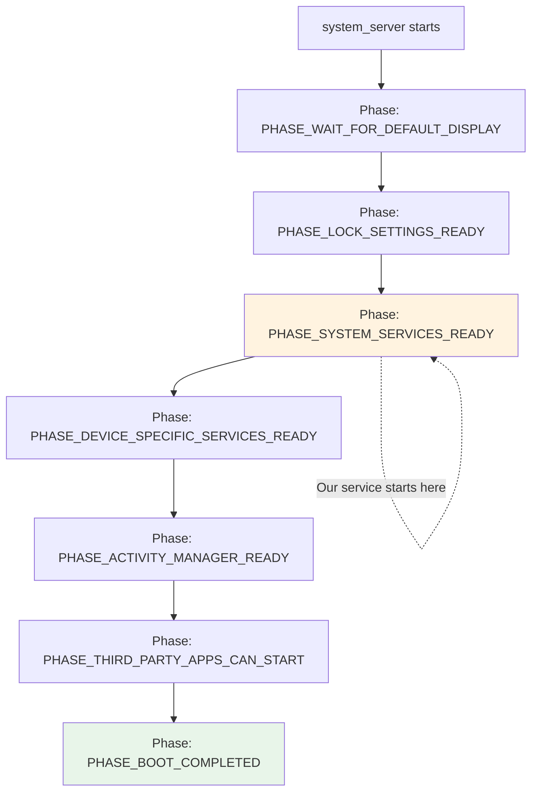

---

## 65.6 自定义开机动画

### 65.6.1 开机动画格式

开机动画以 ZIP 文件形式存放在以下位置之一（由
`frameworks/base/cmds/bootanimation/BootAnimation.cpp` 按顺序检查）：

1. `/apex/com.android.bootanimation/etc/bootanimation.zip`
2. `/product/media/bootanimation.zip`（文件名可通过
   `ro.product.bootanim.file` 属性覆盖）
3. `/oem/media/bootanimation.zip`
4. `/system/media/bootanimation.zip`

格式在 `frameworks/base/cmds/bootanimation/FORMAT.md` 中有详细说明（注意该文档中较旧的两处位置列表已过时；以上搜索顺序才是代码实际实现的）。

ZIP 包含：

```
bootanimation.zip (store compression, no deflate)
    desc.txt          # Animation descriptor
    part0/            # First animation part (frames)
        00000.png
        00001.png
        ...
    part1/            # Second animation part
        00000.png
        00001.png
        ...
    audio.wav         # Optional audio (per-part)
```

### 65.6.2 desc.txt 文件

第一行定义全局参数：

```
WIDTH HEIGHT FPS [PROGRESS]
```

后续行定义动画分段：

```
TYPE COUNT PAUSE PATH [FADE [#RGBHEX [CLOCK1 [CLOCK2]]]]
```

**类型取值：**

| 类型 | 行为 |
|------|----------|
| `p` | 播放直到启动完成，然后停止 |
| `c` | 无论启动状态如何，都播放至完整结束 |
| `f` | 类似 `p`，但在被打断时带淡出效果 |

**desc.txt 示例：**

```
1080 1920 30
c 1 0 part0
p 0 0 part1
```

它定义了：

- 1080x1920 分辨率，30 FPS
- `part0`：完整播放一次（`c 1`），无停顿
- `part1`：无限循环（`p 0`），直到启动完成

### 65.6.3 创建自定义开机动画

让我们为 AospBook ROM 创建一个简单但专业的开机动画。

**第 1 步：创建帧图像**

你可以使用任何图像编辑器（GIMP、Photoshop、Inkscape）创建帧，也可以编程生成。每一帧必须是与 `desc.txt` 中指定分辨率一致的 PNG。

```bash
# Create the directory structure
mkdir -p device/AospBook/bookphone/bootanimation/part0
mkdir -p device/AospBook/bookphone/bootanimation/part1

# Example: Generate simple gradient frames using ImageMagick
# Part 0: Fade in the logo (30 frames = 1 second at 30fps)
for i in $(seq -w 0 29); do
    opacity=$(echo "scale=2; $i / 29 * 100" | bc)
    convert -size 1080x1920 xc:black \
        -fill white -gravity center \
        -pointsize 72 -annotate 0 "AospBook" \
        -channel A -evaluate set "${opacity}%" \
        "device/AospBook/bookphone/bootanimation/part0/${i}.png"
done

# Part 1: Pulsing dots (looping animation, 60 frames = 2 seconds)
for i in $(seq -w 0 59); do
    phase=$(echo "scale=4; $i / 60 * 3.14159 * 2" | bc)
    # ... generate frame with animated dots
    convert -size 1080x1920 xc:black \
        -fill white -gravity center \
        -pointsize 48 -annotate 0 "AospBook" \
        "device/AospBook/bookphone/bootanimation/part1/${i}.png"
done
```

**第 2 步：编写 desc.txt**

```
# device/AospBook/bookphone/bootanimation/desc.txt
1080 1920 30
c 1 10 part0
p 0 0 part1
```

解释：

- `1080 1920 30`——1080x1920，30 FPS
- `c 1 10 part0`——将 part0 完整播放一次，停顿 10 帧（0.33 秒）
- `p 0 0 part1`——循环播放 part1 直到启动完成，循环之间无停顿

**第 3 步：打包动画**

ZIP 必须使用 **store** 压缩（不压缩），因为 PNG 文件本身已经压缩过：

```bash
cd device/AospBook/bookphone/bootanimation

# Create the ZIP with store (no compression)
zip -0qry -i \*.txt \*.png \*.wav @ bootanimation.zip *.txt part*

# Verify the contents
unzip -l bootanimation.zip
```

`-0` 标志至关重要。如果使用默认压缩，开机动画播放器将无法高效读取帧，导致卡顿或失败。

**第 4 步：纳入构建**

在 `device.mk` 中：

```makefile
PRODUCT_COPY_FILES += \
    device/AospBook/bookphone/bootanimation/bootanimation.zip:$(TARGET_COPY_OUT_PRODUCT)/media/bootanimation.zip
```

### 65.6.4 测试开机动画

你可以在不做完整重建的情况下测试开机动画：

```bash
# Push directly to a running emulator
adb root
adb remount
adb push bootanimation.zip /product/media/bootanimation.zip

# Restart the boot animation service
adb shell setprop service.bootanim.exit 0
adb shell start bootanim

# Watch it play, then stop:
adb shell setprop service.bootanim.exit 1
```

### 65.6.5 带声音的开机动画

每个 part 目录可以包含一个 `audio.wav` 文件，在该 part 开始时播放：

```
bootanimation.zip
    desc.txt
    part0/
        audio.wav       # Plays when part0 starts
        00000.png
        ...
    part1/
        00000.png
        ...
```

WAV 文件必须满足：

- PCM 格式（未压缩）
- 16 位或 24 位
- 任意采样率（推荐 44100 Hz）
- 单声道或立体声

### 65.6.6 动态着色

Android 12+ 支持开机动画的动态着色。在 `desc.txt` 的分辨率行之后添加一行特殊的指令：

```
1080 1920 30
dynamic_colors part1 #1A73E8 #34A853 #FBBC04 #EA4335
c 1 10 part0
p 0 0 part1
```

这告诉动画播放器将 `part1` 中帧的 R、G、B、A 通道视为四种动态颜色的遮罩。最终颜色从以下系统属性读取：

- `persist.bootanim.color1`
- `persist.bootanim.color2`
- `persist.bootanim.color3`
- `persist.bootanim.color4`

### 65.6.7 开机动画源码

开机动画播放器实现于：

```
frameworks/base/cmds/bootanimation/
    BootAnimation.cpp          # Main animation player
    BootAnimation.h
    BootAnimationUtil.cpp      # Utility functions
    bootanimation_main.cpp     # Entry point
    audioplay.cpp              # Audio playback
    bootanim.rc                # init service definition
```

`bootanim.rc` 文件定义了 init 服务：

```
# frameworks/base/cmds/bootanimation/bootanim.rc
service bootanim /system/bin/bootanimation
    class core animation
    user graphics
    group graphics audio
    disabled
    oneshot
```

---

## 65.7 定制 SystemUI

SystemUI 是面向用户的界面层，负责绘制状态栏、通知栏、快捷设置、锁屏和导航栏。对它进行定制是定制 ROM 中最显眼的改动之一。

源码位于：

```
frameworks/base/packages/SystemUI/
```

### 65.7.1 SystemUI 架构总览

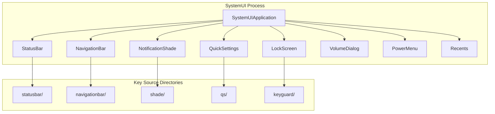

### 65.7.2 通过 RRO 定制（非侵入式）

定制 SystemUI 最简单的方式是使用 RRO。SystemUI 在其自身的 `config.xml` 中暴露了许多配置值：

```
frameworks/base/packages/SystemUI/res/values/config.xml
```

创建一个 SystemUI overlay：

```
device/AospBook/bookphone/overlay/BookSystemUIOverlay/
    Android.bp
    AndroidManifest.xml
    res/
        values/
            config.xml
            dimens.xml
            colors.xml
```

**Android.bp**：

```json
// device/AospBook/bookphone/overlay/BookSystemUIOverlay/Android.bp

runtime_resource_overlay {
    name: "BookSystemUIOverlay",
    sdk_version: "current",
    product_specific: true,
}
```

**AndroidManifest.xml**：

```xml
<manifest xmlns:android="http://schemas.android.com/apk/res/android"
    package="com.aospbook.overlay.systemui">

    <application android:hasCode="false" />

    <overlay
        android:targetPackage="com.android.systemui"
        android:isStatic="true"
        android:priority="10"
        />
</manifest>
```

**res/values/config.xml**——SystemUI 配置覆盖：

```xml
<?xml version="1.0" encoding="utf-8"?>
<resources>
    <!-- Navigation bar: enable dead zone -->
    <bool name="config_useDeadZone">false</bool>

    <!-- Navigation bar: auto-dim when wallpaper not visible -->
    <bool name="config_navigation_bar_enable_auto_dim_no_visible_wallpaper">false</bool>

    <!-- Lock screen display timeout (milliseconds) -->
    <integer name="config_lockScreenDisplayTimeout">15000</integer>

    <!-- Enable custom lockscreen shortcuts -->
    <bool name="custom_lockscreen_shortcuts_enabled">true</bool>

    <!-- Enable long-press to customize lock screen -->
    <bool name="long_press_keyguard_customize_lockscreen_enabled">true</bool>
</resources>
```

**res/values/dimens.xml**——尺寸覆盖：

```xml
<?xml version="1.0" encoding="utf-8"?>
<resources>
    <!-- Status bar height (slightly taller for better touch targets) -->
    <dimen name="status_bar_height">28dp</dimen>

    <!-- Status bar padding -->
    <dimen name="status_bar_padding_start">8dp</dimen>
    <dimen name="status_bar_padding_end">8dp</dimen>
    <dimen name="status_bar_padding_top">0dp</dimen>

    <!-- Quick settings tile padding -->
    <dimen name="qs_tile_margin_horizontal">4dp</dimen>

    <!-- Rounded corner radius for QS tiles -->
    <dimen name="qs_corner_radius">16dp</dimen>
</resources>
```

**res/values/colors.xml**——颜色覆盖：

```xml
<?xml version="1.0" encoding="utf-8"?>
<resources>
    <!-- Light (white-ish) icon tone, used on dark backgrounds -->
    <color name="light_mode_icon_color_single_tone">#FFFAFAFA</color>

    <!-- Dark icon tone, used on light backgrounds -->
    <color name="dark_mode_icon_color_single_tone">#FF212121</color>
</resources>
```

这些名称描述的是图标色调，而非 UI 模式。这两个资源定义在 `frameworks/base/packages/SettingsLib/res/values/colors.xml` 中（SettingsLib 以静态库方式链接进 SystemUI）。在那里，`light_mode_icon_color_single_tone` 是浅色色调，`dark_mode_icon_color_single_tone` 是深色色调。

### 65.7.3 定制状态栏布局

状态栏布局定义于：

```
frameworks/base/packages/SystemUI/res/layout/status_bar.xml
```

根视图是 `PhoneStatusBarView`，其中包含：

```xml
<!-- frameworks/base/packages/SystemUI/res/layout/status_bar.xml (structure) -->
<PhoneStatusBarView>
    <ImageView android:id="@+id/notification_lights_out" />
    <LinearLayout android:id="@+id/status_bar_contents">
        <FrameLayout android:id="@+id/status_bar_start_side_container">
            <!-- Notification icons, clock -->
        </FrameLayout>
        <android.widget.Space />
        <LinearLayout android:id="@+id/status_bar_end_side_content">
            <!-- System icons (wifi, battery, etc.) -->
        </LinearLayout>
    </LinearLayout>
</PhoneStatusBarView>
```

要在不修改源码的情况下定制状态栏布局：

1. **把时钟移到中间或右侧**——通过 RRO 覆盖布局
2. **添加自定义状态栏图标**——添加 drawable overlay
3. **更改电池图标样式**——覆盖 `battery_percentage_view.xml`

对于更深入的修改（例如添加新的状态栏指示器），需要直接修改 SystemUI 源码。

### 65.7.4 修改快捷设置磁贴

快捷设置磁贴注册在 SystemUI 的 Dagger 依赖注入图中。要添加自定义磁贴：

**第 1 步：创建磁贴类**

```java
// frameworks/base/packages/SystemUI/src/com/android/systemui/qs/tiles/BookModeTile.java
package com.android.systemui.qs.tiles;

import android.content.Intent;
import android.os.Handler;
import android.os.Looper;
import android.service.quicksettings.Tile;

import androidx.annotation.Nullable;

import com.android.internal.logging.MetricsLogger;
import com.android.internal.logging.nano.MetricsProto.MetricsEvent;
import com.android.systemui.animation.Expandable;
import com.android.systemui.dagger.qualifiers.Background;
import com.android.systemui.dagger.qualifiers.Main;
import com.android.systemui.plugins.ActivityStarter;
import com.android.systemui.plugins.FalsingManager;
import com.android.systemui.plugins.qs.QSTile;
import com.android.systemui.plugins.statusbar.StatusBarStateController;
import com.android.systemui.qs.QSHost;
import com.android.systemui.qs.QsEventLogger;
import com.android.systemui.qs.logging.QSLogger;
import com.android.systemui.qs.tileimpl.QSTileImpl;
import com.android.systemui.res.R;

import javax.inject.Inject;

/**
 * Quick Settings tile for AospBook's custom "Book Mode" feature.
 * Toggles a hypothetical reading mode that adjusts display warmth
 * and reduces blue light.
 */
public class BookModeTile extends QSTileImpl<QSTile.BooleanState> {
    private boolean mEnabled = false;

    // QSTileImpl's constructor takes the full set of SystemUI collaborators;
    // Dagger injects all of them.
    @Inject
    public BookModeTile(
            QSHost host,
            QsEventLogger uiEventLogger,
            @Background Looper backgroundLooper,
            @Main Handler mainHandler,
            FalsingManager falsingManager,
            MetricsLogger metricsLogger,
            StatusBarStateController statusBarStateController,
            ActivityStarter activityStarter,
            QSLogger qsLogger) {
        super(host, uiEventLogger, backgroundLooper, mainHandler,
                falsingManager, metricsLogger, statusBarStateController,
                activityStarter, qsLogger);
    }

    @Override
    public BooleanState newTileState() {
        return new BooleanState();
    }

    @Override
    protected void handleClick(@Nullable Expandable expandable) {
        mEnabled = !mEnabled;
        refreshState();
    }

    @Override
    protected void handleUpdateState(BooleanState state, Object arg) {
        state.value = mEnabled;
        state.label = "Book Mode";
        state.contentDescription = "Book Mode";
        state.state = mEnabled ? Tile.STATE_ACTIVE : Tile.STATE_INACTIVE;
        state.icon = ResourceIcon.get(mEnabled
            ? R.drawable.ic_book_mode_on
            : R.drawable.ic_book_mode_off);
    }

    @Override
    public int getMetricsCategory() {
        return MetricsEvent.QS_CUSTOM;
    }

    @Override
    public Intent getLongClickIntent() {
        return new Intent("com.aospbook.action.BOOK_MODE_SETTINGS");
    }

    @Override
    public CharSequence getTileLabel() {
        return "Book Mode";
    }
}
```

**第 2 步：在磁贴工厂中注册磁贴**

必须将磁贴添加到 `QSModule` 或 `QSTileHost` 中才能实例化。具体机制取决于 AOSP 版本——当前 AOSP 使用 Dagger 的 `@IntoMap` 注解。

### 65.7.5 SystemUI 的主题 Overlay

Material You（Android 12+）使用动态颜色提取。要为你的 ROM 设置默认配色方案，请使用主题 overlay。`system_accent*` 调色板定义在框架资源中
（`frameworks/base/core/res/res/values/colors_dynamic.xml`，包
`android`），因此这些覆盖应放在框架 RRO
（`BookFrameworkOverlay`，设置 `android:targetPackage="android"`）中。指向 `com.android.systemui` 的 overlay 无法覆盖它们：

```xml
<!-- device/AospBook/bookphone/overlay/BookFrameworkOverlay/res/values/colors.xml -->
<resources>
    <!-- Override the default accent color seed -->
    <!-- This affects Material You theming when no wallpaper-extracted color is available -->
    <color name="system_accent1_500">#1A73E8</color>  <!-- Google Blue -->
    <color name="system_accent2_500">#5F6368</color>  <!-- Gray -->
    <color name="system_accent3_500">#34A853</color>  <!-- Green -->
</resources>
```

### 65.7.6 定制导航栏

导航栏配置由系统属性和框架配置控制：

```makefile
# In device.mk -- force gesture navigation as default
PRODUCT_PRODUCT_PROPERTIES += \
    ro.boot.vendor.overlay.theme=com.android.internal.systemui.navbar.gestural

# Or force 3-button navigation:
# ro.boot.vendor.overlay.theme=com.android.internal.systemui.navbar.threebutton
```

要定制导航栏按钮图标，请覆盖导航栏 overlay 包中的 drawable：

```
frameworks/base/packages/overlays/NavigationBarMode*/
```

### 65.7.7 SystemUI 构建集成

SystemUI 通过以下方式作为系统应用构建：

```
frameworks/base/packages/SystemUI/Android.bp
```

要纳入你的修改，请确保任何新的源文件都位于构建文件的 `srcs` 列表中。已被 glob 模式包含的目录也是正确的。

---

## 65.8 构建与刷写

### 65.8.1 构建命令

设备配置就绪后，构建 ROM：

```bash
# Source the environment (if not already done)
source build/envsetup.sh

# Select our target
lunch bookphone-trunk_staging-userdebug

# Build everything
# 'm' is the AOSP build command (wrapper around Soong/Ninja)
m

# Or with explicit parallelism:
m -j$(nproc)
```

`m` 命令的作用：

1. 运行 Soong 处理所有 `Android.bp` 文件
2. 运行 Kati 处理所有 `Android.mk` 文件
3. 在输出目录中生成 Ninja 格式的构建图
4. 调用构建执行器（Android 17 中默认为 Siso；若设置 `SOONG_NINJA=ninja` 则为经典 Ninja）来执行构建计划

### 65.8.2 构建输出结构

构建成功后，输出位于 `out/target/product/bookdevice/`：

```
out/target/product/bookdevice/
    android-info.txt            # Build info for fastboot
    boot.img                    # Kernel + ramdisk
    vendor_boot.img             # Vendor ramdisk
    super.img                   # Dynamic partitions container
    system.img                  # System partition image
    system_ext.img              # System extension partition
    vendor.img                  # Vendor partition image
    product.img                 # Product partition image
    userdata.img                # Empty userdata partition
    cache.img                   # Cache partition
    ramdisk.img                 # Root ramdisk
    kernel-ranchu               # Kernel binary
    system/                     # Staging directory for system partition
    vendor/                     # Staging directory for vendor partition
    product/                    # Staging directory for product partition
    obj/                        # Intermediate build objects
    symbols/                    # Unstripped binaries (for debugging)
```

### 65.8.3 理解分区镜像

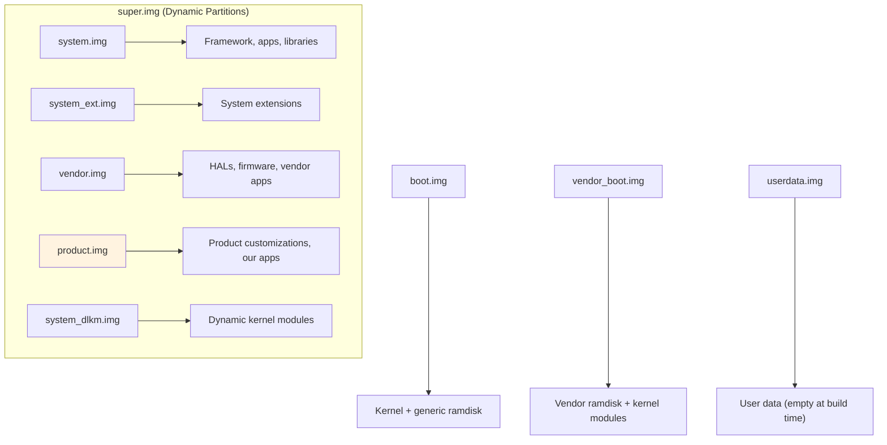

### 65.8.4 启动模拟器

AOSP 构建系统包含 `emulator` 命令，可用刚构建出的镜像启动 Android 模拟器：

```bash
# Launch the emulator with our custom ROM
emulator

# With additional options:
emulator \
    -gpu swiftshader_indirect \   # Software GPU (works in headless VMs)
    -memory 4096 \                # 4 GB RAM
    -cores 4 \                    # 4 CPU cores
    -no-snapshot \                # Start fresh
    -verbose                      # Debug output
```

模拟器会自动从 `$ANDROID_PRODUCT_OUT`（即 `out/target/product/bookdevice/`）加载镜像。

关键模拟器标志：

| 标志 | 说明 |
|------|-------------|
| `-gpu host` | 使用宿主机 GPU 加速（最快，需要 GPU） |
| `-gpu swiftshader_indirect` | 软件渲染（任何环境都能用） |
| `-memory <MB>` | 客户机内存，单位 MB |
| `-cores <N>` | 客户机 CPU 核心数 |
| `-no-snapshot` | 不使用 quickboot 快照 |
| `-wipe-data` | 重置 userdata 分区 |
| `-writable-system` | 允许写入 system 分区 |
| `-show-kernel` | 在终端显示内核日志 |
| `-logcat '*:V'` | 在终端显示 logcat |
| `-selinux permissive` | 将 SELinux 设为 permissive（调试用） |

### 65.8.5 刷写到实体设备

对于实体设备，使用 `fastboot`：

```bash
# Reboot device into bootloader
adb reboot bootloader

# Flash all images at once
fastboot flashall

# Or flash individual partitions:
fastboot flash boot boot.img
fastboot flash vendor_boot vendor_boot.img
fastboot flash super super.img
# fastboot flash userdata userdata.img  # Warning: this wipes user data!

# Reboot
fastboot reboot
```

对于使用动态分区（Android 10+）的设备，你可能需要配合 `super` 镜像使用
`fastboot flash`，或者使用 `fastbootd` 模式：

```bash
# Enter fastbootd (userspace fastboot)
fastboot reboot fastboot

# Flash dynamic partition images
fastboot flash system system.img
fastboot flash system_ext system_ext.img
fastboot flash vendor vendor.img
fastboot flash product product.img

# Reboot
fastboot reboot
```

### 65.8.6 增量构建

首次完整构建之后，增量构建只会重建发生更改的模块。速度大幅提升：

```bash
# Rebuild only changed modules
m

# Rebuild a specific module
m BookSampleApp

# Rebuild SystemUI only
m SystemUI

# Rebuild the system image (after rebuilding individual modules)
m systemimage

# Rebuild the product image
m productimage

# Rebuild a specific image
make vendorimage
```

增量构建提示：

| 操作 | 耗时 | 命令 |
|-----------|------|---------|
| 完整构建（首次） | 2-4 小时 | `m` |
| 完整构建（启用 ccache） | 30-60 分钟 | `m` |
| Java 改动后重建 | 1-5 分钟 | `m ModuleName` |
| C++ 改动后重建 | 2-10 分钟 | `m ModuleName` |
| 重建系统镜像 | 5-15 分钟 | `m systemimage` |
| 资源改动后重建 | 1-3 分钟 | `m ModuleName` |
| makefile 改动后重建 | 10-30 分钟 | `m`（Soong 重新分析） |

### 65.8.7 构建变体及其影响

| 变体 | `ro.debuggable` | `adb` 默认状态 | 优化 | 用途 |
|---------|-----------------|---------------|---------------|-----|
| `user` | 0 | 关闭 | 完整（proguard、混淆） | 发布 |
| `userdebug` | 1 | 开启 | 部分（保留部分便于调试） | 开发 |
| `eng` | 1 | 开启，已 root | 最少（无 proguard） | 深度调试 |

构建变体会影响：

- `adb root` 是否可用
- system 分区是否可写
- Proguard/R8 优化级别
- 是否包含调试工具（strace、valgrind 等）
- SELinux 模式（eng 有时会以 permissive 启动）

```bash
# Build a release (user) image
lunch bookphone-trunk_staging-user
m

# Build a debug (eng) image
lunch bookphone-trunk_staging-eng
m
```

### 65.8.8 构建系统故障排查

常见构建错误及解决方法：

| 错误 | 原因 | 解决方法 |
|-------|-------|----------|
| `No rule to make target` | 找不到模块 | 检查 `PRODUCT_PACKAGES` 和 `Android.bp` 模块名 |
| `ninja: error: depends on nonexistent` | 缺少依赖 | 将依赖添加到 `static_libs` 或 `shared_libs` |
| `SELinux denials` | 缺少 SELinux 策略 | 添加 `allow` 规则，运行 `audit2allow` |
| `FAILED: out/.../module.jar` | Java 编译错误 | 检查源代码语法和 import |
| `Insufficient disk space` | 构建产物超出磁盘容量 | 释放空间或将 `out/` 移到更大的磁盘 |
| `Killed (out of memory)` | 链接时内存不足 | 降低 `-j` 并行度或增加交换空间 |

### 65.8.9 16 KB 页大小

影响 Android 17 ROM 中每个原生二进制文件的一项变化是转向**16 KB 内存页大小**。现代 arm64 SoC 可以让 MMU 以 16 KB 作为基准页运行，而非历史上的 4 KB。这减少了 TLB 未命中并提高了吞吐量。但所有原生代码（`.so` 文件、可执行文件）都必须按可加载段 16 KB 对齐的方式布局。

构建系统在 64 位目标上已默认采用该设置。`build/make/core/config.mk` 将 arm64 和
x86_64 支持的最大页大小设为 16384：

```makefile
# build/make/core/config.mk (key excerpt)
else ifeq (,$(filter arm64 x86_64,$(TARGET_ARCH)))
  # > 4096 only supported on arm64 and x86_64
  TARGET_MAX_PAGE_SIZE_SUPPORTED := 4096
else
  # The default binary alignment for userspace is 16384.
  TARGET_MAX_PAGE_SIZE_SUPPORTED := 16384
endif
```

因此，你通过 Soong 从源码构建的二进制文件已经是 16 KB 兼容的。可能出问题的是**打包在预编译 APK 或 vendor blob 中的预编译 `.so`**——这些库可能由较旧的工具链以 4 KB 对齐方式链接。这样的库在 4 KB 内核上可以正常加载，但在 16 KB 内核上会映射失败。

对于开发和测试，有两个关键旋钮：

| 机制 | 位置 | 效果 |
|-----------|-------|--------|
| `TARGET_MAX_PAGE_SIZE_SUPPORTED` | `build/make/core/config.mk`（自动） | 原生模块的段对齐；arm64/x86_64 上默认 16384 |
| `TARGET_BOOTS_16K` | `BoardConfig.mk` | 将该主板标记为实际启动 16 KB 内核（`build/make/core/android_soong_config_vars.mk`） |
| `PRODUCT_16K_DEVELOPER_OPTION` | 产品 makefile | 暴露运行时“以 16KB 页大小启动”的开发者开关；设置 `ro.product.build.16k_page.enabled`（`build/make/core/sysprop_config.mk`） |

模拟器提供了专门的 16 KB 产品，让你无需实体硬件即可验证对齐。
`device/generic/goldfish/64bitonly/product/sdk_phone16k_x86_64.mk`
（及其 arm64 兄弟版本）继承了 16 KB 板级细节
（`device/generic/goldfish/board/emu64x16k/details.mk`）和 16 KB 命令行的
内核（`device/generic/goldfish/board/kernel/x86_64_16k.mk`）。构建并启动其中
一个目标，即可确认你的预编译文件能干净地映射：

```bash
lunch sdk_phone16k_x86_64-trunk_staging-userdebug
m
emulator
# On the device, confirm the live page size:
adb shell getconf PAGE_SIZE        # prints 16384 on a 16 KB build
```

此检查单独使用 `getconf PAGE_SIZE` 即可。相关属性
`ro.product.build.16k_page.enabled` 仅反映产品是否设置了
`PRODUCT_16K_DEVELOPER_OPTION`（双启动开发者开关）。该属性并不显示镜像是否为
16 KB 对齐。在 `sdk_phone16k_x86_64` 上（它未设置该选项），尽管构建是真正的
16 KB 构建，该属性仍显示为 `false`。

如果某个预编译文件在 16 KB 目标上无法加载，请从源码重新构建。这样会自动采用
16 KB 对齐。或者使用 16 KB 的 `max-page-size` 重新链接。将 ROM 升级到 Android
17 时，审计预编译文件的 16 KB 就绪情况已成为标准步骤。

---

## 65.9 调试你的 ROM

### 65.9.1 logcat——主要的调试工具

`logcat` 是 Android 通用的调试工具。它读取内核环形缓冲区和 Android 日志守护进程。

```bash
# Basic logcat (all messages)
adb logcat

# Filter by tag
adb logcat -s BookService:V

# Filter by priority (Verbose, Debug, Info, Warn, Error, Fatal)
adb logcat '*:W'    # Only warnings and above

# Filter by multiple tags
adb logcat BookService:V BookSampleApp:D '*:S'

# Format options
adb logcat -v threadtime    # Show thread ID and timestamp
adb logcat -v color         # Colorized output
adb logcat -v long          # Detailed format

# Save to file
adb logcat -d > logcat.txt  # Dump and exit
adb logcat -f /sdcard/logcat.txt  # Write to device

# Clear the log buffer
adb logcat -c

# Show kernel log (dmesg via logcat)
adb logcat -b kernel
```

### 65.9.2 dumpsys——查询系统服务

`dumpsys` 打印系统服务的内部状态。对调试服务问题至关重要：

```bash
# List all available services
adb shell dumpsys -l

# Query a specific service
adb shell dumpsys activity
adb shell dumpsys window
adb shell dumpsys package com.aospbook.sample
adb shell dumpsys overlay    # RRO overlay state

# Our custom service (if we implemented dump())
adb shell dumpsys aospbook

# Query with timeout (useful for stuck services)
adb shell dumpsys -t 10 activity

# Common dumpsys targets for ROM debugging:
adb shell dumpsys activity activities  # Activity stack
adb shell dumpsys window displays      # Display information
adb shell dumpsys package              # All package info
adb shell dumpsys meminfo              # Memory usage
adb shell dumpsys battery              # Battery state
adb shell dumpsys alarm                # Scheduled alarms
adb shell dumpsys jobscheduler         # Scheduled jobs
adb shell dumpsys notification         # Notification state
```

### 65.9.3 bugreport——全面的系统快照

bugreport 捕获某个时刻的完整系统状态：

```bash
# Generate a bugreport (saves to device, then pulls)
adb bugreport bugreport.zip

# The ZIP contains:
#   bugreport-<device>-<date>.txt  # Main report (huge)
#   dumpstate_board.bin            # Board-specific dump
#   FS/                            # File system snapshots
#   proto/                         # Protobuf data
```

bugreport 包含 logcat、所有服务的 dumpsys 输出、内核日志、进程列表、文件系统信息等。它是问题调查的主要材料。

### 65.9.4 Perfetto——性能跟踪

Perfetto 是 AOSP 的现代跟踪系统，取代了旧的 `systrace` 工具。

```bash
# Record a 10-second trace with common categories
adb shell perfetto \
    --txt \
    --config - \
    --out /data/misc/perfetto-traces/trace.perfetto-trace \
    << 'EOF'
buffers: {
    size_kb: 63488
    fill_policy: RING_BUFFER
}
data_sources: {
    config {
        name: "linux.ftrace"
        ftrace_config {
            ftrace_events: "sched/sched_switch"
            ftrace_events: "power/suspend_resume"
            ftrace_events: "sched/sched_wakeup"
            ftrace_events: "sched/sched_wakeup_new"
            ftrace_events: "sched/sched_process_exit"
            ftrace_events: "sched/sched_process_free"
            ftrace_events: "task/task_newtask"
            ftrace_events: "task/task_rename"
            atrace_categories: "am"
            atrace_categories: "wm"
            atrace_categories: "view"
            atrace_categories: "gfx"
            atrace_categories: "input"
        }
    }
}
data_sources: {
    config {
        name: "linux.process_stats"
    }
}
duration_ms: 10000
EOF

# Pull the trace
adb pull /data/misc/perfetto-traces/trace.perfetto-trace .

# Open in the Perfetto UI
# https://ui.perfetto.dev/
```

### 65.9.5 Winscope——窗口与图层跟踪

Winscope 捕获窗口管理器和 surface flinger 的状态转换，对调试 UI 布局问题至关重要：

两种跟踪现在都通过 Perfetto 数据源捕获。旧接口已移除：`cmd window tracing` 只会打印 "Shell commands are
ignored. Any type of action should be performed through perfetto."
（`frameworks/base/services/core/java/com/android/server/wm/WindowTracingPerfetto.java`），
而 SurfaceFlinger 的 `service call SurfaceFlinger 1025` 图层跟踪开关会返回
`NAME_NOT_FOUND`（`frameworks/native/services/surfaceflinger/SurfaceFlinger.cpp`）。

```bash
# Write a Perfetto config enabling the WM and SF data sources:
cat > winscope.cfg <<'EOF'
buffers { size_kb: 65536 fill_policy: RING_BUFFER }
data_sources { config { name: "android.windowmanager" } }
data_sources { config { name: "android.surfaceflinger.layers" } }
data_sources { config { name: "android.surfaceflinger.transactions" } }
duration_ms: 30000
EOF

# Capture (reproduce the issue while it runs):
adb push winscope.cfg /data/misc/perfetto-configs/winscope.cfg
adb shell perfetto --txt -c /data/misc/perfetto-configs/winscope.cfg \
    -o /data/misc/perfetto-traces/winscope.perfetto-trace

# Collect the trace
adb pull /data/misc/perfetto-traces/winscope.perfetto-trace .

# Open the .perfetto-trace in the Winscope / Perfetto UI:
# https://ui.perfetto.dev/
# Or use the local Winscope included in the AOSP tree:
# development/tools/winscope/
```

### 65.9.6 调试启动问题

当你的定制 ROM 无法启动时：

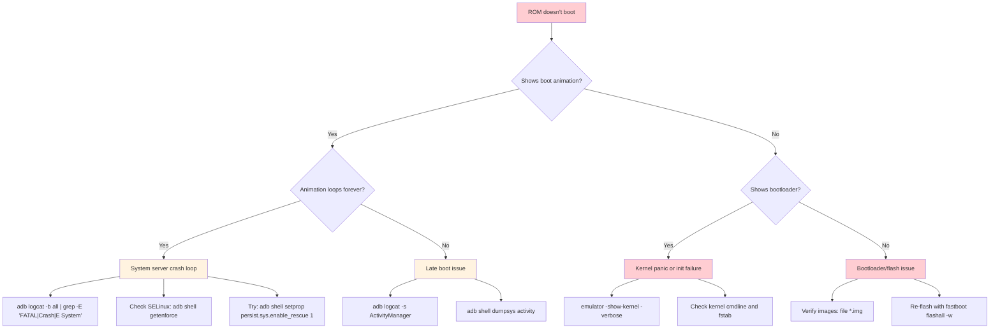

**常见的启动问题及解决方法：**

1. **启动循环（动画永不结束）**

```bash
# Check system_server logs:
adb logcat -b all | grep -E "FATAL|System.err|AndroidRuntime" | head -50

# Most common cause: missing SELinux policy
# Temporarily set permissive for debugging:
adb shell setenforce 0
# Then find the denials:
adb logcat | grep "avc: denied"
```

2. **自定义服务崩溃**

```bash
# Check if system_server is restarting:
adb logcat -s ActivityManager | grep "Start proc"

# Check for our service specifically:
adb logcat -s BookService

# Full exception traces:
adb logcat -s AndroidRuntime
```

3. **缺少模块 / 库**

```bash
# Check if the module was installed:
adb shell ls /product/app/BookSampleApp/
adb shell ls /system/framework/BookService.jar

# Check the build output:
ls out/target/product/bookdevice/product/app/BookSampleApp/
```

### 65.9.7 SELinux 调试

SELinux 拒绝是定制 ROM 中最常见的问题根源：

```bash
# Check SELinux mode
adb shell getenforce
# Expected: Enforcing

# View SELinux denials
adb logcat | grep "avc: denied"

# Example denial:
# avc: denied { add } for service=aospbook pid=1234
#   scontext=u:r:system_server:s0
#   tcontext=u:object_r:default_android_service:s0
#   tclass=service_manager

# Generate policy from denials using audit2allow
# (-p takes a single policy file, not a directory):
adb logcat -d | grep "avc: denied" | audit2allow -p out/target/product/bookdevice/vendor/etc/selinux/precompiled_sepolicy

# This outputs allow rules you can add to your .te files
```

### 65.9.8 调试工具链

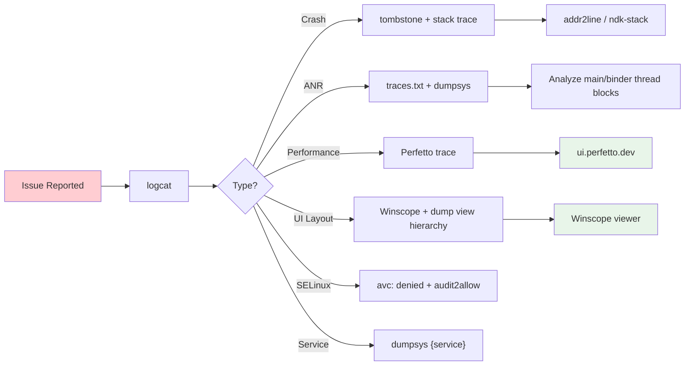

### 65.9.9 ROM 开发中有用的 adb 命令

```bash
# ============================================================
# System Properties
# ============================================================
adb shell getprop ro.build.fingerprint
adb shell getprop ro.aospbook.version
adb shell getprop | grep aospbook

# ============================================================
# Package Management
# ============================================================
adb shell pm list packages | grep aospbook
adb shell pm path com.aospbook.sample
adb shell pm dump com.aospbook.sample | head -50

# ============================================================
# Service Management
# ============================================================
adb shell service list | grep aospbook
adb shell service check aospbook

# ============================================================
# Process Information
# ============================================================
adb shell ps -A | grep -E "system_server|aospbook"
adb shell dumpsys meminfo system_server

# ============================================================
# File System
# ============================================================
adb shell mount | grep -E "system|vendor|product"
adb shell df -h
adb shell ls -la /product/overlay/

# ============================================================
# RRO Overlay Status
# ============================================================
adb shell cmd overlay list
adb shell cmd overlay dump com.aospbook.overlay.framework
adb shell cmd overlay enable com.aospbook.overlay.framework
adb shell cmd overlay disable com.aospbook.overlay.framework

# ============================================================
# Boot Diagnostics
# ============================================================
adb shell dmesg | tail -100
adb shell cat /proc/bootconfig
adb shell cat /proc/cmdline
adb shell uptime
```

---

## 65.10 分发

### 65.10.1 签名总览

Android 使用代码签名来确保每个 APK 和系统镜像的完整性与真实性。AOSP 中使用四类关键密钥：

| 密钥 | 文件对 | 用途 |
|-----|-----------|---------|
| **testkey** | `testkey.pk8` / `testkey.x509.pem` | 默认开发签名 |
| **platform** | `platform.pk8` / `platform.x509.pem` | 带有 `android.uid.system` 的系统应用 |
| **shared** | `shared.pk8` / `shared.x509.pem` | 共享数据的应用（通讯录、电话） |
| **media** | `media.pk8` / `media.x509.pem` | 媒体/下载应用 |

这些默认密钥位于：

```
build/make/target/product/security/
```

**关键警告**：该目录中的密钥是公开已知的测试密钥。任何用这些密钥发布的 ROM 都极易受到攻击。任何人都可以用同一密钥签名恶意 APK，而它会被当作系统更新接受。

`build/make/target/product/security/README` 中的 `README` 明确警告：

> “本目录中的测试密钥仅用于开发，绝不可用来签名公开发布镜像中的软件包。”

### 65.10.2 生成发布密钥

生成你自己的专用密钥：

```bash
# Create a directory for your keys
mkdir -p device/AospBook/bookphone/keys
cd device/AospBook/bookphone/keys

# The make_key tool is provided by AOSP:
SUBJECT='/C=US/ST=California/L=Mountain View/O=AospBook/OU=ROM/CN=AospBook/emailAddress=rom@aospbook.example.com'

# Generate each key pair
# This will prompt for a password -- use a strong one for release keys
# For development, you can press Enter for no password
../../../../../../development/tools/make_key releasekey "$SUBJECT"
../../../../../../development/tools/make_key platform "$SUBJECT"
../../../../../../development/tools/make_key shared "$SUBJECT"
../../../../../../development/tools/make_key media "$SUBJECT"

# Verify the generated files
ls -la
# Expected:
#   releasekey.pk8
#   releasekey.x509.pem
#   platform.pk8
#   platform.x509.pem
#   shared.pk8
#   shared.x509.pem
#   media.pk8
#   media.x509.pem
```

每次调用 `make_key` 会生成两个文件：

- `*.pk8`——PKCS#8 DER 格式的私钥
- `*.x509.pem`——X.509 PEM 格式的公钥证书

`development/tools/make_key` 接受可选的第三个参数来选择密钥类型：`rsa`（默认）或 `ec`。APK Signature Scheme v3/v4 和现代 AVB 都接受 EC 密钥，因此如果你偏好椭圆曲线密钥，`make_key platform "$SUBJECT" ec` 是有效的选择。无论选择哪种，下面的签名工具都以相同方式使用 `.pk8` / `.x509.pem` 密钥对。

### 65.10.3 配置构建使用发布密钥

告诉构建系统使用你的密钥而非测试密钥：

```makefile
# In device/AospBook/bookphone/bookphone.mk (or device.mk)

# Use our custom signing keys
PRODUCT_DEFAULT_DEV_CERTIFICATE := device/AospBook/bookphone/keys/releasekey

# Map APK signing to our keys
PRODUCT_CERTIFICATE_OVERRIDES := \
    testkey:device/AospBook/bookphone/keys/releasekey \
    platform:device/AospBook/bookphone/keys/platform \
    shared:device/AospBook/bookphone/keys/shared \
    media:device/AospBook/bookphone/keys/media
```

### 65.10.4 对构建进行签名

有两种签名方式：

**方式 1：构建时签名（开发）**

设置 `PRODUCT_DEFAULT_DEV_CERTIFICATE` 后，所有 APK 都会在构建过程中自动签名。这是最简单的方式。

**方式 2：构建后签名（发布）**

对于生产发布，先构建，再单独签名：

```bash
# Step 1: Build target-files package
m dist

# The target-files ZIP is at:
# out/dist/bookphone-target_files-<build_id>.zip

# Step 2: Sign all APKs in the target-files.
#   -d <dir> is the short form of --default_key_mappings: every APK that the
#            stock build signed with testkey/platform/shared/media is re-signed
#            with the matching key name found in <dir>.
#   -o       also re-signs (replaces) the OTA verification keys with the
#            release key in that directory.
python3 build/make/tools/releasetools/sign_target_files_apks.py \
    -o \
    -d device/AospBook/bookphone/keys \
    out/dist/bookphone-target_files-*.zip \
    out/dist/bookphone-target_files-signed.zip

# Step 3: Generate signed images from the signed target-files
python3 build/make/tools/releasetools/img_from_target_files.py \
    out/dist/bookphone-target_files-signed.zip \
    out/dist/bookphone-img-signed.zip
```

### 65.10.5 OTA 包生成

OTA（Over The Air）包让你可以向现有用户分发更新。

**完整 OTA 包**（包含完整镜像）：

```bash
# Generate from target-files
python3 build/make/tools/releasetools/ota_from_target_files.py \
    --package_key device/AospBook/bookphone/keys/releasekey \
    out/dist/bookphone-target_files-signed.zip \
    out/dist/bookphone-ota-full.zip
```

**增量 OTA 包**（只包含与先前构建的差异）：

```bash
# Generate incremental OTA (from v1 to v2)
python3 build/make/tools/releasetools/ota_from_target_files.py \
    --package_key device/AospBook/bookphone/keys/releasekey \
    -i out/dist/bookphone-v1-target_files-signed.zip \
    out/dist/bookphone-v2-target_files-signed.zip \
    out/dist/bookphone-ota-v1-to-v2.zip
```

`build/make/tools/releasetools/` 还提供了更专门的 OTA 辅助工具，在 ROM bring-up 期间很实用：

- `ota_from_raw_img.py` 直接从一组 `.img` 文件构建 A/B payload，而不是从完整的 target-files 包。当你只想发布一两个重新分区的镜像时，这种方式很方便。
- `create_brick_ota.py` 生成一个清除 AVB/`vbmeta` 分区、故意将设备“变砖”的 recovery 包（用于 RMA/安全擦除流程）。它提醒我们：OTA payload 本质上只是对分区的一组带签名的指令。

这些工具是对 `ota_from_target_files.py` 路径的补充而非替代，本节其余部分使用的都是该路径。

**OTA 生成工作流：**

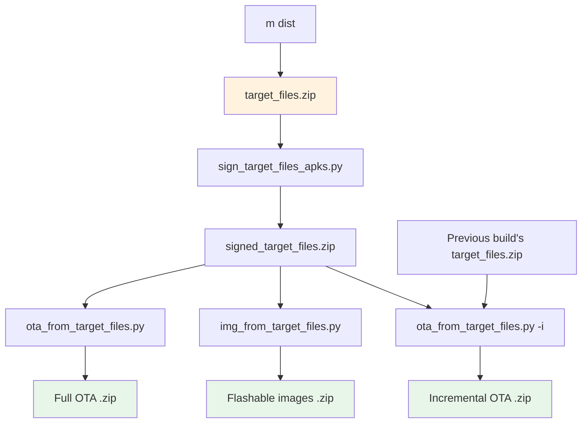

### 65.10.6 OTA 包结构

OTA 包是一个签名过的 ZIP 文件，包含：

```
ota_package.zip
    META-INF/
        com/
            android/
                metadata.pb        # OTA metadata (protobuf)
                metadata           # Legacy metadata
            google/
                android/
                    update-binary  # The OTA installer binary
                    updater-script # Installation script
    payload.bin                    # The actual update payload
    payload_properties.txt         # Payload metadata
    care_map.pb                    # Block mapping for dm-verity
```

### 65.10.7 验证启动与 AVB

Android Verified Boot（AVB）确保启动镜像和分区未被篡改。对于面向实体设备的定制 ROM：

```bash
# Generate AVB signing key
openssl genrsa -out avb_custom_key.pem 4096

# Extract the public key for embedding in the bootloader
avbtool extract_public_key --key avb_custom_key.pem --output avb_custom_key.bin
```

在 `BoardConfig.mk` 中配置：

```makefile
# Use custom AVB key
BOARD_AVB_KEY_PATH := device/AospBook/bookphone/keys/avb_custom_key.pem
BOARD_AVB_ALGORITHM := SHA256_RSA4096
```

### 65.10.8 构建指纹与属性

构建指纹是 ROM 构建的唯一标识符。其格式为：

```
BRAND/PRODUCT/DEVICE:VERSION/BUILD_ID/BUILD_NUMBER:VARIANT/KEYS
```

示例：

```
AospBook/bookphone/bookdevice:17/BP1A.250505.005/eng.builder.20250505:userdebug/release-keys
```

在你的产品 makefile 中设置：

```makefile
# Custom build properties
PRODUCT_PROPERTY_OVERRIDES += \
    ro.build.display.id=AospBook-1.0-$(shell date +%Y%m%d) \
    ro.build.version.incremental=$(shell date +%Y%m%d%H%M%S) \
    ro.aospbook.version=1.0.0
```

（当前 AOSP 中没有 `PRODUCT_BUILD_PROP_OVERRIDES` 变量——请像上面那样通过
`PRODUCT_SYSTEM_PROPERTIES` /
`PRODUCT_PRODUCT_PROPERTIES` / `PRODUCT_PROPERTY_OVERRIDES` 设置
build.prop 值。`release-keys`/`test-keys` 标签来自 `BUILD_VERSION_TAGS` make
变量，在 `build/make/core/sysprop.mk` 中被使用，由构建环境设置而非产品
makefile。）

### 65.10.9 分发检查清单

在公开发布你的定制 ROM 之前：

```
[ ] Generate unique signing keys (NEVER use test keys)
[ ] Sign all APKs with release keys
[ ] Build with the "user" variant (not userdebug/eng)
[ ] Verify SELinux is enforcing: adb shell getenforce
[ ] Remove debugging tools and backdoors
[ ] Test OTA update path (both full and incremental)
[ ] Verify all apps launch and function correctly
[ ] Check that permissions work correctly
[ ] Test boot time and basic performance
[ ] Generate SHA256 checksums for all distributed files
[ ] Write release notes documenting changes
[ ] Set up a distribution server for OTA updates
```

### 65.10.10 发布校验和

```bash
# Generate checksums for distribution files
sha256sum out/dist/bookphone-ota-full.zip > checksums.txt
sha256sum out/dist/bookphone-img-signed.zip >> checksums.txt

# Sign the checksums file with GPG for additional trust
gpg --sign --armor checksums.txt
```

---

## 65.11 进阶：内核定制

### 65.11.1 AOSP 中的内核

AOSP 模拟器使用预编译的通用内核镜像（GKI）内核。x86_64 模拟器的内核配置定义于：

```
device/generic/goldfish/board/kernel/x86_64.mk
```

该文件显示：

```makefile
# device/generic/goldfish/board/kernel/x86_64.mk (key excerpts)
TARGET_KERNEL_USE ?= 6.12
KERNEL_ARTIFACTS_PATH := prebuilts/qemu-kernel/x86_64/$(TARGET_KERNEL_USE)
EMULATOR_KERNEL_FILE := $(KERNEL_ARTIFACTS_PATH)/kernel-$(TARGET_KERNEL_USE)
```

预编译内核位于：

```
prebuilts/qemu-kernel/x86_64/6.12/
    kernel-6.12              # The kernel binary
    gki_modules/             # GKI kernel modules
    goldfish_modules/        # Emulator-specific modules
```

### 65.11.2 GKI 架构

Android 的通用内核镜像（GKI）将内核拆分为：

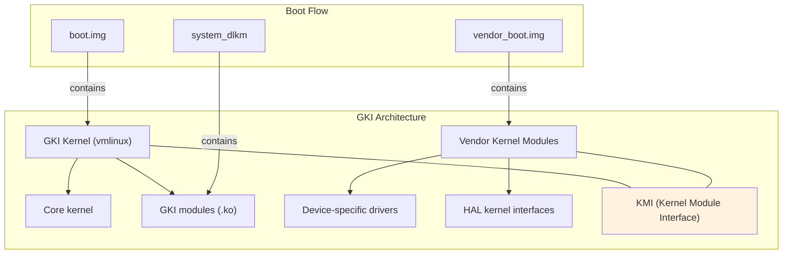

KMI（Kernel Module Interface）是 GKI 内核与 vendor 模块之间的稳定 ABI，使二者可以独立更新。

### 65.11.3 构建自定义内核

要为模拟器构建自定义内核：

```bash
# Clone the kernel source
mkdir -p ~/kernel && cd ~/kernel
repo init -u https://android.googlesource.com/kernel/manifest \
    -b common-android-mainline
repo sync -j$(nproc)

# Build the kernel with Kleaf (the Bazel-based kernel build, now the
# standard path; the legacy BUILD_CONFIG=... build/build.sh flow has been
# retired in current branches).
# For the x86_64 GKI used by the emulator:
tools/bazel run //common:kernel_x86_64_dist -- --dist_dir=out/x86_64/dist

# arm64 equivalent:
# tools/bazel run //common:kernel_aarch64_dist -- --dist_dir=out/aarch64/dist
```

Kleaf 用 Bazel 规则封装内核构建。`tools/bazel` 是检入的启动器。`*_dist` 目标将内核镜像及模块暂存到你传入的 `--dist_dir` 中。过去位于
`build.config.*` 文件中的构建配置，现在以 Bazel `kernel_build` 目标的形式表达于内核树中。

内核构建会将其输出暂存到你传入的 `--dist_dir` 中：

```
out/x86_64/dist/
    bzImage                  # Kernel binary (x86_64)
    vmlinux                  # Uncompressed kernel (for debugging)
    System.map               # Symbol map
    *.ko                     # Kernel modules
```

### 65.11.4 在模拟器中使用自定义内核

```bash
# Option 1: Copy into the goldfish kernel prebuilts the build consumes
cp out/x86_64/dist/bzImage \
    prebuilts/qemu-kernel/x86_64/6.12/kernel-6.12

# Option 2: Specify at emulator launch
emulator -kernel /path/to/custom/bzImage

# Option 3: Set in build config
# In x86_64.mk:
# EMULATOR_KERNEL_FILE := /path/to/custom/kernel
```

### 65.11.5 添加自定义内核模块

内核模块可以在不重建整个内核的情况下扩展内核功能。对于模拟器，vendor 特有的模块从 vendor ramdisk 加载。

**创建一个简单的内核模块：**

```c
// device/AospBook/bookphone/kernel_modules/bookmodule/bookmodule.c
#include <linux/init.h>
#include <linux/module.h>
#include <linux/kernel.h>

MODULE_LICENSE("GPL");
MODULE_AUTHOR("AospBook");
MODULE_DESCRIPTION("AospBook sample kernel module");
MODULE_VERSION("1.0");

static int __init bookmodule_init(void)
{
    printk(KERN_INFO "BookModule: Loaded (AospBook ROM kernel module)\n");
    return 0;
}

static void __exit bookmodule_exit(void)
{
    printk(KERN_INFO "BookModule: Unloaded\n");
}

module_init(bookmodule_init);
module_exit(bookmodule_exit);
```

**树外模块的 Makefile：**

```makefile
# device/AospBook/bookphone/kernel_modules/bookmodule/Makefile
obj-m += bookmodule.o

KERNEL_SRC ?= /path/to/kernel/source

all:
	$(MAKE) -C $(KERNEL_SRC) M=$(PWD) modules

clean:
	$(MAKE) -C $(KERNEL_SRC) M=$(PWD) clean
```

**构建与安装：**

```bash
# Build the module against the emulator kernel
cd device/AospBook/bookphone/kernel_modules/bookmodule
make KERNEL_SRC=~/kernel/common ARCH=x86_64 CROSS_COMPILE=x86_64-linux-gnu-

# The module is at:
ls bookmodule.ko

# Test on the emulator:
adb root
adb push bookmodule.ko /data/local/tmp/
adb shell insmod /data/local/tmp/bookmodule.ko
adb shell dmesg | grep BookModule
# Expected: BookModule: Loaded (AospBook ROM kernel module)

# Unload:
adb shell rmmod bookmodule
```

### 65.11.6 将内核模块纳入构建

要将你的模块自动纳入构建：

```makefile
# In device.mk
PRODUCT_COPY_FILES += \
    device/AospBook/bookphone/kernel_modules/bookmodule/bookmodule.ko:$(TARGET_COPY_OUT_VENDOR)/lib/modules/bookmodule.ko

# Or add to the vendor ramdisk modules (loaded at boot):
BOARD_VENDOR_RAMDISK_KERNEL_MODULES += \
    device/AospBook/bookphone/kernel_modules/bookmodule/bookmodule.ko
```

要在启动时自动加载，请添加到 init 脚本：

```
# device/AospBook/bookphone/init/init.bookphone.rc
on boot
    insmod /vendor/lib/modules/bookmodule.ko
```

### 65.11.7 内核配置调优

内核配置（`defconfig`）控制哪些特性被编译进内核。对于模拟器：

```bash
# View current kernel config on a running device
adb shell cat /proc/config.gz | gunzip > current_config.txt

# Or from the kernel build, in the Kleaf dist dir you passed:
cat out/x86_64/dist/.config
```

定制 ROM 常用的内核配置调整：

| 配置项 | 默认 | 定制 | 用途 |
|---------------|---------|--------|---------|
| `CONFIG_HZ` | 250 | 1000 | 更高的 tick 速率，提升响应性 |
| `CONFIG_SCHED_AUTOGROUP` | n | y | 自动分组调度 |
| `CONFIG_TCP_CONG_BBR` | n | y | BBR 拥塞控制 |
| `CONFIG_ZRAM` | m | y | 压缩 RAM 交换 |
| `CONFIG_KSM` | n | y | 内核同页合并 |
| `CONFIG_TRANSPARENT_HUGEPAGE` | n | y | 透明大页 |

### 65.11.8 内核模块生命周期

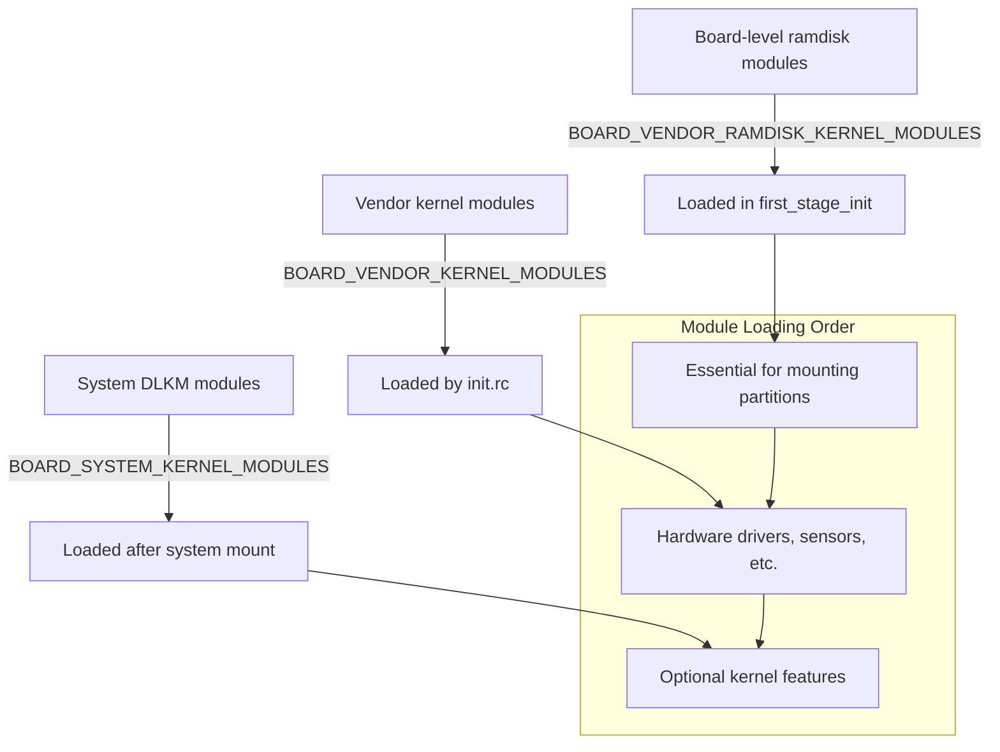

Goldfish 模拟器在 `device/generic/goldfish/board/kernel/x86_64.mk` 中定义了对早期启动至关重要的特定 ramdisk 模块：

```makefile
RAMDISK_KERNEL_MODULES := \
    virtio_dma_buf.ko \
    virtio-rng.ko \

RAMDISK_SYSTEM_KERNEL_MODULES := \
    virtio_blk.ko \
    virtio_console.ko \
    virtio_pci.ko \
    virtio_pci_legacy_dev.ko \
    virtio_pci_modern_dev.ko \
    vmw_vsock_virtio_transport.ko \
```

这些模块在第一阶段 init 期间加载，此时甚至尚未挂载 system 分区。这是因为它们提供了访问磁盘所需的虚拟硬件驱动。

---

## 65.12 进阶：HAL 定制

### 65.12.1 Android 中的 HAL 架构

硬件抽象层（HAL）位于 Android 框架与 Linux 内核之间，为硬件访问提供稳定的接口：

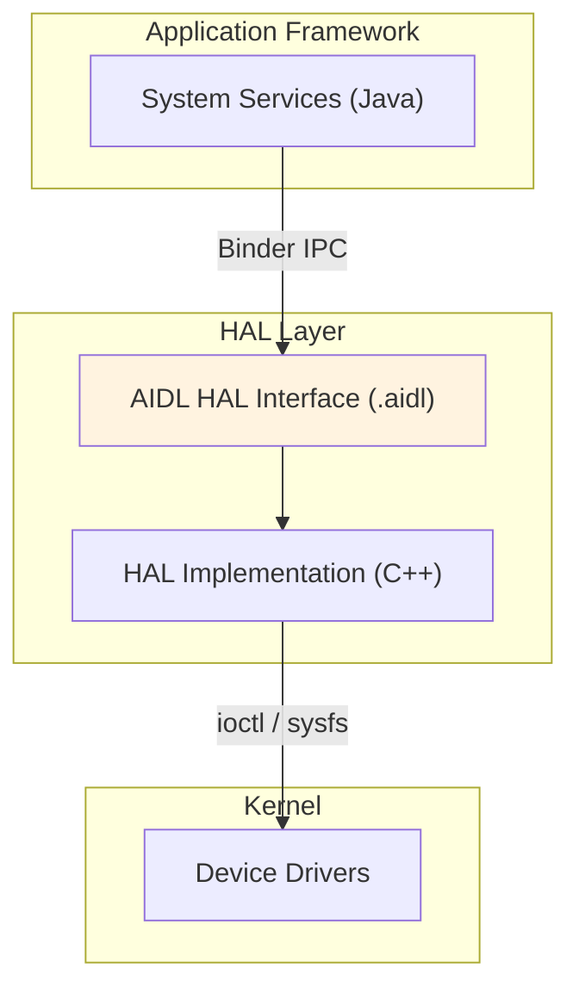

现代 Android 使用 AIDL HAL（取代了旧的 HIDL HAL）。HAL 接口定义于：

```
hardware/interfaces/
```

该目录包含音频、相机、传感器、健康、图形以及数十种其他硬件子系统的 AIDL 定义。

Goldfish 模拟器在以下位置提供自己的 HAL 实现：

```
device/generic/goldfish/hals/
    audio/        # Audio HAL
    camera/       # Camera HAL
    fingerprint/  # Fingerprint HAL
    gnss/         # GNSS (GPS) HAL
    gralloc/      # Graphics buffer allocation
    hwc3/         # Hardware Composer 3
    radio/        # Telephony radio HAL
    sensors/      # Sensors HAL
```

### 65.12.2 创建自定义 AIDL HAL

让我们为一个假设的“阅读灯”硬件特性创建一个自定义 HAL。这将演示完整的 HAL 生命周期：接口定义、默认实现、init 服务、SELinux 策略和 VINTF 清单条目。

**目录结构：**

```
device/AospBook/bookphone/hal/booklight/
    Android.bp
    aidl/
        com/aospbook/hardware/light/
            IBookLight.aidl
            BookLightState.aidl
    default/
        Android.bp
        BookLight.cpp
        BookLight.h
        booklight-default.rc
        booklight-default.xml
```

### 65.12.3 定义 AIDL 接口

**IBookLight.aidl**：

```java
// device/AospBook/bookphone/hal/booklight/aidl/com/aospbook/hardware/light/IBookLight.aidl
package com.aospbook.hardware.light;

import com.aospbook.hardware.light.BookLightState;

/**
 * HAL interface for the AospBook reading light.
 *
 * This is a custom AIDL HAL that demonstrates how to define
 * and implement a hardware abstraction layer.
 */
@VintfStability
interface IBookLight {
    /**
     * Get the current light state.
     */
    BookLightState getState();

    /**
     * Set the light brightness (0-255).
     */
    void setBrightness(int brightness);

    /**
     * Set the color temperature in Kelvin (2700-6500).
     */
    void setColorTemperature(int kelvin);

    /**
     * Enable or disable the reading light.
     */
    void setEnabled(boolean enabled);

    /**
     * Get the supported color temperature range.
     * Returns [min, max] in Kelvin.
     */
    int[] getSupportedTemperatureRange();
}
```

**BookLightState.aidl**：

```java
// device/AospBook/bookphone/hal/booklight/aidl/com/aospbook/hardware/light/BookLightState.aidl
package com.aospbook.hardware.light;

/**
 * Parcelable representing the current state of the book light.
 */
@VintfStability
parcelable BookLightState {
    boolean enabled;
    int brightness;           // 0-255
    int colorTemperature;     // Kelvin (2700-6500)
}
```

**AIDL 库的 Android.bp：**

```json
// device/AospBook/bookphone/hal/booklight/Android.bp

aidl_interface {
    name: "com.aospbook.hardware.light",
    vendor_available: true,
    srcs: ["aidl/com/aospbook/hardware/light/*.aidl"],
    stability: "vintf",
    backend: {
        cpp: {
            enabled: true,
        },
        java: {
            enabled: true,
            sdk_version: "module_current",
        },
        ndk: {
            enabled: true,
        },
    },
    versions: ["1"],
}
```

### 65.12.4 实现默认 HAL

**BookLight.h**：

```cpp
// device/AospBook/bookphone/hal/booklight/default/BookLight.h
#pragma once

#include <aidl/com/aospbook/hardware/light/BnBookLight.h>
#include <aidl/com/aospbook/hardware/light/BookLightState.h>

namespace aidl::com::aospbook::hardware::light {

/**
 * Default implementation of the BookLight HAL.
 *
 * For the emulator, this is a software-only implementation that
 * stores state in memory. On a real device, this would interface
 * with kernel drivers via sysfs or ioctl.
 */
class BookLight : public BnBookLight {
public:
    BookLight();

    ndk::ScopedAStatus getState(BookLightState* _aidl_return) override;
    ndk::ScopedAStatus setBrightness(int32_t brightness) override;
    ndk::ScopedAStatus setColorTemperature(int32_t kelvin) override;
    ndk::ScopedAStatus setEnabled(bool enabled) override;
    ndk::ScopedAStatus getSupportedTemperatureRange(
        std::vector<int32_t>* _aidl_return) override;

private:
    std::mutex mLock;
    BookLightState mState;

    static constexpr int32_t kMinTemperature = 2700;
    static constexpr int32_t kMaxTemperature = 6500;
    static constexpr int32_t kDefaultTemperature = 4000;
    static constexpr int32_t kMaxBrightness = 255;
};

}  // namespace aidl::com::aospbook::hardware::light
```

**BookLight.cpp**：

```cpp
// device/AospBook/bookphone/hal/booklight/default/BookLight.cpp
#include "BookLight.h"

#include <android-base/logging.h>

namespace aidl::com::aospbook::hardware::light {

BookLight::BookLight() {
    mState.enabled = false;
    mState.brightness = 0;
    mState.colorTemperature = kDefaultTemperature;
    LOG(INFO) << "BookLight HAL initialized";
}

ndk::ScopedAStatus BookLight::getState(BookLightState* _aidl_return) {
    std::lock_guard<std::mutex> lock(mLock);
    *_aidl_return = mState;
    return ndk::ScopedAStatus::ok();
}

ndk::ScopedAStatus BookLight::setBrightness(int32_t brightness) {
    if (brightness < 0 || brightness > kMaxBrightness) {
        return ndk::ScopedAStatus::fromExceptionCode(
            EX_ILLEGAL_ARGUMENT);
    }

    std::lock_guard<std::mutex> lock(mLock);
    mState.brightness = brightness;
    LOG(DEBUG) << "BookLight brightness set to " << brightness;

    // On a real device, write to hardware:
    // write_to_sysfs("/sys/class/leds/booklight/brightness", brightness);

    return ndk::ScopedAStatus::ok();
}

ndk::ScopedAStatus BookLight::setColorTemperature(int32_t kelvin) {
    if (kelvin < kMinTemperature || kelvin > kMaxTemperature) {
        return ndk::ScopedAStatus::fromExceptionCode(
            EX_ILLEGAL_ARGUMENT);
    }

    std::lock_guard<std::mutex> lock(mLock);
    mState.colorTemperature = kelvin;
    LOG(DEBUG) << "BookLight color temperature set to " << kelvin << "K";

    // On a real device, write to hardware:
    // write_to_sysfs("/sys/class/leds/booklight/color_temp", kelvin);

    return ndk::ScopedAStatus::ok();
}

ndk::ScopedAStatus BookLight::setEnabled(bool enabled) {
    std::lock_guard<std::mutex> lock(mLock);
    mState.enabled = enabled;
    LOG(DEBUG) << "BookLight " << (enabled ? "enabled" : "disabled");

    // On a real device:
    // write_to_sysfs("/sys/class/leds/booklight/enable", enabled ? 1 : 0);

    return ndk::ScopedAStatus::ok();
}

ndk::ScopedAStatus BookLight::getSupportedTemperatureRange(
        std::vector<int32_t>* _aidl_return) {
    _aidl_return->clear();
    _aidl_return->push_back(kMinTemperature);
    _aidl_return->push_back(kMaxTemperature);
    return ndk::ScopedAStatus::ok();
}

}  // namespace aidl::com::aospbook::hardware::light
```

**Service main（入口点）：**

```cpp
// device/AospBook/bookphone/hal/booklight/default/service.cpp
#include "BookLight.h"

#include <android-base/logging.h>
#include <android/binder_manager.h>
#include <android/binder_process.h>

using aidl::com::aospbook::hardware::light::BookLight;

int main() {
    // Configure logging
    android::base::SetDefaultTag("booklight-hal");
    android::base::SetMinimumLogSeverity(android::base::DEBUG);

    LOG(INFO) << "BookLight HAL service starting";

    // Start the binder thread pool
    ABinderProcess_setThreadPoolMaxThreadCount(0);

    // Create the HAL instance
    std::shared_ptr<BookLight> bookLight =
        ndk::SharedRefBase::make<BookLight>();

    // Register with the service manager
    const std::string instance =
        std::string() + BookLight::descriptor + "/default";
    binder_status_t status = AServiceManager_addService(
        bookLight->asBinder().get(), instance.c_str());

    CHECK_EQ(status, STATUS_OK)
        << "Failed to register BookLight HAL service";

    LOG(INFO) << "BookLight HAL service registered: " << instance;

    // Join the binder thread pool (blocks forever)
    ABinderProcess_joinThreadPool();

    // Should never reach here
    LOG(FATAL) << "BookLight HAL service died unexpectedly";
    return EXIT_FAILURE;
}
```

**默认实现的 Android.bp：**

```json
// device/AospBook/bookphone/hal/booklight/default/Android.bp

cc_binary {
    name: "com.aospbook.hardware.light-service",
    relative_install_path: "hw",
    vendor: true,

    srcs: [
        "BookLight.cpp",
        "service.cpp",
    ],

    shared_libs: [
        "libbase",
        "libbinder_ndk",
        "liblog",
        "com.aospbook.hardware.light-V1-ndk",
    ],

    init_rc: ["booklight-default.rc"],
    vintf_fragments: ["booklight-default.xml"],
}
```

### 65.12.5 Init 服务配置

**booklight-default.rc**：

```
# device/AospBook/bookphone/hal/booklight/default/booklight-default.rc
service vendor.booklight-default /vendor/bin/hw/com.aospbook.hardware.light-service
    class hal
    user system
    group system
    capabilities SYS_NICE
```

### 65.12.6 VINTF 清单片段

VINTF（Vendor Interface）清单声明该设备提供了哪些 HAL 接口：

**booklight-default.xml**：

```xml
<!-- device/AospBook/bookphone/hal/booklight/default/booklight-default.xml -->
<manifest version="1.0" type="device">
    <hal format="aidl">
        <name>com.aospbook.hardware.light</name>
        <version>1</version>
        <interface>
            <name>IBookLight</name>
            <instance>default</instance>
        </interface>
    </hal>
</manifest>
```

### 65.12.7 HAL 的 SELinux 策略

```
# device/AospBook/bookphone/sepolicy/vendor/booklight.te

# Define the HAL domain
type hal_booklight_default, domain;
type hal_booklight_default_exec, exec_type, vendor_file_type, file_type;

# Allow init to start the HAL service
init_daemon_domain(hal_booklight_default)

# Allow the HAL to register with hwservicemanager
hal_server_domain(hal_booklight_default, hal_booklight)

# Allow the HAL to use binder
binder_use(hal_booklight_default)

# Allow system_server to find and call the HAL
binder_call(system_server, hal_booklight_default)
allow system_server hal_booklight_service:service_manager find;

# HwBinder access
hwbinder_use(hal_booklight_default)
```

添加文件上下文：

```
# device/AospBook/bookphone/sepolicy/vendor/file_contexts
/vendor/bin/hw/com\.aospbook\.hardware\.light-service    u:object_r:hal_booklight_default_exec:s0
```

### 65.12.8 将 HAL 纳入构建

```makefile
# In device.mk
PRODUCT_PACKAGES += \
    com.aospbook.hardware.light-service
```

### 65.12.9 测试 HAL

```bash
# After booting, verify the HAL service is running:
adb shell ps -A | grep booklight
# Expected: vendor.booklight-default

# Check the VINTF manifest fragment (fragments install under
# /vendor/etc/vintf/manifest/, they are not merged into manifest.xml):
adb shell cat /vendor/etc/vintf/manifest/booklight-default.xml
# Or search all of them:
adb shell grep -r booklight /vendor/etc/vintf/

# Test the HAL service using the AIDL test client or via a framework service
# that calls the HAL.

# Check service registration:
adb shell service list | grep booklight
```

### 65.12.10 修改现有 HAL

除了从零创建新 HAL，你可能想修改现有 HAL。例如，为模拟器定制传感器 HAL：

现有的传感器 HAL 位于：

```
device/generic/goldfish/hals/sensors/
    Android.bp
    entry.cpp               # HAL entry point
    multihal_sensors.cpp    # Multi-HAL sensors implementation
    multihal_sensors_epoll.cpp
    multihal_sensors_qemu.cpp
    sensor_list.cpp         # List of available sensors
    sensor_list.h
```

要添加自定义传感器（例如“阅读姿态”传感器）：

```cpp
// Add to device/generic/goldfish/hals/sensors/sensor_list.cpp
// (or create a new file for your custom sensor)

namespace {

constexpr SensorInfo kCustomSensors[] = {
    {
        .sensorHandle = 100,
        .name = "AospBook Reading Posture Sensor",
        .vendor = "AospBook",
        .version = 1,
        // OEM-defined sensors must use a type at or above
        // SensorType::DEVICE_PRIVATE_BASE (0x10000); ADDITIONAL_INFO
        // and the other named types are reserved by the framework.
        .type = static_cast<SensorType>(
            static_cast<int32_t>(SensorType::DEVICE_PRIVATE_BASE) + 1),
        .typeAsString = "com.aospbook.sensor.reading_posture",
        .maxRange = 1.0f,
        .resolution = 0.1f,
        .power = 0.001f,  // mA
        // Designated initializers must follow SensorInfo's declaration order
        .minDelay = 100000,  // microseconds (10 Hz)
        .fifoReservedEventCount = 0,
        .fifoMaxEventCount = 0,
        .requiredPermission = "",
        .maxDelay = 1000000,
        .flags = SensorFlagBits::ON_CHANGE_MODE,
    },
};

}  // namespace
```

### 65.12.11 使用 VTS 测试 HAL

Vendor Test Suite（VTS）验证 HAL 实现是否符合其接口契约：

```bash
# Build VTS tests
m VtsHalBookLightTargetTest

# Run on the device
adb push out/target/product/bookdevice/data/nativetest64/VtsHalBookLightTargetTest \
    /data/local/tmp/
adb shell /data/local/tmp/VtsHalBookLightTargetTest
```

### 65.12.12 完整的 HAL 架构

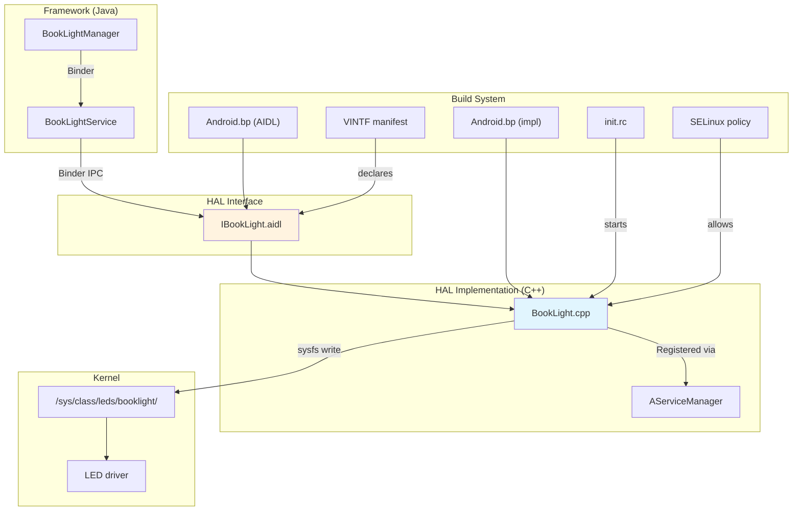

---

## 65.13 整合所有内容

### 65.13.1 完整构建演练

以下是构建、测试和打包 AospBook ROM 的完整流程：

```bash
#!/bin/bash
# build_aospbook.sh -- Complete build script for AospBook ROM

set -euo pipefail

AOSP_ROOT=~/aosp
PRODUCT=bookphone
VARIANT=userdebug
RELEASE=trunk_staging

echo "=== Building AospBook ROM ==="
echo "Product: $PRODUCT"
echo "Variant: $VARIANT"
echo "Date: $(date)"
echo ""

# Step 1: Initialize environment
cd "$AOSP_ROOT"
source build/envsetup.sh

# Step 2: Select target
lunch "${PRODUCT}-${RELEASE}-${VARIANT}"

# Step 3: Clean (optional, for release builds)
# make clean

# Step 4: Build
echo "[BUILD] Starting full build..."
time m -j$(nproc) 2>&1 | tee build.log

# Step 5: Verify output
echo ""
echo "[VERIFY] Checking build output..."
OUT_DIR="$ANDROID_PRODUCT_OUT"

for img in boot.img vendor_boot.img super.img system.img vendor.img product.img; do
    if [ -f "$OUT_DIR/$img" ]; then
        size=$(du -sh "$OUT_DIR/$img" | cut -f1)
        echo "  OK: $img ($size)"
    else
        echo "  MISSING: $img"
    fi
done

# Step 6: Check for our custom content
echo ""
echo "[VERIFY] Checking custom content..."

if [ -d "$OUT_DIR/product/app/BookSampleApp" ]; then
    echo "  OK: BookSampleApp installed"
fi

if [ -d "$OUT_DIR/product/app/BookReader" ]; then
    echo "  OK: BookReader prebuilt installed"
fi

if [ -f "$OUT_DIR/product/media/bootanimation.zip" ]; then
    echo "  OK: Custom boot animation installed"
fi

if [ -d "$OUT_DIR/product/overlay/BookFrameworkOverlay" ]; then
    echo "  OK: Framework overlay installed"
fi

if [ -d "$OUT_DIR/product/overlay/BookSystemUIOverlay" ]; then
    echo "  OK: SystemUI overlay installed"
fi

echo ""
echo "[BUILD] Complete!"
echo "Output directory: $OUT_DIR"
echo ""
echo "To launch the emulator:"
echo "  emulator"
echo ""
echo "To generate OTA package:"
echo "  m dist"
```

### 65.13.2 测试检查清单

构建完成后，系统地验证每一项定制：

```bash
#!/bin/bash
# test_aospbook.sh -- Verify AospBook ROM on running emulator

echo "=== AospBook ROM Verification ==="
echo ""

# 1. Check build identity
echo "--- Build Identity ---"
adb shell getprop ro.build.display.id
adb shell getprop ro.product.brand
adb shell getprop ro.product.model
adb shell getprop ro.product.device
adb shell getprop ro.aospbook.version

# 2. Check custom properties
echo ""
echo "--- Custom Properties ---"
adb shell getprop ro.aospbook.features.dark_mode_default
adb shell getprop ro.aospbook.features.custom_qs

# 3. Check installed apps
echo ""
echo "--- Custom Apps ---"
adb shell pm list packages | grep aospbook
adb shell pm path com.aospbook.sample 2>/dev/null && echo "  BookSampleApp: OK" || echo "  BookSampleApp: MISSING"

# 4. Check overlays
echo ""
echo "--- RRO Overlays ---"
adb shell cmd overlay list | grep -A1 aospbook

# 5. Check custom service
echo ""
echo "--- Custom Service ---"
adb shell service list | grep aospbook && echo "  BookService: OK" || echo "  BookService: NOT FOUND"

# 6. Check boot animation
echo ""
echo "--- Boot Animation ---"
adb shell ls -la /product/media/bootanimation.zip 2>/dev/null && echo "  Custom boot animation: OK" || echo "  Custom boot animation: MISSING"

# 7. Check SELinux
echo ""
echo "--- SELinux ---"
adb shell getenforce

# 8. Check for SELinux denials related to our code
echo ""
echo "--- SELinux Denials (our code) ---"
adb logcat -d | grep "avc: denied" | grep -i "aospbook\|book" | tail -5
if [ $? -ne 0 ]; then
    echo "  No denials found (good!)"
fi

# 9. Check HAL (if implemented)
echo ""
echo "--- Custom HAL ---"
adb shell ps -A | grep booklight && echo "  BookLight HAL: RUNNING" || echo "  BookLight HAL: NOT RUNNING"

echo ""
echo "=== Verification Complete ==="
```

### 65.13.3 发布构建流水线

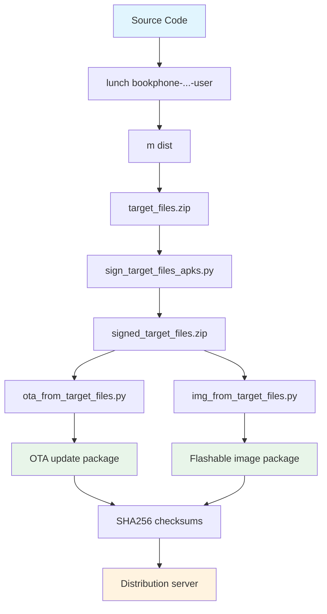

### 65.13.4 常见陷阱与解决方法

| 陷阱 | 症状 | 解决方法 |
|---------|---------|----------|
| 忘记将模块加入 `PRODUCT_PACKAGES` | 应用/HAL 不在镜像中 | 添加到 `device.mk` |
| 签名密钥错误 | 应用安装失败 | 让 `certificate` 与 `sharedUserId` 匹配 |
| 缺少 SELinux 策略 | 服务崩溃，logcat 中出现 `avc: denied` | 添加 `.te` 规则，运行 `audit2allow` |
| 缺少 VINTF 清单 | 框架无法发现 HAL | 在 `Android.bp` 中添加 `vintf_fragments` |
| Overlay 目标包错误 | 资源未被覆盖 | 检查清单中的 `android:targetPackage` |
| Overlay 非静态 | 用户可以禁用 overlay | 设置 `android:isStatic="true"` |
| 缺少 Soong 命名空间 | 构建时找不到模块 | 将路径添加到 `PRODUCT_SOONG_NAMESPACES` |
| 循环依赖 | 构建错误 | 重新组织模块依赖 |
| 切换分支后 ccache 未命中 | 重建缓慢 | 正常现象，ccache 会重新填充 |
| 发布构建中使用测试密钥 | 安全漏洞 | 生成并使用发布密钥 |

### 65.13.5 在 AOSP 更新中维护你的 ROM

维护定制 ROM 的最大挑战之一是跟上上游 AOSP 的变化。以下是一些策略：

1. **尽量减少框架改动。** 尽可能使用 RRO 和 overlay 来替代修改框架源码。Overlay 可以干净地在 AOSP rebase 中存活下来。

2. **保持设备树改动隔离。** `device/AospBook/bookphone/` 下的所有文件都是你自己的，永远不会与上游冲突。

3. **使用 `repo` topic 分支。** 对于框架改动，每个特性维护一个 topic 分支：

    ```bash
    # Create a topic branch for your framework change
    cd frameworks/base
    repo start aospbook-dark-mode .
    # Make changes, commit
    git add -A && git commit -m "AospBook: default dark mode"
    ```

4. **定期 rebase。** 同步到最新的 AOSP 并 rebase 你的 topic 分支：

    ```bash
    repo sync -j$(nproc)
    repo rebase
    # Resolve any conflicts
    ```

5. **记录每一项框架改动。** 维护一份变更日志，将每次框架修改对应到业务原因，这样 rebase 时就知道哪些改动需要移植。

### 65.13.6 最终目录清单

以下是 AospBook ROM 设备配置的完整目录树：

```
device/AospBook/bookphone/
|-- AndroidProducts.mk
|-- BoardConfig.mk
|-- bookphone.mk
|-- device.mk
|-- apps/
|   |-- BookSampleApp/
|   |   |-- Android.bp
|   |   |-- AndroidManifest.xml
|   |   |-- res/
|   |   |   |-- layout/activity_main.xml
|   |   |   |-- values/strings.xml
|   |   |   +-- mipmap-xxxhdpi/ic_launcher.png
|   |   +-- src/com/aospbook/sample/MainActivity.java
|   +-- prebuilt/BookReader/
|       |-- Android.bp
|       +-- BookReader.apk
|-- bootanimation/
|   |-- desc.txt
|   |-- bootanimation.zip
|   |-- part0/
|   |   |-- 00000.png ... 00029.png
|   +-- part1/
|       |-- 00000.png ... 00059.png
|-- hal/booklight/
|   |-- Android.bp
|   |-- aidl/com/aospbook/hardware/light/
|   |   |-- IBookLight.aidl
|   |   +-- BookLightState.aidl
|   +-- default/
|       |-- Android.bp
|       |-- BookLight.cpp
|       |-- BookLight.h
|       |-- service.cpp
|       |-- booklight-default.rc
|       +-- booklight-default.xml
|-- keys/
|   |-- releasekey.pk8
|   |-- releasekey.x509.pem
|   |-- platform.pk8
|   |-- platform.x509.pem
|   |-- shared.pk8
|   |-- shared.x509.pem
|   |-- media.pk8
|   +-- media.x509.pem
|-- overlay/
|   |-- BookFrameworkOverlay/
|   |   |-- Android.bp
|   |   |-- AndroidManifest.xml
|   |   +-- res/values/config.xml
|   +-- BookSystemUIOverlay/
|       |-- Android.bp
|       |-- AndroidManifest.xml
|       +-- res/values/
|           |-- config.xml
|           |-- dimens.xml
|           +-- colors.xml
|-- permissions/
|   +-- privapp-permissions-bookphone.xml
|-- sepolicy/vendor/
|   |-- booklight.te
|   |-- bookservice.te
|   |-- file_contexts
|   |-- service.te
|   +-- service_contexts
+-- services/BookService/
    |-- Android.bp
    |-- aidl/com/aospbook/service/IBookService.aidl
    +-- src/com/aospbook/service/
        |-- BookService.java
        |-- BookServiceManager.java
        +-- BookSystemService.java
```

---

## 65.14 案例研究：MaruOS——一款融合型定制 ROM

上面十三节构建了一个通用的“定制 ROM”。它是 AOSP 的一个分支，带有定制的应用、框架调整、品牌化的 SystemUI、自定义内核以及发布/分发流程。为了看看这个模板在实践中能延展多远，请考虑 **MaruOS**（[https://github.com/maruos](https://github.com/maruos)），一款开源的定制 ROM。它的明确目标是*“你的手机就是你的电脑”*。该项目这样描述其目标：*“当你出门在外时，Maru 是你的手机；当你坐在书桌前时，Maru 是你的桌面。”*

一台受支持的 Pixel 或 HTC 10 可以通过 USB-C/HDMI 连接到显示器。随后，完整的 Debian GNU/Linux 桌面会话会在外部显示器上出现。与此同时，手机屏幕继续运行原生 Android。同一个内核、同一台设备，两个同时运行的面向用户的操作系统。


MaruOS 并不是一款典型的定制 ROM。它有趣之处恰恰在于它偏离了本章其余部分所铺垫的模板。它是本章末尾一个有用的展品：一个不寻常但已实际落地的示范，展示了 AOSP overlay 模式究竟给定制 ROM 作者留下了多大的*空间*。

### 65.14.1 为什么 MaruOS 是一款不寻常的定制 ROM

典型的定制 ROM（LineageOS、GrapheneOS、/e/OS、ParanoidAndroid）保持 AOSP 的形态不变，只改变*内容*。差异在于 APK、框架默认值、SystemUI、安全姿态和内核加固。用户体验到的运行时模型仍然是
zygote → activities → SystemUI → 主屏幕启动器。

MaruOS 在手机这一面上保持了该模型的完整。它还在上面叠加了*第二个*运行时模型：一个运行在 LXC 容器内的 Debian 系统。Android 一侧按需启动容器。容器有自己的 X11 桌面环境、自己的包管理器和自己的启动/登录流程。README 明确说明了这一点：

> *“它使用轻量级操作系统虚拟化（容器）来按需启动虚拟系统”*——`maruos/maruos` README。

因此，除了普通 ROM 所发布的定制内容（设备仓库、vendor blob、品牌应用）之外，MaruOS 还发布了：

- 一个 LXC 容器管理守护进程及 Android 一侧的支撑服务。
- 一个“Perspective”层，将 Android 的显示、输入和音频管线桥接到容器。这让容器能在外部屏幕上呈现一个连贯的桌面。
- 一条用于 Debian 容器镜像的构建流水线，与 AOSP 构建相互独立。
- 一个设备接入钩子，决定何时启动容器以及将桌面放在哪个显示器上。
- 新的 SELinux 策略，防止容器的 Linux 进程践踏 Android 的域模型。

设备列表有意保持精简。近期的分支跟踪少数几代 Pixel 和 HTC 10。设备仓库 fork 自 LineageOS，因此 Maru 借用了硬件启用层，而不必从头维护。当前集合见 `maruos/manifest` 中的清单；受支持的设备在 maru-0.x 各个版本中有所变化。

整个 org 的许可证是 Apache-2.0，与 AOSP 本身一致。

### 65.14.2 双环境模型

概念架构是本案例研究中最重要的一张图。两个环境共享同一个 Linux 内核；内核之上的一切都是各自独立的。

MaruOS 双环境运行时架构。

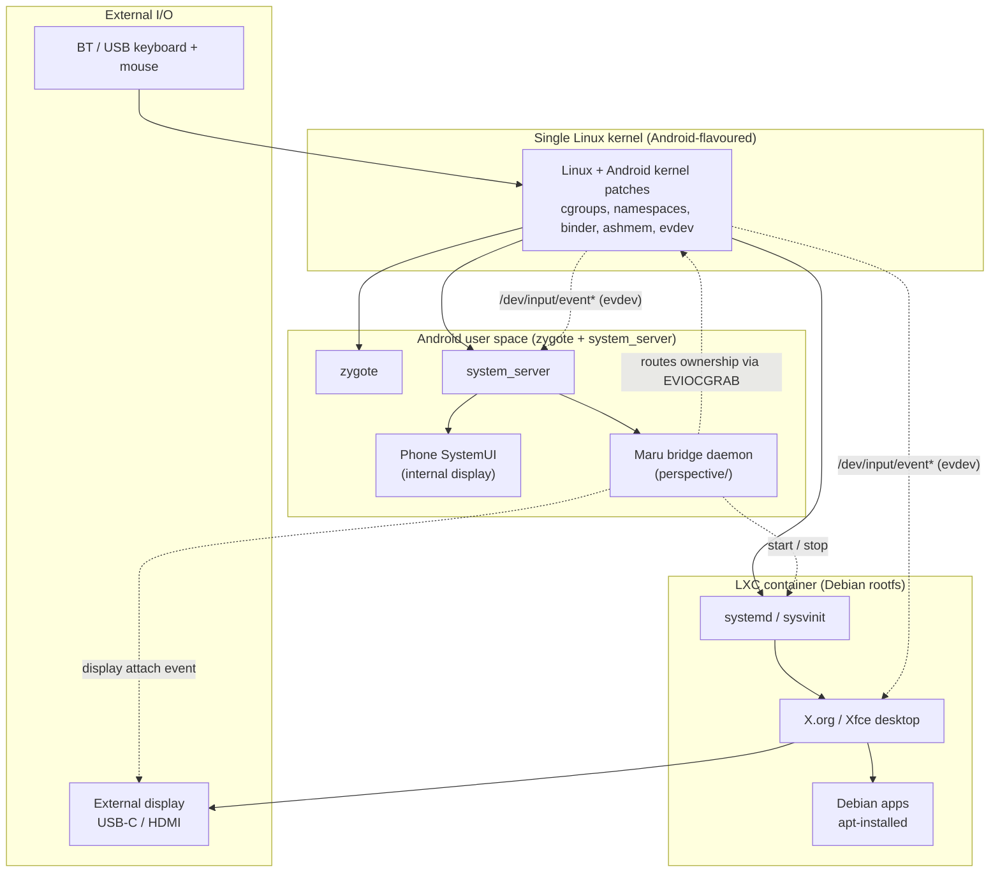

有三个值得单独提出的架构要点：

1. **一个内核。** Android 和 Debian 共享 `/proc/version`。容器通过对 PID、挂载、网络、IPC 和用户 ID 进行命名空间化来运行；它不会启动自己的内核镜像。这就是 LXC 的取舍——开销远低于虚拟机，但无法防御跨越容器边界的内核漏洞利用。
2. **Maru 桥接守护进程驻留在 Android 中。** 它以普通 Android 进程（原生 C/C++ 之上的 Java/JNI）的形式运行在 AOSP 用户空间内。它监听显示接入事件，并使用普通的 Linux API 来启动 LXC 容器。它*不是*容器内的一段代码；容器只知道自己启动了。
3. **两个显示器，两个所有者。** 手机屏幕继续在内屏上渲染 Android 的 SystemUI。外部显示器*并不*运行另一个 Android UI。它是一个展示平面，由 `SurfaceFlinger` 通过 mflinger（65.14.8）交给 Linux 一侧。X.org 和容器的桌面环境（Xfce，或 Debian 镜像所配置的任何东西）渲染用户在显示器上看到的一切。在桌面运行的整个过程中，用户的手机一直在运行原生 Android。

这与原生 Android 内置的“桌面模式”特性（三星 DeX、Android 12+ 的外接显示器窗口化）有着质的不同。那些方案只保留一个 Android 运行时；而 MaruOS 在同一内核上运行两个操作系统。

### 65.14.3 LXC 的内核配置

LXC 是让 MaruOS 能在不引入第二个内核的情况下与 Android 并行运行 Debian rootfs 的机制。但它依赖于一些原生 Android 内核通常禁用的 Linux 内核特性。基于 LXC 构建的定制 ROM 必须首先确保这些特性存在于它所发布的内核镜像中。

Maru 所运行的这类非特权 LXC 容器所需的内核特性：

| 特性 | 内核配置 | MaruOS 为何需要它 |
|---------|--------------|---------------------|
| User namespaces | `CONFIG_USER_NS=y` | 将容器的“root” UID 映射为宿主机上的高位非特权 UID；是非特权 LXC 的基础 |
| PID namespaces | `CONFIG_PID_NS=y` | 让容器内的 init 在容器内看到 PID 1，而不是宿主机的 init |
| Mount namespaces | `CONFIG_NAMESPACES=y`（隐含挂载 NS） | 每个容器自己的 `/proc`、`/sys` 和根文件系统视图 |
| Network namespaces | `CONFIG_NET_NS=y` | 每个容器自己的网络栈 |
| UTS namespaces | `CONFIG_UTS_NS=y` | 每个容器自己的主机名 |
| IPC namespaces | `CONFIG_IPC_NS=y` | 每个容器自己的 System V IPC 和 POSIX 消息队列 |
| Cgroups | `CONFIG_CGROUPS=y`，带 memory、cpu、devices、freezer 子系统 | 容器内的资源核算与限制 |
| Seccomp | `CONFIG_SECCOMP_FILTER=y` | 让 LXC 限制容器可以发起的系统调用 |
| uinput（可选） | `CONFIG_INPUT_UINPUT=y` | 当一个事件必须在显示器之间重新缩放时，输入桥所使用的合成注入路径（65.14.9）；对于每个设备直接路由到某一侧的常见情况并不需要 |
| 可选 overlay FS | `CONFIG_OVERLAY_FS=y` | 无需完整拷贝的分层容器 rootfs |

症结在于 `CONFIG_USER_NS`。Android 内核团队历来在生产内核中禁用这一选项，因为用户命名空间在历次 Linux 版本中反复成为 CVE 的来源。用户命名空间内部的特权边界一直比标准的 root 与非 root 划分更难保持收紧。Android 的安全姿态是：只要平台本身不需要，就移除攻击面。LineageOS 设备内核通常继承这一默认设置。而要运行 LXC，MaruOS 必须在其内核构建中把 `CONFIG_USER_NS` 重新翻转为 `y`，并明知故犯地接受由此增加的攻击面。

表中的其他特性在 Android 内核中通常已经是开启的。Android 的 Activity Manager 使用 cgroups（memory、freezer），低内存杀手使用 cgroup v2 memory 控制器。Android 沙箱需要 seccomp 过滤器，而命名空间是每个现代 Linux 内核默认配置的一部分。因此，Maru 所需的内核定制比乍看起来要窄：启用 `CONFIG_USER_NS`，确认其余的命名空间和 cgroup 控制器已开启，然后重新构建。如果 Maru 想要 65.14.9 中的合成注入输入路径，还可以启用 `CONFIG_INPUT_UINPUT`。

这就是为什么 Maru 的设备构建会从它的 `device_*` 仓库拉取经过 Maru 修改的内核，而不是原样复用 LineageOS 的内核。65.11 节介绍了 MaruOS 所遵循的通用内核定制工作流。该工作流使用一个 defconfig 片段，在设备基础 defconfig 之上打开所需的选项。然后重建 boot 镜像。它与 system 镜像一起刷写。

这一权衡是严峻的。启用 `CONFIG_USER_NS` 会打开原生 AOSP 有意关闭的攻击面。对 Maru 来说，这是融合模型所接受的代价。任何考虑基于 LXC 或基于命名空间扩展的定制 ROM 都应当深思熟虑地做出这一选择，并把威胁模型写下来。不开启这个标志就无法获得非特权 LXC；不扩大内核攻击面也无法开启这个标志。

### 65.14.4 仓库拓扑

MaruOS 的代码分布在 `maruos/` org 下的多个仓库中。理解拓扑有助于读者在不靠猜测的情况下浏览源码。

MaruOS 在 `maru-0.7` 分支线上的仓库依赖图。

```mermaid
graph LR
    subgraph Org["github.com/maruos"]
        MANIFEST["manifest<br/>repo manifest (XML)"]
        MAIN["maruos<br/>root project + docs"]
        VENDOR["vendor_maruos<br/>hardware-agnostic overlay"]
        BLUE["blueprints<br/>Debian container builder"]
        DEV1["device_*<br/>per-device repos<br/>(LineageOS forks)"]
    end
    subgraph Upstream["Upstream sources"]
        AOSP["AOSP source<br/>(LineageOS-mirrored)"]
        LIN["LineageOS HAL<br/>+ device trees"]
        DEB["Debian apt<br/>(rootfs packages)"]
    end

    MANIFEST -->|"declares projects"| AOSP
    MANIFEST -->|"declares projects"| LIN
    MANIFEST -->|"includes"| VENDOR
    MANIFEST -->|"includes"| DEV1
    BLUE -->|"pulls packages"| DEB
    BLUE -->|"produces rootfs"| VENDOR
    VENDOR -->|"installs"| MAIN
```

仓库一览（除注明外均在 `maru-0.7` 分支）：

- **`maruos/manifest`**——`repo` 清单。`maru-0.7` 分支声明了 Maru 源码树所包含的每一个 `<project>`。引导命令：
  `repo init -u https://github.com/maruos/manifest.git -b maru-0.7`。
- **`maruos/maruos`**——项目根：README、文档、指向系统其余部分的顶层脚本。Apache-2.0。
- **`maruos/vendor_maruos`**——硬件无关的 overlay。Maru 特有的 Java/C++/Makefile 工作都在这里。约 50% C++、25% Makefile、15% shell、10% C。
- **`maruos/blueprints`**——一条独立的、基于 Shell 的构建流水线，产出容器将运行的 Debian rootfs。插件驱动，`blueprint/debian` 是规范实现。
- **`maruos/device_<vendor>_<device>`**——fork 自 LineageOS 的按设备仓库。它们提供 HAL 实现、传感器配置、vendor blob、boot 镜像配置等。Maru 不重新编写这些；它跟踪 Lineage 的工作。

仓库拓扑本身就是一堂课。“Maru 特性”位于 `vendor_maruos` 和 `blueprints`。“Android 特性”位于上游 AOSP/Lineage。“设备特性”被委托给 fork 来的 LineageOS 设备仓库。每一层都可以按自己的节奏演进。

### 65.14.5 vendor_maruos Overlay 剖析

`vendor_maruos` 树是 MaruOS 设计选择最清晰可读的地方。顶层布局（在 GitHub 仓库的 `maru-0.7` 分支上可见）：

```
vendor_maruos/
├── Android.bp
├── Android.mk
├── BoardConfigVendor.mk
├── LICENSE
├── README.md
├── container/                       -- Android-side LXC management
├── device-maru.mk                   -- Device-agnostic product definition
├── include/perspective/             -- Headers for the perspective layer
├── init.maru.rc                     -- Maru init service definitions
├── maru_build.mk                    -- Maru-specific build glue
├── mlogwrapper/                     -- Maru log wrapper utility
├── overlay/                         -- AOSP resource overlays
├── overrides/                       -- Build-time file overrides
├── perspective/                     -- The Android↔container bridge
├── prebuilts/                       -- Pre-built binaries
├── privapp-permissions-maru.xml     -- Privileged permission grants
├── scripts/                         -- Build/setup helper scripts
└── sepolicy/                        -- Maru SELinux policy
```

每个目录在融合这个故事中都有特定角色。按依赖顺序走一遍，比按字母顺序更能看清整体设计：

**`perspective/`** 是概念中心。这个名字暗示了抽象：设备有多个“视角”（手机屏幕、桌面屏幕，也许还有仅耳机模式），Maru 的工作就是在它们之间切换。这个目录中 C++ 与 Java 混合的代码就是那个监听显示事件的守护进程。它决定用户的“桌面视角”何时激活，并编排下面的一切。

**`container/`** 承载 LXC 集成。它有围绕 `lxc-start` 的生命周期包装和 rootfs 挂载逻辑。它还有 cgroup 配置、将宿主资源暴露给容器的绑定挂载，以及拆除路径。它是
直接与 LXC 对话的那一层。

**`overlay/`** 使用 AOSP 的标准 overlay 机制（见 65.5 节）来替换框架或应用中的特定资源。典型目标包括设备的 `config.xml` 设置、语言环境默认值、品牌字符串，以及任何预装应用的启动默认值。

**`overrides/`** 与 `overlay/` 相邻，处理 overlay 系统无法表达的文件级覆盖。overlay 修补 APK 内部的资源值，而 `overrides/` 替换整个文件或脚本。

**`sepolicy/`** 是 SELinux 策略增量。它让容器守护进程能与 LXC 对话、挂载 rootfs、操作 cgroup、转发输入，并获取 framebuffer。原生 AOSP 策略不允许其中任何一项，因为没有任何原生 AOSP 组件会做这些事。

**`prebuilts/`** 携带 AOSP 构建自身不会产出的预编译产物。通常是 LXC 工具链二进制、不按设备构建的辅助 shell 脚本，以及任何第三方 Debian 支持组件。

**`mlogwrapper/`** 是一个小工具，把 Maru 守护进程的日志重定向到 Android 的日志基础设施（`logd`/`logcat`）。调试 Maru 的开发者随后可以使用与调试任何 Android 服务相同的工具。

**`scripts/`** 包含仓库级设置辅助脚本。这些是在常规 `m`/`make` 流程之外被调用的东西。例如，一个辅助脚本会从 blueprints 构建输出中获取 Debian rootfs。它在 system 镜像打包之前把 rootfs 放进每个产品的路径。

### 65.14.6 blueprints 容器构建器

容器运行的 Debian rootfs 并非由 Soong 构建。一个独立的仓库 `maruos/blueprints` 负责构建它。这个仓库是一条自包含的 shell 流水线：

- `build.sh`——主构建入口点。读取一个 blueprint，调用其按 blueprint 的钩子，产出输出 tarball。
- `build-with-docker.sh`——在 Docker 镜像内运行 `build.sh` 的包装器，在构建主机没有 `debootstrap` 或其他 Debian 工具时很有用。
- `plugin.sh`——任何 blueprint 都会引入的样板文件。它强制每个 blueprint 提供两个 shell 函数：`blueprint_build` 和 `blueprint_cleanup`。
- `blueprint/debian/`——规范 blueprint。README 确认：
  *“镜像构建逻辑被拆分为独立的插件，称为 blueprint。规范实现是 `blueprint/debian`。”*

这种拆分是刻意为之的。AOSP 的构建系统擅长产出 Android 系统镜像和签名 boot 镜像，但它完全不知道 Debian rootfs 是什么。Maru 没有去教 Soong 认识 `debootstrap`，而是运行两次构建。一次是 Android 一侧的 Soong/Make 构建；另一次是 Debian 一侧的 Shell/`debootstrap` 构建。最后一步组装再把 rootfs 输出折叠进相应的产品目录。

这对定制 ROM 作者来说是一个启示。如果你的定制引入了完全陌生的环境（一个容器、一个虚拟机、一个不同的 libc），正确答案往往是*兄弟式*的构建系统。这个构建系统导出 tarball。它不是试图模拟陌生世界的 Soong 模块。

### 65.14.7 “Perspective”桥接层

`perspective/` 和 `include/perspective/` 目录承载了设计中最难归类的部分：那个让整个融合流程运转起来的、驻留在 Android 中的守护进程。我们从它的结构位置（Android 用户空间、C++/Java 混合、源码旁的 `include/`）推断它的职责。我们也从源码树其余部分假定给它的角色来推断。它至少负责以下事项：

1. **显示接入检测。** 它监听 `DisplayManager` 的
   `onDisplayAdded` 回调（或低层级的等价物）。它判断一个接入的显示器何时属于“桌面级”——足够大、足够外部——值得启动桌面视角。
2. **容器生命周期。** 它调用 `container/` 在首次桌面接入时启动 LXC 容器，在最后一次桌面拔出时停止它。如果 Maru 策略要求，它还会在熄屏时静默容器。
3. **输入路由。** 它将键盘、鼠标以及可能的触摸事件从 Android 的输入系统转发到容器。这让使用外接键盘的用户看到按键落在 Debian 里。
4. **音频路由。** 它在手机扬声器与桌面显示器通过 HDMI 提供的任何音频设备之间协商音频输出。
5. **权限与认证。** 它为用户提供某种确认方式，以决定接入的显示器是否被允许承载桌面会话。Maru 不会向任何插进端口的人暴露一个 Debian 会话。

仓库的组织方式表明，perspective 层是“导演”，而 `container/` 是“场工”。一个决定应该发生什么；另一个实际移动 LXC 机械装置。对于任何编写驱动非 Android 用户空间资源的长驻 Android 服务的定制 ROM 作者来说，这种拆分都是一个有用的模式。

### 65.14.8 mflinger 与 mclient：图形桥

当 Debian 容器内的 X11 服务器绘制到其 framebuffer 时，那些像素位于容器的地址空间中。容器有不同的挂载命名空间、不同的 `/dev` 以及对 GPU 内存的不同视图。拥有外接显示器上呈现职责的 Android
`SurfaceFlinger` 对此缓冲区一无所知。必须有某个软件来桥接二者。Maru 为这座桥所用的设计异常优雅：它让 LXC 命名空间边界对 GPU 而言实际上不可见。

mflinger 位于自己的仓库中：[https://github.com/maruos/mflinger](https://github.com/maruos/mflinger)，与 `vendor_maruos` 分开。README 只有一行：*“Maru OS 的图形缓冲桥。”* 代码库以 C 为主（约 64% C、21% C++），带有 `src/`、`include/`、`lib/`、`tests/` 和 `scripts/` 目录——一个小型 Linux 系统服务的布局。

这个名字暗示了类比：Android 的 `SurfaceFlinger` 是消费者。它通过标准的
`ANativeWindow`/`BufferQueue`
生产者协议接收来自应用、相机 HAL、视频解码器等的按生产者的图形缓冲。然后它把它们合成到显示器上。mflinger 扮演容器帧的*生产者*角色。它向 SurfaceFlinger 请求一个由 `ANativeWindow` 支撑的 Surface，并把底层缓冲交给 Linux 直接渲染。然后它告诉 SurfaceFlinger 缓冲何时可以呈现。

mflinger 架构被拆成两半：

- **mflinger**（守护进程，Android 侧）以 Android 用户空间服务的形式运行，由
  `init.maru.rc` 启动。它创建一个绑定到外部显示器的 Android `Surface`，并使用标准的
  `ANativeWindow`
  C API 出队 `GraphicBuffer` 槽位。每个缓冲都由一次 gralloc 分配支撑——在现代 AOSP 设备上通常是 **dma-buf**。mflinger 可以把这个分配的文件描述符交给另一个命名空间中的进程。
- **mclient**（容器侧客户端）随 Debian rootfs 一起发布。它通过 Unix
  域套接字接收来自 mflinger 的 dma-buf 文件描述符。传输使用 `SCM_RIGHTS`
  辅助数据——在进程之间传递内核管理 fd 的标准 Linux 机制。这之所以能跨 LXC 命名空间边界工作，是因为内核对底层对象进行引用计数，而不是对路径。随后 mclient
  对 dma-buf 执行 `mmap`（或通过 DRI3 将其导入为 pixmap）。它把得到的内存区域作为根窗口的后备存储暴露给 X.org。

关键事实是：**X.org 直接渲染进 SurfaceFlinger 将要呈现的同一块物理 GPU 内存。** 当 X 服务器提交一帧时，mclient 告诉 mflinger 缓冲已就绪，mflinger 在
`ANativeWindow` 上调用 `queueBuffer`。SurfaceFlinger 拾取该缓冲，并将其包含在下一次对外接显示器的合成处理中。随后用户看到桌面。不存在需要跨边界拷贝的中间“容器 framebuffer”。fd *就是*边界，而 GPU 内存是共享的。

这正是 Android 内部为每个相机、编解码器和 OpenGL 表面使用的同一生产者/消费者模式。mflinger 将其推广了。它把生产者一端交给了一个生活在不同挂载命名空间中的进程。

逐帧的图形桥。

```mermaid
sequenceDiagram
    participant SF as SurfaceFlinger
    participant MF as mflinger (Android)
    participant MC as mclient (container)
    participant X as X.org server
    participant XA as Xfce app

    Note over MF,SF: setup: mflinger creates a Surface for the external display
    Note over MF,MC: setup: mclient connects over UDS for fd transfer

    loop per frame
        MF->>SF: dequeueBuffer via ANativeWindow
        SF-->>MF: GraphicBuffer slot + dma-buf fd
        MF->>MC: send fd over UDS (SCM_RIGHTS)
        MC->>MC: mmap fd / import as DRI3 pixmap
        MC->>X: expose as root-window backing store
        XA->>X: draw request
        X->>MC: render directly into shared buffer
        MC-->>MF: frame complete
        MF->>SF: queueBuffer
        SF->>SF: composite onto external display
    end
```

这个设计有两个值得单独提出的推论：

- **跨 LXC 边界零拷贝。** 没有任何像素曾在 Android 与容器地址空间之间传输。跨桥的只有文件描述符和小型协议消息。端到端成本受 GPU 渲染制约，而不受 RAM 带宽或跨命名空间开销制约。
- **每帧一次合成。** 因为 X.org 直接绘制进 SurfaceFlinger 将要呈现的缓冲，所以没有单独的“容器 framebuffer → 宿主 framebuffer”合成步骤。合成次数与任何普通 Android 表面相同。这就是该设计能扩展到 1920×1080 外接显示器、而不会成为 modest 硬件瓶颈的原因。

`vendor_maruos/sepolicy/`（65.14.11）中的 Android 侧 SELinux 策略
允许 mflinger 获取 `ANativeWindow` 表面并通过 binder 与 SurfaceFlinger 对话。它还允许 mflinger 通过其 UDS 传出文件描述符。没有这些规则，守护进程会在进程启动时被拒绝。`vendor_maruos/container/`（65.14.5）中的容器模块
在 LXC 启动时设置暴露 mclient↔mflinger 套接字的绑定挂载。

### 65.14.9 Linux 与 Android 之间的输入映射

图形桥的补集是输入桥。它比图形桥小得多。原因相同：Android 和 LXC 容器共享同一个内核。

键盘、鼠标和触摸硬件位于内核的输入子系统中，并通过 `/dev/input/event*` 节点暴露。因为只有一个内核，所以只有一套这些节点。每一块硬件并不存在一对独立的“Linux 输入设备”和“Android 输入设备”。Android 的 `InputReader`（在 `system_server` 内，见第 22 章）通过 Android 的 `/dev/input/` 打开它们。

容器通过它自己的 `/dev/input/`
命名空间看到相同的节点，Maru 在 LXC 启动时从宿主机绑定挂载过来。容器内的 X.org
通过 evdev 输入驱动读取它们——与 X.org 在原生 Debian 桌面上使用的 evdev 路径相同。因为 GPU 内存是共享的，所以没有像素拷贝；因为内核设备节点是共享的，所以没有事件拷贝。

那么桥实际所做的是*路由*——决定哪一方“拥有”每个设备。机制全部是标准 Linux：

1. **设备枚举。** 当 USB 或蓝牙键盘、鼠标或触摸屏接入时，内核创建 `/dev/input/eventN`。
   `udev` 风格的热插拔事件传播到 Android 的输入层，并（经由绑定挂载）传播到容器。
2. **按设备的所有权。** Maru 的 perspective 守护进程（65.14.7）根据当前激活的“视角”决定哪一方拥有每个设备：
   - 手机的内屏触摸面板始终属于 Android——那些触摸需要驱动内屏上的 SystemUI 和应用，绝不能驱动桌面。
   - 硬件按键（电源、音量）始终属于 Android。
   - 外接 USB/BT 键盘和鼠标在桌面运行时通常属于桌面，否则属于 Android。
   - 外接触控显示器的输入设备在桌面运行时属于桌面。
3. **通过 `EVIOCGRAB` 实现独占。** 当拥有方需要成为某个设备的*唯一*读取者时，相关进程在事件节点上发出
   `ioctl(fd, EVIOCGRAB, 1)`。没有它，evdev 的读取路径是多播的。打开在同一
   `/dev/input/eventN` 上的每个文件描述符都会收到每个事件，Android 和 X.org
   都会分发同一个按键。有了 `EVIOCGRAB`，内核只把事件投递给抓取的 fd，直到抓取被释放。
4. **跨显示器触摸的坐标换算。** 触摸事件使用按来源面板分辨率缩放的绝对坐标。在 Android 内屏 1080×1920 面板上的一次触摸，对绘制在 1920×1080 外接显示器上的 X
   服务器毫无意义。

   常见情况不会遇到这一点，因为 Android 拥有内屏面板，而桌面拥有外接触控显示器。不常见情况是“把手机屏幕当作桌面的触摸板使用”。在那种情况下，perspective 守护进程读取内屏面板事件，把坐标重新缩放到桌面空间。然后它在虚拟设备上合成新事件。`CONFIG_INPUT_UINPUT`（65.14.3）使这一合成注入路径成为可能。常见路径不需要它。

整条流水线对两端都是不可见的。Android 的 `InputReader` 枚举它拥有的设备并正常分发。容器的 X 服务器对它拥有的设备做同样的事。只有中间的 perspective 守护进程知道哪一方当前拥有什么。

与图形桥的对比正是这里的架构教训。这适用于两个用户空间栈共享一个内核的情形。此时，内核已经抽象的任何东西（输入事件、网络套接字、fd、字符设备）都可以通过路由而非转发来共享。内核*没有*抽象的任何东西（支撑 Surface 的 GPU 内存）则必须像 65.14.8 那样用显式 fd 传递来桥接。Maru 的输入桥保持小巧，因为内核在做工作。图形桥保持小巧，因为它搭了内核现有 dma-buf fd 传递的便车，而不是发明自己的像素传输。

### 65.14.10 Init 与启动集成

`init.maru.rc` 是声明启动集成的地方。Android 的 init
在启动时处理 `/system/etc/init/` 和 `/vendor/etc/init/` 中的 `*.rc`
文件，定义服务和触发器。对 MaruOS 而言，该文件在概念上包含：

- 一个 perspective 守护进程的 `service` 条目，带有正确的 `user`、
  `group` 和 `seclabel`。这些让 SELinux 把它放进 Maru
  域，并让 init 监督重启。
- 一个或多个 `on` 触发器——`on boot`、`on property:sys.boot_completed=1`，
  也许还有 `on property:maru.container.requested=1`——决定守护进程何时启动以及先运行什么辅助设置。
- 一个 `socket` 或 `oneshot` 定义，用于 perspective
  守护进程可能从自己进程之外调用的任何辅助命令。

启动/启动流程如下所示：

MaruOS 桌面从冷启动到第一个 X11 窗口的启动过程。

```mermaid
sequenceDiagram
    participant Init as Android init (PID 1)
    participant Persp as Maru perspective daemon
    participant Disp as DisplayManagerService
    participant Cont as Maru container module
    participant LXC as lxc-start
    participant Deb as Debian systemd

    Init->>Persp: start service (on boot)
    Persp->>Disp: register DisplayListener
    Note over Persp,Disp: phone runs Android normally
    Disp->>Persp: onDisplayAdded (external)
    Persp->>Persp: classify as "desktop"
    Persp->>Cont: requestContainerStart
    Cont->>LXC: lxc-start -n maru
    LXC->>Deb: PID 1 inside container
    Deb->>Deb: bring up X.org + Xfce
    Persp->>Disp: route external display to container surface
    Persp->>Persp: route input events into container
    Note over Deb: user sees desktop on external display
```

这张图明确展示的是：*用户可见的事件*——插上一台显示器——驱动了整条链条。不存在计划内的容器启动；LXC 按需启动，并在 perspective 层认为应当关闭时关闭。这就是 README 所说的*“按需启动虚拟系统”*的含义。

### 65.14.11 SELinux 影响

原生 AOSP SELinux 策略假设没有任何 Android 进程需要启动 LXC 容器或挂载 rootfs。它还假设没有进程需要在 Android 的 lmkd/freezer 已经拥有的 cgroup 之外操纵 cgroup。Maru 的 `sepolicy/` 目录承载了这个增量：

- 一个新域——姑且称之为 `maru_perspective` 和 `maru_container`——用于
  守护进程和任何辅助进程。
- 允许该域 `execute` LXC 工具链、在 Maru 专用路径上 `mount`
  容器 rootfs、以及写入容器所使用的
  cgroup 的规则。
- 允许守护进程绑定到外接显示器的 framebuffer（或 surfaceflinger
  等价物）的规则。容器内的 X11 需要在某个可见的地方绘制。
- 允许输入管道从 Android 的输入域跨入 perspective
  域、从而使输入转发得以工作的规则。

有志于 ROM 的作者应当从中吸取这一点。任何添加了带有提升权限的新系统服务的定制 ROM，都必须编写新的 SELinux 策略，毫无例外。代价不在于编写 `*.te`
文件本身（Maru 的 `sepolicy/` 很小），而在于开发期间的*二分排查拒绝*。每个新的拒绝只在首次命中时记录一次。此后便静默了。这就是为什么 Maru 构建在不同设备上的全新安装往往需要一轮审计。

### 65.14.12 Maru 系统应用的特权权限

`privapp-permissions-maru.xml` 位于 vendor-overlay 作用域，由 Android
的特权权限允许列表机制处理（参见 65.4 节关于添加自定义应用的部分）。Maru 需要这个文件，因为它的
perspective 守护进程伴随 APK 位于 `/system/priv-app/`，并声明了必须由允许列表显式授予的权限。这个 APK 是面向用户的界面，用于确认桌面访问、管理容器设置，并呈现“桌面已激活”通知。

其形状对 ROM 作者来说很熟悉：

```xml
<permissions>
    <privapp-permissions package="com.maruos.perspective">
        <permission name="android.permission.SYSTEM_ALERT_WINDOW"/>
        <permission name="android.permission.MANAGE_DEVICE_ADMINS"/>
        <permission name="android.permission.WRITE_SECURE_SETTINGS"/>
        <!-- ...etc... -->
    </privapp-permissions>
</permissions>
```

具体条目是 Maru 自己的决定；文件结构由 AOSP 规定。任何带有特权系统应用的定制
ROM 都必须发布其中的一个文件。启动期间来自 `PackageManagerService`
的 `dexopt` 时拒绝几乎总能追溯到此处缺少条目。

### 65.14.13 构建流程

把各部分拼在一起，为受支持设备从源码构建 MaruOS 看起来像这样：

```bash
# 1. Set up the AOSP-style tree using Maru's manifest
mkdir maru && cd maru
repo init -u https://github.com/maruos/manifest.git -b maru-0.7
repo sync -j$(nproc)

# 2. Build the Debian rootfs separately (sibling build system)
cd vendor/maruos/blueprints   # (path depends on manifest layout)
./build.sh blueprint/debian
# Produces a rootfs tarball — Maru's scripts move it into the right
# product directory so it gets packaged into the system image.

# 3. Standard AOSP build flow for the chosen device
cd $TOP
source build/envsetup.sh
lunch maru_<device>-userdebug
m
```

与 65.8 节的构建流程相比，有三点突出：

- **两套构建系统。** Soong/Make 流水线不会运行
  blueprints 流水线。定制 ROM 作者需要手工编排它们，或通过包装脚本。
- **容器镜像是构建产物，不是源码。** Debian
  rootfs 每个版本构建一次、签名，并打包进
  Maru 系统镜像。设备不会在安装时运行 `debootstrap`。
- **`lunch` 组合内嵌了 Maru。** 一个 `maru_<device>` 组合意味着产品
  makefile 继承了 `device-maru.mk`（并通过它继承 `maru_build.mk`）。
  该 makefile 拉入 `vendor_maruos` 并打开 Maru 特有的
  构建标志。一个标准的 `lineage_<device>` lunch 会构建同一台设备，但不带
  Maru 层。

### 65.14.14 MaruOS 给定制 ROM 作者的启示

把 MaruOS 当作一个范例而非孤例来读，三条经验可以推广到这一特定项目之外：

1. **overlay 模式非常灵活。** 65.3–65.5 节把 overlay 讲成一种改变资源值并发布几个
   APK 的方式。MaruOS 展示了*上界*。你可以通过 vendor overlay + sepolicy + init.rc +
   一套兄弟式构建系统添加一整套第二个操作系统，而不必 fork AOSP 源码树本身。
   你的定制可以表达为落入 `/system/`、
   `/vendor/`、`/product/` 或 `/system_ext/` 的文件，外加 init 规则和
   SELinux 策略。在这种情况下，你不需要给 AOSP 打补丁。
2. **委托硬件启用。** Maru fork LineageOS 设备树，而不是维护自己的按设备 HAL
   fork。结果是 Maru 维护者可以专注于融合层，并受益于 LineageOS 的季度设备节奏。任何与硬件启用较劲的定制
   ROM 都在签下一份永无止境的工作；让上游去做吧。
3. **把陌生世界与 Soong 分开。** Debian 容器的
   构建流水线基于 shell，位于独立仓库中。Soong
   永远不需要知道 `debootstrap` 是什么。两个系统在单一 tarball
   产物处相遇。

     有时你的定制 ROM 需要发布
     *不是* Android 系统镜像的东西。在那种情况下，把该产物建模为一个交接文件的兄弟式构建。例子包括容器
     rootfs、单独授权的固件 blob，或配套微控制器的 Buildroot 镜像。

### 65.14.15 局限与权衡

MaruOS 也是一个关于这种方法*代价*多少的有用案例研究。对权衡的诚实解读：

- **设备支持面窄。** 在许多设备上维护融合层意味着跟踪每个 LineageOS 设备分支、在每个分支上验证
  LXC 内核特性集、并重新测试显示路由。
  真正的 Maru 发布每次只面向少数几台设备。这对小团队来说恰到好处，但远达不到任何“适用于每一台
  Android 手机”的承诺。
- **共享内核，共享暴露面。** LXC 比虚拟机便宜得多，但共享内核。从 Debian
  容器内部可达的内核漏洞利用会波及 Android 用户空间和
  bootloader。Maru 在隔离性上无法轻松与虚拟化桌面方案竞争。
- **无法与 Android 文件系统隔离。** 默认情况下，LXC
  容器可以配置为暴露宿主文件系统的大部分。
  Maru 的 container/perspective 桥必须仔细决定绑定挂载哪些宿主路径、保留哪些路径。一个错误的决定会把
  Android 用户数据暴露给 Debian 应用。
- **维护债务。** 两套构建系统、两个用户空间栈，以及一层自定义桥，要在一次 AOSP
  版本升级中保持运转是很大的工作量。每个年度 Android 字母版本发布都会在
  `DisplayManager`、输入分发和 SELinux 中带来行为变化，perspective
  守护进程必须适应。
- **上游不确定性。** Maru 的设计早于 Android Computer
  Control 框架（51.3 节）和原生 Android 中桌面模式的形式化。融合式 UI
  现在更接近一流的上游关注点。这要么可能让 Maru 的方法过时，要么可能抬高它脚下的地板。请把上面的案例研究当作一个
  *快照*来读。它展示了一款生产级定制 ROM 在 Android 12 时代版本所提供给它的
  AOSP 原语之下的落点。

这里的教训与 65.14.14 中的教训是对称的。同样的 overlay
机制灵活性让一个小型团队能够发布手机到桌面的融合
ROM。它也把代价分摊了出去。每一层额外的野心都增加了一层维护。权衡要把该模式推多远的定制
ROM 作者，应当首先规划一份现实的设备列表和一份现实的发布节奏。

---

## 65.15 动手实践

请在 Android 17（`android17-release`）检出副本上完成这些练习。它们贯穿本章的完整弧线——从注册产品到签名的、页大小正确的镜像。前面的练习是后面练习的先决条件。

1. **注册并 lunch 你自己的产品。** 创建
   `device/AospBook/bookphone/`，放入 65.3 节的四个文件
   （`AndroidProducts.mk`、`bookphone.mk`、`device.mk`、`BoardConfig.mk`），
   执行 `source build/envsetup.sh`，然后运行 `list_products | grep bookphone` 和
   `lunch bookphone-trunk_staging-userdebug`。确认 `printconfig` 报告
   `TARGET_PRODUCT=bookphone`。

2. **确认构建执行器。** 运行 `m nothing` 并观察输出：Android 17 中的默认执行器是
   Siso。用 `SOONG_NINJA=ninja m
   nothing` 重新运行，注意构建在经典 Ninja 下依然成功。对照 `build/soong/ui/build/config.go`
   中的默认值
   （`NINJA_DEFAULT = NINJA_SISO`）进行交叉核对。

3. **验证平台版本三元组。** lunch 之后，在已启动的镜像上运行
   `adb shell getprop ro.build.version.sdk` 并确认 `37`，再运行
   `getprop ro.build.version.release` 确认 `17`。把这些值追溯回
   `build/release/flag_values/trunk_staging/RELEASE_PLATFORM_SDK_VERSION.textproto`
   和 `RELEASE_PLATFORM_VERSION_LAST_STABLE.textproto`。

4. **构建一个 16 KB 页大小的镜像。** 构建
   `sdk_phone16k_x86_64-trunk_staging-userdebug` 并启动模拟器。
   运行 `adb shell getconf PAGE_SIZE`（预期 `16384`）。注意
   `ro.product.build.16k_page.enabled` 在这里显示为 `false`，因为这个产品
   没有设置 `PRODUCT_16K_DEVELOPER_OPTION`。然后加入一个 4 KB 对齐的预编译
   `.so`，观察它在 16 KB 目标上加载失败。从源码重建它，观察其成功。

5. **签名并打包一个发布构建。** 用
   `development/tools/make_key` 生成密钥，设置 `PRODUCT_DEFAULT_DEV_CERTIFICATE` /
   `PRODUCT_CERTIFICATE_OVERRIDES`，运行 `m dist`，然后用
   `build/make/tools/releasetools/sign_target_files_apks.py -o -d <keys>` 重新签名，并用
   `ota_from_target_files.py` 产出完整 OTA。用
   `build/make/tools/releasetools/check_ota_package_signature.py` 验证 OTA 包的签名。

6. **用 Kleaf 构建自定义内核。** 同步 `common-android-mainline`，运行
   `tools/bazel run //common:kernel_x86_64_dist -- --dist_dir=out/x86_64/dist`，
   把生成的 `bzImage` 放入 `prebuilts/qemu-kernel/x86_64/6.12/`，并用你的内核启动模拟器。确认你的
   `printk` 行出现在 `adb logcat -b kernel` 中。

7. **添加并发现一个自定义 AIDL HAL。** 实现 65.12 节的 `IBookLight`
   HAL，连同它的 VINTF 片段和 SELinux 策略。然后用
   `adb shell lshal | grep booklight` 验证框架能看到它。还要验证 logcat 中没有针对它的
   `avc: denied` 行。

如果你想深入，下面的源码地图指向支撑每一步的子系统。

| 主题 | 源码位置 | 说明 |
|-------|----------------|-------------|
| Build system | `build/make/core/` | GNU Make build rules |
| Soong build | `build/soong/` | Blueprint/Soong build system |
| Build executor | `build/soong/ui/build/config.go` | Siso/Ninja selection (`NINJA_DEFAULT`) |
| Release config | `build/release/` | Version/SDK flags (`RELEASE_PLATFORM_*`) |
| Product configuration | `build/make/target/product/` | Base product makefiles |
| Goldfish device | `device/generic/goldfish/` | Emulator device tree |
| Framework config | `frameworks/base/core/res/res/values/config.xml` | Overridable framework values |
| SystemUI | `frameworks/base/packages/SystemUI/` | System UI source |
| Boot animation | `frameworks/base/cmds/bootanimation/` | Boot animation player |
| HAL interfaces | `hardware/interfaces/` | AIDL HAL definitions |
| Release tools | `build/make/tools/releasetools/` | Signing and OTA tools |
| Security keys | `build/make/target/product/security/` | Default signing keys |
| SELinux policy | `system/sepolicy/` | Base SELinux policies |
| Init system | `system/core/init/` | Init process source |
| SystemServer | `frameworks/base/services/java/com/android/server/SystemServer.java` | Service startup |

---

## 65.16 总结

本章从头到尾走完了构建定制 Android
ROM 的整个过程：

| 小节 | 主题 | 关键成果 |
|---------|-------|-------------|
| 65.1 | 规划 | 定义了 AospBook ROM 的范围与架构 |
| 65.2 | 环境搭建 | 完整的构建主机配置；树内 JDK；Siso 默认 |
| 65.3 | 设备配置 | `AndroidProducts.mk`、`device.mk`、`BoardConfig.mk` |
| 65.4 | 自定义应用 | 镜像中的预编译 APK 与源码构建的应用 |
| 65.5 | 框架行为 | RRO、源码修改、自定义系统服务 |
| 65.6 | 开机动画 | `bootanimation.zip` 的创建与安装 |
| 65.7 | SystemUI | 状态栏、快捷设置、主题 overlay |
| 65.8 | 构建与刷写 | `m`、模拟器启动、`fastboot flash`、16 KB 页大小 |
| 65.9 | 调试 | logcat、dumpsys、Perfetto、Winscope、SELinux |
| 65.10 | 分发 | 密钥生成、签名、OTA 包 |
| 65.11 | 内核 | 自定义内核构建（Kleaf）、内核模块 |
| 65.12 | HAL | 自定义 AIDL HAL 的定义与实现 |
| 65.13 | 整合所有内容 | 端到端的构建、测试与发布流水线 |
| 65.14 | 案例研究 | MaruOS 作为融合型定制 ROM |

**关键要点：**

1. **先做 overlay，再改源码。** RRO 和产品
   配置无需触碰框架代码就赋予你巨大的定制能力，让你的
   ROM 更容易在 AOSP 更新中维护。

2. **设备树是你的领地。** `device/AospBook/bookphone/`
   下的一切与 AOSP 隔离，并能在 `repo
   sync` 后干净地保留。

3. **SELinux 不是可选项。** 每个自定义服务、HAL
   和守护进程都需要 SELinux
   策略。用 `audit2allow` 从拒绝中生成初始策略，然后逐步收紧到尽可能受限。

4. **绝不带测试密钥发布。** 在向任何人分发你的
   ROM 之前生成唯一签名密钥。

5. **模拟器是你最好的朋友。** 在触碰实体硬件之前，你可以在模拟器上开发和测试
   95% 的 ROM 定制内容。

本章的技术构成了每个主流定制
ROM 项目所使用的基础。你可以构建以隐私为中心的
ROM、企业管理解决方案，或者只是学习 Android 从内到外如何工作。无论哪种情况，构建、定制、签名和分发完整 Android
系统镜像的能力，都是 AOSP 精通的终极表达。
