# 第 58 章：调试工具

Android 自带了一整套丰富的调试与性能分析工具，其中大部分直接构建在 AOSP 中。第三方方案则从外部挂接进来。这些工具本身就是平台的一部分。

logd 是一个 init 服务。debuggerd 是编译进每个原生进程的信号处理器。Perfetto 数据源位于 SurfaceFlinger、ART 和内核内部。dumpsys 则与每一个已注册的 Binder 服务通信。

本章逐层深入讲解各个工具。它从实现这些工具的源代码讲起，接着介绍平台工程师日常使用的命令行调用方式与分析工作流。

---

## 58.1 调试架构概览

### 58.1.1 完整的调试栈

Android 的调试基础设施横跨系统的每一层——从底层的内核跟踪点一直到顶层的 Android Studio 图形界面。下图给出了一个宏观的概览。

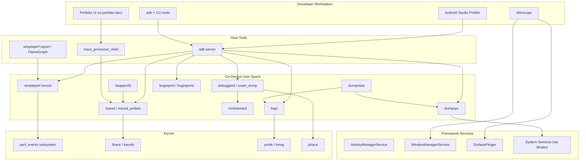

### 58.1.2 设计原则

以下几个反复出现的主题贯穿了 AOSP 的调试工具：

1. **常开、低开销的插桩。** logd 运行在每一台设备上；atrace 标记被编译进框架代码；debuggerd 的信号处理器注册在每个原生进程中。除非有人开始监听，否则开销为零或接近零。

2. **采集与分析分离。** Perfetto 将 `traced`（采集）与 `trace_processor`（分析）分离。simpleperf 将 `record` 与 `report` 分离。这使得采集可以在资源受限的设备上进行，而分析可以在性能强大的工作站上完成。

3. **以 Protobuf 优先的传输格式。** tombstone、Perfetto trace 和 bugreport 都使用 protobuf 承载结构化数据，文本渲染则作为表示层。

4. **最小化特权。** crash_dump 在读取寄存器后丢弃 capability；logd 在提供日志数据前检查凭证；heapprofd 使用 SELinux 约束自己可以分析哪些进程。

5. **与 servicemanager 集成。** dumpsys 通过 `IServiceManager` 枚举服务，每个服务实现自己的 `dump()` 方法——为数百个子系统提供了统一的诊断接口。

### 58.1.3 工具选择指南

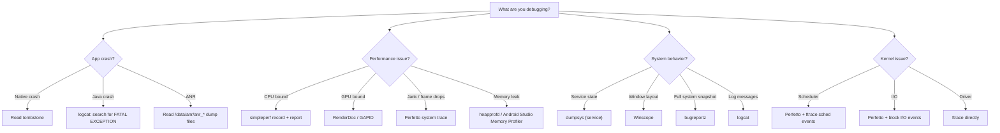

### 58.1.4 常见的传输机制

所有调试数据都必须离开设备。主要的传输方式有：

| 传输方式 | 使用者 | 机制 |
|-----------|---------|-----------|
| `adb logcat` | logd | 套接字 `/dev/socket/logdr` |
| `adb shell perfetto` | Perfetto | 写入 `/data/misc/perfetto-traces/` |
| `adb pull` | tombstone | `/data/tombstones/` 中的文件 |
| `adb bugreport` | dumpstate | 通过 adb 流式传输的 zip |
| `adb jdwp` | Java 调试器 | 通过 adb 的 JDWP 协议 |
| `adb forward` | 各种性能分析器 | TCP 端口转发 |

---

## 58.2 Logcat 与日志子系统

### 58.2.1 架构概览

Android 的日志系统是平台中最古老、使用最频繁的调试设施之一。Java 中的每一次 `Log.d()` 调用、C++ 中的每一次 `ALOGD()` 宏调用，以及内核中的每一次 `printk()`，最终都会流经 `logd` 守护进程。

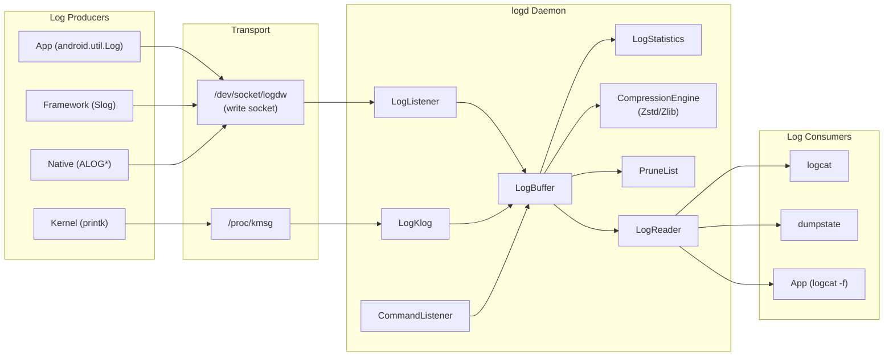

### 58.2.2 日志缓冲区与日志 ID

logd 维护了多个相互独立的环形缓冲区，每个缓冲区由一个 `log_id_t` 枚举值标识：

| 缓冲区 | log_id_t | 默认大小 | 用途 |
|--------|----------|-------------|---------|
| **main** | `LOG_ID_MAIN` | 256 KB | 通用应用日志 |
| **system** | `LOG_ID_SYSTEM` | 256 KB | 框架/系统日志 |
| **radio** | `LOG_ID_RADIO` | 256 KB | 电话栈 |
| **events** | `LOG_ID_EVENTS` | 256 KB | 二进制事件日志 |
| **crash** | `LOG_ID_CRASH` | 256 KB | 崩溃/ANR trace |
| **kernel** | `LOG_ID_KERNEL` | 256 KB | 内核消息（经 kmsg） |
| **security** | `LOG_ID_SECURITY` | 256 KB | 安全审计事件 |

大小常量定义在 `system/logging/logd/LogSize.h` 中：

```cpp
// system/logging/logd/LogSize.h
static constexpr size_t kDefaultLogBufferSize = 256 * 1024;
static constexpr size_t kLogBufferMinSize = 64 * 1024;
static constexpr size_t kLogBufferMaxSize = 256 * 1024 * 1024;
```

缓冲区大小可以在运行时通过 `logcat -G <size>` 调整，或通过设置 `persist.logd.size.main` 之类的系统属性来调整。函数 `GetBufferSizeFromProperties()` 会在 `LogBuffer::Init()` 期间读取这些属性。

### 58.2.3 LogBuffer 接口

`system/logging/logd/LogBuffer.h` 中的 `LogBuffer` 类定义了所有缓冲区实现都必须满足的抽象接口：

```cpp
// system/logging/logd/LogBuffer.h
class LogBuffer {
  public:
    virtual ~LogBuffer() {}
    virtual void Init() = 0;

    virtual int Log(log_id_t log_id, log_time realtime, uid_t uid, pid_t pid,
                    pid_t tid, const char* msg, uint16_t len) = 0;

    virtual std::unique_ptr<FlushToState> CreateFlushToState(
        uint64_t start, LogMask log_mask) = 0;
    virtual bool FlushTo(
        LogWriter* writer, FlushToState& state,
        const std::function<FilterResult(log_id_t, pid_t, uint64_t,
                                         log_time)>& filter) = 0;

    virtual bool Clear(log_id_t id, uid_t uid) = 0;
    virtual size_t GetSize(log_id_t id) = 0;
    virtual bool SetSize(log_id_t id, size_t size) = 0;
    virtual uint64_t sequence() const = 0;
};
```

关键设计点：

- **`Log()`** 是写入路径。它接收一条经过预校验的消息，以及来自内核套接字凭证的身份信息（uid、pid、tid）。

- **`FlushTo()`** 是读取路径。它借助 `FlushToState` 遍历缓冲区以在多次调用之间保持位置，并应用一个过滤器回调，该回调返回 `FilterResult::kSkip`、`kStop` 或 `kWrite`。

- **`LogMask`** 是一个位掩码（`uint32_t`），用于选择读取者想要哪些缓冲区。常量 `kLogMaskAll = 0xFFFFFFFF` 选择全部。

### 58.2.4 LogBufferElement：存储单元

每条日志消息都作为 `LogBufferElement` 存储，它定义在
`system/logging/logd/LogBufferElement.h` 中：

```cpp
// system/logging/logd/LogBufferElement.h
class __attribute__((packed)) LogBufferElement {
  public:
    LogBufferElement(log_id_t log_id, log_time realtime, uid_t uid,
                     pid_t pid, pid_t tid, uint64_t sequence,
                     const char* msg, uint16_t len);

    uint32_t GetTag() const;
    bool FlushTo(LogWriter* writer);
    LogStatisticsElement ToLogStatisticsElement() const;

    log_id_t log_id() const;
    uid_t uid() const;
    pid_t pid() const;
    pid_t tid() const;
    uint16_t msg_len() const;
    const char* msg() const;
    uint64_t sequence() const;
    log_time realtime() const;

  private:
    const uint32_t uid_;
    const uint32_t pid_;
    const uint32_t tid_;
    uint64_t sequence_;
    log_time realtime_;
    char* msg_;
    const uint16_t msg_len_;
    const uint8_t log_id_;
};
```

`__attribute__((packed))` 确保了最小的内存开销——当你要存储成千上万条消息时，每一字节都很重要。该元素的设计目标是与套接字上传入数据包的布局一致。

当向读取者刷新时，`FlushTo()` 会构造一个 `logger_entry` 头部：

```cpp
// system/logging/logd/LogBufferElement.cpp
bool LogBufferElement::FlushTo(LogWriter* writer) {
    struct logger_entry entry = {};
    entry.hdr_size = sizeof(struct logger_entry);
    entry.lid = log_id_;
    entry.pid = pid_;
    entry.tid = tid_;
    entry.uid = uid_;
    entry.sec = realtime_.tv_sec;
    entry.nsec = realtime_.tv_nsec;
    entry.len = msg_len_;
    return writer->Write(entry, msg_);
}
```

### 58.2.5 日志采集：LogListener 与 LogKlog

有两条不同的通路将日志消息送入 logd：

**LogListener**（`system/logging/logd/LogListener.h`）通过 Unix 域套接字 `/dev/socket/logdw` 接收来自用户空间进程的消息。它同时支持同步读取和 io_uring，以获得更高吞吐：

```cpp
// system/logging/logd/LogListener.h
class LogListener {
  public:
    explicit LogListener(LogBuffer* buf);
    bool StartListener();
  private:
    void HandleDataUring();
    void HandleDataSync();
    void ProcessBuffer(struct ucred* cred, void* buffer, ssize_t n);
    bool InitializeUring();
    std::unique_ptr<IOUringSocketHandler> uring_listener_;
    int socket_;
    LogBuffer* logbuf_;
};
```

`ProcessBuffer()` 方法从套接字辅助数据（`SCM_CREDENTIALS`）中提取发送者的凭证（`uid`、`gid`、`pid`）。这确保了日志消息无法被伪造。

**LogKlog**（`system/logging/logd/LogKlog.h`）从 `/proc/kmsg` 读取内核消息（它以只写方式打开 `/dev/kmsg`，仅供 logd 自身的 dmesg 输出使用），并将其注入 `LOG_ID_KERNEL` 缓冲区。它还负责单调时钟到实时时钟的转换：

```cpp
// system/logging/logd/LogKlog.h
class LogKlog : public SocketListener {
    static log_time correction;
  public:
    static void convertMonotonicToReal(log_time& real) {
        real += correction;
    }
  protected:
    log_time sniffTime(const char*& buf, ssize_t len, bool reverse);
    pid_t sniffPid(const char*& buf, ssize_t len);
};
```

### 58.2.6 日志读取：LogReader 与 LogReaderThread

logd 的读取端服务于连接 `/dev/socket/logdr` 的客户端。`LogReader`（`system/logging/logd/LogReader.h`）继承自 `SocketListener`，并为每个已连接的客户端创建一个 `LogReaderThread`：

```cpp
// system/logging/logd/LogReader.h
class LogReader : public SocketListener {
  public:
    explicit LogReader(LogBuffer* logbuf, LogReaderList* reader_list);
  protected:
    virtual bool onDataAvailable(SocketClient* cli);
  private:
    LogBuffer* log_buffer_;
    LogReaderList* reader_list_;
};
```

每个 `LogReaderThread` 维护自己的读取位置和过滤条件：

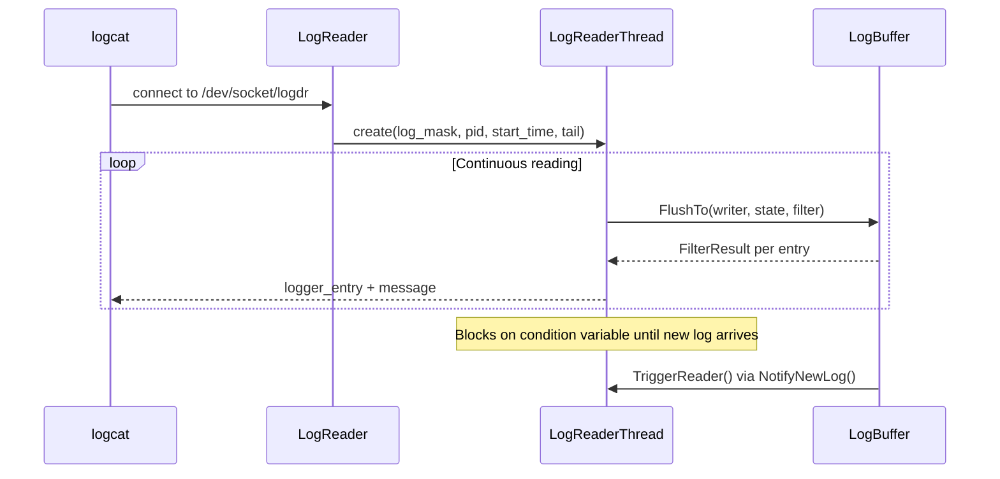

`LogReaderThread` 中的关键字段（来自 `system/logging/logd/LogReaderThread.h`）：

- **`tail_`**：对于 `-t N` / `-T N` 模式，是要显示的最近行数。
- **`pid_`**：可选的 PID 过滤器（用于 `logcat --pid=<pid>`）。
- **`non_block_`**：为 true 时，在输出完毕后断开（用于 `logcat -d`）。
- **`skip_ahead_[]`**：每个缓冲区的跳过计数，当缓冲区溢出且仍有读取者引用旧条目而被修剪时使用。

- **`deadline_`**：用于日志回绕操作的 CLOCK_MONOTONIC 截止时间。

### 58.2.7 CommandListener：控制接口

`CommandListener`（`system/logging/logd/CommandListener.h`）在 `/dev/socket/logd` 提供了一个控制套接字，用于管理命令。它使用基于宏的模式来注册命令处理器：

```cpp
// system/logging/logd/CommandListener.h
#define LogCmd(name, command_string)                                \
    class name##Cmd : public FrameworkCommand {                     \
      public:                                                       \
        explicit name##Cmd(CommandListener* parent)                 \
            : FrameworkCommand(#command_string), parent_(parent) {} \
        int runCommand(SocketClient* c, int argc, char** argv);    \
      private:                                                      \
        CommandListener* parent_;                                   \
    }

    LogCmd(Clear, clear);
    LogCmd(GetBufSize, getLogSize);
    LogCmd(SetBufSize, setLogSize);
    LogCmd(GetStatistics, getStatistics);
    LogCmd(GetPruneList, getPruneList);
    LogCmd(SetPruneList, setPruneList);
    LogCmd(GetEventTag, getEventTag);
    LogCmd(Reinit, reinit);
```

这些命令支撑着 `logcat` 的管理操作：

| 命令 | 等效 logcat 命令 | 用途 |
|---------|------------------|---------|
| `clear` | `logcat -c` | 清空缓冲区 |
| `getLogSize` | `logcat -g` | 查询缓冲区大小 |
| `setLogSize` | `logcat -G <size>` | 调整缓冲区大小 |
| `getStatistics` | `logcat -S` | 按 UID/PID 统计 |
| `getPruneList` | `logcat -p` | 列出修剪规则 |
| `setPruneList` | `logcat -P '<rules>'` | 设置修剪规则 |

### 58.2.8 日志统计与修剪

当缓冲区填满时，logd 必须决定丢弃什么。`LogStatistics` 类（`system/logging/logd/LogStatistics.h`）维护按 UID、按 PID、按 TID 和按标签的计数器：

```cpp
// system/logging/logd/LogStatistics.h  (simplified)
class LogStatistics {
    size_t mSizes[LOG_ID_MAX];
    size_t mElements[LOG_ID_MAX];

    // Per-buffer, per-UID size tracking
    typedef LogHashtable<uid_t, UidEntry> uidTable_t;
    uidTable_t uidTable[LOG_ID_MAX];

    // Per-buffer, per-PID tracking for system processes
    typedef LogHashtable<pid_t, PidEntry> pidSystemTable_t;
    pidSystemTable_t pidSystemTable[LOG_ID_MAX];

    // Global pid-to-uid and tid-to-uid maps
    typedef LogHashtable<pid_t, PidEntry> pidTable_t;
    pidTable_t pidTable;
    typedef LogHashtable<pid_t, TidEntry> tidTable_t;
    tidTable_t tidTable;

    // Tag tracking
    typedef LogHashtable<uint32_t, TagEntry> tagTable_t;
    tagTable_t tagTable;
    tagTable_t securityTagTable;
};
```

`PruneList` 类与统计信息协同工作，实现智能修剪：

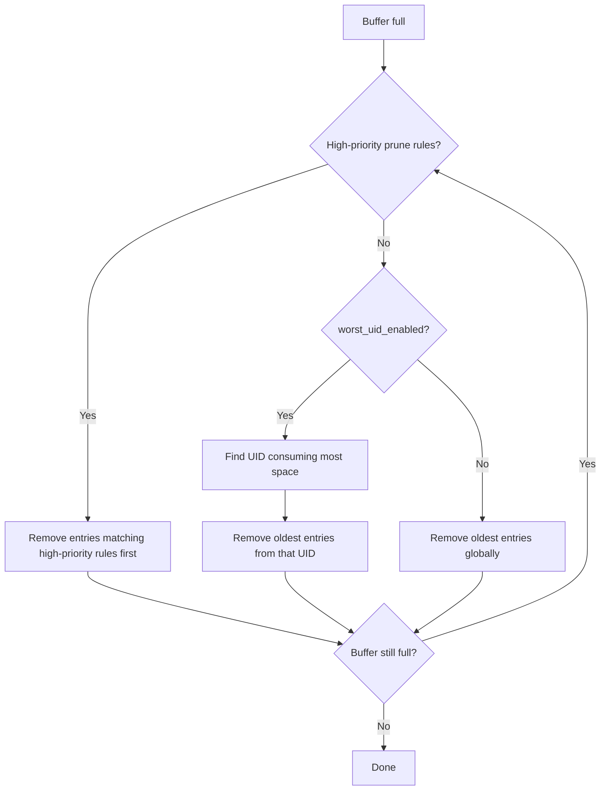

### 58.2.9 缓冲区大小的详细配置

`system/logging/logd/LogSize.cpp` 中的缓冲区大小初始化逻辑揭示了重要的平台特定行为：

```cpp
// system/logging/logd/LogSize.cpp
size_t GetBufferSizeFromProperties(log_id_t log_id) {
    static const bool isDebuggable =
        android::base::GetBoolProperty("ro.debuggable", false);
    if (isDebuggable) {
        static const bool mayOverride = isAllowedToOverrideBufferSize();
        if (mayOverride) {
            if (auto size = GetBufferSizePropertyOverride(log_id)) {
                return *size;
            }
        }
    } else {
        static const bool isLowRam =
            android::base::GetBoolProperty("ro.config.low_ram", false);
        if (isLowRam) {
            return kLogBufferMinSize;  // 64 KB for low-RAM devices
        }
    }
    return kDefaultLogBufferSize;  // 256 KB
}
```

属性查找遵循如下优先级链：

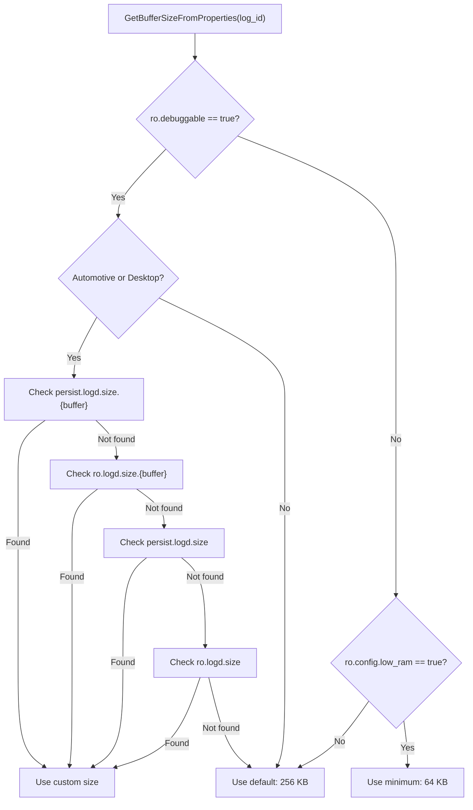

这一设计解决了源代码中记录的一个真实问题。过大的自定义日志大小再加上压缩日志，会导致 logcat 在收集 bugreport 时超时（参见引用了 b/196856709 的注释）。

### 58.2.10 压缩

logd 通过 `CompressionEngine` 类族（`system/logging/logd/CompressionEngine.h`）支持压缩存储：

```cpp
// system/logging/logd/CompressionEngine.h
class CompressionEngine {
  public:
    static CompressionEngine& GetInstance();
    virtual bool Compress(SerializedData& in, size_t data_length,
                          SerializedData& out) = 0;
    virtual bool Decompress(SerializedData& in, SerializedData& out) = 0;
};

class ZstdCompressionEngine : public CompressionEngine { ... };
class ZlibCompressionEngine : public CompressionEngine { ... };
```

Zstd 压缩是现代设备上的默认选项，在典型日志流上大约提供 3-5 倍的压缩比，同时只带来极小的 CPU 开销。

`LogStatistics` 类独立跟踪压缩后和未压缩的大小。`Sizes()` 方法返回压缩后的大小（实际消耗的内存），而 `SizeReadable()` 返回未压缩的大小（用户所期望的）：

```cpp
// system/logging/logd/LogStatistics.h
size_t Sizes(log_id_t id) const {
    auto lock = std::lock_guard{lock_};
    if (overhead_[id]) {
        return *overhead_[id];  // compressed size
    }
    return mSizes[id];
}

size_t SizeReadable(log_id_t id) const {
    auto lock = std::lock_guard{lock_};
    return mSizes[id];  // uncompressed size
}
```

### 58.2.11 审计日志：LogAudit

`LogAudit` 类（`system/logging/logd/LogAudit.h`）处理来自内核审计子系统的 SELinux 审计消息：

```cpp
// system/logging/logd/LogAudit.h
class LogAudit : public SocketListener {
    LogBuffer* logbuf;
    int fdDmesg;
    bool main;     // log to main buffer
    bool events;   // log to events buffer
  public:
    LogAudit(LogBuffer* buf, int fdDmesg);
    int log(char* buf, size_t len);
  private:
    std::string denialParse(const std::string& denial,
                            char terminator,
                            const std::string& search_term);
    std::string auditParse(const std::string& string, uid_t uid);
};
```

LogAudit 解析内核审计消息（SELinux 拒绝、capability 检查）并将其路由到相应的日志缓冲区。`denialParse()` 方法从原始拒绝字符串中提取结构化字段，使其可以通过 logcat 搜索。

### 58.2.12 事件日志标签：LogTags

`LogTags` 类（`system/logging/logd/LogTags.h`）管理数字事件标签 ID 与其人类可读名称/格式之间的映射：

```cpp
// system/logging/logd/LogTags.h
class LogTags {
    android::RWLock rwlock;

    // key is Name + "+" + Format
    std::unordered_map<std::string, uint32_t> key2tag;

    // UID-based access control for tags
    typedef std::unordered_set<uid_t> uid_list;
    std::unordered_map<uint32_t, uid_list> tag2uid;

    std::unordered_map<uint32_t, std::string> tag2name;
    std::unordered_map<uint32_t, std::string> tag2format;

    static const size_t max_per_uid = 256;  // Cap on tags per uid
    std::unordered_map<uid_t, size_t> uid2count;

  public:
    static const char system_event_log_tags[];
    static const char dynamic_event_log_tags[];
    static const char debug_event_log_tags[];

    const char* tagToName(uint32_t tag) const;
    const char* tagToFormat(uint32_t tag) const;
    uint32_t nameToTag(const char* name) const;
};
```

标签来源包括：

- **系统标签**：`/system/etc/event-log-tags`（由源代码构建）
- **动态标签**：`/dev/event-log-tags`（运行时注册）
- **调试标签**：`/data/misc/logd/event-log-tags`（仅限 userdebug/eng）

每个 UID 最多 256 个标签的限制，防止任何单个应用耗尽标签命名空间。

### 58.2.13 日志级别与过滤

Android 定义了以下日志级别，严重程度依次递增：

| 级别 | 整数值 | 宏 | Java 常量 |
|-------|---------|-------|--------------|
| Verbose | 2 | `ALOGV` | `Log.VERBOSE` |
| Debug | 3 | `ALOGD` | `Log.DEBUG` |
| Info | 4 | `ALOGI` | `Log.INFO` |
| Warn | 5 | `ALOGW` | `Log.WARN` |
| Error | 6 | `ALOGE` | `Log.ERROR` |
| Fatal | 7 | `LOG_ALWAYS_FATAL` / `ALOG_ASSERT` | `Log.ASSERT` |

在正式版本中，`ALOGV` 调用会被完全编译掉（它们展开为 `if (false)` 块），因此在 release 构建中 verbose 日志没有任何开销。

**使用 logcat 过滤：**

```bash
# Show only error and above from tag "MyApp"
adb logcat MyApp:E *:S

# Show with threadtime format (default)
adb logcat -v threadtime

# Show with color
adb logcat -v color

# Filter by PID
adb logcat --pid=1234

# Filter by UID
adb logcat --uid=10042

# Regular expression filter
adb logcat -e "Exception|Error"

# Show recent N lines then exit
adb logcat -t 100

# Print and exit (don't block)
adb logcat -d
```

### 58.2.14 使用 EventLog 的结构化日志

对于可被机器解析的日志，Android 提供了 EventLog 系统。事件定义在 `system/logging/logd/event.logtags` 中，并作为二进制数据而非文本字符串记录：

```
# Tag number, tag name, format
# Format: (name|type), where type:
#   1: int
#   2: long
#   3: string
#   4: list
1003  auditd     (avc|3)
1004  chatty     (dropped|3)
1005  tag_def    (tag|1),(name|3),(format|3)
```

（这三个条目就是 logd 自身的 `event.logtags` 的全部内容；框架还通过 `frameworks/base/services/core/java/com/android/server/EventLogTags.logtags` 及类似的各模块文件贡献了更多标签。）

结构化日志的优势：

- 更小的传输体积（没有字符串格式化开销）
- 无需正则即可被机器解析
- 在 logcat 统计中可按标签聚合
- 与指标收集集成

### 58.2.15 权限与安全

日志访问在多个层面受到控制：

1. **写入端**：任何进程都可以写入 main 和 system 缓冲区。写入 security 缓冲区需要 `LOG_ID_SECURITY` 权限，该权限在 `clientCanWriteSecurityLog()` 中检查。

2. **读取端**：`system/logging/logd/LogPermissions.h` 中的函数 `clientHasLogCredentials()` 检查连接的客户端是否已授权：

```cpp
// system/logging/logd/LogPermissions.h
bool clientHasLogCredentials(uid_t uid, gid_t gid, pid_t pid);
bool clientHasLogCredentials(SocketClient* cli);
bool clientCanWriteSecurityLog(uid_t uid, gid_t gid, pid_t pid);
bool clientIsExemptedFromUserConsent(SocketClient* cli);
```

3. **Binder 批准**：`LogdNativeService` 为待处理的读取线程提供 `approve`/`decline` 决定的 Binder 接口，允许系统通过 AppOps 管控日志访问：

```cpp
// system/logging/logd/LogdNativeService.cpp
android::binder::Status LogdNativeService::approve(
    int32_t uid, int32_t gid, int32_t pid, int32_t fd) {
    reader_list_->HandlePendingThread(uid, gid, pid, fd, true);
    return android::binder::Status::ok();
}
```

### 58.2.16 Logcat 命令参考

| 命令 | 说明 |
|---------|-------------|
| `logcat` | 流式输出所有日志缓冲区 |
| `logcat -b <buffer>` | 选择缓冲区（main、system、radio、events、crash） |
| `logcat -c` | 清空所选缓冲区 |
| `logcat -g` | 显示缓冲区大小 |
| `logcat -G <size>` | 设置缓冲区大小（如 `16M`） |
| `logcat -S` | 显示按 UID/PID 的统计 |
| `logcat -p` | 显示修剪规则 |
| `logcat -P '<rules>'` | 设置修剪规则 |
| `logcat -v <format>` | 设置输出格式（brief、process、tag、thread、threadtime、time、color、epoch、monotonic、uid、long、raw） |
| `logcat -d` | 输出后退出（非阻塞） |
| `logcat -t <count>` | 显示最后 N 行后退出 |
| `logcat -T '<time>'` | 显示时间戳以来的行 |
| `logcat --pid=<pid>` | 按进程 ID 过滤 |
| `logcat --uid=<uid>` | 按用户 ID 过滤 |
| `logcat -e '<regex>'` | 按正则表达式过滤 |
| `logcat -f <file>` | 记录到文件 |
| `logcat -r <kbytes>` | 每 N KB 轮转日志 |
| `logcat -n <count>` | 保留的轮转日志数量 |
| `logcat --wrap` | 回绕时睡眠并打印 |

---

## 58.3 Perfetto：系统级跟踪

### 58.3.1 架构

Perfetto 是 Android 的系统级跟踪框架，取代了旧的 `systrace` 工具。它的架构遵循生产者-消费者模型，多个数据源将 trace 数据包写入一个集中的跟踪服务。

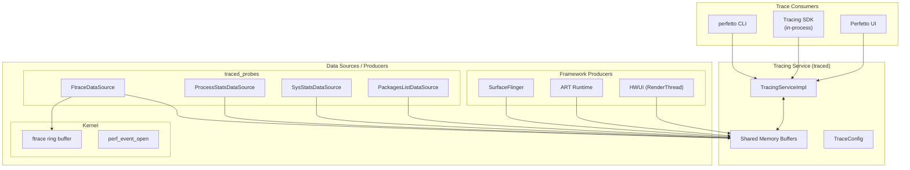

源代码位于 `external/perfetto/`，结构如下：

| 目录 | 内容 |
|-----------|----------|
| `src/traced/` | 跟踪守护进程（`traced`） |
| `src/traced/service/` | 核心服务实现 |
| `src/traced/probes/` | 内置数据源生产者 |
| `src/tracing/` | Tracing SDK 和客户端库 |
| `src/trace_processor/` | 基于 SQL 的 trace 分析引擎 |
| `src/perfetto_cmd/` | `perfetto` 命令行工具 |
| `src/profiling/` | heapprofd 和 perf 性能分析 |
| `protos/perfetto/trace/` | trace 数据包的 Protobuf 定义 |
| `include/perfetto/tracing/` | 公共 C++ tracing API |

### 58.3.2 跟踪服务：traced

跟踪服务（`traced`）是中央协调者。它：

1. 接受来自生产者（数据源）和消费者（trace 会话）的连接。

2. 管理生产者与服务之间的共享内存缓冲区。
3. 应用 `TraceConfig` 来选择启用哪些数据源。
4. 处理 trace 输出（文件、流式传输或内存中）。

该服务作为一个常驻守护进程运行，由 init 启动：

```
# external/perfetto/perfetto.rc (simplified)
service traced /system/bin/traced
    class late_start
    disabled
    socket traced_consumer stream 0666 root root
    socket traced_producer stream 0666 root root
    user nobody
    group nobody
    task_profiles ProcessCapacityHigh
    capabilities SYS_NICE
```

### 58.3.3 数据源

Perfetto 的强大之处来自其可扩展的数据源模型。每个数据源都是一个插件，以 protobuf 格式产生 trace 数据包。

**内置数据源**（来自 `traced_probes`）：

| 数据源 | 类别 | 捕获内容 |
|-------------|----------|-----------------|
| `linux.ftrace` | 内核 | 调度、I/O、内存、自定义跟踪点 |
| `linux.process_stats` | 进程 | 基于 /proc 的进程/线程统计 |
| `linux.sys_stats` | 系统 | /proc/stat、/proc/meminfo、/proc/vmstat |
| `linux.system_info` | 系统 | CPU 信息、内核版本 |
| `android.packages_list` | Android | 已安装包映射 |
| `android.log` | Android | Logcat 集成 |

（GPU 内存跟踪以 `android.gpu.memory` 数据源的形式提供，但它是由 gpuservice 的 `GpuMemTracer` 注册为一个独立的 Perfetto 生产者，而不是由 `traced_probes` 注册的。）

**框架数据源**（集成了 atrace）：

| 类别标签 | 框架组件 |
|-------------|-------------------|
| `gfx` | SurfaceFlinger、HWUI |
| `view` | View 系统 |
| `wm` | WindowManager |
| `am` | ActivityManager |
| `audio` | AudioFlinger |
| `video` | MediaCodec |
| `camera` | CameraService |
| `input` | InputDispatcher |
| `res` | 资源加载 |
| `dalvik` | ART VM |
| `binder_driver` | Binder 内核驱动 |
| `sched` | CPU 调度器 |
| `freq` | CPU 频率 |
| `idle` | CPU 空闲状态 |
| `disk` | 磁盘 I/O |

### 58.3.4 Trace 配置

Perfetto trace 会话使用 `TraceConfig` protobuf 进行配置。下面是用于调试掉帧的一个代表性配置：

```protobuf
# jank_trace.pbtxt
buffers {
    size_kb: 131072
    fill_policy: RING_BUFFER
}
data_sources {
    config {
        name: "linux.ftrace"
        ftrace_config {
            ftrace_events: "sched/sched_switch"
            ftrace_events: "sched/sched_waking"
            ftrace_events: "power/cpu_frequency"
            ftrace_events: "power/cpu_idle"
            ftrace_events: "power/suspend_resume"
            atrace_categories: "gfx"
            atrace_categories: "view"
            atrace_categories: "wm"
            atrace_categories: "am"
            atrace_categories: "input"
            atrace_apps: "*"
        }
    }
}
data_sources {
    config {
        name: "linux.process_stats"
        process_stats_config {
            scan_all_processes_on_start: true
            proc_stats_poll_ms: 1000
        }
    }
}
duration_ms: 10000
```

运行 trace：

```bash
# Record a 10-second trace
adb shell perfetto -c /data/local/tmp/jank_trace.pbtxt \
    -o /data/misc/perfetto-traces/trace.perfetto-trace

# Pull the trace
adb pull /data/misc/perfetto-traces/trace.perfetto-trace .
```

### 58.3.5 atrace 集成

Perfetto 通过 ftrace 数据源与旧的 `atrace` 系统集成。当配置中指定了 `atrace_categories` 时，`traced_probes` 会启用相应的 atrace 类别，进而启用框架代码中的 `ATRACE_BEGIN()`/`ATRACE_END()` 标记。

流程如下：

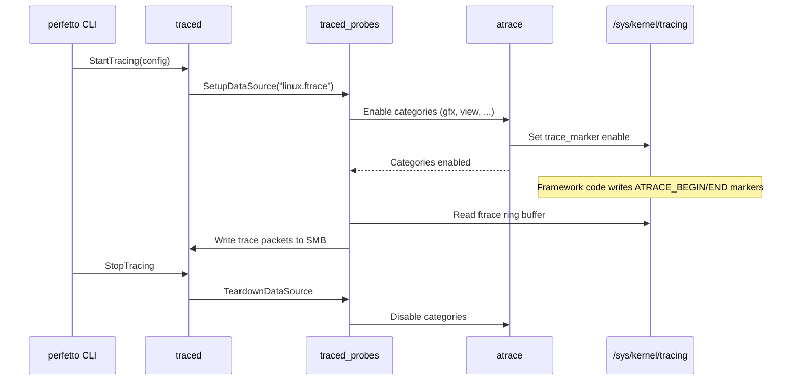

### 58.3.6 Trace Processor 与 SQL 查询

Perfetto 的 `trace_processor` 是一个强大的分析引擎，它导入 trace 文件并将其作为 SQL 数据库暴露出来。它位于 `external/perfetto/src/trace_processor/`。

关键的表和视图：

| 表/视图 | 内容 |
|------------|----------|
| `slice` | 所有 trace 事件（begin/end 对） |
| `thread_slice` | 与线程关联的 slice |
| `process` | 进程元数据（pid、名称、uid） |
| `thread` | 线程元数据（tid、名称、进程） |
| `sched_slice` | CPU 调度事件 |
| `counter` | 计数器值（CPU 频率、内存等） |
| `android_logs` | Logcat 条目 |
| `ftrace_event` | 原始 ftrace 事件 |
| `args` | slice 上的键值参数 |
| `metadata` | trace 级别的元数据 |

**示例 SQL 查询：**

```sql
-- Find the longest main-thread slices (potential jank sources)
SELECT
    ts,
    dur / 1e6 as dur_ms,
    name
FROM slice
WHERE track_id IN (
    SELECT id FROM thread_track
    WHERE utid IN (
        SELECT utid FROM thread
        WHERE is_main_thread = 1
    )
)
ORDER BY dur DESC
LIMIT 20;

-- CPU frequency distribution during the trace
SELECT
    cpu,
    CAST(value AS INT) as freq_khz,
    COUNT(*) as sample_count,
    SUM(dur) / 1e9 as total_seconds
FROM counter
JOIN counter_track ON counter.track_id = counter_track.id
WHERE counter_track.name = 'cpufreq'
GROUP BY cpu, freq_khz
ORDER BY cpu, freq_khz;

-- Scheduling latency for a specific process
SELECT
    thread.name,
    AVG(sched_slice.dur) / 1e6 as avg_runtime_ms,
    MAX(sched_slice.dur) / 1e6 as max_runtime_ms,
    COUNT(*) as schedule_count
FROM sched_slice
JOIN thread USING (utid)
JOIN process USING (upid)
WHERE process.name LIKE '%myapp%'
GROUP BY thread.name
ORDER BY avg_runtime_ms DESC;

-- Binder transaction latency
SELECT
    client_ts,
    client_dur / 1e6 as dur_ms,
    client_process,
    server_process
FROM android_binder_txns
WHERE client_dur > 16e6  -- longer than one frame
ORDER BY client_dur DESC
LIMIT 20;
```

交互式使用 `trace_processor_shell`：

```bash
# Launch interactive SQL shell
trace_processor_shell trace.perfetto-trace

# Run a query file
trace_processor_shell --query-file=analysis.sql trace.perfetto-trace
```

### 58.3.7 Perfetto UI

Perfetto UI（位于 `ui.perfetto.dev`）提供了基于网页的可视化：

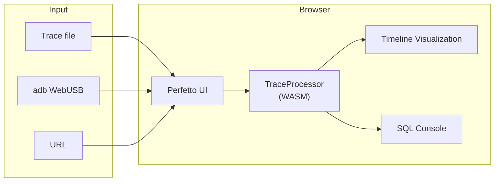

关键 UI 功能：

- **时间线视图**：按进程和线程组织的 trace 事件，支持滚动/缩放。

- **SQL 控制台**：对 trace 运行临时查询。
- **指标**：针对常见分析任务（启动时间、掉帧、内存等）的预构建指标查询。

- **火焰图**：用于 CPU 性能分析和堆性能分析数据。
- **流事件**：可视化因果关系（例如 binder 请求→响应）。

### 58.3.8 Perfetto Trace 格式

Perfetto trace 使用定义在 `external/perfetto/protos/perfetto/trace/trace.proto` 中的基于 protobuf 的格式。trace 是一系列 `TracePacket` 消息：

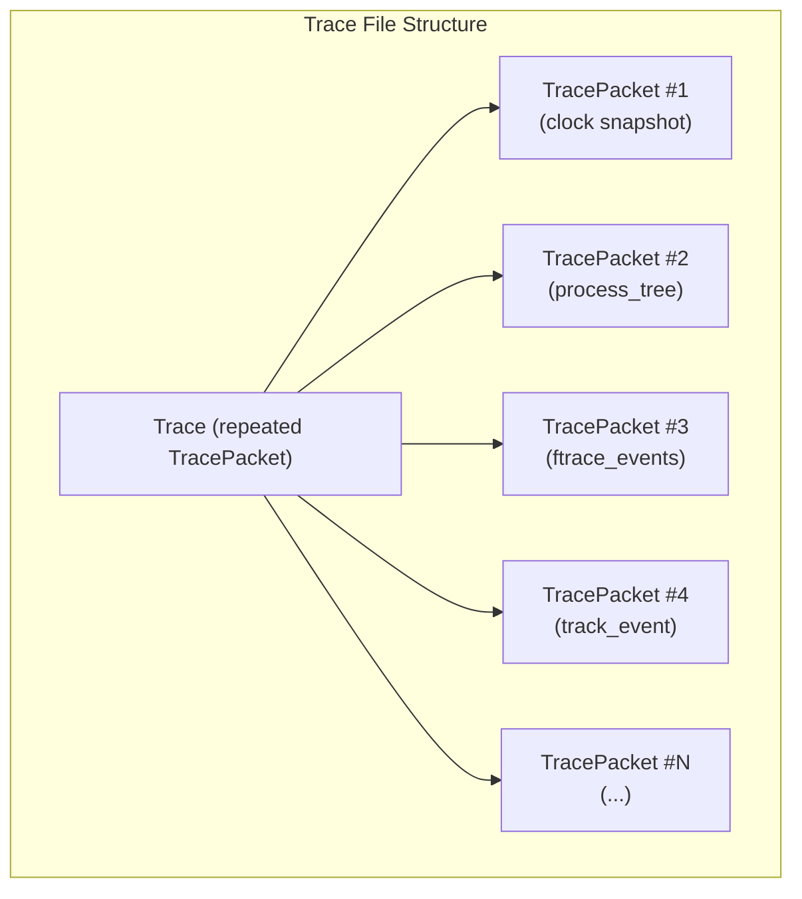

trace 格式中的关键 protobuf 类型：

| Proto 文件 | 内容 |
|------------|----------|
| `trace.proto` | 顶层 Trace 消息 |
| `trace_packet.proto` | 包含所有可能数据源负载的 TracePacket |
| `ftrace/ftrace_event_bundle.proto` | Ftrace 事件数据 |
| `track_event/track_event.proto` | 用户空间 trace 事件 |
| `ps/process_tree.proto` | 进程/线程元数据 |
| `clock_snapshot.proto` | 时钟同步数据 |
| `profiling/profile_packet.proto` | CPU/堆 profile 数据 |
| `android/packages_list.proto` | Android 包元数据 |
| `power/battery_counters.proto` | 电池计数器数据 |

trace processor 导入所有这些数据包类型，并从中构建关系数据库，然后可通过 SQL 查询。

### 58.3.9 Perfetto 指标

Perfetto 附带预构建的指标。每个指标都可以在 trace 上运行，无需 SQL：

```bash
# Compute a specific metric
trace_processor_shell --run-metrics android_startup \
    trace.perfetto-trace

# Compute several Android metrics at once, as JSON
trace_processor_shell --run-metrics android_mem,android_startup,\
android_binder,android_blocking_calls_cuj_metric \
    --metrics-output=json trace.perfetto-trace
```

可用的 Android 专用指标：

| 指标 | 说明 |
|--------|-------------|
| `android_startup` | 应用冷/温/热启动时间分解 |
| `android_binder` | Binder 事务延迟统计 |
| `android_mem` | 随时间的内存使用 |
| `android_blocking_calls_cuj_metric` | 在 CUJ 期间阻塞主线程的调用 |
| `android_camera` | 相机流水线延迟 |
| `android_cpu` | CPU 使用和调度指标 |
| `android_gpu` | GPU 利用率指标 |
| `android_jank_cuj` | 掉帧检测与分类 |
| `android_lmk` | Low memory killer 事件 |
| `android_ion` | ION/DMA-BUF 内存分配 |

### 58.3.10 常见 Perfetto 用法

**从命令行记录系统 trace：**

```bash
# Quick 10-second trace with common categories
adb shell perfetto -o /data/misc/perfetto-traces/trace \
    -t 10s \
    sched freq idle am wm gfx view input

# Record with custom config file
adb shell perfetto -c - --txt < config.pbtxt \
    -o /data/misc/perfetto-traces/trace
```

**使用环形缓冲区将长时间 trace 记录到文件：**

```bash
adb shell perfetto \
    --txt \
    -c - \
    -o /data/misc/perfetto-traces/trace <<EOF
buffers { size_kb: 262144  fill_policy: RING_BUFFER }
data_sources {
    config {
        name: "linux.ftrace"
        ftrace_config {
            ftrace_events: "sched/sched_switch"
            atrace_categories: "gfx"
            atrace_categories: "view"
        }
    }
}
duration_ms: 60000
EOF
```

**记录应用启动：**

```bash
# Start trace, launch app, stop trace
adb shell perfetto --background \
    -o /data/misc/perfetto-traces/startup_trace \
    -t 15s sched freq am wm gfx view dalvik

adb shell am start -W com.example.myapp/.MainActivity
sleep 15
adb pull /data/misc/perfetto-traces/startup_trace .
```

---

## 58.4 simpleperf：CPU 性能分析

### 58.4.1 架构

simpleperf 是 Android 的原生 CPU 性能分析器，构建在 Linux `perf_events` 子系统之上。其源代码位于 `system/extras/simpleperf/`。

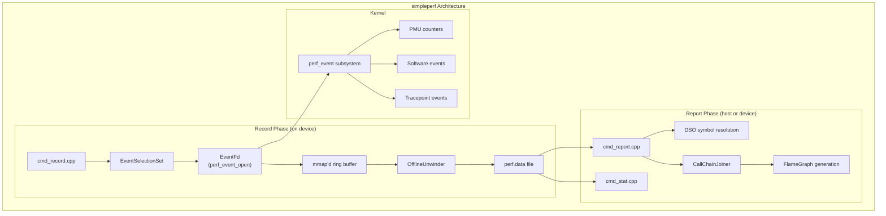

### 58.4.2 命令框架

simpleperf 使用一个定义在 `system/extras/simpleperf/command.h` 中的模块化命令框架：

```cpp
// system/extras/simpleperf/command.h
class Command {
 public:
  Command(const std::string& name, const std::string& short_help_string,
          const std::string& long_help_string);
  virtual bool Run(const std::vector<std::string>&) { return false; }
  // ...
};

// Registered commands:
void RegisterRecordCommand();
void RegisterReportCommand();
void RegisterStatCommand();
void RegisterListCommand();
void RegisterKmemCommand();
void RegisterTraceSchedCommand();
void RegisterMonitorCommand();
// ... and more
```

主要命令：

| 命令 | 源文件 | 用途 |
|---------|--------|---------|
| `record` | `cmd_record.cpp` | 采集性能分析样本 |
| `report` | `cmd_report.cpp` | 分析记录的数据 |
| `stat` | `cmd_stat.cpp` | 统计硬件事件 |
| `list` | `cmd_list.cpp` | 列出可用事件 |
| `dumprecord` | `cmd_dumprecord.cpp` | 转储原始记录内容 |
| `inject` | `cmd_inject.cpp` | 处理 ETM 数据 |
| `kmem` | `cmd_kmem.cpp` | 内核内存性能分析 |
| `trace-sched` | `cmd_trace_sched.cpp` | 调度 trace 分析 |
| `monitor` | `cmd_monitor.cpp` | 实时事件监控 |

### 58.4.3 EventFd：perf_event 接口

`EventFd` 类（`system/extras/simpleperf/event_fd.h`）封装了内核的 `perf_event_open()` 系统调用：

```cpp
// system/extras/simpleperf/event_fd.h
class EventFd {
 public:
  static std::unique_ptr<EventFd> OpenEventFile(
      const perf_event_attr& attr, pid_t tid, int cpu,
      EventFd* group_event_fd, const std::string& event_name,
      bool report_error = true);

  bool SetEnableEvent(bool enable);
  bool ReadCounter(PerfCounter* counter);
  bool CreateMappedBuffer(size_t mmap_pages, bool report_error);
  std::vector<char> GetAvailableMmapData();
  bool CreateAuxBuffer(size_t aux_buffer_size, bool report_error);
  bool StartPolling(IOEventLoop& loop,
                    const std::function<bool()>& callback);

 protected:
  const perf_event_attr attr_;
  int perf_event_fd_;
  volatile perf_event_mmap_page* mmap_metadata_page_;
  char* mmap_data_buffer_;
  size_t mmap_data_buffer_size_;
};
```

`PerfCounter` 结构捕获计数器值，并带有用于多路复用的时间启用和时间运行字段：

```cpp
struct PerfCounter {
  uint64_t value;         // The event count
  uint64_t time_enabled;  // Time the counter was enabled
  uint64_t time_running;  // Time the counter was actually running
  uint64_t id;            // Counter ID for group identification
};
```

### 58.4.4 记录 CPU Profile

**基本的 CPU 性能分析：**

```bash
# Profile a running process
adb shell simpleperf record -p <pid> --duration 10 -o /data/local/tmp/perf.data

# Profile a command
adb shell simpleperf record -o /data/local/tmp/perf.data -- ls /

# Profile with dwarf-based call graphs
adb shell simpleperf record -p <pid> --call-graph dwarf \
    --duration 10 -o /data/local/tmp/perf.data

# Profile with frame-pointer call graphs (faster, less accurate)
adb shell simpleperf record -p <pid> --call-graph fp \
    --duration 10 -o /data/local/tmp/perf.data

# Profile system-wide (requires root)
adb shell simpleperf record -a --duration 10 -o /data/local/tmp/perf.data
```

**对特定应用进行性能分析：**

```bash
# Profile a debuggable/profileable app
adb shell simpleperf record --app com.example.myapp \
    --call-graph dwarf --duration 10 \
    -o /data/local/tmp/perf.data
```

### 58.4.5 分析结果

**基于文本的报告：**

```bash
# Pull the data
adb pull /data/local/tmp/perf.data .

# Basic report
simpleperf report -i perf.data

# Sort by different criteria
simpleperf report -i perf.data --sort comm,pid,tid,dso,symbol

# Show call graph
simpleperf report -i perf.data -g

# Filter by DSO
simpleperf report -i perf.data --dsos /system/lib64/libc.so
```

**示例报告输出：**

```
Overhead  Shared Object            Symbol
62.23%    libmyapp.so              MyApp::processFrame()
 15.42%   libc.so                  memcpy
  8.17%   libart.so                art::gc::Heap::ConcurrentCopying
  5.33%   libhwui.so               android::uirenderer::RenderNode::pr...
  3.89%   [kernel.kallsyms]        copy_page
  2.11%   libutils.so              android::RefBase::incStrong
  ...
```

### 58.4.6 火焰图

simpleperf 包含生成火焰图的脚本：

```bash
# Generate flame graph HTML
python simpleperf/scripts/report_html.py -i perf.data -o report.html

# Generate Brendan Gregg-style flame graph
# (the inferno entry point is the inferno.sh / inferno.bat wrapper, which
#  invokes system/extras/simpleperf/scripts/inferno/inferno.py)
simpleperf/scripts/inferno.sh -i perf.data -o flame.html

# Generate FlameGraph-compatible folded stacks
python3 simpleperf/scripts/stackcollapse.py -i perf.data > stacks.txt
```

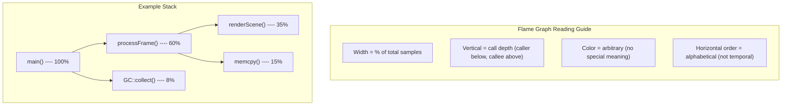

### 58.4.7 硬件性能计数器

simpleperf 可以统计特定的硬件事件：

```bash
# Count cache misses
adb shell simpleperf stat -e cache-misses,cache-references \
    -p <pid> --duration 5

# Count branch mispredictions
adb shell simpleperf stat \
    -e branch-misses,branch-instructions \
    -p <pid> --duration 5

# Count instructions per cycle (IPC)
adb shell simpleperf stat \
    -e instructions,cpu-cycles \
    -p <pid> --duration 5

# List all available events
adb shell simpleperf list
```

**示例 stat 输出：**

```
Performance counter statistics:

    523,847,293  cpu-cycles          # 1.523 GHz
    312,567,891  instructions        # 0.60 insn per cycle
     12,345,678  cache-references
      1,234,567  cache-misses        # 10.00% of all cache refs
         56,789  branch-misses       # 0.18% of all branches

       0.344123  seconds time elapsed
```

### 58.4.8 ETM（Embedded Trace Macrocell）支持

simpleperf 通过 `ETMDecoder.h`、`ETMRecorder.h` 和 `ETMConstants.h` 等文件支持 ARM 的 ETM，用于指令级跟踪：

```bash
# Record ETM trace
adb shell simpleperf record -e cs-etm --duration 1 \
    -p <pid> -o /data/local/tmp/etm.data

# Inject and process ETM data
simpleperf inject -i etm.data -o etm_processed.data

# Analyze branch coverage
simpleperf inject -i etm.data --output branch-list \
    -o branch_list.txt
```

### 58.4.9 simpleperf 脚本

simpleperf 在 `system/extras/simpleperf/scripts/` 中包含一组丰富的 Python 脚本，用于常见工作流：

| 脚本 | 用途 |
|--------|---------|
| `app_profiler.py` | 自动应用性能分析与符号解析 |
| `report_html.py` | 生成带火焰图的交互式 HTML 报告 |
| `inferno.sh` / `inferno/inferno.py` | 生成独立的火焰图 HTML |
| `report_sample.py` | 将 perf.data 转换为 protocol buffer 格式 |
| `annotate.py` | 对热点函数进行源码级标注 |
| `pprof_proto_generator.py` | 生成适用于 Go 生态的 pprof 格式 |
| `simpleperf_report_lib.py` | 用于自定义分析脚本的 Python 库 |
| `binary_cache_builder.py` | 构建用于符号化的二进制缓存 |
| `debug_unwind_reporter.py` | 调试栈回溯问题 |

使用 `app_profiler.py` 的示例工作流：

```bash
# This script handles the entire record-pull-symbolize workflow
python3 app_profiler.py \
    -p com.example.myapp \
    -r "-g --duration 10" \
    -lib path/to/app/native/libs/

# Then generate an HTML report
python3 report_html.py -i perf.data -o report.html
```

### 58.4.10 调用图方法比较

simpleperf 支持两种捕获调用栈的方法（`--call-graph fp` 和 `--call-graph dwarf`）；两者都不指定时，它只记录扁平样本。（LBR 式的硬件分支记录是 x86 perf 的功能，simpleperf 并未实现。）

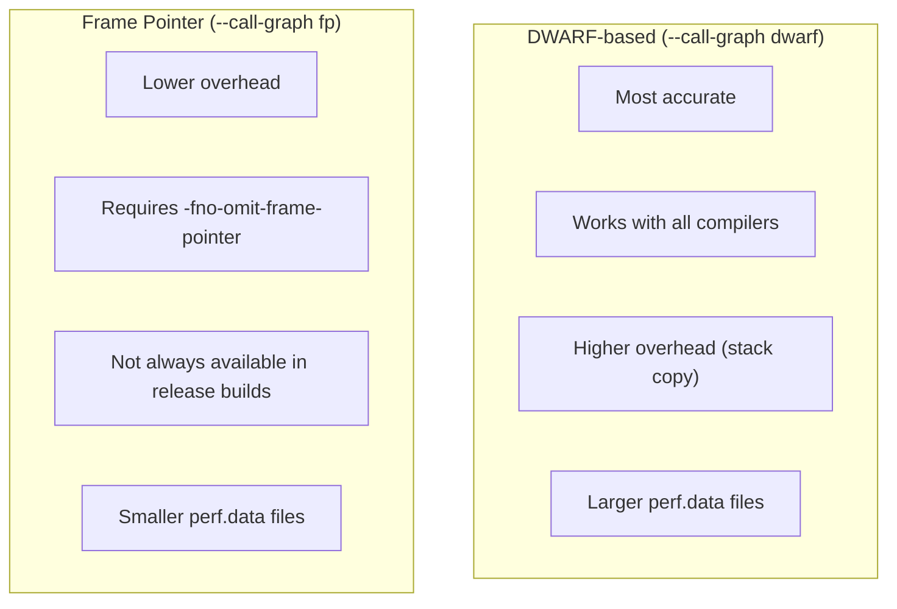

| 方法 | 标志 | 准确性 | 开销 | 栈深度 |
|--------|------|----------|----------|-------------|
| DWARF | `--call-graph dwarf` | 极佳 | 中-高 | 无限制 |
| 帧指针 | `--call-graph fp` | 良好 | 低 | 无限制（如果设置了 FP） |
| 无 |（默认） | 仅扁平 | 极小 | 0 |

### 58.4.11 JIT 调试支持

simpleperf 通过 `JITDebugReader` 类（`system/extras/simpleperf/JITDebugReader.h`）处理 JIT 编译的代码（来自 ART）。该类从 ART 运行时读取 JIT 调试描述符，以解析 JIT 编译方法中的符号。

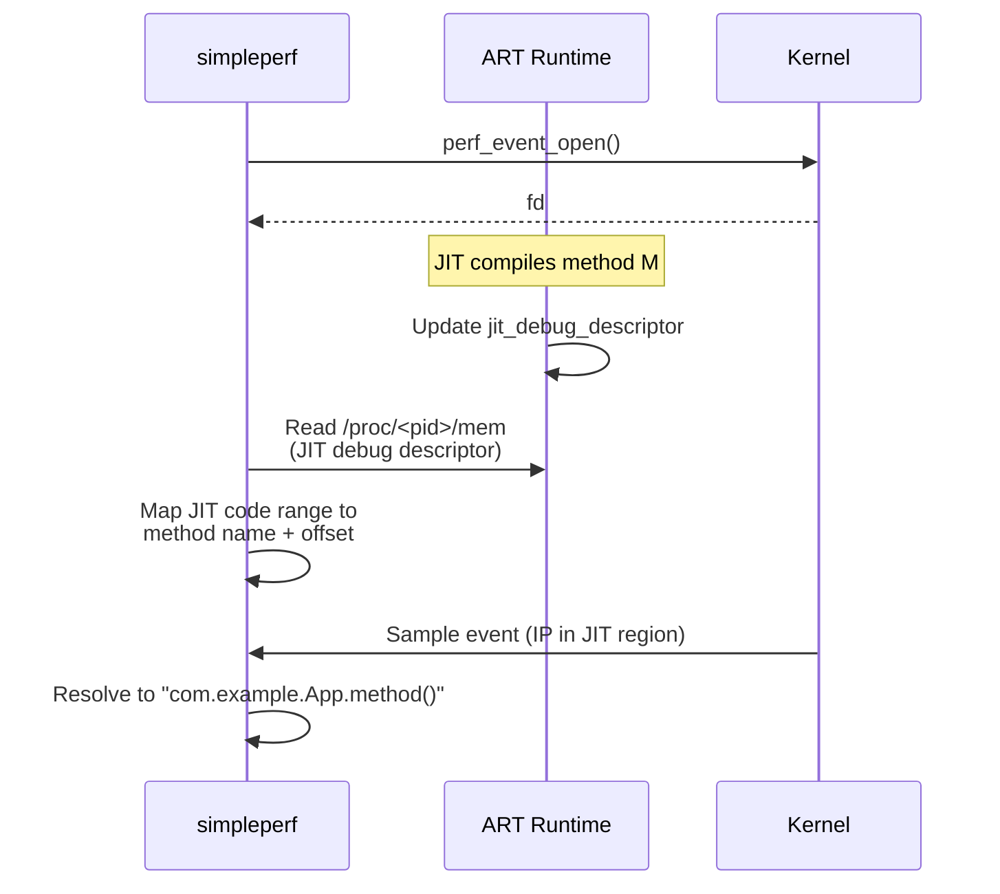

---

## 58.5 heapprofd：通过 Perfetto 进行堆性能分析

### 58.5.1 架构

heapprofd 是一个原生堆性能分析器，与 Perfetto 集成以进行采集和可视化。其源代码位于 `external/perfetto/src/profiling/memory/`。

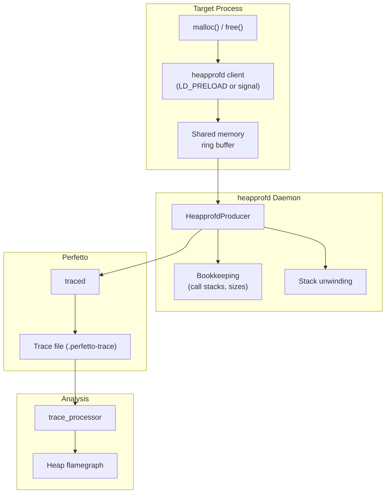

### 58.5.2 关键源文件

| 文件 | 用途 |
|------|---------|
| `heapprofd.cc` | 守护进程入口点 |
| `heapprofd_producer.cc` | Perfetto producer 集成 |
| `client.cc` | 进程内客户端库 |
| `client_api.cc` | 面向自定义分配器的公共 API |
| `bookkeeping.cc` | 调用栈去重与大小跟踪 |
| `bookkeeping_dump.cc` | profile 数据的序列化 |

### 58.5.3 工作原理

1. **拦截**：heapprofd 通过 `LD_PRELOAD`（针对可调试应用）或在运行时修补 malloc 调度表的基于信号的机制，拦截 `malloc`/`free` 调用。

2. **采样**：并非每次分配都会被记录。heapprofd 使用泊松采样：一个分配被采样的概率与其大小成正比。采样间隔可配置（默认：4096 字节）。

3. **栈回溯**：当一次分配被采样时，客户端捕获栈（使用帧指针或 DWARF）。然后通过共享内存将栈发送给守护进程。

4. **簿记**：守护进程对调用栈去重并跟踪累计分配大小。这给出了一种紧凑的表示。

5. **输出**：profile 数据流入 Perfetto 的 trace 格式，可在 Perfetto UI 中作为火焰图查看。

### 58.5.4 使用 heapprofd

**通过 Perfetto 配置：**

```protobuf
# heap_profile.pbtxt
buffers { size_kb: 131072 }
data_sources {
    config {
        name: "android.heapprofd"
        heapprofd_config {
            sampling_interval_bytes: 4096
            process_cmdline: "com.example.myapp"
            continuous_dump_config {
                dump_phase_ms: 0
                dump_interval_ms: 5000
            }
            shmem_size_bytes: 8388608
            block_client: true
        }
    }
}
duration_ms: 30000
```

```bash
# Record heap profile
adb shell perfetto -c /data/local/tmp/heap_profile.pbtxt \
    -o /data/misc/perfetto-traces/heap.perfetto-trace

# Or use the convenience script
python3 external/perfetto/tools/heap_profile \
    -n com.example.myapp \
    -d 30 \
    --sampling-interval 4096
```

**通过 Android Studio**：Android Studio 中的 Memory Profiler 可以触发原生堆转储，其底层使用 heapprofd。

### 58.5.5 使用 trace_processor 分析

```sql
-- Find the allocation sites with the most bytes
-- (allocations reference a callsite, whose leaf frame carries the symbol)
SELECT
    SUM(hpa.size) as total_bytes,
    COUNT(*) as alloc_count,
    spf.name as leaf_frame
FROM heap_profile_allocation hpa
JOIN stack_profile_callsite spc ON hpa.callsite_id = spc.id
JOIN stack_profile_frame spf ON spc.frame_id = spf.id
GROUP BY hpa.callsite_id
ORDER BY total_bytes DESC
LIMIT 20;

-- Track allocations over time
SELECT
    ts / 1e9 as time_s,
    SUM(size) as cumulative_bytes
FROM heap_profile_allocation
WHERE size > 0
GROUP BY CAST(ts / 1e9 AS INT)
ORDER BY time_s;
```

### 58.5.6 Java 堆性能分析

对于 Java 堆分析，请使用 `am dumpheap`：

```bash
# Dump Java heap for analysis
adb shell am dumpheap <pid> /data/local/tmp/heap.hprof

# Pull and analyze with Android Studio or MAT
adb pull /data/local/tmp/heap.hprof .
```

Java 堆转储捕获：

- 所有存活对象及其字段
- GC 根和引用链
- 类元数据和实例计数
- 保留大小计算

---

## 58.6 dumpsys：服务检查

### 58.6.1 架构

`dumpsys` 是 Android 的通用服务诊断工具。它连接到每一个已注册的 Binder 服务，并调用它们的 `dump()` 方法。

实现位于 `frameworks/native/cmds/dumpsys/`：

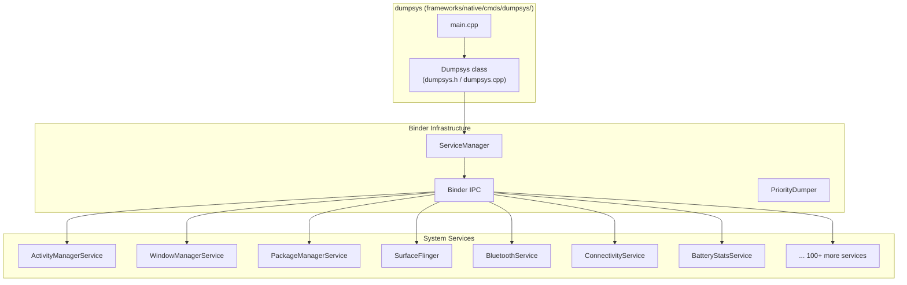

### 58.6.2 Dumpsys 类

`Dumpsys` 类（`frameworks/native/cmds/dumpsys/dumpsys.h`）协调服务枚举与 dump 收集：

```cpp
// frameworks/native/cmds/dumpsys/dumpsys.h
class Dumpsys {
  public:
    explicit Dumpsys(android::IServiceManager* sm) : sm_(sm) {}

    int main(int argc, char* const argv[]);

    Vector<String16> listServices(int priorityFlags,
                                   bool supportsProto) const;

    static void setServiceArgs(Vector<String16>& args, bool asProto,
                               int priorityFlags);

    enum Type {
        TYPE_DUMP = 0x1,
        TYPE_PID = 0x2,
        TYPE_STABILITY = 0x4,
        TYPE_THREAD = 0x8,
        TYPE_CLIENTS = 0x10,
    };

    status_t startDumpThread(int dumpTypeFlags,
                              const String16& serviceName,
                              const Vector<String16>& args);
    status_t writeDump(int fd, const String16& serviceName,
                       std::chrono::milliseconds timeout,
                       bool asProto, ...);
    void stopDumpThread(bool dumpComplete);
};
```

### 58.6.3 Dump 执行流程

当你运行 `dumpsys <service>` 时，会发生以下序列：

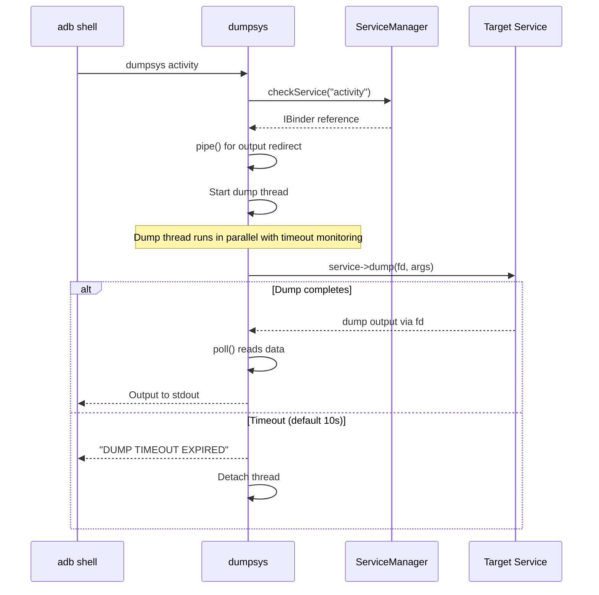

基于线程的执行与超时保护至关重要——一个挂起的服务不能阻塞整个 dumpsys 进程。默认超时为 10 秒，可用 `-t` 配置：

```cpp
// frameworks/native/cmds/dumpsys/dumpsys.cpp
int timeoutArgMs = 10000;  // default 10 seconds
```

### 58.6.4 基于优先级的 Dump

服务以 dump 优先级级别注册，dumpsys 可以按优先级过滤：

```cpp
// From dumpsys.cpp
static bool ConvertPriorityTypeToBitmask(const String16& type,
                                          int& bitmask) {
    if (type == PriorityDumper::PRIORITY_ARG_CRITICAL) {
        bitmask = IServiceManager::DUMP_FLAG_PRIORITY_CRITICAL;
        return true;
    }
    if (type == PriorityDumper::PRIORITY_ARG_HIGH) {
        bitmask = IServiceManager::DUMP_FLAG_PRIORITY_HIGH;
        return true;
    }
    if (type == PriorityDumper::PRIORITY_ARG_NORMAL) {
        bitmask = IServiceManager::DUMP_FLAG_PRIORITY_NORMAL;
        return true;
    }
    return false;
}
```

用法：

```bash
# Dump only critical-priority services
adb shell dumpsys --priority CRITICAL

# Dump only high-priority services
adb shell dumpsys --priority HIGH

# Dump only normal-priority services
adb shell dumpsys --priority NORMAL
```

### 58.6.5 其他 Dump 类型

除了标准的 `dump()` 调用，dumpsys 还支持几种替代的信息查询：

```bash
# Show PID of the service host process
adb shell dumpsys --pid activity

# Show Binder stability information
adb shell dumpsys --stability activity

# Show thread usage
adb shell dumpsys --thread activity

# Show client PIDs
adb shell dumpsys --clients activity
```

它们实现为独立的 dump 类型标志：

```cpp
// From dumpsys.cpp - startDumpThread()
if (dumpTypeFlags & TYPE_PID) {
    status_t err = dumpPidToFd(service, remote_end, ...);
}
if (dumpTypeFlags & TYPE_STABILITY) {
    status_t err = dumpStabilityToFd(service, remote_end);
}
if (dumpTypeFlags & TYPE_THREAD) {
    status_t err = dumpThreadsToFd(service, remote_end);
}
if (dumpTypeFlags & TYPE_CLIENTS) {
    status_t err = dumpClientsToFd(service, remote_end);
}
if (dumpTypeFlags & TYPE_DUMP) {
    status_t err = service->dump(remote_end.get(), args);
}
```

### 58.6.6 常用 dumpsys 命令参考

以下是每个主要子系统最有用的 dumpsys 命令的全面参考：

**Activity Manager：**

```bash
# Full activity manager state
adb shell dumpsys activity

# Currently running activities
adb shell dumpsys activity activities

# Running services
adb shell dumpsys activity services

# Broadcast receivers
adb shell dumpsys activity broadcasts

# Content providers
adb shell dumpsys activity providers

# Recent tasks
adb shell dumpsys activity recents

# Process states
adb shell dumpsys activity processes

# Intent resolution
adb shell dumpsys activity intents

# OOM adjustment levels
adb shell dumpsys activity oom

# Specific package info
adb shell dumpsys activity package com.example.myapp

# Memory info for a process
adb shell dumpsys meminfo <pid_or_package>
```

**Window Manager：**

```bash
# Full window manager state
adb shell dumpsys window

# Window hierarchy
adb shell dumpsys window windows

# Display information
adb shell dumpsys window displays

# Input method state
adb shell dumpsys window input

# Policy state
adb shell dumpsys window policy

# Animator state
adb shell dumpsys window animator

# Tokens
adb shell dumpsys window tokens

# Visible apps
adb shell dumpsys window visible-apps
```

**Package Manager：**

```bash
# Full package manager dump
adb shell dumpsys package

# List all packages
adb shell dumpsys package packages

# Specific package
adb shell dumpsys package com.example.myapp

# Permission state
adb shell dumpsys package permissions

# Preferred activities
adb shell dumpsys package preferred-xml

# Shared users
adb shell dumpsys package shared-users

# Features
adb shell dumpsys package features
```

**SurfaceFlinger（图形）：**

```bash
# Full SurfaceFlinger state
adb shell dumpsys SurfaceFlinger

# Layer hierarchy
adb shell dumpsys SurfaceFlinger --list

# Display state
adb shell dumpsys SurfaceFlinger --displays

# Display identification data (EDID blob)
adb shell dumpsys SurfaceFlinger --display-id

# Frame statistics
adb shell dumpsys SurfaceFlinger --latency <window_name>

# Frame-timing statistics (TimeStats)
adb shell dumpsys SurfaceFlinger --timestats
```

**电池与电源：**

```bash
# Battery statistics
adb shell dumpsys batterystats

# Battery stats for a package
adb shell dumpsys batterystats <package>

# Reset battery stats
adb shell dumpsys batterystats --reset

# Power manager state
adb shell dumpsys power

# Device idle (Doze) state
adb shell dumpsys deviceidle

# CPU info
adb shell dumpsys cpuinfo
```

**网络：**

```bash
# Network stats
adb shell dumpsys netstats

# Connectivity state
adb shell dumpsys connectivity

# Wi-Fi state
adb shell dumpsys wifi

# Telephony state
adb shell dumpsys telephony.registry
```

**媒体：**

```bash
# Audio state
adb shell dumpsys audio

# Media session state
adb shell dumpsys media_session

# Camera state
adb shell dumpsys media.camera
```

**其他：**

```bash
# Input system state
adb shell dumpsys input

# Notification state
adb shell dumpsys notification

# Alarm manager
adb shell dumpsys alarm

# Job scheduler
adb shell dumpsys jobscheduler

# Sensor service
adb shell dumpsys sensorservice

# USB state
adb shell dumpsys usb

# Account information
adb shell dumpsys account

# List all services
adb shell dumpsys -l

# Proto format output (for machine parsing)
adb shell dumpsys --proto <service>
```

### 58.6.7 dumpsys 命令行参考

```
Usage: dumpsys
         To dump all services.
or:
       dumpsys [-t TIMEOUT] [--priority LEVEL] [--clients] [--dump]
               [--pid] [--thread]
               [--help | -l | --skip SERVICES | SERVICE [ARGS]]

Options:
  --help           Show help
  -l               Only list services, do not dump them
  -t TIMEOUT_SEC   Timeout in seconds (default 10)
  -T TIMEOUT_MS    Timeout in milliseconds (default 10000)
  --clients        Dump client PIDs instead of usual dump
  --dump           Ask the service to dump itself (default)
  --pid            Dump PID instead of usual dump
  --proto          Filter services that support proto dumps
  --priority LEVEL Filter by priority (CRITICAL|HIGH|NORMAL)
  --skip SERVICES  Dump all except listed services (comma-separated)
  --stability      Dump binder stability information
  --thread         Dump thread usage
```

---

## 58.7 Winscope：窗口与 Surface 跟踪

### 58.7.1 概述

Winscope 是一个用于检查窗口和 surface 状态的基于网页的工具。它从 WindowManagerService 和 SurfaceFlinger 捕获快照，以可视化任意时刻的整个窗口层次结构。

源代码位于 `development/tools/winscope/`。

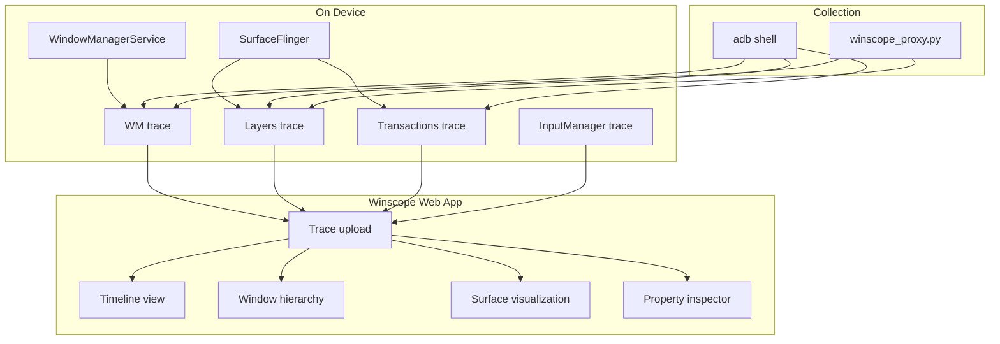

### 58.7.2 捕获 Trace

**SurfaceFlinger trace：**

旧的 binder 代码触发方式（`service call SurfaceFlinger 1025`）已被弃用，现在会返回 `NAME_NOT_FOUND`。Layer trace 通过 Perfetto 以 `android.surfaceflinger.layers` 数据源的形式捕获：

```bash
# Record a SurfaceFlinger layer trace via Perfetto
adb shell perfetto -o /data/misc/perfetto-traces/layers.perfetto-trace -c - <<EOF
buffers { size_kb: 63488 }
data_sources {
  config {
    name: "android.surfaceflinger.layers"
  }
}
duration_ms: 10000
EOF
adb pull /data/misc/perfetto-traces/layers.perfetto-trace .

# Transaction traces still use binder code 1041
adb shell su root service call SurfaceFlinger 1041 i32 1   # start
adb shell su root service call SurfaceFlinger 1041 i32 0   # stop
adb pull /data/misc/wmtrace/transactions_trace.winscope .
```

**WindowManager trace：**

`adb shell wm tracing start/stop` 在当前构建上同样会被拒绝（“Shell 命令被忽略。任何类型的操作都应通过 perfetto 执行。”）；WindowManager 跟踪即 `android.windowmanager` Perfetto 数据源：

```bash
# Record a WindowManager trace via Perfetto
adb shell perfetto -o /data/misc/perfetto-traces/wm.perfetto-trace -c - <<EOF
buffers { size_kb: 63488 }
data_sources {
  config {
    name: "android.windowmanager"
  }
}
duration_ms: 10000
EOF
adb pull /data/misc/perfetto-traces/wm.perfetto-trace .
```

**使用 Winscope 代理（推荐）：**

```bash
# Start the proxy
python3 development/tools/winscope/src/adb/winscope_proxy.py

# Open Winscope in browser
# Navigate to winscope.googleplex.com or a local build
# Connect to the proxy for direct device interaction
```

### 58.7.3 Winscope 功能

Winscope 提供了多个分析视图：

| 视图 | 用途 |
|------|---------|
| **时间线** | 在时间轴上拖动，查看状态变化 |
| **窗口层次结构** | 所有窗口、任务、Activity 的树视图 |
| **Layer 层次结构** | 带属性的 SurfaceFlinger layer 树 |
| **Surface 可视化** | 可见 surface 的 2D/3D 渲染 |
| **过渡** | Shell 过渡动画 |
| **属性** | 所选项目的详细属性 |
| **输入** | 输入事件分发可视化 |

### 58.7.4 常见 Winscope 用例

1. **窗口重叠调试**：识别 Z 顺序中可能遮挡内容的意外窗口。

2. **过渡动画问题**：逐帧逐步查看 shell 过渡，找出动画瑕疵。

3. **Surface 泄漏检测**：查找在拥有它的 Activity 被销毁后仍然保持分配的 surface。

4. **IME（键盘）布局问题**：在软键盘可见时检查窗口栈，以调试调整大小/平移行为。

5. **多显示调试**：检查跨多个逻辑显示的窗口放置情况。

### 58.7.5 解读 Winscope 数据

分析 Winscope trace 时，重点关注以下关键属性：

**要检查的窗口属性：**

| 属性 | 要检查什么 |
|----------|--------------|
| `mIsVisible` | 窗口是否真正可见？ |
| `mSurfaceControl` | 它是否有有效的 surface？ |
| `mFrame` | 在屏幕上的位置和大小 |
| `mFlags` | 窗口标志（FLAG_NOT_TOUCHABLE、FLAG_SECURE 等） |
| `mInputChannel` | 输入是否分发到此窗口？ |
| `mAnimating` | 窗口是否处于动画中间？ |
| `mTaskId` | 哪个任务拥有此窗口？ |

**要检查的 SurfaceFlinger layer 属性：**

| 属性 | 要检查什么 |
|----------|--------------|
| `z` | layer 树中的 Z 顺序 |
| `bounds` | 可见边界 |
| `color.alpha` | 透明度 |
| `bufferTransform` | 应用的旋转/翻转 |
| `compositionType` | 客户端合成还是设备合成 |
| `isOpaque` | 能否跳过后面的层？ |
| `damage` | 此帧的脏区域 |

### 58.7.6 调试窗口焦点问题

一个常见的 Winscope 用例是调试与焦点相关的问题：

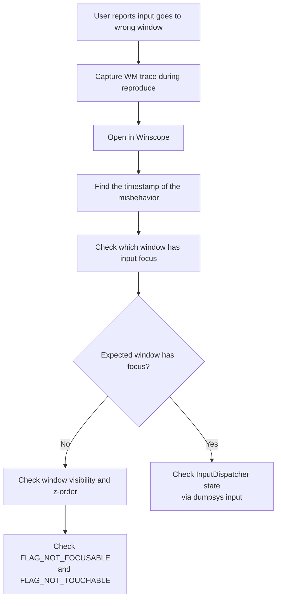

---

## 58.8 bugreport 与 bugreportz

### 58.8.1 架构

bugreport 是设备状态的全面快照，由 `dumpstate` 服务（`frameworks/native/cmds/dumpstate/`）实现。它将日志、系统属性、服务 dump 和诊断命令汇总到一个 ZIP 文件中。

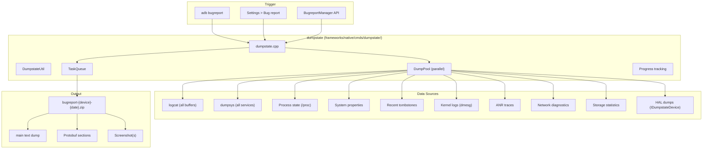

### 58.8.2 bugreport 与 bugreportz

| 工具 | 源文件 | 输出 | 用例 |
|------|--------|--------|----------|
| `bugreport` | `frameworks/native/cmds/bugreport/bugreport.cpp` | 仅弃用警告 | 存根——打印一条重定向到 `bugreportz` 的提示 |
| `bugreportz` | `frameworks/native/cmds/bugreportz/bugreportz.cpp` | Zip 文件路径 | 现代、全面 |
| `adb bugreport` | adb 客户端 | 下载 zip | 推荐方法 |

现代工作流：

```bash
# Recommended: adb bugreport automatically uses bugreportz
adb bugreport ./bugreport.zip

# Generates: bugreport-<device>-<date>.zip
```

### 58.8.3 Bugreport 内容

一个典型的 bugreport ZIP 包含：

```
bugreport-device-2024-01-15-14-30-00.zip
  |-- bugreport-device-2024-01-15-14-30-00.txt   (main dump)
  |-- version.txt                                 (format version)
  |-- dumpstate_board.bin                         (HAL binary data)
  |-- proto/
  |     |-- battery_stats.proto
  |     |-- window_manager.proto
  |     |-- ...
  |-- lshal-debug/
  |     |-- android.hardware.graphics.composer@2.4
  |     |-- ...
  |-- screenshot.png
```

主文本 dump 依次包括（按顺序）：

1. 系统构建信息
2. 运行时间与日期
3. 系统属性
4. 进程与线程列表
5. **logcat** 输出（main、system、crash、events、radio 缓冲区）
6. 每个服务的 **dumpsys** 输出
7. 内核日志（dmesg）
8. 最近的 tombstone
9. ANR trace
10. 文件系统状态
11. 网络诊断
12. 电池统计
13. 内存信息
14. 磁盘使用情况

### 58.8.4 进度跟踪

`dumpstate.h` 中的 `Progress` 类为 UI 或 adb 提供实时进度报告：

```cpp
// frameworks/native/cmds/dumpstate/dumpstate.h
class Progress {
  public:
    static const int kDefaultMax;  // empirical estimate
    explicit Progress(const std::string& path = "");
    // ...
};

class DurationReporter {
  public:
    explicit DurationReporter(const std::string& title,
                              bool logcat_only = false,
                              bool verbose = false,
                              int duration_fd = STDOUT_FILENO);
    ~DurationReporter();
  private:
    std::string title_;
    uint64_t started_;
};
```

### 58.8.5 dumpstate 内部机制

`frameworks/native/cmds/dumpstate/dumpstate.h` 中的 `Dumpstate` 类统筹整个 bugreport 收集。关键架构特性：

**使用 DumpPool 并行收集**：现代 dumpstate 使用线程池（`DumpPool`）并行收集独立的部分，显著缩短了 bugreport 的总生成时间：

```mermaid
graph TB
    subgraph "DumpPool (parallel execution)"
        T1["Thread 1:<br/>logcat main"]
        T2["Thread 2:<br/>logcat system"]
        T3["Thread 3:<br/>dumpsys activity"]
        T4["Thread 4:<br/>dmesg"]
        T5["Thread 5:<br/>procfs reads"]
    end

    subgraph "TaskQueue (ordered assembly)"
        Q1["Section: Build info"]
        Q2["Section: System props"]
        Q3["Section: Logcat (main)"]
        Q4["Section: Logcat (system)"]
        Q5["Section: Dumpsys"]
        QN["Section: Kernel log"]
    end

    subgraph "Output"
        ZIP_O["bugreport.zip"]
    end

    T1 --> Q3
    T2 --> Q4
    T3 --> Q5
    T4 --> QN
    T5 --> Q2

    Q1 --> ZIP_O
    Q2 --> ZIP_O
    Q3 --> ZIP_O
    Q4 --> ZIP_O
    Q5 --> ZIP_O
    QN --> ZIP_O
```

**HAL 集成**：dumpstate 调用供应商 HAL（AIDL `android.hardware.dumpstate.IDumpstateDevice`），以包含硬件特定的诊断数据：

```cpp
// Simplified from dumpstate.cpp
void Dumpstate::DumpstateBoard(int out_fd) {
    // Looks up "android.hardware.dumpstate.IDumpstateDevice/default"
    // via the service manager and wraps it with
    // IDumpstateDevice::fromBinder(...)
    auto dumpstate_hal = GetDumpstateBoardAidlService();
    if (dumpstate_hal != nullptr) {
        // ... open the dumpstate_board.txt/.bin output fds ...
        dumpstate_hal->dumpstateBoard(dumpstate_fds, dumpstate_hal_mode,
                                      timeout_sec);
    }
}
```

**时长跟踪**：每个部分都使用 `DurationReporter` 计时，从而可以了解哪些部分较慢、可能需要优化：

```cpp
class DurationReporter {
  public:
    explicit DurationReporter(const std::string& title, ...);
    ~DurationReporter();  // Logs elapsed time on destruction
  private:
    std::string title_;
    uint64_t started_;
};
```

### 58.8.6 分析 Bugreport

**手动分析：**

```bash
# Unzip
unzip bugreport-*.zip

# Search for crashes
grep -n "FATAL EXCEPTION" bugreport-*.txt

# Search for ANRs
grep -n "ANR in" bugreport-*.txt

# Find tombstones
grep -n "Tombstone" bugreport-*.txt

# Check battery drain
grep -n "Battery Stats" bugreport-*.txt
```

**使用 Battery Historian：**

```bash
# Upload bugreport to Battery Historian web interface
# https://bathist.ef.lc/ (or self-hosted)

# Or run locally:
docker run -p 9999:9999 gcr.io/battery-historian/stable
# Upload zip to http://localhost:9999
```

---

## 58.9 Tombstone 与 debuggerd

### 58.9.1 架构概览

当原生进程崩溃时，Android 的 `debuggerd` 基础设施会捕获一个 tombstone——一份详细的崩溃 dump，包括寄存器、回溯、内存映射和打开的文件。这实现在 `system/core/debuggerd/` 中。

```mermaid
graph TB
    subgraph "Crash Flow"
        direction TB
        CRASH["Process receives fatal signal<br/>(SIGSEGV, SIGABRT, etc.)"]
        HANDLER["debuggerd_handler.cpp<br/>(signal handler)"]
        PSEUDO["Pseudothread<br/>(clone'd thread)"]
        CRASH_DUMP["crash_dump<br/>(crash_dump.cpp)"]
        TOMBSTONED_D["tombstoned<br/>(tombstoned.cpp)"]
        TOMBSTONE_FILE["Tombstone file<br/>(/data/tombstones/)"]
        AM_NOTIFY["ActivityManager<br/>notification"]
    end

    CRASH --> HANDLER
    HANDLER --> PSEUDO
    PSEUDO --> CRASH_DUMP
    CRASH_DUMP --> TOMBSTONED_D
    TOMBSTONED_D --> TOMBSTONE_FILE
    CRASH_DUMP --> AM_NOTIFY
```

### 58.9.2 信号处理器：debuggerd_handler

每个原生进程都注册了由 `system/core/debuggerd/handler/debuggerd_handler.cpp` 注册的信号处理器。该处理器捕获致命信号并派生 `crash_dump` 进程：

```cpp
// system/core/debuggerd/handler/debuggerd_handler.cpp
#define CRASH_DUMP_NAME "crash_dump64"  // or crash_dump32
#define CRASH_DUMP_PATH "/apex/com.android.runtime/bin/" CRASH_DUMP_NAME
```

该处理器遵循严格的安全规则：

- 它在信号上下文中运行，因此不能使用 malloc、锁或大多数 libc 函数。

- 它使用 `clone()` 创建一个“伪线程”，该伪线程可以安全地调用 `execle()` 来派生 `crash_dump`。

- 它通过管道传递崩溃信息（寄存器、siginfo、ucontext）。

### 58.9.3 CrashInfo 协议

处理器通过管道将崩溃信息发送给 `crash_dump`，使用 `system/core/debuggerd/protocol.h` 中的 `CrashInfo` 结构：

```cpp
// system/core/debuggerd/protocol.h
struct CrashInfoDataCommon {
  uint32_t version;
  siginfo_t siginfo;
  ucontext_t ucontext;
  uintptr_t abort_msg_address;
};

struct CrashInfoDataDynamic {
  uintptr_t fdsan_table_address;
  uintptr_t gwp_asan_state;
  uintptr_t gwp_asan_metadata;
  uintptr_t scudo_stack_depot;
  uintptr_t scudo_region_info;
  uintptr_t scudo_ring_buffer;
  size_t scudo_ring_buffer_size;
  size_t scudo_stack_depot_size;
  bool recoverable_crash;
  uintptr_t crash_detail_page;
};

struct CrashInfo {
  CrashInfoDataCommon c;
  CrashInfoDataDynamic d;
};
```

动态部分包含以下各项的地址：

- **fdsan 表**：文件描述符消毒器状态
- **GWP-ASan**：基于采样的内存错误检测状态
- **Scudo**：用于检测释放后使用和缓冲区溢出的堆分配器元数据

### 58.9.4 crash_dump：数据采集器

`crash_dump`（`system/core/debuggerd/crash_dump.cpp`）是主力程序。
其操作遵循以下序列：

```mermaid
sequenceDiagram
    participant Handler as Signal Handler
    participant PT as Pseudothread
    participant CD as crash_dump
    participant Kernel as Kernel
    participant TS as tombstoned
    participant AM as ActivityManager

    Handler->>PT: clone()
    PT->>CD: execle("crash_dump64")

    Note over CD: ParseArgs(target_tid, pseudothread_tid, dump_type)

    CD->>CD: alarm(30s) -- timeout safety

    loop For each thread
        CD->>Kernel: PTRACE_SEIZE(tid)
        CD->>Kernel: PTRACE_INTERRUPT(tid)
        CD->>Kernel: Read registers
        CD->>CD: Read thread name, SELinux label
    end

    CD->>PT: Signal to fork VM process
    PT->>Kernel: clone() -> vm_pid
    CD->>Kernel: PTRACE_DETACH(all threads)

    Note over CD: drop_capabilities()

    CD->>TS: connect_tombstone_server()
    TS-->>CD: output_fd, proto_fd

    alt Backtrace mode
        CD->>CD: dump_backtrace()
    else Tombstone mode
        CD->>CD: engrave_tombstone()
    end

    CD->>AM: activity_manager_notify()
    CD->>TS: notify_completion()
```

`crash_dump.cpp` 中的关键代码点：

1. **线程枚举**：使用 procinfo 中的 `GetProcessTids()` 查找所有线程。

2. **寄存器读取**：使用 `ptrace(PTRACE_SEIZE)` 和
    `PTRACE_INTERRUPT` 停止线程并读取寄存器，而尽可能少地干扰进程。

3. **VM 进程快照**：fork 一份目标进程地址空间的副本，使 crash_dump
    即使在线程恢复运行后也能读取内存。

4. **客户机架构支持**：对于在 NativeBridge 下运行的进程（例如 x86 上的
    ARM），`ReadGuestRegisters()` 从 TLS 中提取转换后架构的寄存器状态。

5. **栈回溯**：使用 `unwindstack::AndroidRemoteUnwinder` 从 VM 进程快照
    生成回溯。

### 58.9.5 tombstoned：存储管理器

`tombstoned`（`system/core/debuggerd/tombstoned/tombstoned.cpp`）管理
tombstone 文件存储和拦截注册：

```cpp
// tombstoned.cpp (simplified)
class CrashQueue {
 public:
  CrashQueue(const std::string& dir_path,
             const std::string& file_name_prefix,
             size_t max_artifacts,
             size_t max_concurrent_dumps,
             bool supports_proto,
             bool world_readable);
  // ...
};
```

tombstoned 为以下各项维护独立的队列：

- **原生崩溃**：作为 `tombstone_XX` 存储在 `/data/tombstones/`
- **Java trace**：为 ANR 分析而存储
- **拦截**：由希望接收崩溃数据而不是写入磁盘的调试器注册

通信使用三个命名套接字：

```cpp
// system/core/debuggerd/protocol.h
constexpr char kTombstonedCrashSocketName[] = "tombstoned_crash";
constexpr char kTombstonedJavaTraceSocketName[] = "tombstoned_java_trace";
constexpr char kTombstonedInterceptSocketName[] = "tombstoned_intercept";
```

### 58.9.6 Tombstone 格式

tombstone 文件包含多个部分：

```
*** *** *** *** *** *** *** *** *** *** *** *** *** *** *** ***
Build fingerprint: 'google/crosshatch/crosshatch:14/AP1A.12345/...'
Revision: 'MP1.0'
ABI: 'arm64'
Timestamp: 2024-01-15 14:30:00.123456789+0000
Process uptime: 523s
Cmdline: /system/bin/myservice
pid: 12345, ppid: 1, tid: 12345, name: myservice  >>> /system/bin/myservice <<<
uid: 1000
tagged_addr_ctrl: 0x0000000000000001 (PR_TAGGED_ADDR_ENABLE)
signal 11 (SIGSEGV), code 1 (SEGV_MAPERR), fault addr 0x0000000000000000
    x0  0x0000007b4c123450  x1  0x0000000000000000  x2  0x0000000000000010
    x3  0x0000007b4c123460  x4  0x0000000000000001  x5  0x0000000000000000
    ...
    sp  0x0000007fc8765400  lr  0x0000007b4c001234  pc  0x0000007b4c005678

backtrace:
      #00 pc 0000000000005678  /system/lib64/libmyservice.so (MyFunc+24)
      #01 pc 0000000000001234  /system/lib64/libmyservice.so (main+56)
      #02 pc 00000000000abcde  /apex/com.android.runtime/lib64/bionic/libc.so
                               (__libc_init+100)

stack:
         0000007fc8765380  0000000000000000
         0000007fc8765388  0000007b4c123450  /system/lib64/libmyservice.so
         ...

memory near x0 ([anon:scudo:primary]):
    0000007b4c123440 6f6c6c6548 726f5720 0021646c 00000000  HelloWorld!.....
    ...

open files:
    fd 0: /dev/null (unowned)
    fd 1: /dev/null (unowned)
    fd 2: /dev/null (unowned)
    fd 3: socket:[12345] (unowned)
    fd 4: /data/myservice/cache.db (owned by FILE* 0x7b4c200100)
    ...

memory map (165 entries):
    ...
    0000007b4c000000-0000007b4c010000 r-xp  /system/lib64/libmyservice.so
    0000007b4c010000-0000007b4c011000 r--p  /system/lib64/libmyservice.so
    0000007b4c011000-0000007b4c012000 rw-p  /system/lib64/libmyservice.so
    ...
```

### 58.9.7 Protobuf Tombstone

现代 tombstone 也以 protobuf 格式写入，定义在
`system/core/debuggerd/proto/tombstone.proto` 中。protobuf 格式是机器可解析的，并且可以转换为文本。顶层 `Tombstone`
消息携带崩溃进程的身份（`pid`、`tid`、`uid`）。它还携带父进程 ID（`ppid`，字段 29）。添加字段 29 是为了让分类工具无需重新读取
`/proc` 就能将崩溃归属到其启动器或 zygote。

该消息还携带信号信息、寄存器组、线程、内存映射以及 GWP-ASan/Scudo
“原因”记录。它可以渲染为上面所示的经典文本布局：

```bash
# View proto tombstone as text
adb shell pbtombstone /data/tombstones/tombstone_00.pb

# Or pull and process locally
adb pull /data/tombstones/tombstone_00.pb
```

### 58.9.8 阅读与分析 Tombstone

**查找 tombstone：**

```bash
# List recent tombstones
adb shell ls -la /data/tombstones/

# Read a tombstone
adb shell cat /data/tombstones/tombstone_00

# Pull all tombstones
adb pull /data/tombstones/ ./tombstones/
```

**分析工作流：**

```mermaid
flowchart TD
    A["Read tombstone"] --> B["Identify signal and fault address"]
    B --> C{"Signal type?"}

    C -- "SIGSEGV (11)" --> D["NULL deref? Check fault addr"]
    D -- "addr == 0x0" --> D1["Null pointer dereference"]
    D -- "addr in code range" --> D2["Code corruption / bad jump"]
    D -- "addr near stack" --> D3["Stack overflow"]
    D -- "other" --> D4["Use-after-free / wild pointer"]

    C -- "SIGABRT (6)" --> E["Check abort message"]
    E --> E1["Look for FORTIFY, fdsan,<br/>assertion failure messages"]

    C -- "SIGBUS (7)" --> F["Alignment / mapping error"]

    B --> G["Read backtrace"]
    G --> H["Identify crashing function"]
    H --> I["Cross-reference with source code"]

    B --> J["Check memory map"]
    J --> K["Verify fault address is<br/>mapped/unmapped"]

    B --> L["Check GWP-ASan / Scudo info"]
    L --> M["Memory error details<br/>(use-after-free, overflow)"]
```

**符号化 tombstone：**

```bash
# Use ndk-stack for symbolization
adb logcat | ndk-stack -sym path/to/symbols/

# Or use addr2line directly
aarch64-linux-android-addr2line -f -e libmyservice.so 0x5678
```

### 58.9.9 手动使用 debuggerd

`debuggerd` 命令可用于触发对运行中进程的 dump：

```bash
# Generate a tombstone for a running process
adb shell debuggerd <pid>

# Generate just a backtrace
adb shell debuggerd -b <pid>

# Generate Java traces
adb shell debuggerd -j <pid>
```

### 58.9.10 ActivityManager 通知

当发生致命崩溃时，`crash_dump` 通过本地套接字通知 ActivityManager：

```cpp
// crash_dump.cpp
static bool activity_manager_notify(pid_t pid, int signal,
    const std::string& amfd_data, bool recoverable_crash) {
    unique_fd amfd(socket_local_client(
        "/data/system/ndebugsocket",
        ANDROID_SOCKET_NAMESPACE_FILESYSTEM, SOCK_STREAM));

    // Protocol: pid (32-bit), signal (32-bit), recoverable (byte), dump text
    uint32_t datum = htonl(pid);
    WriteFully(amfd, &datum, sizeof(datum));
    datum = htonl(signal);
    WriteFully(amfd, &datum, sizeof(datum));
    uint8_t recoverable_byte = recoverable_crash ? 1 : 0;
    WriteFully(amfd, &recoverable_byte, sizeof(recoverable_byte));
    WriteFully(amfd, amfd_data.c_str(), amfd_data.size() + 1);
    // ...
}
```

该通知会触发熟悉的“应用已停止”对话框，并允许 ActivityManager 决定是否重启进程。

### 58.9.11 libdebuggerd：Tombstone 生成

实际的 tombstone 内容由 `libdebuggerd`
（`system/core/debuggerd/libdebuggerd/`）生成，其中包含格式化崩溃 dump 的逻辑：

| 文件 | 用途 |
|------|---------|
| `tombstone.cpp` | 文本格式的 tombstone 生成 |
| `tombstone_proto.cpp` | Protobuf 格式的 tombstone 生成 |
| `tombstone_proto_to_text.cpp` | Proto 到文本的转换 |
| `backtrace.cpp` | 仅回溯的 dump（用于 `debuggerd -b`） |
| `utility.cpp` | 共享工具（内存 dump、寄存器格式化） |
| `gwp_asan.cpp` | GWP-ASan 崩溃分析 |
| `scudo.cpp` | Scudo 分配器崩溃分析 |
| `open_files_list.cpp` | 打开的文件描述符枚举 |

tombstone 生成流程：

```mermaid
flowchart TD
    A["engrave_tombstone()"] --> B["Write header<br/>(build, ABI, timestamp)"]
    B --> C["Write signal info<br/>(signal number, fault address)"]
    C --> D["Write registers"]
    D --> E["Write backtrace<br/>(using AndroidRemoteUnwinder)"]
    E --> F["Write stack memory dump"]
    F --> G["Write memory near registers"]
    G --> H{"GWP-ASan state available?"}
    H -- Yes --> I["Write GWP-ASan report<br/>(allocation/deallocation stacks)"]
    H -- No --> J{"Scudo metadata available?"}
    J -- Yes --> K["Write Scudo report<br/>(heap corruption details)"]
    J -- No --> L["Write open files list"]
    I --> L
    K --> L
    L --> M["Write memory map"]
    M --> N["Write other thread backtraces"]
    N --> O["Write log tail"]
```

### 58.9.12 GWP-ASan 集成

GWP-ASan（一种基于采样的内存错误检测器）与 debuggerd 集成，为内存错误提供详细的崩溃信息。当 GWP-ASan 检测到错误时，tombstone 会包括：

- 分配回溯（内存在何处分配）
- 释放回溯（在何处释放，用于释放后使用）
- 错误类型（释放后使用、缓冲区溢出、缓冲区下溢、
  双重释放）

- 访问相对于分配的精确偏移量

```
Cause: [GWP-ASan]: Use After Free, 0 bytes into a 64-byte
    allocation at 0x7b4c123450

Allocated by thread 12345:
      #00 pc 0x1234  /system/lib64/libc.so (malloc+16)
      #01 pc 0x5678  /system/lib64/libmyservice.so (create_buffer+24)
      #02 pc 0x9abc  /system/lib64/libmyservice.so (init+80)

Deallocated by thread 12345:
      #00 pc 0x1240  /system/lib64/libc.so (free+16)
      #01 pc 0x5700  /system/lib64/libmyservice.so (destroy_buffer+24)
      #02 pc 0x9b00  /system/lib64/libmyservice.so (cleanup+64)
```

### 58.9.13 Scudo 分配器集成

Scudo（Android 的加固内存分配器）在检测到堆损坏时，也会在 tombstone 中报告详细信息：

- 块头损坏
- 非法释放（释放未分配的内存）
- 双重释放
- 通过隔离区检测到的缓冲区溢出

### 58.9.14 崩溃详情页

`CrashInfoDataDynamic` 中的 `crash_detail_page` 字段允许进程注册将包含在
tombstone 中的自定义崩溃详情字符串。这对于应用在崩溃发生时提供有关其正在执行的操作的上下文很有用。

### 58.9.15 wait_for_debugger

要交互式调试原生崩溃，请将系统属性
`debug.debuggerd.wait_for_debugger` 设置为 `true`。当崩溃发生时，crash_dump 会向崩溃进程发送 SIGSTOP 并打印一条消息：

```
***********************************************************

* Process 12345 has been suspended while crashing.
* To attach the debugger, run this on the host:
*

*     lldbclient.py -p 12345
*
***********************************************************
```

---

## 58.10 Android Studio Profiler 集成

### 58.10.1 架构

Android Studio 的 Profiler 为上面讨论的同一批底层工具提供了图形界面。它通过 `adb forward` 与设备上的代理通信。

```mermaid
graph TB
    subgraph "Android Studio"
        CPU_PROF["CPU Profiler"]
        MEM_PROF["Memory Profiler"]
        NET_PROF["Network Profiler"]
        ENERGY["Energy Profiler"]
        LAYOUT["Layout Inspector"]
        DB_INSP["Database Inspector"]
    end

    subgraph "Transport Layer"
        ADB_PROF["adb forward"]
        JDWP["JDWP Agent"]
        PERFD["perfd (legacy)"]
        PERF_AGENT["profiler agent"]
    end

    subgraph "On-Device Tools"
        SIMPRF_AS["simpleperf"]
        HEAPPROFD_AS["heapprofd"]
        PERFETTO_AS["Perfetto"]
        ART_PROF["ART profiling"]
        NETWORK_AGENT["Network agent"]
    end

    CPU_PROF --> ADB_PROF
    MEM_PROF --> ADB_PROF
    NET_PROF --> ADB_PROF
    ENERGY --> ADB_PROF

    ADB_PROF --> JDWP
    ADB_PROF --> PERF_AGENT

    PERF_AGENT --> SIMPRF_AS
    PERF_AGENT --> HEAPPROFD_AS
    PERF_AGENT --> PERFETTO_AS
    JDWP --> ART_PROF
    PERF_AGENT --> NETWORK_AGENT

    LAYOUT --> ADB_PROF
    DB_INSP --> ADB_PROF
```

### 58.10.2 CPU Profiler 模式

| 模式 | 实现 | 输出 |
|------|---------------|--------|
| **Sample Java Methods** | ART 采样 profiler | 方法 trace |
| **Trace Java Methods** | ART 方法跟踪（完整插桩） | 方法 trace |
| **Sample C/C++ Functions** | simpleperf | 火焰图 |
| **Trace System Calls** | Perfetto (atrace) | 系统 trace |

### 58.10.3 CPU 性能分析的工作原理

**Java 方法采样**使用 ART 运行时内置的采样 profiler，它定期记录 Java
调用栈，而无需对每个方法的入口/出口进行插桩。

**原生采样**在底层使用 simpleperf：

1. Android Studio 使用适当的 PID 和采样率配置 simpleperf。

2. simpleperf 使用 `perf_event_open()` 采集样本。
3. 样本通过传输代理流式回传到主机。
4. Android Studio 在 UI 中渲染火焰图。

**系统 trace** 使用 Perfetto：

1. 根据用户选择生成一个 `TraceConfig`。
2. `perfetto` 记录系统级事件。
3. trace 文件被拉取并加载到 Android Studio 的 trace 查看器中，它与
    Perfetto UI 共享代码。

### 58.10.4 Memory Profiler 模式

| 模式 | 实现 | 显示内容 |
|------|---------------|--------------|
| **Java 堆转储** | `Debug.dumpHprofData()` | 所有存活的 Java 对象 |
| **Native 堆转储** | heapprofd | 带栈的原生分配 |
| **分配跟踪** | ART 分配回调 | 每个对象的分配位置 |
| **泄漏检测** | hprof + leak canary 逻辑 | 可能泄漏的 activity/fragment |

### 58.10.5 Profileable 与 Debuggable

要对正式版本进行性能分析：

```xml
<!-- AndroidManifest.xml -->
<application ...>
    <profileable android:shell="true" />
    <!-- ... -->
</application>
```

这使得 simpleperf 和 heapprofd 可以附加而无需 `debuggable=true`，后者会禁用编译器优化并给出误导性的性能数据。

| 属性 | CPU Profile | Heap Profile | Java 调试 | 性能影响 |
|-----------|-------------|-------------|------------|-------------|
| `debuggable=true` | 是 | 是 | 是 | 显著 |
| `profileable=true` | 是 | 是 | 否 | 极小 |
| 两者都不是 | 否 | 否 | 否 | 无 |

---

## 58.11 GPU 调试

### 58.11.1 概述

Android 上的 GPU 调试需要专门的工具，因为 GPU 操作是异步的，并且在独立的硬件上发生。

```mermaid
graph TB
    subgraph "Application"
        GL["OpenGL ES / Vulkan"]
    end

    subgraph "GPU Debugging Tools"
        RENDERDOC["RenderDoc"]
        GAPID["GAPID (AGI)"]
        LAYERS["Vulkan Validation Layers"]
        GPU_INSP["Android GPU Inspector"]
        SYSTRACE["Perfetto GPU counters"]
    end

    subgraph "Driver Layer"
        HAL_G["Graphics HAL"]
        DRIVER["GPU Driver"]
        VALIDATION["VK_LAYER_KHRONOS_validation"]
    end

    subgraph "GPU Hardware"
        GPU["GPU"]
    end

    GL --> RENDERDOC
    GL --> GAPID
    GL --> LAYERS
    GL --> GPU_INSP

    RENDERDOC --> HAL_G
    GAPID --> HAL_G
    LAYERS --> VALIDATION
    GPU_INSP --> HAL_G
    SYSTRACE --> HAL_G

    HAL_G --> DRIVER
    VALIDATION --> DRIVER
    DRIVER --> GPU
```

### 58.11.2 Vulkan 验证层

Vulkan 验证层在运行时捕获 API 误用。它们可以在 Android 上启用，无需重新编译：

```bash
# Push validation layers to device
adb push libVkLayer_khronos_validation.so /data/local/tmp/

# Enable layers for a specific app
adb shell settings put global enable_gpu_debug_layers 1
adb shell settings put global gpu_debug_app com.example.myapp
adb shell settings put global gpu_debug_layers VK_LAYER_KHRONOS_validation
adb shell settings put global gpu_debug_layer_app com.example.myapp

# View validation messages in logcat
adb logcat -s vulkan
```

常见的验证错误：

- **缺少同步**：在写入完成之前读取资源。
- **无效的使用标志**：使用了未设置适当 usage 位的缓冲区。
- **描述符集错误**：绑定不兼容或已过期的描述符。
- **渲染通道错误**：附件使用不正确或子通道依赖不正确。

### 58.11.3 Android GPU Inspector (AGI)

AGI（前身为 GAPID）提供帧级的 GPU 调试：

1. **帧捕获**：拦截一帧 Vulkan/GLES 命令。
2. **状态检查**：在任何 draw call 处检查完整的 GPU 状态。
3. **纹理/缓冲区查看**：检查资源内容。
4. **着色器调试**：逐步执行着色器。
5. **性能计数器**：读取 GPU 硬件计数器。

```bash
# AGI uses a layered approach - push the AGI layer
adb push libgapii.so /data/local/tmp/

# Configure for an app
adb shell am start -n com.example.myapp/.MainActivity \
    --es gapii_interceptor /data/local/tmp/libgapii.so
```

### 58.11.4 RenderDoc

RenderDoc 是一个开源的帧调试器，支持 Android Vulkan：

```bash
# Push RenderDoc layer
adb push libVkLayer_RENDERDOC_Capture.so /data/local/tmp/

# Configure Vulkan layers
adb shell settings put global gpu_debug_layers \
    VK_LAYER_RENDERDOC_Capture
adb shell settings put global gpu_debug_app com.example.myapp
```

### 58.11.5 使用 Perfetto 进行 GPU 性能分析

Perfetto 在支持的硬件上集成了 GPU 计数器：

```protobuf
# gpu_trace.pbtxt
data_sources {
    config {
        name: "gpu.counters"
        gpu_counter_config {
            counter_period_ns: 1000000  # 1ms
            counter_ids: 1              # GPU busy
            counter_ids: 2              # Fragment active
            counter_ids: 3              # Vertex active
        }
    }
}
data_sources {
    config {
        name: "gpu.renderstages"
    }
}
```

通过 Perfetto 可用的关键 GPU 指标：

| 指标 | 说明 |
|--------|-------------|
| GPU Busy | GPU 主动处理的时间百分比 |
| Fragment Active | 片元着色器活动 |
| Vertex Active | 顶点着色器活动 |
| GPU 频率 | 当前 GPU 时钟速度 |
| GPU 内存 | VRAM 使用情况 |
| 渲染阶段 | 每个渲染通道的计时 |

### 58.11.6 overdraw 可视化

Android 提供了内置的 overdraw 可视化：

```bash
# Enable GPU overdraw debugging
adb shell setprop debug.hwui.overdraw show

# Disable
adb shell setprop debug.hwui.overdraw false

# Profile GPU rendering (shows colored bars)
adb shell setprop debug.hwui.profile true

# Show GPU rendering as bars on screen
adb shell setprop debug.hwui.profile visual_bars
```

Overdraw 颜色编码：

- **无色**：绘制一次（理想）
- **蓝色**：过度绘制 1 次
- **绿色**：过度绘制 2 次
- **粉色**：过度绘制 3 次
- **红色**：过度绘制 4 次以上（问题区域）

---

## 58.12 内存调试工具

### 58.12.1 内存分析概览

Android 提供了多层内存调试工具，每层针对不同的内存问题类型：

```mermaid
graph TB
    subgraph "Java Memory"
        HPROF["Java heap dump (hprof)"]
        ALLOC["Allocation tracking"]
        GC_LOG["GC logging"]
        LEAK["LeakCanary / AS Leak Detection"]
    end

    subgraph "Native Memory"
        HEAPPROFD_M["heapprofd"]
        MALLOC_DEBUG["malloc debug (libc_malloc_debug)"]
        ASAN["AddressSanitizer (ASan)"]
        HWASAN["HWAddressSanitizer (HWASan)"]
        GWP_ASAN["GWP-ASan (sampling)"]
        MEMTAG["Memory Tagging (MTE)"]
    end

    subgraph "Kernel Memory"
        MEMINFO["/proc/meminfo"]
        PROCMEM["/proc/{pid}/smaps"]
        ION["ION/DMA-BUF tracking"]
        LMK["LMK statistics"]
    end

    subgraph "Analysis Tools"
        DUMPSYS_MEM["dumpsys meminfo"]
        SHOWMAP["showmap"]
        PROCRANK["procrank"]
        LIBMEMUNREACHABLE["libmemunreachable"]
    end
```

### 58.12.2 malloc debug

Android 的 bionic libc 包含一个可在运行时启用的调试 malloc 实现：

```bash
# Enable malloc debug for a specific app
adb shell setprop libc.debug.malloc.options "backtrace guard"
adb shell am force-stop com.example.myapp   # then relaunch the app

# Available options:
# backtrace[=MAX_FRAMES] - Record allocation backtraces
#                          (default 16 frames, max 256)
# backtrace_size=N       - Only record backtraces for allocations of
#                          exactly N bytes (backtrace_min_size /
#                          backtrace_max_size set a range)
# guard[=SIZE_BYTES]     - Add front (0xaa) and rear (0xbb) guard bytes
#                          to every allocation, verified on free
# fill_on_alloc    - Fill allocated memory with 0xEB
# fill_on_free     - Fill freed memory with 0xEF
# leak_track       - Track all allocations for leak detection
# record_allocs    - Record all allocations to a file

# Dump current allocations
adb shell am dumpheap -n <pid> /data/local/tmp/native_heap.txt
```

### 58.12.3 AddressSanitizer (ASan) 与 HWASan

ASan 和 HWASan 在运行时检测内存错误，各有不同的权衡：

| 特性 | ASan | HWASan | MTE |
|---------|------|--------|-----|
| 开销（CPU） | 2x | 1.5-2x | ~3-5% |
| 开销（内存） | 2-3x | ~15% | ~3% |
| 检测释放后使用 | 是 | 是 | 是 |
| 检测缓冲区溢出 | 是 | 是 | 是 |
| 检测栈损坏 | 是 | 是 | 否 |
| 可用构建 | 仅 Eng | Eng/userdebug | Arm v8.5+ |
| 采样 | 否 | 否 | 可以按分配 |

### 58.12.4 showmap 与 procrank

```bash
# Show detailed memory map for a process
adb shell showmap <pid>

# Example output:
#   virtual                     shared   shared  private  private
#      size      RSS      PSS    clean    dirty    clean    dirty  object
#      ----     ----     ----    -----    -----    -----    -----  ------
#     12288     8192     4096        0     4096     4096        0  /system/lib64/libc.so
#      4096     4096     2048     2048        0        0     2048  [anon:stack]
#      ...

# Show memory usage for all processes (sorted by PSS)
adb shell dumpsys meminfo --package <package>

# Detailed per-process memory breakdown
adb shell dumpsys meminfo <pid>
```

### 58.12.5 libmemunreachable

Android 包含一个内置的泄漏检测器，可以扫描堆中不可达的分配：

```bash
# Trigger leak detection for a process (libmemunreachable is loaded
# by zygote); the report is printed in the dumpsys output
adb shell dumpsys -t 600 meminfo --unreachable <process>
```

---

## 58.13 ANR 分析

### 58.13.1 ANR 的成因

Application Not Responding（ANR，应用无响应）事件在两种情况下发生。第一种情况是，应用的主线程在 5 秒内没有响应输入事件。第二种情况是，BroadcastReceiver 没有在超时期限内完成（前台为 10 秒，后台为 60 秒）。

```mermaid
flowchart TD
    A["User touches screen"] --> B["InputDispatcher sends event"]
    B --> C{"Main thread responds<br/>within 5 seconds?"}
    C -- Yes --> D["Normal operation"]
    C -- No --> E["InputDispatcher triggers ANR"]
    E --> F["ActivityManager notifies"]
    F --> G["Dump thread stacks"]
    G --> H["Write to /data/anr/trace_NN<br/>(via tombstoned)"]
    F --> I["Show 'App not responding' dialog"]
```

### 58.13.2 查找 ANR 信息

ANR trace 存储在多个位置：

```bash
# Current ANR traces (one trace_NN file per incident, written by tombstoned)
adb shell ls /data/anr/
adb pull /data/anr/ .

# In a bugreport, search for:
# 1. The ANR section
grep -n "ANR in" bugreport-*.txt

# 2. The thread dump at the time of ANR
grep -n "Cmd line:" bugreport-*.txt

# 3. CPU usage at ANR time
grep -A 20 "CPU usage from" bugreport-*.txt
```

### 58.13.3 阅读 ANR Trace

典型的 ANR trace dump 包括：

```
----- pid 12345 at 2024-01-15 14:30:00.123 -----
Cmd line: com.example.myapp
Build fingerprint: 'google/crosshatch/crosshatch:14/...'

"main" prio=5 tid=1 Blocked
  | group="main" sCount=1 ucsCount=0 flags=1 obj=0x72345678
  | sysTid=12345 nice=-10 cgrp=top-app sched=0/0 handle=0x7654321
  | state=S schedstat=( 1234567890 234567890 12345 )
  | stack=0x7ff0000000-0x7ff0002000 stackSize=8192KB
  at com.example.myapp.MyDatabase.query(MyDatabase.java:123)
  - waiting to lock <0xabcdef01> (a java.lang.Object)
    held by thread 15
  at com.example.myapp.MainActivity.onResume(MainActivity.java:45)
  at android.app.Activity.performResume(Activity.java:8321)
  ...

"DatabaseThread" prio=5 tid=15 Runnable
  | group="main" sCount=0 ucsCount=0 flags=0 obj=0x72345679
  at com.example.myapp.MyDatabase.bulkInsert(MyDatabase.java:456)
  ...
```

**分析步骤：**

1. **识别阻塞的线程**：主线程显示“Blocked”状态，正在等待锁定被另一个线程持有的对象。

2. **查找持有者**：线程 15（“DatabaseThread”）持有锁，正在执行批量插入操作。

3. **根本原因**：后台线程上的长时间数据库操作持有了主线程在 `onResume()` 期间所需的锁。

### 58.13.4 常见 ANR 模式

| 模式 | 主线程状态 | 根本原因 |
|---------|-------------------|------------|
| 锁竞争 | Blocked（等待锁定） | 后台线程持有锁 |
| 主线程上的 I/O | Native（在 read/write 中） | 主线程上的磁盘/网络访问 |
| Binder 停滞 | Native（在 binder 事务中） | 远程服务缓慢 |
| 死锁 | Blocked（循环等待） | 两个线程互相等待 |
| GC 暂停 | WaitingForGcToComplete | 分配压力过大 |
| CPU 饥饿 | Runnable（但未运行） | 其他进程消耗 CPU |

### 58.13.5 预防 ANR

```bash
# Flash the screen when StrictMode violations occur (the Developer-options
# "Strict mode enabled" toggle); the policies themselves are set in app
# code via StrictMode.setThreadPolicy()
adb shell setprop persist.sys.strictmode.visual true

# Monitor ANR frequency with dumpsys
adb shell dumpsys activity processes | grep -A 5 "ANR"

# Get details on the last ANR (and its captured trace file)
adb shell dumpsys activity lastanr
adb shell dumpsys activity lastanr-traces
```

---

## 58.14 跨工具集成

### 58.14.1 工具如何相互补充

没有单个工具能讲述完整的故事。下表展示了根据你需要调查的层面，应该选择哪个工具：

```mermaid
graph LR
    subgraph "Problem Identification"
        LOGCAT_ID["logcat<br/>(errors, warnings)"]
        DUMPSYS_ID["dumpsys gfxinfo<br/>(frame stats)"]
        BUGREPORT_ID["bugreport<br/>(full snapshot)"]
    end

    subgraph "Temporal Analysis"
        PERFETTO_TA["Perfetto<br/>(timeline of events)"]
        WINSCOPE_TA["Winscope<br/>(window state over time)"]
    end

    subgraph "Statistical Profiling"
        SIMPLEPERF_SP["simpleperf<br/>(CPU hotspots)"]
        HEAPPROFD_SP["heapprofd<br/>(allocation hotspots)"]
    end

    subgraph "Crash Analysis"
        TOMB_CA["Tombstones<br/>(native crashes)"]
        LOGCAT_CA["logcat<br/>(Java crashes + ANR)"]
    end

    subgraph "State Inspection"
        DUMPSYS_SI["dumpsys<br/>(service state)"]
        PROCFS["/proc filesystem<br/>(kernel state)"]
    end

    LOGCAT_ID --> PERFETTO_TA
    DUMPSYS_ID --> PERFETTO_TA
    PERFETTO_TA --> SIMPLEPERF_SP
    PERFETTO_TA --> HEAPPROFD_SP
    BUGREPORT_ID --> TOMB_CA
    BUGREPORT_ID --> DUMPSYS_SI
```

### 58.14.2 结合 Perfetto 与 simpleperf

一个常见的工作流是使用 Perfetto 确定性能问题是在_何时_发生的，然后使用 simpleperf 在 CPU 层面确定其_原因_：

1. **Perfetto trace**：揭示主线程的 `doFrame` 在滚动期间耗时 35ms，且大部分时间花在 `draw()` 中。

2. **simpleperf record**：针对 Perfetto 确定的时间窗口和线程，揭示 `SkImage::makeTextureImage()` 是 CPU 瓶颈。

3. **heapprofd**：确认每一帧都分配新的位图，而不是重用缓存的位图。

### 58.14.3 bugreport 作为起点

对于用户报告的问题（你无法交互式地采集 trace），bugreport 充当入口点：

```mermaid
flowchart TD
    BUG["Receive bugreport.zip"]
    BUG --> UNZIP["Unzip and read main text"]

    UNZIP --> CRASH{"Contains crashes?"}
    CRASH -- Yes --> TOMB_ANAL["Analyze tombstone sections"]
    CRASH -- No --> ANR_CHECK{"Contains ANR?"}

    ANR_CHECK -- Yes --> ANR_ANAL["Read ANR trace files"]
    ANR_CHECK -- No --> PERF_CHECK{"Performance complaint?"}

    PERF_CHECK -- Yes --> GFXINFO["Read dumpsys gfxinfo section"]
    PERF_CHECK -- No --> STATE["Read relevant dumpsys sections"]

    TOMB_ANAL --> REPRODUCE["Reproduce on local device"]
    ANR_ANAL --> REPRODUCE
    GFXINFO --> REPRODUCE

    REPRODUCE --> LIVE_DEBUG["Use Perfetto + simpleperf<br/>for detailed analysis"]
```

---

## 58.15 高级主题

### 58.15.1 自定义 Perfetto 数据源

你可以在框架或应用代码中创建自定义的 Perfetto 数据源：

```cpp
#include <perfetto/tracing.h>

// Define a custom data source
class MyDataSource : public perfetto::DataSource<MyDataSource> {
 public:
  void OnSetup(const SetupArgs&) override {}
  void OnStart(const StartArgs&) override {}
  void OnStop(const StopArgs&) override {}
};

PERFETTO_DECLARE_DATA_SOURCE_STATIC_MEMBERS(MyDataSource);
PERFETTO_DEFINE_DATA_SOURCE_STATIC_MEMBERS(MyDataSource);

// Register
perfetto::DataSourceDescriptor dsd;
dsd.set_name("com.example.my_data_source");
MyDataSource::Register(dsd);

// Write trace events
MyDataSource::Trace([](MyDataSource::TraceContext ctx) {
    auto packet = ctx.NewTracePacket();
    packet->set_timestamp(perfetto::TrackEvent::GetTraceTimeNs());
    // ... fill packet fields
});
```

### 58.15.2 自定义 atrace 类别

框架服务可以注册自定义的 atrace 类别：

```cpp
#define ATRACE_TAG ATRACE_TAG_APP

void MyService::processRequest() {
    ATRACE_CALL();  // Traces the full function

    {
        ATRACE_NAME("decode_phase");
        // ... decoding work
    }

    {
        ATRACE_NAME("render_phase");
        // ... rendering work
    }

    ATRACE_INT("queue_depth", queue_.size());  // Counter
}
```

### 58.15.3 直接访问内核 ftrace

对于超出 Perfetto 所暴露范围的内核级调试，你可以直接访问 ftrace：

```bash
# Mount tracefs if needed
adb shell mount -t tracefs tracefs /sys/kernel/tracing

# List available events
adb shell cat /sys/kernel/tracing/available_events | head -20

# Enable specific events
adb shell "echo 1 > /sys/kernel/tracing/events/sched/sched_switch/enable"
adb shell "echo 1 > /sys/kernel/tracing/events/sched/sched_wakeup/enable"

# Set buffer size
adb shell "echo 4096 > /sys/kernel/tracing/buffer_size_kb"

# Start tracing
adb shell "echo 1 > /sys/kernel/tracing/tracing_on"

# ... reproduce issue ...

# Stop and read
adb shell "echo 0 > /sys/kernel/tracing/tracing_on"
adb shell cat /sys/kernel/tracing/trace > ftrace_output.txt
```

### 58.15.4 使用 lldb 进行远程调试

用于交互式原生调试：

```bash
# Start lldb-server on device
adb push lldb-server /data/local/tmp/
adb shell /data/local/tmp/lldb-server platform \
    --listen "*:5039" --server

# On host
lldb
(lldb) platform select remote-android
(lldb) platform connect connect://localhost:5039
(lldb) process attach --pid <pid>

# Or use the convenience script
python3 development/scripts/lldbclient.py -p <pid>
```

### 58.15.5 strace 与 seccomp 注意事项

`strace` 可用于系统调用跟踪，但请注意 Android 的 seccomp 过滤器可能会产生干扰：

```bash
# Trace system calls for a process
adb shell strace -f -p <pid> -o /data/local/tmp/strace.txt

# Trace a specific command
adb shell strace -f -e trace=open,read,write ls /data/

# Note: strace adds significant overhead and should not be used
# for performance-sensitive measurements
```

### 58.15.6 GDB 与 LLDB 对比

Android 已将原生调试从 GDB 迁移到 LLDB：

| 特性 | GDB（旧版） | LLDB（当前） |
|---------|-------------|----------------|
| 主要工具 | `gdbclient.py` | `lldbclient.py` |
| 服务器 | `gdbserver` | `lldb-server` |
| 脚本语言 | Python（GDB API） | Python（LLDB API） |
| 集成 | NDK r24 及更早版本 | NDK r25+ |
| 平台支持 | 已弃用 | 活跃开发 |

### 58.15.7 调试 SELinux 拒绝

SELinux 审计消息出现在 logcat 中，并且可能阻碍调试工具：

```bash
# Find SELinux denials
adb logcat -d | grep "avc:  denied"

# Check current SELinux mode
adb shell getenforce

# Temporarily set permissive (userdebug builds only)
adb shell setenforce 0

# Generate a policy fix from denials
adb logcat -d | grep "avc:" | audit2allow -p policy
```

---

## 58.16 性能调试属性参考

Android 提供了大量控制系统调试行为的系统属性：

| 属性 | 值 | 效果 |
|----------|--------|--------|
| `debug.debuggerd.wait_for_debugger` | `true`/`false` | 崩溃时暂停以便调试器附加 |
| `debug.hwui.overdraw` | `show`/`false` | GPU overdraw 可视化 |
| `debug.hwui.profile` | `true`/`visual_bars` | GPU 渲染性能分析 |
| `debug.hwui.show_dirty_regions` | `true`/`false` | 高亮显示失效的区域 |
| `debug.layout` | `true`/`false` | 显示布局边界 |
| `persist.logd.size` | 大小（如 `16M`） | 默认日志缓冲区大小 |
| `persist.logd.size.<buffer>` | 大小 | 每个缓冲区的日志大小 |
| `debug.atrace.tags.enableflags` | 位掩码 | 强制启用 atrace 类别 |
| `persist.traced.enable` | `1`/`0` | 启用/禁用 Perfetto 守护进程 |
| `dalvik.vm.dex2oat-threads` | 整数 | DEX 编译线程数 |
| `debug.stagefright.omx_default_rank` | 整数 | 媒体编解码器选择 |

---

## 58.17 快速参考卡

### 开始数据采集

```bash
# Logcat (continuous)
adb logcat -v threadtime

# Perfetto (10-second system trace)
adb shell perfetto -o /data/misc/perfetto-traces/trace \
    -t 10s sched freq idle am wm gfx view

# simpleperf (CPU profile)
adb shell simpleperf record --app <pkg> --call-graph dwarf \
    --duration 10 -o /data/local/tmp/perf.data

# heapprofd (memory profile)
adb shell perfetto -c /data/local/tmp/heap.pbtxt \
    -o /data/misc/perfetto-traces/heap.perfetto-trace

# bugreport (full snapshot)
adb bugreport ./bugreport.zip

# dumpsys (service state)
adb shell dumpsys <service>

# Tombstone (after crash)
adb shell ls /data/tombstones/
```

### 分析结果

```bash
# Perfetto trace -> Perfetto UI
# Open ui.perfetto.dev, load trace file

# simpleperf -> report
simpleperf report -i perf.data -g

# simpleperf -> flame graph HTML
python simpleperf/scripts/report_html.py -i perf.data

# Tombstone -> symbolize
ndk-stack -sym path/to/symbols/ < tombstone_00

# bugreport -> Battery Historian
# Upload to bathist.ef.lc

# trace_processor -> SQL analysis
trace_processor_shell trace.perfetto-trace
```

### 紧急命令

```bash
# Process is hung - get Java traces
adb shell kill -3 <pid>
adb shell ls /data/anr/       # then pull the newest trace_NN file
adb pull /data/anr/ .

# Process is hung - get native backtrace
adb shell debuggerd -b <pid>

# System is slow - quick CPU check
adb shell top -n 1

# System is slow - quick memory check
adb shell cat /proc/meminfo

# System is slow - quick I/O check
adb shell cat /proc/diskstats

# App crashed - get tombstone
adb shell cat /data/tombstones/tombstone_00

# ANR occurred - get traces
adb pull /data/anr/ .
```

---

## 58.18  Profiling 模块：面向应用的主线交付性能分析

Android 15 引入了 **Profiling 主线模块**
（`com.android.profiling`），它在安全、限流的 API 背后封装了 Perfetto、heapprofd 和 simpleperf。任何应用都可以调用此 API，无需 root 访问或特殊权限。本节考察该模块如何与本章前面介绍的调试工具集成。

由于它作为主线模块发布，Profiling 子系统沿着自己的列车演进，而不是跟随平台甜点版本。Android 17（`CINNAMON_BUN`，SDK 37）是一个重大步骤。它添加了系统侧的**异常检测器**（58.19 节）。它将触发器目录从两种扩展到十二种（58.18.5 节）。它还添加了结果交付确认以及对过期结果文件的自动清理。

所有新行为都由 `packages/modules/Profiling/flags/flags.aconfig` 中的 aconfig 标志守护。因此，该模块的 OTA 更新无需平台版本发布即可开启功能。

### 58.18.1  Motivation（动机）

在 Profiling 模块之前，从生产设备采集系统 trace 或堆 profile 需要：

1. **Root 访问权限**（直接运行 `perfetto` 或 `heapprofd`），或者
2. 设备上启用了**开发者选项**，或者
3. 通过 USB 连接的 **Android Studio**。

这些方式都不适用于生产环境的崩溃调查。Profiling 模块通过允许应用以编程方式请求性能分析来解决此问题，结果经过脱敏，仅包含请求应用自己的数据。

### 58.18.2  集成架构

```mermaid
graph TB
    subgraph "App Process"
        APP["Application"]
        PM["ProfilingManager<br/>(android.os)"]
        RESULT["ProfilingResult<br/>(file path + status)"]
    end

    subgraph "Profiling Module (system_server)"
        PS["ProfilingService"]
        RL["RateLimiter"]
        CFG["Configs"]
        SESSION["TracingSession"]
    end

    subgraph "Perfetto Infrastructure"
        PERFETTO["perfetto CLI"]
        TRACED["traced<br/>(Perfetto daemon)"]
        PRODUCERS["Data Sources<br/>(ftrace, heapprofd,<br/>perf_events, java_hprof)"]
    end

    subgraph "Privacy Layer"
        REDACTOR["trace_redactor<br/>(APEX binary)"]
    end

    subgraph "Storage"
        TEMP["/data/misc/perfetto-traces/profiling/"]
        APPFILES["app/files/profiling/*.perfetto-trace"]
    end

    APP -->|"requestProfiling(TYPE, params)"| PM
    PM -->|Binder| PS
    PS --> RL
    RL -->|cost check| SESSION
    SESSION --> CFG
    CFG -->|"TraceConfig proto"| PERFETTO
    PERFETTO --> TRACED
    TRACED --> PRODUCERS
    PERFETTO -->|raw trace| TEMP
    TEMP --> REDACTOR
    REDACTOR -->|redacted trace| APPFILES
    PS -->|"sendResult(path)"| PM
    PM --> RESULT
    RESULT --> APP
```

### 58.18.3  ProfilingService 如何驱动 Perfetto

当 `ProfilingService` 收到 `requestProfiling()` 调用时，流程如下：

1. **限流检查**——`RateLimiter` 在系统级和每进程级都使用基于成本的滑动窗口（每小时、每天、每周）。如果请求超出预算，回调将收到
    `ERROR_FAILED_RATE_LIMIT_SYSTEM` 或 `ERROR_FAILED_RATE_LIMIT_PROCESS`。

2. **配置生成**——`Configs` 类构建一个针对请求类型定制的 Perfetto
    `TraceConfig` protobuf。从 `ProfilingManager` 类型到 Perfetto 数据源的映射：

    | ProfilingManager 类型 | Perfetto DataSourceConfig | 底层工具 |
    |-----------------------|--------------------------|-----------------|
    | `PROFILING_TYPE_SYSTEM_TRACE` | `FtraceConfig` + `ProcessStatsConfig` | `traced_probes` (ftrace) |
    | `PROFILING_TYPE_HEAP_PROFILE` | `HeapprofdConfig` | `heapprofd` |
    | `PROFILING_TYPE_STACK_SAMPLING` | `PerfEventConfig` | `traced_perf` (simpleperf backend) |
    | `PROFILING_TYPE_JAVA_HEAP_DUMP` | `JavaHprofConfig` | ART hprof producer |

3. **Perfetto 调用**——`ProfilingService` 使用生成的配置将 `perfetto` CLI 作为子进程启动。输出写入
    `/data/misc/perfetto-traces/profiling/`。

4. **会话监控**——一个 `TracingSession` 对象跟踪状态机：

   ```
   REQUESTED -> APPROVED -> PROFILING_STARTED -> PROFILING_FINISHED ->
   REDACTED -> COPIED_FILE -> NOTIFIED_REQUESTER -> CLEANED_UP
   ```

    其中 `ERROR_OCCURRED` 为失败状态。

    服务会定期检查 Perfetto 进程是否已完成（每
    `PROFILING_DEFAULT_RECHECK_DELAY_MS` = 5 秒检查一次）。

5. **Trace 脱敏**——对于系统 trace，`trace_redactor` 二进制文件（打包在 APEX 中）过滤原始 trace，仅包含来自请求 UID 的数据。这会剥离调度事件、内存映射和其他属于其他进程的数据。

6. **文件传输**——脱敏后的文件通过 Binder 传递的 `ParcelFileDescriptor` 传输到应用的私有存储（`/data/data/<pkg>/files/profiling/`）。应用收到包含文件路径的 `ProfilingResult`。

### 58.18.4  Perfetto 配置构建

`Configs` 类将高级参数转换为 Perfetto protobuf。每种性能分析类型都有由 DeviceConfig 控制的边界：

**System Trace**（封装 ftrace + 进程统计）：

```java
// Source: packages/modules/Profiling/service/java/.../Configs.java
// Generated TraceConfig includes:

TraceConfig.Builder config = TraceConfig.newBuilder();
config.setDurationMs(durationMs);         // clamped to [min, max]

// Buffer 1: ftrace data (ring buffer)
config.addBuffers(bufferConfig);

// Data source 1: ftrace
DataSourceConfig.Builder ftraceDs = DataSourceConfig.newBuilder();
ftraceDs.setName("linux.ftrace");
FtraceConfig.Builder ftrace = FtraceConfig.newBuilder();
ftrace.addFtraceEvents("sched/sched_switch");
ftrace.addFtraceEvents("power/suspend_resume");
// ... more events

// Data source 2: process stats
DataSourceConfig.Builder procDs = DataSourceConfig.newBuilder();
procDs.setName("linux.process_stats");
```

**Heap Profile**（封装 heapprofd）：

```java
DataSourceConfig.Builder heapDs = DataSourceConfig.newBuilder();
heapDs.setName("android.heapprofd");
HeapprofdConfig.Builder heapprofd = HeapprofdConfig.newBuilder();
heapprofd.addProcessCmdline(packageName);
heapprofd.setSamplingIntervalBytes(samplingInterval);  // Poisson sampling
heapprofd.setBlockClient(false);
```

**Stack Sampling**（封装 perf_events / simpleperf 后端）：

```java
DataSourceConfig.Builder perfDs = DataSourceConfig.newBuilder();
perfDs.setName("linux.perf");

// Timebase: what to sample, and how often
PerfEvents.Timebase timebase = PerfEvents.Timebase.newBuilder()
    .setCounter(PerfEvents.Counter.SW_CPU_CLOCK)
    .setFrequency(frequencyHz)            // e.g. 100 Hz
    .setTimestampClock(PerfEvents.PerfClock.PERF_CLOCK_MONOTONIC)
    .build();

// Scope the callstack sampling to the target package
PerfEventConfig.Scope scope = PerfEventConfig.Scope.newBuilder()
    .addTargetCmdline(packageName)
    .build();
PerfEventConfig.CallstackSampling callstackSampling =
    PerfEventConfig.CallstackSampling.newBuilder()
        .setScope(scope)
        .build();

PerfEventConfig.Builder perf = PerfEventConfig.newBuilder()
    .setTimebase(timebase)
    .setCallstackSampling(callstackSampling);
```

**Java Heap Dump**（封装 ART hprof）：

```java
DataSourceConfig.Builder hprofDs = DataSourceConfig.newBuilder();
hprofDs.setName("android.java_hprof");
JavaHprofConfig.Builder hprof = JavaHprofConfig.newBuilder();
hprof.addProcessCmdline(packageName);
```

### 58.18.5  系统触发的性能分析

除了按需请求，Profiling 模块还支持**触发器**——系统事件，在事件发生时无需任何应用操作即可自动产生性能分析数据。

```mermaid
sequenceDiagram
    participant App as Application
    participant PM as ProfilingManager
    participant PS as ProfilingService
    participant BG as Background Trace (perfetto)

    Note over PS,BG: System maintains periodic background traces

    App->>PM: addProfilingTriggers([ANR, FULLY_DRAWN])
    PM->>PS: Store triggers for UID

    Note over App: ANR occurs

    PS->>PS: processTrigger(uid, ANR)
    PS->>BG: Clone trace snapshot
    BG-->>PS: Raw trace file
    PS->>PS: Redact trace
    PS->>PM: sendResult(redacted file)
    PM->>App: Consumer<ProfilingResult> callback
```

后台 trace 周期性运行（默认约 24 小时，在 18--30 小时之间抖动）。当触发器触发时，`ProfilingService` 调用 `processTrigger()`，后者对环形缓冲区进行快照。

触发器类型常量定义在
`packages/modules/Profiling/framework/java/android/os/ProfilingTrigger.java`。
Android 15 发布了两个触发器（`APP_FULLY_DRAWN` 和 `ANR`）。Android 17
将集合扩展到十二个。较新的触发器由
`packages/modules/Profiling/flags/flags.aconfig` 中的 aconfig 标志守护（例如
`profiling_trigger_oom`、`profiling_trigger_cold_start` 和
`profiling_trigger_kill_excessive_cpu_usage`）：

| 触发器（`TRIGGER_TYPE_*`） | 值 | 触发时机 | 起始版本 |
|----------------------------|-------|---------------|-------|
| `APP_FULLY_DRAWN` | 1 | 冷启动后 `reportFullyDrawn()` | 15 |
| `ANR` | 2 | 检测到应用发生 ANR | 15 |
| `APP_REQUEST_RUNNING_TRACE` | 3 | 应用调用 `requestRunningSystemTrace()` | 17 |
| `KILL_FORCE_STOP` | 4 | 用户强制停止应用 | 17 |
| `KILL_RECENTS` | 5 | 用户从最近任务中滑动关闭应用 | 17 |
| `KILL_TASK_MANAGER` | 6 | 用户从任务管理器中杀死应用 | 17 |
| `OOM` | 7 | 应用被 low-memory killer / OOM 杀死 | 17 |
| `ANOMALY` | 8 | 异常检测器触发（见 58.19 节） | 17 |
| `KILL_EXCESSIVE_CPU_USAGE` | 9 | 应用因 CPU 使用过度被杀死 | 17 |
| `COLD_START` | 10 | 检测到冷启动 | 17 |
| `APP_COMPAT` | 11 | 对应用应用了 App-compat 更改 | 17 |

（`TRIGGER_TYPE_NONE = 0` 是“非触发器发起”的哨兵值。）
`ProfilingTrigger.isAppAddableTriggerType()` 决定这些触发器中哪些应用可以为自己注册、哪些由系统代表应用发起，而这种门控本身也是由标志控制的。`ANOMALY` 触发器是通往 Android 17 中添加的异常检测器子系统的桥梁，将在 58.19 节中介绍。

### 58.18.6  限流细节

`RateLimiter` 通过多层成本模型防止滥用：

```
// Source: packages/modules/Profiling/service/java/.../RateLimiter.java

// Default cost budgets:
System-wide:  20/hour,  50/day,  150/week
Per-process:  10/hour,  20/day,   30/week

// Cost per session:
App-initiated:       10 units
System-triggered:     5 units
```

限流器状态默认在每次更新时持久化到磁盘
（`DEFAULT_PERSIST_TO_DISK_FREQUENCY_MS = 0`，可选的由 DeviceConfig
控制的节流间隔），并且重启后依然存在。对于本地测试，可以禁用：

```bash
# Disable rate limiting
adb shell device_config put profiling_testing rate_limiter.disabled true

# Set testing package for triggers (bypasses system rate limit)
adb shell device_config put profiling_testing \
    system_triggered_profiling.testing_package_name com.example.myapp

# Enable debug mode (retains temporary files for inspection)
adb shell device_config put profiling_testing \
    delete_temporary_results.disabled true
```

### 58.18.7  结果交付与排队结果

结果通过 Binder 回调交付。当结果就绪时应用未在运行（对于系统触发的性能分析很常见），服务会将结果**排队**并重试交付：

- 最大重试次数：3（可通过 `DEFAULT_MAX_RESULT_REDELIVERY_COUNT` 配置）
- 最大保留时间：7 天（`QUEUED_RESULT_MAX_RETAINED_DURATION_MS`）
- 排队结果以 protobuf 形式持久化到磁盘

当应用下次通过 `registerForAllProfilingResults()` 注册全局监听器时，排队的回调会被交付。

Android 17 通过两项改进（均由标志守护）收紧了这个流程：

- **交付确认**（`notify_result_delivered`）。应用的回调消费了排队结果之后，`ProfilingManager` 会回调到服务（`mProfilingService.notifyResultDelivered(...)`，见
  `packages/modules/Profiling/framework/java/android/os/ProfilingManager.java`）。
  这样一来，服务就知道应用确实收到了结果。它可以停止重试并从队列中丢弃该结果。它不再必须仅仅依赖重试/保留上限。

- **旧文件清理**（`old_files_cleanup`）。已交付的结果文件在服务端和客户端都会被垃圾回收。因此，数天累积的触发器驱动的 trace 不会在应用的私有存储中泄漏磁盘空间。

### 58.18.8  实际使用模式

**模式 1：一次性系统 trace**

```java
ProfilingManager pm = context.getSystemService(ProfilingManager.class);

// Use AndroidX wrappers for parameter construction (recommended)
Bundle params = new Bundle();  // or use androidx.core.os.Profiling helpers

pm.requestProfiling(
    ProfilingManager.PROFILING_TYPE_SYSTEM_TRACE,
    params,
    "my-startup-trace",           // tag for filename
    cancellationSignal,
    executor,
    result -> {
        if (result.getErrorCode() == ProfilingResult.ERROR_NONE) {
            File trace = new File(result.getResultFilePath());
            // Upload trace to your analytics backend
        }
    });
```

**模式 2：注册 ANR 和冷启动触发器**

```java
ProfilingManager pm = context.getSystemService(ProfilingManager.class);

// Register a global listener (survives individual requests)
pm.registerForAllProfilingResults(executor, result -> {
    Log.d(TAG, "Profiling result: " + result.getResultFilePath()
        + " trigger: " + result.getTriggerType());
    uploadTrace(result);
});

// Register triggers for automatic collection
List<ProfilingTrigger> triggers = List.of(
    new ProfilingTrigger.Builder(ProfilingTrigger.TRIGGER_TYPE_ANR).build(),
    new ProfilingTrigger.Builder(
        ProfilingTrigger.TRIGGER_TYPE_APP_FULLY_DRAWN).build()
);
pm.addProfilingTriggers(triggers);
```

**模式 3：用于内存调查的快速堆 profile**

```java
pm.requestProfiling(
    ProfilingManager.PROFILING_TYPE_HEAP_PROFILE,
    params,
    "memory-leak-investigation",
    null,  // no cancellation
    executor,
    result -> {
        // Open in Perfetto UI: ui.perfetto.dev
        // or analyze with trace_processor
    });
```

### 58.18.9  与其他调试工具的集成

Profiling 模块是对本章前面介绍的工具的补充：

| 场景 | 工具 | Profiling 模块的角色 |
|----------|---------|---------------------|
| 生产环境 ANR 调查 | Perfetto + trace_processor | 通过触发器在 ANR 时自动采集系统 trace |
| 启动性能回退 | Perfetto | 在 `reportFullyDrawn()` 时自动采集 trace |
| 内存泄漏分类 | heapprofd | 提供安全、限流的堆性能分析 API |
| CPU 热点识别 | simpleperf | 通过 `PROFILING_TYPE_STACK_SAMPLING` 暴露栈采样 |
| Java 内存分析 | ART hprof | 通过 `PROFILING_TYPE_JAVA_HEAP_DUMP` 暴露堆转储 |

与直接使用底层工具相比，关键优势在于 Profiling 模块处理了：

- **隐私**：trace 脱敏确保应用只能看到自己的数据。
- **限流**：防止失控的性能分析影响设备性能。

- **交付**：结果通过 Binder 回调放置在应用的私有存储中。

- **持久化**：模块将系统触发的结果排队，稍后交付。

### 58.18.10  关键源代码路径

| 组件 | 路径 |
|-----------|------|
| ProfilingManager | `packages/modules/Profiling/framework/java/android/os/ProfilingManager.java` |
| ProfilingResult | `packages/modules/Profiling/framework/java/android/os/ProfilingResult.java` |
| ProfilingTrigger | `packages/modules/Profiling/framework/java/android/os/ProfilingTrigger.java` |
| ProfilingService | `packages/modules/Profiling/service/java/com/android/os/profiling/ProfilingService.java` |
| Configs（Perfetto 配置生成） | `packages/modules/Profiling/service/java/com/android/os/profiling/Configs.java` |
| RateLimiter | `packages/modules/Profiling/service/java/com/android/os/profiling/RateLimiter.java` |
| TracingSession | `packages/modules/Profiling/service/java/com/android/os/profiling/TracingSession.java` |
| IProfilingService.aidl | `packages/modules/Profiling/aidl/android/os/IProfilingService.aidl` |
| APEX 配置 | `packages/modules/Profiling/apex/Android.bp` |
| AnomalyDetectorService | `packages/modules/Profiling/anomaly-detector/service/java/.../AnomalyDetectorService.java` |

---

## 58.19 异常检测器

Android 17 为 Profiling 模块增加了第二个支柱：设备端的**异常检测器**。`ProfilingManager` 是拉取式的：应用请求一个 trace。异常检测器则是推送式的。一个特权控制器安装描述不当行为的*规则*。系统持续监视这些信号以满足这些条件。当规则匹配时，系统会抛出一个 `AnomalyReport`，它可以通过 Profiling 流水线自动捕获一个 Perfetto trace。

代码位于其自己的目录 `packages/modules/Profiling/anomaly-detector/`，并随同一个 `com.android.profiling` APEX 发布。

### 58.19.1 为什么平台中需要检测器

其动因问题是“悄悄伤害设备的应用程序”。这样的应用是一个后台进程。它猛击一个 `system_server` binder 接口，泄漏内存直到触发运行时限制，或以其他方式使系统退化，但它从不崩溃。事后从 bugreport 中捕获这些问题很慢，而且要求每个应用自己插桩也无法规模化。

有了异常检测器，平台（或 OEM 的特权系统应用）只需声明一次条件。系统随后既*检测*该条件又对其做出*反应*。规范的反应是“在它发生的那一刻抓取一个 trace”。这一反应使用来自 58.18 节的同样的脱敏、限流的 Profiling 管道。

### 58.19.2 规则 API

公开接口是 `AnomalyDetectorManager`
（`packages/modules/Profiling/anomaly-detector/framework/java/android/os/profiling/anomaly/AnomalyDetectorManager.java`），
一个注册在
`Context.ANOMALY_DETECTOR_SERVICE`（"`anomaly_detector`"）下的 `@SystemApi` 系统服务，并由
`anomaly_detector_core_c` aconfig 标志守护。它暴露一个主要的调用：

```java
// AnomalyDetectorManager (SystemApi, PRIVILEGED_APPS, requires
// CONFIGURE_ANOMALY_DETECTOR, @RequiresApi(37))
public void setAnomalyDetectorRules(@NonNull Set<Rule> rules);
```

API 契约中内置的重要特性：

- **每台设备一个控制器。** 只有单个特权应用可以设置规则；第二个调用者会被拒绝。这样，检测器就不会变成一场竞争策略的自由混战。

- **替换，而非合并。** 每次调用都会替换完整的规则集，空集合会完全禁用检测。

- **权限保护。** 调用者需要 signature/privileged 的
  `CONFIGURE_ANOMALY_DETECTOR` 权限。

一个 `Rule`
（`packages/modules/Profiling/anomaly-detector/framework/java/android/os/profiling/anomaly/Rule.java`）
由名称和*条件*构建。Android 17 发布一种条件类型 `CONDITION_TYPE_BINDER_SPAM`。它通过一个 bundle 参数化，键包括 `BUNDLE_KEY_CONDITION_BINDER_SPAM_INTERFACE_NAME`、
`..._METHOD_NAME`、`..._CALL_LIMIT` 和
`..._BINDER_CALL_INTERVAL_MILLIS`。换句话说，“在此间隔内对该接口/方法的调用超过 N 次即为异常”。规则以 `RuleParcel` 对象的形式通过 `IAnomalyDetectorService.setRules()` 跨越 binder 边界传给服务。

### 58.19.3 检测器架构

在内部，检测器是一个由三个可插拔角色组成的小型流水线，每个角色都有自己的注册表。可以添加新的信号源、检测器和反应，而核心保持不变：

```mermaid
graph LR
    subgraph "Privileged Controller App"
        CTRL["AnomalyDetectorManager.setAnomalyDetectorRules(rules)"]
    end

    subgraph "AnomalyDetectorService (system_server side of APEX)"
        SVC["AnomalyDetectorService"]
        COLL["SignalCollector<br/>(BinderSpam)"]
        DET["AnomalyDetector<br/>(BinderSpamAnomalyDetector)"]
        REP["AnomalyReport"]
        HREG["AnomalyHandlerRegistry"]
        PH["ProfileAnomalyHandler"]
        LH["LogAnomalyHandler"]
    end

    subgraph "Reaction"
        PROF["ProfilingService<br/>(TRIGGER_TYPE_ANOMALY)"]
        LOGCAT["logcat"]
    end

    CTRL -->|"setRules (RuleParcel)"| SVC
    SVC --> COLL
    COLL -->|"SignalCollectorData"| DET
    DET -->|"match"| REP
    REP --> HREG
    HREG --> PH
    HREG --> LH
    PH -->|"capture trace"| PROF
    LH -->|"record"| LOGCAT
```

这三个角色都位于
`packages/modules/Profiling/anomaly-detector/service/java/com/android/os/profiling/anomaly/` 之下：

| 角色 | 类型 | 示例 | 作用 |
|------|------|---------|--------------|
| Signal collector | `collector/SignalCollector.java` | `collector/binder/BinderSpamConfig.java` + `BinderSpamData.java` | 订阅原始信号（这里是每接口的 binder 调用计数），并将 `SignalCollectorData` 提供给检测器 |
| Detector | `core/AnomalyDetector.java` | `detector/BinderSpamAnomalyDetector.java` | 针对活跃规则评估采集的数据，当条件触发时发出 `AnomalyReport` |
| Handler | `core/AnomalyHandler.java` | `handler/ProfileAnomalyHandler.java`、`handler/LogAnomalyHandler.java` | 对报告做出反应——捕获一个性能分析 trace，或写入一条结构化日志条目 |

`BinderSpamAnomalyDetector` 支持多条规则。在决定某个进程在进行垃圾调用之前，它会跨 binder 事务聚合调用数据。因此，单个嘈杂的方法不会产生大量的报告风暴。

### 58.19.4 从报告到 Trace

连接回本章其余部分的纽带是 `ProfileAnomalyHandler`。当检测器抛出一个 `AnomalyReport` 时，该处理器会请求 Profiling 流水线捕获一个 trace。该 trace 带有标签 `TRIGGER_TYPE_ANOMALY`（`ProfilingTrigger` 中的值 8，58.18.5 节）。该 trace 通过与任何其他系统触发的性能分析相同的机制流动。`traced` 采集它，`trace_redactor` 对它进行脱敏，因此只有违规进程的数据得以保留。该 trace 经过限流，并交付给注册的监听器。

一个 `ProfilingSessionHelper`
（`.../anomaly/handler/ProfilingSessionHelper.java`）将检测器的报告桥接到一个 Profiling 会话。它还将高亮异常的元数据（通过 `PerfettoMetadata` 工具）打包到结果中。因此，消费结果的工具可以直接跳转到异常窗口。

实际收益是明确的。一个特权监控应用可以一次性安装一条 binder 垃圾调用规则。从那以后，每个违规的后台应用都会产生一个脱敏的 Perfetto trace。该 trace 在不当行为发生的那一刻被捕获。监控应用不需要轮询，不需要附加 profiler，也不需要知道哪个应用会表现不当。

### 58.19.5 检查检测器

服务附带一个 shell 命令处理器
（`packages/modules/Profiling/anomaly-detector/service/java/com/android/os/profiling/anomaly/AnomalyDetectorShellCommandHandler.java`）和一个
dumpsys 钩子来检查当前活跃的规则。这是确认控制器的规则生效的最快方式：

```bash
# Show the active anomaly-detection rules
adb shell dumpsys anomaly_detector
```

| 组件 | 路径 |
|-----------|------|
| AnomalyDetectorManager (SystemApi) | `packages/modules/Profiling/anomaly-detector/framework/java/android/os/profiling/anomaly/AnomalyDetectorManager.java` |
| Rule | `packages/modules/Profiling/anomaly-detector/framework/java/android/os/profiling/anomaly/Rule.java` |
| IAnomalyDetectorService.aidl | `packages/modules/Profiling/anomaly-detector/aidl/android/os/profiling/anomaly/IAnomalyDetectorService.aidl` |
| AnomalyDetectorService | `packages/modules/Profiling/anomaly-detector/service/java/com/android/os/profiling/anomaly/AnomalyDetectorService.java` |
| BinderSpamAnomalyDetector | `packages/modules/Profiling/anomaly-detector/service/java/com/android/os/profiling/anomaly/detector/BinderSpamAnomalyDetector.java` |
| ProfileAnomalyHandler | `packages/modules/Profiling/anomaly-detector/service/java/com/android/os/profiling/anomaly/handler/ProfileAnomalyHandler.java` |
| AnomalyRules.proto | `packages/modules/Profiling/anomaly-detector/proto/com/android/server/anomaly/AnomalyRules.proto` |

## 58.20 UprobeStats：动态插桩

另一个在 Android 17 中成熟的与性能分析相邻的主线模块是
**UprobeStats**（`com.android.uprobestats`），位于
`packages/modules/UprobeStats/`。它提供*动态插桩*。这是对用户空间进程（尤其是
`system_server`）的可由服务器配置的探测。它使用内核 **uprobes** 加
**eBPF** 来观察函数调用，并且不修改或重新编译目标二进制文件。平台就是这样来采集稀有或难以插桩的代码路径的全机群统计。在 17 中，它增加了一个 binder 事务探测器和一个面向应用的事件交付 API。

### 58.20.1 Uprobe 如何成为统计量

一个 UprobeStats *任务*指定目标进程、一个或多个**探测器**（一个 BPF 程序加上要附加的函数偏移量）以及一个输出接收器。守护进程解析目标二进制文件中的函数偏移量。它通过 uprobe 将这些地址附加 BPF 程序。每当函数被命中时，BPF 程序都会将一条记录写入环形缓冲区。守护进程清空环形缓冲区，并将每条记录要么作为 atom 转发给 **statsd**，要么转发给一个注册的监听器。

```mermaid
graph TB
    subgraph "Configuration"
        CFG["UprobestatsConfig<br/>(config.proto: tasks, probes, targets)"]
    end

    subgraph "uprobestats daemon (Rust)"
        DAEMON["uprobestats.rs"]
        OFFS["offsets.rs<br/>(resolve symbol -> file offset)"]
        LOADER["uprobestatsbpfload<br/>(BPF loader)"]
    end

    subgraph "Kernel"
        UPROBE["uprobe at target offset"]
        BPF["BPF program + ring buffer"]
    end

    subgraph "Target Process"
        FN["Instrumented function"]
    end

    subgraph "Output"
        STATSD["statsd atom"]
        BRIDGE["UprobeStatsBridgeService<br/>-> DynamicInstrumentationEventService"]
    end

    CFG --> DAEMON
    DAEMON --> OFFS
    DAEMON --> LOADER
    LOADER --> BPF
    OFFS --> UPROBE
    FN -.->|"hit"| UPROBE
    UPROBE --> BPF
    BPF -->|"record"| DAEMON
    DAEMON --> STATSD
    DAEMON --> BRIDGE
```

该模块被拆分到反映这一流程的目录中。`config/` 定义 `UprobestatsConfig`（`config.proto`）。`bpf_progs/` 存放 BPF 程序源代码。`bpfloader/` 是 `uprobestatsbpfload`，模块自己的 BPF 加载器（APEX 必须携带自己的加载器）。`daemon/` 是 Rust 用户空间守护进程（`daemon/uprobestats.rs` 和 `daemon/android/` 辅助代码）。它的 README 说，该守护进程包含“模块的大部分逻辑”。

### 58.20.2 Android 17 的新增内容

17 中有三项变化，都体现在该模块的提交历史和当前 API 表面中：

- **一个 binder 事务探测器。** `config.proto` 获得了一个
  `BinderTransactionFilter`，BPF/处理端学会了捕获 binder 接口/方法调用，并将 binder 事务事件写入
  statsd。
  这与异常检测器的 binder 垃圾调用规则在概念上消费的原始信号相同，但在这里它是一种可配置的、全机群的统计量。

- **一个面向应用的事件 API。** Android 17（`CINNAMON_BUN`，SDK 37）添加了
  `dynamic_instrumentation` 系统服务和一个 `@SystemApi`
  `DynamicInstrumentationEventService`
  （`packages/modules/UprobeStats/framework/java/android/service/uprobestats/DynamicInstrumentationEventService.java`）
  特权应用可以扩展它以接收 `DynamicInstrumentationEvent`。
  事件交付到服务由
  `SEND_DYNAMIC_INSTRUMENTATION_EVENTS` 权限守护。通过
  `UprobeStatsBridgeService` 注册和配置插桩需要
  `DYNAMIC_INSTRUMENTATION`。事件通过一个更名后的桥接服务交付，
  `UprobeStatsBridgeService`/`UprobeStatsBridgeServiceImpl`
  （前身是“uprobestats_service”），它会批量处理事件，并且仅在
  SDK 37 及以上版本中运行（`@RequiresApi(Build.VERSION_CODES.CINNAMON_BUN)`）。

- **加固的错误报告。** BPF 附加/加载路径现在返回细粒度的错误代码（一个 `UprobeStatsError` 类型）。它还会在附加之前清空环形缓冲区。它持久化环形缓冲区句柄以避免重复事件。一旦数据要供给生产统计，这些可靠性工作就很重要。

### 58.20.3 与其他工具的关系

开发者不像使用 simpleperf 或 Perfetto 那样把 UprobeStats 指向自己的应用。它是平台插桩。系统配置它，它供给 statsd（以及现在的特权事件监听器）。它在不同层面上补充本章的工具：

| 工具 | 粒度 | 谁驱动它 | 典型输出 |
|------|-------------|---------------|----------------|
| simpleperf / Perfetto | 会话的采样/跟踪 | 开发者或 Profiling 模块 | perf.data / trace 文件 |
| UprobeStats | 所选函数上精确的每次调用计数 | 平台（服务器配置） | statsd atoms / 动态插桩事件 |
| 异常检测器 | 持续的规则评估 | 特权控制器 | AnomalyReport -> 脱敏 trace |

| 组件 | 路径 |
|-----------|------|
| 模块 README | `packages/modules/UprobeStats/README.md` |
| 配置 schema | `packages/modules/UprobeStats/config/config.proto` |
| 守护进程（Rust） | `packages/modules/UprobeStats/daemon/uprobestats.rs` |
| BPF 加载器 | `packages/modules/UprobeStats/bpfloader/` |
| DynamicInstrumentationEventService (SystemApi) | `packages/modules/UprobeStats/framework/java/android/service/uprobestats/DynamicInstrumentationEventService.java` |
| 桥接服务 | `packages/modules/UprobeStats/service/java/com/android/uprobestats/UprobeStatsBridgeServiceImpl.java` |
| 桥接 AIDL | `packages/modules/UprobeStats/service/aidl/com/android/uprobestats/IUprobeStatsBridgeService.aidl` |

---

## 58.21 dmesgd：内核日志到 DropBox 的桥接

`dmesgd`（`system/dmesgd/`）是一个小型原生守护进程（几百行 C++ 代码）。它将内核环形缓冲区桥接到与 tombstone 和 ANR 相同的崩溃报告管道。启动时，它运行 `popen("dmesg", "r")`，并将每一行输入到一个 `DmesgParser`（`system/dmesgd/dmesg_parser.h`）中。解析器识别内核 `WARNING`/`ERROR` 段落，并剥离敏感数据（如 64 位地址）。它还组装一份带有标题和报告类型的每故障报告。

当报告就绪时，`dmesgd` 会将其发布到 `DropBoxManager`
（`system/dmesgd/dmesgd.cpp` 包含 `<android/os/DropBoxManager.h>` 并调用
`addText()`），使用的标签如 `SYSTEM_<type>_ERROR_REPORT`。这正是
`dumpstate` 在构建 bugreport 时抓取的标签空间
（58.8 节）。为了避免跨重启的重复报告，它将报告标题记录在 `/data/misc/dmesgd/sent_reports.txt` 中，并限制每次运行的报告数量。此路径的内核侧——消息如何到达 `dmesg` 环形缓冲区并通过 `pstore` 在重启后保留——在第 5 章中介绍。

## 58.22 liburingutils：io_uring 套接字辅助库

`liburingutils`（`system/liburingutils/`）是外部
`liburing` 库的一个薄封装。它暴露一个辅助类 `IOUringSocketHandler`
（`system/liburingutils/include/IOUringSocketHandler/IOUringSocketHandler.h`）。
该类通过 io_uring 的多shot `recvmsg` 从套接字接收数据报。这正是
`logd` 的 `LogListener` 在其 `uring_listener_` 成员（58.2.5 节）中持有的类，用于以高吞吐摄入日志记录。该库也被打包进 statsd APEX（`system/liburingutils/Android.bp`），用于同样的异步、批量的套接字接收模式。

---

## 58.23 新的 Traceur Trace 类别

Traceur（`packages/apps/Traceur/`）是系统跟踪 UI，在 Android 17 中新增了两个可切换的 Perfetto 类别，两者都定义在
`packages/apps/Traceur/src_common/com/android/traceur/PerfettoUtils.java` 中，其面向用户的标签位于 `TraceUtils.java`。`wattson` 类别（“Wattson 功耗估算”）为设备端功耗模型提供数据。它启用 `linux.sys_stats` 数据源以进行周期性的 cpufreq 和 cpuidle 采样。它还启用一组 `linux.ftrace` 事件，例如 `power/cpu_frequency`、`power/cpu_idle`、`power/suspend_resume`、`sched/sched_switch`，以及 `cpuhp/*` 热插拔跟踪点。`mq` 类别（“messagequeue 跟踪”）开启一个限定于 `mq` 类别的 `track_event` 数据源。该数据源捕获 Looper 和 `MessageQueue` 分发。

---

## 58.24 DeviceDiagnostics：设备端硬件健康

本章到目前为止介绍的工具检查的是软件状态。DeviceDiagnostics（`packages/apps/DeviceDiagnostics/`，包名 `com.android.devicediagnostics`）检查硬件本身。它是 **System > Reset options > Device Diagnostics** 背后的应用。一个 Settings 偏好设置会启动它的 `MainActivity`。从这里，用户运行组件检查，并生成一份关于设备物理状况的签名报告。

该应用用于翻新和以旧换新。它回答“这块屏幕、电池和存储是否仍然良好，以及这是否是它声称的那台设备”。它不回答“为什么这个应用很慢”。

### 58.24.1 两条入口路径

`MainActivity`（一个渲染
`res/xml/preferences_main.xml` 的 `CollapsingToolbarBaseActivity`）提供两条顶层路径：

- **组件健康**（`DiagnosticsActivity`、`diagnostics_landing.xml`）运行设备端检查。它有手动的**屏幕测试**和**触摸测试**。
  `evaluated/ScreenTest*` 和 `TouchTest*` activity 引导用户完成全屏图案和触摸网格。它还有只读的**电池**和
  **存储**详情屏幕（`BatteryActivity`、`StorageActivity`）。
- **评估模式**（`EvaluationModeActivity`）是设备进行以旧换新评级时使用的、带证明的双设备流程。它通过蓝牙配对，并在被测设备与可信验证设备（`trusted/` activity）之间交换二维码。仅当蓝牙启用时才会提供此选项。

### 58.24.2 DeviceReport 与密钥证明

应用收集硬件事实。`DeviceDiagnosticsLib/src/main/java/com/android/devicediagnostics/evaluated/`
中的辅助类（battery、storage、camera、hinge、sensor、screen、lock、product）将它们收集到单个
`DeviceReport` protobuf 中，该 protobuf 定义在
`DeviceDiagnosticsLib/src/main/proto/diagnostics.proto`。报告携带买家关心的字段。这些字段包括电池的 `cycle_count` 和 `state_of_health`、存储的 `useful_lifetime_remaining`、铰链折叠次数、湿气侵入传感器状态、出厂重置保护状态，以及屏幕/触摸测试结果。

为了使报告可信，它内嵌了来自设备 keystore 的**密钥证明**证书链。`AttestationController` 将证明记录（带有调用方提供的 challenge）发送给一个验证者，后者将其解析为 `ParsedAttestationRecord` 并通过网络验证该链。自检可能会让网络步骤软失败，但评级设备必须通过验证。这让远程方可以信任该报告来自真实的、未被 root 的硬件，而不是一个伪造应用。

```mermaid
graph TB
    MAIN["MainActivity<br/>(preferences_main)"]
    DIAG["DiagnosticsActivity<br/>(component health)"]
    EVAL["EvaluationModeActivity<br/>(trade-in / trusted)"]
    TESTS["evaluated/* tests<br/>(screen, touch, battery,<br/>storage, sensors, hinge)"]
    REPORT["DeviceReport protobuf<br/>(diagnostics.proto)"]
    ATT["AttestationController<br/>(key attestation + verify)"]
    CP["Content providers<br/>(GetStatus / Evaluate / TradeInMode)"]

    MAIN --> DIAG
    MAIN --> EVAL
    DIAG --> TESTS
    EVAL --> TESTS
    TESTS --> REPORT
    REPORT --> ATT
    REPORT --> CP
```

### 58.24.3 以旧换新模式与特权界面

三个导出的 content provider 将报告和以旧换新工作流暴露给特权调用方，而不是普通应用。`GetStatusContentProvider`
将组装好的 `DeviceReport` 作为单行 cursor 返回，由
`DeviceReportJsonFormatter` 渲染为 JSON，并由
`READ_PRIVILEGED_PHONE_STATE` 守护。
`EvaluateContentProvider` 和 `TradeInModeTestingContentProvider`
驱动评估流程，并由 `ENTER_TRADE_IN_MODE` 权限守护。

以旧换新模式本身位于独立的 `tradeinmode/` 组件中。该组件有一个 `tradeinmode` Java 命令行工具（一个 `java_binary`，其
`main_class` 为 `com.android.devicediagnostics.commands.Commands`），外加一个
`AttestationCli`。两者都由 `persist.adb.tradeinmode` 系统属性控制。

随附的 `tradeinmode.rc` 并不启动该命令。它根据该属性对 `adbd` 进行门控。当 `persist.adb.tradeinmode` 在不可调试的构建上为 `-1` 时，它会停止 `adbd`，因此设备无法回退到普通 shell。

该机制可以将设备置于受限状态。在此状态下，信息亭或合作伙伴可以通过 adb 读取带证明的诊断报告。设备无需解锁。UI 和采集逻辑的主体部分被构建为可复用的 `DeviceDiagnosticsLib`
Android 库，`app/` 和 `tradeinmode/` 是发布的制品。

| 组件 | 路径 |
|-----------|------|
| 应用入口 / 落地页 | `packages/apps/DeviceDiagnostics/DeviceDiagnosticsLib/src/main/java/com/android/devicediagnostics/MainActivity.kt` |
| 组件健康落地页 | `.../DiagnosticsActivity.kt`、`res/xml/diagnostics_landing.xml` |
| 硬件采集器 | `.../evaluated/`（BatteryUtilities、StorageUtilities、CameraUtilities、HingeUtilities、SensorUtilities、ScreenUtilities、LockUtilities） |
| 报告 schema | `.../proto/diagnostics.proto` |
| 证明 | `.../AttestationController.kt`、`.../trusted/` |
| 特权 provider | `.../GetStatusContentProvider.kt`、`.../EvaluateContentProvider.kt`、`.../TradeInModeTestingContentProvider.kt` |
| 以旧换新命令 | `packages/apps/DeviceDiagnostics/tradeinmode/` |

---

## 58.25 动手试试：调试一个真实的性能问题

本节完整演示一个真实的性能问题的调试工作流。一个应用在列表滚动期间出现掉帧（jank，丢弃帧）。

### 58.25.1 问题描述

用户报告，一个基于 RecyclerView 的应用在快速滚动时卡顿。该应用显示一个包含图像和文本的项目列表。该卡顿可以在 Pixel 设备上复现。

### 58.25.2 第 1 步：用 gfxinfo 确认问题

```bash
# Reset frame stats
adb shell dumpsys gfxinfo com.example.myapp reset

# Reproduce the scroll gesture

# Collect frame timing data
adb shell dumpsys gfxinfo com.example.myapp
```

**预期输出（节选）：**

```
Total frames rendered: 523
Janky frames: 87 (16.63%)
50th percentile: 8ms
90th percentile: 22ms
95th percentile: 35ms
99th percentile: 52ms

HISTOGRAM:
  5ms=234  6ms=89  7ms=45  8ms=32  ...  32ms=15  64ms=5
```

16.63% 的掉帧率证实了问题的存在。对于流畅的 60fps 滚动，帧渲染必须在 16.67ms 内完成。

### 58.25.3 第 2 步：捕获 Perfetto 系统 Trace

```bash
# Create trace config
cat > /tmp/scroll_trace.pbtxt << 'EOF'
buffers {
    size_kb: 131072
    fill_policy: RING_BUFFER
}
data_sources {
    config {
        name: "linux.ftrace"
        ftrace_config {
            ftrace_events: "sched/sched_switch"
            ftrace_events: "sched/sched_waking"
            ftrace_events: "sched/sched_blocked_reason"
            ftrace_events: "power/cpu_frequency"
            ftrace_events: "power/cpu_idle"
            atrace_categories: "gfx"
            atrace_categories: "view"
            atrace_categories: "wm"
            atrace_categories: "am"
            atrace_categories: "input"
            atrace_categories: "res"
            atrace_categories: "dalvik"
            atrace_apps: "com.example.myapp"
        }
    }
}
data_sources {
    config {
        name: "linux.process_stats"
        process_stats_config {
            scan_all_processes_on_start: true
            proc_stats_poll_ms: 100
        }
    }
}
duration_ms: 15000
EOF

# Push config and start trace
adb push /tmp/scroll_trace.pbtxt /data/local/tmp/
adb shell perfetto -c /data/local/tmp/scroll_trace.pbtxt \
    -o /data/misc/perfetto-traces/scroll_trace.perfetto-trace &

# Reproduce the scroll gesture during the 15-second window
# ...

# Pull the trace
adb pull /data/misc/perfetto-traces/scroll_trace.perfetto-trace .
```

### 58.25.4 第 3 步：在 Perfetto UI 中分析

在 `ui.perfetto.dev` 或 Android Studio 中内嵌的 Perfetto 中打开该 trace。

**要查找的内容：**

```mermaid
flowchart TD
    A["Open trace in Perfetto UI"] --> B["Find the app's main thread"]
    B --> C["Locate long frames (>16ms)"]
    C --> D{"What's the main thread doing?"}

    D -- "Long slice in Choreographer#doFrame" --> E["Check sub-slices"]
    E --> F{"Which phase is slow?"}
    F -- "input" --> G["Input handling is slow"]
    F -- "animation" --> H["Animation callback is slow"]
    F -- "traversal (measure/layout/draw)" --> I["View hierarchy work"]
    F -- "RenderThread > draw" --> J["GPU-bound rendering"]

    D -- "Blocked on binder" --> K["Check which service<br/>is blocking"]
    D -- "Blocked on lock" --> L["Contention with<br/>background thread"]
    D -- "GC pause" --> M["Memory pressure"]

    I --> N["Check onBindViewHolder duration"]
    N --> O{"Why is bind slow?"}
    O -- "Image loading" --> P["Load images asynchronously"]
    O -- "Layout inflation" --> Q["Use ViewHolder pattern correctly"]
    O -- "Complex layout" --> R["Simplify layout hierarchy"]
```

### 58.25.5 第 4 步：对热点路径做 CPU 性能分析

Perfetto trace 显示，在某些帧上 `onBindViewHolder` 耗时 25ms。让我们使用 simpleperf 来了解原因：

```bash
# Record with call graph while scrolling
adb shell simpleperf record \
    --app com.example.myapp \
    --call-graph dwarf \
    --duration 10 \
    -o /data/local/tmp/perf.data

# Pull and report
adb pull /data/local/tmp/perf.data .
simpleperf report -i perf.data -g --sort comm,dso,symbol
```

**示例输出：**

```
Overhead  Command     Shared Object       Symbol
35.2%     RenderThread libhwui.so         SkImage::makeTextureImage()
22.1%     main        libjpeg-turbo.so   jpeg_decompress()
18.3%     main        libmyapp.so        ImageLoader::decode()
 8.7%     main        libart.so          art::gc::Heap::ConcurrentCopying
 5.2%     main        libc.so            memcpy
```

CPU 性能分析揭示，JPEG 解压（`jpeg_decompress()`）发生在视图绑定期间的主线程上（同步执行）。

### 58.25.6 第 5 步：检查内存问题

trace 中的 GC 活动表明存在内存压力。让我们对分配进行性能分析：

```bash
# Use heapprofd to track allocations during scrolling
cat > /tmp/heap_config.pbtxt << 'EOF'
buffers { size_kb: 65536 }
data_sources {
    config {
        name: "android.heapprofd"
        heapprofd_config {
            sampling_interval_bytes: 4096
            process_cmdline: "com.example.myapp"
            shmem_size_bytes: 8388608
        }
    }
}
duration_ms: 10000
EOF

adb push /tmp/heap_config.pbtxt /data/local/tmp/
adb shell perfetto -c /data/local/tmp/heap_config.pbtxt \
    -o /data/misc/perfetto-traces/heap.perfetto-trace

# Reproduce scrolling

adb pull /data/misc/perfetto-traces/heap.perfetto-trace .
```

使用 trace_processor 分析：

```sql
SELECT
    SUM(hpa.size) as total_bytes,
    COUNT(*) as alloc_count,
    spf.name as frame_name
FROM heap_profile_allocation hpa
JOIN stack_profile_callsite spc ON hpa.callsite_id = spc.id
JOIN stack_profile_frame spf ON spc.frame_id = spf.id
WHERE hpa.size > 0
GROUP BY spf.name
ORDER BY total_bytes DESC
LIMIT 10;
```

**预期发现**：每次滚动事件中来自位图解码的大量分配。

### 58.25.7 第 6 步：用 dumpsys meminfo 验证

```bash
# Before scrolling
adb shell dumpsys meminfo com.example.myapp > meminfo_before.txt

# Scroll vigorously for 30 seconds

# After scrolling
adb shell dumpsys meminfo com.example.myapp > meminfo_after.txt

# Compare
diff meminfo_before.txt meminfo_after.txt
```

**要比较的关键指标：**

```
                   Before    After     Delta
Java Heap:          12,345    18,567    +6,222 KB
Native Heap:        8,901     15,432    +6,531 KB
Graphics:           4,567     4,567         0 KB
Total PSS:         35,678    48,321   +12,643 KB
```

滚动期间 Java 堆和 Native 堆的显著增长证实了应用会解码图像且没有正确缓存它们。

### 58.25.8 第 7 步：根本原因与修复

调试工作流揭示：

1. **根本原因**：应用在 `onBindViewHolder` 期间在主线程上解码 JPEG 图像，并且不使用图像缓存。

2. **促成因素**：
    - 每次滚动事件都会触发新的解码操作。
    - 解码后的位图未被缓存，导致反复的分配/GC 循环。
    - GC 暂停加剧了渲染延迟。

**修复策略：**

```mermaid
flowchart LR
    A["Current: Sync decode on main thread"]
    B["Fix 1: Async decode on background thread"]
    C["Fix 2: Add LRU image cache"]
    D["Fix 3: Use thumbnail for scroll, full res on stop"]
    E["Result: <2ms bind time, 0% jank"]

    A --> B
    B --> C
    C --> D
    D --> E
```

### 58.25.9 第 8 步：验证修复

实施修复后，重新运行相同的测量：

```bash
# Re-collect gfxinfo
adb shell dumpsys gfxinfo com.example.myapp reset
# Scroll...
adb shell dumpsys gfxinfo com.example.myapp

# Expected:
# Total frames rendered: 510
# Janky frames: 3 (0.59%)
# 90th percentile: 10ms
```

```bash
# Re-run Perfetto trace to confirm
adb shell perfetto -c /data/local/tmp/scroll_trace.pbtxt \
    -o /data/misc/perfetto-traces/scroll_fixed.perfetto-trace
```

Perfetto trace 应显示：

- `onBindViewHolder` 在 &lt; 2ms 内完成
- 滚动期间没有 GC 暂停
- 平滑的 Choreographer 帧节奏

### 58.25.10 调试检查清单

调试性能问题时使用此检查清单：

```
[ ] Identify symptom (jank, ANR, slow startup, memory growth)
[ ] Quantify with dumpsys gfxinfo / Perfetto metrics
[ ] Capture system trace (Perfetto) to identify which thread/phase is slow
[ ] CPU profile (simpleperf) the hot functions
[ ] Memory profile (heapprofd) if GC or allocation-related
[ ] Check service state (dumpsys) for relevant subsystems
[ ] Identify root cause
[ ] Implement fix
[ ] Re-measure to verify improvement
[ ] Document findings
```

---

## 小结

Android 的调试与性能分析工具包既全面又深度集成于平台。本章的关键要点：

1. **logd**（`system/logging/logd/`）提供基础的日志基础设施。它的 `LogBuffer` 抽象、按 UID 统计和修剪算法确保日志数据既可用又有界。`LogListener` 类使用 io_uring 进行高吞吐摄入，而 `LogReaderThread` 提供按客户端的过滤和尾部支持。

2. **Perfetto**（`external/perfetto/`）是系统级跟踪平台。它带有共享内存缓冲区的生产者-消费者架构实现了从数十个数据源进行低开销采集。基于 SQL 的 `trace_processor` 提供了强大的分析能力，而网页 UI 使 trace 在视觉上易于访问。

3. **simpleperf**（`system/extras/simpleperf/`）使用内核的
    `perf_events` 子系统进行 CPU 性能分析，支持硬件计数器、通过 DWARF 回溯的调用图，以及 JIT 感知的符号解析。

4. **heapprofd**（`external/perfetto/src/profiling/memory/`）使用对 malloc/free 调用的泊松采样，并通过共享内存传输给 Perfetto，实现低开销的原生堆性能分析。

5. **dumpsys**（`frameworks/native/cmds/dumpsys/`）提供对每个已注册 Binder 服务的诊断状态的统一访问，具有优先级过滤、超时保护和 proto 输出支持。

6. **Winscope**（`development/tools/winscope/`）捕获 WindowManager 和 SurfaceFlinger 状态的时间序列快照，用于调试窗口层次结构和过渡问题。

7. **bugreport/dumpstate**（`frameworks/native/cmds/dumpstate/`）将上述所有内容汇总为一个 ZIP 文件以供离线分析，使用并行 dump 收集和进度跟踪。

8. **debuggerd/tombstoned**（`system/core/debuggerd/`）提供自动的崩溃 dump 生成。它通过 ptrace 捕获寄存器、回溯栈、通过 VM 进程 fork 获取内存快照，并与 GWP-ASan 和 Scudo 集成以进行内存错误诊断。Tombstone 现在还会记录崩溃进程的父 pid（`ppid`、`system/core/debuggerd/proto/tombstone.proto`）。

9. **Profiling 主线模块**（`packages/modules/Profiling/`）在安全、限流的应用 API 背后封装了 Perfetto、heapprofd 和 simpleperf，并交付脱敏的结果。Android 17 将其触发器目录扩展到十二种类型，并添加了结果交付确认和旧文件清理。它还引入了**异常检测器**（`anomaly-detector/`）。这是一个规则驱动的子系统，监视 binder 垃圾调用等信号，并通过 `TRIGGER_TYPE_ANOMALY` 路径自动捕获一个脱敏的 trace。

    **UprobeStats**（`packages/modules/UprobeStats/`）与之并列。它提供由服务器配置的、对系统进程的 uprobe + eBPF 插桩。在 17 中，它添加了 binder 事务探测器和 `dynamic_instrumentation` 事件 API。

这些工具被设计为协同工作：

- 使用 logcat 和 bugreport 进行分类。
- 使用 Perfetto 进行时序分析。
- 使用 simpleperf 进行 CPU 性能分析。
- 使用 heapprofd 进行内存性能分析。
- 使用 dumpsys 检查服务状态。
- 使用 tombstone 进行崩溃调查。
- 使用 Profiling 模块（及其异常检测器）进行安全、自动、生产级的采集。

对任何 Android 平台工程师来说，掌握这套工具包都是必不可少的。
