# 第 61 章：设备策略

Android Enterprise 是一个统称，指一组让组织能够大规模管理 Android 设备的 API、基础设施组件和管理模式。其核心是**设备策略框架**（Device Policy Framework）。这个 system-server 子系统以 `DevicePolicyManagerService`（DPMS）为中心。DPMS 将高层的企业意图（“要求六位 PIN 码”、“在工作资料中禁用相机”）转化为对整个 Android 栈的具体、强制生效的更改。

本章追踪真实 AOSP 源代码中每一条主要路径。这些路径始于声明管理组件的 XML 元数据，经过庞大的 DPMS 实现，进入策略引擎的解析层，最终到达让每项策略生效的各个子系统强制器。

---

## 61.1  企业架构

### 61.1.1  问题域

企业移动管理（EMM）必须协调两个相互对立的需求：

1. **企业管控**——组织需要强制执行安全策略、部署应用、推送配置、在设备丢失时擦除数据，以及审计活动。

2. **用户隐私**——员工不希望雇主看到他们的个人照片、阅读个人消息，或在工作时间之外追踪他们的位置。

Android Enterprise 通过三种方式解决这一矛盾。它使用用户空间隔离（工作资料）和特权层级（设备所有者 vs. 资料所有者），还使用细粒度的策略 API（现代 AOSP 中有超过 250 项可单独控制的策略）。

### 61.1.2  管理模式

Android 定义了四种主要管理模式，每种模式在 IT 管控与用户自由之间提供不同的权衡：

```
Management Mode       | Device Ownership | Profile Ownership | Typical Scenario
----------------------|------------------|-------------------|------------------
Fully Managed         | IT org           | N/A               | Company-issued device
Work Profile (BYOD)   | Employee         | IT org            | Personal device
COPE                  | IT org           | IT org            | Company device, personal use
Legacy Device Admin   | Employee         | N/A               | Pre-Android 5.0 compatibility
```

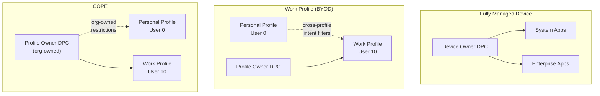

### 61.1.3  设备所有者（DO）

设备所有者是一个设备策略客户端（DPC）应用，对整台设备拥有完整的管理权限。它在初始设置向导期间（或开发时通过 `adb`）进行配置。从源代码角度看，设备所有者在以下位置被跟踪：

```
// frameworks/base/services/devicepolicy/java/com/android/server/devicepolicy/Owners.java
class Owners {
    @GuardedBy("mData")
    private final OwnersData mData;
    // mData.mDeviceOwner holds the OwnerInfo for the Device Owner
    // mData.mDeviceOwnerUserId identifies which user the DO runs as
}
```

关键特性：

- **单例**：每台设备上只能存在一个设备所有者。
- **配置**：在开箱体验（OOBE）期间通过 NFC 碰触、二维码、零触点注册或 `adb shell dpm set-device-owner` 设置。

- **范围**：可以设置全局策略（Wi-Fi、时区、系统更新策略、恢复出厂保护）和按用户的策略。

- **无法移除**：一旦设置，设备所有者只能通过恢复出厂设置（或由 DO 自己调用 `clearDeviceOwnerApp()`）移除。

DPMS 通过统计日志常量跟踪管理模式：

```
// frameworks/base/services/devicepolicy/java/com/android/server/devicepolicy/
//   DevicePolicyManagerService.java (line ~244-250)
import static com.android.server.devicepolicy.DevicePolicyStatsLog
    .DEVICE_POLICY_MANAGEMENT_MODE__MANAGEMENT_MODE__DEVICE_OWNER;
import static com.android.server.devicepolicy.DevicePolicyStatsLog
    .DEVICE_POLICY_MANAGEMENT_MODE__MANAGEMENT_MODE__COPE;
import static com.android.server.devicepolicy.DevicePolicyStatsLog
    .DEVICE_POLICY_MANAGEMENT_MODE__MANAGEMENT_MODE__PROFILE_OWNER;
```

### 61.1.4  资料所有者（PO）

资料所有者管理单个 Android 用户（通常是受管资料）。与设备所有者不同，多个资料所有者可以在同一台设备上共存（每个用户一个）。`Owners` 类按 userId 作为键将它们存储在 `ArrayMap` 中：

```
// OwnersData.java
// mData.mProfileOwners is ArrayMap<Integer, OwnerInfo> keyed by userId
```

当 `Owners` 类从磁盘加载配置时，它会将所有者信息推送到多个子系统：

```java
// Owners.java, load()
void load() {
    synchronized (mData) {
        int[] usersIds =
            mUserManager.getAliveUsers().stream().mapToInt(u -> u.id).toArray();
        mData.load(usersIds);
        // ... push to DeviceStateCache, ActivityTaskManager, PackageManager
        notifyChangeLocked();
        pushDeviceOwnerUidToActivityTaskManagerLocked();
        pushProfileOwnerUidsToActivityTaskManagerLocked();
    }
}
```

### 61.1.5  COPE（企业所有、个人启用）

COPE 是 Android 11 中引入的混合模式。设备归企业所有，但**没有设备所有者**。资料所有者运行在工作资料中，并被标记为“组织所有设备上的资料所有者”。这一标记赋予它对个人一侧的有限权力。仅当不存在设备所有者，且工作资料的所有者满足 `isProfileOwnerOfOrganizationOwnedDevice()` 为 true 时，DPMS 才报告 COPE 管理模式。

COPE 关系编码在配置参数中：

```java
// frameworks/base/core/java/android/app/admin/ManagedProfileProvisioningParams.java
public final class ManagedProfileProvisioningParams implements Parcelable {
    private final boolean mOrganizationOwnedProvisioning;
    // When true, the profile owner gains elevated privileges over
    // the personal profile (e.g., suspending personal apps).
}
```

`UserManagerInternal` 中的所有者类型跟踪区分这三种情况：

```java
// Referenced by DevicePolicyManagerService.java
import static com.android.server.pm.UserManagerInternal.OWNER_TYPE_DEVICE_OWNER;
import static com.android.server.pm.UserManagerInternal.OWNER_TYPE_PROFILE_OWNER;
import static com.android.server.pm.UserManagerInternal
    .OWNER_TYPE_PROFILE_OWNER_OF_ORGANIZATION_OWNED_DEVICE;
```

### 61.1.6  BYOD（自带设备）

在 BYOD 模式下，设备属于员工。只创建一个工作资料，资料所有者仅管理该资料。IT 管理员无法控制个人一侧。这是最尊重隐私的管理模式。

### 61.1.7  管理模式决策流程

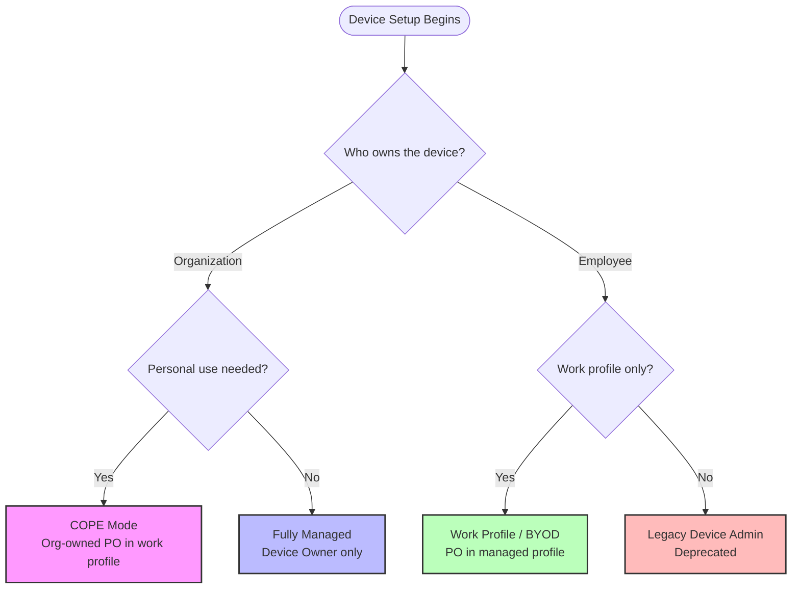

### 61.1.8  管理模式详解：策略范围矩阵

下表显示每种管理模式下可用的 DPM API。在构建 DPC 时，理解这些范围至关重要。

```
API Category             | DO   | PO (BYOD) | PO (COPE) | Legacy Admin
-------------------------|------|-----------|-----------|-------------
Password quality         | Yes  | Work only | Work+Dev  | Yes
Camera disable           | Yes  | Work only | Work+Dev  | Yes
Screen capture disable   | Yes  | Work only | Work only | No
Wi-Fi configuration      | Yes  | No        | No        | No
System update policy     | Yes  | No        | No        | No
Factory reset            | Yes  | Profile   | Profile   | Yes
Lock now                 | Yes  | Work lock | Both      | Yes
Install CA cert          | Yes  | Work only | Work only | No
Security logging         | Yes  | No        | Yes       | No
Network logging          | Yes  | No        | Yes       | No
Personal app suspension  | N/A  | No        | Yes       | No
Always-on VPN            | Yes  | Work only | Work only | No
Cross-profile policies   | N/A  | Yes       | Yes       | No
Lock task mode           | Yes  | Yes       | Yes       | No
App restrictions         | Yes  | Work only | Work only | No
USB data signaling       | Yes  | No        | No        | No
```

### 61.1.9  Android Enterprise 功能演进

Android Enterprise 能力在各平台版本中显著演进：

```
Android Version | Key Enterprise Features
----------------|------------------------
5.0 (Lollipop)  | Work profiles, Profile Owner, Device Owner
6.0 (M)         | COSU (Corporate-Owned Single-Use), always-on VPN
7.0 (Nougat)    | Network logging, security logging, DPC transfer
8.0 (Oreo)      | Ephemeral users, mandatory backup, companion DPC
9.0 (Pie)       | Compliance, QR provisioning improvements
10              | Work profile provisioning improvements, manual system update installation
11              | COPE (organization-owned managed profile), personal app suspension
12              | Compliance acknowledgement, privacy dashboard
13              | Role-based management, fine-grained permissions
14              | DevicePolicyEngine, multi-admin resolution
15              | Enhanced MTE, audit logging, device theft API
16              | Content protection policy, system authority admins
17              | Advanced Protection coexistence, multi-user managed provisioning
```

Android 16 新增了三态内容保护策略（`setContentProtectionPolicy`）和 `system:` 权威前缀，使可信平台服务可以作为策略引擎管理员。Android 17 在此基础上构建。新的高级保护模式（AAPM）服务以*系统管理员*身份驱动多项设备策略（MTE、USB、安装未知来源）。一个新的多用户受管设备配置流程正式落地，适用于无头部署场景。两者都在 61.8 节中详细介绍。

### 61.1.10  无头系统用户模式

现代 Android 支持无头系统用户模式，尤其适用于汽车和多用户场景。`DeviceAdminInfo` 类定义了三种无头模式：

```java
// frameworks/base/core/java/android/app/admin/DeviceAdminInfo.java
public static final int HEADLESS_DEVICE_OWNER_MODE_UNSUPPORTED = 0;
public static final int HEADLESS_DEVICE_OWNER_MODE_AFFILIATED = 1;
public static final int HEADLESS_DEVICE_OWNER_MODE_SINGLE_USER = 2;
```

在关联模式下，资料所有者会自动添加到除系统用户（设备所有者运行于此）之外的所有用户中。在单用户模式下，设备所有者被配置到第一个辅助用户中，并且创建额外辅助用户的操作会被阻止。

---

## 61.2  DevicePolicyManagerService

### 61.2.1  概述与类层次结构

`DevicePolicyManagerService` 是 AOSP 中最大的系统服务之一（`frameworks/base/services/devicepolicy/java/com/android/server/devicepolicy/DevicePolicyManagerService.java`）。它实现了 `IDevicePolicyManager` AIDL 接口，运行在 system server 进程中。

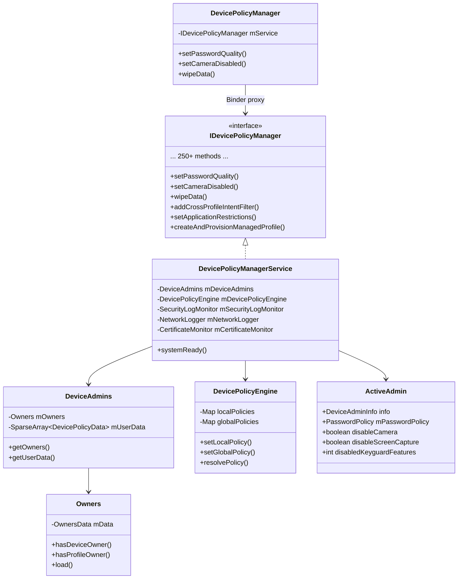

源文件位置：

| 组件 | 路径 |
|-----------|------|
| AIDL 接口 | `frameworks/base/core/java/android/app/admin/IDevicePolicyManager.aidl` |
| 客户端 API | `frameworks/base/core/java/android/app/admin/DevicePolicyManager.java` |
| 服务实现 | `frameworks/base/services/devicepolicy/java/com/android/server/devicepolicy/DevicePolicyManagerService.java` |
| 策略引擎 | `frameworks/base/services/devicepolicy/java/com/android/server/devicepolicy/DevicePolicyEngine.java` |
| 所有者跟踪 | `frameworks/base/services/devicepolicy/java/com/android/server/devicepolicy/Owners.java` |
| 管理员状态 | `frameworks/base/services/devicepolicy/java/com/android/server/devicepolicy/ActiveAdmin.java` |
| 按用户数据 | `frameworks/base/services/devicepolicy/java/com/android/server/devicepolicy/DevicePolicyData.java` |

### 61.2.2  DPMS 内部架构

在深入启动流程之前，先看一下 DPMS 的内部组件及其相互关系会有帮助：

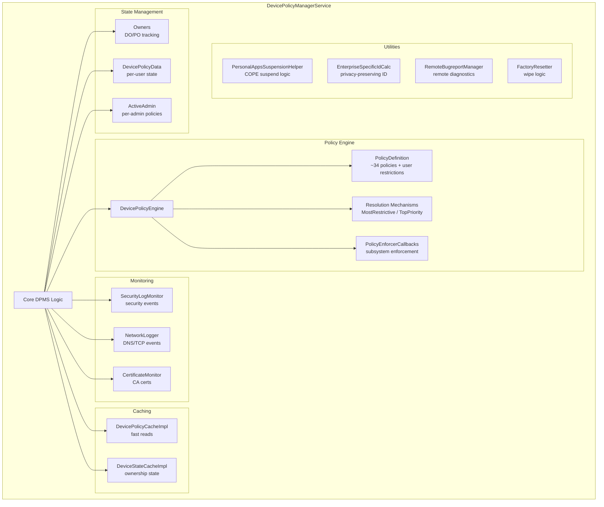

划分到这些组件反映了多年的重构。最初的 DPMS 是一个单一的巨石类，引擎、监视器和辅助工具被抽取出来，以提高可维护性和可测试性。

### 61.2.3  服务注册与启动

DPMS 由 `SystemServer` 注册为系统服务。其启动生命周期遵循标准的 `SystemService` 阶段：

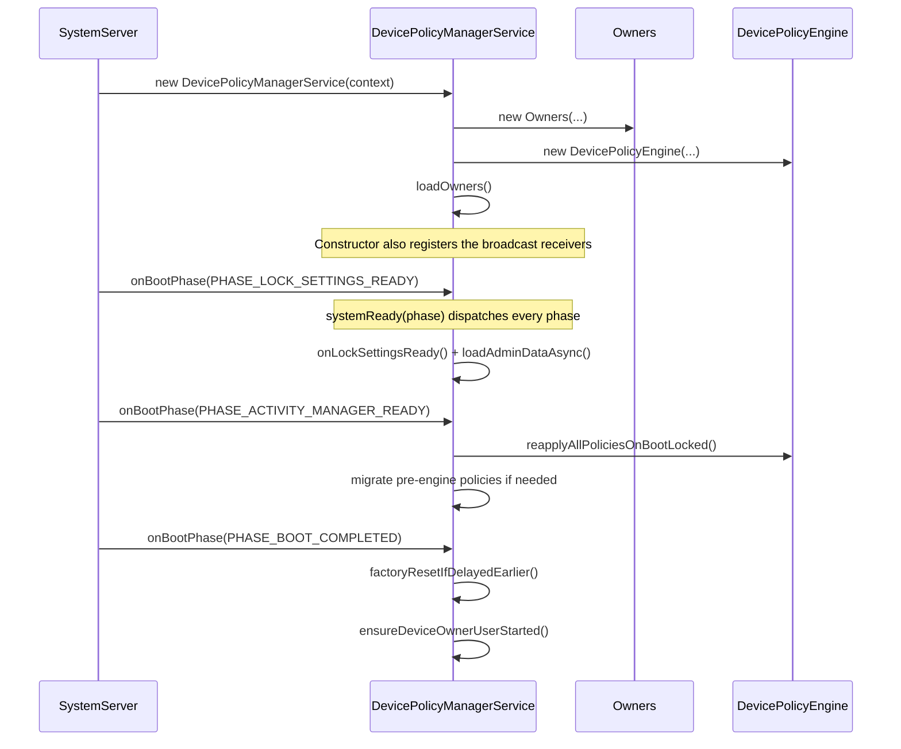

在 `PHASE_BOOT_COMPLETED` 时，该服务处理任何延迟的恢复出厂设置，并确保设备所有者用户已启动：

```java
// DevicePolicyManagerService.java, systemReady(int phase)
case SystemService.PHASE_BOOT_COMPLETED:
    // Ideally it should be done earlier, but currently it relies on
    // RecoverySystem, which would hang on earlier phases
    factoryResetIfDelayedEarlier();
    ensureDeviceOwnerUserStarted();
    break;
```

### 61.2.4  管理组件模型

管理组件是 `DeviceAdminReceiver` 的 `BroadcastReceiver` 子类。系统通过清单声明发现它：

```xml
<!-- Example: DPC app's AndroidManifest.xml -->
<receiver
    android:name=".MyDeviceAdminReceiver"
    android:permission="android.permission.BIND_DEVICE_ADMIN">
    <meta-data
        android:name="android.app.device_admin"
        android:resource="@xml/device_admin" />
    <intent-filter>
        <action android:name="android.app.action.DEVICE_ADMIN_ENABLED" />
    </intent-filter>
</receiver>
```

所引用的 XML 资源声明了该管理员需要哪些策略：

```xml
<!-- res/xml/device_admin.xml -->
<device-admin xmlns:android="http://schemas.android.com/apk/res/android">
    <uses-policies>
        <limit-password />
        <watch-login />
        <reset-password />
        <force-lock />
        <wipe-data />
        <encrypted-storage />
        <disable-camera />
        <disable-keyguard-features />
    </uses-policies>
</device-admin>
```

这些策略标签直接映射到 `DeviceAdminInfo` 中的常量：

```java
// frameworks/base/core/java/android/app/admin/DeviceAdminInfo.java
public static final int USES_POLICY_LIMIT_PASSWORD = 0;
public static final int USES_POLICY_WATCH_LOGIN = 1;
public static final int USES_POLICY_RESET_PASSWORD = 2;
public static final int USES_POLICY_FORCE_LOCK = 3;
public static final int USES_POLICY_WIPE_DATA = 4;
public static final int USES_POLICY_SETS_GLOBAL_PROXY = 5;
public static final int USES_POLICY_EXPIRE_PASSWORD = 6;
public static final int USES_ENCRYPTED_STORAGE = 7;
public static final int USES_POLICY_DISABLE_CAMERA = 8;
public static final int USES_POLICY_DISABLE_KEYGUARD_FEATURES = 9;
```

### 61.2.5  ActiveAdmin：按管理员的状态

当管理组件被激活（作为设备管理员、资料所有者或设备所有者）时，DPMS 会创建一个 `ActiveAdmin` 对象。该对象存储该管理员的完整策略状态：

```java
// frameworks/base/services/devicepolicy/java/com/android/server/devicepolicy/ActiveAdmin.java
class ActiveAdmin {
    DeviceAdminInfo info;
    PasswordPolicy mPasswordPolicy;
    boolean disableCamera;
    boolean disableScreenCapture;
    boolean disableCallerId;
    boolean disableContactsSearch;
    boolean disableBluetoothContactSharing;
    int disabledKeyguardFeatures;
    long maximumTimeToUnlock;
    int maximumFailedPasswordsForWipe;
    boolean encryptionRequested;
    boolean testOnlyAdmin;
    // ... dozens more policy fields
}
```

`ActiveAdmin` 类包含将每个策略字段持久化到 XML 的序列化标签：

```java
// ActiveAdmin.java
private static final String TAG_DISABLE_KEYGUARD_FEATURES = "disable-keyguard-features";
private static final String TAG_DISABLE_CAMERA = "disable-camera";
private static final String TAG_DISABLE_CALLER_ID = "disable-caller-id";
private static final String TAG_DISABLE_CONTACTS_SEARCH = "disable-contacts-search";
private static final String TAG_DISABLE_BLUETOOTH_CONTACT_SHARING =
    "disable-bt-contacts-sharing";
private static final String TAG_DISABLE_SCREEN_CAPTURE = "disable-screen-capture";
private static final String TAG_DISABLE_ACCOUNT_MANAGEMENT = "disable-account-management";
private static final String TAG_ENCRYPTION_REQUESTED = "encryption-requested";
private static final String TAG_MAX_FAILED_PASSWORD_WIPE = "max-failed-password-wipe";
private static final String TAG_MAX_TIME_TO_UNLOCK = "max-time-to-unlock";
private static final String TAG_PASSWORD_QUALITY = "password-quality";
private static final String TAG_MIN_PASSWORD_LENGTH = "min-password-length";
// ... many more
```

### 61.2.6  DevicePolicyData：按用户的状态

除了各个管理员的状态之外，DPMS 还在 `DevicePolicyData` 中维护按用户的数据：

```java
// frameworks/base/services/devicepolicy/java/com/android/server/devicepolicy/
//   DevicePolicyData.java
class DevicePolicyData {
    private static final String TAG_ACCEPTED_CA_CERTIFICATES = "accepted-ca-certificate";
    private static final String TAG_LOCK_TASK_COMPONENTS = "lock-task-component";
    private static final String TAG_LOCK_TASK_FEATURES = "lock-task-features";
    private static final String TAG_STATUS_BAR = "statusbar";
    private static final String TAG_APPS_SUSPENDED = "apps-suspended";
    private static final String TAG_SECONDARY_LOCK_SCREEN = "secondary-lock-screen";
    private static final String TAG_AFFILIATION_ID = "affiliation-id";
    private static final String TAG_LAST_SECURITY_LOG_RETRIEVAL = "last-security-log-retrieval";
    private static final String TAG_LAST_BUG_REPORT_REQUEST = "last-bug-report-request";
    private static final String TAG_LAST_NETWORK_LOG_RETRIEVAL = "last-network-log-retrieval";
    // ...
}
```

按用户的数据包括：

- **锁屏任务模式配置**（允许的包、功能）。
- **已接受的 CA 证书**，由管理员安装。
- **关联 ID**，用于确定用户是否关联。
- **恢复出厂设置跟踪**（待处理标志、原因）。
- **密码令牌句柄**，用于托管令牌。

数据持久化到每个用户系统目录中的 XML 文件：

```
/data/system/users/<userId>/device_policies.xml
/data/system/device_owner_2.xml
```

### 61.2.7  DevicePolicyEngine：多管理员策略解析

从 Android 14 开始，AOSP 引入了 `DevicePolicyEngine`，用于处理多个管理管理员设置相互冲突的策略的场景。这对于设备所有者、资料所有者和基于角色的管理员共存至关重要。

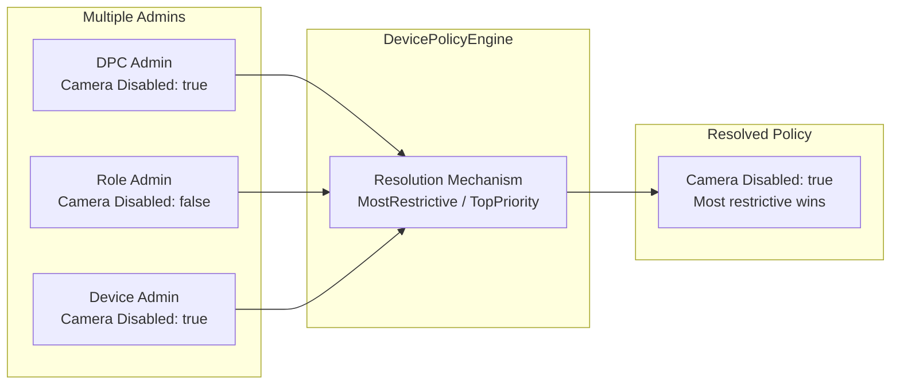

引擎在两个范围内存储策略：

```java
// frameworks/base/services/devicepolicy/java/com/android/server/devicepolicy/
//   DevicePolicyEngine.java
final class DevicePolicyEngine {
    // Map of <userId, Map<policyKey, policyState>>
    @GuardedBy("mLock")
    private final Map<Integer, Map<PolicyKey, PolicyState<?>>> mLocalPolicies;

    // Map of <policyKey, policyState>
    @GuardedBy("mLock")
    private final Map<PolicyKey, PolicyState<?>> mGlobalPolicies;
}
```

### 61.2.8  解析机制

每个策略定义声明一个解析机制，决定如何协调来自多个管理员的冲突值：

```java
// frameworks/base/services/devicepolicy/java/com/android/server/devicepolicy/
//   PolicyDefinition.java
public static final MostRestrictive<Boolean> FALSE_MORE_RESTRICTIVE =
    new MostRestrictive<>(
        List.of(new BooleanPolicyValue(false), new BooleanPolicyValue(true)));

static final MostRestrictive<Boolean> TRUE_MORE_RESTRICTIVE =
    new MostRestrictive<>(
        List.of(new BooleanPolicyValue(true), new BooleanPolicyValue(false)));
```

每个解析机制都继承自抽象类 `ResolutionMechanism<V>`。Android 17 源码树包含八个子类（都在 `com.android.server.devicepolicy` 包中）。其中七个是具体的。第八个是抽象的 `ListUnion<T>`，通过它的 STRING 和 PACKAGE 变体实例化。`LeastRecent` 和 `ListUnion` 在本版本中新增：

| 机制 | 源文件 | 描述 | 策略示例 |
|-----------|-------------|-------------|----------------|
| `MostRestrictive<V>` | `MostRestrictive.java` | 最严格的值（按声明的顺序）胜出 | 相机禁用、屏幕捕获禁用 |
| `TopPriority<V>` | `TopPriority.java` | 优先级最高的管理员（按权威优先级列表）胜出 | 锁屏任务、持久首选应用 |
| `MostRecent<V>` | `MostRecent.java` | 最近设置的值胜出 | 无严格顺序的按管理员设置 |
| `LeastRecent<V>` | `LeastRecent.java` | 最早设置的值胜出（17 新增） | 先写者胜的策略 |
| `PackageSetUnion` | `PackageSetUnion.java` | 所有管理员包集合的并集 | 用户控制的禁用包 |
| `ListUnion<T>` | `ListUnion.java` | 所有管理员列表值的并集（抽象，17 新增） | 允许的输入法样式列表 |
| `FlagUnion` | `FlagUnion.java` | 所有管理员整数标志的按位或 | 锁屏功能禁用标志 |
| `StringSetIntersection` | `StringSetIntersection.java` | 所有管理员字符串集合的交集 | 跨资料小组件提供者 |

示例：安全日志使用 `TRUE_MORE_RESTRICTIVE` 解析，这意味着如果任何管理员启用了安全日志，它将保持启用：

```java
// PolicyDefinition.java
static PolicyDefinition<Boolean> SECURITY_LOGGING = new PolicyDefinition<>(
    new NoArgsPolicyKey(DevicePolicyIdentifiers.SECURITY_LOGGING_POLICY),
    TRUE_MORE_RESTRICTIVE,
    POLICY_FLAG_GLOBAL_ONLY_POLICY,
    PolicyEnforcerCallbacks::enforceSecurityLogging,
    new BooleanPolicySerializer());
```

### 61.2.9  策略标志

每个 `PolicyDefinition` 都带有控制其范围和行为的标志：

```java
// PolicyDefinition.java
static final int POLICY_FLAG_NONE = 0;
public static final int POLICY_FLAG_GLOBAL_ONLY_POLICY = 1;
public static final int POLICY_FLAG_LOCAL_ONLY_POLICY = 1 << 1;
static final int POLICY_FLAG_INHERITABLE = 1 << 2;
static final int POLICY_FLAG_NON_COEXISTABLE_POLICY = 1 << 3;
static final int POLICY_FLAG_USER_RESTRICTION_POLICY = 1 << 4;
static final int POLICY_FLAG_SKIP_ENFORCEMENT_IF_UNCHANGED = 1 << 5;
private static final int POLICY_FLAG_PACKAGE_POLICY = 1 << 6;
```

- **GLOBAL_ONLY**：该策略适用于整台设备（例如自动时区）。
- **LOCAL_ONLY**：该策略按用户适用（例如权限授予）。
- **INHERITABLE**：子资料从父资料继承该策略。
- **NON_COEXISTABLE**：各管理员的值保持独立（例如应用限制）。
- **USER_RESTRICTION**：将用户限制策略标记为需要特殊处理。
- **SKIP_ENFORCEMENT_IF_UNCHANGED**：当解析后的值未发生变化时跳过强制回调，避免冗余的下游工作。
- **PACKAGE_POLICY**：将包范围的策略标记为强制回调仅对已安装的包生效；当包被（重新）安装时，该回调会重新应用。

### 61.2.10  EnforcingAdmin：策略引擎中的管理员身份

`EnforcingAdmin` 类建模策略引擎中管理员的身份。在 Android 17 源码树中，它识别四种权威类型，编码为常量字符串（或字符串前缀）：

```java
// frameworks/base/services/devicepolicy/java/com/android/server/devicepolicy/
//   EnforcingAdmin.java
public final class EnforcingAdmin {
    public static final String ROLE_AUTHORITY_PREFIX = "role:";
    public static final String SYSTEM_AUTHORITY_PREFIX = "system:";
    public static final String DPC_AUTHORITY = "enterprise";
    public static final String DEVICE_ADMIN_AUTHORITY = "device_admin";

    private final ComponentName mComponentName;
    private final AdminKey mAdminKey;
    private Set<String> mAuthorities;
    private final boolean mIsRoleAuthority;
}
```

早期的 `DevicePolicyEngine` 设计以 `<packageName, userId>` 为管理员键。Android 16/17 将其重构为密封的 `AdminKey` 层次结构（`AdminKey.Package`、`AdminKey.Legacy`、`AdminKey.System`）。有了这一层次结构，企业/角色管理员、旧式设备管理员和系统管理员永远不会冲突，即使它们共享同一个包名。静态工厂方法为每个权威构建适当的身份：

```java
static EnforcingAdmin createEnterpriseEnforcingAdmin(
        ComponentName componentName, int userId) {
    return new EnforcingAdmin(
        new AdminKey.Package(userId, componentName.getPackageName()),
        componentName, /* isRoleAuthority */ false,
        new HashSet<>(Set.of(DPC_AUTHORITY)));
}

static EnforcingAdmin createDeviceAdminEnforcingAdmin(
        ComponentName componentName, int userId) {
    return new EnforcingAdmin(
        new AdminKey.Legacy(userId, componentName),
        componentName, /* isRoleAuthority */ false,
        new HashSet<>(Set.of(DEVICE_ADMIN_AUTHORITY)));
}

static EnforcingAdmin createSystemEnforcingAdmin(String systemEntity) {
    return new EnforcingAdmin(
        new AdminKey.System(systemEntity),
        /* componentName */ null, /* isRoleAuthority */ false,
        getSystemAuthority(systemEntity));
}
```

第四个工厂方法 `createRoleEnforcingAdmin` 只接收包名和用户（没有 `ComponentName`），并将该包持有的角色解析为一组 `role:<roleName>` 权威。`SYSTEM_AUTHORITY_PREFIX`（`"system:"`）和 `createSystemEnforcingAdmin` 路径是关键的新增内容。它们让可信平台服务可以通过 DPC 使用的同一引擎来设置设备策略。这些服务不需要是 DPC。其中最著名的是高级保护模式（61.8.28 节）。

将持久化的权威字符串解析回 `android.app.admin.Authority` 实例的逻辑位于 `getParcelableAuthority` 中。它将 `"enterprise"` 映射为 `DpcAuthority`，将 `"device_admin"` 映射为 `DeviceAdminAuthority`，将 `role:` 前缀映射为 `RoleAuthority`，将 `system:` 前缀映射为 `SystemAuthority`。

### 61.2.11  策略 API 的权限模型

从 Android 13 开始，许多 DPM API 从要求特定的管理员 `ComponentName` 转变为使用细粒度权限。DPMS 导入了大量 `MANAGE_DEVICE_POLICY_*` 权限：

```java
// DevicePolicyManagerService.java (lines 19-49)
import static android.Manifest.permission.MANAGE_DEVICE_POLICY_ACCOUNT_MANAGEMENT;
import static android.Manifest.permission.MANAGE_DEVICE_POLICY_APPS_CONTROL;
import static android.Manifest.permission.MANAGE_DEVICE_POLICY_APP_RESTRICTIONS;
import static android.Manifest.permission.MANAGE_DEVICE_POLICY_CAMERA;
import static android.Manifest.permission.MANAGE_DEVICE_POLICY_CERTIFICATES;
import static android.Manifest.permission.MANAGE_DEVICE_POLICY_FACTORY_RESET;
import static android.Manifest.permission.MANAGE_DEVICE_POLICY_INPUT_METHODS;
import static android.Manifest.permission.MANAGE_DEVICE_POLICY_KEYGUARD;
import static android.Manifest.permission.MANAGE_DEVICE_POLICY_LOCK;
import static android.Manifest.permission.MANAGE_DEVICE_POLICY_LOCK_CREDENTIALS;
import static android.Manifest.permission.MANAGE_DEVICE_POLICY_LOCK_TASK;
import static android.Manifest.permission.MANAGE_DEVICE_POLICY_SCREEN_CAPTURE;
import static android.Manifest.permission.MANAGE_DEVICE_POLICY_SECURITY_LOGGING;
import static android.Manifest.permission.MANAGE_DEVICE_POLICY_WIPE_DATA;
// ... and many more
```

这使非 DPC 应用（例如角色持有者）无需成为完整的设备所有者或资料所有者即可管理特定策略。

### 61.2.12  委托：共享管理员能力

设备所有者或资料所有者可以将特定的管理能力委托给其他应用，而无需授予它们完整的管理员身份：

```java
// DevicePolicyManager.java
public static final String DELEGATION_APP_RESTRICTIONS = "delegation-app-restrictions";
public static final String DELEGATION_BLOCK_UNINSTALL = "delegation-block-uninstall";
public static final String DELEGATION_CERT_INSTALL = "delegation-cert-install";
public static final String DELEGATION_CERT_SELECTION = "delegation-cert-selection";
public static final String DELEGATION_ENABLE_SYSTEM_APP = "delegation-enable-system-app";
public static final String DELEGATION_INSTALL_EXISTING_PACKAGE =
    "delegation-install-existing-package";
public static final String DELEGATION_KEEP_UNINSTALLED_PACKAGES =
    "delegation-keep-uninstalled-packages";
public static final String DELEGATION_NETWORK_LOGGING = "delegation-network-logging";
public static final String DELEGATION_PACKAGE_ACCESS = "delegation-package-access";
public static final String DELEGATION_PERMISSION_GRANT = "delegation-permission-grant";
public static final String DELEGATION_SECURITY_LOGGING = "delegation-security-logging";
```

被委托的应用会收到 `DelegatedAdminReceiver` 回调：

```java
// frameworks/base/core/java/android/app/admin/DelegatedAdminReceiver.java
public class DelegatedAdminReceiver extends BroadcastReceiver {
    // Receives callbacks for delegated operations like
    // network logging, security logging, certificate selection
}
```

### 61.2.13  策略持久化与 XML 格式

DPMS 将所有策略状态持久化到 XML 文件。理解 XML 格式对于调试和阅读 `dumpsys device_policy` 输出至关重要。

**设备所有者文件**（`/data/system/device_owner_2.xml`）：

```xml
<?xml version='1.0' encoding='utf-8' standalone='yes' ?>
<root>
    <device-owner
        package="com.example.dpc"
        name="Enterprise DPC"
        component="com.example.dpc/.MyDeviceAdminReceiver"
        userRestrictionsMigrated="true" />
    <device-owner-context userId="0" />
</root>
```

**按用户的策略文件**（`/data/system/users/<userId>/device_policies.xml`）：

```xml
<?xml version='1.0' encoding='utf-8' standalone='yes' ?>
<policies setup-complete="true" provisioning-state="3"
    permission-policy="0" device-paired="true"
    new-user-disclaimer="not_needed">
    <admin name="com.example.dpc/.MyDeviceAdminReceiver">
        <policies flags="255" />
        <password-quality value="327680" />
        <min-password-length value="6" />
        <password-history-length value="3" />
        <max-time-to-unlock value="300000" />
        <max-failed-password-wipe value="10" />
        <disable-camera value="true" />
        <disable-keyguard-features value="56" />
        <disable-screen-capture value="true" />
        <encryption-requested value="true" />
    </admin>
    <lock-task-component value="com.example.kiosk" />
    <lock-task-features value="16" />
    <affiliation-id id="enterprise-corp-123" />
</policies>
```

策略 XML 中的关键属性：

| XML 标签 | 描述 |
|---------|-------------|
| `password-quality` | 密码质量级别（十六进制编码的常量） |
| `min-password-length` | 最小密码长度 |
| `max-time-to-unlock` | 锁定前的最大空闲时间（毫秒） |
| `max-failed-password-wipe` | 在 N 次失败尝试后擦除 |
| `disable-camera` | 相机禁用标志 |
| `disable-keyguard-features` | 已禁用锁屏功能的位掩码 |
| `lock-task-component` | 允许的锁屏任务包 |
| `affiliation-id` | 企业关联标识符 |

### 61.2.14  调用者身份与权限检查

每个 DPM API 调用都要经过严格的调用者身份验证。`CallerIdentity` 类捕获调用上下文：

```java
// frameworks/base/services/devicepolicy/java/com/android/server/devicepolicy/
//   CallerIdentity.java
// Captures: calling UID, PID, package name, user ID
// Used to verify the caller is an active admin, DO, PO, or has
// the required MANAGE_DEVICE_POLICY_* permission
```

典型的权限检查流程：

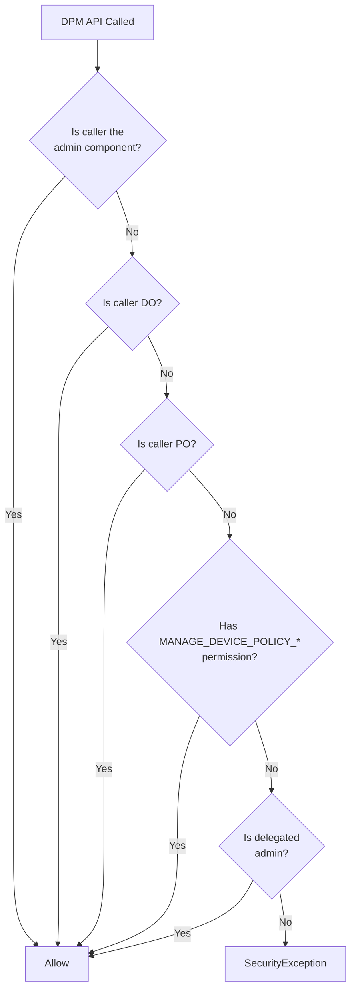

### 61.2.15  线程安全与锁

DPMS 使用一个全局锁对象进行同步：

```java
// DevicePolicyManagerService.java
// getLockObject() returns the main synchronization lock
// Many methods are synchronized on this lock to ensure consistency
```

`Owners` 类使用自己的锁（`mData`）来保护所有权数据。`DevicePolicyEngine` 使用 `mLock` 保护策略状态。在获取多个锁时必须小心避免死锁。

### 61.2.16  策略强制流程

当管理员调用 DPM API 时，请求会流经多个层：

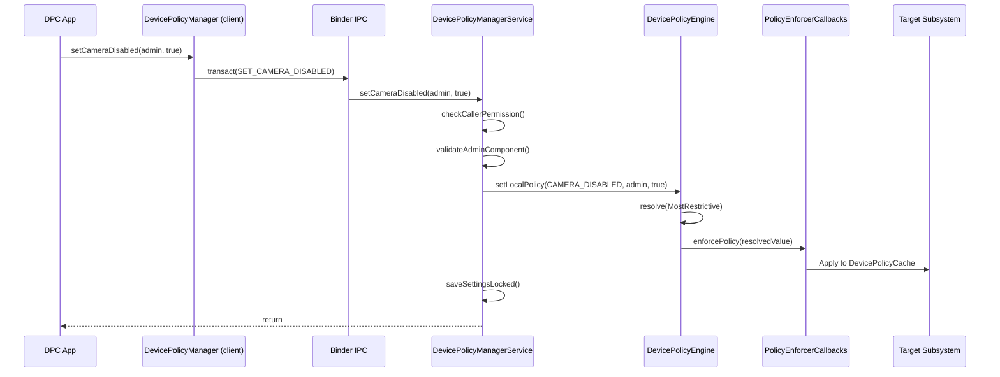

### 61.2.17  Binder 缓存

DPMS 使用 `IpcDataCache` 避免对频繁查询的策略状态进行重复的 Binder 调用。`DevicePolicyCacheImpl` 类为常见查询提供进程内缓存：

```java
// frameworks/base/services/devicepolicy/java/com/android/server/devicepolicy/
//   DevicePolicyCacheImpl.java
// Caches: screen-capture-disallowed users, password quality, permission
// policy, launcher shortcut overrides, sensors-permission grant, and
// content protection policy
```

当所有权发生变化时，缓存会被显式失效：

```java
// Owners.java
private void pushToDevicePolicyManager() {
    DevicePolicyManagerService.invalidateBinderCaches();
}
```

---

## 61.3  工作资料

### 61.3.1  概念模型

工作资料是一个 Android 受管资料——一个与个人资料运行在同一台设备上的独立用户空间。它有自己的：

- 应用实例（应用的独立副本）
- 数据目录（`/data/user/<profileUserId>/`）
- 联系人数据库
- 日历存储
- 通知栏分区
- 独立的加密密钥（配合文件级加密）

工作资料在启动器中对用户显示为“Work”标签，并在工作应用图标上显示公文包徽章。

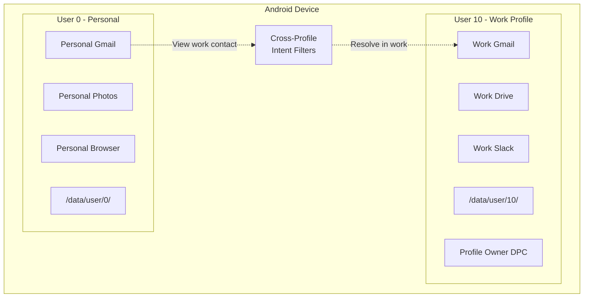

### 61.3.2  受管资料创建

工作资料通过 `DevicePolicyManager` API 创建。主要入口点是 `createAndProvisionManagedProfile()`：

```java
// DevicePolicyManager.java
// @SystemApi
public UserHandle createAndProvisionManagedProfile(
    @NonNull ManagedProfileProvisioningParams provisioningParams)
    throws ProvisioningException { ... }
```

配置参数控制资料的设置：

```java
// ManagedProfileProvisioningParams.java
public final class ManagedProfileProvisioningParams implements Parcelable {
    @NonNull private final ComponentName mProfileAdminComponentName;
    @NonNull private final String mOwnerName;
    @Nullable private final String mProfileName;
    @Nullable private final Account mAccountToMigrate;
    private final boolean mLeaveAllSystemAppsEnabled;
    private final boolean mOrganizationOwnedProvisioning;
    private final boolean mKeepAccountOnMigration;
    @NonNull private final PersistableBundle mAdminExtras;
}
```

在服务端，DPMS 编排创建过程：

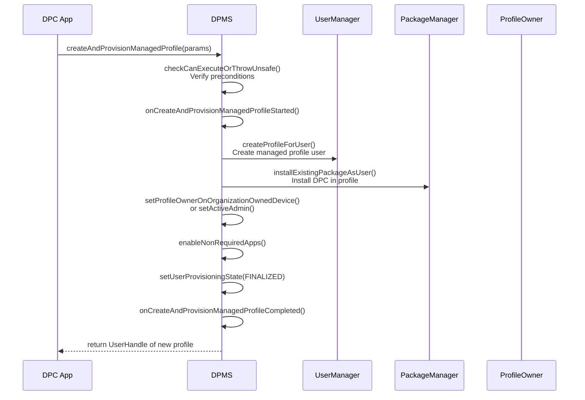

DPMS 实现在创建资料之前会验证大量前提条件：

```java
// DevicePolicyManagerService.java, createAndProvisionManagedProfile()
@Override
public UserHandle createAndProvisionManagedProfile(
        @NonNull ManagedProfileProvisioningParams provisioningParams,
        @NonNull String callerPackage) {
    Objects.requireNonNull(provisioningParams, "provisioningParams is null");
    Objects.requireNonNull(callerPackage, "callerPackage is null");
    // ... permission checks, precondition validation, profile creation
}
```

### 61.3.3  资料配置前提条件

DPMS 在允许创建资料之前会检查大量前提条件。状态码揭示了可能出现的问题：

```java
// DevicePolicyManager.java
public static final int STATUS_OK = 0;
public static final int STATUS_HAS_DEVICE_OWNER = 1;
public static final int STATUS_USER_HAS_PROFILE_OWNER = 2;
public static final int STATUS_USER_NOT_RUNNING = 3;
public static final int STATUS_USER_SETUP_COMPLETED = 4;
public static final int STATUS_ACCOUNTS_NOT_EMPTY = 6;
public static final int STATUS_NOT_SYSTEM_USER = 7;
public static final int STATUS_MANAGED_USERS_NOT_SUPPORTED = 9;
public static final int STATUS_CANNOT_ADD_MANAGED_PROFILE = 11;
// ... and more
```

### 61.3.4  跨资料 intent 过滤器

跨资料 intent 过滤器控制哪些 intent 可以跨工作/个人边界解析。DPC 通过以下方法配置它们：

```java
// DevicePolicyManager.java
public static final int FLAG_PARENT_CAN_ACCESS_MANAGED = 0x0001;
public static final int FLAG_MANAGED_CAN_ACCESS_PARENT = 0x0002;

@RequiresPermission(value = MANAGE_DEVICE_POLICY_PROFILE_INTERACTION,
                     conditional = true)
public void addCrossProfileIntentFilter(
    @Nullable ComponentName admin, IntentFilter filter, int flags) { ... }
```

当个人应用触发一个匹配跨资料过滤器的 intent 时，系统会在工作资料中解析它。根据标志的不同，也存在反向方向。

常见的跨资料 intent 过滤器场景：

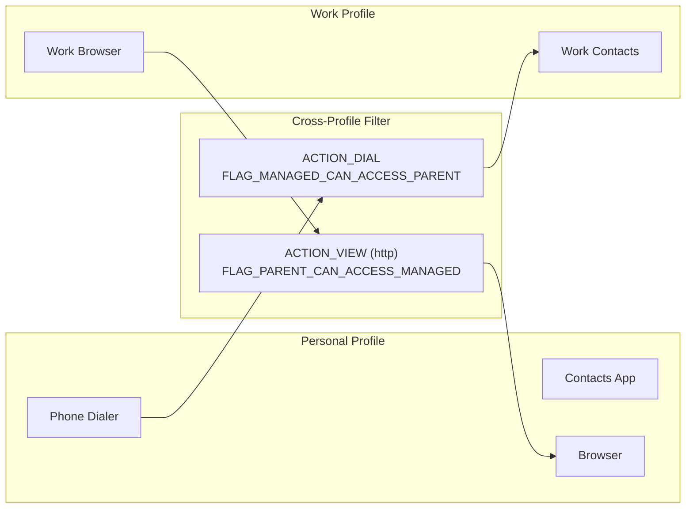

`PolicyDefinition` 中跨资料小组件的定义说明了引擎的集成方式：

```java
// PolicyDefinition.java (referenced via ActiveAdmin)
private static final String TAG_CROSS_PROFILE_WIDGET_PROVIDERS =
    "cross-profile-widget-providers";
```

### 61.3.5  工作模式切换

用户可以开启和关闭工作资料。当工作资料暂停时，所有工作应用都会被挂起，通知被隐藏，工作数据无法访问。

当资料状态变化时，系统会广播特定的 intent：

```java
// DevicePolicyManagerService.java
import static android.content.Intent.ACTION_MANAGED_PROFILE_AVAILABLE;
import static android.content.Intent.ACTION_MANAGED_PROFILE_UNAVAILABLE;
```

DPMS 跟踪资料状态，如果工作资料关闭时间过长（COPE 模式），它可以挂起个人应用：

```java
// ActiveAdmin.java
private static final String TAG_SUSPEND_PERSONAL_APPS = "suspend-personal-apps";
private static final String TAG_PROFILE_MAXIMUM_TIME_OFF = "profile-max-time-off";
private static final String TAG_PROFILE_OFF_DEADLINE = "profile-off-deadline";
```

### 61.3.6  个人应用挂起（COPE）

在组织所有的场景中，如果工作资料关闭时间超过配置的截止期限，资料所有者可以挂起个人应用。`PersonalAppsSuspensionHelper` 决定挂起哪些个人应用：

```java
// frameworks/base/services/devicepolicy/java/com/android/server/devicepolicy/
//   PersonalAppsSuspensionHelper.java
public final class PersonalAppsSuspensionHelper {
    // Determines which personal apps to suspend, excluding:
    // - IME apps
    // - Accessibility services
    // - Default SMS app
    // - Required system apps
}
```

挂起状态在 `DevicePolicyManager` 中跟踪：

```java
// DevicePolicyManager.java
public static final int PERSONAL_APPS_NOT_SUSPENDED = 0;
public static final int PERSONAL_APPS_SUSPENDED_EXPLICITLY = 1;
public static final int PERSONAL_APPS_SUSPENDED_PROFILE_TIMEOUT = 2;
```

### 61.3.7  工作资料数据隔离

工作资料通过多种机制实现数据隔离：

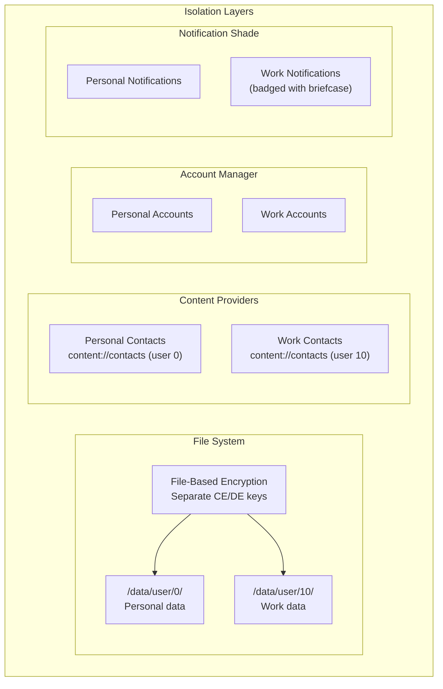

每个隔离边界都独立强制执行：

1. **文件系统**：每个用户在 `/data/user/` 下获得自己的目录。使用文件级加密（FBE）时，每个用户的凭据加密（CE）存储都有自己的密钥。当工作资料被锁定时，CE 密钥会被逐出，使工作数据无法访问。

2. **内容提供者**：框架将查询路由到正确用户的内容提供者实例。个人应用查询 `content://contacts` 时只能看到个人联系人，除非明确授予了跨资料访问。

3. **包可见性**：默认情况下，一个资料中的应用无法看到另一个资料中的应用。`PackageManager` 根据调用用户过滤结果。

4. **网络**：工作资料可以有自己的 VPN、代理和网络偏好。DPMS 通过 `ConnectivityManager` 配置这些：

```java
// DevicePolicyManagerService.java
import static android.net.ConnectivityManager.PROFILE_NETWORK_PREFERENCE_DEFAULT;
import static android.net.ConnectivityManager.PROFILE_NETWORK_PREFERENCE_ENTERPRISE;
import static android.net.ConnectivityManager
    .PROFILE_NETWORK_PREFERENCE_ENTERPRISE_BLOCKING;
import static android.net.ConnectivityManager
    .PROFILE_NETWORK_PREFERENCE_ENTERPRISE_NO_FALLBACK;
```

### 61.3.8  工作资料受管订阅

在支持 eSIM 的设备上，工作资料可以有自己的受管订阅：

```java
// frameworks/base/core/java/android/app/admin/ManagedSubscriptionsPolicy.java
public final class ManagedSubscriptionsPolicy implements Parcelable {
    // Controls how managed subscriptions are handled in the work profile
}
```

### 61.3.9  保持资料运行

一项相对较新的功能允许资料即使在“静默”状态下也保持运行：

```java
// DevicePolicyData.java
private static final String TAG_KEEP_PROFILES_RUNNING = "keep-profiles-running";
```

当工作应用必须接收推送通知或同步数据时，这一点很重要。即使从用户角度来看工作资料处于“暂停”状态，它也同样适用。

### 61.3.10  工作资料电话

工作资料对电话功能有影响。当工作资料暂停时，DPMS 可以显示有关错过的工作来电的通知：

```java
// DevicePolicyManagerService.java (referenced string resources)
import static android.app.admin.DevicePolicyResources.Strings.Core
    .WORK_PROFILE_TELEPHONY_PAUSED_BODY;
import static android.app.admin.DevicePolicyResources.Strings.Core
    .WORK_PROFILE_TELEPHONY_PAUSED_TITLE;
import static android.app.admin.DevicePolicyResources.Strings.Core
    .WORK_PROFILE_TELEPHONY_PAUSED_TURN_ON_BUTTON;
```

### 61.3.11  工作资料删除

当工作资料被删除（由用户、管理员删除，或因违反策略）时，DPMS 会发送适当的通知：

```java
// Referenced string resources
import static android.app.admin.DevicePolicyResources.Strings.Core
    .WORK_PROFILE_DELETED_FAILED_PASSWORD_ATTEMPTS_MESSAGE;
import static android.app.admin.DevicePolicyResources.Strings.Core
    .WORK_PROFILE_DELETED_GENERIC_MESSAGE;
import static android.app.admin.DevicePolicyResources.Strings.Core
    .WORK_PROFILE_DELETED_ORG_OWNED_MESSAGE;
import static android.app.admin.DevicePolicyResources.Strings.Core
    .WORK_PROFILE_DELETED_TITLE;
```

---

## 61.4  设备管理

### 61.4.1  DeviceAdminReceiver：管理员回调接口

`DeviceAdminReceiver` 是所有设备管理组件的基类。它继承自 `BroadcastReceiver`，并提供策略事件的回调方法：

```java
// frameworks/base/core/java/android/app/admin/DeviceAdminReceiver.java
public class DeviceAdminReceiver extends BroadcastReceiver {
    // Lifecycle callbacks
    public static final String ACTION_DEVICE_ADMIN_ENABLED
        = "android.app.action.DEVICE_ADMIN_ENABLED";
    public static final String ACTION_DEVICE_ADMIN_DISABLE_REQUESTED
        = "android.app.action.DEVICE_ADMIN_DISABLE_REQUESTED";
    public static final String ACTION_DEVICE_ADMIN_DISABLED
        = "android.app.action.DEVICE_ADMIN_DISABLED";

    // Password callbacks
    public static final String ACTION_PASSWORD_CHANGED
        = "android.app.action.ACTION_PASSWORD_CHANGED";
    public static final String ACTION_PASSWORD_FAILED
        = "android.app.action.ACTION_PASSWORD_FAILED";
    public static final String ACTION_PASSWORD_SUCCEEDED
        = "android.app.action.ACTION_PASSWORD_SUCCEEDED";
    public static final String ACTION_PASSWORD_EXPIRING
        = "android.app.action.ACTION_PASSWORD_EXPIRING";
}
```

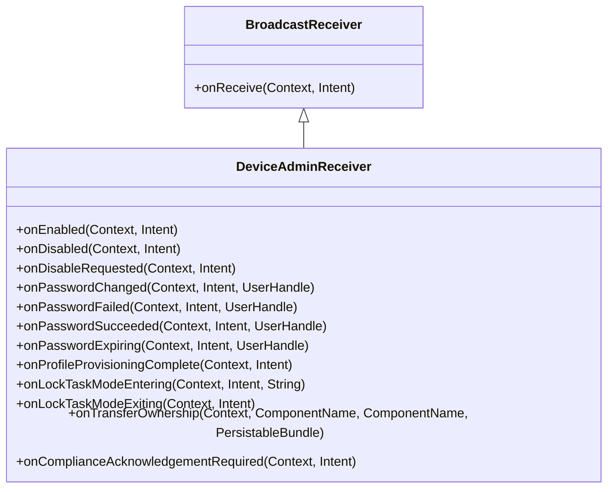

### 61.4.2  管理员生命周期

管理员生命周期遵循特定的顺序：

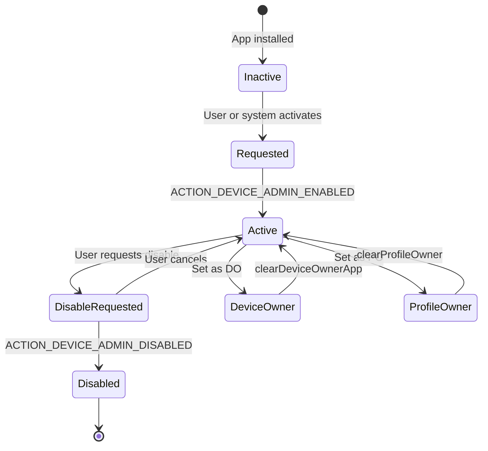

### 61.4.3  密码策略

密码策略是最常用的设备管理功能之一。Android 支持两种方法：

**旧式基于质量的方法**（已弃用但仍受支持）：

```java
// DevicePolicyManager.java
public static final int PASSWORD_QUALITY_UNSPECIFIED = 0;
public static final int PASSWORD_QUALITY_BIOMETRIC_WEAK = 0x8000;
public static final int PASSWORD_QUALITY_SOMETHING = 0x10000;
public static final int PASSWORD_QUALITY_NUMERIC = 0x20000;
public static final int PASSWORD_QUALITY_NUMERIC_COMPLEX = 0x30000;
public static final int PASSWORD_QUALITY_ALPHABETIC = 0x40000;
public static final int PASSWORD_QUALITY_ALPHANUMERIC = 0x50000;
public static final int PASSWORD_QUALITY_COMPLEX = 0x60000;
```

**现代基于复杂度的方法**（推荐）：

```java
// DevicePolicyManager.java
public static final int PASSWORD_COMPLEXITY_NONE = 0;
public static final int PASSWORD_COMPLEXITY_LOW = 0x10000;
public static final int PASSWORD_COMPLEXITY_MEDIUM = 0x30000;
public static final int PASSWORD_COMPLEXITY_HIGH = 0x50000;
```

复杂度档位映射到具体的要求：

| 复杂度 | PIN | 图案 | 密码 |
|-----------|-----|---------|----------|
| LOW | 4+ 位数字 | 任意 | 4+ 个字符 |
| MEDIUM | 4+ 位数字，无重复/顺序 | 不适用 | 4+ 个字符 |
| HIGH | 8+ 位数字，无重复/顺序 | 不适用 | 6+ 个字符，包含一个非数字字符 |

图案永远只能满足 LOW（`PasswordMetrics` 仅允许图案凭据类型出现在 LOW 和 NONE 类别中）。当凭据包含任何非数字字符时，HIGH 最小长度为 6，否则为 8。

`ActiveAdmin` 类将密码策略存储在一个专用对象中：

```java
// ActiveAdmin.java
PasswordPolicy mPasswordPolicy = new PasswordPolicy();
// Fields include: quality, length, uppercase, lowercase,
// letters, numeric, symbols, nonletter, history length
```

### 61.4.4  密码过期

管理员可以强制定期更改密码：

```java
// ActiveAdmin.java
private static final String TAG_PASSWORD_EXPIRATION_DATE = "password-expiration-date";
private static final String TAG_PASSWORD_EXPIRATION_TIMEOUT = "password-expiration-timeout";
```

当密码过期时，系统会向管理员发送 `ACTION_PASSWORD_EXPIRING` 广播。管理员随后可以提示用户更改密码。

### 61.4.5  最大密码失败尝试次数

管理员可以配置在多次解锁尝试失败后自动擦除数据：

```java
// ActiveAdmin.java
private static final String TAG_MAX_FAILED_PASSWORD_WIPE = "max-failed-password-wipe";
```

当超过阈值时，DPMS 会擦除工作资料（针对资料所有者）或对设备执行恢复出厂设置（针对设备所有者）。

### 61.4.6  设备锁定

`USES_POLICY_FORCE_LOCK` 策略允许管理员立即锁定设备，或设置自动锁定前的最大空闲时间：

```java
// DeviceAdminInfo.java
public static final int USES_POLICY_FORCE_LOCK = 3;
```

```java
// ActiveAdmin.java
private static final String TAG_MAX_TIME_TO_UNLOCK = "max-time-to-unlock";
private static final String TAG_STRONG_AUTH_UNLOCK_TIMEOUT = "strong-auth-unlock-timeout";
```

当调用 `lockNow()` 时，DPMS 会触发强身份验证：

```java
// DevicePolicyManagerService.java (referenced constants)
import static com.android.internal.widget.LockPatternUtils.StrongAuthTracker
    .STRONG_AUTH_REQUIRED_AFTER_DPM_LOCK_NOW;
```

### 61.4.7  加密策略

管理员可以要求存储加密：

```java
// DeviceAdminInfo.java
public static final int USES_ENCRYPTED_STORAGE = 7;

// ActiveAdmin.java
private static final String TAG_ENCRYPTION_REQUESTED = "encryption-requested";
```

DPMS 通过 `DevicePolicyManager` 常量查询加密状态：

```java
// DevicePolicyManager.java
public static final int ENCRYPTION_STATUS_ACTIVE_PER_USER = 5;
// Indicates file-based encryption is active
```

### 61.4.8  相机禁用策略

相机禁用策略是一个布尔策略，可以按用户或全局设置：

```java
// DeviceAdminInfo.java
public static final int USES_POLICY_DISABLE_CAMERA = 8;

// ActiveAdmin.java
private static final String TAG_DISABLE_CAMERA = "disable-camera";
```

在策略引擎中，相机禁用使用 `TRUE_MORE_RESTRICTIVE` 解析——如果任何管理员禁用了相机，它就保持禁用：

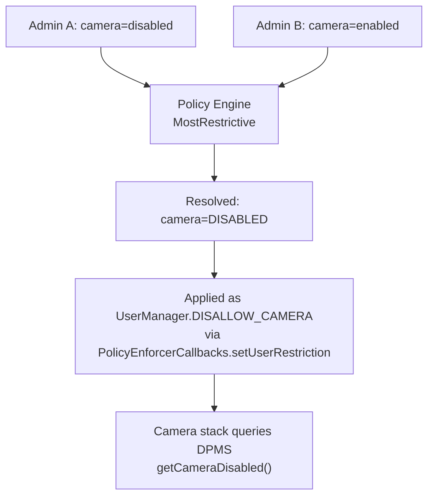

### 61.4.9  屏幕捕获禁用

与相机禁用类似，屏幕捕获可以按用户禁用：

```java
// ActiveAdmin.java
private static final String TAG_DISABLE_SCREEN_CAPTURE = "disable-screen-capture";
```

### 61.4.10  锁屏功能禁用

管理员可以有选择地禁用锁屏功能：

```java
// DeviceAdminInfo.java
public static final int USES_POLICY_DISABLE_KEYGUARD_FEATURES = 9;

// DevicePolicyManager.java (lock task features, related)
public static final int LOCK_TASK_FEATURE_KEYGUARD = ...;
public static final int LOCK_TASK_FEATURE_NOTIFICATIONS = ...;
public static final int LOCK_TASK_FEATURE_OVERVIEW = ...;
public static final int LOCK_TASK_FEATURE_GLOBAL_ACTIONS = ...;
public static final int LOCK_TASK_FEATURE_HOME = ...;
```

`KEYGUARD_DISABLED_FEATURES` 策略在引擎中被特殊处理：

```java
// PolicyDefinition.java (referenced)
static final PolicyDefinition<Integer> KEYGUARD_DISABLED_FEATURES = ...;
```

### 61.4.11  恢复出厂设置（擦除）

最激烈的管理员操作是擦除设备：

```java
// DeviceAdminInfo.java
public static final int USES_POLICY_WIPE_DATA = 4;

// DevicePolicyManager.java (wipe flags)
public static final int WIPE_EXTERNAL_STORAGE = 0x0001;
public static final int WIPE_RESET_PROTECTION_DATA = 0x0002;
public static final int WIPE_EUICC = 0x0004;
public static final int WIPE_SILENTLY = 0x0008;
```

DPMS 实现委托给 `FactoryResetter`：

```java
// DevicePolicyManagerService.java, factoryResetIfDelayedEarlier()
FactoryResetter factoryResetter = FactoryResetter.newBuilder(mContext)
        .setReason(policy.mFactoryResetReason).setForce(true)
        // ... wipe flags from the persisted DevicePolicyData
        .build();
factoryResetter.factoryReset();
```

如果系统尚未完全启动，恢复出厂设置可能会延迟：

```java
// DevicePolicyData.java
public static final int FACTORY_RESET_FLAG_ON_BOOT = 1;
public static final int FACTORY_RESET_FLAG_WIPE_EXTERNAL_STORAGE = 2;
public static final int FACTORY_RESET_FLAG_WIPE_EUICC = 4;
public static final int FACTORY_RESET_FLAG_WIPE_FACTORY_RESET_PROTECTION = 8;
```

### 61.4.12  恢复出厂设置保护（FRP）

FRP 可防止未经授权的恢复出厂设置。管理员可以配置哪些账户被允许在恢复出厂设置后解锁设备：

```java
// frameworks/base/core/java/android/app/admin/FactoryResetProtectionPolicy.java
public final class FactoryResetProtectionPolicy implements Parcelable {
    // Contains list of allowed accounts and whether FRP is enabled
}
```

### 61.4.13  账户管理

管理员可以控制哪些账户类型可以被添加或移除：

```java
// ActiveAdmin.java
private static final String TAG_DISABLE_ACCOUNT_MANAGEMENT = "disable-account-management";
private static final String TAG_ACCOUNT_TYPE = "account-type";
```

### 61.4.14  VPN 策略

管理员可以使用锁定模式强制执行始终开启的 VPN：

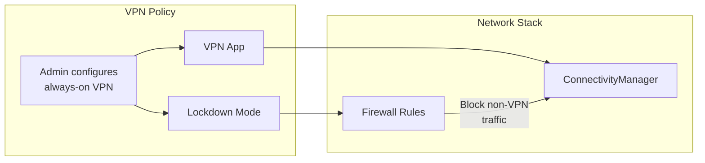

当锁定模式启用时：

- 所有网络流量都会被阻止，直到 VPN 连接。
- 如果 VPN 断开连接，流量会再次被阻止。
- 某些系统级流量（网络运营商检测）可能会被豁免。

### 61.4.15  允许的服务控制

管理员可以限制允许哪些无障碍服务和输入法：

```java
// ActiveAdmin.java
private static final String TAG_PERMITTED_ACCESSIBILITY_SERVICES =
    "permitted-accessiblity-services";  // Note: typo preserved from source
private static final String TAG_PERMITTED_IMES = "permitted-imes";
private static final String TAG_PERMITTED_NOTIFICATION_LISTENERS =
    "permitted-notification-listeners";
```

这确保受管环境中只使用经过批准的无障碍服务和键盘，防止恶意输入法或无障碍服务导致的数据泄露。

### 61.4.16  计量数据控制

管理员可以阻止特定应用使用计量（蜂窝）数据：

```java
// ActiveAdmin.java
private static final String TAG_METERED_DATA_DISABLED_PACKAGES =
    "metered_data_disabled_packages";
```

### 61.4.17  信任代理管理

管理员可以控制信任代理（Smart Lock 功能）：

```java
// ActiveAdmin.java
private static final String TAG_MANAGE_TRUST_AGENT_FEATURES =
    "manage-trust-agent-features";
private static final String TAG_TRUST_AGENT_COMPONENT_OPTIONS =
    "trust-agent-component-options";
private static final String TAG_TRUST_AGENT_COMPONENT = "component";
```

### 61.4.18  附近流式传输策略

管理员可以控制通知和应用的附近流式传输：

```java
// ActiveAdmin.java
private static final String TAG_NEARBY_NOTIFICATION_STREAMING_POLICY =
    "nearby-notification-streaming-policy";
private static final String TAG_NEARBY_APP_STREAMING_POLICY =
    "nearby-app-streaming-policy";
```

### 61.4.19  组织身份

管理员可以设置组织名称和颜色用于品牌标识：

```java
// ActiveAdmin.java
private static final String TAG_ORGANIZATION_COLOR = "organization-color";
private static final String TAG_ORGANIZATION_NAME = "organization-name";
```

组织名称会显示在“设置”以及与受管资料相关的通知中。

### 61.4.20  支持消息

管理员可以设置向用户显示的简短和详细支持消息：

```java
// ActiveAdmin.java
private static final String TAG_SHORT_SUPPORT_MESSAGE = "short-support-message";
private static final String TAG_LONG_SUPPORT_MESSAGE = "long-support-message";
```

简短消息显示在“设置”应用中管理员条目的旁边。详细消息提供有关管理策略的详细信息。

### 61.4.21  会话消息（多用户）

对于多用户设备（例如共享平板），管理员可以设置会话开始/结束消息：

```java
// ActiveAdmin.java
private static final String TAG_START_USER_SESSION_MESSAGE = "start_user_session_message";
private static final String TAG_END_USER_SESSION_MESSAGE = "end_user_session_message";
```

### 61.4.22  用户限制

除了特定的策略 API 之外，设备所有者和资料所有者还可以设置限制设备功能的用户限制：

```java
// ActiveAdmin.java
private static final String TAG_USER_RESTRICTIONS = "user-restrictions";
private static final String TAG_DEFAULT_ENABLED_USER_RESTRICTIONS =
    "default-enabled-user-restrictions";
private static final String TAG_RESTRICTION = "restriction";
```

常见的用户限制包括：

```
UserManager.DISALLOW_INSTALL_APPS
UserManager.DISALLOW_UNINSTALL_APPS
UserManager.DISALLOW_CONFIG_WIFI
UserManager.DISALLOW_SHARE_LOCATION
UserManager.DISALLOW_MODIFY_ACCOUNTS
UserManager.DISALLOW_CONFIG_BLUETOOTH
UserManager.DISALLOW_USB_FILE_TRANSFER
UserManager.DISALLOW_DEBUGGING_FEATURES
UserManager.DISALLOW_CONFIG_VPN
UserManager.DISALLOW_FACTORY_RESET
UserManager.DISALLOW_REMOVE_MANAGED_PROFILE
UserManager.DISALLOW_ADD_USER
UserManager.DISALLOW_MOUNT_PHYSICAL_MEDIA
UserManager.DISALLOW_OUTGOING_CALLS
UserManager.DISALLOW_SMS
UserManager.DISALLOW_CELLULAR_2G
```

策略引擎对用户限制进行特殊处理：

```java
// PolicyDefinition.java
static final int POLICY_FLAG_USER_RESTRICTION_POLICY = 1 << 4;
// "Add this flag to any policy that is a user restriction, the reason for
//  this is that there are some special APIs to handle user restriction
//  policies and this is the way we can identify them."
```

### 61.4.23  锁屏任务模式

锁屏任务模式将设备固定在特定应用上，适用于信息亭和单用途设备：

```java
// DevicePolicyManager.java
public static final int LOCK_TASK_FEATURE_BLOCK_ACTIVITY_START_IN_TASK = ...;
public static final int LOCK_TASK_FEATURE_GLOBAL_ACTIONS = ...;
public static final int LOCK_TASK_FEATURE_HOME = ...;
public static final int LOCK_TASK_FEATURE_KEYGUARD = ...;
public static final int LOCK_TASK_FEATURE_NOTIFICATIONS = ...;
public static final int LOCK_TASK_FEATURE_OVERVIEW = ...;
public static final int LOCK_TASK_FEATURE_QUICK_SETTINGS = ...;
public static final int LOCK_TASK_FEATURE_SYSTEM_INFO = ...;
```

该策略定义使用 `TopPriority` 解析：

```java
// PolicyDefinition.java
static PolicyDefinition<LockTaskPolicy> LOCK_TASK = new PolicyDefinition<>(
    new NoArgsPolicyKey(DevicePolicyIdentifiers.LOCK_TASK_POLICY),
    new TopPriority<>(List.of(
        EnforcingAdmin.getRoleAuthorityOf(ROLE_SYSTEM_FINANCED_DEVICE_CONTROLLER),
        EnforcingAdmin.DPC_AUTHORITY)),
    POLICY_FLAG_LOCAL_ONLY_POLICY,
    (LockTaskPolicy value, Context context, Integer userId, PolicyKey policyKey) ->
        PolicyEnforcerCallbacks.setLockTask(value, context, userId),
    new LockTaskPolicySerializer());
```

---

## 61.5  受管配置

### 61.5.1  应用限制框架

受管配置（也称为应用限制）允许管理员将键值配置推送到受管应用。这是在无需用户交互的情况下配置工作应用的主要机制。

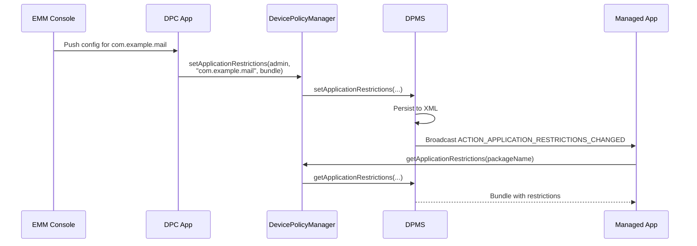

### 61.5.2  限制类型

限制以包含类型化键值对的 `Bundle` 进行传递。应用在 XML 资源中声明其支持的限制：

```xml
<!-- res/xml/app_restrictions.xml -->
<restrictions xmlns:android="http://schemas.android.com/apk/res/android">
    <restriction
        android:key="server_url"
        android:restrictionType="string"
        android:title="@string/server_url_title"
        android:description="@string/server_url_description"
        android:defaultValue="https://mail.example.com" />
    <restriction
        android:key="allow_personal_use"
        android:restrictionType="bool"
        android:title="@string/personal_use_title"
        android:defaultValue="false" />
    <restriction
        android:key="max_attachment_size"
        android:restrictionType="integer"
        android:title="@string/max_attachment_title"
        android:defaultValue="10" />
</restrictions>
```

支持的限制类型：

| 类型 | XML 值 | Java 类型 |
|------|-----------|-----------|
| 布尔 | `bool` | `boolean` |
| 字符串 | `string` | `String` |
| 整数 | `integer` | `int` |
| 多选 | `multi-select` | `String[]` |
| 单选 | `choice` | `String` |
| Bundle | `bundle` | `Bundle`（嵌套） |
| Bundle 数组 | `bundle_array` | `Parcelable[]` |

### 61.5.3  应用限制的委托

应用限制能力可以被委托：

```java
// DevicePolicyManager.java
public static final String DELEGATION_APP_RESTRICTIONS = "delegation-app-restrictions";
```

这允许 EMM 代理将配置管理委托给专门构建的配置应用。

### 61.5.4  RestrictionsManager

应用通过 `RestrictionsManager` 检索其受管配置：

```java
// android.content.RestrictionsManager
public Bundle getApplicationRestrictions() { ... }
public List<RestrictionEntry> getManifestRestrictions(String packageName) { ... }
```

`RestrictionsReceiver` 允许应用接收异步限制更新：

```java
// frameworks/base/core/java/android/service/restrictions/RestrictionsReceiver.java
// Referenced in DevicePolicyManager.java imports:
import android.service.restrictions.RestrictionsReceiver;
```

### 61.5.5  策略引擎的处理方式

应用限制使用 `NON_COEXISTABLE_POLICY` 标志，这意味着每个管理员的限制都独立存储，而不是被合并：

```java
// PolicyDefinition.java
// POLICY_FLAG_NON_COEXISTABLE_POLICY = 1 << 3
// "admin policies should be treated independently of each other and should not
//  have any resolution logic applied... e.g. application restrictions set by
//  different admins for a single package should not be merged, but saved and
//  queried independent of each other."
```

### 61.5.6  受管配置架构

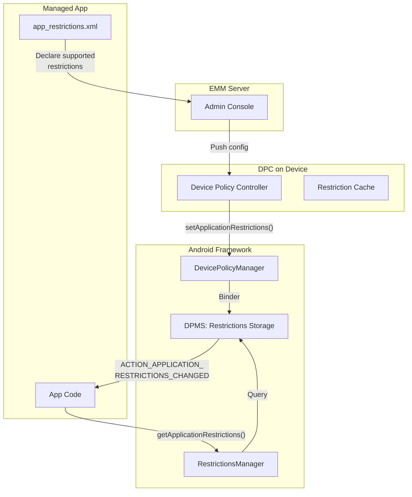

### 61.5.7  常见用例的受管应用配置

常见的受管配置模式：

**VPN 配置**：
```xml
<restriction android:key="vpn_server" android:restrictionType="string" />
<restriction android:key="vpn_protocol" android:restrictionType="choice"
    android:entries="@array/vpn_protocols"
    android:entryValues="@array/vpn_protocol_values" />
```

**电子邮件配置**：
```xml
<restriction android:key="email_server" android:restrictionType="string" />
<restriction android:key="email_port" android:restrictionType="integer" />
<restriction android:key="use_ssl" android:restrictionType="bool" />
```

**Wi-Fi 配置**（通过 DPC）：
```xml
<restriction android:key="wifi_ssid" android:restrictionType="string" />
<restriction android:key="wifi_security_type" android:restrictionType="choice" />
```

---

## 61.6  COPE 与完全受管设备

### 61.6.1  完全受管设备配置

完全受管设备在初始设置期间通过 `provisionFullyManagedDevice()` 进行配置：

```java
// frameworks/base/core/java/android/app/admin/FullyManagedDeviceProvisioningParams.java
public final class FullyManagedDeviceProvisioningParams implements Parcelable {
    @NonNull private final ComponentName mDeviceAdminComponentName;
    @NonNull private final String mOwnerName;
    private final boolean mLeaveAllSystemAppsEnabled;
    @Nullable private final String mTimeZone;
    private final long mLocalTime;
    @Nullable private final Locale mLocale;
    private final boolean mDeviceOwnerCanGrantSensorsPermissions;
    @NonNull private final PersistableBundle mAdminExtras;
    private final boolean mDemoDevice;
}
```

### 61.6.2  配置方法

Android 支持多个配置入口点：

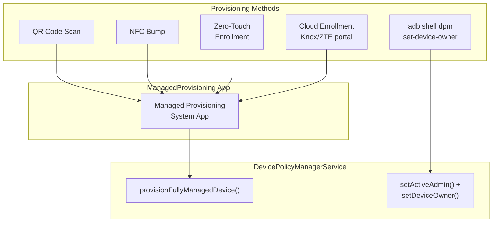

`dpm set-device-owner` shell 命令不会经过 `provisionFullyManagedDevice()`——它在 `DevicePolicyManagerServiceShellCommand.runSetDeviceOwner()` 中的处理程序直接调用 `setActiveAdmin()`，然后调用 `setDeviceOwner()`。`provisionFullyManagedDevice()` 是 ManagedProvisioning 系统应用使用的入口点。

配置 intent：

```java
// DevicePolicyManager.java
public static final String ACTION_PROVISION_MANAGED_DEVICE
    = "android.app.action.PROVISION_MANAGED_DEVICE";
public static final String ACTION_PROVISION_MANAGED_PROFILE
    = "android.app.action.PROVISION_MANAGED_PROFILE";
public static final String ACTION_PROVISION_MANAGED_USER
    = "android.app.action.PROVISION_MANAGED_USER";
```

### 61.6.3  设备所有者能力

设备所有者拥有最广泛的能力集：

| 类别 | 能力 |
|----------|-------------|
| **网络** | 设置全局代理、配置 Wi-Fi、设置 VPN、配置专用 DNS |
| **安全** | 启用安全日志、启用网络日志、生成证明密钥 |
| **应用** | 静默安装/卸载应用、隐藏应用、挂起应用、阻止卸载 |
| **系统** | 设置系统更新策略、重启设备、设置时间/时区 |
| **用户** | 创建/移除用户、切换用户、设置关联 ID |
| **硬件** | 禁用相机、禁用屏幕捕获、禁用 USB 数据传输 |
| **电话** | 配置 APN、管理订阅 |
| **身份** | 设置组织名称、设置设备所有者锁屏信息 |

### 61.6.4  COPE 架构

COPE 没有设备所有者。相反，工作资料的资料所有者被标记为组织所有设备上的资料所有者。这一标记赋予它对个人一侧的有限设备级权力。配置时的关键区别在于 `mOrganizationOwnedProvisioning` 标志：

```java
// ManagedProfileProvisioningParams.java
private final boolean mOrganizationOwnedProvisioning;
```

当此标志为 true 时，资料所有者获得针对个人资料的额外能力：

1. 当工作资料关闭时间过长时**挂起个人应用**。
2. 在设备级锁屏上**强制执行密码策略**。
3. 为整个设备**控制网络日志**。
4. **查询设备标识符**（IMEI、序列号）。

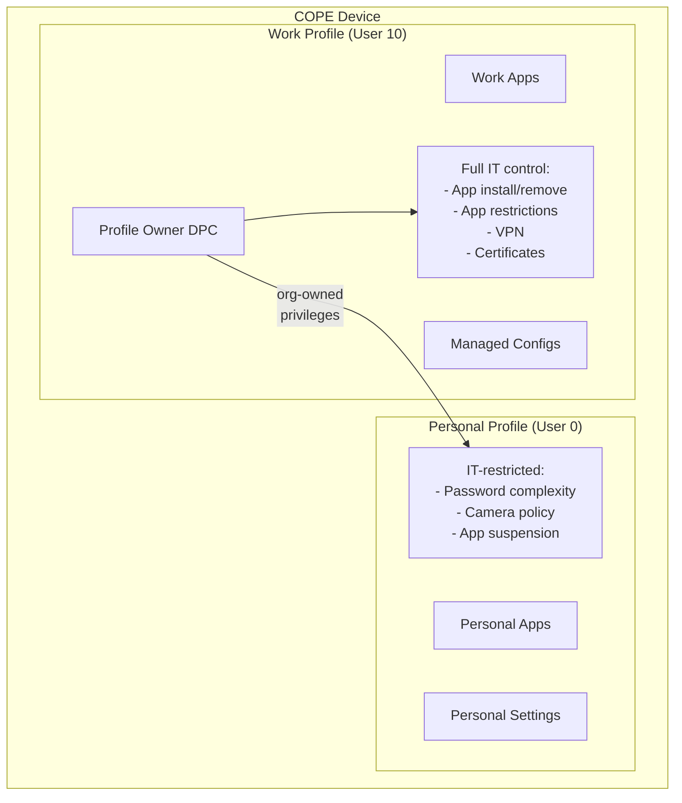

### 61.6.5  COPE 与完全受管对比

```
Feature                  | Fully Managed | COPE
-------------------------|---------------|------
Device Owner present     | Yes           | No (profile owner with elevated rights)
Personal apps allowed    | IT decision   | Yes (primary purpose)
Personal app visibility  | IT can see    | IT cannot see
Work profile exists      | Optional      | Yes
User can remove work     | No            | No (org-owned)
Factory reset control    | Full          | Via FRP
Personal app suspension  | N/A           | Yes (if work off too long)
```

### 61.6.6  分期设备

Android 还支持针对处于融资协议下的设备的“分期设备”模式：

```java
// DevicePolicyManager.java
public static final int DEVICE_OWNER_TYPE_DEFAULT = 0;
public static final int DEVICE_OWNER_TYPE_FINANCED = 1;
```

分期设备控制器使用 `ROLE_SYSTEM_FINANCED_DEVICE_CONTROLLER` 角色，并在策略解析中具有特定优先级：

```java
// PolicyDefinition.java (example: Lock task)
new TopPriority<>(List.of(
    EnforcingAdmin.getRoleAuthorityOf(ROLE_SYSTEM_FINANCED_DEVICE_CONTROLLER),
    EnforcingAdmin.DPC_AUTHORITY))
```

### 61.6.7  系统更新策略

设备所有者可以控制系统更新的应用方式：

```java
// Referenced in Owners.java
import android.app.admin.SystemUpdatePolicy;
import android.app.admin.SystemUpdateInfo;
```

四种更新策略：

- **自动**——只要有更新可用就立即安装。
- **窗口期**——在配置的维护窗口内安装。
- **推迟**——将更新最多推迟 30 天。
- **冻结期**——在指定的日期范围内完全阻止更新。

```java
// frameworks/base/core/java/android/app/admin/FreezePeriod.java
// A FreezePeriod is a repeating date range during which updates are
// blocked (e.g., during holiday sales); the admin installs them via
// SystemUpdatePolicy.setFreezePeriods(List<FreezePeriod>)
```

### 61.6.8  始终开启的 VPN

设备所有者和资料所有者都可以强制执行始终开启的 VPN：

```java
// ActiveAdmin.java
private static final String TAG_ALWAYS_ON_VPN_PACKAGE = "vpn-package";
```

当配置了始终开启的 VPN 时，网络流量会被阻止，直到 VPN 连接（锁定模式）。

---

## 61.7  跨资料通信

### 61.7.1  跨资料边界

工作/个人边界是 Android Enterprise 最重要的安全特性之一。默认情况下，一个资料中的应用无法看到或与另一个资料中的应用或数据交互。跨资料通信必须通过几种机制明确启用。

```mermaid
graph TB
    subgraph "Personal Profile"
        P_APP[Personal App]
        P_CONTACTS[Personal Contacts]
        P_CALENDAR[Personal Calendar]
    end

    subgraph "Cross-Profile Mechanisms"
        CPI["Cross-Profile<br/>Intent Filters"]
        CPA["CrossProfileApps<br/>API"]
        CPP["Cross-Profile<br/>Providers"]
        CPCP["Cross-Profile<br/>Calendar/Contacts"]
    end

    subgraph "Work Profile"
        W_APP[Work App]
        W_CONTACTS[Work Contacts]
        W_CALENDAR[Work Calendar]
    end

    P_APP --> CPI --> W_APP
    P_APP --> CPA --> W_APP
    P_CONTACTS <--> CPP <--> W_CONTACTS
    P_CALENDAR <--> CPCP <--> W_CALENDAR
```

### 61.7.2  跨资料 intent 过滤器

DPC 控制哪些 intent 跨越资料边界：

```java
// DevicePolicyManager.java
public void addCrossProfileIntentFilter(
    @Nullable ComponentName admin,
    IntentFilter filter,
    int flags) { ... }

public void clearCrossProfileIntentFilters(
    @Nullable ComponentName admin) { ... }
```

标志控制方向：

```java
// DevicePolicyManager.java
public static final int FLAG_PARENT_CAN_ACCESS_MANAGED = 0x0001;
// Intents sent from the work profile can resolve to personal (parent) apps

public static final int FLAG_MANAGED_CAN_ACCESS_PARENT = 0x0002;
// Intents sent from the personal (parent) profile can resolve to work apps
```

### 61.7.3  默认跨资料 intent 过滤器

在 DPC 配置任何过滤器之前，系统就为基本功能提供了默认的跨资料 intent 过滤器。这些通常包括：

- **电话**：允许个人拨号器显示工作联系人。
- **Web URL**：允许跨资料进行链接导航。
- **设置**：允许从任一资料访问设备设置。

### 61.7.4  CrossProfileApps API

`CrossProfileApps` 类为跨资料交互提供了更高层的 API：

```java
// frameworks/base/core/java/android/content/pm/CrossProfileApps.java
public class CrossProfileApps {

    public static final String ACTION_CAN_INTERACT_ACROSS_PROFILES_CHANGED =
        "android.content.pm.action.CAN_INTERACT_ACROSS_PROFILES_CHANGED";

    // Start an activity in another profile
    public void startMainActivity(
        ComponentName component, UserHandle targetUser) { ... }

    // Get profiles available for cross-profile interaction
    public List<UserHandle> getTargetUserProfiles() { ... }

    // Check if cross-profile interaction is allowed
    public boolean canInteractAcrossProfiles() { ... }
    public boolean canRequestInteractAcrossProfiles() { ... }
}
```

### 61.7.5  跨资料应用清单声明

希望跨资料交互的应用在清单中声明这一点：

```xml
<manifest>
    <application android:crossProfile="true">
        <!-- App can receive CAN_INTERACT_ACROSS_PROFILES_CHANGED
             in manifest receivers -->
    </application>
</manifest>
```

### 61.7.6  个人应用中的工作联系人

最可见的跨资料功能之一是在个人电话应用中显示工作联系人。这由多个策略控制：

```java
// ActiveAdmin.java
private static final String TAG_DISABLE_CALLER_ID = "disable-caller-id";
private static final String TAG_DISABLE_CONTACTS_SEARCH = "disable-contacts-search";
private static final String TAG_DISABLE_BLUETOOTH_CONTACT_SHARING =
    "disable-bt-contacts-sharing";
```

管理员可以独立控制：

1. 跨资料的**来电显示**（显示来电的工作联系人姓名）。
2. 跨资料的**联系人搜索**（从个人应用查找工作联系人）。
3. **蓝牙联系人共享**（通过蓝牙与车载套件共享工作联系人）。

```mermaid
graph LR
    subgraph "Personal Side"
        DIALER[Phone Dialer]
        BT["Bluetooth<br/>Car Kit"]
    end

    subgraph "Policy Controls"
        CID["disableCallerId<br/>(per admin)"]
        CS["disableContactsSearch<br/>(per admin)"]
        BCS["disableBluetoothContactSharing<br/>(per admin)"]
    end

    subgraph "Work Contacts"
        WC[Work Contacts DB]
    end

    DIALER -->|"Caller ID lookup"| CID
    DIALER -->|"Contact search"| CS
    BT -->|"Contact sync"| BCS
    CID -->|"if allowed"| WC
    CS -->|"if allowed"| WC
    BCS -->|"if allowed"| WC
```

### 61.7.7  跨资料日历

管理员可以允许个人日历应用查看工作日历事件：

```java
// ActiveAdmin.java
private static final String TAG_CROSS_PROFILE_CALENDAR_PACKAGES =
    "cross-profile-calendar-packages";
private static final String TAG_CROSS_PROFILE_CALENDAR_PACKAGES_NULL =
    "cross-profile-calendar-packages-null";
```

### 61.7.8  跨资料小组件提供者

小组件提供者可以被允许在个人启动器上显示工作小组件：

```java
// ActiveAdmin.java
private static final String TAG_CROSS_PROFILE_WIDGET_PROVIDERS =
    "cross-profile-widget-providers";
private static final String TAG_PROVIDER = "provider";
```

策略引擎将其定义为一个特定的策略：

```java
// PolicyDefinition.java (referenced)
static final PolicyDefinition<...> CROSS_PROFILE_WIDGET_PROVIDER = ...;
```

### 61.7.9  跨资料包

管理员可以配置一组允许跨资料通信的包：

```java
// ActiveAdmin.java
private static final String TAG_CROSS_PROFILE_PACKAGES = "cross-profile-packages";
```

### 61.7.10  连接的工作和个人应用

`crossProfile` 清单属性启用可跨两个资料工作的“连接”应用：

```xml
<!-- App manifest -->
<application android:crossProfile="true">
    <activity android:name=".MainActivity">
        <intent-filter>
            <action android:name="android.intent.action.MAIN" />
            <category android:name="android.intent.category.LAUNCHER" />
        </intent-filter>
    </activity>
</application>
```

当应用声明 `crossProfile="true"` 时，它会获得几项能力：

1. 它可以在清单接收器（不仅仅是动态注册的接收器）中接收 `CAN_INTERACT_ACROSS_PROFILES_CHANGED` 广播。

2. 系统可能会提示用户授予该应用跨资料交互权限。

3. 应用可以使用 `CrossProfileApps.canInteractAcrossProfiles()` 来检查它当前是否拥有权限。

### 61.7.11  跨资料数据共享模式

存在几种跨资料共享数据的模式：

```mermaid
graph TB
    subgraph "Pattern 1: Intent-Based"
        P1_SRC[Personal App] -->|"startActivity()"| P1_FILTER["Cross-Profile<br/>Intent Filter"]
        P1_FILTER -->|"Resolved"| P1_DST[Work App]
    end

    subgraph "Pattern 2: Provider-Based"
        P2_SRC[Personal App] -->|"ContentResolver.query()"| P2_PROV["Cross-Profile<br/>Content Provider"]
        P2_PROV -->|"Filtered results"| P2_DATA[Work Data]
    end

    subgraph "Pattern 3: Direct Start"
        P3_SRC[Personal App] -->|"CrossProfileApps<br/>.startMainActivity()"| P3_DST[Work App Instance]
    end

    subgraph "Pattern 4: Clipboard"
        P4_SRC["Work App<br/>(copy)"] -->|"Clipboard<br/>(if allowed)"| P4_DST["Personal App<br/>(paste)"]
    end
```

每种模式都有不同的安全含义：

| 模式 | 控制级别 | 用例 |
|---------|--------------|----------|
| 基于 intent | 管理员配置过滤器 | 打开链接、共享内容 |
| 基于提供者 | 管理员 + 系统控制 | 联系人、日历查询 |
| 直接启动 | 应用 + 用户 + 管理员同意 | 在个人/工作实例之间切换 |
| 剪贴板 | 管理员控制 | 跨资料复制粘贴 |

### 61.7.12  跨资料内容提供者访问

系统为跨资料提供者访问提供了特殊的 URI。对于联系人，`ContactsContract.Directory` 类提供：

```java
// DevicePolicyManager.java imports
import android.provider.ContactsContract.Directory;
```

带有 `ENTERPRISE` 标志的目录表示个人资料可用的工作联系人。系统根据管理员的来电显示和联系人搜索策略强制执行访问。

### 61.7.13  资料交互流程

个人应用尝试与工作应用交互时的完整流程：

```mermaid
sequenceDiagram
    participant PA as Personal App
    participant AMS as ActivityManagerService
    participant PMS as PackageManagerService
    participant DPMS as DevicePolicyManagerService
    participant WA as Work App

    Note over DPMS,PMS: At policy-set time
    DPMS->>PMS: addCrossProfileIntentFilter(filter,<br/>sourceUser, targetUser)
    PMS->>PMS: Store in per-user<br/>CrossProfileIntentResolver

    Note over PA,PMS: At startActivity time -- PMS never calls DPMS
    PA->>AMS: startActivity(intent)
    AMS->>PMS: resolveActivity(intent, userId=0)

    PMS->>PMS: Check local resolvers<br/>(personal profile)

    PMS->>PMS: CrossProfileIntentResolverEngine<br/>matches stored filters

    alt Filter added with FLAG_MANAGED_CAN_ACCESS_PARENT
        PMS->>PMS: Resolve in work profile (userId=10)
        PMS-->>AMS: ResolveInfo (work app)
        AMS->>WA: Start activity in work profile
    else No match
        PMS-->>AMS: No cross-profile match
        AMS-->>PA: ActivityNotFoundException
    end
```

---

## 61.8  合规与安全

### 61.8.1  安全日志

安全日志记录设备上与安全相关的事件。`SecurityLogMonitor` 类管理日志缓冲区：

```java
// frameworks/base/services/devicepolicy/java/com/android/server/devicepolicy/
//   SecurityLogMonitor.java
class SecurityLogMonitor implements Runnable {
    // "A class managing access to the security logs. It maintains an internal
    //  buffer of pending logs to be retrieved by the device owner. The logs are
    //  retrieved from the logd daemon via JNI binding, and kept until device
    //  owner has retrieved to prevent loss of logs. Access to the logs from
    //  the device owner is rate-limited, and device owner is notified when the
    //  logs are ready to be retrieved. This happens every two hours, or when
    //  our internal buffer is larger than a certain threshold."
}
```

```mermaid
graph LR
    subgraph "Kernel/System"
        LOGD[logd daemon]
    end

    subgraph "SecurityLogMonitor"
        JNI[JNI Bridge]
        BUFFER[Internal Buffer]
        TIMER[2-hour Timer]
        THRESHOLD["1024 Entry<br/>Threshold"]
    end

    subgraph "Device Owner"
        DPC_SEC[DPC App]
        DPC_CB["onSecurityLogsAvailable()"]
    end

    LOGD -->|"Security events"| JNI
    JNI --> BUFFER

    TIMER -->|"Notify"| DPC_CB
    THRESHOLD -->|"Notify"| DPC_CB
    DPC_SEC -->|"retrieveSecurityLogs()"| BUFFER
```

安全事件包括：

- ADB 连接/断开
- 应用进程启动
- 锁屏解除/锁定
- 介质挂载/卸载
- 操作系统启动/关闭
- 密码更改/失败
- 证书安装
- 密钥生成事件

### 61.8.2  审计日志

除了安全日志之外，Android 还支持审计日志：

```java
// PolicyDefinition.java
static PolicyDefinition<Boolean> AUDIT_LOGGING = new PolicyDefinition<>(
    new NoArgsPolicyKey(DevicePolicyIdentifiers.AUDIT_LOGGING_POLICY),
    TRUE_MORE_RESTRICTIVE,
    POLICY_FLAG_GLOBAL_ONLY_POLICY,
    PolicyEnforcerCallbacks::enforceAuditLogging,
    new BooleanPolicySerializer());
```

在客户端，`DevicePolicyManager` 通过 `setAuditLogEnabled(boolean)` / `isAuditLogEnabled()` 以及通过 `setAuditLogEventCallback(...)` 注册的流式回调公开审计日志功能。回调通过 `IAuditLogEventsCallback` AIDL 接口传递：

```java
// frameworks/base/core/java/android/app/admin/DevicePolicyManager.java
public void setAuditLogEnabled(boolean enabled) { ... }
public boolean isAuditLogEnabled() { ... }
public void setAuditLogEventCallback(Executor executor,
        Consumer<List<SecurityEvent>> callback) {
    // wraps the consumer in an IAuditLogEventsCallback.Stub
}
```

旧式安全日志对事件进行批处理，仅在缓冲区填满时才通知管理员。审计日志则不同：它在产生 `SecurityEvent` 时就会将其流式传输给已注册的回调。这使其可用于近乎实时的合规监控。`IDevicePolicyManager` 上相应的服务端方法是 `setAuditLogEnabled(String callerPackage, boolean enabled)` 和 `isAuditLogEnabled(String callerPackage)`。

### 61.8.3  网络日志

网络日志记录 DNS 查询和 TCP 连接：

```java
// frameworks/base/services/devicepolicy/java/com/android/server/devicepolicy/
//   NetworkLogger.java
final class NetworkLogger {
    private final DevicePolicyManagerService mDpm;
    private final PackageManagerInternal mPm;
    private final AtomicBoolean mIsLoggingEnabled = new AtomicBoolean(false);
    private final int mTargetUserId;
}
```

`NetworkLogger` 注册一个 `INetdEventCallback` 来拦截网络事件：

```java
// NetworkLogger.java
private final INetdEventCallback mNetdEventCallback = new BaseNetdEventCallback() {
    @Override
    public void onDnsEvent(int netId, int eventType, int returnCode,
            String hostname, String[] ipAddresses, int ipAddressesCount,
            long timestamp, int uid) {
        if (!mIsLoggingEnabled.get()) return;
        if (!shouldLogNetworkEvent(uid)) return;
        DnsEvent dnsEvent = new DnsEvent(hostname, ipAddresses,
            ipAddressesCount, mPm.getNameForUid(uid), timestamp);
        sendNetworkEvent(dnsEvent);
    }

    @Override
    public void onConnectEvent(String ipAddr, int port,
            long timestamp, int uid) {
        if (!mIsLoggingEnabled.get()) return;
        // ... similar filtering and event creation
    }
};
```

网络日志处理程序对事件进行批处理：

```java
// NetworkLoggingHandler.java
// (companion to NetworkLogger, handles batching and delivery)
```

```mermaid
sequenceDiagram
    participant NET as Network Stack
    participant NL as NetworkLogger
    participant NLH as NetworkLoggingHandler
    participant DPMS as DPMS
    participant DPC as DPC App

    NET->>NL: onDnsEvent(hostname, ips, uid)
    NL->>NL: shouldLogNetworkEvent(uid)?
    NL->>NLH: sendNetworkEvent(DnsEvent)

    NLH->>NLH: Buffer events<br/>(batch by time/count)

    NLH->>DPMS: Notify batch ready
    DPMS->>DPC: ACTION_NETWORK_LOGS_AVAILABLE

    DPC->>DPMS: retrieveNetworkLogs(batchToken)
    DPMS-->>DPC: List<NetworkEvent>
```

### 61.8.4  设备证明

设备证明允许 DPC 使用硬件支持的密钥向远程服务器证明设备身份：

```java
// DevicePolicyManager.java
public static final int ID_TYPE_BASE_INFO = 1;   // Manufacturer info
public static final int ID_TYPE_SERIAL = 2;       // Serial number
public static final int ID_TYPE_IMEI = 4;         // IMEI
public static final int ID_TYPE_MEID = 8;         // MEID
public static final int ID_TYPE_INDIVIDUAL_ATTESTATION = 16; // Device-unique key
```

证明流程：

```mermaid
sequenceDiagram
    participant DPC as DPC App
    participant DPM as DevicePolicyManager
    participant KS as KeyStore
    participant TEE as TEE/StrongBox
    participant SRV as Remote Server

    DPC->>DPM: generateKeyPair("RSA", keySpec,<br/>ID_TYPE_SERIAL | ID_TYPE_IMEI)
    DPM->>KS: Generate key with attestation
    KS->>TEE: Create key in secure hardware
    TEE-->>KS: Attestation certificate chain

    KS-->>DPM: AttestedKeyPair
    DPM-->>DPC: AttestedKeyPair

    DPC->>DPC: Extract attestation certs
    DPC->>SRV: Send attestation chain

    SRV->>SRV: Verify chain against<br/>Google root certificate
    SRV->>SRV: Extract device properties<br/>from attestation extension
    SRV-->>DPC: Device verified
```

生成的密钥对包含一个证明证书链，可对照 Google 的根 CA 进行验证。证明扩展包含设备属性（操作系统版本、补丁级别、启动状态、设备 ID）。

### 61.8.5  证明证书链结构

证明证书链具有特定的结构，供远程服务器验证：

```mermaid
graph TB
    subgraph "Attestation Chain"
        ROOT["Google Hardware<br/>Attestation Root CA"]
        INTER["Intermediate CA<br/>Batch Certificate"]
        DEVICE["Device Attestation<br/>Certificate"]
        KEY["Key Attestation<br/>Certificate"]
    end

    ROOT --> INTER
    INTER --> DEVICE
    DEVICE --> KEY

    subgraph "Attestation Extension"
        EXT_OS["OS Version: 15"]
        EXT_PATCH["Patch Level: 2025-03-01"]
        EXT_BOOT["Boot State: verified"]
        EXT_ID["Device ID: serial/IMEI"]
        EXT_VB["Verified Boot State: green"]
        EXT_APP["App ID: SHA-256 of signing cert"]
    end

    KEY --> EXT_OS
    KEY --> EXT_PATCH
    KEY --> EXT_BOOT
    KEY --> EXT_ID
    KEY --> EXT_VB
    KEY --> EXT_APP
```

证明扩展（OID 1.3.6.1.4.1.11129.2.1.17）包含：

| 字段 | 描述 |
|-------|-------------|
| `attestationVersion` | 证明格式版本 |
| `attestationSecurityLevel` | TEE 或 StrongBox |
| `keymasterVersion` | KeyMaster/KeyMint 版本 |
| `keymasterSecurityLevel` | 执行环境 |
| `attestationChallenge` | 服务器提供的挑战（随机数） |
| `uniqueId` | 设备唯一 ID（如果请求） |
| `softwareEnforced` | 软件强制的密钥属性 |
| `teeEnforced` | 硬件强制的密钥属性 |

在 `teeEnforced` 中，服务器可以验证：

- `osVersion`——确切的 Android 版本
- `osPatchLevel`——安全补丁级别
- `rootOfTrust`——已验证的启动状态、公钥、设备锁定状态
- `attestationApplicationId`——请求应用的签名证书

### 61.8.6  证书管理

DPC 可以安装 CA 证书和客户端证书：

```java
// DevicePolicyManager.java (delegation)
public static final String DELEGATION_CERT_INSTALL = "delegation-cert-install";
public static final String DELEGATION_CERT_SELECTION = "delegation-cert-selection";
```

`CertificateMonitor` 跟踪管理员安装的证书：

```java
// frameworks/base/services/devicepolicy/java/com/android/server/devicepolicy/
//   CertificateMonitor.java
// Monitors CA certificates installed by the admin
```

### 61.8.7  密码合规检查

DPC 可以检查当前密码是否满足要求：

```java
// DevicePolicyManager.java
// isActivePasswordSufficient() - checks against admin's password policy
// getPasswordComplexity() - returns current complexity level

@RequiresPermission(REQUEST_PASSWORD_COMPLEXITY)
public static final String EXTRA_PASSWORD_COMPLEXITY =
    "android.app.extra.PASSWORD_COMPLEXITY";
```

合规动作：

```java
// DevicePolicyManager.java
public static final String ACTION_CHECK_POLICY_COMPLIANCE
    = "android.app.action.CHECK_POLICY_COMPLIANCE";
```

### 61.8.8  合规确认

从 Android 12 开始，系统要求 DPC 确认合规状态：

```java
// DeviceAdminReceiver.java
public static final String ACTION_COMPLIANCE_ACKNOWLEDGEMENT_REQUIRED
    = "android.app.action.COMPLIANCE_ACKNOWLEDGEMENT_REQUIRED";
```

### 61.8.9  安全补丁验证

DPC 可以查询设备的安全补丁级别并强制执行最低级别。DPMS 导入了系统更新查询权限：

```java
// DevicePolicyManagerService.java
import static android.Manifest.permission
    .MANAGE_DEVICE_POLICY_QUERY_SYSTEM_UPDATES;
```

### 61.8.10  USB 数据信令控制

对于高安全环境，可以禁用 USB 数据传输：

```java
// DevicePolicyManagerService.java
import static android.Manifest.permission
    .MANAGE_DEVICE_POLICY_USB_DATA_SIGNALLING;
```

### 61.8.11  内存标记扩展（MTE）

在受支持的硬件上，DPC 可以启用 MTE 以增强内存安全性：

```java
// DevicePolicyManagerService.java
import static android.Manifest.permission.MANAGE_DEVICE_POLICY_MTE;

// PolicyDefinition.java
import static android.app.admin.DevicePolicyIdentifiers.MEMORY_TAGGING_POLICY;
```

### 61.8.12  内容保护

DPC 可以通过三态策略控制内容保护。`DevicePolicyManager` 常量如下：

```java
// frameworks/base/core/java/android/app/admin/DevicePolicyManager.java
public static final int CONTENT_PROTECTION_NOT_CONTROLLED_BY_POLICY = 0;
public static final int CONTENT_PROTECTION_DISABLED = 1;
public static final int CONTENT_PROTECTION_ENABLED = 2;
```

`setContentProtectionPolicy`/`getContentProtectionPolicy` 通过策略引擎在 `DevicePolicyIdentifiers.CONTENT_PROTECTION_POLICY`（`"contentProtection"`）下进行路由，客户端 API 由 `MANAGE_DEVICE_POLICY_CONTENT_PROTECTION` 控制。默认状态 `CONTENT_PROTECTION_NOT_CONTROLLED_BY_POLICY` 会让设备自身的内容保护设置保持不变，将“无意见”与明确的禁用区分开来。

### 61.8.13  被盗设备状态

Android 支持设备防盗 API：

```java
// DevicePolicyManager.java (flags)
import static android.app.admin.flags.Flags.FLAG_DEVICE_THEFT_API_ENABLED;

// DevicePolicyManagerService.java
import static android.Manifest.permission.QUERY_DEVICE_STOLEN_STATE;
```

### 61.8.14  设备策略状态

DPC 可以查询完整的设备策略状态：

```java
// frameworks/base/core/java/android/app/admin/DevicePolicyState.java
public final class DevicePolicyState implements Parcelable {
    // Complete snapshot of all active policies on the device
}
```

### 61.8.15  企业专用 ID

为了进行保护隐私的设备标识，Android 生成企业专用 ID：

```java
// frameworks/base/services/devicepolicy/java/com/android/server/devicepolicy/
//   EnterpriseSpecificIdCalculator.java
// Generates a stable per-enterprise device ID without exposing
// hardware identifiers
```

### 61.8.16  远程 Bugreport

DPC 可以请求设备的 bug report：

```java
// frameworks/base/services/devicepolicy/java/com/android/server/devicepolicy/
//   RemoteBugreportManager.java
// Manages remote bug report requests from the admin

// DevicePolicyData.java
private static final String TAG_LAST_BUG_REPORT_REQUEST = "last-bug-report-request";
```

### 61.8.17  Wi-Fi SSID 策略

管理员可以控制设备可以连接哪些 Wi-Fi 网络：

```java
// ActiveAdmin.java references WifiSsidPolicy
import android.app.admin.WifiSsidPolicy;

// Two modes:
import static android.app.admin.WifiSsidPolicy.WIFI_SSID_POLICY_TYPE_ALLOWLIST;
import static android.app.admin.WifiSsidPolicy.WIFI_SSID_POLICY_TYPE_DENYLIST;
```

在允许列表模式下，只能连接指定的 SSID。在拒绝列表模式下，指定的 SSID 会被阻止。

### 61.8.18  专用 DNS 策略

管理员可以配置专用 DNS（DNS-over-TLS）设置：

```java
// DevicePolicyManager.java
public static final int PRIVATE_DNS_MODE_OFF = 1;
public static final int PRIVATE_DNS_MODE_OPPORTUNISTIC = 2;
public static final int PRIVATE_DNS_MODE_PROVIDER_HOSTNAME = 3;
public static final int PRIVATE_DNS_MODE_UNKNOWN = 0;

public static final int PRIVATE_DNS_SET_NO_ERROR = 0;
public static final int PRIVATE_DNS_SET_ERROR_HOST_NOT_SERVING = 1;
public static final int PRIVATE_DNS_SET_ERROR_FAILURE_SETTING = 2;
```

### 61.8.19  优先网络服务

适用于需要专用网络路径的企业场景：

```java
// Referenced in ActiveAdmin
import android.app.admin.PreferentialNetworkServiceConfig;
```

这允许管理员配置企业网络偏好，确保工作流量使用特定的网络切片或企业 APN。

### 61.8.20  APN 配置（电话）

设备所有者可以管理 APN（接入点名称）设置：

```java
// DevicePolicyManagerService.java
import static android.provider.Telephony.Carriers.DPC_URI;
import static android.provider.Telephony.Carriers.ENFORCE_KEY;
import static android.provider.Telephony.Carriers.ENFORCE_MANAGED_URI;
import static android.provider.Telephony.Carriers.INVALID_APN_ID;
```

### 61.8.21  包策略

管理员可以控制允许哪些包用于特定目的：

```java
// Referenced in DevicePolicyManager
import android.app.admin.PackagePolicy;
// PackagePolicy allows allowlist/denylist of packages for specific
// capabilities (e.g., cross-profile intent handling)
```

### 61.8.22  临时用户

设备所有者可以强制创建临时用户。这确保在用户注销时删除所有用户数据：

```java
// ActiveAdmin.java
private static final String TAG_FORCE_EPHEMERAL_USERS = "force_ephemeral_users";
```

这对于教育或零售环境中的共享设备特别有用。

### 61.8.23  受保护的包

管理员可以保护特定包免受用户干扰：

```java
// DevicePolicyData.java
private static final String TAG_PROTECTED_PACKAGES = "protected-packages";
```

### 61.8.24  绕过角色资格

在某些企业场景中，管理员需要向不满足正常资格标准的包授予角色：

```java
// DevicePolicyData.java
private static final String TAG_BYPASS_ROLE_QUALIFICATIONS =
    "bypass-role-qualifications";
```

### 61.8.25  二级锁屏

管理员可以启用二级锁屏：

```java
// DevicePolicyData.java
private static final String TAG_SECONDARY_LOCK_SCREEN = "secondary-lock-screen";
```

这允许 DPC 实现一个额外的锁屏（例如用于合规验证），它出现在标准锁屏之前或之后。

### 61.8.26  应用豁免

管理员可以让特定应用豁免各种系统限制：

```java
// DevicePolicyManager.java
public static final int EXEMPT_FROM_ACTIVITY_BG_START_RESTRICTION = ...;
public static final int EXEMPT_FROM_DISMISSIBLE_NOTIFICATIONS = ...;
public static final int EXEMPT_FROM_HIBERNATION = ...;
public static final int EXEMPT_FROM_POWER_RESTRICTIONS = ...;
public static final int EXEMPT_FROM_SUSPENSION = ...;
```

这些豁免确保关键企业应用（如 VPN 客户端或管理代理）即使在电池优化或挂起策略下也能继续运行。

### 61.8.27  完整的合规架构

```mermaid
graph TB
    subgraph "EMM Server"
        SRV_POLICY[Policy Configuration]
        SRV_COMPLIANCE[Compliance Engine]
        SRV_ATTEST[Attestation Verifier]
    end

    subgraph "Device"
        subgraph "DPC App"
            DPC_AGENT[Management Agent]
            DPC_COMPLIANCE[Compliance Checker]
        end

        subgraph "DPMS"
            SEC_LOG[Security Log Monitor]
            NET_LOG[Network Logger]
            CERT_MON[Certificate Monitor]
            ATTEST[Key Attestation]
        end

        subgraph "Hardware"
            TEE_HW[TEE / StrongBox]
            KS_HW[Hardware Keystore]
        end
    end

    SRV_POLICY --> |"Push policies"| DPC_AGENT
    DPC_AGENT --> |"Set policies"| SEC_LOG
    DPC_AGENT --> |"Set policies"| NET_LOG
    DPC_AGENT --> |"Install certs"| CERT_MON

    SEC_LOG --> |"Security events"| DPC_COMPLIANCE
    NET_LOG --> |"Network events"| DPC_COMPLIANCE
    DPC_COMPLIANCE --> |"Report status"| SRV_COMPLIANCE

    DPC_AGENT --> |"Request attestation"| ATTEST
    ATTEST --> |"Generate key"| TEE_HW
    TEE_HW --> |"Cert chain"| ATTEST
    ATTEST --> |"Attestation result"| SRV_ATTEST
```

### 61.8.28  作为系统管理员的高级保护模式

Android 16 引入了、Android 17 扩展了**高级保护模式（AAPM）**。AAPM 是一个面向用户的单一开关（设置），可一次性开启一组加固的安全功能。架构上有趣之处在于它是*如何*强制执行这些功能的：AAPM **不是** DPMS 的一部分，也**不是** DPC。它是一个独立的系统服务。它以*系统管理员*身份驱动少数现有的设备策略。它通过 61.2 节所述的同一策略引擎来实现。

该服务及其客户端 API 位于 devicepolicy 包之外：

```java
// frameworks/base/services/core/java/com/android/server/security/advancedprotection/
//   AdvancedProtectionService.java                (the system service)
// frameworks/base/core/java/android/security/advancedprotection/
//   AdvancedProtectionManager.java                (the @SystemService client)
public static final String ADVANCED_PROTECTION_SYSTEM_ENTITY =
        "android.security.advancedprotection";
```

每个加固能力都是 `services/core/java/com/android/server/security/advancedprotection/features/` 下的一个“特性钩子”，以 `AdvancedProtectionManager` 中稳定的特性 ID 为键：

```java
// AdvancedProtectionManager.java
public static final int FEATURE_ID_DISALLOW_CELLULAR_2G = 0;
public static final int FEATURE_ID_DISALLOW_INSTALL_UNKNOWN_SOURCES = 1;
public static final int FEATURE_ID_DISALLOW_USB = 2;
public static final int FEATURE_ID_DISALLOW_WEP = 3;
public static final int FEATURE_ID_ENABLE_MTE = 4;
public static final int FEATURE_ID_DISALLOW_INSECURE_WIFI_AUTOJOIN = 5;
public static final int FEATURE_ID_RESTRICT_NON_TOOL_A11Y_SERVICES = 6;
```

通往设备策略的桥梁正是将本章串联起来的部分。例如，`MemoryTaggingExtensionHook` 调用 `setMtePolicy` 的*系统*重载，而不是公开的 `ComponentName` 重载：

```java
// services/core/java/com/android/server/security/advancedprotection/features/
//   MemoryTaggingExtensionHook.java
mDevicePolicyManager.setMtePolicy(ADVANCED_PROTECTION_SYSTEM_ENTITY, mtePolicy);
```

该重载（`DevicePolicyManager.setMtePolicy(String systemEntity, int policy)`）调用 `IDevicePolicyManager.setMtePolicyBySystem(systemEntity, policy)`，DPMS 针对 `createSystemEnforcingAdmin(ADVANCED_PROTECTION_SYSTEM_ENTITY)` 身份记录该值——即 61.2.10 节中的 `system:` 权威。AAPM 的 MTE 偏好作为另一个管理员的值进入引擎。因此，它会按照正常的解析规则与任何 DPC 的 MTE 策略共存，而不是与之对抗。

17 源码树中附带了四个具体的钩子（每个都 `extends AdvancedProtectionHook`）：`MemoryTaggingExtensionHook`、`DisallowInstallUnknownSourcesAdvancedProtectionHook`、`DisallowCellular2GAdvancedProtectionHook` 和 `UsbDataAdvancedProtectionHook`。其中三个通过 DPMS 以 `system:` 管理员身份路由，但使用两个不同的 DPM 调用。MTE 使用上述 `setMtePolicy(ADVANCED_PROTECTION_SYSTEM_ENTITY, ...)`；install-unknown-sources 和 2G 钩子则从系统实体固定一个*全局*用户限制，例如：

```java
// DisallowInstallUnknownSourcesAdvancedProtectionHook.java
mDevicePolicyManager.addUserRestrictionGlobally(ADVANCED_PROTECTION_SYSTEM_ENTITY,
        UserManager.DISALLOW_INSTALL_UNKNOWN_SOURCES_GLOBALLY);
// DisallowCellular2GAdvancedProtectionHook.java -> ...DISALLOW_CELLULAR_2G
```

`addUserRestrictionGlobally(systemEntity, ...)` 仍然会进入 DPMS。它针对相同的系统 `EnforcingAdmin` 记录该限制。因此，用户限制与任何 DPC 的值一起存在于策略引擎中。它不是直接写入 `UserManager` 的。

USB 钩子是个例外：它**完全不会**设置用户限制。在启用时，它通过 `setUsbDataSignalIfPossible(...)` 切换 USB *数据信令*。锁屏状态控制此切换。该钩子仅在设备锁定时禁用数据线。解锁时，它通过 `IUsbManagerInternal.enableUsbDataSignal` 重新启用数据线。不存在 `DISALLOW_USB` 这个 `UserManager` 常量；`FEATURE_ID_DISALLOW_USB` 只是该钩子的特性 ID。

```mermaid
graph LR
    subgraph "AdvancedProtectionService"
        TOGGLE["AAPM toggle<br/>(Settings)"]
        MTE_HOOK["MemoryTaggingExtensionHook"]
        UIS_HOOK["DisallowInstallUnknownSources<br/>AdvancedProtectionHook"]
        G2_HOOK["DisallowCellular2G<br/>AdvancedProtectionHook"]
        USB_HOOK["UsbDataAdvancedProtectionHook"]
    end

    TOGGLE --> MTE_HOOK
    TOGGLE --> UIS_HOOK
    TOGGLE --> G2_HOOK
    TOGGLE --> USB_HOOK

    MTE_HOOK -- "setMtePolicy (system:)" --> DPMS["DevicePolicyManagerService<br/>(system EnforcingAdmin)"]
    UIS_HOOK -- "addUserRestrictionGlobally<br/>(system:, DISALLOW_INSTALL_UNKNOWN_SOURCES_GLOBALLY)" --> DPMS
    G2_HOOK -- "addUserRestrictionGlobally<br/>(system:, DISALLOW_CELLULAR_2G)" --> DPMS
    USB_HOOK -- "enableUsbDataSignal<br/>(keyguard-gated)" --> USB["IUsbManagerInternal<br/>USB data signaling"]

    DPMS --> ENGINE["DevicePolicyEngine<br/>MostRestrictive for user restrictions<br/>TopPriority for MEMORY_TAGGING"]
```

一条微妙但重要的规则：DPC 无法静默撤销 AAPM。用户主动选择了高级保护。因此，其中几个特性由系统管理员固定的限制值来解析。企业管理员的“允许”无法放宽用户明确启用的保护。

### 61.8.29  多用户受管设备配置

无头系统用户模式（61.1.10 节）需要一种不假设设备所有者作为面向用户的用户运行的配置流程。Android 17 正是为此落地了**多用户受管设备**配置路径。`DevicePolicyManager` 中新的客户端接口如下：

```java
// frameworks/base/core/java/android/app/admin/DevicePolicyManager.java
public static final String ACTION_PROVISION_MULTIUSER_MANAGED_DEVICE =
        "android.app.admin.action.PROVISION_MULTIUSER_MANAGED_DEVICE";
public static final String ACTION_PROVISION_MULTIUSER_MANAGED_USER =
        "android.app.admin.action.PROVISION_MULTIUSER_MANAGED_USER";

// New provisioning result code
public static final int RESULT_MULTIUSER_MANAGED_DEVICE_PROVISIONED = 124;

// Kicks off the provisioning state machine (system API)
public void startMultiuserManagedDeviceProvisioning();
```

该流程的参数对象是 `frameworks/base/core/java/android/app/admin/` 中的 `Multiuser*ProvisioningParams` 系列（`MultiuserManagedDeviceProvisioningParams.java`、`MultiuserManagedUserProvisioningParams.java` 以及它们的 `*Transport.aidl` 可打包形式）。完成情况通过 `MultiuserDeviceProvisioningCompletion.java` 报告。旧的 `MultiUserDeviceProvisioningParams` 正在被弃用，转而使用这些新参数。

从概念上讲，这将“配置设备”与“在该设备上配置受管用户”分离开来。设备所有者针对无头系统用户建立。然后，受管用户被配置为拥有自己的所有者状态。这是 `DeviceAdminInfo` 中 `HEADLESS_DEVICE_OWNER_MODE_SINGLE_USER` 和 `HEADLESS_DEVICE_OWNER_MODE_AFFILIATED` 的配置对应物。

### 61.8.30  策略 schema 版本与迁移

策略引擎将解析后的状态持久化到磁盘（61.2.13 节）。因此，磁盘上的 schema 是有版本的。这使 OTA 能够将旧的 XML 向前迁移。DPMS 固定了当前的 schema 版本：

```java
// frameworks/base/services/devicepolicy/java/com/android/server/devicepolicy/
//   DevicePolicyManagerService.java
static final int DPMS_VERSION = 6;
// ... during boot:
upgrader.upgradePolicy(DPMS_VERSION);
```

`PolicyVersionUpgrader.upgradePolicy(int)` 沿着一连串 `if (currentVersion == N)` 步骤，从持久化的版本一路走到 `DPMS_VERSION`。在每一步，它都会重写策略并提升存储的版本。例如，版本 5 -> 6 这一步翻转了一个布尔策略的默认值。因此，版本 5 的文件在加载时该字段为旧默认值，然后才会以版本 6 重新持久化。

一个独立的 `PolicyMigrator.migrateV1PoliciesToDevicePolicyEngineLocked()` 处理将引擎前（Android 13 及更早版本）的策略——允许的输入法、禁用账户管理等——一次性迁移到 `DevicePolicyEngine` 表示。两者都在启动期间的 DPMS 锁内运行。因此，在主要升级后的首次启动时，会在管理 API 完全生效之前进行少量的策略簿记工作。

### 61.8.31  企业 RCS 归档

一个较小的 Android 17 新增功能是企业控制哪个应用接收已归档的 RCS 消息。`RcsArchivalAppTracker` 跟踪每个用户被授予的唯一一个归档包：

```java
// frameworks/base/services/devicepolicy/java/com/android/server/devicepolicy/
//   RcsArchivalAppTracker.java
// "Tracks the enterprise RCS archival application."
// KEY_ARCHIVAL_PACKAGE = "messages_archival"
// Mapping: userId -> currently granted archival package name
```

它的存在是为了在受管设备上，将消息归档能力委托给指定的应用（用于合规留存）。当该应用发生变化时，可以干净地撤销该能力。它不是无限制的授权。

---

## 61.9  动手实践

本节提供实操练习，利用 AOSP 源代码和 Android 开发工具来探索设备策略框架。

### 61.9.1  练习 1：查看 DPMS 源代码

考察设备策略管理器服务的规模：

```bash
# Count lines in the main service file
wc -l frameworks/base/services/devicepolicy/java/com/android/server/devicepolicy/DevicePolicyManagerService.java
# Expect a very large file -- DPMS is one of AOSP's largest system services

# Count all Java files in the devicepolicy package
find frameworks/base/services/devicepolicy/ -name "*.java" | wc -l

# List all policy definition constants
grep -n "static PolicyDefinition" \
    frameworks/base/services/devicepolicy/java/com/android/server/devicepolicy/PolicyDefinition.java

# Count the MANAGE_DEVICE_POLICY_* permissions imported by DPMS
grep "MANAGE_DEVICE_POLICY_" \
    frameworks/base/services/devicepolicy/java/com/android/server/devicepolicy/DevicePolicyManagerService.java \
    | wc -l
```

### 61.9.2  练习 2：探索 DPM 客户端 API

```bash
# Count public API methods in DevicePolicyManager
grep -c "public.*(" \
    frameworks/base/core/java/android/app/admin/DevicePolicyManager.java

# List all delegation scopes
grep "DELEGATION_" \
    frameworks/base/core/java/android/app/admin/DevicePolicyManager.java \
    | grep "public static final"

# Find all PASSWORD_COMPLEXITY constants
grep "PASSWORD_COMPLEXITY_" \
    frameworks/base/core/java/android/app/admin/DevicePolicyManager.java

# List all provisioning-related actions
grep "ACTION_PROVISION" \
    frameworks/base/core/java/android/app/admin/DevicePolicyManager.java
```

### 61.9.3  练习 3：构建一个最小设备管理员

创建一个最小设备管理员应用，以理解管理组件生命周期。

**第 1 步：创建管理员接收器**

```java
// MyDeviceAdminReceiver.java
package com.example.myadmin;

import android.app.admin.DeviceAdminReceiver;
import android.content.Context;
import android.content.Intent;
import android.os.UserHandle;
import android.util.Log;

public class MyDeviceAdminReceiver extends DeviceAdminReceiver {
    private static final String TAG = "MyDeviceAdmin";

    @Override
    public void onEnabled(Context context, Intent intent) {
        Log.i(TAG, "Device admin enabled");
    }

    @Override
    public void onDisabled(Context context, Intent intent) {
        Log.i(TAG, "Device admin disabled");
    }

    @Override
    public void onPasswordChanged(Context context, Intent intent,
            UserHandle user) {
        Log.i(TAG, "Password changed for user: " + user);
    }

    @Override
    public void onPasswordFailed(Context context, Intent intent,
            UserHandle user) {
        Log.i(TAG, "Password failed for user: " + user);
    }

    @Override
    public void onPasswordSucceeded(Context context, Intent intent,
            UserHandle user) {
        Log.i(TAG, "Password succeeded for user: " + user);
    }
}
```

**第 2 步：创建管理员策略 XML**

```xml
<!-- res/xml/device_admin.xml -->
<device-admin xmlns:android="http://schemas.android.com/apk/res/android">
    <uses-policies>
        <limit-password />
        <watch-login />
        <force-lock />
        <wipe-data />
        <disable-camera />
    </uses-policies>
</device-admin>
```

**第 3 步：在清单中声明**

```xml
<receiver
    android:name=".MyDeviceAdminReceiver"
    android:exported="true"
    android:permission="android.permission.BIND_DEVICE_ADMIN">
    <meta-data
        android:name="android.app.device_admin"
        android:resource="@xml/device_admin" />
    <intent-filter>
        <action android:name="android.app.action.DEVICE_ADMIN_ENABLED" />
    </intent-filter>
</receiver>
```

**第 4 步：创建一个管理 activity**

```java
// AdminActivity.java
package com.example.myadmin;

import android.app.Activity;
import android.app.admin.DevicePolicyManager;
import android.content.ComponentName;
import android.content.Context;
import android.os.Bundle;
import android.util.Log;

public class AdminActivity extends Activity {
    private static final String TAG = "MyDeviceAdmin";
    private DevicePolicyManager mDPM;
    private ComponentName mAdminComponent;

    @Override
    protected void onCreate(Bundle savedInstanceState) {
        super.onCreate(savedInstanceState);

        mDPM = (DevicePolicyManager)
            getSystemService(Context.DEVICE_POLICY_SERVICE);
        mAdminComponent = new ComponentName(this,
            MyDeviceAdminReceiver.class);

        if (mDPM.isAdminActive(mAdminComponent)) {
            Log.i(TAG, "Admin is active");
            logPolicyState();
        } else {
            Log.i(TAG, "Admin is NOT active");
        }
    }

    private void logPolicyState() {
        Log.i(TAG, "Password sufficient: "
            + mDPM.isActivePasswordSufficient());
        Log.i(TAG, "Encryption status: "
            + mDPM.getStorageEncryptionStatus());
        Log.i(TAG, "Camera disabled: "
            + mDPM.getCameraDisabled(mAdminComponent));
    }
}
```

### 61.9.4  练习 4：设置测试设备所有者

使用 ADB 在模拟器上探索设备所有者功能：

```bash
# Start a fresh emulator (factory reset state)
emulator -avd Pixel_8_API_35 -wipe-data

# After initial setup, set a device owner
# (must be done before the user completes setup)
adb shell dpm set-device-owner com.example.myadmin/.MyDeviceAdminReceiver

# Verify the device owner is set
adb shell dumpsys device_policy

# Examine the device policy XML
adb shell cat /data/system/device_owner_2.xml

# Inspect per-user policy data
adb shell cat /data/system/users/0/device_policies.xml
```

### 61.9.5  练习 5：创建并查看工作资料

```bash
# On an emulator with the DPC test app installed:

# List current users
adb shell pm list users

# Create a managed profile (using TestDPC or similar)
# After creation, list users again
adb shell pm list users
# Expected: UserInfo{10:Work profile:...}

# Inspect the work profile's policy data
adb shell cat /data/system/users/10/device_policies.xml

# List packages in the work profile
adb shell pm list packages --user 10

# Check cross-profile intent filters (search the full package dump;
# there is no dedicated dumpsys argument for them)
adb shell dumpsys package | grep -A 5 "CrossProfileIntentFilter"

# Toggle work mode: quiet mode is requested through
# UserManager.requestQuietModeEnabled() (normally by the launcher).
# ACTION_MANAGED_PROFILE_UNAVAILABLE is a protected broadcast the system
# sends AFTER quiet mode changes -- adb cannot broadcast it. From the
# shell, stopping/starting the profile user has a similar effect:
adb shell am stop-user 10
adb shell am start-user 10
```

### 61.9.6  练习 6：探索受管配置

```bash
# Query the Settings.System device_provisioned flag
# (app restrictions themselves can only be set through
#  DevicePolicyManager.setApplicationRestrictions from a DPC)
adb shell content call \
    --uri content://com.android.providers.settings \
    --method GET_system \
    --arg device_provisioned

# Dump the device policy state
adb shell dumpsys device_policy | grep -A 20 "Active Admins"

# Look for app restrictions in the policy dump
adb shell dumpsys device_policy | grep -A 10 "application-restrictions"
```

### 61.9.7  练习 7：考察策略引擎解析

研究策略引擎如何解析相互冲突的策略：

```bash
# Find all resolution mechanisms in the source
grep -r "class.*Resolution\|MostRestrictive\|TopPriority\|PackageSetUnion\|MostRecent" \
    frameworks/base/services/devicepolicy/java/com/android/server/devicepolicy/ \
    --include="*.java" -l

# List all policy definitions
grep "static.*PolicyDefinition" \
    frameworks/base/services/devicepolicy/java/com/android/server/devicepolicy/PolicyDefinition.java

# Find the policy enforcer callbacks
grep "static.*CompletableFuture" \
    frameworks/base/services/devicepolicy/java/com/android/server/devicepolicy/PolicyEnforcerCallbacks.java \
    | head -20
```

### 61.9.8  练习 8：安全日志与网络日志

```bash
# Enable security logging (requires device owner)
adb shell dpm set-device-owner com.example.myadmin/.MyDeviceAdminReceiver
# Then programmatically:
# dpm.setSecurityLoggingEnabled(admin, true);

# Check security log state
adb shell dumpsys device_policy | grep -A 5 "Security Log"

# Check network logging state
adb shell dumpsys device_policy | grep -A 5 "Network Log"

# Examine the SecurityLogMonitor implementation
wc -l frameworks/base/services/devicepolicy/java/com/android/server/devicepolicy/SecurityLogMonitor.java

# Examine the NetworkLogger implementation
wc -l frameworks/base/services/devicepolicy/java/com/android/server/devicepolicy/NetworkLogger.java
```

### 61.9.9  练习 9：追踪一次策略调用在栈中的路径

追踪 `setCameraDisabled()` 调用，从客户端 API 一直到强制执行：

```bash
# 1. Find the client-side method
grep -n "setCameraDisabled" \
    frameworks/base/core/java/android/app/admin/DevicePolicyManager.java | head -5

# 2. Find the AIDL interface method
grep -n "setCameraDisabled" \
    frameworks/base/core/java/android/app/admin/IDevicePolicyManager.aidl

# 3. Find the server-side implementation
grep -n "setCameraDisabled" \
    frameworks/base/services/devicepolicy/java/com/android/server/devicepolicy/DevicePolicyManagerService.java | head -5

# 4. Find how the policy is resolved
grep -n "CAMERA\|camera.*disable" \
    frameworks/base/services/devicepolicy/java/com/android/server/devicepolicy/PolicyDefinition.java

# 5. Find the enforcer callback
grep -n "camera\|Camera" \
    frameworks/base/services/devicepolicy/java/com/android/server/devicepolicy/PolicyEnforcerCallbacks.java | head -5

# 6. Find how CameraService checks the policy
grep -rn "DevicePolicyCache\|isCameraDisabled\|CAMERA_DISABLED" \
    frameworks/base/services/core/ --include="*.java" | head -10
```

### 61.9.10  练习 10：构建带有受管配置的完整 DPC

创建一个演示受管配置的 DPC：

**第 1 步：创建受管应用的限制 schema**

```xml
<!-- managed-app/res/xml/app_restrictions.xml -->
<restrictions xmlns:android="http://schemas.android.com/apk/res/android">
    <restriction
        android:key="server_url"
        android:restrictionType="string"
        android:title="Server URL"
        android:description="The server URL for syncing data"
        android:defaultValue="https://default.example.com" />
    <restriction
        android:key="auto_sync"
        android:restrictionType="bool"
        android:title="Auto Sync"
        android:description="Enable automatic data synchronization"
        android:defaultValue="true" />
    <restriction
        android:key="sync_interval_minutes"
        android:restrictionType="integer"
        android:title="Sync Interval"
        android:description="Minutes between automatic syncs"
        android:defaultValue="30" />
    <restriction
        android:key="allowed_file_types"
        android:restrictionType="multi-select"
        android:title="Allowed File Types"
        android:entries="@array/file_types"
        android:entryValues="@array/file_type_values" />
</restrictions>
```

**第 2 步：创建推送配置的 DPC**

```java
// DPC: pushing restrictions to a managed app
public void configureApp(ComponentName admin) {
    DevicePolicyManager dpm = getSystemService(DevicePolicyManager.class);

    Bundle restrictions = new Bundle();
    restrictions.putString("server_url", "https://corp.example.com");
    restrictions.putBoolean("auto_sync", true);
    restrictions.putInt("sync_interval_minutes", 15);
    restrictions.putStringArray("allowed_file_types",
        new String[]{"pdf", "docx", "xlsx"});

    dpm.setApplicationRestrictions(admin,
        "com.example.managedapp", restrictions);
}
```

**第 3 步：受管应用读取限制**

```java
// Managed app: reading restrictions
public void loadConfig() {
    RestrictionsManager rm = getSystemService(RestrictionsManager.class);
    Bundle restrictions = rm.getApplicationRestrictions();

    String serverUrl = restrictions.getString("server_url",
        "https://default.example.com");
    boolean autoSync = restrictions.getBoolean("auto_sync", true);
    int syncInterval = restrictions.getInt("sync_interval_minutes", 30);

    Log.i(TAG, "Server: " + serverUrl);
    Log.i(TAG, "Auto sync: " + autoSync);
    Log.i(TAG, "Interval: " + syncInterval + " min");
}

// Register for restriction changes
private void registerForChanges() {
    IntentFilter filter = new IntentFilter(
        Intent.ACTION_APPLICATION_RESTRICTIONS_CHANGED);
    registerReceiver(new BroadcastReceiver() {
        @Override
        public void onReceive(Context context, Intent intent) {
            loadConfig(); // Reload restrictions
        }
    }, filter);
}
```

### 61.9.11  练习 11：探索所有权转移 API

设备和资料所有权可以在 DPC 应用之间转移：

```java
// DevicePolicyManager API
public void transferOwnership(ComponentName admin,
    ComponentName target, PersistableBundle bundle) { ... }
```

```bash
# Find the transfer ownership implementation
grep -n "transferOwnership" \
    frameworks/base/services/devicepolicy/java/com/android/server/devicepolicy/DevicePolicyManagerService.java \
    | head -5

# Find the transfer metadata manager
cat frameworks/base/services/devicepolicy/java/com/android/server/devicepolicy/TransferOwnershipMetadataManager.java \
    | head -30
```

`TransferOwnershipMetadataManager` 在转移期间跟踪管理员类型：

```java
// TransferOwnershipMetadataManager.java
static final String ADMIN_TYPE_DEVICE_OWNER = "device-owner";
static final String ADMIN_TYPE_PROFILE_OWNER = "profile-owner";
```

### 61.9.12  练习 12：ADB 设备策略命令

DPMS 提供了 shell 命令界面：

```bash
# List all available dpm commands
adb shell dpm help

# Key commands:
adb shell dpm set-device-owner <component>
adb shell dpm set-profile-owner <component>
adb shell dpm remove-active-admin <component>
adb shell dpm set-active-admin <component>

# DevicePolicyManagerService also supports dumpsys
adb shell dumpsys device_policy

# Key sections in dumpsys output:
# - Device Owner
# - Profile Owner (per user)
# - Active Admins (per user)
# - Policy states
# - Affiliation IDs
# - Security/Network logging status
```

shell 命令处理程序实现于：

```
frameworks/base/services/devicepolicy/java/com/android/server/devicepolicy/
    DevicePolicyManagerServiceShellCommand.java
```

### 61.9.13  练习 13：跨资料通信

测试跨资料 intent 解析：

```bash
# Verify the work profile exists
adb shell pm list users

# Check current cross-profile intent filters
adb shell dumpsys device_policy | grep -A 30 "cross-profile"

# Test intent resolution across profiles
# From personal profile, try to open a web URL
adb shell am start -a android.intent.action.VIEW \
    -d "https://example.com" --user 0

# Check if it resolves in the work profile
adb shell dumpsys activity activities | grep -B 2 -A 5 "example.com"
```

以编程方式配置跨资料 intent 过滤器：

```java
// In the DPC, add a cross-profile filter for web browsing
DevicePolicyManager dpm = getSystemService(DevicePolicyManager.class);
ComponentName admin = new ComponentName(this,
    MyDeviceAdminReceiver.class);

IntentFilter filter = new IntentFilter();
filter.addAction(Intent.ACTION_VIEW);
filter.addCategory(Intent.CATEGORY_BROWSABLE);
filter.addDataScheme("https");

// Allow personal apps to open links in work browser
dpm.addCrossProfileIntentFilter(admin, filter,
    DevicePolicyManager.FLAG_MANAGED_CAN_ACCESS_PARENT);

// Allow work apps to open links in personal browser
dpm.addCrossProfileIntentFilter(admin, filter,
    DevicePolicyManager.FLAG_PARENT_CAN_ACCESS_MANAGED);
```

### 61.9.14  练习 14：实现密码复杂度强制

```java
// DPC: enforcing password complexity
public void enforcePasswordPolicy(ComponentName admin) {
    DevicePolicyManager dpm = getSystemService(DevicePolicyManager.class);

    // Modern approach: use password complexity
    // (requires targetSdk >= 31)
    dpm.setRequiredPasswordComplexity(PASSWORD_COMPLEXITY_HIGH);

    // Check if current password meets requirements
    boolean sufficient = dpm.isActivePasswordSufficient();
    Log.i(TAG, "Password sufficient: " + sufficient);

    if (!sufficient) {
        // Launch password change screen
        Intent intent = new Intent(
            DevicePolicyManager.ACTION_SET_NEW_PASSWORD);
        intent.putExtra(DevicePolicyManager.EXTRA_PASSWORD_COMPLEXITY,
            PASSWORD_COMPLEXITY_HIGH);
        startActivity(intent);
    }

    // Set maximum failed password attempts before wipe
    dpm.setMaximumFailedPasswordsForWipe(admin, 10);

    // Set maximum idle time before lock (5 minutes)
    dpm.setMaximumTimeToLock(admin, 5 * 60 * 1000);
}
```

### 61.9.15  练习 15：设备证明验证

```java
// DPC: generate an attested key pair
public void performDeviceAttestation(ComponentName admin) {
    DevicePolicyManager dpm = getSystemService(DevicePolicyManager.class);

    try {
        KeyGenParameterSpec spec = new KeyGenParameterSpec.Builder(
                "attestation-key",
                KeyProperties.PURPOSE_SIGN | KeyProperties.PURPOSE_VERIFY)
            .setDigests(KeyProperties.DIGEST_SHA256)
            .setAttestationChallenge(
                generateServerChallenge()) // nonce from server
            .build();

        AttestedKeyPair keyPair = dpm.generateKeyPair(admin, "EC", spec,
            DevicePolicyManager.ID_TYPE_SERIAL
                | DevicePolicyManager.ID_TYPE_IMEI);

        if (keyPair != null) {
            List<Certificate> chain = keyPair.getAttestationRecord();
            Log.i(TAG, "Attestation chain length: " + chain.size());

            // Send chain to server for verification
            sendAttestationToServer(chain);
        }
    } catch (Exception e) {
        Log.e(TAG, "Attestation failed", e);
    }
}

private byte[] generateServerChallenge() {
    // In production, this comes from the EMM server
    byte[] challenge = new byte[32];
    new java.security.SecureRandom().nextBytes(challenge);
    return challenge;
}
```

### 61.9.16  练习 16：带有受管配置的工作资料端到端流程

本练习将资料创建、应用安装和受管配置组合到一个完整流程中：

```java
// Step 1: Create work profile
public void setupWorkProfile() {
    DevicePolicyManager dpm = getSystemService(DevicePolicyManager.class);

    ManagedProfileProvisioningParams params =
        new ManagedProfileProvisioningParams.Builder(
            new ComponentName("com.example.dpc",
                "com.example.dpc.MyDeviceAdminReceiver"),
            "Corporate IT")
        .setProfileName("Work")
        .setOrganizationOwnedProvisioning(false) // BYOD mode
        .build();

    try {
        UserHandle workProfile =
            dpm.createAndProvisionManagedProfile(params);
        Log.i(TAG, "Work profile created: " + workProfile);
        configureWorkProfile(workProfile);
    } catch (ProvisioningException e) {
        Log.e(TAG, "Provisioning failed", e);
    }
}

// Step 2: Configure the work profile
private void configureWorkProfile(UserHandle workProfile) {
    DevicePolicyManager dpm = getSystemService(DevicePolicyManager.class);
    ComponentName admin = new ComponentName("com.example.dpc",
        "com.example.dpc.MyDeviceAdminReceiver");

    // Set password policy for work profile
    dpm.setRequiredPasswordComplexity(PASSWORD_COMPLEXITY_MEDIUM);

    // Configure cross-profile contacts
    // (allow personal phone app to see work contacts)
    // dpm.setCrossProfileContactsSearchDisabled(admin, false);

    // Push managed configuration to work email app
    Bundle emailConfig = new Bundle();
    emailConfig.putString("server", "mail.corp.example.com");
    emailConfig.putInt("port", 993);
    emailConfig.putBoolean("use_ssl", true);
    dpm.setApplicationRestrictions(admin,
        "com.example.workmail", emailConfig);

    // Set organization name
    dpm.setOrganizationName(admin, "Example Corp");
}
```

### 61.9.17  关键源文件参考

如需进一步探索，以下是关键源文件：

| 文件 | 用途 |
|------|---------|
| `frameworks/base/core/java/android/app/admin/DevicePolicyManager.java` | 客户端 API |
| `frameworks/base/core/java/android/app/admin/DeviceAdminReceiver.java` | 管理员回调接口 |
| `frameworks/base/core/java/android/app/admin/DeviceAdminInfo.java` | 管理员元数据解析 |
| `frameworks/base/core/java/android/app/admin/IDevicePolicyManager.aidl` | Binder 接口 |
| `frameworks/base/services/devicepolicy/java/com/android/server/devicepolicy/DevicePolicyManagerService.java` | 服务实现 |
| `frameworks/base/services/devicepolicy/java/com/android/server/devicepolicy/DevicePolicyEngine.java` | 多管理员策略解析 |
| `frameworks/base/services/devicepolicy/java/com/android/server/devicepolicy/PolicyDefinition.java` | 策略定义与解析机制 |
| `frameworks/base/services/devicepolicy/java/com/android/server/devicepolicy/ActiveAdmin.java` | 按管理员的策略状态 |
| `frameworks/base/services/devicepolicy/java/com/android/server/devicepolicy/Owners.java` | DO/PO 跟踪 |
| `frameworks/base/services/devicepolicy/java/com/android/server/devicepolicy/DevicePolicyData.java` | 按用户的策略数据 |
| `frameworks/base/services/devicepolicy/java/com/android/server/devicepolicy/EnforcingAdmin.java` | 策略引擎中的管理员身份 |
| `frameworks/base/services/devicepolicy/java/com/android/server/devicepolicy/SecurityLogMonitor.java` | 安全事件日志 |
| `frameworks/base/services/devicepolicy/java/com/android/server/devicepolicy/NetworkLogger.java` | 网络事件日志 |
| `frameworks/base/services/devicepolicy/java/com/android/server/devicepolicy/CertificateMonitor.java` | CA 证书监控 |
| `frameworks/base/services/devicepolicy/java/com/android/server/devicepolicy/PersonalAppsSuspensionHelper.java` | COPE 个人应用挂起 |
| `frameworks/base/core/java/android/app/admin/ManagedProfileProvisioningParams.java` | 工作资料配置参数 |
| `frameworks/base/core/java/android/app/admin/FullyManagedDeviceProvisioningParams.java` | 完全受管配置参数 |
| `frameworks/base/core/java/android/content/pm/CrossProfileApps.java` | 跨资料交互 API |
| `frameworks/base/core/java/android/app/admin/FactoryResetProtectionPolicy.java` | FRP 配置 |

---

## 总结

Android Enterprise 框架是 AOSP 中最复杂的子系统之一，跨越了核心服务及其客户端 API。以下是关键的架构要点：

1. **管理模式**（完全受管、工作资料/BYOD、COPE）提供了从完整 IT 管控到最大用户隐私的一系列选择。模式在配置时设置，从根本上决定了可以强制执行哪些策略。

2. **DevicePolicyManagerService** 是中央策略代理，也是 AOSP 最大的系统服务之一。它验证调用者权限，并委托给策略引擎进行解析。它将带版本的状态持久化到 XML（Android 17 中为 `DPMS_VERSION = 6`）。它还向子系统通知策略变更。

3. **DevicePolicyEngine**（Android 14 引入）带来了正式的多管理员策略解析。Android 17 包含八种解析策略：`MostRestrictive`、`TopPriority`、`MostRecent`、`LeastRecent`、`PackageSetUnion`、`ListUnion`、`FlagUnion` 和 `StringSetIntersection`。它还有四种管理员权威类型（`enterprise`、`device_admin`、`role:`，以及较新的 `system:`）。这让 DPC 管理员、基于角色的管理员、旧式设备管理员以及诸如高级保护模式之类的可信系统服务可以在同一策略上共存。

4. **工作资料**利用 Android 的多用户基础设施为工作数据创建一个密码学上独立的容器。跨资料通信通过 intent 过滤器、提供者访问策略和 `CrossProfileApps` API 受到严格控制。

5. **安全基础设施**包括安全日志（来自 logd 的事件）、网络日志（通过 netd 的 DNS 和 TCP 事件）、硬件支持的设备证明、证书管理以及合规检查。所有这些都为企业提供了关于设备状态的可验证保证。

6. **权限模型**已从要求特定的管理员 `ComponentName` 演变为细粒度的 `MANAGE_DEVICE_POLICY_*` 权限。非 DPC 应用现在可以通过角色和委托参与设备管理。
