# 第 24 章：显示系统

Android 显示系统跨越三个主要进程：`system_server`、
`surfaceflinger` 以及客户端应用。它还桥接两种语言（框架中的 Java
与原生合成器中的 C++）。它的职责包括发现物理面板，以及按精确的
VSYNC 间隔调度帧刷新。职责还包括将数百个图形图层合成为一张输出
图像。本章考察每一个主要子系统。主题如下：

- Java 端的 `DisplayManagerService`，它拥有显示的生命周期。
- 组织窗口 Z 序的 `DisplayArea` 层次结构。
- 从硬件中断经由 `Choreographer` 的 VSYNC 流水线。
- 屏幕旋转与可折叠显示管理。
- 显示挖孔（cutout）与圆角处理。
- SurfaceFlinger 前端重构与 `CompositionEngine`。
- 通过 `BLASTBufferQueue` 进行的缓冲区管理。
- 虚拟显示与镜像。
- 色彩管理。
- 显示电源控制。

本章将图形渲染流水线（第 13 章）和 system_server 架构（第 20 章）
中的基础，扩展到显示这一特定领域。

---

## 24.1 显示系统架构

### 24.1.1 三层模型

Android 的显示子系统有三个不同的层。每一层运行在不同的进程和
地址空间中：

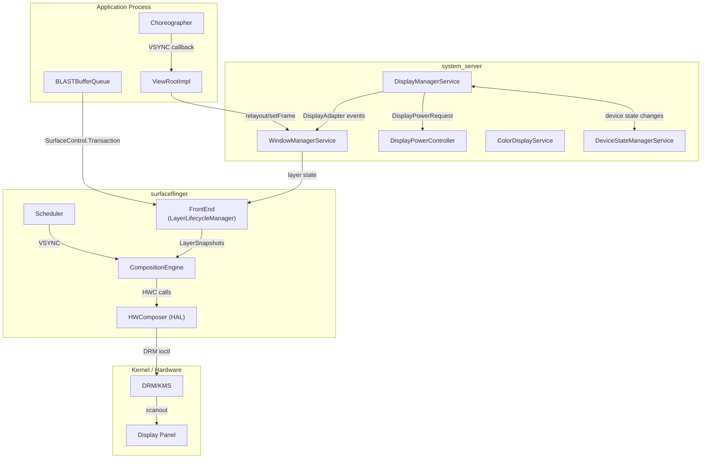

**第 1 层 —— 框架（system_server）。** `DisplayManagerService` 拥有
每一个显示的生命周期。它通过 `DisplayAdapter` 实现来发现物理显示。
它会创建映射到物理 `DisplayDevice` 实例的 `LogicalDisplay` 对象。
它还会向 `WindowManagerService` 通知显示的添加、移除以及配置变更。

**第 2 层 —— 原生合成器（surfaceflinger）。** SurfaceFlinger 通过
`SurfaceControl.Transaction` 接收缓冲区更新，并在 VSYNC 上调度合成。
它将实际的像素混合工作委托给 Hardware Composer HAL（叠加平面）或
GPU（经由 RenderEngine 的客户端合成）。

**第 3 层 —— 内核（DRM/KMS）。** Linux DRM 子系统管理显示硬件：
模式设置、CRTC/encoder/connector 拓扑，以及触发已合成帧缓冲扫描
输出的 page-flip ioctl。

### 24.1.2 DisplayManagerService

`DisplayManagerService`（DMS）是在 `system_server` 启动期间注册的
一个 `SystemService`。它是框架中最大的服务之一。它的 Javadoc 解释了
该架构：

> DisplayManagerService 管理显示的全局生命周期，
> 根据当前连接的物理显示设备决定如何配置逻辑显示，
> 并在状态发生变化时向系统和应用发送通知。

DMS 使用 `DisplayThread`（一个以 `THREAD_PRIORITY_DISPLAY + 1`
优先级运行的共享 `HandlerThread`）作为其主 handler。单个
`SyncRoot` 锁保护所有内部状态。所有显示适配器和逻辑显示对象都使用
同一个锁：

```java
// frameworks/base/services/core/java/com/android/server/display/DisplayManagerService.java
private final SyncRoot mSyncRoot = new SyncRoot();
```

锁的排序约束至关重要。DMS 可能持有 `mSyncRoot` 并调用
SurfaceFlinger（经由 `SurfaceControl`）。但是 DMS 在持有
`mSyncRoot` 时绝不能调用 `WindowManagerService`，因为 WMS 持有自己
的 `mGlobalLock`，并且可能回调进 DMS。所有可能重入的对外调用都通过
handler 以异步方式分发。

### 24.1.3 Display Adapter 架构

DMS 通过一组 `DisplayAdapter` 实现来发现显示：

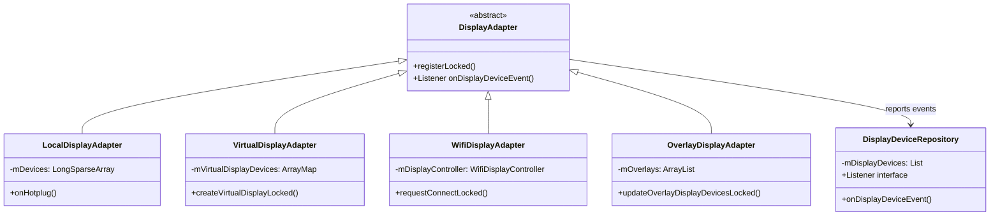

- **LocalDisplayAdapter** 处理由 SurfaceFlinger 的热插拔机制报告的
  物理显示（内置和外部）。它的显示事件监听器收到一个 `onHotplug()`
  回调。然后该适配器创建或移除由 SurfaceFlinger 显示 token 支持的
  `LocalDisplayDevice` 实例。它通过 `sendDisplayDeviceEventLocked()`
  向 `DisplayDeviceRepository` 发出 `DISPLAY_DEVICE_EVENT_ADDED`、
  `DISPLAY_DEVICE_EVENT_CHANGED` 和 `DISPLAY_DEVICE_EVENT_REMOVED`
  通知。

- **VirtualDisplayAdapter** 代表应用创建虚拟显示，接收一个带有尺寸、
  密度、标志以及用于生命周期管理的 `IVirtualDisplayCallback` 的
  `VirtualDisplayConfig`。

- **WifiDisplayAdapter** 通过 `WifiDisplayController` 管理 Miracast
  （Wi-Fi Display / WFD）连接。

- **OverlayDisplayAdapter** 创建从 `Settings.Global.OVERLAY_DISPLAY_DEVICES`
  设置（`overlay_display_devices`）中解析出的开发者叠加显示。

所有适配器都向 `DisplayDeviceRepository` 报告，后者维护活跃的
`DisplayDevice` 对象的权威列表，并通知 DMS 所发生的变更。

### 24.1.4 LogicalDisplay 与物理映射

`LogicalDisplay` 与 `DisplayDevice` 之间的分离是基础性的。一个
`LogicalDisplay` 表示系统其余部分（窗口管理器、应用）所看到的显示。
一个 `DisplayDevice` 表示底层的物理或虚拟硬件。

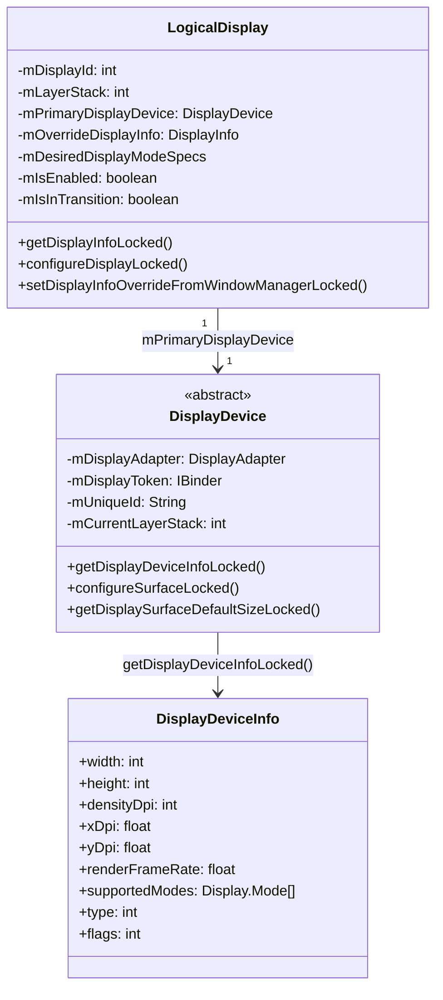

关键设计洞见，表述于 `LogicalDisplay` 的 Javadoc 中：

> 逻辑显示与显示设备是正交的概念。逻辑显示与显示设备之间会存在
> 某种映射，但它可以是多对多的，也可能有些彼此毫无关系。

在实践中，对于单显示手机，该映射是 1:1。对于可折叠设备，映射变得
动态。单个逻辑显示（默认显示，ID 0）可以在折叠/展开转换期间在内屏
和外屏这两个物理显示设备之间切换。`LogicalDisplayMapper` 管理这种
切换。

### 24.1.5 显示配置流程

当显示首次连接时，配置会流经多个组件：

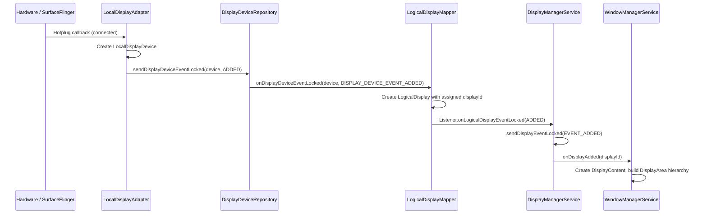

DMS 维护两个用于事件投递的关键数据结构：

```java
// All callback records indexed by calling process id
private final SparseArray<CallbackRecord> mCallbacks = new SparseArray<>();
// All callback records indexed by [uid][pid]
private final SparseArray<SparseArray<CallbackRecord>> mCallbackRecordByPidByUid =
        new SparseArray<>();
```

事件通过 `MSG_DELIVER_DISPLAY_EVENT` 投递，该消息被发送到 handler。
这使得投递成为异步的，并且它不会持有 `mSyncRoot`。

### 24.1.6 显示组

显示被分组为共享电源状态和亮度的 `DisplayGroup` 实例。主显示组包含
内置显示。虚拟显示可以使用 `VIRTUAL_DISPLAY_FLAG_OWN_DISPLAY_GROUP`
创建自己的组。它们也可以使用
`VIRTUAL_DISPLAY_FLAG_DEVICE_DISPLAY_GROUP` 成为设备显示组的一部分。
`DisplayGroupAllocator` 分配组 ID：

```java
// LogicalDisplayMapper events related to groups
public static final int DISPLAY_GROUP_EVENT_ADDED = 1;
public static final int DISPLAY_GROUP_EVENT_CHANGED = 2;
public static final int DISPLAY_GROUP_EVENT_REMOVED = 3;
```

显示组会影响电源管理——当默认显示组进入休眠时，该组中的所有显示会
一起关闭。

### 24.1.7 DisplayInfo 与覆盖

对应用可见的 `DisplayInfo` 对象通过分层的覆盖机制构建而成：

1. **基础信息** —— 派生自主显示设备的 `DisplayDeviceInfo`（物理尺寸、
   密度、受支持的模式）。
2. **DMS 覆盖** —— 显示模式选择、用户禁用的 HDR 类型、帧率覆盖。
3. **WMS 覆盖** —— 窗口管理器为应用可见尺寸（考虑过扫描、挖孔、
   旋转）设置 `DisplayInfo` 字段。这些通过
   `setDisplayInfoOverrideFromWindowManagerLocked()` 应用。

`DisplayInfoOverrides` 中定义的 `WM_OVERRIDE_FIELDS` 常量集合精确规定了
WMS 可以覆盖哪些字段。这防止了对硬件派生值的意外破坏。

### 24.1.8 DisplayBlanker：电源状态协调

`DisplayBlanker` 接口在 `DisplayPowerController` 与 SurfaceFlinger 之间
提供了显示电源状态变更的桥梁。DMS 实现了一个匿名 `DisplayBlanker`，
用于协调跨多个显示的状态变更：

```java
// frameworks/base/services/core/java/com/android/server/display/DisplayManagerService.java
private final DisplayBlanker mDisplayBlanker = new DisplayBlanker() {
    @Override
    public synchronized void requestDisplayState(int displayId, int state,
            float brightness, float sdrBrightness) {
        // Check if ALL displays are inactive or off
        boolean allInactive = true;
        boolean allOff = true;
        // ... iterate over mDisplayStates
        if (state == Display.STATE_OFF) {
            requestDisplayStateInternal(displayId, state, brightness, sdrBrightness);
        }
        if (stateChanged) {
            mDisplayPowerCallbacks.onDisplayStateChange(allInactive, allOff);
        }
        if (state != Display.STATE_OFF) {
            requestDisplayStateInternal(displayId, state, brightness, sdrBrightness);
        }
    }
};
```

顺序至关重要。对于 OFF 转换，显示状态先被设置，然后才通知
PowerManager。对于 ON 转换，先通知 PowerManager。这防止了如下竞争
条件：系统认为显示已开启，而它实际上仍在下电过程中。

### 24.1.9 Display Mode Director 与投票系统

`DisplayModeDirector`（位于 `display/mode/` 包中）是框架侧的策略引擎。
它将来自多个来源的高层模式请求转换为 DMS 交给 SurfaceFlinger 的
`DesiredDisplayModeSpecs`。这些来源包括应用的 `setFrameRate` 调用、
用户的峰值刷新率设置、性能提示、距离传感器和皮肤温度。它建立在一个
*投票*抽象之上。每个输入源都在 `VotesStorage` 中以固定优先级注册一个
`Vote`。然后 `VoteSummary` 将某个显示的投票合并为一组经过解析的
尺寸与刷新率约束。

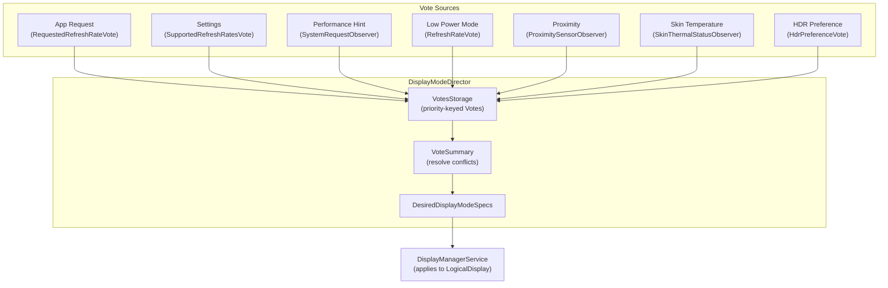

每个 `Vote` 都以一个数字优先级为键。`VoteSummary` 解决冲突。更高
优先级的系统约束（热状态、低功耗）可以收窄或否决应用等较低优先级
来源所请求的范围。

具体的投票类（`SizeVote`、`RefreshRateVote`、
`SupportedRefreshRatesVote`、`RequestedRefreshRateVote`、
`WorkDurationsVote`、`HdrPreferenceVote` 等）都与 `DisplayModeDirector`
一起位于 `frameworks/base/services/core/java/com/android/server/display/mode/`。
请注意，SurfaceFlinger 侧的选择器是一个独立的 C++ 类
`RefreshRateSelector`（第 24.3.6 节）。它从该 spec 中挑选最终的硬件
模式。框架从不直接引用它。

### 24.1.10 Handler 消息协议

DMS 使用基于 handler 的消息协议来进行异步操作：

| 消息 | 常量 | 用途 |
|---------|----------|---------|
| 注册默认适配器 | `MSG_REGISTER_DEFAULT_DISPLAY_ADAPTERS` (1) | 启动时的适配器设置 |
| 注册附加适配器 | `MSG_REGISTER_ADDITIONAL_DISPLAY_ADAPTERS` (2) | 启动后的适配器设置 |
| 投递显示事件 | `MSG_DELIVER_DISPLAY_EVENT` (3) | 向回调通知显示变更 |
| 请求遍历 | `MSG_REQUEST_TRAVERSAL` (4) | 触发 SurfaceFlinger 显示配置 |
| 更新视口 | `MSG_UPDATE_VIEWPORT` (5) | 更新输入视口映射 |
| 加载亮度配置 | `MSG_LOAD_BRIGHTNESS_CONFIGURATIONS` (6) | 加载亮度曲线 |
| 帧率覆盖事件 | `MSG_DELIVER_DISPLAY_EVENT_FRAME_RATE_OVERRIDE` (7) | 通知 FRO 变更 |
| 显示组事件 | `MSG_DELIVER_DISPLAY_GROUP_EVENT` (8) | 通知组的添加/移除 |
| 收到设备状态 | `MSG_RECEIVED_DEVICE_STATE` (9) | 处理可折叠状态变更 |
| 分发待处理事件 | `MSG_DISPATCH_PENDING_PROCESS_EVENTS` (10) | 批量事件投递 |
| 投递显示快照 | `MSG_DELIVER_DISPLAY_SNAPSHOT` (11) | 向新注册的回调发送所有显示的快照 |

`MSG_DELIVER_DISPLAY_SNAPSHOT` 消息（加入它的目的是让一个新注册的
监听器一次性收到完整的当前显示集合）定义在
`frameworks/base/services/core/java/com/android/server/display/DisplayManagerService.java:314`。

`MSG_REQUEST_TRAVERSAL` 消息尤其重要。当显示配置变更时，DMS 必须在
SurfaceFlinger 中调度一次遍历。该遍历应用新的显示参数（图层栈分配、
显示投影、显示模式）。

---

## 24.2 DisplayArea 层次结构

### 24.2.1 什么是 DisplayArea？

在 `DisplayContent`（表示完整逻辑显示的 `WindowContainer`）之下，
Android 将窗口组织为一棵 `DisplayArea` 容器树。每个 `DisplayArea`
将共享同一特性或 Z 序区域的窗口归为一组。其类层次结构为：

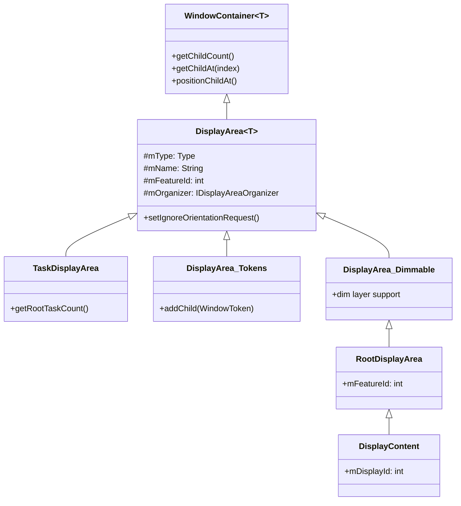

`DisplayArea` 的 Javadoc 解释了强制保证 Z 序正确性的三种类型：

```
DisplayAreas come in three flavors:
- BELOW_TASKS: Can only contain BELOW_TASK DisplayAreas and WindowTokens
   that go below tasks.
- ABOVE_TASKS: Can only contain ABOVE_TASK DisplayAreas and WindowTokens
   that go above tasks.
- ANY: Can contain any kind of DisplayArea, and any kind of WindowToken
   or the Task container.
```

### 24.2.2 特性 ID

每个 `DisplayArea` 都带有一个用于标识其用途的 `mFeatureId`。标准特性
ID 定义在 `DisplayAreaOrganizer` 中：

| 特性 ID | 常量 | 值 | 用途 |
|-----------|----------|-------|---------|
| `FEATURE_ROOT` | `FEATURE_SYSTEM_FIRST` | 0 | 层次结构的根 |
| `FEATURE_DEFAULT_TASK_CONTAINER` | `FEATURE_SYSTEM_FIRST + 1` | 1 | Task 的默认容器 |
| `FEATURE_WINDOW_TOKENS` | `FEATURE_SYSTEM_FIRST + 2` | 2 | 非 Task 窗口 token 的容器 |
| `FEATURE_ONE_HANDED` | `FEATURE_SYSTEM_FIRST + 3` | 3 | 单手模式缩放 |
| `FEATURE_TOP_LEVEL_ZOOM` | `FEATURE_SYSTEM_FIRST + 4` | 4 | 顶层缩放图层（此处绑定的 AOSP 特性名为 "WindowedMagnification"） |
| `FEATURE_FULLSCREEN_MAGNIFICATION` | `FEATURE_SYSTEM_FIRST + 5` | 5 | 全屏放大 |
| `FEATURE_HIDE_DISPLAY_CUTOUT` | `FEATURE_SYSTEM_FIRST + 6` | 6 | 挖孔区域下方的内容 |
| `FEATURE_IME_PLACEHOLDER` | `FEATURE_SYSTEM_FIRST + 7` | 7 | IME 容器位置 |
| `FEATURE_IME` | `FEATURE_SYSTEM_FIRST + 8` | 8 | 实际的 IME 容器 |
| `FEATURE_WINDOWING_LAYER` | `FEATURE_SYSTEM_FIRST + 9` | 9 | 备用 windowing 图层 |
| `FEATURE_APP_ZOOM_OUT` | `FEATURE_SYSTEM_FIRST + 10` | 10 | 应用缩小（zoom-out）支持 |

厂商特性使用从 `FEATURE_VENDOR_FIRST`（10001）到
`FEATURE_VENDOR_LAST`（20001）的范围，允许 OEM 定义自定义的
DisplayArea 层次结构节点（例如车载后排显示区域、双屏特性）。

### 24.2.3 DisplayAreaPolicyBuilder

`DisplayAreaPolicyBuilder` 通过接收一组 `Feature` 定义并构建所需的
中间 `DisplayArea` 节点来构造层次结构树，以满足 Z 序约束。

由 `DisplayAreaPolicy.DefaultProvider`（位于
`DisplayAreaPolicy.java`）构建的默认层次结构如下所示：

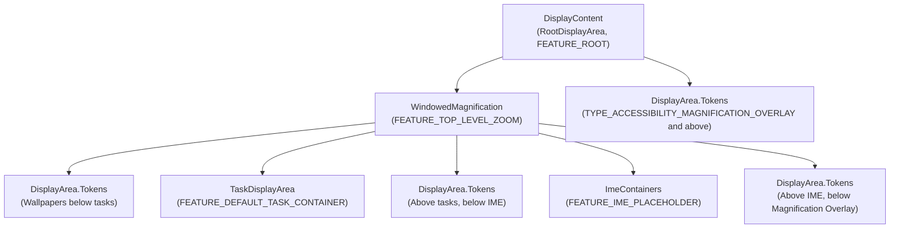

该构建器的工作方式为：

1. 收集所有 `Feature` 定义，每个定义针对一组窗口类型（例如
   "WindowedMagnification" 涵盖一直到
   `TYPE_ACCESSIBILITY_MAGNIFICATION_OVERLAY` 的所有内容）。
2. 对于每个 Z 序槽位（来自窗口类型常量的 36 层模型），确定哪些
   特性适用。
3. 只要某个特性边界跨越 Z 序边界，就创建中间 `DisplayArea` 节点，
   拆分树以保持正确的顺序。

### 24.2.4 用于多根层次结构的 DisplayAreaGroup

该构建器通过 `DisplayAreaGroup` 支持多个根层次结构，这对于车载和
可折叠设备至关重要。`DisplayAreaPolicyBuilder` 中的代码示例展示了
如何为前排和后排显示创建独立的根：

```java
// Example from DisplayAreaPolicyBuilder Javadoc:
RootDisplayArea firstRoot = new RootDisplayArea(wmService, "FirstRoot",
        FEATURE_FIRST_ROOT);
DisplayAreaPolicyBuilder.HierarchyBuilder firstGroupHierarchy =
    new DisplayAreaPolicyBuilder.HierarchyBuilder(firstRoot)
        .setTaskDisplayAreas(firstTdaList);

return new DisplayAreaPolicyBuilder()
    .setRootHierarchy(rootHierarchy)
    .addDisplayAreaGroupHierarchy(firstGroupHierarchy)
    .setSelectRootForWindowFunc(selectRootForWindowFunc)
    .build(wmService, content);
```

`selectRootForWindowFunc` 是一个 `BiFunction<Integer, Bundle,
RootDisplayArea>`，它根据窗口类型和启动选项将每个窗口 token 路由到
合适的根。

### 24.2.5 层次结构校验规则

`DisplayAreaPolicyBuilder.validate()` 方法对层次结构强制执行严格的
结构约束：

1. **根和 TDA 的唯一 ID**：每个 `RootDisplayArea` 和
   `TaskDisplayArea` 都必须具有全局唯一的特性 ID。
2. **每个根内特性 ID 唯一**：位于同一个 `RootDisplayArea` 之下的
   `Feature` 节点必须具有唯一 ID。位于不同根之下的特性可以共享 ID，
   这使得跨根组织成为可能。
3. **恰好一个 IME 容器**：IME 容器必须恰好存在于一个层次结构构建器
   中。
4. **恰好一个默认 TDA**：必须有一个 `TaskDisplayArea` 具有 ID
   `FEATURE_DEFAULT_TASK_CONTAINER`。
5. **ID 范围限制**：任何 ID 都不得超过 `FEATURE_VENDOR_LAST`（20001）。
6. **有效的 windowing 图层**：根层次结构必须在顶层包含一个
   windowing 图层（`FEATURE_TOP_LEVEL_ZOOM` 或
   `FEATURE_WINDOWING_LAYER`）。如果缺失，构建器会自动插入一个
   `FEATURE_WINDOWING_LAYER`。

```java
// frameworks/base/services/core/java/com/android/server/wm/DisplayAreaPolicyBuilder.java
if (!mRootHierarchyBuilder.hasValidWindowingLayer()) {
    mRootHierarchyBuilder.mFeatures.add(0 /* top level index */,
        new Feature.Builder(wmService.mPolicy, "WindowingLayer",
            FEATURE_WINDOWING_LAYER)
            .setExcludeRoundedCornerOverlay(false).all().build());
}
```

### 24.2.6 特性定义与窗口类型目标

每个 `Feature` 使用支持范围和例外的构建器模式来针对一组窗口类型：

```java
// Example: WindowedMagnification targets everything below
// the accessibility magnification overlay
new Feature.Builder(wmService.mPolicy, "WindowedMagnification",
        FEATURE_TOP_LEVEL_ZOOM)
    .upTo(TYPE_ACCESSIBILITY_MAGNIFICATION_OVERLAY)
    .except(TYPE_ACCESSIBILITY_MAGNIFICATION_OVERLAY)
    .setNewDisplayAreaSupplier(DisplayArea.Dimmable::new)
    .build()
```

`Feature.Builder` 的方法：

- `all()` —— 针对所有窗口类型
- `upTo(type)` —— 针对直到并包含给定类型的所有类型
- `except(type)` —— 从范围中排除某个特定类型
- `and(type)` —— 向集合中添加一个特定类型
- `setNewDisplayAreaSupplier()` —— 自定义 DisplayArea 工厂（例如
  用于放大变暗支持的 `Dimmable`）
- `setExcludeRoundedCornerOverlay()` —— 是否排除圆角覆盖窗口

### 24.2.7 构建算法

`HierarchyBuilder.build()` 方法实现了生成 DisplayArea 树的核心算法：

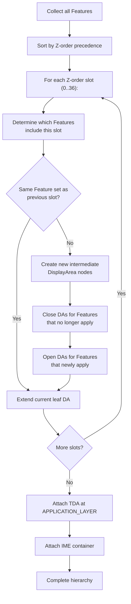

该算法确保：

- 对于共享同一特性集合的每个连续 Z 序槽位范围，都存在一个
  `DisplayArea`。
- 仅跨越 Z 序空间子集的特性会得到自己的嵌套 `DisplayArea` 节点。
- `TaskDisplayArea` 被精确插入在 `APPLICATION_LAYER`
  （位于 task 之下窗口与 task 之上窗口之间的 Z 序位置）。

### 24.2.8 DefaultSelectRootForWindowFunction

当存在多个根时（例如车载的前/后显示），
`DefaultSelectRootForWindowFunction` 负责路由窗口 token：

```java
// frameworks/base/services/core/java/com/android/server/wm/DisplayAreaPolicyBuilder.java
public RootDisplayArea apply(@NonNull Integer windowType, @Nullable Bundle options) {
    if (mDisplayAreaGroupRoots.isEmpty()) {
        return mDisplayRoot;
    }

    // Select the RootDisplayArea set in options.
    if (options != null && options.containsKey(KEY_ROOT_DISPLAY_AREA_ID)) {
        final int rootId = options.getInt(KEY_ROOT_DISPLAY_AREA_ID);
        if (mDisplayRoot.mFeatureId == rootId) {
            return mDisplayRoot;
        }
        for (int i = mDisplayAreaGroupRoots.size() - 1; i >= 0; i--) {
            if (mDisplayAreaGroupRoots.get(i).mFeatureId == rootId) {
                return mDisplayAreaGroupRoots.get(i);
            }
        }
    }
    return mDisplayRoot;
}
```

路由键是 `ActivityOptions` bundle 中的 `KEY_ROOT_DISPLAY_AREA_ID`，
它允许启动器和系统组件将窗口引导至特定的根。

### 24.2.9 DisplayArea Organizer

Shell 和 SystemUI 可以注册 `IDisplayAreaOrganizer` 实现，以便在特定的
特性 DisplayArea 出现、变更或消失时接收回调。正是这一机制使得以下
功能得以实现：

- **单手模式**：注册 `FEATURE_ONE_HANDED`，然后对 DisplayArea 进行
  缩放和平移。
- **窗口化放大**：注册 "WindowedMagnification" 特性，它绑定到
  `FEATURE_TOP_LEVEL_ZOOM`。
- **应用缩小**：注册 `FEATURE_APP_ZOOM_OUT`。

`DisplayAreaOrganizerController` 管理注册，并分发
`onDisplayAreaAppeared`、`onDisplayAreaInfoChanged` 和
`onDisplayAreaVanished` 回调。organizer 会收到一个
`SurfaceControl` leash，它可以重新父化或变换该 leash。

### 24.2.10 DisplayArea 中的方向处理

`DisplayArea` 通过 `mSetIgnoreOrientationRequest` 标志在方向管理中
扮演关键角色。当该标志被设置时，DisplayArea 会忽略其下方应用提出的
固定方向请求，改为以 letterbox（信箱式）方式显示它们，而不是旋转整
个显示：

```java
// frameworks/base/services/core/java/com/android/server/wm/DisplayArea.java
boolean setIgnoreOrientationRequest(boolean ignoreOrientationRequest) {
    if (mSetIgnoreOrientationRequest == ignoreOrientationRequest) {
        return false;
    }
    mSetIgnoreOrientationRequest = ignoreOrientationRequest;
    // Check whether we should notify Display to update orientation
    // ...
}
```

这用于大屏设备（平板、处于展开姿态的可折叠设备），在这些设备上为
仅支持竖屏的应用旋转整个显示是不可取的。DisplayArea 会抑制该方向请
求，应用则在当前显示方向内以 letterbox 方式呈现。

---

## 24.3 显示刷新与 VSYNC

### 24.3.1 VSYNC 流水线

VSYNC（垂直同步）是显示系统的心跳。屏幕上显示的每一帧都始于来自显
示硬件的一个 VSYNC 信号。Android 的 VSYNC 流水线将原始的硬件中断转
换为渲染链路中多个节点上精确计时的回调。

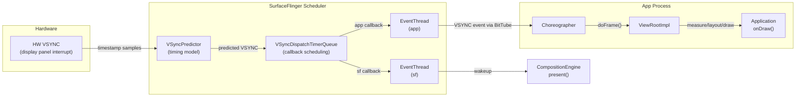

### 24.3.2 VSyncPredictor：时间模型

`VSyncPredictor` 维护一个 VSYNC 时序的线性回归模型。它并不只依赖最
新的硬件时间戳。它会收集时间戳的历史记录，并拟合一条直线（斜率 +
截距）来预测未来的 VSYNC 事件：

```cpp
// frameworks/native/services/surfaceflinger/Scheduler/VSyncPredictor.h
struct Model {
    nsecs_t slope;     // period between VSYNCs
    nsecs_t intercept; // phase offset
};
```

该预测器通过 `addVsyncTimestamp()` 接收时间戳，过滤掉异常值（使用
`outlierTolerancePercent`），并在生成预测之前要求至少达到一定数量的
采样（`minimumSamplesForPrediction`）。这种过滤至关重要，因为硬件
VSYNC 时间戳可能由于显示控制器的时序粒度而产生几十微秒的抖动。

`nextAnticipatedVSyncTimeFrom()` 方法返回从给定时间点起下一个预测的
VSYNC 时刻，调度系统用它来精确地安排回调。

### 24.3.3 VSyncDispatchTimerQueue：回调调度

`VSyncDispatchTimerQueue` 将预测的 VSYNC 时刻转换为实际的基于定时器
的唤醒。每个已注册的回调由一个 `VSyncDispatchTimerQueueEntry` 表示，
它具有三种状态：

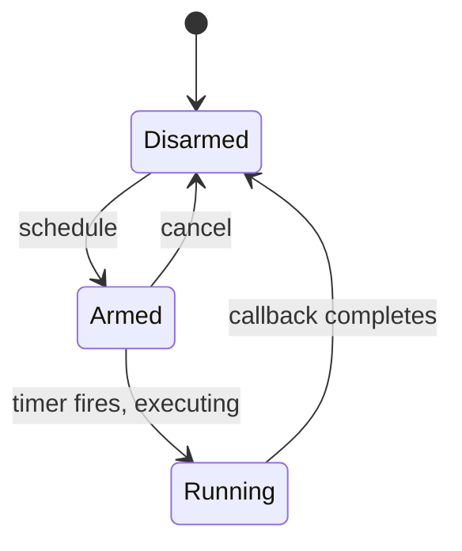

每个条目都带有 `ScheduleTiming`，其中规定：

- **workDuration** —— 回调需要在 VSYNC 之前多久唤醒（例如应用渲染
  可能需要 16ms）
- **readyDuration** —— 工作完成后、在 VSYNC 截止时间之前所需的额外
  时间
- **lastVsync** —— 该回调上次所对应的 VSYNC
  （`committedVsyncOpt` 字段另外记录了已提交给该回调的那个 VSYNC）

定时器队列会将时间相近（在 `timerSlack` 之内）的回调合并为一次定时
器唤醒，从而减少上下文切换的次数。

### 24.3.4 EventThread：向客户端分发 VSYNC

SurfaceFlinger 中运行着两个 `EventThread` 实例：

1. **sf EventThread** —— 唤醒 SurfaceFlinger 的主循环以进行合成。
2. **app EventThread** —— 经由 `IDisplayEventConnection` / `BitTube`
   将 VSYNC 事件分发给应用。

`EventThreadConnection` 封装了一个 `BitTube`（一对套接字），以便向客
户端零拷贝地投递 VSYNC 事件。该连接支持三种请求模式：

```cpp
// frameworks/native/services/surfaceflinger/Scheduler/EventThread.h
enum class VSyncRequest {
    None = -2,        // No VSYNC events
    Single = -1,      // Wake for next two frames (avoid scheduler overhead)
    SingleSuppressCallback = 0,  // Wake for next frame only
    Periodic = 1,     // Continuous VSYNC delivery
    // Values > 1 specify a divisor (every Nth VSYNC)
};
```

### 24.3.5 Choreographer：Java 侧的 VSYNC 消费

在 Java 侧，`Choreographer` 通过 `DisplayEventReceiver` 从 app
EventThread 接收 VSYNC 事件，并按优先级顺序将其分发给已注册的回调：

1. **CALLBACK_INPUT** —— 输入事件处理
2. **CALLBACK_ANIMATION** —— 属性动画、Transition
3. **CALLBACK_INSETS_ANIMATION** —— WindowInsets 动画
4. **CALLBACK_TRAVERSAL** —— View 的 measure/layout/draw
5. **CALLBACK_COMMIT** —— 绘制后的提交

每个 Activity 的 `ViewRootImpl` 都会向 Choreographer 注册一个
`CALLBACK_TRAVERSAL`。当调用 `requestLayout()` 或 `invalidate()` 时，
ViewRootImpl 会向 Choreographer 安排自己，后者等待下一个 VSYNC 之后
再执行遍历。

### 24.3.6 RefreshRateSelector：显示模式选择

`RefreshRateSelector` 是策略引擎，它从硬件支持的模式中选择最优的显示
刷新率。它会考虑多个输入：

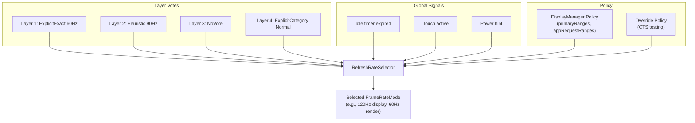

`LayerVoteType` 枚举捕获了图层表达其刷新率偏好的不同方式：

| 投票类型 | 说明 |
|-----------|-------------|
| `NoVote` | 图层不关心刷新率 |
| `Min` | 请求最低可用速率（省电） |
| `Max` | 请求最高可用速率（流畅度） |
| `Heuristic` | 由平台根据内容分析计算出的速率 |
| `ExplicitDefault` | 应用请求的速率，具有 Default 兼容性 |
| `ExplicitExactOrMultiple` | 应用请求的速率，精确值或整数倍数 |
| `ExplicitExact` | 应用请求的速率，仅精确匹配 |
| `ExplicitGte` | 应用请求的速率，大于或等于 |
| `ExplicitCategory` | 应用请求的帧率类别（Normal/High） |

该选择器在定义了以下内容的 `Policy` 之下运行：

- `defaultMode` —— 当没有强烈偏好时使用的模式
- `primaryRanges` —— 物理 FPS 与渲染 FPS 范围
- `appRequestRanges` —— 应用可见的 FPS 范围
- `allowGroupSwitching` —— 是否在模式组之间切换
- `idleScreenConfigOpt` —— 空闲定时器配置

kMinSupportedFrameRate 为 20 Hz——低于此值，内容会出现肉眼可见的
卡顿。帧率类别定义了阈值：Normal 从 60 Hz 起步，High 从 90 Hz 起步。

### 24.3.7 Scheduler：编排帧的生产

`Scheduler` 类是顶层协调器，它将 VSYNC 预测、事件线程和模式选择结合
在一起。它同时继承自 `IEventThreadCallback` 和 `MessageQueue`：

```cpp
// frameworks/native/services/surfaceflinger/Scheduler/Scheduler.h
class Scheduler : public IEventThreadCallback, android::impl::MessageQueue {
    // ...
};
```

关键概念：

- **Pacesetter 显示**：在多显示配置中，某一个物理显示被指定为
  "pacesetter"，由它驱动合成的节奏。调度器使用
  `designatePacesetterDisplay()` 自动选择它，或使用
  `forcePacesetterDisplay()` 来覆盖。

- **VsyncModulator**：根据工作负载动态调整 VSYNC 偏移。当某帧即将
  错过其截止时间时，该调制器可以提前应用 VSYNC 相位，从而提供更多
  的渲染时间。

- **LayerHistory**：使用启发式方法跟踪每个图层的帧生产速率，以为
  `RefreshRateSelector` 提供 `LayerRequirement` 输入。

### 24.3.8 VsyncConfiguration：相位偏移

`VsyncConfiguration` 将刷新率映射到 VSYNC 偏移配置。每种配置为三种
场景定义时序：

```cpp
// frameworks/native/services/surfaceflinger/Scheduler/include/scheduler/VsyncConfig.h
struct VsyncConfigSet {
    VsyncConfig early;     // During transaction processing
    VsyncConfig earlyGpu;  // During GPU composition
    VsyncConfig late;      // Normal steady-state
    std::chrono::nanoseconds hwcMinWorkDuration;  // Earliest-present calculation
    // ...
};
```

每个 `VsyncConfig` 包含：

- **sfOffset** / **sfWorkDuration**：SurfaceFlinger 相对于 VSYNC 的
  唤醒时刻
- **appOffset** / **appWorkDuration**：应用相对于 VSYNC 的唤醒时刻

偏移策略：

- **Late（正常）**：应用在 VSYNC 周期内较早唤醒，完成渲染，然后 SF
  稍后唤醒以进行合成与呈现。这最大化了应用渲染可用的时间。
- **Early（事务繁重）**：应用和 SF 都更早唤醒，以处理额外的事务
  处理工作。
- **Early GPU（GPU 合成）**：SF 更早唤醒，因为 GPU 合成比 HWC 叠加
  合成耗时更长。

旧的 `PhaseOffsets` 实现使用固定的纳秒偏移。现代的 `WorkDuration`
实现使用基于时长的调度，它能更好地适应不同的刷新率。

### 24.3.9 VsyncModulator：动态偏移切换

`VsyncModulator` 根据运行时条件在 Early、EarlyGpu 和 Late 这三种
VSYNC 配置之间切换：

```cpp
// frameworks/native/services/surfaceflinger/Scheduler/VsyncModulator.h
class VsyncModulator : public IBinder::DeathRecipient {
    static constexpr int MIN_EARLY_TRANSACTION_FRAMES = 2;
    static constexpr int MIN_EARLY_GPU_FRAMES = 2;
    // ...
};
```

该调制器维护以下帧计数器：

- **Early transaction 帧**：在某个事务被调度之后，至少为
  `MIN_EARLY_TRANSACTION_FRAMES`（2）帧加上一段时间延迟
  （`MIN_EARLY_TRANSACTION_TIME`）保持 early 偏移。这避免了与事务
  提交之间的竞争。
- **Early GPU 帧**：在使用了 GPU 合成之后，为
  `MIN_EARLY_GPU_FRAMES`（2）帧保持 early GPU 偏移，作为对抗交替
  合成策略的低通滤波器。

状态转换：

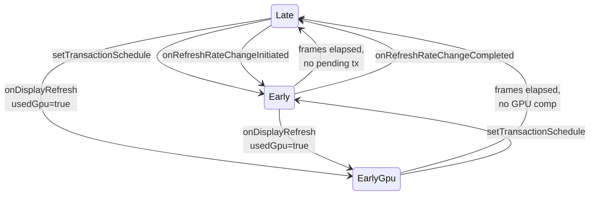

### 24.3.10 VsyncSchedule：每显示的 VSYNC

`VsyncSchedule` 封装了单个物理显示的完整 VSYNC 基础设施：

- 用于时间模型的 `VSyncTracker`（通常为 `VSyncPredictor`）
- 用于回调调度的 `VSyncDispatch`（通常为
  `VSyncDispatchTimerQueue`）
- 用于接收硬件 VSYNC 时间戳的 `VsyncController`

在多显示配置中，每个物理显示都有自己的 `VsyncSchedule`。pacesetter
显示的调度驱动主合成循环，而辅助显示使用自己的调度来分发 VSYNC 事件。

### 24.3.11 帧时间线

Android 的 `FrameTimeline`（位于 Scheduler 目录中）跟踪每一帧在系
统中的生命周期，并记录：

- 预期的与实际的应用渲染开始时间
- 预期的与实际的呈现时间（VSYNC）
- GPU 完成 fence
- 来自显示的 present fence

这些数据支撑着 `dumpsys SurfaceFlinger --frametimeline` 调试输出，
并馈入 `perfetto` 跟踪以用于性能分析。

### 24.3.12 空闲定时器与功耗优化

`RefreshRateSelector` 支持空闲屏幕配置，当显示内容静止时降低刷新率：

```cpp
// RefreshRateSelector.h
struct Policy {
    // ...
    std::optional<gui::DisplayModeSpecs::IdleScreenRefreshRateConfig>
        idleScreenConfigOpt;
};
```

Scheduler 中的 `OneShotTimer` 在一个可配置的空闲期之后触发。然后它
向 `RefreshRateSelector` 发出信号以降低刷新率。任何新的内容更新
（缓冲区队列活动、触摸事件）都会重置该定时器。这是一项显著的功耗
优化。显示静态文档的手机会在数秒不活动之后从 120 Hz 降至 60 Hz（或
更低）。

### 24.3.13 SmallAreaDetection

`SmallAreaDetectionAllowMappings` 启用按 UID 的小区域检测阈值。启用
后，SurfaceFlinger 可以降低仅更新屏幕一小部分（例如闪烁的光标）的图
层的刷新率。这些图层随后就无法迫使整个显示以高刷新率运行。
`DisplayManagerService` 中的 `SmallAreaDetectionController` 管理
UID 的允许列表。

---

## 24.4 屏幕旋转

### 24.4.1 DisplayRotation：策略引擎

`DisplayRotation` 拥有请求方向（来自最顶层 Activity）与显示实际物理
旋转之间的映射关系。它位于 `WindowManagerService` 中，并针对每个
`DisplayContent` 实例化：

```java
// frameworks/base/services/core/java/com/android/server/wm/DisplayRotation.java
public class DisplayRotation {
    private final WindowManagerService mService;
    private final DisplayContent mDisplayContent;
    private final DisplayPolicy mDisplayPolicy;
    private final FoldController mFoldController;
    private final DeviceStateController mDeviceStateController;
    private final DisplayRotationCoordinator mDisplayRotationCoordinator;
    // ...
}
```

旋转决策流水线：

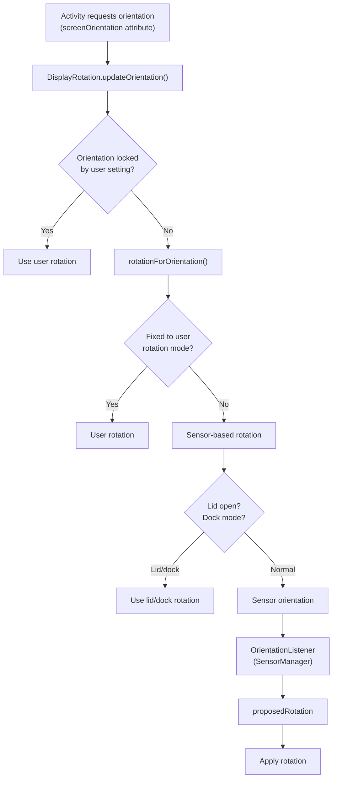

### 24.4.2 旋转生命周期

当发生旋转时，系统必须协调多个子系统：

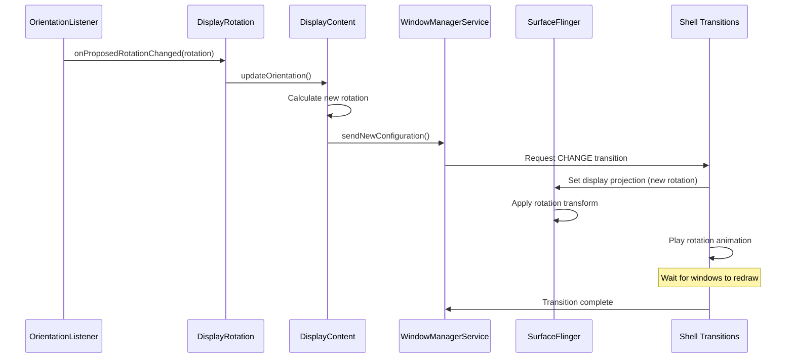

### 24.4.3 SeamlessRotator：无闪烁旋转

`SeamlessRotator` 通过对各个窗口应用反向变换，实现了没有黑屏的旋转。
在无缝旋转期间，每个窗口的 `SurfaceControl` 都会被变换以抵消显示旋
转。因此，从用户的视角来看，内容看起来保持静止，而显示方向在其下方
发生了变化。

构造函数会计算变换矩阵：

```java
// frameworks/base/services/core/java/com/android/server/wm/SeamlessRotator.java
public SeamlessRotator(@Rotation int oldRotation, @Rotation int newRotation,
        DisplayInfo info, boolean applyFixedTransformationHint) {
    // Convert from old logical coords -> physical coords -> new logical coords
    CoordinateTransforms.transformLogicalToPhysicalCoordinates(
            oldRotation, pW, pH, mTransform);
    CoordinateTransforms.transformPhysicalToLogicalCoordinates(
            newRotation, pW, pH, tmp);
    mTransform.postConcat(tmp);
}
```

`unrotate()` 方法将该变换应用到每个窗口的 `SurfaceControl`：

```java
public void unrotate(Transaction transaction, WindowContainer win) {
    applyTransform(transaction, win.getSurfaceControl());
    float[] winSurfacePos = {win.mLastSurfacePosition.x, win.mLastSurfacePosition.y};
    mTransform.mapPoints(winSurfacePos);
    transaction.setPosition(win.getSurfaceControl(), winSurfacePos[0], winSurfacePos[1]);
}
```

`mApplyFixedTransformHint` 还会在 SurfaceControl 上设置一个缓冲区变换
提示。有了该提示，图形生产者（例如应用的 `Surface`）就不会过早地按
新方向分配缓冲区。该提示将预期的缓冲区方向固定在旧旋转上，直到生产
者赶上。

### 24.4.4 AsyncRotationController：非 Activity 窗口

Activity 可以在新方向下重绘，而非 Activity 窗口（状态栏、导航栏、
屏幕 decor 覆盖层）可能需要额外的帧才能完成更新。
`AsyncRotationController` 管理它们在转换期间的外观：

```java
// frameworks/base/services/core/java/com/android/server/wm/AsyncRotationController.java
class AsyncRotationController extends FadeAnimationController
        implements Consumer<WindowState> {
    private final ArrayMap<WindowToken, Operation> mTargetWindowTokens;
    // ...
}
```

该控制器支持四种转换操作：

| 操作 | 常量 | 行为 |
|----|----------|----------|
| `OP_LEGACY` | 0 | 传统的非转换路径 |
| `OP_APP_SWITCH` | 1 | 带旋转的应用打开/关闭（先淡出，再淡入） |
| `OP_CHANGE` | 2 | 正常旋转（通过父级 leash 隐藏，重绘后淡入） |
| `OP_CHANGE_MAY_SEAMLESS` | 3 | 可能无缝（由 shell 决定） |

对于系统窗口的无缝旋转（例如必须无缝的屏幕 decor 覆盖层），该控制器
会请求逐个进行同步事务。它会对每个窗口 token 应用 `SeamlessRotator`
的反向变换。

### 24.4.5 可折叠设备旋转协调

`FoldController`（`DisplayRotation` 的内部类）处理折叠/展开事件期间
的旋转。它在折叠至关闭状态时引入了一个
`FOLDING_RECOMPUTE_CONFIG_DELAY_MS`（800ms）延迟，以避免在机械折叠
运动期间发生配置变更和视觉跳变。

`DisplayRotationCoordinator` 在多个显示之间同步旋转（例如可折叠设备的
内屏和外屏）。当默认显示改变旋转时，它通过回调机制通知其他显示，使
它们能够协调各自的旋转响应。

### 24.4.6 旋转历史与调试

`DisplayRotation` 维护一个 `RotationHistory` 环形缓冲区，它记录每次
旋转变更的时间戳、来源（传感器、用户、策略）、旧旋转和新旋转。这对
调试旋转问题极为有用：

```
dumpsys window | grep -A 20 "RotationHistory"
```

类似地，`RotationLockHistory` 跟踪旋转锁何时被切换，以及通过何种机制
（用户设置、设备状态、相机兼容性）。

### 24.4.7 DisplayRotationReversionController

`DisplayRotationReversionController` 处理显示旋转应当被临时覆盖的情
况：

| 回退类型 | 常量 | 触发条件 |
|---------------|----------|---------|
| 相机兼容 | `REVERSION_TYPE_CAMERA_COMPAT` | 相机应用需要特定方向 |
| 半折叠 | `REVERSION_TYPE_HALF_FOLD` | 设备处于桌面姿态 |
| 无传感器 | `REVERSION_TYPE_NOSENSOR` | 传感器被禁用/不可用 |

当某个回退处于活动状态时，`DisplayRotation` 使用回退后的旋转，而非传
感器检测到的旋转。回退按顺序堆叠并依次撤销。

### 24.4.8 旋转与 Transition 的集成

屏幕旋转与 Shell Transitions（第 23 章）深度集成。当旋转发生变化时，
transition 系统会：

1. **截取屏幕截图**，记录旋转前的状态（或在无缝转换中使用
   `SeamlessRotator`）。
2. **启动一个 CHANGE transition**，其中包含 DisplayContent。
3. **与 `AsyncRotationController` 协调**，以处理非 Activity 窗口。
4. **播放旋转动画**（通常是从截图到实时内容的交叉淡入淡出）。
5. **等待所有窗口**在新方向下完成重绘，然后再完成 transition。

传统的旋转路径（Shell Transitions 之前）使用一个
`ScreenRotationAnimation`，它渲染旋转前截图的 GPU 加速旋转。新路径将
这一切完全委托给 Shell，后者可以应用更复杂的动画。

---

## 24.5 可折叠显示支持

### 24.5.1 DeviceStateManagerService：状态机

`DeviceStateManagerService` 管理可变状态设备（如可折叠设备）的物理
配置。它是回答“设备当前处于什么姿态？”这一问题的中央权威。

```java
// frameworks/base/services/core/java/com/android/server/devicestate/
//     DeviceStateManagerService.java
public final class DeviceStateManagerService extends SystemService {
    private final DeviceStatePolicy mDeviceStatePolicy;
    private final BinderService mBinderService;
    // ...
}
```

每个设备状态由一个 `DeviceState` 描述，其行为被编码为一组整数
*属性*常量。这些常量定义在公共 API 类
`android.hardware.devicestate.DeviceState`
（`frameworks/base/core/java/android/hardware/devicestate/DeviceState.java`）
中，而不是定义在服务本身中：

| 属性 | 说明 |
|----------|-------------|
| `PROPERTY_FOLDABLE_HARDWARE_CONFIGURATION_FOLD_IN_CLOSED` | 设备完全折叠 |
| `PROPERTY_FOLDABLE_HARDWARE_CONFIGURATION_FOLD_IN_HALF_OPEN` | 桌面/帐篷姿态 |
| `PROPERTY_FOLDABLE_HARDWARE_CONFIGURATION_FOLD_IN_OPEN` | 完全展开 |
| `PROPERTY_FOLDABLE_DISPLAY_CONFIGURATION_INNER_PRIMARY` | 内屏为主显示 |
| `PROPERTY_FOLDABLE_DISPLAY_CONFIGURATION_OUTER_PRIMARY` | 外屏为主显示 |
| `PROPERTY_FEATURE_DUAL_DISPLAY_INTERNAL_DEFAULT` | 双显示模式 |
| `PROPERTY_FEATURE_REAR_DISPLAY` | 后屏模式 |
| `PROPERTY_POWER_CONFIGURATION_TRIGGER_SLEEP` | 该状态触发休眠 |
| `PROPERTY_POWER_CONFIGURATION_TRIGGER_WAKE` | 该状态触发唤醒 |

### 24.5.2 设备状态提供者

`DeviceStateProvider` 接口提供物理设备状态。`FoldableDeviceStateProvider`
是标准实现，它从铰链角度传感器和霍尔效应传感器读取数据，以确定折叠
姿态。该提供者向 `DeviceStateManagerService` 报告状态变更，后者随后会
咨询 `DeviceStatePolicy` 以确定适当的系统响应。可折叠设备的提供者和
策略随专用的 `frameworks/base/services/foldables/devicestateprovider/`
模块（`FoldableDeviceStateProvider.java`、
`BookStyleDeviceStatePolicy.java`）一起发布，而抽象的
`DeviceStatePolicy` 基类位于
`frameworks/base/services/core/java/com/android/server/devicestate/`。

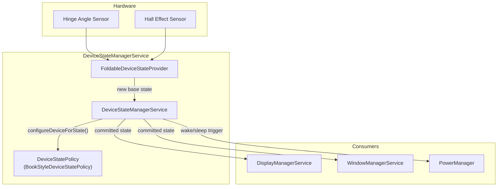

### 24.5.3 LogicalDisplayMapper：显示切换

`LogicalDisplayMapper` 是让可折叠显示转换得以运作的关键组件。当设备
在状态之间转换时（例如从 CLOSED 到 OPEN），该 mapper 必须：

1. **确定在新状态下哪些物理显示被启用**。为此使用
   `DeviceStateToLayoutMap`。它将设备状态标识符映射到 `Layout` 对象，
   后者描述活动的显示及其位置。

2. **为默认 `LogicalDisplay` 切换底层的 `DisplayDevice`。** 逻辑显示
   ID（0）保持不变，但其承载的物理显示会从外屏变为内屏（或反之）。

3. **使用 `mIsInTransition` 标志和超时**
   （`TIMEOUT_STATE_TRANSITION_MILLIS = 500ms`）来管理转换，以处理
   转换耗时过长的情况。

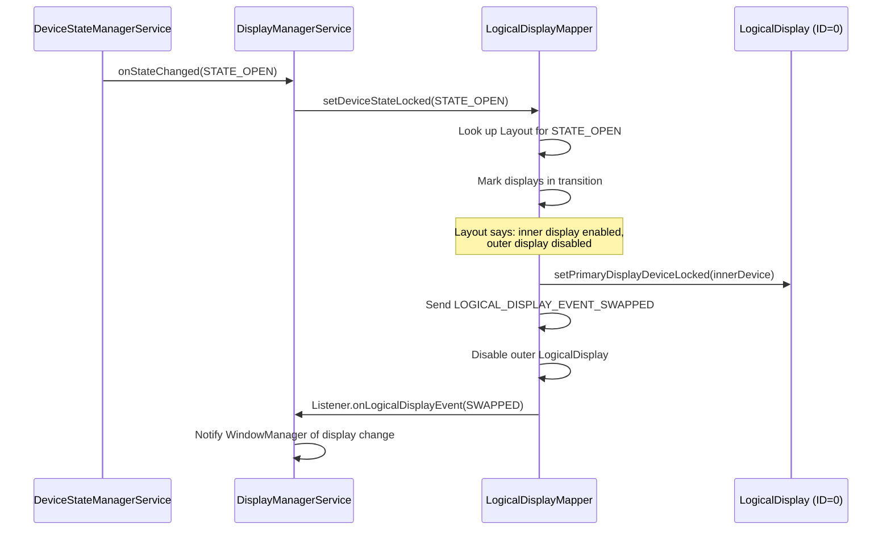

该 mapper 会针对不同场景发出特定事件。完整的事件位集合定义在
`frameworks/base/services/core/java/com/android/server/display/LogicalDisplayMapper.java`；
与显示切换相关的那些是：

```java
public static final int LOGICAL_DISPLAY_EVENT_SWAPPED = 1 << 3;
public static final int LOGICAL_DISPLAY_EVENT_DEVICE_STATE_TRANSITION = 1 << 5;
```

Android 17 还为已连接（外部）显示和设备状态生命周期携带了专用位。
它们是 `LOGICAL_DISPLAY_EVENT_CONNECTED`（`1 << 7`）、
`LOGICAL_DISPLAY_EVENT_DISCONNECTED`（`1 << 8`）、
`LOGICAL_DISPLAY_EVENT_REFRESH_RATE_CHANGED`（`1 << 9`）、
`LOGICAL_DISPLAY_EVENT_STATE_CHANGED`（`1 << 10`）和
`LOGICAL_DISPLAY_EVENT_COMMITTED_STATE_CHANGED`（`1 << 11`）。连接和
断开事件与添加和移除是不同的。显示可以在物理上已连接（并已报告给选
择加入的应用）之后，系统才决定为其启用一个 `LogicalDisplay`。

### 24.5.4 BookStyleDeviceStatePolicy

对于书本式可折叠设备（折叠轴为垂直方向，像书本一样），
`BookStyleDeviceStatePolicy` 扩展 `DeviceStatePolicy` 以管理：

- **外屏到内屏的转换**：展开时，外屏内容被迁移到内屏。该策略与
  `DisplayManagerService` 和 `WindowManagerService` 协调，以确保应用
  看到平滑的转换。

- **后屏模式**：允许在设备展开时使用外屏作为取景器，而内屏背对用户。
  该模式由 `PROPERTY_FEATURE_REAR_DISPLAY` 启用。

- **双显示模式**：内屏和外屏同时活动，由
  `PROPERTY_FEATURE_DUAL_DISPLAY_INTERNAL_DEFAULT` 启用。

### 24.5.5 并发显示

现代可折叠设备可以同时运行两个显示。`DisplayTopologyCoordinator`
管理显示之间的空间关系，`DisplayTopologyStore` 接口持久化拓扑配置。
在 Android 17 中，其具体实现是 `DisplayTopologyXmlStore`
（`frameworks/base/services/core/java/com/android/server/display/DisplayTopologyXmlStore.java`）。
它会在凭据加密的系统目录下写入每个用户的 `display_topology.xml`。
第 24.12 节完整介绍了多显示拓扑 API。当并发显示处于活动状态时，系统
会：

- 如果显示服务于不同目的，则为它们分配独立的 `DisplayGroup` 实例
- 应用更严格的温度亮度节流（并发模式下热数据 ID 会变化）
- 根据触摸坐标将输入事件路由到正确的显示

### 24.5.6 DeviceStateToLayoutMap

`DeviceStateToLayoutMap` 提供从设备状态标识符到 `Layout` 对象的映射，
后者描述哪些显示处于活动状态及其位置。默认状态 `STATE_DEFAULT` 映射
到具有单个默认显示的初始布局。每个布局规定：

- 哪些 `DisplayDevice` 被启用
- 每个显示的位置（前、后、未知）
- 每个显示的 `DisplayGroup` 名称
- 显示之间的 lead/follower 关系（用于亮度）

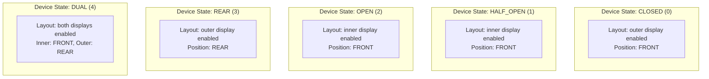

### 24.5.7 显示切换事件

在显示切换期间，`LogicalDisplayMapper` 会发出一个精心排序的事件序列：

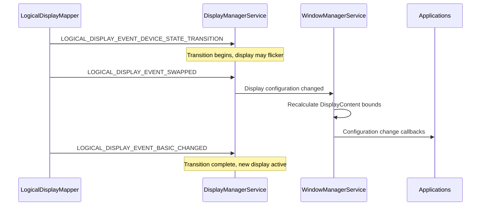

`TIMEOUT_STATE_TRANSITION_MILLIS`（500ms）保护机制确保卡住的转换不会
让系统停留在不确定状态。

### 24.5.8 FoldSettingProvider

`FoldSettingProvider` 封装了 `Settings.System.FOLD_LOCK_BEHAVIOR`
设置，该设置控制设备折叠时发生什么。它暴露三个谓词：

- `shouldStayAwakeOnFold()` —— 折叠时设备保持唤醒且不锁定
- `shouldSelectiveStayAwakeOnFold()` —— 设备仅在应用持有 wakelock 时
  保持唤醒（默认行为）
- `shouldSleepOnFold()` —— 折叠时设备总是进入休眠

`LogicalDisplayMapper` 在折叠转换期间会咨询这些谓词，以决定折叠是否
应当让设备休眠。

---

## 24.6 显示挖孔与圆角

### 24.6.1 DisplayCutout：建模非矩形屏幕

`DisplayCutout` 表示显示中无法用于显示内容的区域——通常是刘海、挖孔
摄像头或灵动岛。它是不可变的，并作为 `DisplayInfo` 和 `WindowInsets`
的一部分在系统中传递。

```java
// frameworks/base/core/java/android/view/DisplayCutout.java
public final class DisplayCutout {
    private final Rect mSafeInsets;
    private final Insets mWaterfallInsets;
    private final Bounds mBounds;  // Helper holding one rect per side
                                   // (left, top, right, bottom)
    // ...
}
```

挖孔定义了：

- **安全内边距（Safe insets）** —— 保证没有挖孔的矩形区域，以从每条
  边向内的内边距来表示
- **包围矩形（Bounding rectangles）** —— 挖孔在四条边上的精确边界
- **瀑布内边距（Waterfall insets）** —— 对于曲面边缘（瀑布屏）显示，
  显示从平面弯曲离开之处的内边距

### 24.6.2 CutoutSpecification：配置 DSL

挖孔形状在设备覆盖资源 `R.string.config_mainBuiltInDisplayCutout` 中
使用一种由 `CutoutSpecification` 解析的自定义规范语言来定义：

```java
// frameworks/base/core/java/android/view/CutoutSpecification.java
```

该规范支持类似 SVG 的路径命令（M、L、C、Q、Z 等），它们相对于显示
尺寸定义挖孔形状。解析器处理：

- **`@dp` 后缀**：以密度无关像素为单位的值
- **`@bottom`、`@right`、`@center_vertical`**：定位快捷方式
- **`@left` 关键字**：将路径绑定到显示的左侧

居中挖孔摄像头的典型规范：

```
M 0,0
L -24,0
C -24,0 -24,24 0,24
L 0,48
C 0,48 24,48 24,24
L 24,0
C 24,0 0,0 0,0
@dp
```

水平居中不需要标记——当既未给出 `@left` 也未给出 `@right` 时，这是
默认行为。

### 24.6.3 挖孔模式

应用通过 `WindowManager.LayoutParams.layoutInDisplayCutoutMode` 声明
其挖孔处理偏好：

| 模式 | 常量 | 行为 |
|------|----------|----------|
| `LAYOUT_IN_DISPLAY_CUTOUT_MODE_DEFAULT` | 0 | 非全屏窗口在竖屏时可以扩展到顶部边缘挖孔；全屏或横屏时布局避开挖孔 |
| `LAYOUT_IN_DISPLAY_CUTOUT_MODE_SHORT_EDGES` | 1 | 内容在短边上扩展到挖孔 |
| `LAYOUT_IN_DISPLAY_CUTOUT_MODE_NEVER` | 2 | 内容绝不扩展到挖孔区域 |
| `LAYOUT_IN_DISPLAY_CUTOUT_MODE_ALWAYS` | 3 | 内容总是扩展到挖孔区域 |

这些模式在 `WindowLayout.computeFrames()`
（`frameworks/base/core/java/android/view/WindowLayout.java`）中被评估，
该方法由窗口管理器和客户端布局路径共用。对于 `ALWAYS`，窗口获得完整
的显示区域；对于 `NEVER`，窗口按挖孔安全内边距向内缩进。

### 24.6.4 WmDisplayCutout

`WmDisplayCutout`
（`frameworks/base/services/core/java/com/android/server/wm/utils/WmDisplayCutout.java`）
是一个小巧的窗口管理器内部包装器，它将一个 `DisplayCutout` 与显示框
架尺寸配对。由于它在跟踪挖孔的同时跟踪尺寸，因此每当框架发生变化时
都可以通过其 `computeSafeInsets()` 工厂（重新）计算安全内边距：

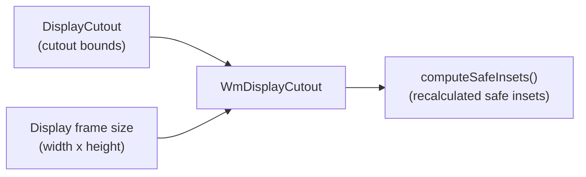

### 24.6.5 RoundedCorners 与 DisplayShape

现代显示带有必须在布局中加以考虑的圆角：

- **`RoundedCorners`** 描述每个角的半径（左上、右上、左下、右下）。
  应用通过 `WindowInsets.getRoundedCorner()` 访问它。

- **`DisplayShape`** 提供显示的完整轮廓路径，同时考虑挖孔和圆角。
  SystemUI 使用它来绘制精确贴合显示边缘的装饰。

- **`PrivacyIndicatorBounds`** 定义了为隐私指示器（摄像头、麦克风）
  保留的区域，这些指示器可能与挖孔区域重叠。

Shell 的 `WindowDecoration` 类
（`frameworks/base/libs/WindowManager/Shell/src/com/android/wm/shell/windowdecor/`）
会接收显示圆角半径，以便窗口装饰（自由形态模式下的标题栏）能够与之
匹配。

### 24.6.6 挖孔旋转

当显示旋转时，挖孔必须随之旋转。`DisplayCutout` 类通过
`CutoutPathParserInfo` 提供旋转支持：

```java
// frameworks/base/core/java/android/view/DisplayCutout.java
public static class CutoutPathParserInfo {
    private final int mDisplayWidth;
    private final int mDisplayHeight;
    private final int mPhysicalDisplayWidth;
    private final int mPhysicalDisplayHeight;
    private final float mDensity;
    private final String mCutoutSpec;
    private final @Rotation int mRotation;
    private final float mScale;
    private final float mPhysicalPixelDisplaySizeRatio;
    // ...
}
```

路径在每次旋转时都会被重新解析，解析器将旋转变换应用到 SVG 路径坐
标上。结果会按 `(spec, width, height, density, rotation)` 元组进行缓
存，以避免重复解析：

```java
// Static cache fields in DisplayCutout
@GuardedBy("CACHE_LOCK")
private static String sCachedSpec;
@GuardedBy("CACHE_LOCK")
private static int sCachedDisplayWidth;
@GuardedBy("CACHE_LOCK")
private static int sCachedDisplayHeight;
@GuardedBy("CACHE_LOCK")
private static float sCachedDensity;
@GuardedBy("CACHE_LOCK")
private static Pair<Path, DisplayCutout> sCachedCutout = NULL_PAIR;
```

### 24.6.7 侧边覆盖

某些设备在多个侧边上都有挖孔（例如顶部有摄像头刘海，底部有传感器
开孔）。对于这些设备，`DisplayCutout` 支持将挖孔边界重新映射到不同
侧边的侧边覆盖：

```java
@GuardedBy("CACHE_LOCK")
private static int[] sCachedSideOverrides;
```

当物理挖孔位置与规范解析器所假定的默认映射不匹配时，侧边覆盖允许
OEM 修正挖孔定位。

### 24.6.8 模拟覆盖层

为了开发和测试，可以在没有物理挖孔的设备上使用类别为
`com.android.internal.display_cutout_emulation` 的运行时资源覆盖层
（RRO）来模拟挖孔。AOSP 包含若干模拟覆盖层（高挖孔、宽挖孔、角落挖
孔、双挖孔），可以通过以下方式启用：

```shell
cmd overlay enable com.android.internal.display.cutout.emulation.tall
```

---

## 24.7 SurfaceFlinger 合成

### 24.7.1 架构概览

SurfaceFlinger 是 Android 的原生显示合成器。它作为独立服务
（`/system/bin/surfaceflinger`）运行，负责从所有应用收集图形图层，并
将它们合成为最终的显示输出。

合成架构经历了一次重大的“前端重构”，将图层状态管理与合成流水线分
离开来：

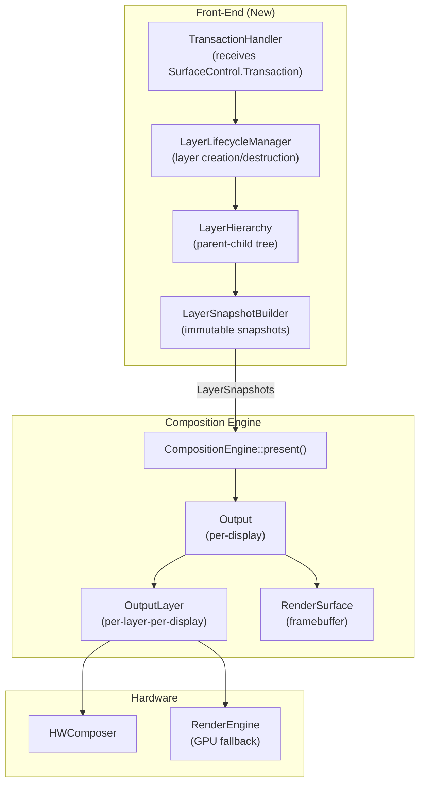

### 24.7.2 LayerLifecycleManager

`LayerLifecycleManager` 拥有 `RequestedLayerState` 对象的集合，并管理
它们的生命周期：

```cpp
// frameworks/native/services/surfaceflinger/FrontEnd/LayerLifecycleManager.h
class LayerLifecycleManager {
public:
    void addLayers(std::vector<std::unique_ptr<RequestedLayerState>>);
    void applyTransactions(const std::vector<QueuedTransactionState>&,
                           bool ignoreUnknownLayers = false);
    void onHandlesDestroyed(
            const std::vector<std::pair<uint32_t, std::string>>&,
            bool ignoreUnknownHandles = false);
    void commitChanges();
    // ...
};
```

生命周期模型很直接：

1. **addLayers** —— 新图层连同其初始的 `RequestedLayerState` 一起被
   添加。
2. **applyTransactions** —— 已排队的事务更新图层属性（位置、尺寸、
   缓冲区、alpha 等）。
3. **onHandlesDestroyed** —— 当客户端释放其图层句柄时，管理器将该图
   层标记为待销毁。没有父级且没有句柄的图层会在 `commitChanges()` 时
   被销毁。
4. **commitChanges** —— 调用 `ILifecycleListener` 回调
   （`onLayerAdded`、`onLayerDestroyed`）并清除变更标志。

管理器通过 `ftl::Flags<RequestedLayerState::Changes>` 跟踪变更，这些
标志在提交之间累积，使快照构建器能够执行增量更新。

### 24.7.3 LayerSnapshotBuilder

`LayerSnapshotBuilder` 遍历 `LayerHierarchy` 树，并生成一个适合
`CompositionEngine` 的有序 `LayerSnapshot` 对象列表：

```cpp
// frameworks/native/services/surfaceflinger/FrontEnd/LayerSnapshotBuilder.h
class LayerSnapshotBuilder {
public:
    void update(const Args&);
    std::vector<std::unique_ptr<LayerSnapshot>>& getSnapshots();
    void forEachVisibleSnapshot(const ConstVisitor& visitor) const;
    // ...
};
```

该构建器实现了两条更新路径：

- **快速路径**（`tryFastUpdate`）：当只发生了缓冲区更新（没有层次结
  构或几何变更）时，构建器可以原地更新快照，而无需重新遍历树。
- **完整更新**（`updateSnapshots`）：重新遍历层次结构，从父级到子级
  更新继承属性（可见性、alpha、颜色变换、裁剪）。

快照在每次提交时都会被重建或原地合并（快速路径会对现有的快照对象调
用 `snapshot->merge(...)`）。合成流水线只有在前端更新完成后才读取它
们。因此它仍然能看到图层状态的一致视图，而无需持有锁。

### 24.7.4 CompositionEngine

`CompositionEngine` 编排实际的合成：

```cpp
// frameworks/native/services/surfaceflinger/CompositionEngine/include/
//     compositionengine/CompositionEngine.h
class CompositionEngine {
public:
    virtual std::shared_ptr<Display> createDisplay(const DisplayCreationArgs&) = 0;
    virtual void present(CompositionRefreshArgs&) = 0;
    virtual void preComposition(CompositionRefreshArgs&) = 0;
    virtual void postComposition(CompositionRefreshArgs&) = 0;
    virtual HWComposer& getHwComposer() const = 0;
    virtual renderengine::RenderEngine& getRenderEngine() const = 0;
};
```

合成周期：

```mermaid
sequenceDiagram
    participant S as Scheduler
    participant SF2 as SurfaceFlinger
    participant CE4 as CompositionEngine
    participant OUT2 as Output (per display)
    participant HWC3 as HWComposer
    participant RE2 as RenderEngine

    S->>SF2: VSYNC callback
    SF2->>SF2: Collect transactions
    SF2->>SF2: Build LayerSnapshots
    SF2->>CE4: present(refreshArgs)
    CE4->>CE4: preComposition (release fences)
    CE4->>OUT2: prepare() - assign layers to HWC
    OUT2->>HWC3: validate()
    HWC3-->>OUT2: composition strategy
    alt Client composition needed
        OUT2->>RE2: drawLayers()
        RE2-->>OUT2: client target buffer
    end
    OUT2->>HWC3: presentDisplay()
    HWC3-->>OUT2: present fence
    CE4->>CE4: postComposition (resolve fences)
```

### 24.7.5 HWComposer 校验

Hardware Composer（HWC）HAL 决定哪些图层可以由专用叠加硬件处理，哪
些必须由 GPU 合成。校验周期：

1. **prepare/validate**：SurfaceFlinger 将所有图层发送给 HWC。
2. **HWC 返回每个图层的合成类型**：
   - `DEVICE` —— HWC 直接处理该图层（DMA 叠加平面）
   - `CLIENT` —— SurfaceFlinger 必须通过 GPU 渲染该图层
   - `SIDEBAND` —— Sideband 流（例如硬件视频解码器）
   - `CURSOR` —— 光标叠加平面
3. **acceptChanges**：SurfaceFlinger 接受 HWC 的决定。
4. **客户端合成**：标记为 `CLIENT` 的图层由 `RenderEngine` 绘制到
   客户端目标缓冲区。
5. **presentDisplay**：HWC 合成所有平面并进行呈现。

这种两遍策略将 GPU 使用最小化——在有能力的硬件上，许多或全部图层都
可以由叠加平面处理，从而节省功耗并降低延迟。

### 24.7.6 RequestedLayerState 与变更跟踪

每个图层的状态被捕获在一个 `RequestedLayerState` 中，它镜像了通过
`SurfaceControl.Transaction` 设置的属性：

```mermaid
classDiagram
    class RequestedLayerState {
        +id: uint32_t
        +name: string
        +parentId: uint32_t
        +relativeParentId: uint32_t
        +z: int32_t
        +x: float
        +y: float
        +getBufferSize() Rect
        +crop: Rect
        +alpha: float
        +color: half4
        +flags: uint32_t
        +transform: uint32_t
        +cornerRadius: float
        +backgroundBlurRadius: int
        +changes: Flags~Changes~
    }

    class Changes {
        <<flags>>
        Created
        Destroyed
        Hierarchy
        Geometry
        Content
        AffectsChildren
        FrameRate
        Visibility
        Buffer
    }

    RequestedLayerState --> Changes
```

`Changes` 标志对快照构建器的增量更新路径至关重要。当只有 `Buffer`
发生变化（没有几何、层次结构或可见性变化）时，快速路径只需更新现有
快照中的缓冲区引用即可。它不会重新遍历层次结构树。上面所示的标志仅
用于说明，并非详尽无遗。
`frameworks/native/services/surfaceflinger/FrontEnd/RequestedLayerState.h`
中完整的 `enum class Changes` 还涵盖 `Input`、`Z`、`Mirror`、
`Parent`、`RelativeParent`、`Metadata`、`SidebandStream`、
`Animation`、`BufferSize`、`GameMode` 和 `PostProcess`。最后一个标志
是在 Android 17 周期中新增的，逐图层 LUT 和图像配置文件的工作使用它
（参见第 24.13 节）。

### 24.7.7 LayerHierarchy：父子树

`LayerHierarchy` 从 `RequestedLayerState` 对象构建一棵有序树：

```mermaid
graph TD
    ROOT["Root"]
    ROOT --> D0["Display 0 Root"]
    D0 --> APP1["App Layer (z=0)"]
    D0 --> APP2["App Layer (z=1)"]
    D0 --> SYS["System Overlay (z=100)"]
    APP1 --> CHILD1["Child Surface (z=0)"]
    APP1 --> CHILD2["Child Surface (z=1)"]
    APP2 --> REL["Relative Layer<br/>(relativeParent=SYS)"]
```

该层次结构处理：

- **Z 序**：子节点在其父节点内按 Z 排序
- **相对图层**：相对于某个非父级图层定位的图层（用于 PopupWindow、
  工具提示）
- **镜像图层**：引用另一个图层子树以进行显示镜像的图层
- **循环检测**：在构建层次结构时，检测到的 relative-Z 循环通过调用
  `LayerLifecycleManager::fixRelativeZLoop()` 来打破（该方法位于
  `LayerLifecycleManager` 上，并由 `LayerHierarchy.cpp` 调用）

### 24.7.8 LayerSnapshot 属性

构建器计算出的每个 `LayerSnapshot` 包含：

- 解析后的几何信息（来自所有祖先的组合变换、裁剪和位置）
- 解析后的可见性（考虑父级 alpha、标志和裁剪）
- 解析后的颜色变换（由所有祖先组合而成）
- 缓冲区引用与获取 fence
- 阴影设置
- 逐图层色彩空间
- 圆角半径（图层自身半径与父级半径的组合）
- 合成类型提示

快照在传递给 `CompositionEngine` 之前，会按 Z 序排序并按可见性过
滤。

### 24.7.9 Output 与 OutputLayer

对于每个显示，`CompositionEngine` 创建一个 `Output`，它管理：

- 该显示的 `RenderSurface`（帧缓冲或虚拟显示表面）
- `DisplayColorProfile`（原生色域、HDR 能力）
- 一个 `OutputLayer` 对象列表（此显示上每个可见图层一个）

`OutputLayer` 跟踪逐显示的合成状态：

- HWC 合成类型（`DEVICE`、`CLIENT`、`CURSOR`）
- 显示局部几何信息（经过显示投影之后）
- 此输出的缓冲区句柄和 fence
- 该图层是否需要 sRGB 到显示色域的转换

### 24.7.10 性能：GPU 合成与 HWC 合成

在 GPU 合成与 HWC 合成之间的选择对功耗和延迟有显著影响：

| 方面 | HWC（叠加） | GPU（客户端） |
|--------|--------------|--------------|
| 功耗 | 低（从缓冲区 DMA） | 高（着色器执行） |
| 延迟 | 1 个 VSYNC | 1-2 个 VSYNC（GPU + 呈现） |
| 容量 | 有限的平面数（4-8） | 无限制 |
| 变换 | 受限（缩放、旋转、裁剪） | 任意 |
| 混合 | 模式受限 | 完整着色器支持 |
| 逐像素 alpha | 有时 | 始终 |

HWC 校验决定了最优的拆分。现代 SoC 暴露 4-8 个叠加平面，每个平面都
能够从不同的缓冲区进行扫描输出。超出硬件容量的图层，或需要不支持的
变换（例如复杂模糊）的图层，会回退到 GPU 合成。

---

## 24.8 BufferQueue 与 BLASTBufferQueue

### 24.8.1 BufferQueue：生产者-消费者模型

`BufferQueue` 是在生产者（应用、相机、视频解码器）与消费者
（SurfaceFlinger、ImageReader、视频编码器）之间传递图形缓冲区的基本
数据结构。它实现了基于槽位的缓冲池：

```mermaid
stateDiagram-v2
    [*] --> FREE : Allocated
    FREE --> DEQUEUED : dequeueBuffer
    DEQUEUED --> QUEUED : queueBuffer
    DEQUEUED --> FREE : cancelBuffer
    QUEUED --> ACQUIRED : acquireBuffer
    ACQUIRED --> FREE : releaseBuffer
```

每个 BufferQueue 都有固定数量的槽位（三重缓冲时通常为 3 个）。各状态
如下：

| 状态 | 所有者 | 说明 |
|-------|-------|-------------|
| `FREE` | BufferQueue | 可供生产者 dequeue |
| `DEQUEUED` | 生产者 | 生产者正在向该缓冲区渲染 |
| `QUEUED` | BufferQueue | 等待消费者 acquire |
| `ACQUIRED` | 消费者 | 消费者正在读取/合成该缓冲区 |

### 24.8.2 三重缓冲

Android 默认使用三重缓冲。显示扫描输出缓冲区 A，SurfaceFlinger 合成
缓冲区 B。与此同时，应用可以渲染到缓冲区 C。该流水线以增加一帧延迟
为代价最大化吞吐量：

```mermaid
gantt
    title Triple Buffering Pipeline
    dateFormat X
    axisFormat %s

    section Display
    Buffer A scanout    :a1, 0, 16
    Buffer B scanout    :b1, 16, 32
    Buffer C scanout    :c1, 32, 48

    section SurfaceFlinger
    Compose B           :sf1, 0, 16
    Compose C           :sf2, 16, 32
    Compose A           :sf3, 32, 48

    section App
    Render C            :app1, 0, 16
    Render A            :app2, 16, 32
    Render B            :app3, 32, 48
```

缓冲区数量可以调整。双重缓冲降低了延迟，但当渲染耗时超过一个 VSYNC
周期时，会有掉帧的风险。

### 24.8.3 BLASTBufferQueue：基于事务的交付

`BLASTBufferQueue`（BLAST——“Buffer as LayerState”）取代了由
SurfaceFlinger 直接获取缓冲区的旧式 `BufferLayer` 方式。取而代之的
是，客户端从 `BufferItemConsumer` 获取缓冲区，并通过
`SurfaceControl.Transaction` 将它们交付给 SurfaceFlinger：

```mermaid
sequenceDiagram
    participant App as Application
    participant BBQ2 as BLASTBufferQueue
    participant BIC as BLASTBufferItemConsumer
    participant SC as SurfaceComposerClient
    participant SF3 as SurfaceFlinger

    App->>BBQ2: Surface.lockCanvas() / EGL swap
    BBQ2->>BBQ2: dequeueBuffer() from IGraphicBufferProducer
    App->>App: Render content
    App->>BBQ2: queueBuffer()
    BIC->>BBQ2: onFrameAvailable()
    BBQ2->>BIC: acquireBuffer()
    BBQ2->>SC: Transaction.setBuffer(surfaceControl, buffer)
    BBQ2->>SC: Transaction.setBufferCrop(...)
    BBQ2->>SC: Transaction.apply()
    SC->>SF3: Binder call with transaction
    SF3->>SF3: Apply in next composition cycle
    SF3-->>BBQ2: transactionCallback (latch time, present fence)
    BBQ2->>BIC: releaseBuffer (with release fence)
```

BLAST 的主要优势：

1. **原子更新**：缓冲区提交与几何变更（位置、裁剪、矩阵）被捆绑在
   单个事务中，消除了缓冲区内容与窗口位置之间的撕裂。
2. **客户端控制**：客户端决定何时提交缓冲区，从而能够与其他操作
   （例如 `SyncGroup`）同步。
3. **Fence 管理**：释放 fence 通过事务回调回流，而
   `ReleaseBufferCallback` 确保 fence 的正确传播。

### 24.8.4 BLASTBufferQueue 内部实现

`BLASTBufferQueue` 类管理若干映射：

```cpp
// frameworks/native/libs/gui/include/gui/BLASTBufferQueue.h
class BLASTBufferQueue : public ConsumerBase::FrameAvailableListener {
    sp<IGraphicBufferProducer> mProducer;
    sp<IGraphicBufferConsumer> mConsumer;
    sp<BLASTBufferItemConsumer> mBufferItemConsumer;
    // Submitted buffers awaiting release
    // Size hint: kSubmittedBuffersMapSizeHint = 8
    ftl::SmallMap<...> mSubmitted;
    // Dequeue timestamps for frame timing
    // Size hint: kDequeueTimestampsMapSizeHint = 32
    ftl::SmallMap<...> mDequeueTimestamps;
};
```

实际的 `BLASTBufferItemConsumer` 实例保存在 `mBufferItemConsumer` 中；
`mConsumer` 是底层 BufferQueue 的普通 `IGraphicBufferConsumer` 一侧。

`syncNextTransaction()` 方法允许调用者在事务被应用之前拦截下一个事
务，从而启用诸如 `ViewRootImpl` 在 `relayout` 期间同步提交缓冲区这
类操作。`mergeWithNextTransaction()` 允许将额外的事务操作（例如位
置变更）与下一次缓冲区提交合并。

### 24.8.5 帧时间戳

`BLASTBufferItemConsumer` 扩展了 `BufferItemConsumer`，增加了帧事件
历史跟踪。`updateFrameTimestamps()` 方法记录：

- 刷新开始时间
- GPU 合成完成 fence
- Present fence
- 上一次释放 fence
- 合成器计时
- Latch 时间
- Dequeue 就绪时间

这些时间戳通过 `FrameEventHistoryDelta` 回流给应用，用于
`EGL_ANDROID_get_frame_timestamps` 和 `Choreographer.FrameInfo`。

### 24.8.6 Fence 同步

缓冲区流水线使用 fence 对象（由 Linux sync 文件支持）来同步 CPU、
GPU 与显示硬件之间的访问：

```mermaid
sequenceDiagram
    participant App4 as Application (CPU)
    participant GPU as GPU
    participant BBQ3 as BLASTBufferQueue
    participant SF8 as SurfaceFlinger
    participant HWC4 as HWComposer

    App4->>GPU: Submit draw commands
    GPU-->>BBQ3: Acquire fence (GPU will signal when done)
    BBQ3->>SF8: Transaction with buffer + acquire fence
    SF8->>SF8: Wait for acquire fence before compositing
    SF8->>HWC4: presentDisplay()
    HWC4-->>SF8: Present fence (display will signal when scanout starts)
    SF8->>BBQ3: Release callback with release fence
    BBQ3->>App4: Buffer released, safe to draw again
    Note over App4: Wait for release fence before<br/>dequeuing same buffer
```

三种 fence：

- **Acquire fence**：当 GPU 完成渲染时发出信号。SurfaceFlinger 在读
  取缓冲区之前必须等待它。
- **Release fence**：当 SurfaceFlinger/HWC 用完缓冲区时发出信号。
  生产者在重用缓冲区之前必须等待它。
- **Present fence**：当合成后的帧开始在显示上扫描输出时发出信号。
  用于帧计时测量。

### 24.8.7 Gralloc 缓冲区分配

缓冲区内存通过 Gralloc HAL（图形分配器）分配。该 HAL 返回由硬件特
定内存支持的 `GraphicBuffer` 对象（用于 HWC 扫描输出的连续 DRAM、
用于 GPU 的分块内存等）。

`IGraphicBufferProducer` 和 `IGraphicBufferConsumer` 接口使用 Binder
在生产者与消费者进程之间共享 `GraphicBuffer` 句柄。实际的缓冲区内存
通过文件描述符（dmabuf）共享，因此两个进程映射相同的物理内存。

### 24.8.8 BLAST 迁移历程

在 BLAST 之前，SurfaceFlinger 按照自己的时间线直接从 BufferQueue 获
取缓冲区。这带来了一些同步问题：

1. **缓冲区-几何失步**：应用可能在以 800x600 的尺寸排队一个缓冲区的
   同时，又请求将窗口大小调整为 1024x768。缓冲区和窗口几何会在不同的
   SurfaceFlinger 帧中被应用，导致可见的撕裂。

2. **没有原子更新**：多个相关变更（缓冲区 + 位置 + 裁剪 + alpha）
   无法原子地应用。

3. **消费者侧延迟**：SurfaceFlinger 必须轮询每个 BufferQueue 以获取
   新缓冲区，这增加了延迟。

BLAST 通过将缓冲区获取移到客户端一侧，并将缓冲区提交与几何变更捆绑
在单个 `SurfaceControl.Transaction` 中，解决了全部三个问题。迁移是
逐步进行的。起初，由 `use_blast_adapter_sv` 全局设置和
`debug.sf.enable_blast_adapter` 系统属性为其把关。这两者此后都已移除，
现在 BLAST 是唯一受支持的路径。

### 24.8.9 SyncGroup 与跨表面同步

`BLASTBufferQueue.syncNextTransaction()` 支持跨表面同步。
`SurfaceView` 直接在其自己的 `BLASTBufferQueue` 上调用它。
`ViewRootImpl` 通过 `HardwareRenderer.SyncInterface.syncNextTransaction(...)`
间接访问它，并将捕获的缓冲区事务合并到 `SurfaceSyncGroup` 中。该组
协调一组变更何时变得可见：

```java
// In SurfaceView
mBlastBufferQueue.syncNextTransaction(transaction -> {
    // Merge the buffer transaction into the sync group
    surfaceSyncGroup.addTransaction(transaction);
    surfaceSyncGroup.markSyncReady();
});
```

这确保了新缓冲区与新窗口边界出现在同一个 SurfaceFlinger 帧中，消除
了调整大小过程中的闪烁。

---

## 24.9 虚拟显示与镜像

### 24.9.1 创建虚拟显示

虚拟显示支持渲染到离屏表面，用于屏幕录制、演示、Miracast 以及虚拟
设备框架。它们通过 `DisplayManager.createVirtualDisplay()` 创建，该方
法会调用进 `DisplayManagerService`：

```mermaid
sequenceDiagram
    participant App2 as Application
    participant DM2 as DisplayManager
    participant DMS4 as DisplayManagerService
    participant VDA as VirtualDisplayAdapter
    participant SF4 as SurfaceFlinger

    App2->>DM2: createVirtualDisplay(config)
    DM2->>DMS4: createVirtualDisplay(config, callback)
    DMS4->>DMS4: Permission checks
    DMS4->>VDA: createVirtualDisplayLocked(callback, config, ...)
    VDA->>SF4: DisplayControl.createVirtualDisplay(name, secure, ...)
    SF4-->>VDA: Display token
    VDA->>VDA: Create VirtualDisplayDevice
    VDA->>DMS4: sendDisplayDeviceEventLocked(ADDED)
    DMS4-->>App2: displayId
```

### 24.9.2 虚拟显示标志

`VirtualDisplayConfig` 支持一组丰富的标志来控制行为：

| 标志 | 说明 |
|------|-------------|
| `VIRTUAL_DISPLAY_FLAG_PUBLIC` | 对所有应用可见的显示 |
| `VIRTUAL_DISPLAY_FLAG_PRESENTATION` | 适合 Presentation API |
| `VIRTUAL_DISPLAY_FLAG_SECURE` | 内容受保护；需要 CAPTURE_SECURE_VIDEO_OUTPUT |
| `VIRTUAL_DISPLAY_FLAG_OWN_CONTENT_ONLY` | 绝不镜像；只显示自己的内容 |
| `VIRTUAL_DISPLAY_FLAG_AUTO_MIRROR` | 在没有内容时镜像默认显示 |
| `VIRTUAL_DISPLAY_FLAG_OWN_DISPLAY_GROUP` | 拥有自己的 DisplayGroup 用于电源管理 |
| `VIRTUAL_DISPLAY_FLAG_DEVICE_DISPLAY_GROUP` | 将显示放入其关联虚拟设备的 DisplayGroup，而不是默认 DisplayGroup |
| `VIRTUAL_DISPLAY_FLAG_OWN_FOCUS` | 管理自己的焦点链 |
| `VIRTUAL_DISPLAY_FLAG_SHOULD_SHOW_SYSTEM_DECORATIONS` | 在此显示上显示状态栏、导航栏 |
| `VIRTUAL_DISPLAY_FLAG_TRUSTED` | 系统信任的显示（需要 INTERNAL_SYSTEM_WINDOW） |
| `VIRTUAL_DISPLAY_FLAG_ALWAYS_UNLOCKED` | 在此显示上绕过 keyguard |
| `VIRTUAL_DISPLAY_FLAG_STEAL_TOP_FOCUS_DISABLED` | 不从其他显示窃取焦点 |

### 24.9.3 VirtualDisplaySurface 与三 BQ 路由

对于会镜像或合成内容的虚拟显示，`VirtualDisplaySurface` 在
SurfaceFlinger 内部管理一个三 BufferQueue 路由系统：

```mermaid
graph LR
    subgraph "Producers"
        SF5["SurfaceFlinger<br/>(GPU / client composition)"]
        HWC5["Hardware Composer"]
    end

    subgraph "VirtualDisplaySurface"
        RBQ["Render BQ<br/>(GPU composition target)"]
        OBQ["Output BQ<br/>(HWC output buffers)"]
        VDS["Routing Logic"]
        SINK["Sink BQ<br/>(to consumer)"]
    end

    subgraph "Consumer Side"
        ENC["MediaCodec / Consumer"]
    end

    SF5 -->|"client composition target"| RBQ
    HWC5 -->|"output buffer"| OBQ
    RBQ --> VDS
    OBQ --> VDS
    VDS -->|"routed buffer"| SINK
    SINK --> ENC
```

`VirtualDisplaySurface.h` 命名了三个队列。**Sink BQ** 是应用在创建时
提供的 surface。合成后的缓冲区最终会被交付到那里。**Render BQ** 是交
给合成引擎作为 GPU 渲染目标的 surface。**Output BQ** 为 HWC 输出提供
缓冲区。路由逻辑处理三种情况：

1. **仅 GPU 合成**：GPU 合成的输出从 render BQ 取出，并排队到 sink
   BQ。
2. **仅 HWC 合成**：HWC 需要为 `advanceFrame` 提供一个输出缓冲区。该
   surface 尽可能重用已 dequeue 的 sink 缓冲区。否则它会从 output BQ
   dequeue 一个。然后它将结果排队到 sink。
3. **混合**：GPU 将客户端图层合成到 render BQ 中。该缓冲区作为客户端
   目标交给 HWC。HWC 将所有内容合成到一个输出缓冲区（来自 sink 或
   output BQ）。该缓冲区被发送到 sink。

`SinkSurfaceHelper` 管理 sink 侧的 BufferQueue，处理缓冲区分配、格式
协商以及与消费者的 fence 同步。

### 24.9.4 使用 Mirror Layer 进行显示镜像

SurfaceFlinger 中的显示镜像通过镜像图层来实现。当某个虚拟显示镜像另
一个显示时，SurfaceFlinger 会创建一个引用源显示图层栈的镜像图层：

```mermaid
graph TD
    subgraph "Source Display (ID=0)"
        LS0["LayerStack 0"]
        L1["App Layer"]
        L2["StatusBar Layer"]
        L3["NavBar Layer"]
    end

    subgraph "SurfaceFlinger"
        ML["Mirror Layer<br/>(references LayerStack 0)"]
    end

    subgraph "Virtual Display (ID=2)"
        LS2["LayerStack 2"]
        ML2["Mirror of LayerStack 0"]
    end

    LS0 --> L1
    LS0 --> L2
    LS0 --> L3
    L1 -.->|"mirrored"| ML
    L2 -.->|"mirrored"| ML
    L3 -.->|"mirrored"| ML
    ML --> ML2
    ML2 --> LS2
```

当图层层次结构发生变化时，`LayerLifecycleManager` 管理镜像图层引用。
它的公共入口点是 `updateDisplayMirrors()`，该方法委托给私有的
`updateDisplayMirrorLayers()` 辅助函数
（`frameworks/native/services/surfaceflinger/FrontEnd/LayerLifecycleManager.h`）。

### 24.9.5 MediaProjection 集成

`MediaProjection` 是用于屏幕捕获和录制的框架 API。它创建一个带有
`AUTO_MIRROR` 标志的虚拟显示，并将输出路由到 `MediaCodec` 编码器或
`ImageReader`：

```mermaid
sequenceDiagram
    participant App3 as Screen Recorder
    participant MP as MediaProjectionManager
    participant DMS5 as DisplayManagerService
    participant CR as ContentRecorder
    participant VD as Virtual Display

    App3->>MP: getMediaProjection(resultCode, data)
    MP-->>App3: MediaProjection token
    App3->>DMS5: createVirtualDisplay(surface, AUTO_MIRROR)
    DMS5->>VD: Create virtual display
    DMS5->>CR: setContentRecordingSession(session)
    CR->>CR: Start mirroring source display
    Note over VD: Mirrors default display content<br/>to the virtual display surface
    App3->>App3: Read from Surface via MediaCodec
```

`WindowManagerService` 中的 `ContentRecorder` 管理进行中的录制会话，
处理显示变更、旋转以及 `FLAG_SECURE` 排除（安全窗口在录制中显示为黑
色）。

### 24.9.6 虚拟设备框架集成

虚拟设备框架（VDF）以完整的设备语义扩展了虚拟显示。一个
`VirtualDeviceImpl` 管理：

- 一个或多个虚拟显示
- 虚拟输入设备（键盘、鼠标、触摸屏）
- 虚拟音频设备
- 窗口策略控制器

`DisplayWindowPolicyController`（存储在 DMS 的
`mDisplayWindowPolicyControllers` 中）针对每个显示强制执行窗口策略。
这些策略决定哪些应用可以运行、是否显示 keyguard，以及是否可以在虚拟
显示上启动 Activity。

```java
// DisplayManagerService.java
final SparseArray<Pair<IVirtualDevice, DisplayWindowPolicyController>>
        mDisplayWindowPolicyControllers = new SparseArray<>();
```

### 24.9.7 WifiDisplayAdapter 与 Miracast

`WifiDisplayAdapter` 管理 Wi-Fi Display（Miracast）连接：

```mermaid
sequenceDiagram
    participant User as User
    participant DMS7 as DisplayManagerService
    participant WDA as WifiDisplayAdapter
    participant WDC as WifiDisplayController
    participant Sink as Miracast Sink

    User->>DMS7: Connect to WFD display
    DMS7->>WDA: requestConnectLocked(address)
    WDA->>WDC: requestConnect(address)
    WDC->>Sink: RTSP negotiation
    Sink-->>WDC: Connected
    WDC->>WDA: Create WifiDisplayDevice
    WDA->>DMS7: sendDisplayDeviceEventLocked(ADDED)
    DMS7->>DMS7: Create LogicalDisplay
    Note over DMS7: Virtual display mirrors<br/>default display to WFD sink
```

WFD 连接使用 RTSP 进行会话管理，使用 RTP 进行视频流交付。视频通过
标准的虚拟显示表面捕获，并以 H.264 编码。

### 24.9.8 用于开发的 OverlayDisplayAdapter

`OverlayDisplayAdapter` 根据 `Settings.Global.OVERLAY_DISPLAY_DEVICES`
设置创建叠加显示：

```shell
settings put global overlay_display_devices "1920x1080/320"
```

这会创建一个虚拟显示，它在主显示上表现为一个窗口。在没有物理硬件的
情况下进行多显示开发时，它非常有用。该格式支持用分号分隔的多个显示：

```shell
settings put global overlay_display_devices "1920x1080/320;1280x720/240"
```

### 24.9.9 外部显示策略

`ExternalDisplayPolicy` 管理连接外部显示（通过 HDMI、USB-C、
DisplayPort）时的行为。它与 `DisplayManagerService` 协调以：

- 决定是镜像还是扩展
- 应用用户对显示的偏好设置
- 处理 `DEVELOPMENT_FORCE_DESKTOP_MODE_ON_EXTERNAL_DISPLAYS` 设置
- 管理 `ExternalDisplayStatsService`，用于跟踪外部显示使用情况的遥测

---

## 24.10 显示色彩管理

### 24.10.1 ColorDisplayService

`ColorDisplayService` 通过一个按优先级排序的 `TintController` 实例管
道管理所有显示颜色变换：

```java
// frameworks/base/services/core/java/com/android/server/display/color/
//     ColorDisplayService.java
public final class ColorDisplayService extends SystemService {
    // ...
}
```

颜色模式常量本身声明在面向公共 API 的
`android.hardware.display.ColorDisplayManager`
（`frameworks/base/core/java/android/hardware/display/ColorDisplayManager.java`）
上，并由该服务导入：

```java
public static final int COLOR_MODE_NATURAL = 0;
public static final int COLOR_MODE_BOOSTED = 1;
public static final int COLOR_MODE_SATURATED = 2;
public static final int COLOR_MODE_AUTOMATIC = 3;
```

### 24.10.2 TintController 层次结构

每个显示级的颜色变换都实现为一个 `TintController` 子类。逐应用的饱和
度由 `AppSaturationController` 单独处理，它是 `ColorDisplayService` 的
一个独立协作者，不属于 `TintController` 层次结构：

```mermaid
classDiagram
    class TintController {
        <<abstract>>
        +getMatrix(): float[]
        +setMatrix(int cct)
        +isActivated(): boolean
    }

    class NightDisplayTintController {
        -mMatrix: float[16]
        +Night Display (warm tint)
    }

    class ColorTemperatureTintController {
        <<abstract>>
        +getAppliedCct()
        +setAppliedCct(int cct)
        +computeMatrixForCct(int cct)
        +getEvaluator(): CctEvaluator
    }

    class DisplayWhiteBalanceTintController {
        -mCurrentColorTemperature
        +Ambient white balance
    }

    class GlobalSaturationTintController {
        -mMatrixGlobalSaturation: float[16]
        +Display saturation level
    }

    class ReduceBrightColorsTintController {
        -mMatrix: float[16]
        +Reduce bright colors (a11y)
    }

    class AppSaturationController {
        -mAppsMap: SparseArray
        +Per-app saturation (a11y)
    }

    TintController <|-- NightDisplayTintController
    TintController <|-- ColorTemperatureTintController
    ColorTemperatureTintController <|-- DisplayWhiteBalanceTintController
    TintController <|-- GlobalSaturationTintController
    TintController <|-- ReduceBrightColorsTintController
    ColorDisplayService --> AppSaturationController : drives ColorTransformController callbacks
```

### 24.10.3 DisplayTransformManager：优先级矩阵

`DisplayTransformManager` 维护一个按优先级排序的 4x4 颜色矩阵稀疏数组，
这些矩阵被相乘后作为一个组合变换发送给 SurfaceFlinger：

```java
// frameworks/base/services/core/java/com/android/server/display/color/
//     DisplayTransformManager.java
public static final int LEVEL_COLOR_MATRIX_NIGHT_DISPLAY = 100;
public static final int LEVEL_COLOR_MATRIX_DISPLAY_WHITE_BALANCE = 125;
public static final int LEVEL_COLOR_MATRIX_SATURATION = 150;
public static final int LEVEL_COLOR_MATRIX_GRAYSCALE = 200;
public static final int LEVEL_COLOR_MATRIX_REDUCE_BRIGHT_COLORS = 250;
public static final int LEVEL_COLOR_MATRIX_INVERT_COLOR = 300;
```

这些级别定义了合成顺序。当多个变换处于活动状态时（例如夜间显示 +
灰度），矩阵会按级别顺序相乘：

```mermaid
graph LR
    ND["Night Display<br/>(level 100)"] --> WB["White Balance<br/>(level 125)"]
    WB --> SAT["Saturation<br/>(level 150)"]
    SAT --> GRAY["Grayscale<br/>(level 200)"]
    GRAY --> RBC["Reduce Bright Colors<br/>(level 250)"]
    RBC --> INV["Invert Color<br/>(level 300)"]
    INV --> FINAL["Combined Matrix<br/>(sent to SurfaceFlinger)"]
```

组合矩阵通过以下 Binder 事务代码发送给 SurfaceFlinger：

```java
private static final int SURFACE_FLINGER_TRANSACTION_COLOR_MATRIX = 1015;
private static final int SURFACE_FLINGER_TRANSACTION_DALTONIZER = 1014;
private static final int SURFACE_FLINGER_TRANSACTION_SATURATION = 1022;
private static final int SURFACE_FLINGER_TRANSACTION_DISPLAY_COLOR = 1023;
```

### 24.10.4 夜间显示

夜间显示（蓝光滤光片）使用 `NightDisplayTintController`（
`ColorDisplayService` 的一个私有内部类，继承自 `TintController`）将显
示向暖色调偏移。显示白平衡则改用抽象的 `ColorTemperatureTintController`
基类。夜间显示支持三种激活模式：

| 模式 | 常量 | 行为 |
|------|----------|----------|
| 已禁用 | `AUTO_MODE_DISABLED` | 仅手动开/关 |
| 自定义计划 | `AUTO_MODE_CUSTOM_TIME` | 用户定义的开始/结束时间 |
| 黄昏 | `AUTO_MODE_TWILIGHT` | 基于日出/日落自动 |

黄昏模式与 `TwilightManager` 集成。这使它能够基于设备的位置计算当地
的日出和日落时间。

色温使用 CCT（相关色温）到 RGB 的变换转换为 4x4 矩阵。`CctEvaluator`
类是一个 `TypeEvaluator<Integer>`，它在 CCT 值之间做动画。它按每个区
间的步长在范围内逐步推进。tint controller 自身完成 CCT 到矩阵的转
换，使用 `computeMatrixForCct()` / `setMatrix(int cct)` 以及每台设备的
色温系数。

### 24.10.5 显示白平衡

`DisplayWhiteBalanceTintController` 使用环境光传感器数据，在不同光照
条件下保持一致的白色外观。`DisplayWhiteBalanceController` 从色温传感
器读取数据（或者该值由环境光传感器推导得出）。它计算出一个校正矩阵，
将显示白点偏移以补偿环境光照。

### 24.10.6 SurfaceFlinger 色彩流水线

在 SurfaceFlinger 一侧，色彩管理涉及：

1. **逐图层色彩空间**：每个图层声明其色彩空间（sRGB、Display P3、
   BT.2020）。SurfaceFlinger 在合成期间将其转换到输出色彩空间。

2. **显示色彩配置文件**：`DisplayColorProfile` 描述显示的原生色域和
   受支持的 HDR 类型。

3. **HDR 处理**：当显示不原生支持某种 HDR 格式时，HDR 内容（HDR10、
   HLG、Dolby Vision）会通过 RenderEngine 接受色调映射。

4. **色彩模式**：HAL 支持多种色彩模式（例如 sRGB、Display P3、
   Native），SurfaceFlinger 可以根据内容需求在它们之间切换。

### 24.10.7 HDR 输出控制

DMS 提供 HDR 输出控制，允许用户禁用特定的 HDR 类型：

```java
// DisplayManagerService.java
private int[] mUserDisabledHdrTypes = {};
private boolean mAreUserDisabledHdrTypesAllowed = true;
```

`HdrConversionMode` 控制全系统范围的 HDR 格式转换：

- **Passthrough**：HDR 内容原样发送到显示
- **System-selected**：系统选择最优的输出格式
- **Force SDR**：所有内容都被色调映射为 SDR

### 24.10.8 逐应用颜色变换

`AppSaturationController` 应用逐应用的去饱和。持有
`CONTROL_DISPLAY_SATURATION` 权限的特权调用者可以通过
`ColorDisplayManager.setAppSaturationLevel()` 为特定包请求降低饱和
度。该控制器维护一个以包名和用户 ID 为键的饱和度级别：

```mermaid
graph LR
    CDM["ColorDisplayManager"] -->|"setAppSaturationLevel(packageName, level)"| ASC["AppSaturationController"]
    ASC -->|"per-layer colorTransform"| SF7["SurfaceFlinger<br/>(per-layer matrix)"]
```

与应用于所有内容的全局变换不同，逐应用变换在 SurfaceFlinger 中以逐图
层颜色矩阵的形式应用。这允许不同的应用同时拥有不同的饱和度级别。

### 24.10.9 色觉障碍校正器（Daltonizer）

Daltonizer 为色觉缺陷用户应用一个颜色校正矩阵。它支持三种类型：

- **Protanomaly** —— 红色弱
- **Deuteranomaly** —— 绿色弱
- **Tritanomaly** —— 蓝色弱

校正矩阵通过 `SURFACE_FLINGER_TRANSACTION_DALTONIZER`（1014）事务代
码发送给 SurfaceFlinger。它独立于颜色矩阵流水线运行——Daltonizer 是
在 SurfaceFlinger 的着色器中作为一个独立变换应用的。

### 24.10.10 Even Dimmer

“Even Dimmer”是一项无障碍功能（前身为“Extra Dim”），它通过应用一个
变暗颜色矩阵，将显示亮度降低到最低硬件亮度之下。
`ReduceBrightColorsTintController` 生成一个缩放所有颜色通道的矩阵，
而 `ColorDisplayService` 对降低幅度设置上限：

```java
// frameworks/base/services/core/java/com/android/server/display/color/
//     ColorDisplayService.java
private static final int EVEN_DIMMER_MAX_PERCENT_ALLOWED = 100;
```

该百分比通过 `Settings.Secure.REDUCE_BRIGHT_COLORS_LEVEL` 设置，并转
换为一个对角线值小于 1.0 的矩阵。它与硬件亮度控制协同工作（而非取代
它），从而让显示可以看起来比背光最低值更暗。在 Android 17 中，该功能
已经毕业。`even_dimmer` aconfig 标志已被移除。其实现（由
`DisplayDeviceConfig.isEvenDimmerAvailable()` 和 `LocalDisplayAdapter`
中的 even-dimmer nit 到强度映射驱动）不再受标志门控。

### 24.10.11 色彩模式选择

面向用户的“显示”设置提供色彩模式选择：

| 模式 | 常量 | 说明 |
|------|----------|-------------|
| 自然 | `COLOR_MODE_NATURAL` (0) | 校准后的 sRGB |
| 增强 | `COLOR_MODE_BOOSTED` (1) | 略微增强的饱和度 |
| 鲜艳 | `COLOR_MODE_SATURATED` (2) | 广色域，色彩鲜艳 |
| 自动 | `COLOR_MODE_AUTOMATIC` (3) | 内容感知切换 |

在 `Automatic` 模式下，系统会根据可见内容的色彩空间在 sRGB 与显示的
原生广色域之间切换。这是通过
`SURFACE_FLINGER_TRANSACTION_DISPLAY_COLOR`（1023）事务代码传达给
SurfaceFlinger 的。

---

## 24.11 显示电源

### 24.11.1 DisplayPowerController：状态机

`DisplayPowerController` 管理单个显示的电源状态。它运行在自己的
handler 上，并与 `PowerManagerService`（通过 `DisplayPowerCallbacks`）
以及显示硬件异步通信。

```java
// frameworks/base/services/core/java/com/android/server/display/
//     DisplayPowerController.java
final class DisplayPowerController implements
        AutomaticBrightnessController.Callbacks,
        DisplayWhiteBalanceController.Callbacks {
    // Message types
    private static final int MSG_UPDATE_POWER_STATE = 1;
    private static final int MSG_SCREEN_ON_UNBLOCKED = 2;
    private static final int MSG_SCREEN_OFF_UNBLOCKED = 3;
    // ...
}
```

### 24.11.2 显示电源状态

显示遵循一个严格的状态机：

```mermaid
stateDiagram-v2
    [*] --> OFF
    OFF --> ON : POLICY_BRIGHT or POLICY_DIM
    ON --> DOZE : POLICY_DOZE
    ON --> OFF : POLICY_OFF
    DOZE --> DOZE_SUSPEND : timeout
    DOZE --> ON : user interaction
    DOZE_SUSPEND --> DOZE : proximity wakeup
    DOZE_SUSPEND --> OFF : POLICY_OFF
    DOZE --> OFF : POLICY_OFF
    ON --> ON_SUSPEND : suspend request

    state ON {
        BRIGHT --> DIM : timeout
        DIM --> BRIGHT : user interaction
    }
```

来自 `PowerManagerService` 的 `DisplayPowerRequest` 指定了期望的策略：

| 策略 | 说明 |
|--------|-------------|
| `POLICY_OFF` | 显示完全关闭 |
| `POLICY_DOZE` | 低功耗息屏显示（AOD） |
| `POLICY_DIM` | 显示变暗（即将进入睡眠） |
| `POLICY_BRIGHT` | 正常亮度 |

### 24.11.3 亮度控制

`DisplayPowerController` 中的亮度流水线涉及多种策略：

```mermaid
graph TD
    subgraph "Brightness Inputs"
        USER["User Setting<br/>(brightness slider)"]
        AUTO["AutomaticBrightnessController<br/>(light sensor)"]
        CLAMP["BrightnessClamperController<br/>(thermal, power, HBM)"]
    end

    subgraph "DisplayBrightnessController"
        DBC["Strategy Selection"]
        STRAT["DisplayBrightnessStrategy"]
    end

    subgraph "Output"
        ANIM["RampAnimator<br/>(smooth transitions)"]
        DPS["DisplayPowerState<br/>(screen brightness)"]
        SF6["SurfaceFlinger<br/>(setDisplayBrightness)"]
    end

    USER --> DBC
    AUTO --> DBC
    CLAMP --> DBC
    DBC --> STRAT
    STRAT --> ANIM
    ANIM --> DPS
    DPS --> SF6
```

**AutomaticBrightnessController** 从环境光传感器读取数据，并应用用户的
亮度曲线配置（`BrightnessConfiguration`）来确定目标亮度。它支持多种
模式：

| 模式 | 常量 | 说明 |
|------|----------|-------------|
| 默认 | `AUTO_BRIGHTNESS_MODE_DEFAULT` | 标准自动亮度 |
| 空闲 | `AUTO_BRIGHTNESS_MODE_IDLE` | 空闲时降低亮度 |
| 打盹 | `AUTO_BRIGHTNESS_MODE_DOZE` | AOD 亮度曲线 |
| 就寝佩戴 | `AUTO_BRIGHTNESS_MODE_BEDTIME_WEAR` | Wear OS 就寝模式 |

**BrightnessClamperController**
（`frameworks/base/services/core/java/com/android/server/display/brightness/clamper/BrightnessClamperController.java`）
通过同一包中的一组 `BrightnessModifier` 实现来强制执行亮度限制，每个
实现贡献一个上限或下限：

- 温度节流（`BrightnessThermalModifier`）在设备发热时降低亮度
- 功耗约束（`BrightnessPowerModifier`）和低功耗模式
  （`BrightnessLowPowerModeModifier`）
- HDR 亮度提升（`HdrBrightnessModifier`）
- 环境照度下限/上限（`BrightnessLowLuxModifier`、
  `BrightnessMaxLuxModifier`）以及 Wear 就寝模式
  （`BrightnessWearBedtimeModeModifier`）

Android 17 增加了一个专用的 `MODIFIER_SUNLIGHT` 亮度原因
（`frameworks/base/services/core/java/com/android/server/display/brightness/BrightnessReason.java`
中的 `BrightnessReason.MODIFIER_SUNLIGHT = 0x40`），这样用于对抗直射
阳光的亮度调节就会与普通的自动亮度区分开进行跟踪。17 周期还将原来的
`NormalBrightnessModeController` 并入了这一 clamper 框架（由
`refactor_normal_brightness_mode_controller` 标志门控）。

### 24.11.4 息屏显示（AOD）

AOD 支持需要 `DisplayPowerController`、`DreamManagerService` 和
SurfaceFlinger 之间的协调：

1. **DreamManagerService** 启动 AOD dream（一个带有
   `ACTIVITY_TYPE_DREAM` 的 `DreamService`）。
2. **DisplayPowerController** 转换到 `POLICY_DOZE`，将显示设置为低功
   耗状态。
3. **SurfaceFlinger** 可能切换到一种降低刷新率并限制色彩深度的特殊
   显示模式。
4. **DisplayPowerState** 将屏幕亮度管理到 AOD 级别。

`ColorFade` 动画（熄屏效果）使用 OpenGL ES 渲染，创造出平滑的淡出至
黑色或淡出至 AOD 的过渡效果。

### 24.11.5 睡眠令牌

睡眠令牌是显示电源状态与 Activity 生命周期交互的机制。当显示进入睡眠
时，`ActivityTaskManagerService` 获取睡眠令牌，这会冻结 Activity 生命
周期——在显示关闭期间不会有 Activity 恢复或暂停。

当 `DisplayPowerController` 发出熄屏信号时，它会触发：

1. `PowerManager.goToSleep()` —— 启动睡眠序列
2. `PhoneWindowManager` 调用
   `DisplayPolicy.screenTurnedOff()`，该方法通过
   `DisplayContent.addSleepToken(DISPLAY_OFF_SLEEP_TOKEN_TAG)` 获取该
   令牌——冻结该显示的 Activity 生命周期
3. 处于 RESUMED 状态的 Activity 被暂停
4. 窗口管理器应用 `DISPLAY_STATE_OFF` 标志

当显示唤醒时，睡眠令牌被释放，前台 Activity 恢复。

### 24.11.6 距离传感器

`DisplayPowerProximityStateController` 管理用于在通话期间关闭显示的距
离传感器：

```mermaid
stateDiagram-v2
    [*] --> Unknown
    Unknown --> Near : sensor reports NEAR
    Unknown --> Far : sensor reports FAR
    Near --> Far : sensor reports FAR
    Far --> Near : sensor reports NEAR
    Near --> Unknown : timeout / call ended
```

当距离为 NEAR 且有通话活动时，显示被强制关闭。去抖动机制可防止传感
器读数振荡时的闪烁。

### 24.11.7 updatePowerState() 流水线

`DisplayPowerController` 的核心是 `updatePowerState()` 方法，它由
`MSG_UPDATE_POWER_STATE` 触发。这是一个庞大的单遍方法，它评估当前状
态并计算出期望的显示电源配置：

```mermaid
flowchart TD
    A["MSG_UPDATE_POWER_STATE"] --> B["Read pending power request"]
    B --> C["Compute desired screen state<br/>(ON, DOZE, OFF)"]
    C --> D["Initialize display power state<br/>if first time"]
    D --> E["Handle proximity sensor"]
    E --> F["Determine brightness source<br/>(user, auto, override)"]
    F --> G["Apply brightness clamping<br/>(thermal, HBM, RBC)"]
    G --> H["Compute brightness ramp<br/>(fast for user, slow for auto)"]
    H --> I["Apply color fade animation<br/>(screen on/off effect)"]
    I --> J["Set display brightness<br/>via DisplayBlanker"]
    J --> K["Report screen state<br/>to policy (TURNING_ON, ON, etc.)"]
    K --> L{"State settled?"}
    L -->|"No"| M["Re-post MSG_UPDATE_POWER_STATE"]
    L -->|"Yes"| N["Report ready to PowerManager"]
```

该方法使用一个状态机来跟踪熄屏/亮屏上报：

| 状态 | 常量 | 含义 |
|-------|----------|---------|
| 未上报 | `REPORTED_TO_POLICY_UNREPORTED` (-1) | 初始状态 |
| 熄屏 | `REPORTED_TO_POLICY_SCREEN_OFF` (0) | 显示已确认关闭 |
| 正在点亮 | `REPORTED_TO_POLICY_SCREEN_TURNING_ON` (1) | 显示正在上电 |
| 亮屏 | `REPORTED_TO_POLICY_SCREEN_ON` (2) | 显示已确认开启 |
| 正在熄灭 | `REPORTED_TO_POLICY_SCREEN_TURNING_OFF` (3) | 显示正在下电 |

### 24.11.8 亮度渐变动画

`DisplayPowerController` 使用 `DualRampAnimator`（`RampAnimator` 中的
一个嵌套辅助类，驱动两个 `RampAnimator` 实例）来平滑地过渡亮度。该
双渐变动画同时对屏幕亮度和 SDR 亮度进行动画：

- **提升渐变**：最大时间 `mBrightnessRampIncreaseMaxTimeMillis`
  （例如到户外时温和提亮为 2000ms）
- **降低渐变**：最大时间 `mBrightnessRampDecreaseMaxTimeMillis`
  （例如到室内时温和变暗为 5000ms）
- **空闲渐变**：当设备空闲时使用独立且通常更长的渐变时间

渐变跳过逻辑（`RAMP_STATE_SKIP_INITIAL`、`RAMP_STATE_SKIP_AUTOBRIGHT`）
允许亮屏时设置的初始亮度被立即应用而不带动画。这避免了屏幕点亮时出
现可见的亮度渐变。

### 24.11.9 高亮度模式（HBM）

`HighBrightnessModeController` 管理显示的峰值亮度能力，这通常受温度
约束的限制：

```mermaid
stateDiagram-v2
    [*] --> Normal
    Normal --> HBM_SV : Sunlight detected, lux > threshold
    HBM_SV --> Normal : Sunlight absent or thermal limit
    Normal --> HBM_HDR : HDR content displayed
    HBM_HDR --> Normal : No HDR content
    HBM_SV --> Throttled : Thermal warning
    Throttled --> Normal : Temperature drops
```

`HighBrightnessModeMetadataMapper` 维护每个显示的 HBM 元数据
（`HighBrightnessModeMetadata`）。它跟踪在 HBM 中的运行时间，以强制
执行保护显示硬件的“状态停留时长”限制。

### 24.11.10 亮度尼特范围

显示流水线会记录一个详细的基于尼特的亮度范围，用于遥测。它有 37 个
区间，从 0-1 尼特一直到 2750-3000 尼特。在 Android 17 中，这位于抽
取出的 `DisplayBrightnessReporter` 中，而不是直接位于
`DisplayPowerController` 中：

```java
// frameworks/base/services/core/java/com/android/server/display/brightness/
//     DisplayBrightnessReporter.java
private static final float[] BRIGHTNESS_RANGE_BOUNDARIES = {
    0, 1, 2, 3, 4, 5, 6, 7, 8, 9, 10, 20, 30, 40, 50, 60, 70, 80,
    90, 100, 200, 300, 400, 500, 600, 700, 800, 900, 1000, 1200,
    1400, 1600, 1800, 2000, 2250, 2500, 2750, 3000
};
```

类似地，环境光照度被分入从 0-0.1 到 30000-100000 lux 的 14 个照度区
间，用于亮度事件跟踪。这些统计信息会馈入 `BrightnessTracker`（用于自
适应亮度模型改进）和 `FrameworkStatsLog`（用于平台遥测）。

### 24.11.11 Lead-Follower 亮度

某些设备拥有应当共享亮度的多个显示。一个例子是可折叠设备，其内屏和
外屏应当具有一致的亮度。对于这些设备，`DisplayPowerController` 支持
一种 lead-follower 模型：

```java
private int mLeadDisplayId = Layout.NO_LEAD_DISPLAY;
```

当 `mLeadDisplayId` 被设置时，follower 显示会镜像 leader 的亮度决策。
它不会运行自己的自动亮度算法。leader-follower 关系在
`DeviceStateToLayoutMap` 的 `Layout` 配置中定义。

### 24.11.12 显示卸载

`DisplayOffloadSession` 支持将显示更新卸载到协同处理器（例如用于
Wear OS 上的表盘）。当卸载处于活动状态时，主处理器可以进入深度睡眠，
而协同处理器处理简单的显示更新（时间、复杂功能）。该会话通过
`DisplayManagerService` 中的 `DisplayOffloadSessionImpl` 管理。

在卸载活动期间屏幕可能需要点亮（例如抬腕）。然后
`MSG_OFFLOADING_SCREEN_ON_UNBLOCKED` 消息协调从协同处理器回到主显示
流水线的移交。该移交通过 `SCREEN_ON_BLOCKED_BY_DISPLAYOFFLOAD_TRACE_NAME`
跟踪标记来跟踪。

---

## 24.12 已连接的显示与显示拓扑 API

Android 的外接显示方案在 Android 17 中显著成熟。早期版本主要是将内置
面板镜像到 HDMI 或 USB-C 接收端。Android 17 引入了一等公民级别的*显示
拓扑*。系统会持久化这一拓扑并将其暴露给应用。Android 17 还增加了内容
模式管理。借助它，一块已连接的显示可以扩展工作区，而不仅仅是镜像它。

### 24.12.1 拓扑数据模型

拓扑以一棵树的形式描述每个活动显示的空间排列。`DisplayTopology`
（`frameworks/base/core/java/android/hardware/display/DisplayTopology.java`）
将每个显示存储为一个 `TreeNode`，它通过四个边之一附着到其父节点上：

```java
// frameworks/base/core/java/android/hardware/display/DisplayTopology.java
public static final int POSITION_LEFT = 0;
public static final int POSITION_TOP = 1;
public static final int POSITION_RIGHT = 2;
public static final int POSITION_BOTTOM = 3;
```

每个节点携带一个逻辑尺寸、一个密度，以及相对于其父节点的附着边。它
还携带一个沿共享边的浮点偏移（以密度无关像素为单位）。
`DisplayTopology` 提供 `addDisplay()`、`removeDisplay()`、
`rearrange()`，以及一个 `normalize()` 步骤——后者会钳制偏移并消除重
叠，使相邻显示保持边缘相接。输入系统消费一个扁平化的
`DisplayTopologyGraph`
（`frameworks/base/core/java/android/hardware/display/DisplayTopologyGraph.java`）
邻接视图，以便将指针跨越显示之间的接缝移动。

### 24.12.2 公共 DisplayManager API

应用和系统 UI 通过新的 `DisplayManager` 方法读取并调整该排列，这些方
法全部由 `display_topology_api` 标志门控：

```java
// frameworks/base/core/java/android/hardware/display/DisplayManager.java
@FlaggedApi(Flags.FLAG_DISPLAY_TOPOLOGY_API)
public DisplayTopology getDisplayTopology();
public void setDisplayTopology(DisplayTopology topology);
public void registerTopologyListener(Executor executor,
        Consumer<DisplayTopology> listener);
public void unregisterTopologyListener(Consumer<DisplayTopology> listener);
```

`display_topology_api` 标志在
`frameworks/base/services/core/java/com/android/server/display/feature/display_flags.aconfig`
中被声明为 `is_fixed_read_only`，因此在给定构建中，该 API 要么是编入
的，要么是编出的。

### 24.12.3 协调器与逐用户持久化

```mermaid
graph TD
    APP["App / System UI"] -->|"get/set/listen"| DM["DisplayManager"]
    DM --> DMS12["DisplayManagerService"]
    DMS12 --> COORD["DisplayTopologyCoordinator"]
    COORD -->|"onDisplayAdded/Changed/Removed"| TOPO["DisplayTopology<br/>(in-memory tree)"]
    COORD -->|"save/restore"| STORE["DisplayTopologyStore<br/>(interface)"]
    STORE --> XML["DisplayTopologyXmlStore<br/>(per-user XML)"]
    XML --> FILE["data/system_ce/&lt;userId&gt;/<br/>display_topology.xml"]
    COORD -->|"DisplayTopologyGraph"| INPUT["Input (cross-display pointer)"]
```

`DisplayTopologyCoordinator`
（`frameworks/base/services/core/java/com/android/server/display/DisplayTopologyCoordinator.java`）
维护实时拓扑，并对显示添加、变更和移除事件做出反应。持久化被抽象在
`DisplayTopologyStore` 接口之后，其在 Android 17 中的实现是
`DisplayTopologyXmlStore`。该 XML 存储会在凭据加密的系统目录
（`Environment.getDataSystemCeDirectory(userId)`）下写入每个用户的
`display_topology.xml`。它保留一个有序的、最近使用过的已记住拓扑列表。
它使用一个重排阈值（`MIN_REORDER_WHICH_TRIGGERS_PERSISTENCE = 10`）对
写入进行批处理，使微小的重排不会反复刷盘。它还会读取设备 etc
display-config 目录下随设备发布的不可变厂商和产品拓扑文件。

### 24.12.4 内容模式：镜像与扩展

已连接显示工作的另一部分是*内容模式管理*，由
`enable_display_content_mode_management` 标志（命名空间
`lse_desktop_experience`）门控。启用后，一块已连接的显示可以运行在镜像
或扩展模式，而对于一块有能力的外部显示，默认值变为扩展。

显示通过 `DisplayDeviceInfo.FLAG_ALLOWS_CONTENT_MODE_SWITCH`
（`1 << 20`）来通告自己切换的能力。`LogicalDisplay.canHostTasksLocked()`
使用该标志来决定显示是否可以承载自己的任务栈。否则该显示只会反映默认
显示。用户偏好存储在
`Settings.Secure.MIRROR_BUILT_IN_DISPLAY`（1 = 镜像，0 = 扩展）中。
`DisplayGroupAllocator` 选择每块显示的内容模式和组。

两个策略类分担这项工作。

`SecondaryDisplayPolicy`
（`frameworks/base/services/core/java/com/android/server/display/SecondaryDisplayPolicy.java`）
规定新连接的显示如何被对待。例如，当桌面模式不可用时，它会把桌面模式
偏好降级为“询问”。

`ExternalDisplayPolicy`
（`frameworks/base/services/core/java/com/android/server/display/ExternalDisplayPolicy.java`）
根据温度余量来门控外部显示。它会注册一个 `SkinThermalStatusObserver`。
当皮肤温度达到临界水平时，它会调用 `disableExternalDisplays()`。随后
它会发出 `EVENT_DISPLAY_CONNECTED` 以通知系统其余部分。使用情况遥测
（镜像、扩展、演示）通过 `ExternalDisplayStatsService` 流动。

## 24.13 自适应刷新率、HDR 与显示 LUT

Android 17 推进了三个渲染质量领域。三者都终结于 SurfaceFlinger 和
Hardware Composer。它们是自适应刷新率、已连接显示上的 HDR，以及逐图
层颜色查找表。

### 24.13.1 自适应刷新率与帧率类别

可变刷新率（VRR）面板可以运行在连续的刷新率上，而不是少量固定的模
式。SurfaceFlinger 通过 `DisplayMode.getVrrConfig()` 检测这一点，并将
其在 `RefreshRateSelector`
（`frameworks/native/services/surfaceflinger/Scheduler/RefreshRateSelector.h`）
中缓存为 `mIsVrrDisplay`。由于精确 Hz 请求与连续体不匹配，应用越来越多
地改用*帧率类别*来表达意图：

```java
// frameworks/base/core/java/android/view/Surface.java
public static final int FRAME_RATE_CATEGORY_DEFAULT = 0;
public static final int FRAME_RATE_CATEGORY_NO_PREFERENCE = 1;
public static final int FRAME_RATE_CATEGORY_LOW = 2;
public static final int FRAME_RATE_CATEGORY_NORMAL = 3;
public static final int FRAME_RATE_CATEGORY_HIGH_HINT = 4;
public static final int FRAME_RATE_CATEGORY_HIGH = 5;
```

`RefreshRateSelector` 将这些类别映射到以
`kFrameRateCategoryRateNormal = 60_Hz` 和
`kFrameRateCategoryRateHigh = 90_Hz` 为锚点的 Hz 范围上（其中
`kMinSupportedFrameRate = 20_Hz`）。类别投票以
`LayerVoteType::ExplicitCategory` 的形式到达（第 24.3.6 节）。

```mermaid
graph TD
    VRI13["ViewRootImpl<br/>setPreferredFrameRateCategory()"] -->|"Transaction.setFrameRateCategory()"| LFE["Layer (SurfaceFlinger)"]
    LFE --> LI["LayerInfo<br/>(isVoteValidForMrr)"]
    LI -->|"ExplicitCategory vote"| RRS13["RefreshRateSelector<br/>(VRR vs MRR)"]
    RRS13 --> RANGE["Hz range<br/>(Normal 60-120, High 90-120)"]
```

围绕这一点的 Android 17 变动，主要是对一个首次在 16 中落地的 API 做
精化。`Display.hasArrSupport()`
（`frameworks/base/core/java/android/view/Display.java`）让调用者在多
刷新率（MRR）面板上跳过 `setFrameRateCategory`。
`LayerInfo::isVoteValidForMrr()` 将类别投票限制在 ARR/VRR 设备上，除非
设置了 `frame_rate_category_mrr` 标志。Android 17 还增加了
`Display.getFrameRateVelocityMapping()`。它返回 `FrameRateVelocityPoint`
条目，因此滚动内容可以将甩动速度映射到目标速率。MRR 专用的标志
`frame_rate_category_mrr` 和 `mrr_full_frame_rate_list` 位于
`frameworks/native/services/surfaceflinger/surfaceflinger_flags_new.aconfig`。

### 24.13.2 已连接显示上的 HDR

HDR 输出不再局限于内置面板。Android 17 在先前的
`connected_display_hdr_v2` 之上增加了 `connected_display_hdr_v3` 标志
（命名空间 `core_graphics`，位于 `surfaceflinger_flags_new.aconfig`）。
这些标志在外部显示上启用 HDR 选择。全系统范围的 HDR 转换仍通过
`HdrConversionMode` 表达：

```java
// frameworks/base/core/java/android/hardware/display/HdrConversionMode.java
public static final int HDR_CONVERSION_UNSUPPORTED = 0;
public static final int HDR_CONVERSION_PASSTHROUGH = 1;
public static final int HDR_CONVERSION_SYSTEM = 2;
public static final int HDR_CONVERSION_FORCE = 3;
```

对于刷新率策略，HDR 偏好现在通过 `HdrPreferenceVote` 参与到框架投票系
统中
（`frameworks/base/services/core/java/com/android/server/display/mode/HdrPreferenceVote.java`）。
它的 `updateSummary()` 会对一个 `allowHdr` 标志做 AND。系统或电池驱动
的投票随后即使用户请求了 HDR，也可以否决 HDR。DMS 仍然通过
`mUserDisabledHdrTypes` 遵循逐设备的已禁用 HDR 类型。SurfaceFlinger 还
通过 `true_hdr_screenshots` 和 `local_tonemap_screenshots` 标志获得了
更高保真度的捕获能力。

### 24.13.3 显示色彩 LUT

Android 17 暴露了一个公共 API，用于将颜色查找表（LUT）附加到表面上。
该 API 为应用和系统提供了对显示颜色变换的细粒度控制，超出了第 24.10
节的全局矩阵流水线。其原生表示是 `DisplayLuts`
（`frameworks/native/libs/gui/include/gui/DisplayLuts.h`）。它携带一条
或多条 `Entry` 记录（每条带有一个维度、大小和采样键），外加一个持有
LUT 数据的共享内存文件描述符。`LutProperties`
（`frameworks/native/libs/gui/aidl/android/gui/LutProperties.aidl`）
描述 HAL 能力。

框架侧的接口是
`frameworks/base/core/java/android/hardware/DisplayLuts.java` 和
`frameworks/base/core/java/android/hardware/LutProperties.java`：

```java
// frameworks/base/core/java/android/hardware/LutProperties.java
public static final int ONE_DIMENSION = 1;
public static final int THREE_DIMENSION = 3;
public static final int SAMPLING_KEY_RGB = 0;
public static final int SAMPLING_KEY_MAX_RGB = 1;
public static final int SAMPLING_KEY_CIE_Y = 2;
```

LUT 通过 `SurfaceControl.Transaction.setLuts()` 按图层附加（传入
`null` 会清除它）。应用可以通过 `OverlayProperties.getLutProperties()`
发现设备支持。只有内部和外部显示会报告真实的设备能力——对于其他显示
类型（包括虚拟显示），`Display.getOverlaySupport()` 返回默认的
`OverlayProperties`。整个接口由 `luts_api` 标志门控。

### 24.13.4 图像配置文件

一个相关的系统级设施让已连接的电视式显示能够按图层应用硬件图像处理
（gamma、色温、色调、饱和度）。一个 `PictureProfile`
（`frameworks/base/media/java/android/media/quality/PictureProfile.java`）
在 surface 层由一个不透明的 `PictureProfileHandle` 标识，并通过
`SurfaceControl.Transaction.setPictureProfileHandle()` 应用。硬件一次只
能处理有限数量的图层。因此，活动集合由
`SurfaceControl.getMaxPictureProfiles()` 界定，并由内容优先级进行仲裁。
配置文件携带逐 HDR 流状态的变体（SDR、HDR10、Dolby Vision、HLG、
HDR10+、HDR Vivid），并通过 `MediaQualityManager` 管理。该特性由
`apply_picture_profiles` 标志门控。

## 24.14 RenderEngine 与 Android 17 中的多显示模式集

上述特性依赖于两项更底层的重新设计。

### 24.14.1 Skia Graphite RenderEngine 推出

SurfaceFlinger 的 GPU 客户端合成路径（RenderEngine，第 24.7.10 节）正在
从 Skia Ganesh 迁移到基于 Vulkan 的 Skia Graphite。Android 17 在
`frameworks/native/services/surfaceflinger/surfaceflinger_flags_new.aconfig`
中携带了一组分阶段推出的标志。
`force_compile_graphite_renderengine` 会编译但不启用 Graphite。Graphite
也可以通过 `debug.renderengine.graphite` 系统属性来切换。

逐设备的选择加入推出标志是 `graphite_renderengine_preview_rollout`、
`graphite_renderengine_preview2_rollout` 和
`graphite_renderengine_desktop_rollout`。它们默认都不开启。每台设备的
发布配置选择最终状态。

### 24.14.2 原子多显示模式集

已连接显示和拓扑特性建立在 SurfaceFlinger 中一条经过重新设计的模式集
路径之上。这条路径可以原子地改变多个显示的模式，而不是一次改变一个。

Android 17 的工作增加了三个部分。它们分别是一个 `SurfaceControl`
原子模式集 API、一个显示命令模式集实现，以及一个模式集状态机。用于此
项工作的 `modeset_multi_display`、`display_command_modeset`、
`modeset_state_machine` 和 `synced_resolution_switch` 标志位于
SurfaceFlinger 的 aconfig 文件中。Pacesetter 选择（第 24.3.7 节）也被更
新为优先选择能够达到最高峰值帧率的显示。SurfaceFlinger 中移除了旧的
HIDL 电源路径。Follower（辅助）显示获得了自己的刷新率选择和背压处理，
因此一块缓慢的外部面板不会拖住 pacesetter。

## 动手实践

显示栈通过 `dumpsys` 和 `cmd` 接口暴露了它的大部分内部状态。这是将本
章中的类与正在运行的设备联系起来的最快方式。以下命令在标准的 Android
17 构建上都可以通过 `adb shell` 使用：

| 命令 | 用途 |
|---------|---------|
| `dumpsys display` | DisplayManagerService 状态：逻辑显示、设备、组、模式投票 |
| `dumpsys SurfaceFlinger` | SurfaceFlinger 图层树与合成统计 |
| `dumpsys SurfaceFlinger --frametimeline` | 逐帧计时（预期与实际呈现） |
| `dumpsys SurfaceFlinger --list` | 列出所有图层 |
| `dumpsys window displays` | WindowManagerService 显示信息 |
| `dumpsys window containers` | 窗口容器 / DisplayArea 层次结构（第 24.2 节） |
| `dumpsys color_display` | ColorDisplayService 状态（第 24.10 节） |
| `dumpsys device_state` | DeviceStateManagerService 姿态（第 24.5 节） |
| `cmd display set-brightness <0.0-1.0>` | 设置显示亮度 |
| `cmd display reset-brightness-configuration` | 重置自动亮度 |
| `wm size` / `wm density` | 显示逻辑尺寸与密度 |
| `settings put system accelerometer_rotation 0/1` | 锁定/解锁旋转（第 24.4 节） |

建议的探索：

1. **观察一次折叠/展开切换。** 在一台可折叠设备（或可折叠模拟器）上，
    在设备折叠前后运行 `dumpsys device_state` 和 `dumpsys display`。
    确认逻辑显示 0 的承载物理设备发生了变化。确认其显示 ID 保持不变
    （第 24.5.3 节）。在 DMS dump 中查找
    `LOGICAL_DISPLAY_EVENT_SWAPPED` 转换。

2. **强制一个叠加显示。** 运行
    `adb shell settings put global overlay_display_devices "1920x1080/320"`。
    观察一个新的逻辑显示通过 `OverlayDisplayAdapter` 出现在
    `dumpsys display` 中（第 24.9.8 节）。这不需要任何外部硬件。

3. **检查刷新率投票。** 在某个列表滚动时，抓取
    `dumpsys display`。找到 `DisplayModeDirector` 的投票摘要
    （第 24.1.9 节）。将解析出的 `DesiredDisplayModeSpecs` 与面板实际
    支持的模式进行比较。

4. **读取拓扑。** 在启用了已连接显示标志的构建上，接上一块外部显示。
    检查逐用户系统目录下持久化的 `display_topology.xml`。更改排列。
    确认该文件会更新（第 24.12.3 节）。

5. **跟踪一帧。** 捕获一条 `perfetto` 跟踪。将 `FrameTimeline` 事件
    （第 24.3.11 节）与下面的端到端延迟分解关联起来。从触摸到光子的
    单帧会遍历整个栈：

```mermaid
sequenceDiagram
    participant HW2 as Display Panel
    participant VP2 as VSyncPredictor
    participant VDT as VSyncDispatchTimerQueue
    participant ET2 as EventThread (app)
    participant CH2 as Choreographer
    participant VRI3 as ViewRootImpl
    participant APP2 as Application View
    participant BBQ4 as BLASTBufferQueue
    participant GPU2 as GPU (RenderThread)
    participant ET3 as EventThread (sf)
    participant SF9 as SurfaceFlinger
    participant CE5 as CompositionEngine
    participant HWC5 as HWComposer
    participant DRM2 as DRM/KMS

    HW2->>VP2: HW VSYNC timestamp
    VP2->>VP2: Update linear model
    VP2->>VDT: Predicted next VSYNC
    VDT->>ET2: Timer fires (app wakeup)
    ET2->>CH2: VSYNC event via BitTube
    CH2->>CH2: CALLBACK_INPUT (process touch)
    CH2->>CH2: CALLBACK_ANIMATION
    CH2->>VRI3: CALLBACK_TRAVERSAL
    VRI3->>APP2: onMeasure/onLayout/onDraw
    APP2->>VRI3: Canvas draw commands
    VRI3->>GPU2: Flush to RenderThread
    GPU2->>BBQ4: queueBuffer (with acquire fence)
    BBQ4->>SF9: Transaction.setBuffer(...)
    VDT->>ET3: Timer fires (sf wakeup)
    ET3->>SF9: VSYNC callback
    SF9->>SF9: Apply pending transactions
    SF9->>SF9: Build LayerSnapshots
    SF9->>CE5: present(refreshArgs)
    CE5->>HWC5: validate() + presentDisplay()
    HWC5->>DRM2: Atomic commit (page flip)
    DRM2->>HW2: Scanout new frame
    HW2->>HW2: Photons reach user's eye
```

   120 Hz（8.33ms 周期）下的典型延迟分解：

| Phase | Duration | Notes |
|-------|----------|-------|
| VSYNC to app wakeup | 0.5-1ms | Timer scheduling overhead |
| Input + animation | 0.5-2ms | Depends on callback complexity |
| Measure/layout/draw | 1-4ms | View tree complexity |
| GPU render | 1-3ms | Shader complexity, overdraw |
| SurfaceFlinger compose | 0.5-2ms | Depends on GPU vs HWC |
| HWC commit | 0.2-0.5ms | DRM atomic commit |
| **Total** | **3.7-12.5ms** | Must fit in 8.33ms for 120Hz |

    当总数超过 VSYNC 周期时，该帧就会错过截止时间。它会被延迟一个
    周期呈现（即一帧“卡顿”）。`FrameTimeline` 和
    `dumpsys SurfaceFlinger --frametimeline` 会暴露这些帧以便分析。

## 总结

Android 显示系统是一个纵深的垂直栈。它始于硬件 VSYNC 中断，并延伸经
过原生 C++ 合成、Java 框架服务以及应用层 API。定义该系统的关键架构决
策是：

1. **逻辑/物理分离**：`LogicalDisplay` 将系统可见的显示与底层硬件解耦。
    这支持可折叠显示切换、虚拟显示以及未来的多面板配置。

2. **DisplayArea 树**：`DisplayAreaPolicyBuilder` 创建了一个灵活的容器
    层次结构，它强制执行 Z 序。各种特性（放大、单手模式、挖孔隐藏）仍
    然可以针对特定的窗口类型范围。

3. **VSYNC 驱动的流水线**：每一帧都始于来自 `VSyncPredictor` 的一个预
    测 VSYNC。该帧流经 `VSyncDispatchTimerQueue` 到达 `EventThread`。它
    经由 `Choreographer` 跨入 Java 领域。它终结于
    `CompositionEngine::present()`。

4. **基于事务的缓冲区交付**：`BLASTBufferQueue` 将缓冲区提交与几何变
    更捆绑在原子的 `SurfaceControl.Transaction` 操作中。这消除了一类
    由缓冲区-几何失步所引起的缺陷。

5. **前端/后端分离**：SurfaceFlinger 重构后的架构将图层状态管理
   （`LayerLifecycleManager`、`LayerSnapshotBuilder`）与合成
   （`CompositionEngine`、`HWComposer`）分离开来。这带来了更好的可测
   试性、增量更新以及更少的锁争用。

6. **按优先级排序的颜色变换**：`DisplayTransformManager` 以一个定义好
   的优先级顺序合成多个 4x4 颜色矩阵（夜间显示、白平衡、饱和度、无障
   碍）。它为 SurfaceFlinger 生成单个组合变换。

7. **状态驱动的可折叠支持**：`DeviceStateManagerService` 为可折叠姿态
    提供了一个干净的状态机抽象。`LogicalDisplayMapper` 处理复杂的显示
    切换，使折叠/展开转换对应用而言看起来是无缝的。

8. **已连接显示的成熟度（Android 17）**：SurfaceFlinger 中经过重新设
    计的原子多显示模式集路径，是若干特性的基础。这些特性包括一个持久
    化的、对应用可见的 `DisplayTopology` 以及内容模式管理（镜像与扩
    展）。它们还包括由帧率类别驱动的自适应刷新率、外部显示上的 HDR，
    以及逐图层的颜色 LUT 和图像配置文件。

这些子系统在正常的设备运行期间不断地相互作用。单帧就会触及 VSYNC
预测器、Choreographer、ViewRootImpl、BLASTBufferQueue、
SurfaceFlinger 前端、CompositionEngine、HWComposer 以及内核 DRM 驱
动。该流水线在 60 Hz 下于 16 毫秒内完成，在 120 Hz 下于 8 毫秒内完
成。

### 速查表：关键源码路径

| 组件 | 路径 |
|-----------|------|
| DisplayManagerService | `frameworks/base/services/core/java/com/android/server/display/DisplayManagerService.java` |
| LogicalDisplay | `frameworks/base/services/core/java/com/android/server/display/LogicalDisplay.java` |
| LogicalDisplayMapper | `frameworks/base/services/core/java/com/android/server/display/LogicalDisplayMapper.java` |
| DisplayPowerController | `frameworks/base/services/core/java/com/android/server/display/DisplayPowerController.java` |
| ColorDisplayService | `frameworks/base/services/core/java/com/android/server/display/color/ColorDisplayService.java` |
| DisplayTransformManager | `frameworks/base/services/core/java/com/android/server/display/color/DisplayTransformManager.java` |
| VirtualDisplayAdapter | `frameworks/base/services/core/java/com/android/server/display/VirtualDisplayAdapter.java` |
| DeviceStateManagerService | `frameworks/base/services/core/java/com/android/server/devicestate/DeviceStateManagerService.java` |
| DisplayArea | `frameworks/base/services/core/java/com/android/server/wm/DisplayArea.java` |
| DisplayAreaPolicyBuilder | `frameworks/base/services/core/java/com/android/server/wm/DisplayAreaPolicyBuilder.java` |
| DisplayAreaPolicy | `frameworks/base/services/core/java/com/android/server/wm/DisplayAreaPolicy.java` |
| DisplayRotation | `frameworks/base/services/core/java/com/android/server/wm/DisplayRotation.java` |
| SeamlessRotator | `frameworks/base/services/core/java/com/android/server/wm/SeamlessRotator.java` |
| AsyncRotationController | `frameworks/base/services/core/java/com/android/server/wm/AsyncRotationController.java` |
| DisplayCutout | `frameworks/base/core/java/android/view/DisplayCutout.java` |
| CutoutSpecification | `frameworks/base/core/java/android/view/CutoutSpecification.java` |
| Scheduler | `frameworks/native/services/surfaceflinger/Scheduler/Scheduler.h` |
| RefreshRateSelector | `frameworks/native/services/surfaceflinger/Scheduler/RefreshRateSelector.h` |
| VSyncPredictor | `frameworks/native/services/surfaceflinger/Scheduler/VSyncPredictor.h` |
| VSyncDispatchTimerQueue | `frameworks/native/services/surfaceflinger/Scheduler/VSyncDispatchTimerQueue.h` |
| EventThread | `frameworks/native/services/surfaceflinger/Scheduler/EventThread.h` |
| LayerLifecycleManager | `frameworks/native/services/surfaceflinger/FrontEnd/LayerLifecycleManager.h` |
| LayerSnapshotBuilder | `frameworks/native/services/surfaceflinger/FrontEnd/LayerSnapshotBuilder.h` |
| CompositionEngine | `frameworks/native/services/surfaceflinger/CompositionEngine/include/compositionengine/CompositionEngine.h` |
| BLASTBufferQueue | `frameworks/native/libs/gui/include/gui/BLASTBufferQueue.h` |
| DisplayTopologyCoordinator | `frameworks/base/services/core/java/com/android/server/display/DisplayTopologyCoordinator.java` |
| DisplayTopology（API） | `frameworks/base/core/java/android/hardware/display/DisplayTopology.java` |
| HdrConversionMode | `frameworks/base/core/java/android/hardware/display/HdrConversionMode.java` |
| DisplayLuts | `frameworks/native/libs/gui/include/gui/DisplayLuts.h` |
| BrightnessClamperController | `frameworks/base/services/core/java/com/android/server/display/brightness/clamper/BrightnessClamperController.java` |
