# 第 42 章：DRM

数字版权管理（Digital Rights Management，DRM）是 Android 中商业上最关键的子系统之一。
用户可以从 Netflix 流式播放电影、在 Google Play 上租借电影，或通过高级应用观看体育赛事
直播。每一次，DRM 框架都会静默地协商许可证、解密内容并强制执行输出保护策略。用户
完全不会察觉到这些过程。

本章剖析 Android 的 DRM 架构。它从 Java API 表面开始，向下穿过原生框架，再跨越 HAL
边界。它最终结束于执行实际加密操作的供应商提供的插件实现。

我们首先进行高层次的架构概览（42.1 节），然后追踪应用程序所交互的框架代码（42.2 节）。
接下来我们考察供应商插件必须实现的稳定 AIDL HAL 契约（42.3 节）。然后我们讨论几乎随
每台 Android 设备出货的 Widevine DRM 系统（42.4 节）。之后，我们逐行走查 ClearKey
参考插件（42.5 节）。

然后我们介绍安全编解码器路径。它保护已解密的帧不被明文捕获（42.6 节）。接下来我们
介绍指标与日志基础设施，它在不泄露受保护素材的前提下实现诊断（42.7 节）。之后我们
介绍 Android 17 的 DRM HAL 变更。它们将 AIDL 接口冻结在版本 2，并新增了密钥句柄
解密-解码快速路径（42.8 节）。最后我们以动手练习结束（42.9 节）。

---

## 42.1 DRM 架构概览

### 42.1.1 DRM 所解决的问题

内容所有者——电影制片厂、音乐厂牌、体育联盟——在严格条件下将其素材许可给流媒体
服务：

- 内容在传输和静态存储时都必须加密。
- 解密密钥绝不能暴露给应用代码。
- 已解密的帧必须受到保护，防止屏幕捕获或 HDMI 抓取。
- 系统必须在播放完成时向许可证服务器报告（安全停止）。

Android 的 DRM 框架的存在就是为了在满足这些要求的同时，向应用开发者呈现一个干净的、
与 DRM 方案无关的 API。

### 42.1.2 核心组件

DRM 子系统由四个主要组件组成，横跨应用进程、供应商 HAL 进程和可信执行环境：

1. **MediaDrm** —— 应用程序用于协商许可证和管理会话的 Java API。位于应用进程内。

2. **MediaCrypto** —— 一个配套的 Java API，将 DRM 会话桥接到编解码器。也位于应用
   进程内，但通过 Binder 委托所有加密工作。

3. **DRM 框架（libmediadrm）** —— 原生 C++ 层。它通过 `libmedia_jni` 被加载进客户
   端进程本身。它通过 Binder 将调用路由到相应的 HAL 后端，通过 `DrmSessionManager`
   管理会话，并收集指标。（较旧的版本将这一层托管在一个单独的 `mediadrmserver` 进程
   中；该进程已不再存在。）

4. **DRM HAL 插件** —— 一个供应商提供的 AIDL 服务（或旧版 HIDL 服务），实现实际的
   加密操作。在自己的进程中运行。

```
Source path: frameworks/av/drm/          (native framework)
             frameworks/base/media/java/android/media/MediaDrm.java   (Java API)
             hardware/interfaces/drm/    (HAL definitions)
             frameworks/av/drm/mediadrm/plugins/clearkey/   (reference plugin)
```

### 42.1.3 端到端架构图

下面的图展示了受 DRM 保护的播放会话如何从应用层向下穿过框架流向硬件支持的插件：

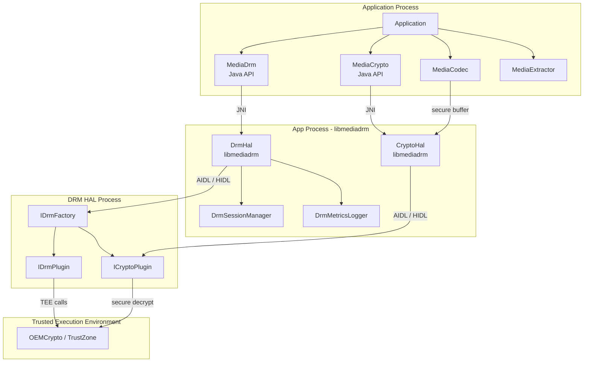

### 42.1.4 基于 UUID 的方案选择

每种 DRM 方案都由一个 16 字节的 UUID 标识。当应用程序遇到受 DRM 保护的内容时，它
从内容元数据中读取方案 UUID。该 UUID 通常位于 ISO BMFF 容器中的 PSSH 盒内，或位于
DASH 清单中的 ContentProtection 元素内。然后应用程序查询设备是否支持该方案：

```java
// Source: frameworks/base/media/java/android/media/MediaDrm.java
public static final boolean isCryptoSchemeSupported(@NonNull UUID uuid) {
    return isCryptoSchemeSupportedNative(getByteArrayFromUUID(uuid), null,
            SECURITY_LEVEL_UNKNOWN);
}
```

知名的 UUID 包括：

| DRM 方案 | UUID |
|-----------|------|
| Widevine | `edef8ba9-79d6-4ace-a3c8-27dcd51d21ed` |
| ClearKey (Common PSSH) | `1077efec-c0b2-4d02-ace3-3c1e52e2fb4b` |
| ClearKey | `e2719d58-a985-b3c9-781a-b030af78d30e` |
| PlayReady | `9a04f079-9840-4286-ab92-e65be0885f95` |

在原生层，`DrmHal::isCryptoSchemeSupported()` 会先尝试 AIDL HAL，然后回退到旧版
HIDL HAL：

```cpp
// Source: frameworks/av/drm/libmediadrm/DrmHal.cpp
DrmStatus DrmHal::isCryptoSchemeSupported(const uint8_t uuid[16],
        const String8& mimeType,
        DrmPlugin::SecurityLevel securityLevel,
        bool* result) {
    DrmStatus statusResult =
            mDrmHalAidl->isCryptoSchemeSupported(uuid, mimeType,
                    securityLevel, result);
    if (*result) return statusResult;
    return mDrmHalHidl->isCryptoSchemeSupported(uuid, mimeType,
            securityLevel, result);
}
```

这种双后端模式贯穿 `DrmHal` 中的每个方法。该类先尝试 AIDL；如果 AIDL HAL 未初始化
（`initCheck() != OK`），则回退到 HIDL。

### 42.1.5 播放生命周期

一次完整的 DRM 播放会话遵循以下步骤：

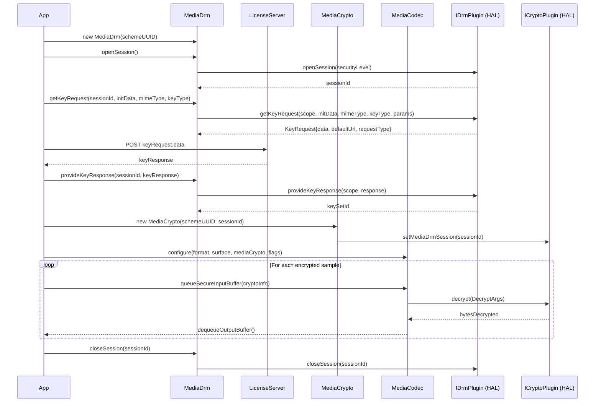

### 42.1.6 安全级别

DRM HAL 定义了一套安全级别层次结构，用以表达设备 DRM 实现的健壮性。这些级别定义在
AIDL 枚举中：

```
// Source: hardware/interfaces/drm/aidl/android/hardware/drm/SecurityLevel.aidl
enum SecurityLevel {
    UNKNOWN,            // Unable to determine the security level
    SW_SECURE_CRYPTO,   // Software-based whitebox crypto
    SW_SECURE_DECODE,   // Software-based whitebox crypto + obfuscated decoder
    HW_SECURE_CRYPTO,   // Key management and crypto in TEE
    HW_SECURE_DECODE,   // Key management, crypto, and decode in TEE
    HW_SECURE_ALL,      // All processing in TEE (compressed + uncompressed)
    DEFAULT,            // Highest supported level on the device
}
```

更高的安全级别解锁更高质量的内容。拥有 `HW_SECURE_ALL` 的设备可以流式传输来自高级
服务的 4K HDR 内容，而受限于 `SW_SECURE_CRYPTO` 的设备可能只能播放 SD 分辨率。安全
级别在打开会话时选择：

```java
// Source: frameworks/base/media/java/android/media/MediaDrm.java
public byte[] openSession(@SecurityLevel int level) throws
        NotProvisionedException, ResourceBusyException {
    byte[] sessionId = openSessionNative(level);
    mPlaybackComponentMap.put(ByteBuffer.wrap(sessionId),
            new PlaybackComponent(sessionId));
    return sessionId;
}
```

---

## 42.2 DRM 框架

### 42.2.1 源码树布局

DRM 框架代码位于 `frameworks/av/drm/` 下，并拆分为若干库和目录：

```
frameworks/av/drm/
    drmserver/              Legacy DRM manager service (OMA DRM)
        DrmManager.cpp
        DrmManagerService.cpp
        main_drmserver.cpp
    libdrmframework/        Client library for legacy DRM APIs
    libmediadrm/            Core DRM framework library
        DrmHal.cpp          Unified AIDL+HIDL entry point
        DrmHalAidl.cpp      AIDL HAL wrapper (44 KB)
        DrmHalHidl.cpp      HIDL HAL wrapper (56 KB)
        CryptoHal.cpp       Crypto routing layer
        CryptoHalAidl.cpp   AIDL Crypto wrapper
        CryptoHalHidl.cpp   HIDL Crypto wrapper
        DrmHalListener.cpp  Event dispatch from HAL to framework
        DrmSessionManager.cpp  Session lifecycle & resource management
        DrmMetrics.cpp       Metrics collection (protobuf)
        DrmMetricsLogger.cpp Metrics reporting to MediaMetrics
        DrmMetricsConsumer.cpp  Metrics export to PersistableBundle
        DrmUtils.cpp         HAL discovery and factory creation
        DrmPluginPath.cpp    Plugin shared-library path resolution
        SharedLibrary.cpp    dlopen/dlsym wrapper
        DrmStatus.cpp        Status code translation
        PluginMetricsReporting.cpp
        include/mediadrm/    Public headers
    libmediadrmrkp/          Remote key provisioning support
    mediadrm/
        plugins/
            clearkey/        Reference ClearKey plugin
    mediacas/                Conditional Access System (CAS)
    common/                  Common utilities
```

### 42.2.2 MediaDrm Java API

`MediaDrm` 类（`frameworks/base/media/java/android/media/MediaDrm.java`）是主要的
面向应用的 API。它是一个实现 `AutoCloseable` 的 `final class`，这意味着如果开发者使用
try-with-resources，会话将被自动清理。

关键设计特征：

- **基于 UUID 的构造**：为特定的 DRM 方案 UUID 创建一个 `MediaDrm` 实例。构造函数调用
  `native_setup()`，后者连接到原生 `DrmMetricsLogger` 层，该层又创建 `DrmHal` 对象。

- **面向会话**：所有密钥操作（getKeyRequest、provideKeyResponse 等）都在由一个不透明
  字节数组会话 ID 标识的会话上进行。

- **监听器架构**：该类支持四种监听器类型，都通过一个通用的
  `ConcurrentHashMap<Integer, ListenerWithExecutor>` 模式管理：

```java
// Source: frameworks/base/media/java/android/media/MediaDrm.java
private static final int DRM_EVENT = 200;
private static final int EXPIRATION_UPDATE = 201;
private static final int KEY_STATUS_CHANGE = 202;
private static final int SESSION_LOST_STATE = 203;

private final Map<Integer, ListenerWithExecutor> mListenerMap =
        new ConcurrentHashMap<>();
```

事件通过 `IDrmPluginListener` AIDL 接口源自 HAL 插件，经由 `DrmHalListener` 原生类
传播，最终到达 `MediaDrm.postEventFromNative()`。该方法将事件分派给相应执行器上已注册
的监听器。

### 42.2.3 密钥请求/响应流程

许可证获取过程是 DRM 运行的核心。应用程序调用 `getKeyRequest()` 生成一个不透明的许可
证请求，通过 HTTPS 将其发送到许可证服务器，并回传响应：

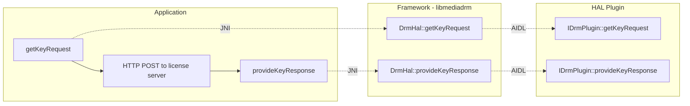

密钥类型决定了行为：

| 密钥类型 | 常量 | 行为 |
|----------|----------|----------|
| 流式 | `KEY_TYPE_STREAMING` (1) | 密钥仅对当前会话有效 |
| 离线 | `KEY_TYPE_OFFLINE` (2) | 密钥被持久化，无需网络即可使用 |
| 释放 | `KEY_TYPE_RELEASE` (3) | 释放先前保存的离线密钥 |

插件返回的密钥请求类型告诉应用程序要做什么：

| 请求类型 | 常量 | 含义 |
|-------------|----------|---------|
| 初始 | `REQUEST_TYPE_INITIAL` (0) | 首次许可证请求 |
| 续期 | `REQUEST_TYPE_RENEWAL` (1) | 到期前的许可证续期 |
| 释放 | `REQUEST_TYPE_RELEASE` (2) | 密钥释放确认 |
| 无 | `REQUEST_TYPE_NONE` (3) | 密钥已可用，无需请求 |
| 更新 | `REQUEST_TYPE_UPDATE` (4) | 密钥已加载但需要更新值 |

### 42.2.4 MediaCrypto —— 编解码器桥接

`MediaCrypto`（`frameworks/base/media/java/android/media/MediaCrypto.java`）是 DRM 会话
与媒体编解码器之间的桥梁。它比 `MediaDrm` 更简单：

```java
// Source: frameworks/base/media/java/android/media/MediaCrypto.java
public final class MediaCrypto {
    public static final boolean isCryptoSchemeSupported(@NonNull UUID uuid);
    public MediaCrypto(@NonNull UUID uuid, @NonNull byte[] sessionId)
            throws MediaCryptoException;
    public final native boolean requiresSecureDecoderComponent(
            @NonNull String mime);
    public final native void setMediaDrmSession(@NonNull byte[] sessionId)
            throws MediaCryptoException;
    public native final void release();
}
```

`requiresSecureDecoderComponent()` 方法至关重要：它查询 HAL 插件以确定当前安全策略是否
要求安全解码器。如果返回 `true`，应用程序必须使用 `CONFIGURE_FLAG_SECURE` 标志配置
`MediaCodec`。因此，所有已解码的帧都保留在 CPU 无法读取的安全（受保护）内存中。

### 42.2.5 DrmHal —— 统一的原生入口点

`DrmHal` 类（`frameworks/av/drm/libmediadrm/DrmHal.cpp`）是一个薄薄的路由层，同时持有
一个 AIDL 后端（`DrmHalAidl`）和一个 HIDL 后端（`DrmHalHidl`）：

```cpp
// Source: frameworks/av/drm/libmediadrm/DrmHal.cpp
DrmHal::DrmHal() {
    mDrmHalHidl = sp<DrmHalHidl>::make();
    mDrmHalAidl = sp<DrmHalAidl>::make();
}
```

每个 API 方法都遵循相同的模式：先尝试 AIDL，再回退到 HIDL。这一设计在偏好现代设备上
更新的 AIDL 接口的同时，保持了与搭载基于 HIDL 的 DRM HAL 的设备的向后兼容性。

`createPlugin()` 方法演示了这种回退：

```cpp
// Source: frameworks/av/drm/libmediadrm/DrmHal.cpp
DrmStatus DrmHal::createPlugin(const uint8_t uuid[16],
        const String8& appPackageName) {
    return mDrmHalAidl->createPlugin(uuid, appPackageName) == OK
                   ? DrmStatus(OK)
                   : mDrmHalHidl->createPlugin(uuid, appPackageName);
}
```

### 42.2.6 DrmHalAidl —— AIDL 后端

`DrmHalAidl`（`frameworks/av/drm/libmediadrm/DrmHalAidl.cpp`）包含完整的 AIDL 集成
逻辑。在初始化时，它使用 `AServiceManager` 发现 AIDL DRM HAL 服务，查询其支持的加密
方案，并通过工厂实例化相应的 `IDrmPlugin`：

该类在框架的旧类型（`Vector<uint8_t>`、`KeyedVector<String8, String8>`）与 AIDL 类型
（`std::vector<uint8_t>`、`std::vector<KeyValue>`）之间进行大量类型转换。`toKeyValueVector()`
和 `toKeyedVector()` 辅助函数负责这种转换：

```cpp
// Source: frameworks/av/drm/libmediadrm/DrmHalAidl.cpp
static std::vector<KeyValue> toKeyValueVector(
        const KeyedVector<String8, String8>& keyedVector) {
    std::vector<KeyValue> stdKeyedVector;
    for (size_t i = 0; i < keyedVector.size(); i++) {
        KeyValue keyValue;
        keyValue.key = toStdString(keyedVector.keyAt(i));
        keyValue.value = toStdString(keyedVector.valueAt(i));
        stdKeyedVector.push_back(keyValue);
    }
    return stdKeyedVector;
}
```

### 42.2.7 DrmSessionManager —— 资源管理

`DrmSessionManager`（`frameworks/av/drm/libmediadrm/DrmSessionManager.cpp`）管理 DRM
会话生命周期，并与 Android 的 `ResourceManagerService` 集成，以在资源压力下实现会话
回收。

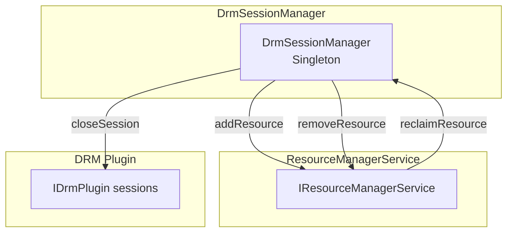

当会话被打开时，管理器将其作为 `kDrmSession` 资源注册到 `ResourceManagerService`：

```cpp
// Source: frameworks/av/drm/libmediadrm/DrmSessionManager.cpp
static std::vector<MediaResourceParcel> toResourceVec(
        const Vector<uint8_t> &sessionId, int64_t value) {
    using Type = aidl::android::media::MediaResourceType;
    using SubType = aidl::android::media::MediaResourceSubType;
    std::vector<MediaResourceParcel> resources;
    MediaResourceParcel resource{
            Type::kDrmSession, SubType::kUnspecifiedSubType,
            toStdVec<>(sessionId), value};
    resources.push_back(resource);
    return resources;
}
```

如果系统的 DRM 会话资源紧张，`ResourceManagerService` 可以从较低优先级的应用回收会话。
许多 DRM 实现限制并发会话。该服务回调到 `DrmSessionManager`，后者关闭会话并向应用
传递 `EVENT_SESSION_RECLAIMED` 事件。

### 42.2.8 DRM 事件传播

事件通过 `IDrmPluginListener` AIDL 回调接口和 `DrmHalListener` 类，从 HAL 插件经由
框架流向应用程序：

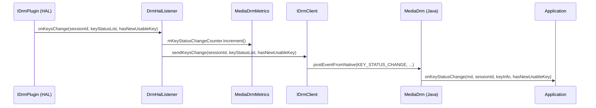

`DrmHalListener` 将 AIDL 事件类型转换为框架事件类型，并为每个事件递增指标计数器：

```cpp
// Source: frameworks/av/drm/libmediadrm/DrmHalListener.cpp
::ndk::ScopedAStatus DrmHalListener::onEvent(
        EventTypeAidl eventTypeAidl,
        const std::vector<uint8_t>& sessionId,
        const std::vector<uint8_t>& data) {
    mMetrics->mEventCounter.Increment((uint32_t)eventTypeAidl);
    // ... dispatch to IDrmClient ...
}
```

### 42.2.9 预配

某些 DRM 方案需要设备预配——这是一个一次性过程，设备从预配服务器
获取唯一凭证。该流程类似于密钥请求/响应模式：

1. 应用程序捕获来自 `openSession()` 或 `getKeyRequest()` 的 `NotProvisionedException`。
2. 它调用 `getProvisionRequest()` 获取一个不透明的预配请求。
3. 它将请求发送到预配服务器 URL。
4. 它通过 `provideProvisionResponse()` 提供响应。

HAL 方法签名如下：

```
// Source: hardware/interfaces/drm/aidl/android/hardware/drm/IDrmPlugin.aidl
ProvisionRequest getProvisionRequest(
        in String certificateType, in String certificateAuthority);
```

### 42.2.10 安全停止

安全停止是一种强制执行并发流数量限制的机制。每次创建 `MediaCrypto` 对象时，HAL 插件
都会持久化一条已签名的会话记录。当播放完成时，应用程序检索这些记录并将其转发给许可证
服务器，后者验证会话确实已终止。

`IDrmPlugin` 接口提供了完整的安全停止生命周期：

| 方法 | 用途 |
|--------|---------|
| `getSecureStops()` | 获取所有安全停止记录 |
| `getSecureStopIds()` | 获取所有安全停止 ID |
| `getSecureStop(SecureStopId)` | 按 ID 获取特定的安全停止 |
| `releaseSecureStops(OpaqueData)` | 在服务器确认后释放 |
| `releaseSecureStop(SecureStopId)` | 按 ID 释放特定的停止 |
| `releaseAllSecureStops()` | 释放所有停止 |
| `removeSecureStop(SecureStopId)` | 在无服务器确认的情况下移除 |
| `removeAllSecureStops()` | 在无确认的情况下移除所有 |

### 42.2.11 离线许可证管理

离线许可证允许在没有网络连接的情况下播放内容。框架提供了管理离线许可证状态的方法：

```java
// Key flow for offline licenses
// 1. Request offline keys
KeyRequest request = mediaDrm.getKeyRequest(
    sessionId, initData, mimeType, MediaDrm.KEY_TYPE_OFFLINE, null);

// 2. After providing response, receive a keySetId
byte[] keySetId = mediaDrm.provideKeyResponse(sessionId, response);

// 3. Later, restore offline keys to a new session
mediaDrm.restoreKeys(newSessionId, keySetId);

// 4. Query offline license state
List<KeySetId> offlineKeys = mediaDrm.getOfflineLicenseKeySetIds();
OfflineLicenseState state = mediaDrm.getOfflineLicenseState(keySetId);
```

`IDrmPlugin` HAL 支持三种离线许可证状态：

```
// Source: hardware/interfaces/drm/aidl/android/hardware/drm/OfflineLicenseState.aidl
enum OfflineLicenseState {
    UNKNOWN,   // Unable to determine the state
    USABLE,    // Keys available for decryption
    INACTIVE,  // Marked for release but not yet confirmed
}
```

### 42.2.12 插件路径解析

旧版基于共享库的插件从运行时确定的供应商特定路径加载：

```cpp
// Source: frameworks/av/drm/libmediadrm/DrmPluginPath.cpp
const char* getDrmPluginPath() {
    char value[PROPERTY_VALUE_MAX];
    if (property_get("drm.64bit.enabled", value, NULL) == 0) {
        return "/vendor/lib/mediadrm";
    } else {
        return "/vendor/lib64/mediadrm";
    }
}
```

`SharedLibrary` 类封装了 `dlopen`/`dlsym`：

```cpp
// Source: frameworks/av/drm/libmediadrm/SharedLibrary.cpp
SharedLibrary::SharedLibrary(const String8 &path) {
    mLibHandle = dlopen(path.c_str(), RTLD_NOW);
}

void *SharedLibrary::lookup(const char *symbol) const {
    if (!mLibHandle) return NULL;
    (void)dlerror();
    return dlsym(mLibHandle, symbol);
}
```

### 42.2.13 HAL 发现

`DrmUtils` 模块（`frameworks/av/drm/libmediadrm/DrmUtils.cpp`）负责发现可用的 DRM HAL
服务。它会枚举 AIDL 和 HIDL 服务注册：

对于 HIDL，它会遍历 IDrmFactory 接口的所有版本（1.0 到 1.4）：

```cpp
// Source: frameworks/av/drm/libmediadrm/DrmUtils.cpp
template <typename Hal, typename V, typename M>
void MakeHidlFactories(const uint8_t uuid[16], V& factories,
                       M& instances) {
    sp<HServiceManager> serviceManager =
            HServiceManager::getService();
    serviceManager->listManifestByInterface(
            Hal::descriptor,
            [&](const hidl_vec<hidl_string>& registered) {
                for (const auto& instance : registered) {
                    auto factory = Hal::getService(instance);
                    if (factory != nullptr) {
                        instances[instance.c_str()] = Hal::descriptor;
                        // ... check UUID support ...
                    }
                }
            });
}
```

对于 AIDL，发现过程使用 `AServiceManager` 查找已注册的
`android.hardware.drm.IDrmFactory` 服务。

---

## 42.3 DRM HAL

### 42.3.1 HAL 的演进

DRM HAL 经历了显著的演进：

| 版本 | 接口 | 传输 | 说明 |
|---------|-----------|-----------|-------|
| 1.0 | HIDL | hwbinder | 最初的 DRM HAL |
| 1.1 | HIDL | hwbinder | 新增指标（DrmMetricGroup） |
| 1.2 | HIDL | hwbinder | 新增离线许可证管理 |
| 1.3 | HIDL | hwbinder | 新增 `IDrmFactory::getSupportedCryptoSchemes()` |
| 1.4 | HIDL | hwbinder | 新增带安全级别的 `requiresSecureDecoder`、`setPlaybackId` 和 `getLogMessages` |
| AIDL V1 | AIDL | binder | 统一接口，稳定 AIDL（已冻结） |
| AIDL V2（17 中的当前版本） | AIDL | binder | 已冻结；新增 `ICryptoPlugin::getKeyHandle()` 和 `KeyHandleResult` parcelable |

`hardware/interfaces/drm/aidl/Android.bp` 中的 `versions_with_info` 块声明了 V1 和 V2。
该接口被标记为 `frozen: true`，因此 Android 17 将 V2 作为最高冻结版本的 AIDL DRM HAL。
42.8 节详细说明了 V2 相比 V1 增加了什么，以及框架如何对新方法进行版本门控。

目录结构反映了这一演进：

```
hardware/interfaces/drm/
    1.0/        HIDL v1.0 interfaces
    1.1/        HIDL v1.1 interfaces (extends 1.0)
    1.2/        HIDL v1.2 interfaces (extends 1.1)
    1.3/        HIDL v1.3 interfaces (extends 1.2)
    1.4/        HIDL v1.4 interfaces (extends 1.3)
    aidl/       Stable AIDL interfaces (current)
        android/hardware/drm/   AIDL source files
        aidl_api/               Frozen API snapshots
        vts/                    Vendor Test Suite
    common/     Shared utilities
```

### 42.3.2 IDrmFactory —— 入口点

`IDrmFactory` 是 HAL 的入口点。供应商注册一个或多个工厂服务；框架发现它们，并使用工厂
来创建插件实例：

```
// Source: hardware/interfaces/drm/aidl/android/hardware/drm/IDrmFactory.aidl
@VintfStability
interface IDrmFactory {
    @nullable IDrmPlugin createDrmPlugin(
            in Uuid uuid, in String appPackageName);

    @nullable ICryptoPlugin createCryptoPlugin(
            in Uuid uuid, in byte[] initData);

    CryptoSchemes getSupportedCryptoSchemes();
}
```

`CryptoSchemes` 返回值告诉框架该工厂支持哪些 UUID 和内容类型。它还给出了每种 MIME 类型
的最低和最高安全级别：

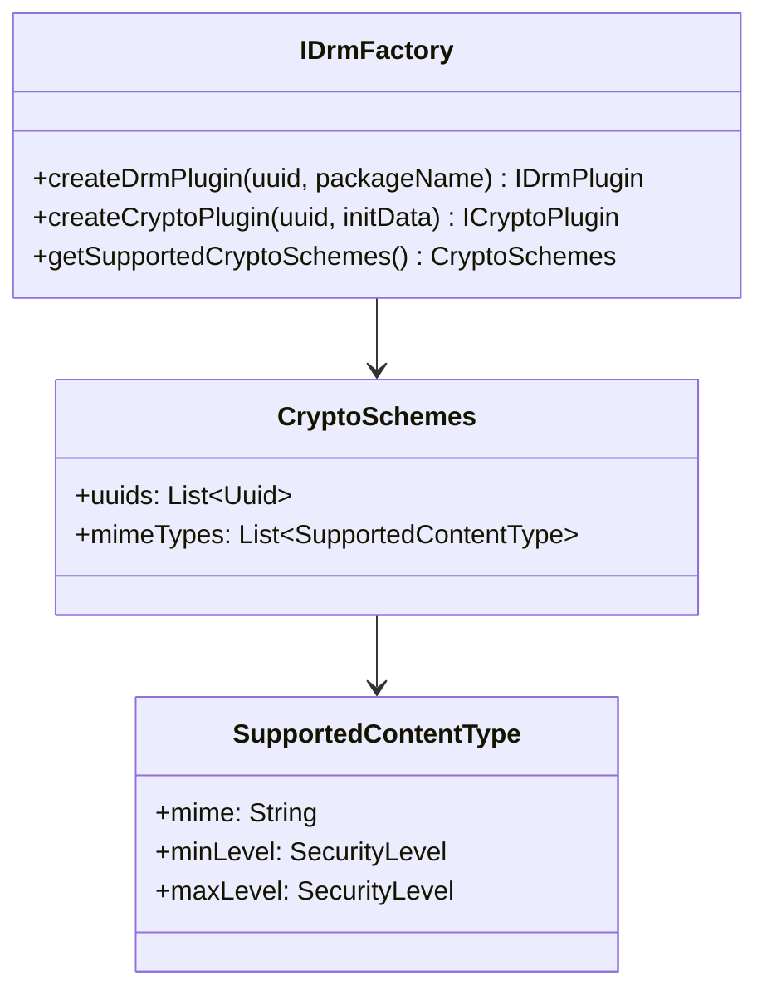

### 42.3.3 IDrmPlugin —— 会话与密钥管理

`IDrmPlugin` 接口
（`hardware/interfaces/drm/aidl/android/hardware/drm/IDrmPlugin.aidl`）是 DRM HAL 中最大的
接口。它涵盖会话管理、密钥获取、预配、安全停止、属性访问、加密操作和指标。

完整的方法清单：

**会话管理：**

| 方法 | 签名 |
|--------|-----------|
| `openSession` | `byte[] openSession(in SecurityLevel securityLevel)` |
| `closeSession` | `void closeSession(in byte[] sessionId)` |
| `getNumberOfSessions` | `NumberOfSessions getNumberOfSessions()` |
| `getSecurityLevel` | `SecurityLevel getSecurityLevel(in byte[] sessionId)` |

**密钥管理：**

| 方法 | 签名 |
|--------|-----------|
| `getKeyRequest` | `KeyRequest getKeyRequest(in byte[] scope, in byte[] initData, in String mimeType, in KeyType keyType, in KeyValue[] optionalParameters)` |
| `provideKeyResponse` | `KeySetId provideKeyResponse(in byte[] scope, in byte[] response)` |
| `removeKeys` | `void removeKeys(in byte[] sessionId)` |
| `restoreKeys` | `void restoreKeys(in byte[] sessionId, in KeySetId keySetId)` |
| `queryKeyStatus` | `List<KeyValue> queryKeyStatus(in byte[] sessionId)` |

**预配：**

| 方法 | 签名 |
|--------|-----------|
| `getProvisionRequest` | `ProvisionRequest getProvisionRequest(in String certificateType, in String certificateAuthority)` |
| `provideProvisionResponse` | `ProvideProvisionResponseResult provideProvisionResponse(in byte[] response)` |

**安全停止：**

| 方法 | 签名 |
|--------|-----------|
| `getSecureStops` | `List<SecureStop> getSecureStops()` |
| `getSecureStopIds` | `List<SecureStopId> getSecureStopIds()` |
| `getSecureStop` | `SecureStop getSecureStop(in SecureStopId secureStopId)` |
| `releaseSecureStops` | `void releaseSecureStops(in OpaqueData ssRelease)` |
| `releaseSecureStop` | `void releaseSecureStop(in SecureStopId secureStopId)` |
| `releaseAllSecureStops` | `void releaseAllSecureStops()` |
| `removeSecureStop` | `void removeSecureStop(in SecureStopId secureStopId)` |
| `removeAllSecureStops` | `void removeAllSecureStops()` |

**离线许可证管理：**

| 方法 | 签名 |
|--------|-----------|
| `getOfflineLicenseKeySetIds` | `List<KeySetId> getOfflineLicenseKeySetIds()` |
| `getOfflineLicenseState` | `OfflineLicenseState getOfflineLicenseState(in KeySetId keySetId)` |
| `removeOfflineLicense` | `void removeOfflineLicense(in KeySetId keySetId)` |

**属性：**

| 方法 | 签名 |
|--------|-----------|
| `getPropertyString` | `String getPropertyString(in String propertyName)` |
| `getPropertyByteArray` | `byte[] getPropertyByteArray(in String propertyName)` |
| `setPropertyString` | `void setPropertyString(in String propertyName, in String value)` |
| `setPropertyByteArray` | `void setPropertyByteArray(in String propertyName, in byte[] value)` |

标准属性名称包括：

| 属性 | 类型 | 描述 |
|----------|------|-------------|
| `vendor` | String | DRM 方案供应商名称 |
| `version` | String | DRM 方案版本 |
| `description` | String | 人类可读的描述 |
| `deviceUniqueId` | byte[] | 设备唯一标识符 |

**加密操作：**

| 方法 | 签名 |
|--------|-----------|
| `encrypt` | `byte[] encrypt(in byte[] sessionId, in byte[] keyId, in byte[] input, in byte[] iv)` |
| `decrypt` | `byte[] decrypt(in byte[] sessionId, in byte[] keyId, in byte[] input, in byte[] iv)` |
| `sign` | `byte[] sign(in byte[] sessionId, in byte[] keyId, in byte[] message)` |
| `verify` | `boolean verify(in byte[] sessionId, in byte[] keyId, in byte[] message, in byte[] signature)` |
| `signRSA` | `byte[] signRSA(...)` |

**配置：**

| 方法 | 签名 |
|--------|-----------|
| `setCipherAlgorithm` | `void setCipherAlgorithm(in byte[] sessionId, in String algorithm)` |
| `setMacAlgorithm` | `void setMacAlgorithm(in byte[] sessionId, in String algorithm)` |
| `getHdcpLevels` | `HdcpLevels getHdcpLevels()` |
| `requiresSecureDecoder` | `boolean requiresSecureDecoder(in String mime, in SecurityLevel level)` |
| `setPlaybackId` | `void setPlaybackId(in byte[] sessionId, in String playbackId)` |

**指标与日志：**

| 方法 | 签名 |
|--------|-----------|
| `getMetrics` | `List<DrmMetricGroup> getMetrics()` |
| `getLogMessages` | `List<LogMessage> getLogMessages()` |

**监听器：**

| 方法 | 签名 |
|--------|-----------|
| `setListener` | `void setListener(in IDrmPluginListener listener)` |

### 42.3.4 ICryptoPlugin —— 解密引擎

`ICryptoPlugin` 接口
（`hardware/interfaces/drm/aidl/android/hardware/drm/ICryptoPlugin.aidl`）处理内容样本的实际
解密。它是一个更聚焦的接口：

```
// Source: hardware/interfaces/drm/aidl/android/hardware/drm/ICryptoPlugin.aidl
@VintfStability
interface ICryptoPlugin {
    int decrypt(in DecryptArgs args);
    List<LogMessage> getLogMessages();
    void notifyResolution(in int width, in int height);
    boolean requiresSecureDecoderComponent(in String mime);
    void setMediaDrmSession(in byte[] sessionId);
    void setSharedBufferBase(in SharedBuffer base);
    KeyHandleResult getKeyHandle(in byte[] keyId, in Mode mode);
}
```

`decrypt()` 方法是性能关键路径——它在播放期间对每个加密的媒体样本调用一次。
`DecryptArgs` parcelable 将所有参数打包到单个 IPC 调用中：

```
// Source: hardware/interfaces/drm/aidl/android/hardware/drm/DecryptArgs.aidl
parcelable DecryptArgs {
    boolean secure;          // Whether a secure decoder is being used
    byte[] keyId;            // Key ID for decryption
    byte[] iv;               // Initialization vector
    Mode mode;               // UNENCRYPTED, AES_CTR, AES_CBC, AES_CBC_CTS
    Pattern pattern;         // CENC pattern (encrypt/skip block counts)
    SubSample[] subSamples;  // Clear and encrypted byte ranges
    SharedBuffer source;     // Input buffer reference
    long offset;             // Offset into source buffer
    DestinationBuffer destination;  // Output buffer (secure or non-secure)
}
```

`DecryptArgs` 中的 `secure` 标志控制输出是写入普通的共享内存缓冲区
（`nonsecureMemory`），还是写入安全缓冲区句柄（`secureMemory`）。只有硬件合成器和安全
视频解码器才能访问该句柄。

### 42.3.5 IDrmPluginListener —— 异步事件

`IDrmPluginListener` 接口允许 HAL 插件向框架通知异步事件：

```
// Source: hardware/interfaces/drm/aidl/android/hardware/drm/IDrmPluginListener.aidl
@VintfStability
interface IDrmPluginListener {
    oneway void onEvent(in EventType eventType,
            in byte[] sessionId, in byte[] data);
    oneway void onExpirationUpdate(in byte[] sessionId,
            in long expiryTimeInMS);
    oneway void onKeysChange(in byte[] sessionId,
            in KeyStatus[] keyStatusList,
            in boolean hasNewUsableKey);
    oneway void onSessionLostState(in byte[] sessionId);
}
```

所有方法都是 `oneway`（发后即忘），以防止 HAL 在框架上阻塞。事件类型为：

```
// Source: hardware/interfaces/drm/aidl/android/hardware/drm/EventType.aidl
enum EventType {
    PROVISION_REQUIRED,  // Device needs provisioning
    KEY_NEEDED,          // App needs to request keys
    KEY_EXPIRED,         // Keys have expired
    VENDOR_DEFINED,      // Vendor-specific event
    SESSION_RECLAIMED,   // Session reclaimed by resource manager
}
```

### 42.3.6 状态码

DRM HAL 定义了一整套覆盖每种失败模式的状态码：

```
// Source: hardware/interfaces/drm/aidl/android/hardware/drm/Status.aidl
enum Status {
    OK,
    ERROR_DRM_NO_LICENSE,
    ERROR_DRM_LICENSE_EXPIRED,
    ERROR_DRM_SESSION_NOT_OPENED,
    ERROR_DRM_CANNOT_HANDLE,
    ERROR_DRM_INVALID_STATE,
    BAD_VALUE,
    ERROR_DRM_NOT_PROVISIONED,
    ERROR_DRM_RESOURCE_BUSY,
    ERROR_DRM_INSUFFICIENT_OUTPUT_PROTECTION,
    ERROR_DRM_DEVICE_REVOKED,
    ERROR_DRM_DECRYPT,
    ERROR_DRM_UNKNOWN,
    ERROR_DRM_INSUFFICIENT_SECURITY,
    ERROR_DRM_FRAME_TOO_LARGE,
    ERROR_DRM_SESSION_LOST_STATE,
    ERROR_DRM_RESOURCE_CONTENTION,
    CANNOT_DECRYPT_ZERO_SUBSAMPLES,
    CRYPTO_LIBRARY_ERROR,
    GENERAL_OEM_ERROR,
    GENERAL_PLUGIN_ERROR,
    INIT_DATA_INVALID,
    KEY_NOT_LOADED,
    LICENSE_PARSE_ERROR,
    LICENSE_POLICY_ERROR,
    LICENSE_RELEASE_ERROR,
    LICENSE_REQUEST_REJECTED,
    LICENSE_RESTORE_ERROR,
    LICENSE_STATE_ERROR,
    MALFORMED_CERTIFICATE,
    MEDIA_FRAMEWORK_ERROR,
    MISSING_CERTIFICATE,
    PROVISIONING_CERTIFICATE_ERROR,
    PROVISIONING_CONFIGURATION_ERROR,
    PROVISIONING_PARSE_ERROR,
    PROVISIONING_REQUEST_REJECTED,
    RETRYABLE_PROVISIONING_ERROR,
    SECURE_STOP_RELEASE_ERROR,
    STORAGE_READ_FAILURE,
    STORAGE_WRITE_FAILURE,
}
```

这些状态码映射到 `MediaDrm.ErrorCodes` 和 `MediaCodec.CryptoException` 中的 Java 错误码，
为应用程序提供对失败情况的细粒度洞察。

### 42.3.7 AIDL 数据类型

DRM HAL 定义了大量 AIDL parcelable 类型。以下是完整的类型层次结构：

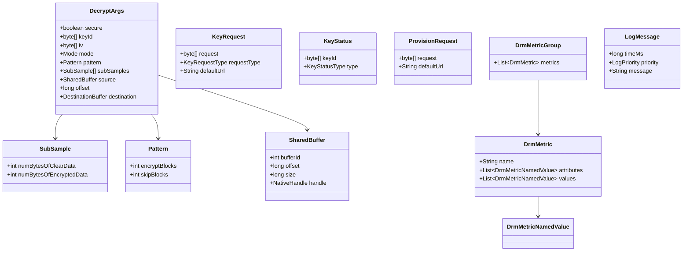

### 42.3.8 VTS 测试

DRM HAL 包含一套全面的供应商测试套件（VTS），用于根据接口契约验证 HAL 实现：

```
hardware/interfaces/drm/aidl/vts/
    drm_hal_common.cpp      Common test infrastructure (22 KB)
    drm_hal_test.cpp         Test cases (19 KB)
    drm_hal_test_main.cpp    Test entry point
    include/
        drm_hal_common.h    Test helper class definitions
```

VTS 测试遍历 `IDrmPlugin` 和 `ICryptoPlugin` 上的每个方法，验证成功和失败路径下的正确
行为。

---

## 42.4 Widevine DRM

### 42.4.1 概述

Widevine 是 Google 的 DRM 技术，也是 Android 上部署最广泛的的内容保护系统。它是一个
专有的、闭源的实现，但其架构通过它所实现的公共 DRM HAL 接口得到了充分记录。Widevine 由
UUID `edef8ba9-79d6-4ace-a3c8-27dcd51d21ed` 标识。

### 42.4.2 安全级别：L1、L2、L3

Widevine 定义了三个映射到 HAL SecurityLevel 枚举的安全级别：

| Widevine 级别 | HAL SecurityLevel | 要求 |
|---------------|------------------|--------------|
| **L1** | `HW_SECURE_ALL` | 所有加密操作和内容处理都在 TEE 中完成。密钥和已解密的内容永不离开安全硬件。HD/4K/HDR 内容需要此级别。 |
| **L2** | `HW_SECURE_CRYPTO` | 加密操作在 TEE 中完成，但解码在软件中完成。密钥在硬件中受保护，但已解密的内容可被 CPU 访问。实际中很少使用。 |
| **L3** | `SW_SECURE_CRYPTO` | 所有操作都在软件中使用白盒加密混淆完成。没有硬件安全。多数许可证策略将其限制在 SD 分辨率。 |

**Widevine L1 —— HW_SECURE_ALL 数据路径：**

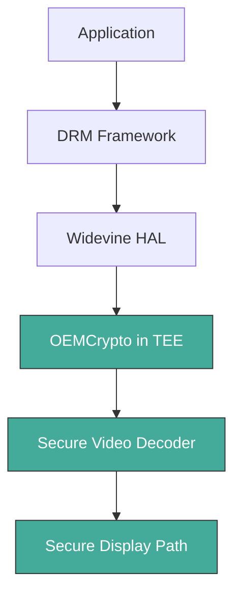

**Widevine L3 —— SW_SECURE_CRYPTO 数据路径：**

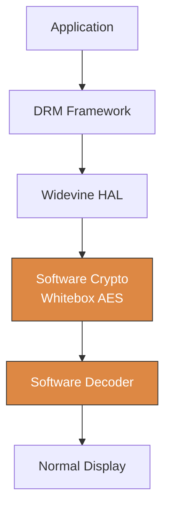

### 42.4.3 TEE 集成

对于 L1 安全，Widevine 依赖 OEMCrypto，这是一个标准化接口。设备制造商在他们的可信执行
环境（TEE）中实现它。TEE 通常是 ARM TrustZone 或类似的硬件隔离环境。

OEMCrypto 提供：

1. **设备密钥存储**：在制造过程中存储于硬件保护存储中的唯一每设备 RSA 密钥对。
2. **会话密钥派生**：内容密钥由许可证服务器使用设备的公钥加密（封装），并在 TEE 内部
   解封。
3. **内容解密**：媒体样本的 AES-CTR 或 AES-CBC 解密完全在安全世界中进行。
4. **输出保护强制执行**：TEE 在允许已解密内容被渲染之前，验证显示输出上的 HDCP 级别。
5. **安全缓冲区管理**：已解密的视频帧被写入正常世界 CPU 无法读取的安全内存区域。

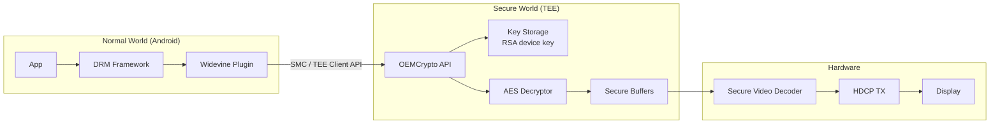

### 42.4.4 预配流程

Widevine 设备通过两种方式预配：

1. **工厂预配**：在设备制造过程中，将唯一的设备证书烧录到 TEE 的安全存储中。
   该证书包含设备的 RSA 公钥和来自 Widevine 的证明。这是 L1 设备的标准做法。

2. **在线预配**：如果设备证书不存在（或对于 L3 设备），设备可以在运行时请求
   预配。`getProvisionRequest()` / `provideProvisionResponse()` HAL 方法处理此
   流程。

### 42.4.5 许可证请求结构

Widevine 许可证请求包含：

- 设备证书（证明设备身份和安全级别）
- 内容标识（来自 PSSH 数据）
- 请求的密钥类型（流式或离线）
- HDCP 和输出保护能力
- 客户端信息（应用包名、设备型号）

许可证服务器根据内容所有者的策略评估这些内容，并返回范围适当、为设备加密的内容密钥。

### 42.4.6 HDCP 强制执行

Widevine 通过 `getHdcpLevels()` 方法强制执行 HDCP（高带宽数字内容保护）：

```
// Source: hardware/interfaces/drm/aidl/android/hardware/drm/IDrmPlugin.aidl
HdcpLevels getHdcpLevels();
```

这会返回当前协商的 HDCP 级别（取决于已连接的显示器）以及设备支持的最大 HDCP 级别。内容
策略可能要求特定的 HDCP 级别（例如，4K 内容要求 HDCP 2.2）。DRM 插件必须强制执行这些
要求。如果要求未满足，它返回 `ERROR_DRM_INSUFFICIENT_OUTPUT_PROTECTION`。

### 42.4.7 与 MediaCodec 的集成

当 Widevine 报告需要安全解码器时（通过 `requiresSecureDecoderComponent()` 返回
`true`），必须使用以下配置配置 `MediaCodec`：

```java
codec.configure(format, surface, mediaCrypto,
        MediaCodec.CONFIGURE_FLAG_SECURE);
```

这会触发编解码器分配安全输入和输出缓冲区。加密输入由带有 `DecryptArgs.secure = true` 的
`ICryptoPlugin::decrypt()` 调用进行解密。已解密的输出直接写入安全缓冲区。只有硬件视频
解码器和显示合成器才能访问该缓冲区。

---

## 42.5 ClearKey DRM 插件

### 42.5.1 目的与设计

ClearKey 是 AOSP 中包含的参考 DRM 实现。它使用通过 JSON Web Keys（JWK）交付的未加密
（“明文”）密钥来实现 ISO/IEC 23001-7 通用加密标准。它有三个用途：

1. **测试**：开发者无需商业 DRM 服务器即可测试 DRM 播放流程。
2. **合规**：它验证 DRM 框架接口是否正常工作。
3. **参考**：它演示了如何实现一个 DRM HAL 插件。

ClearKey 支持两个 UUID：

```cpp
// Source: frameworks/av/drm/mediadrm/plugins/clearkey/common/ClearKeyUUID.cpp
const std::array<uint8_t, 16> kCommonPsshBoxUUID{
    0x10,0x77,0xEF,0xEC,0xC0,0xB2,0x4D,0x02,
    0xAC,0xE3,0x3C,0x1E,0x52,0xE2,0xFB,0x4B
};

const std::array<uint8_t, 16> kClearKeyUUID{
    0xE2,0x71,0x9D,0x58,0xA9,0x85,0xB3,0xC9,
    0x78,0x1A,0xB0,0x30,0xAF,0x78,0xD3,0x0E
};
```

### 42.5.2 源码布局

```
frameworks/av/drm/mediadrm/plugins/clearkey/
    aidl/                      AIDL HAL implementation (current)
        Service.cpp            Binder service entry point
        DrmFactory.cpp         IDrmFactory implementation
        DrmPlugin.cpp          IDrmPlugin implementation (41 KB)
        CryptoPlugin.cpp       ICryptoPlugin implementation (10 KB)
        CreatePluginFactories.cpp
        include/
            DrmFactory.h
            DrmPlugin.h
            CryptoPlugin.h
            AidlUtils.h
            AidlClearKeryProperties.h
    common/                    Shared code between AIDL and legacy impls
        AesCtrDecryptor.cpp    AES-CTR decryption using OpenSSL
        ClearKeyUUID.cpp       UUID definitions
        InitDataParser.cpp     PSSH/CENC init data parsing
        JsonWebKey.cpp         JWK parsing
        Session.cpp            Session key management
        SessionLibrary.cpp     Session storage
        DeviceFiles.cpp        Offline license persistence
        MemoryFileSystem.cpp   In-memory file system for testing
        Base64.cpp             Base64 encoding/decoding
        Buffer.cpp             Buffer utilities
        Utils.cpp              Miscellaneous helpers
        include/clearkeydrm/
            AesCtrDecryptor.h
            ClearKeyTypes.h
            ClearKeyDrmProperties.h
            Session.h
            SessionLibrary.h
            ...
    default/                   Legacy HIDL implementation
        ...
```

### 42.5.3 服务入口点

ClearKey HAL 作为独立的 binder 服务运行：

```cpp
// Source: frameworks/av/drm/mediadrm/plugins/clearkey/aidl/Service.cpp
int main(int /*argc*/, char* argv[]) {
    InitLogging(argv, LogdLogger());
    ABinderProcess_setThreadPoolMaxThreadCount(8);

    std::shared_ptr<DrmFactory> drmFactory = createDrmFactory();
    const std::string drmInstance =
            std::string() + DrmFactory::descriptor + "/clearkey";
    binder_status_t status = AServiceManager_addService(
            drmFactory->asBinder().get(), drmInstance.c_str());
    CHECK(status == STATUS_OK);

    ABinderProcess_joinThreadPool();
    return EXIT_FAILURE;  // should not be reached
}
```

该服务在 binder 服务管理器中将自己注册为 `android.hardware.drm.IDrmFactory/clearkey`。

### 42.5.4 DrmFactory —— 插件创建

ClearKey 的 `DrmFactory` 验证 UUID 并创建插件实例：

```cpp
// Source: frameworks/av/drm/mediadrm/plugins/clearkey/aidl/DrmFactory.cpp
::ndk::ScopedAStatus DrmFactory::createDrmPlugin(
        const Uuid& in_uuid, const string& in_appPackageName,
        shared_ptr<IDrmPlugin>* _aidl_return) {
    if (!isClearKeyUUID(in_uuid.uuid.data())) {
        *_aidl_return = nullptr;
        return toNdkScopedAStatus(Status::BAD_VALUE);
    }
    shared_ptr<DrmPlugin> plugin =
            ::ndk::SharedRefBase::make<DrmPlugin>(
                    SessionLibrary::get());
    *_aidl_return = plugin;
    return toNdkScopedAStatus(Status::OK);
}
```

工厂还报告支持的 MIME 类型和安全级别：

```cpp
// Source: frameworks/av/drm/mediadrm/plugins/clearkey/aidl/DrmFactory.cpp
::ndk::ScopedAStatus DrmFactory::getSupportedCryptoSchemes(
        CryptoSchemes* _aidl_return) {
    CryptoSchemes schemes{};
    for (const auto& uuid : getSupportedCryptoSchemes()) {
        schemes.uuids.push_back({uuid});
    }
    for (auto mime : {kIsoBmffVideoMimeType, kIsoBmffAudioMimeType,
                      kCencInitDataFormat, kWebmVideoMimeType,
                      kWebmAudioMimeType, kWebmInitDataFormat}) {
        const auto minLevel = SecurityLevel::SW_SECURE_CRYPTO;
        const auto maxLevel = SecurityLevel::SW_SECURE_CRYPTO;
        schemes.mimeTypes.push_back({mime, minLevel, maxLevel});
    }
    *_aidl_return = schemes;
    return ndk::ScopedAStatus::ok();
}
```

请注意，ClearKey 仅支持 `SW_SECURE_CRYPTO`——它是一个纯软件插件，没有硬件安全支持。

### 42.5.5 DrmPlugin —— 会话与密钥管理

ClearKey 的 `DrmPlugin`
（`frameworks/av/drm/mediadrm/plugins/clearkey/aidl/DrmPlugin.cpp`）实现了完整的
`IDrmPlugin` 接口。关键方面：

**初始化：**

```cpp
// Source: frameworks/av/drm/mediadrm/plugins/clearkey/aidl/DrmPlugin.cpp
DrmPlugin::DrmPlugin(SessionLibrary* sessionLibrary)
    : mSessionLibrary(sessionLibrary),
      mOpenSessionOkCount(0),
      mCloseSessionOkCount(0),
      mCloseSessionNotOpenedCount(0),
      mNextSecureStopId(kSecureStopIdStart),
      mMockError(Status::OK) {
    mPlayPolicy.clear();
    initProperties();
    mSecureStops.clear();
    mReleaseKeysMap.clear();
    std::srand(std::time(nullptr));
}
```

**属性初始化：**

```cpp
// Source: frameworks/av/drm/mediadrm/plugins/clearkey/aidl/DrmPlugin.cpp
void DrmPlugin::initProperties() {
    mStringProperties.clear();
    mStringProperties[kVendorKey] = kAidlVendorValue;
    mStringProperties[kVersionKey] = kVersionValue;
    mStringProperties[kPluginDescriptionKey] = kAidlPluginDescriptionValue;
    mStringProperties[kAlgorithmsKey] = kAidlAlgorithmsValue;
    // ...
}
```

**安全停止管理：**

ClearKey 将安全停止实现为一个测试环境（而非安全的实现）：

```cpp
// Source: frameworks/av/drm/mediadrm/plugins/clearkey/aidl/DrmPlugin.cpp
// The secure stop in ClearKey implementation is not installed securely.
// This function merely creates a test environment for testing secure
// stops APIs.
void DrmPlugin::installSecureStop(
        const std::vector<uint8_t>& sessionId) {
    Mutex::Autolock lock(mSecureStopLock);
    ClearkeySecureStop clearkeySecureStop;
    clearkeySecureStop.id = uint32ToVector(++mNextSecureStopId);
    clearkeySecureStop.data.assign(sessionId.begin(),
                                    sessionId.end());
    mSecureStops.insert(std::pair<std::vector<uint8_t>,
            ClearkeySecureStop>(clearkeySecureStop.id,
                                clearkeySecureStop));
}
```

### 42.5.6 CryptoPlugin —— 解密

ClearKey 的 `CryptoPlugin`
（`frameworks/av/drm/mediadrm/plugins/clearkey/aidl/CryptoPlugin.cpp`）实现实际的解密。它
支持两种模式：

1. **UNENCRYPTED**（`Mode::UNENCRYPTED`）：直接复制明文数据字节。
2. **AES_CTR**（`Mode::AES_CTR`）：使用 AES-128-CTR 模式解密。

decrypt 方法展示了完整的流程：

```cpp
// Source: frameworks/av/drm/mediadrm/plugins/clearkey/aidl/CryptoPlugin.cpp
::ndk::ScopedAStatus CryptoPlugin::decrypt(
        const DecryptArgs& in_args, int32_t* _aidl_return) {
    *_aidl_return = 0;

    // ClearKey does not support secure decryption
    if (in_args.secure) {
        return toNdkScopedAStatus(Status::ERROR_DRM_CANNOT_HANDLE,
                "secure decryption is not supported with ClearKey");
    }

    // Validate source and destination buffers...
    // (buffer bounds checking with overflow protection)

    if (in_args.mode == Mode::UNENCRYPTED) {
        // Copy clear data directly
        size_t offset = 0;
        for (size_t i = 0; i < in_args.subSamples.size(); ++i) {
            const SubSample& subSample = in_args.subSamples[i];
            if (subSample.numBytesOfClearData != 0) {
                memcpy(destPtr + offset, srcPtr + offset,
                       subSample.numBytesOfClearData);
                offset += subSample.numBytesOfClearData;
            }
        }
        *_aidl_return = static_cast<ssize_t>(offset);
        return toNdkScopedAStatus(Status::OK);

    } else if (in_args.mode == Mode::AES_CTR) {
        // Delegate to Session::decrypt which uses AesCtrDecryptor
        auto res = mSession->decrypt(
                in_args.keyId.data(), in_args.iv.data(),
                srcPtr, destPtr,
                clearDataLengths, encryptedDataLengths,
                &bytesDecrypted);
        // ...
    }
}
```

注意大量使用 `__builtin_add_overflow` 的溢出保护检查。每项检查都引用一个特定的安全公告
（例如，`android_errorWriteLog(0x534e4554, "176496160")`），表明这些边界检查是在应对真实
漏洞时添加的。

### 42.5.7 AES-CTR 解密实现

实际的 AES-CTR 解密使用 OpenSSL：

```cpp
// Source: frameworks/av/drm/mediadrm/plugins/clearkey/common/AesCtrDecryptor.cpp
CdmResponseType AesCtrDecryptor::decrypt(
        const std::vector<uint8_t>& key, const Iv iv,
        const uint8_t* source, uint8_t* destination,
        const std::vector<int32_t>& clearDataLengths,
        const std::vector<int32_t>& encryptedDataLengths,
        size_t* bytesDecryptedOut) {

    if (key.size() != kBlockSize ||
        clearDataLengths.size() != encryptedDataLengths.size()) {
        return clearkeydrm::ERROR_DECRYPT;
    }

    uint32_t blockOffset = 0;
    uint8_t previousEncryptedCounter[kBlockSize];
    memset(previousEncryptedCounter, 0, kBlockSize);

    size_t offset = 0;
    AES_KEY opensslKey;
    AES_set_encrypt_key(key.data(), kBlockBitCount, &opensslKey);
    Iv opensslIv;
    memcpy(opensslIv, iv, sizeof(opensslIv));

    for (size_t i = 0; i < clearDataLengths.size(); ++i) {
        int32_t numBytesOfClearData = clearDataLengths[i];
        if (numBytesOfClearData > 0) {
            memcpy(destination + offset, source + offset,
                   numBytesOfClearData);
            offset += numBytesOfClearData;
        }
        int32_t numBytesOfEncryptedData = encryptedDataLengths[i];
        if (numBytesOfEncryptedData > 0) {
            AES_ctr128_encrypt(source + offset,
                               destination + offset,
                               numBytesOfEncryptedData,
                               &opensslKey, opensslIv,
                               previousEncryptedCounter,
                               &blockOffset);
            offset += numBytesOfEncryptedData;
        }
    }

    *bytesDecryptedOut = offset;
    return clearkeydrm::OK;
}
```

该实现按顺序处理子样本：明文数据通过 memcpy 复制，而加密数据使用 OpenSSL 的
`AES_ctr128_encrypt()` 解密。IV 计数器状态在子样本之间保持，以确保 CTR 模式正确运行。

### 42.5.8 JSON Web Key（JWK）处理

ClearKey 使用 JSON Web Keys 进行密钥交付。密钥响应格式为：

```json
{
    "keys": [
        {
            "kty": "oct",
            "kid": "<base64url-encoded key ID>",
            "k": "<base64url-encoded key value>"
        }
    ],
    "type": "temporary"
}
```

`JsonWebKey` 解析器
（`frameworks/av/drm/mediadrm/plugins/clearkey/common/JsonWebKey.cpp`）从该 JSON 结构中提取
密钥 ID 和密钥值。

对于离线许可证，`type` 字段为 `"persistent-license"`：

```cpp
// Source: frameworks/av/drm/mediadrm/plugins/clearkey/aidl/DrmPlugin.cpp
const std::string kOfflineLicense("\"type\":\"persistent-license\"");
```

### 42.5.9 会话架构

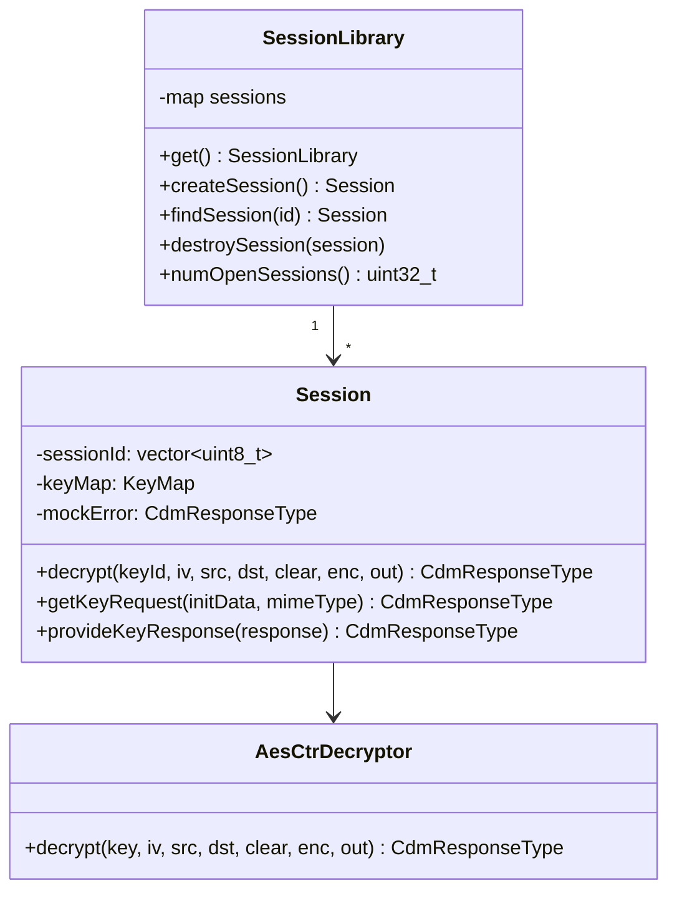

`SessionLibrary` 是管理所有已打开会话的单例。每个 `Session` 持有自己的密钥映射，并将解密
委托给 `AesCtrDecryptor`。

### 42.5.10 构建 ClearKey

ClearKey 可以作为持久服务或惰性（按需）服务构建：

```makefile
# Source: frameworks/av/drm/mediadrm/plugins/clearkey/service.mk
# Persistent service configuration
```

VINTF 清单声明：

```xml
<!-- Source: frameworks/av/drm/mediadrm/plugins/clearkey/aidl/
     android.hardware.drm-service.clearkey.xml -->
<manifest version="1.0" type="device">
    <hal format="aidl">
        <name>android.hardware.drm</name>
        <version>2</version>
        <fqname>IDrmFactory/clearkey</fqname>
    </hal>
</manifest>
```

`<version>2</version>` 元素将 ClearKey 声明为 V2 AIDL DRM HAL——即新增
`getKeyHandle()` 的版本，在 42.8 节中介绍。

### 42.5.11 ClearKey 与生产环境 DRM 的对比

下表突出了 ClearKey 实现的功能与 Widevine 等生产环境 DRM 系统必须提供的功能之间的对比：

| 功能 | ClearKey | Widevine (L1) |
|---------|----------|---------------|
| 密钥传输 | 明文 JSON | 加密（设备密钥） |
| 密钥存储 | 内存中 | TEE 安全存储 |
| 解密 | 正常世界中的 OpenSSL | TEE 中的 OEMCrypto |
| 安全缓冲区 | 不支持 | 必需 |
| 安全级别 | 仅 SW_SECURE_CRYPTO | 最高至 HW_SECURE_ALL |
| HDCP 强制执行 | 无（HDCP_NONE） | 完整（HDCP 2.2+） |
| 预配 | 不需要 | 工厂 + 在线 |
| 输出保护 | 无 | HDCP + 安全显示路径 |
| 离线许可证 | 模拟（内存 FS） | 持久安全存储 |
| 安全停止 | 测试实现 | 密码学签名 |

---

## 42.6 安全编解码器路径

### 42.6.1 内容保护问题

当受 DRM 保护的内容被解密以播放时，已解密的帧不能被应用程序代码或设备上运行的其他软件
访问。如果应用程序能读取原始的已解码帧，它就可以录制并再分发内容，从而违背 DRM 的目的。
安全编解码器路径确保已解密的内容从解密到显示都流经硬件保护的内存。

### 42.6.2 加密缓冲区流程

从加密媒体到屏幕的路径涉及若干次转换：

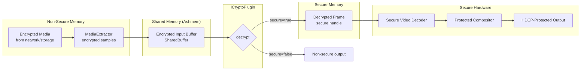

### 42.6.3 CryptoInfo 与 queueSecureInputBuffer

当应用程序将一个加密缓冲区入队到 `MediaCodec` 时，它会提供一个描述加密的 `CryptoInfo`
对象：

```java
MediaCodec.CryptoInfo cryptoInfo = new MediaCodec.CryptoInfo();
cryptoInfo.set(
    numSubSamples,        // number of subsamples
    numBytesOfClearData,  // int[] clear bytes per subsample
    numBytesOfEncryptedData, // int[] encrypted bytes per subsample
    keyId,                // 16-byte key identifier
    iv,                   // 16-byte initialization vector
    MediaCodec.CRYPTO_MODE_AES_CTR  // encryption mode
);

// For pattern encryption (CENC pattern mode)
cryptoInfo.setPattern(new MediaCodec.CryptoInfo.Pattern(
    encryptBlocks,  // number of 16-byte blocks to encrypt
    skipBlocks      // number of 16-byte blocks to skip
));

codec.queueSecureInputBuffer(bufferIndex, 0, cryptoInfo,
        presentationTimeUs, 0);
```

### 42.6.4 子样本结构

通用加密（CENC）标准定义了一种子样本结构，其中每个媒体样本由交替的明文和加密区域组成：

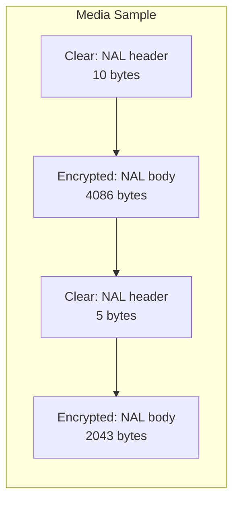

这在 HAL 中表示为 `SubSample` 数组：

```
// Source: hardware/interfaces/drm/aidl/android/hardware/drm/SubSample.aidl
parcelable SubSample {
    int numBytesOfClearData;
    int numBytesOfEncryptedData;
}
```

明文部分（通常是 H.264/H.265 中的 NAL 单元头部）保持未加密，以便编解码器无需解密即可
解析流结构。

### 42.6.5 模式加密（CENC 模式）

现代 CENC 定义了一种模式，其中加密以固定大小的块交替进行：

```
// Source: hardware/interfaces/drm/aidl/android/hardware/drm/Pattern.aidl
parcelable Pattern {
    int encryptBlocks;  // number of 16-byte blocks to encrypt
    int skipBlocks;     // number of 16-byte blocks to leave clear
}
```

例如，模式 `{1, 9}` 表示加密一个 16 字节块，然后跳过九个块，在整个加密部分重复。这在
仍然保护内容视觉的同时降低了计算开销（因为即使对视频帧进行部分加密也会使其无法观看）。

### 42.6.6 共享缓冲区架构

`ICryptoPlugin` 使用共享内存将加密数据从框架传递给 HAL 插件以进行解密：

```
// Source: hardware/interfaces/drm/aidl/android/hardware/drm/SharedBuffer.aidl
parcelable SharedBuffer {
    int bufferId;        // Identifies which shared memory region
    long offset;         // Offset within the region
    long size;           // Size of data
    NativeHandle handle; // Handle to the shared memory itself
}
```

`setSharedBufferBase()` 方法建立内存映射：

```
// From ICryptoPlugin.aidl
void setSharedBufferBase(in SharedBuffer base);
```

每个 crypto 插件可以有多个共享缓冲区，由 `bufferId` 区分。`CryptoHalAidl` 层验证缓冲区
边界以防止越界访问：

```cpp
// Source: frameworks/av/drm/libmediadrm/CryptoHalAidl.cpp
status_t CryptoHalAidl::checkSharedBuffer(
        const SharedBufferHidl& buffer) {
    int32_t seqNum = static_cast<int32_t>(buffer.bufferId);
    if (mHeapSizes.indexOfKey(seqNum) < 0) {
        return UNKNOWN_ERROR;
    }
    size_t heapSize = mHeapSizes.valueFor(seqNum);
    if (heapSize < buffer.offset + buffer.size ||
        SIZE_MAX - buffer.offset < buffer.size) {
        android_errorWriteLog(0x534e4554, "76221123");
        return UNKNOWN_ERROR;
    }
    return OK;
}
```

### 42.6.7 目标缓冲区类型

解密输出可以写入两种目标类型：

```
// Source: hardware/interfaces/drm/aidl/android/hardware/drm/DestinationBuffer.aidl
union DestinationBuffer {
    SharedBuffer nonsecureMemory;   // CPU-accessible shared memory
    NativeHandle secureMemory;      // Opaque handle to secure buffer
}
```

对于 L1（安全）播放，目标是 `secureMemory` 句柄。CPU 无法读取该内存；只有安全视频解码器
硬件才能访问它。对于 L3（非安全）播放，目标是 `nonsecureMemory`。

### 42.6.8 安全解码器选择

框架通过查询 DRM 插件和 crypto 插件来确定是否使用安全解码器：

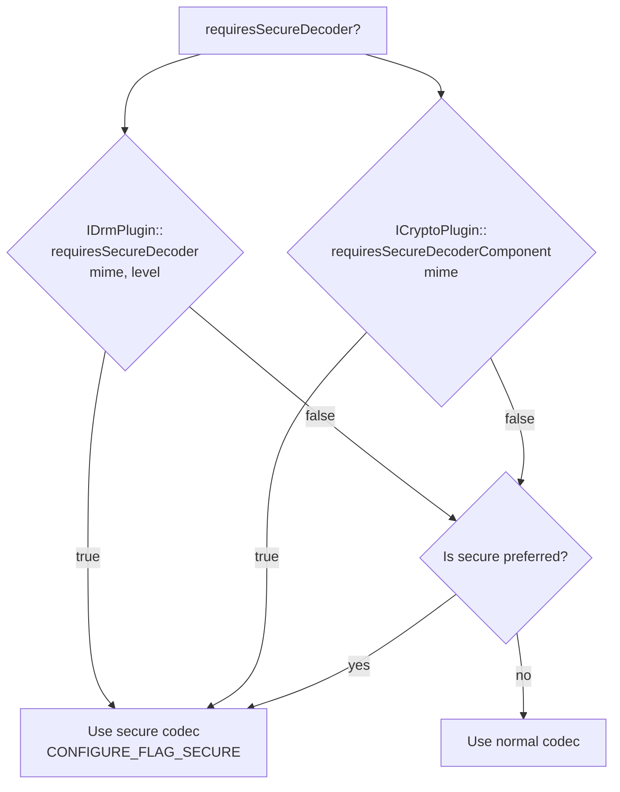

### 42.6.9 分辨率通知

`ICryptoPlugin::notifyResolution()` 方法将当前显示分辨率告知插件：

```
void notifyResolution(in int width, in int height);
```

这使得插件能够执行基于分辨率的策略。例如，某个许可证可能只允许 L1 安全下的 4K 播放，而将
L3 限制为 480p。插件可以对照许可证策略检查分辨率，并在策略被违反时返回
`ERROR_DRM_INSUFFICIENT_OUTPUT_PROTECTION` 或 `ERROR_DRM_INSUFFICIENT_SECURITY`。

### 42.6.10 密钥句柄优化

V2 DRM HAL 为 `ICryptoPlugin` 新增了 `getKeyHandle()`，用于组合解密-解码的硬件路径：

```
// Source: hardware/interfaces/drm/aidl/android/hardware/drm/ICryptoPlugin.aidl
KeyHandleResult getKeyHandle(in byte[] keyId, in Mode mode);
```

这将密钥 ID 解析为一个不透明句柄（`KeyHandleResult.keyHandle`）。融合的安全解密-解码组件
可以直接使用该句柄，而不必通过 `decrypt()` 路由每个样本。该句柄可以引用 TEE 内部预加载的
密钥，避免了重复的密钥 ID 到密钥材料的解析。该方法仅在 AIDL HAL 的 V2 中存在，因此框架对
该调用进行了版本门控。42.8 节追踪了该门控以及完整的 Android 17 管道。

---

## 42.7 DRM 指标与日志

### 42.7.1 指标架构

Android 的 DRM 框架包含一套全面的指标系统，用于跟踪 DRM 操作的性能和可靠性，同时不暴露
任何敏感内容或密钥材料。

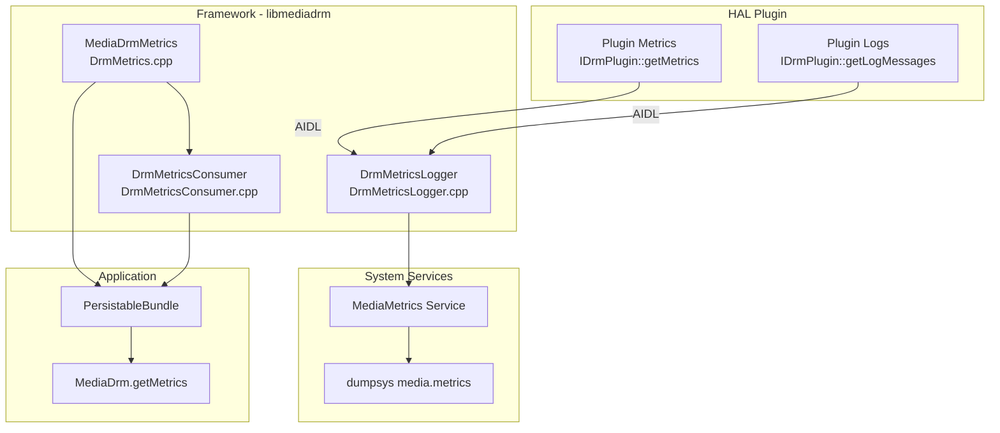

### 42.7.2 框架指标收集

`MediaDrmMetrics` 类（`frameworks/av/drm/libmediadrm/DrmMetrics.cpp`）在框架层使用计数器
和分布指标类型收集操作指标：

```cpp
// Source: frameworks/av/drm/libmediadrm/DrmMetrics.cpp
MediaDrmMetrics::MediaDrmMetrics()
    : mOpenSessionCounter("drm.mediadrm.open_session", "status"),
      mCloseSessionCounter("drm.mediadrm.close_session", "status"),
      mGetKeyRequestTimeUs("drm.mediadrm.get_key_request", "status"),
      mProvideKeyResponseTimeUs("drm.mediadrm.provide_key_response",
                                "status"),
      mGetProvisionRequestCounter(
              "drm.mediadrm.get_provision_request", "status"),
      mProvideProvisionResponseCounter(
              "drm.mediadrm.provide_provision_response", "status"),
      mKeyStatusChangeCounter("drm.mediadrm.key_status_change",
                              "key_status_type"),
      mEventCounter("drm.mediadrm.event", "event_type"),
      mGetDeviceUniqueIdCounter(
              "drm.mediadrm.get_device_unique_id", "status") {
}
```

所跟踪的指标包括：

| 指标 | 类型 | 描述 |
|--------|------|-------------|
| `open_session` | Counter | 按状态统计的会话打开尝试次数 |
| `close_session` | Counter | 按状态统计的会话关闭尝试次数 |
| `get_key_request` | Distribution | 密钥请求延迟（微秒） |
| `provide_key_response` | Distribution | 密钥响应处理时间 |
| `get_provision_request` | Counter | 预配请求次数 |
| `provide_provision_response` | Counter | 预配响应次数 |
| `key_status_change` | Counter | 按类型统计的密钥状态事件 |
| `event` | Counter | 按类型统计的 DRM 事件 |
| `get_device_unique_id` | Counter | 设备 ID 请求次数 |

### 42.7.3 会话生命周期跟踪

框架跟踪每个会话的开始和结束时间：

```cpp
// Source: frameworks/av/drm/libmediadrm/DrmMetrics.cpp
void MediaDrmMetrics::SetSessionStart(
        const Vector<uint8_t> &sessionId) {
    std::string sessionIdHex = ToHexString(sessionId);
    mSessionLifespans[sessionIdHex] =
        std::make_pair(GetCurrentTimeMs(), (int64_t)0);
}

void MediaDrmMetrics::SetSessionEnd(
        const Vector<uint8_t> &sessionId) {
    std::string sessionIdHex = ToHexString(sessionId);
    int64_t endTimeMs = GetCurrentTimeMs();
    if (mSessionLifespans.find(sessionIdHex) !=
            mSessionLifespans.end()) {
        mSessionLifespans[sessionIdHex] =
            std::make_pair(
                    mSessionLifespans[sessionIdHex].first,
                    endTimeMs);
    } else {
        mSessionLifespans[sessionIdHex] =
            std::make_pair((int64_t)0, endTimeMs);
    }
}
```

### 42.7.4 指标序列化

指标使用 Protocol Buffers 序列化，以实现高效存储和传输：

```cpp
// Source: frameworks/av/drm/libmediadrm/DrmMetrics.cpp
status_t MediaDrmMetrics::GetSerializedMetrics(
        std::string *serializedMetrics) {
    DrmFrameworkMetrics metrics;

    mOpenSessionCounter.ExportValues(
        [&](const status_t status, const int64_t value) {
            auto *counter = metrics.add_open_session_counter();
            counter->set_count(value);
            counter->mutable_attributes()->set_error_code(status);
        });

    // ... export all metric types ...

    mGetKeyRequestTimeUs.ExportValues(
        [&](const status_t status, const EventStatistics &stats) {
            auto *metric = metrics.add_get_key_request_time_us();
            metric->set_min(stats.min);
            metric->set_max(stats.max);
            metric->set_mean(stats.mean);
            metric->set_operation_count(stats.count);
            metric->set_variance(
                    stats.sum_squared_deviation / stats.count);
            metric->mutable_attributes()->set_error_code(status);
        });

    for (const auto &sessionLifespan : mSessionLifespans) {
        auto *map = metrics.mutable_session_lifetimes();
        (*map)[sessionLifespan.first].set_start_time_ms(
            sessionLifespan.second.first);
        (*map)[sessionLifespan.first].set_end_time_ms(
            sessionLifespan.second.second);
    }

    return metrics.SerializeToString(serializedMetrics)
            ? OK : UNKNOWN_ERROR;
}
```

### 42.7.5 DrmMetricsLogger —— MediaMetrics 集成

`DrmMetricsLogger` 类（`frameworks/av/drm/libmediadrm/DrmMetricsLogger.cpp`）是 `DrmHal`
的包装器。它拦截每个 API 调用并捕获计时和结果码。然后它将这些信息报告给 `MediaMetrics`
服务：

```cpp
// Source: frameworks/av/drm/libmediadrm/DrmMetricsLogger.cpp
DrmMetricsLogger::DrmMetricsLogger(IDrmFrontend frontend)
    : mImpl(sp<DrmHal>::make()),
      mUuid(),
      mObjNonce(),
      mFrontend(frontend) {}
```

日志记录器将 DRM 错误码转换为枚举值，以实现一致的报告：

```cpp
// Source: frameworks/av/drm/libmediadrm/DrmMetricsLogger.cpp
int MediaErrorToEnum(status_t err) {
    switch (err) {
        STATUS_CASE(DRM_UNKNOWN);
        STATUS_CASE(DRM_NO_LICENSE);
        STATUS_CASE(DRM_LICENSE_EXPIRED);
        STATUS_CASE(DRM_RESOURCE_BUSY);
        STATUS_CASE(DRM_INSUFFICIENT_OUTPUT_PROTECTION);
        STATUS_CASE(DRM_SESSION_NOT_OPENED);
        // ... 30+ error code mappings ...
    }
    return ENUM_DRM_UNKNOWN;
}
```

### 42.7.6 DrmMetricsConsumer —— PersistableBundle 导出

`DrmMetricsConsumer` 类（`frameworks/av/drm/libmediadrm/DrmMetricsConsumer.cpp`）将指标转换
为 `PersistableBundle` 对象，这些对象通过 `MediaDrm.getMetrics()` 返回给应用程序。

指标被组织为成功计数和错误计数：

```cpp
// Source: frameworks/av/drm/libmediadrm/DrmMetricsConsumer.cpp
template <typename T>
void ExportCounterMetric(const CounterMetric<T> &counter,
                         PersistableBundle *metrics) {
    std::string success_count_name =
            counter.metric_name() + ".ok.count";
    std::string error_count_name =
            counter.metric_name() + ".error.count";
    counter.ExportValues(
        [&](const status_t status, const int64_t value) {
            if (status == OK) {
                metrics->putLong(
                        String16(success_count_name.c_str()),
                        value);
            } else {
                int64_t total_errors(0);
                metrics->getLong(
                        String16(error_count_name.c_str()),
                        &total_errors);
                metrics->putLong(
                        String16(error_count_name.c_str()),
                        total_errors + value);
            }
        });
}
```

### 42.7.7 插件级指标

HAL 通过 `getMetrics()` 方法提供插件特定的指标：

```
// Source: hardware/interfaces/drm/aidl/android/hardware/drm/DrmMetricGroup.aidl
parcelable DrmMetricGroup {
    List<DrmMetric> metrics;
}
```

每个 `DrmMetric` 由一个名称、一组属性（维度）和一组值（测量值）组成：

```
// Source: hardware/interfaces/drm/aidl/android/hardware/drm/DrmMetric.aidl
parcelable DrmMetric {
    String name;
    List<DrmMetricNamedValue> attributes;
    List<DrmMetricNamedValue> values;
}
```

AIDL 文档提供了一个具体示例：

```
DrmMetricGroup {
    metrics[0] {
        name: "buf_copy"
        attributes[0] {
            name: "size"
            type: INT64_TYPE
            int64Value: 1024
        }
        values[0] {
            componentName: "operation_count"
            type: INT64_TYPE
            int64Value: 75
        }
        values[1] {
            component_name: "average_time_seconds"
            type: DOUBLE_TYPE
            doubleValue: 0.00000042
        }
    }
}
```

### 42.7.8 日志消息

`IDrmPlugin` 和 `ICryptoPlugin` 都支持 `getLogMessages()`：

```
// Source: hardware/interfaces/drm/aidl/android/hardware/drm/LogMessage.aidl
parcelable LogMessage {
    long timeMs;             // Timestamp in milliseconds since epoch
    LogPriority priority;    // ERROR, WARNING, INFO, DEBUG, VERBOSE
    String message;          // Human-readable message
}
```

这些日志消息专为调试 DRM 问题而设计，同时不暴露敏感信息。应用程序可以通过
`MediaDrm.getLogMessages()` 访问它们，并可将它们包含在错误报告中。

### 42.7.9 面向应用程序的错误码

Java 的 `MediaDrm.ErrorCodes` 类为应用程序提供结构化的错误信息：

```java
// Source: frameworks/base/media/java/android/media/MediaDrm.java
public final static class ErrorCodes {
    public static final int ERROR_UNKNOWN = 0;
    public static final int ERROR_NO_KEY = 1;
    public static final int ERROR_KEY_EXPIRED = 2;
    public static final int ERROR_RESOURCE_BUSY = 3;
    public static final int ERROR_INSUFFICIENT_OUTPUT_PROTECTION = 4;
    public static final int ERROR_SESSION_NOT_OPENED = 5;
    public static final int ERROR_UNSUPPORTED_OPERATION = 6;
    public static final int ERROR_INSUFFICIENT_SECURITY = 7;
    public static final int ERROR_FRAME_TOO_LARGE = 8;
    public static final int ERROR_LOST_STATE = 9;
    public static final int ERROR_CERTIFICATE_MALFORMED = 10;
    public static final int ERROR_CERTIFICATE_MISSING = 11;
    public static final int ERROR_CRYPTO_LIBRARY = 12;
    public static final int ERROR_GENERIC_OEM = 13;
    public static final int ERROR_GENERIC_PLUGIN = 14;
    public static final int ERROR_INIT_DATA = 15;
    public static final int ERROR_KEY_NOT_LOADED = 16;
    public static final int ERROR_LICENSE_PARSE = 17;
    public static final int ERROR_LICENSE_POLICY = 18;
    // ... more error codes ...
}
```

每个错误码在其 Javadoc 中都包含恢复指导。`MediaDrmStateException` 还携带可通过
`MediaDrmThrowable` 接口访问的供应商特定错误码：

```java
// Source: frameworks/base/media/java/android/media/MediaDrm.java
public int getVendorError();    // Vendor-specific error code
public int getOemError();       // OEM-specific error code
public int getErrorContext();   // Additional error context
```

---

## 42.8 Android 17 中的 DRM HAL 变更

Android 17 并未改变上文所述 DRM 栈的形态。Java API、`libmediadrm`、双 AIDL+HIDL 路由、
ClearKey 以及安全编解码器路径都延续不变。改变的是 AIDL DRM HAL 契约。
`android.hardware.drm` 接口现在冻结在版本 2。相比 V1 的 V2 增量已在整个框架中完全接通。

本节确切展示 V2 包含什么。它还展示了框架如何在运行时发现 V2，以及为什么 V2 对安全解码
路径很重要。

### 42.8.1 AIDL DRM HAL 冻结在 V2

DRM HAL 接口捆绑包在其构建文件中声明其版本。在 Android 17 中，该接口被冻结，声明的最高
版本为 2：

```
// Source: hardware/interfaces/drm/aidl/Android.bp
aidl_interface {
    name: "android.hardware.drm",
    stability: "vintf",
    frozen: true,
    versions_with_info: [
        { version: "1", /* ... */ },
        { version: "2", /* ... */ },
    ],
}
```

一个匹配的 `aidl_api/android.hardware.drm/2/` 快照目录保存了冻结的 V2 ABI。
`frozen: true` 意味着 AIDL 工具链会拒绝对该接口的任何未版本化更改。新方法或新字段将必须
作为未来的 V3 落地。同一个构建文件中的便捷默认值将 NDK 链接目标固定为 V2：

```
// Source: hardware/interfaces/drm/aidl/Android.bp
cc_defaults {
    name: "android.hardware.drm-media_drm-ndk-shared",
    shared_libs: ["android.hardware.drm-V2-ndk"],
}
```

### 42.8.2 V2 相比 V1 增加了什么

对比两个冻结快照可以发现，V2 的增量很小且精准。它仅限于 `ICryptoPlugin`。它新增了一个
方法，外加该方法返回的一个新的 parcelable。

```
// Source: hardware/interfaces/drm/aidl/android/hardware/drm/ICryptoPlugin.aidl
KeyHandleResult getKeyHandle(in byte[] keyId, in Mode mode);
```

```
// Source: hardware/interfaces/drm/aidl/android/hardware/drm/KeyHandleResult.aidl
@VintfStability
parcelable KeyHandleResult {
    /**
     * An opaque handle to the selected key.
     */
    byte[] keyHandle;
}
```

V1 的 `ICryptoPlugin` 的 `aidl_api` 快照包含最初的六个方法（`decrypt`、
`getLogMessages`、`notifyResolution`、`requiresSecureDecoderComponent`、
`setMediaDrmSession`、`setSharedBufferBase`）。V2 新增 `getKeyHandle()` 作为第七个。
`KeyHandleResult.aidl` 文件仅从版本 2 起存在（其头部带有 2025 年版权）。V1 和 V2 之间没有
其他接口（`IDrmFactory`、`IDrmPlugin`、`IDrmPluginListener`）发生改变。

`getKeyHandle()` 的目的是组合解密-解码的硬件路径。其契约指出，返回的句柄“由在同一步骤
中执行解密和解码的组件使用”。如果没有此方法，`decrypt()` 会为每个样本调用一次，而已
解密的字节会被交给一个单独的解码器。

有了它，融合的安全组件可以将密钥一次性解析为一个不透明句柄。然后该组件驱动单个硬件操作
来同时解密和解码。内容在整个过程中都停留在受保护内存中。

### 42.8.3 框架中的运行时版本门控

由于 V2 是 V1 的严格超集，框架不能对较旧的插件盲目调用 `getKeyHandle()`。Android 17 将该
方法添加到完整的 `libmediadrm` crypto 栈中，并根据协商的接口版本对其进行门控。统一的
`CryptoHal` 路由器在 AIDL 后端激活时转发给它，否则转发给 HIDL：

```cpp
// Source: frameworks/av/drm/libmediadrm/CryptoHal.cpp
DrmStatus CryptoHal::getKeyHandle(const uint8_t key[16], CryptoPlugin::Mode mode,
                                  size_t sourceSize, size_t offset,
                                  const CryptoPlugin::SubSample* subSamples,
                                  size_t numSubSamples, Vector<uint8_t>& keyHandle) {
    if (mCryptoHalAidl->initCheck() == OK)
        return mCryptoHalAidl->getKeyHandle(key, mode, sourceSize, offset, subSamples,
                                            numSubSamples, keyHandle);
    return mCryptoHalHidl->getKeyHandle(key, mode, sourceSize, offset, subSamples,
                                        numSubSamples, keyHandle);
}
```

AIDL 后端会查询插件报告的接口版本。如果插件仅实现了 V1，它会拒绝该调用，并返回
`ERROR_UNSUPPORTED`。这避免了一次插件无法满足的 Binder 调用：

```cpp
// Source: frameworks/av/drm/libmediadrm/CryptoHalAidl.cpp
int32_t version = 0;
if (mPlugin->getInterfaceVersion(&version).isOk() && version < 2) {
    return DrmStatus(ERROR_UNSUPPORTED, "getKeyHandle is not supported by the HAL");
}
```

在到达插件之前，`CryptoHalAidl::getKeyHandle()` 会运行与 `decrypt()` 相同的子样本和缓冲区
边界验证。它使用 `__builtin_add_overflow` 拒绝会发生整数溢出的子样本大小，并确认样本适合
放入源缓冲区。然后它将一个 16 字节的密钥 ID 和密码模式转发给插件，并拷贝出不透明句柄：

```cpp
// Source: frameworks/av/drm/libmediadrm/CryptoHalAidl.cpp
KeyHandleResult result;
::ndk::ScopedAStatus statusAidl = mPlugin->getKeyHandle(keyIdAidl, aMode, &result);
status_t err = statusAidlToDrmStatus(statusAidl);
if (err != OK) { /* log and return */ }
keyHandle = toVector(result.keyHandle);
```

### 42.8.4 调用方与 ClearKey 行为

句柄路径由编解码器缓冲区通道驱动。`CCodecBufferChannel` 仅在其 `mSendEncryptionKeyHandle`
标志置位时，才在其加密缓冲区路径中调用 `mCrypto->getKeyHandle()`。这是一个在配置时做出的
静态决定。当 Codec2 组件通告 `C2StreamEncryptionKeyInfo::input` 参数，且
`com.android.media.codec.flags.decrypt_and_decode_in_hal` aconfig 标志被启用时，该标志被置
位。

如果 `getKeyHandle()` 失败，缓冲区通道会记录错误并将状态传播给其调用方。没有回退到逐样本
`decrypt()` 流程：

```cpp
// Source: frameworks/av/media/codec2/sfplugin/CCodecBufferChannel.cpp
if (mSendEncryptionKeyHandle) {
    // ...
    const DrmStatus drmStatus = mCrypto->getKeyHandle(key, mode, size, offset, subSamples,
                                                      numSubSamples, keyHandle);
    const status_t status = drmStatus;
    if (status != OK) {
        ALOGE(/* ... */);   // error is returned to the caller -- no decrypt() fallback
        return status;
    }
    // ... wrap keyHandle in a C2StreamEncryptionKeyInfo::input param for the component
}
```

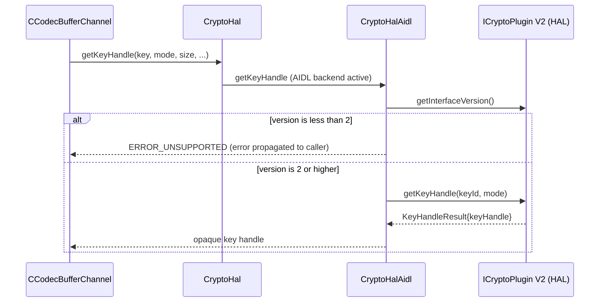

AOSP 参考 ClearKey 插件确实实现了 V2 方法。它是一个纯软件插件，没有融合的安全解码-解密
块，因此它只是拒绝：

```cpp
// Source: frameworks/av/drm/mediadrm/plugins/clearkey/aidl/CryptoPlugin.cpp
::ndk::ScopedAStatus CryptoPlugin::getKeyHandle(const std::vector<uint8_t>& in_keyId,
        Mode in_mode, KeyHandleResult* _aidl_return) {
    // Clearkey plugin does not have key handle
    return toNdkScopedAStatus(Status::ERROR_DRM_CANNOT_HANDLE);
}
```

实际上，像 ClearKey 这样的方案永远不会通过编解码器路径到达此存根。密钥句柄路由是预先从
编解码器组件通告的参数（`mSendEncryptionKeyHandle`）中选择的。与仅支持 L3 的方案配合使用
的软件解码器不会通告 `C2StreamEncryptionKeyInfo::input`。因此缓冲区通道从一开始就使用逐
样本 `decrypt()` 路径。

如果密钥句柄路径*确实*被进入，且 `getKeyHandle()` 失败，缓冲区通道会将错误返回给其调用方。
它不会静默地使用 `decrypt()` 重试。ClearKey 的 `ERROR_DRM_CANNOT_HANDLE` 会导致这样的
失败。密钥句柄快速路径是面向融合硬件解密-解码栈（Widevine L1 级硬件）的可选特性。它并不是
对每个插件的新要求。

---

## 42.9 动手实践：DRM 实验练习

### 42.9.1 练习 1：查询支持的 DRM 方案

编写一个简单的 Android 应用程序，查询设备上可用的 DRM 方案：

```java
import android.media.MediaDrm;
import java.util.List;
import java.util.UUID;

public class DrmSchemeQuery {
    // Well-known DRM UUIDs
    private static final UUID WIDEVINE_UUID =
            new UUID(0xEDEF8BA979D64ACEL, 0xA3C827DCD51D21EDL);
    private static final UUID CLEARKEY_UUID =
            new UUID(0xE2719D58A985B3C9L, 0x781AB030AF78D30EL);
    private static final UUID COMMON_PSSH_UUID =
            new UUID(0x1077EFECC0B24D02L, 0xACE33C1E52E2FB4BL);

    public void querySchemes() {
        // Method 1: Check specific UUIDs
        System.out.println("Widevine supported: " +
                MediaDrm.isCryptoSchemeSupported(WIDEVINE_UUID));
        System.out.println("ClearKey supported: " +
                MediaDrm.isCryptoSchemeSupported(CLEARKEY_UUID));

        // Check with MIME type and security level
        System.out.println("Widevine MP4 L1: " +
                MediaDrm.isCryptoSchemeSupported(WIDEVINE_UUID,
                        "video/mp4",
                        MediaDrm.SECURITY_LEVEL_HW_SECURE_ALL));
        System.out.println("Widevine MP4 L3: " +
                MediaDrm.isCryptoSchemeSupported(WIDEVINE_UUID,
                        "video/mp4",
                        MediaDrm.SECURITY_LEVEL_SW_SECURE_CRYPTO));

        // Method 2: Enumerate all supported schemes
        List<UUID> schemes = MediaDrm.getSupportedCryptoSchemes();
        for (UUID uuid : schemes) {
            System.out.println("Supported scheme: " + uuid);
        }
    }
}
```

**观察要点：**

- 大多数 Android 设备会报告 Widevine 和 ClearKey 为受支持。
- 安全级别检查揭示了设备是否具有 L1（硬件 TEE）支持。
- `getSupportedCryptoSchemes()` 返回所有已注册的 HAL 工厂 UUID。

### 42.9.2 练习 2：使用 ExoPlayer 进行 ClearKey 播放

使用 ExoPlayer（现已并入 AndroidX Media3）播放 ClearKey 加密的 DASH 内容：

```java
import androidx.media3.exoplayer.ExoPlayer;
import androidx.media3.exoplayer.drm.DefaultDrmSessionManager;
import androidx.media3.exoplayer.drm.LocalMediaDrmCallback;
import androidx.media3.common.MediaItem;
import androidx.media3.common.C;

public class ClearKeyPlayback {

    // ClearKey license in JWK format (base64url-encoded)
    private static final String CLEARKEY_LICENSE =
        "{\"keys\":[" +
            "{\"kty\":\"oct\"," +
            "\"kid\":\"" + /* base64url key ID */ + "\"," +
            "\"k\":\"" + /* base64url key value */ + "\"}" +
        "],\"type\":\"temporary\"}";

    public void setupPlayer(Context context, SurfaceView surfaceView) {
        // Create DRM session manager for ClearKey
        DefaultDrmSessionManager drmSessionManager =
                new DefaultDrmSessionManager.Builder()
                        .setUuidAndExoMediaDrmProvider(
                                C.CLEARKEY_UUID,
                                FrameworkMediaDrm.DEFAULT_PROVIDER)
                        .build(new LocalMediaDrmCallback(
                                CLEARKEY_LICENSE.getBytes()));

        // Create player with DRM
        ExoPlayer player = new ExoPlayer.Builder(context)
                .build();
        player.setVideoSurfaceView(surfaceView);

        // Set DRM-protected media
        MediaItem mediaItem = new MediaItem.Builder()
                .setUri("https://example.com/content.mpd")
                .setDrmConfiguration(
                        new MediaItem.DrmConfiguration.Builder(
                                C.CLEARKEY_UUID)
                        .build())
                .build();

        player.setMediaItem(mediaItem);
        player.prepare();
        player.play();
    }
}
```

### 42.9.3 练习 3：检查 DRM 属性

打开一个 DRM 会话并查询插件属性：

```java
import android.media.MediaDrm;
import android.os.PersistableBundle;

public class DrmPropertyInspector {

    private static final UUID WIDEVINE_UUID =
            new UUID(0xEDEF8BA979D64ACEL, 0xA3C827DCD51D21EDL);

    public void inspectProperties() throws Exception {
        MediaDrm drm = new MediaDrm(WIDEVINE_UUID);

        // Query standard properties
        String vendor = drm.getPropertyString("vendor");
        String version = drm.getPropertyString("version");
        String description = drm.getPropertyString("description");
        byte[] deviceId = drm.getPropertyByteArray("deviceUniqueId");

        System.out.println("Vendor: " + vendor);
        System.out.println("Version: " + version);
        System.out.println("Description: " + description);
        System.out.println("Device ID length: " + deviceId.length);

        // Open session and check security level
        byte[] sessionId = drm.openSession();
        int securityLevel = drm.getSecurityLevel(sessionId);
        System.out.println("Security level: " + securityLevel);

        // Get metrics
        PersistableBundle metrics = drm.getMetrics();
        // Inspect metric keys
        for (String key : metrics.keySet()) {
            System.out.println("Metric: " + key + " = " +
                    metrics.get(key));
        }

        // Get log messages (for debugging)
        java.util.List<MediaDrm.LogMessage> logs =
                drm.getLogMessages();
        for (MediaDrm.LogMessage log : logs) {
            System.out.println("Log [" + log.getTimestampMillis() +
                    "] " + log.getMessage());
        }

        drm.closeSession(sessionId);
        drm.close();
    }
}
```

### 42.9.4 练习 4：使用 dumpsys 检查 HAL 接口

使用 `adb shell` 检查正在运行的 DRM HAL：

```bash
# List registered DRM HAL services
adb shell service list | grep drm

# Check ClearKey service status
adb shell dumpsys android.hardware.drm.IDrmFactory/clearkey

# View media DRM metrics
adb shell dumpsys media.metrics | grep -i drm

# List VINTF HAL declarations
adb shell lshal | grep drm

# Inspect the legacy DRM manager service (registered as drm.drmManager)
adb shell dumpsys drm.drmManager
```

### 42.9.5 练习 5：追踪 DRM 操作

使用 `atrace` 和 `systrace` 观察播放期间的 DRM 操作：

```bash
# Enable trace tags that cover DRM HAL activity (there is no dedicated
# "drm" atrace category -- DRM shows up under hal/binder_driver/video)
adb shell atrace --async_start video hal binder_driver

# Play DRM content, then stop tracing
adb shell atrace --async_stop > /tmp/drm_trace.txt

# View DRM-specific logs
adb logcat -s DrmHal:V DrmHalAidl:V CryptoHalAidl:V \
    clearkey-DrmPlugin:V clearkey-CryptoPlugin:V \
    DrmSessionManager:V DrmMetricsLogger:V
```

### 42.9.6 练习 6：从源码构建 ClearKey

从 AOSP 源码构建 ClearKey HAL 插件：

```bash
# Navigate to the AOSP source tree
cd $AOSP_ROOT

# Build just the ClearKey plugin
m android.hardware.drm-service.clearkey

# The output binary will be at:
# out/target/product/*/vendor/bin/hw/
#     android.hardware.drm-service.clearkey

# Build the AIDL DRM VTS tests
m VtsAidlHalDrmTargetTest

# Push and run the VTS tests; restrict to the ClearKey instance with a
# gtest filter (the test enumerates all registered IDrmFactory instances)
adb push $ANDROID_PRODUCT_OUT/data/nativetest64/VtsAidlHalDrmTargetTest/VtsAidlHalDrmTargetTest \
    /data/local/tmp/VtsAidlHalDrmTargetTest
adb shell /data/local/tmp/VtsAidlHalDrmTargetTest --gtest_filter='*clearkey*'
```

### 42.9.7 练习 7：监控 DRM 会话生命周期

编写一个基于监听器的监控器，跟踪所有 DRM 事件：

```java
import android.media.MediaDrm;
import java.util.List;

public class DrmSessionMonitor {

    private static final UUID WIDEVINE_UUID =
            new UUID(0xEDEF8BA979D64ACEL, 0xA3C827DCD51D21EDL);

    public void monitorSession() throws Exception {
        MediaDrm drm = new MediaDrm(WIDEVINE_UUID);

        // Register all listeners
        drm.setOnExpirationUpdateListener((md, sessionId, expiryTime) -> {
            System.out.println("Expiration update: session=" +
                    bytesToHex(sessionId) +
                    " expiry=" + expiryTime);
        }, null);

        drm.setOnKeyStatusChangeListener(
                (md, sessionId, keyInfo, hasNewUsableKey) -> {
            System.out.println("Key status change: session=" +
                    bytesToHex(sessionId) +
                    " hasUsableKey=" + hasNewUsableKey);
            for (MediaDrm.KeyStatus ks : keyInfo) {
                System.out.println("  Key " +
                        bytesToHex(ks.getKeyId()) +
                        " status=" + ks.getStatusCode());
            }
        }, null);

        drm.setOnSessionLostStateListener(
                (md, sessionId) -> {
            System.out.println("Session lost state: " +
                    bytesToHex(sessionId));
        }, null);

        drm.setOnEventListener((md, sessionId, event, extra, data) -> {
            System.out.println("DRM event: type=" + event +
                    " extra=" + extra);
        });

        // Open session and perform key exchange...
        byte[] sessionId = drm.openSession();
        // ... use session for playback ...

        drm.closeSession(sessionId);
        drm.close();
    }

    private String bytesToHex(byte[] bytes) {
        StringBuilder sb = new StringBuilder();
        for (byte b : bytes) {
            sb.append(String.format("%02x", b));
        }
        return sb.toString();
    }
}
```

### 42.9.8 练习 8：检查 ClearKey 源码

通过源码追踪完整的 ClearKey 密钥请求/响应流程：

```bash
# Step 1: Start at the factory
# File: frameworks/av/drm/mediadrm/plugins/clearkey/aidl/DrmFactory.cpp
# DrmFactory::createDrmPlugin() validates UUID, creates DrmPlugin

# Step 2: Session creation
# File: frameworks/av/drm/mediadrm/plugins/clearkey/common/SessionLibrary.cpp
# SessionLibrary::createSession() generates session ID

# Step 3: Key request generation
# File: frameworks/av/drm/mediadrm/plugins/clearkey/aidl/DrmPlugin.cpp
# DrmPlugin::getKeyRequest() parses PSSH init data

# Step 4: Init data parsing
# File: frameworks/av/drm/mediadrm/plugins/clearkey/common/InitDataParser.cpp
# InitDataParser::parse() extracts key IDs from PSSH/CENC

# Step 5: Key response processing
# DrmPlugin::provideKeyResponse() parses JWK

# Step 6: JWK parsing
# File: frameworks/av/drm/mediadrm/plugins/clearkey/common/JsonWebKey.cpp
# JsonWebKey::extractKeysFromJsonWebKeySet() decodes keys

# Step 7: Decryption
# File: frameworks/av/drm/mediadrm/plugins/clearkey/aidl/CryptoPlugin.cpp
# CryptoPlugin::decrypt() delegates to Session::decrypt()

# Step 8: AES-CTR decryption
# File: frameworks/av/drm/mediadrm/plugins/clearkey/common/AesCtrDecryptor.cpp
# AesCtrDecryptor::decrypt() uses OpenSSL AES_ctr128_encrypt
```

---

## 小结

Android 的 DRM 架构是一个多层系统，旨在满足内容保护、设备多样性和应用简单性之间相互冲突
的需求。

**关键的架构决策：**

1. **基于 UUID 的抽象**：应用程序通过与方案无关的 API 与 DRM 交互。UUID 机制允许多个 DRM
   系统在同一台设备上共存。

2. **HAL 隔离**：加密实现运行在单独的进程中（并可能在 TEE 中），与应用代码隔离。AIDL HAL
   在框架与供应商插件之间提供了稳定、带版本的契约。

3. **双后端兼容性**：`DrmHal` / `CryptoHal` 路由层同时支持 AIDL 和 HIDL 后端，使得从 HIDL
   到 AIDL 的渐进迁移无需破坏现有的供应商实现。

4. **安全缓冲区流水线**：对于 L1 安全，已解密的内容永远不会触及 CPU 可访问的内存。从解密
   到解码再到显示的整条路径都在硬件保护的内存中运行。

5. **全面的指标**：三层指标系统（框架计数器、插件指标、日志消息）在不损害内容安全的前提
   下提供了诊断可见性。

**用于进一步探索的关键源文件：**

| 组件 | 路径 |
|-----------|------|
| MediaDrm Java API | `frameworks/base/media/java/android/media/MediaDrm.java` |
| MediaCrypto Java API | `frameworks/base/media/java/android/media/MediaCrypto.java` |
| DrmHal (unified) | `frameworks/av/drm/libmediadrm/DrmHal.cpp` |
| DrmHalAidl | `frameworks/av/drm/libmediadrm/DrmHalAidl.cpp` |
| CryptoHalAidl | `frameworks/av/drm/libmediadrm/CryptoHalAidl.cpp` |
| DrmSessionManager | `frameworks/av/drm/libmediadrm/DrmSessionManager.cpp` |
| DrmMetrics | `frameworks/av/drm/libmediadrm/DrmMetrics.cpp` |
| DrmMetricsLogger | `frameworks/av/drm/libmediadrm/DrmMetricsLogger.cpp` |
| IDrmFactory AIDL | `hardware/interfaces/drm/aidl/android/hardware/drm/IDrmFactory.aidl` |
| IDrmPlugin AIDL | `hardware/interfaces/drm/aidl/android/hardware/drm/IDrmPlugin.aidl` |
| ICryptoPlugin AIDL | `hardware/interfaces/drm/aidl/android/hardware/drm/ICryptoPlugin.aidl` |
| SecurityLevel AIDL | `hardware/interfaces/drm/aidl/android/hardware/drm/SecurityLevel.aidl` |
| Status AIDL | `hardware/interfaces/drm/aidl/android/hardware/drm/Status.aidl` |
| ClearKey Factory | `frameworks/av/drm/mediadrm/plugins/clearkey/aidl/DrmFactory.cpp` |
| ClearKey DrmPlugin | `frameworks/av/drm/mediadrm/plugins/clearkey/aidl/DrmPlugin.cpp` |
| ClearKey CryptoPlugin | `frameworks/av/drm/mediadrm/plugins/clearkey/aidl/CryptoPlugin.cpp` |
| ClearKey AES-CTR | `frameworks/av/drm/mediadrm/plugins/clearkey/common/AesCtrDecryptor.cpp` |
| ClearKey UUID | `frameworks/av/drm/mediadrm/plugins/clearkey/common/ClearKeyUUID.cpp` |
| VTS Tests | `hardware/interfaces/drm/aidl/vts/drm_hal_test.cpp` |
