# 第 60 章：模拟器

Android Emulator 是 AOSP 生态系统中最关键的开发者工具之一。它远不只是一个简单的模拟器，而是一个完整系统级的虚拟机，在经过修改的 QEMU 虚拟机管理程序内部运行生产级的 Android 系统镜像。它在 Linux 上通过 KVM 提供硬件加速，在其他平台上则通过 HAXM/Hypervisor Framework 提供加速。

本章由内而外地剖析模拟器。它涵盖了 QEMU 执行引擎以及 Goldfish 和 Ranchu 虚拟硬件平台。它涵盖了将虚拟设备桥接到模拟器宿主的客户机端 HAL 实现。它还涵盖了面向云的替代方案 Cuttlefish，以及让模拟器不可或缺的丰富开发者功能（快照、多显示、折叠屏模拟）。

支撑模拟器的设备树位于 AOSP 源码中的 `device/generic/goldfish/`。第二个虚拟设备平台 Cuttlefish 位于 `device/google/cuttlefish/`。这两个目录合计包含数十万行 C++、shell 脚本、SELinux 策略和 Makefile 配置。这些文件定义了在不存在物理硬件时，"一台 Android 设备"意味着什么。

---

## 60.1 模拟器架构概览

### 60.1.1 软件栈

Android Emulator 构建在 QEMU 这个开源机器模拟器与虚拟化器的定制分支之上。当开发者在命令行输入 `emulator` 时，以下分层架构就会发挥作用：

```
Host machine (Linux/macOS/Windows)
  |
  +-- Android Emulator binary (emulator, qemu-system-*)
       |
       +-- QEMU core (TCG for software emulation, or KVM/HAXM for HW accel)
       |    |
       |    +-- Virtual CPU (vCPU) executing ARM/x86/RISC-V instructions
       |    +-- Virtual memory management (shadow page tables / EPT)
       |    +-- Interrupt controller (GICv2/v3 for ARM, IOAPIC for x86)
       |
       +-- Goldfish/Ranchu virtual hardware
       |    +-- goldfish-pipe: host<->guest communication channel
       |    +-- virtio-gpu: GPU passthrough / host rendering
       |    +-- virtio-net: virtual networking
       |    +-- virtio-input: touch, keyboard, sensors
       |    +-- virtio-blk: block device emulation
       |    +-- virtio-console: serial/console ports
       |
       +-- Emulator UI / gRPC control interface
            +-- Skin rendering, Extended Controls
            +-- Snapshot management
            +-- Location / Telephony / Battery simulation
```

### 60.1.2 执行模式

模拟器支持两种基本执行模式：

1. **KVM 加速模式**（Linux）：客户机代码通过基于内核的虚拟机（KVM）模块在宿主 CPU 上原生运行。这是最快的模式。当客户机与宿主架构一致时（x86 宿主上的 x86 客户机，或 ARM 宿主上的 ARM 客户机），始终优先使用该模式。借助 KVM，大多数客户机指令以接近原生的速度执行。只有特权操作（I/O、页表操作）会陷入模拟器以便处理。

2. **软件翻译模式**（TCG）：QEMU 的 Tiny Code Generator 在运行时将客户机指令翻译成宿主指令。当架构不匹配时（例如在 x86 宿主上运行 ARM 客户机镜像）会使用该模式。虽然显著慢于 KVM，但 TCG 使跨架构开发成为可能。

在 macOS 上，Apple 的 Hypervisor Framework 取代了 KVM；在 Windows 上，Intel HAXM（Hardware Accelerated Execution Manager）或 Windows Hypervisor Platform（WHPX）扮演相同的角色。

### 60.1.3 高层数据流

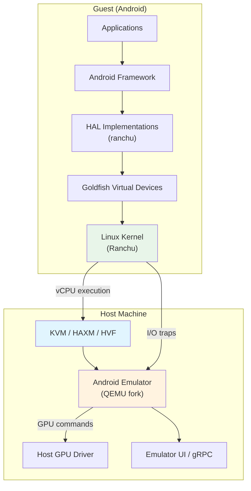

关键的洞见在于，模拟器并不是在"模拟"Android——它是在_运行_Android。内核是一个真正的 Linux 内核。用户空间就是与实体设备上出货的系统镜像相同（或非常接近）的系统镜像。模拟器的职责是提供这份真实软件所期望找到的虚拟硬件。

### 60.1.4 关键源码目录

| 目录 | 用途 |
|-----------|---------|
| `device/generic/goldfish/` | Goldfish 虚拟设备定义、HAL、init 脚本 |
| `device/google/cuttlefish/` | Cuttlefish 虚拟设备定义 |
| `device/generic/goldfish/hals/` | 硬件抽象层实现 |
| `device/generic/goldfish/init/` | 模拟器启动的 init RC 脚本 |
| `device/generic/goldfish/sepolicy/` | 模拟器特定域的 SELinux 策略 |
| `device/generic/goldfish/board/` | 板级配置（架构相关） |
| `device/generic/goldfish/product/` | 产品配置 makefile |

### 60.1.5 产品配置

模拟器定义了若干产品目标，列在 `device/generic/goldfish/AndroidProducts.mk` 中：

```makefile
# Source: device/generic/goldfish/AndroidProducts.mk
PRODUCT_MAKEFILES := \
    $(LOCAL_DIR)/64bitonly/product/sdk_phone64_x86_64.mk \
    $(LOCAL_DIR)/64bitonly/product/sdk_phone16k_x86_64.mk \
    $(LOCAL_DIR)/64bitonly/product/sdk_phone64_x86_64_minigbm.mk \
    $(LOCAL_DIR)/64bitonly/product/sdk_phone64_x86_64_riscv64.mk \
    $(LOCAL_DIR)/64bitonly/product/sdk_tablet_arm64.mk \
    $(LOCAL_DIR)/64bitonly/product/sdk_tablet_x86_64.mk \
    $(LOCAL_DIR)/64bitonly/product/sdk_phone64_arm64.mk \
    $(LOCAL_DIR)/64bitonly/product/sdk_phone64_arm64_minigbm.mk \
    $(LOCAL_DIR)/64bitonly/product/sdk_phone16k_arm64.mk \
    $(LOCAL_DIR)/64bitonly/product/sdk_phone64_arm64_riscv64.mk \
    $(LOCAL_DIR)/64bitonly/product/sdk_slim_x86_64.mk \
    $(LOCAL_DIR)/64bitonly/product/sdk_slim_arm64.mk
```

这些目标覆盖了 x86_64、ARM64 和 RISC-V 架构，以及专门的外形规格（手机、平板、slim）和图形后端（标准 vs. minigbm）。

---

## 60.2 Goldfish 设备平台

"Goldfish"是 Android Emulator 最初的虚拟硬件平台。这个名字指的是 QEMU 向客户机内核呈现的虚拟设备集合（定时器、中断控制器、I/O 总线等）。随着时间推移，Goldfish 已经显著演化。在现代的"Ranchu"平台中，标准 virtio 设备取代了大多数最初的自定义 Goldfish 设备。然而，这个名字在 AOSP 源码树中一直保留了下来。

### 60.2.1 产品配置层级

Goldfish 产品配置遵循分层继承模式：

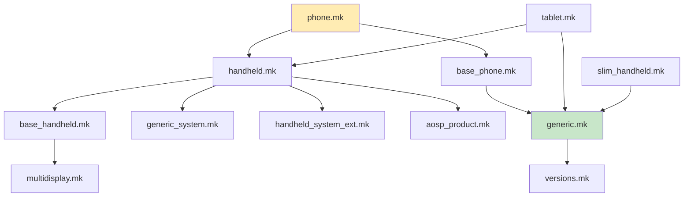

根配置文件是 `device/generic/goldfish/product/generic.mk`，它确立了核心模拟器设备。从其内容来看：

```makefile
# Source: device/generic/goldfish/product/generic.mk (selected lines)
PRODUCT_VENDOR_PROPERTIES += \
    ro.hardware.power=ranchu \
    ro.kernel.qemu=1 \
    ro.soc.manufacturer=AOSP \
    ro.soc.model=ranchu \
```

属性 `ro.kernel.qemu=1` 是一个众所周知的标记，框架用它来检测自己是否运行在模拟器中。SoC 型号被报告为 "ranchu"——这是模拟器虚拟平台的现代代号。

### 60.2.2 板级配置

板级配置位于 `device/generic/goldfish/board/`。每个架构变体都有自己的目录：

| 目录 | 架构 |
|-----------|-------------|
| `board/emu64x/` | x86_64 |
| `board/emu64a/` | ARM64 |
| `board/emu64xr/` | x86_64 + RISC-V（原生桥接） |
| `board/emu64ar/` | ARM64 + RISC-V（原生桥接） |
| `board/emu64x16k/` | x86_64，16KB 页 |
| `board/emu64a16k/` | ARM64，16KB 页 |

所有这些都继承自 `board/BoardConfigCommon.mk`，它确立了共享的板级设置：

```makefile
# Source: device/generic/goldfish/board/BoardConfigCommon.mk (key excerpts)
TARGET_BOOTLOADER_BOARD_NAME := goldfish_$(TARGET_ARCH)

# Build OpenGLES emulation guest and host libraries
BUILD_EMULATOR_OPENGL := true
BUILD_QEMU_IMAGES := true
USE_OPENGL_RENDERER := true

# Emulator doesn't support sparse image format.
TARGET_USERIMAGES_SPARSE_EXT_DISABLED := true

# emulator is Non-A/B device
AB_OTA_UPDATER := none

# emulator needs super.img
BOARD_BUILD_SUPER_IMAGE_BY_DEFAULT := true

# 8G + 8M
BOARD_SUPER_PARTITION_SIZE ?= 8598323200
BOARD_SUPER_PARTITION_GROUPS := emulator_dynamic_partitions
```

关键要点：

- 模拟器使用带有动态分区的 **super partition**，与现代实体设备一致。

- 它是 **Non-A/B 设备**（没有无缝 OTA 双分区）。
- 会为客户机和宿主两端都构建 OpenGL ES 模拟库。
- WiFi 子系统使用 `NL80211` 以及 `mac80211_hwsim` 内核模块来模拟无线网络接口。

### 60.2.3 HAL 实现

Goldfish 设备平台的核心是它的 HAL（硬件抽象层）实现集合。这些实现位于 `device/generic/goldfish/hals/` 下，提供了 Android 硬件接口与模拟器虚拟设备之间的桥梁。

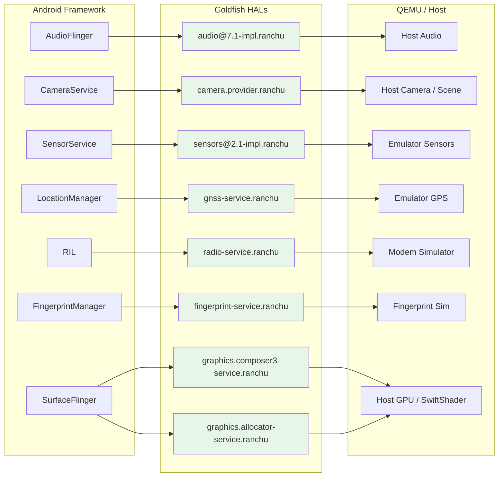

#### 60.2.3.1 音频 HAL

**位置：** `device/generic/goldfish/hals/audio/`

音频 HAL 实现了 `android.hardware.audio@7.1`。它使用 TinyALSA 与 QEMU 提供的虚拟声卡对接。实现包括：

- `primary_device.cpp`——主音频设备，处理音量控制、麦克风静音和流的创建。

- `stream_out.cpp` / `stream_in.cpp`——输出流与输入流的实现。

- `talsa.cpp`——TinyALSA 封装层。
- `device_port_sink.cpp` / `device_port_source.cpp`——用于音频路由的端口抽象。

来自 `device/generic/goldfish/hals/audio/primary_device.cpp`：

```cpp
// Source: device/generic/goldfish/hals/audio/primary_device.cpp
constexpr size_t kInBufferDurationMs = 15;
constexpr size_t kOutBufferDurationMs = 22;

Device::Device() {}

Return<Result> Device::initCheck() {
    return Result::OK;
}

Return<Result> Device::setMasterVolume(float volume) {
    if (isnan(volume) || volume < 0 || volume > 1.0) {
        return FAILURE(Result::INVALID_ARGUMENTS);
    }

    mMasterVolume = volume;
    updateOutputStreamVolume(mMasterMute ? 0.0f : volume);
    return Result::OK;
}
```

音频延迟配置在产品 makefile 中设置：

```makefile
# Source: device/generic/goldfish/product/generic.mk
PRODUCT_VENDOR_PROPERTIES += \
    ro.hardware.audio.tinyalsa.period_count=4 \
    ro.hardware.audio.tinyalsa.period_size_multiplier=2 \
    ro.hardware.audio.tinyalsa.host_latency_ms=80 \
```

80ms 的宿主延迟高于实体设备（其目标为 5-20ms）。原因是音频数据必须经过 QEMU 的虚拟声卡和宿主音频子系统进行传输。

#### 60.2.3.2 相机 HAL

**位置：** `device/generic/goldfish/hals/camera/`

相机 HAL 实现了 AIDL Camera Provider 接口。它支持多种相机来源：

- **QEMU 相机**（`BaseQemuCamera`、`GasQemuCamera`、`MinigbmQemuCamera`）——由宿主的网络摄像头或虚拟场景支持的相机，通过 QEMU 的管道机制通信。

- **伪旋转相机**（`FakeRotatingCamera`）——渲染旋转 3D 图案的合成测试相机。

与 QEMU 宿主的通信通过 `qemu_channel` 抽象完成。来自 `device/generic/goldfish/hals/camera/qemu_channel.cpp`：

```cpp
// Source: device/generic/goldfish/hals/camera/qemu_channel.cpp
const char kServiceName[] = "camera";

base::unique_fd qemuOpenChannel() {
    return base::unique_fd(qemud_channel_open(kServiceName));
}

int qemuRunQuery(const int fd,
                 const char* const query,
                 const size_t querySize,
                 std::vector<uint8_t>* result) {
    int e = qemu_pipe_write_fully(fd, query, querySize);
    if (e < 0) {
        return FAILURE(e);
    }

    std::vector<uint8_t> reply;
    e = qemuReceiveMessage(fd, &reply);
    if (e < 0) {
        return e;
    }
    // ... parse ok/ko response ...
}
```

相机提供者使用带有前缀 `device@1.1/internal/` 的 ID 方案：

```cpp
// Source: device/generic/goldfish/hals/camera/CameraProvider.cpp
constexpr char kCameraIdPrefix[] = "device@1.1/internal/";

std::string getLogicalCameraId(const int index) {
    char buf[sizeof(kCameraIdPrefix) + 8];
    snprintf(buf, sizeof(buf), "%s%d", kCameraIdPrefix, index);
    return buf;
}
```

#### 60.2.3.3 传感器 HAL

**位置：** `device/generic/goldfish/hals/sensors/`

传感器 HAL 是说明模拟器如何虚拟化硬件的最富启发性的例子之一。它使用 QEMU 的传感器协议实现了 `android.hardware.sensors@2.1`。

**传感器列表：** 模拟传感器的完整列表定义在 `device/generic/goldfish/hals/sensors/sensor_list.cpp` 中：

```cpp
// Source: device/generic/goldfish/hals/sensors/sensor_list.cpp
const char* const kQemuSensorName[] = {
    "acceleration",
    "gyroscope",
    "magnetic-field",
    "orientation",
    "temperature",
    "proximity",
    "light",
    "pressure",
    "humidity",
    "magnetic-field-uncalibrated",
    "gyroscope-uncalibrated",
    "hinge-angle0",
    "hinge-angle1",
    "hinge-angle2",
    "heart-rate",
    "rgbc-light",
    "wrist-tilt",
    "acceleration-uncalibrated",
    "heading",
    "low-latency-off-body-detect",
};
```

这为我们带来了 20 个虚拟传感器，其中包括：

| 传感器 | 类型 | 上报模式 |
|--------|------|---------------|
| 加速度计 | `ACCELEROMETER` | 连续 |
| 陀螺仪 | `GYROSCOPE` | 连续 |
| 磁场 | `MAGNETIC_FIELD` | 连续 |
| 方向 | `ORIENTATION` | 连续 |
| 温度 | `AMBIENT_TEMPERATURE` | 变化时上报 |
| 距离 | `PROXIMITY` | 变化时上报 + 唤醒 |
| 光线 | `LIGHT` | 变化时上报 |
| 气压 | `PRESSURE` | 连续 |
| 湿度 | `RELATIVE_HUMIDITY` | 变化时上报 |
| 铰链角度（x3） | `HINGE_ANGLE` | 变化时上报 + 唤醒 |
| 心率 | `HEART_RATE` | 变化时上报 |
| 手腕倾斜 | `WRIST_TILT_GESTURE` | 特殊 + 唤醒 |
| 航向 | 自定义类型 42 | 连续 |

**通信协议：** 传感器 HAL 使用基于 QEMU 管道上的简单文本协议与 QEMU 通信。来自 `device/generic/goldfish/hals/sensors/multihal_sensors_qemu.cpp`：

```cpp
// Source: device/generic/goldfish/hals/sensors/multihal_sensors_qemu.cpp
bool MultihalSensors::setSensorsReportingImpl(SensorsTransport& st,
                                              const int sensorHandle,
                                              const bool enabled) {
    char buffer[64];
    int len = snprintf(buffer, sizeof(buffer),
                       "set:%s:%d",
                       getQemuSensorNameByHandle(sensorHandle),
                       (enabled ? 1 : 0));

    if (st.Send(CONTROL, buffer, len) < 0) {
        ALOGE("%s:%d: send for %s failed", __func__, __LINE__, st.Name());
        return false;
    } else {
        return true;
    }
}
```

协议命令包括：

- `list-sensors`——查询宿主支持哪些传感器（返回位掩码）
- `set:<sensor_name>:<0|1>`——启用或禁用某个传感器
- `set-delay:<ms>`——以毫秒为单位设置上报间隔
- `time:<ns>`——同步客户机时钟

**解析传感器事件：** 当宿主发送传感器数据时，客户机解析形如 `acceleration:9.8:0.0:0.1` 的文本消息。解析在 `parseQemuSensorEventLocked` 中完成：

```cpp
// Source: device/generic/goldfish/hals/sensors/multihal_sensors_qemu.cpp
void MultihalSensors::parseQemuSensorEventLocked(QemuSensorsProtocolState* state) {
    char buf[256];
    const int len = m_sensorsTransport->Receive(DATA, buf, sizeof(buf) - 1);
    // ...
    if (const char* values = testPrefix(buf, end, "acceleration", ':')) {
        if (sscanf(values, "%f:%f:%f",
                   &vec3->x, &vec3->y, &vec3->z) == 3) {
            vec3->status = SensorStatus::ACCURACY_MEDIUM;
            event.timestamp = nowNs + state->timeBiasNs;
            event.sensorHandle = kSensorHandleAccelerometer;
            event.sensorType = SensorType::ACCELEROMETER;
            postSensorEventLocked(event);
            parsed = true;
        }
    }
    // ... similar blocks for gyroscope, magnetic, proximity, light, etc.
}
```

该架构使用一个专用监听线程（`qemuSensorListenerThread`）和一个批处理线程（`batchThread`）来处理连续模式的传感器：

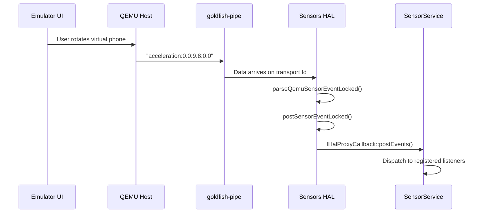

#### 60.2.3.4 GNSS HAL

**位置：** `device/generic/goldfish/hals/gnss/`

GNSS（全球导航卫星系统）HAL 提供虚拟 GPS 数据。关键类是 `GnssHwConn`，它打开到 "gps" 服务的一条 QEMU 管道：

```cpp
// Source: device/generic/goldfish/hals/gnss/GnssHwConn.cpp
GnssHwConn::GnssHwConn(IDataSink& sink) {
    mDevFd.reset(qemu_pipe_open_ns("qemud", "gps", O_RDWR));
    if (!mDevFd.ok()) {
        ALOGE("%s:%d: qemu_pipe_open_ns failed", __func__, __LINE__);
        return;
    }

    unique_fd threadsFd;
    if (!::android::base::Socketpair(AF_LOCAL, SOCK_STREAM, 0,
                                     &mCallersFd, &threadsFd)) {
        ALOGE("%s:%d: Socketpair failed", __func__, __LINE__);
        mDevFd.reset();
        return;
    }

    std::promise<void> isReadyPromise;
    const int devFd = mDevFd.get();
    mThread = std::thread([devFd, threadsFd = std::move(threadsFd), &sink,
                           &isReadyPromise]() {
        GnssHwListener listener(sink);
        isReadyPromise.set_value();
        workerThread(devFd, threadsFd.get(), listener);
    });

    isReadyPromise.get_future().wait();
}
```

工作线程使用 `epoll` 在 QEMU 设备 fd（用于来自宿主的 GPS 数据）和命令 fd（用于关机信号）之间进行多路复用。当模拟器的 Extended Controls 窗口发送一个 GPS 定位时，它会经过 QEMU 的 GPS 服务并穿过管道。随后它进入 `GnssHwListener`，后者解析 NMEA 语句，最终进入 Android 的 `LocationManager`。

GNSS 设备节点通过 init 脚本中的符号链接创建：

```
# Source: device/generic/goldfish/init/init.ranchu.rc
on property:vendor.qemu.vport.gnss=*
    symlink ${vendor.qemu.vport.gnss} /dev/gnss0
```

相应的 SELinux 策略授予 GNSS HAL 对 vsock 套接字的访问权限：

```
# Source: device/generic/goldfish/sepolicy/vendor/hal_gnss_default.te
vndbinder_use(hal_gnss_default);
allow hal_gnss_default self:vsock_socket create_socket_perms_no_ioctl;
```

#### 60.2.3.5 射频（电话）HAL

**位置：** `device/generic/goldfish/hals/radio/`

射频 HAL 实现了全套电话 AIDL 接口：

- `RadioModem`——调制解调器控制（开/关机、IMEI、射频能力）
- `RadioSim`——SIM 卡管理
- `RadioNetwork`——网络注册、信号强度、小区信息
- `RadioData`——数据呼叫与设置
- `RadioVoice`——语音呼叫
- `RadioMessaging`——短信
- `RadioIms`——IMS（IP 多媒体子系统）

射频 HAL 使用 AT 命令通过通道与调制解调器模拟器通信。来自 `device/generic/goldfish/hals/radio/RadioModem.cpp`：

```cpp
// Source: device/generic/goldfish/hals/radio/RadioModem.cpp
constexpr char kBasebandversion[] = "1.0.0.0";
constexpr char kModemUuid[] = "com.android.modem.simulator";

ScopedAStatus RadioModem::getBasebandVersion(const int32_t serial) {
    NOT_NULL(mRadioModemResponse)->getBasebandVersionResponse(
            makeRadioResponseInfo(serial), kBasebandversion);
    return ScopedAStatus::ok();
}
```

AT 命令接口使用带有 `AtChannel` 抽象的请求-响应模式：

```cpp
// Source: device/generic/goldfish/hals/radio/RadioModem.cpp
ScopedAStatus RadioModem::getImei(const int32_t serial) {
    mAtChannel->queueRequester([this, serial](
            const AtChannel::RequestPipe requestPipe) -> bool {
        const AtResponsePtr response =
            mAtConversation(requestPipe, atCmds::getIMEI,
                            [](const AtResponse& response) -> bool {
                                return response.holds<std::string>();
                            });
        if (!response) {
            NOT_NULL(mRadioModemResponse)->getImeiResponse(
                    makeRadioResponseInfo(serial,
                        FAILURE(RadioError::INTERNAL_ERR)), {});
            return false;
        } else if (const std::string* imeiSvn =
                       response->get_if<std::string>()) {
            modem::ImeiInfo imeiInfo = {
                .type = modem::ImeiInfo::ImeiType::PRIMARY,
                .imei = imeiSvn->substr(0, 15),
                .svn = imeiSvn->substr(15, 2),
            };
            NOT_NULL(mRadioModemResponse)->getImeiResponse(
                makeRadioResponseInfo(serial), std::move(imeiInfo));
           return true;
        }
        // ...
    });
    return ScopedAStatus::ok();
}
```

射频 HAL 还支持产品 makefile 中配置的 5G NR、LTE、TD-SCDMA、CDMA、EVDO、GSM 和 WCDMA 网络类型：

```makefile
# Source: device/generic/goldfish/product/generic.mk
# NR 5G, LTE, TD-SCDMA, CDMA, EVDO, GSM and WCDMA
PRODUCT_VENDOR_PROPERTIES += ro.telephony.default_network=33
```

#### 60.2.3.6 指纹 HAL

**位置：** `device/generic/goldfish/hals/fingerprint/`

指纹 HAL 是一个相对简单的实现，提供 AIDL `IFingerprint` 服务。来自 `device/generic/goldfish/hals/fingerprint/fingerprint_hal.cpp`：

```cpp
// Source: device/generic/goldfish/hals/fingerprint/fingerprint_hal.cpp
constexpr char HW_COMPONENT_ID[] = "FingerprintSensor";
constexpr char XW_VERSION[] = "ranchu/fingerprint/aidl";
constexpr char FW_VERSION[] = "1";
constexpr char SERIAL_NUMBER[] = "00000001";
constexpr char SW_COMPONENT_ID[] = "matchingAlgorithm";

ndk::ScopedAStatus FingerprintHal::getSensorProps(std::vector<SensorProps>* out) {
    // ...
    SensorProps props;
    props.commonProps.sensorId = 0;
    props.commonProps.sensorStrength = common::SensorStrength::STRONG;
    props.commonProps.maxEnrollmentsPerUser =
        Storage::getMaxEnrollmentsPerUser();
    props.sensorType = FingerprintSensorType::REAR;
    props.supportsNavigationGestures = false;
    props.supportsDetectInteraction = true;
    // ...
}
```

模拟器的 Extended Controls 窗口提供了一个虚拟指纹扫描器，它通过此 HAL 触发认证事件。

#### 60.2.3.7 硬件合成器（HWC3）HAL

**位置：** `device/generic/goldfish/hals/hwc3/`

硬件合成器 HAL 拥有所有模拟器 HAL 中最丰富的实现。它支持四种合成后端，在 `Device::getComposer`（`device/generic/goldfish/hals/hwc3/Device.cpp`）中选择：HostFrameComposer、GuestFrameComposer、ClientFrameComposer 和 NoOpFrameComposer。其中两个主要的后端是：

1. **HostFrameComposer**——将合成工作委托给宿主 GPU，实现硬件加速渲染。

2. **GuestFrameComposer**——在客户机内使用 DRM（Direct Rendering Manager）和 libyuv 执行合成。

宿主帧合成器使用 gfxstream 协议向模拟器进程发送合成命令：

```cpp
// Source: device/generic/goldfish/hals/hwc3/HostFrameComposer.cpp
#include "gfxstream/guest/goldfish_sync.h"
#include "virtgpu_drm.h"

namespace aidl::android::hardware::graphics::composer3::impl {
// ...
static bool isMinigbmFromProperty() {
    static constexpr const auto kGrallocProp = "ro.hardware.gralloc";
    const auto grallocProp =
        ::android::base::GetProperty(kGrallocProp, "");
    if (grallocProp == "minigbm") {
        return true;
    } else {
        return false;
    }
}
```

当宿主渲染不可用时，客户机帧合成器作为回退方案使用：

```cpp
// Source: device/generic/goldfish/hals/hwc3/GuestFrameComposer.cpp
#include "Drm.h"
#include "Layer.h"
#include "DisplayFinder.h"

std::array<std::int8_t, 16> ToLibyuvColorMatrix(
        const std::array<float, 16>& in) {
    // Converts HAL color matrix to libyuv format
    std::array<std::int8_t, 16> out;
    for (int r = 0; r < 4; r++) {
        for (int c = 0; c < 4; c++) {
            int indexIn = (4 * r) + c;
            int indexOut = (4 * c) + r;
            float clampedValue = std::max(-128.0f,
                std::min(127.0f, in[indexIn] * 64.0f + 0.5f));
            out[indexOut] = static_cast<std::int8_t>(clampedValue);
        }
    }
    return out;
}
```

HWC3 实现支持基于 DRM 的显示管理，并具有正确的 plane、CRTC 和 connector 抽象。广泛的 DRM 相关源文件列表就说明了这一点：`Drm.cpp`、`DrmClient.cpp`、`DrmConnector.cpp`、`DrmCrtc.cpp`、`DrmDisplay.cpp`、`DrmPlane.cpp`、`DrmSwapchain.cpp`、`DrmAtomicRequest.cpp`、`DrmBuffer.cpp`、`DrmEventListener.cpp`、`DrmMode.cpp`。

#### 60.2.3.8 Gralloc（图形分配器）HAL

**位置：** `device/generic/goldfish/hals/gralloc/`

图形分配器处理供 CPU 和 GPU 使用的缓冲区分配。来自 `device/generic/goldfish/hals/gralloc/allocator.cpp`：

```cpp
// Source: device/generic/goldfish/hals/gralloc/allocator.cpp
struct GoldfishAllocator : public BnAllocator {
    GoldfishAllocator()
        : mHostConn(HostConnection::createUnique(kCapsetNone))
        , mDebugLevel(getDebugLevel()) {}

    ndk::ScopedAStatus allocate2(const BufferDescriptorInfo& desc,
                                 const int32_t count,
                                 AllocationResult* const outResult) override {
        // ...
        const uint64_t usage = toUsage64(desc.usage);

        if (needCpuBuffer(usage)) {
            req.needImageAllocation = true;
            // ...
        } else {
            req.needImageAllocation = false;
            // ...
        }
        // ...
    }
};
```

关键的设计决策是 **CPU 缓冲区**与 **GPU 缓冲区**之间的划分。CPU 缓冲区通过 `GoldfishAddressSpaceBlock` 在客户机内存中分配。GPU 缓冲区在宿主上表示为颜色缓冲区。当缓冲区需要 GPU 访问时，分配器通过渲染控制编码器创建宿主端的颜色缓冲区：

```cpp
// Source: device/generic/goldfish/hals/gralloc/allocator.cpp
if (needGpuBuffer(req.usage)) {
    hostHandleRefCountFd.reset(qemu_pipe_open("refcount"));

    hostHandle = rcEnc.rcCreateColorBufferDMA(
        &rcEnc, req.width, req.height,
        req.glFormat, static_cast<int>(req.emuFwkFormat));

    if (qemu_pipe_write(hostHandleRefCountFd.get(),
                        &hostHandle,
                        sizeof(hostHandle)) != sizeof(hostHandle)) {
        rcEnc.rcCloseColorBuffer(&rcEnc, hostHandle);
        return FAILURE(nullptr);
    }
}
```

分配器支持广泛的像素格式，包括 RGBA_8888、RGB_565、RGBA_FP16、RGBA_1010102、YV12、YCBCR_420_888 和 YCBCR_P010。映射器库后缀为 "ranchu"：

```cpp
ndk::ScopedAStatus getIMapperLibrarySuffix(std::string* outResult) override {
    *outResult = "ranchu";
    return ndk::ScopedAStatus::ok();
}
```

### 60.2.4 Init 脚本

模拟器的启动过程由 `device/generic/goldfish/init/` 中的 init 脚本控制。主要的脚本是 `init.ranchu.rc`：

```
# Source: device/generic/goldfish/init/init.ranchu.rc (key sections)
on early-init
    mount proc proc /proc remount hidepid=2,gid=3009
    setprop ro.cpuvulkan.version ${ro.boot.qemu.cpuvulkan.version}
    setprop ro.hardware.egl ${ro.boot.hardwareegl:-emulation}
    setprop ro.hardware.vulkan ${ro.boot.hardware.vulkan}
    setprop ro.opengles.version ${ro.boot.opengles.version}
    setprop dalvik.vm.heapsize ${ro.boot.dalvik.vm.heapsize:-192m}
    setprop debug.hwui.renderer ${ro.boot.debug.hwui.renderer:-skiagl}
    setprop vendor.qemu.dev.bootcomplete 0
    start vendor.dlkm_loader

on init
    write /sys/block/zram0/comp_algorithm lz4
    write /proc/sys/vm/page-cluster 0
    start qemu-props

on post-fs-data
    mkdir /data/vendor/var 0755 root root
    mkdir /data/vendor/var/run 0755 root root
    start ranchu-device-state
    start ranchu-adb-setup
```

若干服务是为模拟器特定功能而定义的：

- **`qemu-props`**——从模拟器宿主读取启动属性，并将其设置为系统属性。

- **`ranchu-adb-setup`**——为模拟器配置 ADB。
- **`ranchu-net`**——建立网络（VirtIO WiFi、模拟器之间的连接）。

- **`ranchu-setup`**——执行启动完成后的设置。
- **`goldfish-logcat`**——通过 virtio 控制台（`/dev/hvc1`）将 logcat 输出转发到宿主。

- **`bt_vhci_forwarder`**——转发 Bluetooth HCI 流量。

渲染子系统的默认值在 `early-init` 阶段确立：

```
# Source: device/generic/goldfish/init/init.ranchu.rc
setprop ro.hardware.egl ${ro.boot.hardwareegl:-emulation}
# default skiagl: skia uses gles to render
setprop debug.hwui.renderer ${ro.boot.debug.hwui.renderer:-skiagl}
# default skiaglthreaded
setprop debug.renderengine.backend \
    ${ro.boot.debug.renderengine.backend:-skiaglthreaded}
```

### 60.2.5 SELinux 策略

模拟器在 `device/generic/goldfish/sepolicy/` 下定义了自定义 SELinux 策略。vendor 策略目录包含大约 60 个策略文件，覆盖所有模拟器特定的域和服务。

关键策略文件：

| 文件 | 用途 |
|------|---------|
| `qemu_props.te` | 用于 `qemu-props` 属性设置服务的策略 |
| `hal_sensors_default.te` | 传感器 HAL 对 vsock 套接字的访问 |
| `hal_gnss_default.te` | GNSS HAL 对 vsock 和 vnode binder 的访问 |
| `hal_radio_default.te` | 射频 HAL 调制解调器模拟器访问 |
| `hal_camera_default.te` | 相机 HAL 的 QEMU 管道访问 |
| `hal_graphics_composer_default.te` | HWC3 的 DRM 和 GPU 访问 |
| `hal_graphics_allocator_default.te` | Gralloc 缓冲区分配策略 |
| `goldfish_setup.te` | 模拟器设置脚本 |
| `goldfish_ip.te` | 网络配置 |

来自 `device/generic/goldfish/sepolicy/vendor/qemu_props.te`：

```
# Source: device/generic/goldfish/sepolicy/vendor/qemu_props.te
type qemu_props, domain;
type qemu_props_exec, vendor_file_type, exec_type, file_type;

init_daemon_domain(qemu_props)

set_prop(qemu_props, qemu_hw_prop)
set_prop(qemu_props, qemu_sf_lcd_density_prop)
set_prop(qemu_props, vendor_qemu_prop)
set_prop(qemu_props, vendor_net_share_prop)

allow qemu_props self:vsock_socket create_socket_perms_no_ioctl;
allow qemu_props sysfs:dir read;
allow qemu_props sysfs:dir open;
allow qemu_props sysfs:file getattr;
allow qemu_props sysfs:file read;
allow qemu_props sysfs:file open;
```

`qemu_props` 域被授予了设置特定属性类别的权限。它还被授予通过 vsock（VirtIO 套接字）通信的权限。Vsock 是客户机内核与 QEMU 宿主之间的主要通信通道。

### 60.2.6 详细的软件包清单

模拟器的产品配置引入了大量软件包。以下是来自 `device/generic/goldfish/product/generic.mk` 的分类明细：

**核心图形栈：**

```makefile
# Source: device/generic/goldfish/product/generic.mk
PRODUCT_PACKAGES += \
    vulkan.ranchu \
    libandroidemu \
    libOpenglCodecCommon \
    libOpenglSystemCommon \
    android.hardware.graphics.composer3-service.ranchu
```

`vulkan.ranchu` 软件包为模拟器提供 Vulkan ICD（可安装客户端驱动）。`libandroidemu` 以及 OpenGL 编解码器/系统库实现了 GPU 模拟流水线的客户机端部分。

**OpenGL ES 模拟库：**

```makefile
# Source: device/generic/goldfish/product/generic.mk
PRODUCT_PACKAGES += \
    libGLESv1_CM_emulation \
    lib_renderControl_enc \
    libEGL_emulation \
    libGLESv2_enc \
    libvulkan_enc \
    libGLESv2_emulation \
    libGLESv1_enc \
    libEGL_angle \
    libGLESv1_CM_angle \
    libGLESv2_angle
```

这些库成对工作：

- `lib*_emulation`——拦截 API 调用的客户机端 EGL/GLES 实现

- `lib*_enc`——将 GLES/Vulkan 命令序列化为二进制流以便传输到宿主的编码器

- `lib*_angle`——基于 ANGLE 的、以 Vulkan 为后端的 GLES 实现

**媒体编解码器：**

```makefile
# Source: device/generic/goldfish/product/generic.mk
PRODUCT_PACKAGES += \
    android.hardware.media.c2-service-goldfish
```

goldfish 媒体编解码器使用 Codec2 框架，并将视频解码通过 QEMU 委托给宿主，从而即使在模拟器内部也能实现硬件加速的视频播放。该服务静态链接了在 `device/generic/goldfish/codecs/c2/Android.bp` 中声明的解码器库——`libcodec2_goldfish_common`、`libcodec2_goldfish_avcdec`、`libcodec2_goldfish_hevcdec` 和 `libcodec2_goldfish_vpxdec`。

**合规 HAL（"Hello, world!"实现）：**

```makefile
# Source: device/generic/goldfish/product/generic.mk
PRODUCT_PACKAGES += \
    com.android.hardware.authsecret \
    com.android.hardware.contexthub \
    com.android.hardware.dumpstate \
    android.hardware.health-service.example \
    android.hardware.health.storage-service.default \
    android.hardware.lights-service.example \
    com.android.hardware.neuralnetworks \
    com.android.hardware.power \
    com.android.hardware.thermal \
    com.android.hardware.vibrator
```

这些是满足 CTS 要求的最小实现。它们并不执行真正的硬件操作，而是提供框架所期望的 AIDL 服务接口。

**条件软件包选择：**

产品 makefile 使用若干构建标志来有条件地包含组件：

| 标志 | 默认值 | 设为 `true` 时的效果 |
|------|---------|-------------------|
| `EMULATOR_DISABLE_RADIO` | false | 禁用电话 HAL |
| `EMULATOR_VENDOR_NO_BIOMETRICS` | false | 禁用指纹 HAL |
| `EMULATOR_VENDOR_NO_GNSS` | false | 禁用 GNSS HAL |
| `EMULATOR_VENDOR_NO_SENSORS` | false | 禁用传感器 HAL |
| `EMULATOR_VENDOR_NO_CAMERA` | false | 禁用相机 HAL |
| `EMULATOR_VENDOR_NO_SOUND` | false | 禁用音频 HAL |
| `EMULATOR_VENDOR_NO_UWB` | false | 禁用 UWB HAL |
| `EMULATOR_VENDOR_NO_THREADNETWORK` | false | 禁用 Thread 网络 |
| `EMULATOR_VENDOR_NO_REBOOT_ESCROW` | false | 禁用重启托管 |

这使得可以构建仅包含特定子系统的最小化模拟器镜像，用于专门的测试。

---

## 60.3 虚拟硬件

### 60.3.1 goldfish-pipe：宿主-客户机通信

goldfish-pipe 是 Android 客户机与 QEMU 宿主之间的核心通信机制。它是一个虚拟设备，提供一个双向字节流接口，类似于 Unix 管道，但跨越了虚拟机边界。

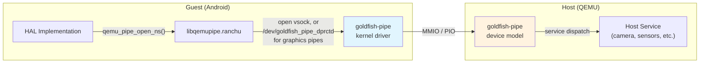

**客户机端 API：** 管道通过 `libqemupipe.ranchu` 库（源码位于 `hardware/google/gfxstream/guest/qemupipe/`）访问，该库提供如下函数：

- `qemu_pipe_open_ns(namespace, name, flags)`——打开到某个特定宿主服务的命名管道

- `qemu_pipe_write_fully(fd, data, size)`——向管道写入数据
- `qemu_pipe_read_fully(fd, data, size)`——从管道读取数据

在底层，非图形管道现在通过 vsock 套接字传输。只有图形管道仍回退到已弃用的字符设备。其节点是 `/dev/goldfish_pipe_dprctd`。

`qemud` 层在原始管道之上增加了多路复用。可以通过单条管道连接打开多个逻辑通道。来自 `device/generic/goldfish/hals/lib/qemud/qemud.cpp`：

```cpp
// Source: device/generic/goldfish/hals/lib/qemud/qemud.cpp
int qemud_channel_open(const char* name) {
    return qemu_pipe_open_ns("qemud", name, O_RDWR);
}

int qemud_channel_send(int pipe, const void* msg, int size) {
    char header[5];
    if (size < 0)
        size = strlen((const char*)msg);
    if (size == 0)
        return 0;

    if (size >= 64 * 1024) { // use binary encoding
        uint32_t length32be = htonl(size | (1U << 31));
        memcpy(header, &length32be, 4);
    } else { // use hex digit encoding
        snprintf(header, sizeof(header), "%04x", size);
    }

    if (qemu_pipe_write_fully(pipe, header, 4)) {
        return -1;
    }
    if (qemu_pipe_write_fully(pipe, msg, size)) {
        return -1;
    }
    return 0;
}

int qemud_channel_recv(int pipe, void* msg, int maxsize) {
    char header[5];
    int size;
    if (qemu_pipe_read_fully(pipe, header, 4)) {
        return -1;
    }
    header[4] = 0;
    if (sscanf(header, "%04x", &size) != 1) {
        return -1;
    }
    if (size > maxsize) {
        return -1;
    }
    if (qemu_pipe_read_fully(pipe, msg, size)) {
        return -1;
    }
    return size;
}
```

该协议使用简单的带长度前缀的帧格式：

- 小于 64KB 的消息使用 4 个字符的十六进制长度前缀（例如 `"001a"`）
- 64KB 或更大的消息使用 4 字节二进制网络字节序长度，并设置最高位

### 60.3.2 传感器 HAL 线程模型

传感器 HAL 具有一个复杂的多线程架构，值得详细考察。`MultihalSensors` 类的头文件（`device/generic/goldfish/hals/sensors/include/multihal_sensors.h`）揭示了内部结构：

```cpp
// Source: device/generic/goldfish/hals/sensors/include/multihal_sensors.h
struct MultihalSensors : public ahs21::implementation::ISensorsSubHal {
    using SensorsTransportFactory =
        std::function<std::unique_ptr<SensorsTransport>()>;

    MultihalSensors(SensorsTransportFactory);
    ~MultihalSensors();

private:
    struct QemuSensorsProtocolState {
        int64_t timeBiasNs = -500000000;
        int32_t sensorsUpdateIntervalMs = 200;
        static constexpr float kSensorNoValue = -1e+30;

        // on change sensors (host does not support them)
        float lastAmbientTemperatureValue = kSensorNoValue;
        float lastProximityValue = kSensorNoValue;
        float lastLightValue = kSensorNoValue;
        float lastRelativeHumidityValue = kSensorNoValue;
        float lastHingeAngle0Value = kSensorNoValue;
        float lastHingeAngle1Value = kSensorNoValue;
        float lastHingeAngle2Value = kSensorNoValue;
        float lastHeartRateValue = kSensorNoValue;
        float lastWristTiltMeasurement = -1;
    };

    // batching
    struct BatchEventRef {
        int64_t  timestamp = -1;
        int      sensorHandle = -1;
        int      generation = 0;

        bool operator<(const BatchEventRef &rhs) const {
            // not a typo: we want top() to be smallest timestamp
            return timestamp > rhs.timestamp;
        }
    };

    struct BatchInfo {
        Event       event;
        int64_t     samplingPeriodNs = 0;
        int         generation = 0;
    };

    QemuSensorsProtocolState             m_protocolState;
    std::priority_queue<BatchEventRef>   m_batchQueue;
    std::vector<BatchInfo>               m_batchInfo;
    std::condition_variable              m_batchUpdated;
    std::thread                          m_batchThread;
    std::atomic<bool>                    m_batchRunning = true;
    mutable std::mutex                   m_mtx;
};
```

该线程模型包含三个线程：

1. **主线程**——处理来自 SensorService 的 HIDL/AIDL 调用（`activate`、`batch`、`flush`、`injectSensorData_2_1`）。

2. **传感器监听线程**（`qemuSensorListenerThread`）——从 QEMU 传输层读取传感器数据并分发事件。使用 `epoll` 在传输 fd 和命令 fd 之间进行多路复用。

3. **批处理线程**（`batchThread`）——实现连续模式传感器的批处理。使用按时间戳排序的优先队列来确定何时投递下一个传感器事件。

基于 epoll 的监听线程实现来自 `device/generic/goldfish/hals/sensors/multihal_sensors_epoll.cpp`：

```cpp
// Source: device/generic/goldfish/hals/sensors/multihal_sensors_epoll.cpp
bool MultihalSensors::qemuSensorListenerThreadImpl(
        const int transportFd) {
    const unique_fd epollFd(epoll_create1(0));

    epollCtlAdd(epollFd.get(), transportFd);
    epollCtlAdd(epollFd.get(), m_sensorThreadFd.get());

    while (true) {
        struct epoll_event events[2];
        const int kTimeoutMs = 60000;
        const int n = TEMP_FAILURE_RETRY(epoll_wait(
            epollFd.get(), events, 2, kTimeoutMs));

        for (int i = 0; i < n; ++i) {
            const struct epoll_event* ev = &events[i];
            const int fd = ev->data.fd;

            if (fd == transportFd) {
                if (ev->events & EPOLLIN) {
                    std::unique_lock<std::mutex> lock(m_mtx);
                    parseQemuSensorEventLocked(&m_protocolState);
                }
            } else if (fd == m_sensorThreadFd.get()) {
                const int cmd = qemuSensortThreadRcvCommand(fd);
                switch (cmd) {
                case kCMD_QUIT: return false;
                case kCMD_RESTART: return true;
                }
            }
        }
    }
}
```

当批处理间隔发生变化且传输层需要重新配置时，会发送 `kCMD_RESTART` 命令。关机期间会发送 `kCMD_QUIT` 命令。这一设计使得传感器监听器可以在不拆除整个 HAL 的情况下重启。

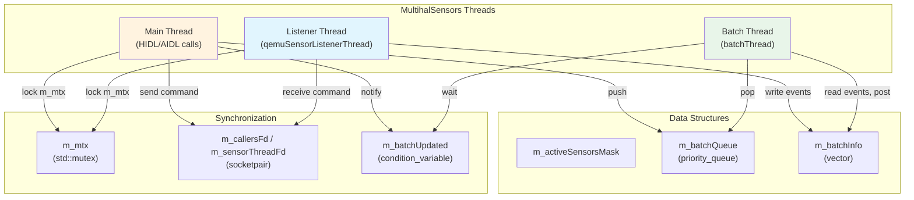

### 60.3.3 显示发现与 VSync

HWC3 HAL 通过渲染控制编码器查询 QEMU 宿主来发现显示器。来自 `device/generic/goldfish/hals/hwc3/DisplayFinder.cpp`：

```cpp
// Source: device/generic/goldfish/hals/hwc3/DisplayFinder.cpp
static uint32_t getVsyncHzFromProperty() {
    static constexpr const auto kVsyncProp = "ro.boot.qemu.vsync";
    const auto vsyncProp =
        ::android::base::GetProperty(kVsyncProp, "");

    uint64_t vsyncPeriod;
    if (!::android::base::ParseUint(vsyncProp, &vsyncPeriod)) {
        return 60;  // default 60 Hz
    }
    return static_cast<uint32_t>(vsyncPeriod);
}

HWC3::Error findGoldfishPrimaryDisplay(
        std::vector<DisplayMultiConfigs>* outDisplays) {
    DEFINE_AND_VALIDATE_HOST_CONNECTION
    hostCon->lock();
    const int32_t vsyncPeriodNanos =
        HertzToPeriodNanos(getVsyncHzFromProperty());

    DisplayMultiConfigs display;
    display.displayId = 0;

    if (rcEnc->hasHWCMultiConfigs()) {
        int count = rcEnc->rcGetFBDisplayConfigsCount(rcEnc);
        display.activeConfigId =
            rcEnc->rcGetFBDisplayActiveConfig(rcEnc);

        for (int configId = 0; configId < count; configId++) {
            display.configs.push_back(DisplayConfig(
                configId,
                rcEnc->rcGetFBDisplayConfigsParam(
                    rcEnc, configId, FB_WIDTH),
                rcEnc->rcGetFBDisplayConfigsParam(
                    rcEnc, configId, FB_HEIGHT),
                rcEnc->rcGetFBDisplayConfigsParam(
                    rcEnc, configId, FB_XDPI),
                rcEnc->rcGetFBDisplayConfigsParam(
                    rcEnc, configId, FB_YDPI),
                vsyncPeriodNanos));
        }
    }
    // ...
}
```

显示查找器向宿主查询以下内容：

- **分辨率**（宽、高），来自 `FB_WIDTH` 和 `FB_HEIGHT` 参数
- **DPI**（每英寸点数），来自 `FB_XDPI` 和 `FB_YDPI` 参数
- **刷新率**，来自 `ro.boot.qemu.vsync` 启动属性

当宿主支持多个显示配置（多配置模式）时，显示查找器会枚举所有可用配置，并通过 HWC3 接口将其呈现给 SurfaceFlinger。

### 60.3.4 音频写入线程

音频 HAL 的输出流使用一个专用写入线程，并通过 FMQ（Fast Message Queue）与 AudioFlinger 进行低延迟通信。来自 `device/generic/goldfish/hals/audio/stream_out.cpp`：

```cpp
// Source: device/generic/goldfish/hals/audio/stream_out.cpp
class WriteThread : public IOThread {
    typedef MessageQueue<IStreamOut::WriteCommand,
                         kSynchronizedReadWrite> CommandMQ;
    typedef MessageQueue<IStreamOut::WriteStatus,
                         kSynchronizedReadWrite> StatusMQ;
    typedef MessageQueue<uint8_t,
                         kSynchronizedReadWrite> DataMQ;

public:
    WriteThread(StreamOut *stream, const size_t mqBufferSize)
            : mStream(stream)
            , mCommandMQ(1)
            , mStatusMQ(1)
            , mDataMQ(mqBufferSize, true /* EventFlag */) {
        // ...
        EventFlag* rawEfGroup = nullptr;
        status_t status = EventFlag::createEventFlag(
            mDataMQ.getEventFlagWord(), &rawEfGroup);
        mEfGroup.reset(rawEfGroup);
        mThread = std::thread(&WriteThread::threadLoop, this);
    }
};
```

FMQ 机制使 AudioFlinger 无需 Binder 往返即可写入音频数据。`EventFlag` 使用共享内存在 AudioFlinger 进程与 HAL 服务进程之间提供轻量级的信号机制。

### 60.3.5 Wake Lock 管理

模拟器设置脚本通过 wake lock 管理电源状态。来自 `device/generic/goldfish/init/init.setup.ranchu.sh`：

```bash
# Source: device/generic/goldfish/init/init.setup.ranchu.sh
allowsuspend=`getprop ro.boot.qemu.allowsuspend`
case "$allowsuspend" in
    "") echo "emulator_wake_lock" > /sys/power/wake_lock
    ;;
    1) echo "emulator_wake_lock" > /sys/power/wake_unlock
    ;;
    *) echo "emulator_wake_lock" > /sys/power/wake_lock
    ;;
esac
```

默认情况下，模拟器持有永久 wake lock（`emulator_wake_lock`），以防止客户机进入深度睡眠。这对开发很重要，因为被挂起的模拟器将无法响应。可以设置 `ro.boot.qemu.allowsuspend=1` 标志以允许客户机挂起，这在测试电源管理行为时很有用。

### 60.3.6 QEMU 属性服务

`qemu-props` 服务（`device/generic/goldfish/qemu-props/qemu-props.cpp`）是模拟器启动过程中最早启动的服务之一。它从模拟器宿主读取属性，并将其设置为 Android 系统属性：

```cpp
// Source: device/generic/goldfish/qemu-props/qemu-props.cpp
constexpr char kBootPropertiesService[] = "boot-properties";
constexpr char kHeartbeatService[] = "QemuMiscPipe";

int setBootProperties() {
    unique_fd qemud;
    for (int tries = 5; tries > 0; --tries) {
        qemud = unique_fd(qemud_channel_open(kBootPropertiesService));
        if (qemud.ok()) break;
        else if (tries > 1) sleep(1);
        else return FAILURE(1);
    }

    if (qemud_channel_send(qemud.get(), "list", -1) < 0) {
        return FAILURE(1);
    }

    while (true) {
        char temp[PROPERTY_KEY_MAX + PROPERTY_VALUE_MAX + 2];
        const int len = qemud_channel_recv(qemud.get(), temp, sizeof(temp) - 1);
        if (len < 0 || len > (sizeof(temp) - 1) || !temp[0]) break;

        temp[len] = '\0';
        char* prop_value = strchr(temp, '=');
        if (!prop_value) continue;
        *prop_value = 0;
        ++prop_value;

        // Properties are prefixed with "vendor." unless already prefixed
        // or in the system properties list
        if (need_prepend_prefix(temp, "vendor.")) {
            snprintf(renamed_property, sizeof(renamed_property),
                     "vendor.%s", temp);
            final_prop_name = renamed_property;
        }

        property_set(final_prop_name, prop_value);
    }
    return 0;
}
```

设置属性之后，该服务进入一个心跳循环，定期向 `QemuMiscPipe` 服务发送"heartbeat"消息。这使得模拟器宿主可以检测客户机是否存活且有响应：

```cpp
// Source: device/generic/goldfish/qemu-props/qemu-props.cpp
int main(const int argc, const char* argv[]) {
    if ((argc == 2) && !strcmp(argv[1], "bootcomplete")) {
        sendMessage("bootcomplete");
        return 0;
    }

    int r = setBootProperties();
    parse_virtio_serial();
    sendHeartBeat();

    while (s_QemuMiscPipe >= 0) {
        if (android::base::WaitForProperty(
                    "vendor.qemu.dev.bootcomplete", "1",
                    std::chrono::seconds(5))) {
            break;
        }
        sendHeartBeat();
    }

    while (s_QemuMiscPipe >= 0) {
        usleep(30 * 1000000);  // 30 seconds
        sendHeartBeat();
    }
    // ...
}
```

### 60.3.7 虚拟传感器

虚拟传感器（在 60.2.3.3 节中详细讨论）由模拟器的 Extended Controls UI 驱动。当用户与传感器控件交互时，模拟器宿主通过 QEMU 管道发送基于文本的传感器事件。例如倾斜虚拟设备、更改距离、以及调节光线级别。

传感器数据流：

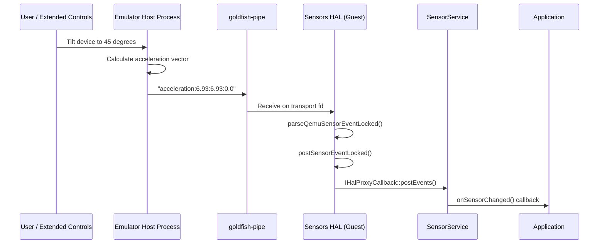

传感器 HAL 为未校准的传感器值添加校准噪声，以通过 CTS（兼容性测试套件）：

```cpp
// Source: device/generic/goldfish/hals/sensors/multihal_sensors_qemu.cpp
} else if (const char* values = testPrefix(buf, end,
                                           "acceleration-uncalibrated", ':')) {
    if (sscanf(values, "%f:%f:%f",
               &uncal->x, &uncal->y, &uncal->z) == 3) {
        // A little bias noise to pass CTS
        uncal->x_bias = randomError(-0.003f, 0.003f);
        uncal->y_bias = randomError(-0.003f, 0.003f);
        uncal->z_bias = randomError(-0.003f, 0.003f);
        // ...
    }
}
```

### 60.3.8 虚拟 GPS

GPS 模拟通过 GNSS HAL（60.2.3.4 节）流转。模拟器支持：

- 固定 GPS 坐标（通过 Extended Controls 设置）
- GPS 路线（GPX/KML 文件回放）
- NMEA 语句注入

GPS 服务在 QEMU 宿主级别注册为 "gps" qemud 服务。客户机端的 `GnssHwListener` 类解析传入的 NMEA 数据并将其分发给 Android 定位框架。

### 60.3.9 虚拟相机

相机子系统支持多种虚拟相机后端：

1. **宿主网络摄像头直通**——模拟器从宿主的网络摄像头采集帧，并通过 QEMU 的 "camera" 服务将其发送给客户机。

2. **虚拟场景**——一个 3D 渲染的环境，会响应虚拟设备的方向传感器。

3. **伪旋转相机**——合成的测试图案（`device/generic/goldfish/hals/camera/` 中的 `FakeRotatingCamera` 类）。

相机数据传输使用相同的 qemud 协议，采用查询-响应模式。当相机的通道被打开时就会选中该相机——客户机打开一个名为 `camera:name=<camera>` 的 qemud 通道——随后的查询不带任何参数：

```
Guest -> Host: "list"       (on the "camera" factory channel)
Host -> Guest: "ok:<camera_list>"
Guest opens qemud channel "camera:name=<camera>"
Guest -> Host: "connect"    (connect to the camera)
Host -> Guest: "ok"
Guest -> Host: "start"      (start capture)
Host -> Guest: "ok"
Host -> Guest: <frame_data> (raw frame data)
Guest -> Host: "stop", then "disconnect" when done
```

### 60.3.10 虚拟电话

电话子系统使用一个完整的调制解调器模拟器，它通过 AT 命令与射频 HAL 通信。模拟器支持：

- 语音呼叫（模拟呼叫状态机）
- 短信发送与接收
- 数据连接
- SIM 卡模拟（ICC profile 文件从 `data/misc/modem_simulator/` 加载）

- 多种无线接入技术（5G NR、LTE、GSM 等）

SIM profile 已预先配置：

```makefile
# Source: device/generic/goldfish/product/generic.mk
PRODUCT_COPY_FILES += \
    device/generic/goldfish/hals/radio/data/apns-conf.xml:$(TARGET_COPY_OUT_VENDOR)/etc/apns/apns-conf.xml \
    device/generic/goldfish/hals/radio/data/iccprofile_for_sim0.xml:data/misc/modem_simulator/iccprofile_for_sim0.xml \
    device/generic/goldfish/hals/radio/data/numeric_operator.xml:data/misc/modem_simulator/etc/modem_simulator/files/numeric_operator.xml \
```

### 60.3.11 GPU 模拟

GPU 模拟是模拟器在架构上最复杂的部分之一。系统支持三种渲染模式：

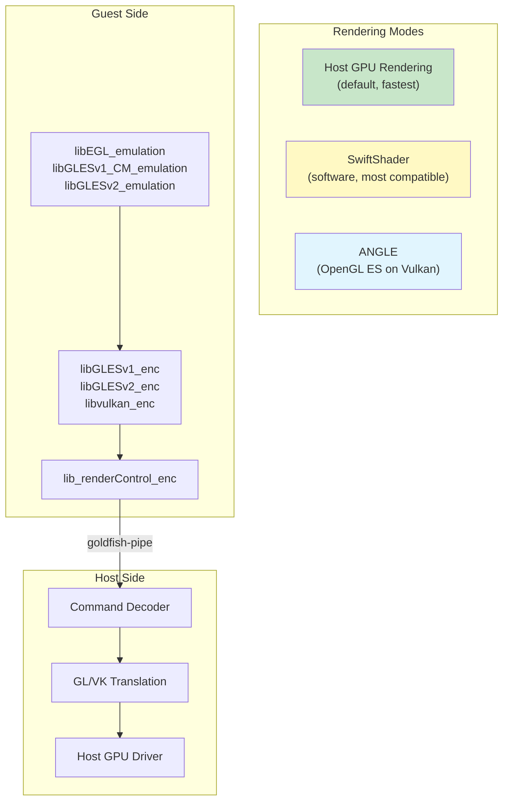

**客户机端库**（安装到系统镜像中）：

```makefile
# Source: device/generic/goldfish/product/generic.mk
PRODUCT_PACKAGES += \
    libGLESv1_CM_emulation \
    lib_renderControl_enc \
    libEGL_emulation \
    libGLESv2_enc \
    libvulkan_enc \
    libGLESv2_emulation \
    libGLESv1_enc \
    libEGL_angle \
    libGLESv1_CM_angle \
    libGLESv2_angle
```

客户机端 EGL/GLES 库将 OpenGL ES 命令序列化为二进制流。该流通过 goldfish-pipe 发送到宿主。在宿主端，模拟器解码这些命令，并在宿主实际的 GPU 驱动上重放它们。

宿主 GPU 有时不可用（例如在无头 CI 服务器或远程 SSH 会话中）。在这种情况下，SwiftShader 提供一个完全在 CPU 上运行的 Vulkan 软件实现。

ANGLE（Almost Native Graphics Layer Engine）在 Vulkan 之上提供 OpenGL ES 实现。这对于那些拥有 Vulkan 但没有原生 OpenGL 驱动的宿主很有用（在较新的 macOS 系统上很常见）。

图形渲染模式通过启动属性选择：

```
# Source: device/generic/goldfish/init/init.ranchu.rc
setprop ro.hardware.egl ${ro.boot.hardwareegl:-emulation}
setprop ro.hardware.vulkan ${ro.boot.hardware.vulkan}
setprop ro.opengles.version ${ro.boot.opengles.version}
```

gralloc HAL 通过渲染控制编码器创建宿主端 GPU 资源（"颜色缓冲区"），如 60.2.3.8 节所示。这实现了高效的零拷贝渲染，即客户机合成帧，并由模拟器窗口直接显示。

---

## 60.4 模拟器网络

### 60.4.1 网络架构

模拟器实现了一个虚拟网络，为客户机提供互联网连接，同时将其与宿主的物理网络隔离开。默认情况下，该架构使用 QEMU 用户态网络栈（SLIRP），并可选配基于 TAP 的网络模式以用于高级用例。

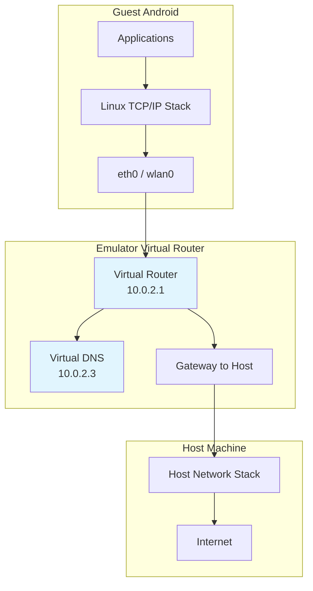

### 60.4.2 默认 IP 寻址

每个模拟器实例都被分配一个唯一的 IP 地址范围：

| 组件 | 地址 |
|-----------|---------|
| 虚拟路由器/网关 | 10.0.2.1 |
| 宿主回环别名 | 10.0.2.2 |
| DNS 服务器 | 10.0.2.3 |
| 客户机 eth0 | 10.0.2.15（DHCP 分配） |

### 60.4.3 VirtIO WiFi

现代模拟器构建使用 VirtIO WiFi，而不是旧的 `eth0` 接口。来自 `device/generic/goldfish/init/init.net.ranchu.sh` 的网络脚本处理这一逻辑：

```bash
# Source: device/generic/goldfish/init/init.net.ranchu.sh
wifi_virtio=`getprop ro.boot.qemu.virtiowifi`
case "$wifi_virtio" in
    1) wifi_mac_prefix=`getprop vendor.net.wifi_mac_prefix`
      if [ -n "$wifi_mac_prefix" ]; then
          /vendor/bin/mac80211_create_radios 1 $wifi_mac_prefix || exit 1
      fi
      ;;
esac
```

当启用 VirtIO WiFi 时，`mac80211_hwsim` 内核模块会创建一个模拟的 WiFi 射频。`wpa_supplicant` 服务管理这个虚拟接口：

```
# Source: device/generic/goldfish/init/init.ranchu.rc
service wpa_supplicant /vendor/bin/hw/wpa_supplicant \
    -Dnl80211 -iwlan0 \
    -c/vendor/etc/wifi/wpa_supplicant.conf \
    -g@android:wpa_wlan0
    interface aidl android.hardware.wifi.supplicant.ISupplicant/default
    socket wpa_wlan0 dgram 660 wifi wifi
    group system wifi inet
```

VirtIO WiFi 的设置是有条件触发的：

```
# Source: device/generic/goldfish/init/init.ranchu.rc
on post-fs-data && property:ro.boot.qemu.virtiowifi=1
    start ranchu-net
```

### 60.4.4 端口转发与 ADB 连接

模拟器支持宿主与客户机之间的 TCP 和 UDP 端口转发。ADB 使用端口转发与客户机通信：

- **控制台端口**：5554（第一个实例）、5556（第二个）等等。
- **ADB 端口**：5555（第一个实例）、5557（第二个）等等。

端口转发通过模拟器控制台配置：

```
# Forward host port 8080 to guest port 80
redir add tcp:8080:80

# Forward host port 5000 to guest port 5000
redir add tcp:5000:5000
```

客户机内的 ADB 守护进程监听一个众所周知的端口。模拟器会自动建立转发，因此 `adb devices` 会将该模拟器实例显示为已连接的设备。

### 60.4.5 模拟器间网络

网络脚本支持用于模拟器间通信的辅助接口（`eth1`）：

```bash
# Source: device/generic/goldfish/init/init.net.ranchu.sh
# set up the second interface (for inter-emulator connections)
my_ip=`getprop vendor.net.shared_net_ip`
case "$my_ip" in
    "")
    ;;
    *) ifconfig eth1 "$my_ip" netmask 255.255.255.0 up
    ;;
esac
```

多个模拟器实例有时需要互相通信（例如用于测试多设备场景）。在这种情况下，可以用共享网络对它们进行配置。每个实例在 `eth1` 接口上获得一个唯一 IP。

### 60.4.6 蓝牙网络

蓝牙通过 VirtIO 控制台设备来模拟。init 脚本为蓝牙设备创建一个符号链接：

```
# Source: device/generic/goldfish/init/init.ranchu.rc
on property:vendor.qemu.vport.bluetooth=*
    symlink ${vendor.qemu.vport.bluetooth} /dev/bluetooth0

service bt_vhci_forwarder \
    /vendor/bin/bt_vhci_forwarder \
    -virtio_console_dev=/dev/bluetooth0
    class main
    user bluetooth
    group root bluetooth
```

`bt_vhci_forwarder` 服务在 VirtIO 控制台设备与蓝牙 VHCI（Virtual Host Controller Interface，虚拟主机控制器接口）驱动之间进行桥接。这让客户机可以使用模拟器的蓝牙协议栈。

---

## 60.5 Ranchu 与 Goldfish 内核

### 60.5.1 历史背景

模拟器经历了两代主要的内核：

1. **Goldfish 内核**（旧版）：一个经过自定义修改的 Linux 内核，带有面向原始模拟器虚拟硬件的 Goldfish 特定设备驱动（goldfish_timer、goldfish_fb、goldfish_audio、goldfish_battery 等）。

2. **Ranchu 内核**（现代）：一个标准的 GKI（Generic Kernel Image）内核，使用标准 VirtIO 设备而非自定义 Goldfish 设备。"ranchu"这个名字是一种金鱼的品种，反映了这种演化关系。

### 60.5.2 VirtIO 设备迁移

从自定义 Goldfish 设备向标准 VirtIO 设备的迁移是一项重大的架构改进：

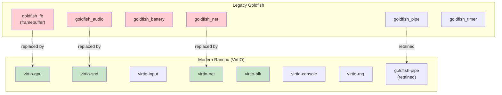

goldfish-pipe 设备被保留下来，因为它承担了一个 VirtIO 没有直接涉及的独特角色。它是客户机 HAL 与宿主服务之间用于序列化 GPU 命令和其他批量数据传输的高带宽、低延迟通道。

### 60.5.3 内核模块配置

现代 Ranchu 内核为 VirtIO 设备使用可加载内核模块。Goldfish 保留自己的内核板级配置，带有一个较短的第一阶段列表。在 `device/generic/goldfish/board/kernel/arm64.mk` 中，它只命名了 `virtio_dma_buf.ko`、`virtio_mmio.ko` 和 `virtio-rng.ko`，外加一组源自 `prebuilts/qemu-kernel/` 的 `RAMDISK_SYSTEM_KERNEL_MODULES`。Cuttlefish 的板级配置——它使用位于 `kernel/prebuilts/` 下的独立预构建内核树——显示了一组更完整的必需 ramdisk 模块：

```makefile
# Source: device/google/cuttlefish/shared/BoardConfig.mk
RAMDISK_KERNEL_MODULES ?= \
    failover.ko \
    nd_virtio.ko \
    net_failover.ko \
    virtio_dma_buf.ko \
    virtio-gpu.ko \
    virtio_input.ko \
    virtio_net.ko \
    virtio-rng.ko \
```

这些是为了让系统能够启动而在第一阶段 init 中必须加载的模块。随后加载的附加模块包括：

- `virtio_blk.ko`——块设备模拟
- `virtio_console.ko`——串行控制台和虚拟端口
- `virtio_pci.ko`——VirtIO 的 PCI 传输
- `vmw_vsock_virtio_transport.ko`——用于客户机-宿主通信的 vsock 传输

- `mac80211_hwsim.ko`——WiFi 模拟
- `cfg80211.ko`、`mac80211.ko`——无线网络栈

### 60.5.4 内核版本选择

在 Android 17 中，Cuttlefish 内核版本不再是一个单一的硬编码值。`device/google/cuttlefish/shared/BoardConfig.mk` 定义了一个默认值，然后按产品进行选择，多个目标会从发布配置变量中读取自己的版本：

```makefile
# Source: device/google/cuttlefish/shared/BoardConfig.mk
DEFAULT_TARGET_KERNEL_USE := 6.12

ifneq (,$(findstring cf_gwear_arm,$(PRODUCT_NAME)))
TARGET_KERNEL_USE ?= 6.6
else ifeq (true,$(CLOCKWORK_EMULATOR_PRODUCT))
TARGET_KERNEL_USE ?= 6.1
else ifneq (,$(findstring x86_tv,$(PRODUCT_NAME)))
TARGET_KERNEL_USE ?= 6.1
else ifneq (,$(filter cf_x86_64_desktop,$(PRODUCT_NAME)))
TARGET_KERNEL_USE ?= $(RELEASE_KERNEL_CUTTLEFISH_X86_64_VERSION)
TARGET_KERNEL_DIR ?= $(RELEASE_KERNEL_CUTTLEFISH_X86_64_DIR)
else ifneq (,$(filter cf_arm64_desktop,$(PRODUCT_NAME)))
TARGET_KERNEL_USE ?= $(RELEASE_KERNEL_CUTTLEFISH_ARM64_VERSION)
TARGET_KERNEL_DIR ?= $(RELEASE_KERNEL_CUTTLEFISH_ARM64_DIR)
else
TARGET_KERNEL_USE ?= $(DEFAULT_TARGET_KERNEL_USE)
endif
```

通用手机目标的默认值是 6.12。较旧的外形规格被固定到长期支持的内核上（Wear OS 使用 6.6，clockwork 模拟器和 x86 TV 使用 6.1）。最有趣的情况是**桌面**目标。它从 `RELEASE_KERNEL_CUTTLEFISH_*` 发布配置变量中读取自己的版本和目录。然后，它从独立的桌面特定树而不是共享的预构建中获取内核和模块。

请注意，下面的 `filter` 守卫精确匹配非 AOSP 产品名称 `cf_x86_64_desktop` / `cf_arm64_desktop`。因此，AOSP 的 `aosp_cf_x86_64_desktop` 产品会落到共享的 `kernel/prebuilts/` 分支：

```makefile
# Source: device/google/cuttlefish/shared/BoardConfig.mk
ifneq (,$(filter cf_x86_64_desktop cf_arm64_desktop,$(PRODUCT_NAME)))
SYSTEM_DLKM_SRC ?= device/google/desktop/cuttlefish-$(TARGET_KERNEL_ARCH)-kernels/$(TARGET_KERNEL_USE)/$(TARGET_KERNEL_DIR)/system_dlkm
KERNEL_MODULES_PATH ?= device/google/desktop/cuttlefish-$(TARGET_KERNEL_ARCH)-kernels/$(TARGET_KERNEL_USE)/$(TARGET_KERNEL_DIR)/vendor_dlkm
else
SYSTEM_DLKM_SRC ?= kernel/prebuilts/$(TARGET_KERNEL_USE)/$(TARGET_KERNEL_ARCH)
KERNEL_MODULES_PATH ?= \
    kernel/prebuilts/common-modules/virtual-device/$(TARGET_KERNEL_USE)/$(subst _,-,$(TARGET_KERNEL_ARCH))
endif

TARGET_KERNEL_PATH ?= $(SYSTEM_DLKM_SRC)/kernel-$(TARGET_KERNEL_USE)
```

对于除桌面以外的所有情况，预构建内核存储在 `kernel/prebuilts/` 下，而 `common-modules/virtual-device/` 目录存放专门为虚拟设备使用而构建的内核模块。

### 60.5.5 ZRAM 与内存配置

Ranchu 内核启用 zram 进行内存压缩：

```
# Source: device/generic/goldfish/init/init.ranchu.rc
on early-init
    exec u:r:modprobe:s0 -- /system/bin/modprobe -a -d \
        /system/lib/modules zram.ko

on init
    write /sys/block/zram0/comp_algorithm lz4
    write /proc/sys/vm/page-cluster 0

on sys-boot-completed-set && property:persist.sys.zram_enabled=1
    swapon_all /vendor/etc/fstab.${ro.hardware}
```

zram 压缩使用 LZ4 来实现快速的压缩/解压。`page-cluster 0` 设置告诉内核从交换空间一次读取一页。这对 zram 而言是最优的，因为不存在寻道惩罚。

---

## 60.6 Cuttlefish：面向云的替代方案

### 60.6.1 Cuttlefish 是什么？

Cuttlefish 是一种可配置的虚拟 Android 设备，它可以在云环境中运行，而无需物理显示器、音频设备或任何硬件特定的基础设施。Goldfish/Ranchu 主要为 Android Studio 模拟器（一个带有 GUI 的桌面应用程序）而设计。相比之下，Cuttlefish 面向服务器端用例设计：CI/CD、自动化测试、云游戏以及远程机器上的开发。

**位置：** `device/google/cuttlefish/`

### 60.6.2 架构对比

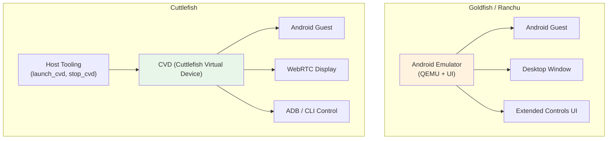

| 特性 | Goldfish/Ranchu | Cuttlefish |
|---------|----------------|------------|
| 主要用例 | 桌面开发 | 云 / CI |
| 显示 | 桌面窗口 | WebRTC 或 VNC |
| 音频 | 宿主音频输出 | 虚拟音频 |
| GPU | 宿主 GPU 直通 | virtio-gpu / SwiftShader |
| 网络 | 用户态（SLIRP） | TAP / 桥接 |
| 多实例 | 多个进程 | `launch_cvd --num_instances=N` |
| OTA 更新 | 不支持 | 支持 A/B 更新 |
| 快照 | QEMU 快照 | 非主要特性 |
| 外形规格 | 手机、平板、折叠屏、Wear、TV | 手机、折叠屏、平板（pc）、TV、Auto、Wear、Desktop |
| 架构 | x86_64、ARM64、RISC-V | x86_64、ARM64、RISC-V |

### 60.6.3 Cuttlefish 设备目标

`device/google/cuttlefish/AndroidProducts.mk` 枚举了构建目标。每个产品名称遵循 `aosp_cf_<arch>_<formfactor>` 约定，并指向某个 `vsoc_*` 设备目录下的一份精简 `aosp_cf.mk`。"vsoc"前缀代表 "Virtual System on Chip"（虚拟片上系统）。Android 17 源码树中存在的设备目录有：

| 目录 | 架构 / 变体 |
|-----------|------------------------|
| `vsoc_x86_64/` | x86_64（带 32 位支持） |
| `vsoc_x86_64_only/` | x86_64，仅 64 位 |
| `vsoc_x86_64_pgagnostic/` | x86_64，页大小无关（4KB/16KB） |
| `vsoc_x86_64_minidroid/` | 最小化 x86_64 |
| `vsoc_x86_64_host/` | x86_64 宿主端构建 |
| `vsoc_arm64/` | ARM64（带 32 位支持） |
| `vsoc_arm64_only/` | ARM64，仅 64 位 |
| `vsoc_arm64_pgagnostic/` | ARM64，页大小无关 |
| `vsoc_arm64_minidroid/` | 最小化 ARM64 |
| `vsoc_arm/` 和 `vsoc_arm_minidroid/` | 32 位 ARM |
| `vsoc_x86/` | 32 位 x86（go / TV / Wear 产品） |
| `vsoc_riscv64/` | RISC-V 64 位 |
| `vsoc_riscv64_minidroid/` | 最小化 RISC-V |

外形规格从这些目录向外扩展。在 Android 17 中，产品目录已经远超手机/平板这一对组合。`aosp_cf_*` 产品列表现在涵盖手机、折叠屏、平板（`pc`）、TV、Wear、汽车（若干 `auto_*` 布局），以及新增的 **desktop** 目标：

| 产品 | 设备目录 | 备注 |
|---------|-----------|-------|
| `aosp_cf_x86_64_phone` | `vsoc_x86_64/phone/` | 规范的 CI 参考目标 |
| `aosp_cf_x86_64_foldable` | `vsoc_x86_64_only/phone/` | `aosp_cf_foldable.mk` 覆盖 |
| `aosp_cf_x86_64_pc` | `vsoc_x86_64_only/pc/` | 大屏 / 平板布局 |
| `aosp_cf_x86_64_tv` | `vsoc_x86_64_only/tv/` | Android TV |
| `aosp_cf_x86_64_wear` | `vsoc_x86_64_only/wear/` | Wear OS |
| `aosp_cf_x86_64_auto`（+ `auto_md`、`auto_mdnd`、`auto_dd`、`auto_portrait`、...） | `vsoc_x86_64_only/auto*/` | 汽车，多显示变体 |
| `aosp_cf_x86_64_desktop` | `vsoc_x86_64_only/desktop/` | Android 17 新增 |
| `aosp_cf_arm64_phone` / `aosp_cf_arm64_auto` | `vsoc_arm64*/` | ARM 等价物 |
| `aosp_cf_riscv64_phone` / `_wear` / `_slim` | `vsoc_riscv64*/` | RISC-V |

#### 桌面目标（Android 17）

`aosp_cf_x86_64_desktop` 是 Android 17 的一项值得关注的新增内容。其产品 makefile `device/google/cuttlefish/vsoc_x86_64_only/desktop/aosp_cf.mk` 继承了桌面特定的 vendor 栈（`device/google/cuttlefish/shared/desktop/common_x86.mk` 和 `aosp_device_vendor.mk`），并设置 `PRODUCT_MODEL := Cuttlefish AOSP x86_64 Desktop`。有两点使其区别于手持设备目标：

```makefile
# Source: device/google/cuttlefish/vsoc_x86_64_only/desktop/aosp_cf.mk
PRODUCT_NAME := aosp_cf_x86_64_desktop
PRODUCT_DEVICE := vsoc_x86_64_only

# Ika uses ndk-translation only.
AL_BINARY_TRANSLATION_MODE := ndk_translation_only

# ARC/Auto/Desktop - don't use compressed apks.
UNCOMPRESS_CHROME_WEBVIEW = true
```

`shared/BoardConfig.mk` 中的内核覆盖（见 60.5.4 节）适用于非 AOSP 的 `cf_x86_64_desktop` / `cf_arm64_desktop` 产品名称。桌面 Android 项目将这两个名称与它自己的内核分支搭配使用。AOSP 的 `aosp_cf_x86_64_desktop` 产品不匹配该过滤器。它仍然使用共享的 `kernel/prebuilts/` 路径。

### 60.6.4 宿主工具

Cuttlefish 在 `device/google/cuttlefish/host/commands/` 下包含一整套宿主端工具。这些工具会构建为 `cvd-host_package.tar.gz` 构件，与客户机镜像一起运行：

| 工具 | 用途 |
|------|---------|
| `start/` | 启动虚拟设备（构建 `cvd_internal_start`，并以 `launch_cvd` 作为符号链接） |
| `stop/` | 停止虚拟设备 |
| `run_cvd/` | 拥有 crosvm 和辅助守护进程的核心虚拟设备运行时 |
| `assemble_cvd/` | 组装磁盘镜像并生成 VMM 配置 |
| `status/` 和 `restart_cvd/` | 查询并重启正在运行的实例 |
| `cvd_env/` | gRPC 环境管理 |
| `process_sandboxer/` | 将宿主守护进程包装在 seccomp 沙箱中 |
| `console_forwarder/` | 串行控制台转发 |
| `kernel_log_monitor/` | 内核日志监控 |
| `log_tee/` | 日志 tee 与转发 |
| `logcat_receiver/` | 从客户机接收 logcat |
| `modem_simulator/` | 用于电话的调制解调器模拟 |
| `gnss_grpc_proxy/` | 通过 gRPC 代理 GNSS 数据 |
| `display/` | 显示管理 |
| `screen_recording_server/` | 屏幕录制服务 |
| `record_cvd/` | 录制工具 |
| `secure_env/` | 安全环境（KeyMint、Gatekeeper、TPM） |
| `sensors_simulator/` | 传感器模拟 |
| `vhost_user_input/` | vhost-user 输入设备后端 |
| `casimir_control_server/` | NFC（Casimir）控制 |
| `jcardsim/` | 用于安全元件 / eSIM 的 Java Card 模拟器 |
| `health/` | 设备健康监控 |
| `host_bugreport/` | Bug 报告收集 |
| `metrics/` | 指标收集 |
| `snapshot_util_cvd/` | 快照管理 |
| `powerbtn_cvd/` | 电源键模拟 |
| `powerwash_cvd/` | 恢复出厂设置模拟 |
| `cvd_send_sms/` | 短信注入 |
| `cvd_update_location/` / `cvd_import_locations/` | 位置更新注入 |

请注意，宿主工具这一部分发生了重大变化。负责编排的 `cvd` 前端以及 Debian 打包不再位于 AOSP 的 `device/google/cuttlefish` 源码树中；它们被移到了独立的 `github.com/google/android-cuttlefish` 仓库。`device/google/cuttlefish/README.md` 的开头几行现在将开发者指向那里：

```
# Source: device/google/cuttlefish/README.md
For all host tools development please refer to
https://github.com/google/android-cuttlefish/blob/main/docs/HostToolsMigration.md
```

早期指南中提到的旧版 `acloud` 启动器已不再是 `device/google/cuttlefish` 源码树的一部分。它单独位于 `tools/acloud/` 下，并且不是推荐的本地启动路径。本地启动直接通过 `launch_cvd`（来自宿主包）或通过外部仓库中的 `cvd` 进行。

### 60.6.5 板级配置差异

Cuttlefish 的板级配置（`device/google/cuttlefish/shared/BoardConfig.mk`）在若干重要方面与 Goldfish 不同：

**A/B OTA 支持：**
```makefile
# Source: device/google/cuttlefish/shared/BoardConfig.mk
AB_OTA_UPDATER := true
```

**更多动态分区：**
```makefile
# Source: device/google/cuttlefish/shared/BoardConfig.mk
BOARD_SUPER_PARTITION_SIZE := 8589934592  # 8GB
BOARD_SUPER_PARTITION_GROUPS := \
    google_system_dynamic_partitions \
    google_vendor_dynamic_partitions
BOARD_GOOGLE_SYSTEM_DYNAMIC_PARTITIONS_PARTITION_LIST := \
    product system system_ext system_dlkm
BOARD_GOOGLE_VENDOR_DYNAMIC_PARTITIONS_PARTITION_LIST := \
    odm vendor vendor_dlkm odm_dlkm
```

**独立的 ODM 和 vendor_dlkm 分区：**
```makefile
# Source: device/google/cuttlefish/shared/BoardConfig.mk
BOARD_USES_ODMIMAGE := true
BOARD_USES_VENDOR_DLKMIMAGE := true
BOARD_USES_ODM_DLKMIMAGE := true
BOARD_USES_SYSTEM_DLKMIMAGE := true
```

**内核命令行定制：**
```makefile
# Source: device/google/cuttlefish/shared/BoardConfig.mk
BOARD_KERNEL_CMDLINE += printk.devkmsg=on
BOARD_KERNEL_CMDLINE += audit=1
BOARD_KERNEL_CMDLINE += panic=-1
BOARD_KERNEL_CMDLINE += 8250.nr_uarts=1
BOARD_KERNEL_CMDLINE += binder.impl=rust
BOARD_KERNEL_CMDLINE += cma=0
BOARD_KERNEL_CMDLINE += firmware_class.path=/vendor/etc/
BOARD_KERNEL_CMDLINE += loop.max_part=7
BOARD_KERNEL_CMDLINE += init=/init
BOARD_BOOTCONFIG += androidboot.hardware=cutf_cvm
```

值得注意的 Cuttlefish 特定内核参数：

- `binder.impl=rust`——使用 Rust binder 驱动实现。
- `cma=0`——禁用连续内存分配器（在虚拟机中不需要）。
- `panic=-1`——发生内核 panic 时立即重启。

### 60.6.6 Cuttlefish 快速上手

来自官方的 `device/google/cuttlefish/README.md`：

```bash
# 1. Ensure KVM is available
grep -c -w "vmx\|svm" /proc/cpuinfo

# 2. Install host packages
sudo apt install -y git devscripts config-package-dev \
    debhelper-compat golang curl
git clone https://github.com/google/android-cuttlefish
cd android-cuttlefish
./tools/buildutils/build_packages.sh
sudo dpkg -i ./cuttlefish-base_*_*64.deb || sudo apt-get install -f
sudo dpkg -i ./cuttlefish-user_*_*64.deb || sudo apt-get install -f
sudo usermod -aG kvm,cvdnetwork,render $USER
sudo reboot

# 3. Download images from ci.android.com
# 4. Launch
mkdir cf && cd cf
tar xvf /path/to/cvd-host_package.tar.gz
unzip /path/to/aosp_cf_x86_64_phone-img-xxxxxx.zip
HOME=$PWD ./bin/launch_cvd

# 5. Access via WebRTC at https://localhost:8443
# 6. Debug with ADB
./bin/adb -e shell

# 7. Stop
HOME=$PWD ./bin/stop_cvd
```

### 60.6.7 Cuttlefish VirtIO 模块依赖

Cuttlefish 的板级配置展示了虚拟设备所需的完整 VirtIO 栈。模块在 ramdisk（第一阶段 init）和 vendor 分区（第二阶段 init）之间划分：

**Ramdisk 模块（启动所需）：**

```makefile
# Source: device/google/cuttlefish/shared/BoardConfig.mk
RAMDISK_KERNEL_MODULES ?= \
    failover.ko \
    nd_virtio.ko \
    net_failover.ko \
    virtio_dma_buf.ko \
    virtio-gpu.ko \
    virtio_input.ko \
    virtio_net.ko \
    virtio-rng.ko \
```

这些模块必须在第一阶段 init 中可用，原因是：

- `virtio-gpu.ko`——显示输出所需
- `virtio_net.ko`——配置过程中的网络访问所需
- `virtio_input.ko`——输入事件所需
- `nd_virtio.ko`——libnvdimm/virtio-pmem 支持（持久内存设备后端，与 `virtio_pmem.ko` 搭配）
- `virtio-rng.ko`——随机数生成（加密初始化所需）

**传输模块：**

```makefile
# Source: device/google/cuttlefish/shared/BoardConfig.mk
BOARD_VENDOR_RAMDISK_KERNEL_MODULES += \
    $(SYSTEM_VIRTIO_PREBUILTS_PATH)/virtio_blk.ko \
    $(SYSTEM_VIRTIO_PREBUILTS_PATH)/virtio_console.ko \
    $(SYSTEM_VIRTIO_PREBUILTS_PATH)/virtio_pci.ko \
    $(SYSTEM_VIRTIO_PREBUILTS_PATH)/vmw_vsock_virtio_transport.ko
```

VirtIO PCI 传输模块是 PCI 总线上所有 VirtIO 设备的基础。对于 x86 上的 QEMU 就是这种情况。在 ARM 上，则可能改用 VirtIO MMIO 传输（`virtio_mmio.ko`）。

**WiFi 模块（mac80211 栈）：**

```makefile
# Source: device/google/cuttlefish/shared/BoardConfig.mk
BOARD_VENDOR_RAMDISK_KERNEL_MODULES += \
    $(wildcard $(SYSTEM_DLKM_SRC)/cfg80211.ko) \
    $(wildcard $(SYSTEM_DLKM_SRC)/libarc4.ko) \
    $(wildcard $(SYSTEM_DLKM_SRC)/mac80211.ko) \
    $(wildcard $(SYSTEM_DLKM_SRC)/rfkill.ko) \
    $(wildcard $(KERNEL_MODULES_PATH)/mac80211_hwsim.ko)
```

`mac80211_hwsim` 模块提供软件模拟的 WiFi 射频。该模块在第一阶段 init 中以 `mac80211_hwsim.radios=0` 加载，以避免创建不需要的射频；实际的射频创建稍后由 `mac80211_create_radios` 工具完成。

### 60.6.8 Cuttlefish 与 Goldfish：架构差异

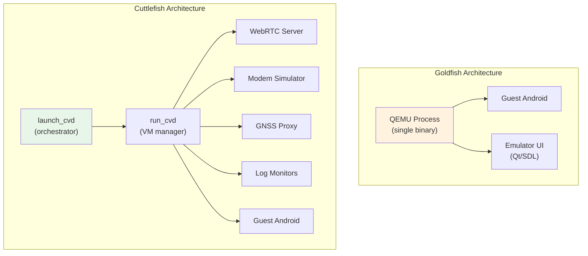

关键的架构差异：Goldfish 是一个单体式的 QEMU 进程，它处理一切（虚拟机、显示、设备模拟）。Cuttlefish 则采用微服务架构。在 Cuttlefish 中，每个功能（虚拟机管理、显示、调制解调器、GNSS、日志）都作为独立进程运行。这使得 Cuttlefish 更加模块化、更易于调试，但设置也更复杂。

### 60.6.9 何时使用哪一种

| 场景 | 推荐 |
|----------|------------|
| Android Studio 开发 | Goldfish/Ranchu（模拟器） |
| 带有界面的本地调试 | Goldfish/Ranchu（模拟器） |
| CI/CD 自动化测试 | Cuttlefish |
| 基于云的开发 | Cuttlefish |
| 性能测试 | Cuttlefish（更确定性） |
| CTS/VTS 测试 | Cuttlefish（主要参考） |
| 多实例测试 | Cuttlefish |
| 基于快照的工作流 | Goldfish/Ranchu（模拟器） |
| 折叠屏设备测试 | 两者皆可（Goldfish 有更丰富的 UI） |
| 汽车 / TV / Wear | Cuttlefish（更多外形规格） |

Cuttlefish 正日益成为 AOSP 中的主要虚拟参考设备。Google 内部使用它进行持续测试。对于不需要 Android Studio 模拟器交互式 GUI 特性的平台开发者来说，它是推荐的目标。

### 60.6.10 Crosvm 设备架构

Cuttlefish 的默认 VMM 是 **crosvm**（Chrome OS Virtual Machine monitor，Chrome OS 虚拟机监控器），这是一个最初为 Chrome OS 开发的、基于 Rust 的 VMM。位于 `device/google/cuttlefish/host/libs/vm_manager/crosvm_manager.cpp` 的虚拟机管理器代码使用所有 virtio 设备参数构建 crosvm 命令行。

#### Virtio 设备映射

暴露给客户机的每个 I/O 设备都是基于 PCI 传输的 virtio 设备：

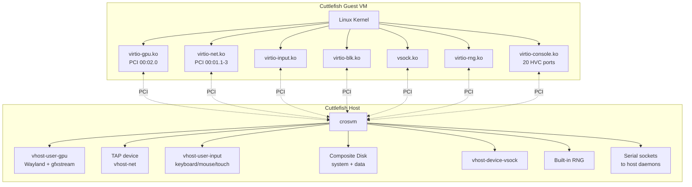

#### PCI 槽位分配

```cpp
// Source: device/google/cuttlefish/host/libs/vm_manager/vm_manager.h:79-91
static constexpr int kMaxDisks = 3;
static const int kDefaultNumBootDevices = 2;
static constexpr const int kNetPciDeviceNum = 1;   // Network on PCI slot 1
static constexpr const int kGpuPciSlotNum = 2;     // GPU on PCI slot 2
```

网络接口被分配了 PCI 槽位 1 上的子地址：

| 接口 | PCI 地址 | TAP 设备 | 用途 |
|---|---|---|---|
| Mobile | 00:01.1 | `cvd-mtap-NN` | 蜂窝数据模拟 |
| Ethernet | 00:01.2 | `cvd-etap-NN` | 有线网络 |
| WiFi | 自动分配 | `cvd-wtap-NN` | 无线（仅当 `mac80211_hwsim` 被禁用时） |

### 60.6.11 Vhost-User 设备模型

Cuttlefish 使用 **vhost-user** 协议将设备后端作为独立的宿主进程运行，而不是放在 crosvm 进程内部。这带来了更好的隔离性和独立的重启能力。它还让设备后端可以用不同的语言编写（输入设备用 Rust，音频服务器用 C++）。

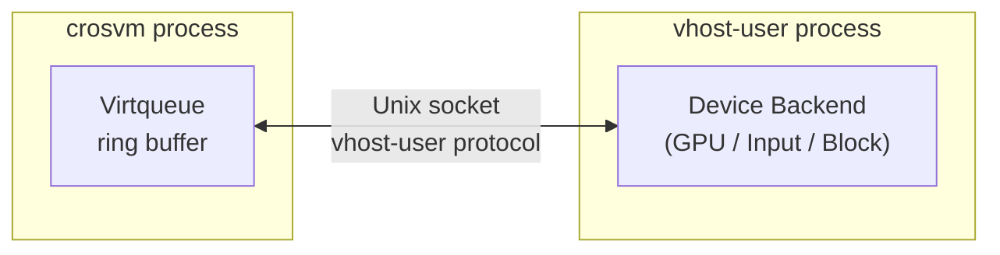

```cpp
// Source: device/google/cuttlefish/host/libs/vm_manager/crosvm_builder.h:71-72
void AddVhostUser(const std::string& type, const std::string& socket_path,
                  int max_queue_size = 256);
```

支持的 vhost-user 设备类型：

| 类型 | 后端进程 | 套接字路径 | 用途 |
|---|---|---|---|
| `gpu` | vhost-user-gpu | `PerInstanceInternalUdsPath("vhost-user-gpu-socket")` | 图形渲染 |
| `input` | vhost_user_input (Rust) | `keyboard_socket_path()` 等 | 输入事件 |
| `vsock` | vhost-device-vsock | `$TMPDIR/vsock_<cid>_<uid>/vhost.socket` | 宿主-客户机通信 |
| `block` | vhost-user-block | disk socket | 存储（仅磁盘 2） |
| `mac80211-hwsim` | WiFi 模拟器 | hwsim socket | WiFi 射频模拟 |

默认的 virtqueue 大小为 256 个条目（必须是 2 的幂）。

### 60.6.12 HVC 端口映射

Cuttlefish 使用**虚拟机监控虚拟控制台**（HVC）端口在客户机 HAL 与宿主端守护进程之间隧道化通信。每个 HVC 端口在客户机中表现为 `/dev/hvcN`。在 Android 17 中，该映射扩展到了 20 个端口（`/dev/hvc0` 到 `/dev/hvc19`）。端口按固定顺序分配在
在 `crosvm_manager.cpp` 中。即使某个功能被禁用的端口也会获得一个 sink 端口，因此 PCI 设备 ID 保持稳定：

```cpp
// Source: device/google/cuttlefish/host/libs/vm_manager/crosvm_manager.cpp:769-945
```

| 端口 | 客户机设备 | 宿主端点 | 用途 |
|---|---|---|---|
| `/dev/hvc0` | 内核控制台 | `kernel_log_pipe` | 内核输出 |
| `/dev/hvc1` | 串行控制台 | `console_pipe` | Android 串行控制台 |
| `/dev/hvc2` | Logcat | `logcat_pipe` | 系统日志转发 |
| `/dev/hvc3` | Keymaster | `secure_env` 守护进程 | C++ KeyMaster HAL |
| `/dev/hvc4` | Gatekeeper | `secure_env` 守护进程 | 锁屏验证 |
| `/dev/hvc5` | 蓝牙 | `root_canal` 模拟器 | 蓝牙 HCI 通道 |
| `/dev/hvc6` | GNSS | `gnss_grpc_proxy` | GPS/GNSS 位置数据 |
| `/dev/hvc7` | 位置 | 位置守护进程 | 注入的位置定位 |
| `/dev/hvc8` | ConfirmationUI | Trusty 集成 | 安全确认对话框 |
| `/dev/hvc9` | UWB | UWB 守护进程 | 超宽带测距 |
| `/dev/hvc10` | OEMLock | OEMLock 守护进程 | OEM 引导加载程序解锁 |
| `/dev/hvc11` | KeyMint | `secure_env` 守护进程 | Rust KeyMint HAL |
| `/dev/hvc12` | NFC | NFC 守护进程 | NFC 模拟 |
| `/dev/hvc13` | （空置） | sink | 预留供将来使用 |
| `/dev/hvc14` | MCU 控制 | MCU 守护进程 | 微控制器控制 |
| `/dev/hvc15` | MCU UART | MCU 守护进程 | 微控制器串口 |
| `/dev/hvc16` | Ti50 TPM | TPM 守护进程 | TPM FIFO 命令 |
| `/dev/hvc17` | JCardSim | Java Card 模拟器 | eSIM/安全元件 |
| `/dev/hvc18` | 传感器控制 | `sensors_simulator` | 传感器启用/配置命令 |
| `/dev/hvc19` | 传感器数据 | `sensors_simulator` | 传感器采样流 |

与早期版本相比有两处显著变化。过去位于 `/dev/hvc13` 的单一传感器端口已被拆分为一个**控制**通道（`/dev/hvc18`）和一个**数据**通道（`/dev/hvc19`）。另外，`/dev/hvc13` 现在被明确留空（源码中的一处注释将其标记为"feel free to use"）。

每个 HVC 端口在宿主端要么由管道支持，要么由 Unix 套接字支持。构建器暴露了四个辅助函数，它们都接受字符串形式的 FIFO/套接字路径：

```cpp
// Source: device/google/cuttlefish/host/libs/vm_manager/crosvm_builder.h:42-45
void AddHvcSink();                                            // null device (unused port)
void AddHvcReadOnly(const std::string& output, bool console = false); // one-way (kernel logs)
void AddHvcReadWrite(const std::string& output, const std::string& input); // bidirectional
void AddHvcSocket(const std::string& socket);                 // Unix socket
```

### 60.6.13 GPU 流水线与显示模式

Cuttlefish 支持多种 GPU 渲染模式，通过 `--gpu_mode` 标志配置。在 Android 17 中 `assemble_cvd` 接受的完整集合为 `{auto, custom, drm_virgl, gfxstream, gfxstream_guest_angle, gfxstream_guest_angle_host_swiftshader, gfxstream_guest_angle_host_lavapipe, guest_swiftshader}`（来自 `device/google/cuttlefish/host/commands/assemble_cvd/flags.cc`）：

| 模式 | 说明 |
|---|---|
| `auto` | 为检测到的宿主 GPU 选择最佳可用模式 |
| `gfxstream` | 通过 gfxstream 协议进行宿主 GPU 直通 |
| `gfxstream_guest_angle` | 客户机内使用 ANGLE，通过 gfxstream 传输到宿主 GPU |
| `gfxstream_guest_angle_host_swiftshader` | ANGLE 客户机，宿主端使用 SwiftShader |
| `gfxstream_guest_angle_host_lavapipe` | ANGLE 客户机，宿主端使用 Mesa lavapipe |
| `drm_virgl` | Virgl3D——通过 virtio-gpu DRM 转发 OpenGL 命令 |
| `guest_swiftshader` | 客户机内纯软件渲染（SwiftShader Vulkan） |
| `custom` | 调用方提供显式的 GPU 设备配置 |

VirtIO GPU 工作进程是进程内运行还是作为独立的 `vhost-user-gpu` 后端运行，是另一个正交的选择，由 `--gpu_vhost_user_mode={auto, on, off}` 控制。

#### 显示架构

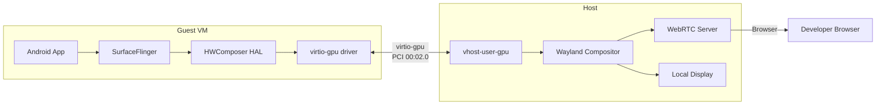

gfxstream 模式通过将 OpenGL ES / Vulkan 命令直接转发给宿主 GPU 驱动，实现了接近原生的 GPU 性能。virtio-gpu 设备充当传输通道，而不是 GPU 模拟器。

Wayland 合成器接收渲染后的帧，并可以将其转发到：

- **WebRTC**——流式传输到浏览器（云用例）
- **本地显示**——在宿主屏幕上直接渲染

```cpp
// Source: device/google/cuttlefish/host/libs/vm_manager/crosvm_manager.cpp:474-495
// Display configuration with width, height, DPI, and refresh rate
// Frames sent via Wayland socket to compositor
```

### 60.6.14 网络架构

#### TAP 设备与桥接配置

Cuttlefish 为每个网络接口在宿主上创建 TAP（网络 tap）设备，将客户机 virtio-net 桥接到宿主网络：

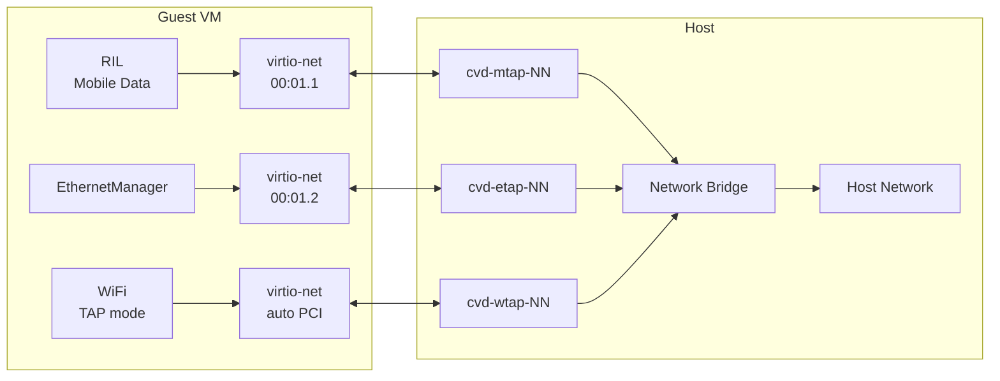

```cpp
// Source: device/google/cuttlefish/host/libs/vm_manager/crosvm_manager.cpp:707-727
// Mobile TAP:   PCI 00:01:01
// Ethernet TAP: PCI 00:01:02
// WiFi TAP:     auto-assigned PCI (optional)
```

#### WiFi 模拟

Cuttlefish 支持两种 WiFi 模拟模式：

1. **TAP 桥接**——简单的网络桥接（没有 WiFi 特定的行为）
2. **mac80211_hwsim**——模拟 802.11 射频的内核模块，使虚拟机内可以进行真正的 WiFi 扫描、关联和 WPA 认证

```cpp
// Source: device/google/cuttlefish/host/libs/vm_manager/crosvm_manager.cpp
// WiFi via mac80211_hwsim when config.virtio_mac80211_hwsim() is true
```

#### vhost-net 加速

启用后，`vhost-net` 将网络包处理从 crosvm 用户态移入宿主内核，从而显著提升网络吞吐量：

```cpp
// Source: device/google/cuttlefish/host/libs/vm_manager/crosvm_manager.cpp:596-598
if (instance.vhost_net()) {
    crosvm_cmd.Cmd().AddParameter("--vhost-net");
}
```

### 60.6.15 客户机 HAL

将 Android 的 HAL 接口桥接到宿主端守护进程（通过 virtio 设备、vsock 或 HVC 串行端口）的客户机端 HAL 位于 `device/google/cuttlefish/guest/hals/` 下。这套集合在 Android 17 中发生了变化。在 17 源码树中存在的目录有：

```
device/google/cuttlefish/guest/hals/
├── audio/           # virtio-snd / audio server
├── bluetooth/       # HVC -> root_canal simulator
├── camera/          # vsock -> host camera streaming
├── confirmationui/  # HVC -> Trusty integration
├── gatekeeper/      # HVC -> secure_env daemon
├── gralloc/         # Graphics buffer allocation
├── health/          # Battery/charge monitoring
├── hostapd/         # WiFi access-point daemon
├── identity/        # Identity credential HAL
├── ir/              # Consumer IR
├── keymint/         # HVC -> secure_env (KeyMint)
├── light/           # vsock -> light control (Rust)
├── nfc/             # HVC -> NFC daemon
├── npu/             # NPU scheduling HAL (Rust, new in 17)
├── oemlock/         # HVC -> OEM unlock
├── secure_element/  # eSIM / secure chip access
├── vehicle/         # vsock -> automotive VHAL
├── virtio_media/    # virtio-media V4L2 camera/codec provider
└── vulkan/          # Graphics support
```

此次发布中有一项已经消失。当 Cuttlefish 切换到 goldfish 的共享射频 HAL 时，专用的 `ril/` HAL 目录被移除。该 HAL 通过 `ro.boot.modem_simulator_ports` 中通告的 TCP/vsock 端口访问宿主的 `modem_simulator`。

这里也没有 `sensors/` 目录，但那是更早的消息了。Cuttlefish 客户机传感器 HAL 早在 2019 年就被删除了。传感器桥接由宿主 `sensors_simulator` 通过上文描述的 `/dev/hvc18` 和 `/dev/hvc19` 端口驱动。Android 17 值得注意的新增内容是 **`npu/`** 调度 HAL 和 **`virtio_media/`** 提供者。

每个客户机 HAL 通常读写一个 virtio-console 设备（`/dev/hvcN`），或建立一条到其宿主端对应组件的 vsock 连接。暴露给 Android 框架的 HAL 接口与真实硬件 HAL 提供的接口完全相同——虚拟化对更高层是透明的。

#### 示例：NPU 调度 HAL（Android 17，Rust）

NPU HAL 是真正新增的客户机 HAL 之一。它使用 Rust 编写，实现了 `android.hardware.npu` 调度接口。它注册一个 `IScheduling/default` 服务，使 Cuttlefish 对外暴露一个具备 NPU 能力的界面，以测试 NPU 框架路径：

```rust
// Source: device/google/cuttlefish/guest/hals/npu/main.rs
//! This implements the NPU Scheduling Service for Cuttlefish.
use android_hardware_npu::aidl::android::hardware::npu::IScheduling::{
    BnScheduling, IScheduling};
const LOG_TAG: &str = "android.hardware.npu";
```

```xml
<!-- Source: device/google/cuttlefish/guest/hals/npu/android.hardware.npu-service.xml -->
<fqname>IScheduling/default</fqname>
```

#### 示例：基于 Vsock 的相机 HAL

相机 HAL 通过 vsock 从宿主流式传输帧，从而让宿主的网络摄像头显示为客户机的相机：

```cpp
// Source: device/google/cuttlefish/guest/hals/camera/vsock_camera_server.cpp
// Receives MJPEG/H264 frames from host over vsock
// Exposes standard Camera2 HAL interface to CameraService
```

#### 示例：Light HAL（Rust）

Light HAL 使用 Rust 实现。其入口点注册一个 `ILights` binder 服务，而 `lights` 模块实现控制通知 LED、背光以及类似指示器的接口：

```rust
// Source: device/google/cuttlefish/guest/hals/light/main.rs
//! This implements the Lights Service for Cuttlefish.
use android_hardware_light::aidl::android::hardware::light::ILights::{
    BnLights, ILights};
mod lights;
use lights::LightsService;
```

### 60.6.16 宿主微服务编排

Cuttlefish 作为由 `launch_cvd` 和 `run_cvd` 编排的一组宿主进程运行。`device/google/cuttlefish/host/commands/` 包含大约 45 个宿主工具目录。给定的实例会启动其配置所需的子集（VMM 以及显示、调制解调器、GNSS、传感器、安全、日志和输入守护进程）：

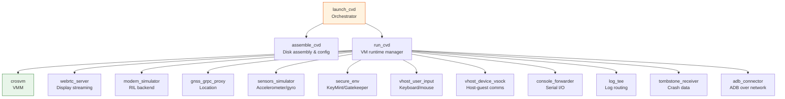

`assemble_cvd` 步骤从单个分区镜像（system、vendor、userdata、boot）构建复合磁盘镜像，并生成 crosvm 配置。然后 `run_cvd` 启动 crosvm 和所有辅助守护进程，监控它们的健康状况，并在它们崩溃时重启它们。

### 60.6.17 Vsock：宿主与客户机之间的粘合剂

Vsock（Virtual Sockets）是 Cuttlefish 宿主与客户机之间的主要通用通信通道。与 HVC 端口（它们是点对点的串行通道）不同，vsock 支持带有多路复用端口的任意类 TCP 连接：

```cpp
// Source: device/google/cuttlefish/host/libs/vm_manager/crosvm_manager.cpp:756-766
if (instance.vsock_guest_cid() >= 2) {
    if (instance.vhost_user_vsock()) {
        // vhost-user vsock (separate process)
        crosvm_cmd.AddVhostUser("vsock", socket_path);
    } else {
        // Built-in crosvm vsock
        crosvm_cmd.Cmd().AddParameter("--vsock=cid=",
                                       instance.vsock_guest_cid());
    }
}
```

使用 vsock 的客户机组件包括：

- **相机 HAL**——从宿主网络摄像头流式传输帧
- **Light HAL**——接收灯光状态变化
- **Vehicle HAL**——汽车传感器数据
- **V4L2 流传输器**——视频帧传输
- **Socket 代理**——通用的 socket 到 vsock 隧道
  （`common/frontend/socket_vsock_proxy/`）

### 60.6.18 多实例支持

Cuttlefish 可以在单个宿主上同时运行多个虚拟设备，每个设备都有自己的 TAP 设备、vsock CID、HVC 端口和显示器集合：

```bash
# Launch 3 concurrent Cuttlefish instances
launch_cvd --num_instances=3

# Each gets:
#   Instance 1: CID=3, TAP cvd-mtap-01, port 6520
#   Instance 2: CID=4, TAP cvd-mtap-02, port 6521
#   Instance 3: CID=5, TAP cvd-mtap-03, port 6522
```

特定于实例的路径由 `CuttlefishConfig::InstanceSpecific` 管理，它为每个实例生成唯一的套接字路径、FIFO 路径和日志目录。这使得在 CI/CD 环境中进行大规模并行测试成为可能。

---

## 60.7 模拟器功能

### 60.7.1 快照

快照是 Android Emulator 最强大的功能之一。它们捕获虚拟机的完整状态：CPU 寄存器、内存内容、设备状态和磁盘状态。它们将该状态保存到一个文件中，稍后可以恢复。

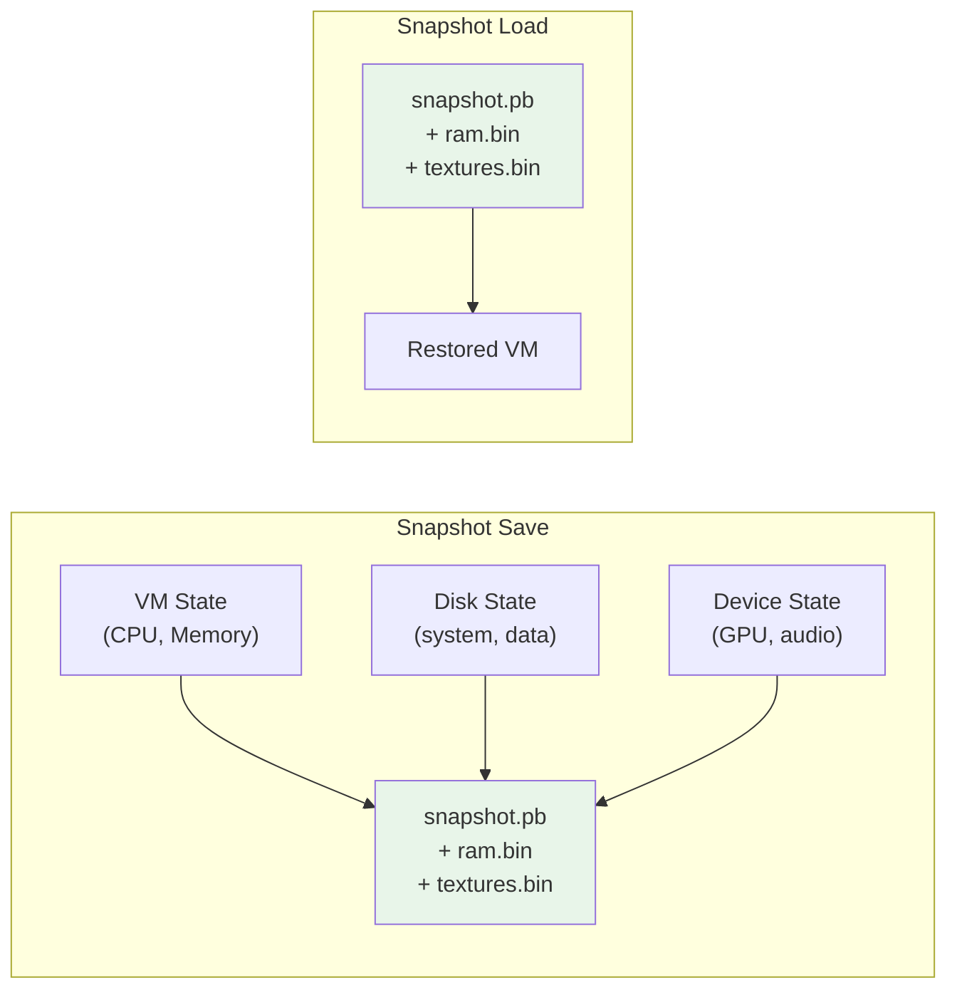

**快照类型：**

1. **QuickBoot 快照**——在模拟器关闭时自动保存，并在下次打开时恢复。这提供了近乎即时的启动时间（通常为 2-5 秒，而冷启动需要 60 多秒）。

2. **命名快照**——由用户通过 Extended Controls UI 或命令行手动创建。这些用于保存特定的设备状态（例如，"已登录"、"应用已安装"、"特定屏幕"）。

快照存储在模拟器的 AVD（Android Virtual Device）目录中，通常位于 `~/.android/avd/<name>.avd/snapshots/`。

**快照内容：**

- `snapshot.pb`——Protobuf 元数据（机器配置、时间戳）
- `ram.bin`——完整的客户机 RAM 内容
- `textures.bin`——GPU 纹理和缓冲区数据
- `<disk>-snapshot.img`——写时复制的磁盘覆盖层

### 60.7.2 屏幕录制

模拟器支持多种格式的屏幕录制：

- **WebM**（VP8/VP9 视频，Vorbis/Opus 音频）
- **GIF**（动画，用于快速分享）

录制通过 Extended Controls UI 或 gRPC 控制接口启动。在 Cuttlefish 端，`screen_recording_server` 宿主命令提供了类似的功能。

### 60.7.3 位置模拟

模拟器提供丰富的位置模拟能力：

- **单点**——设置特定的纬度/经度
- **路线回放**——沿路线回放 GPX 或 KML 文件
- **速度控制**——调节回放速度
- **海拔**——设置自定义海拔值

这些控件通过 QEMU GPS 服务馈入 GNSS HAL。

### 60.7.4 电池模拟

模拟器模拟一个具有可配置项的虚拟电池：

- 电量（0-100%）
- 充电状态（充电中、放电中、已满、未充电）
- AC/USB 电源连接状态
- 电池健康状态
- 电池温度

### 60.7.5 多显示支持

模拟器支持多个虚拟显示器，使开发者能够测试多屏场景。`MultiDisplayProvider` 软件包（`device/generic/goldfish/MultiDisplayProvider/`）在客户机端管理显示配置：

```makefile
# Source: device/generic/goldfish/product/multidisplay.mk
PRODUCT_PACKAGES += MultiDisplayProvider

PRODUCT_ARTIFACT_PATH_REQUIREMENT_ALLOWED_LIST += \
    system/lib/libemulator_multidisplay_jni.so \
    system/lib64/libemulator_multidisplay_jni.so \
    system/priv-app/MultiDisplayProvider/MultiDisplayProvider.apk \
```

输入设备配置最多支持 11 个多点触控输入设备（用于 11 个虚拟显示器）：

```makefile
# Source: device/generic/goldfish/product/generic.mk
PRODUCT_COPY_FILES += \
    device/generic/goldfish/input/virtio_input_multi_touch_1.idc:... \
    device/generic/goldfish/input/virtio_input_multi_touch_2.idc:... \
    ...
    device/generic/goldfish/input/virtio_input_multi_touch_11.idc:...
```

### 60.7.6 折叠屏设备模拟

模拟器可以模拟折叠屏设备，使用传感器 HAL 中定义的铰链角度传感器。goldfish 源码树包含针对折叠屏外形规格的特定配置：

**Pixel Fold 配置：**
`device/generic/goldfish/pixel_fold/` 包含：

- `device_state_configuration.xml`——定义物理状态（折叠、展开）
- `display_layout_configuration.xml`——每种状态的显示布局
- `display_settings.xml`——显示参数
- `sensor_hinge_angle.xml`——铰链角度传感器映射

传感器 HAL 支持三个铰链角度传感器（hinge-angle0、hinge-angle1、hinge-angle2），从而可以模拟带有多个铰链的设备：

```cpp
// Source: device/generic/goldfish/hals/sensors/sensor_list.cpp
{
    .sensorHandle = kSensorHandleHingeAngle0,
    .name = "Goldfish hinge sensor0 (in degrees)",
    .type = SensorType::HINGE_ANGLE,
    .maxRange = 360,
    .resolution = 1.0,
    .flags = SensorFlagBits::DATA_INJECTION |
             SensorFlagBits::ON_CHANGE_MODE |
             SensorFlagBits::WAKE_UP
},
```

折叠屏模拟使用现有的设备状态框架。当用户在模拟器 UI 中调整铰链角度时，变化会经过以下路径：

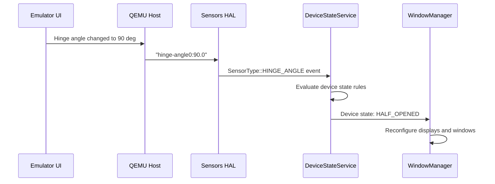

### 60.7.7 Wear OS 与旋转输入

模拟器支持带有旋转输入模拟的 Wear OS 外形规格。用于旋转输入的输入设备配置文件：

```
# Referenced from product/generic.mk
device/generic/goldfish/input/virtio_input_rotary.idc
```

这使开发者能够测试响应旋转表圈或表冠的 Wear OS 应用。

### 60.7.8 虚拟设备属性配置

模拟器使用分层属性系统来配置虚拟硬件参数。属性可以在多个层级设置：

**启动属性（内核命令行 / androidboot）：**
这些由模拟器二进制文件设置并传递给内核。它们在 early-init 期间作为 `ro.boot.*` 属性可用。

**QEMU 属性（qemu-props 服务）：**
这些在启动后通过 goldfish-pipe 从模拟器宿主获取。它们配置显示密度、硬件特性以及模拟器特定的行为。

**产品属性：**
这些在构建时被固化到系统镜像中。来自 `device/generic/goldfish/product/generic.mk`：

```makefile
# Source: device/generic/goldfish/product/generic.mk
PRODUCT_VENDOR_PROPERTIES += \
    ro.control_privapp_permissions=enforce \
    ro.crypto.dm_default_key.options_format.version=2 \
    ro.crypto.volume.filenames_mode=aes-256-cts \
    ro.hardware.power=ranchu \
    ro.incremental.enable=yes \
    ro.logd.size=1M \
    ro.kernel.qemu=1 \
    ro.soc.manufacturer=AOSP \
    ro.soc.model=ranchu \
    ro.surface_flinger.has_HDR_display=false \
    ro.surface_flinger.has_wide_color_display=false \
    ro.surface_flinger.protected_contents=false \
    ro.surface_flinger.supports_background_blur=1 \
    ro.surface_flinger.use_color_management=false \
    ro.zygote.disable_gl_preload=1 \
    debug.sf.vsync_reactor_ignore_present_fences=true \
    debug.stagefright.c2inputsurface=-1 \
    debug.stagefright.ccodec=4 \
    graphics.gpu.profiler.support=false \
    persist.sys.zram_enabled=1 \
    wifi.direct.interface=p2p-dev-wlan0 \
    wifi.interface=wlan0 \
```

值得注意的属性说明：

| 属性 | 值 | 用途 |
|----------|-------|---------|
| `ro.kernel.qemu` | `1` | 框架标志：运行在模拟器中 |
| `ro.soc.model` | `ranchu` | 标识虚拟 SoC |
| `ro.hardware.power` | `ranchu` | Power HAL 选择 |
| `ro.surface_flinger.has_HDR_display` | `false` | 虚拟显示器不支持 HDR |
| `ro.surface_flinger.protected_contents` | `false` | 不支持 DRM 保护的内容 |
| `ro.zygote.disable_gl_preload` | `1` | 跳过 GL 预加载（在 zygote 启动时 GPU 可能尚未就绪） |
| `debug.sf.vsync_reactor_ignore_present_fences` | `true` | 简化虚拟显示器的 VSync 处理 |
| `debug.stagefright.ccodec` | `4` | 使用 Codec2 进行媒体解码 |
| `persist.sys.zram_enabled` | `1` | 启用 zram 交换 |

### 60.7.9 模拟器配置文件

模拟器使用存储在 AVD 目录和设备源码树中的 INI 格式配置文件。来自 `device/generic/goldfish/data/etc/`：

| 文件 | 用途 |
|------|---------|
| `advancedFeatures.ini` | 启用/禁用模拟器功能 |
| `config.ini` | 默认硬件配置 |
| `config.ini.nexus5` | Nexus 5 模拟配置 |
| `config.ini.foldable` | 折叠屏设备配置 |
| `config.ini.freeform` | 自由窗口模式配置 |
| `config.ini.desktop` | 桌面模式配置 |
| `config.ini.nexus7tab` | 平板配置 |
| `config.ini.pixeltablet` | Pixel Tablet 配置 |
| `config.ini.tv` | Android TV 配置 |

手机产品配置将这些文件复制到输出中：

```makefile
# Source: device/generic/goldfish/product/phone.mk
PRODUCT_COPY_FILES += \
    device/generic/goldfish/data/etc/advancedFeatures.ini:advancedFeatures.ini \
    device/generic/goldfish/data/etc/config.ini.nexus5:config.ini
```

### 60.7.10 显示配置文件

模拟器支持针对不同设备外形规格的多种显示布局配置：

```makefile
# Source: device/generic/goldfish/product/generic.mk
PRODUCT_COPY_FILES += \
    device/generic/goldfish/display_settings_app_compat.xml:\
        $(TARGET_COPY_OUT_VENDOR)/etc/display_settings_app_compat.xml \
    device/generic/goldfish/display_settings_freeform.xml:\
        $(TARGET_COPY_OUT_VENDOR)/etc/display_settings_freeform.xml \
```

这些 XML 文件配置诸如以下的显示属性：

- 显示分辨率和密度
- 窗口管理模式（标准、自由形式）
- 应用兼容性覆盖（针对未正确处理多窗口/折叠屏的应用）

### 60.7.11 UWB（超宽带）模拟


模拟器通过 VirtIO 控制台包含 UWB HAL 支持：

```
# Source: device/generic/goldfish/init/init.ranchu.rc
on property:vendor.qemu.vport.uwb=*
    symlink ${vendor.qemu.vport.uwb} /dev/hvc2
    start vendor.uwb_hal

service vendor.uwb_hal \
    /vendor/bin/hw/android.hardware.uwb-service /dev/hvc2
    class hal
    user uwb
    disabled
```

### 60.7.12 Thread 网络

Thread 网络支持通过模拟的 RCP（Radio Co-Processor，射频协同处理器）提供：

```makefile
# Source: device/generic/goldfish/product/generic.mk
ifneq ($(EMULATOR_VENDOR_NO_THREADNETWORK), true)
PRODUCT_PACKAGES += \
    com.android.hardware.threadnetwork-simulation-rcp
endif
```

---

## 60.8 Android 17 Cuttlefish 变更

Cuttlefish 是每个版本中大多数虚拟设备变动落地的地方，Android 17 也不例外。本节汇集了对平台开发者重要的变更。它们是一个新的桌面产品、一个客户机端的 VKMS 显示控制器、一个沙箱化的宿主进程模型，以及一个新的 NPU HAL。它们还包括将宿主启动器工具从 AOSP 源码树中迁出。

### 60.8.1 桌面产品目标

Android 17 将 `aosp_cf_x86_64_desktop` 添加到了 Cuttlefish 产品目录中。板级配置还为非 AOSP 的 `cf_arm64_desktop` 产品名称携带了一个内核分支，但 AOSP 中并不存在 ARM64 桌面产品。与手持设备目标不同，桌面产品继承了桌面特定的 vendor 栈（在 60.5.4 和 60.6.3 节中讨论）。它是桌面 Android 外形规格的虚拟参考。它演练大屏窗口管理、`ndk_translation_only` 模式下的二进制翻译，以及未压缩的 Chrome WebView。该产品在 `device/google/cuttlefish/AndroidProducts.mk` 中与长期存在的手机、折叠屏、TV、Wear 以及扩展后的汽车（`auto`、`auto_md`、`auto_mdnd`、`auto_dd`、`auto_portrait`）目标一起注册。

### 60.8.2 vkms_controller：客户机端虚拟显示管理

早期版本的 Cuttlefish 将虚拟显示配置逻辑分散在宿主命令和临时的客户机脚本之间。Android 17 将其整合为一个单一的客户机二进制文件 `vkms_controller`，它直接驱动内核的 VKMS（Virtual Kernel Mode Setting）ConfigFS 接口。宿主 CLI 则变成一个轻量级、无状态的代理，只负责运行 `adb shell vkms_controller ...`。

```cpp
// Source: device/google/cuttlefish/guest/commands/vkms_controller/main.cpp
namespace cuttlefish {
namespace vkms_controller {

constexpr std::string_view kUsage = R"(
Usage: vkms_controller <command> [options]

A guest-side utility for Virtual Kernel Mode Setting (VKMS).
It manages virtual displays by interacting directly with the kernel's VKMS
ConfigFS interface.

Commands:
  setup
  hotplug
  reset
  list-presets
  list-displays
)";
```

该二进制文件负责将虚拟硬件（VKMS ConfigFS 连接器索引）与 Android 的 SurfaceFlinger 显示 ID 关联起来的工作。它将自己的状态保存在 `/data/vendor/vkms` 下。它支持四个命令：

- `setup` 使用特定的 EDID 和 plane 定义显示器。
- `hotplug` 插入或拔出一个连接器。
- `list-presets` 枚举固化在客户机中的显示器预设。
- `list-displays` 解析当前的显示拓扑。

它通过 `device/google/cuttlefish/shared/device.mk` 安装：

```makefile
# Source: device/google/cuttlefish/shared/device.mk
PRODUCT_PACKAGES += \
    checkpoint_gc \
    vkms_controller \
```

当测试或宿主 CLI 重新配置显示器时的数据流：

#### 通过 vkms_controller 进行显示重新配置

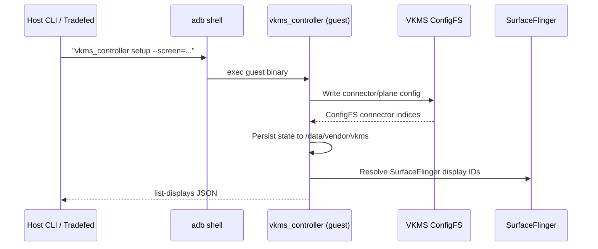

### 60.8.3 process_sandboxer：对宿主守护进程进行沙箱化

Cuttlefish 的一个反复出现的关注点是，宿主运行着一大批拥有广泛宿主权限的辅助守护进程。这些守护进程包括 VMM、调制解调器模拟器、GNSS 代理、secure_env 等等。答案就是 `device/google/cuttlefish/host/commands/process_sandboxer/`。它于 2024 年初引入，此后针对每个可执行文件的策略覆盖范围不断扩大。它使用基于 Google 的 sandboxed-api / sandbox2 库构建的、基于 seccomp 的沙箱来包装这些宿主进程。

```cpp
// Source: device/google/cuttlefish/host/commands/process_sandboxer/main.cpp
#include <sandboxed_api/util/fileops.h>
#include "host/commands/process_sandboxer/policies.h"
#include "host/commands/process_sandboxer/sandbox_manager.h"

namespace cuttlefish::process_sandboxer {
absl::Status ProcessSandboxerMain(int argc, char** argv) {
```

沙箱器带有针对每个可执行文件的策略。`policies/` 目录为每个在沙箱下运行的宿主工具存放一个专用源文件。这些文件是 `run_cvd.cpp`、`assemble_cvd.cpp`、`gnss_grpc_proxy.cpp`、`secure_env.cpp`、`logcat_receiver.cpp`、`modem_simulator.cpp`、`socket_vsock_proxy.cpp` 等等。它还存放一个共享策略 `baseline.cpp` 和一个逃逸口 `no_policy.cpp`。

每个策略声明某个守护进程可以使用的系统调用和文件路径。因此，被攻陷的辅助进程无法超出其声明的作用范围。配套的 `sandboxer_proxy` 让沙箱化进程可以向管理器请求特权操作。

这是平台其他部分进程内隔离工作的宿主端对应物。并非每个 Cuttlefish 辅助进程都被信任拥有启动器的完整权限。每个辅助进程都在最小权限策略之后运行。

### 60.8.4 NPU 调度 HAL

Android 17 的 Cuttlefish 在 `device/google/cuttlefish/guest/hals/npu/` 下新增了一个客户机 NPU（Neural Processing Unit，神经处理单元）HAL，使用 Rust 编写。它注册一个 `android.hardware.npu` 调度服务。这为框架的 NPU 路径提供了一个可供演练的虚拟界面（源码摘录见 60.6.15 节）。该 HAL 作为自己的 APEX 打包服务发布，并带有一个声明 `IScheduling/default` 的 VINTF 片段。它与 `virtio_media/` 一起成为本次发布中两个值得注意的新客户机 HAL 目录。

### 60.8.5 宿主启动器工具迁移

开发者获取和运行 Cuttlefish 宿主工具的方式在 Android 17 中发生了变化。负责编排的 `cvd` 前端和 Debian 打包不再是 AOSP 中 `device/google/cuttlefish` 源码树的一部分；它们移到了独立的 `github.com/google/android-cuttlefish` 仓库。README 现在以将开发者指向那里作为开篇：

```
# Source: device/google/cuttlefish/README.md
For all host tools development please refer to
https://github.com/google/android-cuttlefish/blob/main/docs/HostToolsMigration.md
```

实际上，这意味着本地启动遵循两条路径。由该源码树构建的宿主包仍然提供 `launch_cvd` 和 `stop_cvd`。`launch_cvd` 符号链接解析为 `cvd_internal_start`，后者由 `device/google/cuttlefish/host/commands/start/` 构建。README 的入门流程使用这些工具：

```bash
# Source: device/google/cuttlefish/README.md (paraphrased flow)
mkdir cf && cd cf
tar xvf /path/to/cvd-host_package.tar.gz
unzip /path/to/aosp_cf_x86_64_phone-img-xxxxxx.zip
HOME=$PWD ./bin/launch_cvd
# ...
HOME=$PWD ./bin/stop_cvd
```

更丰富的 `cvd` 生命周期管理器和可安装的 Debian 软件包（`cuttlefish-base`、`cuttlefish-user`）来自外部仓库。17 之前版本指南中引用的旧版 `acloud` 启动器不再位于 `device/google/cuttlefish` 源码树中。它单独保存在 `tools/acloud/` 下，但它不是推荐的本地启动路径。

---

## 60.9 动手实践：构建并启动自定义模拟器镜像

本节逐步介绍从源码构建自定义模拟器镜像并启动它。

### 60.9.1 构建模拟器系统镜像

```bash
# Step 1: Set up the build environment
cd /path/to/aosp
source build/envsetup.sh

# Step 2: Choose a target
# For x86_64 emulator (fastest on x86 host):
lunch sdk_phone64_x86_64-userdebug

# For ARM64 emulator:
# lunch sdk_phone64_arm64-userdebug

# Step 3: Build the system image
m -j$(nproc)
```

构建在 `$ANDROID_PRODUCT_OUT/` 中生成镜像：

| 镜像 | 说明 |
|-------|-------------|
| `system.img` | System 分区 |
| `vendor.img` | Vendor 分区 |
| `super.img` | Super 分区（包含动态分区） |
| `userdata.img` | 用户数据分区 |
| `kernel-ranchu` | 内核二进制文件 |
| `ramdisk.img` | 初始 ramdisk |
| `vendor_boot.img` | Vendor 启动镜像 |

### 60.9.2 使用模拟器启动

```bash
# Launch the emulator with the built images
emulator

# Or with specific options:
emulator \
    -no-snapshot \          # cold boot (skip QuickBoot)
    -gpu host \             # use host GPU acceleration
    -memory 4096 \          # 4GB RAM
    -cores 4 \              # 4 CPU cores
    -no-audio \             # disable audio (faster boot)
    -verbose                # verbose logging
```

### 60.9.3 构建并启动 Cuttlefish

```bash
# Step 1: Choose Cuttlefish target
lunch aosp_cf_x86_64_phone-userdebug

# Step 2: Build
m -j$(nproc)

# Step 3: Launch (requires cuttlefish-base/user packages installed)
launch_cvd

# Step 4: Access
adb shell

# Step 5: For WebRTC access
# Open https://localhost:8443 in a browser
```

### 60.9.4 自定义模拟器镜像

#### 添加自定义 HAL

要将自定义 HAL 实现添加到模拟器，请修改产品 makefile：

```makefile
# In your custom product .mk file
$(call inherit-product, device/generic/goldfish/product/phone.mk)

# Add your custom packages
PRODUCT_PACKAGES += \
    my.custom.hal-service

# Override properties
PRODUCT_VENDOR_PROPERTIES += \
    ro.my.custom.property=value
```

#### 修改 Init 行为

创建自定义 init RC 文件并将其添加到产品中：

```makefile
PRODUCT_COPY_FILES += \
    my/custom/init.custom.rc:$(TARGET_COPY_OUT_VENDOR)/etc/init/init.custom.rc
```

#### 修改 SELinux 策略

添加自定义 SELinux 策略：

```makefile
BOARD_VENDOR_SEPOLICY_DIRS += my/custom/sepolicy
```

### 60.9.5 调试模拟器

#### 内核日志

```bash
# View kernel logs from the emulator
adb shell dmesg

# Or through the emulator's logcat forwarding
adb logcat -b kernel
```

#### HAL 调试

```bash
# Enable verbose logging for sensors HAL
adb shell setprop log.tag.SensorsHAL VERBOSE

# View HAL service logs
adb logcat -s SensorsHAL:V

# Check if HAL services are running
adb shell dumpsys hwservicemanager
```

#### GPU 调试

```bash
# Check which rendering mode is active
adb shell getprop ro.hardware.egl
# Expected: "emulation" for host GPU, "swiftshader" for software

# Check OpenGL ES version
adb shell getprop ro.opengles.version
# 196610 = OpenGL ES 3.2

# Enable ANGLE debug
adb shell setprop debug.angle.feature_overrides_enabled ...
```

#### 网络调试

```bash
# Check network configuration inside the guest
adb shell ip addr show
adb shell ip route show

# Test connectivity
adb shell ping -c 3 google.com

# Check WiFi state
adb shell dumpsys wifi

# Port forwarding from host
adb forward tcp:8080 tcp:8080
```

### 60.9.6 性能调优

#### CPU 与内存

```bash
# Launch with more resources
emulator -memory 8192 -cores 8

# Or set in the AVD configuration (config.ini):
hw.ramSize=8192
hw.cpu.ncore=8
```

#### GPU 加速

```bash
# Host GPU (fastest, requires compatible host GPU)
emulator -gpu host

# ANGLE on Vulkan (good compatibility)
emulator -gpu angle_indirect

# SwiftShader (software, most compatible, slowest)
emulator -gpu swiftshader_indirect

# Guest rendering (DRM-based, no host GPU needed)
emulator -gpu guest
```

#### 磁盘性能

```bash
# Use SSD-backed storage for the AVD directory
# The emulator heavily uses random I/O for disk images

# Increase ZRAM to reduce I/O
# (configured automatically via init.ranchu.rc)
```

### 60.9.7 进阶：运行多个实例

#### 模拟器

```bash
# First instance (default ports)
emulator -avd Phone1 &

# Second instance (automatic port assignment)
emulator -avd Phone2 &

# Verify both are running
adb devices
# List of devices attached
# emulator-5554   device
# emulator-5556   device
```

#### Cuttlefish

```bash
# Launch 3 instances at once
launch_cvd --num_instances=3

# Each instance gets its own:
# - ADB port
# - WebRTC port
# - Console port
```

### 60.9.8 进阶：自定义内核

```bash
# Step 1: Check out the kernel source
repo init -u https://android.googlesource.com/kernel/manifest \
    -b common-android-mainline
repo sync

# Step 2: Build the kernel
BUILD_CONFIG=common/build.config.gki.x86_64 build/build.sh

# Step 3: Launch emulator with custom kernel
emulator -kernel /path/to/bzImage \
    -system $ANDROID_PRODUCT_OUT/system.img \
    -vendor $ANDROID_PRODUCT_OUT/vendor.img
```

### 60.9.9 理解构建产品配置链

构建模拟器镜像时，产品配置遵循一条特定的继承链。让我们追踪 x86_64 手机目标：

```
sdk_phone64_x86_64.mk
  -> phone.mk
       -> handheld.mk
            -> base_handheld.mk
                 -> multidisplay.mk
            -> generic_system.mk
            -> handheld_system_ext.mk
            -> aosp_product.mk
       -> base_phone.mk
            -> generic.mk
                 -> versions.mk
            -> phone_overlays.mk
```

每个层级都添加了特定的功能：

1. **`versions.mk`**——设置版本码和 API 级别
2. **`generic.mk`**——核心模拟器设备：HAL、软件包、属性
3. **`base_handheld.mk`**——手持设备特定设置（dalvik 堆等）
4. **`handheld.mk`**——带有 system、system_ext、product 的完整手持设备产品
5. **`base_phone.mk`**——手机特定的覆盖层
6. **`phone.mk`**——将一切串联起来，添加 config.ini

这种分层设计意味着一个新的模拟器产品（例如一个新的外形规格）只需要一个薄薄的顶层 makefile。该 makefile 从相应的基类继承。

### 60.9.10 测试 HAL 实现

模拟器对平台开发者最有用的一点是能够测试 HAL 实现。以下是测试修改后的传感器 HAL 的工作流程：

```bash
# Step 1: Make changes to the sensors HAL
# Edit device/generic/goldfish/hals/sensors/multihal_sensors.cpp

# Step 2: Rebuild just the sensors module
m android.hardware.sensors@2.1-impl.ranchu

# Step 3: Push the updated library
adb root
adb remount
adb push $ANDROID_PRODUCT_OUT/vendor/lib64/hw/\
    android.hardware.sensors@2.1-impl.ranchu.so \
    /vendor/lib64/hw/

# Step 4: Restart the sensors HAL
adb shell stop
adb shell start

# Step 5: Verify
adb shell dumpsys sensorservice
```

对于相机 HAL：

```bash
# Rebuild camera provider
m android.hardware.camera.provider.ranchu

# Push and restart
adb root && adb remount
adb push $ANDROID_PRODUCT_OUT/vendor/bin/hw/\
    android.hardware.camera.provider.ranchu \
    /vendor/bin/hw/
adb shell stop
adb shell start

# Verify cameras are available
adb shell dumpsys media.camera
```

### 60.9.11 追踪模拟器通信

为了调试客户机 HAL 与 QEMU 宿主之间的通信，有几种技术可用：

**1. Logcat 过滤：**

```bash
# Sensor HAL messages
adb logcat -s goldfish:V MultihalSensors:V

# Camera HAL messages
adb logcat -s CameraProvider:V QemuCamera:V

# GNSS HAL messages
adb logcat -s GnssHwConn:V GnssHwListener:V

# Radio HAL messages
adb logcat -s RadioModem:V AtChannel:V
```

**2. 对 HAL 服务使用 Strace：**

```bash
# Find the HAL process
adb shell ps -A | grep sensors

# Attach strace
adb shell strace -p <pid> -e trace=read,write,ioctl -s 256
```

**3. QEMU 监视器命令：**

从模拟器控制台（telnet 到控制台端口），你可以检查虚拟设备的状态：

```
# Show device tree
info qtree

# Show memory regions
info mtree

# Show I/O ports
info ioports
```

### 60.9.12 构建 Slim 模拟器镜像

对于启动时间和镜像大小至关重要的 CI/CD 场景，"slim"模拟器变体剥离了不必要的组件：

```bash
# Build a slim image
lunch sdk_slim_x86_64-userdebug
m -j$(nproc)
```

slim 变体（`device/generic/goldfish/product/slim_handheld.mk`）继承 `base_handheld.mk` 加上 `generic.mk`，但跳过 `handheld.mk` 的 `handheld_system_ext.mk` 和 `aosp_product.mk` 层，从而得到一个更小、启动更快的系统镜像。

### 60.9.13 在模拟器上运行 CTS

模拟器是受支持的 CTS（Compatibility Test Suite，兼容性测试套件）目标：

```bash
# Step 1: Launch emulator with CTS-compatible settings
emulator -gpu host -memory 4096 -cores 4

# Step 2: Wait for boot to complete
adb wait-for-device
adb shell getprop sys.boot_completed  # should return "1"

# Step 3: Run CTS
cd /path/to/cts
./android-cts/tools/cts-tradefed
> run cts --plan CTS

# Or run specific modules
> run cts -m CtsMediaTestCases
> run cts -m CtsSensorTestCases
```

一些 CTS 测试需要特定的传感器值或硬件能力，模拟器通过其虚拟 HAL 提供这些能力。传感器 HAL 中的数据注入支持（所有传感器上的 `SensorFlagBits::DATA_INJECTION` 标志）就是专门为 CTS 合规性设计的。

### 60.9.14 模拟器控制台命令

模拟器暴露了一个基于 telnet 的控制台用于直接控制：

```bash
# Connect to the console
telnet localhost 5554

# Useful commands:
# Power simulation
power capacity 50          # set battery to 50%
power status charging      # set charging state

# Network simulation
network speed gsm          # simulate GSM speeds
network delay gprs         # simulate GPRS latency

# SMS simulation
sms send 5551234567 Hello from the console!

# GPS simulation
geo fix -122.084 37.422   # set GPS to Google HQ

# Sensor simulation
sensor set acceleration 0:9.8:0  # set accelerometer

# Fingerprint simulation
finger touch 1             # simulate fingerprint touch

# Snapshot management
avd snapshot save mysnap
avd snapshot load mysnap
avd snapshot list
```

---

## 总结

Android Emulator 是一个复杂的虚拟化平台，它在虚拟硬件上运行真实的 Android 系统镜像。本章介绍了它的分层架构：

1. **QEMU 核心**——通过 KVM（硬件）或 TCG（软件翻译）提供 CPU 虚拟化、内存管理以及设备模拟。

2. **Goldfish/Ranchu 虚拟平台**——一组虚拟设备，包括 VirtIO（gpu、net、blk、input、console、rng）以及用于高带宽宿主-客户机通信的 goldfish-pipe。

3. **HAL 实现**——九个 HAL 模块（音频、相机、传感器、GNSS、射频、指纹、HWC3、gralloc，以及辅助库）。它们将 Android 的硬件接口桥接到模拟器的虚拟设备。

4. **GPU 模拟**——一种命令流架构，客户机 GLES/Vulkan 调用被序列化，通过 goldfish-pipe 发送到宿主，并在宿主实际的 GPU 上重放。

5. **网络**——虚拟路由器、VirtIO WiFi、端口转发以及模拟器间网络。

6. **Cuttlefish**——一个面向云的替代方案，它使用相同的内核和 VirtIO 设备，但无需桌面 GUI 即可运行。这使它非常适合 CI/CD 和服务器端测试。

7. **开发者功能**——用于即时恢复的快照、多显示支持、折叠屏模拟、位置/电池/电话模拟，以及丰富的控制台命令。

8. **Android 17 Cuttlefish 变更**——一个新的 `aosp_cf_x86_64_desktop` 产品，以及客户机端的 `vkms_controller` 显示工具。该版本还通过 `process_sandboxer` 增加了针对每个可执行文件的、扩展的宿主守护进程 seccomp 沙箱化。它新增了一个 Rust NPU 调度 HAL 和一个 20 端口的 HVC 映射（传感器被拆分为控制/数据）。`cvd` 启动器和 Debian 打包也移到了外部的 `github.com/google/android-cuttlefish` 仓库。

贯穿始终的关键架构原则是，模拟器运行的是_真实的_Android——相同的内核、相同的框架、相同的系统镜像格式。虚拟硬件层被设计为对上层软件透明。这使得应用和平台代码无论运行在实体设备上还是在模拟器中，行为都完全一致。

### 关键源文件参考

| 文件 | 作用 |
|------|------|
| `device/generic/goldfish/AndroidProducts.mk` | 产品目标定义 |
| `device/generic/goldfish/board/BoardConfigCommon.mk` | 板级配置 |
| `device/generic/goldfish/product/generic.mk` | 核心产品配置 |
| `device/generic/goldfish/product/handheld.mk` | 手持设备产品配置 |
| `device/generic/goldfish/init/init.ranchu.rc` | Init 脚本（启动顺序） |
| `device/generic/goldfish/hals/sensors/multihal_sensors.cpp` | 传感器 HAL 核心 |
| `device/generic/goldfish/hals/sensors/multihal_sensors_qemu.cpp` | QEMU 传感器协议 |
| `device/generic/goldfish/hals/sensors/sensor_list.cpp` | 传感器定义 |
| `device/generic/goldfish/hals/camera/CameraProvider.cpp` | 相机提供者 |
| `device/generic/goldfish/hals/camera/qemu_channel.cpp` | 相机 QEMU 管道通信 |
| `device/generic/goldfish/hals/gnss/GnssHwConn.cpp` | GNSS 硬件连接 |
| `device/generic/goldfish/hals/radio/RadioModem.cpp` | 射频调制解调器 HAL |
| `device/generic/goldfish/hals/fingerprint/fingerprint_hal.cpp` | 指纹 HAL |
| `device/generic/goldfish/hals/hwc3/HostFrameComposer.cpp` | 宿主 GPU 合成 |
| `device/generic/goldfish/hals/hwc3/GuestFrameComposer.cpp` | 客户机 DRM 合成 |
| `device/generic/goldfish/hals/gralloc/allocator.cpp` | 图形缓冲区分配器 |
| `device/generic/goldfish/hals/lib/qemud/qemud.cpp` | QEMU 多路复用管道库 |
| `device/generic/goldfish/qemu-props/qemu-props.cpp` | 启动属性服务 |
| `device/generic/goldfish/init/init.net.ranchu.sh` | 网络初始化 |
| `device/generic/goldfish/sepolicy/vendor/qemu_props.te` | qemu-props 的 SELinux 策略 |
| `device/generic/goldfish/sepolicy/vendor/hal_gnss_default.te` | GNSS HAL 的 SELinux 策略 |
| `device/google/cuttlefish/shared/BoardConfig.mk` | Cuttlefish 板级配置 / 内核选择 |
| `device/google/cuttlefish/AndroidProducts.mk` | Cuttlefish 产品目录（含桌面） |
| `device/google/cuttlefish/vsoc_x86_64_only/desktop/aosp_cf.mk` | 桌面产品（17 新增） |
| `device/google/cuttlefish/host/libs/vm_manager/crosvm_manager.cpp` | crosvm 命令行构建、HVC 映射 |
| `device/google/cuttlefish/host/commands/process_sandboxer/main.cpp` | 宿主进程沙箱器 |
| `device/google/cuttlefish/guest/commands/vkms_controller/main.cpp` | 客户机 VKMS 显示控制器（17 新增） |
| `device/google/cuttlefish/guest/hals/npu/main.rs` | 客户机 NPU 调度 HAL（17 新增） |
| `device/google/cuttlefish/shared/device.mk` | 共享设备配置（安装 vkms_controller） |
| `device/google/cuttlefish/README.md` | Cuttlefish 入门指南（宿主工具迁移） |
