# 第 3 章：特性标志 (aconfig)

大型软件项目面临一个内在的矛盾。开发者需要频繁地把代码提交到主线分支，以减少合并冲突。然而，半成品的功能绝不能出现在最终用户面前。十多年来，Android OEM 一直通过长期存在的发布分支、cherry-pick 马拉松，以及散落在数千个文件中的 `#ifdef` 式编译期开关来应对这种张力。结果可想而知——合并债务、陈旧的分支，以及开发者测试的内容与最终发布的内容之间不断扩大的差距。

从 Android 14（API 34）开始并在 Android 15（API 35）中显著成熟的 **aconfig** 系统，引入了一套统一的构建期与运行期特性标志基础设施。它位于构建策略、运行期配置、代码生成和测试的交汇点，几乎触及平台的每一层。截至 Android 17（API 37）树，有将近 500 个 `.aconfig` 声明文件，涵盖 frameworks、系统服务、HAL、Mainline 模块以及供应商分区。

Android 17 在几个方面推进了该系统，本章将详细介绍：

- **版本 4 存储格式**，为**整数值标志**奠定基础（proto schema 中的 `flag_type` 字段和 `value_int` 管道）。
- **只读 Java 优化**路径，让 R8 把一个标志包折叠成一个单独的类。
- 移除独立的 DeviceConfig 代码生成模板。
- 运行时守护进程（`aconfigd-system`）迁移为纯 Rust 二进制文件，并带有更早的 init 入口点。

每个小节介绍各自的变更。3.9 节给出一份汇总导览。

本章追踪完整的特性标志流水线。它从 trunk 稳定开发背后的策略动机讲起。接着介绍 `.aconfig` 声明格式以及把声明接入构建的 Soong 模块类型。然后介绍基于 Rust 的 `aconfig` 工具，它生成类型安全的 Java、C++ 和 Rust 访问器代码。之后介绍由 `aconfigd` 和内存映射存储文件支撑的运行时标志解析系统。最后介绍让工程师能够在单元测试和集成测试中演练每一种标志组合的测试基础设施。

---

## 3.1 特性标志架构

### 3.1.1 为什么需要特性标志？

AOSP 中特性标志的动机可以用一个短语概括：**trunk 稳定开发**。工程师不会在长期分支上隔离未发布的功能。相反，所有代码都位于主线 trunk 上，由可以在构建时或运行时翻转的标志守护。这种方法有几个好处：

1. **减少合并冲突。** 每位工程师都基于同一棵树工作。进行中的功能提交在被禁用的标志之后，从而不再需要数月间不断分叉的功能分支。

2. **渐进式发布。** 一个功能可以先对 dogfood 构建启用，然后对 beta 用户启用，再进行分阶段的生产发布——所有这些都无需修改代码。如果检测到问题，在服务端禁用该标志即可；无需 OTA。

3. **发布解耦。** 发布列车可以在 trunk 上的任意点切出。尚未准备好进入某一特定版本发布的功能保留在被禁用的标志之后；它们的代码存在，但处于惰性状态。

4. **一致的测试。** CI 可以在标志的多种组合下运行完整的测试套件——启用、禁用和混合——从而捕获基于分支的开发完全遗漏的交互。

5. **由标志守护的 API。** 新的公共 API 可以用 `@FlaggedApi` 注解，使 API 表面可以根据标志状态有条件地可见。这对跨越多个 Android 版本发布的 Mainline 模块至关重要。

### 3.1.2 Trunk 稳定开发模型

trunk 稳定模型改变了平台工程师的思维模型：

```
Traditional Model:
  main ─── feature-branch-A ──┐
       ├── feature-branch-B ──┤── merge → release-branch
       └── feature-branch-C ──┘

Trunk-Stable Model:
  main ──── all features committed (behind flags) ──── cut release
            flag_a=disabled  flag_b=enabled  flag_c=disabled
```

在 trunk 稳定模型中，主分支始终处于可发布的状态。功能通过与代码本身正交的标志配置来启用或禁用。**发布配置**为给定的构建目标（例如 `bp4a`、`ap3a`、`trunk_staging`）选择启用哪些标志。

### 3.1.3 标志类型和权限

aconfig 中的标志有两个正交的维度：

**状态**（启用或禁用）：

| 状态       | 含义                                             |
|-------------|---------------------------------------------------|
| `ENABLED`   | 此标志背后的功能处于活动状态。                     |
| `DISABLED`  | 此标志背后的功能处于非活动状态。                   |

**权限**（谁可以更改标志）：

| 权限         | 含义                                                         |
|--------------|---------------------------------------------------------------|
| `READ_ONLY`  | 标志值在构建时固化。不能在运行时被覆盖。                     |
| `READ_WRITE` | 标志可以通过 DeviceConfig 或 aconfigd 在运行时被覆盖。       |

此外，标志可以在其声明中标记为 **`is_fixed_read_only`**。这会把标志的权限强制为 `READ_ONLY`：它永远无法在运行时被覆盖，尽管发布配置仍可以通过 values 文件设置其构建时状态。构建系统利用这一点来启用编译时优化——R8 优化器可以完全消除固定只读标志背后的死代码分支。

直到 Android 17，每个标志都是隐式布尔的。Android 17 在声明 schema 中增加了**标志类型**维度（`FLAG_TYPE_BOOLEAN` 与 `FLAG_TYPE_INTEGER`）。然后，一个标志就可以携带一个整数值负载，而不仅仅是开/关状态。

这是基础工作。proto schema、缓存、v4 存储格式和解析器都携带了整型管道。整型标志的声明受 `RELEASE_ACONFIG_ENABLE_INT_FLAG` 构建标志的门控。整型标志的访问器代码生成尚未接通。3.2.3 节和 3.9 节详细介绍该类型字段。

### 3.1.4 高层架构

aconfig 系统跨越构建期和运行期：

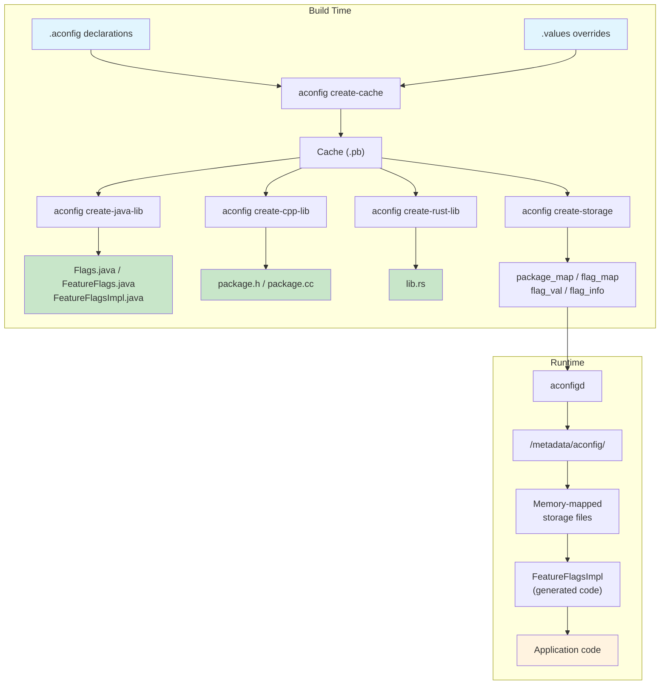

### 3.1.5 容器

**容器**是一个作为单一产物构建和安装的软件单元。容器概念对 aconfig 至关重要，因为标志存储文件是按容器组织的。主要容器有：

- **`system`** —— 系统分区
- **`system_ext`** —— system_ext 分区
- **`vendor`** —— vendor 分区
- **`product`** —— product 分区
- **APEX 模块** —— 每个 APEX（例如 `com.android.configinfrastructure`、`com.android.wifi`）都是一个独立的容器
- **APK** —— 独立发布的 APK 是各自的容器

容器决定存储文件放置在哪里，以及在启动时如何解析标志值。在一个容器中声明的标志，不能被运行在另一个容器中的代码读取，除非有明确的导出。

---

## 3.2 aconfig 系统

### 3.2.1 aconfig 工具

`aconfig` 二进制文件是一个 Rust 工具，位于：

```
build/make/tools/aconfig/aconfig/
```

它提供了几个子命令，构成构建期流水线的骨干：

| 子命令         | 用途                                                     |
|--------------------|-------------------------------------------------------------|
| `create-cache`     | 把 `.aconfig` 声明和 `.values` 覆盖解析为二进制 protobuf 缓存 |
| `create-java-lib`  | 从缓存生成 Java 源码                         |
| `create-cpp-lib`   | 从缓存生成 C++ 源码                          |
| `create-rust-lib`  | 从缓存生成 Rust 源码                         |
| `create-storage`   | 生成二进制存储文件（package_map、flag_map、flag_val、flag_info） |
| `dump-cache`       | 以多种格式（text、protobuf、custom）转储缓存内容 |

该工具在 Soong 构建系统中注册为主机二进制文件。下游构建规则引用的 Go 变量在 `build/soong/aconfig/init.go` 中通过 `Aconfig = pctx.HostTool("aconfig")` 赋值。该包的 `init()` 函数另外调用 `pctx.HostBinToolVariable("aconfig", "aconfig")` 来发布对应的 Ninja 变量。

### 3.2.2 .aconfig 文件格式

标志声明使用由 `build/make/tools/aconfig/aconfig_protos/protos/aconfig.proto` 中 `flag_declarations` 消息定义的 text-protobuf 格式。每个 `.aconfig` 文件声明一个包、一个容器以及一个或多个标志：

```protobuf
// File: system/apex/apexd/apexd.aconfig

package: "com.android.apex.flags"
container: "system"

flag {
  name: "mount_before_data"
  namespace: "treble"
  description: "This flag controls if allowing mounting APEXes
                before the data partition"
  bug: "361701397"
  is_fixed_read_only: true
}
```

来自 ConfigInfrastructure 模块的一个更复杂的示例：

```protobuf
// File: packages/modules/ConfigInfrastructure/framework/flags.aconfig

package: "android.provider.flags"
container: "com.android.configinfrastructure"

flag {
  name: "new_storage_writer_system_api"
  namespace: "core_experiments_team_internal"
  description: "API flag for writing new storage"
  bug: "367765164"
  is_fixed_read_only: true
  is_exported: true
}

flag {
  name: "dump_improvements"
  namespace: "core_experiments_team_internal"
  description: "Added more information on dumpsys device_config"
  bug: "364399200"
  is_exported: true
}
```

一个携带 `metadata { purpose: PURPOSE_BUGFIX }` 的 bugfix 标志，来自 aconfigd 存储模块：

```protobuf
// File: system/server_configurable_flags/aconfigd/
//       new_aconfig_storage.aconfig

flag {
    name: "support_clear_local_overrides_immediately"
    namespace: "core_experiments_team_internal"
    description: "Support ability to clear local overrides immediately."
    bug: "360205436"
    metadata {
        purpose: PURPOSE_BUGFIX
    }
}
```

### 3.2.3 声明字段

每个 `flag_declaration` 消息支持以下字段，如 `aconfig.proto`（第 80-110 行）中 `flag_declaration` 消息所定义：

| 字段                | 类型        | 是否必需 | 描述                                               |
|----------------------|-------------|----------|---------------------------------------------------|
| `name`               | `string`    | 是      | Snake_case 标识符（例如 `mount_before_data`）      |
| `namespace`          | `string`    | 是      | 用于服务端管理的组织结构分组                       |
| `description`        | `string`    | 是      | 标志的人类可读用途                                   |
| `bug`                | `string`    | 是      | Bug 跟踪 ID；proto 中为 `repeated`，但 aconfig 要求每个标志恰好一个 |
| `is_fixed_read_only` | `bool`      | 否      | 如果为 true，权限被强制为 `READ_ONLY`；值永远不能在运行时改变 |
| `is_exported`        | `bool`      | 否      | 如果为 true，标志可以在其容器之外被访问             |
| `metadata`           | `message`   | 否      | 附加元数据（purpose、storage backend）             |
| `type`               | `flag_type` | 否      | 值类型；默认为 `FLAG_TYPE_UNSPECIFIED`（视为布尔）。Android 17 新增 |

`type` 字段（字段 8）是 Android 17 新增的。它是一个枚举：

```protobuf
enum flag_type {
  FLAG_TYPE_UNSPECIFIED = 0;  // assume boolean for backward compatibility
  FLAG_TYPE_BOOLEAN = 1;
  FLAG_TYPE_INTEGER = 2;
}
```

当一个标志是 `FLAG_TYPE_INTEGER` 时，新的 `value_int` 字段携带它的值。该字段位于 `flag_value`（字段 5）和 `parsed_flag`（字段 14）上。布尔 `state` 不携带该值。3.9 节更深入地介绍整型标志及其当前的构建标志门控。

`metadata` 消息支持：

```protobuf
message flag_metadata {
  enum flag_purpose {
    PURPOSE_UNSPECIFIED = 0;
    PURPOSE_FEATURE = 1;
    PURPOSE_BUGFIX = 2;
  }

  enum flag_storage_backend {
    UNSPECIFIED = 0;
    ACONFIGD = 1;
    DEVICE_CONFIG = 2;
    NONE = 3;
  }

  optional flag_purpose purpose = 1;
  optional flag_storage_backend storage = 2;
}
```

`purpose` 字段区分特性标志（守护新功能）和 bugfix 标志（守护正确性修复）。`storage` 字段选择运行时后端：新的基于 `ACONFIGD` 的内存映射存储，或传统的 `DEVICE_CONFIG`（基于 Settings）存储。

### 3.2.4 命名约定

aconfig 系统强制执行严格的命名规则（见 `aconfig.proto` 第 26-57 行）：

- **标志名称：** 小写 snake_case，不能有连续的下划线，不能以数字开头（例如 `adjust_rate` 有效；`AdjustRate` 和 `adjust__rate` 无效）
- **包名称：** 以点分隔的小写 snake_case 片段，每个片段遵循相同的规则（例如 `com.android.mypackage`）
- **命名空间：** 小写 snake_case（例如 `core_experiments_team_internal`）
- **容器：** 小写；APEX 名称以点分隔（例如 `system`、`com.android.configinfrastructure`）

### 3.2.5 命名空间

命名空间充当服务端标志管理的组织单元。它们把通常由同一团队拥有、并通过同一发布管道管理的相关标志分组。在服务端（Google 内部的 "Gantry" 系统），命名空间映射到团队可以独立管理的单个配置界面。

命名空间与包不是一一对应的；多个包可以共享一个命名空间，一个包也可以包含不同命名空间中的标志。运行时 DeviceConfig 系统（传统存储）使用命名空间作为标志查找的属性命名空间：

```java
DeviceConfig.getProperties("core_experiments_team_internal");
```

在新的 `aconfigd` 存储系统中，命名空间仍记录在元数据中。它们对查找路径不那么核心，因为标志是按包和名称索引的，而不是按命名空间。

### 3.2.6 标志值文件

标志值覆盖已声明标志的默认状态和权限。它们使用 `flag_value` protobuf 消息格式：

```protobuf
// File: build/make/tools/aconfig/aconfig/tests/first.values

flag_value {
    package: "com.android.aconfig.test"
    name: "disabled_ro"
    state: DISABLED
    permission: READ_ONLY
}
flag_value {
    package: "com.android.aconfig.test"
    name: "enabled_rw"
    state: ENABLED
    permission: READ_WRITE
}
flag_value {
    package: "com.android.aconfig.test"
    name: "enabled_fixed_ro"
    state: ENABLED
    permission: READ_ONLY
}
```

真实的发布配置把值存储为 `.textproto` 文件：

```protobuf
// File: build/release/aconfig/bp1a/com.android.internal.camera.flags/
//       single_thread_executor_flag_values.textproto

flag_value {
  package: "com.android.internal.camera.flags"
  name: "single_thread_executor"
  state: ENABLED
  permission: READ_ONLY
}
```

`flag_value` 现在也可以通过 `value_int` 字段携带整型负载（Android 17），当对应的声明是 `FLAG_TYPE_INTEGER` 时使用。

### 3.2.7 值解析顺序

当 `aconfig create-cache` 处理一个标志时，它按顺序应用值：

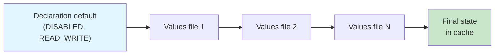

1. **声明默认值：** 所有标志都以 `DISABLED` 状态和 `READ_WRITE` 权限开始（在 `commands.rs` 第 74-75 行定义）。
2. **Values 文件**按顺序应用。后面的值覆盖前面的值。
3. **构建时权限强制：** 如果设置了 `RELEASE_CONFIG_FORCE_READ_ONLY`，来自 values 文件的权限会被静默重写为 `READ_ONLY`。如果设置了 `RELEASE_ACONFIG_REQUIRE_ALL_READ_ONLY`，当任何标志最终变为 `READ_WRITE` 时，`create-cache` 反而会*让构建失败*。
4. **固定只读强制：** Values 文件仍可以设置标记为 `is_fixed_read_only: true` 的标志的*状态*。试图给它们设置 `permission: READ_WRITE` 的 values 文件会被拒绝并报错。

每次应用值都会在缓存中被记录为一个**tracepoint**，使开发者能够准确追踪是哪个文件设置了每个标志的最终值：

```protobuf
message tracepoint {
  optional string source = 1;
  optional flag_state state = 2;
  optional flag_permission permission = 3;
}
```

---

## 3.3 标志代码生成

### 3.3.1 生成的文件结构

`aconfig` 工具以三种语言生成类型安全的访问器代码。对每个包来说，生成的代码在所有语言中都遵循一致的模式：一个公共访问器外观、一个运行时实现和一个测试接口。

**Java**（由 `aconfig create-java-lib` 生成）：

| 文件                      | 用途                                                |
|---------------------------|----------------------------------------------------|
| `Flags.java`              | 静态访问器方法，每个标志一个                       |
| `FeatureFlags.java`       | 声明所有标志方法的接口                              |
| `FeatureFlagsImpl.java`   | 运行时实现（从存储读取）                            |
| `CustomFeatureFlags.java` | 用于自定义标志解析的委托包装器                     |
| `FakeFeatureFlagsImpl.java` | 用于单元测试的测试替身                           |

**C++**（由 `aconfig create-cpp-lib` 生成）：

| 文件          | 用途                                               |
|-----------------------|-------------------------------------------------------|
| `<package>.h`         | 带有内联访问器和 C 链接函数的头文件                 |
| `<package>.cc`        | 运行时从存储读取的实现                               |

**Rust**（由 `aconfig create-rust-lib` 生成）：

| 文件         | 用途                                                      |
|--------------|--------------------------------------------------------------|
| `src/lib.rs` | 包含标志访问器函数的模块                                    |

### 3.3.2 代码生成模式

`aconfig` 工具支持四种代码生成模式，由 `--mode` 参数控制（在 `codegen/mod.rs` 第 58-64 行定义）：

```rust
pub enum CodegenMode {
    Exported,       // For flags visible outside their container
    ForceReadOnly,  // All flags treated as read-only
    Production,     // Normal production mode
    Test,           // Test mode with mutable flag state
}
```

这些模式通过 `java_aconfig_library`、`cc_aconfig_library` 和 `rust_aconfig_library` 模块上的 `mode` 属性选择。支持的模式字符串（来自 `codegen/java_aconfig_library.go` 第 31 行）：

```go
var aconfigSupportedModes = []string{
    "production", "test", "exported", "force-read-only",
}
```

### 3.3.3 Flags.java —— 公共 API 表面

生成的 `Flags.java` 是标志检查的主要入口点。它提供委托给内部 `FeatureFlags` 实现的静态方法。

看一下 `build/make/tools/aconfig/aconfig/templates/Flags.java.template` 中的模板：

```java
// Generated code for package com.android.apex.flags

package com.android.apex.flags;

public final class Flags {

    /** @hide */
    public static final String FLAG_MOUNT_BEFORE_DATA =
        "com.android.apex.flags.mount_before_data";

    @com.android.aconfig.annotations.AssumeTrueForR8
    @com.android.aconfig.annotations.AconfigFlagAccessor
    public static boolean mountBeforeData() {
        return FEATURE_FLAGS.mountBeforeData();
    }

    private static FeatureFlags FEATURE_FLAGS = new FeatureFlagsImpl();
}
```

关键观察点：

1. **标志名称常量**遵循 `FLAG_<UPPER_SNAKE_CASE>` 模式，存储完全限定的标志名称（`package.flag_name`）。

2. **R8 注解**使 R8 优化器能够在编译时假定标志的值：
   - `@AssumeTrueForR8` —— 用于 `ENABLED` 且 `READ_ONLY` 的标志
   - `@AssumeFalseForR8` —— 用于 `DISABLED` 且 `READ_ONLY` 的标志
   - 读写标志没有此类注解，因为它们的值可以在运行时改变。

3. **方法命名**把 snake_case 标志名称转换为 camelCase 方法名（例如 `mount_before_data` 变为 `mountBeforeData()`）。

4. **在测试模式下**，`Flags.java` 还额外暴露 `setFeatureFlags()` 和 `unsetFeatureFlags()` 方法，用于注入测试替身。

### 3.3.4 FeatureFlags.java —— 接口

生成的接口为每个标志声明一个布尔方法：

```java
package com.android.apex.flags;

/** @hide */
public interface FeatureFlags {
    @com.android.aconfig.annotations.AssumeTrueForR8
    @com.android.aconfig.annotations.AconfigFlagAccessor
    boolean mountBeforeData();
}
```

该接口是生产实现和测试实现都必须满足的契约。

### 3.3.5 FeatureFlagsImpl.java —— 运行时解析

运行时实现因存储后端而异。`aconfig` 工具在几个模板之间选择：

**新存储（基于 aconfigd）** —— 模板 `FeatureFlagsImpl.new_storage.java.template`：

```java
package com.example.flags;

import android.os.flagging.PlatformAconfigPackageInternal;
import android.util.Log;

/** @hide */
public final class FeatureFlagsImpl implements FeatureFlags {
    private static final String TAG = "FeatureFlagsImpl";
    private static volatile boolean isCached = false;
    private static boolean myReadWriteFlag = false;

    private void init() {
        try {
            PlatformAconfigPackageInternal reader =
                PlatformAconfigPackageInternal.load(
                    "com.example.flags", 0xABCD1234L);
            myReadWriteFlag = reader.getBooleanFlagValue(0);
        } catch (Exception e) {
            Log.e(TAG, e.toString());
        } catch (LinkageError e) {
            // For mainline modules on older devices
            Log.e(TAG, e.toString());
        }
        isCached = true;
    }

    @Override
    public boolean myReadWriteFlag() {
        if (!isCached) {
            init();
        }
        return myReadWriteFlag;
    }

    @Override
    public boolean myReadOnlyFlag() {
        return true;  // Baked at build time
    }
}
```

对于平台容器（`system`、`system_ext`、`product`、`vendor`），实现使用 `PlatformAconfigPackageInternal`。对于非平台容器（APEX 模块），它使用 `AconfigPackageInternal`。两者都从 `/metadata/aconfig/` 下的内存映射存储文件中读取标志值。

**包指纹**（`0xABCD1234L`）是对包的排序后标志名称做 SipHash13 的结果，用于验证读取的是正确的存储文件。

**传统 DeviceConfig 存储** —— 模板 `FeatureFlagsImpl.legacy_flag.internal.java.template`。（直到 Android 16，该路径使用单独的 `FeatureFlagsImpl.deviceConfig.java.template`。Android 17 移除了该文件，并把 DeviceConfig 运行时读取移入 `legacy_flag.internal` 模板。见 3.3.9 节。）

```java
package com.example.flags;

import android.provider.DeviceConfig;

/** @hide */
public final class FeatureFlagsImpl implements FeatureFlags {

    @Override
    public boolean myReadWriteFlag() {
        try {
            return DeviceConfig.getBoolean(
                "my_namespace",
                Flags.FLAG_MY_READ_WRITE_FLAG,
                false);
        } catch (NullPointerException e) {
            throw new RuntimeException(
                "Cannot read value from namespace my_namespace "
                + "from DeviceConfig. It could be that the code "
                + "using flag executed before SettingsProvider "
                + "initialization. Please use fixed read-only flag "
                + "by adding is_fixed_read_only: true in flag "
                + "declaration.", e);
        }
    }

    @Override
    public boolean myReadOnlyFlag() {
        return true;  // Baked at build time
    }
}
```

当前基于 DeviceConfig 的实现在每次调用时通过 `DeviceConfig.getBoolean()` 逐个读取标志，不做缓存。Android 17 移除了较旧的按命名空间分组的 `getProperties()` 批量读取模板。

**测试模式** —— 模板 `FeatureFlagsImpl.test_mode.java.template`：

```java
package com.example.flags;

/** @hide */
public final class FeatureFlagsImpl implements FeatureFlags {
    @Override
    public boolean myFlag() {
        throw new UnsupportedOperationException(
            "Method is not implemented.");
    }
}
```

在测试模式下，真实实现在每次访问时都会抛出异常，迫使测试显式地通过 fake 实现设置标志值。这确保测试永远不会意外依赖生产标志值。

### 3.3.6 FakeFeatureFlagsImpl.java —— 测试替身

每当库不是导出的单文件库时，都会生成 `FakeFeatureFlagsImpl`。当只读 Java 优化折叠了该包时也不会生成它（见 3.3.9 节）。它提供一个基于 map 的测试实现：

```java
package com.example.flags;

import java.util.HashMap;
import java.util.Map;
import java.util.function.Predicate;

/** @hide */
public class FakeFeatureFlagsImpl extends CustomFeatureFlags {
    private final Map<String, Boolean> mFlagMap = new HashMap<>();
    private final FeatureFlags mDefaults;
    // Template literal: true when the library is exported
    private final boolean IS_EXPORTED = false;

    public FakeFeatureFlagsImpl() {
        this(null);
    }

    public FakeFeatureFlagsImpl(FeatureFlags defaults) {
        super(null);
        mDefaults = defaults;
        for (String flagName : getFlagNames()) {
            mFlagMap.put(flagName, null);
        }
    }

    @Override
    protected boolean getValue(String flagName,
                               Predicate<FeatureFlags> getter) {
        Boolean value = this.mFlagMap.get(flagName);
        if (value != null) {
            return value;
        }
        if (mDefaults != null) {
            return getter.test(mDefaults);
        }
        throw new IllegalArgumentException(flagName + " is not set");
    }

    public void setFlag(String flagName, boolean value) {
        if (!this.mFlagMap.containsKey(flagName) && !IS_EXPORTED) {
            throw new IllegalArgumentException(
                "no such flag " + flagName);
        }
        this.mFlagMap.put(flagName, value);
    }

    public void resetAll() {
        for (Map.Entry entry : mFlagMap.entrySet()) {
            entry.setValue(null);
        }
    }
}
```

这个类使单元测试能够在不需要运行系统或 `DeviceConfig` provider 的情况下设置特定的标志值。

### 3.3.7 CustomFeatureFlags.java —— 委托包装器

`CustomFeatureFlags` 类提供了一种委托模式，允许调用者注入自定义的标志解析逻辑：

```java
package com.example.flags;

import java.util.function.BiPredicate;
import java.util.function.Predicate;

/** @hide */
public class CustomFeatureFlags implements FeatureFlags {
    private BiPredicate<String, Predicate<FeatureFlags>> mGetValueImpl;

    public CustomFeatureFlags(
            BiPredicate<String, Predicate<FeatureFlags>> getValueImpl) {
        mGetValueImpl = getValueImpl;
    }

    @Override
    public boolean myFlag() {
        return getValue(Flags.FLAG_MY_FLAG,
            FeatureFlags::myFlag);
    }

    public boolean isFlagReadOnlyOptimized(String flagName) {
        if (mReadOnlyFlagsSet.contains(flagName) &&
            isOptimizationEnabled()) {
            return true;
        }
        return false;
    }

    @com.android.aconfig.annotations.AssumeTrueForR8
    private boolean isOptimizationEnabled() {
        return false;  // template literal {optimize_read_only_getter}
    }

    protected boolean getValue(String flagName,
                               Predicate<FeatureFlags> getter) {
        return mGetValueImpl.test(flagName, getter);
    }
}
```

`isOptimizationEnabled()` 的主体是受构建标志控制的模板字面量 `{optimize_read_only_getter}`。当只读 getter 优化关闭时（如本示例），它是 `false`。当 `RELEASE_ACONFIG_OPTIMIZE_READ_ONLY_JAVA` 构建标志启用它时，它是 `true`。`@AssumeTrueForR8` 注解还让 R8 假定该方法返回 `true`。然后 R8 可以在发布构建中优化掉针对只读标志的 `isFlagReadOnlyOptimized` 检查，即使生成的代码体是 `false`。

### 3.3.8 ExportedFlags.java —— 简化的外部 API

对于导出的标志库（`mode: "exported"`，此时 Soong 额外传递 `--single-exported-file true` 代码生成参数），`aconfig` 工具生成 `ExportedFlags.java` 而*不生成* `CustomFeatureFlags.java` 和 `FakeFeatureFlagsImpl.java`。Soong 对导出标志库规则传递此参数。它是 `aconfig create-java-lib` 的一个 CLI 标志，而不是 `java_aconfig_library` 的属性。生成的集合变为 `Flags.java`、`FeatureFlags.java`、`FeatureFlagsImpl.java` 和 `ExportedFlags.java`。生成的类为外部使用者（在平台之外构建的应用）提供简化的 API：

```java
// Generated: ExportedFlags.java
package com.example.flags;

import android.os.Build;
import android.os.flagging.AconfigPackage;
import android.util.Log;

public final class ExportedFlags {

    private static volatile boolean isCached = false;
    private static boolean myExportedFlag = false;

    private ExportedFlags() {}

    private void init() {
        // Loads the package's flags via
        // AconfigPackage.load("com.example.flags") and
        // reader.getBooleanFlagValue(...), then sets isCached
        // ...
    }

    public static boolean myExportedFlag() {
        if (Build.VERSION.SDK_INT >= 36) {
            return true;  // Finalized at API level 36
        }
        if (!featureFlags.isCached) {
            featureFlags.init();
        }
        return featureFlags.myExportedFlag;
    }

    private static ExportedFlags featureFlags = new ExportedFlags();
}
```

这个类是自包含的：它从不引用 `Flags` 类，而是通过 `AconfigPackage` 读取的值缓存在一个私有静态自实例中。它的访问器包含针对已定稿标志的 SDK 版本检查，确保应用在面向多个 Android 版本时保持向后兼容。在该模式下，其他生成的类（`Flags`、`FeatureFlags`、`FeatureFlagsImpl`）被标注 `@Deprecated`，以鼓励迁移到 `ExportedFlags`。

烘焙进检查中的 SDK 级别不是一个常量——它是该标志实际定稿时的 API 级别。该条件由 `build/make/tools/aconfig/convert_finalized_flags/src/lib.rs` 中的 `ApiLevel::conditional()` 生成，它读取已定稿标志记录（例如 `prebuilts/sdk/<N>/finalized-flags.txt`）。Android 17 将此扩展到**次版本 SDK**。对于等于或高于 Baklava 的级别，生成的条件变为对主 SDK 和次 SDK 的双重检查：`Build.VERSION.SDK_INT >= 36 && Build.VERSION.SDK_INT_FULL >= <level>`。此处 `SDK_INT_FULL` 编码次版本（乘数为 100000）。

此路径受 `RELEASE_ACONFIG_SUPPORT_MINOR_SDK` 构建标志的门控。另外，`RELEASE_ACONFIG_GENERATE_CHECKS_SDK_ANNOTATION` 使生成器在每个已定稿的导出 getter 上发出 `@androidx.annotation.ChecksSdkIntAtLeast` 注解，以便静态分析工具理解版本门控。

### 3.3.9 FeatureFlagsImpl 模板选择

aconfig Java 代码生成从四个 `FeatureFlagsImpl` 模板中选择。选择取决于代码生成模式、库是否导出，以及包使用哪个存储后端。在 Android 17 中，`add_feature_flags_impl_template` 函数（`codegen/java.rs`）中的选择逻辑是：

1. **测试模式**（最先检查，覆盖其他一切）—— 使用 `FeatureFlagsImpl.test_mode.java.template`（在每次访问时抛出异常）。
2. **导出库** —— 使用 `FeatureFlagsImpl.exported.java.template`。导出代码生成始终依赖新存储；生成器断言导出标志不使用 DeviceConfig 后端。
3. **DeviceConfig 存储**（`use_device_config`，非导出）—— 使用 `FeatureFlagsImpl.legacy_flag.internal.java.template`，它通过 `DeviceConfig.getBoolean()` 逐个读取标志。
4. **新 aconfigd 存储**（默认，非导出）—— 使用 `FeatureFlagsImpl.new_storage.java.template`，它通过 `PlatformAconfigPackageInternal` / `AconfigPackageInternal` 从内存映射文件读取。

Android 17 移除了此前单独的 `FeatureFlagsImpl.deviceConfig.java.template`；DeviceConfig 路径现在共用 `legacy_flag.internal` 模板。`build/make/tools/aconfig/aconfig/templates/` 中的完整模板清单（13 个文件）是：

```
CustomFeatureFlags.java.template
ExportedFlags.java.template
FakeFeatureFlagsImpl.java.template
FeatureFlags.java.template
FeatureFlagsImpl.exported.java.template
FeatureFlagsImpl.legacy_flag.internal.java.template
FeatureFlagsImpl.new_storage.java.template
FeatureFlagsImpl.test_mode.java.template
Flags.java.template
cpp_exported_header.template
cpp_source_file.template
rust.template
rust_test.template
```

使用的模板引擎是 `TinyTemplate`（一个 Rust crate），带有 `{{ if condition }}`、`{{ for item in list }}` 等模板指令以及 `{variable}` 替换。

当**只读 Java 优化**处于活动状态时（Android 17，由 `RELEASE_ACONFIG_OPTIMIZE_READ_ONLY_JAVA` 构建标志管辖），生成器可以采取更激进的捷径。`Flags.java` 中的只读 getter 直接返回它们的默认值。当也允许移除 impl 接口时（见 3.6.6 节），生成器可以完全删除 `FeatureFlags`、`FeatureFlagsImpl`、`CustomFeatureFlags` 和 `FakeFeatureFlagsImpl` 类。于是包就折叠为单个 `Flags` 类。3.9 节追踪此路径。

### 3.3.10 C++ 代码生成

对于 C++，生成的代码遵循 provider 模式。头文件为每个标志声明一个带有虚方法的抽象 `flag_provider_interface`：

```cpp
// Generated: com_android_aconfig_test.h

#pragma once

#ifndef COM_ANDROID_ACONFIG_TEST
#define COM_ANDROID_ACONFIG_TEST(FLAG) \
    COM_ANDROID_ACONFIG_TEST_##FLAG
#endif

#ifndef COM_ANDROID_ACONFIG_TEST_ENABLED_FIXED_RO
#define COM_ANDROID_ACONFIG_TEST_ENABLED_FIXED_RO true
#endif

#ifdef __cplusplus

#include <memory>

namespace com::android::aconfig::test {

class flag_provider_interface {
public:
    virtual ~flag_provider_interface() = default;
    virtual bool enabled_fixed_ro() = 0;
    virtual bool disabled_rw() = 0;
};

extern std::unique_ptr<flag_provider_interface> provider_;

// Fixed read-only: resolved at compile time via macro
constexpr inline bool enabled_fixed_ro() {
    return COM_ANDROID_ACONFIG_TEST_ENABLED_FIXED_RO;
}

// Read-write: delegates to provider at runtime
inline bool disabled_rw() {
    return provider_->disabled_rw();
}

}  // namespace com::android::aconfig::test

extern "C" {
#endif

bool com_android_aconfig_test_enabled_fixed_ro();
bool com_android_aconfig_test_disabled_rw();

#ifdef __cplusplus
}
#endif
```

C++ 代码生成中的关键设计决策：

1. **固定只读标志**变为 `constexpr` 内联函数，返回一个预处理器宏值。这让编译器能够在编译时消除死代码。

2. **读写标志**通过 `provider_` 指针进行，该指针在运行时从内存映射存储初始化。

3. 提供了 **C 链接函数**（`extern "C"`），供 C 代码和 JNI 消费。

4. **`[[clang::no_destroy]]`** 注解应用于 provider 指针，以避免线程安全上下文中的销毁顺序问题。

5. **在测试模式下**，每个标志还获得一个 setter 函数（`void disabled_rw(bool val)`）和一个用于测试清理的 `reset_flags()` 函数。

### 3.3.11 Rust 代码生成

对于 Rust，生成的代码使用与 C++ 类似的 provider trait 模式：

```rust
// Generated: src/lib.rs

pub fn enabled_fixed_ro() -> bool {
    true  // Fixed read-only
}

pub fn disabled_rw() -> bool {
    // Read from storage via provider
    PROVIDER.disabled_rw()
}
```

在测试模式下，Rust 标志使用单个全局 provider。它是一个 `static PROVIDER: Mutex<FlagProvider>`，持有一个覆盖值的 map。测试用生成的 `set_<flag>()` 函数设置覆盖值，用 `reset_flags()` 清除它们。每个 getter 和 setter 都经过 `PROVIDER.lock().unwrap()`，因此覆盖 map 在线程间共享并由互斥锁保护，而不是每线程一份。

### 3.3.12 代码生成流水线

从声明到可用库的完整流水线：

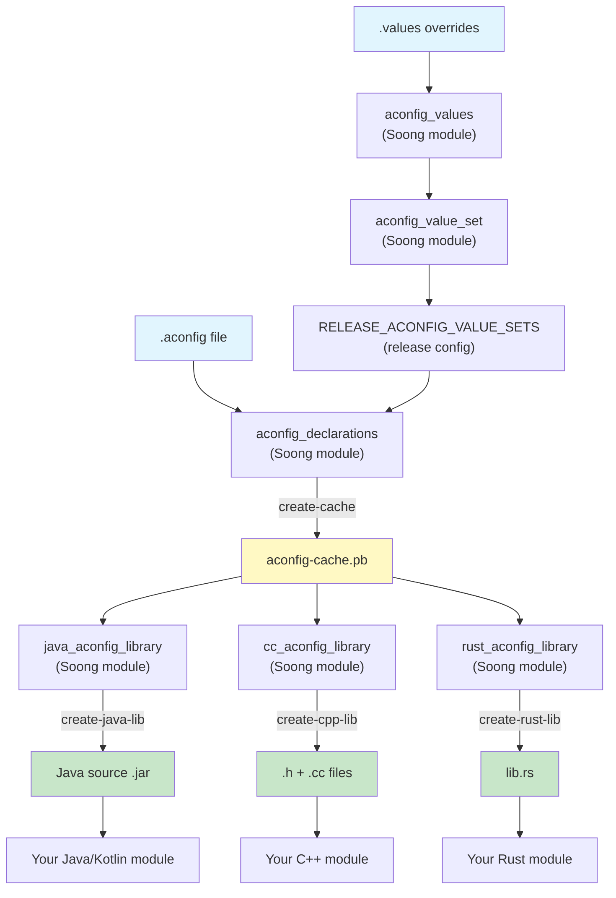

---

## 3.4 标志存储和运行时

### 3.4.1 存储架构概述

aconfig 系统支持两种用于运行时标志解析的存储后端，通过声明中的 `metadata.storage` 字段按标志选择：

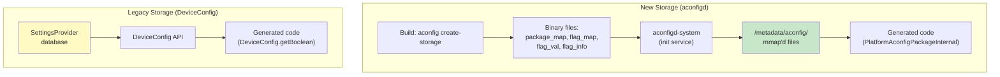

### 3.4.2 新存储：aconfigd 和内存映射文件

新的存储系统是为了解决 DeviceConfig 方式在性能和启动时间上的局限而引入的。它由四种二进制文件类型组成，由 `aconfig create-storage` 在构建时生成：

| 文件类型       | 内容                                                     |
|-----------------|-------------------------------------------------------------|
| `package_map`   | 把包名映射到标志文件中的偏移范围                         |
| `flag_map`      | 把标志名（包内）映射到 flag_val 中的偏移                  |
| `flag_val`      | 紧凑的布尔标志值数组                                       |
| `flag_info`     | 每个标志的元数据（权限、属性）                             |

`build/make/tools/aconfig/aconfig_storage_file/protos/aconfig_storage_metadata.proto` 中的 `storage_file_info` proto 记录每个生成的存储文件的位置、容器和版本（如 `storage_records.pb` 中所用）。二进制布局本身在 3.4.4 节介绍的 Rust 模块中定义：

```protobuf
message storage_file_info {
  optional uint32 version = 1;
  optional string container = 2;
  optional string package_map = 3;
  optional string flag_map = 4;
  optional string flag_val = 5;
  optional string flag_info = 6;
  optional int64 timestamp = 7;
}
```

在启动时，`aconfigd-system` 服务初始化存储。在 Android 17 中，`aconfigd-system` 是一个纯 Rust 二进制文件（`system/server_configurable_flags/aconfigd/Android.bp` 中的一个 `rust_binary` Soong 模块）。此前的 `enable_full_rust_system_aconfigd` 迁移标志已被移除。这是因为 Rust 守护进程现在是唯一的实现。

```
# From system/server_configurable_flags/aconfigd/aconfigd.rc

service early_system_aconfigd_platform_init
    /system/bin/aconfigd-system early-platform-init
    class core
    user system
    group system
    oneshot
    disabled
    file /dev/kmsg w

on early-init
    mkdir /metadata/aconfig 0775 root system
    mkdir /metadata/aconfig/flags 0770 root system
    mkdir /metadata/aconfig/maps 0775 root system
    mkdir /metadata/aconfig/boot 0775 root system
    exec_start early_system_aconfigd_platform_init
```

同一个 `mkdir` 块也在 `on post-fs` 触发器下运行，然后它 `exec_start` `system_aconfigd_platform_init` 服务。`early-platform-init` 入口点受一个运行时检查（`enable_earlier_aconfigd()`）门控。它在运行后写入 `/metadata/aconfig/early_init_done` 标记。因此平台存储可以在启动过程中比之前更早地可用。

存储文件由客户端进程以只读方式进行内存映射。`aconfig_storage_read_api/src/lib.rs`（第 62 行）中的常量 `STORAGE_LOCATION` 定义了根路径：

```rust
pub const STORAGE_LOCATION: &str = "/metadata/aconfig";
```

### 3.4.3 存储读取 API

`aconfig_storage_read_api` crate 提供四个从内存映射存储文件读取的核心函数。三个查找函数不接受容器名——它们操作的是一个映射文件句柄，该句柄首先从 `get_mapped_storage_file(container, file_type)` 获得：

```rust
// Map a container's storage file of the given type
pub unsafe fn get_mapped_storage_file(
    container: &str, file_type: StorageFileType
) -> Result<Mmap>

// 1. Get package read context (package offset info)
pub fn get_package_read_context(
    file: &Mmap, package: &str
) -> Result<Option<PackageReadContext>>

// 2. Get flag read context (flag offset within package)
pub fn get_flag_read_context(
    file: &Mmap, package_id: u32, flag: &str
) -> Result<Option<FlagReadContext>>

// 3. Read a boolean flag value at an index
pub fn get_boolean_flag_value(
    file: &[u8], index: u32
) -> Result<bool>

// 4. Get storage file version
pub fn get_storage_file_version(
    file_path: &str
) -> Result<u32>
```

Android 17 为新的整型标志新增了第五个核心读取函数 `get_int64_flag_value(file, index) -> Result<i64>`，以及用于读取标志信息位的 `get_flag_attribute`。整型读取函数目前仅限 Rust 使用；还没有对应的 `cxx::bridge` 查询，因此 C++ 生成的代码仍然只读取布尔值。

这些是底层 API，仅供生成的代码使用。应用开发者绝不应该直接调用它们。

单个标志的读取路径：

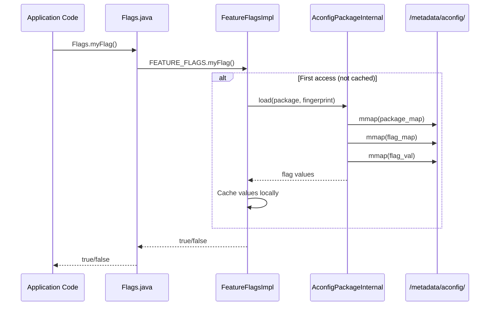

### 3.4.4 存储文件内部

四个二进制存储文件使用基于哈希表查找的带版本格式。该格式分布在 `build/make/tools/aconfig/aconfig_storage_file/` 下的 `aconfig_storage_file` crate 中。`src/lib.rs` 保存版本常量、`HASH_PRIMES` 表以及 `StoredFlagType` / `FlagValueType` 枚举。每个文件的节点布局与其读取器放在一起：`src/package_table.rs` 中的 `PackageTableNode`、`src/flag_table.rs` 中的 `FlagTableNode`，以及 `src/flag_info.rs` 中的 `FlagInfoBit`。

**包映射**（`package_map`）：

包映射使用哈希表把包名映射到它们的元数据。每个条目包含：

```rust
pub struct PackageTableNode {
    pub package_name: String,        // e.g., "com.android.apex.flags"
    pub package_id: u32,             // Unique ID within this container
    pub fingerprint: u64,            // SipHash13 of flag names (v2+)
    pub redact_exported_reads: bool, // v3: redact exported-flag reads
    pub boolean_start_index: u32,    // Offset into flag_val for this package
    pub int_start_index: u32,        // v4: offset of this package's int flags
    pub next_offset: Option<u32>,    // Hash collision chain
}
```

`int_start_index` 字段是 Android 17 版本 4 格式中的新字段（仅在选中 v4 写入器时序列化）。它给出该包第一个整型标志的偏移，类似于布尔值的 `boolean_start_index`。

哈希表大小从一组质数（`HASH_PRIMES` 数组）中选择，以最小化冲突：

```rust
pub(crate) const HASH_PRIMES: [u32; 29] = [
    7, 17, 29, 53, 97, 193, 389, 769, 1543, 3079,
    6151, 12289, 24593, 49157, 98317, 196613, ...
];
```

**标志映射**（`flag_map`）：

标志映射使用单独的哈希表，把 (package_id, flag_name) 对映射到标志元数据：

```rust
pub struct FlagTableNode {
    pub package_id: u32,
    pub flag_name: String,
    pub flag_type: StoredFlagType,  // ReadOnlyBoolean, ReadWriteBoolean,
                                     // FixedReadOnlyBoolean
    pub flag_index: u16,            // Index within the package's range
    pub next_offset: Option<u32>,
}
```

`flag_type` 区分以下类型：

- `ReadOnlyBoolean` —— 值在构建时设置，运行时不能覆盖
- `ReadWriteBoolean` —— 值可以在运行时被覆盖
- `FixedReadOnlyBoolean` —— 值永久固定，启用编译器优化

Android 17 的版本 4 格式为 `StoredFlagType` 枚举增加了三个整型对应项：`ReadWriteInt64`、`ReadOnlyInt64` 和 `FixedReadOnlyInt64`。它还增加了一个 `FlagValueType` 枚举（`Boolean`、`Int64`），用于对值的存储方式进行分类。这些变体仅在启用 v4 解析器时使用。

**标志值**（`flag_val`）：

标志值文件是布尔值的紧凑数组。每个标志占用一个字节（而不是一个位），以便在不进行位操作的情况下高效随机访问。某个特定标志的偏移为：

```
offset = package.boolean_start_index + flag.flag_index
```

**标志信息**（`flag_info`）：

标志信息文件为每个标志存储属性位掩码：

```rust
pub enum FlagInfoBit {
    HasServerOverride = 1 << 0,  // 0x01
    IsReadWrite       = 1 << 1,  // 0x02
    HasLocalOverride  = 1 << 2,  // 0x04
}
```

这些位跟踪标志是否为读写型，以及它是否已被服务端配置或本地 `aflags` 命令覆盖。

**存储文件版本**被编码为每个文件的前四个字节。当前版本方案：

| 版本 | 特性                                                 |
|---------|-------------------------------------------------------|
| 1       | 基础的包/标志映射和值存储                              |
| 2       | 增加包指纹（标志名称的 SipHash13）                      |
| 3       | 增加导出读取的脱敏支持                                  |
| 4       | 增加整型标志（Android 17）                             |

默认写入版本是 2（`DEFAULT_FILE_VERSION`）。Android 17 中支持的最大读取版本是有条件的：`MAX_SUPPORTED_FILE_VERSION = if cfg!(enable_parse_v4) { 4 } else { 3 }`。v4 格式增加了上文讨论的整型标志存储。这就是包节点的 `int_start_index`、`Int64` `StoredFlagType` 变体，以及标志信息头部的 `num_int_flags` / `int_flag_offset` 字段加上 `int_nodes` 列表。

v4 是否被写入和解析由 `RELEASE_ACONFIG_PARSE_V4` 构建标志驱动（它设置 `enable_parse_v4` Rust cfg）。

### 3.4.5 包指纹

每个包都有一个使用 SipHash13（来自 `aconfig_storage_file/src/sip_hasher13.rs`）计算的指纹。指纹根据包内排序后的标志名称列表计算。它有两个用途：

1. **完整性验证：** 生成的代码包含指纹，并在运行时针对存储文件进行验证，检测代码与存储之间的不匹配。

2. **缓存失效：** 如果标志被添加到或从包中移除，指纹就会改变，确保生成的代码重新从存储读取。

指纹在生成的代码中以十六进制字面量出现：

```java
PlatformAconfigPackageInternal reader =
    PlatformAconfigPackageInternal.load(
        "com.example.flags", 0xABCD1234L);
```

### 3.4.6 CXX 互操作层

存储读取 API 在 Rust 中实现，但需要可从 C++ 调用（用于 `cc_aconfig_library` 生成的代码）。`aconfig_storage_read_api` crate 使用 `cxx::bridge` 生成 C++ 绑定：

```rust
#[cxx::bridge]
mod ffi {
    pub struct PackageReadContextQueryCXX {
        pub query_success: bool,
        pub error_message: String,
        pub package_exists: bool,
        pub package_id: u32,
        pub boolean_start_index: u32,
        pub fingerprint: u64,
    }

    pub struct FlagReadContextQueryCXX {
        pub query_success: bool,
        pub error_message: String,
        pub flag_exists: bool,
        pub flag_type: u16,
        pub flag_index: u16,
    }

    pub struct BooleanFlagValueQueryCXX {
        pub query_success: bool,
        pub error_message: String,
        pub flag_value: bool,
    }

    extern "Rust" {
        pub fn get_package_read_context_cxx(
            file: &[u8], package: &str,
        ) -> PackageReadContextQueryCXX;

        pub fn get_flag_read_context_cxx(
            file: &[u8], package_id: u32, flag: &str,
        ) -> FlagReadContextQueryCXX;

        pub fn get_boolean_flag_value_cxx(
            file: &[u8], offset: u32,
        ) -> BooleanFlagValueQueryCXX;
    }
}
```

每个查询返回一个带有显式 `query_success` 字段和 `error_message` 的结果结构体。这避开了 Rust 的 `Result` 类型，因为它不能直接跨 FFI 边界转换。`flag_type` 被编码为 `u16` 以兼容 C++。

### 3.4.7 aconfigd 服务架构

`aconfigd` 服务出于安全和可更新性考虑被拆分为两个二进制文件：

| 二进制文件            | 位置                                          | 用途                        |
|----------------------|---------------------------------------------------|--------------------------------|
| `aconfigd-system`    | `/system/bin/aconfigd-system`                     | 平台标志初始化   |
| `aconfigd-mainline`  | `/apex/com.android.configinfrastructure/bin/`     | Mainline 模块标志处理  |

系统实例作为三个独立的一次性服务运行，定义在 `system/server_configurable_flags/aconfigd/aconfigd.rc` 中：

```
service early_system_aconfigd_platform_init
    /system/bin/aconfigd-system early-platform-init
    class core
    user system
    group system
    oneshot
    disabled

service system_aconfigd_platform_init
    /system/bin/aconfigd-system platform-init
    class core
    user system
    group system
    oneshot
    disabled

service system_aconfigd_socket_service
    /system/bin/aconfigd-system start-socket
    class core
    user system
    group system
    oneshot
    disabled
    socket aconfigd_system stream 666 system system
```

**启动序列：**

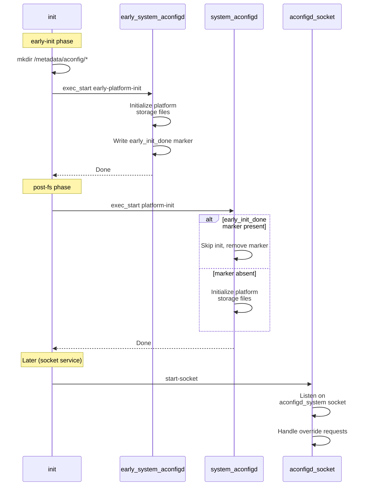

early-init 步骤（由 `enable_earlier_aconfigd` 标志守护）运行平台存储初始化——`aconfigd_commands::platform_init()`——并在成功后写入 `/metadata/aconfig/early_init_done` 标记。post-fs 的 `platform-init` 命令随后只是一个回退。当标记存在时，它跳过初始化（并删除标记）。它只在 early init 失败时才会再次运行，例如在 data wipe 后的首次启动（`system/server_configurable_flags/aconfigd/src/main.rs`）。

socket 服务处理运行时标志覆盖请求。在内部（来自 `system/server_configurable_flags/aconfigd/src/aconfigd_commands.rs`），它创建一个 `Aconfigd` 实例并通过 Unix 域 socket 处理请求：

```rust
const ACONFIGD_SOCKET: &str = "aconfigd_system";
const ACONFIGD_ROOT_DIR: &str = "/metadata/aconfig";
const STORAGE_RECORDS: &str =
    "/metadata/aconfig/storage_records.pb";
const PLATFORM_STORAGE_RECORDS: &str =
    "/metadata/aconfig/platform_storage_records.pb";
const ACONFIGD_SOCKET_BACKLOG: i32 = 8;

pub fn start_socket() -> Result<()> {
    let fd = rustutils::android::sockets::
        android_get_control_socket(ACONFIGD_SOCKET)?;
    // ... unsafe { libc::listen(fd.as_raw_fd(),
    //              ACONFIGD_SOCKET_BACKLOG) } ...
    let listener = UnixListener::from(fd);
    // Android 17 selects the records file at runtime:
    let records = if enable_aconfigd_from_mainline() {
        PLATFORM_STORAGE_RECORDS
    } else {
        STORAGE_RECORDS
    };
    let mut aconfigd = Aconfigd::new(
        Path::new(ACONFIGD_ROOT_DIR),
        Path::new(records));
    aconfigd.initialize_from_storage_record()?;

    for stream in listener.incoming() {
        match stream {
            Ok(mut stream) => {
                if let Err(errmsg) = aconfigd
                    .handle_socket_request_from_stream(&mut stream)
                {
                    error!("failed to handle socket \
                        request: {:?}", errmsg);
                }
            }
            Err(errmsg) => {
                error!("failed to listen for an incoming \
                    message: {:?}", errmsg);
            }
        }
    }
    Ok(())
}
```

请注意，失败的请求会被记录日志而不是向外传播：一个格式错误或被拒绝的覆盖请求不能让守护进程的 accept 循环随之崩溃。

新的 `platform_storage_records.pb`（以及选择它的 `enable_aconfigd_from_mainline()` 开关）反映了 Android 17 中的一次拆分。平台拥有的存储记录现在与 Mainline `aconfigd-mainline` 守护进程管理的记录分离开来。

运行时 `/metadata/aconfig/` 目录结构：

```
/metadata/aconfig/
    storage_records.pb          # Index of all storage files
    platform_storage_records.pb # Platform-only records
    maps/
        system.package.map      # Per-container package maps
        system.flag.map
        com.android.wifi.package.map
        com.android.wifi.flag.map
        ...
    flags/
        system.val              # Per-container flag values
        system.info
        com.android.wifi.val
        com.android.wifi.info
        ...
    boot/
        system.val              # Boot-time snapshots
        system.info
        ...
```

### 3.4.8 传统存储：DeviceConfig 和 Settings.Config

在 aconfigd 系统之前，标志存储在 Android 的 DeviceConfig 框架中，后者由 SettingsProvider 的 *config* 设置命名空间（`Settings.Config`、`SETTINGS_TYPE_CONFIG`）支撑，持久化到 `settings_config.xml`。这种方法有几个局限：

1. **启动顺序依赖：** DeviceConfig 需要 SettingsProvider 正在运行。在 SettingsProvider 初始化之前所需的标志不能使用此后端。

2. **IPC 开销：** 每次 `DeviceConfig.getProperties()` 调用都涉及一次进入 system_server 的 Binder IPC，SettingsProvider 就运行在其中。

3. **没有原子的多标志读取：** 虽然 `getProperties()` 原子地返回一个命名空间中的所有标志，但跨命名空间的读取不是原子的。

4. **权限模型：** DeviceConfig 访问需要特定的 SELinux 权限，并非所有进程都具备。

DeviceConfig 存储的生成代码包含针对启动顺序情况的显式错误处理：

```java
try {
    return DeviceConfig.getBoolean(
        "my_namespace", Flags.FLAG_MY_FLAG, false);
} catch (NullPointerException e) {
    throw new RuntimeException(
        "Cannot read value from namespace my_namespace "
        + "from DeviceConfig. It could be that the code "
        + "using flag executed before SettingsProvider "
        + "initialization. Please use fixed read-only "
        + "flag by adding is_fixed_read_only: true in "
        + "flag declaration.", e);
}
```

### 3.4.9 运行时标志值解析

运行时标志值的完整解析链：

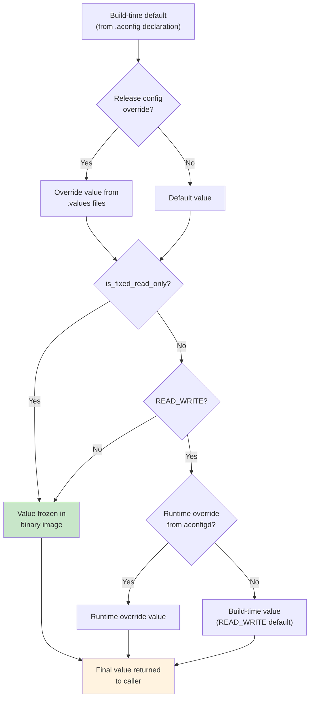

**只读标志**（包括 `is_fixed_read_only`）在构建时完全解析。生成的代码返回一个常量：

```java
public boolean myFixedFlag() {
    return true;  // Baked at build time, never changes
}
```

**读写标志**需要运行时查找。如果没有运行时覆盖，它们的构建时值就作为默认值。

### 3.4.10 aflags CLI 工具

`aflags` 二进制文件是一个设备端工具，用于检查和操作标志值。设备上的 `aflags`（`build/make/tools/aconfig/aflags/src/main.rs`）是一个薄垫片，委托给 ConfigInfrastructure APEX 中可更新的 `aflags_updatable` 二进制文件。真正的子命令逻辑位于那里（`packages/modules/ConfigInfrastructure/aflags/src/main.rs`）：

```rust
// From build/make/tools/aconfig/aflags/src/main.rs

fn invoke_updatable_aflags() {
    let updatable_command =
        "/apex/com.android.configinfrastructure/bin/aflags_updatable";
    // ... delegate all arguments to updatable binary
}
```

常见的 `aflags` 命令：

```bash
# List all flags and their values
adb shell aflags list

# Filter the list to a container
adb shell aflags list --container system

# Override a flag value (read-write flags only)
adb shell aflags enable com.android.apex.flags.mount_before_data

# Clear an override (the subcommand is "unset", not "clear")
adb shell aflags unset com.android.apex.flags.mount_before_data
```

`enable`、`disable` 和 `unset` 子命令接受 `-i`/`--immediate` 标志。Android 17 增加了两项列表功能。第一，`aflags list --format proto` 输出一个 Base64 编码的 `ProtoFlagList`（由 `android.provider.flags.aflags_list_proto` 标志门控）。第二，当设置了 `aflags_list_mainline_beta` 标志时，`aflags list` 还会合并从 `device_config` 存储中读取的 Mainline Beta 标志。

---

## 3.5 标志生命周期

### 3.5.1 生命周期阶段

每个标志都遵循一个从创建到清理的可预测生命周期：

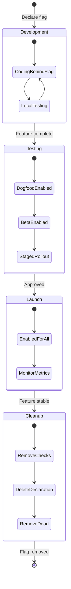

### 3.5.2 阶段 1：开发

在开发期间，标志被：

- 在 `.aconfig` 文件中以 `DISABLED` 默认状态**声明**
- 在代码中用 `if (Flags.myNewFeature()) { ... }` **守护**
- 通过 `aflags` 或构建配置覆盖在本地**测试**

开发者的 `Android.bp` 添加标志声明和代码生成库：

```blueprint
aconfig_declarations {
    name: "my-feature-flags",
    package: "com.android.myfeature.flags",
    container: "system",
    srcs: ["my_feature.aconfig"],
}

java_aconfig_library {
    name: "my-feature-flags-java",
    aconfig_declarations: "my-feature-flags",
}
```

### 3.5.3 阶段 2：测试

随着功能成熟：

- dogfood/beta 构建的发布配置把标志设置为 `ENABLED`，权限为 `READ_WRITE`
- 服务端配置可以为特定用户群体启用/禁用该标志
- CI 在标志两种状态下运行测试

### 3.5.4 阶段 3：发布

在发布时：

- 发布配置中把标志设置为 `ENABLED` 和 `READ_ONLY`
- 对于受 API 守护的功能，标志针对目标 SDK 级别定稿
- 标志的值被烘焙进二进制文件，无法被覆盖

### 3.5.5 阶段 4：清理

在功能稳定了一个发布周期之后：

- 从 `.aconfig` 文件中移除标志声明
- 所有 `if (Flags.myFlag())` 检查被替换为启用的分支
- 移除禁用分支中的死代码
- 移除标志的代码生成库依赖

清理至关重要——陈旧的标志会累积技术债务。aconfig 系统通过提供 `dump-cache` 命令协助清理，用于识别在所有发布配置中都处于固定状态的标志。

### 3.5.6 Bugfix 标志

带有 `purpose: PURPOSE_BUGFIX` 的标志遵循加速的生命周期。它们通常：

- 创建为 `READ_WRITE`，以便在修复造成回归时快速回滚
- 在修复生效一个发布周期后提升为 `READ_ONLY`
- 在下一个版本中清理

```protobuf
// File: system/server_configurable_flags/aconfigd/
//       new_aconfig_storage.aconfig

flag {
    name: "support_clear_local_overrides_immediately"
    namespace: "core_experiments_team_internal"
    description: "Support ability to clear local overrides immediately."
    bug: "360205436"
    metadata {
        purpose: PURPOSE_BUGFIX
    }
}
```

### 3.5.7 导出标志和已定稿标志

标记为 `is_exported: true` 的标志对来自其来源容器之外的代码可见。这对暴露由平台之外构建的应用所消费的 API 的 Mainline 模块至关重要。

当一个由标志守护的 API 针对某个 SDK 级别定稿时，该标志进入**已定稿标志**系统。`aconfig_protos/protos/aconfig_internal.proto` 中的 `finalized_flag` proto 记录：

```protobuf
message finalized_flag {
  optional string name = 1;
  optional string package = 2;
  optional int32 min_sdk = 3;
}
```

在生成的导出代码中，已定稿标志包含一个 SDK 版本检查：

```java
public static boolean myExportedFlag() {
    if (Build.VERSION.SDK_INT >= 36) {
        return true;  // Finalized at SDK 36
    }
    return FEATURE_FLAGS.myExportedFlag();
}
```

这确保了运行在 SDK 36+ 上的应用总是把该标志视为启用，无论运行时标志状态如何。

---

## 3.6 构建系统集成

### 3.6.1 Soong 模块类型

aconfig 构建集成通过两个包注册其模块类型：

**来自 `build/soong/aconfig/init.go`**（`RegisterBuildComponents`，第 148-156 行）：

```go
func RegisterBuildComponents(ctx android.RegistrationContext) {
    ctx.RegisterModuleType("aconfig_declarations",
        DeclarationsFactory)
    ctx.RegisterModuleType("aconfig_values",
        ValuesFactory)
    ctx.RegisterModuleType("aconfig_value_set",
        ValueSetFactory)
    ctx.RegisterModuleType("all_aconfig_declarations",
        AllAconfigDeclarationsFactory)
    ctx.RegisterParallelSingletonType("all_aconfig_declarations",
        AllAconfigDeclarationsSingletonFactory)
    ctx.RegisterParallelSingletonType("exported_java_aconfig_library",
        ExportedJavaDeclarationsLibraryFactory)
    ctx.RegisterModuleType("all_aconfig_declarations_extension",
        AllAconfigDeclarationsExtensionFactory)
}
```

有一处值得注意的 Android 17 变更：`all_aconfig_declarations` 现在注册了两次。它注册为一个普通模块类型（`AllAconfigDeclarationsFactory`），并注册为一个并行单例（`AllAconfigDeclarationsSingletonFactory`）。此前单一的 `RegisterSingletonModuleType` 被拆分为两部分。一部分是运行已定稿标志 / metalava 流水线的模块。另一部分是发出组合产物的单例（见 3.6.10 节）。一个新的 `all_aconfig_declarations_extension` 模块类型伴随此次拆分。

**来自 `build/soong/aconfig/codegen/init.go`**（`RegisterBuildComponents`，第 83-88 行）：

```go
func RegisterBuildComponents(ctx android.RegistrationContext) {
    ctx.RegisterModuleType("aconfig_declarations_group",
        AconfigDeclarationsGroupFactory)
    ctx.RegisterModuleType("cc_aconfig_library",
        CcAconfigLibraryFactory)
    ctx.RegisterModuleType("java_aconfig_library",
        JavaDeclarationsLibraryFactory)
    ctx.RegisterModuleType("rust_aconfig_library",
        RustAconfigLibraryFactory)
}
```

### 3.6.2 aconfig_declarations

`aconfig_declarations` 模块类型是标志流水线的起点。它处理 `.aconfig` 源文件并生成二进制缓存。

**属性**（来自 `aconfig_declarations.go` 第 39-56 行）：

| 属性      | 类型                          | 是否必需 | 描述                                        |
|---------------|-------------------------------|----------|----------------------------------------------------|
| `srcs`        | `proptools.Configurable[[]string]` | 是 | `.aconfig` 文件列表                                |
| `package`     | `string`                      | 是      | Java 风格的包名                                    |
| `container`   | `string`                      | 是      | 标志所属的容器                                      |
| `exportable`  | `bool`                        | 否      | 标志是否可以重新打包以导出                          |

在 Android 17 中，`srcs` 变成了 `proptools.Configurable[[]string]`（而不是普通的 `[]string`）。因此声明文件列表可以根据产品/发布变量通过 `select()` 变化。

来自 frameworks/base 的示例：

```blueprint
// frameworks/base/android-sdk-flags/Android.bp

aconfig_declarations {
    name: "android.sdk.flags-aconfig",
    package: "android.sdk",
    container: "system",
    srcs: ["flags.aconfig"],
}
```

构建动作用所有声明文件和发布配置中任何匹配的值调用 `aconfig create-cache`。在 Android 17 中，`init.go`（第 32-51 行）中的构建规则核心把声明和值写入一个**响应文件**，以避免命令行长度限制。它还使用 Soong 的 `CpIfChanged` 辅助函数，而不是手写的 `cmp`/`mv` 惯用法：

```go
aconfigRule = pctx.AndroidStaticRule("aconfig",
    blueprint.RuleParams{
        Command2: blueprint.NewCommand(
            Aconfig, ` create-cache`,
            ` --package ${package}`,
            ` ${container}`,
            ` @${out}.rsp`,        // declarations + values via rspfile
            ` ${default-permission}`,
            ` ${allow-read-write}`,
            ` ${mainline-beta-namespace-config}`,
            ` ${force-read-only}`,
            ` --cache ${out}.tmp`,
            ` && `, android.CpIfChanged, ` ${out}.tmp ${out}`,
        ),
        Rspfile:        "${out}.rsp",
        RspfileContent: "${declarations} ${values}",
        Restat:         true,
    }, ...)
```

`CpIfChanged` 只在缓存文件的内容确实发生变化时才重写它（`Restat: true` 重新 stat 输出），避免下游代码生成目标不必要的重新构建。两个被替换的参数与发布配置构建标志相连：`${allow-read-write}` 是 `RELEASE_ACONFIG_REQUIRE_ALL_READ_ONLY` 的取反，`${force-read-only}` 由 `RELEASE_CONFIG_FORCE_READ_ONLY` 驱动。

### 3.6.3 aconfig_values

`aconfig_values` 模块类型为特定包提供标志值覆盖。values 模块被收集到值集中。

**属性**（来自 `aconfig_values.go` 第 28-33 行）：

| 属性  | 类型       | 是否必需 | 描述                              |
|-----------|------------|----------|------------------------------------------|
| `srcs`    | `[]string` | 是      | `.values` 或 `.textproto` 文件列表         |
| `package` | `string`   | 是      | 这些值适用的包                          |

示例：

```blueprint
// build/release/aconfig/bp4a/android.app/Android.bp

aconfig_values {
    name: "aconfig-values-platform_build_release-bp4a-android.app-all",
    package: "android.app",
    srcs: [
        "*_flag_values.textproto",
    ],
}
```

### 3.6.4 aconfig_value_set

`aconfig_value_set` 模块类型把多个 `aconfig_values` 模块聚合为一个可以由发布配置引用的集合。

**属性**（来自 `aconfig_value_set.go` 第 31-37 行）：

| 属性 | 类型       | 描述                                    |
|----------|------------|------------------------------------------------|
| `values` | `[]string` | `aconfig_values` 模块名列表                    |
| `srcs`   | `[]string` | 包含 values 的 `Android.bp` 文件路径           |

示例：

```blueprint
// build/release/aconfig/bp4a/Android.bp

aconfig_value_set {
    name: "aconfig_value_set-platform_build_release-bp4a",
    srcs: [
        "*/Android.bp",
    ],
}
```

`srcs` 属性是一种较新的方法，它会从指定的 `Android.bp` 文件中自动发现 `aconfig_values` 模块。

### 3.6.5 发布配置集成

值集与构建之间的桥梁是发布配置变量 `RELEASE_ACONFIG_VALUE_SETS`。该变量列出应应用于当前构建目标的 `aconfig_value_set` 模块。

在 Soong 构建中，每个 `aconfig_declarations` 模块自动添加对该变量指定的值集的依赖（来自 `aconfig_declarations.go` 第 92-98 行）：

```go
func (module *DeclarationsModule) DepsMutator(
        ctx android.BottomUpMutatorContext) {
    valuesFromConfig := ctx.Config().ReleaseAconfigValueSets()
    if len(valuesFromConfig) > 0 {
        ctx.AddDependency(ctx.Module(), implicitValuesTag,
            valuesFromConfig...)
    }
}
```

解析链：

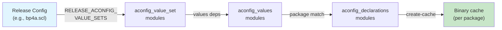

### 3.6.6 java_aconfig_library

`java_aconfig_library` 模块类型从 `aconfig_declarations` 模块生成一个 Java 库：

**属性**（来自 `codegen/java_aconfig_library.go` 第 34-51 行）：

| 属性                        | 类型     | 是否必需 | 描述                                    |
|---------------------------------|----------|----------|------------------------------------------------|
| `aconfig_declarations`          | `string` | 是      | aconfig_declarations 模块的名称         |
| `mode`                          | `string` | 否      | 代码生成模式（默认：`"production"`）  |
| `preserve_legacy_impl_interface`| `bool`   | 否      | 强制保留 `FeatureFlags`/`FeatureFlagsImpl` 间接层（Android 17） |

示例：

```blueprint
java_aconfig_library {
    name: "android.sdk.flags-aconfig-java",
    aconfig_declarations: "android.sdk.flags-aconfig",
}
```

`preserve_legacy_impl_interface` 属性是 Android 17 新增的。默认情况下，代码生成规则传递 `--allow-impl-interface-removal`，由 `RELEASE_ACONFIG_DEFAULT_ALLOW_JAVA_IMPL_INTERFACE_REMOVAL` 构建标志驱动。这让只读标志在生成的 `FeatureFlags` 接口和实现中被移除，当没有东西需要运行时间接层时。设置 `preserve_legacy_impl_interface: true` 会覆盖该行为，为仍然依赖它的调用者保留完整接口。

该模块自动添加对以下内容的依赖（仅当 `sdk_version` 不是 `"none"` 时）：

- `aconfig-annotations-lib` —— 用于 R8 优化注解
- `unsupportedappusage` —— 用于向后兼容注解
- `aconfig_storage_stub` —— 用于运行时存储访问

并为生成的类注册 JarJar 重命名规则，以在导出情况下支持重新打包：

```go
module.AddJarJarRenameRule(declarations.Package+".Flags", "")
module.AddJarJarRenameRule(declarations.Package+".FeatureFlags", "")
module.AddJarJarRenameRule(
    declarations.Package+".FeatureFlagsImpl", "")
module.AddJarJarRenameRule(
    declarations.Package+".CustomFeatureFlags", "")
module.AddJarJarRenameRule(
    declarations.Package+".FakeFeatureFlagsImpl", "")
```

### 3.6.7 cc_aconfig_library

`cc_aconfig_library` 模块类型生成一个 C/C++ 库：

**属性**（来自 `codegen/cc_aconfig_library.go` 第 38-48 行）：

| 属性               | 类型     | 是否必需 | 描述                                    |
|------------------------|----------|----------|------------------------------------------------|
| `aconfig_declarations` | `string` | 是      | aconfig_declarations 模块的名称         |
| `mode`                 | `string` | 否      | 代码生成模式（默认：`"production"`）  |

示例：

```blueprint
cc_aconfig_library {
    name: "my-feature-flags-cc",
    aconfig_declarations: "my-feature-flags",
}
```

对于除 `force-read-only` 之外的每种模式（即 production、exported 和 test），该库自动依赖：

- `libaconfig_storage_read_api_cc` —— C++ 存储读取 API
- `libbase` —— Android 基础库
- `liblog` —— Android 日志

对于 `force-read-only` 模式，这些依赖被省略，因为不需要运行时存储访问。

生成的文件名遵循以下模式：

- **源码：** `<package_with_underscores>.cc`（例如 `com_android_apex_flags.cc`）
- **头文件：** `include/<package_with_underscores>.h`

### 3.6.8 rust_aconfig_library

`rust_aconfig_library` 模块类型生成一个 Rust 库 crate：

```blueprint
rust_aconfig_library {
    name: "my-feature-flags-rust",
    aconfig_declarations: "my-feature-flags",
}
```

这将创建一个可以添加到其他 Rust 模块的 `rlibs`、`dylibs` 或 `rustlibs` 依赖中的库。

### 3.6.9 aconfig_declarations_group

`aconfig_declarations_group` 模块类型把多个代码生成库聚合为一个依赖，简化大型构建配置，如 `frameworks/base/AconfigFlags.bp`：

```blueprint
aconfig_declarations_group {
    name: "framework-minus-apex-aconfig-declarations",
    aconfig_declarations_groups: [
        "aconfig_trade_in_mode_flags",
        "audio-framework-aconfig",
    ],
    java_aconfig_libraries: [
        "android.app.flags-aconfig-java",
        "android.content.flags-aconfig-java",
        "android.location.flags-aconfig-java",
        "android.os.flags-aconfig-java",
        // ... many more
    ],
}
```

### 3.6.10 all_aconfig_declarations 单例

`all_aconfig_declarations` 单例模块把整棵树中的每个 `aconfig_declarations` 模块收集到一个组合文件中。该组合文件被导出到标志管理服务器（Google 内部的 "Gantry" 系统）：

来自 `all_aconfig_declarations.go`（第 43-49 行）：

```go
// A singleton that collects all of the aconfig flags declared in the
// tree into a single combined file for export to the external flag setting
// server (inside Google it's Gantry).
//
// Note that this is ALL aconfig_declarations modules present in the tree,
// not just ones that are relevant to the product currently being built,
// so that that infra doesn't need to pull from multiple builds and merge
// them.
```

单例产生：

- `all_aconfig_declarations.pb` —— 所有标志的二进制 protobuf
- `all_aconfig_declarations.textproto` —— 所有标志的文本 protobuf
- 存储文件：`.package.map`、`.flag.map`、`.flag.info`、`.val`

这些产物作为 `docs`、`droid`、`sdk`、`release_config_metadata` 和 `gms` 构建目标的一部分分发。

在 Android 17 中，旧的 `SingletonModule` 被拆分为一个普通**模块**（`AllAconfigDeclarationsFactory`）和一个**单例**（`AllAconfigDeclarationsSingletonFactory`）。单例发出上述组合产物。模块持有 API 表面属性（`Api_signature_files`、`Finalized_flags_file`）。它运行 metalava / record-finalized-flags 流水线以生成 `finalized-flags.txt`。该模块为 `sdk` 目标分发该文件（`ctx.DistForGoalWithFilename("sdk", ...)`），并将其挂到 `all_aconfig_declarations` phony 目标下。

另外，该模块通过 `AllAconfigDeclarationsInfoProvider` 发布组合产物的路径。这些产物是已解析标志的 proto、textproto 以及四个存储文件。该 provider 的 `AllAconfigDeclarationsInfo` 结构体不携带已定稿标志字段（`build/soong/aconfig/all_aconfig_declarations.go`）。一个配套的 `all_aconfig_declarations_extension` 模块类型（`build/soong/aconfig/all_aconfig_declarations_extension.go`）扩展基础的 `all_aconfig_declarations`，为 dist 构建中的额外 API 表面生成备用的 `finalized-flags.txt`。`RELEASE_ACONFIG_FINALIZE_NON_API_FLAGS` 构建标志在此流水线中为非 API 标志增加一个定稿步骤。

### 3.6.11 exported_java_aconfig_library

`exported_java_aconfig_library` 单例生成一个 JAR 文件，包含整棵树中所有导出标志的 Java 标志访问器代码。该 JAR 以 `android-flags.jar` 的形式随 SDK 分发：

```go
ctx.DistForGoalWithFilename("sdk", this.intermediatePath,
    "android-flags.jar")
```

在平台之外（在 Android Studio 中）构建的应用可以使用此 JAR 访问导出标志，而无需构建完整的平台。

### 3.6.12 依赖图

典型标志集成的完整依赖图：

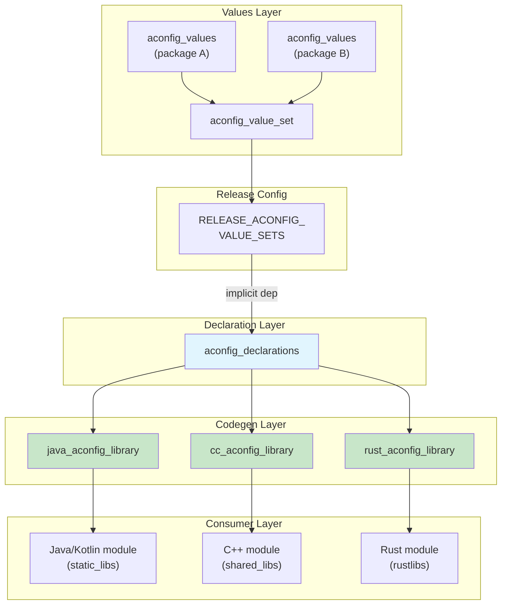

### 3.6.13 构建标志（build_flag_declarations）

除 aconfig 特性标志外，构建系统还支持**构建标志**。这是一个独立的标志类型，用于控制构建时行为（与运行时功能开关相对）。构建标志由 `build/soong/aconfig/build_flags/` 中的 `build_flags` 包管理：

```go
// build/soong/aconfig/build_flags/declarations.go

type DeclarationsModule struct {
    android.ModuleBase
    android.DefaultableModuleBase

    properties struct {
        // Build flag declaration files
        Srcs []string `android:"path"`
    }
}
```

构建标志与 aconfig 标志的不同之处在于：

- 只影响构建行为，绝不影响运行时行为
- 不生成访问器代码（Java/C++/Rust）
- 由构建系统（Soong、Make）直接消费
- 不需要存储文件或 aconfigd

构建标志的示例：

- `RELEASE_ACONFIG_REQUIRE_ALL_READ_ONLY`（强制所有标志为只读）
- `RELEASE_EXPORTED_FLAG_CHECK`（启用导出标志验证）
- `RELEASE_CONFIG_FORCE_READ_ONLY`（在配置级别强制只读）

### 3.6.14 每模块一个包的规则

`all_aconfig_declarations` 单例强制执行一个关键约束：每个包在整个树中只能有一个 `aconfig_declarations` 模块。这在单例的 `GenerateBuildActions` 期间检查（来自 `all_aconfig_declarations.go`，约第 241 行）：

```go
var numOffendingPkg = 0
offendingPkgsMessage := ""
for pkg, cnt := range packages {
    if cnt > 1 {
        offendingPkgsMessage += fmt.Sprintf(
            "%d aconfig_declarations found for package %s\n",
            cnt, pkg)
        numOffendingPkg++
    }
}

if numOffendingPkg > 0 {
    panic("Only one aconfig_declarations allowed " +
          "for each package.\n" + offendingPkgsMessage)
}
```

该限制确保：

- 每个标志恰好有一个权威声明
- 标志 ID 和存储偏移是确定性的
- 服务端标志管理系统（Gantry）从包到标志有明确的映射

### 3.6.15 构建时标志与发布配置

aconfig 系统通过几个构建标志与更广泛的发布配置基础设施集成：

| 构建标志                                  | 效果                                                |
|---------------------------------------------|-------------------------------------------------------|
| `RELEASE_ACONFIG_VALUE_SETS`                | 列出适用 `aconfig_value_set` 模块的产品变量（不是 `flag_declaration`） |
| `RELEASE_ACONFIG_FLAG_DEFAULT_PERMISSION`   | 所有标志的默认权限（默认为 `READ_WRITE`） |
| `RELEASE_ACONFIG_REQUIRE_ALL_READ_ONLY`     | 如果为 true，把任何标志设置为 `READ_WRITE` 都是错误 |
| `RELEASE_CONFIG_FORCE_READ_ONLY`            | 如果为 true，aconfig 把所有标志权限强制为 `READ_ONLY` |
| `RELEASE_ACONFIG_EXTRA_RELEASE_CONFIGS`     | 要为其生成产物的额外发布配置   |
| `RELEASE_ACONFIG_STORAGE_VERSION`           | 存储文件格式的版本号（默认为 `"2"`） |

`RELEASE_ACONFIG_REQUIRE_ALL_READ_ONLY` 标志对生产发布构建尤为重要。设置后，它禁止任何标志为 `READ_WRITE`，确保已发布的构建中任何标志都不能在运行时被更改。（注意，`RELEASE_ACONFIG_VALUE_SETS` 通过 `Config.ReleaseAconfigValueSets()` 作为产品变量读取；其他标志是 `build/release/flag_declarations/` 下的 `flag_declaration` 条目。）

Android 17 在 `build/release/flag_declarations/` 下新增了几个 `RELEASE_ACONFIG_*` 标志声明：

| 构建标志（Android 17）                                | 效果                                                              |
|--------------------------------------------------------|---------------------------------------------------------------------|
| `RELEASE_ACONFIG_OPTIMIZE_READ_ONLY_JAVA`              | 只读 Java getter 直接返回默认值，绕过测试覆盖支持 |
| `RELEASE_ACONFIG_ENABLE_INT_FLAG`                      | 允许声明整型 aconfig 标志                         |
| `RELEASE_ACONFIG_GENERATE_CHECKS_SDK_ANNOTATION`       | 在已定稿的导出 getter 上发出 `@ChecksSdkIntAtLeast`            |
| `RELEASE_ACONFIG_DEFAULT_ALLOW_JAVA_IMPL_INTERFACE_REMOVAL` | 默认尽可能移除不必要的内部 Java 代码生成 |
| `RELEASE_ACONFIG_PARSE_V4`                             | 解析并写入 v4 存储格式（整型标志存储）         |
| `RELEASE_ACONFIG_SUPPORT_MINOR_SDK`                    | 为已定稿标志生成次版本 SDK（`SDK_INT_FULL`）检查        |
| `RELEASE_ACONFIG_FINALIZE_NON_API_FLAGS`               | 在已定稿标志流水线中为非 API 标志运行定稿步骤 |

---

## 3.7  使用标志进行测试

### 3.7.1  测试挑战

特性标志带来了组合测试问题。如果一个模块有 N 个标志，就存在 2^N 种可能的
标志组合。aconfig 测试基础设施提供了若干机制来管理这种复杂性：

1. **SetFlagsRule** —— 一个 JUnit `TestRule`，用于在测试进程内控制标志值
2. **@EnableFlags / @DisableFlags** —— 用于按测试方法或类进行声明式标志配置
   的注解
3. **@RequiresFlagsEnabled / @RequiresFlagsDisabled** —— 当标志前置条件不满足
   时跳过测试的注解
4. **FlagsParameterization** —— 用于跨多种标志组合运行测试的工具
5. **FakeFeatureFlagsImpl** —— 为每个标志包生成的测试替身
6. **CheckFlagsRule** —— 一个用于设备端测试、检查标志前置条件的 `TestRule`

### 3.7.2  SetFlagsRule

位于
`platform_testing/libraries/flag-helpers/junit/src_base/android/platform/test/flag/junit/SetFlagsRule.java`
的 `SetFlagsRule` 类是主要的测试机制。它通过把每个 `Flags` 类中的
`FEATURE_FLAGS` 字段替换为 `FakeFeatureFlagsImpl` 实例来工作：

```java
public final class SetFlagsRule implements TestRule {

    // Key constants for reflection
    private static final String FAKE_FEATURE_FLAGS_IMPL_CLASS_NAME =
        "FakeFeatureFlagsImpl";
    private static final String FEATURE_FLAGS_FIELD_NAME =
        "FEATURE_FLAGS";
    private static final String FLAGS_CLASS_NAME = "Flags";

    // Two initialization modes
    public enum DefaultInitValueType {
        NULL_DEFAULT,    // Flags must be explicitly set
        DEVICE_DEFAULT,  // Use device/build default values
    }
}
```

该规则通过反射来：

1. 在 `Flags.java` 中找到 `FEATURE_FLAGS` 静态字段
2. 保存原始的 `FeatureFlagsImpl` 实例
3. 将其替换为 `FakeFeatureFlagsImpl`
4. 在测试结束后恢复原值

### 3.7.3  @EnableFlags 和 @DisableFlags 注解

这些注解提供了一种声明式的方式来为测试设置标志值。它们定义在
`platform_testing/libraries/annotations/src/android/platform/test/annotations/`
中：

```java
// EnableFlags.java

@Retention(RetentionPolicy.RUNTIME)
@Target({ElementType.METHOD, ElementType.TYPE})
public @interface EnableFlags {
    /**
     * The list of the feature flags to be enabled.
     * Each item is the full flag name with the format
     * {package_name}.{flag_name}.
     */
    String[] value();
}
```

```java
// DisableFlags.java

@Retention(RetentionPolicy.RUNTIME)
@Target({ElementType.METHOD, ElementType.TYPE})
public @interface DisableFlags {
    String[] value();
}
```

在测试中的用法：

```java
@RunWith(AndroidJUnit4.class)
public class MyFeatureTest {
    @Rule
    public final SetFlagsRule mSetFlagsRule = new SetFlagsRule();

    @Test
    @EnableFlags(Flags.FLAG_MY_NEW_FEATURE)
    public void testWithFeatureEnabled() {
        assertTrue(Flags.myNewFeature());
        // Test the enabled code path
    }

    @Test
    @DisableFlags(Flags.FLAG_MY_NEW_FEATURE)
    public void testWithFeatureDisabled() {
        assertFalse(Flags.myNewFeature());
        // Test the disabled code path
    }

    @Test
    @EnableFlags(Flags.FLAG_MY_NEW_FEATURE)
    @DisableFlags(Flags.FLAG_OTHER_FEATURE)
    public void testMixedFlags() {
        assertTrue(Flags.myNewFeature());
        assertFalse(Flags.otherFeature());
    }
}
```

这些注解遵循特定的优先级规则：

- 如果同一个标志同时被类级和方法级注解设置，那么这两个值必须一致。不一致会
  抛出 `AssertionError`。方法值不会悄悄覆盖类值。方法值只有在这次一致性检查
  之后才会合并到类值之上
- 一个标志在同一级别上不能同时被启用和禁用（这属于错误）

### 3.7.4  @RequiresFlagsEnabled 和 @RequiresFlagsDisabled

`@EnableFlags` 和 `@DisableFlags` 主动设置标志值，而
`@RequiresFlagsEnabled` 和 `@RequiresFlagsDisabled` 则表达前置条件。如果标志
未处于所需状态，测试会被跳过（通过 JUnit 的 `Assume`）：

```java
@Test
@RequiresFlagsEnabled(Flags.FLAG_MY_NEW_FEATURE)
public void testOnlyWhenFeatureExists() {
    // This test only runs if the flag is already enabled
    // on the device under test
}
```

这些注解对于必须在不同设备配置上运行的 CTS 测试尤其有用。

### 3.7.5  编程式标志控制

除了注解之外，还可以通过 `SetFlagsRule` 以编程方式设置标志：

```java
@Rule
public final SetFlagsRule mSetFlagsRule = new SetFlagsRule();

@Before
public void setUp() {
    mSetFlagsRule.enableFlags(Flags.FLAG_MY_FEATURE);
}

@Test
public void myTest() {
    // Flag is enabled
    mSetFlagsRule.disableFlags(Flags.FLAG_MY_FEATURE);
    // Flag is now disabled
}
```

注意：`SetFlagsRule` 上的 `enableFlags()` 和 `disableFlags()` 方法已被废弃，
推荐使用基于注解的方式。注解提供了更好的可读性，并且支持
`FlagsParameterization`。

### 3.7.6  FlagsParameterization

`FlagsParameterization` 支持在多种标志组合下运行同一个测试：

```java
@RunWith(Parameterized.class)
public class MyParameterizedTest {
    @Parameterized.Parameters(name = "{0}")
    public static List<FlagsParameterization> getParams() {
        return FlagsParameterization.allCombinationsOf(
            Flags.FLAG_FEATURE_A,
            Flags.FLAG_FEATURE_B
        );
    }

    @Rule
    public final SetFlagsRule mSetFlagsRule;

    public MyParameterizedTest(
            FlagsParameterization flags) {
        mSetFlagsRule = new SetFlagsRule(flags);
    }

    @Test
    public void testInteraction() {
        // This test runs 4 times:
        // A=true  B=true
        // A=true  B=false
        // A=false B=true
        // A=false B=false
    }
}
```

当 `@EnableFlags` 与 `FlagsParameterization` 一起使用时，与参数化相冲突的测试
会通过 JUnit 假设失败被跳过，而不是失败。

### 3.7.7  测试模式代码生成

当 `java_aconfig_library` 被配置为 `mode: "test"` 时，生成的
`FeatureFlagsImpl.java` 会在每次标志访问时抛出异常：

```java
public final class FeatureFlagsImpl implements FeatureFlags {
    @Override
    public boolean myFlag() {
        throw new UnsupportedOperationException(
            "Method is not implemented.");
    }
}
```

而 `Flags.java` 会暴露用于测试设置的额外方法：

```java
public static void setFeatureFlags(FeatureFlags featureFlags) {
    Flags.FEATURE_FLAGS = featureFlags;
}

public static void unsetFeatureFlags() {
    Flags.FEATURE_FLAGS = null;
}
```

这种模式强制测试显式配置标志状态，防止意外依赖生产默认值。

### 3.7.8  C++ 测试模式

在 C++ 测试模式中，生成的头文件提供了设置函数和一个重置函数：

```cpp
namespace com::android::aconfig::test {

// Normal accessor
inline bool my_flag() {
    return provider_->my_flag();
}

// Test setter
inline void my_flag(bool val) {
    provider_->my_flag(val);
}

// Reset all flags
inline void reset_flags() {
    return provider_->reset_flags();
}

}  // namespace
```

C++ 测试代码：

```cpp
TEST(MyTest, FeatureEnabled) {
    com::android::aconfig::test::my_flag(true);
    // Test with flag enabled
    com::android::aconfig::test::reset_flags();
}
```

### 3.7.9  面向设备测试的 CheckFlagsRule

`SetFlagsRule` 主动在测试进程内设置标志值，而 `CheckFlagsRule` 是为设备端插桩
测试设计的，在这些测试中标志无法以编程方式控制。它不是设置标志值，而是验证
设备的标志状态与测试要求一致：

```java
@RunWith(AndroidJUnit4.class)
public class MyDeviceTest {
    @Rule
    public final CheckFlagsRule mCheckFlagsRule =
        DeviceFlagsValueProvider.createCheckFlagsRule();

    @Test
    @RequiresFlagsEnabled(Flags.FLAG_MY_FEATURE)
    public void testOnlyWhenEnabled() {
        // This test only runs if the device has
        // the flag enabled
    }

    @Test
    @RequiresFlagsDisabled(Flags.FLAG_MY_FEATURE)
    public void testOnlyWhenDisabled() {
        // This test only runs if the device has
        // the flag disabled
    }
}
```

`CheckFlagsRule` 读取实际的设备标志状态（来自 DeviceConfig 或 aconfigd），并
跳过前置条件不满足的测试。这对必须在所有设备配置上都通过的 CTS 测试至关重要。

`SetFlagsRule` 和 `CheckFlagsRule` 之间的区别：

| 方面          | SetFlagsRule            | CheckFlagsRule              |
|---------------|-------------------------|-----------------------------|
| 标志控制      | 主动设置值               | 读取设备状态                |
| 测试行为      | 强制标志状态             | 不匹配时跳过                 |
| 使用场景      | 单元测试、Robolectric    | 设备插桩测试                 |
| 注解          | @EnableFlags/@DisableFlags | @RequiresFlagsEnabled/Disabled |
| 实现          | FakeFeatureFlagsImpl    | DeviceFlagsValueProvider     |

### 3.7.10  宿主侧标志测试

宿主侧测试在开发机上运行，而不是在设备上。对于这些测试，`HostFlagsValueProvider`
会从与测试打包在一起的静态 aconfig `parsed_flags` proto 中解析 `READ_ONLY`
标志。它从所连接的设备解析 `READ_WRITE` 标志：

```java
// platform_testing/libraries/flag-helpers/junit/
//   src_host/.../host/HostFlagsValueProvider.java

public class HostFlagsValueProvider implements IFlagsValueProvider {
    // READ_ONLY flags: value from the parsed_flag proto
    //   bundled as a test resource
    // READ_WRITE flags: read from the connected device via
    //   "su root aflags list" over adb (falls back to the
    //   static value on user builds, where root is unavailable)
}
```

这使 CTS 及类似的测试套件能够在从宿主机针对所连接设备运行测试时，做出感知
标志的决策。

### 3.7.11  Ravenwood 标志支持

Ravenwood 是 Android 面向平台代码的轻量级宿主侧单元测试环境，它在宿主 JVM 上
运行真实的平台框架类。它使用框架的一个子集，不连接设备。`SetFlagsRule` 完全
通过反射作用于生成的 `Flags` / `FakeFeatureFlagsImpl` 类。因此，同一个规则和
同样的 `@EnableFlags` / `@DisableFlags` 注解在 Ravenwood 下无需专门的
Ravenwood 专用标志提供者即可工作。标志值针对进程内的 fake 解析，而不是针对
真实的设备。

### 3.7.12  测试架构图

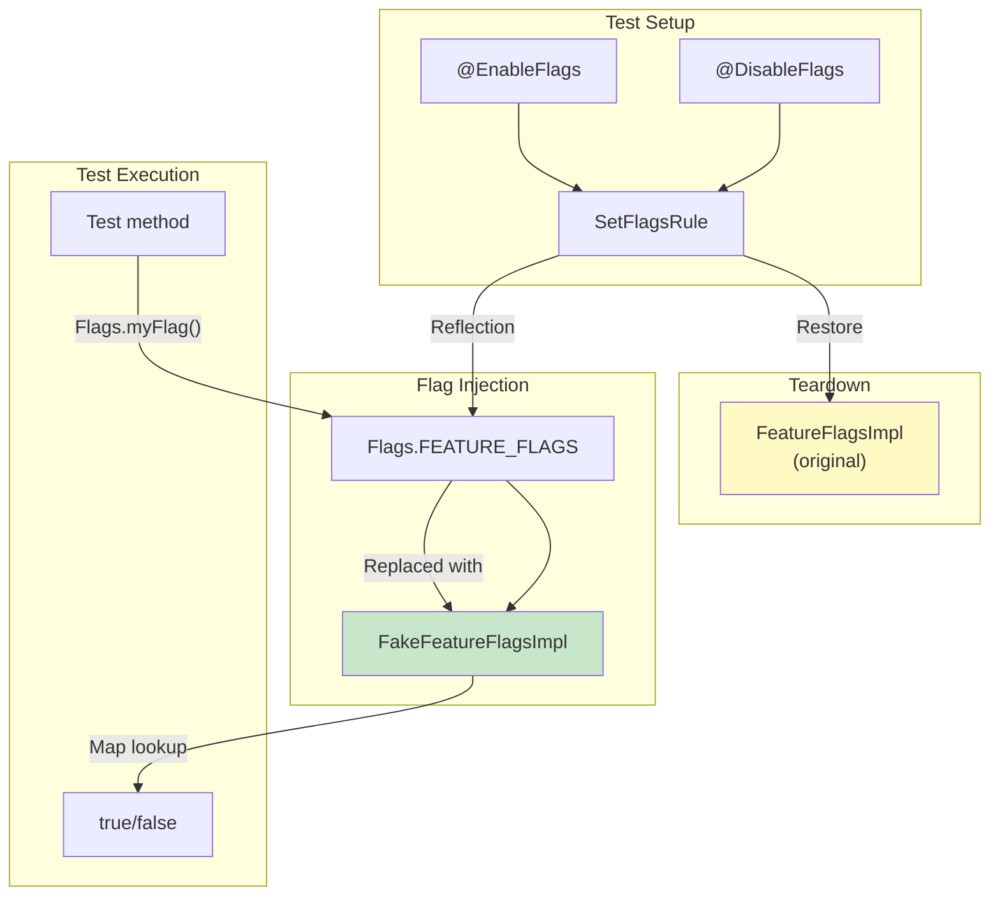

### 3.7.13  标志测试的最佳实践

1. **测试两种状态。** 每个标志都应对启用和禁用两条路径进行测试。缺少对某条
   路径的覆盖会在标志被翻转时导致回归。

2. **优先使用注解而非编程式控制。** `@EnableFlags` 和 `@DisableFlags` 注解比
   编程式的 `enableFlags()` / `disableFlags()` 调用更易读、更易于组合。

3. **测试交互。** 当两个标志相互影响时，使用
   `FlagsParameterization.allCombinationsOf()` 覆盖全部四种状态。

4. **在集成测试中使用 DEVICE_DEFAULT。**
   `DefaultInitValueType.DEVICE_DEFAULT` 模式以构建期默认值开始，更贴近生产行
   为。

5. **清理测试标志。** `SetFlagsRule` 会在每个测试后自动恢复标志状态，但要注
   意被测代码中的静态状态可能会保留依赖于标志的值。

---

## 3.8  旧式特性标志

在 aconfig 系统之前，Android 使用过几种临时性的特性标志机制。理解这些机制很
重要，因为它们在代码库中仍被广泛使用，而且 aconfig 建立在（有时委托给）这些
旧系统的基础之上。

### 3.8.1  SystemProperties

`SystemProperties` 类（`android.os.SystemProperties`）提供键值字符串属性，
其中许多充当特性标志：

```java
// Check a system property flag
boolean enabled = SystemProperties.getBoolean(
    "ro.feature.my_feature", false);
```

与标志相关的属性类别：

| 前缀         | 可变性    | 说明                              |
|--------------|-----------|-----------------------------------|
| `ro.*`       | 只读      | 在启动时设置，运行时无法更改        |
| `persist.*`  | 持久      | 重启后保留，运行时可写              |
| `sys.*`      | 易失      | 可写，重启后丢失                    |
| `debug.*`    | 调试      | 通常用于开发标志                    |

**局限性：**

- 无类型安全 —— 一切都只是字符串
- 无集中式声明 —— 属性靠约定定义
- 无构建系统集成 —— 值在 init 脚本、构建属性或运行时设置
- 属性值有长度限制：`SystemProperties.PROP_VALUE_MAX` 为 91（键长度在当今实际
  上无限制，`PROP_NAME_MAX = Integer.MAX_VALUE`）
- 不支持按用户或按 profile 的标志

### 3.8.2  Settings.Global 和 Settings.Secure

`Settings` 提供者提供比 SystemProperties 更灵活的持久化键值存储：

```java
// Read a settings-based flag
int value = Settings.Global.getInt(
    context.getContentResolver(),
    "my_feature_flag", 0);
```

| 表               | 作用域      | 使用场景                              |
|------------------|-------------|---------------------------------------|
| `Settings.Global`| 整台设备    | 系统级特性标志                         |
| `Settings.Secure`| 按用户      | 用户特定的特性标志                     |
| `Settings.System`| 按用户      | 用户可见的设置（不是标志）             |

**局限性：**

- 需要 `ContentResolver`（上下文依赖）
- 在 `SettingsProvider` 启动之前不可用
- 除了基本的 int/float/string 读取器之外没有类型安全
- 没有集中式声明或生命周期管理

### 3.8.3  DeviceConfig

`DeviceConfig`（`android.provider.DeviceConfig`）在 Android 10 中作为专门的
特性标志系统被引入。其实现现在位于 ConfigInfrastructure Mainline 模块中，路径
为
`packages/modules/ConfigInfrastructure/framework/java/android/provider/DeviceConfig.java`
（它是从 `frameworks/base` 中模块化出来的）。它存储按命名空间组织的标志，并
支持服务端标志推送：

```java
// Read a DeviceConfig flag
boolean enabled = DeviceConfig.getBoolean(
    "my_namespace", "my_flag", false);

// Listen for changes
DeviceConfig.addOnPropertiesChangedListener(
    "my_namespace",
    executor,
    properties -> {
        boolean newValue = properties.getBoolean(
            "my_flag", false);
    });
```

DeviceConfig 是 aconfig 运行时存储的前身，并且仍然作为那些解析后的元数据带有
`DEVICE_CONFIG` 存储后端的标志的后端。标志作者不会选择这一点。
`build/make/tools/aconfig/aconfig/src/commands.rs:131-149` 中的
`assign_storage_backend()` 在 `create-cache` 期间为每个 `parsed_flag` 盖上
`metadata.storage`。它为落在 Mainline Beta 命名空间中的可读写标志选择
`DEVICE_CONFIG`。然后代码生成会输出一个 `FeatureFlagsImpl`，对那些标志经由
DeviceConfig 进行读取。

**局限性：**

- 构建在 SettingsProvider 的 `config` 表（`Settings.Config`）之上，因此带有
  相同的 ContentProvider/IPC 开销
- 需要 SettingsProvider 已初始化
- 没有编译期死代码消除
- 没有标准化的声明格式（标志靠约定定义）

### 3.8.4  config.xml 资源覆盖

基于资源的特性标志使用可由 OEM 覆盖的 XML 配置文件：

```xml
<!-- frameworks/base/core/res/res/values/config.xml -->
<resources>
    <integer name="config_multiuserMaxRunningUsers">3</integer>
</resources>
```

OEM 通过运行时资源覆盖（RROs）或构建期静态覆盖来覆盖这些值：

```xml
<!-- device/vendor/overlay/res/values/config.xml -->
<resources>
    <integer name="config_multiuserMaxRunningUsers">5</integer>
</resources>
```

**局限性：**

- 仅限构建期（RROs 可以在安装时更改，但不能动态更改）
- 无服务端控制
- 无生命周期管理
- 覆盖是按设备的，不是按用户或按人群的

### 3.8.5  对比矩阵

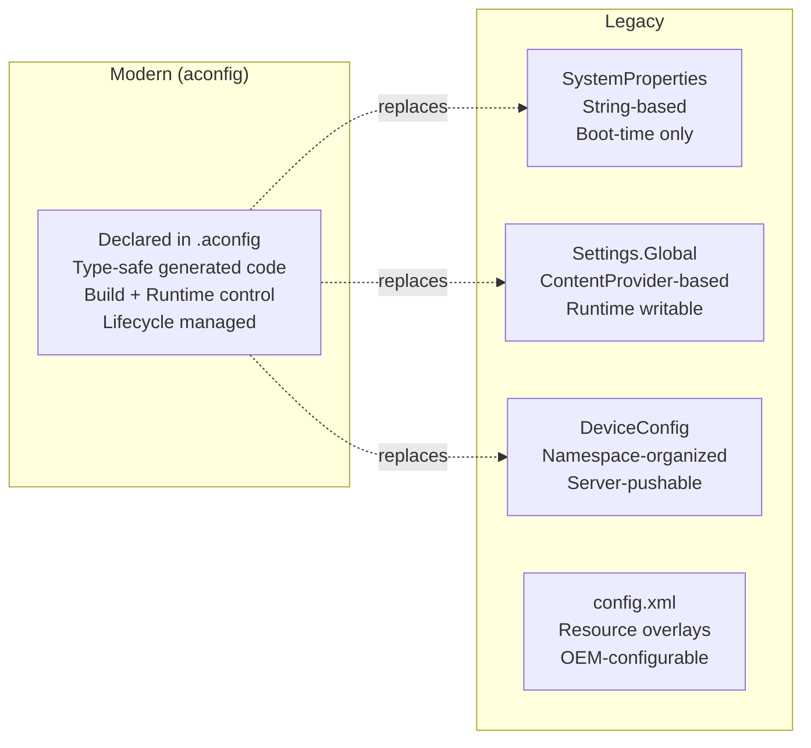

| 特性              | aconfig       | SystemProperties | Settings.Global | DeviceConfig | config.xml |
|-------------------|---------------|------------------|-----------------|--------------|------------|
| 类型安全          | Yes (codegen) | No               | No              | No           | Limited    |
| 声明              | `.aconfig`    | Convention       | Convention      | Convention   | XML        |
| 构建期控制        | Yes           | Yes              | No              | No           | Yes        |
| 运行时控制        | Yes (RW)      | Limited          | Yes             | Yes          | No         |
| 服务端推送        | Yes           | No               | No              | Yes          | No         |
| 死代码消除        | Yes (R8)      | No               | No              | No           | No         |
| 生命周期管理      | Yes           | No               | No              | No           | No         |
| 测试基础设施      | Yes           | Manual           | Manual          | Manual       | Manual     |
| 启动时可用        | Yes (new)     | Yes              | No              | No           | Yes        |
| 按用户            | No            | No               | Secure only     | No           | No         |

### 3.8.6  构建期特性宏

在 aconfig 之前，原生代码通常使用预处理宏来做特性标志：

```cpp
// Traditional approach
#ifdef ENABLE_FANCY_RENDERING
    renderFancy(scene);
#else
    renderBasic(scene);
#endif
```

这些宏在编译期通过 `Android.bp` 或 `Android.mk` 的 `cflags` 设置：

```blueprint
cc_library {
    name: "mylib",
    cflags: ["-DENABLE_FANCY_RENDERING"],
}
```

**局限性：**

- 标志与其检查是脱节的（没有单一声明）
- 无运行时覆盖能力
- 没有用于演练两条代码路径的测试基础设施
- 宏名中的拼写错误会悄悄创建新的宏
- 无法集中查看存在哪些标志

aconfig C++ 代码生成保留了编译期宏针对固定只读标志的零开销特性（使用
`constexpr inline` 函数和预处理定义）。它还为可读写标志增加了运行时灵活性。

### 3.8.7  @FlaggedApi 注解

`@FlaggedApi` 注解（`android.annotation.FlaggedApi`，其源码位于
`frameworks/libs/modules-utils/java/android/annotation/FlaggedApi.java`）把
aconfig 标志与 Android API 表面连接起来。当一个新的公共 API 被标志门控时：

```java
@FlaggedApi(Flags.FLAG_MY_NEW_API)
public void myNewApi() {
    // This API only exists when the flag is enabled
}
```

metalava 文档工具和 API 表面检查器使用该注解来：

- 根据标志状态把 API 包含或排除在公共 API 签名之外
- 追踪哪些 API 由哪些标志门控
- 确保已定稿的 API 与其标志正确关联
- 生成反映依赖标志的 API 表面的 SDK stub

`all_aconfig_declarations` 单例会生成元数据，metalava 消费这些元数据以验证
标志状态与 API 可见性之间的一致性。

### 3.8.8  从旧式标志迁移到 aconfig

把一个旧式标志迁移到 aconfig 时：

1. 在 `.aconfig` 文件中以相同的语义声明该标志
2. 用 `java_aconfig_library` 或 `cc_aconfig_library` 生成库
3. 把旧式读取（`SystemProperties.getBoolean(...)` 或
   `DeviceConfig.getBoolean(...)`）替换为生成的访问器（`Flags.myFlag()`）
4. 向适当的发布配置添加 values，以匹配旧式标志的默认行为
5. 使用 `@EnableFlags` / `@DisableFlags` 添加测试
6. 在所有使用方完成迁移后移除旧式标志

对于之前通过 `DeviceConfig` 控制的标志，请注意声明无法选择存储后端。
`build/make/tools/aconfig/aconfig_protos/src/lib.rs:149-152` 中的
`verify_fields()` 会拒绝任何在其元数据中设置 `storage` 的声明，因此包含
`storage:` 的 `.aconfig` 文件会解析失败。aconfig 在 `create-cache` 期间自行推
导后端：`READ_ONLY` 标志得到 `NONE`，Mainline Beta 命名空间中的可读写标志得到
`DEVICE_CONFIG`，其余所有标志得到 `ACONFIGD`。因此，一个已迁移的标志只有凭
借其命名空间、而不是凭借作者在声明中写入的任何内容，才能保留 DeviceConfig
支撑的读取路径。

---

## 3.9  Android 17 变更

本节汇总了 aconfig 系统在 Android 17 中的变更。其中一些在前面的小节中已顺带
提及。这里把它们连同来源引用汇集在一起，因此从 Android 16 的演进可以在一处看
清楚。

### 3.9.1  整数标志

直到 Android 16，每个 aconfig 标志都是布尔值。Android 17 引入了**标志类型**
维度，因此一个标志可以携带整数值。`build/make/tools/aconfig/aconfig_protos/protos/aconfig.proto`
中的 proto schema 新增了：

```protobuf
enum flag_type {
  FLAG_TYPE_UNSPECIFIED = 0;  // assume boolean for backward compatibility
  FLAG_TYPE_BOOLEAN = 1;
  FLAG_TYPE_INTEGER = 2;
}
```

并带有 `flag_declaration.type`（字段 8）、`flag_value.value_int`（字段 5），以及
`parsed_flag.type`/`value_int`（字段 13 和 14）。整条流水线都带有该管道：缓存、
解析器和存储格式都能理解整数标志。

该特性是刻意分阶段推出的。除非设置了 `enable_int_flag` Rust cfg（由
`RELEASE_ACONFIG_ENABLE_INT_FLAG` 构建标志
`build/release/flag_declarations/RELEASE_ACONFIG_ENABLE_INT_FLAG.textproto`
控制），否则解析器（`aconfig_protos/src/lib.rs`）会拒绝声明 `FLAG_TYPE_INTEGER`
标志。存储格式和读取 API 可以携带整数值。但**整数标志的访问器代码生成尚未接
入**。在 Android 17 中，每个生成的 Java/C++/Rust 访问器仍然返回 `bool`。因此，
整数标志在本次发布中最好被理解为 schema 与存储方面的基础工作。

### 3.9.2  版本 4 存储格式

整数标志需要新的磁盘布局。Android 17 新增了**存储版本 4**，定义在
`build/make/tools/aconfig/aconfig_storage_file/src/lib.rs` 中：

```rust
pub const MAX_SUPPORTED_FILE_VERSION: u32 =
    if cfg!(enable_parse_v4) { 4 } else { 3 } as u32;
pub const DEFAULT_FILE_VERSION: u32 = 2;
```

是否读写 v4 受 `enable_parse_v4` cfg 门控，该 cfg 由 `RELEASE_ACONFIG_PARSE_V4`
构建标志设置。相对 v3，版本 4 增加了：

- `StoredFlagType` 的三个整数变体（`ReadWriteInt64`、`ReadOnlyInt64`、
  `FixedReadOnlyInt64`）以及一个 `FlagValueType` 枚举（`Boolean`、`Int64`）。
- `PackageTableNode` 上的一个 `int_start_index` 字段（`boolean_start_index` 的
  整数标志对应物）。读取 API 的 `PackageReadContext` 也有同样的字段
  `int_start_index`。
- flag-info 头部上的 `num_int_flags` 和 `int_flag_offset` 字段，外加一个
  `int_nodes` 列表。
- 位于
  `build/make/tools/aconfig/aconfig_storage_read_api/src/lib.rs` 中的一个 Rust
  读取函数 `get_int64_flag_value(file, index) -> Result<i64>`。目前还没有对应的
  `cxx::bridge` 对应物，因此 C++ 生成代码只能读取布尔值。

除此之外，读取流程和四种存储文件类型与 3.4 节相同。

### 3.9.3  只读 Java 优化与 Impl-Interface 移除

两个相互配合的构建标志让 Android 17 能够缩减为只读标志生成的 Java：

- `RELEASE_ACONFIG_OPTIMIZE_READ_ONLY_JAVA` 使 `Flags.java` 中的只读 getter 直
  接返回其编译期默认值，绕过 `FEATURE_FLAGS` 间接层。
  `CustomFeatureFlags.isOptimizationEnabled()`（一个标记了 `@AssumeTrueForR8`
  的方法）反映这一点，以便 R8 在发布构建中折叠掉动态的只读检查。
- `RELEASE_ACONFIG_DEFAULT_ALLOW_JAVA_IMPL_INTERFACE_REMOVAL` 让生成器可以把只
  读标志从 `FeatureFlags` 接口和 `FeatureFlagsImpl` 中完全移除。它由
  `build/soong/aconfig/codegen/java_aconfig_library.go` 作为
  `--allow-impl-interface-removal` 参数接入代码生成，而新的
  `preserve_legacy_impl_interface` 模块属性可以让某个库选择不这样做。

当两者都适用时，代码生成可以把一个只含只读标志的包缩减为单个 `Flags` 类，
而没有 `FeatureFlags`、`FeatureFlagsImpl`、`CustomFeatureFlags` 或
`FakeFeatureFlagsImpl`。选择逻辑发生在
`build/make/tools/aconfig/aconfig/src/codegen/java.rs`（`is_read_only_optimized`
/ `preserve_impl_interface` 逻辑）和
`build/make/tools/aconfig/aconfig/src/commands.rs`
（`optimize_read_only_getter = cfg!(optimize_read_only_java) && mode != Test`）
中。

### 3.9.4  定稿标志与导出标志流水线

`all_aconfig_declarations` 模块被拆分为一个模块（运行定稿标志 / metalava 流水
线）和一个单例（输出合并后的标志制品）。一个新的
`all_aconfig_declarations_extension` 模块类型服务于额外的 API 表面——参见
3.6.10 节。两个相关的代码生成行为是新内容：

- **Minor-SDK 定稿检查。** 对于位于或高于 Baklava 的定稿导出标志，生成的
  `ExportedFlags` getter 现在会同时检查主 SDK 和次 SDK：
  `Build.VERSION.SDK_INT >= 36 && Build.VERSION.SDK_INT_FULL >=
  <level>`。该条件由
  `build/make/tools/aconfig/convert_finalized_flags/src/lib.rs` 中的
  `ApiLevel::conditional()` 生成，并由 `RELEASE_ACONFIG_SUPPORT_MINOR_SDK` 门控。
- **`@ChecksSdkIntAtLeast` 生成。** 在
  `RELEASE_ACONFIG_GENERATE_CHECKS_SDK_ANNOTATION` 下，定稿导出 getter 带有一个
  `@androidx.annotation.ChecksSdkIntAtLeast` 注解，以便静态分析理解该版本门控。

`build/make/tools/aconfig/aconfig_protos/protos/aconfig_internal.proto` 中的
`finalized_flag` 消息仍然记录 `name`、`package` 和 `min_sdk`；一条代码注释为未
来的次 SDK / SDK 扩展支持保留了空间。

### 3.9.5  运行时守护进程和 aflags

运行时一侧有若干改进：

- `aconfigd-system` 现在是一个纯 Rust 的 `rust_binary`
  （`system/server_configurable_flags/aconfigd/Android.bp`）；`enable_full_rust_system_aconfigd`
  迁移标志已被移除。
- 一个新的 `early-platform-init` 入口点在启动早期初始化平台存储。`aconfigd.rc`
  声明 `early_system_aconfigd_platform_init` 服务，并在 `on early-init` 块中运行
  它。`enable_earlier_aconfigd()` 门控以及它在成功时写入的
  `/metadata/aconfig/early_init_done` 标记位于
  `system/server_configurable_flags/aconfigd/src/main.rs` 中。
- 一个 `platform_storage_records.pb` 索引和一个 `enable_aconfigd_from_mainline()`
  开关把平台拥有的记录与 Mainline 管理的记录分开
  （`system/server_configurable_flags/aconfigd/src/aconfigd_commands.rs`）。
- `aflags list --format proto` 输出一个 Base64 编码的 `ProtoFlagList`（由
  `android.provider.flags.aflags_list_proto` 标志门控）。在设置了
  `aflags_list_mainline_beta` 时，`aflags list` 现在可以从 `device_config` 合并
  Mainline Beta 标志。清除子命令是 `aflags unset`。

### 3.9.6  其他构建集成变更

- `aconfig create-cache` Soong 规则现在通过**响应文件**传递声明和值，并使用
  `CpIfChanged` 而不是内联的 `cmp`/`mv`（`build/soong/aconfig/init.go`）。它还
  传递新的 `mainline-beta-namespace-config` 和 `force-read-only` 参数。
- `aconfig_declarations.srcs` 现在是一个 `proptools.Configurable[[]string]`，因此
  声明文件集合可以通过 `select()` 变化
  （`build/soong/aconfig/aconfig_declarations.go`）。
- 自动添加的 Java 代码生成依赖（`aconfig-annotations-lib`、
  `unsupportedappusage`、`aconfig_storage_stub`）现在仅当模块的 `sdk_version` 不
  是 `"none"` 时才会被添加
  （`build/soong/aconfig/codegen/java_aconfig_library.go`）。

---

## 3.10  动手实践

以下练习贯穿完整的 aconfig 工作流，从声明一个标志到在所有状态下对其进行测试。

### 3.10.1  练习 1：查看现有标志

探索 AOSP 代码树中声明的标志：

```bash
# Count all .aconfig declaration files
find . -name "*.aconfig" -type f | wc -l
# Expected: ~490 files (Android 17)

# Examine a simple flag declaration
cat system/apex/apexd/apexd.aconfig

# Examine a complex declaration with metadata
cat packages/modules/ConfigInfrastructure/framework/flags.aconfig

# Look at the Android.bp that wires up declarations
cat frameworks/base/android-sdk-flags/Android.bp
```

### 3.10.2  练习 2：追踪构建流水线

在构建系统中跟踪单个标志：

```bash
# Find all aconfig_declarations modules for a package
grep -r "aconfig_declarations {" \
    frameworks/base/android-sdk-flags/Android.bp

# Find the corresponding java_aconfig_library
grep -A5 "java_aconfig_library {" \
    frameworks/base/android-sdk-flags/Android.bp

# See which release configs set values for this package
find build/release/aconfig -name "*.textproto" \
    -exec grep -l "android.sdk" {} \;
```

### 3.10.3  练习 3：查看生成的代码

构建之后，检查生成的标志代码：

```bash
# Build the flag library
m android.sdk.flags-aconfig-java

# Find the generated source jar
find out/soong/.intermediates -name "*.srcjar" \
    -path "*android.sdk.flags-aconfig-java*"

# Extract and examine
mkdir /tmp/flags-gen
cd /tmp/flags-gen
unzip <path-to-srcjar>
cat android/sdk/Flags.java
cat android/sdk/FeatureFlags.java
cat android/sdk/FeatureFlagsImpl.java
```

### 3.10.4  练习 4：直接使用 aconfig 工具

`aconfig` 二进制文件可以独立使用以进行探索：

```bash
# Build the aconfig tool
m aconfig

# Create a test .aconfig file
cat > /tmp/test.aconfig << 'EOF'
package: "com.example.test"
container: "system"

flag {
    name: "my_test_flag"
    namespace: "test_namespace"
    description: "A test flag for learning"
    bug: "12345"
}

flag {
    name: "my_readonly_flag"
    namespace: "test_namespace"
    description: "A read-only test flag"
    bug: "12345"
    is_fixed_read_only: true
}
EOF

# Create a values override file
cat > /tmp/test.values << 'EOF'
flag_value {
    package: "com.example.test"
    name: "my_test_flag"
    state: ENABLED
    permission: READ_WRITE
}
flag_value {
    package: "com.example.test"
    name: "my_readonly_flag"
    state: ENABLED
    permission: READ_ONLY
}
EOF

# Create the cache
aconfig create-cache \
    --package com.example.test \
    --container system \
    --declarations /tmp/test.aconfig \
    --values /tmp/test.values \
    --cache /tmp/test-cache.pb

# Dump the cache in human-readable format
aconfig dump-cache \
    --cache /tmp/test-cache.pb \
    --format '{fully_qualified_name} state={state} \
              permission={permission}'

# Generate Java code
mkdir -p /tmp/java-out
aconfig create-java-lib \
    --cache /tmp/test-cache.pb \
    --mode production \
    --out /tmp/java-out

# Examine the generated code
find /tmp/java-out -name "*.java" -exec echo "=== {} ===" \; \
    -exec cat {} \;
```

### 3.10.5  练习 5：用 dump-cache 查询标志

`dump-cache` 命令支持丰富的格式和过滤：

```bash
# Show all flags with their trace (which files set values)
aconfig dump-cache \
    --cache /tmp/test-cache.pb \
    --format '{fully_qualified_name} {trace}'

# Filter by permission
aconfig dump-cache \
    --cache /tmp/test-cache.pb \
    --filter 'permission:READ_WRITE' \
    --format '{name}: {state}'

# Filter by state
aconfig dump-cache \
    --cache /tmp/test-cache.pb \
    --filter 'state:ENABLED+permission:READ_ONLY' \
    --format '{fully_qualified_name}'

# Output as text protobuf
aconfig dump-cache \
    --cache /tmp/test-cache.pb \
    --format textproto
```

### 3.10.6  练习 6：编写受标志守护的代码

创建一个使用 aconfig 标志的简单模块。

**第 1 步：声明标志**（`my_module/flags.aconfig`）：

```protobuf
package: "com.example.mymodule"
container: "system"

flag {
    name: "enable_new_algorithm"
    namespace: "performance"
    description: "Use the new O(n log n) algorithm"
    bug: "999999"
}

flag {
    name: "enable_caching"
    namespace: "performance"
    description: "Enable result caching"
    bug: "999998"
    is_fixed_read_only: true
}
```

**第 2 步：添加构建规则**（`my_module/Android.bp`）：

```blueprint
aconfig_declarations {
    name: "my-module-flags",
    package: "com.example.mymodule",
    container: "system",
    srcs: ["flags.aconfig"],
}

java_aconfig_library {
    name: "my-module-flags-java",
    aconfig_declarations: "my-module-flags",
}

java_library {
    name: "my-module",
    srcs: ["src/**/*.java"],
    static_libs: ["my-module-flags-java"],
}
```

**第 3 步：在代码中使用标志**（`my_module/src/.../MyProcessor.java`）：

```java
import com.example.mymodule.Flags;

public class MyProcessor {
    public Result process(Input input) {
        if (Flags.enableNewAlgorithm()) {
            return newAlgorithm(input);
        } else {
            return legacyAlgorithm(input);
        }
    }

    private Result fetchResult(Key key) {
        if (Flags.enableCaching()) {
            Result cached = cache.get(key);
            if (cached != null) return cached;
        }
        Result result = computeResult(key);
        if (Flags.enableCaching()) {
            cache.put(key, result);
        }
        return result;
    }
}
```

### 3.10.7  练习 7：编写标志测试

编写覆盖两种标志状态的测试：

```java
import static org.junit.Assert.*;

import android.platform.test.annotations.DisableFlags;
import android.platform.test.annotations.EnableFlags;
import android.platform.test.flag.junit.SetFlagsRule;
import com.example.mymodule.Flags;

import org.junit.Rule;
import org.junit.Test;
import org.junit.runner.RunWith;
import org.junit.runners.JUnit4;

@RunWith(JUnit4.class)
public class MyProcessorTest {

    @Rule
    public final SetFlagsRule mSetFlagsRule = new SetFlagsRule();

    private final MyProcessor mProcessor = new MyProcessor();

    @Test
    @EnableFlags(Flags.FLAG_ENABLE_NEW_ALGORITHM)
    public void testNewAlgorithm() {
        Result result = mProcessor.process(testInput);
        // Verify new algorithm behavior
        assertEquals(expectedNewResult, result);
    }

    @Test
    @DisableFlags(Flags.FLAG_ENABLE_NEW_ALGORITHM)
    public void testLegacyAlgorithm() {
        Result result = mProcessor.process(testInput);
        // Verify legacy algorithm behavior
        assertEquals(expectedLegacyResult, result);
    }

    @Test
    @EnableFlags({
        Flags.FLAG_ENABLE_NEW_ALGORITHM,
        Flags.FLAG_ENABLE_CACHING
    })
    public void testNewAlgorithmWithCaching() {
        Result first = mProcessor.process(testInput);
        Result second = mProcessor.process(testInput);
        // Verify caching behavior
        assertSame(first, second);
    }
}
```

### 3.10.8  练习 8：参数化标志测试

测试所有标志组合：

```java
import android.platform.test.flag.junit.SetFlagsRule;
import android.platform.test.flag.junit.FlagsParameterization;
import com.example.mymodule.Flags;

import org.junit.Rule;
import org.junit.Test;
import org.junit.runner.RunWith;
import org.junit.runners.Parameterized;

import java.util.List;

@RunWith(Parameterized.class)
public class MyProcessorParameterizedTest {

    @Parameterized.Parameters(name = "{0}")
    public static List<FlagsParameterization> getParams() {
        return FlagsParameterization.allCombinationsOf(
            Flags.FLAG_ENABLE_NEW_ALGORITHM,
            Flags.FLAG_ENABLE_CACHING
        );
        // Generates 4 combinations:
        // [new=T, cache=T], [new=T, cache=F],
        // [new=F, cache=T], [new=F, cache=F]
    }

    @Rule
    public final SetFlagsRule mSetFlagsRule;

    public MyProcessorParameterizedTest(
            FlagsParameterization flags) {
        mSetFlagsRule = new SetFlagsRule(flags);
    }

    @Test
    public void testProcessNeverCrashes() {
        MyProcessor processor = new MyProcessor();
        // This test runs 4 times, once per combination
        Result result = processor.process(testInput);
        assertNotNull(result);
    }
}
```

### 3.10.9  练习 9：查看设备上的运行时标志状态

使用设备工具在运行时检查和操作标志：

```bash
# List all aconfig flags on the device
adb shell aflags list

# Filter by package
adb shell aflags list | grep "com.android.apex"

# Check a specific flag value
adb shell device_config get \
    core_experiments_team_internal \
    android.provider.flags.dump_improvements

# Override a read-write flag
adb shell aflags enable \
    android.provider.flags.dump_improvements

# Verify the override
adb shell aflags list | grep dump_improvements

# Clear the override (the subcommand is "unset")
adb shell aflags unset \
    android.provider.flags.dump_improvements

# Inspect flag storage files
adb shell ls -la /metadata/aconfig/
adb shell ls -la /metadata/aconfig/maps/
adb shell ls -la /metadata/aconfig/flags/
```

### 3.10.10  练习 10：创建 C++ 标志库

将 aconfig 与原生模块集成：

**第 1 步：声明标志**（`my_native/flags.aconfig`）：

```protobuf
package: "com.example.mynative"
container: "system"

flag {
    name: "use_new_codec"
    namespace: "media"
    description: "Use the new hardware codec path"
    bug: "111111"
}
```

**第 2 步：构建规则**（`my_native/Android.bp`）：

```blueprint
aconfig_declarations {
    name: "my-native-flags",
    package: "com.example.mynative",
    container: "system",
    srcs: ["flags.aconfig"],
}

cc_aconfig_library {
    name: "my-native-flags-cc",
    aconfig_declarations: "my-native-flags",
}

cc_library {
    name: "my-native-lib",
    srcs: ["my_codec.cpp"],
    shared_libs: [
        "my-native-flags-cc",
        "libaconfig_storage_read_api_cc",
        "libbase",
        "liblog",
    ],
}
```

**第 3 步：在 C++ 代码中使用**（`my_native/my_codec.cpp`）：

```cpp
#include "com_example_mynative.h"

void processFrame(Frame& frame) {
    if (com::example::mynative::use_new_codec()) {
        newCodecPath(frame);
    } else {
        legacyCodecPath(frame);
    }
}
```

### 3.10.11  练习 11：探索 Soong 构建集成

追踪 Soong 如何处理 aconfig 模块：

```bash
# Look at the Soong module registration
cat build/soong/aconfig/init.go

# Examine the declarations module implementation
cat build/soong/aconfig/aconfig_declarations.go

# See how values flow from release config to declarations
grep -n "ReleaseAconfigValueSets" \
    build/soong/aconfig/aconfig_declarations.go

# Examine the codegen module types
cat build/soong/aconfig/codegen/init.go

# Look at the Java codegen integration
cat build/soong/aconfig/codegen/java_aconfig_library.go

# See the all_aconfig_declarations singleton
cat build/soong/aconfig/all_aconfig_declarations.go
```

### 3.10.12  练习 12：查看 aconfig proto schema

研究支撑该系统的 protobuf 定义：

```bash
# The main aconfig proto definition
cat build/make/tools/aconfig/aconfig_protos/protos/aconfig.proto

# The internal proto for finalized flags
cat build/make/tools/aconfig/aconfig_protos/protos/aconfig_internal.proto

# The storage metadata proto
cat build/make/tools/aconfig/aconfig_storage_file/protos/\
    aconfig_storage_metadata.proto
```

需要理解的关键消息：

| 消息              | 文件                      | 用途                              |
|-------------------|---------------------------|-----------------------------------|
| `flag_declaration` | `aconfig.proto`  | 输入：单个标志声明                |
| `flag_declarations`| `aconfig.proto`  | 输入：包级声明包装器              |
| `flag_value`       | `aconfig.proto`  | 输入：某个标志的值覆盖            |
| `flag_values`      | `aconfig.proto`  | 输入：值覆盖集合                  |
| `parsed_flag`      | `aconfig.proto`  | 输出：带有轨迹的完全解析的标志    |
| `parsed_flags`     | `aconfig.proto`  | 输出：已解析标志的集合            |
| `tracepoint`       | `aconfig.proto`  | 输出：某个标志值的来源记录        |
| `finalized_flag`   | `aconfig_internal.proto` | 内部：API 定稿记录          |
| `storage_file_info`| `aconfig_storage_metadata.proto` | 存储文件位置   |

---

## 总结

aconfig 特性标志系统代表了 Android 在管理代码开发与功能可用性之间差距方面的
根本性转变。它对平台的关键贡献包括：

**构建期基础设施：**

- `.aconfig` 声明格式为标志元数据（包、命名空间、容器、权限、用途、存储后端）
  提供了标准化的、由 protobuf 支撑的 schema
- Soong 模块类型（`aconfig_declarations`、`aconfig_values`、
  `aconfig_value_set`、`java_aconfig_library`、`cc_aconfig_library`、
  `rust_aconfig_library`）创建了一条从声明到可用库的、类型安全且依赖被跟踪的
  流水线
- 发布配置选择应用哪些值集，从而无需修改代码即可实现按目标的标志定制

**代码生成：**

- `aconfig` 工具生成 Java、C++ 和 Rust 的类型安全访问器代码，消除了基于字符串
  的标志查找
- 生成的代码包含 R8 优化注解，为只读标志启用死代码消除
- 四种代码生成模式（production、test、exported、force-read-only）服务于不同
  的构建上下文

**运行时解析：**

- `aconfigd` 服务和内存映射存储文件提供启动时即可用的标志以及零 IPC 的标志
  读取
- 旧的 DeviceConfig 后端仍可用于向后兼容
- 可读写标志支持服务端覆盖，无需 OTA 更新

**测试：**

- `SetFlagsRule`、`@EnableFlags` / `@DisableFlags` 注解和
  `FlagsParameterization` 提供了全面的单元测试支持
- 生成的 `FakeFeatureFlagsImpl` 类支持隔离测试
- 测试模式生成强制显式标志配置，防止意外依赖生产默认值

这些能力协同工作：主干稳定开发、类型安全的代码生成、高效的运行时解析和全面
的测试。它们解决了在持续开发节奏下发布数百项功能、同时保持平台稳定的根本
挑战。

### 关键源文件

| 路径 | 说明 |
|------|------|
| `build/make/tools/aconfig/aconfig_protos/protos/aconfig.proto` | 标志声明与值的 protobuf schema |
| `build/make/tools/aconfig/aconfig/src/commands.rs` | aconfig 工具核心命令实现 |
| `build/make/tools/aconfig/aconfig/src/codegen/java.rs` | Java 代码生成逻辑 |
| `build/make/tools/aconfig/aconfig/src/codegen/cpp.rs` | C++ 代码生成逻辑 |
| `build/make/tools/aconfig/aconfig/src/codegen/rust.rs` | Rust 代码生成逻辑 |
| `build/make/tools/aconfig/aconfig/src/codegen/mod.rs` | CodegenMode 枚举与共享工具 |
| `build/make/tools/aconfig/aconfig/templates/Flags.java.template` | Java Flags 类模板 |
| `build/make/tools/aconfig/aconfig/templates/FeatureFlags.java.template` | Java FeatureFlags 接口模板 |
| `build/make/tools/aconfig/aconfig/templates/FeatureFlagsImpl.new_storage.java.template` | 新存储的 FeatureFlagsImpl 模板 |
| `build/make/tools/aconfig/aconfig/templates/FeatureFlagsImpl.legacy_flag.internal.java.template` | DeviceConfig（旧式）FeatureFlagsImpl 模板 |
| `build/make/tools/aconfig/aconfig/templates/ExportedFlags.java.template` | 导出标志访问器模板 |
| `build/make/tools/aconfig/aconfig/templates/FeatureFlagsImpl.test_mode.java.template` | 测试模式 FeatureFlagsImpl 模板 |
| `build/make/tools/aconfig/aconfig/templates/FakeFeatureFlagsImpl.java.template` | 测试 fake 实现模板 |
| `build/make/tools/aconfig/aconfig/templates/CustomFeatureFlags.java.template` | 自定义委托包装器模板 |
| `build/make/tools/aconfig/aconfig/templates/cpp_exported_header.template` | C++ 头文件模板 |
| `build/make/tools/aconfig/aconfig/templates/cpp_source_file.template` | C++ 源文件模板 |
| `build/soong/aconfig/init.go` | Soong 模块注册与构建规则 |
| `build/soong/aconfig/aconfig_declarations.go` | aconfig_declarations 模块类型 |
| `build/soong/aconfig/aconfig_values.go` | aconfig_values 模块类型 |
| `build/soong/aconfig/aconfig_value_set.go` | aconfig_value_set 模块类型 |
| `build/soong/aconfig/all_aconfig_declarations.go` | 收集所有声明的模块 + 单例 |
| `build/soong/aconfig/all_aconfig_declarations_extension.go` | 用于额外 API 表面的扩展模块（Android 17） |
| `build/soong/aconfig/exported_java_aconfig_library.go` | 导出的 JAR 单例 |
| `build/soong/aconfig/codegen/init.go` | Codegen 模块注册与构建规则 |
| `build/soong/aconfig/codegen/java_aconfig_library.go` | java_aconfig_library 模块类型 |
| `build/soong/aconfig/codegen/cc_aconfig_library.go` | cc_aconfig_library 模块类型 |
| `build/soong/aconfig/codegen/rust_aconfig_library.go` | rust_aconfig_library 模块类型 |
| `build/soong/aconfig/codegen/aconfig_declarations_group.go` | 分组模块类型 |
| `build/make/tools/aconfig/aconfig_storage_read_api/src/lib.rs` | 存储读取 API（包括 `get_int64_flag_value`） |
| `build/make/tools/aconfig/aconfig_storage_file/src/lib.rs` | 存储文件格式、版本、`StoredFlagType` |
| `build/make/tools/aconfig/convert_finalized_flags/src/lib.rs` | 定稿标志 SDK 级别条件生成 |
| `build/make/tools/aconfig/aconfig_storage_file/protos/aconfig_storage_metadata.proto` | 存储元数据 proto |
| `system/server_configurable_flags/aconfigd/aconfigd.rc` | aconfigd init 服务定义 |
| `system/server_configurable_flags/aconfigd/src/aconfigd_commands.rs` | aconfigd 命令处理程序 |
| `packages/modules/ConfigInfrastructure/aflags/src/main.rs` | 可更新的 aflags 设备 CLI 工具 |
| `build/make/tools/aconfig/aflags/src/main.rs` | 执行 ConfigInfrastructure APEX 中可更新 aflags 二进制文件的薄 shim |
| `platform_testing/libraries/flag-helpers/junit/src_base/android/platform/test/flag/junit/SetFlagsRule.java` | 用于标志控制的测试规则 |
| `platform_testing/libraries/annotations/src/android/platform/test/annotations/EnableFlags.java` | @EnableFlags 注解 |
| `platform_testing/libraries/annotations/src/android/platform/test/annotations/DisableFlags.java` | @DisableFlags 注解 |
| `frameworks/base/AconfigFlags.bp` | 框架标志库聚合 |
| `build/release/aconfig/bp4a/Android.bp` | 发布配置值集示例 |
