# 第 62 章：设备形态

Android 并不是一套只面向单一设备的操作系统。为手机提供动力的同一平台，同样驱动着车载仪表盘、客厅电视、腕戴式可穿戴设备，以及——日益增多的——头戴式 XR 设备。每种设备形态都带来了截然不同的约束条件。仪表盘绝不能崩溃，电视必须能响应方向键（D-pad），而手表必须依靠一块小小的电池运行数天之久。然而，它们全都共享同一套 Android 核心框架。

本章剖析 AOSP 如何针对差异最大的设备形态进行自我适配。这些形态包括 Android Automotive OS（AAOS）、Android TV、Wear OS，以及正在兴起的 Android XR 平台。随后，本章转向随 Android 17 一同到来的**软件定义车辆（Software Defined Vehicle，SDV）**平台。SDV 是一个独立的、横跨整车的栈。它在 AAOS 旁边运行一个无头（headless）的车辆服务包 "Core" 虚拟机。该栈拥有自己的中间件、SOME/IP 传输，以及通往 AAOS 镜像的网关。

我们将逐层追踪每一个垂直领域：从 HAL 层，到系统服务、窗口管理、专用 UI shell，再到 SDV 服务架构。文中引用了真实源代码，并贯穿始终地给出实际文件路径。

---

## 62.1 汽车（AAOS）

Android Automotive OS 是 AOSP 中在架构上最具雄心的形态适配。与 Android Auto（一种手机投影协议）不同，AAOS 作为车载主机（head-unit）的主操作系统运行。它控制空调（HVAC）、读取车辆遥测数据、为驾驶员和乘客管理多个显示屏、处理与点火状态绑定的电源状态，并强制执行驾驶员分心限制。核心汽车代码位于以下目录：

```
packages/services/Car/           -- CarService and all car-specific system services
packages/apps/Car/               -- Car launcher, SystemUI, Settings, Cluster
hardware/interfaces/automotive/  -- Vehicle HAL, EVS, audio control, CAN
```

### 62.1.1 CarService：核心汽车守护进程

CarService 是一个常驻的 Android 服务，负责引导所有汽车专用子系统。它的生命周期始于 `CarServiceImpl`——真正继承自 `Service` 的子类：

```java
// packages/services/Car/service/src/com/android/car/CarServiceImpl.java

@Keep
public class CarServiceImpl extends ProxiedService {
    public static final String CAR_SERVICE_INIT_TIMING_TAG = "CAR.InitTiming";
    public static final int CAR_SERVICE_INIT_TIMING_MIN_DURATION_MS = 5;

    private ICarImpl mICarImpl;
    private VehicleStub mVehicle;

    @Override
    public void onCreate() {
        // ...
        mVehicle = VehicleStub.newVehicleStub();
        mICarImpl = new ICarImpl.Builder()
                .setServiceContext(this)
                .setBuiltInContext(getBuiltinPackageContext())
                .setVehicle(mVehicle)
                .setSystemInterface(
                        SystemInterface.Builder.defaultSystemInterface(this).build())
                .setVehicleInterfaceName(mVehicleInterfaceName)
                .build();
        mICarImpl.init();
        ServiceManagerHelper.addService("car_service", mICarImpl);
        SystemPropertiesHelper.set("boot.car_service_created", "1");
    }
}
```

关键模式如下：`CarServiceImpl` 创建 `VehicleStub`（与 Vehicle HAL 的连接）。随后它构建 `ICarImpl`——客户端实际连接的 `ICar.Stub` Binder 服务。`car_service` 这一名称会被发布到 ServiceManager，从而使其能被全局访问。

`ICarImpl` 是所有汽车子系统实例化的地方。其构造函数使用 `CarServiceCreator` 辅助类来管理依赖注入与追踪：

```java
// packages/services/Car/service/src/com/android/car/ICarImpl.java

public class ICarImpl extends ICar.Stub {
    private final VehicleHal mHal;
    private final CarPowerManagementService mCarPowerManagementService;
    private final CarOccupantZoneService mCarOccupantZoneService;
    private final FixedActivityService mFixedActivityService;
    private final CarAudioService mCarAudioService;
    private final CarPropertyService mCarPropertyService;
    private final CarDrivingStateService mCarDrivingStateService;
    private final CarUxRestrictionsManagerService mCarUXRestrictionsService;
    private final InstrumentClusterService mInstrumentClusterService;
    private final ClusterHomeService mClusterHomeService;
    private final CarEvsService mCarEvsService;
    private final GarageModeService mGarageModeService;
    private final CarBluetoothService mCarBluetoothService;
    private final CarUserService mCarUserService;
    private final CarWatchdogService mCarWatchdogService;
    private final CarTelemetryService mCarTelemetryService;
    private final CarActivityService mCarActivityService;
    private final CarOccupantConnectionService mCarOccupantConnectionService;
    private final CarRemoteDeviceService mCarRemoteDeviceService;
    private final CarRemoteAccessService mCarRemoteAccessService;
    // ... approximately 40 services total
}
```

初始化顺序至关重要。HAL 必须先于属性服务就绪，属性服务必须先于驾驶状态服务就绪，而驾驶状态服务又必须先于 UX 限制服务就绪。`CarServiceCreator.createService()` 方法确保每个服务都按构建顺序加入全局列表：

```java
// packages/services/Car/service/src/com/android/car/ICarImpl.java

private ICarImpl(Builder builder) {
    // ...
    mHal = constructWithTrace(t, VehicleHal.class,
            () -> new VehicleHal(mContext, builder.mVehicle), allServices);
    mCarPropertyService = carServiceCreator.createService(
            CarPropertyService.class,
            () -> new CarPropertyService.Builder()
                    .setContext(mContext)
                    .setPropertyHalService(mHal.getPropertyHal())
                    .build());
    mCarDrivingStateService = carServiceCreator.createService(
            CarDrivingStateService.class,
            () -> new CarDrivingStateService(mContext, mCarPropertyService));
    mCarOccupantZoneService = carServiceCreator.createService(
            CarOccupantZoneService.class,
            () -> new CarOccupantZoneService(mContext));
    mCarUXRestrictionsService = carServiceCreator.createService(
            CarUxRestrictionsManagerService.class,
            () -> new CarUxRestrictionsManagerService(mContext, mCarDrivingStateService,
                    mCarPropertyService, mCarOccupantZoneService));
    // ...
}
```

下图展示了 CarService 的整体架构：

```mermaid
graph TB
    subgraph "CarService Process"
        CSI["CarServiceImpl<br/>extends ProxiedService"]
        ICI["ICarImpl<br/>extends ICar.Stub"]

        subgraph "Vehicle Abstraction"
            VS[VehicleStub]
            AVS[AidlVehicleStub]
            HVS[HidlVehicleStub]
            FVS[FakeVehicleStub]
        end

        subgraph "HAL Layer"
            VH[VehicleHal]
            PHal[PowerHalService]
            PropHal[PropertyHalService]
            IHal[InputHalService]
            UHal[UserHalService]
            CHal[ClusterHalService]
            EHal[EvsHalService]
        end

        subgraph "Car Services"
            CPS[CarPropertyService]
            CPMS[CarPowerManagementService]
            COZS[CarOccupantZoneService]
            CDSS[CarDrivingStateService]
            CUXS[CarUxRestrictionsService]
            CAS[CarAudioService]
            CBS[CarBluetoothService]
            CUS[CarUserService]
            FAS[FixedActivityService]
            GMS[GarageModeService]
            ICS[InstrumentClusterService]
            CHS[ClusterHomeService]
            CEVS[CarEvsService]
            CTS[CarTelemetryService]
            CWS[CarWatchdogService]
            CACS[CarActivityService]
        end
    end

    subgraph "Hardware"
        VHAL["Vehicle HAL<br/>hardware/interfaces/automotive/vehicle/"]
        EVS_HAL["EVS HAL<br/>Camera subsystem"]
        AC_HAL[AudioControl HAL]
    end

    CSI --> ICI
    ICI --> VS
    VS --> AVS
    VS --> HVS
    VS --> FVS
    ICI --> VH
    VH --> PHal
    VH --> PropHal
    VH --> IHal
    VH --> UHal
    VH --> CHal
    VH --> EHal
    VH --> VS

    CPS --> PropHal
    CPMS --> PHal
    CHS --> CHal
    CEVS --> EHal

    AVS --> VHAL
    HVS --> VHAL
    CEVS --> EVS_HAL
    CAS --> AC_HAL
```

### 62.1.2 Vehicle HAL

Vehicle HAL 是 Android 与车辆电子控制单元（ECU）之间的边界。它定义了一种基于属性的抽象。每一项车辆数据（车速、挡位、空调温度、门锁状态）都被暴露为 `VehicleProperty`。每个属性都具有属性 ID、区域 ID、值类型和变更模式。

AIDL 接口定义于：
`hardware/interfaces/automotive/vehicle/aidl/android/hardware/automotive/vehicle/IVehicle.aidl`

```
@VintfStability
interface IVehicle {
    const long INVALID_MEMORY_ID = 0;
    const int MAX_SHARED_MEMORY_FILES_PER_CLIENT = 3;

    VehiclePropConfigs getAllPropConfigs();
    VehiclePropConfigs getPropConfigs(in int[] props);
    void getValues(IVehicleCallback callback, in GetValueRequests requests);
    void setValues(IVehicleCallback callback, in SetValueRequests requests);
    void subscribe(in IVehicleCallback callback, in SubscribeOptions[] options,
            int maxSharedMemoryFileCount);
    void unsubscribe(in IVehicleCallback callback, in int[] propIds);
    void returnSharedMemory(in IVehicleCallback callback, long sharedMemoryId);
    SupportedValuesListResults getSupportedValuesLists(in List<PropIdAreaId> propIdAreaIds);
    MinMaxSupportedValueResults getMinMaxSupportedValue(in List<PropIdAreaId> propIdAreaIds);
    void registerSupportedValueChangeCallback(
            in IVehicleCallback callback, in List<PropIdAreaId> propIdAreaIds);
    void unregisterSupportedValueChangeCallback(
            in IVehicleCallback callback, in List<PropIdAreaId> propIdAreaIds);
}
```

Vehicle HAL 的关键设计决策：

1. **异步操作**：`getValues()` 和 `setValues()` 使用回调而非阻塞式返回。这避免了车载服务因缓慢的 ECU 通信而停滞。

2. **大数据负载使用共享内存**：`returnSharedMemory` 机制允许高效传输批量传感器数据，无需反复进行 Binder 封包。

3. **属性变更模式**：属性可以是 `STATIC`（永不变更，如 VIN 码）、`ON_CHANGE`（事件驱动，如车门状态）或 `CONTINUOUS`（轮询，如车速）。

4. **区域 ID**：属性可按车辆区域划分作用范围。空调温度对驾驶员一侧和乘客一侧可能具有不同的区域 ID。座椅相关属性使用 `VehicleAreaSeat` 位掩码。

在 Java 侧，`VehicleHal` 将接收到的属性事件分发给专门的 `HalServiceBase` 实现：

```java
// packages/services/Car/service/src/com/android/car/hal/VehicleHal.java

public class VehicleHal implements VehicleHalCallback, CarSystemService {
    private final PowerHalService mPowerHal;
    private final PropertyHalService mPropertyHal;
    private final InputHalService mInputHal;
    private final VmsHalService mVmsHal;
    private final UserHalService mUserHal;
    private final DiagnosticHalService mDiagnosticHal;
    private final ClusterHalService mClusterHalService;
    private final EvsHalService mEvsHal;
    private final TimeHalService mTimeHalService;
    // ...
}
```

每个 `HalServiceBase` 订阅其关心的 VHAL 属性。它将原始的 `HalPropValue` 事件转换为更高层级的数据，然后将该数据路由到对应的 `Car*Service`。

事件分发机制使用专门的 `DispatchList` 类，将事件路由到正确的 `HalServiceBase`，并在其专属执行器上运行：

```java
// packages/services/Car/service/src/com/android/car/hal/VehicleHal.java

private final class HalEventsDispatchList extends
        DispatchList<HalServiceBase, HalPropValue> {
    @Override
    protected void dispatchToClient(HalServiceBase service,
            List<HalPropValue> events) {
        var eventsCopy = List.copyOf(events);
        var executor = getExecutorForService(service);
        if (executor == null) return;
        executor.execute(() -> {
            service.onHalEvents(eventsCopy);
        });
    }
}

private final class PropertySetErrorDispatchList extends
        DispatchList<HalServiceBase, VehiclePropError> {
    @Override
    protected void dispatchToClient(HalServiceBase service,
            List<VehiclePropError> events) {
        var eventsCopy = List.copyOf(events);
        var executor = getExecutorForService(service);
        if (executor == null) return;
        executor.execute(() -> {
            service.onPropertySetError(eventsCopy);
        });
    }
}
```

订阅系统按每个属性-区域对跟踪速率与可变更新率（VUR）设置：

```java
// packages/services/Car/service/src/com/android/car/hal/VehicleHal.java

/* package */ static final class HalSubscribeOptions {
    private final int mHalPropId;
    private final int[] mAreaIds;
    private final float mUpdateRateHz;
    private final boolean mEnableVariableUpdateRate;
    private final float mResolution;

    HalSubscribeOptions(int halPropId, int[] areaIds, float updateRateHz,
            boolean enableVariableUpdateRate, float resolution) {
        mHalPropId = halPropId;
        mAreaIds = areaIds;
        mUpdateRateHz = updateRateHz;
        mEnableVariableUpdateRate = enableVariableUpdateRate;
        mResolution = resolution;
    }
}
```

可变更新率（Variable Update Rate，VUR）是一项重要的优化。启用后，VHAL 仅在属性值的实际变化超过指定分辨率时才投递事件。即使轮询速率会触发更频繁的投递，这一规则依然成立。这降低了诸如车速等高频属性的 CPU 与 Binder 开销。

`VehicleStub` 抽象同时支持 AIDL 与传统 HIDL 接口：

```java
// packages/services/Car/service/src/com/android/car/VehicleStub.java

public abstract class VehicleStub {
    public interface SubscriptionClient {
        void subscribe(SubscribeOptions[] options)
                throws RemoteException, ServiceSpecificException;
        void unsubscribe(int prop)
                throws RemoteException, ServiceSpecificException;
        void registerSupportedValuesChange(List<PropIdAreaId> propIdAreaIds);
        void unregisterSupportedValuesChange(List<PropIdAreaId> propIdAreaIds);
    }
    // ...
}
```

具体实现 `AidlVehicleStub` 与 `HidlVehicleStub` 处理协议特有的细节。`FakeVehicleStub`（一种 `VehicleStubWrapper`）支持在没有真实硬件的情况下进行测试的 fake-VHAL 模式；`VehicleHal` 还会另行创建一个 `SimulationVehicleStub` 用于属性模拟。

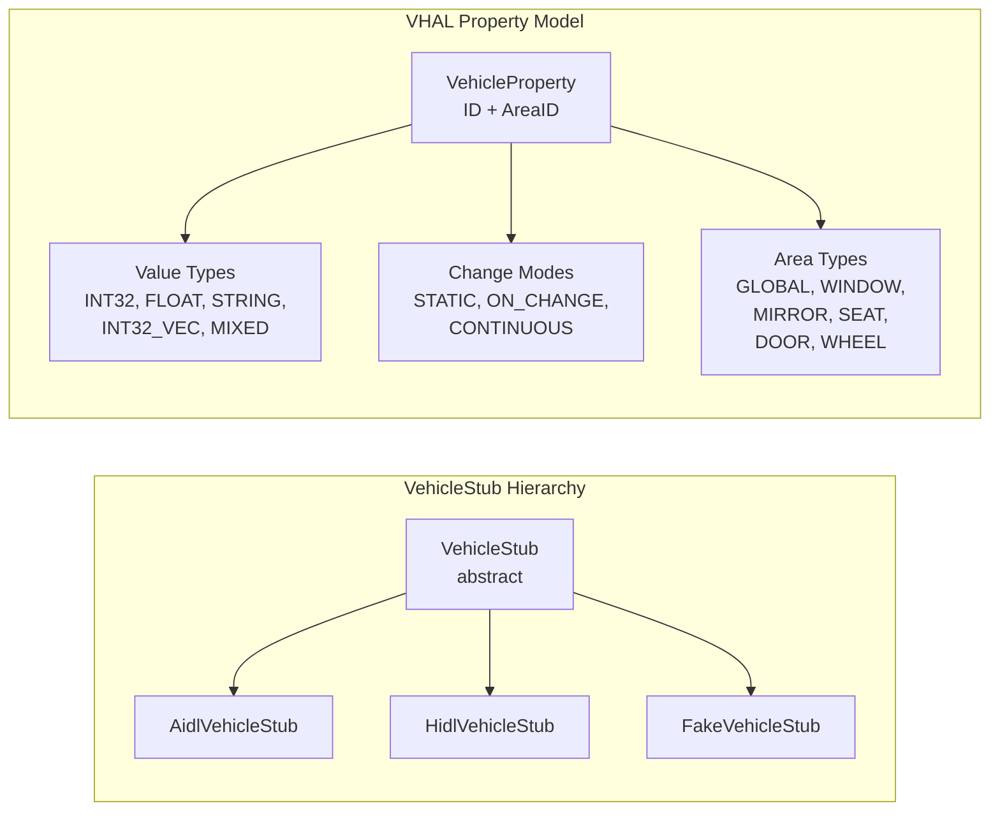

### 62.1.3 汽车属性系统

汽车属性系统是应用读写车辆数据的主要接口。`CarPropertyService` 通过 `CarPropertyManager` 向应用暴露属性：

```java
// packages/services/Car/service/src/com/android/car/CarPropertyService.java
// (Referenced via ICarImpl constructor)

mCarPropertyService = carServiceCreator.createService(
        CarPropertyService.class,
        () -> new CarPropertyService.Builder()
                .setContext(mContext)
                .setPropertyHalService(mHal.getPropertyHal())
                .build());
```

从应用到硬件的属性流转过程：

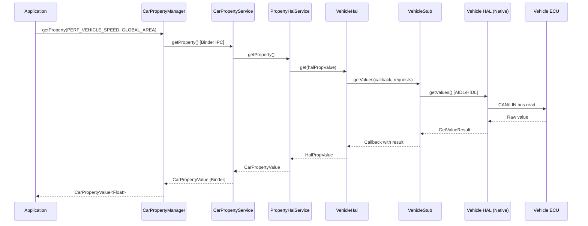

对于基于订阅的访问方式（如车速或挡位这类事件驱动属性），应用注册回调，当 HAL 推送新值时回调即会触发：

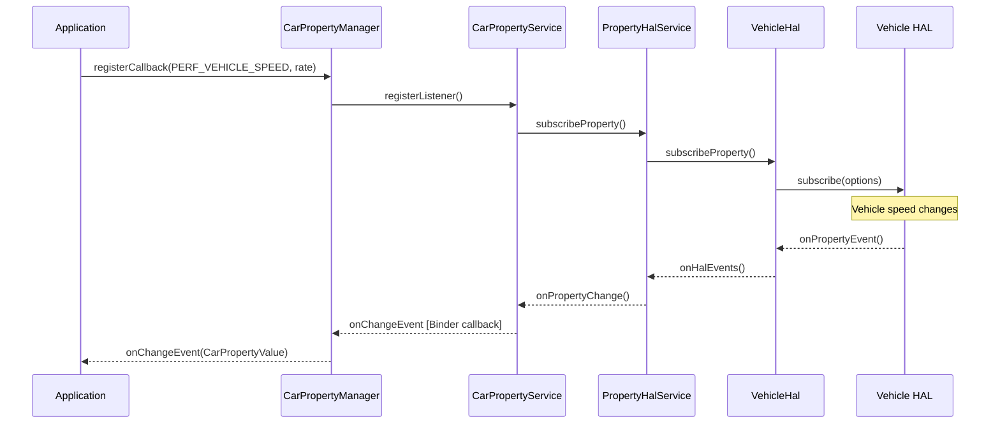

### 62.1.4 乘员区域

多区域车辆会针对不同座位位置配备独立的显示屏与用户会话。`CarOccupantZoneService` 负责管理物理座位位置、显示屏、Android 用户与输入设备之间的映射关系。

```java
// packages/services/Car/service/src/com/android/car/CarOccupantZoneService.java

public final class CarOccupantZoneService extends ICarOccupantZone.Stub
        implements CarServiceBase {

    public static final class DisplayConfig {
        public final int displayType;
        public final int occupantZoneId;
        public final int[] inputTypes;

        DisplayConfig(int displayType, int occupantZoneId, IntArray inputTypes) {
            this.displayType = displayType;
            this.occupantZoneId = occupantZoneId;
            this.inputTypes = inputTypes == null
                    ? EMPTY_INPUT_SUPPORT_TYPES : inputTypes.toArray();
        }
    }

    @VisibleForTesting
    static class OccupantConfig {
        public int userId = CarOccupantZoneManager.INVALID_USER_ID;
        public final ArrayList<DisplayInfo> displayInfos = new ArrayList<>();
        public int audioZoneId = CarAudioManager.INVALID_AUDIO_ZONE;
    }

    /** key : zoneId */
    @GuardedBy("mLock")
    private final SparseArray<OccupantConfig> mActiveOccupantConfigs = new SparseArray<>();

    @GuardedBy("mLock")
    private int mDriverZoneId = OccupantZoneInfo.INVALID_ZONE_ID;
}
```

乘员区域模型包含几个关键概念：

- **OccupantZoneInfo**：表示一个物理座位位置（驾驶员、前排乘客、左后、右后等），每个位置由唯一的区域 ID 标识。

- **DisplayConfig**：将显示屏类型（主屏、仪表盘、HUD）映射到一个乘员区域，并指定该显示屏支持哪些输入类型。

- **OccupantConfig**：将区域与 Android 用户 ID、一组显示屏以及音频区域关联起来的运行时状态。

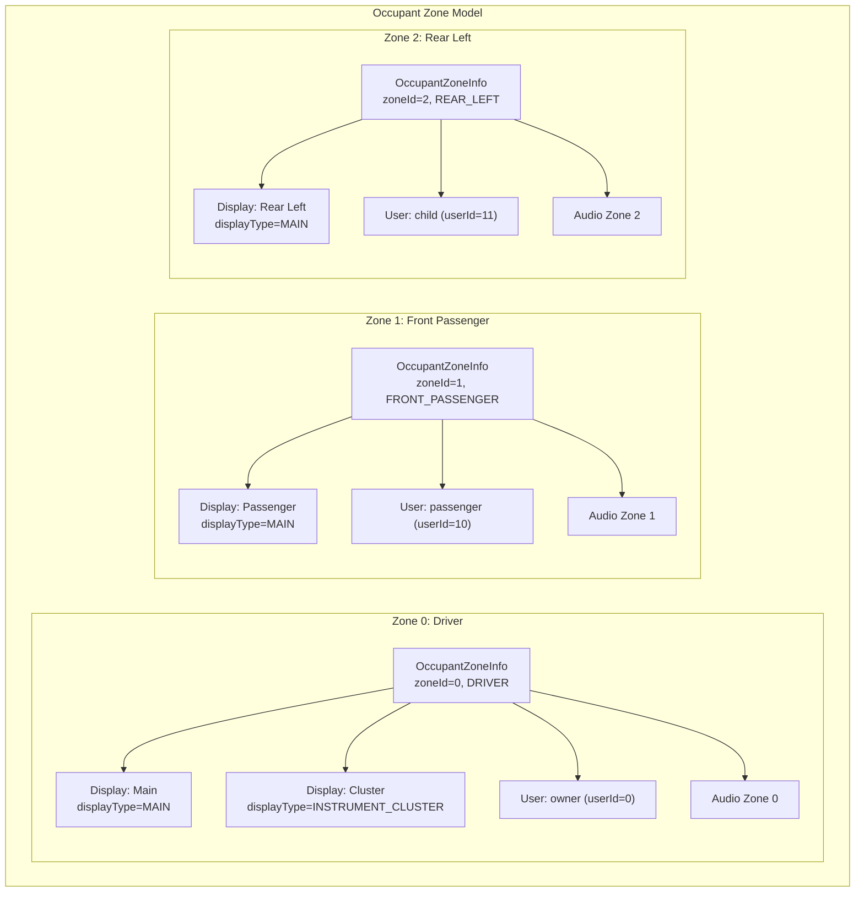

该服务监听显示变更与用户生命周期事件，以动态地重新配置区域：

```java
// packages/services/Car/service/src/com/android/car/CarOccupantZoneService.java

@VisibleForTesting
final UserLifecycleListener mUserLifecycleListener = event -> {
    if (DBG) Slogf.d(TAG, "onEvent(%s)", event);
    boolean isUserSwitching =
            (event.getEventType() == USER_LIFECYCLE_EVENT_TYPE_SWITCHING);
    handleUserChange(isUserSwitching);
};

@VisibleForTesting
final DisplayManager.DisplayListener mDisplayListener =
        new DisplayManager.DisplayListener() {
            @Override
            public void onDisplayAdded(int displayId) {
                handleDisplayChange(displayId);
            }
            @Override
            public void onDisplayRemoved(int displayId) {
                handleDisplayChange(displayId);
            }
            @Override
            public void onDisplayChanged(int displayId) {
                // nothing to do
            }
        };
```

当有显示屏被热插拔时（例如后排娱乐屏被连接），服务会重新评估区域到显示屏的映射，并通知所有已注册的回调。

`init()` 方法展示了完整的初始化流程：

```java
// packages/services/Car/service/src/com/android/car/CarOccupantZoneService.java

@Override
public void init() {
    Car car = new Car(mContext, /* service= */null, /* handler= */ null);
    CarInfoManager infoManager = new CarInfoManager(car,
            CarLocalServices.getService(CarPropertyService.class));
    int driverSeat = infoManager.getDriverSeat();
    synchronized (mLock) {
        mDriverSeat = driverSeat;
        parseOccupantZoneConfigsLocked();   // Read zone config from RRO
        parseDisplayConfigsLocked();         // Map displays to zones
        handleActiveDisplaysLocked();        // Activate connected displays
        handleAudioZoneChangesLocked();      // Set up audio routing
        handleUserChangesLocked();           // Assign users to zones
    }
    mCarUserService = CarLocalServices.getService(CarUserService.class);
    UserLifecycleEventFilter userEventFilter =
            new UserLifecycleEventFilter.Builder()
                .addEventType(USER_LIFECYCLE_EVENT_TYPE_SWITCHING)
                .addEventType(USER_LIFECYCLE_EVENT_TYPE_STOPPING)
                .build();
    mCarUserService.addUserLifecycleListener(userEventFilter,
            mUserLifecycleListener);
    mDisplayManager.registerDisplayListener(mDisplayListener,
            new Handler(Looper.getMainLooper()));

    CarServiceHelperWrapper.getInstance().runOnConnection(
            () -> doSyncWithCarServiceHelper(
                    /* updateDisplay= */ true, /* updateUser= */ true));
}
```

乘员区域配置从 RRO 配置资源 `config_occupant_zones` 中读取。如果该资源为空，服务会自动创建一个驾驶员单区域。该配置规定了每个区域的座位位置、显示屏类型与输入支持。

配置文件用户分配功能（`mEnableProfileUserAssignmentForMultiDisplay`）允许将不同的 Android 用户配置文件分配到不同的区域。儿童配置文件可以被分配到后排显示屏，而主用户则控制驾驶员显示屏。这需要同时启用 `enableProfileUserAssignmentForMultiDisplay` 配置布尔值与 `FEATURE_MANAGED_USERS` 系统特性。

### 62.1.5 仪表盘

仪表盘（instrument cluster）是方向盘后方的显示屏。AAOS 支持在该显示屏上渲染导航、来电与媒体信息。`InstrumentClusterService` 绑定到一个由厂商提供的渲染服务：

```java
// packages/services/Car/service/src/com/android/car/cluster/InstrumentClusterService.java

@SystemApi
public class InstrumentClusterService implements CarServiceBase, KeyEventListener,
        ClusterNavigationService.ClusterNavigationServiceCallback {

    private static final long RENDERER_SERVICE_WAIT_TIMEOUT_MS = 5000;
    private static final long RENDERER_WAIT_MAX_RETRY = 2;

    private final Context mContext;
    private final CarInputService mCarInputService;
    private final ClusterNavigationService mClusterNavigationService;
    // ...
    @GuardedBy("mLock")
    private IInstrumentCluster mRendererService;
}
```

较新的 `ClusterHomeService` 提供了一种更现代的方案。仪表盘显示屏运行一个完整的 Android 活动（即 "Cluster Home" 应用）。内容通过 `ClusterHalService` 渲染，该服务通过 VHAL 属性传递仪表盘状态。

示例仪表盘应用位于：
`packages/apps/Car/Cluster/ClusterOsDouble/`

该 ClusterOsDouble 作为 Cluster2 框架的测试应用，负责处理 Cluster VHAL 属性并承担 Cluster OS 角色功能。它包含：

- `ClusterOsDoubleActivity` -- Main activity displaying cluster information
- `NavStateController` -- Handles navigation state display
- `ClusterViewModel` -- ViewModel for cluster data
- Sensor integration classes for vehicle telemetry visualization

仪表盘渲染流程：

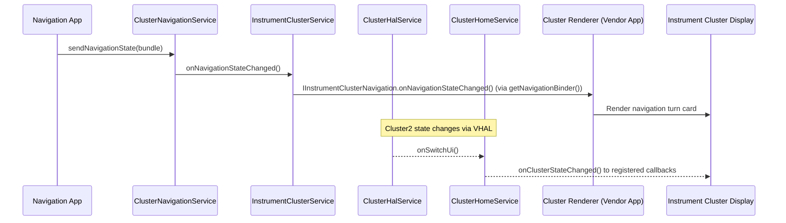

### 62.1.6 FixedActivityService

在汽车场景中，某些显示屏必须始终显示特定活动。驾驶员的仪表盘必须始终显示仪表盘 UI；后排娱乐屏则可能始终显示媒体播放器。`FixedActivityService` 保证指定活动始终位于给定显示屏的前台。如果该活动崩溃或被遮盖，它会重新拉起该活动。

该服务使用多种监控机制来检测固定活动何时不再可见、需要被重新拉起：

```java
// packages/services/Car/service/src/com/android/car/am/FixedActivityService.java

/**
 * Monitors top activity for a display and guarantee activity in fixed mode is
 * re-launched if it has crashed or gone to background for whatever reason.
 *
 * This component also monitors the update of the target package and re-launch
 * it once update is complete.
 */
public final class FixedActivityService implements CarServiceBase {

    private static final long RECHECK_INTERVAL_MS = 500;
    private static final int MAX_NUMBER_OF_CONSECUTIVE_CRASH_RETRY = 5;
    private static final long CRASH_FORGET_INTERVAL_MS = 2 * 60 * 1000; // 2 mins

    private static class RunningActivityInfo {
        @NonNull public final Intent intent;
        @NonNull public final Bundle activityOptions;
        @UserIdInt public final int userId;
        public boolean isVisible;
        public boolean isStarted;
        public long lastLaunchTimeMs;
        public int consecutiveRetries;
        public int taskId = INVALID_TASK_ID;
        public int previousTaskId = INVALID_TASK_ID;
        public boolean inBackground;
    }
}
```

该服务为每个显示屏维护 `RunningActivityInfo` 记录。每 500ms 它都会重新检查预期的活动是否处于顶层。如果该活动连续崩溃超过 5 次，服务会退避。在连续 2 分钟没有发生崩溃后，连续重试计数器会重置。

这套监控基础设施非常全面。`FixedActivityService` 注册了四种不同的事件源来检测何时需要介入：

```java
// packages/services/Car/service/src/com/android/car/am/FixedActivityService.java

// 1. Process lifecycle monitoring
private final ProcessObserverCallback mProcessObserver = new ProcessObserverCallback() {
    @Override
    public void onForegroundActivitiesChanged(int pid, int uid,
            boolean foregroundActivities) {
        launchIfNecessary();
    }
    @Override
    public void onProcessDied(int pid, int uid) {
        launchIfNecessary();
    }
};

// 2. Package update monitoring
private final BroadcastReceiver mBroadcastReceiver = new BroadcastReceiver() {
    @Override
    public void onReceive(Context context, Intent intent) {
        String action = intent.getAction();
        if (Intent.ACTION_PACKAGE_CHANGED.equals(action)
                || Intent.ACTION_PACKAGE_REPLACED.equals(action)) {
            // Reset crash counter and relaunch
        }
    }
};

// 3. Display state monitoring
private final DisplayListener mDisplayListener = new DisplayListener() {
    @Override
    public void onDisplayChanged(int displayId) {
        launchForDisplay(displayId);
    }
};

// 4. Power state monitoring
private final CarPowerManager.CarPowerStateListener mCarPowerStateListener =
        (state) -> {
    if (state != CarPowerManager.STATE_ON) return;
    // Reset crash counters and relaunch on power on
    launchIfNecessary();
};
```

`mRunningActivities` 这个 `SparseArray` 将显示屏 ID 映射到对应的 `RunningActivityInfo`。其默认容量为 1，针对只有单个仪表盘这一常见场景做了优化：

```java
// key: displayId
@GuardedBy("mLock")
private final SparseArray<RunningActivityInfo> mRunningActivities =
        new SparseArray<>(/* capacity= */ 1); // default to one cluster only case
```

当 `launchIfNecessary()` 触发时，它会检查每个受监控的显示屏，将当前顶层活动与预期活动进行比较，如果二者不一致则调用 `startActivity()`。`RunningActivityInfo` 中的 `activityOptions` Bundle 包含目标显示屏 ID 信息。

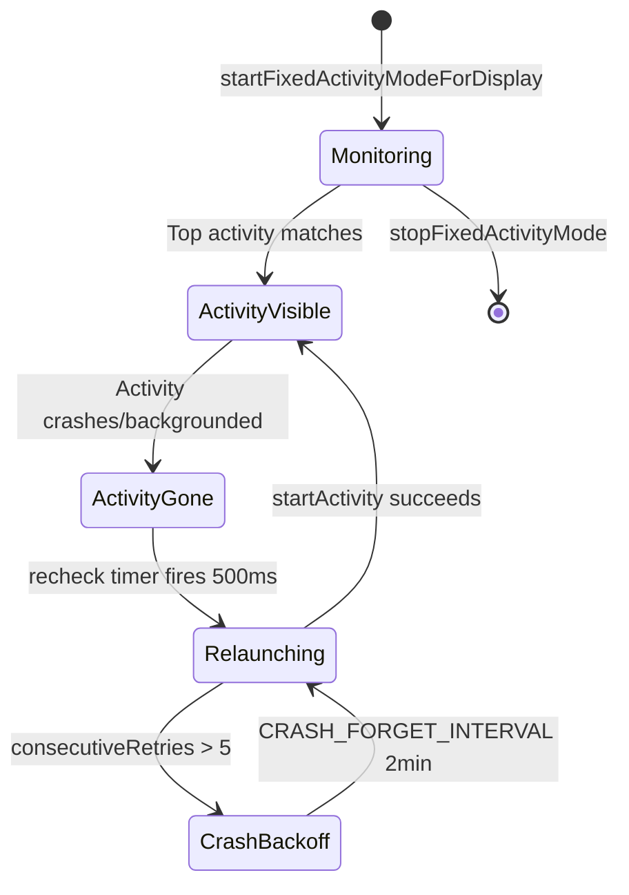

### 62.1.7 CarActivityService

`CarActivityService` 管理跨多个显示屏的活动摆放，处理启动目标显示屏路由，并提供 `CarSystemUIProxy` 接口，让 Car SystemUI 能够控制任务的组织方式：

```java
// packages/services/Car/service/src/com/android/car/am/CarActivityService.java

public class CarActivityService extends ICarActivityService.Stub
        implements CarServiceBase {
    // Manages per-display task placement, blocking activities for
    // distraction optimization, and SystemUI proxy registration
}
```

该服务与 `CarPackageManagerService` 紧密协作，根据驾驶状态与 UX 限制，强制执行哪些活动被允许出现在哪些显示屏上。

`CarActivityService` 提供多项关键能力：

1. **按显示屏启动活动**：当应用面向某个特定乘员区域时，服务通过 `ActivityOptions` 将活动路由到正确的显示屏：

    ```java
    // Usage pattern for launching on a specific display:
    ActivityOptions options = ActivityOptions.makeBasic();
    options.setLaunchDisplayId(targetDisplayId);
    context.startActivity(intent, options.toBundle());
    ```

2. **SystemUI 代理注册**：Car SystemUI 通过 `ICarSystemUIProxy` 将自己注册为代理，使服务能够控制任务的呈现方式：

    ```java
    // packages/services/Car/service/src/com/android/car/am/CarActivityService.java
    // (field declarations showing the proxy mechanism)
    // Uses ICarSystemUIProxy and ICarSystemUIProxyCallback
    ```

3. **拦截式活动管理**：当一个未针对防分心进行优化的活动在驾驶时尝试显示时，服务会将其拦截。服务会将其替换为一个显示安全提示信息的拦截活动。显示屏 ID 通过以下方式传递：

    ```java
    // From the import:
    // import static android.car.content.pm.CarPackageManager.BLOCKING_INTENT_EXTRA_DISPLAY_ID;
    ```

4. **任务镜像与迁移**：任务可以在显示屏之间移动（例如，将乘客的导航会话移动到驾驶员的显示屏）。

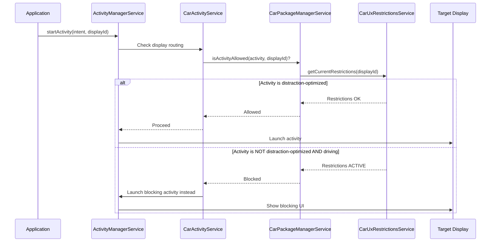

### 62.1.8 汽车电源管理

汽车电源管理与移动端有着根本性的差异。车辆的电源状态由车辆的点火系统驱动，而不是由用户按下电源键驱动。`CarPowerManagementService` 负责管理电源状态之间的转换：

```java
// packages/services/Car/service/src/com/android/car/power/CarPowerManagementService.java

public class CarPowerManagementService extends ICarPower.Stub implements
        CarServiceBase, PowerHalService.PowerEventListener {

    // Power state constants
    private static final int ACTION_ON_FINISH_SHUTDOWN = 0;
    private static final int ACTION_ON_FINISH_DEEP_SLEEP = 1;
    private static final int ACTION_ON_FINISH_HIBERNATION = 2;

    // Suspend retry with exponential backoff
    private static final long INITIAL_SUSPEND_RETRY_INTERVAL_MS = 10;
    private static final long MAX_RETRY_INTERVAL_MS = 100;

    // Garage mode constraints
    private static final int MIN_GARAGE_MODE_DURATION_MS = 15 * 60 * 1000; // 15 min
}
```

汽车电源状态机：

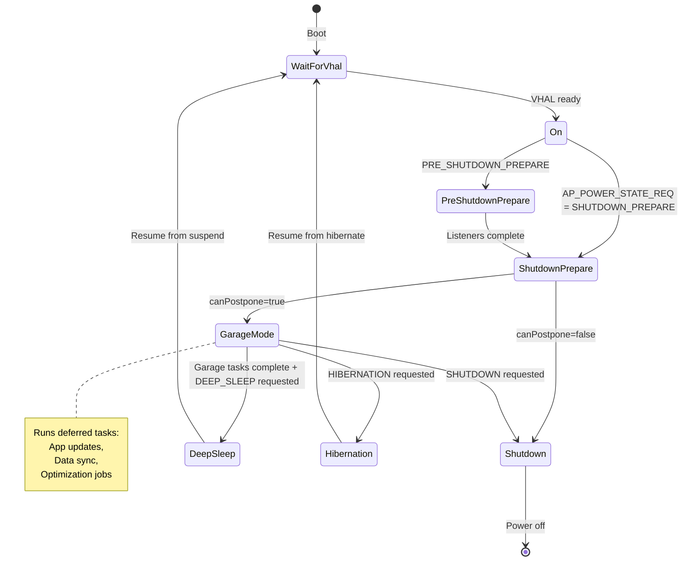

电源策略系统控制每种状态下哪些硬件组件被供电。例如，在深度休眠期间，显示屏和音频可能会关闭，但蜂窝调制解调器保持开启以便远程访问：

```java
// packages/services/Car/service/src/com/android/car/power/CarPowerManagementService.java

private static final String WIFI_STATE_FILENAME = "wifi_state";
private static final String TETHERING_STATE_FILENAME = "tethering_state";
private static final String COMPONENT_STATE_MODIFIED = "forcibly_disabled";
private static final String COMPONENT_STATE_ORIGINAL = "original";
```

电源策略定义与位于以下位置的原生电源策略守护进程交互：
`android.frameworks.automotive.powerpolicy.internal.ICarPowerPolicySystemNotification`

### 62.1.9 车库模式（Garage Mode）

车库模式是驾驶员熄火之后、车辆完全关闭之前的这段时间。在这段时间窗口内，AAOS 会执行维护任务：

```java
// packages/services/Car/service/src/com/android/car/garagemode/GarageModeService.java

/**
 * Main service container for car Garage Mode.
 * Garage Mode enables idle time in cars.
 */
public class GarageModeService implements CarServiceBase {
    private final GarageModeController mController;
    // ...
}
```

`GarageModeController` 是车库模式的大脑，实现 `ICarPowerStateListener` 以响应电源状态转换：

```java
// packages/services/Car/service/src/com/android/car/garagemode/GarageModeController.java

public class GarageModeController extends ICarPowerStateListener.Stub {
    private final GarageMode mGarageMode;
    private CarPowerManagementService mCarPowerService;

    public void init() {
        mCarPowerService = CarLocalServices.getService(
                CarPowerManagementService.class);
        mCarPowerService.registerInternalListener(GarageModeController.this);
        mGarageMode.init();
    }

    @Override
    public void onStateChanged(int state, long expirationTimeMs) {
        switch (state) {
            case CarPowerManager.STATE_SHUTDOWN_CANCELLED:
                resetGarageMode(null);
                break;
            case CarPowerManager.STATE_SHUTDOWN_ENTER:
            case CarPowerManager.STATE_SUSPEND_ENTER:
            case CarPowerManager.STATE_HIBERNATION_ENTER:
                resetGarageMode(() -> {
                    mCarPowerService.completeHandlingPowerStateChange(state,
                            GarageModeController.this);
                });
                break;
            case CarPowerManager.STATE_SHUTDOWN_PREPARE:
                initiateGarageMode(
                        () -> mCarPowerService.completeHandlingPowerStateChange(
                                state, GarageModeController.this));
                break;
            default:
                break;
        }
    }
}
```

关键的状态转换是 `STATE_SHUTDOWN_PREPARE`，它触发 `initiateGarageMode()`。当所有任务完成或超时到期时，车库模式结束。然后它调用 `completeHandlingPowerStateChange()`，向电源服务发出信号：可以继续执行实际的关机或挂起。

控制器与 `JobScheduler` 协同工作，运行带有 `REQUIRE_DEVICE_IDLE` 约束的延迟任务。OEM 通过可覆盖资源 `maxGarageModeRunningDurationInSecs` 配置车库模式的最大持续时间（默认 900 秒，即 15 分钟）。系统属性 `android.car.garagemodeduration` 可以在其之上提供覆盖。

车库模式还处理以下边缘情况：

- `STATE_SHUTDOWN_CANCELLED`：如果驾驶员在关机准备期间重新点火，车库模式会被立即取消。

- `STATE_SUSPEND_ENTER` / `STATE_HIBERNATION_ENTER`：深度休眠与休眠各有不同的路径，两者都要求在继续之前先完成车库模式的清理。

- 完成回调模式确保电源状态机不会在车库模式完成妥善清理之前继续推进。

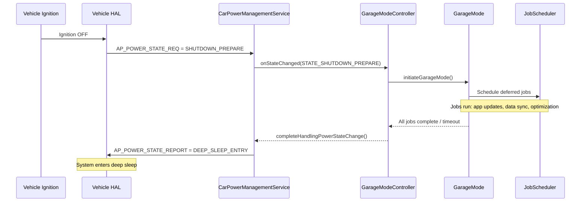

### 62.1.10 汽车音频多区域架构

汽车音频从根本上比手机音频更复杂。一辆车可能有分别面向驾驶员、乘客和后排座椅的独立扬声器区域，每个区域播放不同的媒体。`CarAudioService` 通过音频区域抽象来管理这一切：

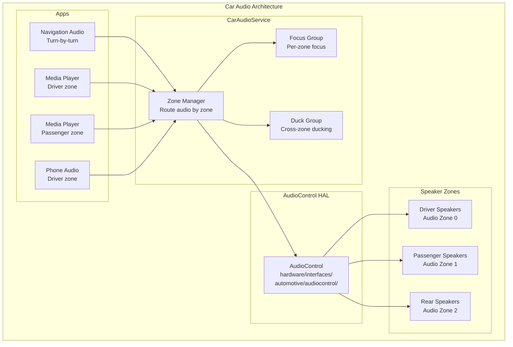

音频区域映射到乘员区域，因此每位乘客都拥有独立的音量控制与音频焦点。驾驶员区域的导航音频可以让驾驶员的音乐降音，而不会影响到乘客的音频。

### 62.1.11 驾驶员分心与 UX 限制

AAOS 通过在驾驶时限制 UI 复杂度来保障安全。`CarDrivingStateService` 监控车速与挡位，以判断车辆是处于驻车、怠速还是行驶状态。`CarUxRestrictionsManagerService` 将驾驶状态转换为应用必须遵守的具体 UX 限制：

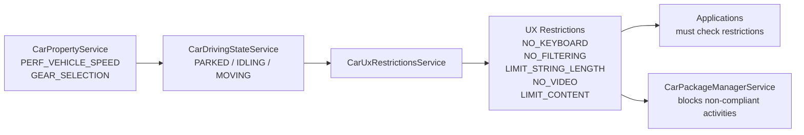

当驾驶状态为 `MOVING` 时，未被标记为防分心优化的活动会被阻止，并替换为一个告知用户的拦截活动。

### 62.1.12 汽车专用 SystemUI

AAOS 用位于以下位置的汽车专用版本替换了手机版 SystemUI：
`packages/apps/Car/SystemUI/`

该版本将状态栏替换为汽车专用的系统栏。它还添加了 HVAC 控制、面向多区域音频定制的音量控制，以及面向多用户车辆的用户选择器。

```java
// packages/apps/Car/SystemUI/pods/systembar/base/controller/src/com/android/systemui/car/systembar/base/CarSystemBar.java

@SysUISingleton
public class CarSystemBar implements CoreStartable {
    private final CarSystemBarController mCarSystemBarController;

    @Inject
    public CarSystemBar(CarSystemBarController carSystemBarController) {
        mCarSystemBarController = carSystemBarController;
    }

    @Override
    public void start() {
        mCarSystemBarController.init();
    }
}
```

Car SystemUI 通过 `CarServiceProvider` 连接 CarService：

```java
// packages/apps/Car/SystemUI/src/com/android/systemui/car/CarServiceProvider.java

@Singleton
public class CarServiceProvider {
    @Inject
    public CarServiceProvider(@CarSysUIDumpable Context context) {
        mCar = Car.createCar(mContext, null, Car.CAR_WAIT_TIMEOUT_DO_NOT_WAIT,
                (car, ready) -> {
                    synchronized (mCarLock) {
                        synchronized (mListeners) {
                            mIsCarReady = ready;
                            mCar = car;
                            if (ready) {
                                for (CarServiceOnConnectedListener listener : mListeners) {
                                    listener.onConnected(mCar);
                                }
                            }
                        }
                    }
                });
    }
}
```

Car SystemUI 的关键组件：

| 组件 | 目录 | 用途 |
|-----------|-----------|---------|
| System Bar | `car/systembar/` | 导航栏的替代品，带有汽车专用按钮 |
| HVAC 面板 | `car/hvac/` | 空调控制覆盖层 |
| 音量 UI | `car/volume/` | 多区域音频音量控制 |
| 用户选择器 | `car/userpicker/` | 在车辆乘员用户之间切换 |
| 锁屏 | `car/keyguard/` | 汽车专用锁屏 |
| 通知 | `car/notification/` | 汽车通知处理 |
| 状态图标 | `car/statusicon/` | 车辆状态指示器 |

HVAC 模块展示了 Car SystemUI 如何与车辆属性集成：

```
packages/apps/Car/SystemUI/pods/hvac/
  controller/src/com/android/systemui/car/hvac/
    HvacController.java              -- HVAC property access and dispatch
    HvacView.java                    -- Base HVAC view interface
  ui/src/com/android/systemui/car/hvac/
    HvacButtonController.java        -- Handles HVAC button interactions
    HvacPanelOverlayViewMediator.java -- Manages HVAC panel visibility
    HvacPanelView.java               -- Full HVAC panel layout
    TemperatureControlView.java      -- Temperature adjustment widget
    referenceui/
      FanSpeedBar.java               -- Fan speed control
      FanDirectionButtons.java       -- Air direction buttons
```

### 62.1.13 汽车启动器

汽车启动器与手机启动器有显著差异。它提供专为大尺寸触摸屏设计、并将分心降至最低的主屏幕：

```
packages/apps/Car/Launcher/
  libs/
    appgrid/lib/src/com/android/car/carlauncher/
      AppLauncherUtils.java            -- App listing and filtering
      AppItem.java                     -- Data model for launcher items
      LauncherItemDiffCallback.java    -- Efficient list updates
      recyclerview/
        AppGridAdapter.java            -- Grid display adapter
        AppGridLayoutManager.java      -- Car-specific grid layout
  docklib/src/com/android/car/docklib/
    events/DockEventsReceiver.java     -- Dock state handling
    task/DockTaskStackChangeListener.java -- Task stack monitoring
```

Car 启动器在几个根本方面与手机的 Launcher3 不同：

1. **没有主屏幕小部件**：汽车主屏幕强调快速访问应用和必备信息（地图、媒体），而不是可定制的小部件网格。

2. **基于 Dock 的导航**：底部的 Dock 提供对导航、电话、媒体和应用网格的常驻访问。

3. **任务栈感知**：`DockTaskStackChangeListener` 监控任务栈，使 Dock 状态与实际运行的内容保持同步。

4. **包过滤**：当驾驶限制生效时，`AppLauncherUtils` 过滤应用列表，只显示经过防分心优化的应用。

5. **多显示屏感知**：启动器必须考虑到在不同显示屏（驾驶员 vs 乘客）上启动的活动，并相应调整自身行为。

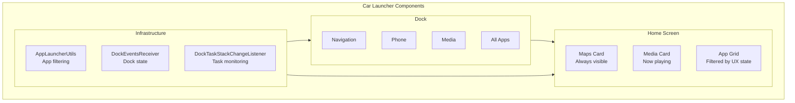

启动器列出的许多应用都是基于 Android-for-Cars App Library 编写的"模板化"汽车应用。这些应用运行在一个独立的宿主进程中，它们不绘制自己的 UI。

Android 17 将该宿主作为预构建产物捆绑：`packages/apps/Car/TemplatesPrebuilt/Android.bp` 声明了一个名为 `CarAppHost` 的 `android_app_import`，对应 `CarAppHost.apk`，以平台签名（`certificate: "platform"`）安装并具有 `privileged` 权限。AOSP 中没有该宿主的源代码。该项目仅附带导入该二进制 APK 的构建粘合代码。因此，AAOS 构建会在不编译宿主的情况下将其纳入。

### 62.1.14 外部视图系统（EVS）

外部视图系统提供基于摄像头的功能，如倒车影像、环视和泊车辅助。EVS HAL 定义于：
`hardware/interfaces/automotive/evs/`

它同时支持 AIDL（现行）与 HIDL（传统 1.1）接口。CarService 中的 `CarEvsService` 管理摄像头生命周期、显示路由，并与乘员区域系统集成，以确定哪个显示屏应显示摄像头画面。

### 62.1.15 汽车 HAL 目录结构

完整的汽车 HAL 接口集合：

```
hardware/interfaces/automotive/
  vehicle/       -- Vehicle property abstraction (AIDL + HIDL 2.0)
  evs/           -- Exterior View System cameras
  audiocontrol/  -- Multi-zone audio routing
  can/           -- CAN bus interface
  ivn_android_device/  -- In-Vehicle Networking
  occupant_awareness/  -- Occupant detection (presence, attention)
  remoteaccess/        -- Remote wake and task execution
```

### 62.1.16 产品配置

汽车产品构建通过以下位置的 makefile 进行配置：
`packages/services/Car/car_product/build/`

```makefile
# packages/services/Car/car_product/build/car.mk

PRODUCT_PACKAGES += \
    Bluetooth \
    CarActivityResolver \
    CarDeveloperOptions \
    CarSettingsIntelligence \
    CarManagedProvisioning \
    StatementService \
    SystemUpdater

PRODUCT_PROPERTY_OVERRIDES += \
    ro.carrier=unknown \
    ro.hardware.type=automotive
```

`ro.hardware.type=automotive` 属性是告诉框架这是汽车构建的根本标志。功能标志、SEPolicy 和覆盖配置在整个系统中都根据该属性分支。

运行时资源覆盖（RRO）用于定制外观与体验：

```
packages/services/Car/car_product/rro/
  CarSystemUIRRO/             -- SystemUI visual overrides
  CarSystemUIPassengerRRO/    -- SystemUI overrides for passenger displays
  PermissionControllerRRO/    -- Permission UI adjustments
  CarResourceCommon/          -- Shared resource definitions
  overlay-config/
    androidRRO/               -- Framework resource overrides
    SettingsProviderRRO/      -- Default settings values
    TelecommRRO/              -- Telecom UI adjustments
  oem-design-tokens/
    OEMDesignTokenRRO/        -- OEM visual design tokens
```

---

## 62.2 Android TV

Android TV 将 Android 转变为一种"十英尺体验"的 UI 形态。框架层面的新增内容集中在三个领域。第一是用于管理广播电视与 HDMI 信号源的 TV Input Framework（TIF）。第二是用于设备协同的 HDMI-CEC 控制。第三是面向方向键（D-pad）导航与画中画的专用窗口系统。

### 62.2.1 TV Input Framework（TIF）架构

TV Input Framework 是 Android TV 的基石。它将电视输入信号源——内置调谐器、HDMI 端口、IP 流以及第三方输入——抽象为统一的模型。关键的系统服务是 `TvInputManagerService`：

```java
// frameworks/base/services/core/java/com/android/server/tv/TvInputManagerService.java

public final class TvInputManagerService extends SystemService {
    private static final String TAG = "TvInputManagerService";
    private static final String DVB_DIRECTORY = "/dev/dvb";
    // ...
}
```

TIF 分为四层：

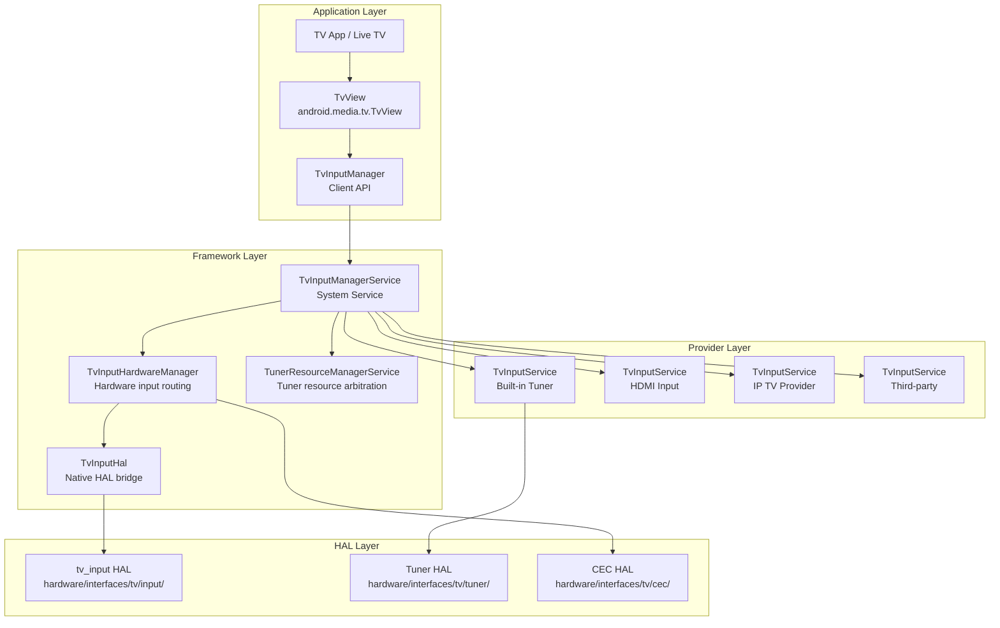

### 62.2.2 TvInputService

`TvInputService` 是所有电视输入提供方都必须继承的抽象基类。它遵循与 `InputMethodService` 类似的模式——每个提供方都作为绑定服务运行，并按需创建会话：

```java
// frameworks/base/media/java/android/media/tv/TvInputService.java

public abstract class TvInputService extends Service {
    public static final String SERVICE_INTERFACE = "android.media.tv.TvInputService";
    public static final String SERVICE_META_DATA = "android.media.tv.input";

    // Priority hint use case types for tuner resource management
    @IntDef(prefix = "PRIORITY_HINT_USE_CASE_TYPE_",
            value = {PRIORITY_HINT_USE_CASE_TYPE_BACKGROUND,
                     PRIORITY_HINT_USE_CASE_TYPE_SCAN,
                     PRIORITY_HINT_USE_CASE_TYPE_PLAYBACK,
                     PRIORITY_HINT_USE_CASE_TYPE_LIVE,
                     PRIORITY_HINT_USE_CASE_TYPE_RECORD})
    public @interface PriorityHintUseCaseType {}
}
```

每个 `TvInputService` 都会创建 `Session` 对象来处理单独的调台请求。会话的生命周期：

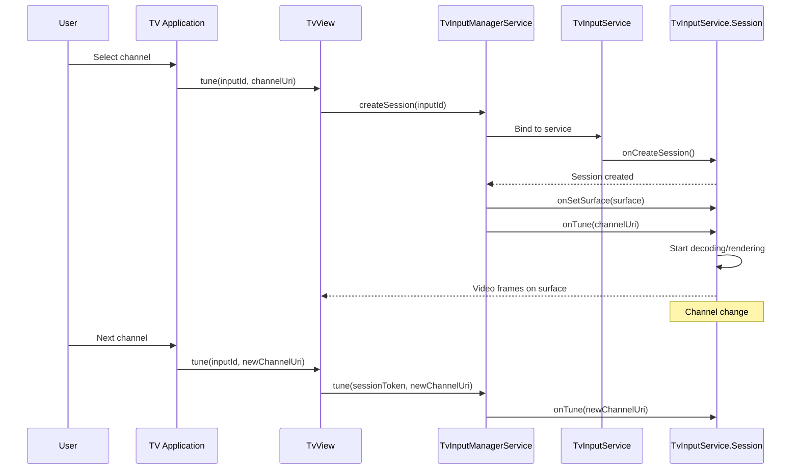

`TvInputService` 在清单文件中以 `BIND_TV_INPUT` 权限声明自身：

```xml
<service android:name=".MyTvInputService"
    android:permission="android.permission.BIND_TV_INPUT">
    <intent-filter>
        <action android:name="android.media.tv.TvInputService" />
    </intent-filter>
    <meta-data android:name="android.media.tv.input"
        android:resource="@xml/tv_input" />
</service>
```

### 62.2.3 TvInputManagerService 内部实现

进一步深入 `TvInputManagerService`，该服务管理每个用户的状态，并处理 DVB 设备发现：

```java
// frameworks/base/services/core/java/com/android/server/tv/TvInputManagerService.java

public final class TvInputManagerService extends SystemService {
    private static final String DVB_DIRECTORY = "/dev/dvb";

    // DVB frontend device patterns:
    // Format 1: /dev/dvb%d.frontend%d
    // Format 2: /dev/dvb/adapter%d/frontend%d
    private static final Pattern sFrontEndDevicePattern =
            Pattern.compile("^dvb([0-9]+)\\.frontend([0-9]+)$");
    private static final Pattern sAdapterDirPattern =
            Pattern.compile("^adapter([0-9]+)$");
    private static final Pattern sFrontEndInAdapterDirPattern =
            Pattern.compile("^frontend([0-9]+)$");

    private final TvInputHardwareManager mTvInputHardwareManager;
    private final UserManager mUserManager;

    @GuardedBy("mLock")
    private int mCurrentUserId = UserHandle.USER_SYSTEM;
    @GuardedBy("mLock")
    private String mOnScreenInputId = null;
    @GuardedBy("mLock")
    private SessionState mOnScreenSessionState = null;

    // Per-user state management
    @GuardedBy("mLock")
    private final SparseArray<UserState> mUserStates = new SparseArray<>();
    @GuardedBy("mLock")
    private final Map<String, SessionState> mSessionIdToSessionStateMap =
            new HashMap<>();

    private HdmiControlManager mHdmiControlManager = null;
    private HdmiTvClient mHdmiTvClient = null;
    private MediaQualityManager mMediaQualityManager = null;
}
```

该服务的构造函数初始化 HDMI-CEC 集成：

```java
// frameworks/base/services/core/java/com/android/server/tv/TvInputManagerService.java

public TvInputManagerService(Context context) {
    super(context);
    mTvInputHardwareManager = new TvInputHardwareManager(context,
            new HardwareListener());
    mHdmiControlManager = mContext.getSystemService(HdmiControlManager.class);
    if (mHdmiControlManager != null) {
        mHdmiTvClient = mHdmiControlManager.getTvClient();
    }
    // ...
}

@Override
public void onStart() {
    publishBinderService(Context.TV_INPUT_SERVICE, new BinderService());
    // Register for CEC active source management:
    // Monitors SCREEN_ON/SCREEN_OFF to claim active source status
}
```

当电视被唤醒时，该服务会发送一条延迟消息以声明 CEC 活动信号源状态。如果电视切换了输入或重新进入休眠，这条消息会被取消。这避免了不必要的 CEC 通信流量。

### 62.2.4 TvInputHardwareManager

`TvInputHardwareManager` 在框架与物理电视输入硬件之间架起桥梁。它管理 HDMI 端口连接、路由音频/视频，并跟踪硬件支持的电视输入：

```java
// frameworks/base/services/core/java/com/android/server/tv/TvInputHardwareManager.java

class TvInputHardwareManager implements TvInputHal.Callback {
    private final TvInputHal mHal = new TvInputHal(this);

    @GuardedBy("mLock")
    private final SparseArray<Connection> mConnections = new SparseArray<>();
    @GuardedBy("mLock")
    private final List<TvInputHardwareInfo> mHardwareList = new ArrayList<>();
    @GuardedBy("mLock")
    private final List<HdmiDeviceInfo> mHdmiDeviceList = new ArrayList<>();
    /* A map from a device ID to the matching TV input ID. */
    @GuardedBy("mLock")
    private final SparseArray<String> mHardwareInputIdMap = new SparseArray<>();
    /* A map from a HDMI logical address to the matching TV input ID. */
    @GuardedBy("mLock")
    private final SparseArray<String> mHdmiInputIdMap = new SparseArray<>();
}
```

当 HDMI 设备连接或断开时，硬件管理器会收到来自 HDMI-CEC 服务的回调，并相应地更新输入列表。这实现了输入信号源的自动发现——当用户插入蓝光播放机时，它会自动作为一个电视输入出现，无需手动配置。

### 62.2.5 调谐器资源管理器

`TunerResourceManagerService` 在相互竞争的客户端之间仲裁对有限硬件调谐器资源（前端、解复用器、LNB、CAS 会话）的访问：

```java
// frameworks/base/services/core/java/com/android/server/tv/
//   tunerresourcemanager/TunerResourceManagerService.java

public class TunerResourceManagerService extends SystemService
        implements IBinder.DeathRecipient {
    public static final int INVALID_CLIENT_ID = -1;
    private static final int MAX_CLIENT_PRIORITY = 1000;
}
```

资源管理器使用优先级系统。直播电视观看获得的优先级高于后台录制。当高优先级客户端需要已在使用中的调谐器时，资源管理器可以从低优先级客户端手中收回该资源：

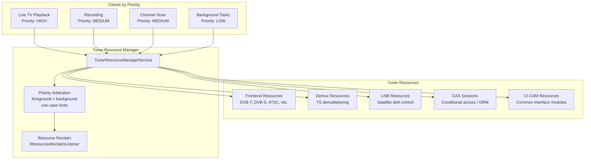

该服务管理的资源类型：

```
frameworks/base/services/core/java/com/android/server/tv/tunerresourcemanager/
  FrontendResource.java    -- Tuner frontend (demodulator) resources
  DemuxResource.java       -- Demultiplexer resources
  LnbResource.java         -- Low-noise block (satellite) resources
  CasResource.java         -- Conditional Access System resources
  CiCamResource.java       -- Common Interface CAM resources
  ClientProfile.java       -- Client registration and priority
  UseCasePriorityHints.java -- Use-case to priority mapping
  TunerResourceBasic.java  -- Base resource class
```

### 62.2.6 HDMI-CEC

消费电子控制（CEC）允许通过 HDMI 连接的设备互相控制。当你打开电视时，CEC 可以自动打开连接的回音壁并切换输入。CEC HAL 定义于：
`hardware/interfaces/tv/cec/1.0/IHdmiCec.hal`

```
interface IHdmiCec {
    addLogicalAddress(CecLogicalAddress addr) generates (Result result);
    clearLogicalAddress();
    getPhysicalAddress() generates (Result result, uint16_t addr);
    sendMessage(CecMessage message) generates (SendMessageResult result);
    setCallback(IHdmiCecCallback callback);
    getCecVersion() generates (int32_t version);
    getVendorId() generates (uint32_t vendorId);
    getPortInfo() generates (vec<HdmiPortInfo> infos);
    setOption(OptionKey key, bool value);
    setLanguage(string language);
    enableAudioReturnChannel(int32_t portId, bool enable);
    isConnected(int32_t portId) generates (bool status);
};
```

Java 侧的 CEC 实现位于 HDMI 控制服务中：

```
frameworks/base/services/core/java/com/android/server/hdmi/
  HdmiCecLocalDeviceTv.java      -- TV-type CEC device implementation
  HdmiCecLocalDevice.java        -- Base CEC device
  HdmiCecMessage.java            -- CEC message representation
  HdmiCecMessageBuilder.java     -- Message construction helpers
  HdmiControlService.java        -- Main HDMI control service
  HdmiCecStandbyModeHandler.java -- Standby mode CEC handling
  ActiveSourceHandler.java       -- Active source switching
  DeviceSelectActionFromTv.java  -- Device selection flow
  RoutingControlAction.java      -- Input routing
  ArcInitiationActionFromAvr.java -- Audio Return Channel setup
  NewDeviceAction.java           -- New device discovery
```

`HdmiCecLocalDeviceTv` 表示 CEC 通信中的电视端点：

```java
// frameworks/base/services/core/java/com/android/server/hdmi/HdmiCecLocalDeviceTv.java

public class HdmiCecLocalDeviceTv extends HdmiCecLocalDevice {
    // Whether ARC is available. "true" means ARC is established between
    // TV and AVR as audio receiver.
    @ServiceThreadOnly
    private boolean mArcEstablished = false;

    // Stores whether ARC feature is enabled per port.
    private final SparseBooleanArray mArcFeatureEnabled = new SparseBooleanArray();
}
```

"一键播放"（用户按下蓝光遥控器上的播放键）的 CEC 消息流程：

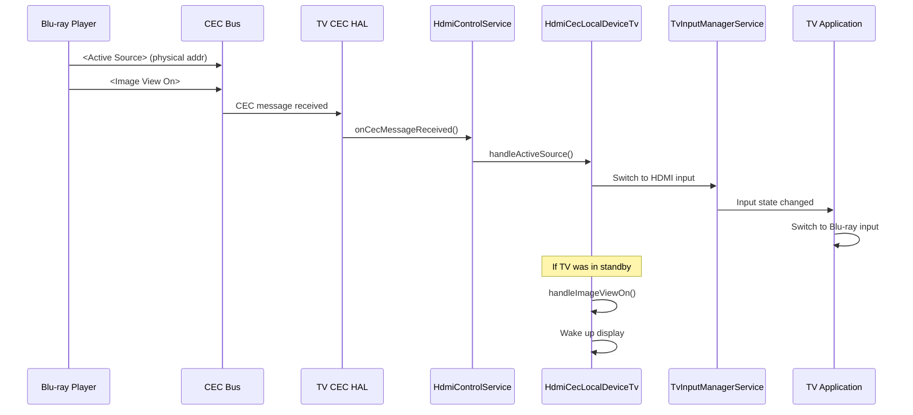

### 62.2.7 TV HAL 接口

完整的 TV HAL 接口面：

```
hardware/interfaces/tv/
  input/          -- TV input hardware abstraction
  cec/
    1.0/          -- CEC HAL v1.0 (HIDL)
      IHdmiCec.hal
      IHdmiCecCallback.hal
      types.hal
    1.1/          -- CEC HAL v1.1 (HIDL, adds CEC 2.0)
      IHdmiCec.hal
      IHdmiCecCallback.hal
      types.hal
  hdmi/           -- HDMI connection management
  tuner/          -- Digital TV tuner HAL (AIDL)
    aidl/         -- Frontends, demuxes, filters, DVRs
  mediaquality/   -- Media quality processing HAL
```

Tuner HAL（基于 AIDL）提供了完整的数字电视栈：

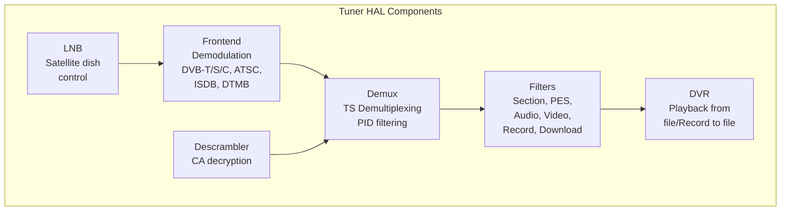

### 62.2.8 TV 画中画（PIP）

Android TV 拥有专为大屏体验定制的 PIP 实现。与手机版 PIP（显示一个小的悬浮窗口）不同，TV PIP 将次要内容放置在适合后仰观看体验的固定位置：

```java
// frameworks/base/libs/WindowManager/Shell/src/com/android/wm/shell/pip/tv/TvPipController.java

public class TvPipController implements PipTransitionController.PipTransitionCallback,
        TvPipBoundsController.PipBoundsListener, TvPipMenuController.Delegate,
        DisplayController.OnDisplaysChangedListener, ConfigurationChangeListener,
        UserChangeListener {
    private static final String TAG = "TvPipController";
}
```

TV PIP 实现由以下部分组成：

```
frameworks/base/libs/WindowManager/Shell/src/com/android/wm/shell/pip/tv/
  TvPipController.java            -- Main PIP controller for TV
  TvPipBoundsState.java           -- PIP window position/size state
  TvPipBoundsAlgorithm.java       -- Position calculation for TV layout
  TvPipBoundsController.java      -- Coordinates bounds changes
  TvPipMenuController.java        -- PIP overlay menu (play/close/etc.)
  TvPipMenuView.java              -- Menu visual layout
  TvPipNotificationController.java -- Notification when PIP is active
  TvPipTransition.java            -- Animations for PIP enter/exit
  TvPipAction.java                -- PIP action definitions
  TvPipCustomAction.java          -- App-provided custom actions
  TvPipActionsProvider.java       -- Action list management
  TvPipSystemAction.java          -- System-level PIP actions
  TvPipBackgroundView.java        -- Dimmed background behind PIP
  TvPipInterpolators.java         -- Animation curves
  TvPipMenuEduTextDrawer.java     -- Educational tooltip rendering
```

`TvPipController` 为 PIP 生命周期维护了一个清晰的状态机：

```java
// frameworks/base/libs/WindowManager/Shell/src/com/android/wm/shell/pip/tv/TvPipController.java

@Retention(RetentionPolicy.SOURCE)
@IntDef(prefix = {"STATE_"}, value = {
        STATE_NO_PIP,
        STATE_PIP,
        STATE_PIP_MENU,
})
public @interface State {}

private static final int STATE_NO_PIP = 0;   // No PIP window
private static final int STATE_PIP = 1;       // PIP at normal position
private static final int STATE_PIP_MENU = 2;  // PIP menu open, window centered

static final String ACTION_SHOW_PIP_MENU =
        "com.android.wm.shell.pip.tv.notification.action.SHOW_PIP_MENU";
static final String ACTION_CLOSE_PIP =
        "com.android.wm.shell.pip.tv.notification.action.CLOSE_PIP";
static final String ACTION_MOVE_PIP =
        "com.android.wm.shell.pip.tv.notification.action.MOVE_PIP";
static final String ACTION_TOGGLE_EXPANDED_PIP =
        "com.android.wm.shell.pip.tv.notification.action.TOGGLE_EXPANDED_PIP";
static final String ACTION_TO_FULLSCREEN =
        "com.android.wm.shell.pip.tv.notification.action.FULLSCREEN";
```

TV PIP 状态机：

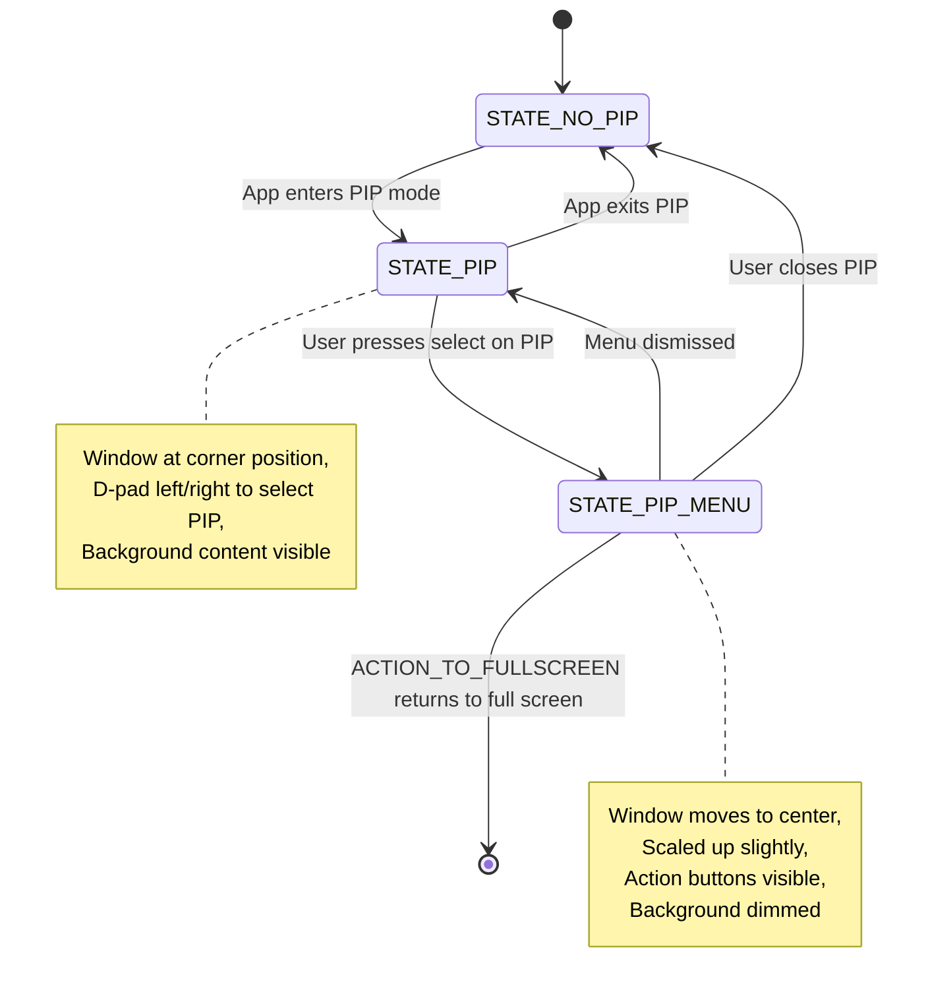

控制器与一组庞大的组件协作。其构造函数接收 20 个依赖，展示了 TV PIP 管理的复杂性：

```java
// frameworks/base/libs/WindowManager/Shell/src/com/android/wm/shell/pip/tv/TvPipController.java

private TvPipController(
        Context context,
        ShellInit shellInit,
        ShellController shellController,
        TvPipBoundsState tvPipBoundsState,
        PipDisplayLayoutState pipDisplayLayoutState,
        TvPipBoundsAlgorithm tvPipBoundsAlgorithm,
        TvPipBoundsController tvPipBoundsController,
        PipTransitionState pipTransitionState,
        PipAppOpsListener pipAppOpsListener,
        PipTaskOrganizer pipTaskOrganizer,
        PipTransitionController pipTransitionController,
        TvPipMenuController tvPipMenuController,
        PipMediaController pipMediaController,
        TvPipNotificationController pipNotificationController,
        TaskStackListenerImpl taskStackListener,
        PipParamsChangedForwarder pipParamsChangedForwarder,
        DisplayController displayController,
        WindowManagerShellWrapper wmShellWrapper,
        Handler mainHandler,
        ShellExecutor mainExecutor) {
    // ... initialization of all components
}
```

TV PIP 与手机 PIP 的关键差异：

- 位置通常是固定的角落，不可由用户拖动
- 菜单通过 D-pad 访问，而非触摸手势
- 背景内容会变暗以避免视觉竞争
- 操作包括媒体控制（播放/暂停），在菜单中占据醒目位置
- 基于广播的操作（`ACTION_SHOW_PIP_MENU`、`ACTION_CLOSE_PIP`）允许
  通知系统远程控制 PIP

`TvPip1Module` 为这一传统实现提供 Dagger 依赖注入：

```java
// frameworks/base/libs/WindowManager/Shell/src/com/android/wm/shell/dagger/pip/TvPip1Module.java

@Module(includes = {
        WMShellBaseModule.class,
        Pip1SharedModule.class})
public abstract class TvPip1Module {
    @WMSingleton
    @Provides
    static Optional<TvPipController.TvPipImpl> providePip1(
            Context context,
            ShellInit shellInit,
            ShellController shellController,
            TvPipBoundsState tvPipBoundsState,
            // ... many dependencies
    ) { /* ... */ }
}
```

`TvPipModule` 本身是一个轻量的选择器——`@Module(includes = {TvPip1Module.class,
TvPip2Module.class\})`——它根据 `PipFlags.isPip2ExperimentEnabled()` 提供
`PipTransitionController`（以及活动的 `Pip` 实现）。

### 62.2.9 D-pad 导航

Android TV 使用方向键（D-pad）导航而非触摸。这从根本上改变了框架中焦点管理的工作方式。关键的基础设施：

1. **焦点搜索算法**：`View.focusSearch()` 使用 `FocusFinder` 来确定当用户按下上/下/左/右键时，哪个视图应获得焦点。

2. **触摸模式**：电视设备始终处于"非触摸"模式。视图必须显式地处理焦点状态的绘制（焦点环、高亮）。

3. **BrowseFragment / Leanback 库**：`androidx.leanback` 库提供了针对 D-pad 导航优化的预构建 UI 组件：`BrowseFragment`、`DetailsFragment`、`SearchFragment`、`PlaybackFragment`。

4. **声音反馈**：D-pad 按键会触发可听见的点击声，以提供空间反馈。

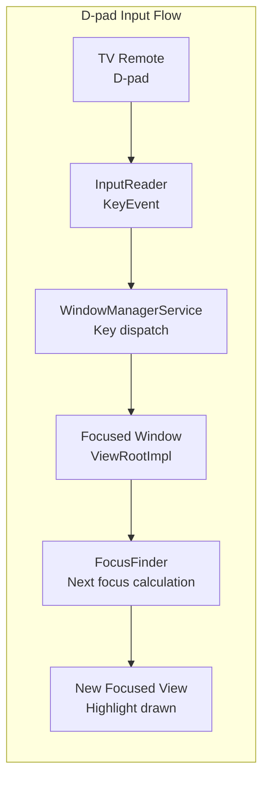

### 62.2.10 TvSettings

Android TV 使用专门的设置应用，而非标准的手机版 Settings 应用。TV Settings 应用（`packages/apps/TvSettings/`）提供适合 D-pad 控制的侧边栏导航模式，具有大字体与高对比度的视觉设计。

电视专用设置包括：

- **输入管理**：HDMI 输入的命名与排序
- **显示和声音**：分辨率、HDR、音频输出（HDMI ARC、蓝牙等）
- **CEC 控制**：启用/禁用 HDMI-CEC、一键播放、系统音频
- **屏幕保护程序（Daydream）**：环境模式显示（照片、时钟等）
- **无障碍**：大字体、高对比度、TalkBack 导航

TvSettings 与调谐器应用等 OEM 电视应用需要平台能力，但它们并不持有完整的平台签名访问权限。对于这些应用，TV 形态随附了一个轻量的系统 API 桥接库，即 `java_sdk_library com.android.libraries.tv.tvsystem`（`frameworks/opt/tv/tvsystem/`）。这让应用可以在不持有该访问权限的情况下触及这些能力。该库在隐藏的系统 API（如 `TvUserManager`、`TvAudioManager`、`TvWifiManager` 和 `TvPackageInstaller`）之上暴露了 TV 风格的垫片。

### 62.2.11 TV 交互式应用框架

TV 交互式应用框架扩展了 TIF，以支持混合广播/宽带（HBB-TV）、交互式广告和双屏体验：

```
frameworks/base/services/core/java/com/android/server/tv/interactive/
  TvInteractiveAppManagerService.java
```

该服务管理 `TvInteractiveAppService` 实例，这些实例可以在电视视频流之上覆盖交互式内容，同时响应广播信号与互联网数据。

### 62.2.12 Media Quality HAL

Media Quality HAL（`hardware/interfaces/tv/mediaquality/`）实现了电视专用的视频处理功能：

- 画面模式预设（标准、影院、鲜艳、游戏）
- 动态背光控制
- 内容自适应处理
- 环境光背光调节

```java
// frameworks/base/media/java/android/media/quality/AmbientBacklightSettings.java
// -- TV ambient backlight configuration
// frameworks/base/media/java/android/media/quality/AmbientBacklightEvent.java
// -- Ambient backlight event notifications
```

---

## 62.3 Wear OS

Wear OS 面向腕戴设备适配 Android，这些设备具有小型圆形显示屏、极端的电池约束，以及以可一览信息为核心的 UI 范式。虽然 Wear OS 的许多专有实现位于 AOSP 之外（在 Google Play Services for Wear 中），但框架层面的适配在基础平台中依然清晰可见。

### 62.3.1 圆形显示屏支持

Wear 最显眼的适配是对圆形显示屏的支持。框架提供了几种机制：

**圆形屏幕的窗口内嵌（Window Insets）**

`WindowInsets` 系统通过 `WindowInsets.isRound()` 报告显示屏是否为圆形。应用据此调整内边距，以免内容被弧形边缘裁剪：

```mermaid
graph TB
    subgraph "Round Display Handling"
        Display["Round Display<br/>diameter: 390px"]
        Insets["WindowInsets<br/>isRound()=true"]
        WIC["WatchViewStub /<br/>BoxInsetLayout"]
        SafeArea["Safe Content Area<br/>Inscribed square"]
    end

    Display --> Insets
    Insets --> WIC
    WIC --> SafeArea
```

Wear 支持库中的 `BoxInsetLayout` 会自动对子视图应用内嵌，确保内容保持在圆形显示屏内切矩形范围内。若不这样做，边缘处的内容会被裁剪或无法阅读。

**配置上报**

框架会针对 Wear 设备上报 `Configuration.UI_MODE_TYPE_WATCH`。这让应用和系统可以据此分支行为：

```java
int uiMode = context.getResources().getConfiguration().uiMode;
boolean isWatch = (uiMode & Configuration.UI_MODE_TYPE_MASK)
        == Configuration.UI_MODE_TYPE_WATCH;
```

资源限定符（`-watch`、`-round`、`-notround`）支持针对每种显示屏形状覆盖尺寸、布局与可绘制资源。

### 62.3.2 环境模式与始终显示

Wear 设备支持环境模式：表盘仍然可见，但处于低功耗状态。这涉及：

1. **降低刷新率**：显示屏降至 1 Hz 或更低的更新速率。
2. **有限调色板**：屏幕切换到灰度或有限色彩模式，以降低 OLED 像素功耗。

3. **简化渲染**：表盘从全彩交互模式切换为简化的环境渲染。

Wear 支持库中的 `AmbientModeSupport` 类提供生命周期回调：

```mermaid
stateDiagram-v2
    [*] --> Interactive: Wrist raise / tap
    Interactive --> Ambient: Timeout / wrist down
    Ambient --> Interactive: Wrist raise / tap
    Ambient --> Off: Extended inactivity
    Off --> Interactive: Button press / wrist raise

    note right of Interactive
        Full color rendering,
        Full frame rate,
        Touch input active,
        Sensor sampling active
    end note

    note right of Ambient
        Simplified rendering,
        1 Hz refresh,
        Grayscale / low color,
        No touch input,
        Reduced sensor sampling
    end note
```

### 62.3.3 烧屏保护

手表上的 OLED 显示屏如果持续点亮静态像素，很容易出现烧屏。框架通过以下方式实现烧屏保护：

1. **像素位移**：在环境模式下，整个显示内容会周期性（大约每分钟）平移几个像素。这在 WindowManager 层面处理。

2. **仅轮廓渲染**：环境模式下的表盘使用轮廓化的数字而非填充图形，减少点亮的像素数量。

3. **低 bit 环境模式**：部分显示屏支持真正的低 bit 模式，每个像素要么全亮要么全灭（无抗锯齿），进一步降低烧屏风险。

表盘框架通过 `WatchFaceService` 暴露烧屏保护信息：

```mermaid
graph LR
    subgraph "Burn-in Protection Strategies"
        PS["Pixel Shift<br/>Content moves<br/>periodically"]
        OL["Outline Rendering<br/>No solid fills<br/>in ambient"]
        LB["Low-bit Mode<br/>1-bit per pixel<br/>no anti-aliasing"]
        TC["Time Limiting<br/>Screen off after<br/>extended ambient"]
    end

    subgraph "Implementation Points"
        WM["WindowManager<br/>Applies pixel offset"]
        WFS["WatchFaceService<br/>Ambient drawing mode"]
        DP["Display Policy<br/>Screen timeout"]
    end

    PS --> WM
    OL --> WFS
    LB --> WFS
    TC --> DP
```

### 62.3.4 表盘框架

表盘是 Wear UI 中最具特色的元素。框架定义了 `WatchFaceService`，它继承自 `WallpaperService`，以提供始终可见、持续更新的表面渲染：

表盘的生命周期：

```mermaid
sequenceDiagram
    participant WFS as WatchFaceService
    participant Engine as Engine (WallpaperService.Engine)
    participant Canvas as Canvas / GL Surface
    participant WM as WindowManager
    participant AMS as AmbientModeSupport

    Note over WFS: Service starts
    WFS->>Engine: onCreateEngine()
    Engine->>Canvas: onSurfaceCreated()
    Engine->>Engine: onDraw() [interactive mode]

    Note over AMS: User lowers wrist
    AMS->>Engine: onEnterAmbient(burnInProtection)
    Engine->>Canvas: Draw simplified face
    Engine->>Engine: Reduce update frequency to 1/min

    Note over AMS: User raises wrist
    AMS->>Engine: onExitAmbient()
    Engine->>Canvas: Draw full interactive face
    Engine->>Engine: Resume normal update frequency

    Note over WM: Burn-in protection active
    WM->>WM: Apply pixel shift offset
```

表盘复杂功能（用于显示天气、步数、电池等的小数据区域）通过 Complication API 提供：

```mermaid
graph TB
    subgraph "Watch Face Complications"
        WF["Watch Face<br/>WatchFaceService"]
        CP1["Complication Provider 1<br/>Weather"]
        CP2["Complication Provider 2<br/>Step Count"]
        CP3["Complication Provider 3<br/>Battery"]
        CP4["Complication Provider 4<br/>Next Calendar Event"]
    end

    subgraph "Complication Types"
        SHORT["SHORT_TEXT<br/>72F"]
        LONG["LONG_TEXT<br/>Meeting at 2:00 PM"]
        ICON["ICON<br/>Small icon"]
        RANGE["RANGED_VALUE<br/>Progress arc"]
        IMG["SMALL_IMAGE<br/>Photo or icon"]
    end

    WF --> CP1
    WF --> CP2
    WF --> CP3
    WF --> CP4

    CP1 --> SHORT
    CP2 --> SHORT
    CP3 --> RANGE
    CP4 --> LONG
```

### 62.3.5 Tiles API

Wear OS Tiles 提供可一览的信息界面，用户可以在表盘上左右滑动切换。与完整活动不同，Tile 使用布局 DSL 以声明式方式定义，并由 `TileService` 更新：

```mermaid
graph LR
    subgraph "Tiles Architecture"
        TS["TileService<br/>Provider app"]
        TR["TileRenderer<br/>Layout rendering"]
        TH["Tile Host<br/>System UI"]
    end

    subgraph "Tile Lifecycle"
        REQ["onTileRequest()"]
        RES["onResourcesRequest()"]
        UPD["Update interval<br/>or user swipe"]
    end

    TH --> REQ
    REQ --> TS
    TS --> RES
    RES --> TR
    TR --> TH
    UPD --> REQ
```

Tile 基于 protobuf 布局模式构建：

- **LayoutElement**：Row、Column、Box、Spacer、Image、Text、Arc
- **TimelineEntry**：Tile 可以定义随时间自动切换的布局
- **Clickable**：元素可以触发操作（启动活动、发送消息）

### 62.3.6 精简的窗口系统

与手机相比，Wear OS 显著简化了窗口系统：

1. **单任务模型**：一次只有一个活动可见。不支持分屏、自由形态或 PIP。

2. **无导航栏**：系统返回手势由实体按键或滑动手势处理，而非屏幕按钮。

3. **简化的最近应用**：最近应用列表要么不存在，要么只是简单的垂直滚动，而非完整的手机式概览。

4. **缩减的显示区域**：没有传统意义上的状态栏。通知以从底部滑入的卡片形式出现。

```mermaid
graph TB
    subgraph "Phone Windowing"
        PStatusBar[Status Bar]
        PContent[App Content Area]
        PNavBar[Navigation Bar]
        PSplit[Split Screen Support]
        PPip[PIP Support]
        PFreeform[Freeform Windows]
    end

    subgraph "Wear Windowing"
        WFace["Watch Face<br/>always behind"]
        WContent["Single App<br/>full screen"]
        WNotif["Notification Cards<br/>swipe up"]
        WTiles["Tiles<br/>swipe left/right"]
    end

    subgraph "Simplifications"
        NoSplit[No split screen]
        NoPip[No PIP]
        NoFreeform[No freeform]
        NoNavBar[No navigation bar]
    end
```

### 62.3.7 可穿戴设备的电池优化

Wear OS 采用了远超标准 Android 的激进电池优化手段：

1. **抬腕休眠（Doze on wrist-down）**：当加速度计检测到手腕放下时，设备进入类 Doze 状态的速度远快于手机。

2. **网络效率**：可穿戴设备优先通过已连接的手机（蓝牙代理）路由网络请求，而非使用自身的 Wi-Fi 或蜂窝射频。这能显著省电。

3. **传感器批处理**：传感器对读数进行批处理并以突发方式投递，而非持续投递，使处理器可以在批次之间休眠。

4. **减少后台活动**：Wear 上的 `JobScheduler` 约束更加严格。允许的并发后台服务更少。

5. **睡眠模式（Bedtime mode）**：一种特殊模式，在睡眠时段禁用始终显示、通知和抬腕唤醒。

```mermaid
graph TB
    subgraph "Wear Battery Optimization Stack"
        subgraph "Hardware Level"
            OLED["OLED Display<br/>Per-pixel power control"]
            ULP["Ultra-Low-Power<br/>Co-processor"]
            BLE["Bluetooth LE<br/>Low-energy comms"]
        end

        subgraph "Framework Level"
            AOD["Always-On Display<br/>1Hz update, grayscale"]
            BIP["Burn-in Protection<br/>Pixel shifting"]
            DOZE["Aggressive Doze<br/>Wrist-down trigger"]
            BATCH["Sensor Batching<br/>Periodic bulk delivery"]
            PROXY["BT Network Proxy<br/>Route through phone"]
        end

        subgraph "App Level"
            COMP["Complications<br/>Push updates, not poll"]
            TILES["Tiles<br/>Declarative, no Activity"]
            AMBI["Ambient Mode<br/>Simplified rendering"]
        end
    end

    OLED --> AOD
    ULP --> DOZE
    BLE --> PROXY
    AOD --> AMBI
    DOZE --> BATCH
```

### 62.3.8 Wear 专用资源限定符与配置

Wear 设备使用一整套资源限定符来适配布局：

| 限定符 | 取值 | 用途 |
|-----------|--------|---------|
| `-watch` | N/A | 应用于手表设备 |
| `-round` | N/A | 圆形显示屏形状 |
| `-notround` | N/A | 方形或矩形显示屏 |
| `UI_MODE_TYPE_WATCH` | 6 | 配置 UI 模式 |
| `smallestScreenWidthDp` | ~180-220dp | 典型手表屏幕尺寸 |

框架会上报几个手表专用的配置值：

```java
// Configuration checks in framework code:
boolean isWatch = (config.uiMode & Configuration.UI_MODE_TYPE_MASK)
        == Configuration.UI_MODE_TYPE_WATCH;

// Screen shape check:
boolean isRound = config.isScreenRound();

// Typical watch display metrics:
// 390x390 pixels at ~300+ dpi for round
// 320x320 pixels at ~280 dpi for smaller models
```

针对圆形显示屏的布局适配遵循特定模式：

```mermaid
graph TB
    subgraph "Round Display Layout Strategy"
        subgraph "Full Circle"
            FC["Total display area<br/>pi * r^2"]
        end
        subgraph "Safe Rectangle"
            SR["Inscribed square<br/>side = diameter / sqrt(2)<br/>~70.7% of diameter"]
        end
        subgraph "Content Zones"
            CZ1["Center: primary content<br/>Full readable area"]
            CZ2["Edges: decorative only<br/>Arc progress, bezels"]
        end
    end

    FC --> SR
    SR --> CZ1
    FC --> CZ2
```

面向 Wear 的应用必须考虑到圆形显示屏边缘附近约 30% 的屏幕区域会被部分裁剪。`BoxInsetLayout` 和弧形文本 API 有助于自动管理这一约束。

### 62.3.9 可穿戴传感框架

AOSP 包含一个面向可穿戴设备专用传感能力的框架：

```
frameworks/base/services/core/java/com/android/server/wearable/
  WearableSensingManagerService.java      -- System service
  WearableSensingManagerPerUserService.java -- Per-user management
  RemoteWearableSensingService.java       -- Remote service connection
  WearableSensingSecureChannel.java       -- Secure data channel
  WearableSensingShellCommand.java        -- Debug shell commands
```

```java
// frameworks/base/core/java/android/app/wearable/WearableSensingManager.java
// -- Client API for wearable sensing

// frameworks/base/core/java/android/service/wearable/WearableSensingService.java
// -- Service that processes wearable sensor data
```

可穿戴传感框架为处理来自可穿戴传感器的敏感健康与活动数据提供了安全通道。它支持：

- 用于活动识别的加速度计与陀螺仪数据
- 心率与 SpO2 监测
- 跌倒检测算法
- 情境感知的环境计算

```mermaid
graph TB
    subgraph "Wearable Sensing Architecture"
        Sensors["Wearable Sensors<br/>Accel, Gyro, HR, SpO2"]
        WSS["WearableSensingService<br/>On-device processing"]
        SC["Secure Channel<br/>WearableSensingSecureChannel"]
        WSMS["WearableSensingManagerService<br/>System service"]
        WSM["WearableSensingManager<br/>Client API"]
        App[Health/Fitness App]
    end

    Sensors --> WSS
    WSS --> SC
    SC --> WSMS
    WSMS --> WSM
    WSM --> App
```

---

## 62.4 形态定制点

贯穿全部三种形态的关键架构洞见是：AOSP 并不使用编译期 `#ifdef` 分支。相反，定制是通过运行时覆盖、Dagger 模块替换、产品配置和抽象层来实现的。本节列出具体的定制点。

### 62.4.1 SystemUI 变体

SystemUI 是定制化最显眼的组件。AOSP 提供了三个变体：

```
frameworks/base/packages/SystemUI/       -- Phone/tablet SystemUI (default)
packages/apps/Car/SystemUI/              -- Automotive SystemUI
packages/apps/TvSystemUI/                -- TV SystemUI
```

手机 SystemUI 是默认版本且功能最丰富。Car SystemUI 用汽车专用 UI 组件将其完全替换。TV SystemUI 则更为简单，专注于极简的通知系统和设置入口。

选择在构建时通过产品配置完成：

```makefile
# For automotive builds:
PRODUCT_PACKAGES += CarSystemUI
# Instead of the default:
# PRODUCT_PACKAGES += SystemUI
```

### 62.4.2 WMShell 模块变体

Window Manager Shell 为不同形态提供了 Dagger 模块变体。基础模块是共享的，形态专用模块叠加在其之上：

```
frameworks/base/libs/WindowManager/Shell/src/com/android/wm/shell/dagger/
  WMShellBaseModule.java       -- Shared dependencies (all form factors)
  WMShellModule.java           -- Phone/tablet specific
  TvWMShellModule.java         -- TV specific
  WMShellConcurrencyModule.java -- Thread pool configuration
```

`TvWMShellModule` 替换为 TV 专用实现：

```java
// frameworks/base/libs/WindowManager/Shell/src/com/android/wm/shell/dagger/
//   TvWMShellModule.java

@Module(includes = {TvPipModule.class})
public class TvWMShellModule {

    @WMSingleton
    @Provides
    @DynamicOverride
    static StartingWindowTypeAlgorithm provideStartingWindowTypeAlgorithm() {
        return new TvStartingWindowTypeAlgorithm();
    }

    @WMSingleton
    @Provides
    @DynamicOverride
    static SplitScreenController provideSplitScreenController(/* ... */) {
        return new TvSplitScreenController(/* ... */);
    }
}
```

`TvWMShellModule` 所做的关键替换：

| 组件 | 手机 | TV |
|-----------|-------|----|
| StartingWindowTypeAlgorithm | Default | TvStartingWindowTypeAlgorithm |
| SplitScreenController | SplitScreenController | TvSplitScreenController |
| PIP | Pip1Module / Pip2Module | TvPipModule |
| PIP 控制器 | PipController | TvPipController |
| PIP 边界 | PipBoundsAlgorithm | TvPipBoundsAlgorithm |

```mermaid
graph TB
    subgraph "WMShell Module Architecture"
        BASE["WMShellBaseModule<br/>Shared infrastructure"]

        subgraph "Form Factor Modules"
            PHONE["WMShellModule<br/>Phone/Tablet"]
            TV["TvWMShellModule<br/>TV"]
            AUTO["Car uses separate<br/>SystemUI entirely"]
        end

        subgraph "PIP Modules"
            PIP1["Pip1Module<br/>Phone PIP v1"]
            PIP2["Pip2Module<br/>Phone PIP v2"]
            TVPIP["TvPipModule<br/>TV PIP"]
        end
    end

    BASE --> PHONE
    BASE --> TV
    PHONE --> PIP1
    PHONE --> PIP2
    TV --> TVPIP
```

### 62.4.3 设备覆盖（运行时资源覆盖）

运行时资源覆盖（RRO）是在不修改源代码的情况下进行视觉与行为定制的主要机制。每种形态都大量使用 RRO：

**汽车 RRO：**
```
packages/services/Car/car_product/rro/
  CarSystemUIRRO/             -- SystemUI visual overrides
  CarSystemUIPassengerRRO/    -- SystemUI overrides for passenger displays
  PermissionControllerRRO/    -- Permission UI adjustments
  CarResourceCommon/          -- Shared resource definitions
  overlay-config/
    androidRRO/               -- Framework defaults
    SettingsProviderRRO/      -- Settings provider defaults
    CertInstallerRRO/         -- Certificate installer
    TelecommRRO/              -- Telecom UI
  oem-design-tokens/
    OEMDesignTokenRRO/        -- OEM design system tokens
    OEMDesignTokenFrameworkResRRO/  -- Framework token overlays
    OEMDesignTokenCarUiPluginRRO/   -- Car UI plugin tokens
```

**远程显示屏 RRO**（用于副屏）：
```
packages/services/Car/car_product/distant_display/rro/
  distant_display_rro.mk
  MediashellRRO/
  CarServiceRRO/
  DriverUiRRO/
```

RRO 的工作原理是在运行时覆盖资源值，而不修改目标 APK。覆盖包声明它覆盖哪个目标包与资源：

```xml
<!-- Example: CarSystemUIRRO/AndroidManifest.xml -->
<manifest>
    <overlay android:targetPackage="com.android.systemui"
             android:resourcesMap="@xml/overlays"
             android:isStatic="true" />
</manifest>
```

覆盖随后可以替换目标包中的任何资源——颜色、尺寸、布局、字符串、布尔值。OEM 正是以此方式在不 fork SystemUI 源代码的情况下定制车机 UI 的外观与体验。

### 62.4.4 产品配置

产品配置是形态选择的起点。构建系统读取 makefile 变量，以确定纳入哪些包、覆盖与属性。

**汽车产品配置：**

```makefile
# packages/services/Car/car_product/build/car_base.mk
# packages/services/Car/car_product/build/car.mk

# Key automotive properties:
PRODUCT_PROPERTY_OVERRIDES += \
    ro.hardware.type=automotive

# Key automotive packages:
PRODUCT_PACKAGES += \
    CarService \
    CarSystemUI \
    CarLauncher \
    CarSettings
```

`car_product/build/` 目录层次结构：

| 文件 | 用途 |
|------|---------|
| `car.mk` | 所有汽车构建的公共包 |
| `car_base.mk` | 基础产品定义 |
| `car_product.mk` | 完整产品包 |
| `car_system.mk` | system 分区包 |
| `car_system_ext.mk` | system_ext 分区包 |
| `car_vendor.mk` | vendor 分区包 |
| `car_generic_system.mk` | 通用系统镜像 |

**TV 产品配置**通常包括：

```makefile
# (vendor-specific or device-specific makefile)
PRODUCT_PACKAGES += \
    TvSettings \
    TvSystemUI \
    TvProvider \
    TvLauncher
```

请注意，`ro.hardware.type` 是汽车专用的属性——TV 构建是通过 PackageManager 特性 `android.software.leanback` 和 `android.hardware.type.television` 来标识的，而不是通过系统属性。

**Wear 产品配置**通常包括：

```makefile
# (vendor-specific)
# Watch-specific features
PRODUCT_PACKAGES += \
    WearSettings \
    ClockworkHome \
    WearSystemUI
```

Wear 构建同样通过 `android.hardware.type.watch` 特性来标识。

### 62.4.5 特性标志与配置

除属性与覆盖之外，形态行为还通过以下方式控制：

1. **PackageManager 特性标志**：每种形态都在 `system/etc/permissions/` 中声明特性：

```xml
<!-- Automotive -->
<feature name="android.hardware.type.automotive" />

<!-- TV -->
<feature name="android.software.leanback" />
<feature name="android.hardware.type.television" />

<!-- Wear -->
<feature name="android.hardware.type.watch" />
```

2. **配置资源**：`frameworks/base/core/res/res/values/config.xml` 包含数百个可配置的值。形态覆盖会更改这些值：

```xml
<!-- Example: config_enableCarDockHomeLaunch -->
<!-- When true, docking launches the car dock home activity -->
```

   请注意，有些能力是以 PackageManager 特性而非配置布尔值来表达的——例如，画中画支持就是 `android.software.picture_in_picture` 特性。

3. **SELinux 策略**：每种形态都有专门的 SELinux 策略：

```
packages/services/Car/car_product/sepolicy/  -- Automotive SEPolicy
```

### 62.4.6 OEM 如何按形态定制

任何形态的 OEM 定制栈都遵循分层模式：

```mermaid
graph TB
    subgraph "Customization Stack (Bottom to Top)"
        AOSP["AOSP Base<br/>frameworks/base, packages/"]
        FF["Form Factor Layer<br/>packages/services/Car/<br/>TV/Wear framework additions"]
        PROD["Product Configuration<br/>device/vendor/product.mk<br/>Package selection, properties"]
        RRO["Runtime Resource Overlays<br/>Visual customization<br/>Default value overrides"]
        OEM_APK["OEM Replacement APKs<br/>Custom Launcher, SystemUI<br/>Custom Settings"]
        VENDOR["Vendor Partition<br/>HAL implementations<br/>Proprietary services"]
    end

    AOSP --> FF
    FF --> PROD
    PROD --> RRO
    RRO --> OEM_APK
    OEM_APK --> VENDOR
```

按形态划分的具体 OEM 定制模式：

**汽车 OEM 定制：**

- 映射到其专用 ECU 协议的自定义 `IVehicle` HAL 实现
- 由 `InstrumentClusterService` 绑定的自定义仪表盘渲染器
- 通过 Car SystemUI 上的 RRO 实现的自定义 HVAC 控制面板
- 带有品牌专属小部件的自定义车机启动器
- 用于品牌一致视觉形象的 OEM 设计令牌
- 通过 AudioControl HAL 实现的自定义音频路由

**TV OEM 定制：**

- 面向专有调谐器硬件的自定义 `TvInputService` 实现
- 带有品牌专属内容推荐的自定义 TV 启动器
- 面向其专用设备生态的自定义 CEC 行为
- 通过 Media Quality HAL 实现的画质处理
- 自定义遥控器集成

**Wear OEM 定制：**

- 自定义表盘包
- 面向健康功能的自定义传感器实现
- 面向设备专用功能的自定义 Tile
- 针对特定硬件的电池优化调校
- 面向设备传感器的自定义复杂功能提供方

### 62.4.7 跨形态的多显示屏架构

多显示屏支持在各形态之间差异巨大：

```mermaid
graph TB
    subgraph "Phone"
        PD1[Primary Display]
        PD2[Optional: Cast / External]
    end

    subgraph "Automotive"
        AD1[Driver Main Display]
        AD2[Instrument Cluster]
        AD3[Passenger Display]
        AD4[Rear Seat Left]
        AD5[Rear Seat Right]
        AD6[HUD Display]
    end

    subgraph "TV"
        TD1["Main TV Output<br/>HDMI"]
        TD2["Optional PIP<br/>Same display, separate task"]
    end

    subgraph "Wear"
        WD1["Single Round Display<br/>Always-on capable"]
    end
```

汽车拥有最复杂的多显示屏需求，这也是乘员区域系统仅存在于 Car 框架中的原因。TV 通过单屏 PIP 处理多内容。Wear 的模型最简单，只有一个小型的显示屏。

### 62.4.8 服务注册差异

每种形态在 `SystemServer` 启动时注册不同的系统服务：

```mermaid
graph TB
    subgraph "Common Services (All Form Factors)"
        AMS[ActivityManagerService]
        WMS[WindowManagerService]
        PMS[PackageManagerService]
        IPMS[InputMethodManagerService]
        NMS[NotificationManagerService]
    end

    subgraph "Automotive Additional Services"
        CS["CarService<br/>~40 internal services"]
        OAS[OccupantAwarenessService]
        VHAL_S[Vehicle HAL Service]
    end

    subgraph "TV Additional Services"
        TIMS2[TvInputManagerService]
        TRMS2[TunerResourceManagerService]
        HDMI[HdmiControlService]
    end

    subgraph "TV Optional Services<br/>(frameworks/opt/tv/tvsystem repo)"
        TVWS["TvWatchdogService<br/>(not started by SystemServer)"]
    end

    subgraph "Wear Additional Services"
        WSMS2[WearableSensingManagerService]
        ACM[AmbientContextManagerService]
    end
```

这些服务根据设备特性有条件地启动：

```java
// Automotive: started when ro.hardware.type == automotive
// CarService is started as a persistent service

// TV: started when this is a TV device (isTv = leanback feature) OR
// the FEATURE_LIVE_TV feature is present -- NOT gated on FEATURE_LEANBACK alone
// (frameworks/base/services/java/com/android/server/SystemServer.java)
if (isTv || pm.hasSystemFeature(PackageManager.FEATURE_LIVE_TV)) {
    mSystemServiceManager.startService(TvInputManagerService.class);
}

// HDMI-CEC: started on TV devices
if (pm.hasSystemFeature(PackageManager.FEATURE_HDMI_CEC)) {
    // HdmiControlService starts
}

// TunerResourceManagerService: gated on FEATURE_TUNER
if (pm.hasSystemFeature(PackageManager.FEATURE_TUNER)) {
    // TunerResourceManagerService starts
}
```

### 62.4.9 输入模型差异

每种形态都有根本不同的输入模型：

```mermaid
graph TB
    subgraph "Phone Input"
        Touch[Multi-touch Screen]
        Gesture["System Gestures<br/>Back, Home, Recents"]
        VoiceP[Voice Assistant]
    end

    subgraph "Automotive Input"
        TouchA["Touchscreen<br/>Driver + Passenger"]
        Rotary["Rotary Controller<br/>Knob input"]
        Steering[Steering Wheel Buttons]
        VoiceA["Voice Assistant<br/>Primary while driving"]
    end

    subgraph "TV Input"
        DPad["D-pad Remote<br/>Up/Down/Left/Right/Select"]
        VoiceT[Voice Remote]
        GamePad[Game Controller]
        Mouse["Air Mouse / Pointer<br/>Optional"]
    end

    subgraph "Wear Input"
        TouchW["Touch Screen<br/>Limited due to size"]
        Crown["Rotary Side Button<br/>Scroll/Navigation"]
        Buttons["Physical Buttons<br/>Back, Home"]
        WristG[Wrist Gestures]
    end
```

在汽车场景中，`RotaryController` 应用（`packages/apps/Car/RotaryController/`）处理旋钮输入，将其转换为类似 TV 上 D-pad 的焦点导航。CarService 中的 `CarInputService` 管理跨乘员区域的输入路由：

```java
// Referenced in ICarImpl field declarations:
private final CarInputService mCarInputService;
```

---

## 62.5 Android 17：汽车窗口管理、可见性屏障，以及通向 SDV 之路

Android 17 在汽车形态上投入了大量资源。本版本中 `packages/services/Car/` 的大多数新代码并非关于新的车辆属性或新的 HAL——而是关于*窗口管理*。AAOS 主机越来越多地在一块大屏幕上并排运行多个应用。一个例子是地图旁边是媒体播放器，再旁边是空调面板。它们还为多位乘员驱动多个物理显示屏。每个显示屏都使用由 OEM 编写、完全可配置的布局。

手机 WindowManager Shell 从未为这类场景做过设计。因此，17 发布了一个专用的汽车 shell 库以及其上的声明式面板框架。本节逐一介绍为 17 落地的三个部分：`Car-WindowManager-Shell` 库、汽车可见性屏障，以及可扩展 UI 面板框架。随后本节指出更宏大的软件定义车辆（SDV）故事的所在之处。

### 62.5.1 Car WindowManager Shell 库

手机和平板的窗口管理基于 `frameworks/base/libs/WindowManager/Shell/`（`WMShellModule`、`WMShellBaseModule`）构建，如 62.4.2 节所述。

汽车需要不同的模型。每个容器都是一个*多窗口根任务*（不存在拥有显示屏的单个全屏任务）。系统 UI 必须显式地对容器进行分层并设定边界。一个容器必须能够在其上方没有绘制不透明活动的情况下被隐藏。Android 17 将这一能力拆分为一个独立的库 `Car-WindowManager-Shell`，声明于 `packages/services/Car/libs/car-wm-shell-lib/Android.bp`。其公开接口面很小，位于 `packages/services/Car/libs/car-wm-shell-lib/src/com/android/wm/shell/automotive/` 之下。

核心抽象是 `AutoTaskStack`——一个*始终*处于多窗口模式的任务栈——及其具体形式 `RootTaskStack`：

```kotlin
// packages/services/Car/libs/car-wm-shell-lib/src/com/android/wm/shell/automotive/
//   AutoTaskStack.kt

/**
 * Represents an auto task stack, which is always in multi-window mode.
 */
interface AutoTaskStack {
    val id: Int
    val displayId: Int
    var leash: SurfaceControl
    val name: String
}

data class AutoTaskStackState(
    val bounds: Rect = Rect(),
    val isAboveBarrier: Boolean,
    val layer: Int
)

data class RootTaskStack(
    override val id: Int,
    override val displayId: Int,
    override var leash: SurfaceControl,
    override val name: String,
    var rootTaskInfo: ActivityManager.RunningTaskInfo
) : AutoTaskStack
```

`AutoTaskStackState` 中的两个字段是新模型的核心。`layer` 赋予系统 UI 对容器的显式 Z 序控制（手机 shell 大多依赖活动顺序）。`isAboveBarrier` 将容器与 62.5.2 节所述的可见性屏障关联起来。WindowManager 会将屏障下方的栈隐藏，而无需任何遮挡表面。`bounds` 字段让系统 UI 能够确定性地放置和调整每个容器的大小，这正是固定多面板车机布局得以实现的基础。

客户端通过 `AutoTaskStackController` 接口驱动 shell：

```kotlin
// packages/services/Car/libs/car-wm-shell-lib/src/com/android/wm/shell/automotive/
//   AutoTaskStackController.kt

interface AutoTaskStackController {
    var autoTransitionHandlerDelegate: AutoTaskStackTransitionHandlerDelegate?

    val taskStackStateMap: Map<Int, AutoTaskStackState>

    fun createRootTaskStack(
        displayId: Int,
        name: String,
        listener: RootTaskStackListener
    ): RootTaskStack?

    fun destroyTaskStack(taskStackId: Int)

    fun setDefaultRootTaskStackOnDisplay(displayId: Int, rootTaskStackId: Int?)

    @ShellMainThread
    fun startTransition(transaction: AutoTaskStackTransaction): IBinder?
}
```

控制器遵循"事务与过渡"的纪律，而非命令式的窗口移动。调用方组合一个 `AutoTaskStackTransaction`（将任务重新挂载到某个栈中、更改栈的 `AutoTaskStackState`、将 `PendingIntent` 送入某个栈），然后调用 `startTransition`。WindowManager 随后通过一次常规的 Shell 过渡来驱动这一变更。它会回调调用方的 `AutoTaskStackTransitionHandlerDelegate`（`handleRequest`、`startAnimation`、`onTransitionConsumed`、`mergeAnimation`）。这使动画与底层窗口操作保持同步。`setDefaultRootTaskStackOnDisplay` 将一个栈注册为某块显示屏的启动根，因此新启动的活动会被路由到一个受管理的容器中，而不是变成全屏。

容器的生命周期通过 `RootTaskStackListener` 上报，它适配了 `ShellTaskOrganizer.TaskListener`，使回调在根容器与其子任务之间清晰地分流：

```kotlin
// packages/services/Car/libs/car-wm-shell-lib/src/com/android/wm/shell/automotive/
//   RootTaskStackListener.kt

interface RootTaskStackListener : ShellTaskOrganizer.TaskListener {
    fun onRootTaskStackAppeared(rootTaskStack: RootTaskStack) {}
    fun onRootTaskStackInfoChanged(rootTaskStack: RootTaskStack) {}
    fun onRootTaskStackDestroyed(rootTaskStack: RootTaskStack) {}
}
```

在 CarService 一侧，`CarActivityService` 增加了自己的轻量 `RootTaskListener` 接口以及 `registerRootTaskListener`/`unregisterRootTaskListener`。借此，汽车系统服务可以观察根任务的出现/消失事件，而无需直接依赖 shell 库：

```java
// packages/services/Car/service/src/com/android/car/am/CarActivityService.java

/** Listener for root task callbacks. */
public interface RootTaskListener {
    void onRootTaskVanished(String name);
    void onRootTaskAppeared(String name);
}
```

库与 shell 的架构：

```mermaid
graph TB
    subgraph "System UI Process"
        DELEG["AutoTaskStackTransitionHandlerDelegate<br/>(implemented by Car SystemUI)"]
        CTRL["AutoTaskStackController<br/>car-wm-shell-lib"]
        REPO["AutoTaskRepository<br/>tracks stacks + barrier tokens"]
        BAR["AutoVisibilityBarrierController"]
    end

    subgraph "WindowManager / Shell Core"
        STO["ShellTaskOrganizer"]
        TR["Transitions"]
        WM["WindowManagerService"]
    end

    subgraph "Containers on a Display"
        RTS1["RootTaskStack A<br/>isAboveBarrier=true, layer=2"]
        RTS2["RootTaskStack B<br/>isAboveBarrier=true, layer=1"]
        BARRIER["Visibility Barrier Task<br/>(empty, Shell-organized)"]
        RTS3["RootTaskStack C<br/>isAboveBarrier=false (hidden)"]
    end

    DELEG --> CTRL
    CTRL --> STO
    CTRL --> TR
    BAR --> STO
    BAR --> REPO
    CTRL --> REPO
    STO --> WM
    TR --> WM
    CTRL --> RTS1
    CTRL --> RTS2
    BAR --> BARRIER
    CTRL --> RTS3
```

### 62.5.2 汽车可见性屏障

汽车领域一个反复出现的问题是如何可靠地隐藏一个容器。在手机上，一个任务之所以被隐藏，是因为有不透明的东西覆盖了它。而在多面板的车机布局中，你可能想关闭某个面板，却没有任何不透明的东西可以覆盖它。把它留在下面可见既是 UX 问题，也是驾驶员分心问题。Android 17 用*可见性屏障*解决了这个问题，由 `packages/services/Car/libs/car-wm-shell-lib/src/com/android/wm/shell/automotive/visibilitybarrier/` 下的 `AutoVisibilityBarrierController` 实现。

该机制刻意保持简单。控制器为每块显示屏创建一个空的、由 Shell 组织的任务——即屏障。它依赖一条 WindowManager 规则：排在屏障*下方*的同级任务会被设为不可见。因此，任何容器只要被排在屏障之下（其 `AutoTaskStackState.isAboveBarrier` 变为 `false`），就可以被隐藏，而无需任何遮挡活动。类的文档直接说明了这一契约：

```kotlin
// packages/services/Car/libs/car-wm-shell-lib/src/com/android/wm/shell/automotive/
//   visibilitybarrier/AutoVisibilityBarrierController.kt

/**
 * Controller to manage the visibility barrier for each display.
 *
 * The visibility barrier is an empty Shell-organized task. Siblings below the visibility barrier
 * are made invisible by the WindowManager. This provides a reliable mechanism to hide tasks
 * without needing to occlude them with a fullscreen visible activity.
 *
 * Note: A home activity can co-exist with the visibility barrier and either will not affect the
 * other.
 */
@WMSingleton
class AutoVisibilityBarrierController @Inject constructor(/* ... */) :
    DisplayController.OnDisplaysChangedListener, AutoShellInitializable {

    override fun initialize() {
        if (!Flags.enableAutoVisibilityBarrier()) {
            return
        }
        // ...register for display add/remove and create a barrier per display
    }
}
```

控制器通过 `DisplayController.OnDisplaysChangedListener` 监听显示屏，并为每块显示屏维护一个屏障，将每个屏障的令牌记录在 `AutoTaskRepository` 中，并在 `onTaskVanished` 时丢弃它。与 17 中几乎所有新的窗口行为一样，它由一个 aconfig 标志门控，以便 OEM 和平台可以分阶段推出：

```
# packages/services/Car/libs/car-wm-shell-lib/aconfig/flags.aconfig
package: "com.android.wm.shell.automotive"
container: "system_ext"

flag {
    name: "enable_mumd_car_wm_shell"
    namespace: "car_framework"
    description: "Enables proxy and host implementation in MUMD car-wm-shell for automotive"
}

flag {
    name: "enable_auto_visibility_barrier"
    namespace: "car_framework"
    description: "Enables the dedicated auto visibility barrier controller on all displays"
}
```

`enable_mumd_car_wm_shell` 标志是这一故事的另一半。在多用户多显示屏（MUMD）车辆中，shell 以代理加宿主的方式拆分运行。这让每个乘员专属的系统 UI 进程都能通过同一个 `AutoTaskStackController` API 驱动自己显示屏上的容器。

### 62.5.3 可扩展 UI：声明式车机面板

shell 库为 Car SystemUI 提供了原语，但 OEM 并不想编写过渡代码。Android 17 在 shell 之上叠加了一个声明式的*可扩展 UI*框架。这让主机布局可以被描述为一组带有状态、变体与动画的可配置**面板**，而非命令式的窗口调用。该框架横跨两个位置。第一个是位于 `packages/apps/Car/systemlibs/car-scalable-ui-lib/` 的可复用模型与面板库（包名 `com.android.car.scalableui`，提供 `Event`、`PanelTransaction`、`Panel` 以及变体/关键帧模型）。第二个是位于 `packages/apps/Car/SystemUI/src/com/android/systemui/car/wm/scalableui/` 的 SystemUI 接线。

桥接类是 `PanelAutoTaskStackTransitionHandlerDelegate`——它实现 shell 的 `AutoTaskStackTransitionHandlerDelegate`，并将 WindowManager 过渡转换为面板事件。其配套组件记录在 `packages/apps/Car/SystemUI/src/com/android/systemui/car/wm/scalableui/README.md` 中：

| 组件 | 角色 |
|-----------|------|
| `PanelAutoTaskStackTransitionHandlerDelegate` | Shell 过渡与可扩展 UI 之间的桥接 |
| `PanelTransitionCoordinator` | 协调面板动画与状态变更 |
| `EventDispatcher` | 将系统事件映射为 `PanelTransaction` |
| `PanelConfigReader` / `ActionConfigReader` | 读取声明式的面板与操作配置 |
| `TaskPanel` / `DecorPanel` / `SysUIPanel` | 面板容器类型 |

README 阐明了让该框架高效的区别。*窗口状态*（可见性、尺寸、位置、Z 序）是重量级的，通过 `AutoTaskStackTransaction` 经由 WindowManager 处理。*Surface* 属性（alpha、缩放、平移、裁剪）通过 `AutoSurfaceTransaction` 在 SurfaceFlinger 上廉价地做动画。一次纯 surface 的变更（例如让面板淡出）永远不会在 WindowManager 中来回往返。

```mermaid
sequenceDiagram
    participant Src as App launch / button event
    participant WM as WindowManager / Shell
    participant Delegate as PanelAutoTaskStackTransitionHandlerDelegate
    participant Dispatch as EventDispatcher
    participant Coord as PanelTransitionCoordinator
    participant Surf as SurfaceFlinger

    Src->>WM: Window change initiates transition
    WM->>Delegate: handleRequest(transition, request)
    Delegate->>Dispatch: Event from TransitionRequestInfo
    Dispatch-->>Delegate: PanelTransaction
    Delegate->>Coord: Build AutoTaskStackTransaction
    Coord-->>Delegate: Transaction
    Delegate-->>WM: Return transaction
    WM->>Delegate: startAnimation(...)
    Delegate->>Coord: Reconcile state + animate
    Coord->>Surf: AutoSurfaceTransaction (alpha/scale/crop)
```

可扩展 UI 也是副屏相关工作的落脚点。远程显示屏和驾驶员/远程显示屏（"dewd"）系统 UI 显式地接入了该框架。例如，`packages/services/Car/car_product/distant_display/apps/CarDistantDisplaySystemUI/` 使用 `setScalableUIWMInitializer(...)` 和 `setScalableUIEventDispatcher(...)` 构建其初始化器。`packages/services/Car/car_product/dewd/` 产品携带自己的可扩展 UI 示例 RRO。与 shell 部分一样，可扩展 UI 也在标志之后分阶段推出，因此特定产品可以按显示屏选择启用。MUMD 产品在其成熟过程中有意在按乘员路径上禁用它。

### 62.5.4 交叉引用：软件定义车辆

上述窗口管理工作是 17 汽车故事中位于 CarService 和 Car SystemUI 内部的部分。本版本中更大的架构转变是**软件定义车辆（SDV）**平台。它是一个独立的、横跨整车的栈（位于 `system/software_defined_vehicle/`、`hardware/sdv/` 和 `device/google/sdv*` 等目录树下）。它将车辆功能从固定的 ECU 中解耦，并在虚拟化域中跨域运行服务。它还在 Android 与车辆其余部分之间增加了网关和中间件层。

SDV 本身就是一个子系统，而不是 CarService 的一个特性。因此本章的其他部分会覆盖它。62.7 节剖析 SDV 平台架构（无头 Core 虚拟机、服务包模型，以及监督它的控制面代理）。62.8 节剖析 SDV 中间件与车辆通信架构（VSIDL、三个中间件代理、SOME/IP 以及网关）。

对本章而言，要点在于边界。CarService、Vehicle HAL、乘员区域，以及新的 `Car-WindowManager-Shell`/可扩展 UI 窗口栈，仍然是 Android 一侧的汽车平台。SDV 各节（§62.7 与 §62.8）从车辆抽象的终点接续下去。

---

## 62.6 Android XR

汽车、TV 和 Wear 是 AOSP 目前作为完整垂直栈发布并支持的形态。Android 17 为第四种形态添加了首个平台级基础工作：**Android XR**。它是基于 Khronos **OpenXR** 标准构建的头戴式头显与眼镜形态。这一基础工作很容易被高估，因此有必要精确地理解它。本节其余部分逐文件地印证这个直白的结论：**Android XR 并没有合并进 AOSP。**

Android 17 仅上游化了 *XR 应用所编译针对的 API 使用面*。这个使用面包括特性字符串、清单属性、追踪权限与 AppOps、vendored 的 OpenXR 头文件，以及少量遥测 atom 定义。它**不是一个可工作的 XR 栈。** AOSP 17 代码树中没有 XR 运行时、没有 OpenXR 加载器、没有合成器，也没有场景/空间 SDK。它也没有 XR HAL，没有 XR 设备或模拟器目标。

这些部分位于代码树之外。设备上的厂商运行时实现 OpenXR ABI，而单独分发的 Jetpack XR SDK 为应用提供高层场景 API。下面各节逐一介绍 AOSP 17 实际包含的内容。它们始终坚持这一区别，因为上游的足迹小到足以被误认为整个 XR 栈。

### 62.6.1 "Android XR" 在 AOSP 17 中是什么——以及不是什么

树内的整个 XR 表面几乎都隐藏在单个 aconfig 标志之后。该标志声明于 `frameworks/base/core/java/android/content/pm/xr.aconfig`：

```
flag {
    namespace: "xr"
    name: "xr_manifest_entries"
    description: "Adds manifest entries used by Android XR"
    bug: "364416355"
    is_exported: true
}
```

该标志是 `is_exported` 的，因此 `@FlaggedApi("android.xr.xr_manifest_entries")` 注解可以应用于 `frameworks/base` 中的公开 API。其默认值为**禁用**。在 `build/release` 下的任何位置都没有针对 `xr_manifest_entries` 的发布覆盖。因此，在原生的 AOSP 17 构建中该标志保持关闭，其门控的 XR API 表面、权限和清单属性都是惰性的。实际发布 XR 的设备会通过其发布配置打开该标志。

树中*不包含*的是会让头显启动的一切：

- **没有 XR HAL。** 不存在 `hardware/interfaces/xr/`，也没有 XR HAL AIDL/HIDL 包。
- **没有 XR 运行时或 OpenXR 加载器。** 将 OpenXR ABI 解析到运行时的合成器和加载器位于设备上。它们由厂商提供（见 62.6.2 节）。
- **没有 XR 系统服务。** `frameworks/base/services` 下没有相当于 `CarService` 或 `TvInputManagerService` 的 XR 服务；没有任何东西实现 `android.xr.*` 运行时服务。
- **没有 XR 设备、lunch 目标或模拟器。** AOSP 17 没有 XR 参考设备，也没有 XR 模拟器镜像。（不要把 `emu64xr` 误认为其中之一。它是一个 RISC-V 二进制翻译模拟器目标，与 XR 无关。同样，`IDvr` 是 TV 调谐器，`VrrConfig` 是可变刷新率，`RtcpXr` 是 VoIP 统计，`uxr` 是汽车 UX 限制的缩写。这些都不是 Android XR。）

这一基础工作的头显语境只出现在遥测中。statsd atom 文件 `frameworks/proto_logging/stats/atoms/xr/recorder/xr_recorder_extension_atoms.proto` 记录 XR recorder 的状态变化。在其日志源注释中，它引用了首批 Android XR 设备所围绕构建的 "Moohan" 头显。该 atom 是一个日志定义，不是运行时。这是平台在设备就绪之前预留词汇的另一个实例。

预期的分工方式与其他形态处理硬件专用栈的方式如出一辙。平台定义*契约*：通过 vendored 头文件实现的 OpenXR ABI、应用声明的特性字符串，以及框架强制执行的追踪权限。*厂商*运行时在设备上实现 OpenXR ABI。树外的 Jetpack XR SDK 在其之上为应用提供高层场景 API。只有契约存在于 AOSP 17 中。直白地说：Android 17 上游化的是 XR 应用所编译针对的 API 使用面，而不是一个可工作的 XR 栈。

这一足迹究竟有多小，体现在 16 到 17 的变更集中。在那个窗口内，AOSP 恰好新增了**一个** XR 项目：`external/openxr-sdk`（固定于 `release-1.1.50` 的 OpenXR SDK，在 62.6.2 节中介绍）。在同一窗口内提及 "spatial"、"head-tracking" 或 "passthrough" 的平台提交几乎全都与空间*音频*有关，而不是与 XR 有关。相关代码是音频 `Spatializer`（`frameworks/av/services/audiopolicy`）和 `frameworks/av/media/libheadtracking`（62.6.8 节）。换句话说，17 中新增的 XR *平台代码*足迹是刻意保持最小的。它就是一个 vendored 头文件包和一个由标志门控的契约，运行时完全留给厂商。

### 62.6.2 树内的 OpenXR SDK

vendored 进 AOSP 17 的唯一一块 XR *代码*是位于 `external/openxr-sdk/` 的 Khronos OpenXR SDK。其 `METADATA` 将版本固定为 `release-1.1.50`，且 `external/openxr-sdk/include/openxr/openxr.h` 定义了匹配的 API 版本：

```c
#define XR_MAKE_VERSION(major, minor, patch) \
    ((((major) & 0xffffULL) << 48) | (((minor) & 0xffffULL) << 32) | ((patch) & 0xffffffffULL))

#define XR_CURRENT_API_VERSION XR_MAKE_VERSION(1, 1, 50)
```

对 AOSP 重要的是构建暴露了什么。`external/openxr-sdk/Android.bp` 恰好声明了一个模块：

```
cc_library_headers {
    name: "openxr_headers",
    export_include_dirs: ["include"],
}
```

这就是全部的构建表面——OpenXR *头文件*，仅此而已。`external/openxr-sdk/src/loader/` 下的 SDK 加载器源码存在于检出中，但**没有**被 `Android.bp` 构建：没有针对它的 `cc_library`。并且在整个 AOSP 17 树中 grep 依赖 `openxr_headers` 的模块，返回的树内消费者数量为零——没有任何平台模块针对 OpenXR ABI 编译。

仅头文件是刻意选择的形态。OpenXR ABI 是应用（或更高层的 SDK）与*运行时*之间的契约。在真实的头显上，厂商提供运行时和用于找到它的加载器。GPU 厂商同样提供 Vulkan ICD，而 AOSP 不发布它。AOSP 只 vendored 头文件，因此标准的 XR ABI 可供选择启用它的原生代码使用。这并不把 AOSP 绑定到某个特定的运行时实现。

### 62.6.3 由标志门控的 XR API 表面

在头文件之上，Android 17 增加了一个公开的 Java API 表面。它让应用*声明*它需要哪些 XR 能力，并*描述*它希望如何被呈现。这一切都由 `@FlaggedApi("android.xr.xr_manifest_entries")` 门控，因此在原生构建中是惰性的。它存在于 `frameworks/base/core/api/current.txt` 中，因此是公开 SDK 契约的一部分。

特性字符串位于 `frameworks/base/core/java/android/content/pm/PackageManager.java` 中。应用在 `<uses-feature>` 中为其命名，以要求具备 XR 能力的设备：

- `FEATURE_XR_API_OPENXR`（`"android.software.xr.api.openxr"`）——设备暴露一个 OpenXR 运行时。其声明的*版本*编码为 `major << 16 | minor`（major 在 31-16 位，minor 在 15-0 位），因此 OpenXR 1.1 是 `0x00010001`。62.6.5 节中的特性 XML 使用了同样的编码。
- `FEATURE_XR_API_SPATIAL`（`"android.software.xr.api.spatial"`）——设备支持空间（由系统合成）呈现模型。
- `FEATURE_XR_INPUT_CONTROLLER`（`"android.hardware.xr.input.controller"`）、`FEATURE_XR_INPUT_HAND_TRACKING`（`"android.hardware.xr.input.hand_tracking"`）和 `FEATURE_XR_INPUT_EYE_TRACKING`（`"android.hardware.xr.input.eye_tracking"`）——可用的 XR 输入模态。
- `FEATURE_XR_PERIPHERAL`（`"android.hardware.type.xr_peripheral"`）——这一项由*单独*的标志门控，即 `@FlaggedApi(com.android.microxr.Flags.FLAG_XR_GLASSES_FEATURE)`（`"com.android.microxr.xr_glasses_feature"`），反映的是更轻量的眼镜外设形态而非完整的头显。

XR 活动如何被呈现，由 `frameworks/base/core/java/android/view/XrWindowProperties.java` 中的窗口属性来描述。其中最核心的是 `PROPERTY_XR_ACTIVITY_START_MODE`（`"android.window.PROPERTY_XR_ACTIVITY_START_MODE"`），其取值从以下各项中选择一种（每一项都是完整的 `XR_ACTIVITY_START_MODE_*` 常量，此处以后缀简写）：

- `FULL_SPACE_UNMANAGED`——活动渲染自己的场景图并"控制自己的场景图"。这是文档中为那些直接使用 OpenXR 绘制自身世界的应用所描述的模式。
- `FULL_SPACE_MANAGED`——系统从其合成的场景图渲染该活动。
- `HOME_SPACE`——活动位于共享的家庭空间环境中，与其他窗口并存。
- `UNDEFINED`——重置/默认值。

还有两个属性用于微调呈现：`PROPERTY_XR_BOUNDARY_TYPE_RECOMMENDED`（推荐的游玩区域边界类型）和 `PROPERTY_XR_USES_CUSTOM_FULL_SPACE_MANAGED_ANIMATION`（应用在托管全空间模式下绘制自己的进入/退出动画）。另外，`DisplayManager.DISPLAY_CATEGORY_XR_PROJECTED`（`"android.hardware.display.category.XR_PROJECTED"`，位于 `frameworks/base/core/java/android/hardware/display/DisplayManager.java`）让调用方可以枚举投影式 XR 显示屏。

这纯粹是声明式 API。AOSP 17 中没有 `android.xr.*` 运行时服务或场景 SDK 来*执行*这些声明。树外的厂商栈才是读取启动模式并合成场景的运行时。树外的 Jetpack XR SDK 才是应用编写所针对的高层场景 API。

下图展示了由标志门控的 XR 契约。它展示了应用声明了什么、门控它的标志，以及平台的树内声明。它还展示了真正运行体验的树外部分（以虚线表示）。

```mermaid
graph TB
    subgraph App["XR Application (manifest)"]
        UF["&lt;uses-feature&gt;<br/>FEATURE_XR_API_OPENXR / SPATIAL<br/>FEATURE_XR_INPUT_* / XR_PERIPHERAL"]
        PROP["&lt;property&gt;<br/>PROPERTY_XR_ACTIVITY_START_MODE<br/>(FULL_SPACE_UNMANAGED / MANAGED / HOME_SPACE)"]
        PERM["&lt;uses-permission&gt;<br/>EYE/FACE/HAND/HEAD_TRACKING<br/>SCENE_UNDERSTANDING_*"]
    end

    FLAG["aconfig flag<br/>android.xr.xr_manifest_entries<br/>(disabled by default in AOSP)"]

    subgraph Platform["AOSP 17 in-tree (contract only)"]
        PM["PackageManager FEATURE_XR_* strings<br/>(core/api/current.txt)"]
        XWP["XrWindowProperties<br/>start mode / boundary / animation"]
        MAN["AndroidManifest.xml<br/>XR tracking permissions + groups"]
        HDR["external/openxr-sdk<br/>openxr_headers (headers only)"]
    end

    subgraph Vendor["Off-tree (NOT in AOSP)"]
        RT["Vendor OpenXR runtime + loader<br/>compositor"]
        SDK["Jetpack XR SDK<br/>(scene / spatial APIs)"]
    end

    UF --> FLAG
    PROP --> FLAG
    PERM --> FLAG
    FLAG --> PM
    FLAG --> XWP
    FLAG --> MAN
    HDR -.ABI.-> RT
    SDK -.app-facing.-> UF
    RT -.implements contract.-> Platform
```

### 62.6.4 XR 隐私：追踪权限与 AppOps

AOSP 17 中 XR 最具体、影响最深远的表面是隐私机制。头显持续感知佩戴者的身体与周围环境。它感知眼睛的注视位置、面部的几何结构以及手的姿态。它还感知头部的朝向和房间的重建网格。

Android 此前对这类数据没有任何权限。因此 17 在 `frameworks/base/core/res/AndroidManifest.xml` 中引入了专用的 XR 追踪权限族。每条条目都带有 `android:featureFlag="android.xr.xr_manifest_entries"`。

运行时（危险）权限——应用必须请求且用户必须授予的权限——是：

| 权限 | 它暴露的内容 |
| --- | --- |
| `EYE_TRACKING_COARSE` / `EYE_TRACKING_FINE` | 两种精度的注视方向 |
| `FACE_TRACKING` | 面部几何结构/表情 |
| `HAND_TRACKING` | 手与手指的姿态 |
| `HEAD_TRACKING` | 头部姿态与朝向 |
| `SCENE_UNDERSTANDING_COARSE` / `SCENE_UNDERSTANDING_FINE` | 重建的环境几何结构 |

除此之外，Android 17 还定义了 XR 专用的权限组：`XR_TRACKING`，以及更敏感的 `XR_EYE_SENSITIVE` 和 `XR_TRACKING_SENSITIVE`。敏感组面向眼部与精细追踪数据，这些数据尤其具有身份识别性，因此这些数据可以与粗略追踪分开呈现。（在清单中，各个权限仍位于 `UNDEFINED` 组中。XR 分组是在运行时应用的，而非通过静态的 `permissionGroup` 属性。）第二层 `signature|privileged` 权限保留给系统和 OEM 组件：`EYE_CALIBRATION`、`FACE_TRACKING_CALIBRATION`、`IMPORT_XR_ANCHOR` 和 `XR_TRACKING_IN_BACKGROUND`。最后一个是在非前台时持续追踪佩戴者的权利，这正是它成为特权权限的原因。

每个运行时追踪权限都在 `frameworks/base/core/java/android/app/AppOpsManager.java` 中配有一个 AppOp。框架随后就能像对待相机和位置一样，按应用在运行时审计并撤销访问：

| AppOp 常量 | Op 字符串 |
| --- | --- |
| `OP_EYE_TRACKING_COARSE` / `OP_EYE_TRACKING_FINE` | `android:eye_tracking_coarse` / `android:eye_tracking_fine` |
| `OP_FACE_TRACKING` | `android:face_tracking` |
| `OP_HAND_TRACKING` | `android:hand_tracking` |
| `OP_HEAD_TRACKING` | `android:head_tracking` |
| `OP_SCENE_UNDERSTANDING_COARSE` / `OP_SCENE_UNDERSTANDING_FINE` | `android:scene_understanding_coarse` / `android:scene_understanding_fine` |

XR 需要一种全新的权限*类别*，因为其数据与相机或传感器数据在质上不同。注视是生物特征数据，会泄露注意力与意图。面部和手部追踪重建身体。场景理解构建用户家中的持久 3D 地图。这些都不能干净地映射到"拍照"或"读取加速度计"上，并且它们带有不同的同意与保留方面的关切。因此，平台将每一类都建模为拥有自己 AppOp 的独立权限。

这些权限和 AppOp 随 17 发布，即使尚无任何树内运行时产生这些数据。隐私契约刻意在任何设备能够感知它之前就已就位。

下图展示了身体与环境追踪的"权限到 AppOp"模型，以及（树外的）运行时相对于它的位置。

```mermaid
graph LR
    subgraph Sensing["What a headset senses"]
        EYE["Gaze"]
        FACE["Face geometry"]
        HAND["Hand pose"]
        HEAD["Head pose"]
        SCENE["Room mesh"]
    end

    subgraph Perms["Dangerous permissions (AndroidManifest.xml)"]
        PE["EYE_TRACKING_COARSE/FINE"]
        PF["FACE_TRACKING"]
        PH["HAND_TRACKING"]
        PHd["HEAD_TRACKING"]
        PS["SCENE_UNDERSTANDING_COARSE/FINE"]
    end

    subgraph Ops["AppOps (AppOpsManager.java)"]
        OE["OP_EYE_TRACKING_*"]
        OF["OP_FACE_TRACKING"]
        OH["OP_HAND_TRACKING"]
        OHd["OP_HEAD_TRACKING"]
        OS["OP_SCENE_UNDERSTANDING_*"]
    end

    RT["Off-tree vendor OpenXR runtime<br/>(produces the data; NOT in AOSP)"]

    EYE --> PE --> OE
    FACE --> PF --> OF
    HAND --> PH --> OH
    HEAD --> PHd --> OHd
    SCENE --> PS --> OS
    RT -.guarded by.-> Ops
```

### 62.6.5 特性声明与设备选择启用

要让 62.6.3 节的 `<uses-feature>` 字符串有意义，设备必须*声明*
相匹配的系统特性。该声明 XML 位于 `frameworks/native/data/etc/` 中：

| 文件 | 声明的特性 | 版本 |
| --- | --- | --- |
| `android.software.xr.api.openxr-1_0.xml` | `android.software.xr.api.openxr` | `65536`（= `0x00010000`，OpenXR 1.0） |
| `android.software.xr.api.openxr-1_1.xml` | `android.software.xr.api.openxr` | `65537`（= `0x00010001`，OpenXR 1.1） |
| `android.software.xr.api.openxr-1_2.xml` | `android.software.xr.api.openxr` | `65538`（= `0x00010002`，OpenXR 1.2） |
| `android.software.xr.api.spatial-1.xml` | `android.software.xr.api.spatial` | `1` |
| `android.hardware.xr.input.controller.xml` | `android.hardware.xr.input.controller` |（无） |
| `android.hardware.xr.input.hand_tracking.xml` | `android.hardware.xr.input.hand_tracking` |（无） |
| `android.hardware.xr.input.eye_tracking.xml` | `android.hardware.xr.input.eye_tracking` |（无） |

OpenXR 版本属性与 `FEATURE_XR_API_OPENXR` 使用的 `major << 16 | minor` 整数编码相同。设备声明其运行时支持的最高 OpenXR 版本，`PackageManager` 允许应用要求至少该版本。

关键在于，AOSP 默认**不**安装其中任何一个。它们未列入基础产品和手持产品所复制的权限 makefile 中。它们纯粹作为选择启用的片段位于 `frameworks/native/data/etc/`。XR 设备通过其自己的设备 makefile 中的 `PRODUCT_COPY_FILES` 将其支持的片段拉入系统镜像。每个可选的硬件特性都使用相同的机制。

AOSP 17 中没有 XR HAL、没有 XR 输入支撑，也没有 lunch 目标。因此，只有在同时提供运行时的厂商构建上，声明这些特性才变得有意义。在原生构建中，没有什么可以供它们声明。

### 62.6.6 MicroXR：XR 眼镜的拆分

62.6.1 至 62.6.5 节的全部内容都是*头显*的故事，由 `android.xr` 标志 `xr_manifest_entries` 门控。Android 17 在标志层面切分出第二种更轻量的形态：**XR 眼镜**，它使用单独的 aconfig 包 `com.android.microxr`。

拆分始于标志本身。眼镜标志声明于其自己的文件中：
`frameworks/base/core/java/android/content/pm/glasses.aconfig`：

```
package: "com.android.microxr"
container: "system"

flag {
    namespace: "xr"
    name: "xr_glasses_feature"
    description: "Adds features used by Android XR Glasses"
    bug: "430302860"
    is_exported: true
}
```

与 `xr_manifest_entries` 一样，`xr_glasses_feature` 是 `is_exported` 的（因此可以门控公开 API），并且**默认禁用**。在 `build/release` 下没有针对它的发布覆盖，因此在原生的 AOSP 17 构建中，眼镜表面是惰性的。这两个标志是相互独立的。完整的 XR 头显使用 `android.xr` / `xr_manifest_entries`（62.6.3 节），而 XR 眼镜使用 `com.android.microxr` / `xr_glasses_feature`。

构建接线位于 `frameworks/base/AconfigFlags.bp`，在一个 `// XR - Glasses` 注释之下。它从 `core/java/android/content/pm/glasses.aconfig` 声明 `com.android.microxr.flags-aconfig`。它还声明了一个 `com.android.microxr.flags-aconfig-java` 库，其 `apex_available` 列出了平台和 `com.android.permission`。因此，眼镜标志可以从权限模块访问，而不仅仅是框架。

眼镜标志所门控的唯一公开 API 是 `frameworks/base/core/java/android/content/pm/PackageManager.java` 中的一个*设备类别*特性字符串（大约在第 4596-4604 行）：

```java
/**
 * Feature for {@link #getSystemAvailableFeatures} and
 * {@link #hasSystemFeature}: An XR peripheral is defined as a full stack Android device with
 * or without a display, with or without inputs, and no user-installable apps. XR peripherals
 * are worn on the user's body and likely require a companion device for user interactions.
 */
@FlaggedApi(com.android.microxr.Flags.FLAG_XR_GLASSES_FEATURE)
@SdkConstant(SdkConstantType.FEATURE)
public static final String FEATURE_XR_PERIPHERAL = "android.hardware.type.xr_peripheral";
```

关于 `FEATURE_XR_PERIPHERAL` 有两点值得注意。首先，它由 `com.android.microxr.Flags.FLAG_XR_GLASSES_FEATURE`（`"com.android.microxr.xr_glasses_feature"`）门控，而不是由头显标志门控。其次，并且容易被忽略的是，它是一个 `android.hardware.type.*` 字符串。它是一个**设备类别标记**，是 `FEATURE_PC`（`android.hardware.type.pc`）、`FEATURE_WATCH` 和 `FEATURE_TELEVISION` 的同类。它*不是* 62.6.3 节中头显特性那样的 `android.software.xr.*` / `android.hardware.xr.*` *能力*。

它说的是"这台设备是一个 XR 外设"，就像其他特性说"这台设备是一台 PC"或"一块手表"一样。与头显能力特性不同，它在 `frameworks/native/data/etc/` 中**没有**随附任何选择启用的特性 XML。没有可供设备复制的 `android.hardware.type.xr_peripheral.xml` 片段。因此，眼镜设备通过自己的配置声明该类别，而不是拉入原生片段。

#### 树内代码在何处真正对眼镜类别做出响应

`FEATURE_XR_PERIPHERAL` 几乎完全是一份契约，但并非*只是*一份契约。AOSP 中没有任何东西读取头显特性字符串。但少数模块已经根据 XR 外设类别进行分支。每个模块都将眼镜视为与 WATCH、TV 和 AUTOMOTIVE 并列的受限设备：

- **Wi-Fi。** `WifiGlobals` 在构造时缓存该类别：`mIsXrPeripheral = mContext.getPackageManager().hasSystemFeature(PackageManager.FEATURE_XR_PERIPHERAL)`（`packages/modules/Wifi/service/java/com/android/server/wifi/WifiGlobals.java:104`），然后查阅该标志以针对外设调整 Wi-Fi 行为。
- **蓝牙。** `Util.isXrDevice()`（`packages/modules/Bluetooth/android/app/src/com/android/bluetooth/Util.kt:266`）就在 `isTv()` 和 `isWatch()` 旁边定义，并解析为 `hasSystemFeature(FEATURE_XR_PERIPHERAL)`。其使用者 `media_audio/sink/MediaAudioServer.kt:605` 在决定媒体音频输出端行为时，将 XR 设备与 IoT 设备和 TV 设备归为一类（`if (context.isIotDevice() || context.isTv() || context.isXrDevice())`）。
- **MediaProvider。** `ProcessingUtils`（`packages/providers/MediaProvider/src/com/android/providers/media/localsearch/ProcessingUtils.java:112`）在 XR 外设上禁用设备端媒体处理。它将 `FEATURE_XR_PERIPHERAL` 与 `FEATURE_WATCH`、`FEATURE_AUTOMOTIVE`、`FEATURE_TELEVISION` 和 `FEATURE_EMBEDDED` 并列列出。这些设备类型"可能支持搜索服务的 UI"的情况仅存在于手机、平板和 PC 上。

这就是全部内容：三个将眼镜作为精简设备类别特殊处理的模块。该标志背后没有 MicroXR *运行时*、*服务*、*应用*、*HAL* 或*设备目标*。其行为是"少做事"的门控，与现有的 WATCH/TV/AUTOMOTIVE 检查形态相同。

#### MicroXR 遥测：眼镜对应头显 recorder atom 的部分

头显基础工作只以 "Moohan" recorder atom（62.6.1 节）的形式浮现。相比之下，眼镜基础工作以 `frameworks/proto_logging/stats/atoms/microxr/microxr_extension_atoms.proto` 之下平行的 statsd atom 族浮现（共享枚举位于 `frameworks/proto_logging/stats/enums/microxr/enums.proto`）。这些 atom 读起来像是 Google 计划发布的眼镜硬件的一幅肖像：

- **佩戴状态。** `MicroXrDonDoffStateChanged` 记录 `DonDoffState` 为 `DONNED`（已佩戴）、`DOFFED`（未佩戴）或 `DISABLED`——这是身体佩戴设备所需的佩戴/摘下检测。
- **捕获。** `MicroXrPhotoCaptured` / `MicroXrVideoCaptured` 记录由眼镜上按键按压或语音指令（`PhotoOrVideoTrigger` = `BUTTON` / `VOICE`）触发的捕获。它们还通过 **"Darklight"** HDR 捕获管线以及 HDR 与非 HDR 的 `CaptureMode` 记录延迟。
- **独立的 MCU 协处理器。** 一组 atom 将眼镜的微控制器报告为与应用处理器不同的芯片。它们是 `MicroXrMcuCrashOccurred`（崩溃转储或看门狗故障）、`MicroXrMcuPowerDeepSleepInfo`、`MicroXrMcuBootTimeReported` 和 `MicroXrMcuMemorySnapshotReported`。
- **电源与更新。** `MicroXrApWakeupReported`（MCU 唤醒应用处理器）和 `MicroXrOtaReported`（空中下载更新结果）为这一集合画上句号。

这是 `proto_logging` 中 Google/厂商的*眼镜遥测*。它由 statsd 定义组成，而非应用可以调用的公开框架 API。与头显一侧完全相同，AOSP 中**没有**任何 MicroXR 模块、服务、应用、HAL 或设备目标来产生或消费它。这些 atom 在硬件就绪之前预留了日志词汇，遵循与头显 XR 契约相同的模式。

### 62.6.7 Android XR 所接替的旧版 VR 框架

Android XR 并非该平台在头戴计算上的首次尝试。较早的**Daydream 时代的 VR 框架**到 Android 17 时已几乎完全消失。`android.hardware.vr@1.0` 的 `IVr` HAL 已被移除——不存在 `hardware/interfaces/vr/` 目录树（只剩下 Watchdog HAL 监视器列表中一个过时的名称）。负责编排的 `VrManagerService` 已从 `frameworks/base/services` 中消失；只有 ActivityManager/WindowManager 使用的内部 `VrManagerInternal` 接口幸存下来。

剩下的只是一组为保持源码兼容性而保留的惰性 API 残迹：

- `android.app.VrManager`（`frameworks/base/core/java/android/app/VrManager.java`）——仍是一个 `@SystemApi`，但其调用到达的服务已不复存在。
- `android.service.vr.VrListenerService`——应用曾经扩展的抽象服务。
- `Vr2dDisplay`（`frameworks/base/services/core/java/com/android/server/vr/Vr2dDisplay.java`）——在 VR 场景中承载 2D 应用的虚拟显示屏。
- `PackageManager.FEATURE_VR_MODE`（`"android.software.vr.mode"`），现已 `@Deprecated`，加上仍然声明的 `FEATURE_VR_MODE_HIGH_PERFORMANCE`（`"android.hardware.vr.high_performance"`）和 `FEATURE_VR_HEADTRACKING`（`"android.hardware.vr.headtracking"`），没有任何 AOSP 设备会填充它们。
- `Activity.setVrModeEnabled(...)`（`frameworks/base/core/java/android/app/Activity.java`）仍然存在。它经由 `ActivityClient.setVrMode` 路由，如果请求的 `VrListenerService` 未安装或未启用，则抛出 `PackageManager.NameNotFoundException`。随着 VR HAL 和服务的移除，这条路径不再激活任何 VR 模式。

对比才是重点。旧的 VR 框架是叠加在薄 HAL 之上的 Android 侧模式切换。Android XR 在架构上截然不同。它构建于跨厂商的 OpenXR ABI 之上，并定义了身体与环境追踪的隐私模型。

它还将运行时和合成器完全推向厂商一侧。17 的代码树反映了一次干净的决裂。Daydream 时代的代码正被退役为惰性残迹，而基于 OpenXR 的契约则被全新地铺下。

### 62.6.8 交叉引用：头部追踪空间音频

XR 构建其上的一个子系统已经存在于 AOSP 中，而且它早于 XR：音频 **Spatializer**。第 15 章（音频系统，15.2.17 节）介绍了 `SpatializerThread`。这是 AudioFlinger 中的一个专用 `MixerThread`。它渲染空间音频，并为低延迟的**头部追踪**音频驱动 HAL 延迟模式。

头部追踪空间化正是 XR 运行时所组合的这类平台能力。头显想要的是随佩戴者转头而保持固定的房间锚定声音。它*并非* XR 专属：Spatializer 为具有空间音频输出和头部追踪耳机的普通手机、平板和 TV 服务。它是一个邻近的、已真实存在的子系统的示例，Android XR 将会依赖它。它不是 17 新增的 XR 基础工作的一部分。

### 62.6.9 接下来是什么：预测 Android XR 进入 AOSP 的路径

以上所有是 AOSP 17 *包含*的内容。本节恰恰相反：它是对其余栈可能如何上游化的一种**有根据的预测**。该预测来自 17 已经铺垫的内容以及明显缺失的内容。它是**前瞻性的，不是已发布的路线图**。Google 尚未在树中承诺任何此类内容。因此请把每一项都视为"这是缺口所暗示的形态"，用*可能*和*将会*来限定，而不是作为计划的陈述。

推理很直接。Android 17 铺设了一份没有实现的契约，而一份没有实现的契约通常会先于实现出现。以下是最有可能的后续步骤，每一项都与某个已经半就位的事物相关联：

- **标志被打开。** `xr_manifest_entries`（头显）和 `xr_glasses_feature`（眼镜）都是 `is_exported` 且默认关闭，没有发布覆盖（62.6.1、62.6.6 节）。一旦设备发布，代价最小的可能变更就是一个为 XR 产品将其打开的发布覆盖。这一变更会激活已经合并的 API 表面。它完全不需要新代码。
- **由 vendored SDK 构建的加载器/运行时。** `external/openxr-sdk` 只发布 OpenXR *头文件*。加载器源码存在于检出中，但未被 `Android.bp` 构建（62.6.2 节）。明显的下一步是一个真正从已 vendored 的源码编译 OpenXR 加载器的 `cc_library`（或类似物）。这让 AOSP 拥有一种树内方式，将 OpenXR ABI 解析到运行时。今天这二者都由厂商提供。
- **`hardware/interfaces/` 下的 XR HAL。** 今天没有 `hardware/interfaces/xr/`（62.6.1 节）。设备追踪/合成器 HAL 契约是指定平台与厂商边界的自然位置，就像每个其他形态都有的那样。如果 XR 要超越一个厂商黑盒，一个 `xr`（或 `microxr`）HAL 包很可能出现在此处。
- **WindowManager/SurfaceFlinger 中的真实合成器支持。** `XrWindowProperties` 已经允许应用声明 `FULL_SPACE_UNMANAGED` / `FULL_SPACE_MANAGED` / `HOME_SPACE` 启动模式（62.6.3 节），但树内没有任何东西对它们进行合成。兑现这些模式将意味着 WindowManager 和 SurfaceFlinger 在 `XrWindowProperties` 背后获得真正的全空间/家庭空间合成器路径，而不是让这些声明保持惰性。
- **一个场景/空间系统服务。** `android.xr.*` 运行时和场景类今天只存在于树外的 Jetpack XR SDK 中。AOSP 没有 XR 系统服务（62.6.1 节）。假设场景模型要成为一种平台保证，而非随应用捆绑的库。那么该运行时的部分内容很可能会迁移、或被镜像到 `frameworks/base/services` 下的某个系统服务中。`CarService` 和 `TvInputManagerService` 就为各自形态扮演着这一角色。
- **默认安装的特性 XML。** 今天没有产品复制 `frameworks/native/data/etc/` 中的选择启用片段（62.6.5 节）。一个 XR 参考产品会将它们添加到其 `PRODUCT_COPY_FILES` 中。眼镜类别今天*完全没有*片段（62.6.6 节）。如果它要以原生方式声明，很可能会获得一个。
- **一个 XR 设备/模拟器（lunch）目标。** 17 中没有 XR 参考设备或模拟器镜像，这意味着没有东西可以针对它运行 XR CTS（62.6.1 节）。一个 lunch 目标（一个参考设备或模拟器镜像）才是能让上述契约在 CI 中被测试的东西。因此，它可能是其余任何内容在上游被实际验证的先决条件。

这些都不是 17 代码树所承诺的。这份清单的意义在于：缺失是具体的，已铺垫的部分也是具体的。因此，缺失的层可以被精确命名：一个被构建的加载器、一个 HAL、合成器路径、一个系统服务、默认安装的特性 XML，以及一个测试目标。如果 Android XR 以垂直栈的形式落入 AOSP，这些就是它将填补的槽位。汽车、TV 和 Wear 已经以这种方式发布。

---

## 62.7 软件定义车辆：架构

Android 17 标志性的设备支持新增内容是**软件定义车辆（Software Defined Vehicle，SDV）**平台。它包含一整棵新的顶级源码树（`system/software_defined_vehicle/`）和一个旗舰参考设备（`device/google/sdv`）。它还包括一个新的 HAL/AIDL 契约包（`hardware/sdv/interfaces`）和一个汽车显示安全服务（`packages/services/display_safety`）。SDV 不像 Android Automotive OS（AAOS）那样是"仪表盘里的 Android"。它是一个*无头*的车辆操作系统。一个 "Core" VM 以完全没有 UI 的方式运行车辆的安全相关与电源相关服务。

一个或多个 AAOS 车载信息娱乐（IVI）VM，加上非 Android 的汽车 ECU，通过服务架构与 Core VM 通信。Core VM 没有显示屏、没有启动器，也没有 AAOS 意义上的应用。它承载*服务包*——用一种新的接口语言描述、并生成为 Rust 的车辆功能单元。一个生命周期管理器和一个编排器监督这些服务包。它们随着车辆电源与驾驶状态的变化，将服务包启停。

本节是架构概述。它剖析无头 Core VM、服务包模型，以及 VSIDL 到 Rust 的工具链。随后介绍监督服务包的四个控制面代理（编排、生命周期管理、服务包注册表和健康监视器）。它还介绍更新管理器、车辆电源状态管理器（vpm）以及汽车显示安全运行时。最后，它展示一个 AAOS IVI VM 如何通过 SDV 网关集成进来。

62.8 节介绍线路级的传输：中间件通信栈、SOME/IP、VSIDL 语法以及网关的网络管道。本节交叉引用这些材料，不重复介绍。

### 62.7.1 此处"软件定义车辆"的含义

#### 无头 Core VM

SDV 的定义性架构决策是：车辆的服务运行在一个没有用户界面的 VM 中。`device/google/sdv/sdv_core_base/sdv_core_base.mk` 在其头部注释中直接说明了这一点："Software-Defined Vehicle (SDV) is a headless vehicle Android OS." Core VM 就是 Android。它启动 `init`，运行 Binder，并使用 APEX 模块。但它不发布 SystemUI、没有启动器，也没有 AAOS 应用栈。它的职责是承载车辆*服务包*以及监督它们的代理。

Cuttlefish 目标使无头性变得具体。SDV 被设计为在一台主机上运行多个协作的 VM：一个 Core VM 和一个或多个 IVI VM。`device/google/sdv/cuttlefish_multi_tenancy/` 携带示例性的多 VM 启动配置。它们启动多个 VM 实例。

每个实例通过 bootconfig 获得一个不同的 `androidboot.sdv.instance_name`，并且每个实例都以无 GPU（`gpu_mode: "none"`）方式运行，因为没有东西需要绘制。这些 VM 通过虚拟网络互相通信。SDV-RPC 流量固定到一个由 `androidboot.sdv.rpc.interface` bootconfig 属性命名的专用 VLAN（默认为 `sdv_rpc`）。它通过 `SDV_RPC_INTERFACE` 构建变量进行配置（`device/google/sdv/sdv_core_base/BoardConfig.mk`；`system/software_defined_vehicle/sdv_gateway/README.md`）。

#### 四棵目录树

SDV 被刻意分散到代码树中的四个位置，每个位置都有明确的角色：

- `system/software_defined_vehicle/`——平台本身：16 个子仓库，承载代理、中间件通信栈、VSIDL 工具链和共享库。运行的代码就在这里。
- `device/google/sdv`——参考设备。它将平台代码组合成 lunch 目标（`sdv_core_base`、`sdv_ivi_base` 及其同类），并决定哪些代理和 APEX 落入哪个 VM。
- `hardware/sdv/interfaces`——稳定契约包。每个需要版本稳定性的跨进程边界，其 `@VintfStability` AIDL 都冻结于此，位于 `aidl_api/` 之下。这些边界是网关、注册表、生命周期内部接口、vpm、遥测以及 RPC 代理。
- `packages/services/display_safety`——汽车 Driver-UI 运行时（"HARry"）及其安全监视器，运行在 IVI 一侧。

本节讨论 `system/software_defined_vehicle/` 以及设备/HAL 的组合；62.8 节深入讨论中间件和 SOME/IP 子仓库。

#### 分层

高层图景是一个位于 AAOS 之下和之旁的车辆服务架构。服务包运行在 Core VM 中，通信栈承载它们的流量。SOME/IP 跨越 VM 与 ECU 进行桥接。AAOS IVI VM 通过 SDV 网关到达该架构。

SDV 平台栈以及与 AAOS 的接缝

```mermaid
graph TB
    subgraph CoreVM["SDV Core VM (headless, no UI)"]
        ORCH["Orchestration agent<br/>(orch_config.textproto)"]
        LCM["Lifecycle Manager<br/>+ bundle runner"]
        REG["Service Bundles Registry<br/>(IRegistry)"]
        HM["Health Monitor<br/>(heartbeats)"]
        UM["Update Manager"]
        VPM["Vehicle Power Manager<br/>(sdv_vpm_agent)"]
        BUNDLE["Service bundles<br/>(VSIDL-generated Rust)"]
    end

    subgraph Comm["SDV middleware comm stack (Section 62.8)"]
        SD["Service Discovery<br/>(sd_agent)"]
        DT["Data Tunnel<br/>(pub/sub)"]
        RPC["RPC agent<br/>(IRpcAgent)"]
    end

    subgraph Wire["Cross-VM / cross-ECU (Section 62.8)"]
        SOMEIP["SOME/IP stack<br/>+ broker (vsomeip)"]
        ECU["External ECUs<br/>(non-Android)"]
    end

    subgraph IVI["AAOS IVI VM"]
        GW["SDV Gateway<br/>(ISdvGateway + vhal_proxy)"]
        VHAL["Vehicle HAL<br/>(sdv-emulator-service)"]
        CAR["CarService<br/>(packages/services/Car)"]
        DS["Display Safety / HARry<br/>(packages/services/display_safety)"]
    end

    ORCH --> LCM
    LCM --> BUNDLE
    REG --- ORCH
    VPM --> ORCH
    BUNDLE --> SD
    BUNDLE --> DT
    BUNDLE --> RPC
    HM -.heartbeats.-> BUNDLE
    SD --> SOMEIP
    DT --> SOMEIP
    RPC --> SOMEIP
    SOMEIP <--> ECU
    GW --> RPC
    GW --> DT
    VHAL --> GW
    CAR --> VHAL
    DS --> GW
```

### 62.7.2 服务包模型

#### 服务包是什么

Core VM 中的部署单元是**服务包**，而不是 Android 应用或独立守护进程。服务包是一个共享库，即由 VSIDL 生成的 Rust 编译成的 `.so`。生命周期管理器将其加载到宿主进程中，并驱动其经历固定生命周期。服务包随 APEX 模块发布。APEX 携带服务包的原生库，外加一个清单条目，用于描述一切内容所在的位置。

元数据契约是 `SdvServiceBundleManifest` proto（`system/software_defined_vehicle/service_bundles_registry/proto/sdv_service_bundles_manifest.proto`）。每个条目携带服务包的 `name`、`version_number` 和 `version_name`、`native_library_path`（相对于 APEX 根目录），以及一组可选的配置路径。这些是 `orchestration_config_path`、`scheduling_config_path`、`health_config_path`、`diagnostics_config_path`、`user_config_path`、`vsidl_schemas_path`、`external_protocol_mapping_path`（SOME/IP 映射），以及 `authorization_policy_path`（取代了已弃用的 `access_control_list_policy_path`）。proto 按受众保留了三个字段编号范围。低编号用于服务包执行，中间范围用于 SDV 代理，高范围用于 OEM 自定义元数据。因此服务包的清单在各层之间永远不会冲突。

#### VSIDL 生成 Rust

服务接口不是用 AIDL 编写的。它们用 `.vsidl` 服务包定义加上 `.proto` 消息模式来描述。`vsidlc` 编译器（`system/software_defined_vehicle/vsidl/vsidlc`）遍历目录，并将 Rust 中间件绑定输出到 `generated_rs/` 目录中。配套的 `someip_translation_generator` 输出 SOME/IP 到 proto 的翻译代码。`vsidl_rc_generator`（"运行时配置生成器"）输出服务包通过 VSIDL 提供方库（`libsdv_config_provider`）消费的运行时配置产物。

这三个都是 Core 目标安装的宿主工具（`device/google/sdv/sdv_core_base/sdv_packages_core_services.mk` 在 `SDV_CORE_SERVICES_HOST_PACKAGES` 下列出了 `vsidlc`、`vsidl_rc_generator` 和 `someip_translation_generator`）。在设备端，`sdv_vsidl_provider_agent`（APEX `com.android.sdv.vsidl_provider`）在运行时提供服务包 VSIDL 模式。这相当于 SDV 版的 AIDL 桩生成。62.8 节介绍完整的语法和传输映射。

一个具体的 `.vsidl` 能让这一形态清晰明了。车辆电源管理器的服务包定义（`system/software_defined_vehicle/vpm/stable/vsidl/vpm.vsidl`）声明了一个名为 `VpmSystemServiceBundle` 的 `service_bundle`，带有三个接口槽位。这些槽位分别是：一个导出 RPC 服务 `com.android.sdv.vpm.VpmSystemService` 的 `server`、一个 `com.android.sdv.vpm.client.PowerNotificationService` 的 `client`，以及一个发布 `com.android.sdv.vpm.vehicle.VehicleStateChange` 的 Data Tunnel `publisher`。因此，一个服务包在一个地方声明了它通过 RPC 提供什么、消费什么，以及在发布/订阅架构上发布什么。

#### 完全限定实例名

服务包可以运行多个实例，因此 SDV 通过**完全限定实例名（Fully Qualified Instance Name，FQIN）**来标识一个运行中的单元。在编排器的公共 crate（`system/software_defined_vehicle/orchestration/common/src/fqin.rs`）中，一个 FQIN 是三个字段：`package_name`、`service_bundle_name` 和 `instance_name`，格式化为 `package/bundle/instance`。编排器的 FQIN 会转换为生命周期管理器的 `ServiceFqin` 表示。该表示还携带一个 VM 名称（当前 VM 的 `local-vm`）。

FQIN 是控制面代理在各处使用的键。生命周期管理器以它作为进程表的键。编排器以它作为期望状态映射的键。健康监视器以它作为心跳跟踪的键。

服务包模型，从 APEX 到运行中的实例

```mermaid
flowchart TD
    subgraph Author["Authoring (host)"]
        VSIDL[".vsidl + .proto catalog"]
        VSIDLC["vsidlc / someip_translation_generator"]
        RS["generated_rs/<br/>(Rust bindings)"]
        VSIDL --> VSIDLC --> RS
    end

    subgraph Pkg["Packaging"]
        SO["bundle .so<br/>(native_library_path)"]
        MAN["SdvServiceBundleManifest<br/>(name, version, config paths)"]
        APEX["APEX module"]
        RS --> SO
        SO --> APEX
        MAN --> APEX
    end

    subgraph Run["Core VM runtime"]
        REG2["Service Bundles Registry<br/>scans APEXes -> caches metadata"]
        ORCH2["Orchestrator<br/>desired state per FQIN"]
        LCM2["Lifecycle Manager<br/>launch / start / stop / shutdown"]
        RUNNER["lifecycle_service_bundle_runner<br/>(one process per instance)"]
        APEX --> REG2
        REG2 --> ORCH2
        REG2 --> LCM2
        ORCH2 --> LCM2
        LCM2 --> RUNNER
        RUNNER --> INST["Loaded bundle instance<br/>(FQIN package/bundle/instance)"]
    end
```

### 62.7.3 服务包注册表

启动顺序中的第一个控制面代理是**服务包注册表（Service Bundles Registry）**。其 README（`system/software_defined_vehicle/service_bundles_registry/README.md`）赋予它三项职责。首先，它扫描、检测并缓存本地可用的 SDV 服务包元数据。其次，它验证其安全限制。第三，它将该缓存的元数据提供给有限的一组 SDV 代理和汽车服务。

注册表是控制面其余部分读取的目录。编排器和生命周期管理器在做任何事情之前，都会先向注册表询问"存在哪些服务包，它们的配置文件在哪里"。

注册表的公开接口是稳定的、带 `@VintfStability` 的 `IRegistry.aidl`（`hardware/sdv/interfaces/service_bundles_registry/google/sdv/service_bundles_registry/IRegistry.aidl`）。冻结的契约很小：一个单独的方法 `getAvailableServiceBundlesMetadata()`，返回一个 `List<ServiceBundleMetadata>`。该接口目前处于冻结的 API 版本 3（版本化快照位于 `hardware/sdv/interfaces/service_bundles_registry/aidl_api/google.sdv.service_bundles_registry/` 之下，`3/` 是当前的冻结版本）。`ServiceBundleMetadata` parcelable 镜像了清单 proto。它携带 `name`、`versionNumber`、`versionName`、`packageName`、`nativeLibraryPath` 以及可为空的配置路径字段（`orchestrationConfigPath`、`healthConfigPath`、`authorizationPolicyPath`、`vsidlSchemasPath` 等），外加一个 `KeyValuePair` 的 `customMetadata` 数组。

代理二进制文件是 `sdv_service_bundles_registry_agent`。它由 Core 目标安装并注册为系统服务。它不随附自己的 APEX。当注册表完成扫描并准备好提供服务时，它会注册 binder 服务描述符 `google.sdv.service_bundles_registry.IRegistry/default`。然后它将系统属性 `ro.sdv.sbr.state.ready` 设置为 `true`。这是其他代理所等待的就绪信号（`system/software_defined_vehicle/service_bundles_registry/src/registry/binder.rs`）。

### 62.7.4 生命周期管理

#### 生命周期管理器的职责

**生命周期管理器（Lifecycle Manager）**（`system/software_defined_vehicle/lifecycle_management/`）是真正启动、开始、停止和杀死服务包进程的代理。其 README 将其描述为 SDV 代理控制服务包生命周期所经由的中央调度器。其他代理——主要是编排器——通过 `ILifecycleManager` AIDL 驱动它（`system/software_defined_vehicle/lifecycle_management/aidl/google/sdv/lifecycle/ILifecycleManager.aidl`）：

- `launchService(ServiceFqin)`——将服务包带到 CREATED 状态（已加载、已构造，但尚未运行）。
- `startService(ServiceFqin)`——将 CREATED 过渡为 STARTED（运行中）。
- `stopService(ServiceFqin)`——将 STARTED 过渡回 CREATED（已停止但仍已加载）。
- `shutdownService(ServiceFqin)`——优雅地将服务包带到 DESTROYED。
- `killService(ServiceFqin)`——强制停止服务包。
- `getServiceBundleState(ServiceFqin)`——返回当前的 `IServiceBundleState`。

一个已加载的服务包所能持有的两个持久状态在 `IServiceBundleState.aidl` 中定义为一个以 int 为底的枚举。`CREATED = 1` 在 `onCreate` 之后或 `onStop` 之后到达。`STARTED = 2` 在 `onStart` 之后到达。错误返回使用 `ResponseCode` 枚举（`SERVICE_NOT_FOUND`、`PERMISSION_DENIED`、`OPERATION_FAILED`、`VALUE_CORRUPTED`、`INVALID_ARGUMENT`、`INTERNAL_ERROR`）。

#### 服务包生命周期与运行器

服务包自己的代码通过 `IService` 接口看到生命周期，该接口冻结在稳定 HAL 包中（`hardware/sdv/interfaces/lifecycle_management/aidl/google/sdv/lifecycle/internal/IService.aidl`）。它是四个回调，镜像了一对 start/stop 前后的原生构造函数/析构函数对：`onCreate()`、`onStart()`、`onStop()`、`onDestroy()`。`onCreate` 和 `onDestroy` 保证恰好各被调用一次；`onStart`/`onStop` 可以循环。配套的 `IServiceManager`（同包）是服务包进程向管理器注册自身的方式：`registerService(ServiceFqin, IService)`、`unregisterService(ServiceFqin)` 和 `getPid()`。

把服务包库变成运行中进程的机制是 `lifecycle_service_bundle_runner`。生命周期代理并不将服务包代码加载到自己的地址空间中。相反，对于每个实例，它都会派生一个全新的 `lifecycle_service_bundle_runner` 进程。它将服务包的原生库路径和 FQIN 作为参数传入（`system/software_defined_vehicle/lifecycle_management/service_bundle_runner/src/main.rs`）。

运行器从其 APEX 中动态加载服务包 `.so`，并启动一个 binder 线程池。它通过 `IServiceManager` 向管理器注册回一个 `IService`。然后它在自己的主线程上运行服务包的执行器。当代理启动一个实例时，它分配一个按服务包的 UID，创建服务包的数据目录，应用 SELinux 域，并派生运行器。然后它等待（带一个注册超时）运行器注册，之后才认为启动成功（`system/software_defined_vehicle/lifecycle_management/src/lifecycle_manager/agent.rs`）。

因此隔离是按实例进行的：每个运行中的服务包一个进程、一个 UID、一个 SELinux 上下文。代理二进制文件 `sdv_lifecycle_agent` 和 `lifecycle_service_bundle_runner` 都是 Core 目标安装的系统二进制文件。

服务包生命周期状态机

```mermaid
stateDiagram-v2
    [*] --> Destroyed
    Destroyed --> Created : launchService -> onCreate
    Created --> Started : startService -> onStart
    Started --> Created : stopService -> onStop
    Created --> Destroyed : shutdownService -> onDestroy
    Started --> Destroyed : shutdownService -> onStop then onDestroy
    Created --> Destroyed : killService forced
    Started --> Destroyed : killService forced
    Destroyed --> [*]
```

### 62.7.5 编排

#### 期望状态，而非命令式控制

**编排器（Orchestrator）**是 Core VM 控制面的大脑。生命周期管理器是命令式的（"启动这个，开始那个"），但编排器是声明式的。它为每个服务包实例持有一个*期望*的生命周期状态。每当车辆改变模式时，它都会重新计算该状态。然后它驱动生命周期管理器，直到现实与期望匹配。

其 README（`system/software_defined_vehicle/orchestration/README.md`）称其为"一个 SDV 代理，负责根据编排器配置管理服务包的生命周期"。二进制文件是 `sdv_orchestration_agent`，随 APEX `com.android.sdv.orchestrator` 发布。

启动时，编排器的 `Agent::new()`（`system/software_defined_vehicle/orchestration/engine/src/agent.rs`）从系统属性 `persist.sdv.orchestrator_config_path` 读取一个 VM 级配置路径。它从注册表获取按服务包的编排配置，并从组合配置构建一个 `Evaluator`。然后它从备份恢复先前持久化的模式，并构造 `OrchestratorEngine`。引擎一旦启动，就将 `ro.sdv.orchestrator.state.ready` 设置为就绪。

#### 模式、条件与评估器

编排配置是 textproto。模式定义于 `system/software_defined_vehicle/orchestration/distributed_config/src/protos/` 下的 `vm_config.proto`、`service_bundle_config.proto` 和共享的 `common.proto`。一个 `ServiceBundleConfig` 列出服务包的实例和一组 `InstancesStateConfiguration` 条目。每个条目将一个可选的 `condition` 与它期望的实例状态（`created`、`started`、`destroyed`）配对。

条件是关于系统当前模式的布尔表达式。`common.proto` 将 `Condition` 定义为 `power_state`、`vehicle_state`、`custom_state` 以及逻辑运算符 `not`/`and`/`or` 的一个 oneof。Rust 一侧用一个 `Condition` 枚举（`distributed_config/src/condition.rs`）镜像这一点，它携带 `State { mode, state }`、`And`、`Or`、`Not` 和 `Empty`（恒为真）。条件以三值逻辑求值，因此部分未定义的条件表现正常。

一个**模式（mode）**是编排器所跟踪的内容（`orchestration/common/src/mode.rs`）：`Power`、`Vehicle` 以及 OEM 定义的 `Custom(String)`。当一个模式改变时，`Evaluator` 更新其编排状态（带有时间戳验证，因此陈旧的更新会被丢弃）。然后它评估每个服务包的条件，以生成一个全新的 `HashMap<Fqin, InstanceState>`，说明每个实例应该处于什么状态。当多个条件适用于一个实例时，状态按优先级合并：`Destroyed` 胜过 `Started` 胜过 `Created`（`orchestration/common/src/instance_state.rs`）。"配置可以位于 VM 范围或按服务包"的设计，正是这个子树被称为*分布式*配置的原因（`orchestration/distributed_config/README.md`）。服务包在其 APEX 中携带自己的那一片编排策略，编排器在启动时将这些片段缝合在一起。

#### 执行、崩溃与重试

引擎的 `enforce_instances_states()`（`orchestration/engine/src/engine.rs`）将期望状态与现实进行协调。它以最高线程上限（默认 12）并发地跨实例调用生命周期管理器。每个实例由一个 `InstanceManager`（`orchestration/engine/src/instance_manager.rs`）管理。它跟踪最后已知状态，并将失败分类为瞬时（重试）、持续（杀死，然后重试）或永久（放弃）。重试由携带 `max_retries` 的 `RetryConfiguration`（`orchestration/common/src/retry_configuration.rs`）限定。

编排器通过 `IOrchestrationAgent.aidl` 向外发布实例状态。订阅者注册一个 `IServiceBundleInstanceStateChangeListener`，编排器回调 `onServiceBundleInstanceStateChanged(fqin, newRecoveryState, expectedLifecycleState)`。两个枚举承载该状态。`ServiceBundleInstanceLifecycleState` 是*意图*：`STARTED`、`CREATED` 或 `DESTROYED`。`ServiceBundleInstanceRecoveryState` 是*健康*：`OPERATIONAL`（达到所需状态）、`RETRYING`（从崩溃或失败的过渡中恢复）或 `RETRY_FAILED`（编排器已放弃）。

生命周期管理器自身也可能崩溃。因此编排器通过 `PersistentBinderConnection`（`orchestration/persistent_binder/lib.rs`）持有其连接，后者重新链接死亡通知并透明地重连。在生命周期管理器崩溃后，引擎处理一个 `Recovery` 事件（`orchestration/common/src/mode.rs`），以重新执行每个实例。

编排器如何在模式变更时协调期望状态

```mermaid
sequenceDiagram
    participant VPM as Vehicle Power Manager
    participant ORCH as Orchestrator engine
    participant EVAL as Evaluator
    participant LCM as Lifecycle Manager
    participant RUN as Bundle instance

    VPM->>ORCH: power / vehicle mode update
    ORCH->>EVAL: update_orchestration_state(mode)
    EVAL-->>ORCH: HashMap FQIN to desired InstanceState
    ORCH->>ORCH: enforce_instances_states (concurrent)
    ORCH->>LCM: launchService / startService / stopService / shutdownService
    LCM->>RUN: onCreate / onStart / onStop / onDestroy
    RUN-->>LCM: state reached
    LCM-->>ORCH: ServiceBundleState
    ORCH-->>ORCH: notify listeners (lifecycle + recovery state)
```

### 62.7.6 健康监视

按照其 README，**健康监视器（Health Monitor）**是"一个 VM 内部服务，负责监视来自关键服务的心跳并生成 VM 健康报告"。该监视器位于 `system/software_defined_vehicle/health_monitor/`。它是编排器之下的看门狗层。编排器决定*应该*运行什么。健康监视器注意到正在运行的东西何时归于沉寂。二进制文件是 `sdv_health_monitor`，随 APEX `com.android.sdv.health` 发布。

服务包通过注册心跳配置来选择加入监视。监视器不会隐式地监视它们。监视器的注册路径（`system/software_defined_vehicle/health_monitor/src/hb_explicit_registration.rs`）接收一个以 FQIN 为键的 `RegisterConfiguration`。配置本身（`hb_config.rs`）是四个数字：

- `initial_delay_ms`——启动与首次预期心跳之间的宽限期。
- `period_ms`——服务包应该心跳的频率。
- `num_periods`——在服务包被视为不健康之前，可以错过多少次心跳。
- `task_duration_ms`——服务包工作的预期时长。

当在 `period_ms * num_periods + task_duration_ms` 时间内没有心跳到达时，服务包会被标记为不健康。监视器通过一个小型状态机（`sb_recovery_monitor.rs`）跟踪每个服务包。状态包括健康时的 `Normal`、恢复被触发后的 `Recovering`，以及恢复未能使其复原时的 `FailedRecovery`。健康判定反馈回编排器的恢复/重试处理。因此，一个停止心跳的服务包会被启动它的同一套机制重启，这套机制也重启崩溃的服务包。

### 62.7.7 车辆电源状态管理器（vpm）

#### 电源与车辆状态

**车辆电源状态管理器（Vehicle Power-state Manager，vpm）**是拥有该 VM 与车辆电源及驾驶状态关系的代理。它是驱动编排器 `Power` 和 `Vehicle` 模式的上游。代理二进制文件是 `sdv_vpm_agent`（`system/software_defined_vehicle/vpm/android/sdv/vpm/Android.bp`），打包在 APEX `com.android.sdv.vpm` 中。

vpm 的状态词汇定义为 VSIDL proto。电源一侧（`system/software_defined_vehicle/vpm/stable/vsidl/power.proto`）定义了带有完整挂起/恢复生命周期的 `PowerStateReport`。其取值有：

- `POWER_OFF_EXIT`（冷启动）。
- `SUSPEND_TO_RAM_EXIT` / `SUSPEND_TO_DISK_EXIT`（恢复）。
- `ON`（正常运行）。
- 开始关机或挂起的 `_ENTER` 状态。
- `WAIT_FOR_FINISH`（VM 已完成初始清理，正在等待 OEM 的继续/取消信号）。
- `SHUTDOWN_CANCELLED`。
- SDV 代理在平台关机或挂起之前做最终清理的 `_POST_FINISH` 状态。

注释精确说明了在每个阶段谁可以依赖谁。例如，在 `POWER_OFF_ENTER` 期间，代理必须保持运行，因为 OEM 应用可能仍需要它们。在 `POWER_OFF_POST_FINISH` 期间，所有人都清理。

车辆一侧（`system/software_defined_vehicle/vpm/stable/vsidl/vehicle.proto`）将 `VpmVehicleState` 定义为车辆活动的阶梯：

- `LOW_POWER`（从用户视角看车已关闭，但电源控制单元仍能看到它）。
- `SOFTWARE_UPDATE`。
- `PARK`（为特定活动给少数 ECU 供电）。
- `LIFE_ON_BOARD`（舒适 ECU 开启，客户在场）。
- `VEHICLE_ON`（发动机 ECU 供电，尚不能驾驶）。
- `TRACTION_ON`（可以驾驶）。

这些就是编排 `condition` 在按 `vehicle_state` 对服务包进行门控时所匹配的值。

#### 面向 OEM 与面向客户端的接口

vpm 暴露两个面。面向 OEM 的 RPC 服务 `VpmSystemService` 让 OEM 的平台集成设置车辆状态并请求电源转换。请求包括 `TURN_ON`、`PREPARE_SHUTDOWN`、`CANCEL_SHUTDOWN`、`FINISH_SHUTDOWN`，带有一个 `ShutdownType`，取值为 `POWER_OFF`、`SUSPEND_TO_RAM` 或 `SUSPEND_TO_DISK`。在车辆状态变更成功后，vpm 会在 Data Tunnel 主题 `com.android.sdv.vpm.vehicle.VehicleStateChange` 上发布新状态，以便任何服务包都能做出反应。

面向服务包的客户端一侧是稳定 HAL AIDL：`IPowerStateClientApi.aidl`（`hardware/sdv/interfaces/vehicle_power_manager/aidl/google/sdv/vpm/IPowerStateClientApi.aidl`）。它让客户端 `subscribeToPowerStateReport(IPowerStateReportListener)` 并接收 `PowerStateReport` 回调。编排器（以及任何感知电源的服务包）正是通过这一路径获知电源转换并重新计算期望状态的。

### 62.7.8 更新管理器

**更新管理器（Update Manager）**（`system/software_defined_vehicle/update_manager/`）处理 VM 的系统（分区）更新和服务包（APEX）更新。代理二进制文件是 `sdv_update_manager_agent`，随 APEX `com.android.sdv.update_manager` 发布。其接口是 VSIDL 服务定义（`update_manager/catalog/update_manager_agent.vsidl` 和 `update_manager_client.vsidl`），暴露一个 `UpdateManagerService` 和一个用于状态回调的客户端 `UpdateManagerListenerService`。

更新模型是一个在载荷之上的小型状态机。载荷 proto（`update_manager/catalog/payload.proto`）区分两种载荷。`SystemUpdatePayload` 是指向 OTA 镜像的路径，带有可选的偏移/大小。`ServiceBundleUpdatePayload` 是一条或多条 APEX 路径，外加用于重试的 `boot_attempts` 计数。服务 proto（`update_manager/catalog/update_manager_service.proto`）通过 `Prepare`、`Activate`、`Commit` 和 `Rollback` 驱动它们。`Suspend`/`Resume` 可用于系统更新，`UninstallApex` 用于移除服务包。

关键在于，更新路径是感知电源的。服务 proto 记录了这种情况：更新管理器处于 `PREPARE` 状态，而 vpm 发出 VM 挂起或关机的信号。然后更新被挂起。对服务包生命周期进行门控的同样那些电源模式，也对更新流程进行门控。

### 62.7.9 平台层与共享公共代码

#### platform

`system/software_defined_vehicle/platform/` 目录树是代理和服务包构建所依赖的原生基础。其 README 将其描述为"native libraries and wrappers ... Log & Trace, Time Sync and others." 该子树以 C、C++ 和 Rust 形式携带这些包装器。

最关键的是 `platform/status/`，它定义了 SDV 错误/状态 API。它包含 `libsdv_status`（一个 C ABI 稳定的核心）、`libsdv_status_cpp`（C++ 的 `SdvStatus`/`SdvStatusOr` 包装器）以及 `libsdv_status_rs`（Rust 的 `SdvStatus`/`SdvResult` 类型）。这是每个代理返回的结果类型。与之相伴，平台树还携带日志与追踪库、一个 `power` 库、open-DICE 初始化以及 `adbd_auth` 粘合代码。无论组件用哪种语言编写，这些都为每个 SDV 组件提供相同的可观测性、错误处理与证明原语。

#### common

`system/software_defined_vehicle/common/` 目录树持有共享基础设施。值得一提的部分是 `common/lib_dump/`，它是对 `libbinder_rust` 的一层薄包装。它暴露 `ISdvAgent.aidl` 接口（`common/lib_dump/aidl/google/sdv/agent/ISdvAgent.aidl`），因此每个代理都能获得统一的 `dumpsys` 支持。注册表、编排器、生命周期管理器以及其他都实现这一个简单接口，因此运维人员可以用相同的方式 dump 任何代理。该目录树还携带共享 proto、vendored 的第三方代码以及 `common/performance_image/`。其 `generator/` 子目录生成 SDV "性能"镜像变体，例如 `sdv_core_perf_cf`。

### 62.7.10 显示安全：HARry Driver-UI 运行时

#### 显示安全是什么
`packages/services/display_safety` 实现了汽车仪表盘运行时及其安全执行。它横跨两个 VM 拆分。高可用渲染器（`harry`）与安全监视器运行在快速启动的 SDV *Media* VM 上，该 VM 拥有仪表盘显示屏。提供非监管类仪表盘内容的 Android `DriverUI` 应用运行在 AAOS *IVI* VM 上。62.9 节深入介绍该子系统，以下是概述。

它是一个大型 Rust workspace（根目录的 `packages/services/display_safety/Cargo.toml` 列举了数十个 crate），分为三层。`framework/` 层持有可复用的渲染、音频、布局和监视 crate。`reference/` 层持有参考实现（`harry-app`、`safety-monitor` 和 ADAS 可视化）。`service/` 层将 UI 桥接到 SDV 架构。

其动机源于监管。当车辆行驶时，面向驾驶员的显示屏不得显示会分散注意力或不合规的内容。仪表盘/Driver-UI 还必须确定性地渲染。框架的图形路径封装了 Impeller 引擎（`framework/graphics/impeller`）。它通过基于 Taffy 的引擎（`framework/har-layout`）驱动布局，并用性能监视 crate（`framework/har-monitoring`）对自身进行插桩。

#### 安全监视器

分心与合规性强制执行位于 `packages/services/display_safety/reference/safety-monitor`，它构建 `har_safety_monitor` 二进制文件。它捕获渲染后的屏幕，通过 gRPC 获取车辆数据，并在结果上运行一组可插拔算法。这些算法包括静态像素检查、用于基于 ML 分类的 TFLite 推理路径，以及相关性/计算机视觉过滤器。它们决定屏幕上的内容对当前车辆状态是否安全。监视器通过 gRPC 控制接口回发判定结果。实际上，它就是一个独立裁判，监视着 Driver-UI 的输出。

#### SDV 服务包桥接

这个 IVI 侧 Rust 运行时与 SDV 架构之间的接缝是 `packages/services/display_safety/service/har-sdv-service`，它构建 `libhar_sdv_service_bundle`，一个 SDV 服务包。其 `Android.bp` 依赖两组库。一侧是服务包生成的 SDV 中间件/通信绑定（`libsdv_mw_rs_com_sdv_google_display_safety_har_sdv_service_bundle`，加上核心 SDV 库 `libsdv_rs` 和 `libsdv_log_rust`）。另一侧是 gRPC 服务（`libhar_grpc_services`，由 `vehicledata.proto` 和 `driverui.proto` 生成）。因此它通过 SDV 中间件发布车辆数据，并通过 gRPC 为 Driver-UI 提供服务。车辆数据从发布者服务包（`service/vehicledata/`）流入，经 SDV 架构，进入 HARry 应用和安全监视器。

整个运行时作为仅面向 SDV/显示安全产品构建的 APEX 发布。`com.google.display_safety.har` 携带 `harry_app`、`har_safety_monitor` 和渲染资产。`com.sdv.google.display_safety.services_bundle.apex` 携带服务包 `.so` 及其编排/ACL 配置。产品接线位于 `device/google/sdv_display_safety`。其 makefile（`sdv_harry_common.mk`、`sdv_ivi_cf_ds.mk`、`sdv_ivi_arm64_ds.mk`、`sdv_media_har_cf.mk`）将显示安全栈叠加到 IVI 和 media 产品上。它们还从 `packages/services/Car` 拉入 AAOS DriverUI 应用。

### 62.7.11 通过 SDV 网关集成 AAOS

#### 网关作为 IVI 通往架构的大门

AAOS IVI VM 是一个完整的 Android Automotive 镜像。它不是由上到下全部用感知 SDV 的代码构建的。那么，CarService 或一个 Vehicle HAL 服务如何触达物理上位于另一个 VM 中的车辆数据呢？通过 **SDV 网关**。网关（`system/software_defined_vehicle/sdv_gateway/`，契约在 `hardware/sdv/interfaces/sdv_gateway/`）是一个运行在 IVI VM 上的 `@VintfStability` AIDL 服务。它为不感知 SDV 的原生与 Java 客户端提供一个进入通信栈的受控入口。

入口接口 `ISdvGateway.aidl` 刻意设计得极小：`getVersion()` 和 `createSession()`。所有工作都发生在返回的 `ISdvGatewaySession` 上。会话是按进程且隔离的。通过它，客户端调用 `initComms(InitCommsParams)` 来建立与远程 SDV 服务的双向通信。然后它调用 `registerRpcServer(...)` / `findRpcServerByName(...)` 在服务发现中暴露或定位 RPC 服务器。它还调用 `createPublication(...)` / `subscribeToPublicationByName(...)` 来使用 Data Tunnel 发布/订阅。

会话还暴露调用方应用的 `ServiceIdentity`、一个授权服务，以及指向底层服务发现和 Data Tunnel 代理的句柄。网关就是 IVI 侧的适配器，把"我是一个普通 Android 服务"转变为"我是 SDV 架构的参与者"。IVI 客户端并不链接完整的 SDV 中间件。

#### 门控：网关配置

因为网关把车辆架构的钥匙交给了普通 Android 进程，访问采用白名单制。网关要求在 `/vendor/etc/sdv_gateway_config.json` 安装一个配置文件。对每个进程 UID，该文件声明该 UID 的原生服务在调用 `initComms` 时被允许使用哪些 SDV 包名（`system/software_defined_vehicle/sdv_gateway/README.md`）。包名是 FQIN 的第二个元素。格式将一个 UID 映射到一个允许的包名数组。

例如，UID `2942` 被允许使用 `com.oemspecific.vhal`。UID 为 `-1` 则将一个包名授予所有 UID。README 建议为网关的原生客户端使用唯一的 AID，每个客户端仅限制在它需要的包名上。空的配置会阻止每个原生应用使用网关。参考配置（`device/google/sdv/sdv_ivi_base/sdv_gateway_config.json`）仅携带传播标志（`propagate_rpc_network_changes_to_data_tunnel`、`propagate_rpc_network_changes_to_service_discovery`，均为 `false`）。这意味着参考镜像中 RPC、服务发现和 Data Tunnel 的独立 VLAN 保持相互独立。

#### VHAL 代理：跨 VM 的车辆属性

具体的 CarService 集成点是 Vehicle HAL。在 IVI VM 上，SDV 产品接入一个 SDV 专用的 VHAL。`device/google/sdv/sdv_ivi_cf/sdv_ivi_cf.mk` 设置 `LOCAL_VHAL_PRODUCT_PACKAGE := android.hardware.automotive.vehicle@V1-sdv-emulator-service`。该 VHAL 使用网关的 **vhal_proxy** 库（`system/software_defined_vehicle/sdv_gateway/vhal_proxy/libvhal_proxy`）。

`VhalProxy` 类读写 Android `VehiclePropValue`。它在 SDV proto 消息与它们之间做双向转换，并经网关路由。`ReadMessages`/`WriteMessages` 移动属性，`Subscribe`/`Unsubscribe` 注册接收传入更新。代理的配置是一个由 protobuf 描述符和属性到服务单元映射组成的 JSON。它决定哪个属性映射到哪个 SDV 发布，以及每个属性是 `ACTION_SUBSCRIBE` 还是 `ACTION_PUBLISH`。

CarService 与在普通汽车构建中一样，位于 VHAL 之上。因此它并不知晓自己读取的车辆属性源自 Core VM 中的一个服务包。网关和 vhal_proxy 让这次跨 VM 跳跃变得不可见。

IVI 面向 SDV 的服务由 `device/google/sdv/sdv_ivi_base/sdv_packages_ivi_services.mk` 安装（网关、`libvhal_proxy`、网关网络服务和 SDV IVI 运行时）。它们由 `device/google/sdv/sdv_ivi_base/sdv.agents.rc` 启动。该文件在 `boot` 时启动网关，并在 `ro.sdv.ethernet.ready=true` 后启动服务发现和 RPC 代理。它们之间的启动顺序被明确为不重要，因为网关会等待 SD 和 RPC 代理服务，然后才完全启动。它们之下的传输是 62.8 节的主题。该节介绍 RPC、Data Tunnel 以及跨越 VM 和通往外部 ECU 的 SOME/IP。

一次 CarService VHAL 读取如何到达 Core VM 中的服务包

```mermaid
flowchart LR
    CAR["CarService<br/>(packages/services/Car)"] --> VHAL["sdv-emulator-service<br/>(Vehicle HAL)"]
    VHAL --> PROXY["libvhal_proxy<br/>(VehiclePropValue to proto)"]
    PROXY --> SESS["ISdvGatewaySession<br/>(initComms / subscribe)"]
    SESS --> GWCFG["sdv_gateway_config.json<br/>(UID to package allowlist)"]
    SESS --> COMM["RPC / Data Tunnel agents"]
    COMM --> XVM["SOME/IP across VMs<br/>(Section 62.8)"]
    XVM --> BUNDLE["Vehicle service bundle<br/>in SDV Core VM"]
```

### 62.7.12 组合一切：参考设备

`device/google/sdv` 将平台绑入可构建的产品。OEM 产品被设计为继承一个 SDV "base" 目标加上一个厂商目标（`device/google/sdv/README.md`）。这些 base 是：

- `sdv_base`——仅通信栈。
- `sdv_core_base`——全套 Core 服务。
- `sdv_media_base`——Core 加上媒体 API。
- `sdv_ivi_base`——一个可以与其他 VM 上的 SDV 服务通信的 AAOS IVI。

"Core VM 中运行什么"的规范清单是 `device/google/sdv/sdv_core_base/sdv_packages_core_services.mk`。它包含这些条目：

- 生命周期客户端库和 `orch_config.textproto`。
- 代理和二进制文件 `sdv_lifecycle_agent`、`sdv_orchestration_agent`、`sdv_service_bundles_registry_agent`、`lifecycle_service_bundle_runner`、`sdv_someip_broker_agent_comms`、`sdv_update_manager_agent`、`sdv_health_monitor` 和 `sdv_vsidl_provider_agent`。
- 通信栈代理（`dt_agent`、`rpcagent`、`sdv_sd_agent`）。
- 匹配的 APEX（`com.android.sdv.health`、`com.android.sdv.orchestrator`、`com.android.sdv.update_manager`、`com.android.sdv.vsidl_provider`、`com.android.sdv.dt`）。

同一个文件还要求一个 SOME/IP broker 配置，并在没有安装 SOME/IP 代理时发出警告。没有传输代理的 Core VM 无法与任何东西通信。

示例 lunch 目标（`device/google/sdv/AndroidProducts.mk`）是这些 base 的 Cuttlefish 和 ARM64 实例。它们是 `sdv_core_cf`、`sdv_core_perf_cf`、`sdv_core_tiny_cf`、`sdv_ivi_cf`、`sdv_media_cf`、`sdv_media_har_arm64`，以及它们的 `*_arm64`/`*_cf` 同类。（显示安全的 media-HAR Cuttlefish 目标 `sdv_media_har_cf` 位于单独的设备树 `device/google/sdv_display_safety/` 中，而不是 `device/google/sdv/`。）最小的端到端 SDV 系统将一个 Core VM 和一个 IVI VM 一起启动，正如 `device/google/sdv/cuttlefish_multi_tenancy/` 所配置的那样。它有一个承载服务包的无头 Core、一个通过网关触达它们的 AAOS IVI，以及它们之间的通信架构。

---

## 62.8 SDV 中间件与车辆通信

62.7 节介绍了随 Android 17 到来的软件定义车辆（SDV）平台。它是一个无头的车辆 Android OS。一个 *Core* VM 以无 UI 的方式运行车辆服务。它与一个或多个 Android Automotive OS（AAOS）车载信息娱乐（IVI）VM 以及非 Android 汽车 ECU 并行运行。

该节涵盖了架构概述、Core VM 以及驱动服务包生命周期的编排。本节再向下深入一层，进入把这些部分连接在一起的*通信架构*。它涵盖以下主题：

- VSIDL 接口定义语言及其 Rust 代码生成器。
- 三代理中间件（服务发现、Data Tunnel、RPC）及其安全网格。
- 承载跨 VM 与跨 ECU 流量的 SOME/IP 栈。
- 让普通 AAOS 应用和 VHAL 触达该架构的 SDV 网关。
- 构建在其之上的汽车域服务目录（诊断、配置、标定、车辆模式、用户配置）。

源码几乎全部位于 `system/software_defined_vehicle/` 之下，稳定契约位于 `hardware/sdv/interfaces/`。

### 62.8.1 架构的形态

Binder 是进程在*一个* Android VM *内部*通信的方式（第 9 章）。同样地，SDV 中间件是服务包*跨* VM 通信以及向物理分离的 ECU 通信的方式。该设计借用了 Android 的惯用法：AIDL 契约、注册表以及感知身份的调用。它将这些拉伸到一辆单一车辆内部互不信任的计算节点网络上。

三个概念在本节中反复出现：

- **服务包（Service Bundle）**——SDV 的部署单元，相当于 Android 服务。服务包发布主题、订阅主题，并提供或消费 RPC 服务。其接口用 VSIDL（§62.8.2）描述。
- **FQIN（完全限定实例名）**——服务包实例的全车身份。`ServiceFqin`（`hardware/sdv/interfaces/middleware/service_discovery/google/sdv/identity/ServiceFqin.aidl`）是四个字符串：`sdvVmName`、`sdvPackageName`、`serviceBundleName` 和 `serviceInstanceName`（最后一个由编排器在加载时分配）。FQIN 就是被烘焙进 TLS 证书的那个，以便网格能够认证对端。
- **SID（服务 ID）**——运行时快速查找使用的 64 位数字身份。`ServiceIdentity`（`.../identity/ServiceIdentity.aidl`）将 `long sid` 与一个 EC 公钥以及人类可读的 FQIN 配对。

#### 三个中间件代理

在任何一个 VM 内部，服务包通过三个代理触达架构，每个代理都是 `hardware/sdv/interfaces/middleware/` 中定义的一个 Binder 服务：

- **服务发现（Service Discovery）**（`service_discovery/`）注册、查找并监视服务单元与主题。
- **Data Tunnel**（`data_tunnel/`）通过 Android FastMessageQueue（FMQ）承载命名主题的发布/订阅流量。
- **RPC**（`rpc/`）通过套接字承载请求/响应调用。

服务包并不逐一连接这些代理。生命周期管理器（§62.7.4）交给每个服务包一个一次性使用的 `ContextInitializationToken`（`hardware/sdv/interfaces/middleware/ctx/aidl/google/sdv/comms/ContextInitializationToken.aidl`），它打包了它所需的全部四个 Binder 连接：

```java
// Source: hardware/sdv/interfaces/middleware/ctx/aidl/google/sdv/comms/ContextInitializationToken.aidl:31
parcelable ContextInitializationToken {
    ServiceIdentity identity;
    IServiceRegistrationAgent sr_agent;
    IServiceDiscoveryAgent sd_agent;
    IAgentService dt_agent;          // Data Tunnel
    IRpcAgent rpc_agent;
}
```

令牌上的注释直白地说明了它的生命周期。注释称其为"由 LifecycleManager 签发给 Service Bundles 的一次性 Context 初始化值，使它们能够创建 SDV SDK Context 对象"。服务包从该令牌构建其 SDK `Context`，其余一切都由此流出。

整体分层，从服务包到线路，看起来是这样的。

服务包如何触达架构，以及架构如何触达其他 VM 和 ECU

```mermaid
graph TB
    subgraph App["Service Bundle (Rust, VSIDL generated_rs)"]
        SDK["SDV SDK Context<br/>(from ContextInitializationToken)"]
    end

    subgraph Agents["Per-VM middleware agents (Binder)"]
        SD["Service Discovery<br/>(sd_agent, Rust)"]
        DT["Data Tunnel<br/>(dt_agent, C++, FMQ)"]
        RPC["RPC agent<br/>(IRpcAgent, sockets)"]
    end

    subgraph Sec["Identity and security"]
        ID["Identity Agent<br/>(SID + FQIN)"]
        CA["Certificate Authority<br/>(per-VM, mTLS)"]
        AZ["Authz service<br/>(ACL / permission)"]
    end

    subgraph Wire["Cross-VM and cross-ECU"]
        BROK["SOME/IP broker<br/>(Rust)"]
        STACK["SOME/IP stack agent<br/>(C++, vsomeip)"]
        ECU["External ECUs<br/>(non-Android)"]
    end

    SDK --> SD
    SDK --> DT
    SDK --> RPC
    SD --> ID
    SD --> CA
    SD --> AZ
    SD --> BROK
    DT --> BROK
    RPC --> BROK
    BROK --> STACK
    STACK <--> ECU
```

### 62.8.2 VSIDL：描述服务并生成 Rust

SDV 不手写那些在服务包之间移动消息的编组代码。它用*车辆服务接口定义语言*（Vehicle Service Interface Definition Language，VSIDL）描述服务并生成中间件绑定，方式与 AIDL 生成 Binder 桩相同。工具链位于 `system/software_defined_vehicle/vsidl/` 之下，用 Rust 编写。

#### .vsidl 与 .proto 目录

一个*目录（catalog）*是一个保存两类文件的目录：定义消息类型的 `.proto` 文件，以及定义服务包的 `.vsidl` 文件。编译器 README 明确了这一分工："From `.proto` files it reads message names, rpc interfaces, and type definitions. From `.vsidl` files it reads service bundle definitions"（`system/software_defined_vehicle/vsidl/vsidlc/README.md`）。

`.vsidl` 文件本身就是 textproto，遵循 `system/software_defined_vehicle/vsidl/language/src/protos/sdv/vsidl/v1/syntax.proto` 中的语法。服务包声明它发布和订阅的主题，以及它提供或调用的 RPC 服务：

```protobuf
// Source: system/software_defined_vehicle/samples/vsidl/complex/catalog/complex_message_publisher.vsidl:18
package: "com.android.sdv.sample.complex"

service_bundle {
    name: "ComplexMessagePublisher"

    publisher {
        message: "ComplexMessage"
        topic: "complex-message"
        capacity: 50
    }

    server {
        service: "ComplexMessageRPC"
        channel: "complex-message-rpc"
    }
}
```

订阅者/客户端服务包是镜像形态：一个以同一主题命名的 `subscriber` 块，以及一个以同一 RPC 通道命名的 `client` 块。主题是*命名的*——这里是 `complex-message`——该名称就是两半在编写时无需知道彼此 FQIN 就能使用的会合点。

#### vsidlc 与 generated_rs

编译器 `vsidlc`（`system/software_defined_vehicle/vsidl/vsidlc/`）递归遍历目录，并将 Rust 中间件绑定输出到一个 `output/generated_rs` 目录（据其 README）。内部它在 `system/software_defined_vehicle/vsidl/vsidlc/src/rust/steps/` 之下运行一个小型生成步骤管线。这些步骤是服务包绑定、RPC 绑定、诊断绑定以及一个生成的 `Android.bp`。输出就是 SDV 版的 AIDL 桩。它是一组类型化的 publisher/subscriber/server/client 句柄，服务包代码针对它们链接。因此应用逻辑永远不会直接触碰线路格式。

配套工具 `vsidl_rc_generator`（`system/software_defined_vehicle/vsidl/vsidl_rc_generator/`）生成代理所加载的*运行时*配置，而不是服务包所链接的代码。其 README 列出了输出："Schemas of Protobuf messages used in the catalog, SOME/IP mapping files, [and] Diagnostic declarations." 输出被序列化为 `vsidl-config.binpb`、`someip-config.binpb` 和 `diagnostics-config.binpb`。

#### SOME/IP 翻译模式

因为一个主题可能必须跨到 SOME/IP 总线以触达非 Android 的 ECU，消息类型携带一个*翻译模式*。该模式决定 SOME/IP 层如何处理它们的字节。解析器识别三种模式（`system/software_defined_vehicle/vsidl/language/src/parser/converter.rs`）：`INTERPRET_AS_BYTES`、`DYNAMIC_LIBRARY`，以及默认的 `REFLECTION`。

`someip_translation_generator`（`system/software_defined_vehicle/some_ip/someip_translation_generator/`）读取这些标签并输出翻译代码。其 README 记录了一种 `static-lib` 模式，处理带有 `INTERPRET_AS_BYTES` 标签的消息（字节原样上线）。它还记录了一种 `dyn-lib` 模式，用于带有 `DYNAMIC_LIBRARY` 标签的消息（翻译代码被编译进一个共享库）。这就是 SDV 的 protobuf 形态消息与 SOME/IP 固定线路布局相遇的接缝。

#### VSIDL 提供方代理

目录元数据也必须能在运行时被查询，有时是从另一个 VM 查询。`sdv_vsidl_provider_agent`（`system/software_defined_vehicle/vsidl/provider/agent/sdv/`）是一个 RPC 服务，回答描述符查询：发布描述符、RPC 方法描述符、消息描述符以及诊断声明。其客户端库（`system/software_defined_vehicle/vsidl/provider/clientlib/`）可以以三种方式获取该元数据。这三种方式是本地配置文件、设备上的 APEX，或委托给另一个 VM 的提供方代理。因此，一个工具或服务包可以内省一个位于对端 VM 上的服务包。IVI 一侧还有一个该代理的 `ivi/` 变体。

### 62.8.3 中间件：发现、Data Tunnel、RPC 与安全网格

VSIDL 覆盖了契约，运行时架构就是这三个代理加上它们之下的身份与安全层。实现位于 `system/software_defined_vehicle/middleware/` 之下；契约位于 `hardware/sdv/interfaces/middleware/` 之下。

#### 服务发现

`IServiceRegistrationAgent` 注册一个服务单元并返回一个一次性使用的 `RegistrationToken`；`IServiceDiscoveryAgent` 查找并监视单元。注册调用携带单元名称、其 `UnitType`、一个 ACL 以及应用元数据（`.../service_discovery/discovery/IServiceRegistrationAgent.aidl`）。发现提供基于类型和基于名称两种查找，外加主题枚举：

```java
// Source: hardware/sdv/interfaces/middleware/service_discovery/google/sdv/service_discovery/discovery/IServiceDiscoveryAgent.aidl
ServiceUnitDefinition getServiceUnit(in ServiceFqin fqin, in String unitName);
// ... plus listServiceUnitsByType/ByName, fetchPublishersByTopicName, listTopics
```

第三个接口 `ITransportSupportAgent` 让一个传输（比如 SOME/IP broker）可以用一个 `RegistrationToken` 兑换完整的 `ServiceUnitDefinition`。传输还可以将传输专用的元数据附加到它上面。正是这一间接层让线路层学会一个逻辑上已注册的服务实际上该把字节发往何处。服务发现代理本身，即 `sdv_sd_agent`，是 Rust 的（`system/software_defined_vehicle/middleware/service_discovery/sdv_sd_agent/srcs/main.rs`）。

#### Data Tunnel

Data Tunnel 是命名主题的发布/订阅。`IAgentService`（`hardware/sdv/interfaces/middleware/data_tunnel/aidl/google/sdv/data_tunnel/IAgentService.aidl`）让发布者注册一个发布。发布者交出它将写入的 FastMessageQueue 的 `MQDescriptor`。订阅者按单元标识符或按主题名接入：

- `Connect(long sid, out ClientDescriptor)` 建立按客户端的通道。
- `RegisterPublication(RegistrationToken, MQDescriptor<byte,...>, out PublicationDescriptor)` 注册一个由发布者分配的 FMQ 所支撑的主题。
- `SubscribeToPublicationExtended(SubscriptionParams, out SubscriptionResult)` 以一个就绪监听器订阅。
- `GetLastMessageByTopic(UnitType, String topicName, out byte[])` 读取一个主题的最近一次取值。

使用 FMQ 意味着同一 VM 内的发布/订阅实际上经由共享内存实现零拷贝；跨 VM 的主题则改由 SOME/IP broker 承载。Data Tunnel 代理是 C++ 的，它随附一个配套 APEX `com.android.sdv.dt`，后者携带管辖跨 VM Data Tunnel 通信的 ACL（`system/software_defined_vehicle/middleware/data_tunnel/apex/Android.bp`）。

#### RPC

RPC 是基于套接字的请求/响应。`IRpcAgent`（`hardware/sdv/interfaces/middleware/rpc/google/sdv/rpc/IRpcAgent.aidl`）小而聚焦。服务器用一个 `RegistrationToken` 兑换一个套接字用于监听。客户端请求连接到一个命名服务器：

```java
// Source: hardware/sdv/interfaces/middleware/rpc/google/sdv/rpc/IRpcAgent.aidl:26
interface IRpcAgent {
    ParcelFileDescriptor registerServer(in RegistrationToken token);
    void registerServerPort(in RegistrationToken token, int port);
    ParcelFileDescriptor getFdConnection(in long sid, @utf8InCpp String unitName);
    @utf8InCpp String getAddressConnection(in long sid, @utf8InCpp String unitName);
    @utf8InCpp String getNetworkInterfaceName();
}
```

`getNetworkInterfaceName()` 返回代理绑定的网络接口——默认是 §62.8.4 中讨论的专用 SDV-RPC VLAN。

#### 身份、证书网格与授权

上述代理之所以安全，是因为其下运行着一个安全层。它有三个部分，全部位于 `hardware/sdv/interfaces/middleware/service_discovery/google/sdv/` 之下：

- **身份（Identity）**（`identity/IIdentityAgent.aidl`）铸造并验证 `ServiceIdentity` 记录：`createIdentity(EcPublicKey, ServiceFqin, ...)`、`verifyIdentity(...)`，以及按 SID、按 FQIN 或按 OS 进程标识符的查找。
- **证书颁发机构（Certificate Authority）**（`ca/ICertificateAuthority.aidl`）为 FQIN 颁发 X.509 证书。`requestCertification(String request)` 接收一个 PEM PKCS#10 请求，其 subject-alternative DNS 名称编码了 FQIN；`addAuthoritiesListener(...)` 让对端能在 VM 加入或离开时获知。CA 受启动状态门控——`isEnabled()` 在 UNLOCKED 启动模式下返回 false，在 LOCKED 时返回 true。
- **授权（Authorization）**（`authz/IAuthzService.aidl`）回答 `isAuthorized(subject_fqin, object_fqin, object_service_unit_name)`，以便中间件拒绝策略不允许的服务包之间的调用。

证书材料是 EC（P-256）。构建自签名按 VM 根证书的辅助函数将 BASE32 FQIN 编码进证书主体和 subject-alternative 名称（`system/software_defined_vehicle/middleware/crypto_rpc/src/cert.rs`）。`crypto_rpc` 库 README 直接陈述了这一耦合。README 说该库"enables TLS for RPC." 它还说 "Service Discovery and SDV RPC library depend on each other in terms of X509 certificate signing and usage."

结果就是**安全网格**。每个 SDV VM 运行自己的 CA。CA 集合在 VM 之间共享，因此任何节点都能验证任何对端的证书。

`IMeshStatus`（`.../mesh/IMeshStatus.aidl`）报告该 VM 是否连接到车辆 `vvmconfig` 中声明的每一个其他 VM（`isComplete()`），以及按对端的 `PeerConnectionStatus`。网格配置通过 `IUdsPubsProvisioner`（`.../mesh/provisioning/IUdsPubsProvisioner.aidl`）写入信任库文件 `/vvmtruststore/uds_pubs`。该步骤仅在 UNLOCKED 启动模式下可用。设备先被配置，然后锁定。

三个代理之下的安全与身份层

```mermaid
graph LR
    BUNDLE["Service Bundle"] -->|register| SR["IServiceRegistrationAgent"]
    SR -->|"createIdentity()"| ID["IIdentityAgent<br/>(SID + FQIN)"]
    SR -->|"requestCertification()"| CA["ICertificateAuthority<br/>(per-VM root, P-256)"]
    BUNDLE -->|"call peer"| AZ["IAuthzService<br/>(isAuthorized)"]
    CA -->|"share roots"| MESH["Secure mesh<br/>(IMeshStatus, uds_pubs)"]
    MESH -->|"mTLS peers"| PEER["Other SDV VMs"]
    AZ -->|"allow / deny"| RPC["RPC / Data Tunnel<br/>over mTLS"]
```

### 62.8.4 SOME/IP：跨越 VM 与 ECU 边界

同一 VM 内的流量留在 Binder 和 FMQ 中。一旦某个主题或 RPC 必须到达另一个 VM 或一个非 Android 的 ECU，它就进入 **SOME/IP**，即 AUTOSAR 汽车服务协议。它通过 `system/software_defined_vehicle/some_ip/` 之下的两个协作进程来实现这一点。

#### 栈代理与 vsomeip

`sdv_someip_stack_agent` 是 C++ 的。它封装开源的 `vsomeip` 库：`StackImpl` 构造 `vsomeip::runtime::get()` 并创建一个 vsomeip 应用（`system/software_defined_vehicle/some_ip/vsomeip_stack/src/stack.cpp`），然后暴露一个 Binder 接口 `ISomeIpStack`。线路配置位于 `system/software_defined_vehicle/some_ip/vsomeip_stack/vsomeip_config.json`，即标准的 vsomeip 配置格式。它定义了这个节点提供哪些 SOME/IP 服务 ID 和实例 ID、它们的 TCP/UDP 端口，以及服务发现的组播组。

`ISomeIpStack`（`hardware/sdv/interfaces/some_ip/stack_agent/aidl/google/sdv/someip/ISomeIpStack.aidl`）是 SDV 世界与 SOME/IP 线路之间的边界，它在两侧都用原始 `byte[]` 载荷说话：

```java
// Source: hardware/sdv/interfaces/some_ip/stack_agent/aidl/google/sdv/someip/ISomeIpStack.aidl
byte[] rpc_transact(in SomeIpService service, char method_id, in byte[] payload);   // sync RPC
void   rpc_oneway  (in SomeIpService service, char method_id, in byte[] payload);   // fire-and-forget
oneway void monitor_service(in SomeIpService service);                              // track availability
oneway void publish(in SomeIpService service, char event_id, in byte[] payload);    // emit event
void subscribe_eventgroup(in SomeIpService service, char eventgroup, in char[] event_ids);
```

一个 `SomeIpService` 是 SOME/IP 三元组：一个 16 位的 `service_id`、一个 16 位的 `instance_id`，以及一个 `SomeIpServiceVersion`（`byte major`、`int minor`）。这两个类型在同一目录的 `SomeIpService.aidl` 和 `SomeIpServiceVersion.aidl` 中定义。

#### Broker

栈代理只懂 SOME/IP。把 SDV 的主题、RPC 通道和 protobuf 消息映射到 SOME/IP 服务、事件和方法 ID，是 `sdv_someip_broker_agent_comms` 的工作，它是 Rust 的。其模块头声明了它的目的："This agent is responsible for enabling communication between SOME/IP communication and SDV"（`system/software_defined_vehicle/some_ip/broker_agent_comms/src/main.rs`）。broker 带有服务发现、发布/订阅和 RPC 的子模块，外加一个 `translator` 子模块。这个子模块用由 `vsidl_rc_generator` 生成的映射（§62.8.2）在 SOME/IP 字节与 SDV 类型之间进行转换。

broker 通过 Binder（`google.sdv.someip.ISomeIpStack/default`）连接到栈代理。它还注册回调，因此 SOME/IP 事件、可用性变更和入站 RPC 请求会被路由回 SDV 代理。

#### 回调：流量如何双向流动

`ISomeIpStack` 配有三个 broker 注册的回调接口，使流量双向流动：

- `ISomeIpServiceAvailabilityCallback`——当一个 SOME/IP 服务出现或消失时（SOME/IP 服务发现），栈告知 broker。
- `IEventNotificationCallback`——栈将一个已订阅的 SOME/IP 事件交付给 broker，broker 将其扇出给 Data Tunnel 订阅者。
- `IRpcRequestCallback`——`byte[] onRpcRequest(SomeIpService, char method_id, byte[] payload)`：栈将一个入站 SOME/IP RPC 请求交给 broker，并把返回的字节作为响应发回。
一个独立的小型接口 `ISomeIpLoadIndicators`（`hardware/sdv/interfaces/some_ip/load_indicators/aidl/.../ISomeIpLoadIndicators.aidl`）报告一个单独的 `int pendingSomeIpEventCounter`。零表示空闲。正值是未处理 SOME/IP 事件队列的深度。负值表示出错。该计数器是一个廉价的实时背压信号，由栈代理周期性采样。

出站 RPC 与入站事件的往返过程

```mermaid
sequenceDiagram
    participant B as Service Bundle
    participant RA as RPC agent / Data Tunnel
    participant BR as SOME/IP broker (Rust)
    participant ST as SOME/IP stack agent (C++)
    participant E as External ECU

    Note over B,E: Outbound RPC (SDV bundle calls an ECU)
    B->>RA: call remote service
    RA->>BR: route by FQIN
    BR->>ST: rpc_transact(service, method_id, bytes)
    ST->>E: SOME/IP request over vsomeip
    E-->>ST: SOME/IP response
    ST-->>BR: response bytes
    BR-->>RA: translated reply
    RA-->>B: result

    Note over B,E: Inbound event (ECU notifies the vehicle)
    E->>ST: SOME/IP event
    ST->>BR: onEvent(service, event_id, bytes)
    BR->>RA: publish to Data Tunnel topic
    RA->>B: deliver to subscriber
```

#### SDV-RPC VLAN

SDV-RPC 流量运行在一个专用 VLAN 上，以便它可以与普通网络隔离并分别进行监管。接口名既可作为 bootconfig 变量设置（`androidboot.sdv.rpc.interface=sdv_rpc`），也可通过 `SDV_RPC_INTERFACE` 构建变量设置。参考 Cuttlefish 目标（`sdv_core_cf`、`sdv_ivi_cf`）将其默认为 `sdv_rpc`（`system/software_defined_vehicle/sdv_gateway/README.md`）。运行时，网关和网络服务从 `ro.boot.sdv.rpc.interface` 系统属性读取它（`system/software_defined_vehicle/sdv_gateway/service/cpp/SdvGatewayService.cpp`）。

### 62.8.5 SDV 网关：把 IVI 和 VHAL 带入架构

此前的中间件假定是基于 VSIDL 构建的、感知 SDV 的 Rust 服务包。但 AAOS IVI VM 中充满了普通的 Java 应用和一个 Vehicle HAL。它们对 FQIN、注册令牌或安全网格一无所知。**SDV 网关**（`system/software_defined_vehicle/sdv_gateway/`）就是让这些不感知 SDV 的客户端触达架构的适配器。它主要用 C++ 实现（`service/`、`libsdvgateway` 和 `vhal_proxy` 部分），网络服务和客户端 SDK 用 Java。62.7.11 节从 AAOS 一侧介绍了该网关；本节详述其接口。

#### 会话模型

客户端先获取网关，然后打开一个会话。`ISdvGateway`（`hardware/sdv/interfaces/sdv_gateway/google/sdv/gateway/ISdvGateway.aidl`）刻意做到最小化——`getVersion()` 和 `createSession()`——并且一个进程一次只能持有一个会话。`ISdvGatewaySession`（`.../ISdvGatewaySession.aidl`）才是实质性的接口；它镜像了三个中间件代理，但面向的是不受信任的调用者：

- `initComms(InitCommsParams)`——建立会话的通信。`InitCommsParams`（`.../InitCommsParams.aidl`）携带调用方的 `PublicKey`，加上它请求使用的三个 FQIN 字符串：`sdvPackageName`、`serviceBundleName`、`serviceInstanceName`。
- `registerRpcServer(RegisterRpcServerParams)` / `findRpcServerByName(FindRpcServerByNameParams)`——网关侧的 RPC；查找结果返回一个 `SocketAddress`、一个 subject-alternative 名称，以及对端 VM 名称。
- `createPublication(CreatePublicationParams)` 返回 `IDataTunnelPublication`，以及 `subscribeToPublicationByName(...)`——网关侧的 Data Tunnel。
- `rpcCredentialsConfig()` 返回 `RpcCredentialsConfigResult`（一个 `useInsecureRpc` 标志加上 subject-alternative 名称）、`requestCertificateChain(...)`，以及 `setAuthoritiesListener(...)`——网关侧的证书网格。

状态以 `SdvGatewayStatusCode`（`.../SdvGatewayStatusCode.aidl`）返回，这是一个 gRPC 风格的枚举（`OK`、`CANCELLED`、…… `UNAUTHENTICATED`）。

#### 特权接口

在公开会话背后，网关还暴露了一组位于 `hardware/sdv/interfaces/sdv_gateway/google/sdv/privileged/` 之下的*特权*接口，保留给受信任的系统服务而非任意应用使用：

- `IPrivilegedGatewayNetworking`（`privileged/gatewaynetworking/`）——仅由 Java 的 `sdv_gatewaynetworking_service` 使用。它提供 `getRpcNetworkInterfaceName()`、`setRpcNetworkHandle(long)`、`onCarPowerStateChanged(CarPowerState)`，以及监听器注册。`CarPowerState` 枚举了 AAOS 的电源状态（`WAIT_FOR_VHAL`、`ON`、`SHUTDOWN_PREPARE`、`SUSPEND_ENTER`、`HIBERNATION_ENTER`、……），以便架构能够对车辆电源转换做出反应。
- `IPrivilegedIdentityAgent`、`IPrivilegedServiceRegistrationAgent`、`IPrivilegedServiceDiscoveryAgent`——与 §62.8.3 相同的身份/注册/发现操作。区别在于它们接收一个显式的*进程标识符*参数。这让网关可以代表一个特定的客户端进程行事，而不是代表它自己。

网关 AIDL 进行了版本化并冻结于 `hardware/sdv/interfaces/sdv_gateway/aidl_api/` 之下。公开的 `google.sdv.gateway` 包处于 API v3（保留了 v1/v2 快照）。特权包处于混合版本：`gatewaynetworking` 为 v3，`identity` 和 `service_discovery` 为 v2。这与任何稳定 AIDL HAL 的向后兼容纪律相同（第 10 章）。

#### VHAL 代理

旗舰级的网关客户端是**VHAL 代理**（`system/software_defined_vehicle/sdv_gateway/vhal_proxy/libvhal_proxy/`）。它让一个 Vehicle HAL 服务将车辆属性作为 Data Tunnel 主题呈现，反之亦然。据其 README，`VhalProxy` "handles parsing a VHAL proxy configuration file, subscribing to the services defined via Data Tunnel Publishers, and reading protobuf messages from those services. For every message, this library handles converting the protobuf value for each property ID and area ID pair, and creating a corresponding `VehiclePropValue`." 其 API 表面有四个调用：`ReadMessages`、`WriteMessages`、`Subscribe` 和 `Unsubscribe`。配置将 protobuf 消息类型映射到 VHAL 属性/区域对以及一个 Data Tunnel 操作（订阅或发布）——一个示例位于 `system/software_defined_vehicle/samples/vhal_proxy/sdv_emulated_vhal/VhalProxySampleConfig.json`。

正是这一点让原生的 AAOS CarService（§62.1）能在 SDV 上工作。CarService 读取车辆属性的方式与在单 VM 设备上完全相同。VHAL 代理悄悄地从运行在 Core VM 中的车辆服务获取这些属性。它通过网关、经由架构做到这一点。

#### UID 白名单

因为网关让一个不受信任的进程可以声明一个 SDV 包名（FQIN 的第二个元素），它必须监管哪个进程可以声明哪个名称。这就是安装于 `/vendor/etc/sdv_gateway_config.json` 的 `sdv_gateway_config.json` 的工作。README 是明确的。该文件包含 "the SDV package names (the second element of the FQIN) that native service (e.g. VHAL) are allowed to use when calling `initComms`." README 还说 "an empty config would prevent all native applications from using the SDV Gateway."

白名单以进程 UID 为键（与 §62.7.11 使用的键相同）：

```json
// Source: system/software_defined_vehicle/sdv_gateway/README.md (config example)
{
  "allowed_native_packagename": {
     "2942": [ "com.oemspecific.vhal" ]
  },
  "propagate_rpc_network_changes_to_data_tunnel": false,
  "propagate_rpc_network_changes_to_service_discovery": false
}
```

这里的 UID `2942` 只能注册 `com.oemspecific.vhal` 这个 SDV 包名；UID 为 `-1` 则将一个名称授予所有 UID。README 建议为每个原生网关客户端使用唯一的 AID，白名单上仅保留它真正需要的名称。其目标是 "to add another layer of security against the compromise or misuse of service discovery identities." 两个 `propagate_rpc_network_changes_*` 标志控制 SDV-RPC VLAN 的变更是否被推送到 Data Tunnel 和服务发现代理。在参考的 `device/google/sdv/sdv_ivi_base/sdv_gateway_config.json` 中，二者均为 `false`。只有当那些代理共享 RPC 接口而非运行在独立 VLAN 上时，这些标志才有意义。

### 62.8.6 汽车服务：域目录

到目前为止，该架构是域无关的管道。在其之上，`system/software_defined_vehicle/automotive_services/` 发布了*汽车专用*的服务目录。仓库 README 命名了五个："Diagnostics, Configuration, Calibration, Vehicle Mode, User Profile." 它们用 VSIDL/proto 定义，并以普通服务包的形式用 Rust 实现，运行在 Data Tunnel 和 RPC 代理之上。

#### 诊断（ISO 14229-1 / AUTOSAR）

诊断是这五个中最成熟的，也是最能清晰展示 SDV 采用汽车标准而非发明一个标准的。其 README 直陈其传承："APIs are based on ISO 14229-1:2020 and AUTOSAR Diagnostic Event Manager standards"（`system/software_defined_vehicle/automotive_services/diagnostics/README.md`）。它还将 ISO 14229-1:2020（UDS）和 AUTOSAR DEM 规范作为外部参考链接起来。

`system/software_defined_vehicle/automotive_services/diagnostics/vsidl/v1/` 之下的接口集直接映射到 UDS：

- `diagnostics_manager_service.proto`——服务用来向诊断管理器查询连接参数的 RPC API。
- `connection.proto`——`SessionType`（按 UDS 的默认、编程、扩展诊断、安全系统诊断会话）和 `ConnectionParameters`（源/目标地址、会话类型）。
- `event.proto`——故障事件。其 `Status` 枚举（PASS、FAIL、PRE_PASS、PRE_FAIL）遵循 AUTOSAR 诊断事件管理器。该文件还有一个 `OperationCycle`（START/STOP/RESTART）和一个通过 Data Tunnel 发布的 `EnableCondition`。
- `response_code.proto`——ISO 14229-1 的否定响应码。
- 标准 UDS 例程的按服务接口：`routine_control_service.proto`、`io_control_service.proto`、`ecu_reset_service.proto`、`security_access_service.proto`、`authentication_service.proto`、`file_transfer_service.proto`，以及 `fault_listener_service.proto`。

一个参考 `sdv_diagnostics_agent`（`system/software_defined_vehicle/automotive_services/diagnostics/tests/agent/src/main.rs`）将这些连接在一起，并监听 DoIP（Diagnostics over IP，ISO 13400）流量。这是外部诊断测试仪触达车辆所用的路径。

#### 配置、标定、车辆模式、用户配置

其余四个遵循相同模式——proto 定义的 VSIDL 服务，Rust 实现：

- **配置/标定（ConCal）**（`automotive_services/concal/`）让服务可以在运行时被重新配置和标定。`ConCalCalibrationService`（`concal/catalog/concal_calibration_service.proto`）暴露 `GetCalibrationConfigIds`、`StartCalibration`、`UpdateConfigForCalibration` 和 `FinishCalibration`，配有配套的注册、更新和通知服务。
- **用户配置**（`automotive_services/user_preferences/`）管理按用户设置。`UserPreferencesManagementService`（`user_preferences/vsidl/v1/user_preferences_management_service.proto`）提供 `RequestSettingsChange`、`SubscribeToSettingsChangeAndGetSettings` 和 `UnsubscribeFromSettingsChange`，外加管理、注册和变更通知服务。
- **车辆模式**在目录 README 中被列为五个汽车服务之一。车辆电源状态处理本身位于车辆电源管理器（`system/software_defined_vehicle/vpm/`）中。62.7.7 节将其与编排一起介绍。

### 62.8.7 示例与工具

SDV 发布了异常大量的可运行示例和宿主工具，因为一个分布式的多 VM 架构很难仅从契约学习。

#### 示例

`system/software_defined_vehicle/samples/` 持有参考服务包，每个都有自己的 README：

- **quickstart**（`samples/quickstart/`）将两个服务包（一个 `Manager` 和一个 `Monitor`）打包进一个 APEX，带有 `vsidlc` 生成的 Rust 中间件。它演示了从 `.vsidl` 到可部署的、由生命周期启动的服务包的端到端流程。
- **qos_scheduling**（`samples/qos_scheduling/`）展示调度配置档如何影响 CPU 密集的服务包。
- **tracing** 为 C++（Perfetto SDK）和 Rust（`tracing` crate 加上 `libatrace_rust`）服务包都进行插桩，并展示 AIDL 调用自动发出 ATrace 事件。
- **sdv_gateway**（`samples/sdv_gateway/`）是一个通过网关客户端库触达 SDV 服务的 IVI 应用，连同 TLS 一起演练服务发现、Data Tunnel 和 RPC。
- **oem_partition_update_client** 演示通过 `OemUpdater` crate 的 OEM A/B 分区更新流程（准备、激活、提交、回滚）。
- **cujs**（`samples/cujs/`）是一整套关键用户旅程：发布/订阅、RPC、带电源挂起的发布/订阅、多发布者，以及健壮性场景。它们兼作跨 VM 的集成测试。

#### 宿主工具

`system/software_defined_vehicle/tools/` 持有支持构建和配置流程的宿主侧、主要为 Rust 的工具：

- **regenerator**（`tools/regenerator/`）重新运行 `vsidlc` 以刷新生成的中间件目录，由记录输出路径、依赖目录和生成器标志的 `CATALOG_UPDATE` textproto 文件驱动。
- **vvmconfig_generator**（`tools/vvmconfig_generator/`）将人类可读的 JSON 车辆 VM 拓扑转换为服务发现代理所消费的 CBOR `vvmconfig` 数据块。JSON 保留在 git 中，二进制的 CBOR 在构建时出现。
- **sdv_provisioning_tool**（`tools/sdv_provisioning_tool/`）驱动安全网格配置：它等待直到网格完成，写入 `/vvmtruststore/uds_pubs`，并返回其 SHA-256 作为工厂信任锚。
- **vhal_json_generator**（`tools/vhal_json_generator/`）是一个 Rust 宿主二进制文件，读取 VSIDL VHAL 映射并发出 VHAL 代理（§62.8.5）所加载的 JSON 配置。
- **test_uds_certs_generator**（`tools/test_uds_certs_generator/`）为网格的开发和测试生成 `uds_certs` 文件。

---

## 62.9 高可用渲染器

仪表盘不是一块普通的屏幕。当制动系统故障出现时，它对应的红色警示灯必须可见。可见并不意味着"等 UI 进程完成启动后"。也不意味着"除非合成器卡住了"。它意味着可见，因为法规如此规定，而且驾驶员正高速行驶。

Android 其余的显示栈建立在一个不同的前提上。应用向窗口管理器请求一个 surface。SurfaceFlinger 合成它收到的东西。如果一个进程死了，它会稍后重启并重绘。"稍后"对启动器来说是一个完全合理的回答。但对安全带警告来说，它不是回答。

Android 17 解决了这一张力。它并不试图让普通栈具备安全关键性。它发布了第二个、小得多的渲染器，直接拥有仪表盘显示屏：**高可用渲染器**（High Availability Renderer，HAR）。HAR 是一个 Rust 应用，运行在软件定义车辆快速启动的 Media VM 中。它通过 DRM/KMS 与显示屏通信，SurfaceFlinger 处于停止状态。无论渲染仪表盘美观部分的 Android 是否存活，它都会持续绘制受监管的内容。

在其旁边运行着一个独立的**安全监视器**。监视器把已完成的帧缓冲读回。它逐像素对照金标准图像检查，车辆请求的那些警示灯确实呈现在屏幕上。

代码位于 `packages/services/display_safety/`——跨越 52 个 Cargo workspace 成员的 571 个文件，外加一个预构建图形引擎和一个由 Figma 驱动的设计工具链。本节自顶向下介绍它：

- 该子系统为何存在。
- 其平台抽象层如何让同一个渲染器运行在 Android、Linux 和 QNX 上。
- 一个 Figma 设计变成像素的路径。
- HAR 如何取得显示屏的独占所有权。
- 决定 Android 的贡献何时可信的心跳契约。
- 设计编译器和安全监视器，二者共同对屏幕上的内容做出可验证的断言。
- 整个东西如何被打包和启动。

62.7 和 62.8 节介绍了承载这段代码的 SDV 平台——无头 Core VM、服务包模型，以及中间件架构。本节深入到渲染器本身。

### 62.9.1 为何仪表盘需要自己的渲染器

#### 警示灯是一项法定义务

*Telltale* 是指示灯的汽车术语。示例包括防抱死制动、安全气囊、胎压过低、驻车制动、安全带、近光灯、远光灯、雾灯和牵引力控制。它们不是装饰，也不是应用 UI。它们的颜色、含义以及必须点亮的条件都写入了车辆法规。当车辆总线说应该点亮时，仪表盘未能显示其中一个，就是一辆有缺陷的车，而不是一个有 bug 的应用。

这一单一要求正是 HAR 与 Android 中其他每个渲染器的区别所在。在风平浪静的日子里正确绘制警示灯是不够的。系统必须能够有证据地声明，当前正在被扫描输出的像素包含车辆请求的警示灯。62.9.8 和 62.9.9 节描述了为做出这一精确声明而构建的机制。

这个集合是具体的而非抽象的。设计编译器的配置将车辆总线信号名称映射到仪表盘设计中的节点。这些名称是 `abs`、`airbag`、`low_tire_pressure`、`brake`、`traction`、`lowbeam`、`hibeam`、`park_lights`、`fog_lights`、`seatbelts`。监视器监视屏幕上那些特定的区域。

#### 启动间隙

第二个问题是时间。驾驶员转动钥匙，期望仪表盘几乎立刻亮起；法规对某些元素同样缺乏耐心。一个完整 Android Automotive 镜像——启动、Zygote、系统服务器、SystemUI、一个仪表盘应用——无法在那个窗口内达到第一帧。Android 架构中没有任何东西让尝试它变得廉价。

HAR 通过绕开问题而非优化它来解决问题。它是一个带有预编译着色器和自己的显示路径的单个原生 Rust 二进制文件，一旦 APEX 挂载就从 APEX 启动。它不等待 Android 框架，因为它不使用它。普通的 Android 仪表盘体验稍后到达，并在到达时被合成进来。62.9.7 节中的心跳契约精确地裁定这一过程。

#### HAR 在哪里运行以及它拥有什么

在 SDV 部署中，工作被拆分到两个虚拟机上：

- **SDV Media VM**——一个快速启动的 VM，运行 `harry`（HAR 二进制文件）和 `har_safety_monitor`。该 VM 拥有仪表盘显示硬件。
- **SDV IVI VM**——一个完整的 Android Automotive OS 镜像。它运行 **DriverUI**，一个特权 Android 应用，渲染仪表盘*非*受监管的部分：媒体、导航、电话。

HAR 绘制与安全相关的图层，并决定 Android 被允许贡献多少屏幕。DriverUI 通过 gRPC 将其内容流式传输给 HAR，并必须不断证明自己还活着。这一划分是刻意的。负有监管义务的组件小、原生且独立。功能丰富的组件是普通的 Android。就可用性而言，它被视为不受信任。

#### 两个 VM 的拆分

```mermaid
graph TB
    subgraph MEDIA["SDV Media VM (fast boot)"]
        HARRY["harry<br/>High Availability Renderer"]
        MON["har_safety_monitor<br/>golden-image checks"]
        VD["vehicledata publisher<br/>service bundle"]
    end

    subgraph IVI["SDV IVI VM (Android Automotive)"]
        DUI["DriverUI<br/>media, maps, telephony"]
        CAR["CarService"]
    end

    subgraph HW["Cluster hardware"]
        DRM["DRM/KMS<br/>no SurfaceFlinger"]
        DISP["Cluster display"]
    end

    DUI -->|"DriverUIService gRPC<br/>heartbeat + document updates"| HARRY
    CAR --- DUI
    VD -->|"VehicleDataService gRPC"| HARRY
    VD --> MON
    HARRY --> DRM
    DRM --> DISP
    HARRY -->|"screen buffer"| MON
```

值得注意的箭头是那个缺失的箭头：除了 HAR，没有任何东西绘制到仪表盘显示屏上。Android 的贡献只有经过 HAR 才能到达屏幕，这正是可用性保证得以强制执行的原因。


### 62.9.2 Workspace

#### crate 地图

`packages/services/display_safety/` 是一个单一的 Cargo workspace，其根目录 `Cargo.toml` 列出了 52 个成员，组织为四层外加预构建产物。下表是重量分布的有用指南：

| 领域 | 路径 | 是什么 |
|---|---|---|
| 图形 | `framework/graphics/` | Impeller 绑定、GL 上下文、DRM/KMS 呈现、外部图像 |
| 工具 | `utils/` | 设计工具、测试应用、报告生成器、一致性检查 |
| View IR | `framework/squoosh/` | 视图参数的中间表示 |
| 核心运行时 | `framework/harry/` | HAR 框架：预渲染器、显示列表生成、帧循环 |
| 音频 | `framework/audio/har-audio/` | 提示音播放、流、混音 |
| 平台 API | `framework/api/har-platform-api/` | 平台抽象层（trait） |
| 平台实现 | `reference/platforms/` | `har-platform-android`、`har-platform-linux`、无头 looper、日志 |
| 应用核心 | `reference/harry-app-core/` | Reducer、状态、presenter、心跳看门狗 |
| SDV 服务 | `service/` | 服务包、gRPC 服务、车辆数据发布者 |
| 参考应用 | `reference/harry-app/` | `harry` 二进制文件本身 |
| 安全监视器 | `reference/safety-monitor/` | 警示灯监视与车辆数据服务器 |
| 定制 | `framework/customizations/` | 设计定制 API 和派生宏 |
| 监视 | `framework/har-monitoring/` | 性能与延迟插桩 |
| 布局 | `framework/har-layout/` | 基于 Taffy 的布局包装器 |
| 屏幕捕获 | `reference/screencap/` | 供监视器使用的帧缓冲读回 |
| 显示列表 | `framework/display_list/` | 后端无关的场景描述 |

该表的形态本身就信息丰富。`framework/display_list/` 很小，因为显示列表刻意是一个狭窄、哑的数据结构。它是"画什么"（在一条线程上计算）与"怎么画"（在另一条线程上执行）之间的交接。图形层很大，因为在没有合成器的情况下拥有一块显示屏意味着要自己实现缓冲区管理、栅栏同步和模式设置。

#### Soong 内部的 Cargo workspace

该代码树是一个真正的 Cargo workspace：`rust-toolchain.toml` 固定 channel `1.90`，以及目标 `aarch64-linux-android`、`x86_64-linux-android` 和 `x86_64-unknown-linux-gnu`。它也在 Soong 之下构建，带有 80 个承载平台构建的 `Android.bp` 文件。这种双重安排让同一份代码既能为 Linux 桌面（开发者可以在一个窗口中迭代）构建，也能为设备构建。

图形引擎在 AOSP 中并非从源码构建。`prebuilts/` 按操作系统和架构携带预构建的 Impeller 库（`prebuilts/impeller/android`、`prebuilts/impeller/linux`）。它还携带 `impeller-rs-bindgen`（生成的 Rust FFI 绑定）和一个手写的 `impeller-rs-bindgen-wrapper`。该包装器为代码树其余部分提供比原始 bindgen 输出更安全的 API。


### 62.9.3 平台抽象层

#### trait 表面

HAR 的编写目标是可移植到与 Android 毫无共同之处的操作系统上。文档在 Android 之外还点名了 Linux 和 QNX。QNX 是安全认证汽车系统的常见选择。可移植性通过普通的 Rust 方式实现：`framework/api/har-platform-api/` 定义 trait，平台 crate 实现它们。

`framework/api/har-platform-api/src/lib.rs` 中的模块列表就是该抽象的形态：`audio`、`camera`、`graphics`、`i18n`、`looper`、`tracing`、`user_input`、`vehicle_data`、`resource_manager`、`test_support`、`commlib`。

关键性的 trait：

| Trait | 定义于 | 职责 |
|---|---|---|
| `GlContextFactory` | `framework/api/har-platform-api/src/graphics.rs:179` | 创建 HAR 渲染所用的 GL 上下文 |
| `Renderer` | `framework/api/har-platform-api/src/graphics.rs:227` | 绘制一帧 |
| `TakeScreenshot` | `framework/api/har-platform-api/src/graphics.rs:315` | 读回帧缓冲 |
| `AudioApiFactory` | `framework/api/har-platform-api/src/audio/v2/audio_api_factory.rs:39` | 打开平台的音频输出 |
| `AudioApi` | `framework/api/har-platform-api/src/audio/v2/audio_api.rs:79` | 播放与混音提示音 |
| `ICameraManager` | `framework/api/har-platform-api/src/camera/api.rs:34` | 枚举并打开摄像头 |
| `PlatformVehicleData` | `framework/api/har-platform-api/src/vehicle_data/api.rs:281` | 流式输入车辆状态 |
| `VehicleDataListener` | `framework/api/har-platform-api/src/vehicle_data/api.rs:262` | 接收车辆状态更新 |
| `LayoutHelper` | `framework/api/har-platform-api/src/looper/api.rs:105` | 文本度量、换行与整形 |
| `RenderObserver` | `framework/api/har-platform-api/src/looper/observer.rs:27` | 观察帧的完成 |
| `PlatformTracing` | `framework/api/har-platform-api/src/tracing.rs:20` | 将 span 路由到平台追踪器 |
| `PlatformTestSupport` | `framework/api/har-platform-api/src/test_support/api.rs:47` | 测试设置、合成事件、产物 |

`ResourceManager`（`framework/api/har-platform-api/src/resource_manager.rs:204`）是一个结构体而非 trait。它是启动资源（图像和设计文档）的内存缓存，因此第一帧无需等待存储。

框架无法单独构建。平台文档明确指出必须提供一个平台实现。它还说这是有意为之。框架就是框架，一个实现了一半的平台应该编译失败，而不是在 70 公里/小时的时速下失败。

#### 平台实现

`reference/platforms/` 携带随附的实现：

- `har-platform-android`——设备路径，用于 SDV Media VM 中。
- `har-platform-linux`——开发路径。窗口模式使用 `winit` 和 `glutin`。无头模式使用来自 `har-gl-context` 的 pbuffer 上下文，无需显示硬件。这使得设计编译器能够在构建机上渲染仪表盘设计。
- `har-looper-headless`——没有连接显示屏的 looper。
- `har-log`——平台日志。
- `harry-app-platform-specific`——将参考应用绑定到它所构建的平台的粘合层，也是选择 `tracing-android` 等 Cargo feature 的地方。

输入也是平台关切。`reference/har-user-input-evdev/` 是 Linux 参考实现。它从 evdev 读取触摸、键盘和鼠标。PAL 在 `framework/api/har-platform-api/src/user_input/` 中暴露 `KeyEvent`、`TouchEvent`、`RawUserInputEvent` 和 `UserInputEvent`。

#### 单一错误类型

每个平台调用都返回一个 `Result`，其错误是框架自己的枚举，定义于 `framework/api/har-platform-api/src/error.rs:34`。平台实现不能把自身的错误类型泄漏进应用代码。当应用被期望在三个操作系统上表现一致时，这是一个重要的属性。


### 62.9.4 从 Figma 到显示列表

HAR 没有 Android 意义上的组件工具包。它的 UI 是一份编译过的 Figma 文档。渲染器每帧的第一项工作就是把设计加状态变成一张扁平的绘图命令列表。

#### 设计文档

仪表盘设计在 Figma 中创作并序列化——与 DriverUI 在 Android 一侧使用的同样的 Automotive Design for Compose 血统。序列化文档携带节点树、图像、组件和元数据。

Rust 代码提供的东西不是组件树，而是对该文档中命名节点的一组覆盖。应用声明一个结构体，其字段带有注释，指明每个字段驱动哪个节点，`framework/customizations/` 中的 `derive_customizations` 过程宏生成管道代码：

```rust
#[derive(DesignDocument, Debug)]
#[DesignDocument(root)]
pub struct UiModel {
    #[Design(node = "BackgroundLayer")]
    pub background_layer: HeartbeatVariant,
    #[Design(node = "ViewModeHar")]
    pub view_mode: ViewModeVariant,
    // ...
}
```

（`reference/harry-app-core/src/ui/model.rs`。）字段的类型决定它的应用方式：`bool` 切换可见性，`String` 设置文本，枚举则切换 Figma 组件变体。每个应用返回一个 `UpdatePolicy`，说明是否有东西需要重绘。因此，保留的文档被加载一次，每个 tick 重新换肤，这就是为什么当没有变化时一帧的成本如此之低。

这正是 62.9.8 节中的工具链能对屏幕上的内容做出强断言的原因。设计是数据。同一份数据同时供给渲染器和编译器。编译器因此能产生与渲染器将要绘制的内容完全对应的金标准图像。

#### Reducer 与 presenter

`reference/harry-app-core/` 持有应用的状态机。动作到达——车辆数据、输入事件、来自 Android 的消息——reducer 将它们折叠进状态；presenter 将状态映射到 UI 模型上。重要的结构性选择是这项工作在它自己的线程上进行，不占用显示循环。这样，一个缓慢的状态更新就不会错过一帧。只有更新策略表明确实有变化时，工作才会推进到渲染。

#### 布局

`framework/har-layout/` 封装 **Taffy**，一个 Rust 的 flexbox/grid 布局引擎。
文本不是布局引擎能单独解决的东西。为此，PAL 提供 `LayoutHelper`（`looper/api.rs:105`）用于度量、换行和整形。它还提供 `LayoutHelperManager`（`looper/api.rs:94`）来分发它们。布局结果是显示列表随后要描述的节点的位置和大小。

#### 显示列表生成
预渲染阶段的输出是一个 `Vec<DisplayListEntry>`。条目类型定义于 `framework/display_list/src/display_list.rs:256`。条目的样子是 `DisplayListAppearance`（`framework/display_list/src/display_list.rs:106`）。它的变体是完整的绘图词汇。它们是 `Rect`、`RoundedRect`（带逐角半径和一个角平滑因子）、`Text` 和 `StyledText`（带有各自样式的文本片段）。它们还包括 `Path`（分离的填充与描边矢量路径）、`VectorRect`、`Arc`，以及状态栈操作，包括 `PushClipRegion`。

生成本身位于 `harry` crate 而非 `display_list` 中。`generate_dl` 定义于 `framework/harry/src/pre_renderer/generation.rs:68`。它通过 `generate_dl_recursive`（`framework/harry/src/pre_renderer/generation.rs:85`）递归遍历视图树，从 `framework/harry/src/pre_renderer/mod.rs:261` 驱动。这一拆分是刻意的：`display_list` 是一个对视图一无所知的词汇表，而预渲染器才是说这种语言的东西。

`Arc` 值得一提，因为它是仪表能够工作的原因。转速表的扫掠是一个圆弧，其角度是车辆数据的函数。预渲染期间计算的计量值直接调整圆弧扫掠、旋转和缩放。因此，指针移动无需对设计进行任何逐帧重新布局。

#### 一帧的四个阶段

```mermaid
graph TB
    subgraph REDUCER["Reducer thread"]
        A["Action<br/>vehicle data, input, Android"] --> B["State update"]
        B --> C["Presenter<br/>state to UI model"]
        C --> D["Layout<br/>Taffy + text shaping"]
        D --> E["generate_dl<br/>DisplayListEntry list"]
    end

    subgraph LOOP["Looper thread"]
        F["ImpellerRenderer<br/>display list to GL commands"]
        G["swap_buffers"]
    end

    subgraph HWPATH["Display"]
        H["DRM atomic commit<br/>with GPU fence"]
        I["Scanout"]
    end

    E -->|"ViewDescriptor over MPSC channel"| F
    F --> G
    G --> H
    H --> I
```

中间的通道就是架构接缝。它左边的一切是"决定这一帧包含什么"，可以花多长时间就花多长时间。它右边的一切是"把它放到屏幕上"，绝不能阻塞。


### 62.9.5 用 Impeller 渲染

#### 为什么是 Impeller 而不是 Skia

Android 自己的 UI 通过 Skia 渲染（第 13 章）。HAR 使用为 Flutter 开发的引擎 **Impeller**，原因在于着色器编译。一个在首次使用时懒惰编译着色器的渲染器，在特定效果第一次出现时会产生可见的卡顿。这在一个应用中是可以接受的，但当所讨论的效果是一盏警示灯时就不可接受了。Impeller 携带一套预编译的着色器集，因此一帧的渲染成本不取决于它是不是同类中的第一帧。快速启动和紧凑的二进制文件之所以重要，其原因与 HAR 其余部分保持小巧的原因相同。

#### 渲染过程

Impeller 在这里并非从源码重建。`prebuilts/` 将该引擎作为预构建 SDK 携带，固定于某个特定的 Flutter 引擎提交。它还携带覆盖 Impeller 公开 C 接口的 `bindgen` 生成的 FFI 绑定，以及其上一个手写的包装 crate。Rust 绑定暴露三个后端，但对这个产品来说只有一个是真实的。`create_open_gles` 是生产路径。Metal 和 Vulkan 构造函数会记录警告，称它们自身为实验性的、未经测试的。

渲染器用 OpenGL ES 后端创建一个 `impeller::Context`。它提供一个解析 GL 函数指针的回调。它通过一个被包装的 FBO 渲染到一个由平台提供的帧缓冲中，并且它不创建自己的窗口。资源被预先注册。它们是标准格式的图像和 KTX2 压缩纹理，以及以 TrueType/OpenType 格式用排版上下文注册的字体。对于摄像头和外部渲染的内容，`EGLImage` 句柄被绑定为纹理，因此不会有像素被复制。

绘制一帧会遍历显示列表。它将每个 `DisplayListEntry` 翻译成 Impeller 调用。它使用 save/restore 来处理 `PushClipRegion` 及其同类所描述的变换、裁剪和遮罩栈。然后它将结果交给 surface 并交换。


### 62.9.6 拥有显示屏

#### 停止 SurfaceFlinger

关于 HAR 是什么，最直接的证据来自它的 init 脚本。在 `service/product/harry_apex/init.display_safety.har.rc` 中，APEX 就绪时运行的那个块会在启动渲染器之前做这件事：

```bash
on property:apex.all.ready=true
    # ... camera emulation and data folder setup ...
    stop surfaceflinger
     # start the HAR application
    start harry
```

在 Media VM 上没有 Android 合成器。HAR 执行自己的模式设置，并直接与 DRM/KMS 对话，这就是这段代码中"直接渲染"的含义。`framework/graphics/har-gl-context/` 实现了它。`DrmCard::open_as_gbm_device` 将 DRM 设备打开为 GBM 设备（`framework/graphics/har-gl-context/src/har_gl_context_factory.rs:61`），设备在 `RwLock<HashMap<String, Arc<Mutex<GbmDevice>>>>` 中按路径缓存。`HarDirectRenderingContext::init_boxed` 在其上构建上下文（`.../har_gl_context_factory.rs:79`）。真正的模式设置位于 `framework/graphics/har-gl-context/src/direct_rendering/kms.rs`。

#### 交换链及其栅栏

没有合成器，HAR 维护自己的交换链。Impeller 渲染到一个离屏绘制缓冲区；一个可选的 resolve 缓冲区用于 MSAA；渲染缓冲区由 GBM 支撑并成为下一个前缓冲区。

一次交换把 draw 缓冲区 blit 到 render 缓冲区。它创建一个跟踪 GPU 完成的 `EGL_SYNC_NATIVE_FENCE_ANDROID` 栅栏。它构建一个 DRM 原子请求，携带该栅栏作为 in-fence，因此显示控制器不能扫描输出一个未完成的帧。它请求一个 out-fence，在上一个前缓冲区离开显示屏时发出信号。它以非阻塞方式提交。out-fence 被缓存并在下一次交换时查阅，因此渲染器永远不会绘制到一个仍在被显示的缓冲区中。

这正是 SurfaceFlinger 为普通 Android 解决的同一类问题。HAR 用几千行代码解决了它，因为它只需为一个生产者和一个显示屏解决它。

对该栅栏的等待是有界的，这是最值得注意的一点。交换路径最多等待 500 ms（`framework/graphics/har-gl-context/src/direct_rendering/har_direct_rendering_context.rs:319`）。超时后，它记录显示硬件可能已挂起。它还会递增一个 `fence_timeouts` 计数器（与上下文维护的缓冲区交换和 FPS 统计一起），销毁同步对象并返回。它不会因硬件卡住而永久阻塞渲染线程。

同样的防御性形态出现在整个渲染路径中。没有 surface 时绘制一帧是一个空操作而非 panic。一个尚未到达的外部图像会被跳过并给出警告，而不是让该帧失败。

#### 外部图像

并非 HAR 显示的一切都是由 HAR 绘制的。摄像头预览和外部渲染的内容作为缓冲区到达。`framework/graphics/external-image/` 将它们绑定为 `EGLImage` 纹理，以便它们能在没有拷贝的情况下合成到场景中。一个专用的离屏上下文为外部渲染器服务。它们绘制到池化的 surface 中，并通过一个通道传回一个共享句柄，供主渲染器绑定。


### 62.9.7 可用性：心跳契约

本节是本章的核心：赢得"高可用"这一名称的机制。

#### 精确陈述问题

DriverUI 运行在 IVI VM 中。它把媒体、地图和电话渲染到 HAR 为其保留透明的仪表盘区域中。如果 DriverUI（或整个 Android 客户机）挂起、崩溃，或为了更新而重启，那些区域将显示过时的内容。例子是两分钟前的导航指示，或一张冻结的专辑封面。二者都将以仪表盘的名义呈现。

过时比缺失更糟。

因此 HAR 并不信任 Android 报告自己的健康。它要求持续的生存证明，并把沉默视为失败。

#### DriverUIService 协议

该契约是一个 gRPC 服务，定义于 `service/har-grpc-services/src/proto/driverui.proto:177`：

```proto
service DriverUIService {
  rpc Heartbeat(HeartbeatRequest) returns (HeartbeatResponse) {}
  rpc DocumentSwitched(DocumentSwitchedRequest) returns (DocumentSwitchedResponse) {}
  rpc DocumentUpdated(DocumentUpdatedRequest) returns (DocumentUpdatedResponse) {}
  rpc DesignTokenUpdate(DesignTokenUpdateRequest) returns (DesignTokenUpdateResponse) {}
  rpc LocaleUpdate(LocaleUpdateRequest) returns (LocaleUpdateResponse) {}
  rpc ChangeVariant(ChangeVariantRequest) returns (ChangeVariantResponse) {}
  rpc ChangeContainerConfiguration(ChangeContainerConfigurationRequest) returns (ChangeContainerConfigurationResponse) {}
}
```

一个心跳携带发送方的运行时间，重要的是，携带*哪个*发送方（`driverui.proto:24`）：

```proto
message HeartbeatRequest {
  // system uptime in millis
  uint64 uptime = 1;

  // Heartbeat source
  enum Source {
    SOURCE_UNKNOWN = 0;
    SOURCE_ANDROID = 1;
    SOURCE_INSTRUMENT_CLUSTER = 2;
    SOURCE_CAMERA_SERVICE = 3;
  }
```

三个真实的来源被独立跟踪，在 Rust 一侧镜像为 `reference/harry-control-api/src/driver_ui.rs:27` 的 `HeartbeatSource`。摄像头服务有自己的心跳。这对 62.9.10 节中的后视路径很重要，在那里一个冻结的摄像头画面本身就是安全问题。

#### 看门狗

`reference/harry-app-core/src/heartbeat_watchdog.rs` 很小，只把一件事做好。`HeartbeatWatchdog` 装饰接收 DriverUI RPC 的回调。它派生一个工作线程，跟踪每个来源：

```rust
const TIMEOUT_MS: u64 = 2000;
```

位于 `heartbeat_watchdog.rs:34` 的这个常量就是全部的可用性策略：一个来源沉默两秒，它就被视为断开。该工作线程维护 `last_seen: HashMap<HeartbeatSource, Instant>`，并且只睡到最近的截止时间，因此超时会被及时检测到而无需轮询：

```rust
let loop_timeout =
    last_seen.values().map(|timestamp| *timestamp + timeout_duration).min().map(
        |next_deadline| next_deadline.saturating_duration_since(Instant::now()),
    );
```

当一个截止时间过去，该来源会从映射中移除，并交付一次断开（`heartbeat_watchdog.rs:92`）：

```rust
last_seen.retain(|source, timestamp| {
    if timestamp.elapsed() > timeout_duration {
        if let Err(err) = delegate_clone.send_guest_disconnected(*source) {
            log::warn!("Error delivering heart beat timeout for {:?}: {:?}", source, err);
        }
        false // Remove
```

相应地，接收一个心跳的开销也很小。RPC 处理器将来源转发给工作线程以重置该来源的截止时间。然后它将调用继续委托下去。

#### 断开连接做了什么

`send_guest_disconnected`（`reference/harry-app-core/src/data_channel.rs:63`）把超时变成一个普通动作，走应用其余状态所走的同一个通道：

```rust
self.channel.send(Actions::CustomAction(CustomActions::GuestStateUpdateAction(
    CommunicationData {
        connected: false,
        data: Some(AndroidData::Heartbeat(HeartbeatData {
            uptime: 0,
            source: heartbeat_source as _,
        })),
    },
)))
```

从这里起它就只是状态了。reducer 记录该客户机已断开。presenter 将其反映在 UI 模型中。HAR 不再让该区域保持透明：该区域变得不透明，并显示一个占位符，而不是 Android 最后放在那里的内容。当心跳恢复时，该区域再次变得透明，Android 的内容重新出现。

这个设计值得欣赏。没有特殊的应急路径，没有单独的故障渲染器，也没有尝试从仪表盘重启 Android。客户机的丢失被建模为一个像其他任何情况一样的状态变更。这意味着持续运行的同一组代码会演练它，而不是一个很少走到、可能已经腐坏的分支。

#### HAR 眼中的客户机可用性

```mermaid
stateDiagram-v2
    [*] --> Disconnected
    Disconnected --> Connected : heartbeat
    Connected --> Disconnected : 2s silence
```

当一个来源为 `Connected` 时，其区域保持透明并显示 Android 的内容。在窗口内到达的每个心跳只是重置该来源的截止时间。当它为 `Disconnected` 时，该区域不透明并带有一个占位符。每个来源（Android、仪表盘、摄像头服务）独立地穿过这个状态机。因此，一个卡住的摄像头服务不会让导航区域变成空白，反之亦然。


### 62.9.8 安全设计工具链

知道 HAR *绘制了*警示灯并不等于知道警示灯是*可见的*。该工具链的存在是为了让第二个断言可以被检查，而且它始于车辆运行之前。

#### 设计编译器

`har_design_compiler` 接收序列化的 Figma 文档和一个配置文件，并产出运行时监视器将使用的工件：

```bash
safety-design-compiler -c path/to/<input-file>.json -o path/to/output_directory
```

配置提供了设计无法提供的东西。它给出与安全相关的显示屏的根节点，以及目标显示屏 ID 和分辨率。它还给出将车辆总线信号名称映射到 Figma 节点 ID 的字典。警示灯按设计路径寻址，形式如 `#cluster/telltale/abs`。

编译器用 Impeller 进行无头渲染。这就是为什么 62.9.3.2 节中的 Linux 无头平台存在。将要绘制真实东西的同一个渲染器产生金标准图像。

#### 它输出什么

输出归档包含：

- **`data.json`**——清单。它包含一个 `static_ui_elements` 数组，给出每个安全元素的名称、位置和大小。它还包含一个带有显示屏分辨率的 `screen` 对象，以及一个记录 Figma 文档 ID 和编译器版本的 `build` 对象。
- **按元素的金标准图像**——每个与安全相关的元素在其激活状态下被单独渲染，目录结构镜像设计层次。
- **全 UI 验证图像**——完整截图，其中每个警示灯既有激活也有未激活状态，用于测试和人工审查。
- **一份更新后的设计文档**——原始文档在警示灯节点上设置了 `RenderOptions::PixelPerfect`。运行时渲染器随后绘制它们时不带会破坏像素比较的过滤。

最后一项完成了闭环。编译器不只是描述警示灯应该长什么样。它调整设计，使得渲染器产生的东西是可比较的。

#### 人工审查与批准

编译出的工件由人审查，而审查本身也有工具。`utils/human-readable-report-generator` 将工件渲染成一份 HTML 报告，显示每个节点在其激活状态下；第二个二进制文件记录一次批准：

```bash
cargo run --bin approve-hrr -- -f /path/to/compiler_inspection_output.html \
    -n "Name" -e email@domain.com -o output/path
```

生成的 `approval_file.json` 记录批准者和报告的 SHA-256 哈希，将批准绑定到所审查的确切工件。

文档将设计编译与代码生成的分离归功于让代码生成器达到了 ISO 26262 工具置信度级别 TCL-3。这是关于工具链资质的论断，而不是关于任何特定车辆认证的论断。


### 62.9.9 安全监视器

#### 循环

`har_safety_monitor` 是一个独立进程，构建自 `reference/safety-monitor/`。它随编译器的输出启动：

```bash
har_safety_monitor --data-json-path /path/to/data.json \
    --artifact-base-path /path/to/artifacts
```

这些参数被解析进 `Args`（`reference/safety-monitor/src/main.rs:47`），`load_data_json`（`reference/safety-monitor/src/telltale_monitoring.rs:90`）将清单反序列化为 `DataJson`、`StaticUiElement`、`Screen` 和 `Build`（`telltale_monitoring.rs:83`、`:48`、`:61`、`:73`）。

`start_telltale_monitoring_thread` 然后派生比较循环。它自己的注释直白地陈述了这一工作（`telltale_monitoring.rs:130`）：

```rust
// Spawn a thread that will continuously compare the telltale golden image
// With the contents of the screen buffer.
```

屏幕缓冲区来自 `reference/screencap/`，它如何获得很重要。它并不向 Android 请求截图。相反，它直接打开 `/dev/dri/card0`，将 KMS 帧缓冲作为 GBM 缓冲对象导入，并进行 mmap。它使用 `DMA_BUF_IOCTL_SYNC` 进行同步。该 crate 自己的 README 将这一技术与 ffmpeg 的 `kmsgrab` 进行了比较。没有 SurfaceFlinger 可询问，因此监视器自己读取扫描输出缓冲区。

感兴趣区域可用 `rois_override: Option<Vec<har_screencap::Rect>>` 为测试覆盖，结果通过通道以 `TelltaleState` 的形式流出。

该循环以 100 ms 的节奏运行（`MONITOR_LOOP_SLEEP_MS`，`reference/safety-monitor/src/shared.rs:25`），每个警示灯的检查由 `rayon` 分布在各核心上。200 ms 的保持时间（`MONITOR_HOLD_TIME_MS`，`shared.rs:28`）对结果进行去抖，因此过渡中被捕获的一帧不会被记录为不匹配。

#### 算法

检查在一个 trait `TelltaleAlgorithm`（`reference/safety-monitor/algorithms/interface/src/lib.rs:22`）背后可插拔，其整个契约就是 `fn check(&mut self, buffer: &DisplayBuffer) -> bool`。随附四个实现，位于 `reference/safety-monitor/algorithms/`。监视器**按警示灯**选择其一，而不是全局应用一个（`telltale_monitoring.rs:216-331`）。

选择遵循这一顺序。如果 `data.json` 指定了一个计算机视觉任务，它就是计算机视觉任务。否则，如果该元素存在一个 TFLite 模型，它就是 TFLite 模型。否则，当配置了搜索余量时，它是一个相关滤波器。否则，它是普通的像素检查。

最简单的是 `static_pixel_check`：将金标准图像在区域上滑动并比较不透明像素。它允许 20 个不匹配像素的预算（`PIXEL_TOLERANCE`，`algorithms/static_pixel_check/src/lib.rs:22`）。`correlation_filter` 做零均值归一化互相关。它使用积分图，因此每个候选窗口的均值和方差是 O(1) 的。`tflite_inference` 运行一个按警示灯的 TFLite 模型，带有可选的 CPU/GPU/NNAPI delegate，并将高于 0.5 的分数视为存在。`har-cv` 是一个小而真实的视觉库——平均颜色检查、Sobel 边缘检测和 Harris 角点检测，并有针对合成形状的单元测试。

计算机视觉实现（`telltale_monitoring.rs:111`）包装了那个 `har_cv` 库的一个处理器：

```rust
#[cfg(cv)]
struct CvAlgorithm {
    name: String,
    processor: har_cv::CvProcessor,
}
```

其检查归结为将针对此警示灯的 watcher 与处理后的缓冲区进行匹配：

```rust
fn check(&mut self, buffer: &har_screencap::DisplayBuffer) -> bool {
    if let Ok(results) = self.processor.process(buffer) {
        for res in results {
            if res.watcher_id == self.name {
                return res.is_matched;
            }
        }
    }
    false
}
```

在 `tflite` feature 背后存在一条 TFLite 路径，带有一个 `TfliteDelegate` 传递到监视线程，以及 `utils/tflite_wrapper/` 中的一个包装 crate。非 TFLite 构建用类型擦除为 `()` 的 delegate 编译相同的入口点（`telltale_monitoring.rs:171-176`）。请注意，当处理器出错时返回的 `false` 是一个*不匹配*的回答，而不是悄悄通过。无法读取的屏幕被视为一个不可见的警示灯。

#### 判定实际做了什么

这里值得精确，因为直觉上的假设是错的。监视器比较车辆数据说一个警示灯应该做什么，与像素说它在做什么。它将每个元素分类为 `Match`、`FalsePositive`（本不该亮时亮了）、`Missing`（本该亮时暗着）或 `Normal`（`reference/safety-monitor/src/main.rs:248-256`）。一个持续的不匹配产生两样东西：日志中的一个错误，以及通过 gRPC 发送给渲染器的一个 `SetDebugOutlinesRequest`（`main.rs:286`）。渲染器在违规区域周围绘制一个彩色方框：匹配为绿色，误报为黄色，缺失为红色（`reference/harry-vehicle-data-grpc/proto/debug.proto`）。

这就是它所做的全部。监视器不会让显示屏变空白、拆毁文档、警告驾驶员，或切换到任何东西。在该代码中搜索强制执行机制会一无所获。它是一个报告的独立观察者，它所报告所经的 RPC 名为 `DebugService`。

它所支持的安全论证是证据性的。一个没有绘制该帧的组件可以陈述受监管的内容是否在其上。对不匹配的响应属于集成该系统的任何组件，而不属于这个二进制文件。

#### 监视器一侧的车辆数据

`reference/safety-monitor/src/vehicle_data_server.rs` 给监视器它自己的车辆状态视图。这样，检查屏幕的组件就不会问绘制屏幕的组件那里应该有什么。发布者将同一条流扇出给两个消费者：渲染器在 `127.0.0.1:50051` 上，以及当 `persist.product.harplatform.safetymonitor` 指定了一个时，监视器在端口 `50052` 上。因此双方独立地接收数据。任何一方都不将其转发给另一方。监视器只保留它需要的。

它将该流过滤到警示灯信号。这些是 ABS、安全气囊、制动、雾灯、远光灯和近光灯、胎压过低、驻车灯、牵引力，以及两个安全带信号。它将两个安全带信号 OR 成一个单一的未系安全带状态。它完全忽略车速、挡位和转速。

#### 独立交付，在屏幕处比较

```mermaid
graph TB
    BUS["Vehicle bus / VHAL"]
    VD["vehicledata publisher<br/>service bundle"]

    BUS --> VD
    VD -->|"VehicleDataService"| HARRY["harry<br/>renders telltales"]
    VD -->|"vehicle_data_server"| MON["har_safety_monitor"]

    HARRY --> FB["Framebuffer"]
    FB -->|"screencap"| MON
    GOLD["Golden images<br/>+ data.json"] --> MON
    MON --> V{"Expected state<br/>matches pixels?"}
    V -->|"Yes"| OK["Telltale state recorded"]
    V -->|"No"| ERR["Mismatch logged"]
```


### 62.9.10 摄像头、音频与车辆数据

#### 摄像头视图与法规时钟对抗

后视能力不是便利功能。文档引用了摄像头路径为满足而构建的要求。图像必须在选择倒车后的 2.0 秒内显示（CFR 571.111 S5.5.3）。摄像头路径必须维持至少 30 Hz 的标称帧率和低光下 15 Hz。它必须在 22°C ± 5°C 下在 55 ms 内成像。总系统延迟必须保持在 200 ms 以下（UNECE R46 6.2.2.3.4 及其子节）。

该抽象刻意设计得类似 EVS。`ICameraManager`（`framework/api/har-platform-api/src/camera/api.rs:34`）枚举并打开设备；`ICameraDevice` 启动和停止流并返回消费掉的缓冲区；`ICameraStreamListener` 接收事件。描述符和配置类型——`CameraDescriptor`、`CameraStreamConfiguration`、`CameraParameterDescriptor`、`CameraLocation`、`FrameRate`——携带分辨率、帧率、像素格式和安装信息。

两个细节对安全很重要。摄像头输入块拥有帧缓冲区，应用不能写入它们。因此一个消费者无法破坏另一个消费者正在使用的帧。事件词汇包括一个显式的流挂起事件。这正是一个停止交付帧的摄像头如何变得对系统可见，而不是仅仅表现为冻结。这与心跳枚举中的 `SOURCE_CAMERA_SERVICE` 相配：一个停滞的摄像头在流层和可用性层都会被检测到。

#### 提示音

仪表盘音频是警示提示音而非媒体，`framework/audio/har-audio/` 针对 PAL 的 `AudioApiFactory` 和 `AudioApi` 实现了它。管理器在指定设备上以给定行为播放一个提示音（`framework/audio/har-audio/src/audio_manager.rs:264`）。WAV 资源在首次播放时懒惰加载（`src/assets/impls/wav/wav_asset.rs:44`）。流控制器可以阻塞直到提示音完成（`src/stream/stream_controller.rs:146`）。流带有一个状态机和一个中断路径，该路径会让提示音淡出而不是切断它（`src/stream/stream.rs:273`）。PAL 暴露汽车情境所需的词汇：`AudioBus`、`VolumeMillibel`、`PlaybackMode`、`Spatialization`。

#### 车辆数据管道

车辆状态以流的形式到达 HAR。服务定义于 `service/har-grpc-services/src/proto/vehicledata.proto:18`：

```proto
service VehicleDataService {
  rpc ReceiveVehicleData(stream VehicleData) returns (stream VehicleDataStreamResponse) {}
}
```

是双向流而非轮询，这适合一个持续更新的信号源。在框架一侧，PAL 将其建模为 `PlatformVehicleData` 和 `VehicleDataListener`（`framework/api/har-platform-api/src/vehicle_data/api.rs:281` 和 `:262`），基于一个带有 `VehicleDataType` 判别子的泛型 `VehicleData<T>`（`vehicle_data/api.rs:23`、`:46`）。因此渲染器消费车辆状态。它不需要知道状态来自 VHAL、CAN 总线，还是 `reference/vehicle-data-scripts/` 中的一个测试脚本。


### 62.9.11 打包与启动

#### APEX

HAR 以一个 APEX `com.google.display_safety.har` 发布，定义于 `service/product/harry_apex/Android.bp:65`，带有用于更新、签名密钥、证书和 init 脚本的配套模块（`:96`、`:132`、`:142`、`:147`）。该 APEX 携带 `harry` 二进制文件、`har_safety_monitor` 二进制文件和渲染资产。第二个 APEX `com.sdv.google.display_safety.services_bundle` 携带 SDV 服务包共享对象及其编排和 ACL 配置。

APEX 打包使渲染器可以独立于平台镜像更新。`harry` 服务在 init 脚本中被声明为 `updatable`。同时，渲染器在启动中启动得足够早，以击败框架。

#### init 序列

`service/product/harry_apex/init.display_safety.har.rc` 声明两个进程：

```bash
service harry /apex/com.google.display_safety.har/bin/harry
    class main
    user root
    group audio camera graphics
    oneshot
    disabled
    updatable

service har_safety_monitor /apex/com.google.display_safety.har/bin/har_safety_monitor
    class main
    user root
    group graphics
    oneshot
    disabled
```

两者都是 `disabled`，意味着 init 不会随其 class 启动它们；它们由属性触发器显式启动。两者也都是 `oneshot`，这是更有趣的标志：当它们退出时，init 不会重新派生它们。这是刻意的，而非疏忽。SDV 工作负载的重启策略属于平台的编排器。编排器通过一个 binder 死亡接收者和一个按服务包的 `max_retries` 重试配置来监督服务包进程。默认值来自 `ro.boot.sdv.orchestrator.recovery.max_retries` 属性。

值得直白地说明，因为"高可用"会引来这种假设：这里没有进程内故障切换，没有热备渲染器，`harry` 内部也没有自我重启逻辑。可用性是通过尽早启动、拥有显示屏、并在一个*贡献者*失败时可见地降级来实现的——而不是通过让渲染器自身冗余。渲染器在 APEX 挂载后立即启动，触发器为 `on property:apex.all.ready=true`。该触发器还会停止 SurfaceFlinger，如 62.9.6.1 节所示。监视器等待渲染器的 gRPC 层启动：

```bash
on property:vendor.harplatform.grpc.started=true
    # start the safety monitor
    start har_safety_monitor
```

这一顺序就是可用性故事的缩影。负有监管义务的东西在系统能启动任何东西的最早时刻启动。检查它的东西在有东西可检查时立即启动。同一个触发器块还启动一个模拟摄像头。它用 `ffmpeg` 将一个 `mp4` 循环进 `/dev/video10`。这就是一个 Cuttlefish 实例如何在没有摄像头硬件的情况下获得摄像头画面。

#### 产品

`device/google/sdv_display_safety/` 通过 `sdv_harry_common.mk`、`sdv_ivi_cf_ds.mk`、`sdv_ivi_arm64_ds.mk` 和 `sdv_media_har_cf.mk` 等 makefile 将该栈叠加到 SDV 产品上，并从 `packages/apps/Car/` 拉入 AAOS DriverUI 应用。记录的 Media VM 构建与运行路径是：

```bash
lunch sdv_media_har_cf-aosp_current-userdebug
m -j
```

而承载 DriverUI 的 IVI VM 为：

```bash
lunch sdv_ivi_cf_ds-aosp_current-userdebug
m -j
```

然后使用 SDV 启动参数启动两个 Cuttlefish 实例。参数给每个 VM 其实例名和 virtio 地址。或者，两者都可以通过 `ds_toolkit launch` 一次启动。该命令部署两个 VM，并配置好显示覆盖。


### 62.9.12 追踪与性能

HAR 用 Rust 的 `tracing` crate 对自己插桩，通过 `tracing_android_trace` 桥接到 Android 的 ATrace，并由 `harry-app-platform-specific/tracing-android` Cargo feature 启用。span 表现为普通的 trace 片段：

```rust
let custom_trace = tracing::info_span!("custom_trace_span").entered()
    // code here will be traced
    drop(custom_trace)
```

监视层有自己的插桩 crate `framework/har-monitoring/`，带有一个用于报告的 `monitoring.proto`，PAL 的 `HarPerformanceMonitor` 让平台可以提供自己的实现。

Trace 用 **Torq** 收集，这是一个用于 AAOS 和 SDV 系统的 CLI。Torq 可以用 Perfetto 的 `traced_relay` 同时从两个 Display Safety VM 收集。它
生成一条单一时间线，并列显示 `harry` 和 `com.android.car.driverui`。这是回答跨 VM 延迟问题的唯一实用方式，例如一个车辆信号到达屏幕需要多长时间。

`utils/har-rendering-parity/` 解决一个不同的问题：HAR 绘制给定 Figma 设计的方式是否与该设计的其他渲染器相同。它收集同一组件的三张截图：一张来自 HAR/Impeller，一张来自运行在 Jetpack Compose 上的 DesignCompose，还有一张来自 Figma 本身。然后它输出一份 HTML 报告，将它们并列显示。该工具中没有自动化的像素差异比较或相似度分数；其 README 明确说明它是为了*人工*比较而存在的。这里的一致性是关于视觉保真度相对于作为事实来源的 Figma 的人工判断，而不是自动化的确定性证明。

### 62.9.13 为什么 HAR 呈现为它现在的样子

把这些部分整合起来：高可用渲染器是 Android 的承认，即一个安全关键显示屏不应由通用 UI 机制构建而成。AOSP 17 并不试图强化框架路径，直到它能承载一项监管义务。相反，它增加了一个小巧、独立的渲染器，在其旁边运行并且优先级高于它。

从这个前提得出的决策在整个代码中是一致的。HAR 是 Rust 的、原生的，因此它启动时无需等待运行时。它使用带预编译着色器的 Impeller，因此一帧的成本不取决于哪些效果是第一次出现。它停止 SurfaceFlinger 并自己驱动 DRM/KMS，因此没有东西能在不经过它的情况下到达仪表盘显示屏。它的 UI 是一份编译过的 Figma 文档，因此同一份设计数据可以同时驱动渲染器和发出金标准图像的编译器。

HAR 将 Android 视为一个不受信任的贡献者。Android 内容仅在心跳持续到达时显示。两秒的沉默就足以用占位符替换该内容。一个独立的进程监视 HAR。该进程读回帧缓冲，并将警示灯区域与那些金标准图像比较。它使用它独立获得的车辆数据。

最后一点是可以推广到汽车之外的那个。HAR 并不声称通过构造保证正确。它在运行时产生证据，证明应该在屏幕上的东西确实在屏幕上。该证据来自一个没有绘制它的组件。这与平台其余部分截然不同的工程姿态。它是该子系统呈现此形态的原因。

值得精确说明这个名字*不*意味着什么，因为"高可用"带有来自服务器系统的包袱。没有冗余渲染器，没有热备，没有故障切换，也没有进程内恢复。如果 `harry` 死亡，它之外的东西必须重新启动它。安全监视器报告而不干预。这里的可用性意味着更狭窄、更可实现的东西：

- 在框架之前就运行起来。
- 抵御一切其他东西守住显示屏。
- 继续根据你独立接收到的数据绘制受监管图层。
- 让一个失败的贡献者可见地缺席，而不是悄悄地过时。

第 13 章介绍了 HAR 刻意绕开的 HWUI 与 SurfaceFlinger 路径，第 24 章介绍了它接管的显示栈。

#### 延伸阅读

- **Display Safety 概述：** https://source.android.com/docs/automotive/sdv/display-safety
  -- 该子系统的权威文档集覆盖 HAR、DriverUI 和安全监视器。它有关于代码结构、图形管线和平台抽象层的子页面。其他子页面覆盖摄像头视图、音频提示音、性能追踪和安全设计工具链。
- **HAR 平台抽象层：** https://source.android.com/docs/automotive/sdv/display-safety/har-pal
  -- 集成者为实现 HAR 在新操作系统上运行而实现的按子系统 trait 契约。
- **安全设计工具链：** https://source.android.com/docs/automotive/sdv/display-safety/toolchain
  -- `har_design_compiler`、生成的工件，以及 62.9.8 节中描述的人工批准步骤。
- **"I ran Doom on Android SDV's High Availability Renderer (HAR)"：** https://medium.com/@passenger6/i-ran-doom-on-android-sdvs-high-availability-renderer-har-and-learned-how-the-software-defined-e8ccf962311e
  -- 一位开发者关于一个在 HAR 上渲染的第三方应用的文章。它从外部向内接近 62.9.3 节的平台抽象层。它是对自顶向下阅读框架的一个有用的对照。了解 PAL 真实边界的最快方式是：尝试把某个它的作者从未打算让它通过的东西塞进去。

---

## 62.10 动手实践

### 练习 62.1：探索 CarService 服务

列出 `ICarImpl` 注册的所有服务：

```bash
# On an automotive emulator or device:
adb shell dumpsys car_service --services

# List all VHAL properties:
adb shell dumpsys car_service --hal

# Check occupant zone configuration:
adb shell dumpsys car_service --services CarOccupantZoneService
```

检查 CarService 的初始化时机：

```bash
# CarService boot timing is recorded in a system property:
adb shell getprop boot.car_service_created

# The full dump also includes per-service state:
adb shell dumpsys car_service -a
```

### 练习 62.2：检查 Vehicle HAL 属性

使用 car service shell 查询车辆属性：

```bash
# Get vehicle speed:
adb shell cmd car_service get-property-value PERF_VEHICLE_SPEED

# Get gear selection:
adb shell cmd car_service get-property-value GEAR_SELECTION

# List all property configs (or one config by name/id):
adb shell cmd car_service get-carpropertyconfig

# Set HVAC temperature (on emulator):
# set-property-value <PROPERTY> <areaId> <data>
adb shell cmd car_service set-property-value HVAC_TEMPERATURE_SET 49 22.5
```

### 练习 62.3：追踪一次 VHAL 属性事件

使用 `atrace` 跟踪一次属性变更在整个栈中的传播：

```bash
# Start tracing; CarService spans are emitted under existing atrace
# categories (there is no dedicated car_service tag):
adb shell atrace --async_start -c -b 8192 aidl wm am

# Trigger a property change (e.g., change gear on emulator)
# ... interact with the emulator's vehicle controls ...

# Stop tracing:
adb shell atrace --async_stop > car_trace.html

# Look for spans:
# VehicleHal.onPropertyEvent
# PropertyHalService.onHalEvents
# CarPropertyService.onPropertyChange
```

### 练习 62.4：检查 TV Input Framework

在 TV 模拟器或设备上：

```bash
# List registered TV inputs:
adb shell dumpsys tv_input

# List tuner resources:
adb shell dumpsys tv_tuner_resource_mgr

# Check HDMI-CEC state:
adb shell dumpsys hdmi_control

# Send a CEC message (requires root):
adb shell cmd hdmi_control cec_setting set hdmi_cec_enabled 1
```

### 练习 62.5：调查 TV PIP 行为

在 TV 模拟器上：

```bash
# Check PIP state:
adb shell dumpsys activity service SystemUIService | grep -A 20 "PipController"

# Enter PIP mode for current activity:
adb shell input keyevent KEYCODE_WINDOW

# D-pad navigation while in PIP:
adb shell input keyevent KEYCODE_DPAD_LEFT
adb shell input keyevent KEYCODE_DPAD_RIGHT
```

### 练习 62.6：检查设备形态

以编程方式确定形态：

```bash
# Check hardware type (set only on automotive builds):
adb shell getprop ro.hardware.type
# Returns: "automotive" on AAOS; empty on other form factors

# Check UI mode:
adb shell dumpsys uimode | grep "mCurUiMode"

# Check features:
adb shell pm list features | grep -E "automotive|leanback|watch"
# android.hardware.type.automotive
# android.software.leanback
# android.hardware.type.watch
```

### 练习 62.7：检查汽车电源状态

在汽车模拟器上：

```bash
# Check current power state:
adb shell dumpsys car_service --services CarPowerManagementService

# Or query the active power policy:
adb shell cmd car_service get-current-power-policy

# Simulate garage mode:
adb shell cmd car_service garage-mode on

# Check garage mode status:
adb shell cmd car_service garage-mode query

# Simulate shutdown prepare:
adb shell cmd car_service power-off --skip-garagemode
```

### 练习 62.8：探索 Car SystemUI 组件

```bash
# List Car SystemUI services:
adb shell dumpsys activity services com.android.systemui | grep car

# Check activity/task state tracked by CarService:
adb shell dumpsys car_service --services CarActivityService

# Inspect HVAC properties used by SystemUI:
adb shell cmd car_service get-property-value HVAC_TEMPERATURE_SET
adb shell cmd car_service get-property-value HVAC_FAN_SPEED
```

### 练习 62.9：检查乘员区域

```bash
# Dump occupant zone configuration:
adb shell dumpsys car_service --services CarOccupantZoneService

# Output shows:
# - Zone definitions (driver, passenger, rear)
# - Display assignments per zone
# - User assignments per zone
# - Audio zone mappings
# - Input type support per display
```

### 练习 62.10：构建汽车模拟器镜像

```bash
# Set up the build environment:
source build/envsetup.sh

# Choose an automotive target:
lunch sdk_car_x86_64-userdebug

# Build the image:
m -j$(nproc)

# Launch the automotive emulator:
emulator -no-snapshot
```

### 练习 62.11：追踪 CEC 消息处理

```bash
# Enable CEC debug logging:
adb shell setprop log.tag.HdmiCecLocalDeviceTv DEBUG
adb shell setprop log.tag.HdmiControlService DEBUG

# Watch CEC messages:
adb logcat -s HdmiControlService:D HdmiCecLocalDeviceTv:D

# Simulate a CEC device connection (if supported):
adb shell cmd hdmi_control onetouchplay
```

### 练习 62.12：调查 WMShell 模块选择

检查哪个 WMShell 模块处于活动状态：

```bash
# On phone:
adb shell dumpsys activity service SystemUIService | grep "WMShell"

# On TV:
adb shell dumpsys activity service SystemUIService | grep "TvPip"

# Inspect the PIP implementation class:
adb shell dumpsys activity service SystemUIService | grep -A 5 "Pip"
```

通过检查以下内容，比较 `TvWMShellModule` 的依赖与默认 `WMShellModule` 的依赖：

```
frameworks/base/libs/WindowManager/Shell/src/com/android/wm/shell/dagger/WMShellModule.java
frameworks/base/libs/WindowManager/Shell/src/com/android/wm/shell/dagger/TvWMShellModule.java
```

### 练习 62.13：测量 AOD 对 Wear 电池的影响

在 Wear 模拟器或设备上：

```bash
# Check display state:
adb shell dumpsys display | grep -A 5 "mScreenState"

# Monitor battery drain:
adb shell dumpsys battery

# Toggle ambient mode:
adb shell input keyevent KEYCODE_SLEEP
adb shell input keyevent KEYCODE_WAKEUP

# Check power stats:
adb shell dumpsys batterystats --checkin
```

### 练习 62.14：比较 RRO 分层

检查 RRO 如何在汽车产品中堆叠：

```bash
# List all overlays:
adb shell cmd overlay list

# Check overlay state for SystemUI:
adb shell cmd overlay list com.android.systemui

# Dump overlay priority ordering:
adb shell dumpsys overlay | grep -A 3 "car"
```

### 练习 62.15：源代码探索任务

研究以下文件以理解形态抽象：

1. **CarService 引导链**：
      - `packages/services/Car/service/src/com/android/car/CarServiceImpl.java`
      - `packages/services/Car/service/src/com/android/car/ICarImpl.java`
      - `packages/services/Car/service/src/com/android/car/VehicleStub.java`

2. **Vehicle HAL 接口**：
   - `hardware/interfaces/automotive/vehicle/aidl/android/hardware/automotive/vehicle/IVehicle.aidl`

3. **TV Input Framework**：
       - `frameworks/base/media/java/android/media/tv/TvInputService.java`
       - `frameworks/base/services/core/java/com/android/server/tv/TvInputManagerService.java`
       - `frameworks/base/services/core/java/com/android/server/tv/TvInputHardwareManager.java`

4. **HDMI-CEC**：
       - `hardware/interfaces/tv/cec/1.0/IHdmiCec.hal`
       - `frameworks/base/services/core/java/com/android/server/hdmi/HdmiCecLocalDeviceTv.java`

5. **WMShell TV 变体**：
       - `frameworks/base/libs/WindowManager/Shell/src/com/android/wm/shell/dagger/TvWMShellModule.java`
       - `frameworks/base/libs/WindowManager/Shell/src/com/android/wm/shell/dagger/pip/TvPipModule.java`
       - `frameworks/base/libs/WindowManager/Shell/src/com/android/wm/shell/pip/tv/TvPipController.java`

6. **Car SystemUI**：
       - `packages/apps/Car/SystemUI/src/com/android/systemui/car/CarServiceProvider.java`
       - `packages/apps/Car/SystemUI/pods/systembar/base/controller/src/com/android/systemui/car/systembar/base/CarSystemBar.java`

7. **乘员区域**：
       - `packages/services/Car/service/src/com/android/car/CarOccupantZoneService.java`

8. **固定活动**：
       - `packages/services/Car/service/src/com/android/car/am/FixedActivityService.java`

9. **汽车电源**：
       - `packages/services/Car/service/src/com/android/car/power/CarPowerManagementService.java`
       - `packages/services/Car/service/src/com/android/car/garagemode/GarageModeService.java`

10. **可穿戴传感**：
        - `frameworks/base/services/core/java/com/android/server/wearable/WearableSensingManagerService.java`
        - `frameworks/base/core/java/android/app/wearable/WearableSensingManager.java`

### 练习 62.16：探索 SDV 平台（架构）

这些练习使用 AOSP 17 源码树；无需构建车辆。从同步好的 `android17-release` 检出的根目录运行它们。

1. **列出 Core VM 的代理。** 打开 `device/google/sdv/sdv_core_base/sdv_packages_core_services.mk`，并将每个 `SDV_CORE_SERVICES_PACKAGES` 条目映射到 §62.7 的一个子节。哪些条目是代理，哪些是 APEX，哪些是宿主构建工具？

2. **阅读一个真实的服务包定义。** 打开 `system/software_defined_vehicle/vpm/stable/vsidl/vpm.vsidl`。识别服务包的 `server`、`client` 和 `publisher` 槽位。然后打开 `system/software_defined_vehicle/vpm/stable/vsidl/power.proto` 和 `vehicle.proto`，列出 `PowerStateReport` 和 `VpmVehicleState` 枚举值。其中哪些会被编排 `condition` 匹配？

3. **追踪生命周期契约。** 阅读 `system/software_defined_vehicle/lifecycle_management/aidl/google/sdv/lifecycle/ILifecycleManager.aidl` 和 `hardware/sdv/interfaces/lifecycle_management/aidl/google/sdv/lifecycle/internal/IService.aidl`。将每个 `ILifecycleManager` 方法（`launchService`、`startService`、`stopService`、`shutdownService`）与它触发的 `IService` 回调（`onCreate`、`onStart`、`onStop`、`onDestroy`）对应起来。

4. **检查编排配置模式。** 打开 `system/software_defined_vehicle/orchestration/distributed_config/src/protos/service_bundle_config.proto` 和 `common.proto`。`InstancesStateConfiguration` 如何将一个 `condition` 与期望的实例状态配对？一个 `Condition` 可以使用哪三个逻辑运算符？

5. **找到冻结的注册表 API。** 列出 `hardware/sdv/interfaces/service_bundles_registry/aidl_api/google.sdv.service_bundles_registry/` 并确认当前的冻结版本。打开版本 3 的 `IRegistry.aidl`，确认它只暴露 `getAvailableServiceBundlesMetadata()`。

6. **阅读网关白名单。** 打开 `system/software_defined_vehicle/sdv_gateway/README.md` 和 `device/google/sdv/sdv_ivi_base/sdv_gateway_config.json`。解释 `allowed_native_packagename` 门控的是什么，以及为什么 UID 为 `-1` 是一个值得避免的安全隐患。

7. **找到显示安全服务包。** 在 `packages/services/display_safety/service/har-sdv-service/Android.bp` 中，找到 `libhar_sdv_service_bundle` 模块并列出其依赖。哪个依赖是 SDV 中间件，哪个是 gRPC 服务层？

### 练习 62.17：探索 SDV 通信架构（中间件）

这些命令假定有一个 SDV Core VM 或一个 Cuttlefish SDV 目标（`sdv_core_cf`、`sdv_ivi_cf`），以及位于 `system/software_defined_vehicle/` 的一个已检出代码树。

1. **阅读一个服务包的契约。** 打开 `system/software_defined_vehicle/samples/vsidl/complex/catalog/complex_message_publisher.vsidl` 及其订阅者对端。识别共享的 `topic` 名称和共享的 RPC `channel`。那是编写时两半唯一达成一致的东西。

2. **看看 `vsidlc` 会生成什么。** 阅读 `system/software_defined_vehicle/vsidl/vsidlc/README.md`，然后查看 `system/software_defined_vehicle/vsidl/vsidlc/src/rust/steps/` 之下的生成步骤。注意输出进入 `output/generated_rs`，它是 AIDL 桩的 SDV 对应物。

3. **追踪 SOME/IP 边界。** 阅读 `hardware/sdv/interfaces/some_ip/stack_agent/aidl/google/sdv/someip/ISomeIpStack.aidl`。找到 `rpc_transact`、`publish` 和 `subscribe_eventgroup`。确认穿过该接口的每个载荷都是一个原始的 `byte[]`。翻译发生在 broker 中，而不是栈中。

4. **检查网关白名单。** 阅读 `device/google/sdv/sdv_ivi_base/sdv_gateway_config.json` 以及 `system/software_defined_vehicle/sdv_gateway/README.md` 的 "Service config" 一节。弄清楚哪个 UID 被允许声明哪个 SDV 包名，以及一个空配置会做什么。

5. **把一个 UDS 例程映射到一个 proto。** 打开 `system/software_defined_vehicle/automotive_services/diagnostics/vsidl/v1/connection.proto` 并找到 `SessionType` 枚举。将每个取值对应到 ISO 14229-1 的诊断会话类型（default、programming、extended、safety-system）。

6. **在运行中的目标上检查网格。** 在 Core VM 上，运行 `adb shell`。用 `service list | grep sdv`（或 `dumpsys`）列出 SDV 代理服务。然后寻找 Data Tunnel APEX `com.android.sdv.dt`。检查 `/vvmtruststore/` 会显示配置工具写入的网格信任库。

---

### 练习 62.18：高可用渲染器

这些使用 AOSP 17 源码树；只有最后一项需要构建。

1. **找到可用性策略。** 打开 `packages/services/display_safety/reference/harry-app-core/src/heartbeat_watchdog.rs` 并找到 `TIMEOUT_MS`。追踪当它过期时会发生什么，经由 `data_channel.rs` 中的 `send_guest_disconnected`，一直到 reducer 接收到的动作。问问自己，一个更长或更短的值会牺牲什么。

2. **阅读绘图词汇。** 在 `packages/services/display_safety/framework/display_list/src/display_list.rs` 中，阅读 `DisplayListAppearance` 的变体。哪些是专门为支持仪表盘 UI 而非通用图形而存在的？将该列表与第 13 章为 HWUI 描述的内容进行比较。

3. **端到端跟踪一个警示灯。** 选择 `abs`。找到三处位置。首先，找到编译器配置中总线信号名称被映射到设计节点的位置。其次，找到它的金标准图像会被发出的位置。第三，找到 `reference/safety-monitor/src/telltale_monitoring.rs` 将它与屏幕缓冲区比较的位置。

4. **确认谁拥有显示屏。** 阅读 `packages/services/display_safety/service/product/harry_apex/init.display_safety.har.rc`。注意 `stop surfaceflinger` 行和两个属性触发器。然后在 `framework/graphics/har-gl-context/src/har_gl_context_factory.rs` 中找到 `DrmCard::open_as_gbm_device`，并跟随它进入 `direct_rendering/kms.rs`。

5. **绘制 PAL 地图。** 列出 `framework/api/har-platform-api/src/lib.rs` 中的模块，然后打开 `reference/platforms/har-platform-linux`，检查它实现了其中哪些。要让 HAR 在一个新操作系统上运行起来，你需要编写什么？

6. **构建它。** 使用一个支持 SDV 的检出，`lunch sdv_media_har_cf-aosp_current-userdebug` 并构建。然后用 `ds_toolkit launch` 启动，观察哪个进程在绘制仪表盘。

## 总结

### 形态对比矩阵

| 方面 | 手机 | 汽车 | TV | Wear |
|--------|-------|------------|----|----|
| **主要输入** | 触摸 | 触摸 + 旋钮 + 语音 | 方向键遥控器 | 触摸 + 表冠按键 |
| **显示屏数量** | 1-2 | 2-6+ | 1 | 1 |
| **显示屏形状** | 矩形 | 矩形 | 矩形 | 圆形或方形 |
| **SystemUI** | 默认 SystemUI | Car SystemUI | TV SystemUI | Wear SystemUI |
| **启动器** | Launcher3 | Car 启动器 | TV 启动器 | 表盘/Tile |
| **WMShell 模块** | WMShellModule | N/A（自有 SystemUI） | TvWMShellModule | 简化 |
| **PIP 支持** | 完整（触摸、拖动） | 无（安全） | TV PIP（方向键） | 无 |
| **分屏** | 支持 | 按显示屏 | TV 分屏 | 不支持 |
| **导航** | 手势/三键 | 系统栏按钮 | 方向键焦点 | 滑动 + 按键 |
| **电源模型** | 电池 + 充电器 | 车辆点火 | 市电 | 小电池 |
| **特殊电源状态** | Doze | 车库模式 | 屏幕保护 | 环境模式/AOD |
| **多用户** | 单个活动用户 | 按区域用户 | 单个 | 单个 |
| **安全限制** | 无 | 驾驶时 UX 限制 | 无 | 无 |
| **关键 HAL 接口** | 标准 | Vehicle、EVS、AudioControl | TvInput、CEC、Tuner | 传感器 |
| **特性标志** |（默认） | android.hardware.type.automotive | android.software.leanback | android.hardware.type.watch |
| **ro.hardware.type** |（未设置） | automotive |（未设置） |（未设置） |

### 按形态划分的关键源码树

| 形态 | 服务代码 | 应用 | HAL 接口 | 产品配置 |
|-------------|-------------|------|----------------|---------------|
| 汽车 | `packages/services/Car/service/` | `packages/apps/Car/` | `hardware/interfaces/automotive/` | `packages/services/Car/car_product/` |
| TV | `frameworks/base/services/core/.../tv/` |（厂商专用） | `hardware/interfaces/tv/` |（厂商专用） |
| Wear | `frameworks/base/services/core/.../wearable/` |（厂商专用） | 标准 + 传感器 |（厂商专用） |

Android 的形态可扩展性是其最令人印象深刻的架构特性之一。平台没有维护多份代码库，而是采用分层定制的方式：

1. **HAL 抽象**将硬件专用细节（Vehicle HAL、TV 调谐器 HAL、CEC HAL）与框架逻辑分离。

2. **系统服务**用形态专用功能扩展基础框架（拥有约 40 个子系统的 CarService、TvInputManagerService、TunerResourceManagerService）。

3. **Dagger 模块替换**（WMShellModule 对比 TvWMShellModule）在构建时替换整个子系统实现，而无需 fork 基础代码。

4. **SystemUI 替换**（Car SystemUI、TV SystemUI）提供完全不同的用户 shell，同时共享底层的窗口管理基础设施。

5. **运行时资源覆盖**支持无需源码变更的视觉与行为定制，组织在产品专用的覆盖树中。

6. **产品配置**（makefile、属性、特性标志）将一切连接在一起，选择哪些包、覆盖和策略构成一个完整的形态产品。

汽车栈是迄今最复杂的，具有多区域显示屏、车辆电源管理、驾驶员分心强制执行，以及完整的 Vehicle HAL 抽象。TV 增加了 TIF、CEC 和专用 PIP。Wear 剥离了复杂性，简化了窗口系统，并增加了圆形显示屏和电池优化支持。这三者都证明了 Android 的架构——尽管复杂——确实足够模块化，能从一个单一代码库服务于截然不同的设备类别。

### 软件定义车辆

SDV 平台（§62.7 和 §62.8）是超越 AAOS 的下一步。它并不在一个 Android 镜像内运行整个车辆栈。相反，它将车辆拆分为一个由服务包组成的无头 Core VM，以及一个或多个 AAOS IVI VM。IVI VM 通过服务架构触达服务包。

- **SDV 是一个无头车辆 OS。** Core VM 以无 UI 的方式运行 Android（`device/google/sdv/sdv_core_base/sdv_core_base.mk`）。它承载*服务包*和监督它们的代理。AAOS IVI VM 和外部 ECU 通过服务架构与它通信。
- **部署单元是服务包**，即一个由 VSIDL 生成的 Rust `.so`，随附在一个带有 `SdvServiceBundleManifest` 条目的 APEX 中。一个完全限定实例名（`package/bundle/instance`）在运行时标识服务包。
- **VSIDL 取代了服务包接口的 AIDL。** `vsidlc` 及其配套工具从 `.vsidl` + `.proto` 目录生成 Rust 中间件绑定（`generated_rs`）和 SOME/IP 翻译。按消息的翻译模式（`INTERPRET_AS_BYTES`、`DYNAMIC_LIBRARY`）决定一种类型如何跨入 SOME/IP。
- **四个控制面代理监督服务包。** 服务包注册表（`IRegistry`，冻结于 v3）将它们编目。生命周期管理器（`ILifecycleManager` 加 `IService` 回调，经由 `lifecycle_service_bundle_runner` 进程）启动/开始/停止它们。编排器为每个 FQIN 持有一个*期望*状态，并在每次模式变更时以重试/恢复语义对其进行协调。健康监视器监视按服务包的心跳，并将失败反馈回恢复流程。
- **vpm 驱动模式。** 车辆电源状态管理器（`sdv_vpm_agent`）定义了 `PowerStateReport` 和 `VpmVehicleState` 阶梯并发布转换，它们正是编排条件所匹配的对象。更新管理器以同样的方式感知电源。
- **通信架构是 Android IPC 惯用法的跨网络版本。** 三个 Binder 代理——服务发现（Rust）、Data Tunnel（C++，基于 FMQ 的命名主题发布/订阅）和 RPC（基于套接字）——作为一个 `ContextInitializationToken` 交给服务包。在它们之下，一个按 VM 的证书颁发机构、身份代理和授权服务形成一个相互认证的**安全网格**，基于 mTLS，使用编码了 FQIN 的 P-256 证书。
- **SOME/IP 承载跨 VM 与跨 ECU 的流量。** 一个 C++ 的 `vsomeip` 栈代理呈现 `ISomeIpStack`（原始 `byte[]` 载荷）。一个 Rust broker 将 SDV 主题/RPC/消息映射到 SOME/IP 服务、事件和方法。
- **AAOS 通过 SDV 网关集成。** `ISdvGateway`/`ISdvGatewaySession` 加上特权接口，为普通 IVI 原生/Java 客户端和 VHAL 代理提供了一扇经 UID 白名单把关的大门，通向该架构（`/vendor/etc/sdv_gateway_config.json`）。`libvhal_proxy` 让一个 Core VM 的车辆属性在 CarService 看来像一个普通 VHAL 属性，SDV-RPC 流量运行在一个专用 VLAN 上。
- **域目录和工具使其完整。** `automotive_services/` 在其之上叠加了诊断（ISO 14229-1 / AUTOSAR DEM、DoIP）、配置、标定、车辆模式和用户配置。`samples/` 和 `tools/` 提供可运行的参考实现和宿主侧的代码生成/配置工具链。显示安全（HARry）是一个 IVI 侧的 Rust 运行时，其 `libhar_sdv_service_bundle` 加入 SDV 架构，带有一个 `har_safety_monitor` 强制执行分心/合规约束，作为仅面向 SDV 的 APEX 发布。

### 关键源文件参考

SDV 平台（§62.7）与中间件（§62.8）：

| 文件 | 用途 |
|------|---------|
| `device/google/sdv/sdv_core_base/sdv_packages_core_services.mk` | 安装到 Core VM 的代理/APEX 的规范清单 |
| `device/google/sdv/AndroidProducts.mk` | SDV lunch 目标（Core/IVI/Media，cf 和 arm64） |
| `device/google/sdv/sdv_core_base/sdv_core_base.mk` | 声明 SDV 是一个无头车辆 Android OS |
| `system/software_defined_vehicle/service_bundles_registry/proto/sdv_service_bundles_manifest.proto` | 服务包清单模式 |
| `hardware/sdv/interfaces/service_bundles_registry/google/sdv/service_bundles_registry/IRegistry.aidl` | 注册表稳定 AIDL（冻结 v3） |
| `system/software_defined_vehicle/lifecycle_management/aidl/google/sdv/lifecycle/ILifecycleManager.aidl` | 生命周期控制接口 |
| `hardware/sdv/interfaces/lifecycle_management/aidl/google/sdv/lifecycle/internal/IService.aidl` | 服务包生命周期回调（onCreate/onStart/onStop/onDestroy） |
| `system/software_defined_vehicle/lifecycle_management/service_bundle_runner/src/main.rs` | 按实例的服务包运行器进程 |
| `system/software_defined_vehicle/orchestration/engine/src/engine.rs` | 编排器协调引擎 |
| `system/software_defined_vehicle/health_monitor/src/hb_config.rs` | 心跳监视配置 |
| `system/software_defined_vehicle/vpm/stable/vsidl/power.proto` | `PowerStateReport` 枚举 |
| `system/software_defined_vehicle/vpm/stable/vsidl/vehicle.proto` | `VpmVehicleState` 枚举 |
| `hardware/sdv/interfaces/vehicle_power_manager/aidl/google/sdv/vpm/IPowerStateClientApi.aidl` | 客户端电源状态订阅 AIDL |
| `system/software_defined_vehicle/update_manager/catalog/update_manager_service.proto` | 更新管理器状态机 |
| `hardware/sdv/interfaces/middleware/ctx/aidl/google/sdv/comms/ContextInitializationToken.aidl` | 打包服务包四个代理连接的一次性令牌 |
| `hardware/sdv/interfaces/middleware/service_discovery/google/sdv/identity/ServiceFqin.aidl` | 全车服务包身份（FQIN） |
| `hardware/sdv/interfaces/middleware/rpc/google/sdv/rpc/IRpcAgent.aidl` | 基于套接字的 RPC 代理契约 |
| `hardware/sdv/interfaces/middleware/data_tunnel/aidl/google/sdv/data_tunnel/IAgentService.aidl` | 基于 FMQ 的命名主题发布/订阅 |
| `hardware/sdv/interfaces/middleware/service_discovery/google/sdv/ca/ICertificateAuthority.aidl` | 用于安全网格的按 VM CA |
| `system/software_defined_vehicle/vsidl/vsidlc/README.md` | VSIDL 编译器：目录到 `generated_rs` |
| `system/software_defined_vehicle/vsidl/language/src/protos/sdv/vsidl/v1/syntax.proto` | VSIDL textproto 语法 |
| `hardware/sdv/interfaces/some_ip/stack_agent/aidl/google/sdv/someip/ISomeIpStack.aidl` | SOME/IP 栈边界（原始字节） |
| `system/software_defined_vehicle/some_ip/broker_agent_comms/src/main.rs` | SOME/IP 到 SDV 的 broker（Rust） |
| `hardware/sdv/interfaces/sdv_gateway/google/sdv/gateway/ISdvGatewaySession.aidl` | 面向不感知 SDV 客户端的网关会话 |
| `system/software_defined_vehicle/sdv_gateway/README.md` | 网关配置、UID 白名单、SDV-RPC VLAN |
| `system/software_defined_vehicle/sdv_gateway/vhal_proxy/libvhal_proxy/README.md` | VHAL 代理：属性到 Data Tunnel 主题 |
| `system/software_defined_vehicle/automotive_services/diagnostics/README.md` | 诊断：ISO 14229-1 / AUTOSAR DEM |
| `packages/services/display_safety/service/har-sdv-service/Android.bp` | 显示安全 SDV 服务包 |
| `packages/services/display_safety/Cargo.toml` | Workspace 根目录；framework、reference、service、utils 下共 52 个成员 |
| `packages/services/display_safety/rust-toolchain.toml` | Rust 1.90；Android arm64/x86_64 和 Linux x86_64 目标 |
| `packages/services/display_safety/framework/api/har-platform-api/src/lib.rs` | PAL 模块列表：graphics、audio、camera、looper、vehicle_data、user_input、tracing、test_support |
| `.../har-platform-api/src/graphics.rs` | `GlContextFactory`、`Renderer`、`TakeScreenshot`、`DisplayRotation` |
| `.../har-platform-api/src/vehicle_data/api.rs` | `PlatformVehicleData`、`VehicleDataListener`、`VehicleData<T>` |
| `.../har-platform-api/src/camera/api.rs` | `ICameraManager`、`ICameraDevice`、`CameraDescriptor` |
| `.../har-platform-api/src/audio/v2/audio_api_factory.rs` | `AudioApiFactory`；`audio_api.rs` 定义 `AudioApi` |
| `.../har-platform-api/src/looper/api.rs` | `LooperOptions`、`LayoutHelper`、`RendererHelper`、`UiEventListener` |
| `.../har-platform-api/src/error.rs` | 平台实现所返回的单一框架错误枚举 |
| `packages/services/display_safety/framework/display_list/src/display_list.rs` | `DisplayListAppearance` 变体与 `DisplayListEntry` |
| `packages/services/display_safety/framework/harry/src/pre_renderer/generation.rs` | `generate_dl` / `generate_dl_recursive`：视图树到显示列表 |
| `packages/services/display_safety/framework/graphics/har-gl-context/src/har_gl_context_factory.rs` | `DrmCard::open_as_gbm_device`、GBM 设备缓存、`HarDirectRenderingContext` |
| `.../har-gl-context/src/direct_rendering/kms.rs` | DRM/KMS 模式设置与原子提交 |
| `packages/services/display_safety/framework/har-layout/` | 基于 Taffy 的布局包装器 |
| `packages/services/display_safety/framework/audio/har-audio/src/audio_manager.rs` | 在命名设备上播放提示音 |
| `packages/services/display_safety/reference/harry-app-core/src/heartbeat_watchdog.rs` | `HeartbeatWatchdog`、`TIMEOUT_MS = 2000`、按来源的截止时间 |
| `packages/services/display_safety/reference/harry-app-core/src/data_channel.rs` | `send_guest_disconnected` 将超时变成一个状态动作 |
| `packages/services/display_safety/reference/harry-control-api/src/driver_ui.rs` | 镜像该 proto 的 `HeartbeatSource` 枚举 |
| `packages/services/display_safety/reference/safety-monitor/src/main.rs` | `har_safety_monitor` 入口点与参数 |
| `packages/services/display_safety/reference/safety-monitor/src/telltale_monitoring.rs` | `DataJson`/`StaticUiElement`、`CvAlgorithm`、比较线程 |
| `packages/services/display_safety/reference/safety-monitor/src/vehicle_data_server.rs` | 监视器独立的车辆数据视图 |
| `packages/services/display_safety/reference/screencap/` | 用于监视的帧缓冲读回 |
| `packages/services/display_safety/reference/platforms/` | `har-platform-android`、`har-platform-linux`、无头 looper、日志 |
| `packages/services/display_safety/service/har-grpc-services/src/proto/driverui.proto` | `DriverUIService`、`HeartbeatRequest` 及其 `Source` 枚举 |
| `packages/services/display_safety/service/har-grpc-services/src/proto/vehicledata.proto` | `VehicleDataService.ReceiveVehicleData` 双向流 |
| `packages/services/display_safety/service/product/harry_apex/Android.bp` | APEX `com.google.display_safety.har` 与配套模块 |
| `packages/services/display_safety/service/product/harry_apex/init.display_safety.har.rc` | `harry` 与 `har_safety_monitor` 服务；`stop surfaceflinger`；属性触发器 |
| `packages/services/display_safety/prebuilts/impeller/` | 按 OS/架构预构建的 Impeller，以及生成的 Rust 绑定 |
| `packages/services/display_safety/utils/human-readable-report-generator/` | 安全工件报告与 `approve-hrr` 批准工具 |
| `device/google/sdv_display_safety/` | 将 HAR 叠加到 SDV media 和 IVI 目标上的产品 makefile |
