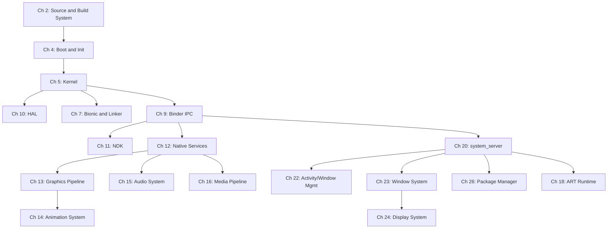
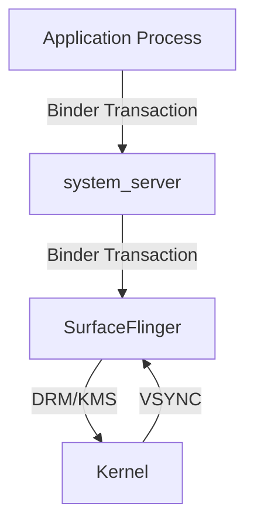
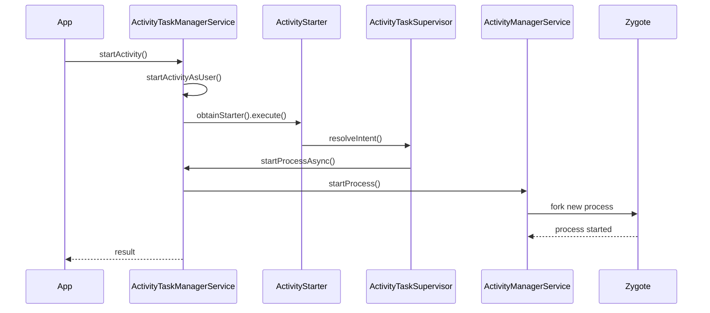
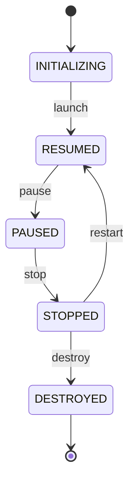

# 前言

## Android 开源项目开发者指南

---

**第一版**

---

*一本以源代码引用为依据的 Android 开源项目探索之作，从内核启动一路讲到应用框架。*

---

## 版权信息

版权所有 © 2026。保留所有权利。

本书为自行出版。

未经作者事先书面许可，本书的任何部分均不得以任何形式或手段——电子、机械、影印、录音或其他方式——复制、存储于检索系统或传播。在评论性书评中嵌入的简短引文，以及版权法所允许的某些其他非商业用途，属于例外。

本书基于对 Android 开源项目（AOSP）源代码的分析，AOSP 源代码以 Apache 许可证 2.0 版授权。书中所有 AOSP 源代码摘录和文件路径引用均出于教育与评述目的。书中的 Android 机器人形象系复制或改编自 Google 创作并共享的作品，其使用遵循 Creative Commons 3.0 Attribution License（知识共享署名 3.0 许可证）所述条款。

Android 是 Google LLC 的商标。本书与 Google LLC 或 Android 开源项目无关，亦未获得其认可或赞助。

本书中的所有源代码引用均与 2026 年年中 AOSP `main` / `android17-release` 分支树上的 Android 17（API 级别 37，代号 Cinnamon Bun）相匹配。文件路径、行号和代码摘录可能与源代码树的历史或未来修订版本存在差异。我们鼓励读者根据自己所检出的源代码核对这些引用。

**免责声明**：本书所提供的信息按“现状”提供，不附带任何担保。尽管已尽一切努力通过直接核对源代码来确保准确性，但对于任何个人或实体因使用本书所载信息而直接或间接造成的、或据称造成的任何损失或损害，作者和出版方概不承担任何责任。

**源代码树基线**：AOSP `main` / `android17-release`（Android 17，API 级别 37，代号 Cinnamon Bun），同步于 2026 年年中。

**所引用的构建标识符**：AOSP 构建，目标为 `aosp_cf_x86_64_phone`、`aosp_cf_arm64_phone` 和 `aosp_riscv64` 这三个 lunch 目标。

---

## 前言

### 本书解决的问题

Android 驱动着全球超过三十亿台活跃设备。它的源代码——Android 开源项目——是有史以来规模最大、影响最深远的开源代码库之一。它横跨数百个 Git 仓库、数百万行代码，触及现代计算栈的每一个层次。这个技术栈包括一个 Linux 内核分支、一个自定义 C 库、一个即时编译的虚拟机，以及一个硬件抽象层。它还包括一个进程间通信框架、图形与媒体流水线、窗口管理系统，以及一个完整的应用框架。

然而，目前并没有一本以源代码引用为基础的综合性指南，能够说明这一切是如何运作的。

官方 Android 文档对应用开发者而言非常出色。它告诉你如何使用这些 API。但如果你需要理解*这些 API 是如何实现的*，你基本上只能靠自己。

一个例子是 `startActivity()` 调用如何从 Java 经由 Binder 进入 `system_server` 并返回。另一个例子是一帧画面如何从 Canvas 绘制调用经由渲染流水线到达 SurfaceFlinger，并最终呈现在显示屏上。第三个例子是启动序列如何从内核交给 init、再交给 Zygote、再交给 `SystemServer`。你必须去读代码。

阅读 AOSP 源代码并非易事。这个代码库规模庞大，蔓延在数十种编程语言和构建系统之中。架构决策很少被记录下来。那些从 API 表面看来很简单的子系统，在底层却暴露出惊人的复杂性。关键行为往往隐藏在你意想不到的地方。

例如，想要理解窗口管理系统的开发者必须跨 `WindowManagerService`、`ActivityTaskManagerService`、`SurfaceFlinger`、`InputDispatcher` 和 `View` 层次结构追踪代码。这条追踪路径还会延伸到 Linux 内核的 DRM 子系统。所有这些部件都通过 Binder、共享内存和同步栅栏进行通信。

本书的存在，就是为了成为我自己当初希望拥有的那本指南。

### 本书的不同之处

三条原则使本书有别于其他 Android 参考书：

**每一条论断都引用了实际的源代码。** 这不是一本靠空泛的架构图撑起来的著作。`Zygote` 会响应应用启动请求而 fork 出一个新的进程。当我这样陈述时，我会引用发生这次 fork 的确切文件和函数。当我描述 `SurfaceFlinger` 如何合成图层时，我会指出具体的合成策略实现。

文件路径均为绝对路径，引用的是标准的 AOSP 检出目录。在需要精确性的地方会给出行号。

**它覆盖了完整的技术栈。** 大多数 Android 资料要么聚焦于应用框架（面向应用开发者），要么聚焦于内核和 HAL（面向平台开发者）。本书横跨完整的纵向层次，从内核如何启动和挂载文件系统，一直讲到图形流水线如何渲染和合成帧。在此之间，它还讲述了 Bionic 如何实现 POSIX 系统调用包装、Binder 如何序列化事务，以及 Activity Manager 如何调度应用生命周期。理解完整的技术栈对于任何从事严肃平台工作的人都至关重要，因为每一层都依赖于它下面的层。

**它的结构为在职工程师而设计。** 每一章在设计上都兼具学习资源和参考手册的作用。各章以架构概述开篇，接着进行详细的源码级分析，最后以使用真实 AOSP 工具的动手练习收尾。交叉引用将各章中相关联的概念联系起来。Mermaid 图表为复杂的子系统提供了可视化地图。

### 本书的读者对象

本书面向需要在平台层面理解 Android 的软件工程师：

- **平台工程师**：从事 Android 系统服务、框架或硬件适配工作。本书提供了使代码评审和调试更快捷的架构背景。

- **ROM 开发者**：构建自定义 Android 发行版。关于构建系统、启动序列和系统配置的章节，为有效的定制奠定了基础。

- **片上系统（SoC）工程师**：将 Android 移植到新硬件上。关于内核集成、HAL 架构和硬件抽象的章节，解释了你的代码必须实现哪些接口。

- **安全研究人员**：分析 Android 平台。关于安全模型、TEE 集成、虚拟化和权限框架的章节，以源码级的精确度勾勒出攻击面。

- **应用开发者**：希望理解自己所调用的 API 之下发生了什么。当你的应用遇到性能断崖或某种神秘的框架行为时，理解平台内部实现往往是通向解决方案的最快路径。

- **学生和研究人员**：研究操作系统、移动计算或大规模软件工程。在所有这些领域中，AOSP 都是一个极为丰富的案例研究对象。

你应该能够自如地阅读 Java、Kotlin、C 和 C++ 代码。本书假定你熟悉 Linux 基础知识（进程、文件描述符、系统调用、共享内存）。具有 Android 应用开发经验会有帮助，但并非严格必需。

### 关于范围的说明

Android 极其庞大。即使有六十六章，本书也无法详尽覆盖每一个子系统。我把重点放在了对平台级工作最重要的那些领域。在每个领域内部，我优先关注架构模式和关键代码路径，而不是百科全书式的 API 覆盖。

当某个子系统过于庞大而无法完全覆盖时，我聚焦于基础机制和最重要的代码路径。窗口管理系统就是一个突出的例子。我提供了足够的背景，以便读者能够独立地进行进一步探索。

AOSP 源代码在不断变化。我以 2026 年年中的 `main` / `android17-release` 分支树（Android 17，API 级别 37，代号 Cinnamon Bun）为工作依据。我在关键之处标注了特定版本的行为。不过，本书所描述的架构模式往往远比单个实现细节稳定。即使具体的行号已经发生偏移，使用略有不同的源代码版本的读者也应当发现其概念框架完全适用。

### 致谢

如果没有成千上万名工程师为 Android 开源项目所做的非凡工作，本书就不会存在。他们构建的代码库是一项了不起的成就。做出将其开源的决定，催生了整个学习、创新和定制的生态系统。

同样要感谢 Android 社区。这包括 ROM 开发者、XDA 的贡献者、Stack Overflow 的回答者，以及多年来把零散的平台知识拼凑起来的博客作者们。本书立足于他们所奠定的基础之上。

---

## 关于本书

### 结构

本书分为六十六章，覆盖完整的 AOSP 技术栈，从构建系统一直到各种专用设备形态。这些章节被归入十五个主题部分（第 I 至第 XV 部分），之后是四个附录。不过，每一章在设计上都力求可以独立阅读。

**第 I 部分：入门**

| 章节 | 标题 | 重点 |
|---------|-------|-------|
| 1 | 引言 | AOSP 是什么、它如何组织，以及如何阅读本书 |
| 2 | 源代码与构建系统 | Repo、Soong、Blueprint、Kati、Ninja、Make——把源代码变成镜像 |
| 3 | 特性标志与 aconfig | 构建期与运行期门控的特性、aconfig 标志系统、trunk-stable 开发 |

**第 II 部分：内核与启动**

| 章节 | 标题 | 重点 |
|---------|-------|-------|
| 4 | 启动与 init | 从上电、引导加载程序、内核、init、Zygote，一直到 system_server |
| 5 | 内核 | Android 的 Linux 内核分支：binder 驱动、ashmem、ION/DMA-BUF、GKI |
| 6 | 系统属性 | 属性服务、属性上下文、持久属性与只读属性 |

**第 III 部分：原生基础**

| 章节 | 标题 | 重点 |
|---------|-------|-------|
| 7 | Bionic 与动态链接器 | Android 的 C 库：系统调用包装、动态链接器、malloc、pthreads |
| 8 | 内存管理 | 低内存杀手、ZRAM 与 `mmd`、kswapd、内存标记、OOM 处理 |
| 9 | Binder IPC | IPC 框架：驱动、libbinder、AIDL 代码生成、事务 |
| 10 | HAL | 硬件抽象层：HIDL、AIDL HAL、直通与 binder 化 |
| 11 | NDK | 原生开发套件：稳定 API、CDD 契约、JNI 桥接 |

**第 IV 部分：原生服务与媒体**

| 章节 | 标题 | 重点 |
|---------|-------|-------|
| 12 | 原生服务 | SurfaceFlinger、InputDispatcher、SensorService 等 |
| 13 | 图形与渲染流水线 | 从 Canvas/RenderNode 经由 HWUI 到 GPU 和 SurfaceFlinger |
| 14 | 动画系统 | 属性动画、RenderThread 动画、过渡框架 |
| 15 | 音频系统 | AudioFlinger、AudioPolicyService、AAudio、效果流水线 |
| 16 | 媒体与视频流水线 | MediaCodec、MediaExtractor、codec2、DRM 框架、视频解码/编码 |
| 17 | 传感器 | SensorService、传感器 HAL、传感器融合、批量与唤醒传感器 |

**第 V 部分：运行时**

| 章节 | 标题 | 重点 |
|---------|-------|-------|
| 18 | ART 运行时 | Dex 编译、JIT、AOT、垃圾回收、类加载、性能分析 |
| 19 | 原生桥接与二进制翻译 | NativeBridge 接口、Berberis、指令翻译、客户 ABI |

**第 VI 部分：框架核心**

| 章节 | 标题 | 重点 |
|---------|-------|-------|
| 20 | system_server | 进程架构、服务生命周期、Watchdog、SystemServiceManager |
| 21 | Intent 系统深入解析 | Intent 解析、IntentFilter 匹配、PendingIntent、广播分发 |
| 22 | Activity 与窗口管理概述 | AMS、ATMS、任务管理、生命周期状态机 |
| 23 | 窗口系统 | WindowManagerService：布局、焦点、过渡以及输入集成 |
| 24 | 显示系统 | DisplayManagerService、逻辑显示、刷新率管理 |
| 25 | View 系统与输入分发 | View 层次结构、测量/布局/绘制、输入事件投递 |

**第 VII 部分：框架服务**

| 章节 | 标题 | 重点 |
|---------|-------|-------|
| 26 | PackageManagerService | APK 解析、安装流程、权限、拆分 APK、校验 |
| 27 | Content Provider | ContentResolver、provider 生命周期、URI 权限、游标 |
| 28 | 通知系统 | NotificationManagerService、渠道、排序、通知栏流水线 |
| 29 | 电源管理 | PowerManagerService、wakelock、Doze、挂起/恢复、温度 |
| 30 | 后台任务调度 | JobScheduler、WorkManager、AlarmManager、应用待机桶 |
| 31 | 多用户与配置文件 | UserManagerService、用户生命周期、工作配置文件、无头系统用户 |
| 32 | 账户与同步框架 | AccountManager、认证器、SyncManager、同步适配器 |
| 33 | 位置服务 | LocationManagerService、融合定位、地理围栏、GNSS HAL |
| 34 | 存储与文件系统 | 作用域存储、StorageManager、vold、FUSE、sdcardfs 的继任者 |

**第 VIII 部分：连接性**

| 章节 | 标题 | 重点 |
|---------|-------|-------|
| 35 | 网络与连接 | ConnectivityService、NetworkStack、IpClient、通用测距 |
| 36 | 电话与 RIL | TelephonyRegistry、RIL、IMS、卫星/NTN 支持 |
| 37 | 蓝牙 | 蓝牙协议栈（Gabeldorsche）、配置文件、信道测距 |
| 38 | NFC | NfcService、NFC HAL、安全元件、点对点手势交换 |
| 39 | USB、ADB 与 MTP | UsbService、USB 角色与配件、ADB、MTP 传输 |

**第 IX 部分：安全**

| 章节 | 标题 | 重点 |
|---------|-------|-------|
| 40 | 安全 | SELinux 策略、Keymint、Gatekeeper、已验证启动、TEE、权限 |
| 41 | 凭据管理器与通行密钥 | CredentialManager、FIDO2/通行密钥、凭据提供方 |
| 42 | DRM 与内容保护 | MediaDrm、Widevine、DRM HAL、安全解码路径 |
| 43 | LFI 进程内沙箱 | 轻量级故障隔离：对不可信代码进行进程内沙箱化 |

**第 X 部分：UI 框架**

| 章节 | 标题 | 重点 |
|---------|-------|-------|
| 44 | 小部件、RemoteViews 与 RemoteCompose | 跨进程 UI：RemoteViews、AppWidgetService、RemoteCompose 渲染器 |
| 45 | WebView | WebView 模块、Chromium 集成、渲染进程模型 |
| 46 | 无障碍 | AccessibilityManagerService、无障碍服务、事件流水线 |
| 47 | 国际化 | ICU、语言区域、资源限定符、双向文本、字体 |

**第 XI 部分：系统应用**

| 章节 | 标题 | 重点 |
|---------|-------|-------|
| 48 | SystemUI | 状态栏、通知栏、快捷设置、锁屏、插件系统 |
| 49 | Launcher3 | 主屏幕架构、工作区、全部应用、拖放、小部件 |
| 50 | 设置应用 | 设置应用架构、偏好框架、搜索索引 |

**第 XII 部分：AI 与设备**

| 章节 | 标题 | 重点 |
|---------|-------|-------|
| 51 | AI、AppFunctions 与计算机控制 | 端侧 AI 集成、AppFunctions 框架、无障碍自动化 |
| 52 | CompanionDeviceManager 与虚拟设备 | VDM 架构、虚拟显示、虚拟输入、CDM 策略 |
| 53 | NPU 管理器 | 神经处理单元管理器、加速器调度、机器学习卸载 |

**第 XIII 部分：基础设施**

| 章节 | 标题 | 重点 |
|---------|-------|-------|
| 54 | Mainline 模块 | APEX 打包、模块边界、列车更新、模块策略 |
| 55 | OTA 更新 | update_engine、A/B 与虚拟 A/B、快照/COW、payload 生成 |
| 56 | 虚拟化框架 | pKVM、crosvm、受保护虚拟机、Microdroid、虚拟化 HAL |
| 57 | 测试框架与基础设施 | CTS、VTS、Ravenwood、Atest、TradeFed、宿主侧与设备侧 |
| 58 | 调试与性能分析工具 | gdb、lldb、Perfetto、systrace、logcat、bugreport、tombstone |

**第 XIV 部分：设备支持**

| 章节 | 标题 | 重点 |
|---------|-------|-------|
| 59 | 架构支持 | ARM64、x86_64、RISC-V：构建目标、内核配置、ABI 细节 |
| 60 | 模拟器架构 | Cuttlefish、Goldfish、QEMU/crosvm 集成、virtio 设备、快照 |
| 61 | 设备策略与 Android Enterprise | DevicePolicyManager、受管配置文件、配置注册、企业 API |
| 62 | 设备形态 | 汽车与软件定义汽车、Android TV（Leanback/TIF）、Wear，以及新兴的 Android XR |
| 63 | 打印服务 | PrintManagerService、打印队列、打印服务插件 |
| 64 | Camera2 流水线深入解析 | Camera2/CameraX、camera HAL3 流水线、拍摄会话、请求 |

**第 XV 部分：实践**

| 章节 | 标题 | 重点 |
|---------|-------|-------|
| 65 | 自定义 ROM 指南 | 实践指南：fork、设备树、vendor 二进制、OTA、签名 |
| 66 | 在 Android 上运行 Windows 游戏 | 翻译层、Wine/Proton、图形翻译、输入映射 |

**附录**

| 附录 | 标题 | 重点 |
|----------|-------|-------|
| A | 关键文件参考 | 全书最重要的源代码路径的汇总地图 |
| B | 术语表 | 全书使用的关键术语和首字母缩略语 |
| C | 为什么 AOSP 不在公开框架 API 中采用 Kotlin | 保持公开 API 表面使用 Java 背后的考量 |
| D | Android 17 更新 | Android 16 到 Android 17 重要平台变更的摘要 |

### 章节结构

本书的每一章都遵循一致的结构：

1. **概述**：对子系统的用途、其在 Android 架构中的位置，以及所涉及的关键源代码目录作简明总结。

2. **架构**：一张 Mermaid 图表展示主要组件及其相互关系，随后是一段对设计的描述。

3. **源代码分析**：每一章的核心。对关键代码路径进行详细的逐步讲解，并给出文件路径和行号引用。本节回答这样一个问题：“这在代码中究竟是如何运作的？”

4. **关键数据结构与接口**：定义该子系统契约的核心类型、类、接口和协议。

5. **运行时行为**：该子系统在正常运行、启动、错误条件和边界情况下的行为方式。时序图阐明重要的流程。

6. **配置与调优**：控制系统行为的属性、构建标志和配置文件。

7. **交叉引用**：使用 `§N.M` 记法链接到相关章节。

8. **动手试试**：读者可以在运行中的 AOSP 构建或源代码树中完成的练习。

9. **小结**：以要点形式给出的关键收获。

---

## 如何阅读本书

### 自底向上的架构

本书按自底向上的方式组织：Android 技术栈中越低的层，出现在越靠前的章节。这反映了一个经过深思熟虑的教学选择。要理解 `startActivity()` 是如何工作的，你需要先理解 Binder。要理解 Binder，你需要先理解内核驱动和共享内存。要理解内核驱动，你需要先理解 Android 的 Linux 分支与上游有何不同。

依赖链看起来是这样的：

全书基础章节之间的层依赖关系：



话虽如此，**每一章在设计上都力求自成一体**。如果你已经理解 Binder，并且需要了解窗口系统，可以直接跳到第 23 章。交叉引用（使用 `§N.M` 记法）会在需要时把你指向预备知识。

### 推荐的阅读路径

不同类型的读者会从不同的材料路径中获益：

**对于初接触 AOSP 的平台工程师：**
按顺序从第 1–9 章开始。这些章节建立起关于 Android 如何被构建、启动和组织的基础理解。然后进入第 20 章（system_server）和第 22 章（Activity/Window Management）学习框架层。此后，跟随你的兴趣前进。

**对于图形/显示专家：**
阅读第 9 章（Binder）以获得 IPC 背景。然后阅读第 13 章（图形流水线）、第 14 章（动画）、第 12 章（原生服务，重点关注 SurfaceFlinger）、第 23 章（窗口系统）和第 24 章（显示系统）。

**对于安全研究人员：**
阅读第 5 章（内核）了解内核攻击面，阅读第 7 章（Bionic）了解 libc 实现。阅读第 9 章（Binder）了解 IPC 攻击面。阅读第 40 章（安全/TEE）了解安全模型，阅读第 56 章（虚拟化）了解隔离架构。

**对于 ROM 开发者：**
从第 2 章（构建系统）、第 4 章（启动）和第 10 章（HAL）开始。然后跳到第 65 章（自定义 ROM 指南）进行实践演练。根据需要回到前面的章节以获得更深入的理解。

**对于好奇的应用开发者：**
阅读第 9 章（Binder）以理解发起系统调用时发生了什么。阅读第 22 章（Activity/Window Management）以理解生命周期管理。阅读第 13 章（图形流水线）以理解渲染性能。阅读第 18 章（ART 运行时）以理解你的代码是如何执行的。

### 使用源代码树

本书假定你已经检出并构建了一个 AOSP 源代码树。书中给出的所有文件路径都是相对于 AOSP 源代码树根目录的。

例如，当本书引用：

```
frameworks/base/services/core/java/com/android/server/wm/WindowManagerService.java
```

它指的是你在运行 `repo init` 和 `repo sync` 的那个目录（通常称为 `<AOSP_ROOT>`）下的该文件。

为了最大限度地利用本书，你应该让源代码树可供浏览。如果你能阅读周围的代码，而不仅仅是本书中显示的摘录，许多章节会更容易被理解。第 2 章（源代码与构建系统）解释了如何检出和构建 AOSP 源代码树。附录 A（关键文件参考）映射了最重要的源代码路径，以帮助你高效地在树中导航。

### 交叉引用

章节按层次编号。当你看到 `§9.3` 这样的引用时，它表示第 9 章第 3 节。`§22.3` 这样的引用指向第 22 章第 3 节。这些交叉引用被广泛使用，以便在不重复材料的情况下把全书相关的概念联系起来。

当某个概念第一次被引入时，会完整地加以解释。此后对同一概念的引用则使用交叉引用记法，指向最初的解释。

### “动手试试”练习

大多数章节以一个包含动手练习的“动手试试”小节结尾。这些练习旨在通过与源代码和运行系统的直接互动来巩固所学内容。它们分为几个类别：

- **源代码探索**：使用 `grep`、`cs`（codesearch）或 IDE 在代码库中查找特定模式。
- **构建练习**：修改构建文件、添加日志语句，并重新构建特定组件。
- **运行时观察**：使用 `adb shell`、`dumpsys`、`logcat` 和跟踪工具，在运行中的设备或模拟器上观察系统行为。
- **调试练习**：附加调试器、设置断点，并逐步跟踪关键代码路径。
- **修改挑战**：对 AOSP 子系统做特定修改，并观察结果。

这些练习假定你能够访问运行 AOSP 构建的物理设备或 Cuttlefish 虚拟设备。对于大多数练习，推荐使用 Cuttlefish，因为它在无需物理硬件的情况下提供完整的 AOSP 功能。有关检出和构建说明，请参见第 2 章（源代码与构建系统）。有关 Cuttlefish 配置，请参见第 60 章（模拟器架构）。

---

## 本书使用的约定

### 代码与文件路径

**行内代码**用于类名（`WindowManagerService`）、方法名（`startActivity()`）、变量名（`mGlobalLock`）、文件名（`AndroidManifest.xml`）、shell 命令（`adb shell dumpsys window`）以及系统属性（`ro.build.type`）。

**代码块**用于源代码摘录、shell 会话和配置文件。每一个从 AOSP 提取的代码块都包含一个指明源文件的头部注释：

```java
// frameworks/base/services/core/java/com/android/server/wm/ActivityTaskManagerService.java

@Override
public final int startActivity(IApplicationThread caller, String callingPackage,
        String callingFeatureId, Intent intent, String resolvedType,
        IBinder resultTo, String resultWho, int requestCode,
        int startFlags, ProfilerInfo profilerInfo, Bundle bOptions) {
    return startActivityAsUser(caller, callingPackage, callingFeatureId,
            intent, resolvedType, resultTo, resultWho, requestCode,
            startFlags, profilerInfo, bOptions,
            UserHandle.getCallingUserId());
}
```

当一段代码摘录为了清晰而经过简化——例如删除了错误检查或日志语句——头部会包含 `(simplified)` 标记：

```java
// frameworks/base/core/java/android/app/ActivityThread.java (simplified)

private void handleBindApplication(AppBindData data) {
    Application app = data.info.makeApplicationInner(data.restrictedBackupMode, null);
    mInitialApplication = app;
    mInstrumentation.callApplicationOnCreate(app);
}
```

**文件路径**始终使用相对于源代码树根目录的完整路径。在正文中被引用时，它们以行内代码的形式排版：

> 窗口布局逻辑实现于
> `frameworks/base/services/core/java/com/android/server/wm/DisplayPolicy.java`。

当某一行号相关时，它会以冒号后接行号的形式追加：

> 参见 `frameworks/base/services/core/java/com/android/server/wm/DisplayPolicy.java:1490`
> 中 `layoutWindowLw()` 的窗口框架计算逻辑。

行号对应版权信息一节所述的源代码树基线。只有在特定行对理解至关重要时才会包含行号；大多数引用省略行号，因为它们会随每次提交而变化。

### 图表

本书大量使用 Mermaid 图表来可视化架构、数据流和运行时行为。共使用三种图表类型：

**框图**（`graph TD` 或 `graph LR`），用于展示组件关系的架构概览：



**时序图**（`sequenceDiagram`），用于展示跨组件的操作顺序的运行时交互：



**状态图**（`stateDiagram-v2`），用于描述生命周期和状态机：



图表旨在提供视觉概览。它们始终配有解释细节的叙述性文字。你不需要 Mermaid 渲染器就能理解本书。如果你能够渲染这些图表，它们会更加有用。大多数现代 Markdown 查看器和文档工具都原生支持 Mermaid。

### 交叉引用记法

交叉引用使用 `§` 符号，后接章号和节号：

| 记法 | 含义 |
|----------|---------|
| `§9` | 第 9 章（Binder） |
| `§9.3` | 第 9 章第 3 节 |
| `§22.3` | 第 22 章第 3 节 |
| `§A` | 附录 A |

当交叉引用作为补充性指针使用时，它出现在括号中：

> 该事务被序列化进一个 `Parcel`（§9.3），并经由内核驱动（§9.5）分发。

或者当被交叉引用的材料是必需时，作为直接引用：

> 在继续之前，请确保你理解 §9.3 中描述的 Binder 事务模型。

### 术语

某些术语在本书中始终以特定含义使用：

| 术语 | 含义 |
|------|---------|
| **AOSP** | Android 开源项目——该开源代码库 |
| **框架** | `frameworks/base/` 中的 Java/Kotlin 层 |
| **系统服务** | 运行在 `system_server` 进程中的 Java 服务 |
| **原生服务** | 运行在各自进程中的 C++ 服务（例如 SurfaceFlinger） |
| **HAL** | 硬件抽象层——框架与硬件之间的接口 |
| **Binder** | Android 的 IPC 机制，包括驱动、用户态库和 AIDL 工具 |
| **ART** | Android Runtime——执行应用代码的虚拟机 |
| **AIDL** | Android 接口定义语言——用于 Binder 接口定义 |
| **HIDL** | HAL 接口定义语言——旧版 HAL 接口定义 |
| **SoC** | 片上系统——处理器及集成组件 |
| **CDD** | 兼容性定义文档——Android 兼容性的要求 |
| **CTS** | 兼容性测试套件——验证 CDD 合规性的测试 |
| **VTS** | 供应商测试套件——验证 HAL 合规性的测试 |
| **GKI** | 通用内核镜像——Google 统一 Android 内核的努力 |
| **Mainline** | Project Mainline——通过 APEX/APK 模块实现的可更新系统组件 |
| **pKVM** | 基于受保护内核的虚拟机——Android 的虚拟机监控程序（hypervisor） |
| **TEE** | 可信执行环境——隔离的安全处理 |
| **DRM/KMS** | 直接渲染管理器 / 内核模式设置——Linux 显示子系统 |

### 代码讨论中的缩略语

在讨论代码时，以下缩略语用于频繁引用的组件：

| 缩略语 | 全称 |
|--------------|-----------|
| **AMS** | `ActivityManagerService` |
| **ATMS** | `ActivityTaskManagerService` |
| **WMS** | `WindowManagerService` |
| **PMS** | `PackageManagerService` |
| **SF** | `SurfaceFlinger` |
| **HWUI** | 硬件 UI 渲染库 |
| **BQ** | `BufferQueue` |
| **DMS** | `DisplayManagerService` |
| **IMS** | `InputManagerService` |
| **NBS** | `native_bridge_support`（`frameworks/libs/native_bridge_support` 项目） |

### 提示框

在正文中，某些段落被突出显示以引起特别注意：

> **注**：补充信息，用于增加上下文或阐明一个微妙之处。对理解正文并非必需，但有助于更深入的理解。

> **重要**：对正确理解至关重要的信息。误解这一点可能会导致在后续章节中产生困惑。

> **警告**：陷阱、常见错误，或反直觉的行为。请特别注意这些内容。

> **历史背景**：关于某事物为何采用当前设计方式的背景，通常涉及遗留决策或向后兼容的约束。理解历史有助于解释那些否则看起来可能很随意的设计。

> **性能**：与系统性能相关的信息，包括关键路径、对延迟敏感的代码，以及优化策略。

### Shell 会话

Shell 命令显示为：用户命令使用 `$` 提示符，root 命令使用 `#` 提示符。输出则不带提示符显示：

```bash
$ adb shell dumpsys window displays
Display: mDisplayId=0
  init=1080x2400 420dpi mMinSizeOfResizeableTaskDp=220 cur=1080x2400 app=1080x2244 rng=1080x1017-2400x2337
```

多行命令使用反斜杠续行：

```bash
$ source build/envsetup.sh && \
    lunch aosp_cf_x86_64_phone-trunk_staging-userdebug && \
    m -j$(nproc)
```

### 构建与运行时目标

除非另有说明，构建示例针对 Cuttlefish x86_64 虚拟设备：

```bash
$ lunch aosp_cf_x86_64_phone-trunk_staging-userdebug
```

当讨论特定架构的行为时（尤其是在第 19、59 和 60 章中），会明确说明所用的目标。所引用的三个主要架构目标是：

- `aosp_cf_x86_64_phone-trunk_staging-userdebug` -- x86_64，主要开发目标
- `aosp_cf_arm64_phone-trunk_staging-userdebug` -- ARM64，主要生产架构
- `aosp_riscv64-trunk_staging-userdebug` -- RISC-V 64 位，新兴架构

### 源代码导航技巧

AOSP 源代码树极其庞大，但有几个策略可以让导航变得可控：

**了解主要目录。** 最重要的顶层目录有：

| 目录 | 内容 |
|-----------|----------|
| `frameworks/base/` | 核心框架：服务、核心库、UI 工具包 |
| `frameworks/native/` | 原生框架：Binder、SurfaceFlinger、传感器服务 |
| `frameworks/libs/` | 框架库：二进制翻译、原生桥接支持 |
| `system/core/` | 核心系统：init、属性服务、libcutils、libutils、debuggerd |
| `art/` | Android Runtime：编译器、垃圾回收器、解释器 |
| `bionic/` | C 库、动态链接器、数学库 |
| `packages/` | 系统应用：设置、Launcher3、通讯录；Mainline 模块位于 `packages/modules/` |
| `hardware/interfaces/` | AIDL/HIDL HAL 接口定义 |
| `build/` | 构建系统：Soong、Make、Kati 集成 |
| `kernel/` | 内核预构建、配置和测试（内核源代码位于单独的清单中） |
| `external/` | 第三方库和工具 |

**使用 Android Code Search。** 在线工具 `cs.android.com` 提供对 AOSP 源代码的全文搜索、交叉引用和调用层次分析。在初步探索时，它通常比本地 `grep` 更快。

**沿 Binder 接口追踪。** 在跨进程边界追踪某个特性时，先找到 AIDL 接口定义。它会向你展示客户端与服务端之间的确切契约，从而让你很容易找到实现的两端。

**阅读服务注册。** 大多数系统服务在 `SystemServer.java` 中注册自身。注册顺序揭示了依赖关系，并可以帮助你发现那些你原本不知道存在的服务。

---

## 开始之前的一点说明

Android 开源项目是一个不断演进的代码库。等你读到这句话的时候，源代码已经发生了变化。方法已被重构。类已经迁移。新的子系统被加入，旧的子系统被淘汰。

这就是这一事业的本质。从某种意义上说，一本关于活的代码库的书只是一个快照——一张移动目标的详细照片。但本书的价值并不在于具体的行号或确切的方法签名。它的价值在于*架构层面的理解*：那些模式、设计决策和结构关系，即使实现细节不断演变，也依然保持稳定。

学会架构，你就能够在任何版本的源代码中自如穿行。理解该系统为何如此设计。然后，即使在从未见过的代码中，你也能预测该去哪里寻找。

让我们开始吧。
