# 第 13 章：图形与渲染管线

Android 的图形栈是 AOSP 中最复杂的子系统之一。它始于应用程序 UI 线程中的 Java
`View.draw()` 调用，随后向下穿过原生 C++ 渲染库、GPU 着色器编译以及硬件加速
合成，最终以光子离开物理显示面板而告终。本章将沿着真实的 AOSP 源代码追溯这一
完整旅程，展示使数十亿设备实现 60+ FPS 渲染所依赖的架构、数据结构、同步机制
与设计决策。

---

## 13.1 图形栈概览

### 13.1.1 完整管线一览

出现在 Android 屏幕上的每一帧都沿着一条确定性的路径穿过多个子系统。理解这条
路径对于性能分析、驱动调试和框架开发都至关重要。

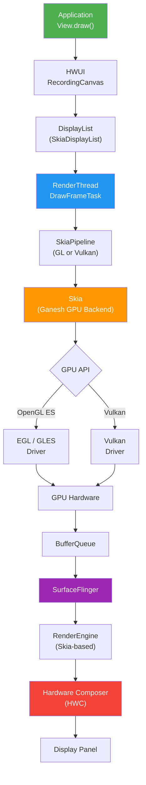

### 13.1.2 线程架构

Android 的渲染架构在根本上是多线程的。每个应用程序窗口至少有两个线程参与渲染：

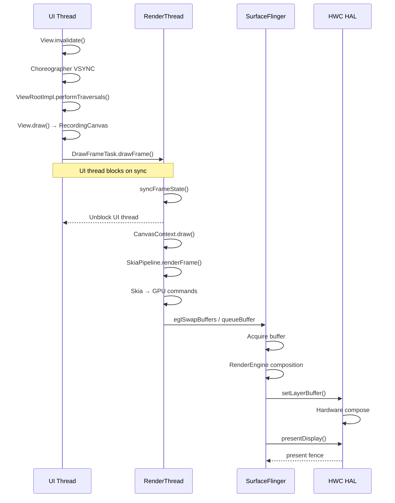

### 13.1.3 关键源码目录

图形栈横跨 AOSP 中的多个顶级目录：

| 目录 | 用途 | 关键文件 |
|-----------|---------|-----------|
| `frameworks/native/opengl/` | EGL/GLES 加载器与包装层 | `libs/EGL/eglApi.cpp`, `libs/EGL/egl.cpp` |
| `frameworks/native/vulkan/` | Vulkan 加载器 | `libvulkan/driver.cpp`, `libvulkan/api.cpp` |
| `frameworks/base/libs/hwui/` | 硬件加速 UI 渲染器 | `RenderNode.h`, `renderthread/` |
| `external/skia/` | 2D 渲染引擎 | `src/gpu/ganesh/`, `include/core/` |
| `frameworks/native/services/surfaceflinger/` | 系统合成器 | `SurfaceFlinger.cpp` |
| `hardware/interfaces/graphics/` | HAL 接口 | `composer/`, `allocator/` |
| `external/angle/` | 基于 Vulkan 的 GL 转译 | `src/libGLESv2/`, `src/libEGL/` |

### 13.1.4 管线选择

HWUI 在启动时选择其渲染后端。`Properties.h` 中的 `RenderPipelineType` 枚举
列出了所有可能性：

```cpp
// frameworks/base/libs/hwui/Properties.h, line 267
enum class RenderPipelineType { SkiaGL, SkiaVulkan, SkiaCpu, NotInitialized = 128 };
```

`SkiaGL` 和 `SkiaVulkan` 是两个基于 GPU 的管线，通过
`debug.hwui.renderer` 属性（`"skiagl"` 或 `"skiavk"`）选择。`SkiaCpu` 是一个
软件管线，用于没有 GPU 表面的无头（headless）与测试上下文。其
`SkiaCpuPipeline`（`frameworks/base/libs/hwui/pipeline/skia/SkiaCpuPipeline.h`）
会禁用图像固定（image pinning），完全在 CPU 上渲染。

`RenderThread.cpp` 中的 `pipelineToString()` 辅助函数会在
`dumpsys gfxinfo` 中报告当前活动的管线：

```cpp
// frameworks/base/libs/hwui/renderthread/RenderThread.cpp, line 303
static const char* pipelineToString() {
    switch (auto renderType = Properties::getRenderPipelineType()) {
        case RenderPipelineType::SkiaGL:
            return "Skia (OpenGL)";
        case RenderPipelineType::SkiaVulkan:
            return "Skia (Vulkan)";
        default:
            LOG_ALWAYS_FATAL("canvas context type %d not supported",
                             (int32_t)renderType);
    }
}
```

注意，这里刻意没有 `SkiaCpu` 分支。在设备构建中，CPU 管线永远不会是被报告的
渲染器。意外的类型会命中 fatal 的 default 分支。

`CanvasContext.cpp` 中的 `CanvasContext::create()` 工厂函数（第 88 行）实例化
正确的管线：

```cpp
// frameworks/base/libs/hwui/renderthread/CanvasContext.cpp, line 88
CanvasContext* CanvasContext::create(RenderThread& thread, bool translucent,
                                     RenderNode* rootRenderNode,
                                     IContextFactory* contextFactory,
                                     pid_t uiThreadId, pid_t renderThreadId,
                                     bool useIpcCanvas) {
    auto renderType = Properties::getRenderPipelineType();

#ifdef __ANDROID__
    if (useIpcCanvas) {
        // ... SkiaIpcPipeline-backed context
    }
#endif

    switch (renderType) {
        case RenderPipelineType::SkiaGL:
            return new CanvasContext(thread, translucent, rootRenderNode,
                contextFactory,
                std::make_unique<skiapipeline::SkiaOpenGLPipeline>(thread),
                uiThreadId, renderThreadId);
        case RenderPipelineType::SkiaVulkan:
            return new CanvasContext(thread, translucent, rootRenderNode,
                contextFactory,
                std::make_unique<skiapipeline::SkiaVulkanPipeline>(thread),
                uiThreadId, renderThreadId);
#ifndef __ANDROID__
        case RenderPipelineType::SkiaCpu:
            return new CanvasContext(thread, translucent, rootRenderNode,
                contextFactory,
                std::make_unique<skiapipeline::SkiaCpuPipeline>(thread),
                uiThreadId, renderThreadId);
#endif
        default:
            LOG_ALWAYS_FATAL("canvas context type %d not supported",
                             (int32_t)renderType);
            break;
    }
    return nullptr;
}
```

`SkiaCpu` 分支在设备构建中会被编译剔除（`#ifndef __ANDROID__`）——
它仅用于主机端和测试构建。

---

## 13.2 OpenGL ES

### 13.2.1 EGL/GLES 加载器的架构

Android 的 OpenGL ES 实现是一种加载器分层架构。应用程序从不直接链接 GPU
厂商驱动，而是链接 `libEGL.so` 和 `libGLESv2.so`——它们是维护在
`frameworks/native/opengl/` 中的薄分发库。

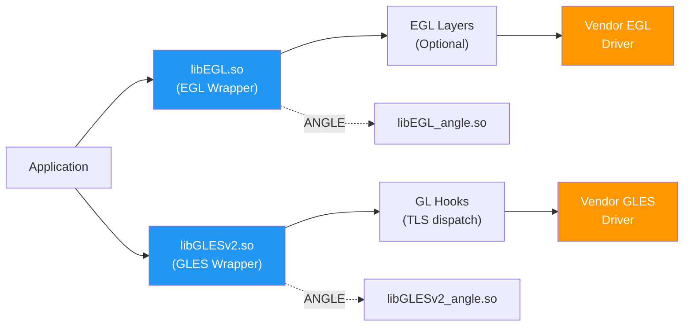

### 13.2.2 EGL 连接：`egl_connection_t`

核心数据结构是 `egl_connection_t`，声明于 `egldefs.h`。它持有 EGL 与 GLES
调用的函数指针：

```cpp
// frameworks/native/opengl/libs/EGL/egldefs.h
struct egl_connection_t {
    enum { GLESv1_INDEX = 0, GLESv2_INDEX = 1 };
    // handle to the loaded driver shared object
    void* dso;
    // function tables for GL calls - one per GLES version
    gl_hooks_t* hooks[2];
    // ...
    // the driver's EGL entry points
    egl_t egl;
    // function table for EGL calls implemented or redirected by platform libraries
    platform_impl_t platform;
    // ...
};
```

全局单例 `gEGLImpl` 声明于 `egl.cpp`（第 33 行）：

```cpp
// frameworks/native/opengl/libs/EGL/egl.cpp, line 33
egl_connection_t gEGLImpl;
gl_hooks_t gHooks[2];
gl_hooks_t gHooksNoContext;
```

### 13.2.3 驱动初始化

驱动加载在第一次 EGL 调用时惰性触发。`egl.cpp` 中的 `egl_init_drivers()`
函数（第 155 行）是入口点：

```cpp
// frameworks/native/opengl/libs/EGL/egl.cpp, line 125
static EGLBoolean egl_init_drivers_locked() {
    // ...
    Loader& loader(Loader::getInstance());
    egl_connection_t* cnx = &gEGLImpl;
    cnx->hooks[egl_connection_t::GLESv1_INDEX] =
        &gHooks[egl_connection_t::GLESv1_INDEX];
    cnx->hooks[egl_connection_t::GLESv2_INDEX] =
        &gHooks[egl_connection_t::GLESv2_INDEX];
    cnx->dso = loader.open(cnx);

    // Check for layers after driver load
    if (cnx->dso) {
        LayerLoader& layer_loader(LayerLoader::getInstance());
        layer_loader.InitLayers(cnx);
    }
    return cnx->dso ? EGL_TRUE : EGL_FALSE;
}
```

`Loader::open()` 方法（位于 `Loader.cpp`）执行厂商驱动的实际 `dlopen()`。
它按以下顺序尝试驱动来源：

1. 首先尝试 ANGLE，如果 `GraphicsEnv::shouldUseAngle()` 成立：
   `libEGL_angle.so`、`libGLESv2_angle.so`
2. 来自 `GraphicsEnv` 命名空间的更新驱动（游戏驱动 / 可更新驱动 APK）
3. 由 `ro.hardware.egl` 指定的原生驱动，如果
   `GraphicsEnv::shouldUseNativeDriver()` 成立
4. 最后是内置默认驱动：合并的 `libGLES_<name>.so`，或拆分的
   `libEGL_<name>.so` / `libGLESv1_CM_<name>.so` / `libGLESv2_<name>.so`

### 13.2.4 EGL API 分发

`eglApi.cpp` 中的每个公共 EGL 函数都遵循相同的模式：清除线程本地错误，
获取全局连接，并通过 `platform` 函数表进行分发：

```cpp
// frameworks/native/opengl/libs/EGL/eglApi.cpp, line 40
EGLDisplay eglGetDisplay(EGLNativeDisplayType display) {
    ATRACE_CALL();
    if (egl_init_drivers() == EGL_FALSE) {
        return setError(EGL_BAD_PARAMETER, EGL_NO_DISPLAY);
    }
    clearError();
    egl_connection_t* const cnx = &gEGLImpl;
    return cnx->platform.eglGetDisplay(display);
}
```

这一模式贯穿整个 `eglApi.cpp`。`platform` 表可以指向厂商驱动本身，也可以
经由可选的 EGL 层（用于调试、验证或 ANGLE 拦截）。

### 13.2.5 基于 TLS 的 GLES 函数分发

OpenGL ES 函数使用不同的分发机制——线程本地存储（TLS）。当 `eglMakeCurrent()`
绑定上下文时，它会将 TLS 钩子设置为指向正确的驱动：

```cpp
// frameworks/native/opengl/libs/EGL/egl.cpp, line 186
void setGlThreadSpecific(gl_hooks_t const* value) {
    gl_hooks_t const* volatile* tls_hooks = get_tls_hooks();
    tls_hooks[TLS_SLOT_OPENGL_API] = value;
}
```

每个 GLES 函数（例如 `glDrawArrays`）都是一个微型蹦床（trampoline），它从
TLS 读取当前钩子并跳转到驱动实现。这些蹦床由对随源码签入的
`gl2_api.in` / `gl2ext_api.in` 入口列表（包含自 `GLES2/gl2.cpp`；GLESv1 使用
`gl_api.in` / `glext_api.in`）做宏展开而生成。单独的 `entries.in` /
`entries_gles1.in` 文件则声明 `gl_hooks_t` 函数指针表（`hooks.h`）以及
`egl.cpp` 中的 GL 名称表。

当没有当前上下文时，钩子指向 `gl_no_context()`（第 42 行），它会记录错误：

```cpp
// frameworks/native/opengl/libs/EGL/egl.cpp, line 42
static int gl_no_context() {
    if (egl_tls_t::logNoContextCall()) {
        const char* const error = "call to OpenGL ES API with "
                                  "no current context (logged once per thread)";
        // ...
    }
    return 0;
}
```

### 13.2.6 EGL 层

AOSP 支持通过层机制拦截 EGL/GLES 调用，类似于 Vulkan 层。`LayerLoader`
类基于以下因素扫描层：

- `debug.gles.layers` 系统属性
- `GraphicsEnv` 中的应用程序元数据
- GPU 调试应用的设置

层以共享库的形式加载，实现基于 `eglGetProcAddress` 的拦截模式。

### 13.2.7 内置扩展

EGL 包装层公开了一组内置扩展，它们由包装层本身实现，独立于厂商驱动。来自
`egl_platform_entries.cpp`（第 86 行）：

```cpp
// frameworks/native/opengl/libs/EGL/egl_platform_entries.cpp, line 86
const char* const gBuiltinExtensionString =
    "EGL_ANDROID_front_buffer_auto_refresh "
    "EGL_ANDROID_get_native_client_buffer "
    "EGL_ANDROID_presentation_time "
    "EGL_EXT_surface_CTA861_3_metadata "
    "EGL_EXT_surface_SMPTE2086_metadata "
    "EGL_KHR_get_all_proc_addresses "
    "EGL_KHR_swap_buffers_with_damage "
    ;
```

Android 特有的扩展（如 `EGL_ANDROID_native_fence_sync` 和
`EGL_ANDROID_presentation_time`）对帧时序以及与 SurfaceFlinger 的同步至关
重要。

### 13.2.8 MultifileBlobCache

着色器编译代价高昂。AOSP 通过 `MultifileBlobCache`（位于
`frameworks/native/opengl/libs/EGL/MultifileBlobCache.cpp`）实现了一个持久化
着色器缓存。该缓存：

- 在应用启动之间将编译后的着色器二进制文件存储在磁盘上
- 使用多文件布局（每个缓存条目一个文件）以增强健壮性
- 当缓存超过大小限制时实施 LRU 淘汰
- 使用后台工作线程进行延迟磁盘写入
- 使用 CRC 校验和验证条目

来自 `MultifileBlobCache.h` 的关键数据结构：

```cpp
// frameworks/native/opengl/libs/EGL/MultifileBlobCache.h, line 44
struct MultifileHeader {
    uint32_t magic;
    uint32_t crc;
    EGLsizeiANDROID keySize;
    EGLsizeiANDROID valueSize;
};
```

缓存还维护了一个“热缓存”（hot cache）——最近使用的条目的内存映射子集，
以便在不产生磁盘 I/O 的情况下快速访问：

```cpp
// frameworks/native/opengl/libs/EGL/MultifileBlobCache.h, line 64
struct MultifileHotCache {
    int entryFd;
    uint8_t* entryBuffer;
    size_t entrySize;
};
```

### 13.2.9 Java 绑定

Java 端的 OpenGL ES API（`android.opengl.GLES20`、`GLES30` 等）由
`frameworks/native/opengl/tools/glgen/` 生成。该代码生成器读取
`tools/glgen/specs/` 下的 `.spec` 入口点描述（例如 `GLES30.spec`），并同时
生成 Java 类和 JNI 桩 C++ 文件。生成的桩调用原生 GLES 函数，后者再经由 TLS
钩子分发。

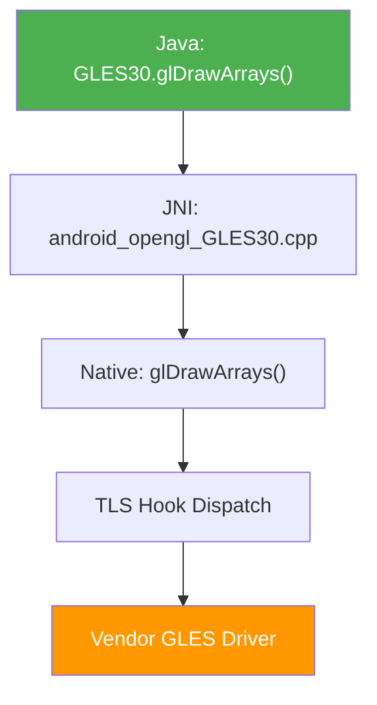

### 13.2.10 EGL 对象生命周期

EGL 包装层为驱动 EGL 对象维护引用计数包装器。这可以在应用程序行为不当时
防止 use-after-free 缺陷：

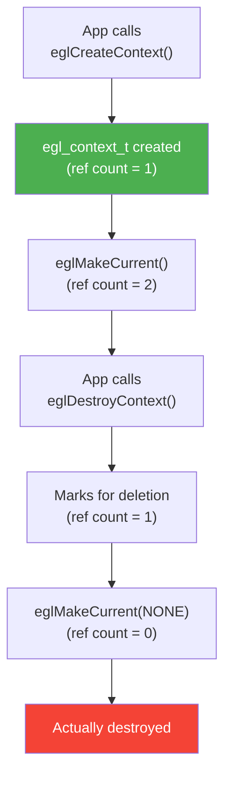

`egl_object.h` 中的基类 `egl_object_t` 为以下对象提供引用计数：

- `egl_context_t`——包装 `EGLContext`，跟踪 GL 扩展
- `egl_surface_t`——包装 `EGLSurface`

`egl_display_t` 不同。它位于 `egl_display.h`，并不派生自 `egl_object_t`
（每个 `egl_object_t` 反而持有指向其显示的指针）。它遵循自己的
NOT_INITIALIZED / INITIALIZED / TERMINATED 生命周期，而不是引用计数。

### 13.2.11 线程本地错误处理

每个线程通过 `egl_tls_t` 维护自己的 EGL 错误状态：

```cpp
// frameworks/native/opengl/libs/EGL/egl_tls.cpp
// Thread-local storage for:
// - Current EGL error code
// - Current EGL context
// - "no context call" logging flag
```

每个 EGL 函数开头的 `clearError()` 调用将每线程错误重置为 `EGL_SUCCESS`，
其后任何错误都会覆盖它。这遵循 EGL 规范的要求：`eglGetError()` 返回最近的
错误。

### 13.2.12 EGL 初始化序列

Android 上完整的 EGL 初始化流程：

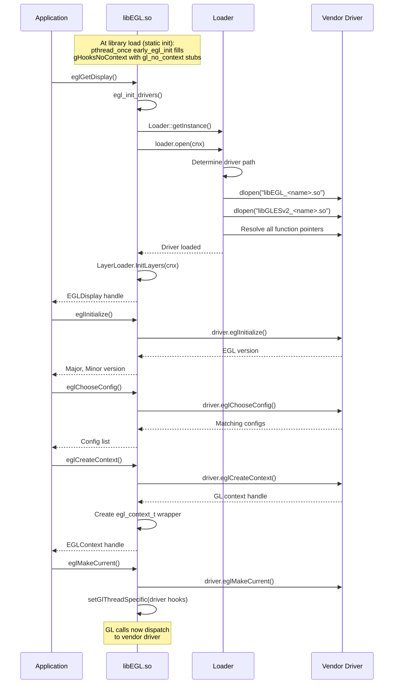

### 13.2.13 扩展字符串管理

EGL 包装层管理两组扩展：

- **内置扩展**：由包装层本身实现（始终可用）
- **驱动扩展**：从厂商驱动透传（可用性各异）

组合后的扩展字符串通过 `eglQueryString()` 返回给应用程序。Android 增加了几
个专有扩展：

| 扩展 | 用途 |
|-----------|---------|
| `EGL_ANDROID_native_fence_sync` | GPU↔CPU 栅栏同步 |
| `EGL_ANDROID_presentation_time` | 帧呈现时间戳 |
| `EGL_ANDROID_front_buffer_auto_refresh` | 直接前缓冲渲染 |
| `EGL_ANDROID_get_frame_timestamps` | 逐帧时序数据 |
| `EGL_ANDROID_get_native_client_buffer` | AHardwareBuffer↔EGLClientBuffer |
| `EGL_KHR_swap_buffers_with_damage` | 部分屏幕更新 |

### 13.2.14 BlobCache：单文件缓存

在 `MultifileBlobCache` 之外，Android 还携带了单体式 `BlobCache`（以及
`FileBlobCache`）实现。两者是运行时可选的替代方案，而非新旧之分。`egl_cache.cpp`
仅在设置 `ro.egl.blobcache.multifile` 属性（默认 false，可用
`debug.egl.blobcache.multifile` 覆盖）时才选用多文件缓存。因此大多数设备使用
单体式路径。

- `BlobCache.cpp`——内存中的键值缓存；写满时随机淘汰条目直到只剩一半
  （不跟踪最近使用情况）
- `FileBlobCache.cpp`——在 BlobCache 基础上增加基于文件的持久化
- `egl_cache.cpp`——将 blob 缓存与 EGL 驱动的缓存回调集成

`egl_cache` 通过 `EGL_ANDROID_blob_cache` 扩展向驱动注册回调，允许驱动通过
AOSP 缓存基础设施存储和检索编译后的着色器。

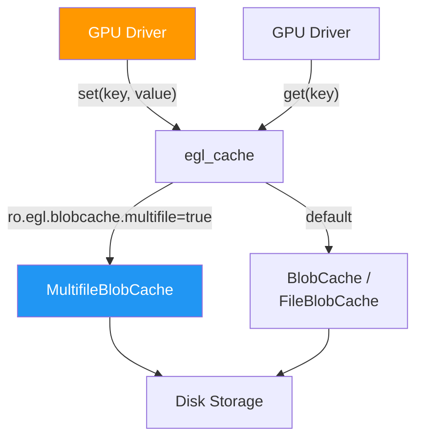

---

## 13.3 Vulkan

### 13.3.1 Vulkan 加载器架构

Android 的 Vulkan 加载器位于 `frameworks/native/vulkan/libvulkan/`。与 EGL 不
同，Vulkan 从一开始就按加载器—层—ICD 的架构设计。Android 加载器相对轻量，
因为 Vulkan 的显式 API 设计减轻了加载器的职责。

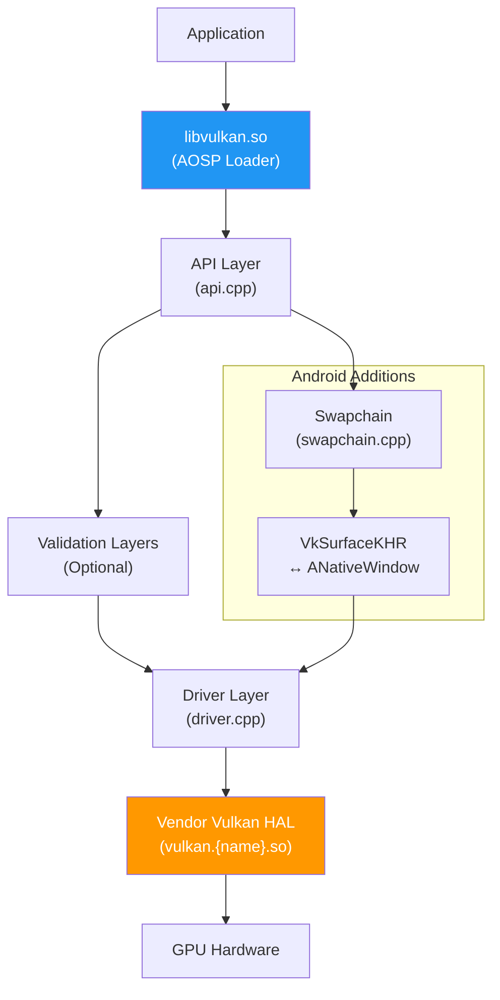

### 13.3.2 驱动加载（`driver.cpp`）

Vulkan HAL 由 `driver.cpp` 中的 `Hal` 类加载。加载序列按优先级顺序尝试多个
来源：

```cpp
// frameworks/native/vulkan/libvulkan/driver.cpp, line 241
bool Hal::Open() {
    ATRACE_CALL();
    const nsecs_t openTime = systemTime();

    if (hal_.ShouldUnloadBuiltinDriver()) {
        hal_.UnloadBuiltinDriver();
    }
    if (hal_.dev_) return true;

    // Use a stub device unless we successfully open a real HAL device.
    hal_.dev_ = &stubhal::kDevice;

    int result;
    const hwvulkan_module_t* module = nullptr;

    result = LoadUpdatedDriver(&module);      // 1. Game/updated driver
    if (result == -ENOENT) {
        result = LoadBuiltinDriver(&module);  // 2. Built-in vendor or APEX driver
    }
    // ...
}
```

Android 17 将加载器简化为两个来源。`LoadUpdatedDriver()`（第 224 行）尝试来自
`GraphicsEnv` 的游戏/可更新驱动命名空间。如果不存在（`-ENOENT`），则由
`LoadBuiltinDriver()`（第 202 行）加载厂商驱动。该函数现在也直接处理 APEX
情况：当设置 `ro.vulkan.apex` 属性时，它会解析指定的 APEX 命名空间，并从中
加载 `vulkan.<name>.so`。较早的版本通过 `Hal::Open` 中单独的
`LoadDriverFromApex()` 步骤路由 APEX 加载；该步骤现已并入
`LoadBuiltinDriver`。

`LoadDriver()` 函数使用系统属性搜索厂商 HAL：

```cpp
// frameworks/native/vulkan/libvulkan/driver.cpp, line 141
const std::array<const char*, 2> HAL_SUBNAME_KEY_PROPERTIES = {{
    "ro.hardware.vulkan",
    "ro.board.platform",
}};
```

这会解析为从厂商分区加载名为 `vulkan.<property_value>.so` 的共享库。

### 13.3.3 从 APEX 加载驱动

Android 支持从 APEX 模块加载 Vulkan 驱动，从而无需完整 OTA 更新即可更新
驱动。在 Android 17 中，这在 `LoadBuiltinDriver()`（第 202 行）内部处理。当
`ro.vulkan.apex` 属性指定某个 APEX 时，内置路径会解析该 APEX 的链接器命名
空间，然后从其中加载 `vulkan.<name>.so`，而不是从厂商分区加载：

```cpp
// frameworks/native/vulkan/libvulkan/driver.cpp, line 202
int LoadBuiltinDriver(const hwvulkan_module_t** module) {
    ATRACE_CALL();
    android_namespace_t* library_namespace = nullptr;
    const char* ns_name = nullptr;

    // Builtin driver is loaded from APEX when ro.vulkan.apex is set
    auto apex_name = android::base::GetProperty(RO_VULKAN_APEX_PROPERTY, "");
    if (apex_name != "") {
        ALOGD("Loading builtin Vulkan driver from APEX: ro.vulkan.apex=%s",
              apex_name.c_str());
        std::replace(apex_name.begin(), apex_name.end(), '.', '_');
        library_namespace = android_get_exported_namespace(apex_name.c_str());
        // ...
    }
    // ... otherwise fall back to the vendor partition driver
}
```

较早的版本在 `Hal::Open` 中使用单独的 `LoadDriverFromApex()` 步骤；该步骤已
并入 `LoadBuiltinDriver`，使 APEX 与厂商分区加载共用同一条代码路径。

### 13.3.4 实例与设备创建（`api.cpp`）

`api.cpp` 中的 API 层处理实例/设备创建、层发现和函数分发。`OverrideLayerNames`
类（第 59 行）管理隐式 Vulkan 层注入：

```cpp
// frameworks/native/vulkan/libvulkan/api.cpp, line 59
class OverrideLayerNames {
public:
    OverrideLayerNames(bool is_instance,
                       const VkAllocationCallbacks& allocator)
        : is_instance_(is_instance), allocator_(allocator),
          scope_(VK_SYSTEM_ALLOCATION_SCOPE_COMMAND),
          names_(nullptr), name_count_(0), implicit_layers_() {
        implicit_layers_.result = VK_SUCCESS;
    }
    // ...
};
```

层可以通过以下方式注入：

1. `GraphicsEnv::getDebugLayers()`——来自 Android 设置界面或开发者选项
2. `debug.vulkan.layers` 系统属性——以冒号分隔的层列表
3. `debug.vulkan.layer.<N>` 属性——按优先级单独选择层

### 13.3.5 `CreateInfoWrapper` 类

`driver.cpp` 中的 `CreateInfoWrapper`（第 78 行）是一项关键基础设施，用于
清洗 `VkInstanceCreateInfo` 和 `VkDeviceCreateInfo` 结构。它执行：

- 应用请求与 ICD 能力之间的 API 版本验证
- 扩展过滤（移除 ICD 不支持的扩展）
- pNext 链清洗（移除无法识别的结构）
- 层名称解析

```cpp
// frameworks/native/vulkan/libvulkan/driver.cpp, line 78
class CreateInfoWrapper {
public:
    CreateInfoWrapper(const VkInstanceCreateInfo& create_info,
                      uint32_t icd_api_version,
                      const VkAllocationCallbacks& allocator);
    CreateInfoWrapper(VkPhysicalDevice physical_dev,
                      const VkDeviceCreateInfo& create_info,
                      uint32_t icd_api_version,
                      const VkAllocationCallbacks& allocator);

    VkResult Validate();
    const std::bitset<ProcHook::EXTENSION_COUNT>&
        GetHookExtensions() const;
    const std::bitset<ProcHook::EXTENSION_COUNT>&
        GetHalExtensions() const;
    // ...
};
```

### 13.3.6 Swapchain：Vulkan 对接 Android Surface

`swapchain.cpp` 是 Vulkan 加载器中最重要的文件之一。它通过桥接 Vulkan 的呈
现模型与 Android 的 `ANativeWindow` / `BufferQueue` 系统来实现
`VK_KHR_swapchain`。

关键操作：

**表面变换转换**——Android 原生窗口的变换与 Vulkan 的表面变换同构，但编码
方式不同：

```cpp
// frameworks/native/vulkan/libvulkan/swapchain.cpp, line 141
VkSurfaceTransformFlagBitsKHR TranslateNativeToVulkanTransform(
    int native) {
    switch (native) {
        case 0:
            return VK_SURFACE_TRANSFORM_IDENTITY_BIT_KHR;
        case NATIVE_WINDOW_TRANSFORM_FLIP_H:
            return VK_SURFACE_TRANSFORM_HORIZONTAL_MIRROR_BIT_KHR;
        case NATIVE_WINDOW_TRANSFORM_ROT_90:
            return VK_SURFACE_TRANSFORM_ROTATE_90_BIT_KHR;
        // ...
    }
}
```

**色彩空间支持**——swapchain 将 Vulkan 色彩空间映射到 Android 数据空间：

```cpp
// frameworks/native/vulkan/libvulkan/swapchain.cpp, line 221
const static VkColorSpaceKHR
    colorSpaceSupportedByVkEXTSwapchainColorspace[] = {
    VK_COLOR_SPACE_DISPLAY_P3_NONLINEAR_EXT,
    VK_COLOR_SPACE_DISPLAY_P3_LINEAR_EXT,
    VK_COLOR_SPACE_DCI_P3_NONLINEAR_EXT,
    VK_COLOR_SPACE_BT709_LINEAR_EXT,
    VK_COLOR_SPACE_BT709_NONLINEAR_EXT,
    VK_COLOR_SPACE_BT2020_LINEAR_EXT,
    VK_COLOR_SPACE_HDR10_ST2084_EXT,
    // ...
};
```

**呈现时序**——`TimingInfo` 类（第 240 行）为 `VK_GOOGLE_display_timing` 和
较新的 `VK_EXT_present_timing` 跟踪逐帧时序数据：

```cpp
// frameworks/native/vulkan/libvulkan/swapchain.cpp, line 240
class TimingInfo {
public:
    TimingInfo(uint64_t presentId, uint64_t nativeFrameId,
               uint64_t desiredPresentTime,
               VkPresentStageFlagsEXT presentStageQueries)
        : vals_{(uint32_t)presentId, desiredPresentTime, 0, 0, 0},
          native_frame_id_(nativeFrameId),
          present_id_(presentId),
          present_stage_queries_(presentStageQueries) {}
    bool ready() const { /* check all timestamps resolved */ }
    void calculate(int64_t rdur) { /* compute actual timings */ }
};
```

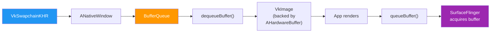

### 13.3.7 Vulkan Profiles

`frameworks/native/vulkan/vkprofiles/` 定义了 Android Baseline Profiles
（ABP），规定了各 Android API 级别的最低 Vulkan 特性集。CTS 和应用使用这些
profile 查询有保障的能力。

### 13.3.8 Null 驱动

用于测试和开发，`frameworks/native/vulkan/nulldrv/` 提供了一个空的 Vulkan
驱动实现。`null_driver.cpp` 和 `null_driver_gen.cpp` 实现了完整的 Vulkan API
表面，但不执行任何实际的 GPU 操作。这对于以下方面非常有价值：

- 在不支持 GPU 的模拟器上运行 CTS 测试
- 独立测试加载器/层基础设施
- 验证应用程序的 Vulkan 使用模式

### 13.3.9 代码生成

Vulkan 加载器的大部分代码是从 Vulkan 规范 XML 生成的。`api_gen.cpp`、
`driver_gen.cpp` 和 `null_driver_gen.cpp` 均为自动生成，提供：

- 所有 Vulkan 入口点的分发表
- 依赖扩展的函数的 ProcHook 表
- null 驱动的桩实现

### 13.3.10 分发表架构

Vulkan 使用两级分发表系统：

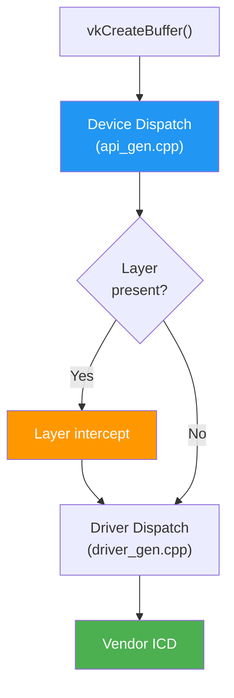

实例分发表以 `VkInstance` 为索引，包含实例级命令的函数指针。设备分发表以
`VkDevice` 为索引，包含设备级函数指针。

### 13.3.11 扩展钩子点

加载器拦截某些需要 Android 特定行为的 Vulkan 函数。这些“proc hooks”定义
于以下扩展：

| 扩展 | 被钩住的函数 | Android 行为 |
|-----------|-----------------|------------------|
| `VK_KHR_android_surface` | `vkCreateAndroidSurfaceKHR` | 包装 ANativeWindow |
| `VK_KHR_swapchain` | `vkCreateSwapchainKHR` | 映射到 BufferQueue |
| `VK_GOOGLE_display_timing` | `vkGetPastPresentationTimingGOOGLE` | 查询帧统计信息 |
| `VK_EXT_debug_report` | 所有调试回调 | 路由到 logcat |

### 13.3.12 Vulkan 实例创建流程

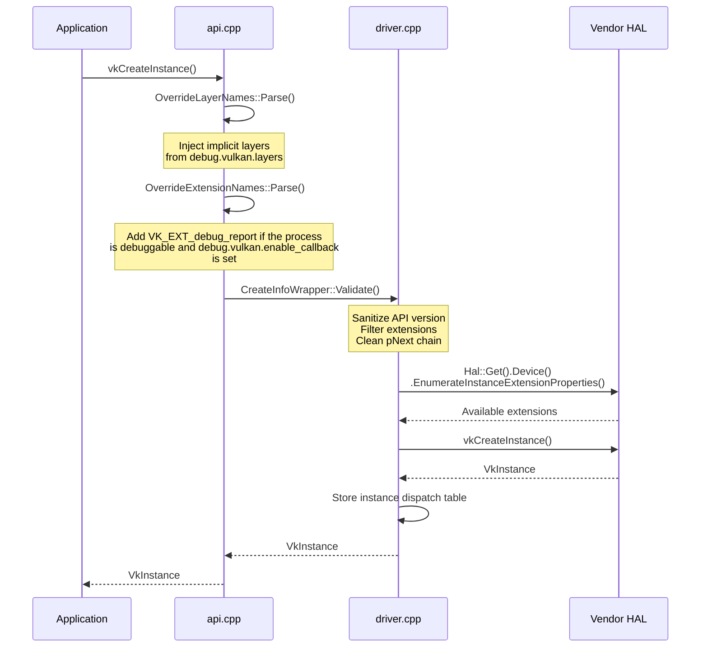

### 13.3.13 物理设备枚举

在客户端一侧，HWUI 的 `VulkanManager` 选择物理设备（加载器只是将
`vkEnumeratePhysicalDevices` 转发给 HAL）：

```cpp
// frameworks/base/libs/hwui/renderthread/VulkanManager.cpp, line 199
// (in VulkanManager::setupDevice)
uint32_t gpuCount;
LOG_ALWAYS_FATAL_IF(mEnumeratePhysicalDevices(mInstance, &gpuCount, nullptr));
// Just returning the first physical device instead of getting the whole array.
// Since there should only be one device on android.
gpuCount = 1;
err = mEnumeratePhysicalDevices(mInstance, &gpuCount, &mPhysicalDevice);
```

Android 通常只有一个物理设备（移动 GPU）。移动设备上多 GPU 配置并不常见，
因此 VulkanManager 只需选择第一个可用设备。

### 13.3.14 队列族选择

VulkanManager 选择支持图形操作的队列族。队列选择还考虑了用于请求更高 GPU
调度优先级的 `VK_EXT_global_priority` 扩展：

```cpp
// VulkanManager.cpp (sEnableExtensions)
VK_EXT_GLOBAL_PRIORITY_EXTENSION_NAME,
VK_EXT_GLOBAL_PRIORITY_QUERY_EXTENSION_NAME,
VK_KHR_GLOBAL_PRIORITY_EXTENSION_NAME,
```

这使 HWUI 的渲染队列能够拥有高于后台计算负载的优先级。

---

## 13.4 ANGLE

### 13.4.1 基于 Vulkan 的 GL 转译

ANGLE（Almost Native Graphics Layer Engine）是 Google 在 Vulkan 之上实现的
OpenGL ES。在 AOSP 中，它位于 `external/angle/`，作为替代 GLES 驱动，将
OpenGL ES 调用转译为 Vulkan 命令。

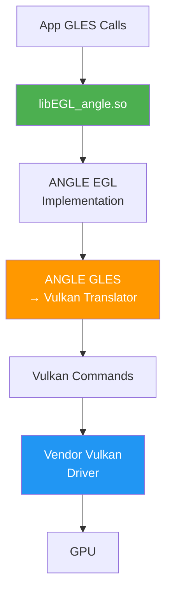

### 13.4.2 何时使用 ANGLE

ANGLE 通过 EGL 加载器集成来选择。`egl_platform_entries.cpp` 文件包含
`EGL/eglext_angle.h`（第 44 行），表明支持 ANGLE 特有的扩展。选择基于以下
因素：

1. 通过开发者设置中的 ANGLE 偏好界面按应用选择启用
2. 通过 `persist.graphics.egl` 属性（优先生效）或 `ro.hardware.egl` 设为
   `angle` 进行系统级 ANGLE 启用
3. 通过 `GraphicsEnv` 选择游戏驱动

### 13.4.3 ANGLE 的优势

- **驱动一致性**：不同 GPU 厂商间一致的 GLES 行为
- **缺陷隔离**：GLES 缺陷可以在 ANGLE 中修复，无需更新厂商驱动
- **特性模拟**：ANGLE 可以使用 Vulkan 特性模拟 GLES 扩展
- **可更新性**：ANGLE 可通过 Google Play 系统更新进行更新

### 13.4.4 ANGLE 架构

ANGLE 同时转译 API 命令和着色器：

- 在“前端”跟踪 GLES 状态
- 在“后端”记录 Vulkan 命令缓冲
- ANGLE 自己的 SPIR-V 代码生成器（`src/compiler/translator/spirv/`）将
  ESSL 着色器编译为 Vulkan 后端所需的 SPIR-V
- 高效的资源管理（纹理、缓冲区、渲染通道）

---

## 13.5 Skia

### 13.5.1 Skia 在 Android 中的角色

Skia（`external/skia/`）是驱动 Android 中几乎所有渲染的 2D 图形库。它提供：

- 路径渲染（曲线、填充、描边）
- 文本排版与栅格化
- 图像解码与采样
- 通过其“Ganesh”后端实现的 GPU 加速渲染
- 色彩管理（广色域、HDR）

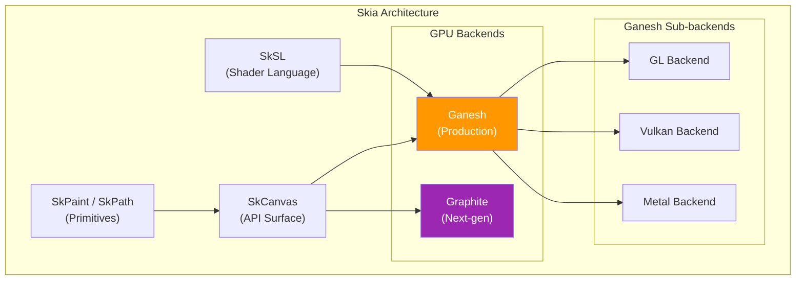

### 13.5.2 核心 API（`include/core/`）

Skia 的公共 API 定义于 `external/skia/include/core/`。关键类：

- **`SkCanvas`**：绘制表面。所有绘制命令都经由它发出。
- **`SkPaint`**：描述如何绘制（颜色、样式、混合模式、着色器等）
- **`SkPath`**：几何路径数据（move、line、曲线、弧线）
- **`SkImage`**：不可变图像数据（可以是 GPU 支撑的）
- **`SkSurface`**：可写的绘制目标（包装一个画布）
- **`SkShader`**：逐像素颜色生成（渐变、图像、自定义）
- **`SkColorSpace`**：基于 ICC 配置文件的色彩管理
- **`SkMatrix` / `SkM44`**：2D 与 3D 变换矩阵

### 13.5.3 Ganesh GPU 后端（`src/gpu/ganesh/`）

Ganesh 是 Skia 当前生产环境的 GPU 后端。它使用 OpenGL 或 Vulkan 将
`SkCanvas` 绘制调用转换为 GPU 命令。关键概念：

**GrDirectContext**：拥有所有 GPU 资源的 GPU 上下文。

```cpp
// Used by RenderThread to create the Skia GPU context
// frameworks/base/libs/hwui/renderthread/RenderThread.cpp, line 250
sk_sp<GrDirectContext> grContext(
    GrDirectContexts::MakeGL(std::move(glInterface), options));
```

**GrContextOptions**：GPU 上下文的配置，由 HWUI 在
`RenderThread.cpp`（第 272 行）中设置：

```cpp
// frameworks/base/libs/hwui/renderthread/RenderThread.cpp, line 272
void RenderThread::initGrContextOptions(GrContextOptions& options) {
    options.fPreferExternalImagesOverES3 = true;
    options.fDisableDistanceFieldPaths = true;
    if (android::base::GetBoolProperty(
            PROPERTY_REDUCE_OPS_TASK_SPLITTING, true)) {
        options.fReduceOpsTaskSplitting = GrContextOptions::Enable::kYes;
    } else {
        options.fReduceOpsTaskSplitting = GrContextOptions::Enable::kNo;
    }
}
```

**Render passes (OpsTask)**：Ganesh 将绘制调用批量组织为渲染通道并重排它们，
以尽量减少状态更改和渲染目标切换。`fReduceOpsTaskSplitting` 选项控制 Ganesh
合并渲染通道的激进程度。

### 13.5.4 Graphite：下一代后端

Graphite（`src/gpu/graphite/`）是 Skia 的下一代 GPU 后端，旨在更好地利用现代
显式 API（Vulkan、Metal、D3D12）。与 Ganesh 的主要差异：

| 方面 | Ganesh | Graphite |
|--------|--------|----------|
| 录制 | 立即式 | 延迟式 |
| 线程模型 | 单线程 GPU 工作 | 多线程录制 |
| 命令缓冲 | 隐式 | 显式 |
| 管线状态 | 惰性 | 预编译 |
| 资源管理 | 基于 GC | 显式所有权 |

Graphite 尚未成为 Android HWUI 的默认后端，但正在积极开发中。

### 13.5.5 SkSL：Skia 的着色语言

SkSL 是 Skia 的自定义着色语言，根据后端编译为 GLSL、SPIR-V 或 MSL。它驱动：

- 运行时着色器效果（`SkRuntimeEffect`）
- 自定义混合模式
- 颜色滤镜与图像滤镜
- `SkSL::Compiler` 将 SkSL 转换为目标 GPU 着色语言

### 13.5.6 编解码器与图像解码

Skia 内置了 PNG、JPEG、WebP、GIF、BMP、ICO 和 WBMP 的编解码器。
`BitmapFactory`（经由 HWUI 的 JNI 层）使用它们解码图像。编解码器系统位于
`src/codec/`，并与 Android 的 `ImageDecoder` API 集成。

### 13.5.7 文本渲染

Skia 使用以下方式处理字形栅格化：

- **FreeType**：轮廓与位图字形渲染
- **GPU 字形图集**：Ganesh 为缓存的字形维护一个纹理图集，图集大小由 HWUI 的
  `CacheManager` 配置（见 13.7.7 节）

复杂文本整形是与栅格化分开的一步。在 Android 上，minikin 负责整形并使用
HarfBuzz。Skia 只栅格化整形所选中的字形。

### 13.5.8 SIMD 优化

Skia 在 CPU 端操作中广泛使用 SIMD 指令：

- **NEON**（ARM）：用于混合、颜色转换、图像采样
- **SSE/AVX**（x86）：在 x86 设备上执行相同操作
- 代码路径在编译时根据目标架构选择
- 主要位于 `src/opts/`

### 13.5.9 Skia 的录制与回放模型

Skia 同时支持立即模式渲染（直接绘制到 GPU）和录制模式（录制到
`SkPicture` 供稍后回放）。HWUI 使用录制模型：

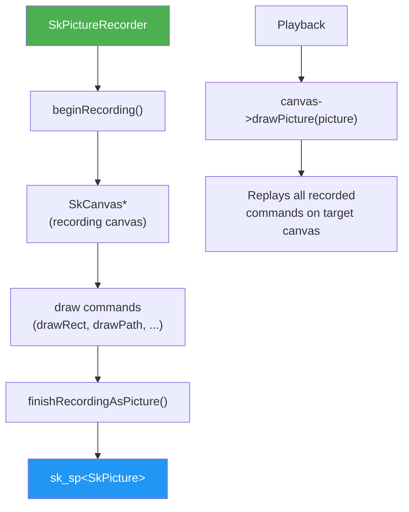

录制方式实现了：

- 延迟渲染（在 UI 线程录制，在 RenderThread 渲染）
- Display list 缓存（无需重新录制即可重新渲染）
- 序列化（保存/加载，用于通过 SKP 文件调试）

### 13.5.10 Ganesh 中的 GPU 资源管理

Ganesh 通过资源缓存管理 GPU 资源：

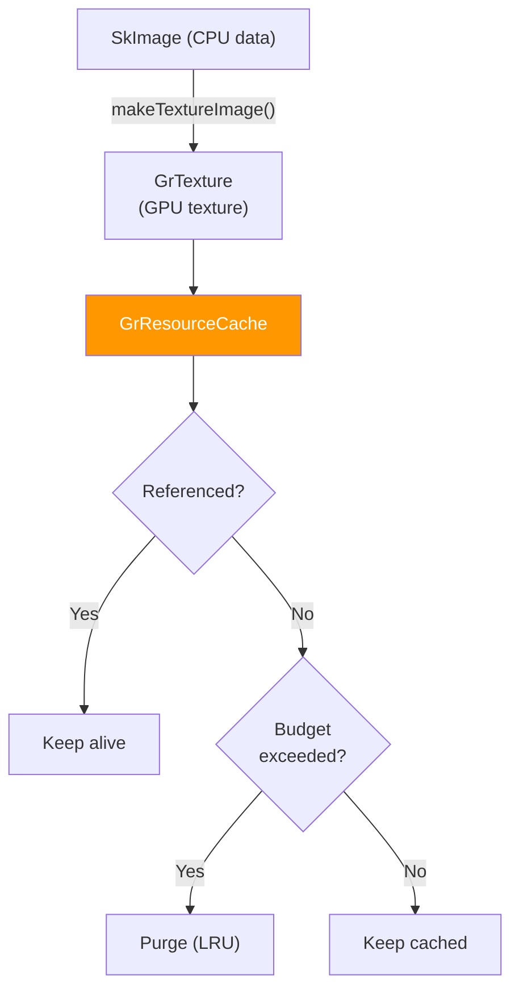

资源缓存预算由 HWUI 的 CacheManager 设置：

```cpp
// CacheManager.cpp, line 87
mGrContext->setResourceCacheLimit(mMaxResourceBytes);
```

资源被分类为：

- **临时资源（Scratch resources）**：可复用于任何目的（渲染目标、顶点缓冲）
- **唯一资源（Unique resources）**：绑定到特定内容（纹理、着色器程序）

### 13.5.11 Skia 的路径渲染

路径渲染是 Skia 最复杂的子系统之一。对于 GPU 渲染，路径被细分为三角形：

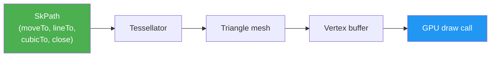

Ganesh 根据路径复杂度使用多种策略：

- **简单凸路径**：直接细分
- **复杂路径**：模板—覆盖（Stencil-then-cover）算法
- **小路径**：栅格化为掩码纹理
- **距离场路径**：基于 SDF 的渲染，实现分辨率无关的路径

HWUI 禁用了距离场路径：
```cpp
// RenderThread.cpp, line 274 (inside initGrContextOptions)
options.fDisableDistanceFieldPaths = true;
```

### 13.5.12 SkSurface 与渲染目标

`SkSurface` 表示一个绘制目标。在 HWUI 中，surface 包装 GPU 渲染目标：

**对于 SkiaGL**：surface 包装 EGL 默认帧缓冲（FBO 0）：
```cpp
// SkiaOpenGLPipeline.cpp
surface = SkSurfaces::WrapBackendRenderTarget(
    mRenderThread.getGrContext(), backendRT,
    getSurfaceOrigin(), colorType,
    mSurfaceColorSpace, &props);
```

**对于 SkiaVulkan**：surface 包装 Vulkan swapchain 图像：
```cpp
// SkiaVulkanPipeline.cpp
backBuffer = mVkSurface->getCurrentSkSurface();
```

**对于离屏层**：surface 作为 GPU 渲染目标创建：
```cpp
// SkiaGpuPipeline.cpp
node->setLayerSurface(SkSurfaces::RenderTarget(
    mRenderThread.getGrContext(),
    skgpu::Budgeted::kYes, info, 0,
    this->getSurfaceOrigin(), &props));
```

### 13.5.13 文本图集管理

Skia 为缓存的字形图像维护 GPU 纹理图集。HWUI 中的图集配置：

```cpp
// CacheManager.cpp
contextOptions->fGlyphCacheTextureMaximumBytes =
    mMaxGpuFontAtlasBytes;
```

图集大小由最大表面积推导：
```
mMaxGpuFontAtlasBytes = nextPowerOfTwo(mMaxSurfaceArea)
```

`mMaxSurfaceArea` 以屏幕面积乘以内存策略的 `initialMaxSurfaceAreaScale`
（默认 1.0）作为初始值。如果渲染了更大的帧，它会在运行时增长。对于默认策略
下的 1080x2400 显示屏：
`nextPowerOfTwo(2592000) = 4194304`（每个图集 4 MB）

可能会分配多个图集：

- A8 图集用于灰度字形
- ARGB 图集用于彩色 emoji
- 距离场图集用于小号文本（如果启用）

---

## 13.6 HWUI

### 13.6.1 HWUI 的用途

HWUI（Hardware UI）是桥接 Android Java View 系统与 GPU 的原生渲染库。它位
于 `frameworks/base/libs/hwui/`，包含超过 500 个文件，涵盖画布录制、
display list 管理、渲染节点属性、动画以及 GPU 管线集成。

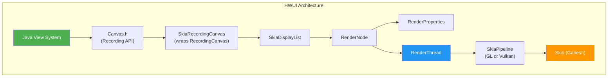

### 13.6.2 `Canvas` 接口

`hwui/Canvas.h` 中的抽象 `Canvas` 类定义了 Java `android.graphics.Canvas`
所映射的完整绘制 API。它包括：

**录制 API**（由 View 系统使用）：

```cpp
// frameworks/base/libs/hwui/hwui/Canvas.h, line 94
static WARN_UNUSED_RESULT Canvas* create_recording_canvas(
    int width, int height,
    uirenderer::RenderNode* renderNode = nullptr);
```

```cpp
// frameworks/base/libs/hwui/hwui/Canvas.h, line 127
virtual void resetRecording(int width, int height,
    uirenderer::RenderNode* renderNode = nullptr) = 0;
virtual void finishRecording(
    uirenderer::RenderNode* destination) = 0;
```

**绘制图元**——30 多个虚拟绘制方法，涵盖：

```cpp
// frameworks/base/libs/hwui/hwui/Canvas.h (selection)
virtual void drawColor(int color, SkBlendMode mode) = 0;
virtual void drawRect(float l, float t, float r, float b,
                      const Paint& paint) = 0;
virtual void drawRoundRect(float l, float t, float r, float b,
                           float rx, float ry, const Paint& paint) = 0;
virtual void drawCircle(float x, float y, float radius,
                        const Paint& paint) = 0;
virtual void drawPath(const SkPath& path, const Paint& paint) = 0;
virtual void drawBitmap(Bitmap& bitmap, float left, float top,
                        const Paint* paint) = 0;
virtual void drawRenderNode(
    uirenderer::RenderNode* renderNode) = 0;
```

**View 系统操作**（未在公共 API 中暴露）：

```cpp
virtual void enableZ(bool enableZ) = 0;
virtual void drawLayer(
    uirenderer::DeferredLayerUpdater* layerHandle) = 0;
virtual void drawWebViewFunctor(int /*functor*/) {
    LOG_ALWAYS_FATAL("Not supported");
}
virtual void punchHole(const SkRRect& rect, float alpha) = 0;
```

### 13.6.3 Canvas Op 类型

HWUI 还带有一个实验性的类型化 op-buffer display list 格式。这是 13.6.8 中描
述的 `CanvasOpBuffer` 路径，并非当前活动的录制管线。`CanvasOpTypes.h` 枚举
了其操作集：

```cpp
// frameworks/base/libs/hwui/canvas/CanvasOpTypes.h, line 23
enum class CanvasOpType : int8_t {
    // State ops
    Save, SaveLayer, SaveBehind, Restore, BeginZ, EndZ,

    // Clip ops
    ClipRect, ClipPath,

    // Drawing ops
    DrawColor, DrawRect, DrawRegion, DrawRoundRect,
    DrawRoundRectProperty, DrawDoubleRoundRect,
    DrawCircleProperty, DrawRippleDrawable, DrawCircle,
    DrawOval, DrawArc, DrawPaint, DrawPoint, DrawPoints,
    DrawPath, DrawLine, DrawLines, DrawVertices,
    DrawImage, DrawImageRect, DrawImageLattice,
    DrawPicture, DrawLayer, DrawRenderNode,

    COUNT
};
```

### 13.6.4 RenderNode：View 树的镜像

`RenderNode`（`RenderNode.h`）是 Java `View` 的原生对应物。UI 层次结构中的每
个 `View` 都有一个对应的 `RenderNode`，存储：

1. **RenderProperties**——视觉属性（位置、变换、alpha、裁剪等）
2. **DisplayList**——录制的绘制命令
3. **AnimatorManager**——活动的属性动画

```cpp
// frameworks/base/libs/hwui/RenderNode.h, line 77
class RenderNode : public VirtualLightRefBase {
public:
    enum DirtyPropertyMask {
        GENERIC       = 1 << 1,
        TRANSLATION_X = 1 << 2,
        TRANSLATION_Y = 1 << 3,
        TRANSLATION_Z = 1 << 4,
        SCALE_X       = 1 << 5,
        SCALE_Y       = 1 << 6,
        ROTATION      = 1 << 7,
        ROTATION_X    = 1 << 8,
        ROTATION_Y    = 1 << 9,
        X             = 1 << 10,
        Y             = 1 << 11,
        Z             = 1 << 12,
        ALPHA         = 1 << 13,
        DISPLAY_LIST  = 1 << 14,
    };
    // ...
};
```

`DirtyPropertyMask` 枚举实现了细粒度的脏标记跟踪。当某个 View 属性改变时
（例如 `setTranslationX()`），只会设置相应的位。这避免了同步阶段的不必要
工作。

### 13.6.5 双缓冲属性

RenderNode 使用双缓冲方案保证线程安全。属性由 UI 线程在“暂存（staging）”副本
上设置，然后在 RenderThread 上同步到“渲染（render）”副本：

```cpp
// frameworks/base/libs/hwui/RenderNode.h, line 138
const RenderProperties& properties() const { return mProperties; }
RenderProperties& animatorProperties() { return mProperties; }
const RenderProperties& stagingProperties() { return mStagingProperties; }
RenderProperties& mutateStagingProperties() { return mStagingProperties; }
```

这一模式使 UI 线程与 RenderThread 能够并发工作，而无需在属性数据上加锁。

### 13.6.6 RenderProperties：完整的属性集

`RenderProperties.h` 包含 RenderNode 的完整视觉属性集：

```cpp
// frameworks/base/libs/hwui/RenderProperties.h, line 574
struct PrimitiveFields {
    int mLeft = 0, mTop = 0, mRight = 0, mBottom = 0;
    int mWidth = 0, mHeight = 0;
    int mClippingFlags = CLIP_TO_BOUNDS;
    SkColor mSpotShadowColor = SK_ColorBLACK;
    SkColor mAmbientShadowColor = SK_ColorBLACK;
    float mAlpha = 1;
    float mTranslationX = 0, mTranslationY = 0, mTranslationZ = 0;
    float mElevation = 0;
    float mRotation = 0, mRotationX = 0, mRotationY = 0;
    float mScaleX = 1, mScaleY = 1;
    float mPivotX = 0, mPivotY = 0;
    bool mHasOverlappingRendering = false;
    bool mPivotExplicitlySet = false;
    bool mMatrixOrPivotDirty = false;
    bool mProjectBackwards = false;
    bool mProjectionReceiver = false;
    bool mAllowForceDark = true;
    bool mClipMayBeComplex = false;
    Rect mClipBounds;
    Outline mOutline;
    RevealClip mRevealClip;
} mPrimitiveFields;
```

### 13.6.7 LayerProperties 与层提升

RenderNode 可以被“提升”为离屏层以进行合成。当以下情况发生时：

- 节点具有非不透明的 alpha 且存在重叠渲染
- 应用了 `SkImageFilter`（模糊、颜色矩阵等）
- 存在活动的拉伸效果
- WebView functor 需要层来进行裁剪

```cpp
// frameworks/base/libs/hwui/RenderProperties.h, line 552
bool promotedToLayer() const {
    return mLayerProperties.mType == LayerType::None &&
           fitsOnLayer() &&
           (mComputedFields.mNeedLayerForFunctors ||
            mLayerProperties.mImageFilter != nullptr ||
            mLayerProperties.getStretchEffect().requiresLayer() ||
            (!MathUtils::isZero(mPrimitiveFields.mAlpha) &&
             mPrimitiveFields.mAlpha < 1 &&
             mPrimitiveFields.mHasOverlappingRendering));
}
```

### 13.6.8 DisplayList：录制的命令流

`DisplayList.h` 定义了录制的画布操作的容器。AOSP 目前使用
`SkiaDisplayListWrapper` 作为活动的实现：

```cpp
// frameworks/base/libs/hwui/DisplayList.h, line 338
using DisplayList = SkiaDisplayListWrapper;
```

`SkiaDisplayListWrapper` 包装一个 `skiapipeline::SkiaDisplayList`，后者存储：

- 类似 `SkPicture` 的 Skia 绘制调用录制
- 对子 `RenderNode` 的引用
- 对 `AnimatedImageDrawable` 的引用
- WebView functor 句柄
- 矢量可绘制对象引用

还有一个 `MultiDisplayList` 变体（第 173 行），同时支持 Skia 录制和新的
`CanvasOpBuffer` 格式。这表明 display list 系统正在现代化。

### 13.6.9 Skia Display List 管线

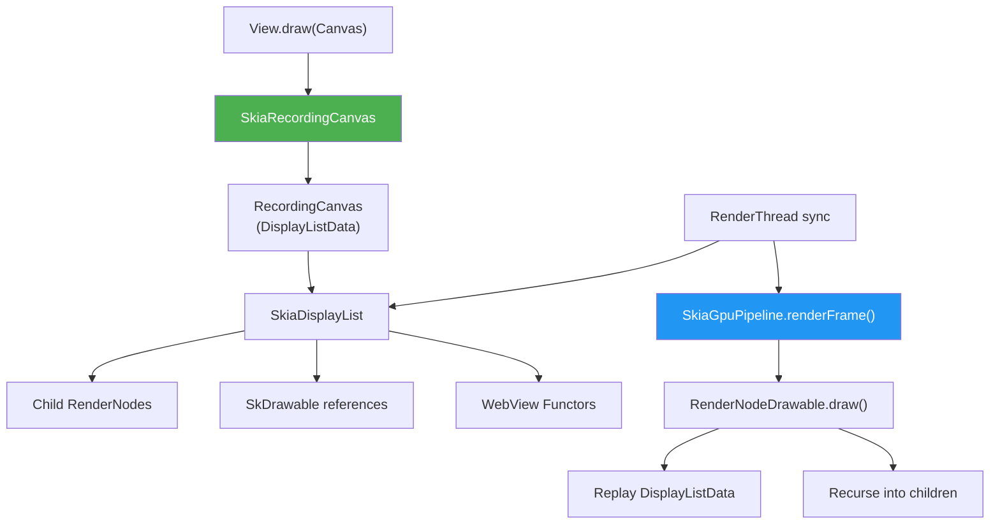

---

## 13.7 RenderThread

### 13.7.1 专用渲染线程

RenderThread 是一个单例线程，负责处理应用程序的所有 GPU 渲染。它在每个进程
中创建一次，管理 GPU 上下文（GL 或 Vulkan）、帧时序以及所有渲染操作。

```cpp
// frameworks/base/libs/hwui/renderthread/RenderThread.cpp, line 175
RenderThread& RenderThread::getInstance() {
    [[clang::no_destroy]] static sp<RenderThread> sInstance = []() {
        sp<RenderThread> thread = sp<RenderThread>::make();
        thread->start("RenderThread");
        return thread;
    }();
    gHasRenderThreadInstance = true;
    return *sInstance;
}
```

### 13.7.2 初始化

当 RenderThread 启动时，它在 `initThreadLocals()`（第 221 行）中初始化多个
子系统：

```cpp
// frameworks/base/libs/hwui/renderthread/RenderThread.cpp, line 221
void RenderThread::initThreadLocals() {
    setupFrameInterval();
    initializeChoreographer();
    mEglManager = new EglManager();
    mRenderState = new RenderState(*this);
    mVkManager = VulkanManager::getInstance();
    mCacheManager = new CacheManager(*this);
}
```

该线程以 `PRIORITY_DISPLAY` 优先级运行，并直接与 Choreographer 集成以获取
VSYNC 时序。

### 13.7.3 线程循环

`threadLoop()`（第 420 行）中的主循环遵循经典的工作队列模式：

```cpp
// frameworks/base/libs/hwui/renderthread/RenderThread.cpp, line 420
bool RenderThread::threadLoop() {
    setpriority(PRIO_PROCESS, 0, PRIORITY_DISPLAY);
    Looper::setForThread(mLooper);
    if (gOnStartHook) {
        gOnStartHook("RenderThread");
    }
    initThreadLocals();

    while (true) {
        waitForWork();
        processQueue();
        // Handle VSYNC frame callbacks
        if (mPendingRegistrationFrameCallbacks.size() &&
            !mFrameCallbackTaskPending) {
            mVsyncSource->drainPendingEvents();
            mFrameCallbacks.insert(
                mPendingRegistrationFrameCallbacks.begin(),
                mPendingRegistrationFrameCallbacks.end());
            mPendingRegistrationFrameCallbacks.clear();
            requestVsync();
        }
        mCacheManager->onThreadIdle();
    }
    return false;
}
```

### 13.7.4 VSYNC 集成

RenderThread 通过 `AChoreographer` 监听 VSYNC 信号：

```cpp
// frameworks/base/libs/hwui/renderthread/RenderThread.cpp, line 123
class ChoreographerSource : public VsyncSource {
public:
    virtual void requestNextVsync() override {
        AChoreographer_postVsyncCallback(
            mRenderThread->mChoreographer,
            RenderThread::extendedFrameCallback,
            mRenderThread);
    }
};
```

VSYNC 回调传递时序数据，包括 vsync ID、帧截止时间和帧间隔：

```cpp
// frameworks/base/libs/hwui/renderthread/RenderThread.cpp, line 61
void RenderThread::extendedFrameCallback(
    const AChoreographerFrameCallbackData* cbData, void* data) {
    // ...
    AVsyncId vsyncId = AChoreographerFrameCallbackData_getFrameTimelineVsyncId(
        cbData, preferredFrameTimelineIndex);
    int64_t frameDeadline =
        AChoreographerFrameCallbackData_getFrameTimelineDeadlineNanos(
            cbData, preferredFrameTimelineIndex);
    int64_t frameTimeNanos =
        AChoreographerFrameCallbackData_getFrameTimeNanos(cbData);
    int64_t frameInterval =
        AChoreographer_getFrameInterval(rt->mChoreographer);
    rt->frameCallback(vsyncId, frameDeadline, frameTimeNanos,
                      frameInterval);
}
```

### 13.7.5 EglManager

`EglManager.cpp` 管理 SkiaGL 管线的 EGL 上下文。关键操作：

**初始化**（第 109 行）：

```cpp
// frameworks/base/libs/hwui/renderthread/EglManager.cpp, line 109
void EglManager::initialize() {
    if (hasEglContext()) return;
    ATRACE_NAME("Creating EGLContext");
    mEglDisplay = eglGetDisplay(EGL_DEFAULT_DISPLAY);
    EGLint major, minor;
    eglInitialize(mEglDisplay, &major, &minor);
    initExtensions();
    loadConfigs();
    createContext();
    createPBufferSurface();
    makeCurrent(mPBufferSurface, nullptr, true);
    // ...
}
```

**配置选择**——EglManager 持有四个用于不同像素格式的配置。其中三个在
`loadConfigs()` 中预先加载。A8 配置则在 `createSurface()` 内部第一次遇到
`ColorMode::A8` surface 时惰性创建：

| 配置 | 像素格式 | 用例 |
|--------|-------------|----------|
| `mEglConfig` | RGBA8888 | 默认渲染 |
| `mEglConfigF16` | RGBA_F16 | 广色域 / HDR |
| `mEglConfig1010102` | RGB10_A2 | 10 位色彩 |
| `mEglConfigA8` | R8 | 仅 alpha（掩码） |

**色彩空间处理**——`createSurface()`（第 396 行）将 Android `ColorMode` 映射
到 EGL 色彩空间属性：

```cpp
// frameworks/base/libs/hwui/renderthread/EglManager.cpp, line 466
switch (colorMode) {
    case ColorMode::Default:
        attribs[1] = EGL_GL_COLORSPACE_LINEAR_KHR;
        break;
    case ColorMode::Hdr:
        attribs[1] = EGL_GL_COLORSPACE_SCRGB_EXT;
        break;
    case ColorMode::WideColorGamut:
        attribs[1] = EGL_GL_COLORSPACE_DISPLAY_P3_PASSTHROUGH_EXT;
        break;
}
```

**栅栏同步**——`fenceWait()`（第 689 行）使用 `EGL_KHR_wait_sync` 实现
GPU 端的栅栏等待：

```cpp
// frameworks/base/libs/hwui/renderthread/EglManager.cpp, line 689
status_t EglManager::fenceWait(int fence) {
    if (EglExtensions.waitSync && EglExtensions.nativeFenceSync) {
        int fenceFd = ::dup(fence);
        EGLint attribs[] = {
            EGL_SYNC_NATIVE_FENCE_FD_ANDROID, fenceFd, EGL_NONE
        };
        EGLSyncKHR sync = eglCreateSyncKHR(mEglDisplay,
            EGL_SYNC_NATIVE_FENCE_ANDROID, attribs);
        eglWaitSyncKHR(mEglDisplay, sync, 0);
        eglDestroySyncKHR(mEglDisplay, sync);
    } else {
        // Block CPU on the fence.
        status_t err = waitForeverOnFence(fence, "EglManager::fenceWait");
        // ...
    }
    return OK;
}
```

CPU 回退路径经过静态辅助函数 `waitForeverOnFence()`，它首先尝试带 3 秒警告
超时的 `sync_wait()`，然后才通过 `sync_wait(fence, -1)` 无限期阻塞。

### 13.7.6 VulkanManager

`VulkanManager.cpp` 是 EglManager 的 Vulkan 对应物。它是一个跨线程共享的单例
（RenderThread 和 HardwareBitmapUploader 线程）：

```cpp
// frameworks/base/libs/hwui/renderthread/VulkanManager.cpp, line 87
sp<VulkanManager> VulkanManager::getInstance() {
    std::lock_guard _lock{sLock};
    sp<VulkanManager> vulkanManager = sWeakInstance.promote();
    if (!vulkanManager.get()) {
        vulkanManager = new VulkanManager();
        sWeakInstance = vulkanManager;
    }
    return vulkanManager;
}
```

VulkanManager 选择启用 16 个 Vulkan 扩展（第 51 行）。该数组声明时预留了 26
的容量。Skia 本身会隐式添加它所需的扩展：

```cpp
// frameworks/base/libs/hwui/renderthread/VulkanManager.cpp, line 51
static std::array<std::string_view, 26> sEnableExtensions{
    VK_KHR_EXTERNAL_MEMORY_CAPABILITIES_EXTENSION_NAME,
    VK_KHR_EXTERNAL_MEMORY_EXTENSION_NAME,
    VK_KHR_SURFACE_EXTENSION_NAME,
    VK_KHR_SWAPCHAIN_EXTENSION_NAME,
    VK_KHR_IMAGE_FORMAT_LIST_EXTENSION_NAME,
    VK_EXT_IMAGE_DRM_FORMAT_MODIFIER_EXTENSION_NAME,
    VK_ANDROID_EXTERNAL_MEMORY_ANDROID_HARDWARE_BUFFER_EXTENSION_NAME,
    VK_EXT_QUEUE_FAMILY_FOREIGN_EXTENSION_NAME,
    VK_KHR_EXTERNAL_SEMAPHORE_FD_EXTENSION_NAME,
    VK_KHR_ANDROID_SURFACE_EXTENSION_NAME,
    VK_EXT_GLOBAL_PRIORITY_EXTENSION_NAME,
    VK_EXT_GLOBAL_PRIORITY_QUERY_EXTENSION_NAME,
    VK_KHR_GLOBAL_PRIORITY_EXTENSION_NAME,
    VK_EXT_DEVICE_FAULT_EXTENSION_NAME,
    VK_EXT_FRAME_BOUNDARY_EXTENSION_NAME,
    VK_ANDROID_FRAME_BOUNDARY_EXTENSION_NAME,
};
```

**设备设置**（第 127 行）遵循标准的 Vulkan 初始化模式：枚举物理设备、选择
扩展、创建逻辑设备：

```cpp
// frameworks/base/libs/hwui/renderthread/VulkanManager.cpp, line 127
void VulkanManager::setupDevice() {
    constexpr VkApplicationInfo app_info = {
        VK_STRUCTURE_TYPE_APPLICATION_INFO,
        nullptr,
        "android framework",  // pApplicationName
        0,
        "android framework",  // pEngineName
        0,
        mAPIVersion,
    };
    // Enumerate instance extensions, create instance,
    // enumerate physical devices, create logical device...
}
```

### 13.7.7 CacheManager

`CacheManager.cpp` 管理 Skia GrDirectContext 的 GPU 内存预算。它在多个级别上
实现内存压力响应：

```cpp
// frameworks/base/libs/hwui/renderthread/CacheManager.cpp, line 122
void CacheManager::trimMemory(TrimLevel mode) {
    if (!mGrContext) return;
    mGrContext->flushAndSubmit(GrSyncCpu::kYes);

    if (mode >= TrimLevel::BACKGROUND) {
        mGrContext->freeGpuResources();
        SkGraphics::PurgeAllCaches();
        mRenderThread.destroyRenderingContext();
    } else if (mode == TrimLevel::UI_HIDDEN) {
        mGrContext->setResourceCacheLimit(mBackgroundResourceBytes);
        SkGraphics::SetFontCacheLimit(mBackgroundCpuFontCacheBytes);
        mGrContext->purgeUnlockedResources(
            toSkiaEnum(mMemoryPolicy.purgeScratchOnly));
        mGrContext->setResourceCacheLimit(mMaxResourceBytes);
        SkGraphics::SetFontCacheLimit(mMaxCpuFontCacheBytes);
    }
}
```

**缓存大小**：缓存上限由屏幕分辨率推导：

```cpp
// frameworks/base/libs/hwui/renderthread/CacheManager.cpp, line 45
CacheManager::CacheManager(RenderThread& thread)
    : mRenderThread(thread), mMemoryPolicy(loadMemoryPolicy()) {
    mMaxSurfaceArea = static_cast<size_t>(
        (DeviceInfo::getWidth() * DeviceInfo::getHeight()) *
        mMemoryPolicy.initialMaxSurfaceAreaScale);
    setupCacheLimits();
}
```

```cpp
// line 62
void CacheManager::setupCacheLimits() {
    mMaxResourceBytes = mMaxSurfaceArea *
        mMemoryPolicy.surfaceSizeMultiplier;
    mBackgroundResourceBytes = mMaxResourceBytes *
        mMemoryPolicy.backgroundRetentionPercent;
    mMaxGpuFontAtlasBytes = nextPowerOfTwo(mMaxSurfaceArea);
    mMaxCpuFontCacheBytes = std::max(
        mMaxGpuFontAtlasBytes * 4,
        SkGraphics::GetFontCacheLimit());
}
```

**延迟清理**：在每个空闲 tick，CacheManager 执行增量资源清理：

```cpp
// CacheManager.cpp, line 299
void CacheManager::onThreadIdle() {
    if (!mGrContext || mFrameCompletions.size() == 0) return;
    const nsecs_t now = systemTime(CLOCK_MONOTONIC);
    if ((now - mLastDeferredCleanup) > 25_ms) {
        mLastDeferredCleanup = now;
        // ...
        mGrContext->performDeferredCleanup(
            std::chrono::milliseconds(cleanupMillis),
            toSkiaEnum(mMemoryPolicy.purgeScratchOnly));
    }
}
```

### 13.7.8 GPU 上下文生命周期

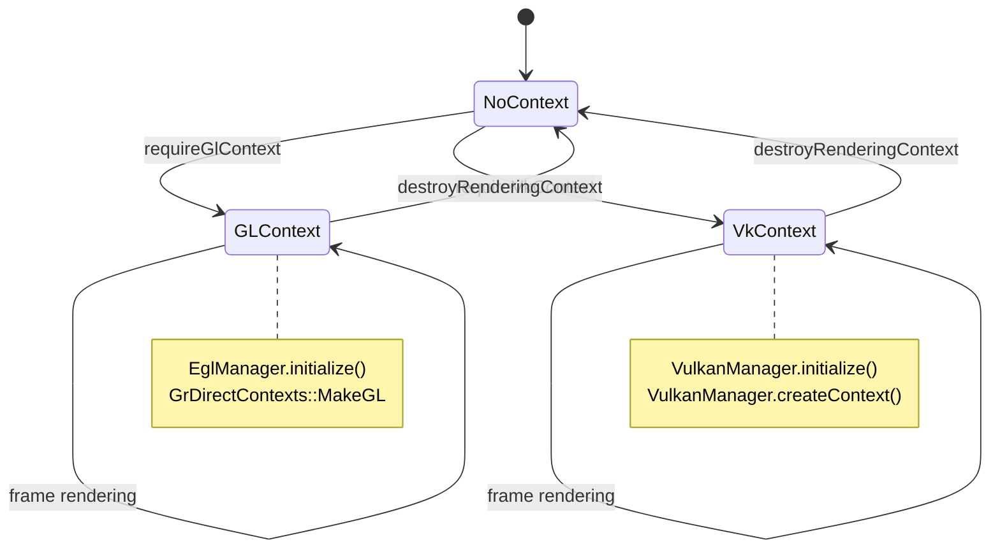

RenderThread 在首次使用时惰性创建 GPU 上下文：

```cpp
// frameworks/base/libs/hwui/renderthread/RenderThread.cpp, line 235
void RenderThread::requireGlContext() {
    if (mEglManager->hasEglContext()) return;
    mEglManager->initialize();
    sk_sp<const GrGLInterface> glInterface = GrGLMakeNativeInterface();
    GrContextOptions options;
    initGrContextOptions(options);
    cacheManager().configureContext(&options, glesVersion, size);
    sk_sp<GrDirectContext> grContext(
        GrDirectContexts::MakeGL(std::move(glInterface), options));
    setGrContext(grContext);
}

void RenderThread::requireVkContext() {
    if (vulkanManager().hasVkContext() && mGrContext) return;
    mVkManager->initialize();
    GrContextOptions options;
    initGrContextOptions(options);
    cacheManager().configureContext(&options, &vkDriverVersion,
                                   sizeof(vkDriverVersion));
    sk_sp<GrDirectContext> grContext =
        mVkManager->createContext(options);
    setGrContext(grContext);
}
```

---

## 13.8 端到端帧管线

### 13.8.1 完整帧旅程

本节追踪一帧从 `View.invalidate()` 到光子离开显示屏的完整过程，引用精确的源
文件和行号。

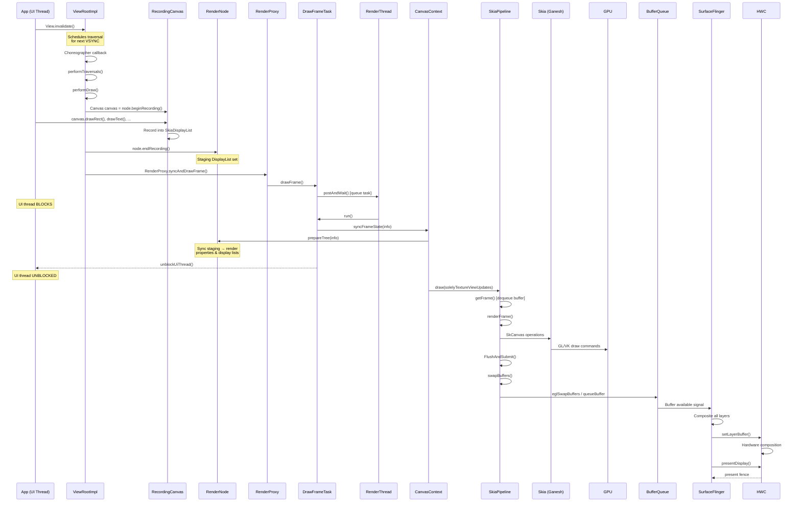

### 13.8.2 阶段一：录制（UI 线程）

**步骤 1：失效。** 当调用 `View.invalidate()` 时，框架将该 View 及其祖先标
记为脏。`ViewRootImpl` 用 `Choreographer` 安排一次遍历回调。

**步骤 2：遍历。** 在下一个 VSYNC，调用 `ViewRootImpl.performTraversals()`。
这触发 measure、layout 和 draw 三个阶段。

**步骤 3：录制。** 在 draw 阶段期间：

```java
// View.java (simplified)
void updateDisplayListIfDirty() {
    RecordingCanvas canvas = renderNode.beginRecording(width, height);
    try {
        draw(canvas);  // View.draw(Canvas) - app code runs here
    } finally {
        renderNode.endRecording();
    }
}
```

`Canvas::create_recording_canvas()` 工厂函数（位于 `Canvas.h` 第 94 行）创建一
个 `SkiaRecordingCanvas`，它将命令录制到 HWUI 自己的 `RecordingCanvas`（一个
`SkNoDrawCanvas` 子类）中，后者由 `SkiaDisplayList` 支撑。每个
`canvas.drawRect()`、`canvas.drawText()` 等调用都被追加到该 display list，
而不是立即执行。

### 13.8.3 阶段二：同步（RenderThread）

**步骤 4：提交并等待。** `RenderProxy` 向 RenderThread 提交一个 `DrawFrameTask`
并阻塞：

```cpp
// frameworks/base/libs/hwui/renderthread/DrawFrameTask.cpp, line 82
void DrawFrameTask::postAndWait() {
    ATRACE_CALL();
    AutoMutex _lock(mLock);
    mRenderThread->queue().post([this]() { run(); });
    mSignal.wait(mLock);
}
```

**步骤 5：帧状态同步。** RenderThread 调用 `syncFrameState()`（第 169 行）：

```cpp
// frameworks/base/libs/hwui/renderthread/DrawFrameTask.cpp, line 169
bool DrawFrameTask::syncFrameState(TreeInfo& info) {
    int64_t vsync = mFrameInfo[static_cast<int>(
        FrameInfoIndex::Vsync)];
    mRenderThread->timeLord().vsyncReceived(vsync, ...);
    bool canDraw = mContext->makeCurrent();
    mContext->unpinImages();

    // Apply deferred layer updates (TextureView, etc.)
    for (size_t i = 0; i < mLayers.size(); i++) {
        if (mLayers[i]) mLayers[i]->apply();
    }
    mLayers.clear();

    mContext->setContentDrawBounds(mContentDrawBounds);
    mContext->prepareTree(info, mFrameInfo, mSyncQueued, mTargetNode);
    // ...
}
```

`prepareTree()` 遍历整棵 RenderNode 树，将暂存属性和 display list 同步到
对应的渲染副本。同步完成后，UI 线程被解除阻塞：

```cpp
// DrawFrameTask.cpp, line 125
if (canUnblockUiThread) {
    unblockUiThread();
}
```

### 13.8.4 阶段三：渲染（RenderThread）

**步骤 6：绘制。** `CanvasContext::draw()` 编排实际的渲染：

```cpp
// CanvasContext.cpp (simplified)
void CanvasContext::draw(bool solelyTextureViewUpdates) {
    // `dirty` comes from mDamageAccumulator.finish(&dirty)
    Frame frame = getFrame();
    SkRect windowDirty = computeDirtyRect(frame, &dirty);
    auto drawResult = mRenderPipeline->draw(
        frame, windowDirty, dirty, mLightGeometry,
        &mLayerUpdateQueue, mContentDrawBounds,
        mOpaque, mLightInfo, mRenderNodes, ...);
    bool requireSwap = false;
    mRenderPipeline->swapBuffers(frame, drawResult,
        windowDirty, mCurrentFrameInfo, &requireSwap);
}
```

**对于 SkiaGL 管线**（`SkiaOpenGLPipeline.cpp`，第 116 行）：

```cpp
// frameworks/base/libs/hwui/pipeline/skia/SkiaOpenGLPipeline.cpp, line 116
IRenderPipeline::DrawResult SkiaOpenGLPipeline::draw(...) {
    mEglManager.damageFrame(frame, dirty);

    // Create an SkSurface wrapping the EGL default framebuffer
    GrGLFramebufferInfo fboInfo;
    fboInfo.fFBOID = 0;
    fboInfo.fFormat = GL_RGBA8;  // or GL_RGBA16F for HDR

    auto backendRT = GrBackendRenderTargets::MakeGL(
        frame.width(), frame.height(), 0, STENCIL_BUFFER_SIZE, fboInfo);
    sk_sp<SkSurface> surface = SkSurfaces::WrapBackendRenderTarget(
        mRenderThread.getGrContext(), backendRT,
        getSurfaceOrigin(), colorType, mSurfaceColorSpace, &props);

    LightingInfo::updateLighting(localGeometry, lightInfo);
    renderFrame(*layerUpdateQueue, dirty, renderNodes,
        opaque, contentDrawBounds, surface, preTransform);

    skgpu::ganesh::FlushAndSubmit(surface);
    return {true, ...};
}
```

**对于 SkiaVulkan 管线**（`SkiaVulkanPipeline.cpp`，第 74 行）：

```cpp
// frameworks/base/libs/hwui/pipeline/skia/SkiaVulkanPipeline.cpp, line 74
IRenderPipeline::DrawResult SkiaVulkanPipeline::draw(...) {
    sk_sp<SkSurface> backBuffer =
        mVkSurface->getCurrentSkSurface();
    SkMatrix preTransform =
        mVkSurface->getCurrentPreTransform();

    renderFrame(*layerUpdateQueue, dirty, renderNodes,
        opaque, contentDrawBounds, backBuffer, preTransform);

    auto drawResult = vulkanManager().finishFrame(
        backBuffer.get());
    return {true, drawResult.submissionTime,
            std::move(drawResult.presentFence)};
}
```

### 13.8.5 阶段四：呈现

**步骤 7：交换缓冲。** 完成的帧被提交到 BufferQueue：

对于 GL：
```cpp
// EglManager.cpp, line 621
bool EglManager::swapBuffers(const Frame& frame,
                              const SkRect& screenDirty) {
    EGLint rects[4];
    frame.map(screenDirty, rects);
    eglSwapBuffersWithDamageKHR(mEglDisplay, frame.mSurface,
        rects, screenDirty.isEmpty() ? 0 : 1);
    // ...
}
```

对于 Vulkan：
```cpp
// SkiaVulkanPipeline.cpp, line 130
bool SkiaVulkanPipeline::swapBuffers(...) {
    currentFrameInfo->markSwapBuffers();
    if (*requireSwap) {
        vulkanManager().swapBuffers(mVkSurface, screenDirty,
            std::move(drawResult.presentFence));
    }
    return *requireSwap;
}
```

**步骤 8：SurfaceFlinger 合成。** SurfaceFlinger 从 BufferQueue 获取缓冲。它
合成所有可见层——GPU 合成用 RenderEngine，硬件叠加合成用 HWC。然后将结果呈
现到显示屏。

---

## 13.9 SurfaceFlinger RenderEngine

### 13.9.1 RenderEngine 的作用

SurfaceFlinger 的 RenderEngine 在硬件合成器（HWC）无法通过硬件叠加处理所有
层时，执行基于 GPU 的层合成。常见场景：

- 具有复杂混合模式的层
- 需要色彩空间转换的层
- 层数量超过 HWC 叠加平面支持的上限
- 圆角或其他视觉效果

### 13.9.2 基于 Skia 的 RenderEngine

现代 AOSP 使用基于 Skia 的 RenderEngine，取代了旧的基于 OpenGL 的实现。它位
于 `frameworks/native/libs/renderengine/skia/`。在 Android 17 中，该引擎横跨
两个轴：*图形 API*（GL 或 Vulkan）与 *Skia 后端*（Ganesh 或 Graphite）。这两
者由 `frameworks/native/libs/renderengine/include/renderengine/RenderEngine.h`
中的两个枚举（第 152 和 159 行）表示：

```cpp
// frameworks/native/libs/renderengine/include/renderengine/RenderEngine.h, line 152
enum class GraphicsApi { GL, Vk, ftl_last = Vk };
enum class SkiaBackend { Ganesh, Graphite, ftl_last = Graphite };
```

`RenderEngine.cpp` 中的 `RenderEngine::create()`（第 36 行）将这些映射到具体
实现：后端为 Graphite 时使用 `GraphiteVkRenderEngine`，否则使用
`GaneshVkRenderEngine`（Vulkan）或 `SkiaGLRenderEngine`（GL）。Graphite 路径
（`frameworks/native/libs/renderengine/skia/GraphiteVkRenderEngine.cpp`）是
Android 17 新增的，仅支持 Vulkan。13.43 节详细介绍了它的推出过程。

```mermaid
graph TD
    A["SurfaceFlinger"] --> B["RenderEngine::create()"]
    B --> RT["RenderEngineThreaded<br/>(always, in A17)"]
    RT --> C["SkiaRenderEngine"]
    C --> D{"Skia backend"}
    D -->|Ganesh GL| F["SkiaGLRenderEngine"]
    D -->|Ganesh Vk| G["GaneshVkRenderEngine"]
    D -->|Graphite Vk| GR["GraphiteVkRenderEngine<br/>(A17)"]
    F --> H["GPU"]
    G --> H
    GR --> H

    style B fill:#9C27B0,color:#fff
    style C fill:#FF9800,color:#fff
    style GR fill:#4CAF50,color:#fff
```

### 13.9.3 RenderEngine 操作

RenderEngine 处理：

- **层合成**：将每一层的缓冲绘制到输出缓冲上
- **色彩管理**：在不同层的彩色空间之间转换
- **HDR 色调映射**：为 SDR 显示屏映射 HDR 内容
- **阴影渲染**：绘制高程（elevation）下方的窗口阴影
- **模糊效果**：通知栏、对话框的背景模糊
- **变暗层**：系统级变暗叠加层
- **截图捕获**：合成可见层以进行截图

### 13.9.4 合成流程

```mermaid
sequenceDiagram
    participant SF as SurfaceFlinger
    participant HWC as HWC HAL
    participant RE as RenderEngine

    SF->>HWC: validate(layers)
    HWC-->>SF: composition types<br/>(DEVICE, CLIENT, CURSOR)
    Note over SF: Some layers marked CLIENT

    SF->>RE: drawLayers(clientLayers)
    RE->>RE: For each CLIENT layer:
    RE->>RE: 1. Bind layer buffer as texture
    RE->>RE: 2. Apply color transform
    RE->>RE: 3. Draw to output buffer
    RE-->>SF: Composited output buffer

    SF->>HWC: setClientTarget(outputBuffer)
    SF->>HWC: presentDisplay()
```

### 13.9.5 HWC 层合成类型

硬件合成器将每一层归类为一种合成类型：

```mermaid
graph TD
    A["All Visible Layers"] --> B["HWC validate()"]
    B --> C{"HWC Decision"}
    C -->|DEVICE| D["Hardware Overlay<br/>(Direct scanout)"]
    C -->|CLIENT| E["GPU Composition<br/>(RenderEngine)"]
    C -->|CURSOR| F["Hardware Cursor<br/>(Dedicated plane)"]
    C -->|SIDEBAND| G["Sideband Stream<br/>(Video tunnel)"]

    D --> H["Display Controller"]
    E --> I["Client Target Buffer"]
    I --> H
    F --> H
    G --> H

    style D fill:#4CAF50,color:#fff
    style E fill:#FF9800,color:#fff
    style F fill:#2196F3,color:#fff
```

**DEVICE 合成**是首选方式，因为它完全避免了 GPU 工作。显示控制器直接读取
该层的缓冲。它用于：

- 没有复杂混合模式的简单矩形层
- 视频播放 surface
- 状态栏与导航栏

**CLIENT 合成**在超出硬件能力时回退到 GPU 渲染。常见触发因素：

- 层数量超过可用的硬件平面数
- 复杂混合模式或颜色变换
- 非矩形裁剪区域
- 需要硬件无法处理的旋转的层

### 13.9.6 RenderEngine 着色器管线

基于 Skia 的 RenderEngine 使用自定义着色器管线进行合成：

```mermaid
graph LR
    A["Layer Buffer<br/>(Texture)"] --> B["Vertex Shader<br/>(Position + UV)"]
    B --> C["Fragment Shader"]
    C --> D["Color Space<br/>Conversion"]
    D --> E["Tone Mapping<br/>(HDR→SDR)"]
    E --> F["Alpha Blend"]
    F --> G["Output Buffer"]

    style C fill:#FF9800,color:#fff
    style D fill:#2196F3,color:#fff
```

### 13.9.7 三重缓冲与缓冲管理

应用程序与 SurfaceFlinger 之间的 BufferQueue 通常维护三个缓冲：

```mermaid
graph TD
    subgraph "Buffer States"
        A["Buffer A<br/>Being Displayed"]
        B["Buffer B<br/>Queued for Display"]
        C["Buffer C<br/>App Rendering"]
    end

    subgraph "Flow"
        D["App dequeues C"] --> E["App renders into C"]
        E --> F["App queues C"]
        F --> G["SF acquires B"]
        G --> H["SF displays B"]
        H --> I["SF releases A"]
        I --> D
    end

    style A fill:#4CAF50,color:#fff
    style B fill:#FF9800,color:#fff
    style C fill:#2196F3,color:#fff
```

这一三重缓冲方案确保：

- 应用始终有缓冲可以渲染（不会停滞）
- SurfaceFlinger 始终有准备好的缓冲用于显示
- 帧可以被丢弃而不产生可见的卡顿

### 13.9.8 CompositionEngine：规划器与扁平化器（层缓存）

决定对每一层*是否*使用 HWC 或 GPU（13.9.5）只是故事的一半。代价更高的问题
是：如何避免对一组多帧未发生变化的层重复合成。这正是
**CompositionEngine 规划器（Planner）**及其**扁平化器（Flattener）**的工作，
位于
`frameworks/native/services/surfaceflinger/CompositionEngine/include/compositionengine/impl/planner/`。
整个特性称为“层缓存（layer caching）”，在运行时通过
`debug.sf.enable_layer_caching 1`（或 `adb shell service call SurfaceFlinger
1040 i32 1`）开启。

**规划器。** `Planner`（`Planner.h`）是顶层编排器。每一帧它都会被交给当前
的层栈。用它自己的话来说，它做的工作是：“启发式地确定当前层栈的合成策略，
并将不活动的层扁平化进一个覆盖缓冲（override buffer），以便用它作为层栈
一部分的更高效表示。”

它在选择合成策略之前调用 `plan()`。该调用要求扁平化器要么用一个新的可用的
扁平化结果替换缓存集合，要么创建一个新的缓存集合。规划器随后再次更新。

规划器拥有两个协作者。第一个是 `Predictor`。它以层栈哈希为键记录观察到的
合成结果，并根据历史预测 DEVICE/CLIENT 规划。默认情况下它由
`debug.sf.enable_planner_prediction` 关闭，因此在常规构建中只有扁平化器运行。
第二个协作者是 `Flattener`。

**扁平化器与缓存集合。** `CachedSet`（`CachedSet.h`）是合成在一起成为一个
缓冲的一组层。单层是大小为一的 `CachedSet`，真正有趣的情形是多层集合。
`Flattener`（`Flattener.h`）监视那些已经*安静下来*的层，并将它们折叠在一起：

- 属性和缓冲至少 `mActiveLayerTimeout`（默认 **150 毫秒**）未发生变化的层是
  “非活动”的，因此是扁平化的候选。
- 扁平化器将稳定的缓存集合**运行段（Run）**分组。一个运行段“必须包含多于
  1 个 CachedSet，或者被用于打孔（hole punch）”，因为扁平化单个集合毫无
  收益。
- `flattenLayers()` 对层栈做哈希，并调用 `mergeWithCachedSets()` 以协调传入
  的层与现有的缓存集合。然后 `buildCachedSets()` 找到候选运行段
  （`findCandidateRuns()` / `findBestRun()`），将最佳稳定运行段折叠为一个
  `CachedSet`。接着 `renderCachedSets()` 将该组以 GPU 合成为单个缓冲，该缓冲
  从复用的 `TexturePool` 中取出。从下一帧起，整个组就是一个缓冲。硬件合成器
  可以将该缓冲作为单个 **DEVICE** 层扫描输出。因此，该区域每帧的合成代价从
  许多层坍缩为一层。

**在不偷占帧时间的情况下渲染缓存集合。** 合成缓存集合本身就要消耗 GPU 时
间，因此扁平化器会精心调度它。其 `RenderScheduling` 可调参数给出一个
`cachedSetRenderDuration` 预算（默认约 1.5 毫秒）。如果一帧的余量太少，缓
存集合的渲染就会被*推迟*到后面的帧，最多推迟 `maxDeferRenderAttempts`（默
认 **240**）次。超过之后，无论如何都会渲染，以便后续帧能够受益。这使得一次性
扁平化的代价不会造成它本要防止的卡顿。

**打孔。** 扁平化一个区域通常会吞掉位于其中的视频或 `SurfaceView` 层。在
`mEnableHolePunch`（默认开启）的情况下，扁平化器改为在该层所在位置于扁平化
缓冲上打一个透明孔。其下方由缓冲支撑的层随后仍然可以由 HWC（DEVICE）直接
扫描输出。周围的一切都由这一个缓存缓冲来提供。

```mermaid
graph TD
    LS["Layer stack (per frame)"] --> PL["Planner.plan()"]
    PL --> PRED["Predictor: predict DEVICE/CLIENT<br/>plan from history"]
    PL --> FL["Flattener.flattenLayers()"]
    FL --> ACT{"Layer unchanged ><br/>mActiveLayerTimeout (150 ms)?"}
    ACT -->|"no (active)"| KEEP["Composite normally each frame"]
    ACT -->|"yes (inactive)"| RUN["Group a stable Run<br/>(more than 1 CachedSet)"]
    RUN --> REN["renderCachedSets(): GPU-composite the<br/>group into one pooled buffer<br/>(deferred if over the time budget)"]
    REN --> CS["CachedSet: one buffer for the group"]
    CS --> HWC["HWC scans out one DEVICE layer;<br/>hole-punch keeps video/SurfaceView underneath"]
    style CS fill:#9C27B0,color:#fff
    style HWC fill:#4CAF50,color:#fff
```

这是 SurfaceFlinger 一侧对“渲染的合并与缩减由谁完成”这一问题的回答。规划器/
扁平化器将安静的层*合并*进一个缓存缓冲，并将每帧的合成*缩减*为更少（通常
仅 HWC）的层。

OOPR 层（13.41.11）回放完毕后也会落入此处。静态的 OOPR 层只是扁平化器可以
折叠进 CachedSet 的另一个候选。这是在 13.9.5 的遮挡与 HWC 卸载缩减之上的又
一层优化。

---

## 13.10 GPU 驱动接口

### 13.10.1 HAL 接口

GPU 驱动接口定义于 `hardware/interfaces/graphics/`。关键 HAL 模块有：

```mermaid
graph TD
    subgraph "Graphics HAL Stack"
        A["IComposer<br/>(HWC HAL)"]
        B["IAllocator<br/>(Gralloc HAL)"]
        C["IMapper<br/>(Buffer Mapping)"]
        D["Vulkan HAL<br/>(hwvulkan)"]
        E["EGL/GLES<br/>(Vendor Driver)"]
    end

    F["SurfaceFlinger"] --> A
    F --> B
    F --> C

    G["HWUI / Apps"] --> D
    G --> E

    A --> H["Display Hardware"]
    B --> I["Memory Allocator"]
    D --> J["GPU Hardware"]
    E --> J

    style A fill:#F44336,color:#fff
    style B fill:#FF9800,color:#fff
    style D fill:#2196F3,color:#fff
```

### 13.10.2 Gralloc 分配器

缓冲分配由 Gralloc HAL 处理，通过 AIDL 定义于
`hardware/interfaces/graphics/allocator/aidl/`：

```
// hardware/interfaces/graphics/allocator/aidl/android/hardware/graphics/allocator/IAllocator.aidl
interface IAllocator {
    // Deprecated since IMapper 5.0; descriptor is an opaque byte[] built by
    // the client from a BufferDescriptorInfo.
    AllocationResult allocate(in byte[] descriptor, in int count);
    // The current entry point: takes a structured BufferDescriptorInfo.
    AllocationResult allocate2(in BufferDescriptorInfo descriptor, in int count);
    boolean isSupported(in BufferDescriptorInfo descriptor);
    String getIMapperLibrarySuffix();
    // ... (plus isMultiViewSupported / allocateMultiView)
}
```

Android 17 使用 `allocate2()` 作为现行的分配入口。最初的 `allocate()` 接收
一个不透明的 `byte[]` 描述符。它仅保留用于与 IMapper 5.0 之前的客户端向后
兼容。

### 13.10.3 EGL 驱动加载

EGL 驱动由 `frameworks/native/opengl/libs/EGL/Loader.cpp` 中的
`Loader::open()` 加载。加载器搜索：

1. `libEGL_<name>.so`——EGL 实现
2. `libGLESv1_CM_<name>.so`——OpenGL ES 1.x 实现
3. `libGLESv2_<name>.so`——OpenGL ES 2.0+ 实现

其中 `<name>` 来自 `ro.hardware.egl` 等属性或系统板级平台名称。

### 13.10.4 Vulkan 驱动加载

如 13.3.2 节所述，Vulkan 驱动通过 `hwvulkan` HAL 模块加载。驱动库名为
`vulkan.<name>.so`，其中 `<name>` 来自：

```cpp
// frameworks/native/vulkan/libvulkan/driver.cpp, line 141
const std::array<const char*, 2> HAL_SUBNAME_KEY_PROPERTIES = {{
    "ro.hardware.vulkan",
    "ro.board.platform",
}};
```

### 13.10.5 更新/游戏驱动机制

Android 通过 `GraphicsEnv` 系统支持可更新的 GPU 驱动：

```mermaid
graph TD
    A["App Launch"] --> B["GraphicsEnv"]
    B --> C{"Updated Driver<br/>Available?"}
    C -->|Yes| D["Load from<br/>updatable namespace"]
    C -->|No| E{"APEX Driver?"}
    E -->|Yes| F["Load from<br/>APEX namespace"]
    E -->|No| G["Load built-in<br/>vendor driver"]

    style D fill:#4CAF50,color:#fff
    style F fill:#FF9800,color:#fff
    style G fill:#2196F3,color:#fff
```

对于 Vulkan（`driver.cpp`，第 224 行）：
```cpp
int LoadUpdatedDriver(const hwvulkan_module_t** module) {
    auto ns = android::GraphicsEnv::getInstance().getDriverNamespace();
    if (!ns) return -ENOENT;
    android::GraphicsEnv::getInstance().setDriverToLoad(
        android::GpuStatsInfo::Driver::VULKAN_UPDATED);
    int result = LoadDriver(ns, "updatable gfx driver", module);
    if (result != 0) {
        LOG_ALWAYS_FATAL("couldn't find an updated Vulkan implementation");
    }
    return result;
}
```

### 13.10.6 硬件合成器 HAL

HWC HAL 是 SurfaceFlinger 与显示硬件之间的接口。它经历了多个版本的演进：

```mermaid
graph TD
    A["HWC 1.x<br/>(Legacy C API)"] --> B["HWC 2.x<br/>(HIDL)"]
    B --> C["HWC 3.x<br/>(AIDL)"]

    style A fill:#F44336,color:#fff
    style B fill:#FF9800,color:#fff
    style C fill:#4CAF50,color:#fff
```

当前基于 AIDL 的 HWC 3 接口定义于
`hardware/interfaces/graphics/composer/aidl/`。与 HWC 2 的按操作调用不同，
HWC 3 将按显示和按层的状态批量打包为命令流，通过
`IComposerClient.executeCommands(DisplayCommand[])` 执行。关键的命令流操作：

| 操作 | 描述 |
|-----------|-------------|
| `createLayer` / `createVirtualDisplay` | 创建层/虚拟显示的接口方法（物理显示器经由 `IComposerCallback.onHotplug` 到达） |
| `LayerCommand.buffer` | 为层分配一个缓冲 |
| `LayerCommand.blendMode` | 设置 alpha 混合模式 |
| `LayerCommand.dataspace` | 设置层色彩空间 |
| `LayerCommand.transform` | 设置旋转/翻转变换 |
| `DisplayCommand.validateDisplay` | 为合成对层进行分类 |
| `DisplayCommand.presentDisplay` | 将最终帧提交给显示屏 |
| `ReleaseFences`（在 `CommandResultPayload` 中） | 已释放缓冲的栅栏，由 `executeCommands()` 返回 |

### 13.10.7 Gralloc 缓冲分配

Android 中的所有图形缓冲都通过 Gralloc HAL 分配。分配流程：

```mermaid
sequenceDiagram
    participant App as Application
    participant BQ as BufferQueue
    participant GA as GraphicBufferAllocator
    participant HAL as Gralloc HAL
    participant DMA as DMA-BUF / ION

    App->>BQ: dequeueBuffer()
    Note over BQ: No free buffers
    BQ->>GA: allocate(w, h, format, usage)
    GA->>HAL: IAllocator.allocate()
    HAL->>DMA: Allocate DMA buffer
    DMA-->>HAL: Buffer handle + fd
    HAL-->>GA: AllocationResult
    GA-->>BQ: GraphicBuffer
    BQ-->>App: Buffer ready
```

`BufferUsage` 标志决定了缓冲可以用于何处：

| 标志 | 含义 |
|------|---------|
| `GPU_TEXTURE` | 可以作为纹理采样 |
| `GPU_RENDER_TARGET` | 可以作为渲染目标 |
| `COMPOSER_OVERLAY` | 可以用作 HWC 叠加层 |
| `CPU_READ_OFTEN` | 高效的 CPU 读取访问 |
| `VIDEO_ENCODER` | 可以被视频编码器消费 |
| `CAMERA_OUTPUT` / `CAMERA_INPUT` | 可以由相机 HAL 写入（或读入） |

### 13.10.8 常见 AIDL 类型

常见图形类型定义于 `hardware/interfaces/graphics/common/aidl/`。关键类型包括：

| 类型 | 用途 |
|------|---------|
| `PixelFormat` | 缓冲像素格式（RGBA8888、RGBA_FP16 等） |
| `Dataspace` | 色彩空间 + 传递函数 + 范围 |
| `BufferUsage` | 用途标志（GPU_TEXTURE、GPU_RENDER_TARGET 等） |
| `BlendMode` | 硬件合成混合模式 |
| `Transform` | 显示变换（旋转、翻转） |
| `Hdr` | HDR 能力类型（HLG、HDR10、Dolby Vision） |
| `ColorTransform` | 颜色校正矩阵类型 |

---

## 13.11 深入剖析：层渲染

### 13.11.1 离屏层架构

HWUI 对需要单独合成的 View 使用离屏渲染层。这包括具有非 1.0 alpha、图像滤镜
（模糊、颜色矩阵）或拉伸效果的 View。`SkiaGpuPipeline` 在
`SkiaGpuPipeline.cpp` 中管理这些层。

```mermaid
graph TD
    A["RenderNode<br/>(LayerType::RenderLayer)"] --> B["SkSurface<br/>(GPU texture)"]
    B --> C["Render layer content<br/>into offscreen texture"]
    C --> D["Composite into parent<br/>with alpha/blend/filter"]

    E["RenderNode<br/>(promotedToLayer)"] --> F["Automatic Layer<br/>Promotion"]
    F --> B

    style A fill:#FF9800,color:#fff
    style E fill:#2196F3,color:#fff
```

### 13.11.2 层的创建与尺寸

层的创建尺寸向上取整到最近的 `LAYER_SIZE` 边界：

```cpp
// frameworks/base/libs/hwui/pipeline/skia/SkiaGpuPipeline.cpp, line 72
bool SkiaGpuPipeline::createOrUpdateLayer(RenderNode* node,
        const DamageAccumulator& damageAccumulator,
        ErrorHandler* errorHandler) {
    const int surfaceWidth =
        ceilf(node->getWidth() / float(LAYER_SIZE)) * LAYER_SIZE;
    const int surfaceHeight =
        ceilf(node->getHeight() / float(LAYER_SIZE)) * LAYER_SIZE;

    SkSurface* layer = node->getLayerSurface();
    if (!layer || layer->width() != surfaceWidth ||
        layer->height() != surfaceHeight) {
        SkImageInfo info = SkImageInfo::Make(
            surfaceWidth, surfaceHeight,
            getSurfaceColorType(), kPremul_SkAlphaType,
            getSurfaceColorSpace());
        SkSurfaceProps props(0, kUnknown_SkPixelGeometry);
        node->setLayerSurface(SkSurfaces::RenderTarget(
            mRenderThread.getGrContext(),
            skgpu::Budgeted::kYes, info, 0,
            this->getSurfaceOrigin(), &props));
        // ...
    }
}
```

### 13.11.3 层渲染序列

层渲染管线在绘制主帧之前处理所有脏层：

```cpp
// frameworks/base/libs/hwui/pipeline/skia/SkiaGpuPipeline.cpp, line 36
void SkiaGpuPipeline::renderLayersImpl(
        const LayerUpdateQueue& layers, bool opaque) {
    sk_sp<GrDirectContext> cachedContext;
    for (size_t i = 0; i < layers.entries().size(); i++) {
        RenderNode* layerNode = layers.entries()[i].renderNode.get();
        if (CC_UNLIKELY(layerNode->getLayerSurface() == nullptr)) {
            continue;
        }
        bool rendered = renderLayerImpl(
            layerNode, layers.entries()[i].damage);
        if (!rendered) {
            return;
        }
        // Batch GPU context flushes
        GrDirectContext* currentContext = GrAsDirectContext(
            layerNode->getLayerSurface()
                ->getCanvas()->recordingContext());
        if (cachedContext.get() != currentContext) {
            if (cachedContext.get()) {
                ATRACE_NAME("flush layers (context changed)");
                cachedContext->flushAndSubmit();
            }
            cachedContext.reset(SkSafeRef(currentContext));
        }
    }
    if (cachedContext.get()) {
        ATRACE_NAME("flush layers");
        cachedContext->flushAndSubmit();
    }
}
```

### 13.11.4 图像固定（Image Pinning）

对于**可变**位图，`SkiaGpuPipeline` 在同步阶段将像素快照固定为 GPU 纹理。
因此，之后 UI 线程对位图的修改无法改变本帧绘制的内容。硬件位图本身已由
GPU 支撑，不经过此路径。`unpinImages()` 在下*一帧*的 `syncFrameState()` 开
始时运行，因此固定住的图像在整个帧期间保持驻留。

```cpp
// frameworks/base/libs/hwui/pipeline/skia/SkiaGpuPipeline.cpp, line 115
bool SkiaGpuPipeline::pinImages(
        std::vector<SkImage*>& mutableImages) {
    for (SkImage* image : mutableImages) {
        if (skgpu::ganesh::PinAsTexture(
                mRenderThread.getGrContext(), image)) {
            mPinnedImages.emplace_back(sk_ref_sp(image));
        } else {
            return false;
        }
    }
    return true;
}
```

### 13.11.5 硬件缓冲渲染

两个管线都支持渲染到 `AHardwareBuffer` 作为离屏渲染目标——这是公共 API
`android.graphics.HardwareBufferRenderer` 背后的路径，通常与
`ImageReader` 分配的缓冲配合使用：

```cpp
// frameworks/base/libs/hwui/pipeline/skia/SkiaGpuPipeline.cpp, line 153
sk_sp<SkSurface> SkiaGpuPipeline::getBufferSkSurface(
        const HardwareBufferRenderParams& bufferParams) {
    auto bufferColorSpace = bufferParams.getColorSpace();
    if (mBufferSurface == nullptr || mBufferColorSpace == nullptr ||
        !SkColorSpace::Equals(mBufferColorSpace.get(),
                              bufferColorSpace.get())) {
        mBufferSurface = SkSurfaces::WrapAndroidHardwareBuffer(
            mRenderThread.getGrContext(), mHardwareBuffer,
            kTopLeft_GrSurfaceOrigin, bufferColorSpace,
            nullptr, true);
        mBufferColorSpace = bufferColorSpace;
    }
    return mBufferSurface;
}
```

---

## 13.12 深入剖析：RenderNode 绘制

### 13.12.1 RenderNodeDrawable

`RenderNodeDrawable` 类（`pipeline/skia/RenderNodeDrawable.cpp`）是 display
list 树与 Skia 绘制系统之间的桥梁。它实现了 `SkDrawable` 并处理：

- 用于高程（elevation）与阴影的 Z 序重排
- 将子节点投影到祖先 surface 上
- 轮廓裁剪（用于圆角）
- 带混合模式与滤镜的层合成

```cpp
// frameworks/base/libs/hwui/pipeline/skia/RenderNodeDrawable.cpp, line 41
RenderNodeDrawable::RenderNodeDrawable(
        RenderNode* node, SkCanvas* canvas,
        bool composeLayer, bool inReorderingSection)
    : mRenderNode(node)
    , mRecordedTransform(canvas->getTotalMatrix())
    , mComposeLayer(composeLayer)
    , mInReorderingSection(inReorderingSection) {}
```

### 13.12.2 向后投影

Android 的 View 系统支持“投影”——子 View 可以将其渲染投射到祖先的 surface
上。这用于超出 View 边界扩展的涟漪效果：

```cpp
// RenderNodeDrawable.cpp, line 54
void RenderNodeDrawable::drawBackwardsProjectedNodes(
        SkCanvas* canvas, const SkiaDisplayList& displayList,
        int nestLevel) const {
    for (auto& child : displayList.mChildNodes) {
        if (!child.getRenderNode()->isRenderable()) continue;
        const RenderProperties& childProperties =
            child.getNodeProperties();
        if (childProperties.getProjectBackwards() &&
            nestLevel > 0) {
            SkAutoCanvasRestore acr2(canvas, true);
            canvas->concat(child.getRecordedMatrix());
            child.drawContent(canvas);
        }
        // Recurse into sub-nodes...
    }
}
```

### 13.12.3 轮廓裁剪

RenderNode 的轮廓裁剪支持矩形、圆角矩形和任意路径：

```cpp
// RenderNodeDrawable.cpp, line 89
static void clipOutline(const Outline& outline,
        SkCanvas* canvas, const SkRect* pendingClip) {
    Rect possibleRect;
    float radius;
    if (!outline.getAsRoundRect(&possibleRect, &radius)) {
        if (pendingClip) canvas->clipRect(*pendingClip);
        const SkPath* path = outline.getPath();
        if (path) {
            canvas->clipPath(*path, SkClipOp::kIntersect, true);
        }
        return;
    }
    SkRect rect = possibleRect.toSkRect();
    if (radius != 0.0f) {
        if (pendingClip && !pendingClip->contains(rect)) {
            canvas->clipRect(*pendingClip);
        }
        canvas->clipRRect(
            SkRRect::MakeRectXY(rect, radius, radius),
            SkClipOp::kIntersect, true);
    } else {
        if (pendingClip) (void)rect.intersect(*pendingClip);
        canvas->clipRect(rect);
    }
}
```

### 13.12.4 Z 序与重排

具有非零 Z 值（高程）的节点在一个特殊的重排区段（reordering section）中绘
制。`onDraw` 方法仅当节点位于重排区段之外时、或位于重排区段内但 Z 为零时在
原位绘制。位于重排区段内且 Z 非零的节点会在此被跳过。重排屏障稍后以不同于
录制顺序的方式绘制它：

```cpp
// RenderNodeDrawable.cpp, line 125
void RenderNodeDrawable::onDraw(SkCanvas* canvas) {
    if ((!mInReorderingSection) ||
        MathUtils::isZero(mRenderNode->properties().getZ())) {
        this->forceDraw(canvas);
    }
}
```

Z 为负的节点在重排区段内最先绘制，排在同辈零 Z 节点之前。Z 为正的节点随后
绘制，每个节点之前先画它的阴影。这构成了 Android 的 Material Design 高程系
统。

---

## 13.13 深入剖析：VulkanSurface

### 13.13.1 Surface 创建

`VulkanSurface.cpp` 管理 Vulkan 与 Android 原生窗口系统之间的集成。创建
surface 时，它会连接到原生窗口并配置缓冲管理：

```cpp
// frameworks/base/libs/hwui/renderthread/VulkanSurface.cpp, line 80
static bool ConnectAndSetWindowDefaults(ANativeWindow* window) {
    int err = native_window_api_connect(window,
        NATIVE_WINDOW_API_EGL);
    err = window->setSwapInterval(window, 1);
    err = native_window_set_shared_buffer_mode(window, false);
    err = native_window_set_auto_refresh(window, false);
    err = native_window_set_scaling_mode(window,
        NATIVE_WINDOW_SCALING_MODE_FREEZE);
    err = native_window_set_buffers_dimensions(window, 0, 0);
    // Enable auto prerotation for 90/270 degree rotation
    err = native_window_set_auto_prerotation(window, true);
    return true;
}
```

### 13.13.2 预变换处理

显示旋转在 Vulkan 中需要特殊处理。VulkanSurface 计算一个预变换矩阵，该矩阵
考虑了显示器的当前方向：

```cpp
// VulkanSurface.cpp, line 49
static SkMatrix GetPreTransformMatrix(
        SkISize windowSize, int transform) {
    const int width = windowSize.width();
    const int height = windowSize.height();
    switch (transform) {
        case 0:
            return SkMatrix::I();
        case ANATIVEWINDOW_TRANSFORM_ROTATE_90:
            return SkMatrix::MakeAll(
                0, -1, height, 1, 0, 0, 0, 0, 1);
        case ANATIVEWINDOW_TRANSFORM_ROTATE_180:
            return SkMatrix::MakeAll(
                -1, 0, width, 0, -1, height, 0, 0, 1);
        case ANATIVEWINDOW_TRANSFORM_ROTATE_270:
            return SkMatrix::MakeAll(
                0, 1, 0, -1, 0, width, 0, 0, 1);
    }
}
```

### 13.13.3 像素对齐矩阵

VulkanSurface 还包含一个“像素对齐（pixel snap）”矩阵，它加上一个微小的偏
移，以防止与像素对齐的几何图形落在亚像素边界上：

```cpp
// VulkanSurface.cpp, line 68
SkM44 VulkanSurface::GetPixelSnapMatrix(
        SkISize windowSize, int transform) {
    static const SkScalar kOffset = 0.063f;  // ~1/16th pixel
    SkMatrix preRotation =
        GetPreTransformMatrix(windowSize, transform);
    SkMatrix invert;
    preRotation.invert(&invert);
    return SkM44::Translate(kOffset, kOffset)
        .postConcat(SkM44(preRotation))
        .preConcat(SkM44(invert));
}
```

这是一个微妙但重要的优化——没有像素对齐时，未抗锯齿的轴对齐矩形可能会由于
浮点精度问题产生发丝般的缝隙。

---

## 13.14 深入剖析：SkiaCanvas 实现

### 13.14.1 SkiaCanvas 类

`SkiaCanvas`（`SkiaCanvas.h`）是 `Canvas` 抽象类的具体实现。它包装一个
`SkCanvas`，并添加了 Android 特有的特性：

```cpp
// frameworks/base/libs/hwui/SkiaCanvas.h, line 41
class SkiaCanvas : public Canvas {
public:
    explicit SkiaCanvas(const SkBitmap& bitmap);
    explicit SkiaCanvas(SkCanvas* canvas);

    // State operations
    virtual int getSaveCount() const override;
    virtual int save(SaveFlags::Flags flags) override;
    virtual void restore() override;

    // Drawing operations
    virtual void drawRect(float left, float top, float right,
        float bottom, const Paint& paint) override;
    virtual void drawRenderNode(
        uirenderer::RenderNode* renderNode) override;
    // ... 40+ more draw methods
};
```

### 13.14.2 Paint 循环模式

SkiaCanvas 实现了应用阴影/模糊效果的“looper”模式：

```cpp
// SkiaCanvas.h, line 190
template <typename Proc>
void applyLooper(const Paint* paint, Proc proc,
                 void (*preFilter)(SkPaint&) = nullptr) {
    BlurDrawLooper* looper = paint ? paint->getLooper() : nullptr;
    Paint pnt = paint ? *paint : Paint();
    if (preFilter) preFilter(pnt);
    this->onFilterPaint(pnt);
    if (looper) {
        looper->apply(pnt,
            [&](SkPoint offset, const Paint& modifiedPaint) {
                mCanvas->save();
                mCanvas->translate(offset.fX, offset.fY);
                proc(modifiedPaint);
                mCanvas->restore();
            });
    } else {
        proc(pnt);
    }
}
```

这一模式先绘制阴影层（带偏移和模糊），再绘制前景层。它用于文本阴影和投影
效果。

### 13.14.3 保存栈管理

SkiaCanvas 维护一个保存栈，跟踪部分保存（仅保留矩阵或仅保留裁剪、而非两者
的保存）：

```cpp
// SkiaCanvas.h, line 210
struct SaveRec {
    int saveCount;
    SaveFlags::Flags saveFlags;
    size_t clipIndex;
};
std::unique_ptr<std::deque<SaveRec>> mSaveStack;
std::vector<Clip> mClipStack;
```

---

## 13.15 深入剖析：RenderProxy 与线程通信

### 13.15.1 RenderProxy 模式

`RenderProxy`（`renderthread/RenderProxy.cpp`）是 UI 线程对 RenderThread 的
句柄。它提供了一个类型安全的接口用于提交工作：

```cpp
// frameworks/base/libs/hwui/renderthread/RenderProxy.cpp, line 49
RenderProxy::RenderProxy(bool translucent,
        RenderNode* rootRenderNode,
        IContextFactory* contextFactory,
        bool useIpcCanvas)
    : mRenderThread(RenderThread::getInstance()),
      mContext(nullptr) {
    pid_t uiThreadId = pthread_gettid_np(pthread_self());
    pid_t renderThreadId = getRenderThreadTid();
    mContext = mRenderThread.queue().runSync(
        [=, this]() -> CanvasContext* {
            CanvasContext* context = CanvasContext::create(
                mRenderThread, translucent, rootRenderNode,
                contextFactory, uiThreadId, renderThreadId,
                useIpcCanvas);
            if (context != nullptr) {
                mRenderThread.queue().post(
                    [=] { context->startHintSession(); });
            }
            return context;
        });
    mDrawFrameTask.setContext(
        &mRenderThread, mContext, rootRenderNode);
}
```

### 13.15.2 同步与异步操作

RenderProxy 使用两种通信模式：

**同步**（`runSync`）：当 UI 线程需要结果时使用。
```cpp
bool RenderProxy::loadSystemProperties() {
    return mRenderThread.queue().runSync([this]() -> bool {
        bool needsRedraw = Properties::load();
        if (mContext->profiler().consumeProperties()) {
            needsRedraw = true;
        }
        return needsRedraw;
    });
}
```

**异步**（`post`）：用于即发即弃的操作。
```cpp
void RenderProxy::setSwapBehavior(SwapBehavior swapBehavior) {
    mRenderThread.queue().post(
        [this, swapBehavior]() {
            mContext->setSwapBehavior(swapBehavior);
        });
}
```

### 13.15.3 DrawFrameTask 的交接

最关键的通信是 `DrawFrameTask.drawFrame()`，它使用互斥锁加条件变量实现精确
的交接：

```mermaid
sequenceDiagram
    participant UI as UI Thread
    participant Q as RenderThread Queue
    participant RT as RenderThread

    UI->>UI: DrawFrameTask.drawFrame()
    UI->>UI: mSyncResult = OK
    UI->>UI: mSyncQueued = now()
    UI->>Q: post(run)
    UI->>UI: mSignal.wait(mLock) [BLOCKED]

    RT->>RT: DrawFrameTask.run()
    RT->>RT: syncFrameState(info)
    Note over RT: Copy staging → render

    alt canUnblockUiThread
        RT-->>UI: mSignal.signal() [UNBLOCK]
        Note over UI: UI thread resumes
    end

    RT->>RT: context->draw()
    RT->>RT: GPU commands
    RT->>RT: swapBuffers()

    alt !canUnblockUiThread
        RT-->>UI: mSignal.signal() [UNBLOCK]
    end
```

UI 线程通常在同步阶段完成后（GPU 工作开始之前）就被解除阻塞。下一帧的
measure/layout/record 因此可以与当前帧的 GPU 渲染重叠进行。

---

## 13.16 深入剖析：色彩管理

### 13.16.1 色彩管线

Android 的图形栈在整个管线中支持广色域和 HDR 渲染：

```mermaid
graph LR
    A["App Content<br/>(sRGB / P3 / BT2020)"] --> B["HWUI<br/>Color Mode"]
    B --> C["Skia<br/>SkColorSpace"]
    C --> D["EGL/Vulkan Surface<br/>Color Space Attrib"]
    D --> E["BufferQueue<br/>Dataspace"]
    E --> F["SurfaceFlinger<br/>Color Management"]
    F --> G["HWC<br/>Layer Dataspace"]
    G --> H["Display<br/>Panel Gamut"]

    style B fill:#4CAF50,color:#fff
    style F fill:#9C27B0,color:#fff
```

### 13.16.2 HWUI 中的色彩模式

HWUI 支持多种色彩模式，通过 `EglManager.createSurface()` 管理：

| ColorMode | EGL 属性 | Surface 格式 | 用例 |
|-----------|-------------|----------------|----------|
| `Default` | `EGL_GL_COLORSPACE_LINEAR_KHR` | RGBA8888 | sRGB、低动态范围（默认） |
| `WideColorGamut` | 按色域选择：P3 直通、scRGB 或 BT2020 PQ | 设备广色类型（通常为 RGBA8888） | 声明了 `colorMode="wideColorGamut"` 的应用 |
| `Hdr` | `EGL_GL_COLORSPACE_SCRGB_EXT`（fp16 路径） | fp16 路径上使用 EGL 配置 RGBA_F16；Skia surface 为 RGBA_10x6 或 RGBA8888（扩展范围 P3） | 声明了 `colorMode="hdr"` 的应用（UI 工具包 HDR） |
| `Hdr10` | P3 直通 + dataspace 覆盖 | RGBA_1010102 | `Hdr` 的内部比较基准（`@hide`，仅测试） |
| `A8` | 无 | R8 | Alpha-8 窗口（`@hide`） |

在 `Default` 一行中，`EGL_GL_COLORSPACE_LINEAR_KHR` 并不意味着线性光内容。
它告诉 GPU 原样存储 HWUI 已经编码为 sRGB 的值（在混合前后不做帧缓冲的编
解码）。libEGL 将其映射为一个未知 dataspace，SurfaceFlinger 默认将其解释为
sRGB（`frameworks/native/opengl/libs/EGL/egl_platform_entries.cpp` 中的
`dataSpaceFromEGLColorSpace()`）。

其中两行是有条件的。对于 `WideColorGamut`，`createSurface()` 按请求的色域
（Display P3、sRGB/scRGB 或 Rec.2020）选择 EGL 彩色空间。Skia surface 的色
彩类型来自 `SkiaPipeline::setSurfaceColorProperties()` 中的
`DeviceInfo::getWideColorType()`。

对于 `Hdr`，scRGB + F16 的 EGL 配置仅在设备支持 fp16 *且*不支持用于 HDR 的
RGBA_10101010 时使用。否则代码会转入 `Hdr10` 的处理。此时 Skia surface 的
色彩类型是 RGBA_10x6 或 8888，使用扩展范围的 P3 彩色空间（F16 的 Skia 分支
目前在 `SkiaPipeline.cpp` 中已被禁用）。尽管名为 `Hdr10`，它并不是 HDR10
（BT.2020 + PQ）标准。`ColorMode.h` 将其定义为每通道 10 位的扩展范围
Display P3。它被标记为仅测试使用，因为两个 alpha 位不足以用于正式的 UI。

### 13.16.3 Vulkan 中的广色域

VulkanSurface 也支持广色域。与典型的 Vulkan 应用不同，HWUI 不创建
`VkSwapchainKHR`。`VulkanSurface` 直接管理 `ANativeWindow` 缓冲。因此，色
彩空间以 Android dataspace 的形式沿窗口传递，而不是作为 swapchain 的
`imageColorSpace`：

```cpp
// frameworks/base/libs/hwui/renderthread/VulkanSurface.cpp (InitializeWindowInfoStruct)
if (colorMode == ColorMode::Hdr || colorMode == ColorMode::Hdr10) {
    outWindowInfo->dataspace = P3_XRB;
} else {
    outWindowInfo->dataspace = ColorSpaceToADataSpace(colorSpace.get(), colorType);
}
// ...later applied to the window (UpdateWindow):
err = native_window_set_buffers_data_space(window, windowInfo.dataspace);
```

### 13.16.4 HDR 覆盖变通方案

EglManager 包含一个值得注意的 HDR 变通方案。扩展范围 P3 没有标准的 EGL 彩
色空间，因此它在 surface 创建后覆盖 dataspace：

```cpp
// EglManager.cpp, line 517
if (overrideWindowDataSpaceForHdr) {
    int32_t err = ANativeWindow_setBuffersDataSpace(
        window, P3_XRB);
    LOG_ALWAYS_FATAL_IF(err,
        "Failed to ANativeWindow_setBuffersDataSpace %d", err);
}
```

---

## 13.17 深入剖析：损坏跟踪与部分更新

### 13.17.1 损坏区域概念

HWUI 跟踪屏幕哪些部分发生了变化（“损坏区域”），以尽量减少 GPU 工作。只有
损坏的区域需要重新渲染。

### 13.17.2 缓冲年龄

EglManager 为实现部分更新实现了缓冲年龄跟踪：

```cpp
// frameworks/base/libs/hwui/renderthread/EglManager.cpp, line 578
EGLint EglManager::queryBufferAge(EGLSurface surface) {
    switch (mSwapBehavior) {
        case SwapBehavior::Discard:
            return 0;  // Must redraw everything
        case SwapBehavior::Preserved:
            return 1;  // Previous frame preserved
        case SwapBehavior::BufferAge:
            EGLint bufferAge;
            eglQuerySurface(mEglDisplay, surface,
                EGL_BUFFER_AGE_EXT, &bufferAge);
            return bufferAge;  // Age of buffer contents
    }
    return 0;
}
```

缓冲年龄告诉渲染器缓冲内容的新旧程度：

- 年龄 0：未知/新缓冲，必须重绘全部内容
- 年龄 1：上一帧的内容，只需更新损坏区域
- 年龄 2：两帧前的帧，需要更大的损坏并集
- 年龄 N：N 帧前的帧

### 13.17.3 损坏与交换

损坏区域通过 `EGL_KHR_partial_update` 传达给驱动：

```cpp
// EglManager.cpp, line 604
void EglManager::damageFrame(const Frame& frame,
                              const SkRect& dirty) {
    if (EglExtensions.setDamage &&
        mSwapBehavior == SwapBehavior::BufferAge) {
        EGLint rects[4];
        frame.map(dirty, rects);
        eglSetDamageRegionKHR(mEglDisplay, frame.mSurface,
            rects, 1);
    }
}
```

交换操作也携带损坏信息执行：

```cpp
// EglManager.cpp, line 621
bool EglManager::swapBuffers(const Frame& frame,
                              const SkRect& screenDirty) {
    EGLint rects[4];
    frame.map(screenDirty, rects);
    eglSwapBuffersWithDamageKHR(mEglDisplay, frame.mSurface,
        rects, screenDirty.isEmpty() ? 0 : 1);
}
```

---

## 13.18 深入剖析：动画与帧回调

### 13.18.1 动画框架集成

HWUI 通过 `AnimatorManager` 类与 Android 动画框架集成。每个 `RenderNode` 都有
一个 `AnimatorManager`，用于处理在 RenderThread 上运行的属性动画：

```cpp
// RenderNode.h, line 157
void addAnimator(const sp<BaseRenderNodeAnimator>& animator);
void removeAnimator(const sp<BaseRenderNodeAnimator>& animator);
AnimatorManager& animators() { return mAnimatorManager; }
```

### 13.18.2 帧回调

RenderThread 支持帧回调。`CanvasContext`（唯一的 `IFrameCallback` 实现者）
可以使用它们安排自己的帧。RenderThread 驱动的动画正是借此在没有 UI 线程的
情况下继续运行：

```cpp
// RenderThread.cpp, line 385
void RenderThread::dispatchFrameCallbacks() {
    ATRACE_CALL();
    mFrameCallbackTaskPending = false;
    std::set<IFrameCallback*> callbacks;
    mFrameCallbacks.swap(callbacks);
    if (callbacks.size()) {
        requestVsync();  // Pre-emptively request next VSYNC
        for (auto it = callbacks.begin();
             it != callbacks.end(); it++) {
            (*it)->doFrame();
        }
    }
}
```

### 13.18.3 VSYNC 截止时间调度

RenderThread 使用一种考虑帧截止时间的复杂调度算法：

```cpp
// RenderThread.cpp, line 76
void RenderThread::frameCallback(
        int64_t vsyncId, int64_t frameDeadline,
        int64_t frameTimeNanos, int64_t frameInterval) {
    mVsyncRequested = false;
    if (timeLord().vsyncReceived(
            frameTimeNanos, frameTimeNanos,
            vsyncId, frameDeadline, frameInterval) &&
        !mFrameCallbackTaskPending) {
        mFrameCallbackTaskPending = true;
        // Schedule work at 25% of the way to the deadline
        const auto timeUntilDeadline =
            deadlineTimePoint - frameTimeTimePoint;
        const auto runAt =
            (frameTimeTimePoint + (timeUntilDeadline / 4));
        queue().postAt(
            toNsecs_t(runAt.time_since_epoch()).count(),
            [this]() { dispatchFrameCallbacks(); });
    }
}
```

这种在截止时间 25% 处的调度确保 RenderThread 的帧工作尽早开始，以便在截
止时间前完成。它还为 UI 线程在 VSYNC 之后处理输入事件留出了时间。（25% 是
默认路径。当启用 `use_prev_frame_duration_for_render_thread` aconfig 标志
时，运行时间改为由前一帧实测的回调持续时间推导。）

---

## 13.19 深入剖析：着色器缓存与持久图形缓存

### 13.19.1 ShaderCache

HWUI 通过 `pipeline/skia/ShaderCache.h` 维护一个持久着色器缓存。该缓存存储
编译后的 GPU 着色器二进制文件，使其在后续应用启动时无需重新编译：

```mermaid
graph TD
    A["Skia requests<br/>shader compilation"] --> P1["PersistentGraphicsCache::store()"]
    P1 --> B["ShaderCache::store()"]
    B --> C["Write to disk<br/>(persistent)"]

    D["Skia needs<br/>cached shader"] --> P2["PersistentGraphicsCache::load()"]
    P2 --> E["ShaderCache::load()"]
    E --> F["Read from disk"]
    F --> G["Return compiled<br/>binary"]

    style B fill:#4CAF50,color:#fff
    style E fill:#2196F3,color:#fff
```

Skia 与 `PersistentGraphicsCache`（注册为 `GrContextOptions::fPersistentCache`）
通信。该缓存委托给 `ShaderCache` 单例（当启用 `separate_pipeline_cache` 标
志时，则委托给独立的管线缓存）。

### 13.19.2 PersistentGraphicsCache

`PersistentGraphicsCache` 是一个额外的缓存层，Skia 通过其
`GrContextOptions::fPersistentCache` 接口使用它：

```cpp
// CacheManager.cpp, line 104
void CacheManager::configureContext(
        GrContextOptions* contextOptions,
        const void* identity, ssize_t size) {
    contextOptions->fAllowPathMaskCaching = true;
    contextOptions->fGlyphCacheTextureMaximumBytes =
        mMaxGpuFontAtlasBytes;
    contextOptions->fExecutor = &sDefaultExecutor;

    auto& shaderCache = skiapipeline::ShaderCache::get();
    shaderCache.initShaderDiskCache(identity, size);

    auto& graphicsCache =
        skiapipeline::PersistentGraphicsCache::get();
    contextOptions->fPersistentCache = &graphicsCache;
}
```

`identity` 参数是 GLES 版本字符串（GL 时）或 Vulkan 驱动版本（Vulkan 时）。
这确保了当驱动发生变化时缓存的着色器会失效。

### 13.19.3 缓存执行器

HWUI 使用 `CommonPoolExecutor` 将 Skia 的后台工作（着色器编译、纹理上传）
卸载到线程池：

```cpp
// CacheManager.cpp, line 97
class CommonPoolExecutor : public SkExecutor {
public:
    virtual void add(std::function<void(void)> func) override {
        CommonPool::post(std::move(func));
    }
};
```

---

## 13.20 深入剖析：提示会话（ADPF）

### 13.20.1 性能提示

HWUI 通过 `HintSessionWrapper` 与 Android 动态性能框架（ADPF）集成。这使框
架能够将渲染工作负载预测传达给 CPU/GPU 调节器：

```cpp
// CanvasContext.cpp (constructor member initializer)
, mHintSessionWrapper(std::make_shared<HintSessionWrapper>(
      uiThreadId, renderThreadId))
```

提示会话报告：

- 预期的帧完成时间
- 实际的帧完成时间
- 参与渲染的线程 ID

这使平台能够：

- 为重负载帧提升 CPU/GPU 频率
- 为轻负载帧降低频率
- 将线程迁移到合适的 CPU 核心

---

## 13.21 性能特征与设计原则

### 13.21.1 关键设计决策

1. **双缓冲属性**：UI 线程上的暂存属性，RenderThread 上的渲染属性。热路径
   期间无锁。

2. **录制 + 回放**：画布操作被录制进 display list，然后由 RenderThread 回
   放。这将应用代码与 GPU 提交解耦。

3. **惰性创建 GPU 上下文**：GPU 上下文直到第一帧需要渲染时才创建，为后台应
   用节省内存。

4. **激进的缓存管理**：CacheManager 根据屏幕尺寸、内存压力和应用生命周期
   状态持续修剪 GPU 资源。

5. **预旋转**：VulkanSurface 在渲染变换中处理显示旋转，而不是依赖显示控
   制器，减少了合成开销。

6. **基于栅栏的同步**：原生栅栏（`EGL_ANDROID_native_fence_sync`）实现
   GPU 到 GPU 的同步，无需 CPU 参与。

### 13.21.2 常见性能陷阱

| 陷阱 | 原因 | 诊断 |
|---------|-------|-----------|
| 首帧卡顿 | 着色器编译 | 在 Perfetto 中检查 shader-compile 切片 |
| 绘制耗时过高 | 绘制调用过多 | 减少 View 层次深度 |
| 过度创建层 | 复杂 View 上的 alpha 动画 | 调用 `forceHasOverlappingRendering(false)` |
| GPU 内存压力 | 过多大位图 | 用 `dumpsys gfxinfo <package>` 分析 |
| 纹理上传停滞 | 在 RenderThread 上解码大图像 | 使用 `prepareToDraw()` API |
| VSync 丢失 | UI 线程长时间工作 | 将工作移出 UI 线程 |

### 13.21.3 管线对比

```mermaid
graph LR
    subgraph "SkiaGL Pipeline"
        A1["EglManager"] --> B1["EGL Context"]
        B1 --> C1["GrDirectContext<br/>(GL)"]
        C1 --> D1["SkSurface wrapping<br/>FBO 0"]
        D1 --> E1["eglSwapBuffers"]
    end

    subgraph "SkiaVulkan Pipeline"
        A2["VulkanManager"] --> B2["VkDevice"]
        B2 --> C2["GrDirectContext<br/>(Vulkan)"]
        C2 --> D2["SkSurface wrapping<br/>VkImage"]
        D2 --> E2["ANativeWindow<br/>queueBuffer"]
    end

    style A1 fill:#4CAF50,color:#fff
    style A2 fill:#2196F3,color:#fff
```

| 方面 | SkiaGL | SkiaVulkan |
|--------|--------|------------|
| 上下文创建 | 更快 | 更慢（更多设置） |
| 每帧开销 | 更高（隐式状态） | 更低（显式状态） |
| 着色器编译 | 依赖驱动 | SPIR-V（更可预测） |
| 多线程录制 | 有限 | 更好支持 |
| 内存管理 | 由驱动管理 | 显式（通过 Skia） |
| 预旋转 | 不支持 | 支持（自动预旋转 + preTransform 矩阵） |
| 缓冲年龄 | 通过 EGL 扩展 | 由 VulkanSurface 在其缓冲槽上跟踪 |

---

## 13.22 深入剖析：CanvasContext 绘制流程

### 13.22.1 CanvasContext 生命周期

`CanvasContext` 是窗口渲染的中心协调者。其生命周期与窗口 surface 绑定：

```mermaid
stateDiagram-v2
    [*] --> Created : CanvasContext create
    Created --> SurfaceSet : setSurface
    SurfaceSet --> Drawing : draw
    Drawing --> Drawing : frames
    Paused --> Drawing
    Drawing --> Paused : pause
    Drawing --> Stopped : setStopped true
    Stopped --> Drawing : setStopped false
    Drawing --> SurfaceLost : surface destroyed
    SurfaceLost --> SurfaceSet : setSurface newWindow
    Stopped --> Destroyed : destroy
    SurfaceLost --> Destroyed : destroy
    Destroyed --> [*]
```

暂停的上下文没有显式的恢复调用。`pauseSurface()` 仅移除帧回调并递增生成
ID。绘制随下一个 `DrawFrameTask` 重新开始（因此有未标注的返回边）。

### 13.22.2 Surface 设置

当提供新 surface 时，CanvasContext 配置管线和原生窗口：

```cpp
// frameworks/base/libs/hwui/renderthread/CanvasContext.cpp, line 216
void CanvasContext::setSurface(ANativeWindow* window,
                                bool enableTimeout) {
    startHintSession();
    if (window) {
        mNativeSurface =
            std::make_unique<ReliableSurface>(window);
        mNativeSurface->init();
        if (enableTimeout) {
            ANativeWindow_setDequeueTimeout(window, 4000_ms);
        }
    } else {
        mNativeSurface = nullptr;
    }
    setupPipelineSurface();
}
```

`ReliableSurface` 包装器通过处理 `dequeueBuffer` 和 `queueBuffer` 中的瞬时
错误，增强了原生窗口的健壮性。

### 13.22.3 管线 Surface 配置

```cpp
// CanvasContext.cpp, line 332
void CanvasContext::setupPipelineSurface() {
    bool hasSurface = mRenderPipeline->setSurface(
        mNativeSurface ? mNativeSurface->getNativeWindow()
                       : nullptr,
        mSwapBehavior);

    if (mNativeSurface && !mNativeSurface->didSetExtraBuffers()) {
        setBufferCount(mNativeSurface->getNativeWindow());
    }

    mFrameNumber = 0;
    if (hasSurface) {
        mHaveNewSurface = true;
        mSwapHistory.clear();
        if (mNativeSurface != nullptr) {
            native_window_enable_frame_timestamps(
                mNativeSurface->getNativeWindow(), true);
            native_window_set_scaling_mode(
                mNativeSurface->getNativeWindow(),
                NATIVE_WINDOW_SCALING_MODE_FREEZE);
            // (also disables producer throttling)
        }
    } else if (mNativeSurface == nullptr) {
        mRenderThread.removeFrameCallback(this);
        mGenerationID++;
    }
}
```

### 13.22.4 缓冲数量管理

缓冲数量根据窗口的最小未出队缓冲数计算：

```cpp
// CanvasContext.cpp, line 186
static void setBufferCount(ANativeWindow* window) {
    int query_value;
    int err = window->query(window,
        NATIVE_WINDOW_MIN_UNDEQUEUED_BUFFERS, &query_value);
    auto min_undequeued_buffers =
        static_cast<uint32_t>(query_value);
    // min_undequeued + 2 because renderahead was already
    // factored into the query
    int bufferCount = min_undequeued_buffers + 2;
    native_window_set_buffer_count(window, bufferCount);
}
```

通常结果是 3 个缓冲（三重缓冲）：一个正在显示，一个正由 SurfaceFlinger 合
成，一个正由应用渲染。

### 13.22.5 prepareTree 阶段

`prepareTree` 是关键的树遍历，同步所有 RenderNode 属性和 display list：

`TreeInfo`（`MODE_FULL`）由 `DrawFrameTask::run()` 在进入
`CanvasContext::prepareTree()` 之前构造。对每个节点，`prepareTreeImpl()` 随后
按顺序执行：

```mermaid
graph TD
    A["DrawFrameTask::run()<br/>TreeInfo setup, MODE_FULL"] --> B["CanvasContext::prepareTree()"]
    B --> C["Root RenderNode<br/>prepareTreeImpl()"]
    C --> E["pushStagingPropertiesChanges()"]
    E --> H["Animate properties"]
    H --> G["prepareLayer() if needed"]
    G --> F["pushStagingDisplayListChanges()"]
    F --> I["Recurse into children"]
    I --> M["pushLayerUpdate()"]

    E --> J["Copy staging props<br/>to render props"]
    F --> K["Swap staging DL<br/>to render DL"]
    G --> L["Create/resize<br/>offscreen layer"]

    style B fill:#2196F3,color:#fff
    style C fill:#4CAF50,color:#fff
```

### 13.22.6 帧跳过逻辑

CanvasContext 可以在若干条件下决定跳过渲染某一帧：

```cpp
// DrawFrameTask.cpp, line 107
canDrawThisFrame = !info.out.skippedFrameReason.has_value();
```

`SkippedFrameReason`（`SkippedFrameInfo.h`）枚举了帧被跳过的六个原因：

- `DrawingOff`——绘制已禁用
- `ContextIsStopped`——上下文已停止（应用进入后台）
- `NothingToDraw`——内容根没有可渲染的内容
- `NoOutputTarget`——没有可绘制的 surface
- `NoBuffer`——预留下一个输出缓冲失败
- `AlreadyDrawn`——上一次交换已覆盖最新的 vsync（无需强制重绘）

当一帧被跳过时，任何待处理的纹理上传仍会被刷新：

```cpp
// DrawFrameTask.cpp, line 143
if (CC_LIKELY(canDrawThisFrame)) {
    context->draw(solelyTextureViewUpdates);
} else {
    // Flush pending texture uploads
    if (GrDirectContext* grContext =
            mRenderThread->getGrContext()) {
        grContext->flushAndSubmit();
    }
    context->waitOnFences();
}
```

---

## 13.23 深入剖析：WebView 集成

### 13.23.1 WebView Functor

WebView 使用特殊的渲染路径，因为它有自己的 GL/Vulkan 上下文。HWUI 通过
“functor”——WebView 注册的用于绘制其内容的回调——支持这一点：

```cpp
// Canvas.h, line 150
virtual void drawWebViewFunctor(int /*functor*/) {
    LOG_ALWAYS_FATAL("Not supported");
}
```

### 13.23.2 VkInteropFunctorDrawable

当运行在 Vulkan 管线上时，WebView 的 GL 内容必须与 Vulkan 互操作。
`VkInteropFunctorDrawable` 类处理这一转换：

```mermaid
graph TD
    A["HWUI Vulkan Pipeline"] --> B["VkInteropFunctorDrawable"]
    B --> C["Allocate shared<br/>AHardwareBuffer"]
    C --> D["WebView renders<br/>GL content<br/>into AHardwareBuffer"]
    D --> E["Import AHardwareBuffer<br/>as VkImage"]
    E --> F["Composite into<br/>Vulkan frame"]

    style A fill:#2196F3,color:#fff
    style D fill:#4CAF50,color:#fff
```

### 13.23.3 Functor 的层要求

当树中存在 WebView functor 时，HWUI 可能需要强制创建层以实现正确的裁剪行
为：

```cpp
// RenderProperties.h, line 167
bool prepareForFunctorPresence(
        bool willHaveFunctor,
        bool ancestorDictatesFunctorsNeedLayer) {
    bool functorsNeedLayer =
        ancestorDictatesFunctorsNeedLayer ||
        CC_UNLIKELY(isClipMayBeComplex()) ||
        CC_UNLIKELY(getOutline().willComplexClip()) ||
        CC_UNLIKELY(getRevealClip().willClip()) ||
        CC_UNLIKELY(getTransformMatrix() &&
            !getTransformMatrix()->isScaleTranslate());
        // ... (same tests on getAnimationMatrix()
        //      and getStaticMatrix())
    mComputedFields.mNeedLayerForFunctors =
        (willHaveFunctor && functorsNeedLayer);
    return CC_LIKELY(
        effectiveLayerType() == LayerType::None) &&
        functorsNeedLayer;
}
```

---

## 13.24 深入剖析：阴影与高程

### 13.24.1 高程模型

Android 的 Material Design 高程系统为具有正值 Z 的 View 创建环境光和聚光
阴影：

```cpp
// RenderProperties.h, line 528
bool hasShadow() const {
    return getZ() > 0.0f &&
           getOutline().getPath() != nullptr &&
           getOutline().getAlpha() != 0.0f;
}
```

### 13.24.2 阴影颜色

每个 RenderNode 都有独立的阴影颜色：

```cpp
// RenderProperties.h, line 533
SkColor getSpotShadowColor() const {
    return mPrimitiveFields.mSpotShadowColor;
}
SkColor getAmbientShadowColor() const {
    return mPrimitiveFields.mAmbientShadowColor;
}
```

### 13.24.3 光源

`LightingInfo` 模块维护用于聚光阴影计算的全局光源位置。光几何在每帧之前更
新：

```cpp
// SkiaOpenGLPipeline.cpp, line 163
SkPoint lightCenter = preTransform.mapPoint(
    {lightGeometry.center.x, lightGeometry.center.y});
LightGeometry localGeometry = lightGeometry;
localGeometry.center.x = lightCenter.fX;
localGeometry.center.y = lightCenter.fY;
LightingInfo::updateLighting(localGeometry, lightInfo);
```

### 13.24.4 Skia 中的阴影渲染

Skia 使用 `SkShadowUtils` 渲染阴影。阴影计算考虑：

- View 高程（Z 平移 + 静态高程）
- 光源位置和半径
- 环境光强度
- 轮廓形状（矩形、圆角矩形或路径）

```mermaid
graph TD
    A["RenderNode with Z > 0"] --> B["Compute shadow params"]
    B --> C["SkShadowUtils::DrawShadow()"]
    C --> D["Ambient shadow<br/>(soft, all around)"]
    C --> E["Spot shadow<br/>(directional, below)"]
    D --> F["Composited<br/>on canvas"]
    E --> F

    style C fill:#FF9800,color:#fff
```

---

## 13.25 深入剖析：DamageAccumulator

### 13.25.1 用途

`DamageAccumulator` 跟踪在树遍历期间屏幕哪些区域需要重绘。当 `prepareTree`
遍历 RenderNode 树时，每个被修改的节点都将其损坏区域报告给累加器。

### 13.25.2 变换跟踪

DamageAccumulator 还跟踪从每个节点到根的当前变换，这用于：

- 将节点局部损坏区域映射到屏幕坐标
- 计算相对于每一层（layer）的光源位置
- 确定阴影参数

### 13.25.3 损坏传播

当 RenderNode 属性改变时，损坏沿树向上传播：

```cpp
// RenderNode.h, line 248
void damageSelf(TreeInfo& info);
```

如果节点改变 alpha、变换或裁剪，其整个边界都会损坏。display list 交换也
会损坏节点的全部边界。它这样做两次，分别在 `syncDisplayList()` 之前和之后
各一次。因此，`isRenderable` 的变化会在两侧都被捕获（HWUI 此处不跟踪更细
的内容边界）。当 `getClipDamageToBounds()` 为 false 时，损坏区域实际上是一
个无界矩形，而不是节点边界。

---

## 13.26 深入剖析：内存策略

### 13.26.1 内存策略配置

`CacheManager` 使用 `MemoryPolicy` 结构，根据设备特性定义内存行为：

```mermaid
graph TD
    A["Process start"] --> B["loadMemoryPolicy()"]
    B --> C{"System or<br/>persistent process?"}
    C -->|Yes| D["sPersistentOrSystemPolicy<br/>(same size limits,<br/>shorter retention)"]
    C -->|No| E{"debug.hwui.memory_policy<br/>set?"}
    E -->|Yes| F["Named policy:<br/>default / lowram /<br/>extremelowram"]
    E -->|No| G{"Low-RAM<br/>device?"}
    G -->|Yes| H["sLowRamPolicy"]
    G -->|No| I["sDefaultMemoryPolicy"]

    style D fill:#4CAF50,color:#fff
    style F fill:#2196F3,color:#fff
    style I fill:#FF9800,color:#fff
```

只有 `sExtremeLowRam` 真正降低了大小预算（surface 大小乘数为 20 而非默认的
48，后台保留率为 0.2）。系统/持久化策略保持默认的大小限制，但空闲资源的保
留时间大大缩短。

### 13.26.2 资源预算计算

GPU 内存预算由屏幕面积推导：

```
maxResourceBytes = screenWidth * screenHeight *
                   surfaceSizeMultiplier
```

对于默认乘数 48（`MemoryPolicy.h` 中的 `12.0f * 4.0f`）的 1080x2400 显
示屏：
```
maxResourceBytes = 1080 * 2400 * 48 = 124,416,000 bytes (~124 MB)
```

（`extremelowram` 策略将乘数降为 20。）

### 13.26.3 后台保留

当应用进入后台时，GPU 资源减少到前台预算的一小部分：

```
backgroundResourceBytes = maxResourceBytes *
                          backgroundRetentionPercent
```

通常为 50%，因此约 124 MB 的前台预算在后台变为约 62 MB。

### 13.26.4 上下文销毁超时

当所有 CanvasContext 都停止（所有窗口隐藏）时，CacheManager 安排 GPU 上下
文在超时后销毁：

```cpp
// CacheManager.cpp, line 316
void CacheManager::scheduleDestroyContext() {
    if (mMemoryPolicy.contextTimeout > 0) {
        mRenderThread.queue().postDelayed(
            mMemoryPolicy.contextTimeout,
            [this, genId = mGenerationId] {
                if (mGenerationId != genId) return;
                if (!areAllContextsStopped()) return;
                mRenderThread.destroyRenderingContext();
            });
    }
}
```

这为完全进入后台的应用释放所有 GPU 内存。

---

## 13.27 深入剖析：栅栏同步

### 13.27.1 栅栏的作用

栅栏是 Android 图形栈中的主要同步机制。它们允许在不阻塞 CPU 的情况下跟踪
GPU 工作。

```mermaid
graph TD
    subgraph "Fence Types"
        A["EGL Fence Sync<br/>(eglCreateSyncKHR)"]
        B["Native Fence<br/>(Android sync fd)"]
        C["Vulkan Semaphore<br/>(VkSemaphore)"]
        D["Vulkan Fence<br/>(VkFence)"]
    end

    subgraph "Usage Points"
        E["Buffer release"] --> A
        E --> B
        F["Frame presentation"] --> B
        F --> C
        G["CPU wait on GPU"] --> D
        G --> A
    end

    style A fill:#4CAF50,color:#fff
    style B fill:#2196F3,color:#fff
    style C fill:#FF9800,color:#fff
    style D fill:#F44336,color:#fff
```

### 13.27.2 EGL 中的原生栅栏同步

EglManager 创建用于跨进程同步的原生栅栏文件描述符：

```cpp
// EglManager.cpp, line 732
status_t EglManager::createReleaseFence(
        bool useFenceSync, EGLSyncKHR* eglFence,
        int* nativeFence) {
    *nativeFence = -1;
    if (EglExtensions.nativeFenceSync) {
        EGLSyncKHR sync = eglCreateSyncKHR(
            mEglDisplay,
            EGL_SYNC_NATIVE_FENCE_ANDROID,
            nullptr);
        glFlush();
        int fenceFd = eglDupNativeFenceFDANDROID(
            mEglDisplay, sync);
        eglDestroySyncKHR(mEglDisplay, sync);
        *nativeFence = fenceFd;
        *eglFence = EGL_NO_SYNC_KHR;
    } else if (useFenceSync && EglExtensions.fenceSync) {
        // Fall back to EGL fence sync
        *eglFence = eglCreateSyncKHR(
            mEglDisplay, EGL_SYNC_FENCE_KHR, nullptr);
        glFlush();
    }
    return OK;
}
```

### 13.27.3 GPU 端栅栏等待

关键的 `fenceWait` 方法允许 GPU 等待栅栏而无需阻塞 CPU：

```cpp
// EglManager.cpp, line 689
status_t EglManager::fenceWait(int fence) {
    if (EglExtensions.waitSync && EglExtensions.nativeFenceSync) {
        // GPU-side wait: no CPU blocking
        int fenceFd = ::dup(fence);
        EGLint attribs[] = {
            EGL_SYNC_NATIVE_FENCE_FD_ANDROID, fenceFd,
            EGL_NONE
        };
        EGLSyncKHR sync = eglCreateSyncKHR(mEglDisplay,
            EGL_SYNC_NATIVE_FENCE_ANDROID, attribs);
        eglWaitSyncKHR(mEglDisplay, sync, 0);
        eglDestroySyncKHR(mEglDisplay, sync);
    } else {
        // CPU-side wait: blocks the calling thread
        // (3s warning timeout, then waits forever)
        waitForeverOnFence(fence, "EglManager::fenceWait");
    }
    return OK;
}
```

GPU 端等待是强烈推荐的。这是因为它让 CPU 在 GPU 等待栅栏信号的同时继续准备
下一帧。

---

## 13.28 深入剖析：拉伸与过度滚动效果

### 13.28.1 拉伸效果

Android 12 引入了拉伸/过度滚动效果，当用户滚动越过边缘时内容会发生变形。
它通过 `StretchEffect` 类实现，经 `LayerProperties` 的成员访问（通过
`mLayerProperties.getStretchEffect()` 获取）：

```cpp
// RenderProperties.h, line 103 (in class LayerProperties)
const StretchEffect& getStretchEffect() const {
    return mStretchEffect;
}
StretchEffect& mutableStretchEffect() {
    return mStretchEffect;
}
```

### 13.28.2 拉伸的层要求

拉伸效果需要一个层，以将变形作为后处理步骤应用：

```cpp
// RenderProperties.h, line 555
bool promotedToLayer() const {
    return mLayerProperties.mType == LayerType::None &&
           fitsOnLayer() &&
           (// ...
            mLayerProperties.getStretchEffect().requiresLayer() ||
            // ...);
}
```

### 13.28.3 StretchMask

每个 RenderNode 上的 `StretchMask` 定义了拉伸效果适用的区域：

```cpp
// RenderNode.h, line 130
StretchMask& getStretchMask() { return mStretchMask; }
```

---

## 13.29 深入剖析：强制深色（暗色主题）

### 13.29.1 自动暗色主题

HWUI 包含一个“强制深色”模式，可自动反转不原生支持暗色主题的应用的颜色：

```cpp
// RenderNode.h (private methods)
void handleForceDark(TreeInfo* info);
bool shouldEnableForceDark(TreeInfo* info);
bool isForceInvertDark(TreeInfo& info);
```

### 13.29.2 按节点退出

单个 View 可以退出强制深色变换：

```cpp
// RenderProperties.h, line 564
bool setAllowForceDark(bool allow) {
    return RP_SET(mPrimitiveFields.mAllowForceDark, allow);
}
bool getAllowForceDark() const {
    return mPrimitiveFields.mAllowForceDark;
}
```

### 13.29.3 颜色变换

当强制深色激活时，display list 会经过一次颜色变换，在保持色相的同时反转亮
度：

```cpp
// DisplayList.h, line 151
void applyColorTransform(ColorTransform transform) {
    if (mImpl) {
        mImpl->applyColorTransform(transform);
    }
}
```

---

## 13.30 深入剖析：打孔

### 13.30.1 什么是打孔

打孔是 HWUI 在其渲染内容中创建透明“孔”的技术。硬件叠加层（例如视频
surface 或相机预览）随后可以透过来显示：

```cpp
// Canvas.h, line 154
virtual void punchHole(const SkRRect& rect, float alpha) = 0;
```

### 13.30.2 在管线中的使用

```mermaid
graph TD
    A["App Window<br/>(HWUI rendered)"] --> B["Hole Punch<br/>(transparent region)"]
    B --> C["Hardware Overlay<br/>(video decoder output)"]
    C --> D["Display"]

    E["SurfaceFlinger"] --> F["App layer with hole"]
    E --> G["Video layer underneath"]
    F --> D
    G --> D

    style B fill:#FF9800,color:#fff
    style C fill:#4CAF50,color:#fff
```

打孔按 RenderNode 跟踪：

```cpp
// RenderNode.h, line 295
bool mHasHolePunches;
```

---

## 13.31 构建系统集成

### 13.31.1 HWUI 构建配置

HWUI 作为 `frameworks/base` 的一部分构建，链接 Skia 和原生图形库。关键构
建目标：

- `libhwui`——HWUI 主共享库
- `hwui_unit_tests`——原生单元测试
- `hwui_static_deps`——一个 `cc_defaults` 模块，携带（大部分共享的）库依
  赖

### 13.31.2 Skia 构建集成

Skia 从 `external/skia/` 构建，带有 Android 特定的构建配置，该配置：

- 启用 Ganesh GPU 后端（GL 和 Vulkan），并构建 Graphite 树（供
  SurfaceFlinger 的 `GraphiteVkRenderEngine` 使用）
- 启用 Android 特有的 SkSurface 扩展
- 为目标架构配置 SIMD 优化
- 排除未使用的后端（Metal、Dawn、D3D）

### 13.31.3 Vulkan 加载器构建

Vulkan 加载器（`libvulkan.so`）从 `frameworks/native/vulkan/libvulkan/`
构建，带有来自 Vulkan 规范 XML 的自动生成的分发表。

---

## 13.32 测试基础设施

### 13.32.1 HWUI 测试

HWUI 包含多个测试套件：

- **单元测试**（`tests/unit/`）：测试 `RenderNode`、`RenderProperties`、
  `DamageAccumulator` 等单个类
- **微基准测试**（`tests/microbench/`，模块 `hwuimicro`）：如
  `CanvasOpBench` 的逐操作基准测试
- **宏基准测试**（`tests/macrobench/`，模块 `hwuimacro`）：针对完整渲染管线
  的性能基准测试

### 13.32.2 CTS 图形测试

兼容性测试套件包含大量图形测试：

- **CtsGraphicsTestCases**：`Canvas`、`Paint`、`Path`、`Bitmap` 的测试
- **CtsUiRenderingTestCases**：硬件加速渲染的测试
- **CtsDeqpTestCases**（`external/deqp/android/cts/`）：源自 dEQP 的 GLES、
  EGL 和 Vulkan 一致性测试套件

### 13.32.3 用于测试的 Perfetto 集成

HWUI 的 ATRACE 集成使自动化性能测试成为可能：

```cpp
// DrawFrameTask.cpp, line 91
ATRACE_FORMAT("DrawFrames %" PRId64, vsyncId);
```

```cpp
// RenderThread.cpp, line 109
ATRACE_FORMAT_INSTANT("queue mFrameCallbackTask to run after %.2fms",
    toFloatMillis(runAt - SteadyClock::now()).count());
```

这些跟踪事件可以在 CI 流水线中捕获和分析，以检测性能回退。

---

## 13.33 演进与未来方向

### 13.33.1 历史管线演进

```mermaid
timeline
    title Android Graphics Pipeline Evolution
    section Early Android (1.0-2.x)
        Software rendering only : Skia CPU backend
    section Honeycomb (3.0)
        Hardware acceleration : HWUI v1 with OpenGL ES 2.0
    section Ice Cream Sandwich (4.0)
        GPU rendering default : DisplayList renderer
    section Lollipop (5.0)
        RenderThread : Async GPU rendering
    section Nougat (7.0)
        Vulkan 1.0 : New GPU API support
    section Pie (9.0)
        Skia pipeline : Replaced legacy GLES renderer
    section Android 10
        ANGLE : GL-on-Vulkan translation layer
    section Android 12
        Vulkan productionized : SkiaVulkan opt-in per device
        Stretch overscroll : New visual effect
    section Android 13+
        Graphite development : Next-gen Skia backend
        ADPF integration : Performance hints
    section Android 17
        Graphite in RenderEngine : GraphiteVkRenderEngine rollout
        Display LUTs : HWC/SurfaceFlinger HDR tone-map LUTs
        Multi-display modeset : State-machine driven mode switching
        GPU composition offload : Threaded RenderEngine for virtual displays
```

### 13.33.2 Graphite 采用路径

Skia 的 Graphite 后端是 Ganesh 的继任者。在 Android 17 中，它已进入
SurfaceFlinger 的 RenderEngine 的生产代码（`GraphiteVkRenderEngine`，由
13.43 节所述的推出标志控制）。HWUI 仍然使用 Ganesh 渲染（其
`RenderPipelineType` 枚举没有 Graphite 变体）。它在 Android 上的采用路径是：

1. 针对 Android 用例与 Ganesh 实现特性对等（合成优先）
2. 在代表性工作负载上验证性能
3. 在特性标志后逐步推出——在 A17 中，先是手机上的 RenderEngine，然后是桌面
4. 最终扩展到 HWUI 的按应用渲染

### 13.33.3 Vulkan 优先策略

AOSP 正走向 Vulkan 优先策略，其中：

- Vulkan 是 HWUI 的首选管线，当设备通过 `ro.hwui.use_vulkan` 选择启用时
  （AOSP 仍会回退到 SkiaGL）
- ANGLE 在 Vulkan 之上提供 GLES 兼容性
- Vulkan 驱动可通过 APEX 模块更新
- SurfaceFlinger 中的 RenderEngine 可以使用 Vulkan 后端（由标志控制；
  默认仍为 GL）

这通过单一的 GPU API 路径简化了栈，同时通过 ANGLE 保持向后兼容性。

### 13.33.4 GPU 驱动可更新性

基于 APEX 的驱动加载机制（如 13.3.3 所述，已并入 `driver.cpp` 第 202 行的
`LoadBuiltinDriver`）实现了：

- 无需 OTA 的每月 GPU 驱动更新
- 更快的 GPU 相关缺陷修复
- 按设备的驱动优化
- A/B 驱动测试

---

## 13.34 深入剖析：IRenderPipeline 接口

### 13.34.1 管线抽象

`IRenderPipeline` 接口定义了 `SkiaOpenGLPipeline` 和 `SkiaVulkanPipeline` 共
同实现的契约。该接口是渲染逻辑与 GPU API 之间的抽象边界：

```mermaid
classDiagram
    class IRenderPipeline {
        <<interface>>
        +makeCurrent() MakeCurrentResult
        +getFrame() Frame
        +draw() DrawResult
        +swapBuffers() bool
        +setSurface() bool
        +createTextureLayer() DeferredLayerUpdater*
        +onStop()
        +onDestroyHardwareResources()
        +isSurfaceReady() bool
        +isContextReady() bool
        +flush() unique_fd
    }

    class IGpuContextCallback {
        <<interface>>
        +onContextDestroyed()
    }

    class SkiaPipeline {
        #mRenderThread : RenderThread&
        #mColorMode : ColorMode
        +renderFrame()
        +renderLayers()
    }

    class SkiaGpuPipeline {
        -mPinnedImages : vector
        +createOrUpdateLayer()
        +pinImages()
        +unpinImages()
        +getBufferSkSurface()
    }

    class SkiaOpenGLPipeline {
        -mEglManager : EglManager&
        -mEglSurface : EGLSurface
        +makeCurrent()
        +draw()
        +swapBuffers()
    }

    class SkiaVulkanPipeline {
        -mVkSurface : VulkanSurface*
        +makeCurrent()
        +draw()
        +swapBuffers()
    }

    IRenderPipeline <|-- SkiaPipeline
    SkiaPipeline <|-- SkiaGpuPipeline
    SkiaGpuPipeline <|-- SkiaOpenGLPipeline
    SkiaGpuPipeline <|-- SkiaVulkanPipeline
    IGpuContextCallback <|-- SkiaOpenGLPipeline
    IGpuContextCallback <|-- SkiaVulkanPipeline
```

### 13.34.2 DrawResult 结构

绘制结果将时序信息回传给调用者：

```cpp
// nested inside IRenderPipeline (IRenderPipeline.h)
struct DrawResult {
    bool success = false;    // Whether the draw succeeded
    static constexpr nsecs_t kUnknownTime = -1;
    // When GPU command submission occurred (kUnknownTime if unknown)
    nsecs_t commandSubmissionTime = kUnknownTime;
    android::base::unique_fd presentFence; // Fence for presentation
};
```

### 13.34.3 管线选择决策树

```mermaid
graph TD
    A["System Property<br/>debug.hwui.renderer"] --> B{"Value?"}
    B -->|"skiavk"| C["SkiaVulkan"]
    B -->|"skiagl or other"| D["SkiaGL"]
    B -->|"not set"| E{"ro.hwui.use_vulkan?"}
    E -->|true| C
    E -->|"false (default)"| D

    style C fill:#2196F3,color:#fff
    style D fill:#4CAF50,color:#fff
```

没有运行时的 Vulkan 驱动可用性探测：当 `debug.hwui.renderer` 未设置时，仅由
`ro.hwui.use_vulkan` 系统属性决定，默认为 SkiaGL。

---

## 13.35 深入剖析：RenderState

### 13.35.1 用途

`RenderState` 在 RenderThread 上跟踪全局渲染状态，包括：

- 活动层（用于内存跟踪）
- 上下文销毁回调
- GPU 资源清理

### 13.35.2 上下文回调

`SkiaOpenGLPipeline` 和 `SkiaVulkanPipeline` 都注册为上下文回调：

```cpp
// SkiaOpenGLPipeline.cpp, line 49
SkiaOpenGLPipeline::SkiaOpenGLPipeline(RenderThread& thread)
    : SkiaGpuPipeline(thread), mEglManager(thread.eglManager()) {
    thread.renderState().registerContextCallback(this);
}
```

当 GPU 上下文销毁时（例如在内存裁剪期间），所有注册的回调都会收到通知，
以便它们释放自己的 GPU 资源。

### 13.35.3 层跟踪

RenderState 维护一组活动层以用于内存报告：

```cpp
// CacheManager.cpp, line 244
for (std::set<Layer*>::iterator it =
        renderState->mActiveLayers.begin();
     it != renderState->mActiveLayers.end(); it++) {
    const Layer* layer = *it;
    log.appendFormat("    %s size %dx%d\n",
        layerType, layer->getWidth(), layer->getHeight());
    layerMemoryTotal +=
        layer->getWidth() * layer->getHeight() * 4;
}
```

---

## 13.36 深入剖析：帧时序与卡顿检测

### 13.36.1 JankTracker

HWUI 内置了卡顿检测器（`JankTracker.h`），它监控帧时序并对掉帧进行分类：

```mermaid
graph TD
    A["Frame Completed"] --> B["JankTracker::finishFrame()"]
    B --> C{"Frame Duration<br/>> Deadline?"}
    C -->|Yes| D["Classify Jank"]
    C -->|No| E["Normal Frame"]

    D --> F{"Cause?"}
    F -->|"Missed the vsync"| G["kMissedVsync"]
    F -->|"Input waited too long"| H["kHighInputLatency"]
    F -->|"UI thread slow"| I["kSlowUI"]
    F -->|"Sync phase slow"| J["kSlowSync"]
    F -->|"RenderThread slow"| K["kSlowRT"]
    F -->|"Past frame deadline"| L["kMissedDeadline"]

    style D fill:#F44336,color:#fff
    style E fill:#4CAF50,color:#fff
```

这些是来自 `ProfileData.h` 的 `JankType` 桶（外加一个遗留的
`kMissedDeadlineLegacy` 变体）。

### 13.36.2 帧信息跟踪

每一帧的时序记录在一个由 25 个条目组成的 `FrameInfoIndex` 枚举
（`FrameInfo.h`）索引的 `FrameInfo` 数组中。索引 0-13 由 UI 线程填充
（`UI_THREAD_FRAME_INFO_SIZE = 14`）；其余由 RenderThread/GPU 填充：

| 索引 | 名称 | 线程 | 描述 |
|-------|------|--------|-------------|
| 0 | Flags | UI | 帧标志（例如窗口布局改变） |
| 1 | FrameTimelineVsyncId | UI | 帧时间线的 VSYNC 标识符 |
| 2 | IntendedVsync | UI | 目标 VSYNC 时间 |
| 3 | Vsync | UI | 实际 VSYNC 时间 |
| 4 | InputEventId | UI | 驱动输入事件的 ID |
| 5 | HandleInputStart | UI | 输入处理的开始 |
| 6 | AnimationStart | UI | 动画的开始 |
| 7 | PerformTraversalsStart | UI | measure/layout 的开始 |
| 8 | DrawStart | UI | 绘制录制的开始 |
| 9 | FrameDeadline | UI | 本帧的截止时间 |
| 10 | FrameStartTime | UI | 帧起始时间戳 |
| 11 | FrameInterval | UI | 预期帧间隔 |
| 12 | WorkloadTarget | UI | 工作负载目标提示 |
| 13 | AnimationTime | UI | 动画时间戳 |
| 14 | SyncQueued | RT | 同步被排队的时间 |
| 15 | SyncStart | RT | RenderThread 上同步的开始 |
| 16 | IssueDrawCommandsStart | RT | GPU 命令发布的开始 |
| 17 | SwapBuffers | RT | 缓冲交换的时间 |
| 18 | FrameCompleted | RT | 帧完全完成 |
| 19 | DequeueBufferDuration | RT | 出队缓冲所花的时间（持续时间） |
| 20 | QueueBufferDuration | RT | 入队缓冲所花的时间（持续时间） |
| 21 | GpuCompleted | GPU | GPU 工作完成时间 |
| 22 | SwapBuffersCompleted | RT | 交换完成时间 |
| 23 | DisplayPresentTime | - | 显示呈现时间 |
| 24 | CommandSubmissionCompleted | RT | GPU 命令提交完成 |

### 13.36.3 GPU 性能分析可视化

`FrameInfoVisualizer` 在屏幕上绘制彩色条，显示逐帧时序：

```cpp
// SkiaOpenGLPipeline.cpp, line 172
if (CC_UNLIKELY(Properties::showDirtyRegions ||
    ProfileType::None != Properties::getProfileType())) {
    std::scoped_lock lock(profilerLock);
    SkCanvas* profileCanvas = surface->getCanvas();
    SkiaProfileRenderer profileRenderer(
        profileCanvas, frame.width(), frame.height());
    profiler->draw(profileRenderer);
}
```

这些条在主帧内容之后直接绘制到 surface 画布上，提供实时性能可视化。

---

## 13.37 深入剖析：CommonPool 线程池

### 13.37.1 后台工作分配

HWUI 使用 `CommonPool` 线程池处理非时间关键型工作：

```cpp
// CacheManager.cpp, line 97
class CommonPoolExecutor : public SkExecutor {
public:
    virtual void add(std::function<void(void)> func) override {
        CommonPool::post(std::move(func));
    }
};
```

HWUI 中实际使用 CommonPool 的地方有：

- Skia 的后台执行器（经由上面的 `SkExecutor` 适配器）
- 帧栅栏等待（`CanvasContext` 的 `mFrameFences`）
- ADPF 提示会话的创建与线程更新（`HintSessionWrapper`）
- SKP 捕获文件的写入（`SkiaPipeline`）

（硬件位图纹理上传*不*经过 CommonPool——`HardwareBitmapUploader` 运行自己
的专用上传线程。）

### 13.37.2 与 Skia 的集成

Skia 使用该执行器来并行化内部工作：

```cpp
// CacheManager.cpp, line 108
contextOptions->fExecutor = &sDefaultExecutor;
```

Ganesh 将该执行器用于软件路径渲染和裁剪掩码栅格化，并且（在 Vulkan 上）
用于后台管线编译——但不用于 GPU 命令录制本身。

---

## 13.38 深入剖析：位图处理

### 13.38.1 硬件位图

Android 支持直接存储在 GPU 内存中的“硬件位图”：

```mermaid
graph TD
    A["Bitmap.createBitmap()"] --> B{"Hardware<br/>Bitmap?"}
    B -->|Yes| C["AHardwareBuffer<br/>allocation"]
    C --> D["GPU texture<br/>(via Gralloc)"]
    B -->|No| E["Java heap<br/>allocation"]
    E --> F["CPU memory"]

    G["Draw bitmap"] --> H{"Source?"}
    H -->|Hardware| I["Direct texture<br/>binding (fast)"]
    H -->|CPU| J["Upload to GPU<br/>(slow first time)"]

    style C fill:#4CAF50,color:#fff
    style E fill:#FF9800,color:#fff
```

### 13.38.2 位图上传优化

`SkiaGpuPipeline::prepareToDraw()` 在帧渲染阶段之前将位图预上传到 GPU 内
存：

```cpp
// SkiaGpuPipeline.cpp, line 137
void SkiaGpuPipeline::prepareToDraw(
        const RenderThread& thread, Bitmap* bitmap) {
    GrDirectContext* context = thread.getGrContext();
    if (context && !bitmap->isHardware()) {
        ATRACE_FORMAT("Bitmap#prepareToDraw %dx%d",
            bitmap->width(), bitmap->height());
        auto image = bitmap->makeImage();
        if (image.get()) {
            skgpu::ganesh::PinAsTexture(context, image.get());
            skgpu::ganesh::UnpinTexture(context, image.get());
            context->flushAndSubmit();
        }
    }
}
```

固定/解除固定序列强制上传立即发生并释放引用。该纹理保留在 GPU 资源缓存中
供后续使用。

### 13.38.3 HardwareBitmapUploader

`HardwareBitmapUploader` 类处理将软件位图转换为硬件位图。它可以使用 GL 或
Vulkan 上下文：

```mermaid
graph TD
    A["Software Bitmap"] --> B["HardwareBitmapUploader"]
    B --> C["Allocate AHardwareBuffer"]
    C --> D{"Pipeline?"}
    D -->|SkiaGL| E1["EGLUploader:<br/>EGLImage + GL texture upload"]
    D -->|SkiaVulkan| E2["VkUploader:<br/>VkImage texture upload"]
    E1 --> F["Hardware Bitmap Ready"]
    E2 --> F

    style B fill:#2196F3,color:#fff
    style F fill:#4CAF50,color:#fff
```

---

## 13.39 附录：关键文件参考

### 13.39.1 OpenGL ES 栈

| 文件 | 路径 | 用途 |
|------|------|---------|
| `eglApi.cpp` | `frameworks/native/opengl/libs/EGL/` | EGL API 入口点 |
| `egl.cpp` | `frameworks/native/opengl/libs/EGL/` | 驱动初始化 |
| `egl_platform_entries.cpp` | `frameworks/native/opengl/libs/EGL/` | 平台 EGL 实现 |
| `Loader.cpp` | `frameworks/native/opengl/libs/EGL/` | 驱动加载 |
| `MultifileBlobCache.cpp` | `frameworks/native/opengl/libs/EGL/` | 着色器缓存 |
| `egl_display.cpp` | `frameworks/native/opengl/libs/EGL/` | 显示管理 |
| `egl_object.cpp` | `frameworks/native/opengl/libs/EGL/` | 对象引用计数 |
| `gl2.cpp` | `frameworks/native/opengl/libs/GLES2/` | GLES2 蹦床 |

### 13.39.2 Vulkan 栈

| 文件 | 路径 | 用途 |
|------|------|---------|
| `api.cpp` | `frameworks/native/vulkan/libvulkan/` | API 层 / 层管理 |
| `driver.cpp` | `frameworks/native/vulkan/libvulkan/` | 驱动加载 / HAL 接口 |
| `swapchain.cpp` | `frameworks/native/vulkan/libvulkan/` | Swapchain ↔ ANativeWindow |
| `layers_extensions.cpp` | `frameworks/native/vulkan/libvulkan/` | 层/扩展发现 |
| `api_gen.cpp` | `frameworks/native/vulkan/libvulkan/` | 生成的分发 |
| `driver_gen.cpp` | `frameworks/native/vulkan/libvulkan/` | 生成的驱动分发 |
| `null_driver.cpp` | `frameworks/native/vulkan/nulldrv/` | 用于测试的空驱动 |
| `vkprofiles.cpp` | `frameworks/native/vulkan/vkprofiles/` | Android 基线 profile |

### 13.39.3 HWUI 栈

| 文件 | 路径 | 用途 |
|------|------|---------|
| `RenderNode.h` | `frameworks/base/libs/hwui/` | View 在原生侧的镜像 |
| `RenderProperties.h` | `frameworks/base/libs/hwui/` | 视觉属性存储 |
| `Canvas.h` | `frameworks/base/libs/hwui/hwui/` | 抽象绘制 API |
| `SkiaCanvas.h` | `frameworks/base/libs/hwui/` | Skia Canvas 实现 |
| `DisplayList.h` | `frameworks/base/libs/hwui/` | 命令流容器 |
| `CanvasOpTypes.h` | `frameworks/base/libs/hwui/canvas/` | 操作类型枚举 |
| `RenderThread.cpp` | `frameworks/base/libs/hwui/renderthread/` | 单例渲染线程 |
| `DrawFrameTask.cpp` | `frameworks/base/libs/hwui/renderthread/` | 帧同步 + 绘制任务 |
| `CanvasContext.cpp` | `frameworks/base/libs/hwui/renderthread/` | 窗口渲染协调者 |
| `EglManager.cpp` | `frameworks/base/libs/hwui/renderthread/` | EGL 上下文管理 |
| `VulkanManager.cpp` | `frameworks/base/libs/hwui/renderthread/` | Vulkan 上下文管理 |
| `VulkanSurface.cpp` | `frameworks/base/libs/hwui/renderthread/` | Vulkan 窗口 surface |
| `CacheManager.cpp` | `frameworks/base/libs/hwui/renderthread/` | GPU 内存管理 |
| `SkiaOpenGLPipeline.cpp` | `frameworks/base/libs/hwui/pipeline/skia/` | GL 渲染管线 |
| `SkiaVulkanPipeline.cpp` | `frameworks/base/libs/hwui/pipeline/skia/` | Vulkan 渲染管线 |
| `SkiaGpuPipeline.cpp` | `frameworks/base/libs/hwui/pipeline/skia/` | 公共 GPU 管线 |
| `RenderNodeDrawable.cpp` | `frameworks/base/libs/hwui/pipeline/skia/` | 节点绘制逻辑 |
| `RenderProxy.cpp` | `frameworks/base/libs/hwui/renderthread/` | UI 线程代理 |

### 13.39.4 系统属性参考

| 属性 | 默认值 | 描述 |
|----------|---------|-------------|
| `debug.hwui.renderer` | （视情况而定） | 强制管线：`skiagl` 或 `skiavk` |
| `debug.hwui.profile` | `false` | 启用帧时序性能分析 |
| `debug.hwui.overdraw` | `false` | 显示过度绘制可视化 |
| `debug.hwui.capture_skp_enabled` | `false` | 启用 SKP 捕获 |
| `debug.egl.callstack` | `false` | 在 EGL 错误时记录调用栈 |
| `debug.vulkan.layers` | （空） | 以冒号分隔的 Vulkan 层 |
| `debug.gles.layers` | （空） | 以冒号分隔的 GLES 层 |
| `ro.hardware.vulkan` | （厂商） | Vulkan 驱动名称 |
| `ro.hardware.egl` | （厂商） | EGL 驱动名称 |
| `ro.vulkan.apex` | （空） | Vulkan APEX 模块名称 |
| `debug.hwui.use_buffer_age` | `true` | 启用缓冲年龄优化 |
| `debug.hwui.trace_gpu_resources` | `false` | 跟踪 GPU 内存 |
| `debug.hwui.show_dirty_regions` | `false` | 闪烁显示脏区域 |
| `ro.hwui.use_vulkan` | `false` | 选择 SkiaVulkan 作为默认管线 |

### 13.39.5 Mermaid：完整数据流

这张图总结了从 View 属性变化到显示屏上一个像素的完整数据流：

```mermaid
graph TD
    subgraph "Java Layer"
        A1["View.setAlpha(0.5f)"]
        A2["View.invalidate()"]
        A3["ViewRootImpl.scheduleTraversals()"]
        A4["Choreographer VSYNC callback"]
        A5["ViewRootImpl.performDraw()"]
        A6["View.updateDisplayListIfDirty()"]
        A7["RecordingCanvas.drawRect()"]
    end

    subgraph "HWUI Native (UI Thread)"
        B1["RenderNode.mutateStagingProperties()"]
        B2["Canvas.create_recording_canvas()"]
        B3["RecordingCanvas reset<br/>(DisplayListData)"]
        B4["SkCanvas draw operations"]
        B5["RenderNode.setStagingDisplayList()"]
    end

    subgraph "HWUI Native (RenderThread)"
        C1["DrawFrameTask.run()"]
        C2["syncFrameState()"]
        C3["RenderNode.prepareTree()"]
        C4["pushStagingPropertiesChanges()"]
        C5["pushStagingDisplayListChanges()"]
        C6["CanvasContext.draw()"]
        C7["SkiaPipeline.renderFrame()"]
        C8["RenderNodeDrawable.draw()"]
        C9["DisplayListData replay"]
    end

    subgraph "GPU Layer"
        D1["Skia Ganesh"]
        D2["GrOpsTask batching"]
        D3["GPU command buffer"]
        D4["Shader compilation"]
        D5["GPU execution"]
    end

    subgraph "Composition Layer"
        E1["BufferQueue.queueBuffer()"]
        E2["SurfaceFlinger::commitTransactions()"]
        E3["HWC.validate()"]
        E4["RenderEngine (if CLIENT)"]
        E5["HWC.present()"]
        E6["Display Controller"]
        E7["Physical Display"]
    end

    A1 --> B1
    A2 --> A3
    A3 --> A4
    A4 --> A5
    A5 --> A6
    A6 --> B2
    B2 --> B3
    B3 --> B4
    A7 --> B4
    B4 --> B5

    B5 --> C1
    C1 --> C2
    C2 --> C3
    C3 --> C4
    C3 --> C5
    C2 --> C6
    C6 --> C7
    C7 --> C8
    C8 --> C9

    C9 --> D1
    D1 --> D2
    D2 --> D3
    D3 --> D4
    D4 --> D5

    D5 --> E1
    E1 --> E2
    E2 --> E3
    E3 --> E4
    E4 --> E5
    E3 --> E5
    E5 --> E6
    E6 --> E7

    style A1 fill:#4CAF50,color:#fff
    style C1 fill:#2196F3,color:#fff
    style D1 fill:#FF9800,color:#fff
    style E2 fill:#9C27B0,color:#fff
    style E7 fill:#F44336,color:#fff
```

---

## 13.40 术语表

| 术语 | 定义 |
|------|-----------|
| **AHardwareBuffer** | 跨进程 GPU 缓冲句柄 |
| **ANGLE** | Almost Native Graphics Layer Engine（基于 Vulkan 的 GL） |
| **BufferQueue** | 应用与 SurfaceFlinger 之间的生产者—消费者缓冲管理 |
| **CTS** | 兼容性测试套件（Compatibility Test Suite） |
| **DamageRegion** | 需要重绘的屏幕区域 |
| **DisplayList** | 录制的画布操作流 |
| **EGL** | GPU 上下文的原生平台接口 |
| **FBO** | 帧缓冲对象（GL 离屏渲染目标） |
| **Ganesh** | Skia 当前生产环境的 GPU 后端 |
| **GLES** | 嵌入式系统 OpenGL（OpenGL for Embedded Systems） |
| **Graphite** | Skia 的下一代 GPU 后端 |
| **Gralloc** | 图形内存分配器 HAL |
| **GrDirectContext** | Skia 的 GPU 上下文对象（旧称 GrContext） |
| **HAL** | 硬件抽象层（Hardware Abstraction Layer） |
| **HWC** | 硬件合成器（Hardware Composer） |
| **HWUI** | 硬件 UI（Android 的原生渲染库） |
| **ICD** | 可安装客户端驱动（Vulkan 驱动） |
| **Jank** | 可见的掉帧或卡顿 |
| **Layer** | 用于合成的离屏渲染目标 |
| **ProcHook** | Vulkan 加载器函数拦截点 |
| **RenderEngine** | SurfaceFlinger 的 GPU 合成引擎 |
| **RenderNode** | Java View 的原生对应物 |
| **RenderThread** | 每个应用中专用于 GPU 渲染的线程 |
| **SKP** | Skia Picture（序列化的绘制命令录制） |
| **SkSL** | Skia 的着色语言 |
| **SPIR-V** | Vulkan 的标准可移植中间表示 |
| **SurfaceFlinger** | 系统合成器 |
| **TLS** | 线程本地存储（Thread-Local Storage） |
| **VSYNC** | 来自显示器的垂直同步信号 |
| **VulkanSurface** | HWUI 的 Vulkan 窗口 surface 包装器 |

---

## 13.41 Android 17：线程化 RenderEngine 与 GPU 合成卸载

### 13.41.1 线程化 RenderEngine

SurfaceFlinger 长期以来一直支持在其进程内的专用工作线程上运行
RenderEngine。实现这一功能的包装器是 `RenderEngineThreaded`，声明于
`frameworks/native/libs/renderengine/threaded/RenderEngineThreaded.h`
（第 38 行）。它拥有一个工作线程和一个工作项队列。对 `RenderEngine` API 的每
一次调用都被转换为一个 lambda 并入队到该线程：

```cpp
// frameworks/native/libs/renderengine/threaded/RenderEngineThreaded.h, line 100
const char* const mThreadName = "RenderEngine";
std::thread mThread GUARDED_BY(mThreadMutex);
// ...
using Work = std::function<void(renderengine::RenderEngine&)>;
mutable std::queue<Work> mFunctionCalls GUARDED_BY(mThreadMutex);
```

构造函数启动该线程，该线程运行 `threadMain()` 并排空工作队列：

```cpp
// frameworks/native/libs/renderengine/threaded/RenderEngineThreaded.cpp, line 50
mThread = std::thread(&RenderEngineThreaded::threadMain, this, factory);
```

该包装器在另一个*线程*上运行 RenderEngine，但仍在 SurfaceFlinger 自己的地
址空间内。其收益是 GPU 命令录制与提交移出了 SurfaceFlinger 主线程。主线程因
此可以继续锁定缓冲并处理事务。

在 Android 17 中，非线程化路径已被移除。`frameworks/native/libs/renderengine/RenderEngine.cpp`
中的 `RenderEngine::create()`（第 66-71 行）*始终*返回
`RenderEngineThreaded::create(...)`。如果调用者请求 `Threaded::No`，它会记
录错误（“Non-threaded RenderEngine not supported”），然后仍继续使用线程化
引擎。`Threaded::Yes/No` 构建器选项、`frameworks/native/services/surfaceflinger/SurfaceFlinger.cpp`
中的 `chooseRenderEngineType()`（第 887 行）以及 `mRenderEngine->isThreaded()`
查询都仍然存在。它们为特性门控提供输入，例如下文的卸载合成标志。但无论如
何，底层引擎对象都是线程化包装器。

请注意，这种主线程之外的线程化是与进程外渲染（OOPR）*不同*的特性。
RenderEngineThreaded 将合成保留在 SurfaceFlinger 内部，仅将 GPU 提交移到工
作线程。Android 17 同时发布的、单独的、真正跨进程的 OOPR 渲染命令通道在
13.41.3 中介绍。

### 13.41.2 卸载虚拟显示器合成（Android 17）

Android 17 使用线程化 RenderEngine 将*虚拟显示器*客户端合成完全从主线程卸
载。这由 `offload_gpu_composition` 标志控制：

```
# frameworks/native/services/surfaceflinger/surfaceflinger_flags_new.aconfig
flag {
  name: "offload_gpu_composition"
  namespace: "window_surfaces"
  description: "Offload virtual display client composition from main thread"
  is_fixed_read_only: true
}
```

决策在 `SurfaceFlinger.cpp` 中做出，它将该标志与引擎的线程化能力结合：

```cpp
// frameworks/native/services/surfaceflinger/SurfaceFlinger.cpp, line 3258
const bool canOffloadGpuComposition =
        FlagManager::getInstance().offload_gpu_composition() &&
        mRenderEngine->isThreaded();
```

当 `canOffloadGpuComposition` 成立且不需要主线程客户端合成时，SurfaceFlinger
将虚拟显示器的整个合成过程交给一个 `BackgroundExecutor` 工作线程。该线程运行
第二个 `CompositionEngine` 实例（它共享同一个线程化 RenderEngine——这就是为什
么 `isThreaded()` 是该特性的门控条件）。SurfaceFlinger 获得一个
`std::future<void>`，在卸载的合成完成时发出信号。它不会阻塞主线程。

```mermaid
graph TD
    A["SurfaceFlinger main thread"] --> B{"offload_gpu_composition<br/>and isThreaded()?"}
    B -->|"No"| C["Composite on main thread<br/>(blocking)"]
    B -->|"Yes (virtual display)"| D["Post to BackgroundExecutor"]
    D --> E["BackgroundExecutor thread:<br/>mOffloadedCompositionEngine->present()"]
    E --> F["Shared threaded RenderEngine:<br/>GPU command record + submit"]
    F --> G["std::future&lt;void&gt; completion<br/>returned to main thread"]

    style A fill:#9C27B0,color:#fff
    style E fill:#2196F3,color:#fff
    style G fill:#4CAF50,color:#fff
```

相关的 `force_slower_follower_gpu_composition_platform` 标志（同一 aconfig
文件）强制将“跟随者”连接的显示器改为 GPU 合成。这是为了让较慢的副显示器不
会拖累主显示器。这些标志共同使 SurfaceFlinger 在多显示器配置中对合成在何
处、在哪个线程上运行拥有更精细的控制。

### 13.41.3 真正的 OOPR：客户端录制的渲染命令通道

与线程化 RenderEngine 不同，Android 17 发布了真正的进程外渲染基础设施。它
是一个跨进程通道：*客户端*进程录制 Skia 绘制命令，SurfaceFlinger 回放它们。
客户端并不渲染进一个 GraphicBuffer 再交出完成的像素。它由
`frameworks/native/libs/gui/libgui_flags.aconfig` 中的
`out_of_process_rendering`（命名空间 `window_surfaces`）标志控制，尚未成为
默认路径，但相关机制已完整存在于代码树中。

该通道由一个共享内存区域和一对生产者/消费者端点构建而成：

- `RenderCommandBufferProducer`
  （`frameworks/native/libs/gui/RenderCommandBufferProducer.cpp`）位于客户端。
  其构造函数（第 51 行）在 ashmem 区域中分配一个 `IpcRenderRegion`
  （`ashmem_create_region`，第 33 行）。它暴露 `startRecording()`（第 73
  行）/ `finishRecordingAndPostFrame()`（第 79 行），因此客户端可以录制一帧
  的绘制操作。
  生产者被序列化进一个事务。这通过
  `SurfaceComposerClient::Transaction::setRenderCommandBuffer()`
  （`SurfaceComposerClient.cpp`，第 2564 行）及配套的
  `setRenderCommandBufferFrameId()` 将 fd 传给 SurfaceFlinger
  （`writeToParcel` 复制 ashmem fd）。
- `RenderCommandBufferConsumer`
  （`frameworks/native/libs/gui/RenderCommandBufferConsumer.cpp`）是
  SurfaceFlinger 端。它接管 fd，映射同一个 `IpcRenderRegion`，并通过
  `consumerAcquire(frameNumber)` / `getCurrentBuffer()` 将录制的
  `RenderCommandBuffer` 交给 SurfaceFlinger 回放。
- `IpcRenderRegion`（定义于 `gui/RenderCommandBuffer.h`）是共享结构。它持有
  一个命令缓冲的 `LocklessStaticQueue`，外加一个 `MagicRingBuffer` 上传缓冲
  （`gui/MagicRingBuffer.h`）。上传缓冲是一个无锁的单生产者/单消费者环形
  缓冲。它把同一物理页在虚拟内存中映射两次，因此回绕是自动的，读取是零拷
  贝且连续的。无锁队列就是生产者和消费者在不跨越进程边界使用互斥锁的情况下
  共享该区域的方式。
- `RenderResourceCache`（`frameworks/native/services/surfaceflinger/RenderResourceCache.{h,cpp}`，
  作为 `mIpcCache` 持有于 `SurfaceFlinger.h` 第 1718 行）跟踪客户端注册供其
  录制命令使用的 GraphicBuffer。它以客户端的 binder token 作为键。客户端死
  亡时，它通过 `DeathRecipient` 回收这些缓冲。

在合成器一侧，层通过其 `LayerFECompositionState` 携带一个
`renderCommandBufferFrameId`。`eRenderCommandBufferFrameIdChanged` 事务位在
`SurfaceFlinger.cpp` 中处理（约第 6016 行）。`eRenderCommandBufferChanged`
在前段（`FrontEnd/RequestedLayerState.cpp`，第 195-210 行）处理。这里也调用
了 `consumerAcquire(renderCommandBufferFrameId)` 和 `getCurrentBuffer()` 以
取得正确的录制帧。

甚至还有一个 `--render-command-buffer` dumpsys 钩子（`dumpRenderCommandBuffers`，
`SurfaceFlinger.cpp` 第 7122 行），可将某层的录制缓冲转储到文件。因此与
RenderEngineThreaded 不同，这确实是进程外的。绘制命令源自另一个进程。它们
通过共享内存进入 SurfaceFlinger，而不是作为一个完成的帧缓冲。

### 13.41.4 HWUI 客户端侧：录制而非渲染

13.41.3 节描述了*通道*。另一半是填充它的东西。在 OOPR 应用中，常规的 HWUI
管线被一个录制绘制命令的管线取代。它不执行这些命令。一个进程是否使用 OOPR
按包决定，而非全局决定。`ViewRootImpl.useIpcRendering()` 查询一个系统属性，
仅当应用的基础包在允许列表中时才返回 true：

```java
// frameworks/base/core/java/android/view/ViewRootImpl.java, line 14748
private boolean useIpcRendering() {
    if (SystemProperties.get("viewroot.ipc_rendering_packages", "")
                    .contains(mBasePackageName)) {
        return true;
    }
    return false;
}
```

这个布尔值一直向下贯穿到管线选择。其链路是
`ThreadedRenderer.create(context, translucent, name, useIpcRendering)`
（`ThreadedRenderer.java:239`）-> `HardwareRenderer(boolean useIpcCanvas)`
（`HardwareRenderer.java:266`）-> JNI `nCreateProxy(..., useIpcCanvas)`
（`android_graphics_HardwareRenderer.cpp:189`）-> `RenderProxy(..., useIpcCanvas)`
（`RenderProxy.cpp:50`）-> `CanvasContext::create(...)`。最终分支就是选择管线
对象的地方：

```cpp
// frameworks/base/libs/hwui/renderthread/CanvasContext.cpp, line 90
CanvasContext* CanvasContext::create(RenderThread& thread, bool translucent,
                                     RenderNode* rootRenderNode, IContextFactory* contextFactory,
                                     pid_t uiThreadId, pid_t renderThreadId, bool useIpcCanvas) {
    auto renderType = Properties::getRenderPipelineType();
#ifdef __ANDROID__
    if (useIpcCanvas) {
        return new CanvasContext(thread, translucent, rootRenderNode, contextFactory,
                                 std::make_unique<skiapipeline::SkiaIpcPipeline>(thread),
                                 uiThreadId, renderThreadId);
    }
#endif
    // ...otherwise SkiaGL / SkiaVulkan as usual
```

#### 管线选择：SkiaIpcPipeline 与 GPU 管线

```mermaid
graph TD
    VP["ViewRootImpl.useIpcRendering()<br/>system prop viewroot.ipc_rendering_packages<br/>contains this package?"]
    VP -->|"yes"| Y["useIpcCanvas = true"]
    VP -->|"no"| N["useIpcCanvas = false"]
    Y --> CHAIN["ThreadedRenderer -> HardwareRenderer<br/>-> nCreateProxy -> RenderProxy<br/>-> CanvasContext::create"]
    N --> CHAIN
    CHAIN --> CC{"useIpcCanvas?"}
    CC -->|"true"| IPC["SkiaIpcPipeline<br/>records ops, touches no GPU"]
    CC -->|"false"| GPU["SkiaOpenGLPipeline /<br/>SkiaVulkanPipeline<br/>renders into a GraphicBuffer"]
    style IPC fill:#2196F3,color:#fff
    style GPU fill:#4CAF50,color:#fff
```

`SkiaIpcPipeline`
（`frameworks/base/libs/hwui/pipeline/skia/SkiaIpcPipeline.{h,cpp}`，
Android 17 新增）是一个退化的 `IRenderPipeline`：它从不触碰 GPU。
`makeCurrent()`、`getFrame()`、`flush()`、`pinImages()`、`getSurface()` 和
`createTextureLayer()` 都是返回空/false/null 的桩。`isContextReady()` 硬编码
为 `true`，因为没有本地 GPU 上下文可等待。相反，构造函数连接一个录制器并开
启 OOPR 客户端：

```cpp
// frameworks/base/libs/hwui/pipeline/skia/SkiaIpcPipeline.cpp, line 41
SkiaIpcPipeline::SkiaIpcPipeline(renderthread::RenderThread& thread)
        : SkiaPipeline(thread), mOoprClient(OoprClient::getInstance()) {
    mIPCRecordingCanvas = std::make_shared<IPCRecordingCanvas>(mOoprClient->getIPCResourceCache());
    // ...
    mOoprClient->enableOutOfProcessRendering();
```

`IPCRecordingCanvas`（`frameworks/native/libs/ipcrenderbuffer/`，同样新增）
是录制的核心。它继承 `SkCanvasVirtualEnforcer<SkNoDrawCanvas>`——一个什么都不
绘制的 Skia 画布。它重写每个 `onDraw*`、`onClip*`、`willSave`、`willRestore`
和矩阵钩子，将调用*序列化*进命令缓冲，而不是栅格化它。完整的操作词汇表是
`RenderBufferOpType` 枚举（`RenderBufferOpTypes.h`），从 `TYPE_SAVE` 到
`TYPE_UPLOADTYPEFACE`（46 种操作类型）。该枚举与 Skia 画布 API 一一对应：
`TYPE_DRAWRECT`、`TYPE_DRAWPATH`、`TYPE_DRAWTEXTBLOB`、`TYPE_CLIPRRECT`、
`TYPE_DRAWWEBVIEW`、`TYPE_DRAWVECTORDRAWABLE` 等等。一帧变成了一个序列化的
操作列表，而不是一堆像素。

#### 线程模型：OOPR 复用现有的 RenderThread

OOPR 不向应用进程添加线程，也不将录制移出 RenderThread。`SkiaIpcPipeline`
是一个普通的 `IRenderPipeline`，与 GPU 管线完全相同：
`class SkiaIpcPipeline : public SkiaPipeline`（`SkiaIpcPipeline.h:45`）和
`class SkiaPipeline : public renderthread::IRenderPipeline`
（`SkiaPipeline.h:42`）。`CanvasContext::create` 中的选择分支（上文所示，
`CanvasContext.cpp:90`）交给它的*是同一个* `RenderThread&`——原本会交给
`SkiaOpenGLPipeline` 或 `SkiaVulkanPipeline` 的那个。基类构造函数将其保存
起来（`SkiaPipeline.cpp:61`——`SkiaPipeline(RenderThread& thread) :
mRenderThread(thread)`）。因此帧的产生仍保持在进程已经拥有的那一个
RenderThread 上。OOPR 替换的是*管线*，而不是*线程模型*。

改变的是该线程每帧做什么。使用 GPU 管线时，RenderThread 对 EGL/Vulkan 上下文
调用 `makeCurrent()`。它将 RenderNode display list 回放到该上下文并提交 GPU
工作。使用 OOPR 时，同样的 `CanvasContext::draw()` ->
`SkiaIpcPipeline::draw()` 调用（`SkiaIpcPipeline.cpp:157`）转而将帧录制进
`IPCRecordingCanvas`。然后将帧序列化进 RenderCommandBuffer。

客户端一侧的 GPU 部分直接不存在。`makeCurrent()` 返回
`MakeCurrentResult::AlreadyCurrent`（`SkiaIpcPipeline.cpp:148`）。
`isContextReady()` 硬编码为 `true`（`SkiaIpcPipeline.h:86`），因为没有 EGL
surface 或 Vulkan 设备可设为当前。唯一保留的类上下文调用是
`mRenderThread.getGrContext()`，当层的支撑被分配时（`SkiaIpcPipeline.cpp:138`）。
该调用为簿记借用 RenderThread 的共享上下文，而不是为了绘制窗口。

| | SkiaGL / SkiaVulkan 管线 | SkiaIpcPipeline（OOPR） |
|---|---|---|
| 运行于 | RenderThread | RenderThread（相同） |
| `draw()` 做什么 | 将 display list 回放到 GPU 上下文 | 将操作录制进 RenderCommandBuffer |
| 客户端 GPU 上下文 | 创建并设为当前的 EGL/Vulkan surface | 无——`makeCurrent()` 返回 `AlreadyCurrent` |
| 栅格化 | RenderThread 自己的 GPU 上下文 | SurfaceFlinger 的 RenderEngine（另一个进程） |
| OOPR 添加的线程 | -- | 0 |

因此 RenderThread 被原封不动地复用为按进程的帧编排者。OOPR 将其职责从*栅格
化并提交*缩小为*录制并 IPC 提交*。SurfaceFlinger 的 RenderEngine 随后生成
像素（13.41.6 节）。这种复用有两个效果。OOPR 客户端永远不会阻塞在自己的 GPU
栅栏上。一帧的 GPU 开销完全离开应用的 RenderThread（13.41.9 节）。

### 13.41.5 共享资源：OoprClient 与资源缓存

录制的操作列表仅对图元是自包含的。位图、硬件图像和层渲染目标无法内联进命
令流，因此 OOPR 以带外方式携带它们。`OoprClient` 单例
（`frameworks/base/libs/hwui/hwui/OutOfProcessRendering.{h,cpp}`，17 新增）
跟踪帧引用的每个资源，并根据像素的位置使用两种策略：

- **GraphicBuffer 支撑的图像**（硬件位图和 HWUI 层渲染目标）被注册为共享
  `GraphicBuffer`。`OoprClient::registerBuffer()` 将缓冲记录到
  `IPCClientResourceCache` 中；`sendPendingBitmapRegistrations()`
  （`OutOfProcessRendering.cpp:268`）每帧从 `SkiaIpcPipeline::draw()` 调用，
  通过 `ComposerService::getComposerService()->registerGraphicBuffers(registerInfo)`
  将批次刷新到 SurfaceFlinger。每次注册都携带客户端的 `renderResourceToken`
  ——一个客户端拥有的 `BBinder`——因此服务器可以将这些缓冲限定到该客户端。
- **堆位图**没有 GraphicBuffer，因此 `registerBitmap()` 将它们排队。同样的
  每帧 `sendPendingBitmapRegistrations()` 刷新会发出一个内联
  `UploadBitmap` 操作（`TYPE_UPLOADBITMAP`）到命令缓冲的上传区域。当图像被
  丢弃时，它还发出 `FreeBitmap`（`TYPE_FREEBITMAP`）。

HWUI 层需要一个 SurfaceFlinger 随后可以绘制的渲染目标。为此，
`OoprClient::createLayerSurface()`（`OutOfProcessRendering.cpp:138`）使用
`USAGE_HW_TEXTURE | USAGE_HW_RENDER` 分配一个 `GraphicBuffer`。它通过后端纹理
将缓冲包装为 Skia `SkSurface`，并同时返回两者。
`SkiaIpcPipeline::createOrUpdateLayer()` 使用该结果，因此层的像素位于合成器可
以采样的缓冲中。

#### 端到端 OOPR 数据流

```mermaid
graph LR
    subgraph APP["App process (RenderThread)"]
        V["View.draw() -> RecordingCanvas"] --> RN["RenderNode display list"]
        RN --> SIP["SkiaIpcPipeline.draw()"]
        SIP --> IRC["IPCRecordingCanvas<br/>(SkNoDrawCanvas recorder)"]
        IRC --> RCB["RenderCommandBuffer<br/>(ashmem, lock-free queue)"]
        SIP --> OC["OoprClient<br/>resource registration"]
    end
    subgraph SF["SurfaceFlinger process"]
        CONS["RenderCommandBufferConsumer"]
        RRC["RenderResourceCache<br/>(keyed by render token)"]
        RE["SkiaRenderEngine<br/>renderCommandBufferToCanvas()"]
        CONS --> RE
        RRC --> RE
        RE --> OUT["Composited layer pixels"]
    end
    RCB -->|"Transaction.setRenderCommandBuffer<br/>+ setRenderCommandBufferFrameId"| CONS
    OC -->|"ComposerService.registerGraphicBuffers"| RRC
    style SIP fill:#2196F3,color:#fff
    style RE fill:#9C27B0,color:#fff
    style OUT fill:#4CAF50,color:#fff
```

`SkiaIpcPipeline::setSurfaceControl()` 是两部分附着到层的地方。它调用
`Transaction.setRenderResourceToken(sc, token)` 和
`Transaction.setRenderCommandBuffer(sc, producer)`（`SkiaIpcPipeline.cpp:83-86`）。
每帧提交 `setRenderCommandBufferFrameId(sc, frameNumber)`（第 287/293 行）。
在服务器上，匹配的 `RenderResourceCache`（作为 `mIpcCache` 持有于
`SurfaceFlinger.h`，13.41.3 中介绍）以同一个 token 为键。客户端进程死亡时，
它通过 `DeathRecipient` 回收该客户端的缓冲。

### 13.41.6 在 RenderEngine 中回放命令缓冲

录制的操作最终在 SurfaceFlinger 的 RenderEngine 中变为像素。当层携带一个
`renderCommandBuffer` 时，`SkiaRenderEngine::drawLayersInternal()` 首先将注
册的 GraphicBuffer 具体化为 Skia 对象。每个都变成一个后端纹理和一个 `SkImage`
（或渲染目标的 `SkSurface`）。然后将操作列表直接回放到层的合成画布上：

```cpp
// frameworks/native/libs/renderengine/skia/SkiaRenderEngine.cpp, line 1577
if (layer.renderCommandBuffer) {
    SFTRACE_NAME("RenderCommandBuffer");
    if (layer.renderResourceCache) {
        for (auto& [id, bitmap] : layer.renderResourceCache->bitmaps) {
            // turn each registered GraphicBuffer into a backend texture / SkImage / SkSurface
        }
    }
    // ...
    renderCommandBufferToCanvas(layer.renderResourceCache.get(),
                                layer.renderCommandBuffer.get(), canvas, [&](int) {});
}
```

由于回放直接绘制到合成目标上，这些层永远不会有单独的按应用帧缓冲。合成器
的单一 GPU 上下文在合成时执行应用的绘制配方。`renderCommandBufferToCanvas()`
本身位于 `frameworks/native/libs/ipcrenderbuffer/src/RenderBufferOps.cpp:335`。
它遍历操作列表并将每个 `IPCRenderBufferOp` 分发回一个真实的 `SkCanvas`。

一个独立的调试工具 `replay_render_buffer`（`replay_render_buffer.cpp`，带
自己的 `main()`）复用同一例程。该工具可以加载一个捕获的缓冲并将其回放为
PNG。`dumpsys SurfaceFlinger --render-command-buffer` 钩子
（`dumpRenderCommandBuffers`，13.41.3）也复用它。

#### 一个 OOPR 帧，端到端

```mermaid
sequenceDiagram
    participant UI as UI thread
    participant RT as RenderThread (SkiaIpcPipeline)
    participant SF as SurfaceFlinger
    participant RE as RenderEngine

    UI->>RT: syncAndDrawFrame (display list)
    RT->>RT: IPCRecordingCanvas records ops into RenderCommandBuffer
    RT->>SF: OoprClient.sendPendingBitmapRegistrations -> registerGraphicBuffers
    RT->>SF: Transaction.setRenderCommandBuffer + setRenderCommandBufferFrameId
    SF->>SF: Layer picks up renderCommandBufferFrameId
    SF->>RE: composite layer
    RE->>RE: materialize registered GraphicBuffers as SkImages
    RE->>RE: renderCommandBufferToCanvas (replay ops)
    RE-->>SF: composited pixels
```

总体架构效果是：对于允许列表中的应用，GPU 渲染完全移出应用进程。应用进程
录制并传送一个 display list 加上共享缓冲。SurfaceFlinger 的 RenderEngine 在
一个共享的 GPU 上下文中完成实际绘制。

收益有三部分。按应用的 GPU 上下文更少（驱动内存更少）。合成器可以跳过完全
被遮挡的层的绘制。应用进程不需要自己的 GPU 驱动映射。截至 Android 17，该特
性仍是实验性的，并按包门控。绝大多数应用仍运行 13.6 的进程内
SkiaGL/SkiaVulkan 管线。

### 13.41.7 多个客户端、多个窗口、一个 GPU 上下文

上面单窗口的演练掩盖了 OOPR 真正发挥价值的地方：屏幕几乎从不只显示一个窗
口。屏幕可以显示带动态壁纸的启动器，或分屏中的两个应用。它也可以显示带多个
窗口的自由形式桌面，或一个应用的主窗口加对话框。这些都是常见情形，OOPR 即
围绕它们构建。两个边界很重要，而且它们是刻意*不同*的。

**按窗口：独立的命令通道。** 每个窗口是单独的 `ViewRootImpl`，带有自己的
`HardwareRenderer`，因此每个窗口获得自己的 `SkiaIpcPipeline`、自己的
`IPCRecordingCanvas`，进而有自己的 `RenderCommandBuffer`。多窗口应用将每个窗
口的帧录制进单独的 ashmem 通道，并将其附加到该窗口的 `SurfaceControl`。在
服务器上，每个层在其 `LayerSnapshot` 中携带自己的 `renderCommandBuffer` 和
`renderCommandBufferFrameId`
（`frameworks/native/services/surfaceflinger/FrontEnd/LayerSnapshot.cpp:606`），
因此合成器独立拾取每个窗口的帧。

**按进程：一个共享的资源 token 和缓存。** `OoprClient::getInstance()` 是进程
级单例，带有单个 `renderResourceToken`（一个 `BBinder`）和单个
`IPCClientResourceCache`。进程中的每个 `SkiaIpcPipeline` 都用同一个 token 标
记其 `SurfaceControl`（`SkiaIpcPipeline::setSurfaceControl` 调用
`setRenderResourceToken(sc, getDefaultRenderResourceToken())`）。收益：应用上
传一次的硬件位图只注册一次，并被该应用的*所有*窗口复用，而不是按窗口重复
发送。在服务器上，`LayerSnapshotBuilder` 按 token 解析每个层的缓存，因此共享
同一个 token 的层共享一个 `IPCServerResourceCache`：

```cpp
// frameworks/native/services/surfaceflinger/FrontEnd/LayerSnapshotBuilder.cpp, line 1076
snapshot.renderResourceToken = requested.renderResourceToken;
if (snapshot.renderResourceToken) {
    snapshot.renderResourceCache =
            args.renderResourceCache->getCache(snapshot.renderResourceToken);
}
```

同一应用的两个窗口解析为*同一个*服务器缓存。两个不同的应用获得两个不同的
缓存。因此服务端 `mCaches` 映射（13.41.3 / `RenderResourceCache.cpp`）为每个
客户端进程持有一个 `IPCServerResourceCache`。当该进程死亡时，`DeathRecipient`
通过一次 `mCaches.erase(token)` 回收其所有资源。

#### 一个 GPU 上下文中合成多个 OOPR 客户端

```mermaid
graph TD
    subgraph PA["App A process (multi-window)"]
        A1["Window A1<br/>SkiaIpcPipeline + cmd buffer"]
        A2["Window A2 / dialog<br/>SkiaIpcPipeline + cmd buffer"]
        TA["OoprClient singleton<br/>token Ta, shared resource cache"]
        A1 -->|"shares token Ta"| TA
        A2 -->|"shares token Ta"| TA
    end
    subgraph PB["App B process (split-screen)"]
        B1["Window B1<br/>SkiaIpcPipeline + cmd buffer"]
        TB["OoprClient singleton<br/>token Tb, shared resource cache"]
        B1 -->|"shares token Tb"| TB
    end
    subgraph SF["SurfaceFlinger: one GPU context"]
        SCA["server cache for Ta"]
        SCB["server cache for Tb"]
        RE["threaded RenderEngine<br/>replays every visible layer"]
        SCA --> RE
        SCB --> RE
        RE --> OUT["single composited frame"]
    end
    A1 -->|"layer + cmd buffer"| RE
    A2 -->|"layer + cmd buffer"| RE
    B1 -->|"layer + cmd buffer"| RE
    TA -->|"registerGraphicBuffers"| SCA
    TB -->|"registerGraphicBuffers"| SCB
    style RE fill:#9C27B0,color:#fff
    style OUT fill:#4CAF50,color:#fff
```

所有这些命令缓冲都汇聚到 SurfaceFlinger 的*那一个*线程化 RenderEngine
（13.41.1）。它将每个可见层的操作回放到单一的合成帧中，使用单个 GPU 上下
文。对比屏幕上有 N 个可见 OOPR 窗口分布在多个应用时的两种模型：

| | 经典进程内 HWUI | OOPR |
|---|---|---|
| GPU 上下文 | 每个应用进程一个 + SurfaceFlinger | 仅 SurfaceFlinger |
| 每个应用传送什么 | 每个窗口一个完成的 GraphicBuffer | 一个录制的命令缓冲 + 共享资源句柄 |
| 重复的驱动/GPU 内存 | 按进程 | 应用进程中无 |
| 被遮挡的窗口 | 仍由应用渲染，然后丢弃 | 配方完全不需要回放 |
| 应用进程 GPU 驱动映射 | 需要 | 不需要 |

最后两行是结构性收益。绘制工作发生在合成器内部的合成时。合成器已经计算了每
个层的可见区域与遮挡。因此，它可以拒绝回放被完全覆盖的窗口的命令缓冲。被遮
挡应用的帧因此“渲染”零成本。

OOPR 应用从不触碰 GPU。其进程因此完全不需要 GPU 驱动映射，这既缩小了内存
占用，也缩小了攻击面。这些收益随同时可见的窗口数量而扩展。这正是该特性围绕
多窗口和多客户端布局构建、而非单个前台应用的原因。

### 13.41.8 帧生命周期与跨进程同步

帧的家园是共享内存中的 `IpcRenderRegion`。它持有两样东西：一个
`LocklessStaticQueue<RenderCommandBuffer, 4>`（四深度的命令缓冲环形队列）和
一个用于内联位图像素的 `MagicRingBuffer<16 * 1024 * 1024>`（13.41.3）。该队
列是跨进程同步原语。它携带两个单调递增的原子计数器：

```cpp
// frameworks/native/libs/gui/include/gui/LocklessStaticQueue.h, line 34
alignas(cacheAlign) std::atomic<uint64_t> mLo{0};   // oldest unconsumed frame
alignas(cacheAlign) std::atomic<uint64_t> mHi{0};   // next write slot
// mLo == mHi  => empty ; mHi == mLo + N => full ; release/acquire, no lock
```

生产者写入 `mBuffer[mHi % 4]` 然后递增 `mHi`；消费者读取
`mBuffer[mLo % 4]` 然后递增 `mLo`。互斥锁从不跨越进程边界——这两个计数器上
的 release/acquire 排序就是全部的同步。一帧经过五个阶段：

1. **录制**（应用 RenderThread，`SkiaIpcPipeline::draw`）。
   `IPCRecordingCanvas::startRecording()` 调用
   `RenderCommandBufferProducer::startRecording()`，后者返回写槽
   `mBuffer[mHi % 4]` 并重置它。RenderThread 回放 RenderNode display list。
   回放将操作序列化进该缓冲（并将大位图序列化进上传环形缓冲），
   `sendPendingBitmapRegistrations` 刷新任何 GraphicBuffer 注册。然后
   `endRecording()` 调用 `finishRecordingAndPostFrame()` -> `pushBack()`，
   后者以 release 存储递增 `mHi`。帧现在已发布，其帧号就是 `mHi`
   （`getFrameNumber()`）。

2. **提交并同步**（`SkiaIpcPipeline::swapBuffers`，第 238 行）。它标记交换，
   构建一个 `SurfaceComposerClient::Transaction`，并调用
   `setRenderCommandBufferFrameId(mSurfaceControl, getFrameNumber())`。这就是
   握手：它告诉 SurfaceFlinger“对于该层，锁定录制的第 N 帧。”然后它附加一个
   事务完成回调，合并任何目标为该帧号的待处理几何事务
   （`mergePendingTransactions`），并 `apply()`。层的几何变化与其渲染命令帧号
   搭乘*同一个*原子事务。因此，录制的内容与匹配的层状态一起锁定：不存在新命
   令按旧尺寸绘制的窗口期。
3. **获取**（SurfaceFlinger，`RenderCommandBufferConsumer::consumerAcquire`）。
   它将 `mLo` 推进到请求的帧，丢弃任何更旧的帧：

   ```cpp
   // frameworks/native/libs/gui/RenderCommandBufferConsumer.cpp, line 54
   void RenderCommandBufferConsumer::consumerAcquire(uint64_t frameNumber) {
       while (!mRenderRegion->mCommandBuffers.empty()) {
           uint64_t lo = mRenderRegion->mCommandBuffers.getLo();
           uint64_t hi = mRenderRegion->mCommandBuffers.getHi();
           // Skip until we get to the requested frameNumber OR
           // the latest available frame.
           if (lo + 1 >= frameNumber || lo + 1 == hi) {
               return;
           }
           mRenderRegion->mCommandBuffers.popFront();
       }
   }
   ```

   `getCurrentBuffer()` 随后返回 `front()` = `mBuffer[mLo % 4]`。因此
   SurfaceFlinger 总是回放事务指定的帧；如果应用跑得太超前，消费者会丢弃旧
   帧，而不是堆积积压。
4. **回放**（RenderEngine，`renderCommandBufferToCanvas`，13.41.6）将操作绘制
   进合成帧。
5. **退役**（`SkiaIpcPipeline::transactionCallback`，第 210 行）。事务完成时，
   SurfaceFlinger 报告 `SurfaceControlStats`。客户端将其与待处理的
   `SurfaceControl` 匹配。它用锁定时间、GPU 合成完成栅栏和显示呈现栅栏填充一
   个按帧的 `FrameEvents` 槽位（十深度环形缓冲）。`getFrameTimestamps()` 按帧
   号读回它们。

#### 一帧 OOPR 穿过无锁队列

```mermaid
sequenceDiagram
    participant RT as RenderThread producer
    participant Q as Shared ashmem queue
    participant TX as Binder transaction
    participant SF as SurfaceFlinger consumer
    participant RE as RenderEngine

    RT->>Q: startRecording, getWriteSlot at mBuffer[mHi mod 4]
    RT->>Q: record ops, big bitmaps into upload ring
    RT->>Q: finishRecordingAndPostFrame, pushBack increments mHi
    Note over RT,Q: frameNumber = mHi
    RT->>TX: setRenderCommandBufferFrameId(sc, frameNumber), apply
    TX->>SF: latch transaction for this frame id
    SF->>Q: consumerAcquire(frameNumber), drop stale, advance mLo
    SF->>RE: getCurrentBuffer = front at mBuffer[mLo mod 4]
    RE->>RE: renderCommandBufferToCanvas replays the ops
    SF-->>RT: transaction completed: latch + present fences
    Note over RT: FrameEvents[frameNumber] filled, getFrameTimestamps works
```

至关重要的是，时序路径经受住了移出进程的过程。`setFrameTimelineInfo()` 将
vsync ID、输入事件 ID 以及 `FrameTimeline` 数据的其余部分（ch14）转发到匹配帧
号的事务中。因此该帧仍然归属于正确的 vsync 时间线，供 ADPF 和卡顿分类使用。
呈现与 GPU 合成栅栏通过 `transactionCallback` 返回。因此 OOPR 应用报告与正常
渲染的应用相同的 `FrameMetrics` 和呈现时间时间线，尽管它自己没有发出任何
GPU 工作。时序从 SurfaceFlinger 的合成中恢复，并按帧号映射回来。

### 13.41.9 OOPR 如何解决性能问题

OOPR 不仅仅是一个隔离特性；上面的帧路径消除了经典进程内管线每帧都要付出的
两种代价。

**应用 RenderThread 上没有 GPU 工作。** 通常 RenderThread 既录制 display list
*又*驱动 GPU：EGL/Vulkan 上下文、着色器编译、命令提交、`eglSwapBuffers`。在
OOPR 下，RenderThread 只将操作序列化进共享内存。没有 GPU 上下文可设为当前，
没有东西要提交，没有东西要交换。因此它更早完成帧，繁重的 GPU 工作移到
SurfaceFlinger 已线程化的 RenderEngine（13.41.1）。

管线直接宣传这一点。`getLastDequeueDuration()` 返回 0，
`setWaitForBufferReleaseCallback()` 是空操作，因为没有 GPU 缓冲可出队或释放栅
栏可等待。

**没有 BufferQueue 往返。** 经典窗口通过 `dequeueBuffer`/`queueBuffer` 发布
帧并等待缓冲释放栅栏。这是出队停滞和三重缓冲延迟的来源。OOPR 用四深度的无
锁命令队列取代了按窗口的 BufferQueue。发布一帧就是在共享内存中做一次原子
的 `mHi++`，没有系统调用，没有按操作拷贝。大像素作为 GraphicBuffer 共享一
次并按 ID 引用，而不是每帧重新拷贝。

#### 每帧路径：经典 BufferQueue 与 OOPR 命令通道

```mermaid
graph TB
    subgraph CL["Classic in-process pipeline (per app, per window)"]
        C1["RenderThread records display list"]
        C2["GPU draws into a GraphicBuffer<br/>(app's own GPU context)"]
        C3["dequeueBuffer / queueBuffer<br/>through a BufferQueue"]
        C4["wait on buffer-release fence<br/>(dequeue stalls, triple buffering)"]
        C1 --> C2 --> C3 --> C4
    end
    subgraph OO["OOPR pipeline"]
        O1["RenderThread records display list"]
        O2["serialize ops to lock-free queue<br/>(no GPU, no syscall per op)"]
        O3["apply transaction with frame id"]
        O4["SurfaceFlinger replays + composites<br/>(one shared GPU context)"]
        O1 --> O2 --> O3 --> O4
    end
    style C2 fill:#E53935,color:#fff
    style C4 fill:#E53935,color:#fff
    style O2 fill:#2196F3,color:#fff
    style O4 fill:#9C27B0,color:#fff
```

**不阻塞的背压。** 队列是无锁的单生产者/单消费者环形缓冲，因此双方都永不取
跨进程锁。`consumerAcquire` 限制延迟：它跳过旧帧直达最新帧。因此暂时较慢的
合成器绝不会停滞应用或累积积压。它只是丢弃到当前帧。

四槽环形缓冲限制了快速应用可以超前录制多远。一旦环形缓冲写满，
`canRecord()` 返回 false。该帧随后被丢弃，而不是排队或等待。

**系统级收益叠加（13.41.7）。** 该设计将每个可见窗口折叠到 SurfaceFlinger 的
单一 GPU 上下文上。这消除了按应用的 GPU 上下文切换开销和重复的驱动内存。它
让合成器可以跳过回放完全被遮挡的窗口。它还让应用进程完全不必映射 GPU 驱
动。这些节省随同时可见的窗口数量而增长。

该设计在获得所有这些收益的同时仍保持可观测性。完整的 `FrameMetrics`、呈现栅
栏和 FrameTimeline/vsync 归属仍然流回（13.41.8），因此 JankTracker 和 ADPF
（ch14）继续工作。唯一的新每帧代价是序列化一个 display list 和跨越一次
binder 事务。两者都是有界的：display list 搭乘共享内存无锁传输，资源只注册
一次，而非每帧。

该特性仍是实验性的，并按包门控。树中有几条路径明确未完成：
`syncNextTransaction` 中的持续同步和 `getLastDequeueDuration` 都带有 TODO。
因此该特性补充了 13.6 的进程内 SkiaGL/SkiaVulkan 管线，而不是取代它们。

### 13.41.10 GPU、CPU、Perfetto 与 HAL 适配

将一帧拆分到两个进程会以不同方式触及栈的每一层。三层获得了真正新的机制；
一层被刻意保持不动。

**Perfetto / 跟踪。** OOPR 将单个进程内帧变为两个进程中的切片，代码经过插
桩，使跟踪可以将它们连接起来。在客户端，`OoprClient` 为每个资源事件发出命
名的 atrace 切片：
`registerBuffer bufferId=... imageId=...`、`registerBitmap ...`、
`createLayerSurface bufferId=...` 和 `deregisterBuffer ...`
（`OutOfProcessRendering.cpp`）。录制本身是 `SkiaIpcPipeline::draw` 中的一个
`ATRACE_CALL()` 切片。在服务器上，回放被包裹在
`SFTRACE_NAME("RenderCommandBuffer")`（`SkiaRenderEngine.cpp:1578`）中。每
次注册被包裹在 `SFTRACE_CALL()` /
`SFTRACE_FORMAT("Registering buffer %" PRIu64, ...)`
（`RenderResourceCache.cpp`）中。

跨进程关联键是帧号。`SkiaIpcPipeline::getFrameTimestamps` 发出一个
`ATRACE_FORMAT_INSTANT`，携带 `frameNumber`、`presentTime` 和
`acquireFence`（由 `debug_gpu_present_times` 标志控制，第 433 行）。因此
Perfetto 跟踪可以将应用的录制切片、SurfaceFlinger 的回放切片以及呈现/GPU 合
成栅栏对齐到同一时间线上。离线工作有 `dumpsys SurfaceFlinger
--render-command-buffer`，它会转储某层的录制缓冲。还有独立的
`replay_render_buffer` 工具，可将捕获的缓冲回放为 PNG。使用 `--dump-ops` 时，
它通过 `RenderBufferDebugUtils`（`opTypeToString` / `opToString`）打印每个
操作。

**捕获与回读工具。** OOPR 应用自己不持有任何渲染像素，因此进程内回读路径没
有东西可读。`SkiaIpcPipeline::getSurface()` 返回 `nullptr`，管线不保留 GPU
上下文。因此对 OOPR 窗口截图或逐窗口像素回读来自 SurfaceFlinger 的合成结果，
而不是来自应用的 RenderThread。（GPU 管线使用的 `RenderProxy::copySurfaceInto`
/ picture-capture 路径假设有应用侧 surface。）

层次结构的检查不受影响。Android Studio 的 Layout Inspector 和类似工具在
IDE 一侧。它们仍从应用接收实时的 `View` 树和 `RenderNode` 层次结构。应用像
以前一样录制它们。只有*像素*移动了。平台自己的 OOPR 调试入口点就是上文三个：
`--render-command-buffer` dumpsys 钩子、`replay_render_buffer` 工具以及以帧
号为键的 Perfetto 切片。

**GPU。** 整个意义在于按应用的 GPU 上下文消失：SurfaceFlinger 的单一 Skia
RenderEngine 上下文完成所有绘制。共享像素资源以
`USAGE_HW_TEXTURE | USAGE_HW_RENDER` 分配的 `AHardwareBuffer` 支撑的
`GraphicBuffer` 形式跨进程传递。SurfaceFlinger 将其作为 Skia 后端纹理导入其
`GrDirectContext`。

在层一侧，这使用 `AutoBackendTextureRelease(context,
buffer->toAHardwareBuffer())`。在回放一侧，它使用 `getOrCreateBackendTexture(...)`
然后 `makeImage` / `getOrCreateSurface`。因此纹理按句柄采样，从不重新上传。
一个推论随之而来：因为应用完全不发出 GPU 命令，其 `debug.hwui.renderer` 选
择（skiagl 还是 skiavk，13.5）在 OOPR 下毫无意义。唯一重要的 GPU 后端是
SurfaceFlinger 的 RenderEngine 运行的那一个。

**CPU。** 传输经过精心设计，使生产者和消费者互不抢占对方的缓存行，也不占
用内核。队列的两个计数器是 `alignas(cacheAlign) std::atomic<uint64_t>`，因此
生产者的 `mHi` 和消费者的 `mLo` 从不误共享。`MagicRingBuffer` 将其支撑页在虚
拟内存中映射两次，因此即使是回绕的读取也是一段连续、免拷贝的跨度。发布一帧
是一次 release 存储（`mHi++`），而不是系统调用。

在应用一侧，RenderThread 现在做纯 CPU 序列化，没有 GPU 驱动线程，也没有 GPU
停滞。这使其每帧 CPU 开销更低且更可预测。

**HAL。** 没有新的厂商 HAL，这是刻意的。OOPR 搭乘现有栈。**gralloc** 分配
共享的 GraphicBuffer。**Composer / HWC HAL** 像以前一样合成并扫描输出
SurfaceFlinger 的结果。OOPR 只改变*什么填充一个层*（回放的命令而非应用发布
的缓冲），而不改变合成或显示契约。

唯一真正新的接口表面是框架内部的 `ISurfaceComposer` / `Transaction` binder
API（libgui C++，非稳定 AIDL）。它包括 `registerGraphicBuffers` /
`unregisterGraphicBuffers`、`setRenderCommandBuffer` / `setRenderResourceToken`
/ `setRenderCommandBufferFrameId`，以及 `eRenderCommandBuffer*` 层状态位。
这是平台内部的 binder 接口，而非厂商 HAL。结果是该特性完全落在 framework +
SurfaceFlinger + libgui 中，且无需 SoC 或厂商更改即可启用。
+ libgui，且无需 SoC 或厂商更改即可启用。

#### OOPR 新增了什么与它搭乘了什么

```mermaid
graph TB
    subgraph ADD["New OOPR machinery: framework + SurfaceFlinger + libgui (no vendor/HAL change)"]
        FW["HWUI client: SkiaIpcPipeline, OoprClient, IPCRecordingCanvas"]
        AIDL["ISurfaceComposer / Transaction binder API (libgui C++): registerGraphicBuffers,<br/>setRenderCommandBuffer, render-command frame-id state bits"]
        SFL["SurfaceFlinger: RenderResourceCache + RenderEngine replay"]
        CPU["CPU transport: cache-aligned lock-free SPSC queue<br/>+ double-mapped MagicRingBuffer (zero-copy)"]
        TR["Perfetto: ATRACE / SFTRACE slices joined by frameNumber + fences"]
    end
    subgraph RIDE["Existing layers it rides unchanged"]
        GPU["One Skia RenderEngine GPU context (Ganesh, GL or Vulkan)"]
        GR["gralloc HAL: shared GraphicBuffers (USAGE_HW_TEXTURE / HW_RENDER)"]
        HWC["Composer / HWC HAL: composites and scans out as usual"]
    end
    FW --> AIDL --> SFL
    FW --> CPU --> SFL
    SFL --> GPU --> HWC
    FW --> GR --> GPU
    SFL --> TR
    style GPU fill:#9C27B0,color:#fff
    style HWC fill:#607D8B,color:#fff
```

### 13.41.11 OOPR 在合成组合中的位置：游戏引擎、TextureView、扁平化与遮挡

OOPR 录制来自 HWUI 的 *Skia 2D 画布操作*。有一类窗口根本不经过 HWUI，而该
设计小心地让它们保持原样。

**引擎渲染的游戏窗口。** 基于 Unity、Unreal 或 Godot 构建的游戏用其自己的
Vulkan 或 GLES 上下文直接渲染到一个 `Surface`。这几乎总是 `SurfaceView`——
它是与应用 view 层次结构*分开*的 `SurfaceControl` 兄弟节点，或者是来自
`GameActivity` / `NativeActivity` 的原生窗口。这些都不会触及 HWUI 的
`RecordingCanvas`。引擎产生完成的 `GraphicBuffer`，并像往常一样通过
BufferQueue/BLAST 发布它们。

因此 OOPR 根本不适用。没有东西可录制，因为任意的 3D 帧（自定义着色器、
深度、计算）无法用 `RenderBufferOpType` 的 2D 画布词汇表（13.41.4）表达。
按包门控（`viewroot.ipc_rendering_packages`）以 HWUI `ViewRootImpl` 为键，而
游戏的 GPU surface 并不是一个。因此基于 `SurfaceView` 的游戏无论该进程是否开
启 OOPR，都作为普通的缓冲支撑层合成。

**TextureView 边界。** 引擎内容*本来会*流经 HWUI 的唯一地方是 `TextureView`。
它在 view 层次结构内部作为硬件纹理绘制，而不是作为兄弟 surface。这里 OOPR
有一个明确的限制：`SkiaIpcPipeline::createTextureLayer()` 返回 `nullptr`
（且 `setHardwareBuffer()` / `hasHardwareBuffer()` 是桩）。

因此 IPC 管线目前不承载 `TextureView` / `SurfaceTexture` 支撑的层。因此今天
通过 `TextureView` 合成引擎输出的应用不是 OOPR 的候选。`SurfaceView` 是能清
洁共存的路径。

**混合场景：谁来合并，谁来缩减。** 常见的形态是游戏 `SurfaceView`（引擎 GPU
输出）加上顶部的薄 HWUI 叠加层（从 View 绘制的菜单、HUD、系统栏）。开启
OOPR 后，只有叠加层录制命令；游戏层保持缓冲支撑。SurfaceFlinger 合成两者，
正是在这里，它的合成优化完成合并与缩减：

- **合并——规划器/扁平化器。** CompositionEngine 的*规划器*和*扁平化器*
  （`frameworks/native/services/surfaceflinger/CompositionEngine/include/compositionengine/impl/planner/`）
  监视一组多帧保持静态的层“运行段（Run）”。它们将这些层*扁平化*为单一
  的 **CachedSet**：一个 GPU 合成的缓冲，随后由硬件合成器扫描输出。因此一
  堆不变的层只需一次合成，而不是许多次。OOPR 层像其他任何层一样参与。一旦
  RenderEngine 回放了它，结果只是一个扁平化器可以折叠进 CachedSet 的层。
- **缩减——遮挡与 HWC 卸载。** SurfaceFlinger 计算每个层的可见区域并分配合
  成类型。硬件合成器可以处理的层进入 **HWC（DEVICE）**，永不触碰 GPU。只
  有其余的落到 **RenderEngine（CLIENT）**，完全被遮挡的层被丢弃。OOPR 增加
  了一个额外的缩减（13.41.7）：被覆盖的 OOPR 层的命令缓冲完全不需要回放。
  因此一个被遮挡的 HWUI 窗口渲染零成本。

OOPR 下混合的游戏 + HWUI 叠加层场景：

```mermaid
graph TD
    subgraph GAME["Game window (Unity / Unreal / Godot)"]
        GE["Engine's own Vulkan/GLES context"] --> GB["Finished GraphicBuffer<br/>(SurfaceView, posted via BLAST)"]
    end
    subgraph UIW["HWUI overlay window (OOPR enabled)"]
        REC["SkiaIpcPipeline records HUD/overlay ops"] --> CB["RenderCommandBuffer"]
    end
    GB --> L1["SF layer: buffer-backed (not OOPR)"]
    CB --> L2["SF layer: OOPR (replayed by RenderEngine)"]
    L1 --> SF["SurfaceFlinger composition"]
    L2 --> SF
    SF --> COMBINE["Combine: Flattener folds static<br/>layers into a CachedSet"]
    SF --> REDUCE["Reduce: occlusion culling +<br/>HWC DEVICE offload"]
    COMBINE --> OUT["Scanout"]
    REDUCE --> OUT
    style GE fill:#E53935,color:#fff
    style OUT fill:#4CAF50,color:#fff
```

性能上这正是期望的分工。游戏不付出任何 OOPR 代价：其繁重的 GPU 工作不受损，
而且也本来就无法移入合成器。轻量的 View 叠加层是唯一录制的部分。OOPR 是一
项仅限 HWUI 的优化，嵌入现有合成管线。引擎渲染的 surface 保留自己的 GPU 路
径。SurfaceFlinger 的扁平化和遮挡/HWC 机制为整个混合场景完成跨层合并与缩减。

### 13.41.12 健壮性：丢帧与 GPU 隔离

OOPR 将渲染移到进程边界之上，并放到一个共享的 GPU 上下文上。这引发了两个
合理的担忧。一个是一个应用丢帧时会发生什么。另一个是靠什么阻止一个应用为
所有人独占 GPU。

**丢帧遏制。** 每个窗口拥有自己的四深度 `RenderCommandBuffer` 环形队列，并
通过携带帧号的事务发布帧（13.41.8）。如果应用错过一个 vsync，它只是不推进
其帧号。SurfaceFlinger 运行在*自己的* vsync 节奏上，从该层最后提交的帧合成
它。它回放之前的命令缓冲，或者如果该层已变静态，则回放 13.9.8 的扁平化
CachedSet。今天一个缓慢的缓冲生产应用行为完全相同：它显示其之前的缓冲。

队列是无锁的单生产者/单消费者环形队列，且
`consumerAcquire(frameNumber)` 永不阻塞。它推进到请求的帧或最新可用帧，并
丢弃旧帧。因此一个客户端的缓慢不能停滞合成器或任何其他客户端。

*快速*超前运行的客户端同样有界。一旦四槽环形队列写满，`canRecord()` 返回
false，帧被丢弃而非排队。消费者跳到最新帧，因此不会累积积压。OOPR 保留了
经典缓冲模型的按客户端丢帧隔离，而不是将客户端耦合在一起。

一个缓慢的客户端不会停滞其邻居：

```mermaid
graph TD
    A1["Client A: posts frame N+1<br/>(frame id advances)"] --> SF["SurfaceFlinger composites<br/>on its own vsync"]
    B1["Client B: misses the frame<br/>(frame id stays at M)"] --> SF
    SF --> RA["Layer A: replay frame N+1"]
    SF --> RB["Layer B: reuse last frame M<br/>(or its flattened CachedSet)"]
    RA --> OUT["Composited frame"]
    RB --> OUT
    style RB fill:#FF9800,color:#fff
    style OUT fill:#4CAF50,color:#fff
```

**避免 GPU 独占。** 更尖锐的担忧来自一个事实：每个 OOPR 客户端现在都在
SurfaceFlinger 的*单一* GPU 上下文中回放（13.41.7）。一个应用的繁重或病态帧
因此可能独占 GPU 并为所有人停滞合成。有几个性质对此加以限制：

1. **录制的工作是有界的且为 2D。** `RenderCommandBuffer` 是*画布操作*的固定
   大小 `IpcArena`，而非任意 GPU 提交。`RENDER_COMMAND_BUFFER_DEFAULT_SIZE`
   为 1 MiB。没有计算，没有冗长的自定义着色器，且有严格的每帧大小上限。因此
   最坏情况的回放代价比应用自己的 GPU 上下文能提交的要受约束得多。（这也正
   是引擎渲染的游戏被刻意排除在 OOPR 之外的原因，13.41.11：任意 3D 工作没
   有有界的录制形式。）
2. **提交由 SurfaceFlinger 控制，而非应用。** OOPR 应用从不触碰 GPU——它送
   出一份配方。SurfaceFlinger 在合成时以它控制的顺序和节奏回放录制的列表，
   在其显示优先级的线程化 RenderEngine 上（13.41.1）。客户端没有路径可以直接
   向共享上下文发出命令。
3. **工作在运行前被缩减。** 被遮挡的层不被回放（13.41.11），静态层折叠进
   CachedSet（13.9.8）。扁平化器的渲染调度会在渲染会耗尽帧的
   `renderDeadline` 时*推迟*昂贵的缓存集合渲染。它将
   `now + cachedSetRenderDuration` 与截止时间权衡，并最多推迟
   `maxDeferRenderAttempts` 次。
4. **没有首次使用的编译停滞。** 管线预编译与预热（13.43.3）加上缓存管理策
   略（13.43.4）对此有帮助。它们阻止客户端首次使用管线时以同步着色器或管线
   编译独占上下文。

如实说明其限制：这些都不是硬性的 GPU*抢占*。一个有效但昂贵的 1 MiB 操作列
表在 SurfaceFlinger 的上下文中仍然耗费真实的 GPU 时间。物理 GPU 始终是单一
的共享串行资源。它在每个应用上下文加上合成器之间进行时间分片。

OOPR 合并的是*上下文*（更少的切换，更少的驱动内存）。它没有改变硬件被共享
的事实。该设计*限制并缩减*按客户端的代价，而不保证隔离。这是 OOPR 保持实验
性并按包门控的另一个原因（13.41.4）。

### 13.41.13 按窗口帧率与帧率上限

OOPR 改变的是一帧在*哪里*渲染，而不是它*何时*被调度。因此不同的窗口保持以
不同的帧率运行，就像今天一样。两个机制搭乘 OOPR 已经使用的同一个按窗口事务
（13.41.8），因为 OOPR 窗口仍是一个普通的 `SurfaceControl`：

- **帧率投票。** 应用的 `Surface.setFrameRate` /
  `ANativeWindow_setFrameRate` 成为窗口 `SurfaceControl` 上的按层帧率投票。
  SurfaceFlinger 的 `Scheduler` 和 `RefreshRateSelector` 聚合来自每个层的投
  票并选择显示刷新率；OOPR 层的投票方式相同。
- **每帧 FrameTimeline。** `SkiaIpcPipeline::setFrameTimelineInfo()` 转发完整
  的 `FrameTimelineInfo`：`vsyncId`、`useForRefreshRateSelection`、抖动、动画
  时间。数据以帧号为键，并在匹配的帧合并进事务（13.41.8）。因此每个录制帧
  都归属于正确的 vsync 时间线，并输入刷新率选择，就像一个正常渲染的窗口。

单个显示器一次以一个物理刷新率运行。按层投票加上帧率匹配让 60 Hz UI、
120 Hz 游戏 surface 和 24 fps 视频共存。面板以选定的高频率刷新，较低频率的
层每隔第 N 个 vsync 呈现一次，而 SurfaceFlinger 合成每个层最新提交的帧。

跨显示器（多显示器 modeset，13.44）每个显示器有自己的频率。窗口按
`SurfaceControl` 的命令缓冲跟随它所在的显示器。录制节奏本身仍由应用的
`Choreographer`/vsync 驱动。应用在它*本会*绘制时录制，因此帧率契约没有任何
改变。

```mermaid
graph TD
    W1["UI window: votes 60 Hz"] --> SCH["SF Scheduler / RefreshRateSelector:<br/>aggregate per-layer votes +<br/>FrameTimelineInfo (useForRefreshRateSelection)"]
    W2["Game window: votes 120 Hz"] --> SCH
    W3["Video layer: votes 24 fps"] --> SCH
    SCH --> DR["Pick display refresh rate (e.g. 120 Hz)"]
    DR --> COMP["Composite each layer's latest committed frame;<br/>lower-rate layers present every Nth vsync"]
    style DR fill:#9C27B0,color:#fff
    style COMP fill:#4CAF50,color:#fff
```

**最高帧率。** 没有 OOPR 特有的上限。上限是显示器的最大刷新率（120 Hz /
144 Hz / LTPO 面板）以及 SurfaceFlinger 的回放加合成吞吐量。这与限制任何层
的同样两个限制相同。如果说有什么不同的话，OOPR 下*生产者*一侧的扩展性更
好。

录制命令列表是无 GPU 的，在应用的 RenderThread 上代价很低。因此录制比 GPU
受限的进程内渲染器更不容易成为瓶颈。按窗口的环形队列容纳四帧（最多四帧的
前瞻，13.41.8），帧号是单调的 `uint64`。因此两者都不构成实际的频率限制。简
言之，高刷新率的 OOPR 窗口受面板和合成器限制，而不受 IPC 路径限制。

---

## 13.42 Android 17：用于 HDR 色调映射的显示 LUT

### 13.42.1 显示 LUT 是什么

图形管线中一项长期存在的代价是 HDR 到 SDR 的色调映射。当 HDR 层显示在无法
达到内容峰值亮度的面板上时，颜色必须被重新映射。Android 17 引入了一条*显示
LUT*（查找表）路径。它让这种重新映射可以用 1D 或 3D 表来表达。该表对每个缓
冲生成一次。由 RenderEngine 的 GPU 着色器或显示硬件（经由 HWC）来应用它。

HAL 契约位于
`hardware/interfaces/graphics/composer/aidl/android/hardware/graphics/composer3/`：

| AIDL 文件 | 用途 |
|-----------|---------|
| `Luts.aidl` | 32 位浮点 LUT 数据的共享内存（`ParcelFileDescriptor`）blob，外加 `offsets[]` 和按 LUT 的 `LutProperties[]` |
| `LutProperties.aidl` | 按 LUT 的元数据：维度与采样键 |
| `DisplayLuts.aidl` | 按显示器的聚合；让 HWC 可以把候选 LUT 交回给 SurfaceFlinger |

`LutProperties.aidl` 定义了描述 LUT 的两个枚举：

```aidl
// hardware/interfaces/graphics/composer/aidl/android/hardware/graphics/composer3/LutProperties.aidl
@VintfStability enum Dimension { ONE_D = 1, THREE_D = 3 }
@VintfStability enum SamplingKey { RGB, MAX_RGB, CIE_Y }
```

1D LUT 独立地重新映射每个通道；3D LUT 是一个用三线性插值采样的 RGB 立方
体。`SamplingKey` 选择如何推导查找索引：按通道的 `RGB`、通道最大值
`MAX_RGB`，或亮度 `CIE_Y`。

### 13.42.2 经 SurfaceFlinger 的管道

层在 `LayerState` 中携带其 LUT：

```cpp
// frameworks/native/libs/gui/include/gui/LayerState.h, line 535
std::shared_ptr<gui::DisplayLuts> luts;
```

`gui::DisplayLuts` C++ 类（`frameworks/native/libs/gui/include/gui/DisplayLuts.h`）
包装 LUT 文件描述符、偏移量以及一个 `Entry{dimension, size, samplingKey}` 记
录向量，通过 `getLutFileDescriptor()` 暴露描述符。

SurfaceFlinger 的合成引擎在 `OutputLayerCompositionState`
（`frameworks/native/services/surfaceflinger/CompositionEngine/include/compositionengine/impl/OutputLayerCompositionState.h`）
中为每个输出层跟踪最多三个 LUT 来源。第一个是应用提供的 `appLuts`。第二个是
HWC 提供的 `hwc->luts`，由 `OutputLayer::applyDeviceLayerLut()` 从 HWC 的命令
结果中填充。第三个是 `generatedLuts`，由缓冲的自适应全局色调映射（AGTM）元
数据计算得出。

文件局部的 `createLutsFromAgtm()` 辅助函数完成生成。`OutputLayer::updateLuts()`
调用它（`frameworks/native/services/surfaceflinger/CompositionEngine/src/OutputLayer.cpp`，
第 76 行）。该辅助函数解析 SMPTE 2094-50 AGTM 数据，并根据显示器的亮度和 SDR
白点推导目标 HDR/SDR 比率。然后将一个色调映射 LUT 烘焙进一个 ashmem 区域。

### 13.42.3 在 RenderEngine 中应用 LUT

当合成落到 GPU 上时，Skia RenderEngine 通过实现于
`frameworks/native/libs/renderengine/skia/filters/LutShader.cpp` 的一个 Skia
运行时效果着色器应用 LUT。着色器根据 LUT 维度和采样键分支。对 1D 表做线性
插值，对 3D 表做三线性插值。3D 立方体被展平为
`index = z + N * (y + N * x)`。

入口点是 `LutShader::lutShader()`，声明于
`frameworks/native/libs/renderengine/skia/filters/LutShader.h`（第 35 行）。它映
射并 mmap LUT 文件描述符，并为每个 `LutProperties` 条目构建一个运行时着色
器。`renderengine::LayerSettings`
（`frameworks/native/libs/renderengine/include/renderengine/LayerSettings.h`）
将 `std::shared_ptr<gui::DisplayLuts> luts` 一路向下带入绘制调用。

```mermaid
graph TD
    A["HDR buffer<br/>(AGTM / SMPTE 2094-50)"] --> B["createLutsFromAgtm()<br/>(via OutputLayer::updateLuts)"]
    B --> C["gui::DisplayLuts<br/>(ashmem fd + LutProperties)"]
    C --> D{"Composition path"}
    D -->|"HWC (DEVICE)"| E["HWC applies LUT<br/>in display hardware"]
    D -->|"GPU (CLIENT)"| F["LutShader runtime effect"]
    F --> G["1D linear / 3D trilinear<br/>tone-mapped output"]

    style A fill:#4CAF50,color:#fff
    style C fill:#FF9800,color:#fff
    style F fill:#2196F3,color:#fff
```

用 LUT 做色调映射意味着昂贵的逐像素传递函数数学只在表被构建时运行一次。之
后 GPU 着色器和显示控制器都可以廉价地应用该表。原生支持 LUT 的显示器也可以
完全跳过该层的 GPU 合成。

---

## 13.43 Android 17：SurfaceFlinger RenderEngine 中的 Graphite

### 13.43.1 Graphite 后端

Skia 的 Graphite 后端——为现代显式 API 和多线程录制而设计——在 Android 17
中进入生产环境的 AOSP 代码，具体来说是 SurfaceFlinger 的 RenderEngine 内部。
实现是 `GraphiteVkRenderEngine`
（`frameworks/native/libs/renderengine/skia/GraphiteVkRenderEngine.cpp`），一个
仅支持 Vulkan 的引擎，它报告 `SkiaBackend::Graphite`：

```cpp
// frameworks/native/libs/renderengine/skia/GraphiteVkRenderEngine.h, line 51
SkiaBackend backend() const override { return SkiaBackend::Graphite; }
```

当请求的后端为 Graphite 时，`RenderEngine::create()` 会分派给它，否则分派给
Ganesh 引擎：

```cpp
// frameworks/native/libs/renderengine/RenderEngine.cpp, line 43
if (args.skiaBackend == SkiaBackend::Graphite) {
    // ... GraphiteVkRenderEngine::create(args)
}
// ... else GaneshVkRenderEngine::create(args) or the GL engine
```

（所选后端工厂实际上被包装在一个 `createInstanceFactory` lambda 中，该
lambda 还初始化 Graphite 磁盘缓存。该 lambda 被交给
`RenderEngineThreaded::create()`，后者是 `RenderEngine::create()` 始终返回的。）

支撑代码位于 `frameworks/native/libs/renderengine/skia/compat/` 下（例如
`GraphiteBackendTexture`、`GraphiteGpuContext`、`GraphitePipelineManager`），
它们将 Graphite 的资源和管线模型适配到 Ganesh 所用的同一 `SkiaRenderEngine`
接口。

`GraphiteVkRenderEngine` 是*仅 Vulkan*的，这是一条更长轨迹的重点。树中对
`vulkan_renderengine` 标志的描述是“在切换到 Graphite 之前在 RenderEngine 中
使用 Vulkan 后端”。因此路径是 GL（`SkiaGLRenderEngine`）到基于 Vulkan 的
Ganesh（`GaneshVkRenderEngine`）再到 Graphite，并且没有 Graphite GL 后端。因此
启用 Graphite 的这一步也在设备上淘汰了 GL 合成路径。

这是 Android 17 平台级 Vulkan 迁移的合成器一侧。该版本还在每个基础镜像中发
布了 ANGLE（基于 Vulkan 的 GLES）驱动，并允许产品将 ANGLE 设为默认的 GLES
实现（13.4）。因此应用 GLES 和合成器的 RenderEngine 都可以运行在 Vulkan 上，
这使厂商 GL 驱动离开了热路径。

### 13.43.2 推出标志

Graphite 由 `frameworks/native/services/surfaceflinger/` 中的若干标志门控：

| 标志 | 含义 |
|------|---------|
| `graphite_renderengine` | 编译*并*启用 Graphite Vulkan 后端（固定只读） |
| `force_compile_graphite_renderengine` | 编译 Graphite 但不启用，除非同时设置 `graphite_renderengine` |
| `graphite_renderengine_preview_rollout` | R/W 标志，当设置 `debug.renderengine.graphite_preview_optin` 系统属性时启用 Graphite |
| `graphite_renderengine_preview2_rollout` | 第二波 R/W 推出标志 |
| `graphite_renderengine_desktop_rollout` | 面向桌面设备的 R/W 推出标志 |

SurfaceFlinger 在 `shouldUseGraphiteIfSupported()` 中将它们组合：

```cpp
// frameworks/native/services/surfaceflinger/SurfaceFlinger.cpp, line 877
bool shouldUseGraphiteIfSupported() {
    return FlagManager::getInstance().graphite_renderengine() ||
            (FlagManager::getInstance().graphite_renderengine_preview_rollout() &&
             base::GetBoolProperty(PROPERTY_DEBUG_RENDERENGINE_GRAPHITE_PREVIEW_OPTIN, false)) ||
            // preview2 and desktop rollout checks ...
            (FlagManager::getInstance().graphite_renderengine_desktop_rollout() &&
             base::GetBoolProperty(PROPERTY_DEBUG_RENDERENGINE_GRAPHITE_DESKTOP_OPTIN, false));
}
```

`chooseRenderEngineType()` 随后仅在 `shouldUseGraphiteIfSupported()` 为真
*且*设备支持 Vulkan（`RenderEngine::canSupport(GraphicsApi::Vk)`）时设置
`SkiaBackend::Graphite`；否则回退到 Ganesh。

```mermaid
graph TD
    A["chooseRenderEngineType()"] --> B{"debug.renderengine.backend<br/>set?"}
    B -->|"skiagl / skiavk / *threaded"| C["Honor explicit backend<br/>(Ganesh)"]
    B -->|"unset"| D{"shouldUseGraphiteIfSupported()<br/>and canSupport(Vk)?"}
    D -->|"Yes"| E["SkiaBackend::Graphite<br/>GraphiteVkRenderEngine"]
    D -->|"No"| F["SkiaBackend::Ganesh<br/>GaneshVk or GL engine"]

    style E fill:#4CAF50,color:#fff
    style F fill:#FF9800,color:#fff
```

注意范围：这仅限于 RenderEngine（系统合成器）。HWUI 的按应用
`RenderPipelineType` 枚举（13.1.4 节）在 Android 17 中仍然没有 Graphite 变体，
因此应用渲染继续使用 Ganesh。

### 13.43.3 管线预编译与预热

Ganesh 在持久 blob 缓存中缓存*编译后的着色器*（13.19 的持久着色器缓存）。
Graphite 则编译完整的*管线*（管线状态对象）。首次使用时冷编译的管线是卡顿
来源。Android 17 用两部分解决这个问题。

`GraphitePipelineManager::PrecompilePipelines()`
（`frameworks/native/libs/renderengine/skia/compat/GraphitePipelineManager.cpp`）
通过 Graphite `PrecompileContext` 预编译一组精选的管线。该列表在上游 Skia 中
维护，在那里迭代和测试更容易。

新的 `PipelineCallbackHandler`（`skia/compat/PipelineCallbackHandler.h`，17
新增）是围绕它的插桩。Skia 在每个管线缓存事件上调用其回调。
`PipelineCacheOp::kAddingPipeline` 标记一个被编译并加入的管线。
`kPipelineFound` 标记一个被复用的预编译管线，带有 `fromPrecompile` 标志。

这些事件由 `beginWarmup()` / `endWarmup()` 界定。该处理器可以可选地存储
Base64 序列化的缓存键（新的 `skia/compat/Base64.{h,cpp}`）。其 `report()` 为
dumpsys 提供数据，因此预编译覆盖率——预热避免了多少次运行时编译——是可以测
量的。

### 13.43.4 缓存管理策略

一个更微妙但真实的性能修复是 `SkiaRenderEngine.h` 中新的
`CacheManagementPolicy` 枚举。SurfaceFlinger 现在比之前频繁得多地在其*受保
护*和*不受保护*的 GPU 上下文之间切换——有时在帧之间切换。旧行为在每次上下文
切换时清除可清除资源（`kUponContextSwitch`，它调用
`purgeUnlockedScratchResources()`）。这丢掉了即将被复用的资源，并强制代价昂
贵的重建。

Android 17 让每个上下文可以选择一个策略。`kClearStaleResourcesPostRender` 仅
在渲染后经过一段时间未使用的资源时才清除（`purgeResourcesNotUsedIn`）。
`kOnlyWhenOverBudget` 完全委托给 Skia 自己的预算管理（不需要 RenderEngine 动
作）。`GraphiteVkRenderEngine` 本身是第一个脱离默认 `kUponContextSwitch` 的后
端。它在其受保护和不受保护的上下文上都采用
`kClearStaleResourcesPostRender`。一个源码 `TODO`（b/471228757）跟踪将所有
后端收敛到单一策略的工作。

### 13.43.5 HDR 色调映射与模糊

两个较小的 Skia 线程完善了这一版本。首先，层绘制获得了一个可选的
`skhdr::AdaptiveGlobalToneMap`（AGTM）和 `ColorSpaceOptions`
（`SkiaRenderEngine.h`），即 Skia 的自适应全局色调映射路径。它补充了 13.42 中
的显示 LUT HDR 工作。

其次，背景模糊管线得到了改进。该管线包括 `skia/filters/` 下的 Kawase 双滤
波器、高斯滤波器和 `RuntimeEffectManager`。`small_blur_region_improvements`
（17 新增）和 `restore_blur_step` 标志控制这些改进。它们提高了模糊质量，并
降低了小模糊区域以及模糊输入绘制顺序的代价。

---

## 13.44 Android 17：多显示器 Modeset

### 13.44.1 Modeset 状态机

Android 从手机扩展到连接式和桌面显示器。因此，切换显示模式（分辨率和刷新
率）必须跨多个显示器同时协调。它还必须避免朴素的“下一帧设置它”方法所带来的
数据竞争。Android 17 围绕
`frameworks/native/services/surfaceflinger/Display/DisplayModeController.h`
（第 46 行）中的一个显式状态机对此进行了重新设计。

每个物理显示器的模式请求流经三个状态——*desired（期望）*、*pending（待定）*
和 *active（激活）*：

```cpp
// frameworks/native/services/surfaceflinger/Display/DisplayModeController.h
enum class DesiredModeAction {
    None,
    InitiateDisplayModeSwitch,
    MergeDisplayModeSwitch,
    InitiateRenderRateSwitch,
};
enum class ModeChangeResult { Changed, Rejected, Aborted };
```

`setDesiredMode()`（第 82 行）记录该请求。帧内多个请求被合并为一个期望请
求。在下一帧，该期望请求被转交给 HWC 并成为*待定*（由 `pendingModeOpt` 和
`isModeSetPending()` 跟踪）。只有当 HWC 发出确认模式设置的呈现栅栏信号时，
它才成为*激活*。`initiateModeChange()`（第 112 行）有单显示器和多显示器重
载。它最终调用 HWC：

```cpp
// frameworks/native/services/surfaceflinger/DisplayHardware/HWComposer.cpp, line 767
status_t HWComposer::setActiveModeWithConstraints(
        PhysicalDisplayId displayId, hal::HWConfigId hwcModeId,
        const hal::VsyncPeriodChangeConstraints& constraints,
        hal::VsyncPeriodChangeTimeline* outTimeline) {
    auto error = mDisplayData[displayId].hwcDisplay
            ->setActiveConfigWithConstraints(hwcModeId, constraints, outTimeline);
    // ...
}
```

### 13.44.2 保护标志

`frameworks/native/services/surfaceflinger/surfaceflinger_flags_new.aconfig` 中
的四个 aconfig 标志对新机制进行门控（全部位于 `core_graphics` 命名空间）：

| 标志 | 描述 |
|------|-------------|
| `display_command_modeset` | 保护基于显示命令的新版 modeset 的使用 |
| `modeset_state_machine` | 防止导致 modeset 失败和死锁的数据竞争（缺陷修复） |
| `modeset_multi_display` | 允许多个显示器同时进行 modeset |
| `synced_resolution_switch` | 将分辨率 modeset 与帧缓冲大小调整同步 |

`modeset_state_machine` 在 `SurfaceFlinger.cpp` 的提交和模式切换路径的多个
点上被检查。当该标志启用时，它通过 `DisplayModeController` 的 pending/finalize
逻辑路由模式更改，而不是旧代码。

### 13.44.3 经由 DisplayCommand 的原子 Modeset

新路径还可以将模式设置批量打包进与一帧其余部分相同的原子 HWC 命令流。
composer3 的 `DisplayCommand.aidl` 获得了一个 `ActiveConfigCommand` 字段。
`ActiveConfigCommand.aidl` 携带目标配置以及一个无缝要求：

```aidl
// hardware/interfaces/graphics/composer/aidl/android/hardware/graphics/composer3/ActiveConfigCommand.aidl
parcelable ActiveConfigCommand {
    int configId;            // config to make active
    boolean seamlessRequired; // fail if a seamless transition is impossible
}
```

如果设置了 `seamlessRequired` 且无法实现无缝过渡，该命令失败。如果过渡不是
无缝的，即使没有伴随的 present 或 validate 命令，也必须更新显示模式。当模式
设置在显示命令中时，多个显示器可以同步切换模式。

```mermaid
graph TD
    A["DisplayManager policy"] --> B["DMC::setDesiredMode()<br/>(desired)"]
    B --> C["commit: takeDesiredMode<br/>if resolution matches"]
    C --> D["DMC::initiateModeChange()<br/>(pending)"]
    D --> E["HWC setActiveModeWithConstraints<br/>or ActiveConfigCommand"]
    E --> F["Present fence signals"]
    F --> G["DMC::finalizeModeChange()<br/>(active)"]

    style B fill:#4CAF50,color:#fff
    style D fill:#FF9800,color:#fff
    style G fill:#2196F3,color:#fff
```

---

## 13.45 RenderScript（已弃用）

RenderScript 曾是 AOSP 的数据并行计算与图像处理框架。它有一门源自 C99 的核
心语言。平台对内核做 JIT 编译，并跨 CPU 核心（在部分设备上还包括 GPU）分发
它们，用于图像滤镜和模糊等任务。其运行时与 HAL 位于 `frameworks/rs/`。其中
包括 `libRS_internal` 引擎、`libRSDriver` 参考驱动、`cpu_ref/` 中的多核 CPU
后端，以及 `driver/` 中的 GPU/驱动粘合层。其基于 LLVM 的离线编译器链位于
`frameworks/compile/{slang,libbcc,mclinker}`。

RenderScript 已被弃用，且没有树内的继任运行时。`frameworks/rs/rsApiStubs.h`
中的每个公共入口点都带有 `__DEPRECATED_IN(31, "RenderScript is deprecated. See
...")` 标注，对应的 SDK `android.renderscript` 类自 API 31（Android 12）起已
被 `@Deprecated`。开发者被引导改用平台替代方案。

Vulkan compute 服务于通用 GPU 计算。`RenderEffect` 服务于模糊与视觉效果。GPU
着色器（AGSL/RuntimeShader，由 SkSL 支撑）服务于自定义图像效果。运行时与编译
器链留在树中仅仅是为了遗留应用兼容。上文描述的现代管线中没有任何东西依赖它们。

---

## 13.46 动手实践：追踪一帧

### 13.46.1 使用 Perfetto 追踪帧渲染

Perfetto（系统级跟踪工具）是观察图形管线实际运行的主要方式。散布在代码中
的 ATRACE 调用（`ATRACE_CALL()`、`ATRACE_NAME()`、`ATRACE_FORMAT()`）产生
Perfetto 捕获的跟踪事件。

**步骤 1：用 GPU 和图形类别捕获跟踪。**

```bash
# On a rooted device or emulator:
adb shell perfetto \
  -c - --txt \
  -o /data/misc/perfetto-traces/trace.perfetto-trace \
<<EOF
buffers: {
    size_kb: 63488
    fill_policy: RING_BUFFER
}
data_sources: {
    config {
        name: "linux.ftrace"
        ftrace_config {
            ftrace_events: "ftrace/print"
            atrace_categories: "gfx"
            atrace_categories: "view"
            atrace_categories: "input"
            atrace_apps: "com.example.myapp"
        }
    }
}
duration_ms: 10000
EOF
```

**步骤 2：在 10 秒的捕获窗口内与应用交互。**

**步骤 3：拉取并分析跟踪。**

```bash
adb pull /data/misc/perfetto-traces/trace.perfetto-trace .
# Open at https://ui.perfetto.dev
```

### 13.46.2 在跟踪中查找什么

在 Perfetto UI 中，你会看到这些关键轨道：

```mermaid
graph LR
    subgraph "Perfetto Trace Tracks"
        A["UI Thread<br/>- Choreographer#doFrame<br/>- performTraversals<br/>- draw"]
        B["RenderThread<br/>- DrawFrames<br/>- syncFrameState<br/>- flush commands"]
        C["GPU Completion<br/>- Actual GPU work time"]
        D["SurfaceFlinger<br/>- commit<br/>- composite"]
        E["HWC<br/>- present"]
    end

    A --> B
    B --> C
    C --> D
    D --> E
```

### 13.46.3 关键跟踪事件

| 跟踪事件 | 源文件 | 含义 |
|-------------|------------|---------|
| `Choreographer#doFrame` | `Choreographer.java` | VSYNC 触发的帧开始 |
| `Record View#draw()` | `ThreadedRenderer.java` | 画布录制阶段 |
| `DrawFrames <vsyncId>` | `DrawFrameTask.cpp:91` | RenderThread 帧开始 |
| `syncFrameState` | `DrawFrameTask.cpp:170` | 属性/DL 同步 |
| `flush commands` | `SkiaOpenGLPipeline.cpp:181` | GPU 命令提交 |
| `eglSwapBuffers` | `eglApi.cpp:260` | 缓冲呈现 |
| `dequeueBuffer` | `BufferQueueProducer.cpp` | 缓冲获取 |
| `queueBuffer` | `BufferQueueProducer.cpp` | 缓冲完成 |

### 13.46.4 用 `dumpsys gfxinfo` 测量帧时序

```bash
# Enable frame stats collection
adb shell setprop debug.hwui.profile true

# Run your app, then:
adb shell dumpsys gfxinfo com.example.myapp

# Output includes per-frame timing:
# Draw    Prepare Process  Execute
# 1.20    0.82    5.43     3.21
# 0.98    0.73    4.87     2.95
```

四列分别对应：

- **Draw**：UI 线程录制时间
- **Prepare**：同步时间（纹理上传等）
- **Process**：RenderThread GPU 命令录制
- **Execute**：GPU 执行与交换时间

### 13.46.5 GPU 内存调试

```bash
# Dump HWUI memory usage
adb shell dumpsys gfxinfo com.example.myapp meminfo

# Output shows:
# Pipeline=Skia (Vulkan)
# Memory policy:
#   Max surface area: 2764800
#   Max resource usage: 22.12MB (x8)
#   Background retention: 50%
# CPU Caches:
#   Bitmaps: 2.45 MB
#   Glyph Cache: 1.23 MB
# GPU Caches:
#   Textures: 15.67 MB
#   Buffers: 3.21 MB
```

### 13.46.6 Vulkan 验证层

启用 Vulkan 验证以进行调试：

```bash
# Enable validation layers
adb shell setprop debug.vulkan.layers VK_LAYER_KHRONOS_validation

# Or per-app via developer settings:
# Settings > Developer options > Graphics driver preferences
# Select the target app and enable "Vulkan validation"
```

### 13.46.7 GPU 渲染性能分析条

设备上的 GPU 渲染性能分析器将帧时序可视化为彩色条：

```bash
# Enable via developer options or:
adb shell setprop debug.hwui.profile visual_bars
```

这些条显示（`FrameInfoVisualizer.cpp`）：

- **蓝色**：Draw（UI 线程）
- **浅蓝**：Prepare（同步）
- **红色**：Process（RenderThread）
- **橙色**：Execute（交换/完成）
- **阈值线**：在帧预算的 80%、100% 和 150% 处的绿色、青柠色和红色水平
  线。帧预算是显示器的帧间隔，而非固定的 16 ms。

### 13.46.8 ANGLE 调试

强制某个特定应用使用 ANGLE：

```bash
# Enable ANGLE for a specific package
adb shell settings put global angle_gl_driver_selection_pkgs \
    com.example.myapp
adb shell settings put global angle_gl_driver_selection_values \
    angle
```

### 13.46.9 检查渲染管线

```bash
# Check which pipeline is active
adb shell getprop debug.hwui.renderer
# Returns: "skiavk" or "skiagl"

# Force a specific pipeline (requires reboot)
adb shell setprop debug.hwui.renderer skiavk
adb shell stop
adb shell start
```

### 13.46.10 构建与测试图形更改

修改 HWUI 时：

```bash
# Build HWUI
cd frameworks/base/libs/hwui
mm -j$(nproc)

# Run HWUI unit tests
adb sync
adb shell /data/nativetest64/hwui_unit_tests/hwui_unit_tests

# Run rendering tests
adb shell am instrument -w \
    android.uirendering.cts/android.uirendering.cts.runner.UiRenderingRunner
```

修改 Vulkan 加载器时：

```bash
# Build the Vulkan loader
cd frameworks/native/vulkan
mm -j$(nproc)

# Run loader tests
adb sync
adb shell /data/nativetest64/libvulkan_test/libvulkan_test
```

### 13.46.11 用于调试的 SKP 捕获

HWUI 支持捕获 Skia Picture（SKP）文件，它记录所有绘制命令以供离线分析：

```bash
# Enable SKP capture
adb shell setprop debug.hwui.capture_skp_enabled true

# Optionally capture several consecutive frames into one file
adb shell setprop debug.hwui.capture_skp_frames 1

# Setting (or changing) the filename property triggers the capture:
# the app process itself writes the file, so target a path it can
# write, e.g. its own cache directory
adb shell setprop debug.hwui.skp_filename \
    /data/data/com.example.myapp/cache/frame.skp

# Pull the captured file
adb pull /data/data/com.example.myapp/cache/frame.skp

# Analyze with Skia's viewer tool or https://debugger.skia.org
```

SKP 文件包含：

- 每个 `SkCanvas` 绘制调用及其完整参数
- 所有被引用的 `SkImage` 数据（位图）
- 每个操作的 `SkPaint` 状态
- 变换与裁剪状态变化

这对于调试渲染问题非常有价值，因为你可以在 Skia 的调试器工具中回放精确的
绘制调用序列。

### 13.46.12 过度绘制调试

HWUI 可以可视化过度绘制（每帧被多次绘制的区域）：

```bash
# Enable overdraw visualization
adb shell setprop debug.hwui.overdraw show

# Color coding:
# No color    = drawn once (ideal)
# Blue        = drawn twice
# Green       = drawn three times
# Pink        = drawn four times
# Red         = drawn five or more times (problematic)
```

```mermaid
graph TD
    A["No Overdraw<br/>(1x draw)"] -->|"Normal"| B["Optimal Performance"]
    C["2x Overdraw<br/>(Blue)"] -->|"Common"| D["Usually Acceptable"]
    E["3x Overdraw<br/>(Green)"] -->|"Watch"| F["Consider Optimization"]
    G["4x+ Overdraw<br/>(Red)"] -->|"Issue"| H["Needs Optimization"]

    style A fill:#FFFFFF,color:#000
    style C fill:#6495ED,color:#fff
    style E fill:#4CAF50,color:#fff
    style G fill:#F44336,color:#fff
```

### 13.46.13 GPU 完成时间线

用于详细的 GPU 时序分析：

```bash
# Enable GPU completion fence timestamps
adb shell setprop debug.hwui.profile true

# The recorded values are FrameInfoIndex entries (FrameInfo.h),
# including:
# - SyncStart: start of frame state sync
# - IssueDrawCommandsStart: start of GPU command issue
# - SwapBuffers / SwapBuffersCompleted: buffer swap timing
# - DequeueBufferDuration / QueueBufferDuration: buffer acquire/submit costs
# - GpuCompleted / CommandSubmissionCompleted: GPU completion timing
```

### 13.46.14 检查 BufferQueue 状态

```bash
# Dump BufferQueue state for all surfaces
adb shell dumpsys SurfaceFlinger --list

# Dump detailed layer info
adb shell dumpsys SurfaceFlinger

# This shows:
# - Layer name and bounds
# - Buffer size and format
# - Composition type (DEVICE/CLIENT)
# - Visible region
# - Damage region
# - Buffer queue state (slots, pending buffers)
```

### 13.46.15 硬件合成器调试

```bash
# Per-layer HWC composition decisions
adb shell dumpsys SurfaceFlinger --hwclayers

# Display state (active config, resolution, refresh rate)
adb shell dumpsys SurfaceFlinger --displays

# Together these show:
# - Active config (resolution, refresh rate)
# - Layer composition decisions
# - Hardware overlay usage
# - GPU fallback reasons
```

### 13.46.16 跟踪 GPU 内存

```bash
# Trace GPU memory allocations
adb shell setprop debug.hwui.trace_gpu_resources true

# Or use Perfetto with GPU memory counters:
adb shell perfetto \
  -c - --txt \
  -o /data/misc/perfetto-traces/gpu_mem.perfetto-trace \
<<EOF
buffers: {
    size_kb: 32768
}
data_sources: {
    config {
        name: "android.gpu.memory"
    }
}
duration_ms: 5000
EOF
```

### 13.46.17 强制特定渲染行为

```bash
# Force all rendering through GPU composition (no HWC overlays)
adb shell service call SurfaceFlinger 1008 i32 1

# Stop forcing GPU composition (return to normal HWC decisions)
adb shell service call SurfaceFlinger 1008 i32 0

# Show surface update flashes
adb shell service call SurfaceFlinger 1002

# These are useful for diagnosing composition-related issues
```

### 13.46.18 使用 RenderDoc 进行交互式 GPU 调试

对于高级 GPU 调试，可以在 Android 上使用 RenderDoc：

```bash
# Install RenderDoc server on device
adb install renderdoc-server.apk

# Connect from desktop RenderDoc application
# Capture individual frames
# Inspect:
#   - All GPU draw calls
#   - Shader source code
#   - Texture/buffer contents
#   - Pipeline state at each draw
#   - GPU timing per draw call
```

### 13.46.19 监控掉帧

```bash
# Watch for jank in real-time
adb shell dumpsys gfxinfo com.example.myapp framestats

# Output columns follow FrameInfoNames (FrameInfo.cpp), 25 in total:
# Flags,FrameTimelineVsyncId,IntendedVsync,Vsync,InputEventId,
# HandleInputStart,AnimationStart,PerformTraversalsStart,DrawStart,
# FrameDeadline,FrameStartTime,FrameInterval,WorkloadTarget,
# AnimationTime,SyncQueued,SyncStart,IssueDrawCommandsStart,
# SwapBuffers,FrameCompleted,DequeueBufferDuration,
# QueueBufferDuration,GpuCompleted,SwapBuffersCompleted,
# DisplayPresentTime,CommandSubmissionCompleted
```

大多数列是纳秒时间戳（`DequeueBufferDuration` 和 `QueueBufferDuration` 是
持续时间）。连续时间戳之差可以精确揭示每帧的每个阶段时间花在了哪里。

---

## 总结

本章追踪了 Android 从应用代码到显示硬件的图形管线，详细考察了每一层：

| 层 | 关键文件 |
|-------|-----------|
| EGL/GLES 加载器 | `eglApi.cpp`, `egl.cpp`, `Loader.cpp` |
| MultifileBlobCache | `MultifileBlobCache.cpp/.h` |
| Vulkan 加载器 | `api.cpp`, `driver.cpp`, `swapchain.cpp` |
| HWUI 核心 | `RenderNode.h`, `RenderProperties.h`, `Canvas.h` |
| HWUI Display List | `DisplayList.h`, `CanvasOpTypes.h` |
| RenderThread | `RenderThread.cpp`, `DrawFrameTask.cpp` |
| EglManager | `EglManager.cpp` |
| VulkanManager | `VulkanManager.cpp` |
| CacheManager | `CacheManager.cpp` |
| SkiaGL 管线 | `SkiaOpenGLPipeline.cpp` |
| SkiaVulkan 管线 | `SkiaVulkanPipeline.cpp` |
| Skia（external） | `src/gpu/ganesh/`, `include/core/` |

该架构反映了数十年的演进：

1. **Android 1.0-2.x**：仅软件渲染
2. **Android 3.0**：引入硬件加速渲染（HWUI v1）
3. **Android 4.0**：所有应用默认 GPU 渲染
4. **Android 5.0**：新增 RenderThread 用于异步 GPU 工作
5. **Android 7.0**：Vulkan 1.0 支持
6. **Android 9.0**：基于 Skia 的管线（取代旧的 OpenGL display list 渲染器）
7. **Android 10.0**：ANGLE 集成，实现基于 Vulkan 的 GL
8. **Android 12.0**：SkiaVulkan 管线投产（通过
   `ro.hwui.use_vulkan` 按设备选择启用）
9. **Android 13.0+**：Skia Graphite 后端开发开始
10. **Android 17**：Graphite 进入 SurfaceFlinger RenderEngine 的生产环境
    （`GraphiteVkRenderEngine`）。显示 LUT 将 HDR 色调映射卸载到按层的 Skia
    着色器。一个 modeset 状态机协调跨多个显示器的模式切换。一个线程化
    RenderEngine 将虚拟显示器的 GPU 合成从主线程卸载。

贯穿始终的关键设计原则是**关注点分离与最小化的跨线程同步**。UI 线程录制，
RenderThread 渲染，SurfaceFlinger 合成，HWC 呈现——每一层都有定义明确的交
接点，并使用基于栅栏的同步而非锁。
