# 第 10 章：HAL (HIDL/AIDL)

## 10.1 HAL 架构概述

### 10.1.1 HAL 为何存在：许可证的分野

硬件抽象层的存在源于 Android 核心处一个根本性的法律张力。Linux 内核以 GPL v2 授权，要求任何衍生作品也必须以 GPL 分发。然而 Android 的用户态框架以 Apache 2.0 授权，允许专有衍生作品。正是这一机制使设备制造商能够在不公开其源代码的前提下实现产品差异化。

硬件厂商面临两难。它们的设备驱动必须运行在内核空间，因此受 GPL 约束（至少对于链接内核头文件的部分）。但它们的专有算法代表了数亿美元的研发投入，不愿将其开源。例如相机 ISP 调校、DSP 固件接口、GPU 着色器编译器以及基带协议。

HAL 是法律与架构层面的解决方案。它在 Apache 授权的 Android 框架与厂商专有代码之间定义了一个稳定的接口。厂商以共享库（或独立进程）的形式实现 HAL 接口，该产物可以作为闭源二进制分发。框架通过明确定义的契约与 HAL 通信，从不直接链接 GPL 内核代码。

这不仅是策略选择——它还由平台强制执行。自 Android 8.0（Project Treble）起，平台强制实施链接器命名空间隔离。框架代码不能加载厂商库，反之亦然，除非通过获准的 HAL 接口。

从 Android 8 到 14，Vendor Native Development Kit（VNDK，厂商原生开发包）支撑着这一点。VNDK 是一组带版本号的系统库，厂商代码可以链接。VNDK 在 Android 15 中被废弃。当前的源码树在 `build/make/core/config.mk` 中强制 `BOARD_VNDK_VERSION` 为空。链接器命名空间、SELinux 和 VINTF 仍是强制执行机制。

### 10.1.2 四层栈

下图展示了一个硬件请求如何从应用向下穿过 Android 栈到达硬件：

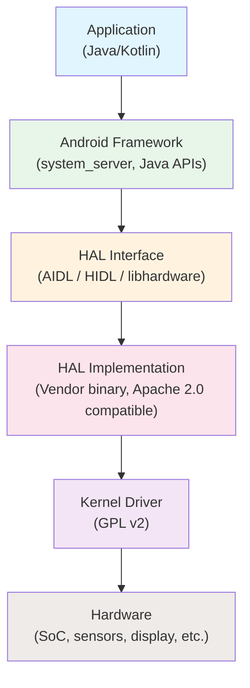

每一层都有明确的职责：

| 层 | 许可证 | 职责 |
|-------|---------|----------------|
| 应用 | 各异 | 面向用户的功能 |
| 框架 | Apache 2.0 | 系统服务、Java/Kotlin API |
| HAL 接口 | Apache 2.0 | 框架与厂商之间的稳定契约 |
| HAL 实现 | 允许专有 | 厂商特定的硬件交互逻辑 |
| 内核驱动 | GPL v2 | 直接硬件寄存器访问、中断处理 |

HAL 接口层是关键的接缝。其上方的一切由 Google 通过 system 分区 OTA 更新。其下方的一切由设备厂商通过 vendor 分区更新。两侧可以独立更新——这是 Project Treble 的核心承诺。

### 10.1.3 HAL 的三代演进

Android 先后出现过三种不同的 HAL 架构：

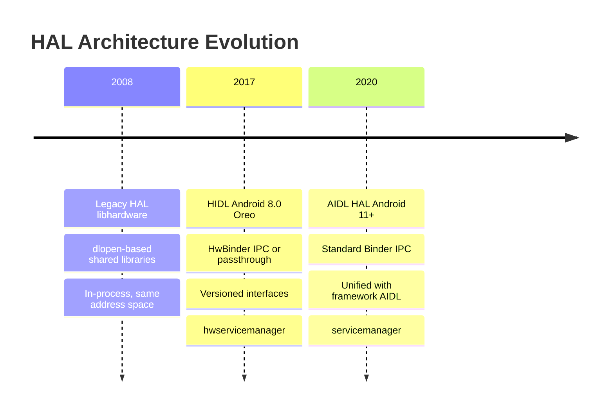

| 代际 | 引入时间 | 传输方式 | 版本管理 | 当前状态 |
|-----------|-----------|-----------|-----------|---------------|
| Legacy HAL | Android 1.0（2008） | 进程内 `dlopen()` | 模块 API 版本字段 | 已废弃，但仍存在 |
| HIDL | Android 8.0（2017） | HwBinder 或 passthrough | Package@major.minor | 自 Android 13 起废弃 |
| AIDL HAL | Android 11（2020） | Binder | Package version int | **当前标准** |

每一代都解决了其前代的局限。Legacy HAL 简单，但缺乏 IPC 隔离和版本管理。HIDL 同时引入了这两者，但带来了一套独立的 IDL 语言和工具链。AIDL HAL 将 HAL 接口语言与 Android 框架中普遍使用的现有 AIDL 统一起来，消除了重复。

### 10.1.4 HAL 演进时间线

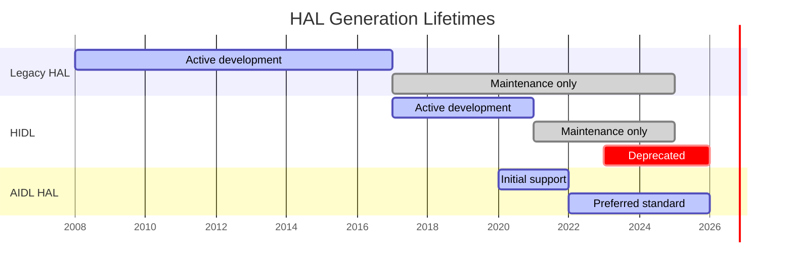

### 10.1.5 设计原则

三代 HAL 共享若干设计原则：

1. **接口稳定性。** 一旦发布，HAL 接口不得以不向后兼容的方式变更。旧客户端必须能继续与新实现配合工作，旧实现也必须能继续与新客户端配合工作。

2. **厂商隔离。** 框架不得依赖厂商实现细节。厂商不得依赖框架内部实现。HAL 是唯一的通信通道。

3. **可发现性。** 系统必须能够枚举哪些 HAL 可用、它们实现了什么版本、运行在哪里。这对于 OTA 更新期间的兼容性检查至关重要。

4. **可测试性。** HAL 接口必须能够通过 VTS（Vendor Test Suite，厂商测试套件）在不接触真实硬件的情况下测试，使用 mock 或默认实现。

### 10.1.5.1 Project Treble 与 HAL

Project Treble 于 Android 8.0（2017）引入，将 HAL 正式确立为可独立更新的 system 与 vendor 分区之间的边界。在 Treble 之前，更新 Android 需要厂商在每一步配合——system 与 vendor 代码交织在一起，没有清晰的分离。

Treble 的架构强制执行严格的分层模型：

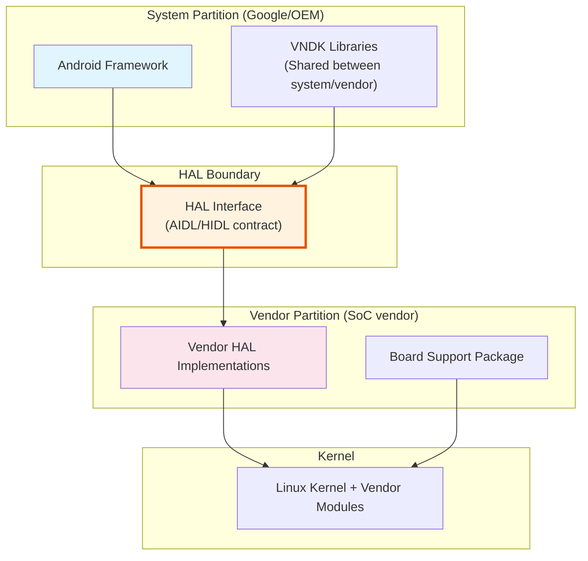

关键的强制执行机制包括：

1. **链接器命名空间隔离。** 动态链接器强制规定：系统库不能加载厂商库，反之亦然，除非通过明确允许的接口。例如，框架只能通过专用的 SP-HAL 命名空间、经由 `android_load_sphal_library()` 从 vendor 分区加载同进程 HAL。

2. **VNDK（Vendor NDK）。** 历史上（Android 8 到 14），它是一组经过精心筛选、具有稳定 ABI 的系统库，允许厂商代码链接。VNDK 在 Android 15 中被废弃，并在当前树中被禁用——`build/make/core/config.mk` 无条件清空 `BOARD_VNDK_VERSION`。如今不再构建或安装任何 VNDK 快照。

3. **VINTF。** 正式的声明系统（见 10.5 节），记录各方提供和需求的 HAL。

4. **SELinux。** 强制访问控制，阻止未经授权的跨分区通信。

这些机制共同保证 system 分区的 OTA 更新不会破坏厂商 HAL。同时也保证 vendor 分区更新不会破坏框架。只要双方都遵守 VINTF 中定义的 HAL 契约，这一点就成立。

### 10.1.5.2 分区布局

在符合 Treble 的设备上，存储按如下方式分区：

| 分区 | 包含内容 | 更新来源 |
|-----------|----------|-----------|
| `/system` | Android 框架、系统应用 | Google（system OTA） |
| `/system_ext` | OEM 框架扩展 | OEM（OTA） |
| `/vendor` | 厂商 HAL 实现、固件 | SoC 厂商（vendor OTA） |
| `/odm` | ODM 特定的定制 | 设备制造商 |
| `/product` | 产品特定的应用和 overlay | 产品团队 |
| `/apex/*` | 可独立更新的模块 | Google Play / OTA |

HAL 接口位于 `/system`（框架侧）与 `/vendor`（厂商侧）的边界处。当框架 OTA 到来时：

1. 新的 `/system` 镜像会根据现有的 `/vendor` 清单进行校验。
2. 如果 VINTF 兼容性检查通过，则继续更新。
3. 新的框架会自动与现有的厂商 HAL 协同工作。

这就是 HAL 存在的根本原因：它是实现独立分区更新的契约。

### 10.1.6 HAL 在磁盘上的位置

在运行中的 Android 设备上，HAL 相关文件分布在多个分区：

```
/system/lib64/hw/           # Framework-side legacy HAL modules
/vendor/lib64/hw/           # Vendor legacy HAL modules
/odm/lib64/hw/              # ODM-specific legacy HAL modules

/vendor/bin/hw/              # Vendor HAL service binaries (HIDL/AIDL)
/vendor/etc/vintf/           # Vendor VINTF manifests
/system/etc/vintf/           # Framework VINTF manifests

/apex/com.android.hardware.*/ # HALs packaged in APEX modules
```

在 AOSP 源码树中，关键目录如下：

```
hardware/libhardware/        # Legacy HAL framework and reference modules
hardware/interfaces/         # HIDL and AIDL HAL interface definitions
system/libhidl/             # HIDL runtime libraries and transport
system/libvintf/            # VINTF compatibility checking library
frameworks/native/cmds/servicemanager/  # AIDL service manager
system/hwservicemanager/    # HIDL service manager
```

---

## 10.2 Legacy HAL（libhardware）

Legacy HAL 实现于 `hardware/libhardware/`，是 Android 最初用于抽象硬件的机制。它是一种基于 C 的简单 `dlopen()` 方案。框架在运行时加载共享库，查找一个众所周知的符号，并将其强制转换为已知的 struct 类型。尽管年代久远，理解 legacy HAL 仍然必不可少。这是因为它的模式影响了之后所有 HAL 设计，而且某些 legacy 模块至今仍存在于量产设备上。

### 10.2.1 核心数据结构：hw_module_t 和 hw_device_t

整个 legacy HAL 架构都围绕定义在 `hardware/libhardware/include/hardware/hardware.h` 中的两个 C 结构展开。

**hw_module_t** 表示一个已加载的 HAL 模块（一个 `.so` 文件）：

```c
// hardware/libhardware/include/hardware/hardware.h, lines 86-154

typedef struct hw_module_t {
    /** tag must be initialized to HARDWARE_MODULE_TAG */
    uint32_t tag;

    /**
     * The API version of the implemented module. The module owner is
     * responsible for updating the version when a module interface has
     * changed.
     */
    uint16_t module_api_version;

    /**
     * The API version of the HAL module interface. This is meant to
     * version the hw_module_t, hw_module_methods_t, and hw_device_t
     * structures and definitions.
     */
    uint16_t hal_api_version;

    /** Identifier of module */
    const char *id;

    /** Name of this module */
    const char *name;

    /** Author/owner/implementor of the module */
    const char *author;

    /** Modules methods */
    struct hw_module_methods_t* methods;

    /** module's dso */
    void* dso;

#ifdef __LP64__
    uint64_t reserved[32-7];
#else
    /** padding to 128 bytes, reserved for future use */
    uint32_t reserved[32-7];
#endif

} hw_module_t;
```

`tag` 字段必须设置为魔数常量 `HARDWARE_MODULE_TAG`，其定义为 `MAKE_TAG_CONSTANT('H', 'W', 'M', 'T')`。这是一个四字节标签，编码为 `0x48574D54`——它是一次健全性检查，用于验证经 `dlsym()` 解析出的指针确实指向一个有效的 HAL 模块结构。

`module_api_version` 使用打包进 16 位的 major.minor 方案：

```c
// hardware/libhardware/include/hardware/hardware.h, line 68
#define HARDWARE_MODULE_API_VERSION(maj,min) HARDWARE_MAKE_API_VERSION(maj,min)
```

其中 `HARDWARE_MAKE_API_VERSION` 将主版本打包到高字节、次版本打包到低字节。版本 1.0 是 `0x0100`，版本 2.3 是 `0x0203`。

`methods` 指针指向模块的“open”函数：

```c
// hardware/libhardware/include/hardware/hardware.h, lines 156-161

typedef struct hw_module_methods_t {
    /** Open a specific device */
    int (*open)(const struct hw_module_t* module, const char* id,
            struct hw_device_t** device);

} hw_module_methods_t;
```

而 **hw_device_t** 表示一个已打开的设备实例：

```c
// hardware/libhardware/include/hardware/hardware.h, lines 167-202

typedef struct hw_device_t {
    /** tag must be initialized to HARDWARE_DEVICE_TAG */
    uint32_t tag;

    /**
     * Version of the module-specific device API. This value is used by
     * the derived-module user to manage different device implementations.
     */
    uint32_t version;

    /** reference to the module this device belongs to */
    struct hw_module_t* module;

    /** padding reserved for future use */
#ifdef __LP64__
    uint64_t reserved[12];
#else
    uint32_t reserved[12];
#endif

    /** Close this device */
    int (*close)(struct hw_device_t* device);

} hw_device_t;
```

这一模式是 C 风格的多态。每个具体 HAL（gralloc、camera、audio 等）定义自己的 struct，它以 `hw_module_t` 或 `hw_device_t` 开头。该 struct 在其后追加领域特定的字段和函数指针。框架将通用指针强制转换为具体类型。

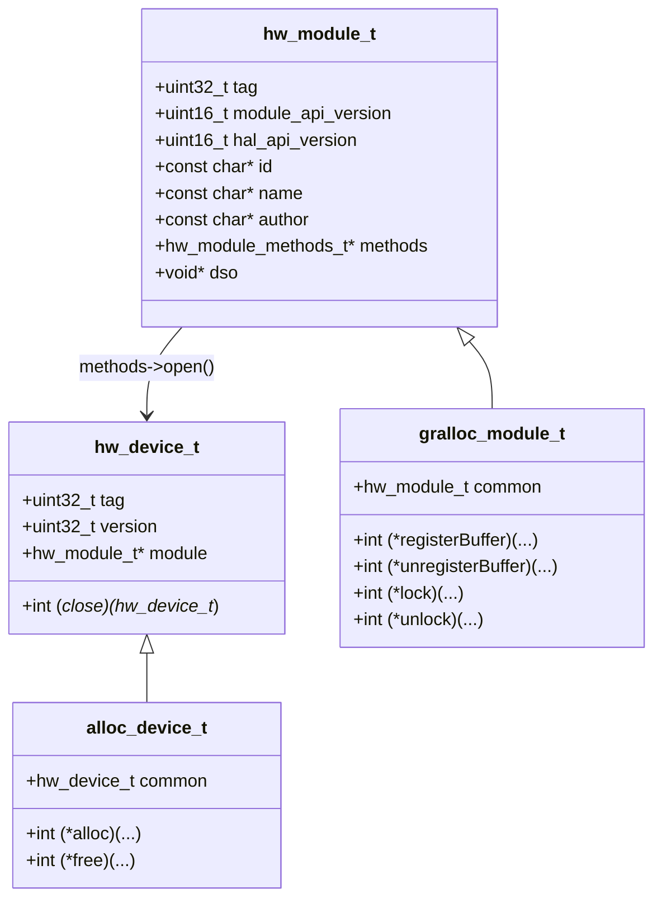

### 10.2.2 模块魔数字号：HAL_MODULE_INFO_SYM

每个 legacy HAL 共享库都必须导出名为 `HMI`（代表 “Hardware Module Info”）的符号：

```c
// hardware/libhardware/include/hardware/hardware.h, lines 213-218

#define HAL_MODULE_INFO_SYM         HMI
#define HAL_MODULE_INFO_SYM_AS_STR  "HMI"
```

当框架加载一个 HAL `.so` 时，它会调用 `dlsym(handle, "HMI")` 来找到模块的 `hw_module_t` 结构。该结构是 `.so` 中的一个全局变量，在编译时初始化，包含模块的全部元数据和函数指针。

下面是一个来自 gralloc 模块的真实示例：

```c
// hardware/libhardware/modules/gralloc/gralloc.cpp, lines 73-99

static struct hw_module_methods_t gralloc_module_methods = {
        .open = gralloc_device_open
};

struct private_module_t HAL_MODULE_INFO_SYM = {
    .base = {
        .common = {
            .tag = HARDWARE_MODULE_TAG,
            .version_major = 1,
            .version_minor = 0,
            .id = GRALLOC_HARDWARE_MODULE_ID,
            .name = "Graphics Memory Allocator Module",
            .author = "The Android Open Source Project",
            .methods = &gralloc_module_methods
        },
        .registerBuffer = gralloc_register_buffer,
        .unregisterBuffer = gralloc_unregister_buffer,
        .lock = gralloc_lock,
        .unlock = gralloc_unlock,
    },
    .framebuffer = 0,
    .flags = 0,
    .numBuffers = 0,
    .bufferMask = 0,
    .lock = PTHREAD_MUTEX_INITIALIZER,
    .currentBuffer = 0,
};
```

请注意嵌套初始化：`private_module_t` 包含一个 `gralloc_module_t`（作为 `.base`），后者包含一个 `hw_module_t`（作为 `.common`）。这就是 C 风格的继承链。

### 10.2.3 模块发现：变体搜索顺序

框架并不硬编码 HAL `.so` 的路径。相反，它搜索一个文件名同时编码了硬件类型和设备变体的模块。搜索在 `hw_module_exists()` 和 `hw_get_module_by_class()` 中实现。

文件名格式为：

```
<module_id>.<variant>.so
```

例如，在一台 `ro.hardware=oriole` 的 Pixel 设备上，`gralloc` 模块：

```
gralloc.oriole.so
```

变体由系统属性决定，按如下顺序检查：

```c
// hardware/libhardware/hardware.c, lines 63-69

static const char *variant_keys[] = {
    "ro.hardware",       /* This goes first so that it can pick up a different
                            file on the emulator. */
    "ro.product.board",
    "ro.board.platform",
    "ro.arch"
};
```

搜索路径为：

```c
// hardware/libhardware/hardware.c, lines 48-50

#define HAL_LIBRARY_PATH1 "/system/" HAL_LIBRARY_SUBDIR
#define HAL_LIBRARY_PATH2 "/vendor/" HAL_LIBRARY_SUBDIR
#define HAL_LIBRARY_PATH3 "/odm/" HAL_LIBRARY_SUBDIR
```

其中 `HAL_LIBRARY_SUBDIR` 在 64 位设备上是 `lib64/hw`。

完整的搜索算法，来自 `hw_get_module_by_class()`：

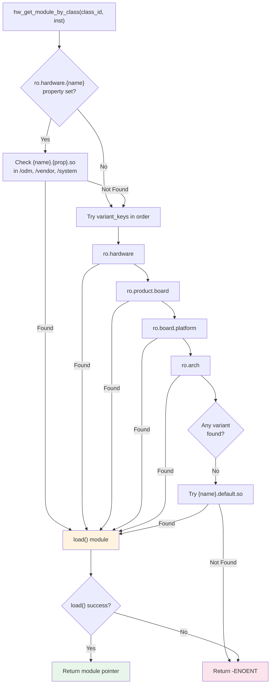

属性特定的检查（`hardware.c` 第 245-250 行）允许设备完全覆盖搜索：

```c
// hardware/libhardware/hardware.c, lines 244-250

/* First try a property specific to the class and possibly instance */
snprintf(prop_name, sizeof(prop_name), "ro.hardware.%s", name);
if (property_get(prop_name, prop, NULL) > 0) {
    if (hw_module_exists(path, sizeof(path), name, prop) == 0) {
        goto found;
    }
}
```

例如，设置 `ro.hardware.gralloc=myvendor` 会让系统优先寻找 `gralloc.myvendor.so`，而不论设备主板名称是什么。

如果没有找到变体特定的模块，系统会回退到 `default` 变体（第 263 行）：

```c
// hardware/libhardware/hardware.c, lines 262-265

/* Nothing found, try the default */
if (hw_module_exists(path, sizeof(path), name, "default") == 0) {
    goto found;
}
```

### 10.2.4 模块加载：dlopen 与符号解析

`hardware/libhardware/hardware.c` 中的 `load()` 函数（第 79-153 行）处理 HAL 共享库的实际加载。它是一个精心安排的流程：

```c
// hardware/libhardware/hardware.c, lines 79-153 (simplified)

static int load(const char *id,
        const char *path,
        const struct hw_module_t **pHmi)
{
    int status = -EINVAL;
    void *handle = NULL;
    struct hw_module_t *hmi = NULL;

    // 1. Load the shared library
    if (try_system &&
        strncmp(path, HAL_LIBRARY_PATH1, strlen(HAL_LIBRARY_PATH1)) == 0) {
        handle = dlopen(path, RTLD_NOW);
    } else {
        handle = android_load_sphal_library(path, RTLD_NOW);
    }
    if (handle == NULL) {
        char const *err_str = dlerror();
        ALOGE("load: module=%s\n%s", path, err_str?err_str:"unknown");
        status = -EINVAL;
        goto done;
    }

    // 2. Find the HMI symbol
    const char *sym = HAL_MODULE_INFO_SYM_AS_STR;
    hmi = (struct hw_module_t *)dlsym(handle, sym);
    if (hmi == NULL) {
        ALOGE("load: couldn't find symbol %s", sym);
        status = -EINVAL;
        goto done;
    }

    // 3. Verify the module ID matches
    if (strcmp(id, hmi->id) != 0) {
        ALOGE("load: id=%s != hmi->id=%s", id, hmi->id);
        status = -EINVAL;
        goto done;
    }

    // 4. Store the DSO handle for later unloading
    hmi->dso = handle;
    status = 0;

done:
    if (status != 0) {
        hmi = NULL;
        if (handle != NULL) {
            dlclose(handle);
            handle = NULL;
        }
    }
    *pHmi = hmi;
    return status;
}
```

有几个重要细节：

**VNDK 命名空间隔离。** 在 Android 8.0+ 上，厂商库使用 `android_load_sphal_library()` 而非普通的 `dlopen()`，在 SP-HAL（Same-Process HAL，同进程 HAL）链接器命名空间中加载。这由 `__ANDROID_VNDK__` 和 `__ANDROID_APEX__` 预处理器宏控制（第 86 行）。SP-HAL 命名空间限制厂商 `.so` 可链接的系统库，防止对不稳定框架内部产生隐性的 ABI 依赖。

**RTLD_NOW 标志。** 库以 `RTLD_NOW` 加载，以便立即解析全部符号而非延迟解析。这确保任何缺失的符号依赖都在加载时被捕获，而不是在执行期间某个不可预测的时刻才暴露。

**APEX 感知。** 当运行在 VAPEX（Vendor APEX）内部时，搜索被限制在 APEX 自身的库目录（第 181-193 行）：

```c
// hardware/libhardware/hardware.c, lines 181-193

#ifdef __ANDROID_APEX__
    if (__builtin_available(android __ANDROID_API_V__, *)) {
        AApexInfo *apex_info;
        if (AApexInfo_create(&apex_info) == AAPEXINFO_OK) {
            snprintf(path, path_len, "/apex/%s/%s/%s.%s.so",
                    AApexInfo_getName(apex_info), HAL_LIBRARY_SUBDIR, name, subname);
            AApexInfo_destroy(apex_info);
            if (access(path, R_OK) == 0)
                return 0;
        }
    }
#endif
```

### 10.2.5 一个完整的 Legacy HAL：Gralloc 模块

要观察各个部件如何协同工作，让我们追踪 gralloc（图形内存分配器）模块从定义到使用的全过程。

**1. 头文件定义模块 ID 和扩展结构：**

文件 `hardware/libhardware/include/hardware/gralloc.h`（未完整展示）将 `GRALLOC_HARDWARE_MODULE_ID` 定义为 `"gralloc"`，并通过 `registerBuffer`、`lock`、`unlock` 等图形特定函数扩展 `hw_module_t`。

**2. 实现导出 HMI 符号：**

如上所示，`hardware/libhardware/modules/gralloc/gralloc.cpp` 定义了一个全局 `HAL_MODULE_INFO_SYM` 变量，其中包含模块的全部元数据和函数指针。

**3. 框架加载模块：**

框架组件（例如 SurfaceFlinger 的 gralloc 包装层）调用：

```c
const hw_module_t *module;
int err = hw_get_module(GRALLOC_HARDWARE_MODULE_ID, &module);
if (err == 0) {
    gralloc_module_t *gralloc = (gralloc_module_t *)module;
    // Now use gralloc->registerBuffer, gralloc->lock, etc.
}
```

**4. 框架打开一个设备：**

```c
alloc_device_t *allocDev;
err = module->methods->open(module, GRALLOC_HARDWARE_GPU0,
                            (hw_device_t **)&allocDev);
if (err == 0) {
    // Use allocDev->alloc, allocDev->free
    // ...
    allocDev->common.close((hw_device_t *)allocDev);
}
```

完整流程：

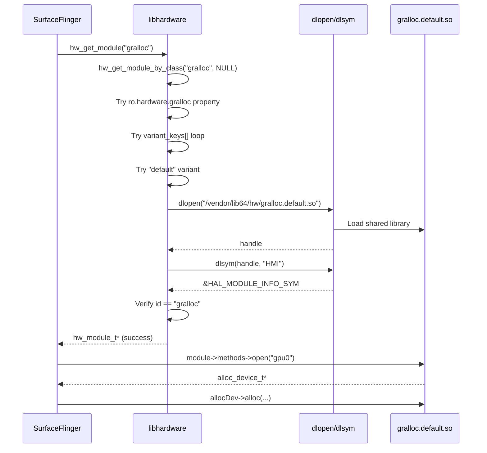

### 10.2.6 全部 Legacy HAL 模块

目录 `hardware/libhardware/modules/` 包含 20 个 legacy HAL 模块的参考实现：

| 模块 | 目录 | 用途 |
|--------|-----------|---------|
| audio | `modules/audio` | 主要音频 HAL |
| audio_remote_submix | `modules/audio_remote_submix` | 远程 submix 音频 |
| camera | `modules/camera` | 相机 HAL |
| consumerir | `modules/consumerir` | 消费级红外发射器 |
| fingerprint | `modules/fingerprint` | 指纹传感器 |
| gralloc | `modules/gralloc` | 图形内存分配器 |
| hwcomposer | `modules/hwcomposer` | 硬件合成器（显示） |
| input | `modules/input` | 输入设备配置 |
| local_time | `modules/local_time` | 本地时间 HAL |
| nfc | `modules/nfc` | NFC 控制器 |
| nfc-nci | `modules/nfc-nci` | NFC Controller Interface |
| power | `modules/power` | 电源管理 |
| radio | `modules/radio` | FM 收音机 |
| sensors | `modules/sensors` | 传感器 HAL（加速度计、陀螺仪等） |
| soundtrigger | `modules/soundtrigger` | 声音触发（热词检测） |
| thermal | `modules/thermal` | 热管理 |
| tv_input | `modules/tv_input` | TV 输入 HAL |
| usbaudio | `modules/usbaudio` | USB 音频 |
| usbcamera | `modules/usbcamera` | USB 相机 |
| vibrator | `modules/vibrator` | 振动马达 |

头文件目录 `hardware/libhardware/include/hardware/` 包含其中大多数模块的接口定义。它还包含诸如 `camera2.h`、`camera3.h`、`gralloc1.h`、`hwcomposer2.h` 和 `keymaster2.h` 等额外头文件，代表同一接口的演进版本。有少数模块将头文件保留在其他位置。`consumerir.h`、`radio.h`、`thermal.h` 和 `local_time_hal.h` 位于 `hardware/libhardware/include_vendor/hardware/` 中。`usbaudio`、`usbcamera` 和 `audio_remote_submix` 根本没有专用头文件。它们实现通用的 `audio.h`/`camera3.h` 契约。

### 10.2.6.1 Legacy HAL 头文件契约

每种 legacy HAL 模块类型都在 `hardware/libhardware/include/hardware/` 中有一个头文件，定义其特定的 struct 扩展和模块 ID。完整头文件集包括：

| 头文件 | 模块 ID | 扩展结构 |
|--------|-----------|-------------------|
| `audio.h` | `AUDIO_HARDWARE_MODULE_ID` | `audio_module`、`audio_stream_out`、`audio_stream_in` |
| `camera.h` | `CAMERA_HARDWARE_MODULE_ID` | `camera_module_t`、`camera_device_t` |
| `camera3.h` | （同上） | `camera3_device_t`（Camera HAL v3） |
| `gralloc.h` | `GRALLOC_HARDWARE_MODULE_ID` | `gralloc_module_t`、`alloc_device_t` |
| `hwcomposer.h` | `HWC_HARDWARE_MODULE_ID` | `hwc_module_t`、`hwc_composer_device_1` |
| `sensors.h` | `SENSORS_HARDWARE_MODULE_ID` | `sensors_module_t`、`sensors_poll_device_1` |
| `power.h` | `POWER_HARDWARE_MODULE_ID` | `power_module_t` |
| `fingerprint.h` | `FINGERPRINT_HARDWARE_MODULE_ID` | `fingerprint_module_t`、`fingerprint_device_t` |
| `gps.h` | `GPS_HARDWARE_MODULE_ID` | `gps_device_t` |
| `vibrator.h` | `VIBRATOR_HARDWARE_MODULE_ID` | `vibrator_device_t` |
| `memtrack.h` | `MEMTRACK_HARDWARE_MODULE_ID` | `memtrack_module_t` |

（`bluetooth.h` 是个异类。它完全不定义任何 `hw_module_t`/`hw_device_t` 子类型。相反，它导出一个扁平的 `bt_interface_t` 函数表，符号名为字符串 `BLUETOOTH_INTERFACE_STRING`。它不是一个 `hw_module_t` 风格的 legacy HAL。）

每个头文件都遵循相同的模式：

1. 为模块 ID 定义一个字符串常量（例如 `"gralloc"`）。
2. 定义一个扩展的 `hw_module_t` 子类型，带有模块级函数指针。
3. 定义一个扩展的 `hw_device_t` 子类型，带有设备级函数指针。
4. 定义任何关联的数据类型（例如 gralloc 的 `buffer_handle_t`）。

这一模式意味着，对于每种 legacy HAL 类型，框架和厂商都必须就同一头文件版本达成一致。如果 Google 向 `gralloc_module_t` 添加了一个新的函数指针，所有厂商都必须重新构建其 gralloc HAL。由于结构布局在编译时固定，运行期无法检测到这种不匹配。

### 10.2.6.2 Camera HAL：多种 API 版本

Camera HAL 说明了 legacy 系统如何处理 API 演进。三个不同的头文件版本共存：

- `camera.h` —— Camera HAL v1（最初版本，以预览为中心）
- `camera2.h` —— Camera HAL v2（过渡版本，从未被广泛使用）
- `camera3.h` —— Camera HAL v3（当前版本，基于请求的流水线）

每个版本都定义了不同的 `camera_device_t` 变体，具有不同的函数指针集合。框架中的 Camera Service 检查 `module_api_version` 字段，并根据厂商提供的版本分发到不同的代码路径。这一做法可行但脆弱，并且要求框架无限期地携带向后兼容代码。

### 10.2.7 催生 HIDL 的局限

Legacy HAL 有若干根本性局限：

1. **无进程隔离。** HAL `.so` 与框架进程（例如 SurfaceFlinger）运行在同一地址空间。厂商 HAL 中的一个 bug 可能使框架进程崩溃。HAL 中的安全漏洞会暴露框架进程的权限。

2. **无正式版本管理。** `module_api_version` 字段只是一个提示，而非被强制执行的契约。没有任何机制能在构建时或启动时验证模块是否实现了框架所期望的版本。

3. **无可发现性。** 没有可用 HAL 的注册表。框架必须尝试 `dlopen()` 一个库，并希望它存在。

4. **无法独立更新。** 由于框架与 HAL 共享地址空间，它们必须针对兼容的头文件编译。独立更新框架或 vendor 分区会带来 ABI 破坏的风险。

5. **无 IPC。** 由于 HAL 被加载到框架进程中，无法以降低的权限在独立进程中运行 HAL。

这些局限促成了 HIDL 和 Project Treble 的诞生。

---

## 10.3 HIDL（HAL 接口定义语言）

HIDL 随 Android 8.0（Oreo）作为 Project Treble 的一部分引入。它是一种专用于硬件 HAL 的接口定义语言，拥有自己的编译器、运行时和服务管理器。HIDL 的目标是使厂商 HAL 成为正式的、带版本管理的、可测试的契约。该契约可以以进程内（passthrough 模式）或独立进程（binderized 模式）实现。

HIDL 源码位于 `system/libhidl/`。

### 10.3.1 HIDL 的创建缘由

Project Treble 旨在将 Android 框架与厂商特定代码解耦，以便：

- Google 可以推送框架更新而不必等待厂商 HAL 更新。
- 厂商可以更新其 HAL 而不必等待框架变更。
- 设备可以更快地收到安全补丁。

HIDL 提供了工程机制：框架与厂商之间一个带版本管理的 IPC 接口，由服务管理器居中协调并强制执行接口契约。

### 10.3.2 HIDL 语法与 .hal 文件

HIDL 有自己的语法来定义接口。下面是来自 HIDL 自身服务管理器所使用的 IServiceManager 接口的一个代表性示例：

```
// system/libhidl/transport/manager/1.0/IServiceManager.hal (excerpt, lines 17-52)

package android.hidl.manager@1.0;

import IServiceNotification;
import android.hidl.base@1.0::DebugInfo.Architecture;

/**
 * Manages all the hidl hals on a device.
 */
interface IServiceManager {

    /**
     * Retrieve an existing service that supports the requested version.
     *
     * @param fqName   Fully-qualified interface name.
     * @param name     Instance name. Same as in IServiceManager::add.
     *
     * @return service Handle to requested service.
     */
    get(string fqName, string name) generates (interface service);

    /**
     * Register a service.
     *
     * @param name           Instance name.
     * @param service        Handle to registering service.
     * @return success       Whether or not the service was registered.
     */
    add(string name, interface service) generates (bool success);
```

关键语法元素：

| 元素 | 示例 | 含义 |
|---------|---------|---------|
| 包 | `android.hidl.manager@1.0` | 带版本的全限定名 |
| 接口 | `interface IServiceManager` | RPC 接口定义 |
| 方法 | `get(string, string) generates (interface)` | 带输入与输出的 RPC 方法 |
| `generates` | `generates (bool success)` | 返回值（HIDL 方法可以有多个返回值） |
| `oneway` | `oneway notifySyspropsChanged()` | 异步（发后即忘）调用 |
| `vec<T>` | `vec<string> fqInstanceNames` | 动态数组类型 |
| `enum` | `enum Transport : uint8_t { ... }` | 带类型的枚举 |
| `struct` | `struct InstanceDebugInfo { ... }` | 复合数据类型 |
| `import` | `import IServiceNotification` | 从同一包导入 |

HIDL 命名约定使用如下形式的全限定名：

```
package@major.minor::InterfaceName/instance
```

例如：

```
android.hardware.camera.provider@2.4::ICameraProvider/internal/0
android.hardware.audio@7.0::IDevicesFactory/default
```

### 10.3.3 Passthrough 与 Binderized 模式

HIDL 支持两种传输模式，使 legacy HAL 得以渐进式迁移：

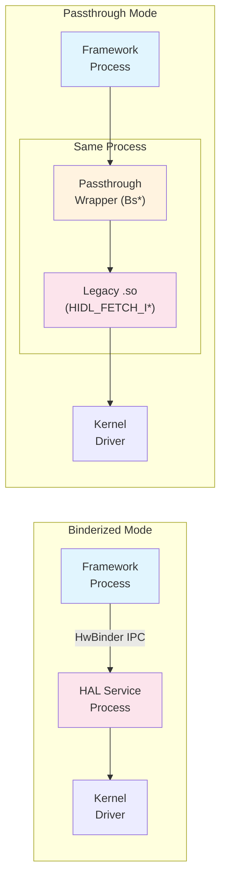

**Binderized 模式**是标准模式。HAL 运行在自己的进程中，通过 HwBinder（Android Binder IPC 的一个针对 HAL 优化的变体）与框架通信。这提供了进程隔离、SELinux 强制执行的访问控制，以及以最小权限运行 HAL 的能力。

**Passthrough 模式**用 HIDL 接口包装一个 legacy 进程内 HAL 实现。框架调用 HIDL 方法，这些方法被转发给同一进程中运行的 legacy HAL。该模式仅为向后兼容而存在——它允许现有的 legacy HAL `.so` 文件在不重写的情况下通过 HIDL 接口使用。

每个 HAL 的传输模式都在设备的 VINTF 清单中声明。对于 binderized：

```xml
<hal format="hidl">
    <name>android.hardware.camera.provider</name>
    <transport>hwbinder</transport>
    <version>2.4</version>
    <interface>
        <name>ICameraProvider</name>
        <instance>internal/0</instance>
    </interface>
</hal>
```

对于 passthrough：

```xml
<hal format="hidl">
    <name>android.hardware.graphics.mapper</name>
    <transport>passthrough</transport>
    <version>4.0</version>
    <interface>
        <name>IMapper</name>
        <instance>default</instance>
    </interface>
</hal>
```

### 10.3.4 hwservicemanager

HIDL 服务管理器（`system/hwservicemanager/`）是一个专用守护进程，管理 HIDL HAL 服务的注册与发现。它类似于标准的 Android `servicemanager`，但通过 HwBinder 而非普通 Binder 运作。

来自 `system/hwservicemanager/ServiceManager.cpp`（第 64-99 行），服务管理器维护已注册服务的映射：

```c++
// system/hwservicemanager/ServiceManager.cpp, lines 64-71

size_t ServiceManager::countExistingService() const {
    size_t total = 0;
    forEachExistingService([&] (const HidlService *) {
        ++total;
        return true;  // continue
    });
    return total;
}
```

hwservicemanager 执行两项关键功能：

1. **注册。** 当 HAL 服务启动时，它调用
   `IFoo::registerAsService("instance_name")`，这会将服务的
   HwBinder 端点注册到 hwservicemanager。

2. **发现。** 当框架组件需要某个 HAL 时，它调用
   `IFoo::getService("instance_name")`。HIDL 运行时联系
   hwservicemanager，后者返回 HwBinder 代理。

值得注意的是，hwservicemanager *并不*要求每个已注册的 HAL 都出现在设备的
VINTF 清单中。`system/hwservicemanager/ServiceManager.cpp` 中的一条注释
（第 401-407 行）解释了原因：要求每次注册都有清单条目会阻止测试注册其
自己的服务。因此对于 HIDL，平台依赖 VTS 来捕获未声明的 HAL。
hwservicemanager 强制执行的一项检查是继承链内部的一致性。假设某个 HAL
*确实*在清单中声明了，但其 `interfaceChain()` 中的某个父类没有。那么
hwservicemanager 会拒绝该注册（`ServiceManager.cpp`，第 417-432 行）。

由于 HIDL 现已废弃，较新的设备可能根本不再随附 hwservicemanager。
`ServiceManagement.cpp`（第 213-348 行）中的 `NoHwServiceManager` 类充当
一个存根，当 hwservicemanager 不存在时返回空结果：

```c++
// system/libhidl/transport/ServiceManagement.cpp, lines 204-221

/*
 * A replacement for hwservicemanager when it is not installed on a device.
 *
 * Clients in the framework need to continue supporting HIDL services through
 * hwservicemanager for upgrading devices. Being unable to get an instance of
 * hardware service manager is a hard error, so this implementation is returned
 * to be able service the requests and tell clients there are no services
 * registered.
 */
struct NoHwServiceManager : public IServiceManager1_2, hidl_death_recipient {
    Return<sp<IBase>> get(const hidl_string& fqName, const hidl_string&) override {
        sp<IBase> ret = nullptr;
        if (isServiceManager(fqName)) {
            ret = defaultServiceManager1_2();
        }
        return ret;
    }
    // ... all other methods return empty/false
};
```

### 10.3.5 IBase 根接口

每个 HIDL 接口都隐式继承 `android.hidl.base@1.0::IBase`，定义于
`system/libhidl/transport/base/1.0/IBase.hal`。这类似于 Java 中的
`java.lang.Object`。

IBase 提供了所有 HAL 服务都会继承的几个关键方法：

```
// system/libhidl/transport/base/1.0/IBase.hal (lines 30-141, key methods)

interface IBase {
    // Liveness check
    ping();

    // Run-time type information (interface inheritance chain)
    interfaceChain() generates (vec<string> descriptors);

    // Single descriptor for this interface
    interfaceDescriptor() generates (string descriptor);

    // Death notification
    linkToDeath(death_recipient recipient, uint64_t cookie)
        generates (bool success);
    unlinkToDeath(death_recipient recipient) generates (bool success);

    // Diagnostic dump
    debug(handle fd, vec<string> options);

    // Source hash chain for version verification
    getHashChain() generates (vec<uint8_t[32]> hashchain);
};
```

`interfaceChain()` 方法尤为重要。它返回完整的继承链，使框架能够精确验证一个服务实现了哪些接口。例如，对一个 `ICameraProvider@2.6` 服务调用 `interfaceChain()` 会返回：

```
["android.hardware.camera.provider@2.6::ICameraProvider",
 "android.hardware.camera.provider@2.5::ICameraProvider",
 "android.hardware.camera.provider@2.4::ICameraProvider",
 "android.hidl.base@1.0::IBase"]
```

`getHashChain()` 方法提供加密验证，确保接口定义在客户端与服务端之间一致。

### 10.3.6 代码生成与构建集成

HIDL 编译器（`hidl-gen`）处理 `.hal` 文件并生成：

1. 客户端（proxy/Bp）和服务端（native/Bn）两侧的 **C++ 存根头文件与源文件**。
2. 供框架侧使用的 **Java 接口**。
3. 用于自动化测试的 **VTS（Vendor Test Suite）模板**。

对于类似 `android.hardware.foo@1.0::IFoo` 的 HIDL 接口，生成的代码包括：

| 生成的文件 | 用途 |
|----------------|---------|
| `IFoo.h` | 接口定义 |
| `BpHwFoo.h/cpp` | Binder 代理（客户端） |
| `BnHwFoo.h/cpp` | Binder 原生（服务端存根） |
| `BsFoo.h` | Passthrough 包装器 |
| `IHwFoo.h` | HwBinder 序列化辅助 |
| `FooAll.cpp` | 合并的编译单元 |

### 10.3.7 Passthrough 包装的内部实现

Passthrough 模式的包装逻辑位于
`system/libhidl/transport/HidlPassthroughSupport.cpp`。当请求一个
passthrough HAL 时，运行时加载厂商 `.so` 并将其包装：

```c++
// system/libhidl/transport/HidlPassthroughSupport.cpp, lines 30-74

static sp<IBase> tryWrap(const std::string& descriptor, sp<IBase> iface) {
    auto func = getBsConstructorMap().get(descriptor, nullptr);
    if (func) {
        return func(static_cast<void*>(iface.get()));
    }
    return nullptr;
}

sp<IBase> wrapPassthroughInternal(sp<IBase> iface) {
    if (iface == nullptr || iface->isRemote()) {
        return iface;
    }

    // Walk the interface chain to find a wrapper
    sp<IBase> base;
    auto ret = iface->interfaceChain([&](const auto& types) {
        for (const std::string& descriptor : types) {
            base = tryWrap(descriptor, iface);
            if (base != nullptr) {
                break;
            }
        }
    });

    if (!ret.isOk()) {
        return nullptr;
    }
    return base;
}
```

`BsConstructorMap` 由生成的 `Bs*`（passthrough shim）类填充。每个 HIDL
接口库在库加载时（通过静态构造函数）注册其包装器。这使得运行时在加载
passthrough HAL 时，能够通过遍历 `interfaceChain` 找到正确的包装器。

### 10.3.8 HIDL 传输层

HIDL 传输支持层实现于
`system/libhidl/transport/HidlTransportSupport.cpp`。它为 binderized HAL
服务提供线程池管理：

```c++
// system/libhidl/transport/HidlTransportSupport.cpp, lines 31-38

void configureRpcThreadpool(size_t maxThreads, bool callerWillJoin) {
    configureBinderRpcThreadpool(maxThreads, callerWillJoin);
}

void joinRpcThreadpool() {
    joinBinderRpcThreadpool();
}
```

一个典型的 binderized HIDL HAL 服务 main() 函数如下所示：

```c++
int main() {
    // Configure thread pool
    configureRpcThreadpool(4, true /* callerWillJoin */);

    // Create service implementation
    sp<IFoo> service = new Foo();

    // Register with hwservicemanager
    status_t status = service->registerAsService("default");
    CHECK_EQ(status, android::OK);

    // Join the thread pool (blocks forever)
    joinRpcThreadpool();
    return 0;  // should not reach
}
```

`setMinSchedulerPolicy()` 函数（第 62-96 行）允许 HAL 服务请求提升的调度
优先级，这对音频等延迟敏感的 HAL 很重要：

```c++
// system/libhidl/transport/HidlTransportSupport.cpp, lines 62-96

bool setMinSchedulerPolicy(const sp<IBase>& service, int policy, int priority) {
    if (service->isRemote()) {
        LOG(ERROR) << "Can't set scheduler policy on remote service.";
        return false;
    }

    switch (policy) {
        case SCHED_NORMAL: {
            if (priority < -20 || priority > 19) {
                LOG(ERROR) << "Invalid priority for SCHED_NORMAL: " << priority;
                return false;
            }
        } break;
        case SCHED_RR:
        case SCHED_FIFO: {
            if (priority < 1 || priority > 99) {
                LOG(ERROR) << "Invalid priority for " << policy << ": " << priority;
                return false;
            }
        } break;
        // ...
    }

    details::gServicePrioMap->setLocked(service, {policy, priority});
    return true;
}
```

### 10.3.8.1 HIDL 服务注册流程（详解）

完整的 HIDL 服务注册流程涉及多个组件协同工作。让我们追踪完整的序列：

**1. 服务启动并创建实现：**

```c++
// In the HAL service's main()
sp<IFoo> service = new FooImpl();
```

**2. 服务调用 registerAsService()：**

生成的 `IFoo::registerAsService()` 会调用
`system/libhidl/transport/ServiceManagement.cpp`：

```c++
// system/libhidl/transport/include/hidl/ServiceManagement.h (lines 69-70)

status_t registerAsServiceInternal(
    const sp<::android::hidl::base::V1_0::IBase>& service,
    const std::string& name);
```

**3. 运行时联系 hwservicemanager：**

HIDL 运行时获取 hwservicemanager 单例：

```c++
// system/libhidl/transport/ServiceManagement.cpp (lines 193-195)

sp<IServiceManager1_0> defaultServiceManager() {
    return defaultServiceManager1_2();
}
```

**4. 客户端库根据 VINTF 进行验证：**

清单检查发生在*客户端*一侧，而非 hwservicemanager 内部。
`registerAsServiceInternal()`（`system/libhidl/transport/ServiceManagement.cpp`，
第 981-1008 行）通过 `getTransport()` 向 hwservicemanager 查询该 HAL 声明的
传输方式。`system/hwservicemanager/Vintf.cpp` 从 VINTF 清单中提供该查找。
除非传输方式为 `HWBINDER`，客户端函数会拒绝注册，并记录
“must be in VINTF manifest in order to register/get”。hwservicemanager 自身的
`add()` 有意不要求清单条目。`system/hwservicemanager/ServiceManager.cpp` 中
的一条注释解释说，这样做会阻止测试运行，因此 HIDL 依赖 VTS 来实现完整
的强制执行。

hwservicemanager 唯一会拒绝的情形是：某个已声明的 HAL，其接口链中的父类
在清单中缺失。

**5. hwservicemanager 存储服务：**

服务的 HwBinder 引用被存储在 `mServiceMap` 中，按全限定接口名和实例名索引。

**6. 客户端调用 getService()：**

```c++
sp<IFoo> service = IFoo::getService("default");
```

这会触发 `getRawServiceInternal()`，后者联系 hwservicemanager 获取
HwBinder 代理：

```c++
// system/libhidl/transport/include/hidl/ServiceManagement.h (lines 65-67)

sp<::android::hidl::base::V1_0::IBase> getRawServiceInternal(
    const std::string& descriptor,
    const std::string& instance,
    bool retry, bool getStub);
```

`retry` 参数控制调用是否阻塞直到服务可用（`getService()` 为 true）或立即
返回（`tryGetService()` 为 false）。

**7. 对于 passthrough，运行时加载厂商 .so：**

如果 VINTF 清单将该 HAL 声明为 `transport=passthrough`，运行时不会联系
hwservicemanager。相反，它使用 passthrough 服务管理器来 dlopen 厂商库并调用
`HIDL_FETCH_IFoo()`。

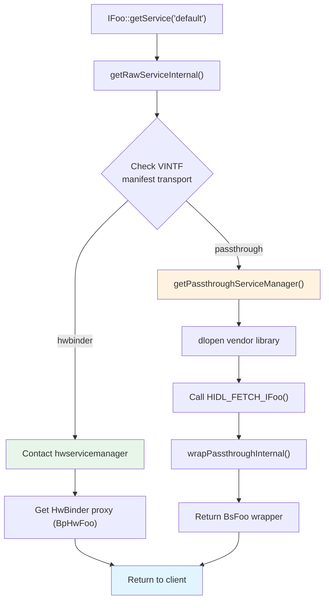

### 10.3.8.2 HIDL 版本管理规则

HIDL 使用基于 major.minor 版本的严格版本管理方案：

- **次版本号提升**（1.0 -> 1.1）：可以新增方法，但现有方法不得更改。1.1
  实现还必须实现所有 1.0 方法。

- **主版本号提升**（1.x -> 2.0）：允许破坏性更改。新接口与旧接口相互独立。

跨次版本的接口继承是被强制执行的：

```
// Example: ICameraProvider evolves through minor versions
package android.hardware.camera.provider@2.4;
interface ICameraProvider {
    getCameraIdList() generates (Status status, vec<string> cameraDeviceNames);
    // ... other methods
};

package android.hardware.camera.provider@2.5;
import @2.4::ICameraProvider;
interface ICameraProvider extends @2.4::ICameraProvider {
    // Adds new method while inheriting all 2.4 methods
    notifyDeviceStateChange(bitfield<DeviceState> newState);
};

package android.hardware.camera.provider@2.6;
import @2.5::ICameraProvider;
interface ICameraProvider extends @2.5::ICameraProvider {
    // Adds more methods while inheriting all 2.4 and 2.5 methods
    getConcurrentStreamingCameraIds()
        generates (Status status, vec<vec<string>> cameraIds);
};
```

当对 `@2.4::ICameraProvider` 调用 `getService()` 时，运行时接受任何提供
2.4、2.5 或 2.6 的实现。所有后续版本都从 2.4 继承。

### 10.3.9 HIDL 废弃状态

HIDL 早在 Android 13（2022）就被正式废弃，AOSP 不再接纳新的 HIDL
接口。这次废弃是真实存在的，但并非一次彻底的清除：HIDL 被冻结，而非消失。
Android 17 源码树在 `hardware/interfaces/` 下仍然随附约 726 个 `.hal`
文件。audio、wifi、gnss、radio、camera、keymaster、secure_element、
bluetooth 等接口都保留了冻结的 `.hal` 版本，与更新的 `aidl/` 包并存（或
取而代之）。大约有十几个接口目录仍然根本没有顶层 `aidl/`。

它们之所以存续，是因为一个多年前冻结了 HIDL 接口的 HAL 必须为针对它的
vendor 分区保留该精确的线路契约。HIDL 运行时（`system/libhidl`）和
`hwservicemanager` 同样作为一个兼容 shim 存续。借助该 shim，较新的框架仍
能与冻结了 HIDL HAL 的旧 vendor 分区通信。

体现此次废弃的关键文件：

- `system/libhidl/transport/ServiceManagement.cpp` 包含 `NoHwServiceManager`
  （第 209 行）。这是一个替代用的 `IServiceManager`。在已完全迁移离开
  HIDL 的设备上会返回它。结果，仍试图获取 HwBinder 服务管理器的调用方会
  得到一个行为良好的 no-op，而不是崩溃。
- `isHidlSupported()` 函数（第 75 行）检查设备上是否甚至可用 HwBinder。
  在其返回 false 的地方，`gDefaultServiceManager` 被设置为
  `NoHwServiceManager`（第 367-370 行），HIDL 的 `getService` 查找会短路
  （第 565 行）。

换句话说，一台搭载 Android 17 发布的设备可以完全不随附 HIDL 栈。
`system/libhidl` 和 `system/hwservicemanager` 的存在是为了向后兼容。一台
仅使用 AIDL 的干净设备永远不会实例化真正的 `hwservicemanager`。

---

## 10.4 AIDL HAL（当前标准）

从 Android 11 开始，Google 着手将 HAL 接口从 HIDL 迁移到
AIDL（Android Interface Definition Language，Android 接口定义语言）。在当前的
AOSP 中，AIDL HAL 已成为所有新硬件接口以及大多数现有接口的标准。

AIDL 早已是 Android 框架内部进程间通信的通用语言。Google 扩展了 AIDL 以
支持 HAL。这消除了对独立 IDL 语言（HIDL）、独立 IPC 机制（HwBinder）和
独立服务管理器（hwservicemanager）的需求。

### 10.4.1 AIDL 为何取代 HIDL

| 方面 | HIDL | AIDL HAL |
|--------|------|----------|
| IDL 语言 | 自定义 `.hal` 语法 | 标准 `.aidl` 语法 |
| IPC 传输 | HwBinder | 标准 Binder |
| 服务管理器 | hwservicemanager | servicemanager |
| 语言支持 | C++、Java | C++、Java、Rust、NDK C++ |
| 工具链 | hidl-gen | aidl（已有） |
| 学习曲线 | 需要学习新语法 | Android 开发者已熟悉 |
| 测试基础设施 | 独立的 VTS 测试框架 | 统一的 VTS/CTS 基础设施 |

AIDL HAL 的关键优势：

1. **单一工具链。** AIDL 编译器早已存在且久经考验。无需再单独维护
   `hidl-gen`。

2. **Rust 支持。** AIDL 生成 Rust 绑定，使 HAL 实现可以用内存安全的 Rust
   编写。HIDL 没有 Rust 支持。

3. **NDK 后端。** AIDL HAL 可以使用 NDK 后端，允许厂商代码使用稳定的 NDK
   API，而无需链接平台 C++ 库。

4. **更简单的版本管理。** AIDL 使用整数版本而非 HIDL 的 major.minor 方案。
   每个版本都是接口的一个完整快照。

5. **统一的生态系统。** 框架服务和 HAL 服务现在使用相同的 IPC 机制、相同
   的服务管理器和相同的调试工具（如 `dumpsys`）。

### 10.4.2 AIDL HAL 接口定义

一个 AIDL HAL 接口看起来与普通的框架 AIDL 接口几乎完全相同，但有一个关键
新增：`@VintfStability` 注解。

以下是 Android 17 中冻结在版本 3 的 Lights HAL 接口：

```java
// hardware/interfaces/light/aidl/android/hardware/light/ILights.aidl (lines 17-62)

package android.hardware.light;

import android.hardware.light.HwLight;
import android.hardware.light.HwLightEffect;
import android.hardware.light.HwLightState;

/**
 * Allows controlling logical lights/indicators, mapped to LEDs in a
 * hardware-specific manner by the HAL implementation.
 */
@VintfStability
interface ILights {
    /**
     * Set light identified by id to the provided state.
     *
     * If control over an invalid light is requested, this method must throw an
     * UnsupportedOperationException.
     *
     * @param id ID of logical light to set as returned by getLights()
     * @param state describes what the light should look like.
     */
    void setLightState(in int id, in HwLightState state);

    /**
     * Discover what lights are supported by the HAL implementation.
     *
     * @return List of available lights
     */
    HwLight[] getLights();

    /**
     * Plays light effects on one or more lights.
     *
     * If the effect is ill formed or requests unsupported frame rates this
     * method must throw an IllegalArgumentException.
     *
     * @param effects Effects that should be applied to the different lights.
     */
    void setLightEffects(in HwLightEffect[] effects);
}
```

这就是直截了当的 AIDL。`@VintfStability` 注解是唯一表明这是一个 HAL 接口而
非普通框架服务的标志。版本 3 新增了第三个方法 `setLightEffects`。它接收一个
`HwLightEffect` parcelable 数组。每个 parcelable 是一系列颜色控制点、一个帧
调度和一种插值模式。有了这些，一盏灯可以播放动画而不只是单一的静态状态。

### 10.4.3 @VintfStability 注解

`@VintfStability` 注解有两个作用：

1. **构建时**：AIDL 编译器执行更严格的规则。接口引用的所有类型也必须是
   `@VintfStability`。接口必须在发布前完成版本化并冻结。

2. **运行时**：Binder 框架会检查服务是否在设备的 VINTF 清单中声明，之后
   才允许其向 `servicemanager` 注册。

该注解将 AIDL 世界与 VINTF 兼容性框架连接起来。它确保 HAL 接口拥有与 HIDL
接口曾经相同的兼容性保证。

### 10.4.4 走读：Lights HAL

Lights HAL 是最简单的 AIDL HAL 之一，因此是理解完整栈的绝佳示例。其参考
实现使用 Rust。

**接口定义**（`hardware/interfaces/light/aidl/`）：

`Android.bp` 文件定义了该 AIDL 接口模块：

```
// hardware/interfaces/light/aidl/Android.bp (lines 10-38)

aidl_interface {
    name: "android.hardware.light",
    vendor_available: true,
    srcs: [
        "android/hardware/light/*.aidl",
    ],
    stability: "vintf",
    frozen: true,
    backend: {
        java: {
            sdk_version: "module_current",
        },
        rust: {
            enabled: true,
        },
    },
    versions_with_info: [
        {
            version: "1",
            imports: [],
        },
        {
            version: "2",
            imports: [],
        },
        {
            version: "3",
            imports: [],
        },
    ],
}
```

关键字段：

- `stability: "vintf"` —— 启用 `@VintfStability` 检查。
- `frozen: true` —— 最新版本已冻结（不允许修改）。
- `vendor_available: true` —— 生成的库可供厂商代码使用。
- `backend.rust.enabled: true` —— 生成 Rust 绑定。
- `versions_with_info` —— 列出所有冻结的 API 版本（1、2 和 3）。

**Rust 参考实现**（`hardware/interfaces/light/aidl/default/`）：

主入口（`main.rs`，第 28-46 行）：

```rust
// hardware/interfaces/light/aidl/default/main.rs (lines 28-46)

fn main() {
    let logger_success = logger::init(
        logger::Config::default()
            .with_tag_on_device(LOG_TAG)
            .with_max_level(LevelFilter::Trace),
    );
    if !logger_success {
        panic!("{LOG_TAG}: Failed to start logger.");
    }

    binder::ProcessState::set_thread_pool_max_thread_count(0);

    let lights_service = LightsService::default();
    let lights_service_binder = BnLights::new_binder(
        lights_service, BinderFeatures::default());

    let service_name = format!("{}/default", LightsService::get_descriptor());
    binder::add_service(&service_name, lights_service_binder.as_binder())
        .expect("Failed to register service");

    binder::ProcessState::join_thread_pool()
}
```

实现（`lights.rs`）：

```rust
// hardware/interfaces/light/aidl/default/lights.rs (lines 132-168)

impl ILights for LightsService {
    fn setLightState(&self, id: i32, state: &HwLightState) -> binder::Result<()> {
        info!("Lights setting state for id={} to color {:x}", id, state.color);

        if let Some(light) = self.lights.lock().unwrap().get_mut(&id) {
            light.state = *state;
            Ok(())
        } else {
            Err(Status::new_exception(
                ExceptionCode::UNSUPPORTED_OPERATION, None))
        }
    }

    fn setLightEffects(&self, effects: &[HwLightEffect]) -> binder::Result<()> {
        info!("Lights setting effect for {} lights", effects.len());

        // Validate every effect first, then apply.
        for effect in effects {
            let validation_err = self.validate_effect(effect);
            if validation_err != ExceptionCode::NONE {
                return Err(Status::new_exception(validation_err, None));
            }
        }
        for effect in effects {
            if let Some(light) = self.lights.lock().unwrap()
                .get_mut(&effect.lightId) {
                light.effect = effect.clone();
            }
        }
        Ok(())
    }

    fn getLights(&self) -> binder::Result<Vec<HwLight>> {
        info!("Lights reporting supported lights");
        Ok(self.lights.lock().unwrap().values()
            .map(|light| light.hw_light).collect())
    }
}
```

版本 3 的 `setLightEffects` 在修改任何灯之前先校验每个 `HwLightEffect`
（帧数、帧率），因此格式错误的请求会抛出 `IllegalArgumentException`，而不
会让灯停留在半更新状态。

**VINTF 清单片段**（`lights-default.xml`）：

```xml
<!-- hardware/interfaces/light/aidl/default/lights-default.xml -->
<manifest version="1.0" type="device">
    <hal format="aidl">
        <name>android.hardware.light</name>
        <version>2</version>
        <fqname>ILights/default</fqname>
    </hal>
</manifest>
```

尽管接口已冻结在版本 3 且实现链接的是 V3 库，该片段仍声明
`<version>2</version>`。清单中的 `<version>` 是服务所提供的*最高*接口版本。
libvintf 的 `VersionRange::supportedBy()`
（`system/libvintf/include/vintf/VersionRange.h`，第 54-61 行）会接受一个
清单版本来满足任何等于或低于它的矩阵需求。因此，在发布 V3 代码的同时声明
2 只是一个过时、低报的参考片段。它能工作是因为框架矩阵仍然接受版本 2，而
不是因为任何“最低版本”约定。

**init.rc 服务定义**（`lights-default.rc`）：

```
# hardware/interfaces/light/aidl/default/lights-default.rc
service vendor.light-default /vendor/bin/hw/android.hardware.lights-service.example
    class hal
    user nobody
    group nobody
    shutdown critical
```

**构建定义**（`Android.bp`）：

```
// hardware/interfaces/light/aidl/default/Android.bp (lines 10-23)

rust_binary {
    name: "android.hardware.lights-service.example",
    relative_install_path: "hw",
    init_rc: ["lights-default.rc"],
    vintf_fragments: ["lights-default.xml"],
    vendor: true,
    rustlibs: [
        "liblogger",
        "liblog_rust",
        "libbinder_rs",
        "android.hardware.light-V3-rust",
    ],
    srcs: [ "main.rs" ],
}
```

从构建到运行时的完整流程：

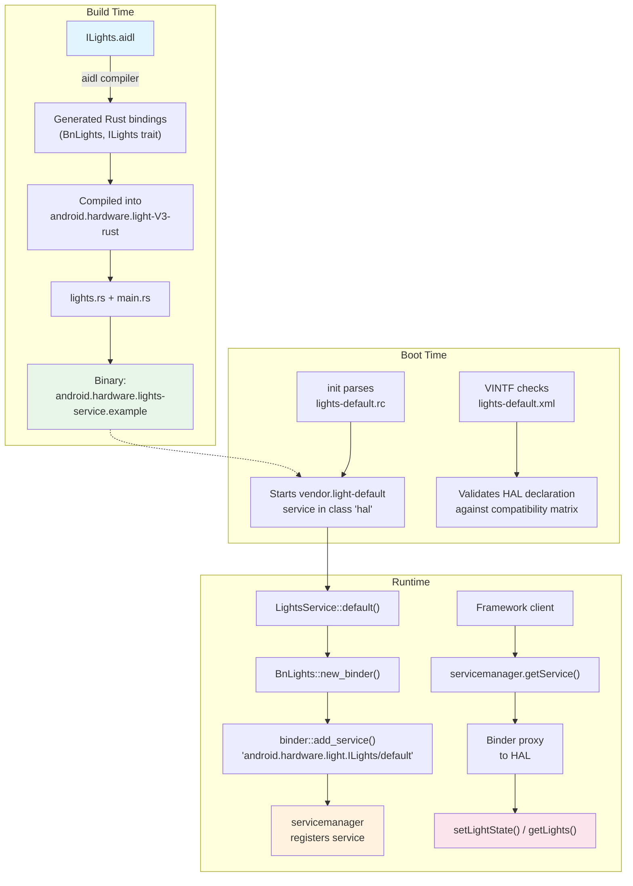

### 10.4.4.1 理解 Lights HAL 的数据类型

Lights HAL 使用两个辅助 AIDL 类型。`HwLight` 描述一盏物理灯，`HwLightState`
描述该灯的期望状态。它们作为 parcelable 定义在同一包中：

```java
// android/hardware/light/HwLight.aidl (representative)

package android.hardware.light;

@VintfStability
parcelable HwLight {
    /** Unique ID for this light */
    int id;
    /** Ordinal for ordering within the same type */
    int ordinal;
    /** Type of light (BACKLIGHT, KEYBOARD, BUTTONS, etc.) */
    LightType type;
}
```

```java
// android/hardware/light/HwLightState.aidl (representative)

package android.hardware.light;

@VintfStability
parcelable HwLightState {
    /** Color in ARGB format */
    int color;
    /** Flash mode (NONE, TIMED, HARDWARE) */
    FlashMode flashMode;
    /** Flash on time in milliseconds */
    int flashOnMs;
    /** Flash off time in milliseconds */
    int flashOffMs;
    /** Brightness mode (USER, SENSOR, LOW_PERSISTENCE) */
    BrightnessMode brightnessMode;
}
```

`lights.rs` 中的 Rust 实现存储从灯 ID 到状态的映射，使用
`Mutex<HashMap<i32, Light>>` 处理并发访问。`NUM_DEFAULT_LIGHTS` 常量（设为
3）创建三个默认背光实例。

错误处理模式值得注意：当 `setLightState` 收到未知 ID 时，它返回
`ExceptionCode::UNSUPPORTED_OPERATION`，这映射为 Binder 协议中的
`EX_UNSUPPORTED_OPERATION`。这是标准的 AIDL HAL 约定——能力查询和不受支持
的操作使用此异常码，使客户端能够优雅地回退。

### 10.4.5 走读：Audio Core HAL

Audio Core HAL 是 AOSP 中最复杂的 AIDL HAL 之一，展示了 AIDL HAL 框架的
全部能力。

IModule 接口
（`hardware/interfaces/audio/aidl/aidl_api/android.hardware.audio.core/current/android/hardware/audio/core/IModule.aidl`）
为音频设备管理定义了 35 个以上的方法：

```java
// IModule.aidl (excerpt, lines 36-77)

@VintfStability
interface IModule {
  void setModuleDebug(in ModuleDebug debug);
  @nullable ITelephony getTelephony();
  @nullable IBluetooth getBluetooth();
  @nullable IBluetoothA2dp getBluetoothA2dp();
  @nullable IBluetoothLe getBluetoothLe();
  AudioPort connectExternalDevice(in AudioPort templateIdAndAdditionalData);
  void disconnectExternalDevice(int portId);
  AudioPatch[] getAudioPatches();
  AudioPort getAudioPort(int portId);
  AudioPortConfig[] getAudioPortConfigs();
  AudioPort[] getAudioPorts();
  AudioRoute[] getAudioRoutes();
  OpenInputStreamReturn openInputStream(in OpenInputStreamArguments args);
  OpenOutputStreamReturn openOutputStream(in OpenOutputStreamArguments args);
  SupportedPlaybackRateFactors getSupportedPlaybackRateFactors();
  AudioPatch setAudioPatch(in AudioPatch requested);
  boolean setAudioPortConfig(in AudioPortConfig requested,
                             out AudioPortConfig suggested);
  void resetAudioPatch(int patchId);
  void resetAudioPortConfig(int portConfigId);
  boolean getMasterMute();
  void setMasterMute(boolean mute);
  float getMasterVolume();
  void setMasterVolume(float volume);
  boolean getMicMute();
  void setMicMute(boolean mute);
  MicrophoneInfo[] getMicrophones();
  void updateAudioMode(AudioMode mode);
  void updateScreenRotation(ScreenRotation rotation);
  void updateScreenState(boolean isTurnedOn);
  @nullable ISoundDose getSoundDose();
  // ...
}
```

该接口使用嵌套的 parcelable 类型作为复杂参数：

```java
// IModule.aidl (lines 80-99)

  @VintfStability
  parcelable OpenInputStreamArguments {
    int portConfigId;
    SinkMetadata sinkMetadata;
    long bufferSizeFrames;
  }
  @VintfStability
  parcelable OpenInputStreamReturn {
    IStreamIn stream;
    StreamDescriptor desc;
  }
  @VintfStability
  parcelable OpenOutputStreamArguments {
    int portConfigId;
    SourceMetadata sourceMetadata;
    @nullable AudioOffloadInfo offloadInfo;
    long bufferSizeFrames;
    @nullable IStreamCallback callback;
    @nullable IStreamOutEventCallback eventCallback;
  }
```

`hardware/interfaces/audio/aidl/default/Module.cpp` 中的默认实现展示了一个
生产级 HAL 的规模。该文件以一段仅包含 `using` 声明的代码块开头
（第 37-67 行）：

```c++
// hardware/interfaces/audio/aidl/default/Module.cpp (lines 37-67, excerpt)

using aidl::android::hardware::audio::common::SinkMetadata;
using aidl::android::hardware::audio::common::SourceMetadata;
using aidl::android::hardware::audio::core::sounddose::ISoundDose;
using aidl::android::media::audio::common::AudioChannelLayout;
using aidl::android::media::audio::common::AudioDevice;
using aidl::android::media::audio::common::AudioDeviceType;
using aidl::android::media::audio::common::AudioFormatDescription;
using aidl::android::media::audio::common::AudioFormatType;
// ... (many more)
```

来自 `hardware/interfaces/audio/aidl/default/android.hardware.audio.service-aidl.xml`
的 Audio HAL VINTF 清单片段：

```xml
<!-- hardware/interfaces/audio/aidl/default/android.hardware.audio.service-aidl.xml -->
<manifest version="1.0" type="device">
  <hal format="aidl">
    <name>android.hardware.audio.core</name>
    <version>4</version>
    <fqname>IModule/default</fqname>
  </hal>
  <hal format="aidl">
    <name>android.hardware.audio.core</name>
    <version>4</version>
    <fqname>IModule/r_submix</fqname>
  </hal>
  <hal format="aidl">
    <name>android.hardware.audio.core</name>
    <version>4</version>
    <fqname>IModule/bluetooth</fqname>
  </hal>
  <hal format="aidl">
    <name>android.hardware.audio.core</name>
    <version>4</version>
    <fqname>IConfig/default</fqname>
  </hal>
  <hal format="aidl">
    <name>android.hardware.audio.effect</name>
    <version>4</version>
    <fqname>IFactory/default</fqname>
  </hal>
</manifest>
```

请注意，单个 HAL 服务进程可以托管多个 IModule 实例（default、r_submix、
bluetooth）——每个都作为独立的服务名向 servicemanager 注册。

init.rc 服务定义
（`hardware/interfaces/audio/aidl/default/android.hardware.audio.service-aidl.example.rc`）
展示了一个延迟关键型 HAL 的安全与性能配置：

```
# android.hardware.audio.service-aidl.example.rc (lines 2-12)

service vendor.audio-hal-aidl /apex/com.android.hardware.audio/bin/hw/android.hardware.audio.service-aidl.example
    class hal
    user audioserver
    group audio camera drmrpc inet media mediadrm net_bt net_bt_admin net_bw_acct wakelock context_hub
    capabilities BLOCK_SUSPEND SYS_NICE
    # setting RLIMIT_RTPRIO allows binder RT priority inheritance
    rlimit rtprio 10 10
    ioprio rt 4
    task_profiles ProcessCapacityHigh HighPerformance
    onrestart restart audioserver
```

关键配置细节：

- **APEX 打包**：该二进制文件位于一个 APEX 模块
  （`com.android.hardware.audio`）中，允许其被独立更新。
- **能力（Capabilities）**：`BLOCK_SUSPEND` 防止设备在音频播放期间休眠；
  `SYS_NICE` 允许设置实时调度。
- **实时优先级**：`rlimit rtprio 10 10` 和 `ioprio rt 4` 确保音频 HAL 获得
  调度优先级。
- **重启级联**：`onrestart restart audioserver` 确保如果 HAL 崩溃，音频服务
  也会重启以重新初始化。

### 10.4.6 Power HAL：一个复杂的现代接口

Power HAL（`hardware/interfaces/power/aidl/android/hardware/power/IPower.aidl`）
展示了现代 AIDL HAL 如何处理提示会话（hint sessions）和 FMQ（Fast Message
Queue，快速消息队列）通道等高级特性：

```java
// hardware/interfaces/power/aidl/android/hardware/power/IPower.aidl (excerpt, lines 33-200)

@VintfStability
interface IPower {
    oneway void setMode(in Mode type, in boolean enabled);
    boolean isModeSupported(in Mode type);
    oneway void setBoost(in Boost type, in int durationMs);
    boolean isBoostSupported(in Boost type);

    IPowerHintSession createHintSession(
            in int tgid, in int uid, in int[] threadIds, in long durationNanos);

    long getHintSessionPreferredRate();

    IPowerHintSession createHintSessionWithConfig(in int tgid, in int uid,
            in int[] threadIds, in long durationNanos,
            in SessionTag tag, out SessionConfig config);

    ChannelConfig getSessionChannel(in int tgid, in int uid);
    oneway void closeSessionChannel(in int tgid, in int uid);
    SupportInfo getSupportInfo();

    CpuHeadroomResult getCpuHeadroom(in CpuHeadroomParams params);
    GpuHeadroomResult getGpuHeadroom(in GpuHeadroomParams params);

    oneway void sendCompositionData(in CompositionData[] data);
    oneway void sendCompositionUpdate(in CompositionUpdate update);
}
```

值得注意的特性：

- **`oneway` 方法**：`setMode`、`setBoost`、`sendCompositionData` 和
  `closeSessionChannel` 被标记为 `oneway`，意味着它们是异步的发后即忘
  调用。这对绝不能阻塞调用方的电源提示至关重要。

- **会话管理**：`createHintSession` 和 `createHintSessionWithConfig` 返回
  `IPowerHintSession` 子接口，展示了 AIDL 能够返回创建新的按会话 Binder
  连接的接口引用。

- **FMQ 通道**：`getSessionChannel` 返回一个 `ChannelConfig`，其中包含 FMQ
  （Fast Message Queue）描述符，用于框架与电源 HAL 之间的零拷贝、低延迟
  通信。

### 10.4.7 Vibrator HAL：C++ 中的 NDK 后端

Vibrator HAL 参考实现
（`hardware/interfaces/vibrator/aidl/default/main.cpp`）展示了 NDK
（Native Development Kit）C++ 后端，这是厂商 HAL 实现的首选后端：

```c++
// hardware/interfaces/vibrator/aidl/default/main.cpp (lines 17-45)

#include "vibrator-impl/Vibrator.h"
#include "vibrator-impl/VibratorManager.h"

#include <android-base/logging.h>
#include <android/binder_manager.h>
#include <android/binder_process.h>

using aidl::android::hardware::vibrator::Vibrator;
using aidl::android::hardware::vibrator::VibratorManager;

int main() {
    ABinderProcess_setThreadPoolMaxThreadCount(0);

    // make a default vibrator service
    auto vib = ndk::SharedRefBase::make<Vibrator>();
    binder_status_t status = AServiceManager_addService(
            vib->asBinder().get(),
            Vibrator::makeServiceName("default").c_str());
    CHECK_EQ(status, STATUS_OK);

    // make the vibrator manager service with a different vibrator
    auto managedVib = ndk::SharedRefBase::make<Vibrator>();
    auto vibManager = ndk::SharedRefBase::make<VibratorManager>(
        std::move(managedVib));
    status = AServiceManager_addService(
        vibManager->asBinder().get(),
        VibratorManager::makeServiceName("default").c_str());
    CHECK_EQ(status, STATUS_OK);

    ABinderProcess_joinThreadPool();
    return EXIT_FAILURE;  // should not reach
}
```

NDK 后端使用带 `A*` 前缀的 C API（如 `AServiceManager_addService`、
`ABinderProcess_setThreadPoolMaxThreadCount`），而非 C++ 的 `binder::`
命名空间 API。这一点很重要，因为：

1. NDK API 具有稳定的 ABI，因此针对某个版本编译的厂商代码可与未来的平台
   版本一起工作。
2. NDK 后端不链接 `libbinder.so`（平台 C++ Binder 库），而该库不属于 VNDK。

### 10.4.7.1 Sensors HAL：用于高吞吐数据的 FMQ

Sensors HAL
（`hardware/interfaces/sensors/aidl/android/hardware/sensors/ISensors.aidl`）
展示了一种高级 AIDL HAL 模式：使用 Fast Message Queues（FMQ）进行批量数据
传输，而非逐个 Binder 事务。

传感器事件（加速度计读数、陀螺仪采样等）可能以数百 Hz 的速率到达。每个
事件都单独进行 Binder 调用的代价将高得不可承受。因此，Sensors HAL 使用
FMQ——带无锁同步的共享内存环形缓冲区：

```java
// hardware/interfaces/sensors/aidl/android/hardware/sensors/ISensors.aidl (excerpt)

@VintfStability
interface ISensors {
    void activate(in int sensorHandle, in boolean enabled);

    void batch(in int sensorHandle, in long samplingPeriodNs,
               in long maxReportLatencyNs);

    void flush(in int sensorHandle);

    SensorInfo[] getSensorsList();

    /**
     * Initialize the Sensors HAL's Fast Message Queues (FMQ) and callback.
     *
     * The Event FMQ is used to transport sensor events from the HAL to the
     * framework.  The Wake Lock FMQ is used by the framework to notify the
     * HAL when it is safe to release its wake_lock.
     */
    void initialize(
        in MQDescriptor<Event, SynchronizedReadWrite> eventQueueDescriptor,
        in MQDescriptor<int, SynchronizedReadWrite> wakeLockDescriptor,
        in ISensorsCallback sensorsCallback);
}
```

`MQDescriptor` 类型是共享内存 FMQ 通道的一个可经 Binder 序列化的描述符。
框架创建 FMQ 并通过 `initialize()` 将其描述符传递给 HAL。然后双方都可以通过
共享内存读写事件，而没有任何 Binder 开销。

这种“设置用 Binder、数据用 FMQ”的模式在性能关键型 HAL 中很常见：

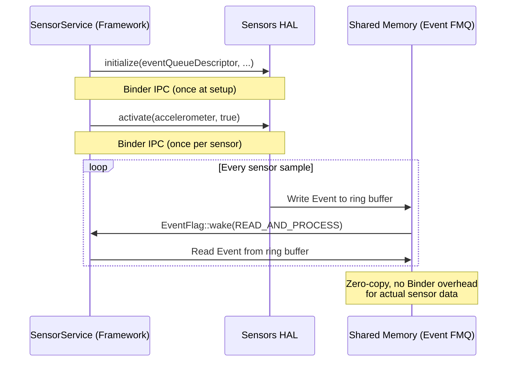

### 10.4.7.2 Health HAL：回调模式

Health HAL
（`hardware/interfaces/health/aidl/android/hardware/health/IHealth.aidl`）
展示了回调接口模式，即 HAL 异步将数据推送给框架：

```java
// hardware/interfaces/health/aidl/android/hardware/health/IHealth.aidl (lines 33-258, excerpt)

@VintfStability
interface IHealth {
    const int STATUS_UNKNOWN = 2;
    const int STATUS_CALLBACK_DIED = 4;

    void registerCallback(in IHealthInfoCallback callback);
    void unregisterCallback(in IHealthInfoCallback callback);
    void update();

    int getChargeCounterUah();
    int getCurrentNowMicroamps();
    int getCurrentAverageMicroamps();
    int getCapacity();
    long getEnergyCounterNwh();
    BatteryStatus getChargeStatus();
    StorageInfo[] getStorageInfo();
    DiskStats[] getDiskStats();
    HealthInfo getHealthInfo();

    void setChargingPolicy(BatteryChargingPolicy in_value);
    BatteryChargingPolicy getChargingPolicy();
    BatteryHealthData getBatteryHealthData();
    HingeInfo[] getHingeInfo();
}
```

IHealth 接口结合了两种访问模式：

1. **拉取模型** —— 诸如 `getCapacity()`、`getChargeStatus()`、
   `getHealthInfo()` 等方法用于按需查询。

2. **推送模型** —— `registerCallback()` / `unregisterCallback()` 用于通过
   `IHealthInfoCallback` 接口进行异步通知。

`update()` 方法触发 HAL 将所有已注册回调推送最新健康信息。框架会周期性地
调用它，并在重大电源事件（充电器连接/断开、低电量）期间调用它。

错误处理展示了 AIDL 的异常码：

- `EX_UNSUPPORTED_OPERATION` —— 硬件不支持此查询
  （例如，该设备上不存在对应的 sysfs 文件）。
- 带有 `STATUS_UNKNOWN` 的服务特定错误 —— 发生了意外错误。
- 带有 `STATUS_CALLBACK_DIED` 的服务特定错误 —— 之前注册的某个回调的宿主
  进程已死亡。

这一区分使框架能够恰当地处理每种情况：不受支持的特性不会被重试，而未知
错误可能触发重试或 HAL 重启。

### 10.4.7.3 libfmq：Fast Message Queues 的工作原理

上面的 Sensors HAL 通过 Binder 交出一个 `MQDescriptor`，然后在实际的采样
流上不再触碰 Binder。使这成为可能的机制位于 `system/libfmq/` 中（C++ 和
Rust，以及 EventFlag futex 辅助）。本节打开这个盒子。它展示环形缓冲区在
共享内存中是如何布局的，以及读写指针如何无锁前进。它还展示 `EventFlag`
如何唤醒阻塞的读取者，以及 `MQDescriptor` 跨过 AIDL 边界时实际携带了什么。

#### 共享内存布局与 grantor 描述符

一个 FMQ 是一块 ashmem 区域，其中包含三个（可选四个）区域。这些区域是：
一个写计数器、一个读计数器、环形缓冲区本身，以及——如果需要阻塞操作——
一个 32 位的 EventFlag 字。每个区域由一个 `GrantorDescriptor` 描述，描述符
位置由 `system/libfmq/base/fmq/MQDescriptorBase.h` 中的一个枚举固定：

```c++
// system/libfmq/base/fmq/MQDescriptorBase.h (GrantorType enum)
enum GrantorType : int {
    READPTRPOS = 0,
    WRITEREGIONENDPTRPOS = READPTRPOS,
    WRITEPTRPOS,
    DATAPTRPOS,
    EVFLAGWORDPOS
};
// kMinGrantorCount = DATAPTRPOS + 1                 (no blocking support)
// kMinGrantorCountForEvFlagSupport = EVFLAGWORDPOS + 1   (blocking support)
```

未创建 EventFlag 支持的队列需要三个 grantor（读计数器、写计数器、数据
缓冲区）；阻塞队列需要第四个用于 EventFlag 字。当
`MessageQueueBase::initMemory()` 运行时，它会依次 `mmap` 每个 grantor。它
从 `READPTRPOS` 映射 `mReadPtr`，从 `WRITEPTRPOS` 映射 `mWritePtr`，从
`DATAPTRPOS` 映射环形缓冲区 `mRing`，以及（如果存在）从 `EVFLAGWORDPOS`
映射 `mEvFlagWord`。然后它在该 futex 字上调用
`EventFlag::createEventFlag()`。
读写计数器各自是一个 `RingBufferPosition`，它只是一个 `uint64_t`
（`system/libfmq/include/fmq/MessageQueueBase.h`，`mReadPtr` 和 `mWritePtr`
是 `std::atomic<uint64_t>*`）。

#### 两个计数器与回绕

FMQ 中最重要的设计选择是：读写计数器是*单调递增的绝对字节位置*。它们从
不被对缓冲区大小取模。可读的数据量就是 `writePtr - readPtr`，在
`availableToReadBytes()` 中计算：

```c++
// system/libfmq/include/fmq/MessageQueueBase.h (availableToReadBytes, condensed)
uint64_t writePtr = mWritePtr->load(std::memory_order_acquire);
uint64_t readPtr  = mReadPtr->load(std::memory_order_acquire);
if (writePtr < readPtr) { /* corruption: counters crossed */ return 0; }
return writePtr - readPtr;
```

只有当某个槽位被寻址时，才会通过 `writePtr % mDesc->getSize()`（读偏移
同理）恢复出环形缓冲区中的实际字节偏移。由于计数器是 64 位的，即使偏移已
经回绕了许多次，差值仍然正确。只有真正的指针损坏（写计数器落后于读计数
器）才被视为错误。

一次超出缓冲区末尾的写入或
读取会被拆分为两个连续的区域。`beginWrite()`/`beginRead()` 返回的
`MemTransaction` 代表这两个区域。`beginWrite()` 计算
`contiguousMessages = (size - writeOffset) / quantum`；如果该值少于请求的
数量，它就返回一个 `MemTransaction`，其 `first` 区域位于
`mRing + writeOffset`，`second` 区域回绕回到 `mRing`。调用方填充两个区域，
然后调用 `commitWrite(nMessages)`，后者以 `memory_order_release` 存储推进
`mWritePtr`，使读取者的 acquire-load 能看到新数据。

下图展示了绝对计数器与物理环形缓冲区之间的关系。

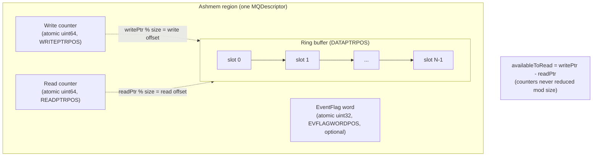

#### SYNC 与 UNSYNC

`MQFlavor`（在 `MQDescriptorBase.h` 中）恰好有两个取值，它们编码了截然
不同的契约：

- **`kSynchronizedReadWrite`** —— 一个写者、一个读者，无等待
  （wait-free）。一次会导致缓冲区溢出的写*失败*并返回 `false`；一次会导致
  下溢的读同样失败。数据永远不会被静默丢弃。Sensors HAL 对事件队列和
  wake-lock 队列都使用这种 flavor。

- **`kUnsynchronizedWrite`** —— 一个写者、*多个*读者。写总是成功，如果缓冲
  区已满则覆盖最旧的未读数据。每个读者保留自己的读计数器。一个被套圈的
  读者（lapped reader）会检测到覆盖并重置其计数器（队列记录日志，读取返回
  丢失）。

    那些读计数器位于每个读者自己进程的内存中，因此共享的读计数器槽位空了
    出来。这种 flavor 复用 grantor 槽位 0（`WRITEREGIONENDPTRPOS`，定义为与
    `READPTRPOS` 相同的索引）来发布一次进行中写入区域的末尾。grantor 数量
    保持不变，并未增加。
    libfmq 甚至会在运行时发出警告：如果未同步的写者试图在一次调用中覆盖整个
    缓冲区，那将使溢出检测失效。

flavor 作为 `MQDescriptor<T, Flavor>` 的第二个模板参数，在 AIDL 类型系统中
承载，取 `SynchronizedReadWrite` 或 `UnsynchronizedWrite`。因此两端之间的
不匹配是编译期错误，而不是运行时意外。

#### EventFlag：基于 futex 的唤醒

自旋的读者会浪费 CPU，因此阻塞式 FMQ 使用 `EventFlag`：一个共享的 32 位字，
用 Linux `futex` 系统调用操作（`system/libfmq/EventFlag.cpp`）。每一位都是
一个独立的唤醒通道。`EventFlag::wake(bitmask)` 原子地把位 OR 进该字，并且
只有在确实翻转了某个原本为 0 的位时，才发出 `FUTEX_WAKE_BITSET`：

```c++
// system/libfmq/EventFlag.cpp (wake, condensed)
uint32_t old = std::atomic_fetch_or(mEfWordPtr, bitmask);
if ((~old & bitmask) != 0) {   // a previously-clear bit was set
    syscall(__NR_futex, mEfWordPtr, FUTEX_WAKE_BITSET, kIntMax, NULL, NULL, bitmask);
}
```

`EventFlag::wait(bitmask, ...)` 做的是镜像操作：它用 `atomic_fetch_and`
原子地清除所请求的位，如果没有任何一位已置位，就用 `FUTEX_WAIT_BITSET` 挂起
线程。这种“延迟唤醒”处理意味着在匹配的 `wait` 之前到达的 `wake` 不会丢失。
该位已经被置位，因此 `wait` 立即返回而无需系统调用。

队列上的阻塞 API（`writeBlocking()` / `readBlocking()`）自动完成这一接线。
它使用标准的 `FMQ_NOT_FULL` / `FMQ_NOT_EMPTY` 通知位。写者在提交后置位
`FMQ_NOT_EMPTY`，读者在排空后置位 `FMQ_NOT_FULL`。每一侧都在另一侧的位上
阻塞。两个阻塞方法仅限于 `kSynchronizedReadWrite` flavor，并且要求已经配置
好一个 EventFlag 字。

#### MQDescriptor 跨过 AIDL

当某个 HAL 方法接收一个 `MQDescriptor<T, Flavor>` 参数时（例如
`ISensors.initialize()`），实际跨过 Binder 传输的是
`hardware/interfaces/common/fmq/aidl/android/hardware/common/fmq/MQDescriptor.aidl`
中的稳定 parcelable：

```java
@VintfStability
parcelable MQDescriptor<@FixedSize T, Flavor> {
    GrantorDescriptor[] grantors;
    NativeHandle handle;
    int quantum;
    int flags;
}
```

`handle` 是一个 `NativeHandle`，承载 ashmem 文件描述符。`grantors` 数组给出
该共享内存中每个区域的偏移和范围。`quantum` 是元素大小，`flags` 编码
flavor。元素类型 `T` 必须是 `@FixedSize`——FMQ 复制原始字节，因此布局必须在
两端完全相同。

在接收端，`AidlMessageQueue<T,
Flavor>`（`system/libfmq/include/fmq/AidlMessageQueue.h`）通过
`AidlMQDescriptorShim` 从描述符重建一个活动队列，映射发送者创建的同一 ashmem
区域。由于两个进程现在都 `mmap` 相同的页，之后每一次 `write()`/`read()`
都直接接触共享内存，零 Binder 事务。这正是 §10.4.7.1 所描述的“设置用
Binder、数据用 FMQ”模式，现在它被绑定到承载它的描述符上。一个 Rust 包装器
（`system/libfmq/libfmq.rs`，构建于类型擦除的 `ErasedMessageQueue` 之上）
向 Rust HAL 实现和客户端暴露相同的队列。

### 10.4.8 构建系统集成：aidl_interface

`aidl_interface` Soong 模块类型是 AIDL HAL 在构建系统中的入口点。以下是来自
Lights HAL 的完整定义：

```
// hardware/interfaces/light/aidl/Android.bp

aidl_interface {
    name: "android.hardware.light",
    vendor_available: true,
    srcs: [
        "android/hardware/light/*.aidl",
    ],
    stability: "vintf",
    frozen: true,
    backend: {
        java: {
            sdk_version: "module_current",
        },
        rust: {
            enabled: true,
        },
    },
    versions_with_info: [
        {
            version: "1",
            imports: [],
        },
        {
            version: "2",
            imports: [],
        },
        {
            version: "3",
            imports: [],
        },
    ],
}
```

这一个模块定义会生成以下库变体：

| 生成的库 | 语言 | 使用者 |
|-------------------|----------|---------|
| `android.hardware.light-V3-java` | Java | 框架服务 |
| `android.hardware.light-V3-ndk` | C++（NDK） | 厂商 HAL 实现（C++） |
| `android.hardware.light-V3-cpp` | C++（平台） | 框架原生代码 |
| `android.hardware.light-V3-rust` | Rust | 厂商 HAL 实现（Rust） |

命名约定为 `<package>-V<version>-<backend>`。

### 10.4.9 API 版本管理与冻结

AIDL HAL 使用整数版本管理。每个版本都是接口的一个完整快照，存储在
`aidl_api/` 目录中：

```
hardware/interfaces/light/aidl/
    android/hardware/light/ILights.aidl          # Current (development) version
    aidl_api/
        android.hardware.light/
            1/                                    # Frozen version 1
                android/hardware/light/ILights.aidl
                android/hardware/light/HwLight.aidl
                android/hardware/light/HwLightState.aidl
            2/                                    # Frozen version 2
                android/hardware/light/ILights.aidl
                android/hardware/light/HwLight.aidl
                android/hardware/light/HwLightState.aidl
            3/                                    # Frozen version 3 (adds HwLightEffect)
                android/hardware/light/ILights.aidl
                android/hardware/light/HwLight.aidl
                android/hardware/light/HwLightState.aidl
                android/hardware/light/HwLightEffect.aidl
            current/                              # Latest snapshot
                android/hardware/light/ILights.aidl
                ...
```

冻结的版本快照是不可变的——文件包含一段头警告：

```java
// From any frozen AIDL snapshot (e.g., IModule.aidl, lines 17-18)

///////////////////////////////////////////////////////////////////////////////
// THIS FILE IS IMMUTABLE. DO NOT EDIT IN ANY CASE.                          //
///////////////////////////////////////////////////////////////////////////////
```

构建系统强制执行这一点：

1. 在开发期间，可以修改主源码目录中的 `.aidl` 文件。
2. `m <name>-update-api` 从源码刷新 `current/` 快照。当某个版本准备好发布
   时，通过运行 `m <name>-freeze-api` 将其“冻结”。该命令将当前源码复制到
   一个新的编号目录（`system/tools/aidl/build/aidl_api.go`，第 686-689 行）。
3. `Android.bp` 中的 `frozen: true` 标志告诉构建系统验证当前源码与最新的
   冻结版本一致。

向后兼容性是被强制执行的：版本 N+1 必须是版本 N 的超集。可以新增方法、
类型和字段，但不能移除或更改现有内容。

**`@VersionSupport` 注解。** AIDL 编译器新增了一个接口级注解，将接口固定到
一个声明版本。其 schema 注册在 `system/tools/aidl/aidl_language.cpp`（第
226-229 行）：它名为 `VersionSupport`，仅适用于接口声明
（`CONTEXT_TYPE_INTERFACE`），并接受一个必需的整数参数 `version`。在源码中
它看起来像这样（来自 AIDL 工具链自身的测试接口
`system/tools/aidl/tests/trunk_stable_test/.../ITrunkStableTest.aidl`）：

```java
@VersionSupport(version=2)
interface ITrunkStableTest {
    // ...
}
```

编译器会将声明的数字与接口真实的冻结版本交叉核对。`system/tools/aidl/aidl_language.cpp`
中 `AidlInterface::VersionSpecificCheckValid()`（第 1870-1882 行）在
`@VersionSupport` 版本不等于实际正在构建的版本时报错。`AidlInterface::Version()`
（第 1904-1910 行）使该注解在存在时成为接口版本的权威来源。

这收紧了 trunk-stable 模型。有了源码中的注解，接口声称支持的版本就被写在
类型自身上。它不再仅仅从 `aidl_interface` 构建标志推断。因此，一个被接入
错误版本 stanza 的接口会构建失败，而不是被静默地错误定版本。

### 10.4.10 hardware/interfaces/ 目录

`hardware/interfaces/` 目录包含所有 AOSP HAL 接口定义。在 Android 17 源码树
中，它拥有 51 个硬件接口目录（不包括基础设施目录 `common`、
`compatibility_matrices`、`scripts`、`staging` 和 `tests`）。大多数带有一个
`aidl/` 包，而早期版本随附的仅含 HIDL 的 `configstore` 接口已经消失。

但 `.hal`/`hidl/` 子树并未全部被修剪。仍有约 726 个 `.hal` 文件随附。其中
恰好有十二个目录（`apexkey`、`atrace`、`automotive`、`biometrics`、
`camera`、`graphics`、`input`、`media`、`renderscript`、`security`、`tv`、
`virtualization`）没有自己的顶层 `aidl/`。它们的接口要么是仍冻结的 HIDL
`.hal` 定义，要么是往下一层嵌套的 AIDL 包，要么是非 HAL 的构建产物：

| 类别 | HAL 接口 |
|----------|---------------|
| **媒体** | audio、camera、cas、drm、media、soundtrigger |
| **连接性** | bluetooth、nfc、radio、tetheroffload、wifi、uwb、threadnetwork、macsec |
| **显示** | graphics、light |
| **传感器** | sensors、contexthub、motioncontext |
| **计算** | neuralnetworks、npu |
| **生物识别** | biometrics（face、fingerprint） |
| **安全** | gatekeeper、keymaster、security（含 security/see）、weaver、oemlock、authsecret、confirmationui、identity、secure_element、rebootescrow |
| **电源** | power、thermal、health、memtrack |
| **输入** | input、vibrator、ir |
| **启动/诊断** | boot、fastboot、dumpstate、atrace |
| **车载** | automotive（vehicle、audiocontrol、evs、can 等） |
| **电视** | tv、broadcastradio |
| **其他** | gnss、renderscript、usb、virtualization、apexkey |
| **基础设施** | common、compatibility_matrices、scripts、staging、tests |

最新的新增——`motioncontext`、`npu` 以及 `security/see` Trusted HAL 家族——
将在 10.8 节详细说明。

每个接口目录通常包含：

```
hardware/interfaces/<name>/
    aidl/                          # AIDL interface definition
        Android.bp                 # aidl_interface module
        android/hardware/<name>/   # .aidl files
        aidl_api/                  # Frozen version snapshots
        default/                   # Reference implementation
        vts/                       # VTS tests
```

### 10.4.11 AIDL HAL 注册流程

下图展示了一个 AIDL HAL 服务从启动到客户端访问的完整生命周期：

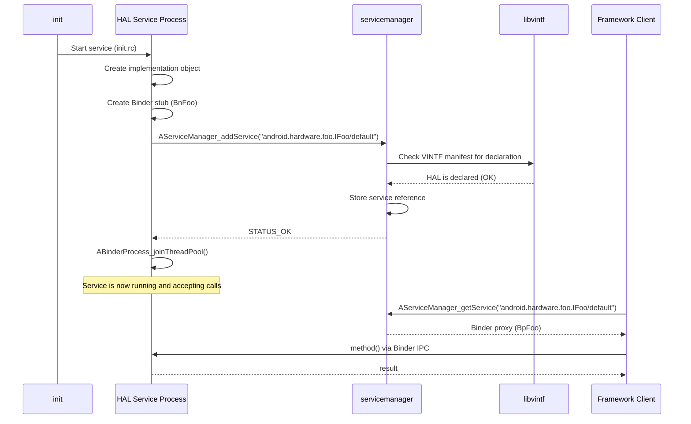

如果 HAL 未在 VINTF 清单中声明，`servicemanager` 会拒绝该注册：

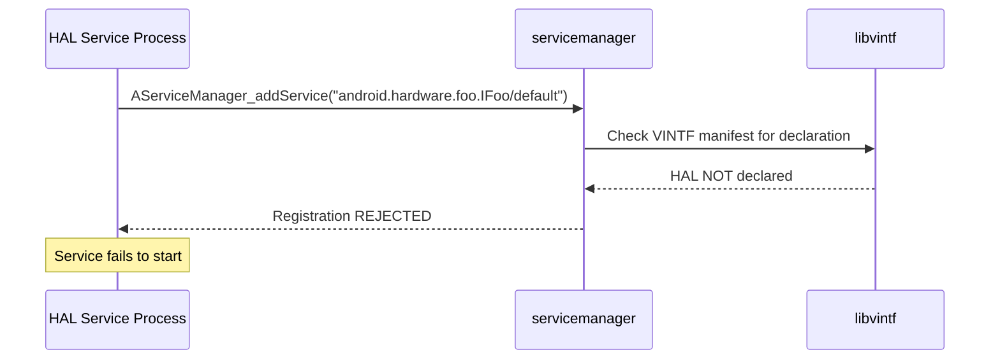

### 10.4.12 多语言支持：Rust、Java、C++、NDK

AIDL 的主要优势之一是其多语言支持。一个 `.aidl` 文件会为四个语言后端生成
绑定：

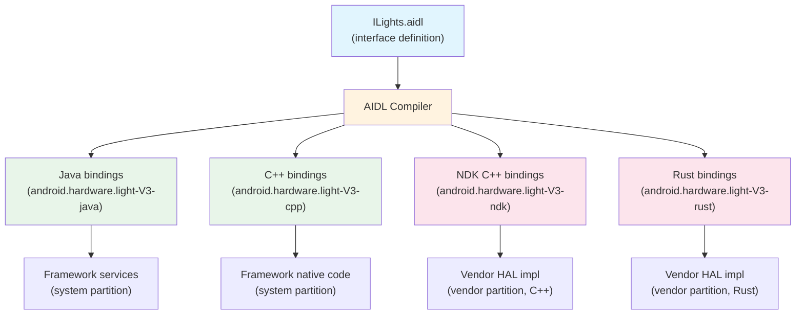

| 后端 | 库后缀 | 链接对象 | 稳定性 | 主要用途 |
|---------|---------------|-------------|-----------|-------------|
| Java | `-java` | framework.jar | 平台 | 框架 Java 服务 |
| C++（平台） | `-cpp` | libbinder.so | 仅平台 | 框架原生代码 |
| NDK C++ | `-ndk` | libbinder_ndk.so | **NDK 稳定** | **厂商 HAL 实现** |
| Rust | `-rust` | libbinder_rs | **NDK 稳定** | **厂商 HAL 实现** |

NDK 和 Rust 后端是厂商代码的正确选择，因为它们链接的是 NDK 稳定库，这些库
不会随平台版本变化。

---

## 10.5 VINTF（Vendor Interface）

Vendor Interface（VINTF）框架实现于 `system/libvintf/`，是确保框架分区与
vendor 分区之间兼容性的系统。它随 HIDL 一同在 Android 8.0 中引入，现在同时
用于 HIDL 和 AIDL HAL。

### 10.5.1 VINTF 解决的问题

在 Project Treble 之前，升级 Android 框架（system 分区）需要重新测试，甚至
可能修改所有厂商 HAL。没有正式的方法来验证新版本框架与现有 vendor 分区是否
兼容。

VINTF 提供了一个正式的兼容性检查机制：

1. **vendor** 声明它提供哪些 HAL（设备清单）。
2. **框架** 声明它需要哪些 HAL（框架兼容性矩阵）。
3. **框架** 声明它提供哪些 HAL（框架清单）。
4. **vendor** 声明它需要哪些框架特性（设备兼容性矩阵）。

兼容性在三个时刻被验证：

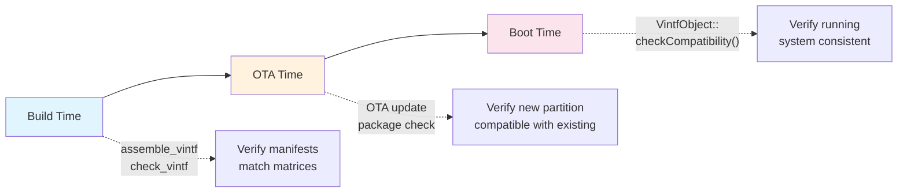

### 10.5.2 清单文件

VINTF 清单声明一个分区提供什么。有两种类型：

**设备清单**（vendor 提供什么）：

位于 `/vendor/etc/vintf/manifest.xml`，它列出 vendor 分区实现的所有 HAL
服务。以下是一个代表性片段：

```xml
<manifest version="1.0" type="device">
    <!-- AIDL HAL -->
    <hal format="aidl">
        <name>android.hardware.light</name>
        <version>2</version>
        <fqname>ILights/default</fqname>
    </hal>

    <!-- AIDL HAL with multiple instances -->
    <hal format="aidl">
        <name>android.hardware.audio.core</name>
        <version>4</version>
        <fqname>IModule/default</fqname>
    </hal>
    <hal format="aidl">
        <name>android.hardware.audio.core</name>
        <version>4</version>
        <fqname>IModule/r_submix</fqname>
    </hal>
    <hal format="aidl">
        <name>android.hardware.audio.core</name>
        <version>4</version>
        <fqname>IModule/bluetooth</fqname>
    </hal>

    <!-- Legacy HIDL HAL (for older devices) -->
    <hal format="hidl">
        <name>android.hardware.graphics.mapper</name>
        <transport>passthrough</transport>
        <version>4.0</version>
        <interface>
            <name>IMapper</name>
            <instance>default</instance>
        </interface>
    </hal>
</manifest>
```

**框架清单**（框架提供什么）：

位于 `/system/etc/vintf/manifest.xml`，它列出 vendor 代码可能依赖的框架侧
服务。

### 10.5.3 兼容性矩阵

兼容性矩阵声明一个分区对另一侧的需求。

框架兼容性矩阵
（`hardware/interfaces/compatibility_matrices/compatibility_matrix.202504.xml`）
是一个 XML 文件，列出框架可能要求的每个 HAL。以下是
一个摘录：

```xml
<!-- hardware/interfaces/compatibility_matrices/compatibility_matrix.202504.xml (lines 1-36) -->

<compatibility-matrix version="1.0" type="framework" level="202504">
    <hal format="aidl">
        <name>android.hardware.audio.core</name>
        <version>1-3</version>
        <interface>
            <name>IModule</name>
            <instance>default</instance>
            <instance>a2dp</instance>
            <instance>bluetooth</instance>
            <instance>hearing_aid</instance>
            <instance>msd</instance>
            <instance>r_submix</instance>
            <instance>stub</instance>
            <instance>usb</instance>
        </interface>
        <interface>
            <name>IConfig</name>
            <instance>default</instance>
        </interface>
    </hal>
    <hal format="aidl">
        <name>android.hardware.audio.effect</name>
        <version>1-3</version>
        <interface>
            <name>IFactory</name>
            <instance>default</instance>
        </interface>
    </hal>
    <hal format="aidl" updatable-via-apex="true">
         <name>android.hardware.authsecret</name>
         <version>1</version>
         <interface>
             <name>IAuthSecret</name>
             <instance>default</instance>
         </interface>
    </hal>
    <!-- ... 700+ more lines -->
</compatibility-matrix>
```

兼容性矩阵的关键元素：

| XML 元素 | 含义 |
|-------------|---------|
| `<hal format="aidl">` | 这是一个 AIDL HAL 需求 |
| `<name>` | 包名 |
| `<version>1-3</version>` | 可接受的版本范围（1 到 3） |
| `<interface>` | 必需的接口 |
| `<instance>` | 必需的实例名 |
| `<regex-instance>` | 实例名模式（例如 `[a-z]+/[0-9]+`） |
| `updatable-via-apex="true"` | HAL 可通过 APEX 更新 |
| `level="202504"` | FCM（Framework Compatibility Matrix）级别 |

请注意 audio.core 的版本范围 `<version>1-3</version>`。这意味着框架可以与
任何提供 audio core HAL 版本 1、2 或 3 的厂商协同工作。这一范围对兼容性至
关重要——它允许较旧的 vendor 镜像与较新的框架镜像配合使用。

在兼容性矩阵中缺失的 HAL 就是未被要求的。对于存在的条目，可选性通过
`optional="true"` 属性表达（例如 202604 矩阵中的
`android.hardware.security.timestamp`）。省略 `<version>` 的 AIDL 条目*并不*
因此就是可选的。libvintf 将缺失的 AIDL 版本视为默认版本 1
（`system/libvintf/constants-private.h`）。

### 10.5.4 兼容性检查算法

兼容性承诺在两个地方被强制执行，值得精确说明哪个检查在哪里运行。

运行时入口点 `VintfObject::checkCompatibility()`
（`system/libvintf/VintfObject.cpp`，第 696-745 行）首先对四个 VINTF 文档
（设备清单、框架清单、设备矩阵、框架矩阵）做空值检查。然后它在两个方向上
调用 `HalManifest::checkCompatibility()` 以及 `RuntimeInfo::checkCompatibility()`。
这些调用（`system/libvintf/HalManifest.cpp`，第 474-523 行）验证：

1. 每个清单与对侧矩阵之间的 schema/类型一致性。

2. 在设备侧：框架矩阵中声明的 sepolicy 版本和内核需求。

3. 在框架侧：设备矩阵所要求的 VNDK 和 System SDK 版本。

4. 运行时信息（内核版本、内核配置、已加载的 SELinux 策略）与框架矩阵的
   对照。

该运行时检查*不会*遍历矩阵的 HAL 条目。构建期的 `check_vintf` 工具和 VTS
VINTF 测试（`test/vts-testcase/hal/treble/vintf/`）针对 FCM 强制执行 HAL
存在性、版本范围和实例匹配。`VintfObject::checkCompatibility()` 不强制执行
它们。

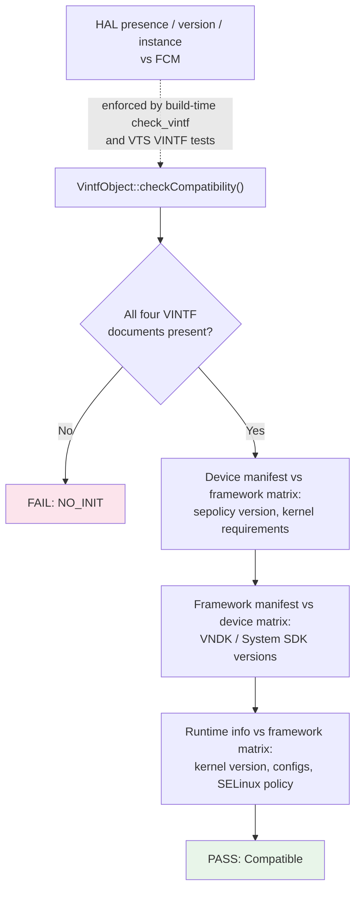

### 10.5.4.1 详细的兼容性矩阵分析

要理解兼容性检查的规模，请看 FCM 级别 202604 的框架兼容性矩阵
（`hardware/interfaces/compatibility_matrices/compatibility_matrix.202604.xml`）。
搭载 Android 17 发布的设备必须满足该矩阵。它编码了该版本完整的 HAL 需求
集合。

该矩阵包含每个硬件子系统的条目（以下版本来自 Android 17 矩阵）：

| HAL 包 | 必需版本 | 实例模式 |
|-------------|------------------|------------------|
| `android.hardware.audio.core` | 1-4 | default、a2dp、bluetooth、hearing_aid、msd、r_submix、stub、usb |
| `android.hardware.audio.effect` | 1-4 | default |
| `android.hardware.biometrics.face` | 3-5 | default、virtual |
| `android.hardware.biometrics.fingerprint` | 3-5 | default、virtual |
| `android.hardware.bluetooth` | 1（无 `<version>` 元素；AIDL 默认） | default、regex：`hci[1-9][0-9]*` |
| `android.hardware.bluetooth.audio` | 3-6 | default |
| `android.hardware.camera.provider` | 1-4 | regex：`[^/]+/[0-9]+` |
| `android.hardware.gnss` | 2-7 | default |
| `android.hardware.graphics.allocator` | 1-3 | default |
| `android.hardware.graphics.composer3` | 4-5 | default |
| `android.hardware.health` | 3-5 | default |
| `android.hardware.identity` | 1-5 | default |
| `android.hardware.power` | 5-7 | default |
| `android.hardware.sensors` | 2-3 | default |
| `android.hardware.security.secretkeeper` | 1-2 | default、nonsecure |
| `android.hardware.thermal` | 3 | default |
| `android.hardware.vibrator` | 1-4 | default（IVibrator 和 IVibratorManager） |

有些条目使用 `<regex-instance>` 进行动态命名：

```xml
<!-- Camera provider uses regex to allow provider/id naming -->
<hal format="aidl" updatable-via-apex="true">
    <name>android.hardware.camera.provider</name>
    <version>1-4</version>
    <interface>
        <name>ICameraProvider</name>
        <regex-instance>[^/]+/[0-9]+</regex-instance>
    </interface>
</hal>

<!-- Broadcast radio allows any instance name -->
<hal format="aidl">
    <name>android.hardware.broadcastradio</name>
    <version>1-3</version>
    <interface>
        <name>IBroadcastRadio</name>
        <regex-instance>.*</regex-instance>
    </interface>
</hal>
```

camera 和 biometric HAL 上的 `updatable-via-apex="true"` 属性表明这些 HAL
可以通过 APEX 模块交付。它们随后可以借助 Google Play 系统更新机制更新，而
无需完整 OTA。

### 10.5.4.2 版本范围语义

版本范围语法 `<version>1-3</version>` 表示框架可以与任何提供该 HAL 版本 1、
2 或 3 的厂商协同工作。这一范围会随时间推移而增长：

- 当引入新的 HAL 版本时，上界增加。
- 当某个旧版本被废弃（所有使用它的设备均已超过生命周期）时，下界增加。

例如，GNSS HAL 的版本范围 `2-7` 告诉我们：

- 版本 1 已被废弃（没有受支持的设备仍在使用它）。
- 版本 2 到 7 都被当前框架支持。
- 框架的 GNSS 代码对每个版本都有向后兼容逻辑。

这一版本范围机制是 Treble 兼容性承诺的关键。一个发布 GNSS HAL 版本 2 的
厂商可以接收新增版本 7 支持的框架更新。该厂商无需更新 HAL。

### 10.5.5 FCM 级别与时间线

Framework Compatibility Matrix 级别标识设备所针对的 Android 版本。
`hardware/interfaces/compatibility_matrices/` 目录包含每个级别的矩阵：

Android 17 源码树随附 `7.xml` 和 `8.xml` 以及四个基于日期的级别，并为下一
版本新增了 `202704`：

| 文件 | FCM 级别 | Android 版本 |
|------|-----------|----------------|
| `compatibility_matrix.7.xml` | 7 | Android 13 |
| `compatibility_matrix.8.xml` | 8 | Android 14 |
| `compatibility_matrix.202404.xml` | 202404 | Android 15 |
| `compatibility_matrix.202504.xml` | 202504 | Android 16 |
| `compatibility_matrix.202604.xml` | 202604 | Android 17 |
| `compatibility_matrix.202704.xml` | 202704 | Android 18 |

从 Android 15 起，级别命名从简单的整数改为基于日期的标识符
（`YYYYMM`，其中月份始终是 `04`）。这一映射并非传说。
`system/libvintf/include/vintf/Level.h` 中的枚举 `Level`（第 32-59 行）为
每个级别分配符号字母（`V = 202404`、`B = 202504`、`C = 202604`、`D =
202704`）。`system/libvintf/analyze_matrix/analyze_matrix.cpp` 中的
`GetDescription()`（第 87-94 行）将其打印为 “Android 15 (V)” 到 “Android 18
(D)”。

由此表可知，**搭载 Android 17 发布的设备的目标是 FCM 级别 202604**。同一
源码树中的 `202704` 矩阵是下一版本（Android 18）正在开发中的矩阵。AOSP 正是
以这种方式为来年的 HAL 需求做准备，而当前版本仍在随附。

设备在设备清单中声明其目标 FCM 级别。框架基于该级别选择合适的兼容性矩阵。
较旧的设备就是这样继续与较新的框架协同工作的。框架知道该设备时代支持哪些
HAL 版本，只要求这些。

运行时还会直接从 GKI 内核版本推导出一个 FCM 级别。
`system/libvintf/RuntimeInfo.cpp` 中的 `RuntimeInfo::gkiAndroidReleaseToLevel()`
（第 186-218 行）将 Android 版本号映射为一个 `Level`：版本 17 映射到
`Level::C`（202604），版本 18 映射到 `Level::D`（202704）。这为 VINTF 提供
了第二个独立的信号，表明内核在启动时验证兼容性时是为哪个版本构建的。

### 10.5.6 libvintf 内部实现

VINTF 检查逻辑实现于 `system/libvintf/`。主入口点是定义在
`system/libvintf/include/vintf/VintfObject.h` 中的 `VintfObject` 类：

```c++
// system/libvintf/include/vintf/VintfObject.h (lines 93-151, key methods)

class VintfObject {
   public:
    virtual ~VintfObject() = default;

    // Return the device-side HAL manifest
    virtual std::shared_ptr<const HalManifest> getDeviceHalManifest();

    // Return the framework-side HAL manifest
    virtual std::shared_ptr<const HalManifest> getFrameworkHalManifest();

    // Return the device-side compatibility matrix
    virtual std::shared_ptr<const CompatibilityMatrix>
        getDeviceCompatibilityMatrix();

    // Return the framework-side compatibility matrix
    // (automatically selects by target-level)
    virtual std::shared_ptr<const CompatibilityMatrix>
        getFrameworkCompatibilityMatrix();

    // Return device runtime info (kernel version, configs, etc.)
    std::shared_ptr<const RuntimeInfo> getRuntimeInfo(
        RuntimeInfo::FetchFlags flags = RuntimeInfo::FetchFlag::ALL);

    // Check compatibility between all manifests and matrices
    int32_t checkCompatibility(std::string* error = nullptr,
                               CheckFlags::Type flags = CheckFlags::DEFAULT);

    // Check for deprecated HALs
    int32_t checkDeprecation(
        const std::vector<HidlInterfaceMetadata>& hidlMetadata,
        std::string* error = nullptr);

    // Return kernel FCM version
    Level getKernelLevel(std::string* error = nullptr);
};
```

`HalManifest` 类（`system/libvintf/include/vintf/HalManifest.h`）提供清单
数据模型：

```c++
// system/libvintf/include/vintf/HalManifest.h (lines 64-91, key members)

struct HalManifest : public HalGroup<ManifestHal>,
                     public XmlFileGroup<ManifestXmlFile>,
                     public WithFileName {
   public:
    HalManifest() : mType(SchemaType::DEVICE) {}

    bool add(ManifestHal&& hal, std::string* error = nullptr);
    bool addAllHals(HalManifest* other, std::string* error = nullptr);

    // Get transport for a specific HIDL HAL
    Transport getHidlTransport(const std::string& name, const Version& v,
                               const std::string& interfaceName,
                               const std::string& instanceName) const;

    // Check compatibility against a compatibility matrix
    bool checkCompatibility(const CompatibilityMatrix& mat,
                            std::string* error = nullptr,
                            CheckFlags::Type flags = CheckFlags::DEFAULT) const;

    // Generate a matrix that this manifest is compatible with
    CompatibilityMatrix generateCompatibleMatrix() const;

    // Get all HAL names declared in the manifest
    std::set<std::string> getHalNames() const;
};
```

`CompatibilityMatrix` 类
（`system/libvintf/include/vintf/CompatibilityMatrix.h`）提供矩阵数据模型：

```c++
// system/libvintf/include/vintf/CompatibilityMatrix.h (lines 49-80)

struct CompatibilityMatrix : public HalGroup<MatrixHal>,
                             public XmlFileGroup<MatrixXmlFile>,
                             public WithFileName {
    CompatibilityMatrix() : mType(SchemaType::FRAMEWORK) {}

    SchemaType type() const;
    Level level() const;

    std::string getXmlSchemaPath(const std::string& xmlFileName,
                                 const Version& version) const;

    std::string getVendorNdkVersion() const;
    std::vector<SepolicyVersionRange> getSepolicyVersions() const;

    bool add(MatrixHal&&, std::string* error = nullptr);
    bool addAllHals(CompatibilityMatrix* other, std::string* error = nullptr);
};
```

### 10.5.7 启动时的 VINTF

启动期间，`servicemanager` 使用 libvintf 验证 HAL 注册。来自
`frameworks/native/cmds/servicemanager/ServiceManager.cpp`（第 74-111 行）：

```c++
// frameworks/native/cmds/servicemanager/ServiceManager.cpp (lines 76-97)

struct ManifestWithDescription {
    std::shared_ptr<const vintf::HalManifest> manifest;
    const char* description;
};

static std::vector<ManifestWithDescription> GetManifestsWithDescription() {
    auto vintfObject = vintf::VintfObject::GetInstance();
    if (vintfObject == nullptr) {
        ALOGE("NULL VintfObject!");
        return {};
    }
    return {
        ManifestWithDescription{
            vintfObject->getDeviceHalManifest(), "device"},
        ManifestWithDescription{
            vintfObject->getFrameworkHalManifest(), "framework"}
    };
}

static bool forEachManifest(
    const std::function<bool(const ManifestWithDescription&)>& func) {
    for (const ManifestWithDescription& mwd : GetManifestsWithDescription()) {
        if (mwd.manifest == nullptr) {
            ALOGE("NULL VINTF MANIFEST!: %s", mwd.description);
            continue;
        }
        if (func(mwd)) return true;
    }
    return false;
}
```

这段代码表明 `servicemanager` 在启动时加载设备清单和框架清单，并用它们验证
每个 HAL 注册请求。`VintfObject.cpp` 中的 `isAllowedToUseLibvintf()` 函数
（第 82-100 行）是一项使用策略检查。当白名单之外的二进制文件引入 libvintf
时，`GetInstance()` 会记录一条 `libvintf-usage-violation` 错误，以阻止额外
的内存开销。但它随后仍会构建并返回该对象。它并不真正阻止这些进程查询 VINTF
数据：

```c++
// system/libvintf/VintfObject.cpp (lines 82-100)

static bool isAllowedToUseLibvintf() {
    if constexpr (!kIsTarget) {
        return true;
    }
    auto execPath = android::base::GetExecutablePath();
    if (android::base::StartsWith(execPath, "/data/")) {
        return true;
    }
    std::vector<std::string> allowedBinaries{
        "/system/bin/servicemanager",
        "/system/bin/hwservicemanager",
        "/system_ext/bin/hwservicemanager",
        "/system/bin/app_process32",
        "/system/bin/app_process64",
        "/system/bin/lshal",
        // ...
    };
    // ...
}
```

### 10.5.7.1 清单组装

设备清单并非单一文件。它由分布在多个分区和 APEX 模块中的片段组装而成。组装
过程：

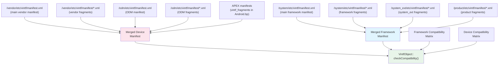

Lights 和 Vibrator HAL 在 `Android.bp` 中使用 `vintf_fragments` 指令。该指令
使构建系统自动将清单片段安装到正确位置。启动时，`libvintf` 扫描这些目录，
并将所有片段合并为一个逻辑清单。

这种基于片段的组装有几个好处：

1. **模块化**：每个 HAL 可以随附自己的清单片段，而无需修改中央文件。
2. **APEX 支持**：APEX 模块可以声明 HAL，并在 APEX 安装时动态加入清单。
3. **冲突检测**：当两个片段以不兼容的版本声明同一个 HAL 时，`libvintf` 会
   检测并报告冲突。

### 10.5.7.2 构建期 VINTF 检查

构建系统在构建期间运行 VINTF 兼容性检查，以便尽早发现问题。使用两个工具：

**assemble_vintf**（`system/libvintf/assemble_vintf_main.cpp`）：
将清单和矩阵片段组装为完整文件，检查格式良好性和内部一致性。

**check_vintf**（`system/libvintf/check_vintf.cpp`）：
验证设备镜像的清单和矩阵是否彼此兼容。该工具作为 `make check-vintf-all`
的一部分运行，并在 VTS 测试期间运行。

```bash
# Check a tree of VINTF metadata pulled from a device or a build output
# (from the tool's own usage text in system/libvintf/check_vintf.cpp)
check_vintf --check-compat --rootdir=$ROOTDIR \
    --property ro.product.first_api_level=... \
    --property ro.boot.product.hardware.sku=...
# Alternatively map partitions individually instead of --rootdir:
#   check_vintf --check-compat --dirmap /system:$SYSTEM_DIR --dirmap /vendor:$VENDOR_DIR
# Add --kernel <version:path/to/config> to also check kernel requirements.
```

如果检查失败，构建会停止，并给出清晰错误消息，指出哪个 HAL 缺失或版本不
兼容。

### 10.5.8 VINTF 与 OTA 更新

VINTF 在 OTA（Over The Air）更新中扮演关键角色。当应用 system 分区更新时，
更新系统会将新框架的兼容性矩阵与现有 vendor 的清单进行对照检查。如果二者
不兼容，OTA 会被拒绝。

正是这一点使 Project Treble 的独立更新承诺成为可能。只要 VINTF 兼容性检查
通过，框架就可以在不触碰 vendor 分区的情况下更新。

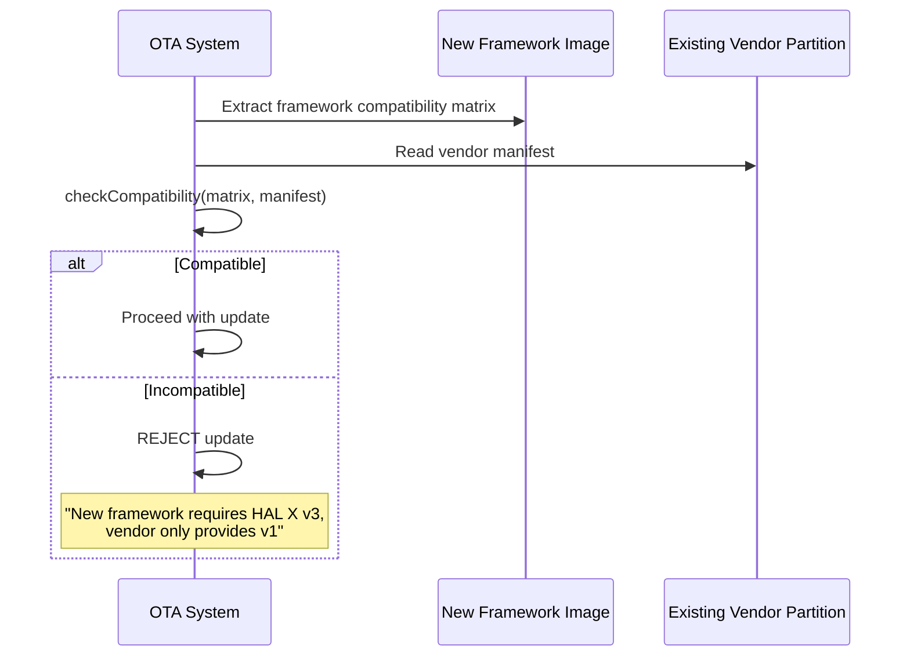

### 10.5.9 xsdc：为配置文件生成解析器

本节中的清单和兼容性矩阵是 XML 文档。跨越 system/vendor 边界的其他数十种
配置文件也是如此。例如媒体编解码器列表、apex 信息列表和音频策略配置。
Treble 将这些文件中每一个的*schema* 视为稳定的接口。

这带来了一个实际问题。每个使用者都需要一个与 schema 保持同步的解析器。手
写这些解析器既繁琐，又是 system/vendor 漂移容易滋生的地方。

`xsdc`
（`system/tools/xsdc/`，一个 Java 代码生成器加上一个小型的
`XsdcSupport.h` 运行时头文件）通过将 XSD schema 编译成解析器来解决这一问题。
这使 schema 文件成为唯一的真相来源。

#### xsd_config Soong 规则

`xsdc` 通过在 `system/tools/xsdc/build/xsdc.go` 中注册的 `xsd_config` 模块
类型接入构建。使用者将该规则指向一个 `.xsd` 文件，并命名生成代码应驻留的包：

```
// system/libvintf/xsd/halManifest/Android.bp (excerpt)
xsd_config {
    name: "hal_manifest",
    srcs: ["hal_manifest.xsd"],
    package_name: "hal.manifest",
    api_dir: "schema",
}
```

在构建时，该规则调用 `xsdc` 主机工具，后者解析 schema 并输出一个解析器。
`xsdc.go` 中的 `xsdConfigProperties` 结构体公开了实践中重要的那些旋钮：

- `package_name` —— 生成代码的 Java 包（以及 C++ 命名空间 / 文件词干）。
- `gen_writer` —— 除读取器外，还生成一个将数据模型序列化回 XML 的*写入器*。
  apexd 使用它来输出 `/apex/apex-info-list.xml`。
- `enums_only` / `parser_only`（仅 C++）—— 拆分输出，使使用者可以只依赖枚举
  转换器而不引入 libxml2，从而减小内存占用。
- `tinyxml` —— 生成链接 libtinyxml2 而非 libxml2 的代码，同样是为占用空间。
- `root_elements` —— 将生成限制为特定根元素，而非每个可能成为根的元素，以
  裁剪死代码。
- `nullability` / `boolean_getter` —— 在 Java 侧输出
  `@NonNull`/`@Nullable` 注解，并选择 `isX()` 或 `getX()` 访问器命名。

由于 schema 是一种 API，`xsd_config` 还会向 `api_dir` 下的 `current.txt` 提供
数据（一种 Treble “ConfigFile as API” 签名，描述见
`system/tools/xsdc/README.md`）。向 XSD 添加一个属性会向生成的类添加一对
`getNumber()`/`setNumber()`。然后 `make update-api` 会将该增量记录在 API 文件中。
这与 §10.4.9 中 AIDL 接口所经历的冻结并审查的纪律相同，只是应用到了 XML
schema 上。

#### 生成的代码是什么样子

`xsdc` 有两个后端，由主机工具的 `--java` 和 `--cpp` 标志选择（见
`system/tools/xsdc/src/main/java/com/android/xsdc/Main.java`）。一个是位于
`.../xsdc/java/` 下的 Java 生成器。另一个是位于 `.../xsdc/cpp/` 下的 C++
生成器。对于每个 `complexType`，它生成一个带有类型化 getter（当 `gen_writer`
开启时还有 setter）的类。对于每个 `simpleType` 枚举，它生成一个枚举以及
字符串转换辅助函数。C++ 枚举与小型运行时头文件
`system/tools/xsdc/utils/include/xsdc/XsdcSupport.h` 协作，后者定义了
`xsdc_enum_range<Enum>`，使调用者可以遍历每个枚举值：

```c++
// system/tools/xsdc/utils/include/xsdc/XsdcSupport.h (usage)
for (const auto v : android::xsdc_enum_range<Enum>()) { /* ... */ }
```

生成器会输出 `xsdc_enum_range` 所读取的特化，因此这个循环可以工作，而无需
使用者维护自己的取值列表。

#### 谁在使用它

`xsd_config` 出现在整棵树的数十个 `Android.bp` 文件中——对平台执行
`grep -c 'xsd_config {'` 会发现它在 `xsdc` 自身之外被声明了五十多次。

与本章最相关的使用者是
VINTF schema。`system/libvintf/xsd/halManifest/` 和
`system/libvintf/xsd/compatibilityMatrix/` 定义了 `hal_manifest.xsd` 和
`compatibility_matrix.xsd`。这些是 §10.5.2 和 §10.5.3 中所示清单和矩阵 XML
的正式 schema。生成的解析器支撑着 VTS 测试，后者针对 schema 验证每台设备的
清单。

其他重度使用者包括
`system/apex/apexd/`（`/apex/apex-info-list.xml` 的 `apex-info-list` 解析器
*和*写入器）、`frameworks/av/media/libstagefright/xmlparser/`（
`MediaCodecsXmlParser` 背后的 `media_codecs` schema）以及
`frameworks/av/media/libmedia/xsd/`（`media_profiles` schema）。在每种情形中
模式都是相同的。`.xsd` 作为契约被检入。`xsdc` 将其转换为解析器。没有人会
手工维护可能悄然与 schema 不一致的 XML 遍历代码。

---

## 10.6 HAL 生命周期

### 10.6.1 注册与发现

HAL 服务经历注册、发现、使用以及可能的注销这一生命周期：

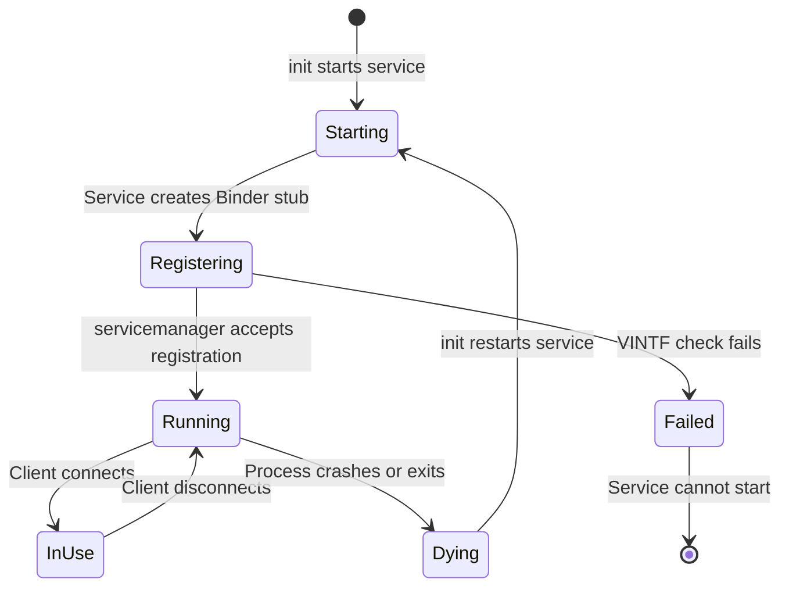

对于 AIDL HAL，注册 API 因语言而异：

**C++（NDK 后端）：**

```c++
// Used by most vendor HAL implementations
AServiceManager_addService(binder.get(), "android.hardware.foo.IFoo/default");
```

**Rust：**

```rust
// Used by Rust HAL implementations
binder::add_service(&service_name, binder_object.as_binder())
    .expect("Failed to register service");
```

**C++（平台后端）：**

```c++
// Used by framework-side services (not typical for HALs)
defaultServiceManager()->addService(String16("android.hardware.foo.IFoo/default"),
                                    service);
```

对于 HIDL HAL，注册使用：

```c++
service->registerAsService("default");
```

发现遵循类似的模式。对于 AIDL：

```c++
// C++ (NDK)
auto binder = AServiceManager_getService("android.hardware.foo.IFoo/default");
auto service = IFoo::fromBinder(ndk::SpAIBinder(binder));

// Rust
let service = binder::get_interface::<dyn IFoo>("android.hardware.foo.IFoo/default")?;

// Java
IFoo service = IFoo.Stub.asInterface(
    ServiceManager.getService("android.hardware.foo.IFoo/default"));
```

对于 HIDL：

```c++
sp<IFoo> service = IFoo::getService("default");
```

### 10.6.2 servicemanager 与 hwservicemanager

Android 为两个时代提供了两个服务管理器：

```mermaid
graph TD
    subgraph "Current Architecture (AIDL HALs)"
        SM["servicemanager<br/>(frameworks/native/cmds/servicemanager/)"]
        SM --> AIDL_HAL["AIDL HAL Services"]
        SM --> FW_SVC["Framework Services<br/>(activity, window, etc.)"]
    end

    subgraph "Legacy Architecture (HIDL HALs)"
        HWSM["hwservicemanager<br/>(system/hwservicemanager/)"]
        HWSM --> HIDL_HAL["HIDL HAL Services"]
    end

    style SM fill:#e8f5e9
    style HWSM fill:#fff3e0
```

| 方面 | servicemanager | hwservicemanager |
|--------|---------------|-----------------|
| 源码 | `frameworks/native/cmds/servicemanager/` | `system/hwservicemanager/` |
| IPC | 标准 Binder | HwBinder |
| 使用者 | AIDL HAL + 框架服务 | 仅 HIDL HAL |
| VINTF | 检查设备清单和框架清单两者 | 也会查阅两者（先框架清单，再设备清单）以解析 HIDL 传输方式 |
| 状态 | **在用** | 已废弃（新设备上可能不存在） |
| 命名 | `<package>.<interface>/<instance>` | `<package>@<version>::<interface>/<instance>` |

统一到单一的 `servicemanager` 之下是一项重大简化。此前，一个需要同时发现
AIDL 服务和 HIDL HAL 的框架服务必须与两个不同的服务管理器对话。现在，AIDL
HAL 与常规框架服务一起注册，简化了发现过程。

`servicemanager` 从 `frameworks/native/cmds/servicemanager/ServiceManager.cpp`
执行 VINTF 清单检查。当某个服务尝试注册时，`servicemanager` 调用
`forEachManifest()` 来验证该 HAL 已声明：

```c++
// frameworks/native/cmds/servicemanager/ServiceManager.cpp (lines 140-142)

static std::string getAidlInstanceName(
    const vintf::ManifestInstance& instance) {
    return instance.package() + "." + instance.interface() + "/" + instance.instance();
}
```

`servicemanager` 中 AIDL HAL 的服务名格式为：

```
<package>.<Interface>/<instance>
```

（一个姊妹辅助函数 `getNativeInstanceName()`（第 113-115 行）构造用于
`format="native"` 清单条目的更简单的 `<package>/<instance>` 名称。）

例如：

```
android.hardware.light.ILights/default
android.hardware.audio.core.IModule/bluetooth
android.hardware.vibrator.IVibrator/default
```

### 10.6.3 惰性 HAL

并非所有 HAL 服务都需要一直运行。一台设备可能拥有只偶尔使用的硬件（例如
指纹传感器或红外发射器）。为这类硬件持续运行 HAL 服务会浪费内存。

**惰性 HAL（Lazy HALs）** 是仅在客户端请求时才按需启动、并在没有客户端连
接时关闭的服务。这是一项重大的内存优化——每个空闲的 HAL 进程会消耗数兆字节
的 RAM。

对于 HIDL HAL，惰性支持实现于
`system/libhidl/transport/HidlLazyUtils.cpp`。`LazyServiceRegistrar`
类（第 280-305 行）提供注册机制：

```c++
// system/libhidl/transport/HidlLazyUtils.cpp (lines 280-305)

LazyServiceRegistrar::LazyServiceRegistrar() {
    mImpl = std::make_shared<details::LazyServiceRegistrarImpl>();
}

LazyServiceRegistrar& LazyServiceRegistrar::getInstance() {
    static auto registrarInstance = new LazyServiceRegistrar();
    return *registrarInstance;
}

status_t LazyServiceRegistrar::registerService(
    const sp<::android::hidl::base::V1_0::IBase>& service,
    const std::string& name) {
    return mImpl->registerService(service, name);
}

bool LazyServiceRegistrar::tryUnregister() {
    return mImpl->tryUnregister();
}

void LazyServiceRegistrar::reRegister() {
    mImpl->reRegister();
}
```

核心机制是一个 `ClientCounterCallback`（第 35-95 行），它在客户端连接或断开
时接收来自 hwservicemanager 的通知：

```c++
// system/libhidl/transport/HidlLazyUtils.cpp (lines 157-191)

Return<void> ClientCounterCallback::onClients(
    const sp<::android::hidl::base::V1_0::IBase>& service, bool clients) {
    std::lock_guard<std::mutex> lock(mMutex);
    Service& registered = assertRegisteredServiceLocked(service);
    // ...
    registered.clients = clients;

    size_t numWithClients = 0;
    for (const Service& registered : mRegisteredServices) {
        if (registered.clients) numWithClients++;
    }

    LOG(INFO) << "Process has " << numWithClients << " (of " << mRegisteredServices.size()
              << " available) client(s) in use after notification " << getDescriptor(service.get())
              << "/" << registered.name << " has clients: " << clients;

    // ... (active-services callback handling elided)
    // If no clients for any service, try to shut down
    if (!handledInCallback && numWithClients == 0) {
        tryShutdownLocked();
    }
    return Status::ok();
}
```

当 `tryShutdownLocked()` 确定不再有客户端时，它会注销所有服务并退出：

```c++
// system/libhidl/transport/HidlLazyUtils.cpp (lines 231-243)

void ClientCounterCallback::tryShutdownLocked() {
    LOG(INFO) << "Trying to exit HAL. No clients in use for any service in process.";

    if (tryUnregisterLocked()) {
        LOG(INFO) << "Unregistered all clients and exiting";
        exit(EXIT_SUCCESS);
    }

    // If we failed to unregister some services, re-register them
    // to maintain consistency
    reRegisterLocked();
}
```

对于 AIDL HAL，同样的模式也存在，但使用来自 `libbinder` 的标准
`LazyServiceRegistrar`。

惰性 HAL 的生命周期：

```mermaid
sequenceDiagram
    participant Init as init
    participant SM as servicemanager
    participant HAL as HAL Process
    participant Client as Framework Client

    Note over Init: init knows HAL is "lazy"<br/>("interface aidl" line in init.rc)

    Client->>SM: getService("android.hardware.foo.IFoo/default")
    SM->>SM: Service not registered
    SM->>Init: Request start of HAL service
    Init->>HAL: Start process
    HAL->>SM: LazyServiceRegistrar::registerService()
    SM-->>Client: Binder proxy

    Client->>HAL: method calls

    Note over Client: Client disconnects

    SM->>HAL: onClients(false)
    HAL->>HAL: numWithClients == 0
    HAL->>SM: tryUnregister()
    HAL->>HAL: exit(EXIT_SUCCESS)

    Note over HAL: Process exits, memory freed

    Client->>SM: getService("android.hardware.foo.IFoo/default")
    SM->>Init: Request start again
    Init->>HAL: Start process again
```

### 10.6.3.1 AIDL 的惰性 HAL

对于 AIDL HAL，惰性注册模式更简单。一个 NDK 后端 HAL 使用
`libbinder_ndk` 中的 `AServiceManager_registerLazyService()`
（`frameworks/native/libs/binder/ndk/include_platform/android/binder_manager.h`，
第 160-161 行），这正是树内真正的惰性 HAL 所发出的调用（例如
`hardware/interfaces/health/storage/aidl/default/main.cpp`）：

```c++
#include <android/binder_manager.h>
#include <android/binder_process.h>

int main() {
    ABinderProcess_setThreadPoolMaxThreadCount(0);

    auto greeting = ndk::SharedRefBase::make<Greeting>();

    binder_status_t status = AServiceManager_registerLazyService(
        greeting->asBinder().get(),
        "android.hardware.greeting.IGreeting/default");
    CHECK_EQ(status, STATUS_OK);

    ABinderProcess_joinThreadPool();
    return EXIT_FAILURE;
}
```

（`frameworks/native/libs/binder/include/binder/LazyServiceRegistrar.h` 中的
`android::binder::LazyServiceRegistrar` 类对针对 `libbinder` 本身编写的服务
起同样的作用。它的 `registerService()` 接受一个 `sp<IBinder>`，而不是
NDK 后端服务所持有的 `AIBinder*`。）

惰性 HAL 的 init.rc 使用 `interface` 声明来告诉 init 要监视哪些服务名：

```
service vendor.greeting-lazy /vendor/bin/hw/android.hardware.greeting-service.lazy
    interface aidl android.hardware.greeting.IGreeting/default
    class hal
    user nobody
    group nobody
    disabled  # Not started at boot!
    oneshot   # Don't auto-restart
```

`disabled` 关键字意味着 init 不会在启动时启动该服务。当客户端调用
`AServiceManager_waitForService()` 或 `AServiceManager_getService()` 时，
servicemanager 会要求 init 启动该服务。`interface aidl` 声明告诉 init 哪个
AIDL 服务名映射到此 init 服务。

惰性 AIDL HAL 的生命周期：

1. 设备启动——惰性 HAL 服务*不会*启动。
2. 客户端向 servicemanager 请求该服务。
3. servicemanager 告诉 init 启动该服务。
4. init 启动 HAL 进程。
5. HAL 向 LazyServiceRegistrar 注册。
6. LazyServiceRegistrar 向 servicemanager 注册并请求客户端计数通知。
7. 客户端获得 Binder 代理并使用该 HAL。
8. 客户端断开连接（Binder 引用计数降至零）。
9. servicemanager 通知 LazyServiceRegistrar 客户端计数为零。
10. LazyServiceRegistrar 注销该服务并调用 `exit()`。
11. 进程消失，内存被释放。

### 10.6.4 init.rc 中的 HAL 进程生命周期

HAL 服务由 Android 的 init 系统启动。init.rc 服务定义控制安全、优先级和重启
行为。

一个典型的 HAL 服务定义：

```
service vendor.light-default /vendor/bin/hw/android.hardware.lights-service.example
    class hal
    user nobody
    group nobody
    shutdown critical
```

关键指令：

| 指令 | 含义 |
|-----------|---------|
| `class hal` | 将该服务与其他 HAL 归为一组；一起启动 |
| `user nobody` | 以非特权用户运行（最小权限原则） |
| `group nobody` | 最小化组成员身份 |
| `shutdown critical` | 关机时必须是最后停止的服务之一 |
| `capabilities` | 授予该进程的 Linux 能力 |
| `rlimit rtprio` | 最大实时调度优先级 |
| `ioprio` | I/O 调度类和优先级 |
| `task_profiles` | 用于 CPU 调度的 CGroup 配置 |
| `onrestart restart <service>` | 如果此 HAL 崩溃则级联重启 |

对于音频等延迟关键型 HAL，init.rc 包含提升的权限：

```
# From audio HAL init.rc
service vendor.audio-hal-aidl ...
    class hal
    user audioserver
    group audio camera drmrpc inet media mediadrm net_bt net_bt_admin net_bw_acct wakelock context_hub
    capabilities BLOCK_SUSPEND SYS_NICE
    rlimit rtprio 10 10
    ioprio rt 4
    task_profiles ProcessCapacityHigh HighPerformance
    onrestart restart audioserver
```

### 10.6.5 死亡接收者与恢复

当 HAL 进程崩溃时，客户端需要知晓以便优雅地恢复。HIDL 和 AIDL 都提供了死亡
通知机制。

在 HIDL 中，死亡接收者内置于 IBase：

```
// From IBase.hal (lines 87-97)

linkToDeath(death_recipient recipient, uint64_t cookie)
    generates (bool success);

unlinkToDeath(death_recipient recipient) generates (bool success);
```

在 AIDL 中，Binder 框架提供等效的死亡通知：

```c++
// C++ (NDK)
AIBinder_DeathRecipient* deathRecipient =
    AIBinder_DeathRecipient_new(onServiceDied);
AIBinder_linkToDeath(binder, deathRecipient, cookie);

// Rust
binder.link_to_death(&mut death_recipient)?;

// Java
binder.linkToDeath(deathRecipient, 0);
```

当 HAL 崩溃时，启动它的 init 会自动重启该服务。init.rc 中的 `onrestart`
指令确保依赖的服务也被重启。例如，如果音频 HAL 崩溃，音频服务会重启以重建
其 HAL 连接。

### 10.6.5.1 实际中的死亡通知

下面是一个框架服务如何处理 HAL 死亡的具体示例。考虑 system_server 中的
Light Service：

```java
// Simplified Java client with death handling
public class LightService {
    private ILights mLights;
    private final IBinder.DeathRecipient mDeathRecipient = () -> {
        Log.w(TAG, "Lights HAL died, reconnecting...");
        synchronized (this) {
            mLights = null;
        }
        connectToHal();  // Attempt to reconnect
    };

    private void connectToHal() {
        IBinder binder = ServiceManager.getService(
            "android.hardware.light.ILights/default");
        if (binder != null) {
            try {
                binder.linkToDeath(mDeathRecipient, 0);
                synchronized (this) {
                    mLights = ILights.Stub.asInterface(binder);
                }
            } catch (RemoteException e) {
                Log.e(TAG, "Failed to link to death", e);
            }
        }
    }
}
```

死亡通知模式确保：

1. 框架立即检测到 HAL 崩溃（通过 Binder 内核驱动的死亡通知，而非轮询）。
2. 框架将陈旧引用置空，以防止死亡后使用。
3. 框架可以在 init 重启 HAL 时尝试重新连接。
4. 进行中的 Binder 调用会以 `DeadObjectException` 优雅地失败。

```mermaid
sequenceDiagram
    participant FW as Framework Client
    participant SM as servicemanager
    participant HAL as HAL Process
    participant Kernel as Binder Kernel Driver
    participant Init as init

    FW->>HAL: linkToDeath(deathRecipient)
    FW->>HAL: Normal method calls...

    Note over HAL: HAL process crashes!
    HAL->>Kernel: Process exits
    Kernel->>FW: Death notification
    FW->>FW: mDeathRecipient.binderDied()
    FW->>FW: Nullify reference, log warning

    Kernel->>Init: Process terminated
    Init->>HAL: Restart service (oneshot/restart)
    HAL->>SM: Re-register service

    FW->>SM: getService() (reconnect)
    SM-->>FW: New Binder proxy
    FW->>HAL: linkToDeath(deathRecipient)
    FW->>HAL: Resume normal operations
```

### 10.6.5.2 SELinux 与 HAL 服务

SELinux 在 HAL 服务安全中扮演关键角色。每个 HAL 服务运行在特定的 SELinux
域中，策略控制：

1. **服务注册**：`service_manager_type` 上的 `add` 权限控制哪些域可以注册
   哪些服务名。

2. **服务查找**：`find` 权限控制哪些域可以发现哪些服务。

3. **Binder 通信**：`call` 权限控制哪些域可以向哪些其他域发送 Binder 事务。

4. **硬件访问**：文件访问规则控制哪些域可以读写设备节点（例如
   `/dev/lights`、`/sys/class/leds/`）。

HAL 服务的典型 SELinux 策略包括：

```
# Type declarations
type hal_greeting_default, domain;
type hal_greeting_default_exec, exec_type, vendor_file_type, file_type;

# Service registration
allow hal_greeting_default greeting_service:service_manager add;

# Allow clients to find the service
allow system_server greeting_service:service_manager find;

# Allow Binder communication
binder_call(system_server, hal_greeting_default)
binder_call(hal_greeting_default, system_server)

# Hardware access (if needed)
allow hal_greeting_default sysfs_greeting:file { read write };
```

如果没有正确的 SELinux 策略，HAL 服务会：

- 在注册期间静默失败（AVC 拒绝记录在 `dmesg` 中）
- 即使已注册，对客户端也不可见
- 在尝试访问硬件设备节点时崩溃

调试 SELinux 问题：

```bash
# Check for AVC denials
adb shell dmesg | grep "avc: denied"

# Generate policy from denials (development only!)
adb shell dmesg | audit2allow
```

### 10.6.6 HAL 客户端访问模式

有三种常见的访问 HAL 服务的模式：

**模式 1：获取并持有（最常见）**

客户端在启动时获得对 HAL 的引用，并在进程生命周期内一直持有它。

```c++
// Obtained once during initialization
auto service = IFoo::fromBinder(
    ndk::SpAIBinder(AServiceManager_waitForService(
        "android.hardware.foo.IFoo/default")));
// Used throughout the process lifetime
service->doSomething();
```

`AServiceManager_waitForService` 会阻塞直到服务可用，这对于在启动期间启动的
系统服务是合适的。

**模式 2：按需获取**

客户端只在需要时获得对 HAL 的引用，并在完成后释放它。这与惰性 HAL 配合
得很好。

```c++
void doOperation() {
    auto service = IFoo::fromBinder(
        ndk::SpAIBinder(AServiceManager_checkService(
            "android.hardware.foo.IFoo/default")));
    if (service == nullptr) {
        // Service not available
        return;
    }
    service->doSomething();
    // service reference released when function returns
}
```

`AServiceManager_checkService` 立即返回，如果服务当前未注册则返回
`nullptr`。

**模式 3：基于通知**

客户端在服务变得可用时注册以接收通知。

```c++
AServiceManager_NotificationRegistration* reg =
    AServiceManager_registerForServiceNotifications(
        "android.hardware.foo.IFoo/default",
        [](const char* instance, AIBinder* binder, void* cookie) {
            auto service = IFoo::fromBinder(ndk::SpAIBinder(binder));
            // Service is now available, begin using it
        },
        nullptr /* cookie */);
// Deleting the returned registration token later unregisters the callback:
//   AServiceManager_NotificationRegistration_delete(reg);
```

---

## 10.7 Android 17 中的新 HAL 面

每个版本都会新增少量 HAL 包。Android 17 中的新增内容值得单独用一节来讲，
因为它们展示了平台的方向：设备上的运动智能、一个一等公民级的 NPU 契约，以及
一个“Trusted HAL”家族。Trusted HAL 位于 TEE 内部，只能从受保护的虚拟机
访问。

它们全都是 AIDL 接口。除了 `ITrustedHalExt` 被刻意保持无注解之外，其余全部
带 `@VintfStability`。这个故事里完全没有 HIDL。大多数也出现在 Android 17
框架兼容性矩阵
（`hardware/interfaces/compatibility_matrices/compatibility_matrix.202604.xml`）中。
`motioncontext`、`npu` 以及 `security.see` 的
hwcrypto/devicestate/storage/authmgr 条目都在其中。但
`security.see.hdcp` 和 `security.see.ext` 完全没有矩阵条目（`ext` 被刻意不设
为 VINTF 稳定）。

### 10.7.1 Motion Context HAL

`android.hardware.motioncontext` 是一个卸载式运动分类服务。客户端订阅粗略的
运动信号（步行、车内、静止等）。该 HAL 从低功耗岛交付事件，而不是为每个样本
唤醒应用处理器。根接口非常小。它是一个工厂，返回一个按客户端划分的对象：

```java
// hardware/interfaces/motioncontext/aidl/android/hardware/motioncontext/IMotionContext.aidl (lines 28-44)

@VintfStability
interface IMotionContext {
    IMotionContextClient registerClient(in IMotionContextCallback callback);
}
```

支撑类型位于同一包中。`IMotionContextClient` 是用于配置订阅的按客户端句柄。
`IMotionContextCallback` 是事件接收端。数据 parcelable 是 `MotionEvent`、
`MotionState`、`MotionSubscription`、`EventDeliveryReason` 和 `ErrorCode`。
客户端可以为一个订阅附加“驻留时间（dwell time）”，以便 HAL 在卸载引擎上过滤
瞬态事件。这正是全部意义所在：客户端获得完整运动信号套件的好处，而应用处理器
保持休眠。

`hardware/interfaces/motioncontext/aidl/default/` 下的参考实现注册了一个单独的
`default` 实例。它的 `init` 服务定义以 `context_hub` 用户运行该守护进程，将它
与拥有 Context Hub HAL 的同一低功耗子系统绑定在一起：

```
# hardware/interfaces/motioncontext/aidl/default/motioncontext-service-default.rc

service vendor.motioncontext-default /vendor/bin/hw/android.hardware.motioncontext-service.default
    class hal
    user context_hub
    group context_hub
```

该接口冻结在版本 1
（`hardware/interfaces/motioncontext/aidl/aidl_api/android.hardware.motioncontext/1/`）。
在 Android 17 矩阵中，它以一个 `aidl` 条目出现，固定在
`<version>1</version>`，带单个 `default` 实例。

### 10.7.2 NPU HAL

`android.hardware.npu` 将平台如何告诉神经处理单元哪些工作负载更重要标准化。
它不是一个推理 API——那仍然是 `android.hardware.neuralnetworks`——它是一个
*调度*契约。框架向 NPU 提供一组按 UID 划分的优先级，使硬件可以将高优先级
工作排在后台工作之前运行：

```java
// hardware/interfaces/npu/aidl/android/hardware/npu/IScheduling.aidl (lines 35-67)

@VintfStability
interface IScheduling {
    void setSchedulingConfigs(in SchedulingConfig[] schedulingConfigs);
    void updateSchedulingConfigs(in SchedulingConfig[] configs);
    void setCallback(in @nullable ISchedulingCallback callback);
}
```

每个 `SchedulingConfig` 携带一个 Linux `uid` 和一个在
`MIN_PRIORITY = 0`（最高）到 `MAX_PRIORITY = 1000`（最低）范围内的
`priority`。它还携带两个策略布尔值。`hasDirectAccess` 表示该 UID 是否可以直接
向 NPU 提交工作。`canAttributeOtherUid` 表示它是否可以将工作记到其他 UID 头上。
文件
`hardware/interfaces/npu/aidl/android/hardware/npu/SchedulingConfig.aidl`
（第 24-54 行）定义了它们。`ISchedulingCallback` 让 NPU 可以回报调度决策，使用
同一包中的 `WorkInfo`、`StartReason`、`EndReason` 和 `Uuid` parcelable。

对平台叙事而言，值得注意的是 NPU HAL 是如何交付的。它在
`hardware/interfaces/npu/aidl/Android.bp` 中的 `aidl_interface` 模块将 Java 和
NDK 后端标记为对 `//apex_available:platform` 和 `com.android.npumanager` 均可用
（`apex_available`），并设置 `min_sdk_version: "36"`。换句话说，NPU HAL 契约被
打包给 NPU Manager APEX——一个 Mainline 风格的可更新模块。它并非永久烧录进
系统镜像。该 HAL 在 Android 17 矩阵中被列为一个 `aidl` 条目，
`<version>1</version>`，带一个 `default` 实例。

### 10.7.3 Trusted HAL 家族：security/see

增长最快的集群是 `hardware/interfaces/security/see/`——“see”代表
*Secure Execution Environment*（安全执行环境）（该术语见
`hardware/interfaces/security/README.md`）。这些是 **Trusted HAL**：其实现位于
TEE（可信执行环境）内部的 AIDL 接口，并提供给 Android 的**受保护虚拟机**使用。
这个家族并非全新：`hwcrypto`、`storage` 和 `authmgr` 早已出现在 Android 16
矩阵（`compatibility_matrix.202504.xml`）中。Android 17 新增的是
`security.see.devicestate` 矩阵条目，以及该家族在树内的增长（`hdcp` 和
`ext`）。该目录自己的 README 直白地陈述了规则：

> 该目录包含在 TEE 中实现并提供给 Android 受保护虚拟机使用的服务的
> AIDL 接口定义。
> （`hardware/interfaces/security/see/README.md`）

该家族包含几个独立的 HAL：

| 包 | 根接口 | 用途 |
|---------|---------------|---------|
| `android.hardware.security.see.hwcrypto` | `IHwCryptoKey` | DICE 绑定的密钥派生和批量加密命令列表，全部在安全环境内部 |
| `android.hardware.security.see.storage` | `ISecureStorage` | 面向可信服务的防篡改、防回滚文件系统 |
| `android.hardware.security.see.authmgr` | `IAuthMgrAuthorization` | 在客户端访问可信服务之前，先认证 pVM 的 AuthMgr 前端与 TEE 侧后端之间的连接 |
| `android.hardware.security.see.devicestate` | `IDeviceState` | 报告设备是否仍处于允许配置敏感数据的工厂制造阶段（单个方法 `provisioningAllowed()`） |
| `android.hardware.security.see.hdcp` | `IHdcpAuthControl` | 受保护媒体路径的 HDCP 认证控制 |
| `android.hardware.security.see.ext` | `ITrustedHalExt` | 每个 Trusted HAL 根 binder 上必需的、*非* VINTF 稳定的扩展 |

HwCrypto HAL 是主力。

它的 README
（`hardware/interfaces/security/see/hwcrypto/aidl/README.md`）描述了
四个特性。第一个是 DICE 绑定的密钥派生（密钥在密码学上绑定到设备身份和调用方
的软件版本）。第二个是不透明密钥，其密钥材料永不离开安全环境
（`IOpaqueKey`）。第三个是命令列表接口，它在单次 IPC 中运行一串加密操作。
第四个是 `ProtectionId` 作用域的密钥，将密钥使用绑定到特定内存区域，例如可信
视频缓冲区。

入口
点是 `IHwCryptoKey`
（`hardware/interfaces/security/see/hwcrypto/aidl/android/hardware/security/see/hwcrypto/IHwCryptoKey.aidl`）。

AuthMgr HAL 是守门人。`IAuthMgrAuthorization`
（`hardware/interfaces/security/see/authmgr/aidl/android/hardware/security/see/authmgr/IAuthMgrAuthorization.aidl`）
运行一个两阶段协议。

第一阶段将 AuthMgr 前端（运行在
一个 pVM 内）认证到 AuthMgr 后端（在 TEE 中）。它根据从经过验证的 DICE 证书
链中恢复的密钥，验证对后端签发的挑战的签名。它还强制执行防回滚。第二阶段
随后授权该 pVM 中的单个客户端访问可信服务。这就是为什么该包中的数据类型都是
DICE 制品——`DiceLeafArtifacts`、`DiceChainEntry`、`DicePolicy`、
`ExplicitKeyDiceCertChain` 和 `SignedConnectionRequest`。

`ITrustedHalExt` 要求是一个巧妙的 VTS 钩子。每个顶层 Trusted HAL 都必须添加
`ITrustedHalExt`
（`hardware/interfaces/security/see/ext/aidl/android/hardware/security/see/ext/ITrustedHalExt.aidl`）
作为其根 binder 上的扩展。该接口体为空。它存在的唯一目的是让 VTS 能够确认暴露
该 Trusted HAL 的 binder 库是以正确的*vendor* 稳定性保证构建的。刻意地，此扩展
*不是* VINTF 稳定的——这正是全部测试所在：正确构建的可信 binder 可以携带它，
而错误构建的则不能。

### 10.7.4 exclusive-to="virtual-machine" 与 VINTF 图景

Trusted HAL 引入了本章此前无需用到的一个 VINTF 概念：一个完全无法从 Android
宿主访问的 HAL。在 Android 17 矩阵中，三个 `security.see` 条目带有一个新属性：

```xml
<!-- hardware/interfaces/compatibility_matrices/compatibility_matrix.202604.xml (security.see.storage stanza) -->
<hal format="aidl" exclusive-to="virtual-machine">
    <name>android.hardware.security.see.storage</name>
    <version>1</version>
    <interface>
        <name>ISecureStorage</name>
        <instance>default</instance>
    </interface>
</hal>
```

`exclusive-to` 属性由 `system/libvintf/include/vintf/ExclusiveTo.h`（第 26-40 行）
中的 `ExclusiveTo` 枚举支撑。该枚举恰好有两个取值：`EMPTY`（默认——正常的
宿主可访问服务）和 `VM`，序列化为字符串 `"virtual-machine"`。它的注释就是契约。
注释说，一个 `VM` 独占的服务是“设备上虚拟机内部进程独占的”，并且“宿主进程
无法访问这些服务”。VINTF 将 `ExclusiveTo` 贯穿于 `system/libvintf/` 的清单与
矩阵匹配中（它出现在 `HalManifest`、`ManifestHal`、`CompatibilityMatrix`、
`MatrixHal` 以及各实例类中）。因此，一个声明了
`exclusive-to="virtual-machine"` 的 Trusted HAL 会与 pVM 清单匹配，而不是与宿主
清单匹配。

`devicestate`、`storage` 和 `authmgr` 都以此方式标记；`hwcrypto` 没有，因为它
也可从宿主访问。

下图展示了每个新 HAL 相对于宿主 OS、受保护 VM 和 TEE 的位置。

```mermaid
graph TD
    subgraph "Application Processor (Android host)"
        APP["App / framework"]
        MC["motioncontext HAL<br/>(user context_hub)"]
        NPU["npu HAL<br/>(IScheduling, NPU Manager APEX)"]
        HWC["security.see.hwcrypto<br/>(IHwCryptoKey, host-reachable)"]
        APP --> MC
        APP --> NPU
        APP --> HWC
    end

    subgraph "Protected VM (pVM)"
        FE["AuthMgr frontend"]
        TS["Trusted-service clients"]
    end

    subgraph "TEE (Trusted Execution Environment)"
        BE["AuthMgr backend<br/>(IAuthMgrAuthorization)"]
        SS["security.see.storage<br/>(ISecureStorage)"]
        DS["security.see.devicestate<br/>(IDeviceState)"]
    end

    FE -->|"DICE-authenticated channel"| BE
    TS -->|"exclusive-to=virtual-machine"| SS
    TS -->|"exclusive-to=virtual-machine"| DS
    HWC -.->|"keys live in"| BE

    style SS fill:#e8f5e9
    style DS fill:#e8f5e9
    style BE fill:#fff3e0
```

### 10.7.5 202704 矩阵与下一版本的暂存模式

尽管 Android 17 的目标 FCM 级别是 202604，同一源码树已经携带
`hardware/interfaces/compatibility_matrices/compatibility_matrix.202704.xml`，
其根元素声明 `level="202704"`。根据 `system/libvintf/include/vintf/Level.h`
中的 `Level` 枚举（第 48 行），202704 是 `Level::D`，`analyze_matrix.cpp` 将其
打印为 “Android 18 (D)”。这是 AOSP 的标准暂存模式。下一版本的兼容性矩阵会被
提交进当前树（它在 2026 年被加入）。因此 HAL 所有者可以在当前版本仍在随附的
同时，为即将到来的版本注册新的需求。

本节中的新 HAL 同时出现在 202604 和 202704 矩阵中。因此，采用它们的设备对下
一级别也是前向兼容的。

```mermaid
flowchart LR
    A["compatibility_matrix.202404.xml<br/>Level V (Android 15)"] --> B["compatibility_matrix.202504.xml<br/>Level B (Android 16)"]
    B --> C["compatibility_matrix.202604.xml<br/>Level C (Android 17, target)"]
    C --> D["compatibility_matrix.202704.xml<br/>Level D (Android 18, staged)"]

    style C fill:#e8f5e9
    style D fill:#fff3e0
```

---

## 10.8 动手试试：编写一个最小的 AIDL HAL

在本节中，我们将从零开始编写一个完整的 AIDL HAL。我们将用 C++ 和 Rust
两种语言编写接口定义和实现。我们还会编写 VINTF 清单、init.rc、构建规则以及
一个客户端。我们将创建一个简单的 “Greeting” HAL，以演示本章涵盖的所有概念。

### 10.8.1 第 1 步：定义 AIDL 接口

创建目录结构：

```
hardware/interfaces/greeting/aidl/
    Android.bp
    android/hardware/greeting/
        IGreeting.aidl
        GreetingResponse.aidl
    default/
        Android.bp
        main.cpp
        Greeting.cpp
        Greeting.h
        greeting-default.rc
        greeting-default.xml
```

首先，定义接口类型。一个响应 parcelable：

```java
// android/hardware/greeting/GreetingResponse.aidl

package android.hardware.greeting;

@VintfStability
parcelable GreetingResponse {
    /** The greeting message */
    String message;
    /** Timestamp of when the greeting was generated */
    long timestampMs;
    /** Name of the HAL implementation */
    String implementationName;
}
```

然后是主接口：

```java
// android/hardware/greeting/IGreeting.aidl

package android.hardware.greeting;

import android.hardware.greeting.GreetingResponse;

/**
 * A minimal example AIDL HAL for educational purposes.
 *
 * This HAL demonstrates the core concepts:
 * - @VintfStability annotation for HAL interfaces
 * - Parcelable types for structured data
 * - Multiple method signatures
 * - Error handling with service-specific exceptions
 */
@VintfStability
interface IGreeting {
    /**
     * Get a simple greeting.
     *
     * @return A greeting message including the HAL implementation name
     *         and current timestamp.
     */
    GreetingResponse greet();

    /**
     * Get a personalized greeting.
     *
     * @param name The name to include in the greeting.
     * @return A personalized greeting message.
     * @throws ServiceSpecificException with error code 1 if name is empty.
     */
    GreetingResponse greetByName(in String name);

    /**
     * Get the number of greetings served since the HAL started.
     *
     * @return The total greeting count.
     */
    int getGreetingCount();
}
```

关键观察：

- 接口和 parcelable 上的 `@VintfStability` 将它们标记为 HAL 类型，必须在发布
  前冻结版本。
- `String name` 上的 `in` 关键字表示该参数仅为输入（由调用方提供）。AIDL 也
  支持 `out`（服务端填充）和 `inout`（两者皆可）。
- 错误报告使用 `ServiceSpecificException`，它映射到 Binder 协议中的
  `EX_SERVICE_SPECIFIC`。

### 10.8.2 第 2 步：创建构建定义

```
// hardware/interfaces/greeting/aidl/Android.bp

aidl_interface {
    name: "android.hardware.greeting",
    vendor_available: true,
    srcs: [
        "android/hardware/greeting/*.aidl",
    ],
    stability: "vintf",
    backend: {
        java: {
            sdk_version: "module_current",
        },
        rust: {
            enabled: true,
        },
        ndk: {
            enabled: true,
        },
        cpp: {
            enabled: true,
        },
    },
    versions_with_info: [
        // Initially empty; will contain frozen versions after
        // running `m android.hardware.greeting-freeze-api`
    ],
}
```

这会为全部四个后端生成库：

- `android.hardware.greeting-V1-java`
- `android.hardware.greeting-V1-cpp`
- `android.hardware.greeting-V1-ndk`
- `android.hardware.greeting-V1-rust`

### 10.8.3 第 3 步：用 C++（NDK 后端）实现 HAL

NDK 后端是 C++ 厂商 HAL 实现的推荐选择。

**Greeting.h：**

```c++
// hardware/interfaces/greeting/aidl/default/Greeting.h

#pragma once

#include <aidl/android/hardware/greeting/BnGreeting.h>
#include <atomic>

namespace aidl::android::hardware::greeting {

class Greeting : public BnGreeting {
public:
    Greeting();

    ndk::ScopedAStatus greet(GreetingResponse* _aidl_return) override;
    ndk::ScopedAStatus greetByName(const std::string& name,
                                    GreetingResponse* _aidl_return) override;
    ndk::ScopedAStatus getGreetingCount(int32_t* _aidl_return) override;

private:
    GreetingResponse makeResponse(const std::string& message);
    std::atomic<int32_t> mGreetingCount{0};
};

}  // namespace aidl::android::hardware::greeting
```

**Greeting.cpp：**

```c++
// hardware/interfaces/greeting/aidl/default/Greeting.cpp

#define LOG_TAG "GreetingHAL"

#include "Greeting.h"

#include <android-base/logging.h>
#include <chrono>

namespace aidl::android::hardware::greeting {

Greeting::Greeting() {
    LOG(INFO) << "Greeting HAL initialized";
}

GreetingResponse Greeting::makeResponse(const std::string& message) {
    GreetingResponse response;
    response.message = message;
    response.timestampMs =
        std::chrono::duration_cast<std::chrono::milliseconds>(
            std::chrono::system_clock::now().time_since_epoch())
        .count();
    response.implementationName = "GreetingHAL-Default-CPP";
    mGreetingCount.fetch_add(1, std::memory_order_relaxed);
    return response;
}

ndk::ScopedAStatus Greeting::greet(GreetingResponse* _aidl_return) {
    LOG(INFO) << "greet() called";
    *_aidl_return = makeResponse("Hello from the Greeting HAL!");
    return ndk::ScopedAStatus::ok();
}

ndk::ScopedAStatus Greeting::greetByName(const std::string& name,
                                          GreetingResponse* _aidl_return) {
    LOG(INFO) << "greetByName() called with name: " << name;

    if (name.empty()) {
        return ndk::ScopedAStatus::fromServiceSpecificError(1);
    }

    *_aidl_return = makeResponse("Hello, " + name + "! Welcome to AOSP.");
    return ndk::ScopedAStatus::ok();
}

ndk::ScopedAStatus Greeting::getGreetingCount(int32_t* _aidl_return) {
    *_aidl_return = mGreetingCount.load(std::memory_order_relaxed);
    return ndk::ScopedAStatus::ok();
}

}  // namespace aidl::android::hardware::greeting
```

**main.cpp：**

```c++
// hardware/interfaces/greeting/aidl/default/main.cpp

#define LOG_TAG "android.hardware.greeting-service"

#include "Greeting.h"

#include <android-base/logging.h>
#include <android/binder_manager.h>
#include <android/binder_process.h>

using aidl::android::hardware::greeting::Greeting;

int main() {
    LOG(INFO) << "Greeting HAL service starting...";

    // Set thread pool size.  0 means use the calling thread only
    // (suitable for simple HALs that do not need concurrency).
    ABinderProcess_setThreadPoolMaxThreadCount(0);

    // Create the implementation
    auto greeting = ndk::SharedRefBase::make<Greeting>();

    // Build the service name: "android.hardware.greeting.IGreeting/default"
    const std::string instance = std::string() +
        Greeting::descriptor + "/default";

    // Register with servicemanager
    binder_status_t status = AServiceManager_addService(
        greeting->asBinder().get(), instance.c_str());
    CHECK_EQ(status, STATUS_OK)
        << "Failed to register " << instance;

    LOG(INFO) << "Greeting HAL service registered as: " << instance;

    // Block forever, processing Binder transactions
    ABinderProcess_joinThreadPool();
    return EXIT_FAILURE;  // Should not reach
}
```

**实现的 Android.bp：**

```
// hardware/interfaces/greeting/aidl/default/Android.bp

cc_binary {
    name: "android.hardware.greeting-service.example",
    relative_install_path: "hw",
    init_rc: ["greeting-default.rc"],
    vintf_fragments: ["greeting-default.xml"],
    vendor: true,
    shared_libs: [
        "libbase",
        "libbinder_ndk",
    ],
    static_libs: [
        "android.hardware.greeting-V1-ndk",
    ],
    srcs: [
        "Greeting.cpp",
        "main.cpp",
    ],
}
```

关键构建标志：

- `vendor: true` —— 安装到 `/vendor/bin/hw/`。
- `relative_install_path: "hw"` —— HAL 二进制的标准子目录。
- `init_rc` —— 自动安装 init.rc 文件。
- `vintf_fragments` —— 自动安装 VINTF 清单片段。
- `static_libs` 包含生成的 NDK 接口库。

### 10.8.4 第 4 步：用 Rust 实现 HAL

一个 Rust 实现的替代方案（如 Lights HAL 所示）：

**main.rs：**

```rust
// hardware/interfaces/greeting/aidl/default-rust/main.rs

use android_hardware_greeting::aidl::android::hardware::greeting::{
    IGreeting::BnGreeting,
    IGreeting::IGreeting,
    GreetingResponse::GreetingResponse,
};
use binder::{BinderFeatures, Interface, Status, ExceptionCode};
use std::sync::atomic::{AtomicI32, Ordering};
use std::time::{SystemTime, UNIX_EPOCH};
use log::{info, LevelFilter};

const LOG_TAG: &str = "greeting_hal_rust";

struct GreetingService {
    count: AtomicI32,
}

impl Interface for GreetingService {}

impl Default for GreetingService {
    fn default() -> Self {
        Self { count: AtomicI32::new(0) }
    }
}

impl GreetingService {
    fn make_response(&self, message: String) -> GreetingResponse {
        self.count.fetch_add(1, Ordering::Relaxed);
        GreetingResponse {
            message,
            timestampMs: SystemTime::now()
                .duration_since(UNIX_EPOCH)
                .unwrap()
                .as_millis() as i64,
            implementationName: "GreetingHAL-Default-Rust".into(),
        }
    }
}

impl IGreeting for GreetingService {
    fn greet(&self) -> binder::Result<GreetingResponse> {
        info!("greet() called");
        Ok(self.make_response("Hello from the Greeting HAL (Rust)!".into()))
    }

    fn greetByName(&self, name: &str) -> binder::Result<GreetingResponse> {
        info!("greetByName() called with name: {}", name);
        if name.is_empty() {
            return Err(Status::new_service_specific_error(1, None));
        }
        Ok(self.make_response(
            format!("Hello, {}! Welcome to AOSP (from Rust).", name)))
    }

    fn getGreetingCount(&self) -> binder::Result<i32> {
        Ok(self.count.load(Ordering::Relaxed))
    }
}

fn main() {
    logger::init(
        logger::Config::default()
            .with_tag_on_device(LOG_TAG)
            .with_max_level(LevelFilter::Trace),
    );

    binder::ProcessState::set_thread_pool_max_thread_count(0);

    let service = GreetingService::default();
    let binder = BnGreeting::new_binder(service, BinderFeatures::default());

    let name = format!(
        "{}/default",
        <GreetingService as IGreeting>::get_descriptor()
    );

    binder::add_service(&name, binder.as_binder())
        .expect("Failed to register Greeting HAL");

    info!("Greeting HAL (Rust) registered as: {}", name);

    binder::ProcessState::join_thread_pool();
}
```

**Rust 实现的 Android.bp：**

```
// hardware/interfaces/greeting/aidl/default-rust/Android.bp

rust_binary {
    name: "android.hardware.greeting-service.rust-example",
    relative_install_path: "hw",
    init_rc: ["greeting-default.rc"],
    vintf_fragments: ["greeting-default.xml"],
    vendor: true,
    rustlibs: [
        "liblogger",
        "liblog_rust",
        "libbinder_rs",
        "android.hardware.greeting-V1-rust",
    ],
    srcs: ["main.rs"],
}
```

### 10.8.5 第 5 步：编写 VINTF 清单片段

```xml
<!-- hardware/interfaces/greeting/aidl/default/greeting-default.xml -->
<manifest version="1.0" type="device">
    <hal format="aidl">
        <name>android.hardware.greeting</name>
        <version>1</version>
        <fqname>IGreeting/default</fqname>
    </hal>
</manifest>
```

由于 `Android.bp` 中的 `vintf_fragments` 指令，该片段在构建时自动合并进设备的
VINTF 清单。

该片段声明：

- **format**：“aidl”（而非 “hidl”）
- **name**：AIDL 包名
- **version**：该实现所提供的冻结 API 版本
- **fqname**：`InterfaceName/instance`

### 10.8.6 第 6 步：编写 init.rc 服务定义

```
# hardware/interfaces/greeting/aidl/default/greeting-default.rc
service vendor.greeting-default /vendor/bin/hw/android.hardware.greeting-service.example
    class hal
    user nobody
    group nobody
    shutdown critical
```

对于这样一个简单的 HAL，最小配置就足够了：

- `class hal` 确保它与其他 HAL 服务一起启动。
- `user nobody` / `group nobody` 遵循最小权限原则。
- `shutdown critical` 确保有序关机。

如果该 HAL 需要额外权限，我们会添加它们：

```
# Example with additional permissions (not needed for greeting HAL)
service vendor.greeting-default /vendor/bin/hw/android.hardware.greeting-service.example
    class hal
    user system
    group system input
    capabilities SYS_NICE
    rlimit rtprio 10 10
```

### 10.8.7 第 7 步：编写一个客户端

**C++ 客户端（NDK）：**

```c++
// greeting_client.cpp

#include <aidl/android/hardware/greeting/IGreeting.h>
#include <android/binder_manager.h>
#include <android-base/logging.h>

using aidl::android::hardware::greeting::IGreeting;
using aidl::android::hardware::greeting::GreetingResponse;

int main() {
    // Get the service (waits until available)
    const std::string instance = std::string() +
        IGreeting::descriptor + "/default";

    auto binder = ndk::SpAIBinder(
        AServiceManager_waitForService(instance.c_str()));
    if (binder == nullptr) {
        LOG(ERROR) << "Failed to get Greeting HAL";
        return 1;
    }

    auto greeting = IGreeting::fromBinder(binder);
    if (greeting == nullptr) {
        LOG(ERROR) << "Failed to cast Greeting HAL";
        return 1;
    }

    // Call greet()
    GreetingResponse response;
    auto status = greeting->greet(&response);
    if (status.isOk()) {
        LOG(INFO) << "Greeting: " << response.message;
        LOG(INFO) << "  Timestamp: " << response.timestampMs;
        LOG(INFO) << "  Implementation: " << response.implementationName;
    } else {
        LOG(ERROR) << "greet() failed: " << status.getDescription();
    }

    // Call greetByName()
    status = greeting->greetByName("Alice", &response);
    if (status.isOk()) {
        LOG(INFO) << "Personalized: " << response.message;
    }

    // Call greetByName() with empty string (expect error)
    status = greeting->greetByName("", &response);
    if (!status.isOk()) {
        LOG(INFO) << "Expected error for empty name: "
                  << status.getDescription();
    }

    // Get count
    int32_t count;
    status = greeting->getGreetingCount(&count);
    if (status.isOk()) {
        LOG(INFO) << "Total greetings served: " << count;
    }

    return 0;
}
```

**Rust 客户端：**

```rust
// greeting_client.rs

use android_hardware_greeting::aidl::android::hardware::greeting::{
    IGreeting::IGreeting,
};
use log::{info, error, LevelFilter};

fn main() {
    logger::init(
        logger::Config::default()
            .with_tag_on_device("greeting_client")
            .with_max_level(LevelFilter::Trace),
    );

    let service_name = format!(
        "{}/default",
        <dyn IGreeting>::get_descriptor()
    );

    let greeting = binder::get_interface::<dyn IGreeting>(&service_name)
        .expect("Failed to get Greeting HAL");

    // Call greet()
    match greeting.greet() {
        Ok(response) => {
            info!("Greeting: {}", response.message);
            info!("  Timestamp: {}", response.timestampMs);
            info!("  Implementation: {}", response.implementationName);
        }
        Err(e) => error!("greet() failed: {:?}", e),
    }

    // Call greetByName()
    match greeting.greetByName("Alice") {
        Ok(response) => info!("Personalized: {}", response.message),
        Err(e) => error!("greetByName() failed: {:?}", e),
    }

    // Get count
    match greeting.getGreetingCount() {
        Ok(count) => info!("Total greetings served: {}", count),
        Err(e) => error!("getGreetingCount() failed: {:?}", e),
    }
}
```

### 10.8.8 第 8 步：构建与测试

**构建 HAL：**

```bash
# Build the AIDL interface library
m android.hardware.greeting

# Build the HAL service
m android.hardware.greeting-service.example

# Build the client
m greeting_client
```

**在设备上部署并测试：**

```bash
# Push the HAL service binary
adb push out/target/product/<device>/vendor/bin/hw/android.hardware.greeting-service.example \
    /vendor/bin/hw/

# Push the VINTF manifest fragment
adb push greeting-default.xml /vendor/etc/vintf/manifest/

# Push the init.rc (or manually start the service)
adb shell /vendor/bin/hw/android.hardware.greeting-service.example &

# Run the client
adb push out/target/product/<device>/system/bin/greeting_client /data/local/tmp/
adb shell /data/local/tmp/greeting_client
```

**预期输出：**

```
I greeting_client: Greeting: Hello from the Greeting HAL!
I greeting_client:   Timestamp: 1710763200000
I greeting_client:   Implementation: GreetingHAL-Default-CPP
I greeting_client: Personalized: Hello, Alice! Welcome to AOSP.
I greeting_client: Expected error for empty name: Status(-8, EX_SERVICE_SPECIFIC): '1'
I greeting_client: Total greetings served: 2
```

**用 dumpsys 验证：**

```bash
# List all registered services
adb shell dumpsys -l | grep greeting
# Expected: android.hardware.greeting.IGreeting/default

# Check service details
adb shell service check android.hardware.greeting.IGreeting/default
# Expected: Service android.hardware.greeting.IGreeting/default: found
```

### 10.8.9 第 9 步：冻结 API

在发布该 HAL 之前，先冻结 API 以创建一个不可变的版本快照：

```bash
# Generate the frozen version snapshot
m android.hardware.greeting-freeze-api
```

这会将当前的 `.aidl` 文件复制到
`aidl_api/android.hardware.greeting/1/`，并在 `Android.bp` 的
`versions_with_info` 列表中添加版本 1：

```
versions_with_info: [
    {
        version: "1",
        imports: [],
    },
],
```

请注意与相关的 `-update-api` 目标之间的区别：
`m android.hardware.greeting-update-api` 仅刷新
`aidl_api/android.hardware.greeting/current/` 的转储并将 `frozen: false`；
它从不创建带编号的快照。只有 `-freeze-api` 会将转储复制到带编号的目录并追加
版本（见 `system/tools/aidl/build/aidl_api.go` 中 `updateApiScript` 与
`freezeApiScript` 的分工）。

冻结之后，在 `Android.bp` 中设置 `frozen: true`。构建系统现在会验证当前源
文件与冻结快照一致。任何更改都要求一个新版本（2）。

要在未来版本中新增方法：

1. 暂时移除 `frozen: true`。
2. 向 `.aidl` 文件添加新方法（不要移除或更改现有方法）。
3. 充分测试。
4. 运行 `m android.hardware.greeting-freeze-api` 创建版本 2。
5. 重新添加 `frozen: true`。

### 10.8.9.1 理解 API 演进

API 演进是长期维护 HAL 最重要的方面。让我们走一遍如何向 Greeting HAL 的版本
2 中添加一个新方法。

**第 1 步：修改当前的 .aidl 文件：**

添加一个新方法（绝不要移除或更改现有方法）：

```java
// android/hardware/greeting/IGreeting.aidl (version 2)

@VintfStability
interface IGreeting {
    // All version 1 methods remain unchanged
    GreetingResponse greet();
    GreetingResponse greetByName(in String name);
    int getGreetingCount();

    // NEW in version 2:
    /**
     * Get a greeting in a specific language.
     *
     * @param name The name to greet.
     * @param languageTag BCP-47 language tag (e.g., "en-US", "ja-JP").
     * @return A localized greeting.
     * @throws ServiceSpecificException with code 1 if name is empty,
     *         code 2 if language is not supported.
     */
    GreetingResponse greetInLanguage(in String name, in String languageTag);
}
```

**第 2 步：必要时更新 parcelable：**

```java
// android/hardware/greeting/GreetingResponse.aidl (version 2)

@VintfStability
parcelable GreetingResponse {
    String message;
    long timestampMs;
    String implementationName;
    // NEW in version 2:
    /** BCP-47 language tag of the response, or empty if not applicable */
    @nullable String languageTag;
}
```

请注意新字段上 `@nullable` 的使用。这确保了向后兼容性：不知道该字段的旧客户端
会将其视为 null/默认值。

**第 3 步：冻结版本 2：**

```bash
m android.hardware.greeting-freeze-api
```

**第 4 步：更新 Android.bp：**

```
versions_with_info: [
    {
        version: "1",
        imports: [],
    },
    {
        version: "2",
        imports: [],
    },
],
```

**第 5 步：在 HAL 服务中实现：**

该实现在保持所有现有方法的同时添加新方法：

```c++
ndk::ScopedAStatus Greeting::greetInLanguage(
        const std::string& name,
        const std::string& languageTag,
        GreetingResponse* _aidl_return) {
    if (name.empty()) {
        return ndk::ScopedAStatus::fromServiceSpecificError(1);
    }

    std::string message;
    if (languageTag == "ja-JP") {
        message = "こんにちは、" + name + "さん！AOSPへようこそ。";
    } else if (languageTag == "es-ES") {
        message = "¡Hola, " + name + "! Bienvenido a AOSP.";
    } else if (languageTag == "en-US" || languageTag.empty()) {
        message = "Hello, " + name + "! Welcome to AOSP.";
    } else {
        return ndk::ScopedAStatus::fromServiceSpecificError(2);
    }

    *_aidl_return = makeResponse(message);
    _aidl_return->languageTag = languageTag;
    return ndk::ScopedAStatus::ok();
}
```

**向后兼容性：**

- 版本 1 客户端与版本 2 服务端通信：完全正常。客户端只是从不调用
  `greetInLanguage()`。`GreetingResponse` 中额外的 `languageTag` 字段会被旧客户端
  忽略（它不会读取它）。

- 版本 2 客户端与版本 1 服务端通信：客户端可以调用
  `greetInLanguage()`，但服务端会返回 `EX_UNSUPPORTED_OPERATION` 或事务错误。
  客户端必须优雅地处理这种情况，通常回退到 `greetByName()`。

### 10.8.10 调试 HAL 服务

有几个工具可用于在运行时调试 HAL 服务：

**dumpsys —— 列出所有服务：**

```bash
# List all services registered with servicemanager
adb shell dumpsys -l

# Check if a specific service is registered
adb shell service check android.hardware.greeting.IGreeting/default
```

**lshal —— 列出 HAL 服务（仅 HIDL）：**

`lshal` 只覆盖 HIDL HAL——它自己的用法文本写着“列出并调试 HIDL HAL
（对于 AIDL HAL，请使用 `dumpsys`）”
（frameworks/native/cmds/lshal/Lshal.cpp）。对于像 Greeting 服务这样的 AIDL
HAL，请使用 `dumpsys` 和 `service check`，如上所示。

```bash
# List all HIDL HAL services with their transport and status
adb shell lshal

# Show detailed info for a specific HIDL HAL
adb shell lshal debug android.hardware.foo@1.0::IFoo/default
```

**logcat —— HAL 服务日志：**

```bash
# Filter for HAL logs
adb logcat -s GreetingHAL:* HidlServiceManagement:*

# Filter for servicemanager logs
adb logcat -s servicemanager:*
```

**VINTF 检查：**

```bash
# Dump the device's VINTF manifest
adb shell cat /vendor/etc/vintf/manifest.xml

# Dump the merged device manifest (see targets in system/libvintf/main.cpp)
adb shell vintf dm

# Dump the merged framework manifest
adb shell vintf fm
```

（设备上的 `vintf` 二进制会转储 VINTF 元数据。它的目标包括
`legacy`、`dm`、`fm`、`dcm`、`fcm` 和 `ri`。在其默认的 `legacy`
模式下，它还会运行并打印设备上清单与矩阵的兼容性结果。构建和 OTA 流程需要
检查整个镜像树。该检查由 10.5.7.2 节所示的主机侧
`check_vintf --check-compat --rootdir=...` 流程承担。）

**Binder 调试：**

```bash
# Show binder transactions for a specific service
adb shell cat /sys/kernel/debug/binder/transactions

# Show binder process state
adb shell cat /sys/kernel/debug/binder/proc/<pid>
```

### 10.8.11 常见陷阱

开发 AIDL HAL 时，会出现几个常见问题：

**1. 缺少 @VintfStability 注解。** 忘记在接口引用的任何类型上添加此注解会
导致构建错误。一个 VINTF 稳定接口所使用的每个 parcelable、枚举和 union 也必须
是 `@VintfStability`。

**2. 服务名不正确。** 服务名在 VINTF 清单、注册代码和客户端查找之间必须完全
一致。约定是 `<package>.<InterfaceName>/<instance>`。

**3. 生产环境中接口未冻结。** 如果 `Android.bp` 中未设置 `frozen: true`，构建
系统不会强制执行 API 不可变性。这可能导致意外的向后不兼容更改。

**4. 厂商代码使用了错误的后端。** 为厂商代码使用 `cpp` 后端而非 `ndk` 会链接
`libbinder.so`，而该库不属于 VNDK。这会在强制执行命名空间隔离的真实设备上导致
链接器错误。

**5. 未处理版本差异。** 当框架比厂商 HAL 更新时，框架可能调用 HAL 中不存在的
方法。框架必须检查 HAL 的接口版本，并优雅地处理
`EX_UNSUPPORTED_OPERATION`。

**6. SELinux 策略。** 每个 HAL 服务都需要适当的 SELinux 策略，以便：
   - 向 servicemanager 注册
   - 被客户端发现
   - 访问它所管理的硬件设备

缺少 SELinux 策略会导致静默失败：`addService()` 返回成功，但客户端从
`getService()` 得到 `nullptr`。

---

## 10.9 总结

### 10.9.1 架构对比

下图总结了三代 HAL 及其与系统架构的关系：

```mermaid
graph TD
    subgraph "Generation 1: Legacy HAL (2008)"
        L_FW["Framework Process<br/>(e.g., SurfaceFlinger)"]
        L_HAL["Vendor .so<br/>(dlopen'd in-process)"]
        L_DRV["Kernel Driver"]
        L_FW --> L_HAL
        L_HAL --> L_DRV
        style L_HAL fill:#fce4ec
    end

    subgraph "Generation 2: HIDL (2017)"
        H_FW["Framework Process"]
        H_HWSM["hwservicemanager"]
        H_HAL["HAL Process<br/>(HwBinder IPC)"]
        H_DRV["Kernel Driver"]
        H_FW -->|"HwBinder"| H_HAL
        H_FW -.->|"discover"| H_HWSM
        H_HAL -.->|"register"| H_HWSM
        H_HAL --> H_DRV
        style H_HAL fill:#fff3e0
    end

    subgraph "Generation 3: AIDL HAL (2020+)"
        A_FW["Framework Process"]
        A_SM["servicemanager<br/>(unified)"]
        A_HAL["HAL Process<br/>(Standard Binder IPC)"]
        A_DRV["Kernel Driver"]
        A_FW -->|"Binder"| A_HAL
        A_FW -.->|"discover"| A_SM
        A_HAL -.->|"register"| A_SM
        A_HAL --> A_DRV
        style A_HAL fill:#e8f5e9
    end
```

### 10.9.2 关键指标

| 指标 | Legacy HAL | HIDL | AIDL HAL |
|--------|-----------|------|----------|
| 源文件（接口定义） | 约 30 个头文件 | 约 700 个 .hal 文件 | 约 2,200 个当前 .aidl 文件（不含冻结的 `aidl_api/` 快照） |
| 进程隔离 | 无 | 有 | 有 |
| 每次调用的 IPC 开销 | 无（进程内） | 约 2-5 us（HwBinder） | 约 2-5 us（Binder） |
| 语言支持 | 仅 C | C++、Java | C++、Java、Rust、NDK |
| VINTF 集成 | 无 | 有 | 有 |
| 惰性 HAL 支持 | 无 | 有 | 有 |
| APEX 可更新性 | 无 | 有限 | 有 |
| 每个 HAL 的内存 | 与宿主共享 | 每进程 2-8 MB | 每进程 2-8 MB |

### 10.9.3 决策树：使用哪种 HAL 技术

```mermaid
flowchart TD
    A["Starting a new HAL?"] --> B{"New or existing<br/>interface?"}
    B -->|New| C["Use AIDL HAL<br/>(always)"]
    B -->|Existing| D{"Currently<br/>which type?"}
    D -->|Legacy| E{"Can migrate?"}
    D -->|HIDL| F{"Can migrate?"}
    D -->|Already AIDL| G["Continue with AIDL"]
    E -->|Yes| C
    E -->|No| H["Maintain legacy<br/>(but plan migration)"]
    F -->|Yes| C
    F -->|No| I["Maintain HIDL<br/>(but plan migration)"]

    style C fill:#e8f5e9
    style G fill:#e8f5e9
    style H fill:#fce4ec
    style I fill:#fff3e0
```

### 10.9.4 全局图景

HAL 是 Android 开源框架与厂商专有硬件支持之间的关键边界。其设计经历了三代
演进：

**Legacy HAL（libhardware）** 引入了基本概念：通过系统属性进行模块发现、通过
`dlopen()` 加载，以及通过 `hw_module_t` / `hw_device_t` 实现的 C 风格多态。
`hardware/libhardware/hardware.c` 中的代码仍然是 AOSP 中理解 Android 如何桥接
硬件最重要的文件之一。

**HIDL** 引入了带版本管理的 IPC 接口，将 HAL 实现分离到各自的进程中。位于
`system/libhidl/transport/` 的传输层管理 passthrough 包装、通过 HwBinder 进行的
binderized 通信，以及位于 `system/hwservicemanager/` 的 `hwservicemanager`。
HIDL 现已废弃，但为了向后兼容仍保留在代码库中。

**AIDL HAL** 是当前标准，将 HAL 接口与现有 AIDL 生态统一起来。
`hardware/interfaces/` 下约 50 个接口目录定义了 Android 中的每个硬件接口，
从音频到振动器。AIDL 的多语言支持（C++、Java、Rust、NDK）及其与位于
`frameworks/native/cmds/servicemanager/` 的标准 `servicemanager` 的集成，使其成
为迄今能力最强的 HAL 框架。

**VINTF**（`system/libvintf/`）将一切串联起来，提供使框架与厂商能够独立更新
的兼容性检查。`hardware/interfaces/compatibility_matrices/` 中的兼容性矩阵编码
了每个 Android 版本中框架与厂商之间的契约。

进一步探索的关键文件：

| 文件 | 用途 |
|------|---------|
| `hardware/libhardware/hardware.c` | Legacy HAL 模块加载 |
| `hardware/libhardware/include/hardware/hardware.h` | 核心 HAL 数据结构 |
| `system/libhidl/transport/ServiceManagement.cpp` | HIDL 服务发现 |
| `system/libhidl/transport/HidlLazyUtils.cpp` | 惰性 HAL 支持 |
| `system/libhidl/transport/base/1.0/IBase.hal` | HIDL 根接口 |
| `system/libhidl/transport/manager/1.0/IServiceManager.hal` | HIDL 服务管理器接口 |
| `hardware/interfaces/light/aidl/android/hardware/light/ILights.aidl` | 简单的 AIDL HAL 示例 |
| `hardware/interfaces/light/aidl/default/main.rs` | Rust HAL 服务示例 |
| `hardware/interfaces/light/aidl/default/lights.rs` | Rust HAL 实现 |
| `hardware/interfaces/vibrator/aidl/default/main.cpp` | NDK C++ HAL 服务示例 |
| `hardware/interfaces/audio/aidl/default/Module.cpp` | 复杂的生产级 HAL |
| `hardware/interfaces/power/aidl/android/hardware/power/IPower.aidl` | 高级 AIDL 特性 |
| `system/libvintf/include/vintf/VintfObject.h` | VINTF 兼容性检查 API |
| `system/libvintf/include/vintf/HalManifest.h` | VINTF 清单数据模型 |
| `frameworks/native/cmds/servicemanager/ServiceManager.cpp` | 服务管理器（VINTF 集成位于文件顶部） |
| `hardware/interfaces/compatibility_matrices/compatibility_matrix.202504.xml` | 框架兼容性矩阵 |

### 10.9.5 当你按下电源键时会发生什么：一次 HAL 追踪

为了使 HAL 架构变得具体，让我们追踪用户按下电源键唤醒设备时发生的事情。这
涉及多个 HAL 协同工作：

```mermaid
sequenceDiagram
    participant HW as Hardware (Power Button)
    participant Kernel as Linux Kernel
    participant Input as InputManagerService
    participant Power as PowerManagerService
    participant PHAL as Power HAL (IPower)
    participant LHAL as Light HAL (ILights)
    participant Display as SurfaceFlinger
    participant GHAL as Graphics HAL (IComposer)

    HW->>Kernel: GPIO interrupt
    Kernel->>Input: Input event (KEY_POWER)
    Input->>Power: Power button press
    Power->>PHAL: setMode(INTERACTIVE, true)
    Note over PHAL: Boost CPU frequency,<br/>disable deep sleep
    Power->>LHAL: setLightState(BACKLIGHT, {color: 0xFFFFFFFF})
    Note over LHAL: Set LCD backlight brightness
    Power->>Display: Unblank display
    Display->>GHAL: setPowerMode(ON)
    Note over GHAL: Enable display controller,<br/>start VSYNC
```

在这个序列中：

1. **Power HAL**（`IPower`）为交互式使用调整 CPU/GPU 调节器。
2. **Light HAL**（`ILights`）设置显示背光亮度。
3. **Graphics HAL**（`IComposer`）打开显示硬件。

每个 HAL 都是一个独立进程，运行在自己的 SELinux 域中，通过 Binder IPC 访问。
框架编排它们，却不需要知道它们的实现细节——只需要它们的 AIDL 接口。

### 10.9.6 未来方向

HAL 架构继续演进：

1. **APEX HAL。** 越来越多的 HAL 被打包为 APEX 模块，使它们可以通过 Google
   Play 系统更新更新，而无需完整 OTA。音频 HAL 已经展示了这一模式。

2. **Rust HAL。** Google 正在鼓励用 Rust 编写新的 HAL 实现。Light HAL 在 Rust
   中的参考实现是内存安全 HAL 开发的模板。

3. **虚拟 HAL。** 对于车载和嵌入式应用，在容器或 VM 中运行的虚拟 HAL 正变得
   重要。

4. **HAL 精简。** 一些原本位于厂商 HAL 中的功能正在被移入可配置的框架代码，
   减少了厂商需要实现的 HAL 数量。

5. **所有内容都使用稳定 AIDL。** 长期目标是让所有跨分区接口都使用稳定 AIDL，
   包括目前使用其他机制的接口。

从 `dlopen()` 到带版本管理的 Binder IPC 的演进反映了 Android 的变化。它曾经
是一个手机操作系统。现在它是一个必须支持跨数以万计设备配置的独立更新的平台。
理解 HAL 层对于任何从事设备启动、系统架构或框架-厂商兼容性工作的人都至关重要。
