# 第 21 章：Intent 系统

Intent 系统是 Android 中核心的组件间与应用程序间消息传递机制。每个 Activity 的启动、
每次广播的投递、每个服务的绑定，以及每个 ContentProvider 的查询，最终都会流经一个
Intent 或某种类 Intent 机制。本章通过研究实现它的真实 AOSP 源代码，剖析 Intent 的完整
生命周期——从构造，到解析，再到投递。

---

## 21.1 Intent 架构

### 21.1.1 Intent 对象模型

Intent 的核心本质是一个被动的数据结构——一个描述待执行操作的消息信封。该类定义于：

```
frameworks/base/core/java/android/content/Intent.java
```

源代码中的 Javadoc 对此有精确的描述：

> “Intent 是对要执行的操作的抽象描述。它可以与 startActivity 配合使用来启动
> Activity，与 broadcastIntent 配合使用将其发送给任何感兴趣的 BroadcastReceiver
> 组件，也可以与 startService 或 bindService 配合使用与后台 Service 通信。”

Intent 类本身非常庞大，包含数百个标准 action 常量、category 常量、extra 键定义以及标志声明。然而，单个 Intent 实例实际携带的数据，只包含一组紧凑的私有字段（源码中约第 8129 行）：

```java
// frameworks/base/core/java/android/content/Intent.java, line ~8129
private String mAction;
private Uri mData;
private String mType;
private String mIdentifier;
private String mPackage;
private ComponentName mComponent;
private int mFlags;
private int mLocalFlags;
private int mExtendedFlags;
private ArraySet<String> mCategories;
private Bundle mExtras;
private Rect mSourceBounds;
private Intent mSelector;
private ClipData mClipData;
private int mContentUserHint = UserHandle.USER_CURRENT;
```

`mExtendedFlags` 字段（第 8138 行）是 Android 17 中 Intent 重定向防御机制的载体；它持有第 21.9.4 节所述的 `EXTENDED_FLAG_*` 位。

这些字段按重要性分为两个层级。

**主要字段**（用于解析和匹配）：

| 字段 | 类型 | 用途 |
|-------|------|---------|
| `mAction` | `String` | 要执行的常规操作（例如 `ACTION_VIEW`） |
| `mData` | `Uri` | 要操作的数据 URI |
| `mType` | `String` | 显式 MIME 类型 |
| `mComponent` | `ComponentName` | 显式目标组件 |
| `mCategories` | `ArraySet<String>` | 附加的分类类别 |
| `mPackage` | `String` | 将解析限制到特定包 |
| `mIdentifier` | `String` | 用于区分其他方面均相等的 Intent 的唯一标识 |

**次要字段**（元数据与负载）：

| 字段 | 类型 | 用途 |
|-------|------|---------|
| `mExtras` | `Bundle` | 任意键值负载数据 |
| `mFlags` | `int` | 行为标志（Activity 启动模式、接收器标志） |
| `mSelector` | `Intent` | 用于解析的备用 Intent |
| `mClipData` | `ClipData` | 附加到 Intent 的富内容 |
| `mSourceBounds` | `Rect` | 用于过渡动画的视觉起始位置提示 |

### 21.1.2 Intent 结构图

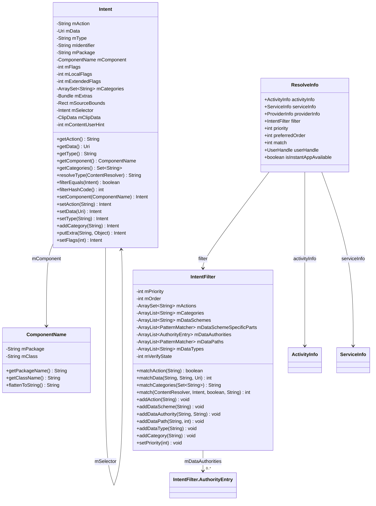

### 21.1.3 Intent 的两种形式

`Intent.java` 约第 257 行的源代码记录了两种基本形式：

**显式 Intent** 通过 `setComponent()` 或 `setClass()` 指定组件。当设置了显式组件时，系统会绕过所有解析逻辑——直接使用命名的组件。这是应用内导航以及定向特定系统服务的机制。

**隐式 Intent** 不设置组件。相反，它们携带足够的信息（action、data、type、categories），让系统确定哪个可用组件是最匹配的。这是应用间通信以及利用 Intent 文档中所描述的“运行时晚期绑定”的机制。

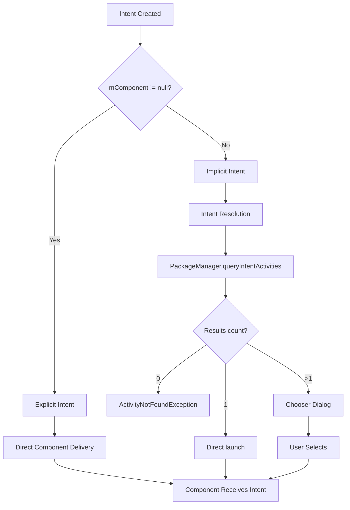

### 21.1.4 filterEquals 契约

Intent 上的一个关键方法是 `filterEquals()`，定义于约第 12088 行：

```java
// frameworks/base/core/java/android/content/Intent.java
public boolean filterEquals(Intent other) {
    if (other == null) {
        return false;
    }
    if (!Objects.equals(this.mAction, other.mAction)) return false;
    if (!Objects.equals(this.mData, other.mData)) return false;
    if (!Objects.equals(this.mType, other.mType)) return false;
    if (!Objects.equals(this.mIdentifier, other.mIdentifier)) return false;
    if (!Objects.equals(this.mPackage, other.mPackage)) return false;
    if (!Objects.equals(this.mComponent, other.mComponent)) return false;
    if (!Objects.equals(this.mCategories, other.mCategories)) return false;
    return true;
}
```

此方法为以下用途定义了 Intent 的标识：

- PendingIntent 匹配（两个 Intent 满足 filterEquals 的 PendingIntent 共享同一 token）
- `FLAG_RECEIVER_REPLACE_PENDING` 广播替换
- 用作 HashMap 键的 `FilterComparison` 包装器

注意，`mExtras` 被刻意排除在外。仅在 extra 上有所不同的两个 Intent，在解析和 PendingIntent 的用途上会被视为同一个 Intent。这是常见的 bug 来源，PendingIntent 的 Javadoc 中有明确的记载。

### 21.1.5 Intent 标志

Intent 类将标志定义为两大类，均以位掩码的形式编码在 `mFlags` 中。Activity 标志和接收器标志共享 `mFlags` 的高位——它们是通过 Intent 的分发方式来区分的，而不是通过不相交的位段来区分。例如，当 Intent 启动 Activity 时，`0x40000000` 表示 `FLAG_ACTIVITY_NO_HISTORY`，但当它是广播时，则表示 `FLAG_RECEIVER_REGISTERED_ONLY`。

**Activity 标志**控制启动行为：

| 标志 | 值 | 效果 |
|------|-------|--------|
| `FLAG_ACTIVITY_NEW_TASK` | `0x10000000` | 启动到新任务中 |
| `FLAG_ACTIVITY_CLEAR_TOP` | `0x04000000` | 清除栈中目标之上的 Activity |
| `FLAG_ACTIVITY_SINGLE_TOP` | `0x20000000` | 复用栈顶已有的实例 |
| `FLAG_ACTIVITY_NO_HISTORY` | `0x40000000` | 不保留在历史记录中 |
| `FLAG_ACTIVITY_CLEAR_TASK` | `0x00008000` | 启动前清除任务 |
| `FLAG_ACTIVITY_EXCLUDE_FROM_RECENTS` | `0x00800000` | 在最近任务列表中隐藏 |
| `FLAG_ACTIVITY_FORWARD_RESULT` | `0x02000000` | 将结果转发给最初的调用方 |
| `FLAG_ACTIVITY_LAUNCH_ADJACENT` | `0x00001000` | 多窗口相邻启动 |

**接收器标志**控制广播行为：

| 标志 | 值 | 效果 |
|------|-------|--------|
| `FLAG_RECEIVER_REGISTERED_ONLY` | `0x40000000` | 仅已注册的接收器 |
| `FLAG_RECEIVER_REPLACE_PENDING` | `0x20000000` | 替换匹配的待处理广播 |
| `FLAG_RECEIVER_FOREGROUND` | `0x10000000` | 以前台优先级投递 |
| `FLAG_RECEIVER_NO_ABORT` | `0x08000000` | 不能中止有序广播 |
| `FLAG_RECEIVER_INCLUDE_BACKGROUND` | `0x01000000` | 包含已停止/后台的应用 |
| `FLAG_RECEIVER_EXCLUDE_BACKGROUND` | `0x00800000` | 排除后台应用 |

**URI 权限标志**（第 0、1、6、7 位）授予临时访问权：

| 标志 | 值 | 效果 |
|------|-------|--------|
| `FLAG_GRANT_READ_URI_PERMISSION` | `0x00000001` | 授予数据 URI 的读权限 |
| `FLAG_GRANT_WRITE_URI_PERMISSION` | `0x00000002` | 授予数据 URI 的写权限 |
| `FLAG_GRANT_PERSISTABLE_URI_PERMISSION` | `0x00000040` | 权限在重启后仍保留 |
| `FLAG_GRANT_PREFIX_URI_PERMISSION` | `0x00000080` | 在 URI 前缀上授予 |

### 21.1.6 Intent 构造模式

Intent 类支持多种构造模式。理解这些模式至关重要，因为它们会影响哪些字段被填充以及解析行为如何。

**直接构造函数：**

```java
// Empty intent - requires setters
Intent intent = new Intent();

// Action-only intent
Intent intent = new Intent(Intent.ACTION_VIEW);

// Action + URI (implicit)
Intent intent = new Intent(Intent.ACTION_VIEW, Uri.parse("https://example.com"));

// Explicit class target
Intent intent = new Intent(context, TargetActivity.class);

// Explicit component via strings
Intent intent = new Intent();
intent.setClassName("com.example.app", "com.example.app.TargetActivity");
```

**setData/setType 互斥：**

一个关键的 API 细节：`setData()` 会清除 type，而 `setType()` 会清除 data。要同时设置两者，必须使用 `setDataAndType()`：

```java
// WRONG: type is cleared
intent.setData(Uri.parse("content://media/images/1"));
intent.setType("image/jpeg");  // This clears mData!

// CORRECT: both preserved
intent.setDataAndType(Uri.parse("content://media/images/1"), "image/jpeg");
```

源代码证实了这种互斥模式（`setData()` 在第 10488 行，`setType()` 在第 10545 行，`setDataAndType()` 在第 10605 行）：

```java
public @NonNull Intent setData(@Nullable Uri data) {
    mData = data;
    mType = null;   // Type cleared!
    return this;
}

public @NonNull Intent setType(@Nullable String type) {
    mData = null;   // Data cleared!
    mType = type;
    return this;
}

public @NonNull Intent setDataAndType(@Nullable Uri data, @Nullable String type) {
    mData = data;
    mType = type;   // Both preserved
    return this;
}
```

### 21.1.7 Selector 机制

`mSelector` 字段提供了一种强大但很少使用的间接机制。当设置了 selector 时，系统使用 selector Intent 进行解析，而不是主 Intent。但是，主 Intent 的标识（用于 `filterEquals`）仍然基于主 Intent，而不是 selector。

来自源码（`setSelector()` 约第 10740 行）：

```java
// Intent.java
public void setSelector(@Nullable Intent selector) {
    if (selector == this) {
        throw new IllegalArgumentException(
                "Intent being set as a selector of itself");
    }
    if (selector != null && mPackage != null) {
        throw new IllegalArgumentException(
                "Can't set selector when package name is already set");
    }
    mSelector = selector;
}
```

用例：`CATEGORY_APP_BROWSER` Intent 使用 selector 专门定向浏览器的 launcher activity：

```java
Intent browserIntent = new Intent(Intent.ACTION_MAIN);
Intent selector = new Intent(Intent.ACTION_MAIN);
selector.addCategory(Intent.CATEGORY_APP_BROWSER);
browserIntent.setSelector(selector);
startActivity(browserIntent);
```

这通过浏览器的 MAIN/LAUNCHER 入口点启动浏览器，而不是通过 VIEW intent。如果用户之前曾正常启动过浏览器，这样可以避免任务混乱。

### 21.1.8 ClipData 与 URI 权限授予

`mClipData` 字段（第 8144 行）具有双重用途：携带富内容，以及对多个 URI 启用 URI 权限授予。当设置了 `FLAG_GRANT_READ_URI_PERMISSION` 或 `FLAG_GRANT_WRITE_URI_PERMISSION` 时，授予适用于主 `mData` URI 以及 ClipData 项中的所有 URI。

来自 `setClipData()` 的 javadoc（约第 10758 行）：

> “与通过 extra 传递数据相比，使用它的主要特性是，
> FLAG_GRANT_READ_URI_PERMISSION 和 FLAG_GRANT_WRITE_URI_PERMISSION 将作用于
> clip data 中包含的任何 URI 项。”

这对 `ACTION_SEND_MULTIPLE` 模式至关重要，应用通过它共享多个内容 URI：

```java
Intent shareIntent = new Intent(Intent.ACTION_SEND_MULTIPLE);
shareIntent.setType("image/*");
shareIntent.addFlags(Intent.FLAG_GRANT_READ_URI_PERMISSION);

ArrayList<Uri> imageUris = new ArrayList<>();
imageUris.add(uri1);
imageUris.add(uri2);
imageUris.add(uri3);
shareIntent.putParcelableArrayListExtra(Intent.EXTRA_STREAM, imageUris);

// ClipData ensures URI permissions are granted for all URIs
ClipData clip = ClipData.newUri(resolver, "images", uri1);
for (int i = 1; i < imageUris.size(); i++) {
    clip.addItem(new ClipData.Item(imageUris.get(i)));
}
shareIntent.setClipData(clip);
```

### 21.1.9 Intent 拷贝模式

Intent 类定义了三种拷贝模式（约第 8152 行）：

```java
private static final int COPY_MODE_ALL = 0;      // Full copy
private static final int COPY_MODE_FILTER = 1;    // Only filter-relevant fields
private static final int COPY_MODE_HISTORY = 2;   // All except extras/clipdata
```

`COPY_MODE_FILTER` 创建一个“剥离”的 Intent，只包含用于匹配的字段：action、data、type、identifier、package、component 和 categories。标志、extra、ClipData 和 source bounds 被排除在外。当系统需要出于匹配目的存储一个 Intent，又不想承担负载开销时，会使用此模式。

`COPY_MODE_HISTORY` 类似于完整拷贝，但如果 extra 非空，则用 `Bundle.STRIPPED` 哨兵值替换 extra。它用于历史记录和调试转储等不需要完整 extra 数据的场合。

### 21.1.10 标准 Action 深入剖析

Intent 类定义了超过 100 个标准 action。它们按用途分组：

**Activity Action**（通过 `startActivity()` 启动）：

| Action | 字符串值 | 用途 |
|--------|-------------|---------|
| `ACTION_MAIN` | `android.intent.action.MAIN` | 主入口点 |
| `ACTION_VIEW` | `android.intent.action.VIEW` | 显示数据 |
| `ACTION_EDIT` | `android.intent.action.EDIT` | 编辑数据 |
| `ACTION_PICK` | `android.intent.action.PICK` | 选择一个条目 |
| `ACTION_CHOOSER` | `android.intent.action.CHOOSER` | 显示选择对话框 |
| `ACTION_GET_CONTENT` | `android.intent.action.GET_CONTENT` | 按类型获取内容 |
| `ACTION_SEND` | `android.intent.action.SEND` | 分享内容 |
| `ACTION_SENDTO` | `android.intent.action.SENDTO` | 发送给特定收件人 |
| `ACTION_DIAL` | `android.intent.action.DIAL` | 显示拨号器 |
| `ACTION_CALL` | `android.intent.action.CALL` | 拨打电话 |
| `ACTION_INSERT` | `android.intent.action.INSERT` | 插入新数据 |
| `ACTION_DELETE` | `android.intent.action.DELETE` | 删除数据 |
| `ACTION_SEARCH` | `android.intent.action.SEARCH` | 执行搜索 |
| `ACTION_WEB_SEARCH` | `android.intent.action.WEB_SEARCH` | 网络搜索 |
| `ACTION_QUICK_VIEW` | `android.intent.action.QUICK_VIEW` | 预览数据 |
| `ACTION_INSERT_OR_EDIT` | `android.intent.action.INSERT_OR_EDIT` | 插入或编辑 |

**广播 Action**（通过 `sendBroadcast()` 投递）：

| Action | 字符串值 | 受保护？ |
|--------|-------------|-----------|
| `ACTION_BOOT_COMPLETED` | `android.intent.action.BOOT_COMPLETED` | 是 |
| `ACTION_SHUTDOWN` | `android.intent.action.ACTION_SHUTDOWN` | 是 |
| `ACTION_TIME_TICK` | `android.intent.action.TIME_TICK` | 是 |
| `ACTION_TIME_CHANGED` | `android.intent.action.TIME_SET` | 是 |
| `ACTION_TIMEZONE_CHANGED` | `android.intent.action.TIMEZONE_CHANGED` | 是 |
| `ACTION_BATTERY_CHANGED` | `android.intent.action.BATTERY_CHANGED` | 是 |
| `ACTION_POWER_CONNECTED` | `android.intent.action.ACTION_POWER_CONNECTED` | 是 |
| `ACTION_PACKAGE_ADDED` | `android.intent.action.PACKAGE_ADDED` | 是 |
| `ACTION_PACKAGE_REMOVED` | `android.intent.action.PACKAGE_REMOVED` | 是 |
| `ACTION_SCREEN_ON` | `android.intent.action.SCREEN_ON` | 是 |
| `ACTION_SCREEN_OFF` | `android.intent.action.SCREEN_OFF` | 是 |
| `ACTION_LOCALE_CHANGED` | `android.intent.action.LOCALE_CHANGED` | 是 |

**标准 Category：**

| Category | 字符串值 | 用途 |
|----------|-------------|---------|
| `CATEGORY_DEFAULT` | `android.intent.category.DEFAULT` | startActivity 的默认项 |
| `CATEGORY_BROWSABLE` | `android.intent.category.BROWSABLE` | 可从浏览器打开 |
| `CATEGORY_LAUNCHER` | `android.intent.category.LAUNCHER` | 显示在应用启动器中 |
| `CATEGORY_HOME` | `android.intent.category.HOME` | 主屏幕替换器 |
| `CATEGORY_ALTERNATIVE` | `android.intent.category.ALTERNATIVE` | 备选操作 |
| `CATEGORY_TAB` | `android.intent.category.TAB` | 标签页界面 |
| `CATEGORY_INFO` | `android.intent.category.INFO` | 关于包的信息 |
| `CATEGORY_PREFERENCE` | `android.intent.category.PREFERENCE` | 设置界面 |
| `CATEGORY_CAR_DOCK` | `android.intent.category.CAR_DOCK` | 车载支架 Activity |
| `CATEGORY_DESK_DOCK` | `android.intent.category.DESK_DOCK` | 桌面支架 Activity |
| `CATEGORY_APP_BROWSER` | `android.intent.category.APP_BROWSER` | 浏览器应用 |
| `CATEGORY_APP_EMAIL` | `android.intent.category.APP_EMAIL` | 邮件应用 |
| `CATEGORY_APP_MAPS` | `android.intent.category.APP_MAPS` | 地图应用 |
| `CATEGORY_APP_MESSAGING` | `android.intent.category.APP_MESSAGING` | 消息应用 |
| `CATEGORY_APP_MUSIC` | `android.intent.category.APP_MUSIC` | 音乐应用 |
| `CATEGORY_APP_CALENDAR` | `android.intent.category.APP_CALENDAR` | 日历应用 |
| `CATEGORY_APP_CONTACTS` | `android.intent.category.APP_CONTACTS` | 通讯录应用 |
| `CATEGORY_APP_GALLERY` | `android.intent.category.APP_GALLERY` | 图库应用 |

---

## 21.2 Intent 解析

Intent 解析是将一个隐式 Intent 映射到一个或多个能够处理它的具体组件的过程。系统通过将 Intent 的属性与已安装包中的 `<intent-filter>` 声明以及动态注册的接收器进行比较，来完成这一解析。

### 21.2.1 解析架构

解析机制位于 PackageManagerService 及其辅助类中：

```
frameworks/base/services/core/java/com/android/server/pm/resolution/ComponentResolverBase.java
frameworks/base/services/core/java/com/android/server/pm/resolution/ComponentResolver.java
frameworks/base/services/core/java/com/android/server/pm/resolution/ComponentResolverApi.java
```

`ComponentResolverBase` 维护四个专门的解析器，每个组件类型一个：

```java
// frameworks/base/services/core/java/com/android/server/pm/resolution/ComponentResolverBase.java
protected ComponentResolver.ActivityIntentResolver mActivities;
protected ComponentResolver.ProviderIntentResolver mProviders;
protected ComponentResolver.ReceiverIntentResolver mReceivers;
protected ComponentResolver.ServiceIntentResolver mServices;
protected ArrayMap<String, ParsedProvider> mProvidersByAuthority;
```

每个解析器为该类型所有已安装组件的 IntentFilter 建立索引。当解析查询到达时，相应的解析器执行匹配。

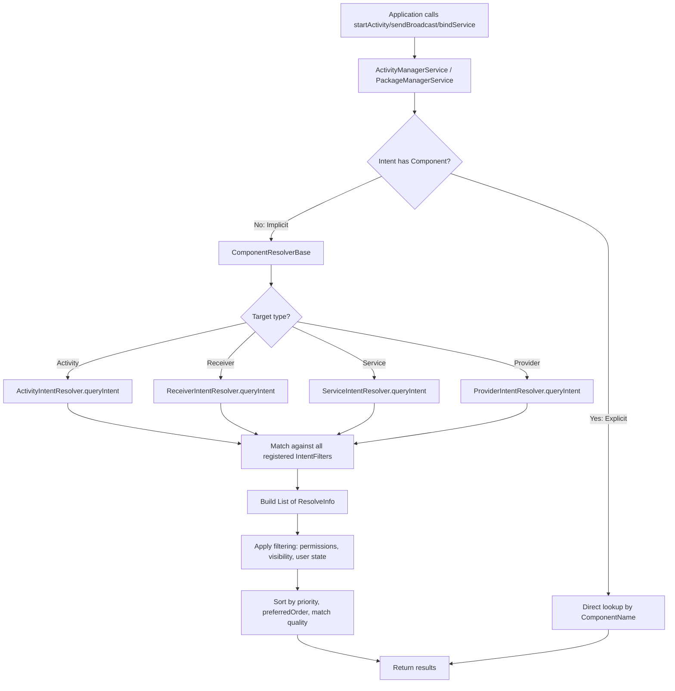

### 21.2.2 显式 Intent 解析

显式解析很简单。当 Intent 上设置了 `mComponent` 时，系统执行直接查找：

```java
// ComponentResolverBase.java
public boolean componentExists(@NonNull ComponentName componentName) {
    ParsedMainComponent component = mActivities.mActivities.get(componentName);
    if (component != null) return true;
    component = mReceivers.mActivities.get(componentName);
    if (component != null) return true;
    component = mServices.mServices.get(componentName);
    if (component != null) return true;
    return mProviders.mProviders.get(componentName) != null;
}
```

这是一次 O(1) 的 HashMap 查找。不会进行过滤器匹配。该组件必须存在、处于启用状态、已导出（或与调用方共享相同的 UID），并且调用方必须持有任何所需的权限。

### 21.2.3 隐式 Intent 解析：三项测试

隐式解析将一个 Intent 与为相关组件类型注册的每个 IntentFilter 进行匹配。来自 `IntentFilter`（定义于 `frameworks/base/core/java/android/content/IntentFilter.java`）的匹配算法依次应用三项测试。要匹配成功，三项测试必须全部通过。

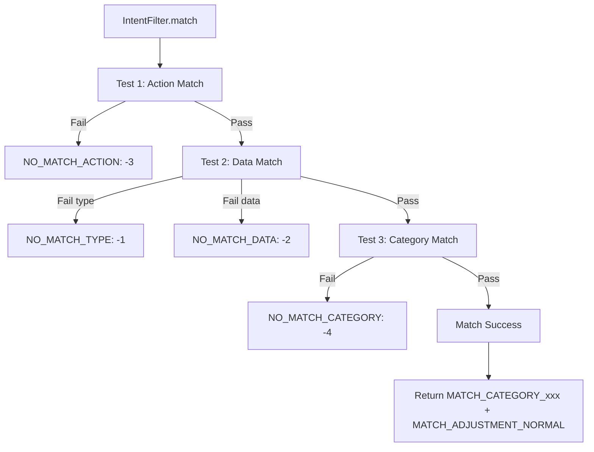

**测试 1：Action 匹配**（`matchAction()`）：

Intent 的 action 必须列在过滤器的 action 集合中。如果过滤器没有指定任何 action，则只匹配不携带 action 的 Intent。当 Intent 的 action 为 null 时，`match()` 中的 action 测试会被完全跳过。在这种情况下，较新的 Android（targetV+）会通过 `BLOCK_NULL_ACTION_INTENTS` 兼容性变更（change ID `293560872`，声明于 `IntentFilter.java` 第 202 行）阻止匹配。应用此逻辑的服务端钩子位于 `SaferIntentUtils` 中（见第 21.10 节）。

```java
// IntentFilter.java
public final boolean matchAction(String action) {
    return matchAction(action, false, null);
}

private boolean matchAction(String action, boolean wildcardSupported,
        @Nullable Collection<String> ignoreActions) {
    if (wildcardSupported && WILDCARD.equals(action)) {
        // Wildcard matches any action in the filter
        ...
        return !mActions.isEmpty();
    }
    if (ignoreActions != null && ignoreActions.contains(action)) {
        return false;
    }
    return hasAction(action);
}
```

**测试 2：Data 匹配**（`matchData()`）：

data 匹配是最复杂的测试，它根据过滤器的 data 规范评估 Intent 的 MIME 类型、URI scheme、authority 和路径。该方法返回一个匹配质量常量，编码匹配的精确程度：

| 常量 | 值 | 含义 |
|----------|-------|---------|
| `MATCH_CATEGORY_EMPTY` | `0x0100000` | 无数据规范 |
| `MATCH_CATEGORY_SCHEME` | `0x0200000` | scheme 匹配 |
| `MATCH_CATEGORY_HOST` | `0x0300000` | scheme + host 匹配 |
| `MATCH_CATEGORY_PORT` | `0x0400000` | scheme + host + port 匹配 |
| `MATCH_CATEGORY_PATH` | `0x0500000` | 完整 URI 匹配 |
| `MATCH_CATEGORY_SCHEME_SPECIFIC_PART` | `0x0580000` | scheme + SSP 匹配 |
| `MATCH_CATEGORY_TYPE` | `0x0600000` | MIME 类型匹配 |

值越高表示匹配越精确。成功的匹配会加上 `MATCH_ADJUSTMENT_NORMAL` 值（`0x8000`）作为质量基准。

来自 `IntentFilter.matchData()` 的数据匹配逻辑（约第 1743 行的私有重载）遵循分层求值：

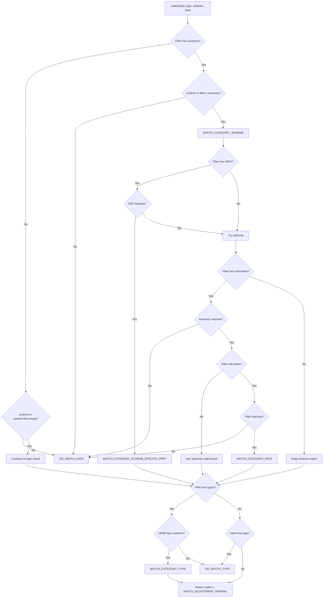

**测试 3：Category 匹配**（`matchCategories()`）：

Intent 中的每个 category 都必须出现在过滤器中。过滤器中多出的、Intent 中不存在的 category 不会导致失败。如果过滤器没有任何 category，则只匹配不携带 category 的 Intent。

```java
// IntentFilter.java, line ~1905
public final String matchCategories(Set<String> categories) {
    if (categories == null) {
        return null;  // Success: no categories required
    }
    Iterator<String> it = categories.iterator();
    if (mCategories == null) {
        return it.hasNext() ? it.next() : null;  // Fail if intent has categories
    }
    while (it.hasNext()) {
        final String category = it.next();
        if (!mCategories.contains(category)) {
            return category;  // Return the first unmatched category
        }
    }
    return null;  // Success: all categories matched
}
```

关键含义：任何希望通过 `startActivity()` 以隐式 Intent 被启动的 Activity，都必须在其过滤器中声明 `CATEGORY_DEFAULT`。原因是 `startActivity()` 使用 `PackageManager.MATCH_DEFAULT_ONLY` 进行解析。这会让解析器只保留声明了 `CATEGORY_DEFAULT` 的过滤器。

### 21.2.4 ResolveInfo：解析结果

解析的结果是一个 `ResolveInfo` 对象（或其列表），定义于：

```
frameworks/base/core/java/android/content/pm/ResolveInfo.java
```

关键字段：

```java
// ResolveInfo.java
public class ResolveInfo implements Parcelable {
    public ActivityInfo activityInfo;    // Non-null for activity/receiver matches
    public ServiceInfo serviceInfo;      // Non-null for service matches
    public ProviderInfo providerInfo;    // Non-null for provider matches
    public IntentFilter filter;          // The matched filter
    public int priority;                 // Declared priority
    public int preferredOrder;           // User preference order
    public int match;                    // Match quality constant
    public UserHandle userHandle;        // Cross-profile origin
    public boolean isInstantAppAvailable;
}
```

`match` 字段将匹配质量编码为 `MATCH_CATEGORY_MASK` 和 `MATCH_ADJUSTMENT_MASK` 的组合。当多个组件匹配时，它们按以下顺序排序：（1）priority（高的在前），（2）preferredOrder（用户偏好），（3）匹配质量（更精确的匹配在前）。

### 21.2.5 完整的 match() 方法

IntentFilter 中完整的 `match()` 方法（约第 2453 行）编排了全部三项测试以及较新的 extra 匹配：

```java
// IntentFilter.java, line ~2453
public final int match(String action, String type, String scheme,
        Uri data, Set<String> categories, String logTag, boolean supportWildcards,
        @Nullable Collection<String> ignoreActions, @Nullable Bundle extras) {
    // Test 1: Action
    if (action != null && !matchAction(action, supportWildcards, ignoreActions)) {
        return NO_MATCH_ACTION;
    }

    // Test 2: Data (type + scheme + authority + path)
    int dataMatch = matchData(type, scheme, data, supportWildcards);
    if (dataMatch < 0) {
        return dataMatch;
    }

    // Test 3: Categories
    String categoryMismatch = matchCategories(categories);
    if (categoryMismatch != null) {
        return NO_MATCH_CATEGORY;
    }

    // Test 4: Extras (newer addition, hidden API)
    String extraMismatch = matchExtras(extras);
    if (extraMismatch != null) {
        return NO_MATCH_EXTRAS;
    }

    return dataMatch;
}
```

注意第四项测试：extra 匹配。虽然它仍是一个隐藏 API，但它允许系统服务创建针对特定 extra 值进行匹配的 IntentFilter。`matchExtras()` 方法（约第 1942 行）检查过滤器 extra 中的每个键值对，是否在 Intent 的 extra 中以相同值存在。如果不匹配，它返回 `NO_MATCH_EXTRAS` 哨兵值（`-5`，定义于第 303 行）。

大多数客户端代码使用的工具方法：

```java
// IntentFilter.java, line ~2387
public final int match(ContentResolver resolver, Intent intent,
        boolean resolve, String logTag) {
    String type = resolve ? intent.resolveType(resolver) : intent.getType();
    return match(intent.getAction(), type, intent.getScheme(),
                 intent.getData(), intent.getCategories(), logTag,
                 false /* supportWildcards */, null /* ignoreActions */,
                 intent.getExtras());
}
```

`resolve` 参数很重要。当为 true 时，类型通过调用 `intent.resolveType(resolver)` 确定。如果未设置显式类型，此调用会向 ContentResolver 查询数据 URI 的 MIME 类型。当为 false 时，只使用 `intent.getType()`（返回显式设置的类型或 null）。

### 21.2.6 Predicate API

IntentFilter 还暴露了一个 `Predicate<Intent>` API，用于函数式风格的匹配：

```java
// IntentFilter.java, asPredicate()
public @NonNull Predicate<Intent> asPredicate() {
    return i -> match(null, i, false, TAG) >= 0;
}

public @NonNull Predicate<Intent> asPredicateWithTypeResolution(
        @NonNull ContentResolver resolver) {
    return i -> match(resolver, i, true, TAG) >= 0;
}
```

这使如下用法成为可能：

```java
IntentFilter filter = new IntentFilter(Intent.ACTION_VIEW);
filter.addDataScheme("https");
filter.addDataAuthority("example.com", null);

List<Intent> matchingIntents = allIntents.stream()
    .filter(filter.asPredicate())
    .collect(Collectors.toList());
```

### 21.2.7 解析优先级与排序

当多个组件匹配一个隐式 Intent 时，系统必须选择使用哪一个（对于 Activity），或确定投递顺序（对于广播）。排序算法考虑以下几个因素：

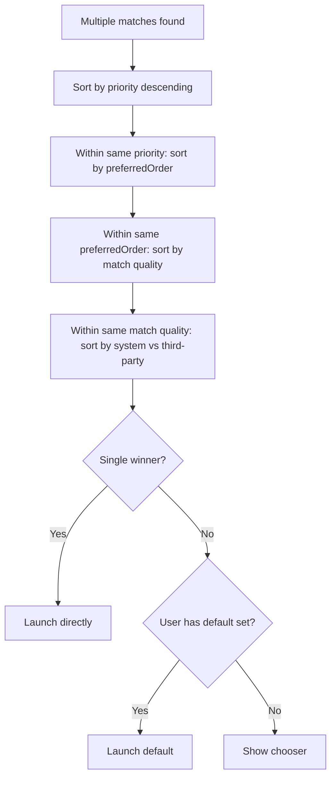

系统还会考虑：

- **默认浏览器**：解析网络 URL 时，用户的默认浏览器获得优先权
- **Instant App**：如果 ResolveInfo 中的 `isInstantAppAvailable` 为 true，则可能优先选择 Instant App 版本
- **自动验证的域名**：带有已验证域名的 App Links 会完全绕过选择对话框（见第 21.5 节）
- **跨配置文件匹配**：来自其他配置文件的匹配会包含在选择对话框中，并带有工作/个人标记

### 21.2.8 CATEGORY_DEFAULT 深入剖析

`CATEGORY_DEFAULT` 要求是 Intent 解析中最重要、也最常被误解的方面之一。以下是确切的行为：

1. `Context.startActivity()` 使用 `PackageManager.MATCH_DEFAULT_ONLY` 解析，因此只考虑声明了 `CATEGORY_DEFAULT` 的过滤器（Intent 本身永远不会被修改）
2. `PackageManager.queryIntentActivities()` 不会应用 `MATCH_DEFAULT_ONLY`，除非调用方传入它
3. `Context.sendBroadcast()` 不要求它
4. `Context.startService()` 不要求它

这意味着：

- Activity 必须声明 `CATEGORY_DEFAULT` 才能通过隐式 Intent 启动
- 广播接收器不需要 `CATEGORY_DEFAULT`
- Service 不需要 `CATEGORY_DEFAULT`

```xml
<!-- This activity is reachable via startActivity() with implicit intent -->
<activity android:name=".ReachableActivity" android:exported="true">
    <intent-filter>
        <action android:name="com.example.MY_ACTION" />
        <category android:name="android.intent.category.DEFAULT" />
    </intent-filter>
</activity>

<!-- This activity is NOT reachable via startActivity() with implicit intent -->
<!-- But IS findable via queryIntentActivities() -->
<activity android:name=".HiddenActivity" android:exported="true">
    <intent-filter>
        <action android:name="com.example.MY_ACTION" />
        <!-- No CATEGORY_DEFAULT! -->
    </intent-filter>
</activity>
```

### 21.2.9 选择对话框

当多个 Activity 匹配一个隐式 Intent 且未设置默认项时，系统会显示一个消歧对话框。该对话框本身就是一个 Activity——`com.android.internal.app.ResolverActivity`——当解析结果有歧义时，`PackageManagerService` 会将其作为内置的 resolve activity（`mResolveActivity`）返回。

应用也可以显式调用分享面板 Chooser：

```java
Intent chooser = Intent.createChooser(targetIntent, "Share via");
startActivity(chooser);
```

`ACTION_CHOOSER` Intent 将原始 Intent 包装在 `EXTRA_INTENT` 中，并可选择添加 `EXTRA_INITIAL_INTENTS` 以提供额外选项。它由非捆绑的 IntentResolver 模块（`packages/modules/IntentResolver`）中的 `com.android.intentresolver.ChooserActivity` 处理，该模块通过其清单中的 `.ChooserActivityLauncher` activity 别名针对 `ACTION_CHOOSER` 注册。旧版 `com.android.internal.app.ChooserActivity`（一个 `ResolverActivity` 子类）仍存在于 `frameworks/base` 中，但不再携带 `ACTION_CHOOSER` 过滤器。无论哪种方式，该路径仅服务于显式的 `Intent.createChooser()` / `ACTION_CHOOSER` 场景，而不服务于普通的多重匹配消歧。

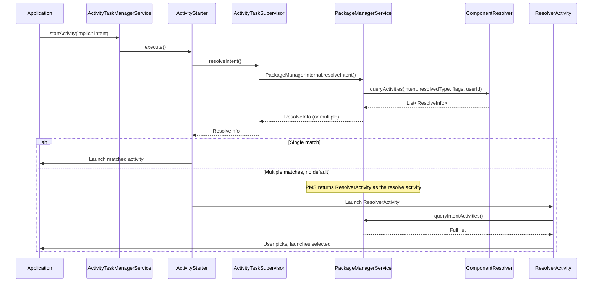

### 21.2.10 基于 Scheme 的匹配细节

一个微妙但重要的行为：当过滤器没有声明任何 scheme 时，它会隐式匹配两类 Intent。这两类分别是：没有数据 URI 的 Intent，以及带有 `content:` 或 `file:` scheme URI 的 Intent。这
使得仅基于 MIME 类型的过滤器也能与 ContentProvider 配合工作。来自 `matchData()`：

```java
// IntentFilter.java, line ~1802
} else {
    // Special case: match either an Intent with no data URI,
    // or with a scheme: URI.  This is to give a convenience for
    // the common case where you want to deal with data in a
    // content provider, which is done by type...
    if (scheme != null && !"".equals(scheme)
            && !"content".equals(scheme)
            && !"file".equals(scheme)
            && !(wildcardSupported && WILDCARD.equals(scheme))) {
        return NO_MATCH_DATA;
    }
}
```

这意味着，一个只带有 `<data android:mimeType="image/*"/>` 的过滤器，将匹配一个 `data=content://media/images/1` 且 `type=image/jpeg` 的 Intent，即使过滤器中没有声明任何 scheme。

---

## 21.3 PendingIntent

PendingIntent 是一个表示未来 Intent 操作的 token，由系统维护，任何持有该 token 的
一方都可以执行它。它是 Android 框架中安全敏感性最高的对象之一。

### 21.3.1 源码位置与类结构

```
frameworks/base/core/java/android/app/PendingIntent.java
```

PendingIntent 类包装了一个 `IIntentSender` binder token：

```java
// PendingIntent.java, line ~135
public final class PendingIntent implements Parcelable {
    private final IIntentSender mTarget;
    private IBinder mWhitelistToken;
    private @Nullable PendingIntentInfo mCachedInfo;
}
```

实际的 pending intent 状态由服务端的 `ActivityManagerService` 维护。客户端的
`PendingIntent` 对象仅仅是一个句柄。

### 21.3.2 创建方法

PendingIntent 通过五个静态工厂方法创建，分别对应不同类型的操作：

```java
PendingIntent.getActivity(context, requestCode, intent, flags)
PendingIntent.getActivities(context, requestCode, intents, flags)
PendingIntent.getBroadcast(context, requestCode, intent, flags)
PendingIntent.getService(context, requestCode, intent, flags)
PendingIntent.getForegroundService(context, requestCode, intent, flags)
```

每个方法都会调用到 `ActivityManagerService`，后者委托给 `PendingIntentController`
创建一个 `PendingIntentRecord`，并存储在一个跨进程的映射中。`requestCode` 参数用于
区分那些否则会通过 `filterEquals()` 被视为等价的 PendingIntent。

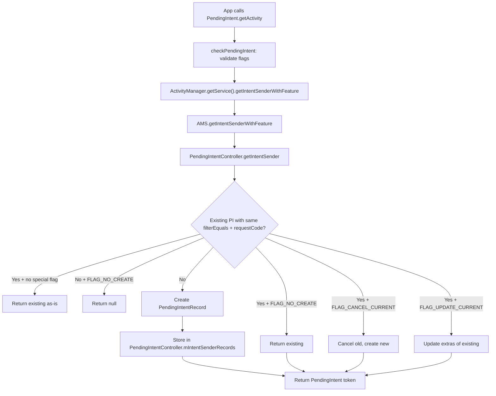

### 21.3.3 PendingIntent 标志

标志同时控制 PendingIntent 的行为和它的标识：

| 标志 | 值 | 行为 |
|------|-------|----------|
| `FLAG_ONE_SHOT` | `1<<30` | 只能发送一次；使用后自动取消 |
| `FLAG_NO_CREATE` | `1<<29` | 如果不存在匹配的 PI，则返回 null |
| `FLAG_CANCEL_CURRENT` | `1<<28` | 先取消任何已存在的匹配 PI |
| `FLAG_UPDATE_CURRENT` | `1<<27` | 替换已存在的匹配 PI 的 extra |
| `FLAG_IMMUTABLE` | `1<<26` | 阻止在发送时修改 |
| `FLAG_MUTABLE` | `1<<25` | 允许在发送时修改 |
| `FLAG_ALLOW_UNSAFE_IMPLICIT_INTENT` | `1<<24` | 允许可变 + 隐式（危险） |

### 21.3.4 可变与不可变 PendingIntent

从 Android 12（API 31）起，应用必须显式选择可变性。兼容性变更
`PENDING_INTENT_EXPLICIT_MUTABILITY_REQUIRED`（change ID `160794467`）强制执行这一点：

```java
// PendingIntent.java, line ~442
private static void checkPendingIntent(int flags, @NonNull Intent intent,
        @NonNull Context context, boolean isActivityResultType) {
    final boolean isFlagImmutableSet = (flags & PendingIntent.FLAG_IMMUTABLE) != 0;
    final boolean isFlagMutableSet = (flags & PendingIntent.FLAG_MUTABLE) != 0;

    if (isFlagImmutableSet && isFlagMutableSet) {
        throw new IllegalArgumentException(
            "Cannot set both FLAG_IMMUTABLE and FLAG_MUTABLE for PendingIntent");
    }

    if (Compatibility.isChangeEnabled(PENDING_INTENT_EXPLICIT_MUTABILITY_REQUIRED)
            && !isFlagImmutableSet && !isFlagMutableSet) {
        throw new IllegalArgumentException(
            packageName + ": Targeting S+ ... requires that one of "
            + "FLAG_IMMUTABLE or FLAG_MUTABLE be specified ...");
    }
}
```

从 Android 14（API 34）起，创建带有隐式 Intent 的可变 PendingIntent 会被
`BLOCK_MUTABLE_IMPLICIT_PENDING_INTENT`（change ID `236704164`）阻止：

```java
// PendingIntent.java, line ~481
public static boolean isNewMutableDisallowedImplicitPendingIntent(int flags,
        @NonNull Intent intent, boolean isActivityResultType) {
    if (isActivityResultType) return false;
    boolean isFlagNoCreateSet = (flags & PendingIntent.FLAG_NO_CREATE) != 0;
    boolean isFlagMutableSet = (flags & PendingIntent.FLAG_MUTABLE) != 0;
    boolean isImplicit = (intent.getComponent() == null)
                      && (intent.getPackage() == null);
    boolean isFlagAllowUnsafeImplicitIntentSet =
            (flags & PendingIntent.FLAG_ALLOW_UNSAFE_IMPLICIT_INTENT) != 0;
    return !isFlagNoCreateSet && isFlagMutableSet && isImplicit
            && !isFlagAllowUnsafeImplicitIntentSet;
}
```

### 21.3.5 安全含义

PendingIntent 是一种委托机制：它们以创建者的身份和权限执行，而不是发送者的身份。
这带来了若干安全考虑：


**框架强制执行的安全最佳实践：**

1. **默认使用 FLAG_IMMUTABLE**——防止发送者修改 Intent
2. **设置显式组件**——防止重定向攻击
3. **对敏感操作使用 FLAG_ONE_SHOT**——防止重放攻击
4. **避免可变 + 隐式**——对 targetSdk 34+ 已被阻止

### 21.3.6 getActivity 的实现路径

为 Activity 实际创建 PendingIntent 的过程，会经过系统内一条详细的路径。来自
`PendingIntent.getActivityAsUser()`（约第 573 行）：

```java
// PendingIntent.java
public static PendingIntent getActivityAsUser(Context context, int requestCode,
        @NonNull Intent intent, int flags, Bundle options, UserHandle user) {
    String packageName = context.getPackageName();
    String resolvedType = intent.resolveTypeIfNeeded(context.getContentResolver());
    checkPendingIntent(flags, intent, context, false);
    try {
        intent.migrateExtraStreamToClipData(context);
        intent.prepareToLeaveProcess(context);
        IIntentSender target =
            ActivityManager.getService().getIntentSenderWithFeature(
                INTENT_SENDER_ACTIVITY, packageName,
                context.getAttributionTag(), null, null, requestCode,
                new Intent[] { intent },
                resolvedType != null ? new String[] { resolvedType } : null,
                flags, options, user.getIdentifier());
        return target != null ? new PendingIntent(target) : null;
    } catch (RemoteException e) {
        throw e.rethrowFromSystemServer();
    }
}
```

此路径中的关键步骤：

1. **类型解析**：如果 Intent 有 `content:` URI 但没有显式类型，`resolveTypeIfNeeded()`
   会向 ContentResolver 查询 MIME 类型
2. **验证**：`checkPendingIntent()` 强制执行可变性要求
3. **流迁移**：`migrateExtraStreamToClipData()` 将 EXTRA_STREAM URI 移入 ClipData，
   以便正确授予 URI 权限
4. **进程准备**：`prepareToLeaveProcess()` 在 Intent 跨进程边界之前对其执行安全检查
5. **IPC 调用**：请求通过 Binder 跨到 `ActivityManagerService`

### 21.3.7 PendingIntent.send() 与 Fill-In

当 PendingIntent 被发送时，调用方可以可选地提供一个"fill-in" Intent 来补充原始
Intent。fill-in 仅在 PendingIntent 可变时生效：

```java
pendingIntent.send(context, resultCode, fillInIntent);
```

fill-in 使用 `Intent.fillIn()`，它遵循特定的 fill-in 标志：

```java
public static final int FILL_IN_ACTION       = 1<<0;
public static final int FILL_IN_DATA         = 1<<1;
public static final int FILL_IN_CATEGORIES   = 1<<2;
public static final int FILL_IN_COMPONENT    = 1<<3;
public static final int FILL_IN_PACKAGE      = 1<<4;
public static final int FILL_IN_SOURCE_BOUNDS = 1<<5;
public static final int FILL_IN_SELECTOR     = 1<<6;
public static final int FILL_IN_CLIP_DATA    = 1<<7;
```

默认情况下，fill-in Intent 中的字段只在原始字段为 null/空时，才替换原始 Intent 中
的对应字段。fill-in 标志会覆盖这一行为：如果设置了 `FILL_IN_ACTION`，即使原始 Intent
已有 action，也会始终替换。

对于不可变的 PendingIntent，fill-in Intent 会被完全忽略。

### 21.3.8 OnFinished 回调

PendingIntent 通过 `OnFinished` 接口支持完成回调：

```java
// PendingIntent.java
public interface OnFinished {
    void onSendFinished(PendingIntent pendingIntent, Intent intent,
            int resultCode, String resultData, Bundle resultExtras);
}
```

这主要用于广播 PendingIntent，当你想知道一次有序广播的结果时。内部类
`FinishedDispatcher` 处理回调投递，确保它在正确的 Handler 上运行。

### 21.3.9 PendingIntent 与通知

PendingIntent 是通知交互的支柱。每次点击通知、每个操作按钮，以及每个回复操作都使用
一个 PendingIntent：

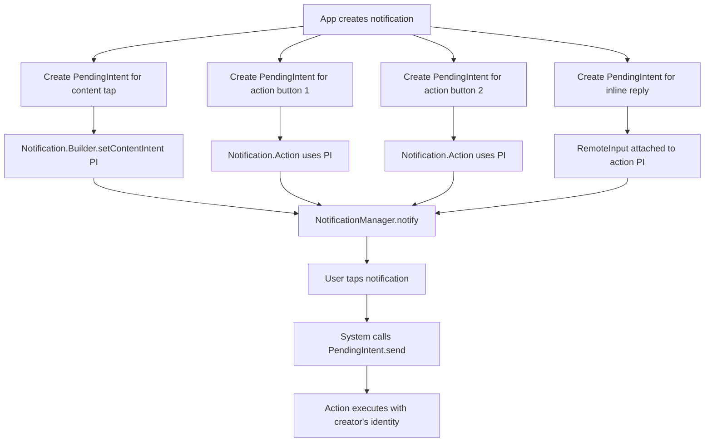

通知中配合 FLAG_IMMUTABLE 的常见模式：

```java
// Content tap: immutable, explicit component
PendingIntent contentPI = PendingIntent.getActivity(context, 0,
    new Intent(context, DetailActivity.class).putExtra("id", itemId),
    PendingIntent.FLAG_IMMUTABLE | PendingIntent.FLAG_UPDATE_CURRENT);

// Inline reply: must be mutable to receive RemoteInput
PendingIntent replyPI = PendingIntent.getBroadcast(context, 0,
    new Intent(context, ReplyReceiver.class),
    PendingIntent.FLAG_MUTABLE | PendingIntent.FLAG_UPDATE_CURRENT);
```

### 21.3.10 PendingIntent 标识

两个 PendingIntent 在满足以下条件时被视为相同：

- 相同类型（activity、broadcast、service）
- 相同 requestCode
- 相同 Intent（按 `filterEquals()`）
- 相同标志（包括可变性）

`FLAG_ONE_SHOT` 和 `FLAG_IMMUTABLE` 标志是标识的一部分。要检索之前创建的一次性
PendingIntent，你必须同时传入 `FLAG_ONE_SHOT` 和 `FLAG_NO_CREATE`。

---

## 21.4 广播系统

广播系统将 Intent 投递给已注册的接收器。它是 Android 中最复杂的子系统之一，处理排序、
权限、后台限制、延迟投递和跨用户投递。

### 21.4.1 广播架构

核心广播类位于：

```
frameworks/base/services/core/java/com/android/server/am/BroadcastQueue.java
frameworks/base/services/core/java/com/android/server/am/BroadcastRecord.java
frameworks/base/services/core/java/com/android/server/am/BroadcastProcessQueue.java
```

`BroadcastQueue` 是一个抽象基类，定义了队列接口：

```java
// BroadcastQueue.java, line ~44
public abstract class BroadcastQueue {
    final @NonNull ActivityManagerService mService;
    final @NonNull Handler mHandler;
    final @NonNull BroadcastSkipPolicy mSkipPolicy;
    final @NonNull BroadcastHistory mHistory;
}
```

关键的抽象操作：

| 方法 | 用途 |
|--------|---------|
| `enqueueBroadcastLocked()` | 添加广播以供后续投递 |
| `finishReceiverLocked()` | 标记接收器完成 |
| `onApplicationAttachedLocked()` | 进程已附着，分发待处理项 |
| `onApplicationTimeoutLocked()` | 进程启动超时 |
| `onApplicationProblemLocked()` | 进程崩溃或 ANR |
| `onApplicationCleanupLocked()` | 进程被杀死 |
| `isIdleLocked()` | 检查队列是否为空 |
| `waitForIdle()` | 阻塞直到全部分发完毕 |
| `waitForBarrier()` | 阻塞直到当前待处理项分发完毕 |

### 21.4.2 BroadcastRecord：广播信封

每一个在途广播都由一个 `BroadcastRecord` 表示：

```java
// BroadcastRecord.java, line ~82
final class BroadcastRecord extends Binder {
    final @NonNull Intent intent;           // the broadcast intent
    final @Nullable ComponentName targetComp;
    final @Nullable ProcessRecord callerApp;
    final @Nullable String callerPackage;
    final int callingPid;
    final int callingUid;
    final boolean ordered;                  // serialize delivery?
    final boolean sticky;                   // from sticky data?
    final boolean alarm;                    // from alarm trigger?
    final boolean pushMessage;              // from push message?
    final boolean interactive;              // from user interaction?
    final boolean initialSticky;            // initial sticky delivery?
    final boolean prioritized;              // multiple priority tranches?
    final boolean deferUntilActive;         // infinitely deferrable?
    final boolean urgent;                   // classified as urgent?
    final int userId;
    final @Nullable String[] requiredPermissions;
    final @Nullable String[] excludedPermissions;
    final @Nullable String[] excludedPackages;
    final @NonNull List<Object> receivers;  // BroadcastFilter and ResolveInfo
    final @DeliveryState int[] delivery;    // per-receiver delivery state
    final @NonNull String[] deliveryReasons;
    int nextReceiver;                       // index of next receiver
    int resultCode;
    @Nullable String resultData;
    @Nullable Bundle resultExtras;
    boolean resultAbort;
}
```

`receivers` 列表包含 `BroadcastFilter` 对象（用于动态注册的接收器）和 `ResolveInfo`
对象（用于清单中声明的接收器）的混合。它们按优先级顺序交错排列。

### 21.4.3 投递状态机

BroadcastRecord 中的每个接收器都会经历一个投递状态机：

```java
// BroadcastRecord.java
static final int DELIVERY_PENDING   = 0;  // Waiting to run
static final int DELIVERY_DELIVERED = 1;  // Finished successfully (terminal)
static final int DELIVERY_SKIPPED   = 2;  // Skipped by policy (terminal)
static final int DELIVERY_TIMEOUT   = 3;  // Timed out (terminal)
static final int DELIVERY_SCHEDULED = 4;  // Currently executing
static final int DELIVERY_FAILURE   = 5;  // Dispatch failure (terminal)
static final int DELIVERY_DEFERRED  = 6;  // Deferred while app cached
```

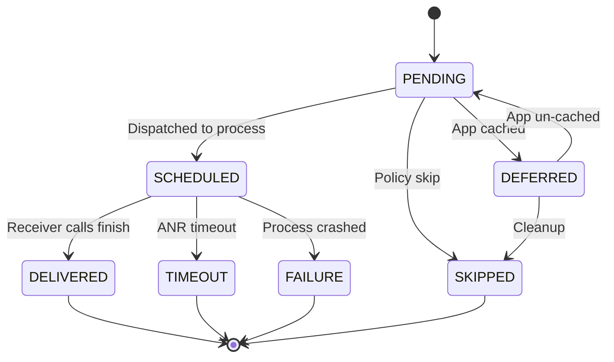

### 21.4.4 BroadcastProcessQueue

现代广播实现使用按进程划分的队列：

```java
// BroadcastProcessQueue.java, line ~67
class BroadcastProcessQueue {
    final @NonNull BroadcastConstants constants;
    final @NonNull String processName;
    final int uid;
    @Nullable BroadcastProcessQueue processNameNext;  // linked list
    @Nullable BroadcastProcessQueue runnableAtNext;    // runnable list
    @Nullable BroadcastProcessQueue runnableAtPrev;
    @Nullable ProcessRecord app;
}
```

这一设计使广播系统能够：

- 按进程限制投递速率
- 将投递延迟到缓存/冻结的进程
- 在进程内保持顺序，同时允许跨进程并行
- 处理进程死亡而不丢失其他进程的广播状态

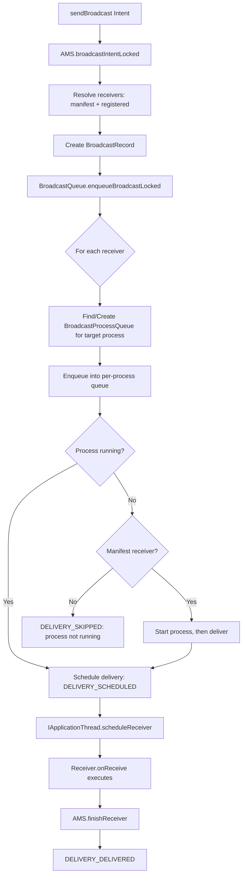

### 21.4.5 有序广播

有序广播按优先级顺序一次投递给一个接收器。每个接收器都可以查看和修改结果，或中止广播。

```java
// Sending an ordered broadcast
sendOrderedBroadcast(
    intent,
    receiverPermission,
    resultReceiver,     // final receiver (always called)
    scheduler,
    initialCode,
    initialData,
    initialExtras
);
```

在 `BroadcastRecord` 中，有序广播的 `ordered` 字段为 `true`。`resultCode`、
`resultData` 和 `resultExtras` 字段携带滚动结果，每个接收器都可以修改。当接收器调用
`abortBroadcast()` 时，`resultAbort` 字段被设置。

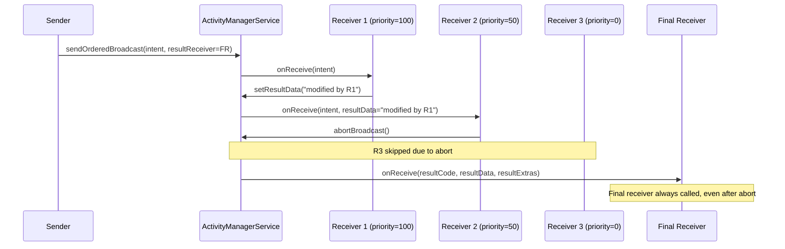

有序广播的关键行为：

- 接收器串行执行，高优先级在前
- 每个接收器都有一个超时（前台通常为 10 秒）
- `abortBroadcast()` 停止向剩余接收器的投递
- 最终/结果接收器无论是否中止都会执行
- `FLAG_RECEIVER_NO_ABORT` 阻止接收器中止

### 21.4.6 Sticky 广播

Sticky 广播在投递后仍然保留。当接收器注册某个 sticky action 时，它会立即收到该 action
的最后一次广播。

```java
// Deprecated but still functional in the source:
sendStickyBroadcast(intent);
```

Sticky 广播在 API 21 中已被弃用，其使用需要 `BROADCAST_STICKY` 权限。系统内部仍会
对某些系统状态（如 `ACTION_BATTERY_CHANGED`）使用它们。

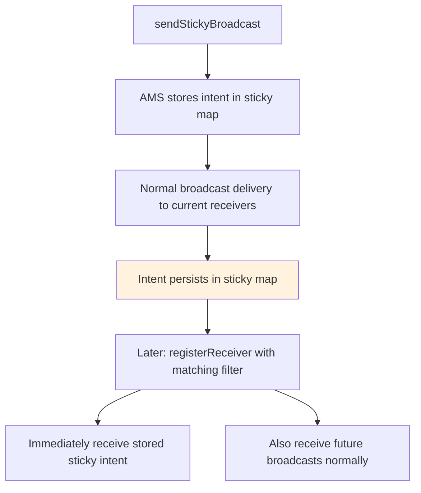

在 `BroadcastRecord` 中，sticky 广播由 `sticky` 布尔字段标识，来自 sticky 存储的
初始投递会设置 `initialSticky = true`。

### 21.4.7 注册接收器与清单接收器

Android 支持两种广播接收器注册机制：

**动态（注册）接收器**通过 `Context.registerReceiver()` 在运行时注册。它们仅在注册
组件存活期间存在。它们在接收器列表中表示为 `BroadcastFilter` 对象。

**静态（清单）接收器**在 `AndroidManifest.xml` 中通过 `<receiver>` 标签声明。即使应用
未运行，它们也可以被启动（受后台限制约束）。它们在接收器列表中表示为 `ResolveInfo`
对象。

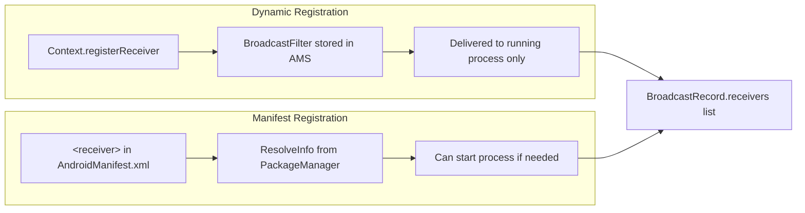

**后台限制**（Android 8.0+）：大多数隐式广播不能投递给清单中声明的接收器。targetSdk
26+ 的应用只能在清单中接收一小组豁免广播的隐式广播。引入此限制是为了减少不必要的进程
启动并改善电池续航。

清单接收器限制的例外包括：

- `ACTION_BOOT_COMPLETED`
- `ACTION_LOCALE_CHANGED`
- `ACTION_USB_ACCESSORY_ATTACHED`
- 带有显式组件定向的广播

### 21.4.8 LocalBroadcastManager

`LocalBroadcastManager`（位于 AndroidX 库中，现已弃用）提供进程内广播投递，没有 IPC
开销。它实现为一个简单的观察者模式，完全不涉及 `ActivityManagerService`。

现代替代方案是使用 `LiveData`、`Flow` 或其他响应式模式进行进程内通信。框架的广播机制
（`ActivityManagerService`、`BroadcastQueue`）对 `LocalBroadcastManager` 一无所知。某些
平台代码，如 SettingsLib 和捆绑的应用（Stk、Contacts），确实在使用该库本身。

### 21.4.9 广播投递优先级

现代队列系统中的广播携带分类元数据：

```java
// BroadcastRecord.java fields
final boolean alarm;              // BROADCAST_TYPE_ALARM
final boolean pushMessage;        // BROADCAST_TYPE_PUSH_MESSAGE
final boolean interactive;        // BROADCAST_TYPE_INTERACTIVE
final boolean urgent;             // classified as urgent
final boolean deferUntilActive;   // BROADCAST_TYPE_DEFERRABLE_UNTIL_ACTIVE
```

`BroadcastProcessQueue` 使用这些元数据来决定一条记录落入它的三个待处理队列中的哪一个。
`getQueueForBroadcast()`
（`frameworks/base/services/core/java/com/android/server/am/BroadcastProcessQueue.java:269-277`）
将紧急记录路由到 `mPendingUrgent`，卸载记录到 `mPendingOffload`，其余所有记录到普通的
`mPending`。urgent 位本身来自 `BroadcastRecord.calculateUrgent()`
（`frameworks/base/services/core/java/com/android/server/am/BroadcastRecord.java:867-882`），
当 intent 携带 `FLAG_RECEIVER_FOREGROUND`，或设置了 `BroadcastOptions.isInteractive()`
或 `BroadcastOptions.isAlarmBroadcast()` 时，它返回 true。因此，交互式广播和闹钟广播共享
同一紧急层级——它们不会相互排名比较——而第三个层级是卸载，而不是“后台”。

### 21.4.10 广播 ANR

当广播接收器未在其超时时间内完成时，系统会触发 ANR（Application Not Responding）：

- 前台广播：10 秒
- 后台广播：60 秒

`BroadcastRecord` 中的 `receiverTime` 字段跟踪当前接收器开始执行的时间。`anrCount`
字段跟踪特定广播已经引发了多少次 ANR。

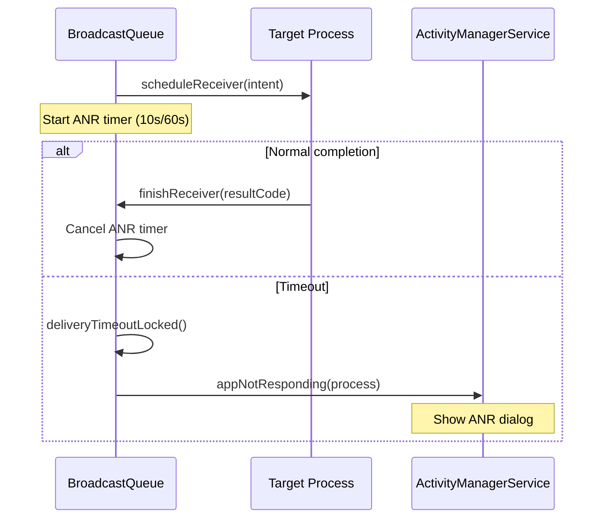

### 21.4.11 广播选项

`BroadcastOptions` 类提供对广播投递的细粒度控制。它作为 `Bundle` 传递给
`sendBroadcast()`：

```java
BroadcastOptions options = BroadcastOptions.makeBasic();
options.setDeliveryGroupPolicy(BroadcastOptions.DELIVERY_GROUP_POLICY_MOST_RECENT);
options.setDeferralPolicy(BroadcastOptions.DEFERRAL_POLICY_UNTIL_ACTIVE);

sendBroadcast(intent, null, options.toBundle());
```

`BroadcastOptions` 中可用的关键选项：

| 选项 | 用途 |
|--------|---------|
| `setDeliveryGroupPolicy()` | 控制相似广播的分组 |
| `setDeferralPolicy()` | 何时延迟投递（例如，直到应用活跃） |
| `setTemporaryAppAllowlist()` | 授予临时后台执行白名单 |
| `setRequireCompatChange()` | 仅投递给具有特定兼容性变更的应用 |
| `setShareIdentityEnabled()` | 与接收器共享发送者身份 |

`DEFERRAL_POLICY_UNTIL_ACTIVE` 策略对电池优化尤为重要。带有此策略的广播会被保留，直到
目标应用处于前台或其他活跃状态。来自 `BroadcastRecord.java`：

```java
// BroadcastRecord.java
static boolean CORE_DEFER_UNTIL_ACTIVE = true;
```

启用后，使用 `DEFERRAL_POLICY_DEFAULT` 的系统/核心应用会被当作
`DEFERRAL_POLICY_UNTIL_ACTIVE` 处理，从而减少不必要的唤醒。

### 21.4.12 广播投递组策略

`BroadcastOptions` 中的 `DeliveryGroupPolicy` 控制系统如何处理发往同一接收器的多个广播：

| 策略 | 行为 |
|--------|----------|
| `DELIVERY_GROUP_POLICY_ALL` | 投递每一个广播（默认） |
| `DELIVERY_GROUP_POLICY_MOST_RECENT` | 只投递最新的匹配广播 |
| `DELIVERY_GROUP_POLICY_MERGED` | 合并所有匹配广播的 extra |

`DELIVERY_GROUP_POLICY_MOST_RECENT` 用于状态更新广播，其中只有最新值才重要（例如连接
变化）。这可以防止接收器处理过时的中间状态。

### 21.4.13 BroadcastSkipPolicy

`BroadcastSkipPolicy`（在 `BroadcastQueue` 的构造函数中引用）决定在投递期间应跳过哪些
接收器：

```java
// BroadcastQueue.java
final @NonNull BroadcastSkipPolicy mSkipPolicy;
```

跳过原因包括：

- 接收器的包已停止或被禁用
- 接收器的包已挂起
- 接收器处于崩溃状态
- 应用了后台执行限制
- 接收器不满足权限要求
- 接收器被 `excludedPackages` 或 `excludedPermissions` 排除
- 接收器的应用被冻结或处于休眠状态

每次跳过都会记录在 `BroadcastRecord` 的 `deliveryReasons` 数组中，为调试广播投递问题
提供详细的审计轨迹。

### 21.4.14 广播历史

`BroadcastHistory` 类（存储在 `BroadcastQueue.mHistory` 中）维护最近广播投递的历史记录，
用于调试目的。当你运行以下命令时，该历史记录会被 dump 出来：

```bash
adb shell dumpsys activity broadcasts
```

历史记录包括：

- Intent 的 action 和 data
- 发送者的包和 UID
- 接收器列表及其投递状态
- 时间信息（入队、分发、完成）
- 发生的任何 ANR

### 21.4.15 后台广播限制：历史演变

针对清单接收器的隐式广播限制在各 Android 版本中不断演变：

| Android 版本 | API | 变更 |
|----------------|-----|--------|
| 7.0 (Nougat) | 24 | 移除了 `ACTION_NEW_PICTURE` 和 `ACTION_NEW_VIDEO` |
| 8.0 (Oreo) | 26 | 大多数隐式广播被禁止投递给清单接收器 |
| 10 (Q) | 29 | 没有新的限制 |
| 11 (R) | 30 | 包可见性影响广播解析 |
| 12 (S) | 31 | 带有过滤器的组件必须声明 exported 属性 |
| 13 (T) | 33 | Context 注册的接收器需要 export 标志 |
| 14 (U) | 34 | 进一步收紧动态接收器注册 |

绕过后台限制的方法：

1. 使用 `JobScheduler` 或 `WorkManager` 处理延迟任务
2. 在运行时动态注册接收器
3. 使用显式 intent（定向特定组件）
4. 使用 `FLAG_RECEIVER_INCLUDE_BACKGROUND`（仅限系统）

---

## 21.5 App Links 与 Deep Links

App Links 和 Deep Links 允许 HTTP/HTTPS URL 直接在应用中打开，而不是在浏览器中打开。
AOSP 的实现涉及 IntentFilter 验证、Digital Asset Links 以及 DomainVerificationManager。

### 21.5.1 Deep Link 与 App Link

**Deep Link** 是任何能引导到应用内特定界面的 URI。它们需要一个带有匹配 URI 模式的
intent filter，但不需要验证。如果多个应用处理同一个 URI，用户会看到消歧对话框。

**App Link**（Android 6.0+）是经过验证的 deep link。应用通过 Digital Asset Links 证明
自己对 Web 域名的所有权。系统会自动在应用中打开已验证的链接，而无需消歧对话框。

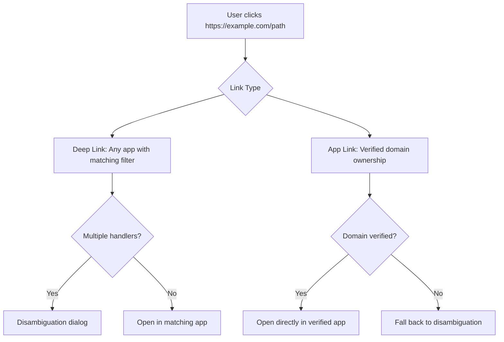

### 21.5.2 App Link 的 Intent Filter

App Link 的 intent filter 必须声明：

```xml
<intent-filter android:autoVerify="true">
    <action android:name="android.intent.action.VIEW" />
    <category android:name="android.intent.category.DEFAULT" />
    <category android:name="android.intent.category.BROWSABLE" />
    <data android:scheme="https"
          android:host="example.com"
          android:pathPrefix="/products" />
</intent-filter>
```

`android:autoVerify="true"` 属性会触发域名验证。`IntentFilter` 类通过以下字段跟踪：

```java
// IntentFilter.java
private static final int STATE_VERIFY_AUTO         = 0x00000001;
private static final int STATE_NEED_VERIFY         = 0x00000010;
private static final int STATE_NEED_VERIFY_CHECKED = 0x00000100;
private static final int STATE_VERIFIED            = 0x00001000;

private int mVerifyState;
```

### 21.5.3 验证资格

并非所有带有 `autoVerify` 的过滤器都需要实际验证。`needsVerification()` 方法检查这些
要求：

```java
// IntentFilter.java, line ~754
public final boolean needsVerification() {
    return getAutoVerify() && handlesWebUris(true);
}
```

`handlesWebUris(true)` 方法验证：

1. 过滤器处理 `ACTION_VIEW`
2. 过滤器包含 `CATEGORY_BROWSABLE`
3. 过滤器至少声明了一个 scheme
4. 当 `onlyWebSchemes=true` 时，所有声明的 scheme 都是 `http` 或 `https`

```java
// IntentFilter.java, line ~704
public final boolean handlesWebUris(boolean onlyWebSchemes) {
    if (!hasAction(Intent.ACTION_VIEW)
        || !hasCategory(Intent.CATEGORY_BROWSABLE)
        || mDataSchemes == null
        || mDataSchemes.size() == 0) {
        return false;
    }
    final int N = mDataSchemes.size();
    for (int i = 0; i < N; i++) {
        final String scheme = mDataSchemes.get(i);
        final boolean isWebScheme =
                SCHEME_HTTP.equals(scheme) || SCHEME_HTTPS.equals(scheme);
        if (onlyWebSchemes) {
            if (!isWebScheme) return false;
        } else {
            if (isWebScheme) return true;
        }
    }
    return onlyWebSchemes;
}
```

### 21.5.4 Digital Asset Links

域名验证使用 Digital Asset Links 协议。系统获取：

```
https://example.com/.well-known/assetlinks.json
```

JSON 文件必须包含：

```json
[{
    "relation": ["delegate_permission/common.handle_all_urls"],
    "target": {
        "namespace": "android_app",
        "package_name": "com.example.app",
        "sha256_cert_fingerprints": [
            "AA:BB:CC:DD:EE:FF:00:11:22:33:44:55:66:77:88:99:..."
        ]
    }
}]
```

`DomainVerificationManager` 服务管理验证状态。其源码位于：

```
frameworks/base/services/core/java/com/android/server/pm/verify/domain/
```

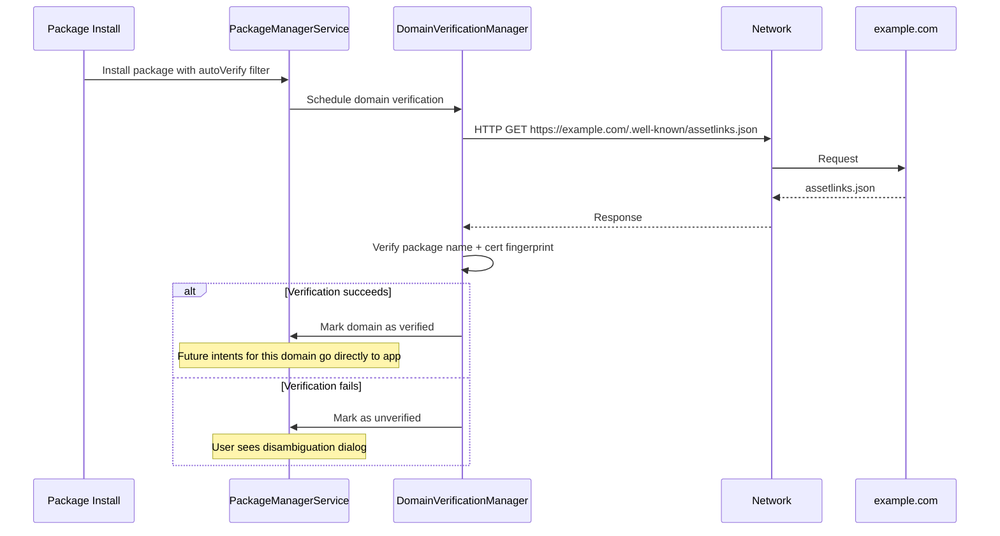

### 21.5.5 intent:// Scheme

`intent://` scheme 允许网页直接创建 Intent：

```
intent://scan/#Intent;scheme=zxing;package=com.google.zxing.client.android;end
```

该 URI 由 `Intent.parseUri()` 解析，以创建具有以下内容的 Intent：

- scheme: `zxing`
- package: `com.google.zxing.client.android`
- action: `android.intent.action.VIEW`（默认）

浏览器使用这种方式以特定的 intent 启动应用。如果目标应用未安装，浏览器可以选择使用
intent URI 中的 `S.browser_fallback_url` extra 重定向到 Play Store。

### 21.5.6 App Link 验证时机

域名验证在包安装时被触发。系统会为所有带有 `autoVerify="true"` 且满足
`needsVerification()` 条件的 intent filter 安排验证。

验证有几个重要的时序特征：

1. **验证是异步的**：应用会立即安装；验证在后台进行
2. **需要网络**：验证需要网络访问以获取 assetlinks.json
3. **重试行为**：如果验证因网络问题失败，系统可能会稍后重试
4. **多域名处理**：在现代的 `DomainVerificationManager`（Android 12+）下，每个声明的
   域名都是独立验证和批准的。即使其他声明的域名验证失败，验证成功的域名的链接也会直接
   在应用中打开。（旧的全有或全无行为仅适用于 S 版本之前的旧版 `IntentFilterVerifier`。）
5. **重新验证**：当应用更新时，如果 intent filter 发生了变化，可能会重新触发验证

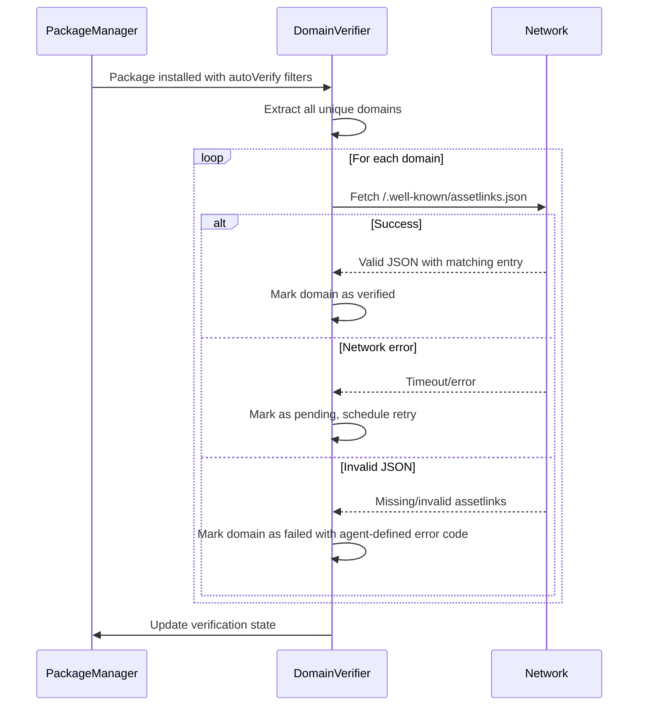

### 21.5.7 测试 App Links

Android 工具链提供了几种测试 App Links 的机制：

```bash
# Check current state
adb shell pm get-app-links --user cur com.example.app

# Manually approve a domain (for testing)
adb shell pm set-app-links --package com.example.app 2 example.com

# Reset all verification
adb shell pm set-app-links --package com.example.app 0 all

# Re-trigger verification
adb shell pm verify-app-links --re-verify com.example.app

# Test with a URL launch
adb shell am start -a android.intent.action.VIEW \
    -c android.intent.category.BROWSABLE \
    -d "https://example.com/products/123"
```

可以使用以下地址验证 Digital Asset Links JSON：
```
https://digitalassetlinks.googleapis.com/v1/statements:list?source.web.site=https://example.com
```

### 21.5.8 验证状态管理

验证状态本身（下面的 `STATE_*` 值）按包和按域名维护，且与用户无关。只有用户的链接处理
选择（哪些 host 已启用、是否允许链接处理）是按用户存储的。最常见的状态是：

| 状态 | 含义 |
|-------|---------|
| `STATE_NO_RESPONSE` | 尚未尝试验证或无响应 |
| `STATE_SUCCESS` | 域名验证成功 |
| `STATE_APPROVED` | 系统/管理覆盖，强制将该域名视为已验证 |
| `STATE_DENIED` | 系统/管理覆盖，强制将该域名视为未验证（验证代理无法更改它） |
| `STATE_MIGRATED` | 从旧系统迁移而来的状态 |
| `STATE_RESTORED` | 从备份恢复的状态 |

`DomainVerificationState` 还定义了 `STATE_LEGACY_FAILURE`（从旧版验证器延续而来的
失败）、`STATE_SYS_CONFIG`（系统配置授予的批准），以及 `STATE_PRE_VERIFIED`（安装前
已验证）。等于或高于 `STATE_FIRST_VERIFIER_DEFINED`（`0b10000000000`）的值是代理定义的
错误代码。

用户还可以通过设置手动管理 App Link 设置，这可以覆盖自动验证状态。

---

## 21.6 Intent Filter

Intent Filter 是 Intent 解析时所依据的匹配模式。它们在 `IntentFilter` 类中定义，并在
`AndroidManifest.xml` 中的 XML 中声明。

### 21.6.1 IntentFilter 内部结构

```
frameworks/base/core/java/android/content/IntentFilter.java
```

IntentFilter 类为每个匹配维度维护独立的集合：

```java
// IntentFilter.java, line ~335
private int mPriority;
private int mOrder;
private final ArraySet<String> mActions;
private ArrayList<String> mCategories = null;
private ArrayList<String> mDataSchemes = null;
private ArrayList<PatternMatcher> mDataSchemeSpecificParts = null;
private ArrayList<AuthorityEntry> mDataAuthorities = null;
private ArrayList<PatternMatcher> mDataPaths = null;
private ArrayList<UriRelativeFilterGroup> mUriRelativeFilterGroups = null;
private ArrayList<String> mStaticDataTypes = null;
private ArrayList<String> mDataTypes = null;
private ArrayList<String> mMimeGroups = null;
private boolean mHasStaticPartialTypes = false;
private boolean mHasDynamicPartialTypes = false;
private PersistableBundle mExtras = null;
private int mVerifyState;
```

### 21.6.2 过滤器匹配规则

IntentFilter 文档（从约第 102 行开始）定义了精确的匹配规则：

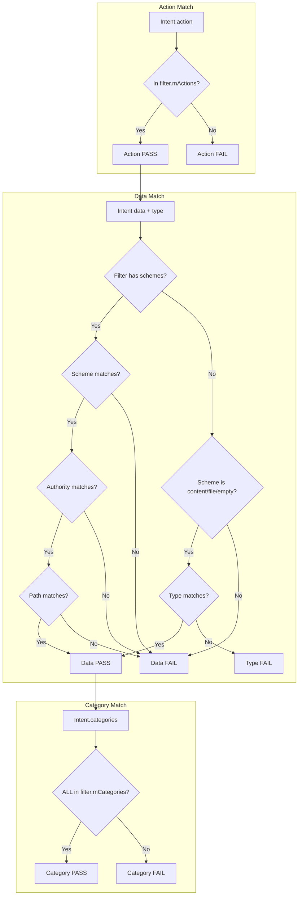

这正是 `IntentFilter.match()` 实际应用的顺序：先 `matchAction()`，然后 `matchData()`，
再 `matchCategories()`，在 category 检查通过之后还有一次末尾的 `matchExtras()` 检查。

**来自源码 Javadoc 的关键规则：**

1. **Action**：如果过滤器指定了 action，Intent 的 action 必须与其中之一匹配。如果过滤器
   没有指定任何 action，则只匹配不携带 action 的 Intent（但这很少有用）。

2. **数据类型**：MIME 类型匹配是**大小写敏感**的（不同于 RFC MIME）。始终使用小写。
   通配符有效：`audio/*` 匹配 `audio/mpeg`。

3. **数据 scheme**：同样**大小写敏感**。始终使用小写。

4. **数据 authority**：host 匹配大小写敏感。通配符子域名匹配使用 `*` 前缀（例如
   `*.example.com`）。

5. **数据路径**：通过 `PatternMatcher` 支持字面量、前缀、后缀、简单 glob 和高级 glob
   模式。

6. **Category**：Intent 中的所有 category 都必须出现在过滤器中。过滤器中多出的 category
   会被忽略。

### 21.6.3 匹配质量常量

匹配质量是结合类别常量和调整量的位掩码：

```java
// IntentFilter.java
public static final int MATCH_CATEGORY_MASK     = 0xfff0000;
public static final int MATCH_ADJUSTMENT_MASK   = 0x000ffff;
public static final int MATCH_ADJUSTMENT_NORMAL = 0x8000;
```

类别值构成一个精确度层级：

```
MATCH_CATEGORY_EMPTY (0x0100000)
  < MATCH_CATEGORY_SCHEME (0x0200000)
    < MATCH_CATEGORY_HOST (0x0300000)
      < MATCH_CATEGORY_PORT (0x0400000)
        < MATCH_CATEGORY_PATH (0x0500000)
          < MATCH_CATEGORY_SCHEME_SPECIFIC_PART (0x0580000)
            < MATCH_CATEGORY_TYPE (0x0600000)
```

当多个过滤器匹配时，匹配质量最高的过滤器胜出。

### 21.6.4 AuthorityEntry

`AuthorityEntry` 内部类处理 host 和 port 匹配：

```java
// IntentFilter.java, line ~1176; match(Uri, boolean) at ~1264
public static final class AuthorityEntry {
    private final String mOrigHost;
    private final String mHost;
    private final boolean mWild;    // true if host starts with "*."
    private final int mPort;

    public int match(Uri data, boolean wildcardSupported) {
        String host = data.getHost();
        if (host == null) return NO_MATCH_DATA;

        if (mWild) {
            if (host.length() < mHost.length()) return NO_MATCH_DATA;
            host = host.substring(host.length() - mHost.length());
        }
        if (host.compareToIgnoreCase(mHost) != 0) return NO_MATCH_DATA;

        if (!wildcardSupported && mPort >= 0) {
            if (mPort != data.getPort()) return NO_MATCH_DATA;
            return MATCH_CATEGORY_PORT;
        }
        return MATCH_CATEGORY_HOST;
    }
}
```

注意，IntentFilter 中的 authority 匹配在 host 部分使用 `compareToIgnoreCase`，尽管一般
规则声明为大小写敏感。这是因为 host 匹配在比较时会专门转为小写，而其他方面（scheme、
type）不会。

### 21.6.5 优先级

`mPriority` 字段影响匹配组件被考虑的顺序。系统定义了两个哨兵值：

```java
// IntentFilter.java
public static final int SYSTEM_HIGH_PRIORITY = 1000;
public static final int SYSTEM_LOW_PRIORITY = -1000;
```

应用永远不应该使用等于或高于 `SYSTEM_HIGH_PRIORITY` 的优先级。实际上，系统会截断应用
声明的优先级，这样普通应用在解析 Activity 时就无法抢占系统组件。优先级也用于解析首选
Activity，对于有序广播，它决定投递顺序。

截断发生在包扫描期间，而不是分发时，由 `ComponentResolver.adjustPriority()`
（`frameworks/base/services/core/java/com/android/server/pm/resolution/ComponentResolver.java:493`）
完成。当包的组件被注册时，`addAllComponents()` 会收集该包的 *activity* intent filter，
并对每个过滤器运行 `adjustPriority()`（`ComponentResolver.java:202`）。该方法只会降低
优先级，从不提升。已经声明 `priority <= 0` 的过滤器会被原样保留。其余过滤器的规则是：

- **非特权应用。** 任何具有正优先级的过滤器都会被钳制到 `0`。普通应用根本无法在
  activity 上声明高于零的优先级。
- **特权应用，受保护的 action。** 对于解析器 `PROTECTED_ACTIONS` 集合中的受保护 action
  （`ACTION_SEND`、`ACTION_SENDTO`、`ACTION_SEND_MULTIPLE`、`ACTION_VIEW`），即使是
  特权应用的过滤器也会被限制到 `0`。唯一的例外是以 `CATEGORY_SETUP_WIZARD` 标识的初始
  设置向导，它保留其要求的任何优先级。在所有系统包都被扫描之前，无法识别设置向导。因此，
  受保护的过滤器被暂存在 `mProtectedFilters` 中，并在稍后的一轮中重新评估。
- **系统镜像上的特权应用。** 系统分区上附带的特权应用，对非受保护的 action 保留其要求的
  优先级。
- **特权应用的非捆绑更新。** 当特权系统应用在系统镜像之外被更新时，更新的过滤器会与原始
  系统版本进行比较。如果没有找到等效的过滤器，优先级会被钳制到 `0`。如果 action、
  category、scheme 或 authority 不能构成系统过滤器的子集，也应用同样的钳制。否则，它会被
  限制到匹配的系统过滤器声明的最大优先级，因此更新无法悄悄提升自己的优先级。

有两个细节需要弄清楚。首先，`adjustPriority()` 只对 activity 过滤器运行：接收器以
`newIntents == null` 注册（`ComponentResolver.java:367`），因此清单接收器的优先级不会被
这条路径钳制。其次，这与 `PackageImpl.capPermissionPriorities()`
（`frameworks/base/core/java/com/android/internal/pm/parsing/pkg/PackageImpl.java:3127`）
无关，后者将 `<permission-group>` 声明的优先级置零，与 intent-filter 的 `mPriority` 毫无
关系。

### 21.6.6 Auto-Verify

intent filter 上的 `autoVerify` 属性存储在 `mVerifyState` 中：

```java
// IntentFilter.java
private static final int STATE_VERIFY_AUTO         = 0x00000001;
private static final int STATE_NEED_VERIFY         = 0x00000010;
private static final int STATE_NEED_VERIFY_CHECKED = 0x00000100;
private static final int STATE_VERIFIED            = 0x00001000;
```

当 intent filter 带有 `autoVerify="true"` 且处理 Web URI（带有 ACTION_VIEW 和
CATEGORY_BROWSABLE 的 http/https）时，系统会在安装时启动域名验证。这在 21.5.6 节已详细
讨论。

### 21.6.7 UriRelativeFilterGroup（现代新增）

较新的 AOSP 版本添加了 `UriRelativeFilterGroup` 以实现更精细的 URI 匹配。它由
`FLAG_RELATIVE_REFERENCE_INTENT_FILTERS` 特性标志控制：

```java
// IntentFilter.java, line ~1620
@FlaggedApi(Flags.FLAG_RELATIVE_REFERENCE_INTENT_FILTERS)
public final void addUriRelativeFilterGroup(@NonNull UriRelativeFilterGroup group) {
    Objects.requireNonNull(group);
    if (mUriRelativeFilterGroups == null) {
        mUriRelativeFilterGroups = new ArrayList<>();
    }
    mUriRelativeFilterGroups.add(group);
}
```

URI 相对过滤器组允许针对查询参数和片段进行匹配，而标准数据路径匹配不支持这一点。组在
路径匹配之后求值，匹配按组的添加顺序进行。

### 21.6.8 XML 声明

清单中的 intent filter 映射到内部数据结构：

```xml
<intent-filter android:priority="0" android:autoVerify="false">
    <!-- Actions: one or more -->
    <action android:name="android.intent.action.VIEW" />
    <action android:name="android.intent.action.EDIT" />

    <!-- Categories: zero or more -->
    <category android:name="android.intent.category.DEFAULT" />
    <category android:name="android.intent.category.BROWSABLE" />

    <!-- Data: zero or more, combined conjunctively -->
    <data android:scheme="https"
          android:host="example.com"
          android:port="443"
          android:pathPrefix="/api/"
          android:mimeType="application/json" />
</intent-filter>
```

每个 `<action>` 添加到 `mActions`。每个 `<category>` 添加到 `mCategories`。`<data>`
元素的属性被分发到多个内部集合。scheme 进入 `mDataSchemes`，host+port 进入
`mDataAuthorities`，path/pathPrefix/pathPattern 进入 `mDataPaths`，mimeType 进入
`mDataTypes`。

**重要**：同一个 `<intent-filter>` 内的多个 `<data>` 元素是组合在一起的，而不是被视为
独立的。带有两个 `<data>` 元素的过滤器会创建所有 scheme、host 和路径的笛卡尔积。要匹配
独立的 URI 模式，请使用单独的 `<intent-filter>` 块。

### 21.6.9 常见的 IntentFilter 模式

**模式 1：应用启动器入口点**

```xml
<intent-filter>
    <action android:name="android.intent.action.MAIN" />
    <category android:name="android.intent.category.LAUNCHER" />
</intent-filter>
```

不需要 `CATEGORY_DEFAULT`，因为启动器使用显式 intent。

**模式 2：分享目标（接收分享的内容）**

```xml
<intent-filter>
    <action android:name="android.intent.action.SEND" />
    <category android:name="android.intent.category.DEFAULT" />
    <data android:mimeType="image/*" />
</intent-filter>
<intent-filter>
    <action android:name="android.intent.action.SEND" />
    <category android:name="android.intent.category.DEFAULT" />
    <data android:mimeType="text/plain" />
</intent-filter>
<intent-filter>
    <action android:name="android.intent.action.SEND_MULTIPLE" />
    <category android:name="android.intent.category.DEFAULT" />
    <data android:mimeType="image/*" />
</intent-filter>
```

注意：不同的 MIME 类型使用单独的过滤器，而不是组合在同一个过滤器中。

**模式 3：自定义 scheme 的 deep link**

```xml
<intent-filter>
    <action android:name="android.intent.action.VIEW" />
    <category android:name="android.intent.category.DEFAULT" />
    <category android:name="android.intent.category.BROWSABLE" />
    <data android:scheme="myapp" android:host="open" android:pathPrefix="/item/" />
</intent-filter>
```

这处理形如 `myapp://open/item/123` 的 URI。

**模式 4：HTTPS App Link（已验证）**

```xml
<intent-filter android:autoVerify="true">
    <action android:name="android.intent.action.VIEW" />
    <category android:name="android.intent.category.DEFAULT" />
    <category android:name="android.intent.category.BROWSABLE" />
    <data android:scheme="https" android:host="www.example.com" />
    <data android:pathPrefix="/products/" />
    <data android:pathPrefix="/categories/" />
</intent-filter>
```

**模式 5：Content provider 数据查看器**

```xml
<intent-filter>
    <action android:name="android.intent.action.VIEW" />
    <action android:name="android.intent.action.EDIT" />
    <category android:name="android.intent.category.DEFAULT" />
    <data android:mimeType="vnd.android.cursor.item/vnd.example.note" />
</intent-filter>
```

这匹配带有 `content:` URI 且能解析为指定 MIME 类型的 intent。

**模式 6：Service 绑定过滤器**

```xml
<service android:name=".MyService" android:exported="true"
         android:permission="com.example.BIND_MY_SERVICE">
    <intent-filter>
        <action android:name="com.example.action.BIND_SERVICE" />
    </intent-filter>
</service>
```

Service 不需要 `CATEGORY_DEFAULT`。

### 21.6.10 PatternMatcher 类型

`PatternMatcher` 类（用于路径和 SSP 匹配）支持五种模式类型：

| 类型 | 常量 | 行为 |
|------|----------|----------|
| 字面量 | `PATTERN_LITERAL` | 精确字符串匹配 |
| 前缀 | `PATTERN_PREFIX` | 字符串以模式开头则匹配 |
| 简单 glob | `PATTERN_SIMPLE_GLOB` | `*` 匹配零个或多个其前面的字符；未转义的 `.` 匹配任意单个字符（`.*` = 任意序列）；`\\` 用于转义 |
| 高级 glob | `PATTERN_ADVANCED_GLOB` | 完整的 glob，支持 `[`、`]`、`{`、`}` |
| 后缀 | `PATTERN_SUFFIX` | 字符串以模式结尾则匹配 |

`PATTERN_SIMPLE_GLOB` 是最常用的。与正则表达式不同，`*` 并不意味着“任意序列”——它表示
紧跟其前面的字符的零次或多次重复。未转义的 `.` 本身就是一个单字符通配符，无论后面是否
跟有 `*`。`matchGlobPattern()` 会跳过任何未转义 `.` 的字面量比较
（`frameworks/base/core/java/android/os/PatternMatcher.java:303-304`）。只有转义后的
`\\.` 才能匹配字面量点号。

综合起来，`.*` 才是匹配任意序列的方式。示例：

- `"/products/.*"` 匹配 `/products/`、`/products/123` 和 `/products/123/details`，
  而 `"/products/*"` 匹配 `/products/`、`/products//`、……但不匹配 `/products`。
  末尾的 `X*` 仍然要求匹配字符串尚未耗尽。`PatternMatcher.java:316-319` 处的
  模式末尾回退只容忍残留的 `.*`
- `"/items/.*\\.json"` 匹配 `/items/data.json` 和 `/items/list.json`
- 作为 `PATTERN_SUFFIX` 时，模式只是普通的 `String.endsWith()` 检查，没有 glob 解释
  （`PatternMatcher.java:236-237`）。能匹配任何以 `.pdf` 结尾的字符串的后缀就是 `".pdf"`。
  写成 `"*.pdf"` 只会匹配以 `*.pdf` 这五个字符字面结尾的字符串

---

## 21.7 跨配置文件 Intent

Android 的工作配置文件功能在单台设备上创建了独立的用户空间。默认情况下，Intent 不会
跨越配置文件边界。`CrossProfileIntentFilter` 机制允许受控的转发。

### 21.7.1 CrossProfileIntentFilter

```
frameworks/base/services/core/java/com/android/server/pm/CrossProfileIntentFilter.java
```

`CrossProfileIntentFilter` 继承 `WatchedIntentFilter` 并添加了跨配置文件路由元数据：

```java
// CrossProfileIntentFilter.java, line ~42
class CrossProfileIntentFilter extends WatchedIntentFilter {
    private static final String ATTR_TARGET_USER_ID = "targetUserId";
    private static final String ATTR_FLAGS = "flags";
    private static final String ATTR_OWNER_PACKAGE = "ownerPackage";
    private static final String ATTR_ACCESS_CONTROL = "accessControl";

    public static final int FLAG_IS_PACKAGE_FOR_FILTER = 0x00000008;
    public static final int FLAG_ALLOW_CHAINED_RESOLUTION = 0x00000010;
}
```

当隐式 Intent 被解析时，系统会检查是否有任何 `CrossProfileIntentFilter` 匹配。如果
找到匹配项，解析还会查询目标用户配置文件中的匹配组件。

### 21.7.2 访问控制级别

`CrossProfileIntentFilter` 定义了三个访问控制级别：

```java
// CrossProfileIntentFilter.java
public static final int ACCESS_LEVEL_ALL = 0;            // Any caller can modify
public static final int ACCESS_LEVEL_SYSTEM = 10;        // Only system can modify
public static final int ACCESS_LEVEL_SYSTEM_ADD_ONLY = 20; // System add, no removal
```

这些级别防止对跨配置文件路由规则的恶意修改。`ACCESS_LEVEL_SYSTEM_ADD_ONLY` 是最严格的：
一旦规则由系统添加，任何调用方都无法移除或修改它。

### 21.7.3 跨配置文件解析流程

```mermaid
flowchart TD
    A[Intent from Work Profile] --> B[PackageManagerService.resolveIntent]
    B --> C[Resolve in current user's profile]
    C --> D[Check CrossProfileIntentFilters]
    D --> E{Any CPIF matches?}
    E -->|No| F[Return local results only]
    E -->|Yes| G[Resolve in target user's profile]
    G --> H[Merge results]
    H --> I{FLAG_ALLOW_CHAINED_RESOLUTION?}
    I -->|Yes| J[Also check profiles linked from target]
    I -->|No| K[Return merged results]
    J --> K
    K --> L[IntentForwarderActivity wraps for cross-profile delivery]
```

`IntentForwarderActivity`（`com.android.internal.app.IntentForwarderActivity`）是执行实际
跨配置文件转发的系统组件。来自跨配置文件解析的 `ResolveInfo` 对象携带一个 `userHandle`
字段来标识它们的来源。

### 21.7.4 默认的跨配置文件过滤器

系统在个人配置文件和工作配置文件之间建立默认的跨配置文件 intent filter：

```
frameworks/base/services/core/java/com/android/server/pm/DefaultCrossProfileIntentFiltersUtils.java
```

这些默认设置确保基本功能跨配置文件可用：

- Web 浏览 intent 可以跨配置文件解析
- 电话 intent 到达正确的拨号器
- SMS intent 可以跨配置文件
- 相机拍照 intent 从任一配置文件都可以工作

设备管理员可以使用 `DevicePolicyManager` API 添加或删除跨配置文件 intent filter。

### 21.7.5 CrossProfileIntentResolverEngine

处理跨配置文件查询的解析引擎：

```
frameworks/base/services/core/java/com/android/server/pm/CrossProfileIntentResolverEngine.java
frameworks/base/services/core/java/com/android/server/pm/CrossProfileResolver.java
frameworks/base/services/core/java/com/android/server/pm/DefaultCrossProfileResolver.java
```

这些类实现了以下算法：

1. 检查源用户是否有任何跨配置文件 intent filter
2. 评估该 intent 是否匹配这些过滤器
3. 查询目标用户的 PackageManager 以获取匹配的组件
4. 构造引用 IntentForwarderActivity 的 ResolveInfo 条目
5. 在涉及多个配置文件时处理链式解析

---

## 21.8 受保护的广播

受保护广播是只有系统侧调用方才能发送的 action。允许的发送者是 root、system、phone、
bluetooth、NFC、安全元件和网络栈 UID，以及任何进程为 persistent 的调用方。它们是一种
安全机制，用于防止应用伪造关键的系统事件。

### 21.8.1 声明

受保护广播在系统包的 `AndroidManifest.xml` 文件中使用 `<protected-broadcast>` 标签
声明：

```xml
<!-- From frameworks/base/core/res/AndroidManifest.xml -->
<protected-broadcast android:name="android.intent.action.BOOT_COMPLETED" />
<protected-broadcast android:name="android.intent.action.PACKAGE_ADDED" />
<protected-broadcast android:name="android.intent.action.PACKAGE_REMOVED" />
<protected-broadcast android:name="android.intent.action.BATTERY_CHANGED" />
<protected-broadcast android:name="android.intent.action.TIME_SET" />
<protected-broadcast android:name="android.intent.action.TIMEZONE_CHANGED" />
<!-- ... hundreds more ... -->
```

### 21.8.2 强制执行

PackageManagerService 维护一个受保护广播 action 的集合：

```
frameworks/base/services/core/java/com/android/server/pm/PackageManagerService.java
```

在包扫描期间，每个 `<protected-broadcast>` 声明都会添加到 `mProtectedBroadcasts` 中。
当广播被发送时，`ActivityManagerService` 会检查：

```mermaid
flowchart TD
    A[App sends broadcast with action X] --> B{Is X a protected broadcast?}
    B -->|No| C[Allow: normal broadcast delivery]
    B -->|Yes| D{Is caller a system-side UID or persistent process?}
    D -->|Yes| E[Allow: system can send protected broadcasts]
    D -->|No| F[Reject: SecurityException]
    F --> G[Log warning: non-system sender of protected broadcast]
```

### 21.8.3 常见的受保护广播

| Action | 用途 |
|--------|---------|
| `ACTION_BOOT_COMPLETED` | 设备完成启动 |
| `ACTION_SHUTDOWN` | 设备正在关机 |
| `ACTION_PACKAGE_ADDED` | 新包已安装 |
| `ACTION_PACKAGE_REMOVED` | 包已卸载 |
| `ACTION_PACKAGE_CHANGED` | 包组件状态已变化 |
| `ACTION_BATTERY_CHANGED` | 电池电量或状态已变化 |
| `ACTION_POWER_CONNECTED` | 外部电源已连接 |
| `ACTION_POWER_DISCONNECTED` | 外部电源已断开 |
| `ACTION_TIME_CHANGED` | 系统时间被显式设置 |
| `ACTION_TIMEZONE_CHANGED` | 时区已变化 |
| `ACTION_LOCALE_CHANGED` | 系统语言环境已变化 |
| `ACTION_CONFIGURATION_CHANGED` | 设备配置已变化 |
| `ACTION_SCREEN_ON` | 屏幕已打开 |
| `ACTION_SCREEN_OFF` | 屏幕已关闭 |
| `ACTION_USER_PRESENT` | 用户解锁了设备 |

### 21.8.4 受保护广播为何重要

如果没有保护，任何应用都可以发送 `ACTION_BOOT_COMPLETED` 并欺骗接收器在任意时间执行
启动后初始化。或者应用可以携带伪造的包名发送 `ACTION_PACKAGE_REMOVED`，以扰乱包跟踪
逻辑。

受保护广播是 Android 纵深防御策略的一部分。尽管广播接收器应该验证它们的输入，但防止
系统事件被伪造可以消除一整类攻击。

---

## 21.9 Intent 安全

Intent 是一种强大的 IPC 机制，对它们的滥用会造成安全漏洞。本节介绍安全模型以及框架的
防御措施。

### 21.9.1 显式组件规则

唯一最重要的安全原则：**当目标已知时，始终使用显式 Intent**。隐式 Intent 可能被声明了
匹配 intent filter 的恶意应用拦截。

```java
// Secure: explicit Intent
Intent intent = new Intent(context, MyActivity.class);
startActivity(intent);

// Also secure: explicit component
Intent intent = new Intent();
intent.setComponent(new ComponentName("com.example", "com.example.SecureActivity"));
startActivity(intent);

// Risky: implicit Intent (can be intercepted)
Intent intent = new Intent("com.example.CUSTOM_ACTION");
startActivity(intent);
```

### 21.9.2 exported 属性

组件必须显式导出，才能接收来自其他应用的 Intent：

```xml
<!-- Exported: reachable from other apps -->
<activity android:name=".PublicActivity"
          android:exported="true">
    <intent-filter>
        <action android:name="android.intent.action.VIEW" />
    </intent-filter>
</activity>

<!-- Not exported: only reachable from same app -->
<activity android:name=".PrivateActivity"
          android:exported="false" />
```

从 Android 12（API 31）开始，任何带有 intent filter 的组件都必须显式设置 `exported`
属性。以前，拥有 intent filter 会自动使组件导出。

```mermaid
flowchart TD
    A[Intent targets ComponentName] --> B{Target exported?}
    B -->|Yes| C{Caller has required permissions?}
    B -->|No| D{Same UID as target?}
    D -->|Yes| E[Allow]
    D -->|No| F[SecurityException]
    C -->|Yes| E
    C -->|No| F
```

### 21.9.3 广播的权限检查

广播支持双向权限检查：

**发送方权限**：发送方可以要求接收器持有某个权限：

```java
sendBroadcast(intent, Manifest.permission.ACCESS_FINE_LOCATION);
```

只有持有 `ACCESS_FINE_LOCATION` 的接收器才会收到该广播。

**接收器端权限**：接收器可以要求发送方持有某个权限：

```java
// In registerReceiver:
registerReceiver(receiver, filter, Manifest.permission.BLUETOOTH_CONNECT, handler);
```

```xml
<!-- In manifest: -->
<receiver android:name=".MyReceiver"
          android:permission="com.example.MY_PERMISSION" />
```

只有持有 `com.example.MY_PERMISSION` 的发送方才能向该接收器投递广播。

```mermaid
flowchart TD
    A[Sender sends broadcast with requiredPermission P1] --> B[Receiver registered with requiredPermission P2]
    B --> C{Receiver holds P1?}
    C -->|No| D[Skip this receiver]
    C -->|Yes| E{Sender holds P2?}
    E -->|No| D
    E -->|Yes| F[Deliver broadcast]
```

### 21.9.4 Intent 重定向防护

`prevent_intent_redirect` 特性防御 confused-deputy（迷惑代理）类攻击。在这类攻击中，
一个应用将一个 Intent 嵌入另一个 Intent 的 extra 中，而特权接收器会盲目地重新启动它。
该特性通过 `FLAG_PREVENT_INTENT_REDIRECT` 和 `preventIntentRedirect()` 标志访问器来
呈现。该标志被导入到 `Intent.java` 中：

```java
// frameworks/base/core/java/android/content/Intent.java, lines 22-23
import static android.security.Flags.FLAG_PREVENT_INTENT_REDIRECT;
import static android.security.Flags.preventIntentRedirect;
```

在 Android 17 代码树中，这不再是单个布尔值：它是一个已接通的**创建者 token** 系统。
当一个 Intent 在其 extra 或 ClipData 中携带嵌套 Intent 时，系统会为每个嵌套 Intent 盖上
一个标识创建者的 token。系统还会记录哪些 extra 键持有这些嵌套 Intent。当内部的 Intent
随后被启动时，这让平台可以重新检查原始创建者的权限，而不是重新启动该 Intent 的应用的
权限。该标志的定义位于 `frameworks/base/core/java/android/security/responsible_apis_flags.aconfig`
（`name: "prevent_intent_redirect"`，bug `361143368`，`is_fixed_read_only: true`）。完整的
token 机制及其 `EXTENDED_FLAG_*` 标记将在第 21.11 节讨论。

### 21.9.5 URI 权限授予

Intent 可以携带临时的 URI 权限授予：

```java
Intent intent = new Intent(Intent.ACTION_VIEW);
intent.setData(contentUri);
intent.addFlags(Intent.FLAG_GRANT_READ_URI_PERMISSION);
startActivity(intent);
```

这些授予具有以下特点：

- 临时性（接收任务结束时撤销，除非可持久化）
- 限定于特定 URI（或使用 `FLAG_GRANT_PREFIX_URI_PERMISSION` 时的 URI 前缀）
- 由 `UriGrantsManagerService`
  （`frameworks/base/services/core/java/com/android/server/uri/`）跟踪为
  `UriPermission` 记录，以目标 UID/包和 `GrantUri` 为键

`FLAG_GRANT_PERSISTABLE_URI_PERMISSION` 标志允许接收器使用
`ContentResolver.takePersistableUriPermission()` 使授予在重启后仍然保留。

### 21.9.6 包可见性过滤

Android 11（API 30）引入了包可见性限制。应用只能看到以下包：

- 通过清单中的 `<queries>` 显式查询的
- 被 `QUERY_ALL_PACKAGES` 等广泛可见性权限覆盖的
- 系统包
- 应用已经与之交互的包

这会影响 intent 解析：`queryIntentActivities()` 不会返回来自不可见包的组件。然而，启动
指向特定组件的显式 Intent 即使目标包不可见也仍然有效。

```mermaid
flowchart TD
    A[App queries PackageManager] --> B{Target package visible?}
    B -->|Yes| C[Return component info]
    B -->|No| D{App has QUERY_ALL_PACKAGES?}
    D -->|Yes| C
    D -->|No| E{Target in app's queries manifest?}
    E -->|Yes| C
    E -->|No| F[Filter out from results]

    G[App starts explicit Intent] --> H{Component exists?}
    H -->|Yes| I[Allow launch regardless of visibility]
    H -->|No| J[ActivityNotFoundException]
```

### 21.9.7 CATEGORY_DEFAULT 要求

一个经常被误解的与安全相关的行为：`Context.startActivity()` 使用
`PackageManager.MATCH_DEFAULT_ONLY` 解析隐式 Intent。这使解析器只保留声明了
`CATEGORY_DEFAULT` 的过滤器。该 category 是过滤器一侧的要求，而不是添加到 Intent 上的
东西。任何希望通过隐式 intent 被发现的 Activity，都必须在其过滤器中包含
`CATEGORY_DEFAULT`。

这在 Intent 类（约第 406 行）中有记录：

> “还要注意这里提供的 DEFAULT category：当组件名未被显式指定时，这对
> Context.startActivity 方法解析你的 activity 是**必需的**。”

实际的含义是这样的。如果你省略 `CATEGORY_DEFAULT`，你的 activity 仍然可以在不带
`MATCH_DEFAULT_ONLY` 调用 `PackageManager.queryIntentActivities()` 时被找到。然而，该
activity 不能通过 `startActivity()` 以隐式 intent 启动。这提供了一种“可查询但不能直接
启动”的 activity 机制。

### 21.9.8 进程边界上的 Intent 验证

当 Intent 跨进程边界（通过 Binder）时，会发生多项验证：

1. **Parcel 大小限制**：带有非常大 extra 的 Intent 可能超过 Binder 事务缓冲区（通常为
   1MB）。这会导致 `TransactionTooLargeException`。

2. **类型安全**：从 Android 13（API 33）开始，`getParcelableExtra()` 需要传入一个类
   参数以进行类型安全的反序列化：
   ```java
   // Old (deprecated): returns Object, unchecked cast
   Intent inner = intent.getParcelableExtra("key");

   // New (safe): returns typed result or null
   Intent inner = intent.getParcelableExtra("key", Intent.class);
   ```

3. **prepareToLeaveProcess()**：当 Intent 即将跨进程边界时自动调用。它验证 URI 权限并
   执行安全检查。

4. **Strict mode 违规**：在开发模式下，将 `file://` URI 传给其他应用会触发
   `FileUriExposedException`（API 24+）。必须改用带有适当授予的 Content URI。

### 21.9.9 广播排除

`BroadcastRecord` 支持细粒度的投递控制：

```java
// BroadcastRecord.java
final @Nullable String[] requiredPermissions;  // receivers must hold these
final @Nullable String[] excludedPermissions;  // receivers must NOT hold these
final @Nullable String[] excludedPackages;     // these packages are excluded
```

`excludedPermissions`（通过 `BroadcastOptions.setRequireNoneOfPermissions()` 设置，
`frameworks/base/core/java/android/app/BroadcastOptions.java:637`）让发送方可以避开持有
特定权限的接收器。树内的使用方是 Wi-Fi P2P，它将一个事件扇出为多次发送，并使用排除来
阻止任何应用两次收到它。`sendBroadcastWithExcludedPermissions()`
（`packages/modules/Wifi/service/java/com/android/server/wifi/p2p/WifiP2pServiceImpl.java:6163-6199`）
先发送带有旧版位置门控的副本。然后它向较新的 `NEARBY_WIFI_DEVICES` 权限持有者发送第二份
副本，并排除 `ACCESS_FINE_LOCATION`。结果，已被第一次发送覆盖的应用会被跳过。调用方也以
同样的方式叠加自己的排除项：`sendP2pConnectionChangedBroadcast()` 直接投递给
`MAINLINE_NETWORK_STACK` 持有者，然后在一般发送中排除该权限。

`excludedPackages` 允许发送方明确阻止特定包接收广播。

### 21.9.10 安全检查清单

```mermaid
flowchart TD
    A[Sending an Intent?] --> B{Target known?}
    B -->|Yes| C[Use explicit component]
    B -->|No| D[Use implicit + verify resolves]
    D --> E[Add permission requirement if sensitive]

    F[Creating PendingIntent?] --> G{Need modification at send?}
    G -->|No| H[Use FLAG_IMMUTABLE]
    G -->|Yes| I[Use FLAG_MUTABLE + explicit component]
    H --> J[Set explicit component]
    I --> J

    K[Declaring broadcast receiver?] --> L{Need external access?}
    L -->|Yes| M[Set exported=true + permission]
    L -->|No| N[Set exported=false]

    O[Receiving Intent?] --> P[Validate all data]
    P --> Q[Never blindly launch inner intents]
    Q --> R[Check caller identity if relevant]
```

### 21.9.11 常见的 Intent 安全漏洞

**1. Intent 重定向（迷惑代理）**

一个应用收到一个 Intent，其 extra 中包含另一个 Intent，然后盲目启动内部的 Intent。由于
启动该 Intent 的应用可能拥有提升的权限（例如系统应用），内部的 Intent 会以这些权限执行。

```mermaid
flowchart LR
    A[Malicious App] -->|Sends Intent with embedded evil Intent| B[Vulnerable App]
    B -->|Launches evil Intent with its own privileges| C[Protected Component]
    style A fill:#ffebee
    style C fill:#e8f5e9
```

缓解措施：始终验证内部的 Intent。检查组件是否属于你自己的包。永远不要启动来自 extra 中
未经验证的 Intent。

**2. Intent 嗅探（中间人攻击）**

恶意应用注册一个匹配目标应用隐式 Intent 的 intent filter，从而拦截敏感数据。

```mermaid
flowchart LR
    A[App A sends implicit Intent] --> B{Intent Resolution}
    B --> C[Legitimate App B]
    B --> D[Malicious App M]
    D -->|Intercepts data| E[Data Leak]
    style D fill:#ffebee
```

缓解措施：对敏感操作使用显式 Intent。设置包名以将解析限制到特定应用。

**3. 广播注入**

恶意应用发送一个广播，而接收器信任它来自系统。系统 action 的受保护广播可以缓解这一点，
但自定义 action 仍然脆弱。

缓解措施：使用受权限保护的接收器。使用 `BroadcastReceiver.getSentFromUid()` /
`getSentFromPackage()`（API 34+，要求发送方通过 `setShareIdentityEnabled()` 选择启用）
或权限检查来验证发送方身份。

**4. PendingIntent 劫持**

如果一个带有可变隐式 Intent 的 PendingIntent 泄露给了不受信任的应用，该应用可以修改
Intent 以重定向该操作。

缓解措施：使用 `FLAG_IMMUTABLE` 和显式组件。现代 Android 会阻止 targetSdk 34+ 的应用
使用可变隐式 PendingIntent。

**5. 通过 Intent 标志进行任务劫持**

对 `FLAG_ACTIVITY_NEW_TASK`、`FLAG_ACTIVITY_CLEAR_TASK` 及类似标志的恶意使用，可以
操纵目标应用的任务栈，可能覆盖钓鱼界面。

缓解措施：验证传入的 Intent 标志。使用清单中的 `launchMode` 属性来控制你的 activity
如何被启动。

---

## 21.10 更安全的 Intent 匹配（Android 17）

两项长期的加固工作在 Android 17 中汇合成为一次单一的解析过程，平台称之为“Safer
Intent”。第一项收紧了**显式** Intent 被允许触达哪些组件；第二项让应用开发者可以以声明
的方式将自己的组件纳入这种严格性之下。两者都运行在 `SaferIntentUtils` 内部，这是一个
挂钩 PackageManager 和 ActivityManager 解析的辅助类：

```
frameworks/base/services/core/java/com/android/server/pm/SaferIntentUtils.java
```

该类的 Javadoc 列举了它的四个挂钩点：Activity 解析
（`ComputerEngine.queryIntentActivitiesInternal` / `ResolveIntentHelper.resolveIntentInternal`）、
Service 解析（`Computer.queryIntentServicesInternal`）、静态接收器解析
（`ResolveIntentHelper.queryIntentReceiversInternal`），以及运行时接收器解析
（`ActivityManagerService.broadcastIntentLockedTraced`）。在 PackageManager 产出候选
`List<ResolveInfo>` 之后，`SaferIntentUtils` 会对它进行后处理，移除调用方不应被允许命中的
条目。

### 21.10.1 两个强制执行世代

`SaferIntentUtils` 提供了同一思想的两套实现，在运行时选择：

| 方法 | 世代 | 门控 |
|--------|-----------|------|
| `enforceIntentFilterMatchingWithAppCompat()` | Android 15 (V) | `ENFORCE_INTENTS_TO_MATCH_INTENT_FILTERS` 变更 ID `161252188` |
| `enforceIntentFilterMatchingWithIntentMatchingFlags()` | Android 17 | `Flags.enableIntentMatchingFlags()` |

当 `enable_intent_matching_flags` 特性标志开启时，分发器会选择较新的路径
（`frameworks/base/services/core/java/com/android/server/pm/SaferIntentUtils.java`，
约第 268 行处对 `enforceIntentFilterMatchingWithIntentMatchingFlags` 的调用）。该标志声明于
`frameworks/base/core/java/android/security/responsible_apis_flags.aconfig`：

```
// responsible_apis_flags.aconfig
flag {
    name: "enable_intent_matching_flags"
    is_exported: true
    namespace: "permissions"
    is_fixed_read_only: true
    description: "Applies intentMatchingFlags while matching intents to application components"
    bug: "364354494"
}
```

两个世代共享相同的豁免。当调用方是 system 或 root（`ActivityManager.canAccessUnexportedComponents()`）
时，整个过程会被完全跳过。对每个组件，当调用方与目标属于同一应用
（`computer.isCallerSameApp()`）时也会跳过。这使得应用内导航和系统流量保持不受影响。

### 21.10.2 两条规则

无论哪个世代，强制执行都会对每个存活下来的候选应用两条规则，这两条规则在
`enforceIntentFilterMatchingWithIntentMatchingFlags()` 中都可以看到：

1. **显式 Intent 必须真正匹配目标组件的 intent filter。** 对每个候选，代码遍历
   `comp.getIntents()` 并调用 `IntentResolver.intentMatchesFilter(intentFilter, intent, resolvedType)`。
   如果没有过滤器匹配，候选会被丢弃。这关闭了一个历史漏洞：调用方可以通过类名指定一个
   组件并触达它，即使 Intent 的 action/data 并不匹配任何声明的过滤器。

2. **action 为 null 的 Intent 不匹配任何过滤器。** 除非组件明确选择重新启用（见
   21.10.3），否则缺失的 action 会被视为不匹配。

```mermaid
flowchart TD
    A["Resolved candidate list (after normal matching)"] --> B{"Caller system/root?"}
    B -->|Yes| Z["Return list unchanged"]
    B -->|No| C["For each candidate"]
    C --> D{"Caller same app as target?"}
    D -->|Yes| C
    D -->|No| E{"enableIntentMatchingFlags on?"}
    E -->|Yes| F["Read component intentMatchingFlags"]
    E -->|No| G["Use ENFORCE_INTENTS_TO_MATCH_INTENT_FILTERS compat change"]
    F --> H{"Intent matches a declared filter?"}
    G --> H
    H -->|No, or null action not allowed| I["Drop candidate; log UNSAFE_INTENT_EVENT_REPORTED"]
    H -->|Yes| J["Keep candidate"]
    I --> C
    J --> C
```

当检测到不匹配且 `Flags.enforceIntentFilterMatch()` 启用时，系统还会用
`EXTENDED_FLAG_FILTER_MISMATCH`（第 21.11 节讨论的标记位）标记该 Intent。这让下游代码
能够辨别该 Intent 到达了一个它并未正式匹配的组件。每次不匹配以及每次 null-action 匹配也
会通过 `FrameworkStatsLog`（`UNSAFE_INTENT_EVENT_REPORTED`）报告，其中有一个布尔值记录
访问是否真的被阻止了。这让平台可以在完全强制执行规则之前衡量破坏情况。

### 21.10.3 intentMatchingFlags 清单属性

Android 17 世代从一个新的按组件清单属性 `android:intentMatchingFlags` 读取其策略。该属性
声明于 `frameworks/base/core/res/res/values/attrs_manifest.xml`（约第 2073 行）。它被
`<activity>`、`<activity-alias>`、`<receiver>`、`<service>` 和 `<provider>` 接受：

```xml
<!-- attrs_manifest.xml -->
<attr name="intentMatchingFlags">
    <flag name="none" value="0x0001" />
    <flag name="enforceIntentFilter" value="0x0002" />
    <flag name="allowNullAction" value="0x0004" />
</attr>
```

这些值映射到 `frameworks/base/core/java/com/android/internal/pm/pkg/component/ParsedMainComponentImpl.java`
中的常量：

| 清单标志 | 常量 | 效果 |
|---------------|----------|--------|
| `none` | `INTENT_MATCHING_FLAGS_NONE` (`1`) | 禁用所有特殊匹配规则；组合时优先级最高 |
| `enforceIntentFilter` | `INTENT_MATCHING_FLAGS_ENFORCE_INTENT_FILTER` (`1 << 1`) | 显式 intent 必须匹配过滤器；null-action intent 被阻止 |
| `allowNullAction` | `INTENT_MATCHING_FLAGS_ALLOW_NULL_ACTION` (`1 << 2`) | 与 `enforceIntentFilter` 配合，让 null-action intent 通过 |

读取器通过 `comp.getIntentMatchingFlags()`
（`ParsedMainComponentImpl.getIntentMatchingFlags()`，约第 118 行）获取组件的值。然后它
计算两个布尔值：`enforceIntentFilter` 和 `allowNullAction`。当特性标志设置时，前者默认
开启。当组件声明 `none` 或省略 `enforceIntentFilter` 时，它会被关闭。随后，阻止决策非常
简单：

```java
// SaferIntentUtils.enforceIntentFilterMatchingWithIntentMatchingFlags()
boolean blockIntent = false;
if (enforceIntentFilter) {
    if ((hasNullAction && !allowNullAction) || !intentMatchesComponent) {
        blockIntent = true;
    }
}
```

这给了组件三种有用的姿态。第一种是严格（`enforceIntentFilter`）。第二种是严格但对
无 action 的 intent 宽容（`enforceIntentFilter|allowNullAction`），适用于仅以 data 或
category 为键的旧版过滤器。第三种是完全宽松（`none`）。

### 21.10.4 Intent 防火墙过滤器

Android 17 还用两种新的过滤器类型扩展了设备上的 **Intent 防火墙**，由同一个 aconfig 文件
中的标志控制：

```
// responsible_apis_flags.aconfig
flag { name: "enable_intent_firewall_component_class_filter"  ... bug: "428733109" }
flag { name: "enable_intent_firewall_extra_key_value_filter"  ... bug: "428733109" }
```

组件类过滤器让防火墙规则可以根据目标组件的类进行匹配。extra 键/值过滤器让规则可以
根据 Intent extra 内的特定键/值对进行匹配。它们补充了防火墙已经支持的现有
action/category/data 匹配器。它们让设备策略能够阻止，例如，携带特定敏感 extra 键的
intent——无论其 action 是什么。

## 21.11 Intent 创建者 Token 与重定向加固（Android 17）

第 21.9.4 节在高层次上介绍了 `prevent_intent_redirect`。Android 17 将其变成了一个具体
的机制。该机制使用 `Intent` 状态的三个新部分：一个扩展标志位掩码、一个创建者 token
记录，以及一组“嵌套 intent 键”。这三者都位于：

```
frameworks/base/core/java/android/content/Intent.java
```

### 21.11.1 扩展标志

Intent 携带一个并行的标志字 `mExtendedFlags`（第 8138 行），与公开的 `mFlags` 不同。
定义了三个位（约第 7999-8013 行）：

| 常量 | 值 | 含义 |
|----------|-------|---------|
| `EXTENDED_FLAG_FILTER_MISMATCH` | `1 << 0` | 当外部 intent 未匹配接收组件的过滤器时由系统设置（见 21.10.2） |
| `EXTENDED_FLAG_MISSING_CREATOR_OR_INVALID_TOKEN` | `1 << 1` | 此 intent 的创建者 token 缺失或无效 |
| `EXTENDED_FLAG_NESTED_INTENT_KEYS_COLLECTED` | `1 << 2` | 已对此 intent 运行 `collectExtraIntentKeys()` |

这些对应用是不透明的：Javadoc 明确指出它们“通常不由应用代码设置”，而是由系统在解析
和打包期间设置。

### 21.11.2 创建者 Token

当一个 Intent 携带嵌套 Intent 跨进程边界时，系统会附加一个 `CreatorTokenInfo` 记录
（约第 12551 行的私有内部类）：

```java
// Intent.java, line ~12551
private static class CreatorTokenInfo {
    private IBinder mCreatorToken;                 // identifies the creator
    private ArraySet<NestedIntentKey> mNestedIntentKeys; // where nested intents live
}
```

该 token 是为创建应用铸造的一个 Binder。隐藏访问器 `setCreatorToken()`、
`getCreatorToken()` 和 `removeCreatorTokenInfo()`（约第 12623-12650 行）管理它。在
`writeToParcel()` 期间，只有当 `preventIntentRedirect()` 为 true 时 token 才会被序列化
（约第 12955 行），因此关闭该标志的设备没有打包开销。

关键行为在 `removeLaunchSecurityProtection()` 的 Javadoc 中有描述（约第 12900 行）：

```java
// Intent.java
@FlaggedApi(FLAG_PREVENT_INTENT_REDIRECT)
public void removeLaunchSecurityProtection() {
    mExtendedFlags &= ~EXTENDED_FLAG_MISSING_CREATOR_OR_INVALID_TOKEN;
    removeCreatorTokenInfo();
}
```

当一个外来的嵌入式 Intent 到达而没有可信的创建者 token 时，系统会将其标记为
`EXTENDED_FLAG_MISSING_CREATOR_OR_INVALID_TOKEN`（这发生在约第 940 行的读取路径中）。
在启动时，平台会拒绝执行它。或者，平台会拒绝让它向原始创建者无法触达的目标授予 URI
访问权。`removeLaunchSecurityProtection()` 是面向极少数确实需要旧版行为的应用的、有
文档记录的退出方式。

### 21.11.3 收集嵌套 Intent 键

为了高效检查重定向，系统必须知道哪些 extra 键（以及哪些 ClipData 项）持有 Intent，而
无需解开整个 extra Bundle。客户端通过 `collectExtraIntentKeys()`（约第 12658 行）收集
这些键，它会为找到的每个嵌套 Intent 记录一个 `NestedIntentKey`：

```java
// Intent.java, NestedIntentKey types (line ~12561)
NESTED_INTENT_KEY_TYPE_EXTRA_PARCEL        = 1 << 0; // an Intent extra
NESTED_INTENT_KEY_TYPE_EXTRA_PARCEL_ARRAY  = 1 << 1; // an element of an Intent[] extra
NESTED_INTENT_KEY_TYPE_EXTRA_PARCEL_LIST   = 1 << 2; // an element of an Intent list extra
NESTED_INTENT_KEY_TYPE_CLIP_DATA           = 1 << 3; // an Intent inside ClipData items
```

每个键记录它的类型、extra 键字符串以及一个索引（针对数组/列表/ClipData 的情况）。一旦
收集运行，Intent 会被标记 `EXTENDED_FLAG_NESTED_INTENT_KEYS_COLLECTED`，这样工作就不会
重复。系统服务端有一个兜底：`collectExtraIntentKeys(true)`（约第 12674 行的
`forceUnparcel` 重载）。如果客户端从未收集，它会在服务端重新收集键。这由
`prevent_intent_redirect_collect_nested_keys_on_server_if_not_collected` 标志控制。

```mermaid
flowchart TD
    A["App A builds Intent with nested Intent in extras"] --> B["collectExtraIntentKeys: record NestedIntentKey for each nested intent"]
    B --> C["System mints creator token for App A; stamps CreatorTokenInfo"]
    C --> D["Intent parceled to App B (token + keys travel with it)"]
    D --> E["App B relaunches the nested Intent"]
    E --> F{"Nested Intent has valid creator token?"}
    F -->|Yes| G["Re-check using App A's identity; allow only what A could do"]
    F -->|No| H["EXTENDED_FLAG_MISSING_CREATOR_OR_INVALID_TOKEN set; block launch / deny URI grant"]
```

### 21.11.4 推出标志

重定向防御在一个系列分阶段标志之后推出。这些标志位于
`frameworks/base/core/java/android/security/responsible_apis_flags.aconfig`，全部属于 bug
`361143368`。因此，平台可以在不更改代码的情况下调整行为：

| 标志 | 启用后的行为 |
|------|----------------------|
| `prevent_intent_redirect` | 主开关；开启 token 盖章和检查 |
| `prevent_intent_redirect_abort_or_throw_exception` | 对错误的重定向中止启动或抛出 SecurityException |
| `prevent_intent_redirect_collect_nested_keys_on_server_if_not_collected` | 客户端未收集时由服务端收集嵌套键 |
| `prevent_intent_redirect_show_toast` | 当 activity 启动被阻止时显示 toast |
| `prevent_intent_redirect_throw_exception_if_nested_keys_not_collected` | 如果 intent 未收集嵌套键则抛出异常 |

这种分阶段设计让 Google 可以先发布 token 管道（仅收集、toast、指标）。一旦了解了破坏
情况，就可以切换到硬强制执行（`abort_or_throw_exception`）。这模仿了第 21.10 节中
Safer Intent 匹配所使用的“先度量再阻止”模式。

## 21.12 动手实践

本节提供动手练习，使用真实的 AOSP 工具和源代码探索 Intent 系统。

### 练习 21.1：用 adb 检查 Intent 字段

使用 `adb shell am` 构造并发送 intent：

```bash
# Launch an explicit intent
adb shell am start -n com.android.settings/.Settings

# Launch an implicit intent with action and data
adb shell am start -a android.intent.action.VIEW -d "https://example.com"

# Send a broadcast
adb shell am broadcast -a com.example.TEST_ACTION --es message "hello"

# Send an ordered broadcast
adb shell am broadcast -a com.example.ORDERED --ei priority 100

# View broadcast delivery with verbose logging
adb shell dumpsys activity broadcasts
```

### 练习 21.2：探索 Intent 解析

```bash
# Query which activities handle a specific intent
adb shell pm query-activities -a android.intent.action.VIEW -t "image/*"

# Resolve a specific URL
adb shell pm resolve-activity -a android.intent.action.VIEW \
    -d "https://www.google.com"

# List all intent filters for a package
adb shell dumpsys package com.android.settings | grep -A 20 "intent-filter"

# Check preferred activities (default apps)
adb shell dumpsys package preferred
```

### 练习 21.3：检查广播队列状态

```bash
# Dump the entire broadcast system state
adb shell dumpsys activity broadcasts

# Watch broadcasts in real-time
adb logcat -s BroadcastQueue:V ActivityManager:I

# Send a test broadcast and observe delivery
adb shell am broadcast -a android.intent.action.TIME_SET
# This will fail with SecurityException - it's a protected broadcast!

# Send a non-protected broadcast
adb shell am broadcast -a com.example.MY_CUSTOM_ACTION --es key value
```

### 练习 21.4：验证 App Links

```bash
# Check domain verification state for a package
adb shell pm get-app-links com.example.app

# Manually trigger verification
adb shell pm verify-app-links --re-verify com.example.app

# Reset verification state
adb shell pm set-app-links --package com.example.app 0 all

# Approve a domain manually for testing
adb shell pm set-app-links --package com.example.app 2 example.com
```

### 练习 21.5：在源码中追踪 Intent 解析

沿着以下解析路径在源代码中导航：

1. 从 `Context.startActivity()` 开始：
   ```
   frameworks/base/core/java/android/app/ContextImpl.java
   ```

2. 跟踪到 `Instrumentation.execStartActivity()`：
   ```
   frameworks/base/core/java/android/app/Instrumentation.java
   ```

3. 跨过 Binder 边界到 `ActivityTaskManagerService`：
   ```
   frameworks/base/services/core/java/com/android/server/wm/ActivityTaskManagerService.java
   ```

4. 解析发生在 PackageManager 中：
   ```
   frameworks/base/services/core/java/com/android/server/pm/ComputerEngine.java
   ```

5. 组件匹配发生在：
   ```
   frameworks/base/services/core/java/com/android/server/pm/resolution/ComponentResolverBase.java
   ```

6. IntentFilter 匹配：
   ```
   frameworks/base/core/java/android/content/IntentFilter.java
   ```

### 练习 21.6：PendingIntent 检查

```bash
# List all pending intents in the system
adb shell dumpsys activity intents

# Create a test PendingIntent via an alarm
adb shell am broadcast -a android.intent.action.SET_ALARM \
    --es android.intent.extra.alarm.HOUR 12 \
    --es android.intent.extra.alarm.MINUTES 30

# Inspect PendingIntent records
adb shell dumpsys activity processes | grep -A 5 "PendingIntent"
```

### 练习 21.7：跨配置文件 Intent 转发

```bash
# Cross-profile intent filters are not printed by dumpsys at all -- there is
# no dump path for them. They are only persisted, per user, into the
# <crossProfile-intent-filters> element of that user's package-restrictions.xml
adb shell su 0 cat /data/system/users/10/package-restrictions.xml

# On a device with work profile (user 10):
adb shell am start --user 10 \
    -a android.intent.action.VIEW -d "https://example.com"
```

### 练习 21.8：构建自定义 IntentFilter 测试器

创建一个最小化应用来演练 IntentFilter 匹配算法：

```java
// IntentFilterTester.java
import android.content.Intent;
import android.content.IntentFilter;
import android.net.Uri;

public class IntentFilterTester {
    public static void main(String[] args) {
        // Create a filter matching web URLs for a specific domain
        IntentFilter filter = new IntentFilter();
        filter.addAction(Intent.ACTION_VIEW);
        filter.addCategory(Intent.CATEGORY_DEFAULT);
        filter.addCategory(Intent.CATEGORY_BROWSABLE);
        filter.addDataScheme("https");
        filter.addDataAuthority("example.com", null);
        filter.addDataPath("/products", PatternMatcher.PATTERN_PREFIX);

        // Test various intents
        testMatch(filter, "https://example.com/products/123");     // Should match
        testMatch(filter, "https://example.com/about");            // Should NOT match
        testMatch(filter, "http://example.com/products/123");      // Should NOT match
        testMatch(filter, "https://evil.com/products/123");        // Should NOT match
    }

    static void testMatch(IntentFilter filter, String uri) {
        Intent intent = new Intent(Intent.ACTION_VIEW, Uri.parse(uri));
        intent.addCategory(Intent.CATEGORY_DEFAULT);
        intent.addCategory(Intent.CATEGORY_BROWSABLE);
        int match = filter.match(
            null,    // ContentResolver
            intent,
            false,   // resolve
            "test"   // tag for logging
        );
        System.out.printf("URI: %-50s Match: %s (0x%x)%n",
            uri,
            match >= 0 ? "YES" : "NO",
            match);
    }
}
```

### 练习 21.9：受保护广播审计

```bash
# Find all protected broadcasts declared in the platform
grep -r "protected-broadcast" \
    frameworks/base/core/res/AndroidManifest.xml | wc -l

# Search for protected broadcasts across all system packages
find . -name "AndroidManifest.xml" -path "*/res/*" \
    -exec grep -l "protected-broadcast" {} \;

# Attempt to send a protected broadcast (will fail from shell on user builds)
adb shell am broadcast -a android.intent.action.BOOT_COMPLETED
# Expected: Security exception for non-system sender
```

### 练习 21.10：Intent 重定向漏洞检测

检查应用中潜在的 Intent 重定向漏洞：

```java
// Vulnerable pattern:
@Override
protected void onCreate(Bundle savedInstanceState) {
    super.onCreate(savedInstanceState);
    Intent innerIntent = getIntent().getParcelableExtra("next_intent");
    if (innerIntent != null) {
        startActivity(innerIntent);  // DANGEROUS: launches arbitrary intent
    }
}

// Safe pattern:
@Override
protected void onCreate(Bundle savedInstanceState) {
    super.onCreate(savedInstanceState);
    Intent innerIntent = getIntent().getParcelableExtra("next_intent", Intent.class);
    if (innerIntent != null) {
        // Validate the component
        ComponentName component = innerIntent.getComponent();
        if (component != null
            && component.getPackageName().equals(getPackageName())) {
            startActivity(innerIntent);  // Safe: only our own components
        }
    }
}
```

使用以下命令在代码库中搜索潜在漏洞：

```bash
# Find potential intent redirect patterns
grep -rn "getParcelableExtra.*Intent" \
    --include="*.java" \
    app/src/main/java/ | grep -v "test"

# Find startActivity calls on extras
grep -rn "startActivity.*getIntent\(\)\.get" \
    --include="*.java" \
    app/src/main/java/
```

### 练习 21.11：监控广播投递时序

使用 `BroadcastQueue` 的 dumpsys 输出分析投递时序：

```bash
# Trigger a configuration change and monitor broadcast timing
adb shell settings put system font_scale 1.1

# Immediately dump broadcast state
adb shell dumpsys activity broadcasts | head -100

# Look for timing data:
# enqueueTime: when the broadcast was queued
# dispatchTime: when delivery began
# finishTime: when the last receiver completed
# receiverTime: per-receiver start time

# Reset
adb shell settings put system font_scale 1.0
```

解析输出以计算：

- 队列等待时间 = dispatchTime - enqueueTime
- 总投递时间 = finishTime - enqueueTime
- 每个接收器的时间 = terminalTime[i] - scheduledTime[i]

### 练习 21.12：IntentFilter 匹配质量分析

编写一个测试，演示匹配质量层级：

```java
// Create filters of increasing specificity
IntentFilter emptyFilter = new IntentFilter(Intent.ACTION_VIEW);
// Match: MATCH_CATEGORY_EMPTY + MATCH_ADJUSTMENT_NORMAL, but only against an
// Intent that carries neither a data URI nor a type -- matchData() returns
// NO_MATCH_DATA for a data-carrying Intent when the filter declares no
// schemes and no types (IntentFilter.java:1750-1753)

IntentFilter schemeFilter = new IntentFilter(Intent.ACTION_VIEW);
schemeFilter.addDataScheme("https");
// Match: MATCH_CATEGORY_SCHEME + MATCH_ADJUSTMENT_NORMAL

IntentFilter hostFilter = new IntentFilter(Intent.ACTION_VIEW);
hostFilter.addDataScheme("https");
hostFilter.addDataAuthority("example.com", null);
// Match: MATCH_CATEGORY_HOST + MATCH_ADJUSTMENT_NORMAL

IntentFilter pathFilter = new IntentFilter(Intent.ACTION_VIEW);
pathFilter.addDataScheme("https");
pathFilter.addDataAuthority("example.com", null);
pathFilter.addDataPath("/products", PatternMatcher.PATTERN_PREFIX);
// Match: MATCH_CATEGORY_PATH + MATCH_ADJUSTMENT_NORMAL

IntentFilter typeFilter = IntentFilter.create(Intent.ACTION_VIEW, "text/html");
// Match: MATCH_CATEGORY_TYPE + MATCH_ADJUSTMENT_NORMAL

// Test each filter against the same intent
Intent intent = new Intent(Intent.ACTION_VIEW, Uri.parse("https://example.com/products/1"));
// Because this Intent has a data URI, emptyFilter returns NO_MATCH_DATA
// rather than MATCH_CATEGORY_EMPTY. Expected order from lowest to highest
// match among the filters that do match:
// schemeFilter < hostFilter < pathFilter
// (re-run emptyFilter against `new Intent(Intent.ACTION_VIEW)` to see
// MATCH_CATEGORY_EMPTY)
```

### 练习 21.13：调试 PendingIntent 等价性

演示一个常见的 PendingIntent 错误——extra 不影响标识：

```java
// These two PendingIntents are THE SAME because extras don't count
Intent intent1 = new Intent(context, MyActivity.class);
intent1.putExtra("notification_id", 1);
PendingIntent pi1 = PendingIntent.getActivity(context, 0, intent1,
    PendingIntent.FLAG_IMMUTABLE);

Intent intent2 = new Intent(context, MyActivity.class);
intent2.putExtra("notification_id", 2);
PendingIntent pi2 = PendingIntent.getActivity(context, 0, intent2,
    PendingIntent.FLAG_IMMUTABLE);

// pi1 and pi2 reference the SAME PendingIntent!
// Both notifications will open with notification_id=1

// Fix 1: Use different request codes
PendingIntent pi1 = PendingIntent.getActivity(context, 1, intent1, ...);
PendingIntent pi2 = PendingIntent.getActivity(context, 2, intent2, ...);

// Fix 2: Use different data URIs
intent1.setData(Uri.parse("app://notification/1"));
intent2.setData(Uri.parse("app://notification/2"));

// Fix 3: Use setIdentifier() (API 29+)
intent1.setIdentifier("notification_1");
intent2.setIdentifier("notification_2");
```

### 练习 21.14：阅读 Intent 源代码

在 AOSP 源码中导航以下关键方法，追踪数据流：

```
1. Intent field declarations:
   frameworks/base/core/java/android/content/Intent.java:8129-8148

2. Intent.filterEquals() - understand identity:
   frameworks/base/core/java/android/content/Intent.java:12088

3. IntentFilter.match() - the complete matching algorithm:
   frameworks/base/core/java/android/content/IntentFilter.java:2453

4. IntentFilter.matchData() - the complex data matching:
   frameworks/base/core/java/android/content/IntentFilter.java:1743

5. ComponentResolverBase.componentExists() - explicit lookup:
   frameworks/base/services/core/java/com/android/server/pm/resolution/
       ComponentResolverBase.java:78

6. BroadcastRecord delivery states:
   frameworks/base/services/core/java/com/android/server/am/
       BroadcastRecord.java:194-228

7. PendingIntent.checkPendingIntent() - security validation:
   frameworks/base/core/java/android/app/PendingIntent.java:442

8. CrossProfileIntentFilter access control:
   frameworks/base/services/core/java/com/android/server/pm/
       CrossProfileIntentFilter.java:42

9. IntentFilter.needsVerification() - App Link eligibility:
   frameworks/base/core/java/android/content/IntentFilter.java:755

10. SaferIntentUtils - Android 17 Safer Intent matching:
    frameworks/base/services/core/java/com/android/server/pm/
        SaferIntentUtils.java:278

11. Intent creator-token redirect hardening:
    frameworks/base/core/java/android/content/Intent.java:12551-12903
```

### 练习 21.15：构建广播投递监控器

创建一个监控广播投递的诊断工具：

```java
// BroadcastMonitor.java
public class BroadcastMonitor extends BroadcastReceiver {

    // Register for all broadcasts (requires system permission on real devices)
    // For testing, register for specific actions
    public static IntentFilter createWideFilter() {
        IntentFilter filter = new IntentFilter();
        filter.addAction(Intent.ACTION_SCREEN_ON);
        filter.addAction(Intent.ACTION_SCREEN_OFF);
        filter.addAction(Intent.ACTION_BATTERY_CHANGED);
        filter.addAction(Intent.ACTION_POWER_CONNECTED);
        filter.addAction(Intent.ACTION_POWER_DISCONNECTED);
        filter.addAction(Intent.ACTION_PACKAGE_ADDED);
        filter.addAction(Intent.ACTION_PACKAGE_REMOVED);
        filter.addAction(Intent.ACTION_TIME_TICK);
        filter.addAction(Intent.ACTION_TIMEZONE_CHANGED);
        // Add data schemes for package broadcasts
        filter.addDataScheme("package");
        return filter;
    }

    @Override
    public void onReceive(Context context, Intent intent) {
        long receiveTime = SystemClock.uptimeMillis();
        String action = intent.getAction();
        Bundle extras = intent.getExtras();

        StringBuilder sb = new StringBuilder();
        sb.append("Broadcast received: ").append(action);
        sb.append("\n  Time: ").append(receiveTime);
        sb.append("\n  Data: ").append(intent.getData());
        sb.append("\n  Flags: 0x").append(Integer.toHexString(intent.getFlags()));
        if (extras != null) {
            sb.append("\n  Extras: ").append(extras.keySet());
        }
        if (isOrderedBroadcast()) {
            sb.append("\n  Ordered: true");
            sb.append("\n  ResultCode: ").append(getResultCode());
            sb.append("\n  ResultData: ").append(getResultData());
        }
        Log.i("BroadcastMonitor", sb.toString());
    }
}
```

### 练习 21.16：验证导出组件的安全性

审计项目中可能不安全的导出组件：

```bash
# Find all exported components
grep -rn 'android:exported="true"' \
    --include="AndroidManifest.xml" \
    app/src/main/

# Find components with intent filters but no permission
grep -B5 -A20 '<intent-filter' \
    --include="AndroidManifest.xml" \
    app/src/main/AndroidManifest.xml | \
    grep -v 'android:permission'

# Find broadcast receivers without permission protection
grep -B2 -A10 '<receiver' \
    --include="AndroidManifest.xml" \
    app/src/main/AndroidManifest.xml | \
    grep -E '(exported="true"|<intent-filter)' | \
    grep -v 'permission'

# Find services that are exported
grep -B2 -A10 '<service' \
    --include="AndroidManifest.xml" \
    app/src/main/AndroidManifest.xml | \
    grep 'exported="true"'
```

对找到的每个导出组件，验证：

1. 它需要导出吗？
2. 它有权限保护吗？
3. 它验证传入的 Intent 数据吗？
4. 攻击者通过调用它会造成危害吗？

---

## 总结

### 架构概览

```mermaid
flowchart TD
    subgraph "Application Layer"
        A1[startActivity]
        A2[sendBroadcast]
        A3[startService / bindService]
        A4[ContentResolver.query]
    end

    subgraph "Framework Layer"
        B1[Intent Object]
        B2[PendingIntent Token]
        B3[IntentFilter Matching]
    end

    subgraph "System Server"
        C1[ActivityTaskManagerService]
        C2[ActivityManagerService / BroadcastQueue]
        C3[PackageManagerService / ComponentResolver]
        C4[DomainVerificationManager]
    end

    subgraph "Resolution Infrastructure"
        D1[ComponentResolverBase]
        D2[ActivityIntentResolver]
        D3[ReceiverIntentResolver]
        D4[ServiceIntentResolver]
        D5[CrossProfileIntentResolverEngine]
    end

    A1 --> B1 --> C1
    A2 --> B1 --> C2
    A3 --> B1 --> C2
    A4 -->|"by authority, no Intent"| C3

    C1 --> C3
    C2 --> C3
    C3 --> D1
    C3 --> D5
    D1 --> D2
    D1 --> D3
    D1 --> D4

    B2 --> C2
    B3 --> D1
    C3 --> C4
```

### 关键要点

Intent 系统是 Android 的通用消息传递基座。本章追踪了它的完整生命周期。它从 Intent 对象
的字段讲起，然后介绍了 `ComponentResolverBase` 中的解析算法以及 `BroadcastQueue` 和
`BroadcastProcessQueue` 中的广播投递系统。它还涵盖了 PendingIntent token 系统、App
Links 域名验证、跨配置文件转发，以及保护这一切的安全机制。

考察的关键源文件：

| 文件 | 用途 |
|------|---------|
| `frameworks/base/core/java/android/content/Intent.java` | Intent 类 |
| `frameworks/base/core/java/android/content/IntentFilter.java` | 过滤器匹配 |
| `frameworks/base/core/java/android/app/PendingIntent.java` | 延迟执行的 intent token |
| `frameworks/base/core/java/android/content/pm/ResolveInfo.java` | 解析结果 |
| `frameworks/base/services/core/java/com/android/server/am/BroadcastQueue.java` | 广播分发 |
| `frameworks/base/services/core/java/com/android/server/am/BroadcastRecord.java` | 广播状态 |
| `frameworks/base/services/core/java/com/android/server/am/BroadcastProcessQueue.java` | 按进程划分的队列 |
| `frameworks/base/services/core/java/com/android/server/pm/resolution/ComponentResolverBase.java` | 组件解析 |
| `frameworks/base/services/core/java/com/android/server/pm/CrossProfileIntentFilter.java` | 跨配置文件路由 |
| `frameworks/base/services/core/java/com/android/server/pm/SaferIntentUtils.java` | Safer Intent 匹配强制执行（Android 17） |
| `frameworks/base/core/java/android/security/responsible_apis_flags.aconfig` | 用于 intent 匹配和重定向防护的特性标志 |

解析算法按顺序应用三项测试——action、data 和 category——每一项都必须通过。当多个过滤
器匹配时，匹配质量层级（EMPTY &lt; SCHEME &lt; HOST &lt; PORT &lt; PATH &lt; SSP &lt; TYPE）决定哪个组件
胜出。现代广播系统使用按进程划分的队列，带有投递状态跟踪、针对缓存进程的延迟机制，以及
基于分类的优先级。PendingIntent 通过系统管理的 token 委托执行权，自 Android 12 起必须声明
可变性，自 Android 14 起可变 PendingIntent 必须显式指定。

Android 17 又叠加了两套机制。第一套是 Safer Intent 匹配。在那里，`SaferIntentUtils`
会丢弃显式 Intent 并不真正匹配的已解析组件（由新的 `intentMatchingFlags` 清单属性
驱动）。第二套是创建者 token 系统。它阻止 intent 重定向攻击。它的做法是在嵌套 Intent
被重新启动时，重新检查原始创建者的身份。

### Intent 系统重大变更的版本历史

| Android 版本 | API | 重大变更 |
|----------------|-----|---------------------|
| 1.0 | 1 | 最初的 Intent 系统 |
| 3.0 (Honeycomb) | 11 | 通过 Intent 传递 Fragment 参数 |
| 4.0.3 (ICS MR1) | 15 | Intent.setSelector() |
| 5.0 (Lollipop) | 21 | Sticky 广播被弃用 |
| 6.0 (Marshmallow) | 23 | App Links（autoVerify）、运行时权限 |
| 7.0 (Nougat) | 24 | FileUriExposedException，部分隐式广播被移除 |
| 8.0 (Oreo) | 26 | 针对清单接收器的隐式广播限制 |
| 10 (Q) | 29 | Intent.setIdentifier() |
| 11 (R) | 30 | 包可见性过滤 |
| 12 (S) | 31 | 要求声明 PendingIntent 可变性，要求声明 exported |
| 13 (T) | 33 | 类型安全的 getParcelableExtra，注册接收器需要 export 标志 |
| 14 (U) | 34 | 可变隐式 PendingIntent 被阻止 |
| 15 (V) | 35 | 阻止 null action intent、`ENFORCE_INTENTS_TO_MATCH_INTENT_FILTERS`（AppCompat 世代）、UriRelativeFilterGroup 查询/片段匹配 API |
| 17 | 37 | `intentMatchingFlags` 清单属性、IntentMatchingFlags 强制执行世代、创建者 token 的 intent 重定向加固、Intent 防火墙组件类与 extra 键/值过滤器 |

### 设计原则

Intent 系统体现了若干 Android 的基本设计原则：

1. **晚期绑定**：组件在运行时连接，而不是在编译时。应用无需知道安装了哪些其他应用
   即可与它们通信。

2. **组件复用**：任何应用都可以通过隐式 intent 利用其他任何应用提供的功能，而无需直接
   的代码依赖。

3. **默认安全**：从较新的 Android 版本开始，组件默认不导出。PendingIntent 必须声明
   可变性。对清单接收器的隐式广播受到限制。

4. **用户选择**：当多个应用可以处理一个 intent 时，由用户决定。系统绝不会悄悄将请求
   路由给可能恶意的处理者。

5. **可验证的信任**：App Links 使用 Digital Asset Links 在应用与 Web 域名之间建立已
   验证的关系，用密码学验证取代用户信任。

总的主题是：Intent 系统在开放性与安全性之间取得平衡。开放性意味着任何应用都可以参与
intent 解析。安全性意味着显式组件、受保护的广播、权限检查、包可见性和重定向防护。理解
这种平衡的两个方面，对于构建健壮的 Android 应用以及从事框架本身的工作都至关重要。
