# 第 47 章：国际化

Android 运行在全球近每个国家的三十多亿台设备上。用户使用阿拉伯文、中文、
天城文、泰文、韩文以及其他数百种文字来阅读文本。他们期望日期、数字、货币
和排序方式遵循各自的本地惯例。他们在同一会话中在多种语言之间切换。正确而
高效地支持所有这些能力，是该平台在技术上要求最高的方面之一。目标是在做到
这一切的同时，无需应用程序开发者成为 Unicode 专家。

本章深入探讨使这一切得以实现的国际化（i18n）基础架构。我们将沿着以下部分
展开：

- 提供 Unicode 算法的 ICU 库。
- 跟踪用户偏好的 locale 管理系统。
- 选择特定于 locale 的资源的资源限定符机制。
- 从右到左（RTL）布局系统。
- 为地球上每种文字塑造并栅格化字形的文本渲染管线。
- 提供实际字形轮廓的字体系统。

---

## 47.1 AOSP 中的 ICU

Unicode 国际化组件（ICU）库是 Android 中几乎所有国际化的基础。它提供
Unicode 字符属性、规范化、排序、日期/时间格式化、数字格式化、音译、断句
迭代以及正则表达式支持。如果没有 ICU，Android 就无法正确对德语姓名列表
排序、把泰语句子拆分成单词，或格式化一个日本日期。

Android 17 内置 **ICU 78.3**，它实现了 **Unicode 17.0** 和 **CLDR 48.2**
locale 数据集。版本常量定义在
`external/icu/icu4c/source/common/unicode/uvernum.h`：

```c
// external/icu/icu4c/source/common/unicode/uvernum.h
#define U_ICU_VERSION_MAJOR_NUM 78
#define U_ICU_VERSION_MINOR_NUM 3
#define U_ICU_VERSION_PATCHLEVEL_NUM 0
#define U_ICU_VERSION "78.3"
#define U_ICU_VERSION_SHORT "78"
```

Unicode 版本则固定在
`external/icu/icu4c/source/common/unicode/uchar.h`：

```c
// external/icu/icu4c/source/common/unicode/uchar.h
#define U_UNICODE_VERSION "17.0"
```

这相比上一个版本（搭载 ICU 77）是一次重要的 uprev。47.7 节详述了这次升级：
新增的 Unicode 17.0 码点和 emoji、更新的 CLDR 排序与格式化数据，以及更新的
时区规则。ICU 随 i18n APEX 一起分发（见 47.1.3）。因此新数据可以通过
Mainline 更新而不是完整的平台 OTA 推送到设备上。

### 47.1.1 源码布局

ICU 在 AOSP 中位于 `external/icu/`。该目录内容相当庞大：

```
external/icu/
    icu4c/           # C/C++ implementation (libicuuc, libicui18n)
      source/
        common/      # Unicode fundamentals: properties, normalization, break iteration
          unicode/   # Public headers (uchar.h, ustring.h, ubidi.h, unorm2.h, ...)
        i18n/        # Higher-level services: collation, formatting, transliteration
        data/        # Compiled ICU data (.dat files)
        io/          # ICU I/O (rarely used on Android)
    icu4j/           # Java implementation (the upstream ICU4J project)
    android_icu4j/   # Android's forked/curated subset of ICU4J
      src/main/java/android/icu/
        text/        # BreakIterator, Collator, Normalizer2, DateFormat, NumberFormat, ...
        util/        # ULocale, Calendar, TimeZone, ...
        lang/        # UCharacter (character properties)
        number/      # Modern number formatting (NumberFormatter)
        message2/    # MessageFormat 2.0 (technology preview)
        segmenter/   # Modern segmentation API (internal/@hide on Android)
        impl/        # Internal implementation classes
    android_icu4c/   # Android-specific ICU4C wrappers
    libandroidicu/   # Shared library exposing stable ICU4C APIs to the NDK
    libandroidicuinit/ # Initialization shim for libandroidicu
    libicu/          # Thin shim for platform-internal ICU usage
    build/           # Build rules for ICU data subsetting
    tools/           # Scripts for ICU version upgrades
```

**源路径**：`external/icu/`

### 47.1.2 双重实现：ICU4C 与 ICU4J

Android 同时内置 C/C++（ICU4C）和 Java（ICU4J）两种实现：

| 库 | 语言 | AOSP 路径 | 使用者 |
|---------|----------|-----------|-----------|
| `libicuuc.so` | C/C++ | `external/icu/icu4c/source/common/` | Minikin、HarfBuzz、Skia、原生服务 |
| `libicui18n.so` | C/C++ | `external/icu/icu4c/source/i18n/` | 原生格式化、排序 |
| `android.icu.*` | Java | `external/icu/android_icu4j/` | Framework、通过 SDK 使用的应用程序 |
| `libandroidicu.so` | C（稳定） | `external/icu/libandroidicu/` | NDK 应用程序 |

原生库是关键路径上的依赖。每一次文本排版操作都会经过 HarfBuzz。这包括从
测量 `TextView` 到把段落拆分为行的一切工作。HarfBuzz 反过来又会调用 ICU4C
以获取 Unicode 字符属性和双向分析。

### 47.1.3 ICU 数据

ICU 的运行时行为由一个编译后的数据文件驱动，其中包含 locale 规则、字符属性
表、断句迭代器规则、排序定制规则以及音译转换。在 AOSP 中，该数据位于：

```
external/icu/icu4c/source/data/
```

在构建时，数据会被编译为一个 `.dat` 文件，并在设备上安装于
`/apex/com.android.i18n/etc/icu/icudt<major>l.dat`。在 Android 17 上该文件是
`icudt78l.dat`，与 ICU 主版本号 78 相匹配。确切路径由
`external/icu/android_icu4j/testing/src/android/icu/extratest/platform/AndroidDataFilesTest.java`
断言，它将其构建为
`"/apex/com.android.i18n/etc/icu/icudt" +
VersionInfo.ICU_VERSION.getMajor() + "l.dat"`。自 Android 10 起，ICU 作为
**i18n APEX 模块**（`com.android.i18n`）的一部分分发。这使得 ICU 数据和代码
可以独立于完整的平台 OTA 更新而被更新。

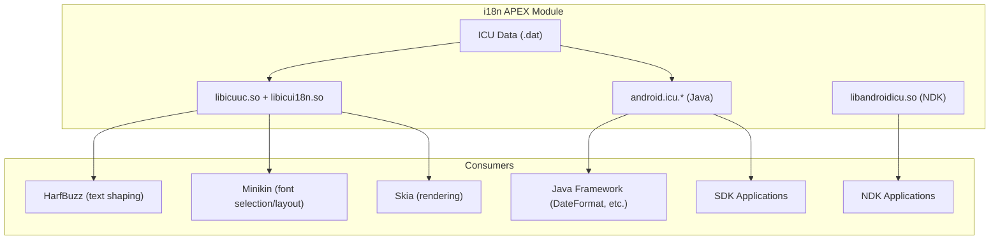

### 47.1.4 Unicode 字符属性

最基础的 ICU 服务是字符属性查找。给定一个 Unicode 码点，ICU 可以告诉你以下
属性以及其他数十种属性：

- 其一般类别（字母、数字、标点）。
- 其双向类别（从左到右、从右到左、阿拉伯数字）。
- 其文字系统（拉丁、汉字、天城文）。
- 它是否为 emoji。

C API 定义在 `external/icu/icu4c/source/common/unicode/uchar.h`。关键函数
包括：

```c
// Get the general category of a code point
int8_t u_charType(UChar32 c);

// Check if a code point has a specific binary property
UBool u_hasBinaryProperty(UChar32 c, UProperty which);

// Get the bidirectional class
UCharDirection u_charDirection(UChar32 c);

// Get the script of a code point
UScriptCode uscript_getScript(UChar32 c, UErrorCode *pErrorCode);
```

对应的 Java 等价物是 `android.icu.lang.UCharacter`：

```java
// Get the general category
int type = UCharacter.getType(codePoint);

// Check bidirectional class
int dir = UCharacter.getDirection(codePoint);

// Check if a character is a letter
boolean isLetter = UCharacter.isLetter(codePoint);
```

这些属性查找对性能至关重要。一段阿拉伯文与拉丁文混排的段落在双向分析和
塑形期间可能需要数千次属性查找。ICU 将数据存储在紧凑的 trie 结构
（UTrie2）中，可提供 O(1) 的查找时间。

### 47.1.5 文本规范化

Unicode 允许相同的视觉文本以多种方式编码。字母 "a"（U+00E4）也可以表示为
"a"（U+0061）后跟一个组合分音符（U+0308）。规范化把文本转换为规范形式，
从而使等价序列在比较时相等。

ICU 提供四种规范化形式：

| 形式 | 名称 | 描述 |
|------|------|-------------|
| NFC | 规范分解 + 组合 | 在可能时组合字符（最常见） |
| NFD | 规范分解 | 把所有字符分解为基字符 + 组合标记 |
| NFKC | 兼容分解 + 组合 | 同时也分解兼容字符 |
| NFKD | 兼容分解 | 包括兼容字符在内的完整分解 |

C API 位于 `external/icu/icu4c/source/common/unicode/unorm2.h`：

```c
const UNormalizer2 *nfc = unorm2_getNFCInstance(&status);
int32_t len = unorm2_normalize(nfc, src, srcLen, dst, dstCap, &status);
UBool isNormalized = unorm2_isNormalized(nfc, src, srcLen, &status);
```

Minikin 的 `FontCollection` 在进行字体回退时使用规范化。当首选字体中找不到
某个字符时，Minikin 可能会将其分解（使用 NFD）。然后它尝试分别查找基字符
和组合标记。这一点可以从 FontCollection 实现的 include 中看出来：

```cpp
// frameworks/minikin/libs/minikin/FontCollection.cpp
#include <unicode/unorm2.h>
```

### 47.1.6 排序（Collation）

正确地对文本排序远比比较字节值复杂。德语在电话簿排序中把 "a" 视为与 "ae"
等价。瑞典语把 "o" 排在 "z" 之后。日语有多种排序方式，取决于汉字的读音。

ICU 的排序引擎位于 `external/icu/icu4c/source/i18n/`，通过特定于 locale 的
定制规则支持所有这些排序规则。Java API 如下：

```java
import android.icu.text.Collator;

Collator collator = Collator.getInstance(Locale.GERMAN);
int result = collator.compare("Muller", "Mueller"); // locale-aware comparison
```

### 47.1.7 断句迭代

断句迭代用于标识文本中的边界：字符、单词、句子和行的起止位置。对于像英语
这样以空格分隔的语言，这是微不足道的。而对于不使用空格分隔单词的文字系统
（如泰文、老挝文、高棉文、中文和日文），这一点至关重要。

ICU 提供五种类型的断句迭代器：

```java
import android.icu.text.BreakIterator;

// Word boundaries (critical for Thai, Khmer, Lao, Myanmar)
BreakIterator wordIter = BreakIterator.getWordInstance(Locale.THAI);
wordIter.setText(thaiText);

// Line break opportunities (used by Minikin's line breaker)
BreakIterator lineIter = BreakIterator.getLineInstance(locale);

// Sentence boundaries (used for triple-click selection)
BreakIterator sentIter = BreakIterator.getSentenceInstance(locale);

// Character (grapheme cluster) boundaries
BreakIterator charIter = BreakIterator.getCharacterInstance(locale);
```

`BreakIterator` 的源码位于：

- Java：`external/icu/android_icu4j/src/main/java/android/icu/text/BreakIterator.java`
- C：`external/icu/icu4c/source/common/unicode/brkiter.h`

行断迭代器尤为重要，因为 Minikin 在段落布局期间会调用它来确定可以在何处断行。

### 47.1.8 日期、时间和数字格式化

ICU 为日期、时间、数字和货币提供 locale 感知的格式化：

```java
import android.icu.text.DateFormat;
import android.icu.text.NumberFormat;
import android.icu.number.NumberFormatter;

// Date formatting
DateFormat df = DateFormat.getDateInstance(DateFormat.LONG, Locale.JAPAN);
String formatted = df.format(new Date()); // "2026年3月18日"

// Number formatting
NumberFormat nf = NumberFormat.getInstance(Locale.GERMANY);
String num = nf.format(1234567.89); // "1.234.567,89"

// Modern number formatter (ICU 60+)
String currency = NumberFormatter.withLocale(Locale.US)
    .unit(Currency.getInstance("USD"))
    .format(42.99)
    .toString(); // "$42.99"
```

这些类位于 `external/icu/android_icu4j/src/main/java/android/icu/text/`
和 `external/icu/android_icu4j/src/main/java/android/icu/number/`。

### 47.1.9 ICU 版本管理

ICU 会定期更新以跟踪新的 Unicode 版本。升级流程记录在
`external/icu/icu_version_upgrade.md` 中，涉及以下步骤：

1. 导入新的上游 ICU 版本
2. 重新生成 Android 专用的数据子集
3. 更新 `android_icu4j` 和 `android_icu4c` 包装层
4. 运行 CTS 和 ICU 一致性测试
5. 更新 i18n APEX 模块

由于 ICU 以 APEX 形式分发，更新无需完整的平台 OTA 即可到达设备。这对于
新增新 emoji、文字系统或修正排序规则的 Unicode 版本升级至关重要。

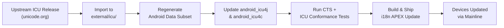

---

## 47.2 Locale 管理

一个 locale 是语言、文字系统、区域和变体的组合，它决定文本如何被处理、格式化
和显示。Android 的 locale 管理系统跟踪用户偏好，将其应用到 framework，并暴露
API 供应用程序查询和响应 locale 变化。

### 47.2.1 LocaleList：有序的 locale 偏好

自 Android 7.0（API 24）起，平台支持一个*有序列表*的偏好 locale，而不是单个
locale。用户可能首选法语，其次英语，再次德语。当某项资源在法语中不可用时，
系统会先回退到英语，然后再尝试德语。

`LocaleList` 类定义于：

**源路径**：`frameworks/base/core/java/android/os/LocaleList.java`

```java
// frameworks/base/core/java/android/os/LocaleList.java
public final class LocaleList implements Parcelable {
    private final Locale[] mList;
    private final String mStringRepresentation;

    public Locale get(int index) {
        return (0 <= index && index < mList.length) ? mList[index] : null;
    }

    public int size() {
        return mList.length;
    }

    public boolean isEmpty() {
        return mList.length == 0;
    }
    // ...
}
```

`LocaleList` 是一个不可变的、可打包的 `java.util.Locale` 对象列表。其字符串
表示是 BCP-47 语言标签的逗号分隔列表（例如 `"fr-FR,en-US,de-DE"`）。

### 47.2.2 系统 locale 与应用 locale

Android 区分两种 locale 作用域：

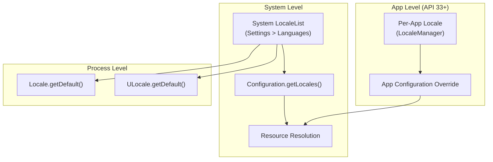

1. **系统 locale**：由用户在“设置”中设置。存储于
   `persist.sys.locale`（旧版）和系统 `Configuration` 中。默认应用于所有
   应用。

2. **按应用 locale**：通过 `LocaleManager` 在 Android 13（API 33）中引入。
   允许各个应用使用与系统默认不同的 locale。

### 47.2.3 LocaleManager 与 LocaleManagerService

`LocaleManager` API 允许应用查询和设置按应用的 locale：

```java
// Setting per-app locales (API 33+)
LocaleManager localeManager = getSystemService(LocaleManager.class);
localeManager.setApplicationLocales(LocaleList.forLanguageTags("ja-JP,en-US"));

// Getting per-app locales
LocaleList appLocales = localeManager.getApplicationLocales();
```

`LocaleManager` 还暴露系统 locale 列表（`getSystemLocales()` /
`setSystemLocales()`），并允许应用通过 `setOverrideLocaleConfig(LocaleConfig)`
为其声明的支持的 locale 提供一个运行时覆盖。该覆盖的 LocaleConfig 使应用无需
发布新构建即可扩展或缩减“设置”为该应用提供的语言列表。该类静态声明于
`frameworks/base/core/java/android/app/LocaleConfig.java`。

服务端的实现位于：

**源路径**：`frameworks/base/services/core/java/com/android/server/locales/LocaleManagerService.java`

```java
// frameworks/base/services/core/java/com/android/server/locales/LocaleManagerService.java
package com.android.server.locales;

/**
 * The implementation of ILocaleManager.aidl.
 *
 * This service is API entry point for storing app-specific UI locales
 * and an override LocaleConfig for a specified app.
 */
public class LocaleManagerService extends SystemService {
    // ...
}
```

该服务管理多项职责：

| 职责 | 描述 |
|---------------|-------------|
| 按应用 locale 存储 | 将 locale 偏好持久化到磁盘 |
| 配置覆盖 | 在应用启动时应用 locale 覆盖 |
| 备份/恢复 | 通过 `LocaleManagerBackupHelper` 备份 locale 偏好 |
| 包监控 | 通过 `LocaleManagerServicePackageMonitor` 跟踪应用安装/卸载 |
| LocaleConfig 覆盖 | 允许系统覆盖应用声明的支持 locale |

同一包中的辅助文件
（`frameworks/base/services/core/java/com/android/server/locales/`）：

- `LocaleManagerBackupHelper.java` -- 备份代理集成
- `LocaleManagerServicePackageMonitor.java` -- 跟踪包变更
- `LocaleManagerShellCommand.java` -- `cmd locale` 的 shell 接口
- `LocaleManagerInternal.java` -- 供系统服务使用的内部 API
- `SystemAppUpdateTracker.java` -- 在系统应用更新后重新应用已存储的 locale
- `AppLocaleChangedAtomRecord.java` / `AppSupportedLocalesChangedAtomRecord.java` --
  当应用的 locale 或支持的 locale 配置变更时记录的 Statsd atom 记录

### 47.2.4 Locale 解析算法

当系统需要为某项资源或服务选择最佳 locale 时，它会运行一个协商算法：

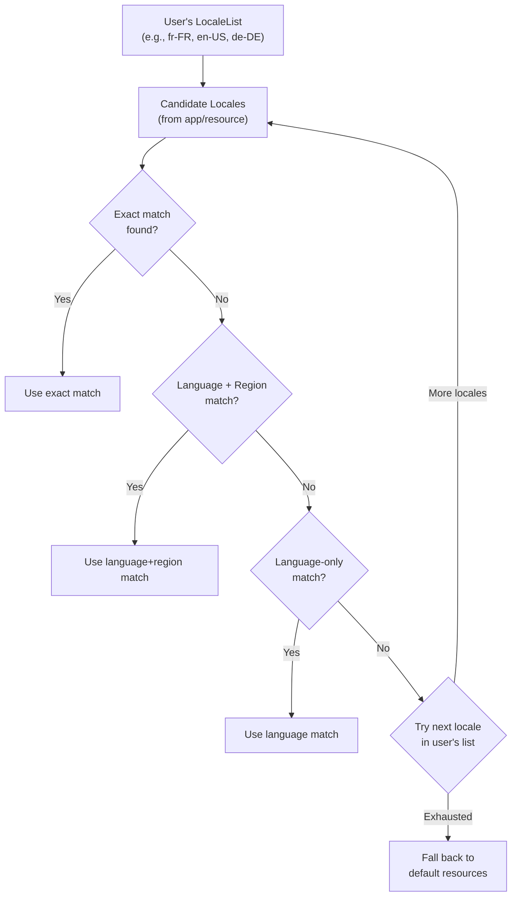

解析过程会考虑：

1. **精确匹配**：语言、文字系统、区域全部匹配
2. **感知文字系统的回退**：`sr-Latn`（塞尔维亚拉丁字母）不会回退到
   `sr`（塞尔维亚西里尔字母），因为文字系统不同
3. **区域回退**：`en-AU` 会先回退到 `en-GB`，再回退到 `en-US`（因为澳大利亚
   英语更接近英国英语）
4. **宏区域支持**：`es-419`（拉丁美洲西班牙语）作为 `es-MX`、`es-AR` 等
   的回退

### 47.2.5 配置传播

当系统 locale 发生变化（或设置了按应用的 locale）时，该变化会在系统中传播：

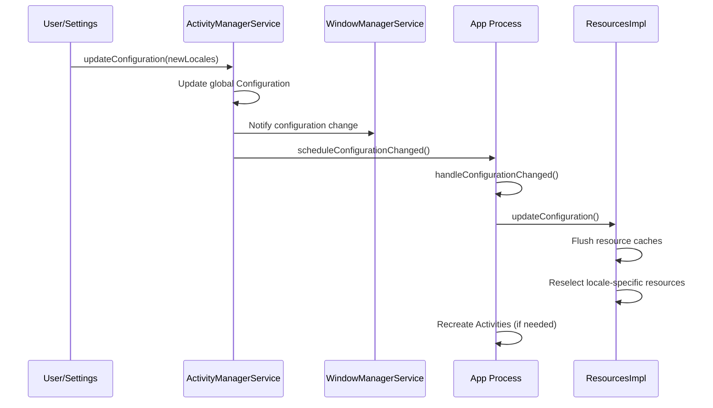

每个 Activity 都会在其清单文件中声明
`android:configChanges="locale"` 时收到 `onConfigurationChanged()`。否则，该
Activity 会被销毁并以新的 locale 重建。

### 47.2.6 BCP-47 语言标签

Android 在各处都使用 BCP-47（IETF 最佳当前实践 47）语言标签。这些标签具有
结构化的格式：

```
language[-script][-region][-variant][-extension]

Examples:
  en              English
  en-US           English (United States)
  zh-Hant-TW      Chinese (Traditional, Taiwan)
  sr-Latn         Serbian (Latin script)
  az-Cyrl-AZ      Azerbaijani (Cyrillic, Azerbaijan)
  en-u-nu-thai    English with Thai numerals (Unicode extension)
```

Java 中的 `Locale` 类会解析和生成这些标签：

```java
Locale locale = Locale.forLanguageTag("zh-Hant-TW");
String language = locale.getLanguage();  // "zh"
String script   = locale.getScript();    // "Hant"
String region   = locale.getCountry();   // "TW"
String tag      = locale.toLanguageTag(); // "zh-Hant-TW"
```

ICU 的 `ULocale` 在此基础上扩展了额外的 Unicode 扩展关键字，用于日历、排序、
数字系统以及其他偏好。

### 47.2.7 locale 变更广播

当系统 locale 发生变化时，平台会发送一个广播：

```java
// System broadcast for locale changes
Intent.ACTION_LOCALE_CHANGED  // "android.intent.action.LOCALE_CHANGED"
```

该广播会发送给所有正在运行和已注册的接收器。缓存依赖于 locale 的数据
（已格式化的字符串、排序键等）的应用程序应监听该广播以使其缓存失效。

---

## 47.3 资源限定符

Android 的资源系统允许应用程序为任何资源提供特定于 locale 的备选版本：字符串、
布局、可绘制对象、尺寸、样式等等。该机制基于目录命名约定以及编译时/运行时的
解析系统。

### 47.3.1 限定符目录命名

特定于 locale 的资源放在带有语言和区域限定符的目录中：

```
res/
  values/                   # Default (fallback) resources
    strings.xml
  values-fr/                # French
    strings.xml
  values-fr-rCA/            # French (Canada)
    strings.xml
  values-zh-rCN/            # Chinese (Simplified, China)
    strings.xml
  values-zh-rTW/            # Chinese (Traditional, Taiwan)
    strings.xml
  values-b+sr+Latn/         # Serbian (Latin script) -- BCP-47 format
    strings.xml
  layout/                   # Default layouts
    activity_main.xml
  layout-ar/                # Arabic-specific layout
    activity_main.xml
  layout-land/              # Landscape orientation
    activity_main.xml
  layout-ar-land/           # Arabic + landscape
    activity_main.xml
```

`b+` 前缀用于包含文字系统子标签的 BCP-47 标签，而较旧的双字母限定符格式无法
表达这一点。

### 47.3.2 限定符优先级

当多个限定符维度适用时，Android 使用严格的淘汰算法来选择最佳匹配。locale
限定符具有最高优先级之一：

| 优先级 | 限定符 | 示例 |
|----------|-----------|---------|
| 1 | MCC/MNC | `mcc310-mnc004` |
| 2 | 语言/区域 | `en-rUS`、`b+zh+Hant` |
| 3 | 布局方向 | `ldrtl`、`ldltr` |
| 4 | 最小宽度 | `sw600dp` |
| 5 | 可用宽度/高度 | `w720dp`、`h1024dp` |
| 6 | 屏幕尺寸 | `small`、`normal`、`large`、`xlarge` |
| 7 | 屏幕长宽比 | `long`、`notlong` |
| 8 | 圆形屏幕 | `round`、`notround` |
| 9 | 广色域 | `widecg`、`nowidecg` |
| 10 | HDR | `highdr`、`lowdr` |
| 11 | 方向 | `port`、`land` |
| 12 | UI 模式 | `car`、`desk`、`television`、`watch` |
| 13 | 夜间模式 | `night`、`notnight` |
| 14 | DPI | `ldpi`、`mdpi`、`hdpi`、`xhdpi`、`xxhdpi`、`xxxhdpi` |
| 15 | 触摸屏 | `notouch`、`finger` |
| 16 | 键盘 | `keysexposed`、`keyshidden`、`keyssoft` |
| 17 | 输入方式 | `nokeys`、`qwerty`、`12key` |
| 18 | 导航 | `nonav`、`dpad`、`trackball`、`wheel` |
| 19 | API 级别 | `v21`、`v26`、`v33` |

### 47.3.3 资源解析算法

资源选择算法实现在原生的 `AssetManager` 和 Java 的 `ResourcesImpl` 类中。

**源路径**：`frameworks/base/core/java/android/content/res/ResourcesImpl.java`

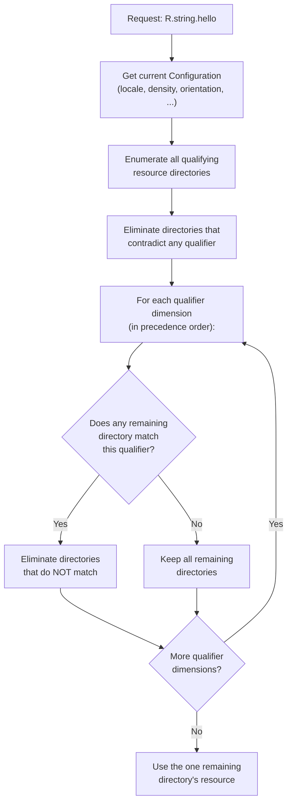

考虑一台 locale 为 `fr-CA`、屏幕密度为 `xhdpi`、方向为 `port` 的设备。对于
`R.string.app_name`，系统可能拥有：

```
values/strings.xml            (default)
values-fr/strings.xml         (French)
values-fr-rCA/strings.xml     (French Canada)
values-en/strings.xml         (English)
```

算法如下：

1. 淘汰 `values-en/`（语言错误）
2. 在剩余项中：`values/`、`values-fr/`、`values-fr-rCA/`
3. `values-fr-rCA/` 与语言+区域精确匹配，因此淘汰 `values/` 和
   `values-fr/`
4. 结果：使用 `values-fr-rCA/strings.xml`

### 47.3.4 字符串资源与复数

字符串资源是最常见的特定于 locale 的资源。Android 支持几种类型：

```xml
<!-- Simple string -->
<string name="hello">Hello</string>

<!-- String with format arguments -->
<string name="welcome">Welcome, %1$s! You have %2$d messages.</string>

<!-- Plurals (quantity strings) -->
<plurals name="messages">
    <item quantity="zero">No messages</item>
    <item quantity="one">%d message</item>
    <item quantity="two">%d messages</item>   <!-- Arabic, Welsh, etc. -->
    <item quantity="few">%d messages</item>    <!-- Russian, Polish, etc. -->
    <item quantity="many">%d messages</item>   <!-- Arabic, etc. -->
    <item quantity="other">%d messages</item>  <!-- Fallback -->
</plurals>

<!-- String array -->
<string-array name="planets">
    <item>Mercury</item>
    <item>Venus</item>
    <item>Earth</item>
</string-array>
```

复数类别（`zero`、`one`、`two`、`few`、`many`、`other`）遵循 Unicode CLDR
复数规则。英语只使用 `one` 和 `other`。俄语使用 `one`、`few`、`many` 和
`other`。阿拉伯语使用全部六个类别。

ICU 的 `PluralRules` 类决定给定数字和 locale 的正确类别：

```java
import android.icu.text.PluralRules;

PluralRules rules = PluralRules.forLocale(Locale.forLanguageTag("ar"));
String keyword = rules.select(3);  // "few" (Arabic: 3-10 are "few")
String keyword2 = rules.select(100); // "other"
```

### 47.3.5 翻译工作流

AOSP 使用 XLIFF（XML 本地化交换文件格式）标准进行翻译。工作流如下：

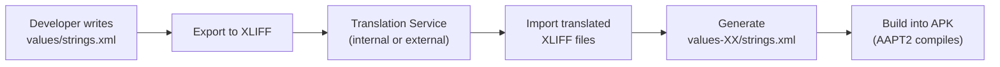

AAPT2（Android Asset Packaging Tool）把所有字符串资源编译为 `resources.arsc`
表中的二进制格式，并打包进 APK。在运行时，`ResourcesImpl` 从该表中读取，以
根据当前配置解析字符串资源。

### 47.3.6 用于测试的伪 locale

Android 提供两个伪 locale，帮助开发者在无需等待翻译的情况下发现 i18n 问题：

| 伪 locale | 标签 | 效果 |
|--------------|-----|--------|
| 带重音英语 | `en-XA` | 添加重音、拉长文本（例如 "Hello" 变为 "[Heeelllloo]"） |
| Bidi（RTL） | `ar-XB` | 镜像文本方向，用 RTL 标记包裹 |

这些在开发者选项中启用，通过在资源加载时转换字符串来工作。它们对于捕获以下
问题非常有价值：

- 硬编码字符串（未提取到资源中）
- 因文本变长而破坏的布局
- RTL 布局问题
- 在其他语序下被破坏的拼接字符串

---

## 47.4 RTL 支持

从右到左（RTL）的文字系统——阿拉伯文、希伯来文、波斯文、乌尔都文等——要求
整个用户界面被镜像。文本从右向左流动，布局水平翻转，而许多看起来在方向上中
性的元素（进度条、滑块、导航图标）也必须被镜像。

### 47.4.1 布局方向

自 Android 4.2（API 17）起，视图系统支持两种布局方向：

```java
// View.java
public static final int LAYOUT_DIRECTION_LTR = 0;
public static final int LAYOUT_DIRECTION_RTL = 1;
public static final int LAYOUT_DIRECTION_INHERIT = 2;  // Inherit from parent
public static final int LAYOUT_DIRECTION_LOCALE = 3;   // Follow locale
```

方向在 XML 中设置：

```xml
<!-- In the manifest to enable RTL support globally -->
<application android:supportsRtl="true">

<!-- On individual views -->
<LinearLayout
    android:layoutDirection="locale"
    android:textDirection="locale"
    android:textAlignment="viewStart">
```

### 47.4.2 Start/End 与 Left/Right

RTL 支持的关键 API 变化是用 `start`/`end` 替换 `left`/`right`：

| 旧（仅 LTR） | 新（方向感知） | RTL 行为 |
|----------------|----------------------|-------------|
| `layout_marginLeft` | `layout_marginStart` | 映射到右边距 |
| `layout_marginRight` | `layout_marginEnd` | 映射到左边距 |
| `paddingLeft` | `paddingStart` | 映射到右内边距 |
| `paddingRight` | `paddingEnd` | 映射到左内边距 |
| `layout_alignParentLeft` | `layout_alignParentStart` | 对齐到右侧 |
| `gravity="left"` | `gravity="start"` | 对齐到右侧 |
| `drawableLeft` | `drawableStart` | 显示在右侧 |

视图系统根据在测量/布局时解析出的布局方向，把 `start` 和 `end` 解析为物理的
`left` 和 `right`。

### 47.4.3 视图布局方向解析

布局方向的解析沿视图层级进行：

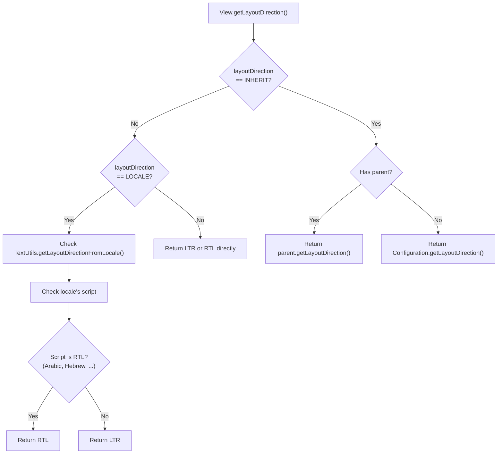

**源路径**：`frameworks/base/core/java/android/text/TextUtils.java`

`TextUtils.getLayoutDirectionFromLocale()` 方法会询问 ICU 该 locale 是否本质上
是 RTL 的。在 Android 17 中，它委托给 `ULocale.forLocale(locale).isRightToLeft()`，
而不是直接探查文字系统的第一个码点。它还会遵循开发者的“强制 RTL”开关：

```java
// frameworks/base/core/java/android/text/TextUtils.java
public static int getLayoutDirectionFromLocale(Locale locale) {
    return ((locale != null && !locale.equals(Locale.ROOT)
                    && ULocale.forLocale(locale).isRightToLeft())
            // If forcing into RTL layout mode, return RTL as default
            || DisplayProperties.debug_force_rtl().orElse(false))
        ? View.LAYOUT_DIRECTION_RTL
        : View.LAYOUT_DIRECTION_LTR;
}
```

`ULocale.isRightToLeft()` 会查询 ICU 的 locale 数据。因此像 `ar`（阿拉伯语）或
`he`（希伯来语）这样的 locale 即使没有文字系统子标签也会解析为 RTL。塞尔维亚
语（`sr`，无论是用拉丁字母还是西里尔字母书写）解析为 LTR，因为两种文字系统
都不是从右到左的。`DisplayProperties.debug_force_rtl()` 分支就是“强制 RTL
布局方向”开发者选项所切换的开关。

### 47.4.4 双向（Bidi）文本

RTL 支持中最复杂的方面是双向文本——即在同一段落内同时包含 RTL 和 LTR 片段的
文本。例如，一个包含英文产品名称的阿拉伯语句子，或一个带有数字的希伯来语段
落。

Unicode 双向算法（UBA，UAX #9）定义了如何为显示而重新排序字符。该算法：

1. 为每个字符分配一个 bidi 类别（L、R、AL、EN、AN、ES、CS……）
2. 解析显式嵌入级别（来自 LRE、RLE、LRO、RLO、PDF 标记以及 LRI、RLI、FSI、
   PDI 隔离符）
3. 根据字符类别解析隐式级别
4. 根据解析出的级别为显示而重新排序字符

ICU 在 `external/icu/icu4c/source/common/ubidi.cpp` 中实现 UBA。Minikin 通过
其 `BidiUtils` 包装器使用它：

```cpp
// frameworks/minikin/libs/minikin/BidiUtils.cpp
// Uses ICU's ubidi.h for bidirectional analysis
```

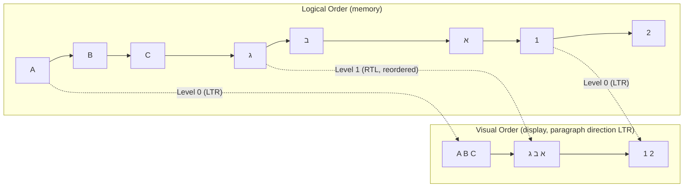

### 47.4.5 RTL 镜像

许多 Unicode 字符在 RTL 上下文中都有镜像对应字符。例如，括号 `(` 和 `)` 在
RTL 文本中会交换，以便视觉嵌套保持正确。ICU 提供镜像信息：

```c
// Get the Bidi mirroring glyph
UChar32 mirrored = u_charMirror(0x0028); // '(' -> ')' in RTL context
```

除了字符级镜像，Android 的可绘制系统还支持图标的自动镜像：

```xml
<!-- Drawable that auto-mirrors in RTL -->
<vector
    android:autoMirrored="true"
    android:width="24dp"
    android:height="24dp"
    ...>
```

导航图标（返回箭头、前进箭头）、进度指示器和其他有方向的元素都应使用
`autoMirrored="true"`。

### 47.4.6 支持 RTL 的布局容器

当使用 `start`/`end` 属性时，标准布局容器会自动处理 RTL：

```java
// LinearLayout resolves gravity
// In RTL mode, Gravity.START resolves to Gravity.RIGHT
int resolvedGravity = Gravity.getAbsoluteGravity(gravity, layoutDirection);

// RelativeLayout resolves START_OF / END_OF
// In RTL mode, START_OF resolves to RIGHT_OF
```

`ConstraintLayout`、`RecyclerView` 和 `ViewPager2` 都支持 RTL。已弃用的
`ViewPager` 不支持 RTL，这也是引入 `ViewPager2` 取代它的一个原因。

### 47.4.7 文本方向与文本对齐

除了布局方向，Android 还提供对文本方向和文本对齐的单独控制：

```xml
<!-- Text direction options -->
android:textDirection="firstStrong"   <!-- Default: first strong character determines direction -->
android:textDirection="anyRtl"        <!-- RTL if any RTL character is present -->
android:textDirection="ltr"           <!-- Force LTR -->
android:textDirection="rtl"           <!-- Force RTL -->
android:textDirection="locale"        <!-- Follow locale -->
android:textDirection="firstStrongLtr" <!-- First strong, default to LTR -->
android:textDirection="firstStrongRtl" <!-- First strong, default to RTL -->

<!-- Text alignment options -->
android:textAlignment="viewStart"   <!-- Align to start of view -->
android:textAlignment="viewEnd"     <!-- Align to end of view -->
android:textAlignment="textStart"   <!-- Align to start of text direction -->
android:textAlignment="textEnd"     <!-- Align to end of text direction -->
android:textAlignment="center"      <!-- Center -->
android:textAlignment="gravity"     <!-- Follow gravity -->
```

当视图的布局方向与文本的固有方向不同时，`viewStart` 和 `textStart` 的区别就
很重要。例如，LTR 视图中的阿拉伯语文本，其 `viewStart` 在左侧，而
`textStart` 在右侧。

---

## 47.5 文本渲染管线

为世界上各种文字系统正确渲染文本是 Android 中最复杂的子系统之一。它涉及四个
协同工作的主要组件：ICU（Unicode 算法）、HarfBuzz（文本塑形）、Minikin（字体
选择与布局），以及 FreeType/Skia（栅格化）。屏幕上出现的每个字符都经过了这
整条管线。

### 47.5.1 管线概览

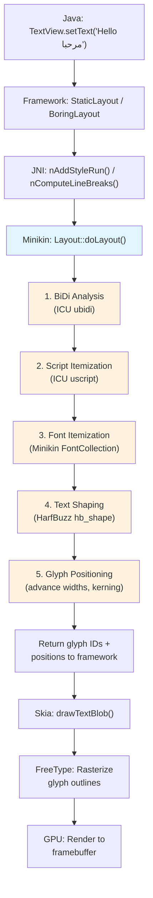

### 47.5.2 步骤 1：BiDi 分析

布局的第一步是双向分析。输入文本使用 Unicode 双向算法（通过 ICU 的
`ubidi.h`）进行分析，以确定每个字符的嵌入级别。

```cpp
// frameworks/minikin/libs/minikin/Layout.cpp
#include <unicode/ubidi.h>

// Layout.cpp uses BidiUtils to split text into runs of uniform direction
```

结果是一系列 **bidi 片段**，每个片段具有统一的方向级别。对于像
"Hello مرحبا World" 这样的文本，结果可能是：

| 片段 | 文本 | 级别 | 方向 |
|-----|------|-------|-----------|
| 0 | "Hello " | 0 | LTR |
| 1 | "مرحبا" | 1 | RTL |
| 2 | " World" | 0 | LTR |

### 47.5.3 步骤 2：文字系统分段

在每个 bidi 片段内，文本会按文字系统进一步划分。ICU 的
`uscript_getScript()` 标识每个字符的文字系统。像 "Tokyo東京" 这样的混合文字
系统文本会产生拉丁字母和汉字的独立片段。

这一点很重要，因为不同的文字系统需要不同的塑形引擎和字体文件。拉丁文本、CJK
文本、阿拉伯文本和天城文文本都使用不同的塑形规则和不同的字体。

### 47.5.4 步骤 3：字体分段（Minikin）

对于每个文字系统片段，Minikin 的 `FontCollection` 会选择最佳字体。这是
Minikin 的主要职责之一。

**源路径**：`frameworks/minikin/libs/minikin/FontCollection.cpp`

字体选择算法：

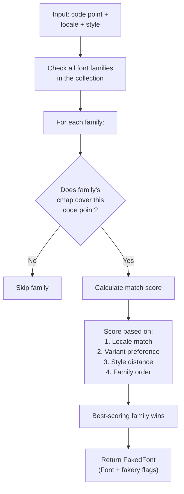

`FontCollection` 类维护一个按优先级排序的字体族列表。覆盖给定码点的首个字
体族获胜，但 locale 偏好可以覆盖这一点。例如，CJK 字符 U+8FD4 在日语（ja）、
简体中文（zh-Hans）和繁体中文（zh-Hant）中有不同的首选字形。Minikin 会检查
locale 以选择正确的变体。

```cpp
// frameworks/minikin/include/minikin/FontCollection.h
class FontCollection {
public:
    static std::shared_ptr<FontCollection> create(
            const std::vector<std::shared_ptr<FontFamily>>& typefaces);

    // Key method: find the best font for a run of text
    FakedFont baseFontFaked(FontStyle style);
    // ...
};
```

`FakedFont` 结构体包含所选的 `Font` 对象以及伪造标志。这些标志指示在未找到
精确样式时字体引擎是否应合成粗体或斜体。

### 47.5.5 步骤 4：文本塑形（HarfBuzz）

文本塑形是把一系列 Unicode 码点转换为一系列已定位字形的过程。对于像拉丁这样
的简单文字系统，这主要是字符到字形的 1:1 映射。对于复杂文字系统，塑形涉及：

- **连字形成**："fi" -> 单个 "fi" 连字字形
- **上下文替换**：阿拉伯字母根据其位置（词首、词中、词尾、独立）改变形状
- **标记定位**：组合附加符号相对于其基字符定位
- **重新排序**：天城文和其他印度系文字在塑形期间重新排序字符（例如，天城文
  中的 "ki" 输入为元音在辅音之后，但显示为元音在辅音之前）
- **簇形成**：构成单个视觉单元的多个码点

HarfBuzz 是业界标准的开源文本塑形引擎。它在 AOSP 中位于
`external/harfbuzz_ng/`。

**源路径**：`external/harfbuzz_ng/src/`

核心塑形调用：

```c
// HarfBuzz shaping API (external/harfbuzz_ng/src/hb-buffer.h, hb-shape.h)
hb_buffer_t *buf = hb_buffer_create();
hb_buffer_add_utf16(buf, text, len, 0, len);
hb_buffer_set_direction(buf, HB_DIRECTION_RTL); // or HB_DIRECTION_LTR
hb_buffer_set_script(buf, HB_SCRIPT_ARABIC);
hb_buffer_set_language(buf, hb_language_from_string("ar", -1));

hb_shape(hb_font, buf, features, num_features);

// Extract results
unsigned int glyph_count;
hb_glyph_info_t *glyph_info = hb_buffer_get_glyph_infos(buf, &glyph_count);
hb_glyph_position_t *glyph_pos = hb_buffer_get_glyph_positions(buf, &glyph_count);
```

每个输出字形具有：

- **字形 ID**：字体字形表中的索引
- **簇**：该字形对应哪些输入字符
- **X 步进/Y 步进**：绘制此字形后移动多远
- **X 偏移/Y 偏移**：对绘制位置的调整（用于标记定位）

### 47.5.6 塑形示例：阿拉伯语文本

阿拉伯语是最复杂的塑形文字系统之一。每个字母根据其在单词中的位置最多有四种
形式：

| 字母 | 独立 | 词首 | 词中 | 词尾 |
|--------|----------|---------|--------|-------|
| Ba (ب) | ﺏ | ﺑ | ﺒ | ﺐ |
| Seen (س) | ﺱ | ﺳ | ﺴ | ﺲ |
| Lam (ل) | ﻝ | ﻟ | ﻠ | ﻞ |

此外，阿拉伯语还有强制性连字。最著名的是 Lam-Alef 连字：ل + ا = لا。
HarfBuzz 读取字体的 OpenType 表（用于字形替换的 GSUB、用于字形定位的 GPOS）
以应用所有这些规则。

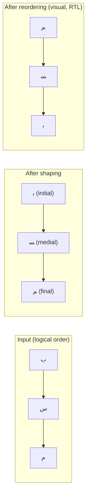

### 47.5.7 步骤 5：字形定位与布局

塑形之后，Minikin 累积字形位置以生成最终布局。`Layout` 类存储结果：

```cpp
// frameworks/minikin/include/minikin/Layout.h
struct LayoutGlyph {
    LayoutGlyph(FakedFont font, uint32_t glyph_id, uint32_t cluster,
                float x, float y)
            : font(font), glyph_id(glyph_id), cluster(cluster), x(x), y(y) {}
    FakedFont font;
    uint32_t glyph_id;
    uint32_t cluster;
    float x;
    float y;
};
```

布局还处理：

- **字距**：调整字符之间的间距。实现会处理边界情况以避免在行的开头/结尾处
  添加间距：

```cpp
// frameworks/minikin/libs/minikin/Layout.cpp
void adjustGlyphLetterSpacingEdge(const U16StringPiece& textBuf,
                                   const MinikinPaint& paint,
                                   RunFlag runFlag,
                                   std::vector<LayoutGlyph>* glyphs) {
    const float letterSpacing = paint.letterSpacing * paint.size * paint.scaleX;
    const float letterSpacingHalf = letterSpacing * 0.5f;
    // ... edge adjustments for LEFT_EDGE and RIGHT_EDGE ...
}
```

- **缓存**：Minikin 维护一个布局结果的 LRU 缓存，以避免对相同的文本片段重新
  塑形。缓存键包括文本、样式、locale 和字体。

### 47.5.8 断行

Minikin 包含一个复杂的断行器，支持三种策略：

```cpp
// frameworks/minikin/include/minikin/LineBreaker.h
enum class BreakStrategy : uint8_t {
    Greedy = 0,        // Fast, good-enough line breaking
    HighQuality = 1,   // Optimal (Knuth-Plass style) line breaking
    Balanced = 2,      // Minimize raggedness
};

enum class HyphenationFrequency : uint8_t {
    None = 0,          // Never hyphenate
    Normal = 1,        // Hyphenate when it improves layout
    Full = 2,          // Hyphenate aggressively
};
```

断行器的实现：

```cpp
// frameworks/minikin/libs/minikin/LineBreaker.cpp
LineBreakResult breakIntoLines(const U16StringPiece& textBuffer,
                                BreakStrategy strategy,
                                HyphenationFrequency frequency,
                                bool justified,
                                const MeasuredText& measuredText,
                                const LineWidth& lineWidth,
                                const TabStops& tabStops,
                                bool useBoundsForWidth) {
    if (strategy == BreakStrategy::Greedy || textBuffer.hasChar(CHAR_TAB)) {
        return breakLineGreedy(textBuffer, measuredText, lineWidth, tabStops,
                               frequency != HyphenationFrequency::None,
                               useBoundsForWidth);
    } else {
        return breakLineOptimal(textBuffer, measuredText, lineWidth,
                                strategy, frequency, justified,
                                useBoundsForWidth);
    }
}
```

**贪心**策略在第一个适合行宽的机会处断行。**最优**策略（基于 TeX 的
Knuth-Plass 算法）全局考虑所有可能的断点，以最小化整个段落的视觉不一致。
**均衡**策略尝试使所有行宽度大致相同。

与断行*策略*正交，Minikin 还带有派生自 CLDR 的断行*样式*和*词样式*设置，通过
`android.graphics.text.LineBreakConfig` 暴露给应用，并在
`frameworks/minikin/include/minikin/LineBreakStyle.h` 中原生定义：

```cpp
// frameworks/minikin/include/minikin/LineBreakStyle.h
enum class LineBreakStyle : uint8_t {
    None = 0, Loose = 1, Normal = 2, Strict = 3, NoBreak = 4, Auto = 5,
};
enum class LineBreakWordStyle : uint8_t {
    None = 0, Phrase = 1, Auto = 2,
};
```

这些映射到 Unicode 的 `lb` 和 `lw` locale 关键字（UTS #35）。`Strict`、
`Normal` 和 `Loose` 控制 CJK 文本可以在小型假名和某些标点周围断行的激进程度。
`LineBreakWordStyle::Phrase` 启用基于短语的断行。这使简短的日语和韩语短语保持
完整，而不是在短语中间断开。`Auto` 让 Minikin 按 locale 和行数选择。

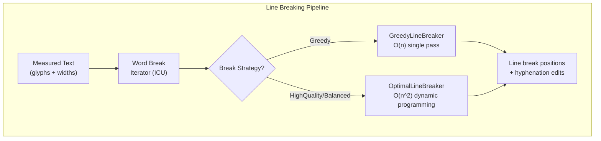

### 47.5.9 连字符

Minikin 包含一个连字符引擎，它使用派生自 TeX 连字符模式的模式文件。`Hyphenator`
类加载特定于语言的模式：

```cpp
// frameworks/minikin/include/minikin/Hyphenator.h
class Hyphenator {
    // ...
};

// frameworks/minikin/libs/minikin/HyphenatorMap.h
// Maps locales to their hyphenation patterns
```

连字符模式安装在设备的 `/system/usr/hyphen-data/hyph-*.hyb`。每个文件包含一种
语言的编译后模式。当某个单词不适合当前行且连字符频率不为 `None` 时，断行器会
咨询连字符器。

### 47.5.10 栅格化：FreeType 与 Skia

在 Minikin 生成字形 ID 和位置之后，实际的渲染由 Skia（Android 的 2D 图形库）
和 FreeType（字体栅格化器）处理。

**源路径**：`external/freetype/`（FreeType 库）

FreeType 的角色：

1. 解析字体文件（TrueType、OpenType、WOFF）
2. 从 `glyf` 或 `CFF` 表中加载字形轮廓
3. 应用提示指令（如果存在）
4. 将轮廓栅格化为位图（或为 GPU 渲染提供轮廓）

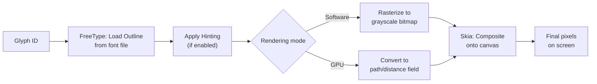

Skia 位于 framework 与 FreeType/GPU 之间。它管理：

- 字形缓存（避免对先前见过的字形重新栅格化）
- 子像素定位（用于平滑的文本滚动）
- 文本块构建（批量多次字形绘制以提高 GPU 效率）
- 彩色 emoji 渲染（使用 CBDT/CBLC 或 COLRv1 字体表）

### 47.5.11 Emoji 渲染

Emoji 在文本渲染管线中是一个特殊情况。Android 使用 Noto Color Emoji 字体，
其中包含彩色位图字形（CBDT/CBLC 格式）或矢量彩色字形（COLRv1）。

Minikin 的 `FontCollection` 对 emoji 给予特殊处理：

```cpp
// frameworks/minikin/libs/minikin/FontCollection.cpp
const uint32_t EMOJI_STYLE_VS = 0xFE0F;  // Variation Selector 16 (emoji style)
const uint32_t TEXT_STYLE_VS = 0xFE0E;    // Variation Selector 15 (text style)
```

当一个字符后跟 VS16（U+FE0F）时，系统偏好 emoji 字体。当后跟 VS15
（U+FE0E）时，它偏好文本样式字体。用户正是借此对同一个基码点看到“心形
emoji”与“心形文本符号”的区别。

Emoji 序列（肤色修饰符、用于家庭/职业 emoji 的 ZWJ 序列、由区域指示符对构成
的旗帜序列）都通过塑形管线处理：

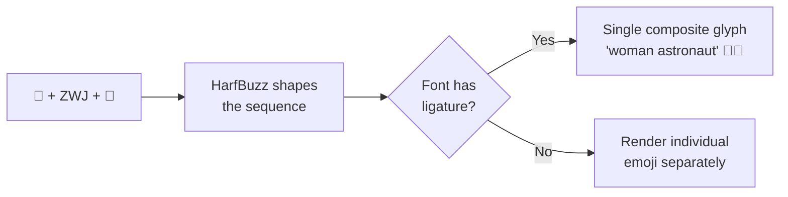

Minikin 中的 `Emoji.cpp` 模块标识与 emoji 相关的码点，并确保它们被路由到
emoji 字体：

**源路径**：`frameworks/minikin/libs/minikin/Emoji.cpp`

---

## 47.6 字体系统

Android 的字体系统管理设备上安装的字体，并把字形请求匹配到物理字体文件。它还
支持可变字体，可在不同的字重、宽度和其他轴之间插值。

### 47.6.1 系统字体配置

系统字体配置在 XML 中定义。历史上，`fonts.xml` 是主要的配置文件：

**源路径**：`frameworks/base/data/fonts/fonts.xml`

```xml
<!-- frameworks/base/data/fonts/fonts.xml (excerpt) -->
<familyset version="23">
    <!-- Default sans-serif font (Roboto) -->
    <family name="sans-serif">
        <font weight="100" style="normal">Roboto-Regular.ttf
          <axis tag="ital" stylevalue="0" />
          <axis tag="wdth" stylevalue="100" />
          <axis tag="wght" stylevalue="100" />
        </font>
        <font weight="400" style="normal">Roboto-Regular.ttf
          <axis tag="ital" stylevalue="0" />
          <axis tag="wdth" stylevalue="100" />
          <axis tag="wght" stylevalue="400" />
        </font>
        <font weight="700" style="normal">Roboto-Regular.ttf
          <axis tag="ital" stylevalue="0" />
          <axis tag="wdth" stylevalue="100" />
          <axis tag="wght" stylevalue="700" />
        </font>
        <!-- ... more weights and italic variants ... -->
    </family>
</familyset>
```

然而，当前 AOSP 源码中 `fonts.xml` 的注释清楚地说明了这一演进：

> 已弃用：此 XML 文件不再是系统中所安装字体文件的来源。对于设备厂商：请将
> 你们的字体配置添加到 `platform/frameworks/base/data/font_fallback.xml`。

请注意，该注释指引厂商使用的 `font_fallback.xml` 并未作为源文件检入。构建系统
会从 `alias.json` 和 `fallback_order.json`（
`frameworks/base/data/fonts/Android.bp` 中的 `generate_font_fallback` genrule）
生成它。构建系统随后将结果作为 `fonts.mk` 中列出的 `prebuilt_etc` 模块安装。
手工编辑的配置是与遗留 `fonts.xml` 并排放置的那三个 JSON 文件：

```
frameworks/base/data/fonts/
    fonts.xml              # Legacy (deprecated but maintained for compat)
    font_config.json       # Modern configuration
    fallback_order.json    # Fallback chain ordering
    alias.json             # Font family aliases
    fonts.mk               # Build rules for font installation
```

### 47.6.2 字体族架构

Android 把字体组织为**字体族**。一个字体族包含多个字体文件，它们在字重和样式
（normal/italic）上有所不同。系统根据请求的样式在字体族内选择最佳匹配。

```mermaid
graph TD
    subgraph "Font Family: sans-serif (Roboto)"
        R100["Roboto Thin (100)"]
        R300["Roboto Light (300)"]
        R400["Roboto Regular (400)"]
        R500["Roboto Medium (500)"]
        R700["Roboto Bold (700)"]
        R900["Roboto Black (900)"]
        RI400["Roboto Italic (400i)"]
        RI700["Roboto Bold Italic (700i)"]
    end

    subgraph "Font Family: serif (Noto Serif)"
        NS400["Noto Serif Regular (400)"]
        NS700["Noto Serif Bold (700)"]
        NSI400["Noto Serif Italic (400i)"]
        NSI700["Noto Serif Bold Italic (700i)"]
    end

    subgraph "Font Family: monospace (Droid Sans Mono)"
        DSM["DroidSansMono (400)"]
    end

    REQUEST["Request: sans-serif, weight=700, italic"] --> R700
    REQUEST2["Request: serif, weight=400, normal"] --> NS400
```

### 47.6.3 回退链

当首选字体族不包含某个字符的字形时，系统会遍历一条**回退链**来查找一个包含
该字形的字体。回退链经过排序，使得特定于文字系统的字体先于通用字体被尝试：

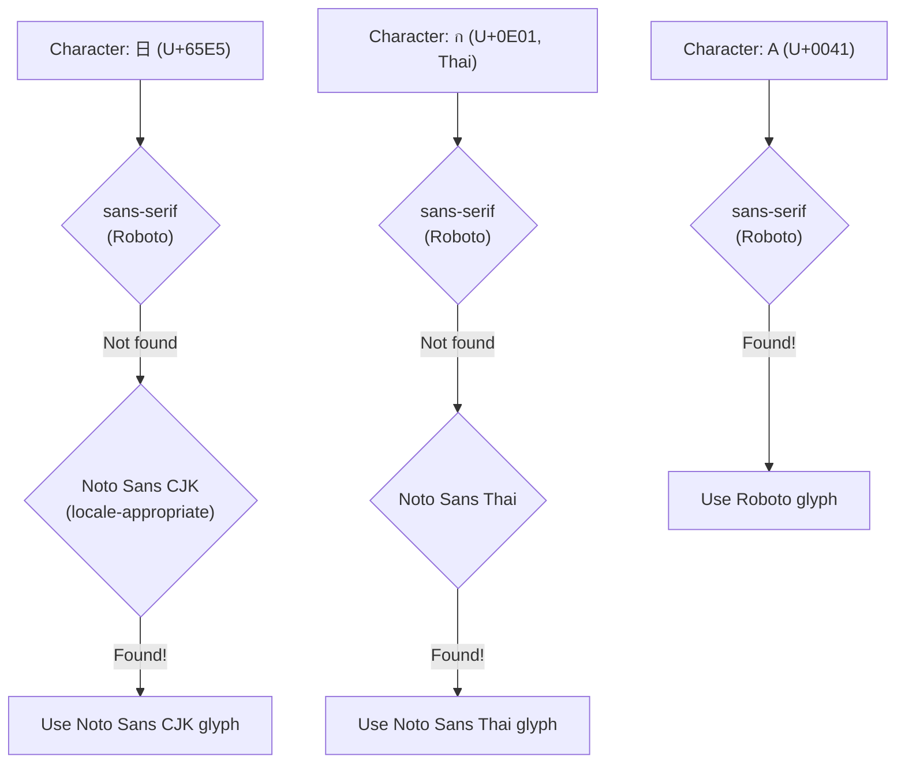

回退顺序对 locale 敏感。对于设置为日语的设备，会先尝试 Noto Sans CJK 的日语
变体，然后才是中文变体。这确保了 CJK 语言之间共享的字符（汉字统一）使用特定
于 locale 的字形形式。

### 47.6.4 可变字体

现代 Android（API 26+）支持 OpenType 可变字体。可变字体不再为每个字重发布单独
的文件，而是包含一个可以沿一个或多个**轴**插值的单一轮廓：

| 轴标签 | 名称 | 范围 | 示例 |
|----------|------|-------|---------|
| `wght` | 字重 | 1-1000 | 100=极细，400=常规，700=粗体 |
| `wdth` | 宽度 | 25-200 | 100=正常，75=压缩，125=扩展 |
| `ital` | 斜体 | 0-1 | 0=直立，1=斜体 |
| `slnt` | 倾斜 | -90-90 | 倾斜角度（度） |
| `opsz` | 光学尺寸 | 变化 | 针对文本大小调整设计 |

在 `fonts.xml` 中，可变字体轴按条目指定：

```xml
<font weight="400" style="normal">Roboto-Regular.ttf
  <axis tag="ital" stylevalue="0" />
  <axis tag="wdth" stylevalue="100" />
  <axis tag="wght" stylevalue="400" />
</font>
```

Minikin 通过 `FontVariation` 和 `FVarTable` 类处理可变字体轴：

```cpp
// frameworks/minikin/include/minikin/FontVariation.h
// Represents a font variation axis setting (tag + value)

// frameworks/minikin/include/minikin/FVarTable.h
// Parses the 'fvar' table from OpenType font files
```

可变字体的优势显著：

- **更小的总文件大小**：一个可变字体取代 12-18 个静态文件
- **任意字重/宽度**：不受预定义的 9 个字重值限制
- **平滑动画**：字重可以连续动画化
- **光学尺寸**：文本在不同点尺寸下自动调整设计细节

### 47.6.5 Typeface API

字体的 Java 侧入口点是 `Typeface` 类：

**源路径**：`frameworks/base/graphics/java/android/graphics/Typeface.java`

```java
// frameworks/base/graphics/java/android/graphics/Typeface.java
package android.graphics;

// Creating typefaces
Typeface roboto = Typeface.create("sans-serif", Typeface.NORMAL);
Typeface bold = Typeface.create(roboto, Typeface.BOLD);

// Custom typeface from font family
Typeface custom = new Typeface.Builder(assetManager, "fonts/MyFont.ttf")
    .setWeight(400)
    .setItalic(false)
    .build();

// Variable font with custom axis values
Typeface variable = new Typeface.Builder(assetManager, "fonts/Variable.ttf")
    .setFontVariationSettings("'wght' 600, 'wdth' 75")
    .build();
```

`Typeface` 包装了一个指向 Minikin `FontCollection` 的原生指针。当你调用
`Typeface.create("sans-serif", Typeface.BOLD)` 时，framework 会：

1. 在系统字体配置中查找 "sans-serif" `FontFamily`
2. 创建一个包含回退链中所有字体族的 `FontCollection`
3. 将样式设置为粗体（字重 700，倾斜直立）
4. 返回包装该原生对象的 `Typeface`

### 47.6.6 字体提供器与可下载字体

Android 8.0（API 26）通过 `FontsContract` 和字体提供器引入了**可下载字体**。
这允许应用在运行时从提供器（如 Google Fonts）请求字体：

```xml
<!-- In res/font/lobster.xml -->
<font-family xmlns:android="http://schemas.android.com/apk/res/android"
    android:fontProviderAuthority="com.google.android.gms.fonts"
    android:fontProviderPackage="com.google.android.gms"
    android:fontProviderQuery="Lobster"
    android:fontProviderCerts="@array/com_google_android_gms_fonts_certs">
</font-family>
```

字体提供器架构：

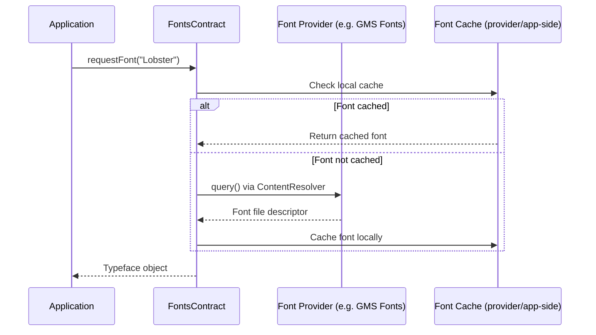

这避免了在每个 APK 中捆绑大型字体文件，并支持跨应用共享字体。

### 47.6.7 系统字体发现

应用可以使用 `SystemFonts` API（API 29+）枚举所有已安装的系统字体：

```java
import android.graphics.fonts.SystemFonts;

Set<Font> fonts = SystemFonts.getAvailableFonts();
for (Font font : fonts) {
    File file = font.getFile();           // /system/fonts/NotoSansCJK-Regular.ttc
    FontStyle style = font.getStyle();    // weight=400, slant=UPRIGHT
    LocaleList locales = font.getLocaleList(); // Locales the font targets
    int index = font.getTtcIndex();       // Index in TTC (TrueType Collection)
}
```

在原生端，Minikin 的 `SystemFonts` 类提供了相同的功能：

```cpp
// frameworks/minikin/include/minikin/SystemFonts.h
class SystemFonts {
public:
    static std::shared_ptr<FontCollection> findFontCollection(
            const std::string& familyName);

    static void registerFallback(const std::string& familyName,
                                 const std::shared_ptr<FontCollection>& fc);

    static void registerDefault(const std::shared_ptr<FontCollection>& fc);
    // ...
};
```

### 47.6.8 CJK 字体处理

中文、日文和韩文（CJK）字体是系统上最大的字体文件之一，因为它们包含数万个
字形。AOSP 发布 Noto Sans CJK 字体，它覆盖所有 CJK 统一表意文字。

由于 Unicode 中的汉字统一，同一个码点在不同 CJK locale 中可能有不同的首选
字形形式：

| 码点 | 日语 | 中文（简体） | 中文（繁体） | 韩语 |
|-----------|----------|---------------------|---------------------|--------|
| U+9AA8 (bone) | 骨 (different stroke) | 骨 | 骨 | 骨 |
| U+76F4 (straight) | 直 (different stroke) | 直 | 直 | 直 |

Minikin 通过 locale 感知的字体选择来处理这一点。字体配置定义了带有 locale
限制的 CJK 回退条目：

```xml
<!-- Noto Sans CJK JP (Japanese variant) -->
<family lang="ja">
    <font weight="400" style="normal">NotoSansCJK-Regular.ttc
        <axis tag="wght" stylevalue="400" />
    </font>
</family>

<!-- Noto Sans CJK SC (Simplified Chinese variant) -->
<family lang="zh-Hans">
    <font weight="400" style="normal">NotoSansCJK-Regular.ttc
        <axis tag="wght" stylevalue="400" />
    </font>
</family>
```

同一个物理文件（`NotoSansCJK-Regular.ttc`，一个 TrueType Collection）可以包含
多个字体实例，每个实例都带有针对特定 locale 定制的 CJK 字形。

### 47.6.9 字体文件格式

Android 支持几种字体文件格式：

| 格式 | 扩展名 | 描述 |
|--------|-----------|-------------|
| TrueType | `.ttf` | 单字体，TrueType 轮廓 |
| OpenType | `.otf` | 单字体，CFF 轮廓 |
| TrueType Collection | `.ttc` | 一个文件中的多个字体（CJK） |
| OpenType Collection | `.otc` | 一个文件中的多个字体（CFF） |
| 可变字体 | `.ttf`（带有 `fvar`） | 单文件，多种样式 |

Minikin 的 `FontFileParser` 类解析字体文件头以提取元数据：

```cpp
// frameworks/minikin/include/minikin/FontFileParser.h
class FontFileParser {
    // Parses font tables: name, OS/2, fvar, cmap, etc.
};
```

`CmapCoverage` 类构建字体覆盖哪些 Unicode 码点的紧凑表示：

```cpp
// frameworks/minikin/include/minikin/CmapCoverage.h
// Parses the 'cmap' table to build a SparseBitSet of covered code points
```

---

## 47.7 Android 17 中的国际化变更

Android 17 并未重新设计 i18n 栈；前面各节所述的架构保持不变。变化的是其下方
的*数据与版本层*，以及少数已正式推出或扩展的 locale 感知 API。本节汇集了在从
较早版本移植文字或代码时重要的差异。

### 47.7.1 ICU 78 / Unicode 17.0 / CLDR 48.2

头号变化是 ICU 的 uprev。Android 17 搭载 **ICU 78.3**
（`external/icu/icu4c/source/common/unicode/uvernum.h`），它实现
**Unicode 17.0**（`external/icu/icu4c/source/common/unicode/uchar.h`）并集成
**CLDR 48.2** locale 数据集。附带的
`external/icu/icu4c/source/data/misc/icuver.txt` 记录了这两个标记
（`CLDRVersion{"48"}`、`DataVersion{"78.3.0.0"}`）。在 16 到 17 的变更集中，这一
集成体现为针对 ICU `maint-78` 的一系列 cherry-pick：

```text
ICU-23316 ICU 78.3 BRS Update version number to 78.3
ICU-23316 Integrate CLDR 48.2 (final) to ICU maint-78
ICU-23290 Integrate CLDR 48.1 final1 to ICU maint-78
```

实际影响波及上面每一节：

| 层 | uprev 带来的内容 |
|-------|-----------------------|
| 字符属性（47.1.4） | 新增的 Unicode 17.0 码点获得一般类别、文字系统和 bidi 类别数据 |
| 排序（47.1.6） | 更新的 CLDR 排序定制规则；某些 locale 的排序略有不同 |
| 断句迭代（47.1.7） | 更新的泰语、高棉语、老挝语、CJK 词典/分段数据 |
| 格式化（47.1.8） | 来自 CLDR 48.2 的新增/变更的日期、数字和货币模式 |
| 复数（47.3.4） | 对 CLDR 数据发生变化的 locale 的复数规则细化 |

由于 ICU 随 `com.android.i18n` APEX 一起分发，整个数据集可以通过 Mainline 而
非完整的 OS 镜像推送到设备上。

### 47.7.2 时区数据

ICU 和 `libcore` 查询的时区数据库独立于 ICU 代码进行更新，位于 `system/timezone`
模块。Android 17 的源码树在发行版格式版本 `010`
（`system/timezone/output_data/version/tz_version`）中携带了 IANA **2025c**
版本。16 到 17 的变更集显示数据向前滚动（`Update Android TZDB from 2025a to
2025b`，然后到 2025c），发行版格式递增到版本 `010`。与 ICU 一样，tzdata 通过
APEX 分发，因此夏令时和时区偏移修正无需 OS 更新即可到达设备。

### 47.7.3 现代 ICU API：MessageFormat 2.0 与分段

ICU 78 将两个较新的 API 面引入 `android_icu4j`：

- **MessageFormat 2.0** 位于
  `external/icu/android_icu4j/src/main/java/android/icu/message2/`
  （`MessageFormatter`、`MFParser`、`MFDataModel`，以及用于数字、日期和文本的
  函数工厂）。它是对经典 `MessageFormat` 的重新设计，可以在单个声明式消息字符串
  中处理语法一致、性别化选择和嵌套格式化器。在 Android 上它仍被标记为*技术
  预览*。`MessageFormatter.java` 中的每个公共入口点都带有 `@Deprecated` 注解，
  说明“此 API 仅用于技术预览”。因此它被暴露出来用于试验，而非作为稳定的应用
  API。
- **现代分段 API** 位于
  `external/icu/android_icu4j/src/main/java/android/icu/segmenter/`
  （`Segmenter`、`Segments`、`LocalizedSegmenter`、`RuleBasedSegmenter`）。它是
  `BreakIterator` 的 Streams 风格替代方案，但在 Android 上它是 `@hide`
  （“draft / provisional / internal are hidden on Android”）。因此应用继续使用
  `BreakIterator`（47.1.7）来处理单词、行和句子边界。

结论：生产代码中请优先使用成熟的 `BreakIterator`、`NumberFormatter` 和
`DateFormat` API；把 `message2` 和 `segmenter` 视为跟踪上游的预览。

### 47.7.4 语法屈折与系统称谓

Android 在较早的版本中引入了 `grammatical-gender` 配置维度和
`GrammaticalInflectionManager` API，以便应用可以选择阳性、阴性或中性措辞。语法
性别的值定义在 `Configuration` 上：

```java
// frameworks/base/core/java/android/content/res/Configuration.java
public static final int GRAMMATICAL_GENDER_NOT_SPECIFIED = 0;
public static final int GRAMMATICAL_GENDER_NEUTRAL       = 1;
public static final int GRAMMATICAL_GENDER_FEMININE      = 2;
public static final int GRAMMATICAL_GENDER_MASCULINE     = 3;
```

较新的是**系统范围的“称谓”**路径。在
`android.app.system_terms_of_address_enabled` 标志背后
（`frameworks/base/core/java/android/app/grammatical_inflection_manager.aconfig`），
`GrammaticalInflectionManager` 增加了一个系统级语法性别，由用户设置一次，应用
直接读取，而不是各自单独提示：

```java
// frameworks/base/core/java/android/app/GrammaticalInflectionManager.java
@FlaggedApi(Flags.FLAG_SYSTEM_TERMS_OF_ADDRESS_ENABLED)
public int getSystemGrammaticalGender() { /* ... */ }

// @hide system API used by Settings to set the system-wide value
public void setSystemWideGrammaticalGender(int grammaticalGender) { /* ... */ }
```

`getSystemGrammaticalGender()` 是公开的、由标志门控的读取路径；与之匹配的
`setSystemWideGrammaticalGender()` 是一个隐藏的系统 API，“设置”应用用它记录用户
的选择。服务端位于其自己的包中，
`frameworks/base/services/core/java/com/android/server/grammaticalinflection/`
（`GrammaticalInflectionService`，以及镜像 47.2.3 中 `LocaleManagerService` 布局
的备份、包监控和 shell 命令辅助类）。按应用的性别仍通过
`setRequestedApplicationGrammaticalGender()` 传递；当应用未设置自己的性别时，
系统值作为回退。

### 47.7.5 CJK 断行词样式

47.5.8 中描述的基于短语的断行控件仍然是获得自然的日语和韩语换行方式的推荐途径。
它们是 `frameworks/minikin/include/minikin/LineBreakStyle.h` 中的
`LineBreakStyle` 和 `LineBreakWordStyle`，通过
`android.graphics.text.LineBreakConfig` 暴露给应用。`LINE_BREAK_WORD_STYLE_PHRASE`
使短短语保持在一起；`LINE_BREAK_STYLE_STRICT`/`NORMAL`/`LOOSE` 调整 CJK 断行的
宽松程度。借助 CLDR 48.2 的刷新，这些样式使用更新后的分段数据。现有代码无需
改变，但结果的断行会跟踪当前的 CLDR 惯例。

---

## 47.8 动手实践

本节提供动手练习，用于探索 Android 的国际化基础架构。

### 47.8.1 练习：检查设备上的 ICU 数据

连接到设备或模拟器，检查 ICU 安装：

```bash
# Check the i18n APEX
adb shell pm list packages | grep i18n
# Should show: package:com.android.i18n

# Inspect ICU data location and read the major version off the filename
adb shell ls -la /apex/com.android.i18n/etc/icu/
# On Android 17: icudt78l.dat  (the "78" is the ICU major version)
```

### 47.8.2 练习：探索 locale 设置

```bash
# List the device's supported locales
adb shell cmd locale list-device-locales

# Get / set the system (device) locale
adb shell cmd locale get-device-locale

# Set a per-app locale (requires adb root or appropriate shell permissions)
adb shell cmd locale set-app-locales com.example.myapp --locales ja-JP

# Verify the per-app locale
adb shell cmd locale get-app-locales com.example.myapp

# Inspect an app's resolved LocaleConfig (declared + any override)
adb shell cmd locale get-app-localeconfig com.example.myapp
```

### 47.8.3 练习：启用伪 locale

1. 在设备上启用开发者选项
2. 转到 **开发者选项 > 强制 RTL 布局方向**
   - 这会在不更改语言的情况下全局强制 RTL
3. 转到 **设置 > 系统 > 语言和输入法 > 语言**
4. 将“English (XA)”或“Arabic (XB)”添加为主语言
5. 观察文本如何被转换：
   - `en-XA`：文本变为“[Heeelllloo Wooorrrlllddd]”样式
   - `ar-XB`：文本被反转并用 RTL 标记包裹

### 47.8.4 练习：构建多 locale 应用

创建一个演示 locale 感知行为的最小应用：

```java
public class I18nDemoActivity extends Activity {
    @Override
    protected void onCreate(Bundle savedInstanceState) {
        super.onCreate(savedInstanceState);
        setContentView(R.layout.activity_main);

        // Display current locale information
        LocaleList locales = getResources().getConfiguration().getLocales();
        StringBuilder sb = new StringBuilder();
        sb.append("Locale count: ").append(locales.size()).append("\n");
        for (int i = 0; i < locales.size(); i++) {
            Locale locale = locales.get(i);
            sb.append(String.format("  [%d] %s (%s)\n",
                i, locale.toLanguageTag(), locale.getDisplayName()));
        }

        // Show locale-aware formatting
        Locale primary = locales.get(0);
        sb.append("\nFormatted date: ")
          .append(DateFormat.getDateInstance(DateFormat.FULL, primary)
                  .format(new Date()));
        sb.append("\nFormatted number: ")
          .append(NumberFormat.getInstance(primary).format(1234567.89));

        // Show layout direction
        int layoutDir = getResources().getConfiguration().getLayoutDirection();
        sb.append("\nLayout direction: ")
          .append(layoutDir == View.LAYOUT_DIRECTION_RTL ? "RTL" : "LTR");

        ((TextView) findViewById(R.id.info)).setText(sb.toString());
    }
}
```

创建特定于 locale 的字符串：

```xml
<!-- res/values/strings.xml -->
<resources>
    <string name="app_name">I18n Demo</string>
    <string name="greeting">Hello, World!</string>
    <plurals name="items">
        <item quantity="one">%d item</item>
        <item quantity="other">%d items</item>
    </plurals>
</resources>

<!-- res/values-fr/strings.xml -->
<resources>
    <string name="greeting">Bonjour le monde !</string>
    <plurals name="items">
        <item quantity="one">%d article</item>
        <item quantity="other">%d articles</item>
    </plurals>
</resources>

<!-- res/values-ar/strings.xml -->
<resources>
    <string name="greeting">!مرحبا بالعالم</string>
    <plurals name="items">
        <item quantity="zero">لا عناصر</item>
        <item quantity="one">عنصر %d</item>
        <item quantity="two">عنصران %d</item>
        <item quantity="few">%d عناصر</item>
        <item quantity="many">%d عنصرا</item>
        <item quantity="other">%d عنصر</item>
    </plurals>
</resources>

<!-- res/values-ja/strings.xml -->
<resources>
    <string name="greeting">こんにちは世界！</string>
    <plurals name="items">
        <item quantity="other">%d 件</item>
    </plurals>
</resources>
```

### 47.8.5 练习：使用 Layout Inspector 检查文本渲染管线

1. 在设备或模拟器上启动你的应用
2. 打开 Android Studio 的 Layout Inspector（Tools > Layout Inspector）
3. 选择一个显示混合方向文本的 `TextView`
4. 观察文本方向、对齐方式和 bidi 属性
5. 使用 `adb shell dumpsys activity` 查看当前的 `Configuration`，包括
   locale 和布局方向

### 47.8.6 练习：探索系统字体

```bash
# List all system fonts
adb shell ls /system/fonts/

# Check font configuration
adb shell cat /system/etc/fonts.xml | head -50

# Dump the resolved font configuration, families, and fallback chain
adb shell cmd font dump

# Show updatable-font module status (fonts shipped via the Fonts APEX)
adb shell cmd font status

# Check the Noto CJK font file
adb shell ls -la /system/fonts/NotoSansCJK*
```

### 47.8.7 练习：测试 RTL 布局

创建一个在 LTR 和 RTL 下都能正确工作的布局：

```xml
<?xml version="1.0" encoding="utf-8"?>
<LinearLayout
    xmlns:android="http://schemas.android.com/apk/res/android"
    android:layout_width="match_parent"
    android:layout_height="wrap_content"
    android:orientation="horizontal"
    android:padding="16dp">

    <!-- Icon on the START side (left in LTR, right in RTL) -->
    <ImageView
        android:layout_width="48dp"
        android:layout_height="48dp"
        android:layout_marginEnd="16dp"
        android:src="@drawable/ic_person"
        android:autoMirrored="true" />

    <!-- Text fills remaining space -->
    <LinearLayout
        android:layout_width="0dp"
        android:layout_height="wrap_content"
        android:layout_weight="1"
        android:orientation="vertical">

        <TextView
            android:layout_width="wrap_content"
            android:layout_height="wrap_content"
            android:text="@string/user_name"
            android:textDirection="firstStrong"
            android:textAlignment="viewStart" />

        <TextView
            android:layout_width="wrap_content"
            android:layout_height="wrap_content"
            android:text="@string/user_bio"
            android:textDirection="firstStrong"
            android:textAlignment="viewStart" />
    </LinearLayout>

    <!-- Action button on the END side -->
    <ImageButton
        android:layout_width="48dp"
        android:layout_height="48dp"
        android:layout_marginStart="16dp"
        android:src="@drawable/ic_arrow_forward"
        android:autoMirrored="true"
        android:contentDescription="@string/action_details" />
</LinearLayout>
```

通过以下方式测试：

1. 使用默认 locale（LTR）运行
2. 切换到 RTL locale（阿拉伯语或希伯来语）
3. 在开发者选项中启用“强制 RTL 布局方向”
4. 使用 `ar-XB` 伪 locale

### 47.8.8 练习：直接使用 ICU4J

```java
import android.icu.text.BreakIterator;
import android.icu.text.Collator;
import android.icu.text.Normalizer2;
import android.icu.text.RuleBasedCollator;

// 1. Word breaking for Thai text
String thai = "สวัสดีครับ ยินดีต้อนรับ";
BreakIterator wordIter = BreakIterator.getWordInstance(
    new Locale("th"));
wordIter.setText(thai);
int start = wordIter.first();
for (int end = wordIter.next();
     end != BreakIterator.DONE;
     start = end, end = wordIter.next()) {
    Log.d("ICU", "Word: " + thai.substring(start, end));
}

// 2. Locale-aware sorting
List<String> names = Arrays.asList("Mueller", "Muller", "Moller");
Collator deCollator = Collator.getInstance(Locale.GERMAN);
names.sort(deCollator);
// German phonebook sort treats "Mueller" and "Muller" as equivalent

// 3. Unicode normalization
Normalizer2 nfc = Normalizer2.getNFCInstance();
String composed = nfc.normalize("a\u0308");  // a + combining umlaut -> a
Log.d("ICU", "NFC: " + composed + " (length=" + composed.length() + ")");
// Output: NFC: a (length=1)

// 4. Check if text is already normalized
boolean isNormalized = nfc.isNormalized("Cafe\u0301");  // false (not NFC)
String normalized = nfc.normalize("Cafe\u0301");         // "Cafe" (NFC)
```

### 47.8.9 练习：追踪文本渲染管线

启用 systrace/perfetto 跟踪以观察文本渲染管线：

```bash
# Capture a trace with text rendering events
adb shell perfetto \
  -c - --txt \
  -o /data/misc/perfetto-traces/trace.pftrace \
  <<EOF
buffers: {
    size_kb: 63488
    fill_policy: DISCARD
}
data_sources: {
    config {
        name: "linux.ftrace"
        ftrace_config {
            ftrace_events: "sched/sched_switch"
            ftrace_events: "power/suspend_resume"
            atrace_categories: "view"
            atrace_categories: "gfx"
        }
    }
}
duration_ms: 10000
EOF

# Interact with the app (type text, scroll, etc.)
# Pull the trace file
adb pull /data/misc/perfetto-traces/trace.pftrace .
# Open in https://ui.perfetto.dev/
```

在跟踪中查找：

- `TextView.onMeasure` 和 `TextView.onDraw` 切片
- 用于文本布局计算的 `StaticLayout.generate`
- 实际渲染的 Canvas `drawTextBlob`

### 47.8.10 练习：构建自定义字体配置

对于设备厂商，创建自定义字体覆盖：

```xml
<!-- vendor/my_device/overlay/fonts/fonts.xml -->
<familyset version="23">
    <!-- Override default sans-serif with a custom font -->
    <family name="sans-serif">
        <font weight="400" style="normal">MyCustomFont-Regular.ttf</font>
        <font weight="700" style="normal">MyCustomFont-Bold.ttf</font>
        <font weight="400" style="italic">MyCustomFont-Italic.ttf</font>
        <font weight="700" style="italic">MyCustomFont-BoldItalic.ttf</font>
    </family>

    <!-- Add a new named family -->
    <family name="my-brand-font">
        <font weight="400" style="normal">MyBrandFont-Regular.ttf</font>
    </family>
</familyset>
```

安装字体和配置：

```makefile
# In device.mk
PRODUCT_COPY_FILES += \
    vendor/my_device/fonts/MyCustomFont-Regular.ttf:system/fonts/MyCustomFont-Regular.ttf \
    vendor/my_device/fonts/MyCustomFont-Bold.ttf:system/fonts/MyCustomFont-Bold.ttf
```

---

## 总结

本章的关键要点：

1. **ICU 是基础**：几乎所有 i18n 功能——字符属性、规范化、排序、断句迭代、
   格式化——都流经 ICU，并以 i18n APEX 模块的形式分发。

2. **locale 管理是多层的**：系统 locale、按应用的 locale 以及配置传播协同工作，
   在整个平台中提供特定于 locale 的行为。

3. **资源限定符很强大但有规则**：资源选择的淘汰算法遵循严格的优先级，而
   locale 几乎位于最顶层。

4. **RTL 不仅仅是文本方向**：它还要求镜像整个 UI。它还要求使用
   `start`/`end` 而不是 `left`/`right`。双向文本通过 Unicode 双向算法处理。

5. **文本渲染是一条深层管线**：文本从 Unicode 码点变为屏幕上的像素。它经过
   bidi 分析、文字系统分段、字体选择（Minikin）、塑形（HarfBuzz）和栅格化
   （FreeType/Skia）。每一步对于世界上各种文字的正确渲染都至关重要。

6. **字体系统是 locale 感知的**：CJK 汉字统一、可变字体轴、回退链和可下载字体
   都有助于文本跨语言正确而高效地显示。

7. **Android 17 推进的是数据层而非架构**：技术栈升级到 ICU 78.3（Unicode 17.0、
   CLDR 48.2）和 IANA 2025c 时区数据。两者都通过 APEX 分发。MessageFormat 2.0
   和现代分段 API 作为预览版到来。语法屈折获得系统范围的“称谓”路径。现有
   i18n 代码继续工作，同时格式化、排序和分段跟踪当前的 CLDR 惯例。

---

## 关键源文件参考

| 组件 | 源路径 |
|-----------|------------|
| ICU4C | `external/icu/icu4c/source/` |
| ICU4J（Android） | `external/icu/android_icu4j/` |
| ICU NDK 库 | `external/icu/libandroidicu/` |
| HarfBuzz | `external/harfbuzz_ng/src/` |
| FreeType | `external/freetype/` |
| Minikin | `frameworks/minikin/` |
| Minikin 头文件 | `frameworks/minikin/include/minikin/` |
| Minikin 源码 | `frameworks/minikin/libs/minikin/` |
| LocaleList | `frameworks/base/core/java/android/os/LocaleList.java` |
| LocaleManagerService | `frameworks/base/services/core/java/com/android/server/locales/LocaleManagerService.java` |
| TextUtils | `frameworks/base/core/java/android/text/TextUtils.java` |
| Typeface | `frameworks/base/graphics/java/android/graphics/Typeface.java` |
| ResourcesImpl | `frameworks/base/core/java/android/content/res/ResourcesImpl.java` |
| fonts.xml | `frameworks/base/data/fonts/fonts.xml` |
| 字体数据目录 | `frameworks/base/data/fonts/` |
| ICU 版本常量 | `external/icu/icu4c/source/common/unicode/uvernum.h` |
| Unicode 版本 | `external/icu/icu4c/source/common/unicode/uchar.h` |
| MessageFormat 2.0 | `external/icu/android_icu4j/src/main/java/android/icu/message2/` |
| ICU 分段 API | `external/icu/android_icu4j/src/main/java/android/icu/segmenter/` |
| 时区数据模块 | `system/timezone/` |
| Configuration（语法性别） | `frameworks/base/core/java/android/content/res/Configuration.java` |
| GrammaticalInflectionManager | `frameworks/base/core/java/android/app/GrammaticalInflectionManager.java` |
| GrammaticalInflectionService | `frameworks/base/services/core/java/com/android/server/grammaticalinflection/` |
| LineBreakConfig | `frameworks/base/graphics/java/android/graphics/text/LineBreakConfig.java` |
| LineBreakStyle（Minikin） | `frameworks/minikin/include/minikin/LineBreakStyle.h` |
| LocaleManager | `frameworks/base/core/java/android/app/LocaleManager.java` |
| LocaleConfig | `frameworks/base/core/java/android/app/LocaleConfig.java` |
