# 第 1 章：介绍

## 1.1 这本书为何存在

Android 开源项目（Android Open Source Project）是人类历史上规模最大、最复杂、
影响最深远的开源项目之一。它驱动着超过三十亿台活跃设备，从手机、平板电脑，
到电视、汽车、可穿戴设备和嵌入式系统。它的代码库跨越数千个 Git 仓库，包含
数亿行代码。它的架构将用 C 编写的 Linux 内核与 Java/Kotlin 应用框架连接在
一起。原生 C++ 服务、一种定制的 IPC 机制（Binder）以及一个专门打造的运行时
（ART）将二者衔接起来。

然而，尽管 AOSP 无处不在，它仍然鲜为人知——即便在经验丰富的 Android 应用
开发者之中也是如此。典型的 Android 开发者只能通过一个狭窄的窗口与 AOSP 交互：
那就是 developer.android.com 上记载的 SDK API。在这些 API 之下，隐藏着系统
服务、原生守护进程、硬件抽象层、内核驱动以及把所有一切缝合在一起的构建系统。
很少有开发者探索过这个世界，而能自信地在其中穿行的人就更少了。

这本书的存在就是为了改变这一现状。

本书面向几类读者。其中包括 OEM 和芯片厂商中负责集成新款 SoC 的系统工程师；
也包括构建定制发行版的 ROM 开发者，以及分析该平台的安全研究人员。其他读者
则是好奇的应用开发者，他们想知道调用 `startActivity()` 时究竟发生了什么。本
书将为你提供阅读、理解、修改、构建和调试 AOSP 所需的知识。

本书以 **Android 17** 为目标——API 级别 37，内部代号
**Cinnamon Bun**（`frameworks/base/core/java/android/os/Build.java` 中的
`VERSION_CODES.CINNAMON_BUN = 37`，它排在 `BAKLAVA = 36` 之后）。源码引用
锚定于 2026 年年中的 AOSP `main` 分支（开发主干，同时发布为
`android17-release` 分支）。凡是 Android 17 新增或重塑的子系统，我们都会加以
说明，并指出深入讲解它的章节。

本章是为全书搭台。我们将精确定义 AOSP 是什么（以及它不是什么）；将从内核到
应用纵览整个架构，并逐目录走一遍源码树；还将明确谁维护什么、回顾平台的版本
历史，并列出本书其余部分的路线图。

---

## 1.2 AOSP 与 Android 的区别

“AOSP”和“Android”这两个术语常被混用，但它们指的是不同的东西。当你在源码
层面与该平台打交道时，理解这一区别是至关重要的。

### 1.2.1 AOSP：开源基础

AOSP——即 **Android 开源项目**——是 Google 以 Apache 2.0 许可证发布的完整、
可构建的开源操作系统。部分组件采用 GPL、LGPL 和 BSD 许可证。AOSP 包括：

- 一个 **Linux 内核**（带有 Android 专用补丁）
- 一个 **C 库**（Bionic，Android 定制的 libc）
- 一个 **原生运行时**和原生服务（SurfaceFlinger、AudioFlinger、
  InputFlinger 等数十个）
- **Android 运行时**（ART），负责执行应用程序字节码
- **Java/Kotlin 框架**（应用开发者使用的 `android.*` API）
- 一个**构建系统**（Soong/Blueprint，附带传统的 Make 支持）
- **系统应用**（Settings、Launcher3、SystemUI、Contacts、Dialer、
  Camera、Calendar 等）
- 一套**兼容性测试套件**（CTS），定义了“Android 兼容”的含义
- **硬件抽象层**（HAL），附带参考实现
- **开发者工具**（adb、fastboot、模拟器配置）

你可以下载 AOSP，构建它，并把它刷写到受支持的硬件上（主要是 Google 的参考
设备和 Android 模拟器）。除了访问源码仓库之外，你无需 Google 的任何介入。最终
得到一个功能完整的操作系统——但它并不是消费者所熟知的“Android”。

### 1.2.2 Google Mobile Services：专有层

在大多数消费设备上出厂的 Android 包含一个来自 Google 的庞大专有层，称为
**Google Mobile Services（GMS）**。这一层包括：

| 组件 | 描述 |
|---|---|
| **Google Play 商店** | 主要的应用市场 |
| **Google Play 服务** | 提供位置、身份验证、推送通知（FCM）、SafetyNet/Play Integrity 等数百种 API 的后台服务 |
| **Google 搜索 / 助理** | 语音助手和搜索集成 |
| **Chrome** | 默认浏览器（取代 AOSP Browser2） |
| **Gmail** | 电子邮件客户端（取代 AOSP Email） |
| **Google 地图** | 地图与导航 |
| **YouTube** | 视频流媒体 |
| **Google 相册** | 照片管理（取代 AOSP Gallery） |
| **Google Play 保护机制** | 安全扫描 |
| **Google 电话 / 通讯录** | AOSP 应用的增强版本 |
| **SetupWizard** | 首次开机体验 |

GMS 不是开源的。GMS 通过一份名为 **移动应用分发协议（MADA）** 的法律协议授
权给 OEM。该协议历来要求 OEM 捆绑一组最低限度的 Google 应用。它还要求 OEM 把
这些应用放在特定位置（例如主屏幕上的 Google 搜索）。**Android 兼容性定义文
档（CDD）**和 **CTS** 规定技术要求；MADA 规定商业要求。

这一区别带来了重大影响：

1. **仅 AOSP 即是“去 Google 化”的。** 如果你从源码构建 AOSP 而不添加 GMS，
   你得到的是一个可用的操作系统。它没有 Google 账号集成、没有 Play 商店、没
   有通过 FCM 的推送通知，也没有依赖 Google 的 API。许多来自 Play 商店的应用
   将无法正常运行，因为它们依赖于 Google Play 服务。

2. **定制 ROM 正是在这个夹缝中运作的。** LineageOS、GrapheneOS、
   CalyxOS 和 /e/OS 等项目基于 AOSP 构建。它们要么完全排除 GMS，要么可选地
   包含它（通过 Open GApps 或 MindTheGapps 之类的包），要么用开源替代方案
   （microG）取代其功能。

3. **华为/荣耀是规模化“无 GMS 的 AOSP”最突出的范例。** 美国贸易限制使 Google
   无法向华为授权 GMS。此后，该公司发布的设备运行 AOSP，并搭载自家的华为移
   动服务（HMS）和 AppGallery 商店。

### 1.2.3 OEM 层：厂商定制

在 AOSP 与消费设备之间还存在另一层：**OEM 定制**。主要 OEM 会施加大范围的
修改：

| OEM | 定制品牌 | 关键修改 |
|---|---|---|
| **三星** | One UI | 定制 SystemUI、多窗口增强、DeX 桌面模式、Knox 安全、S Pen 集成、定制相机栈 |
| **小米** | MIUI / HyperOS | 高度定制的 UI、定制启动器、控制中心、安全应用、双应用支持 |
| **OPPO/一加** | ColorOS / OxygenOS | 定制息屏显示（AOD）、桌面小架子（shelf）、禅定模式、定制图库和相机 |
| **Google** | Pixel Experience | Material You 主题、Pixel 启动器、Pixel 独占功能、Tensor 专属优化 |
| **华为** | EMUI / HarmonyOS | 全面定制——华为逐步用自己的技术栈取代了 AOSP |
| **索尼** | 类原生 | 与 AOSP 相对接近，带有相机、音频和显示增强 |
| **摩托罗拉** | My UX | 接近原生，附加手势（切屏开手电筒、扭转开相机） |

这些定制触及了技术栈的每一层。内核获得定制驱动和调度器微调；HAL 获得专有的
相机、音频和显示实现；框架获得定制的系统服务；SystemUI 获得定制的状态栏、
快速设置和锁屏；应用获得定制的启动器、图库、相机和设置。

### 1.2.4 全景图

消费设备上的完整 Android 技术栈可以被理解为三个同心层：

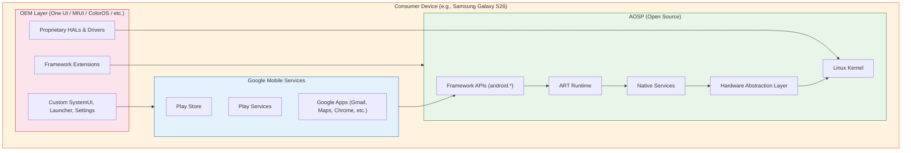

**本书的关键认识：** 我们几乎只关注绿色层——AOSP 本身。操作系统就住在这一层
里。GMS 和 OEM 定制都构建在它之上。在你能够理解其中任何一者之前，必须先理解
AOSP。

### 1.2.5 AOSP 许可

AOSP 并非只受单一许可证约束。不同组件使用不同许可证，反映了它们各自的来源：

| 组件 | 许可证 | 理由 |
|---|---|---|
| Linux 内核 | GPLv2 | 继承自上游 Linux |
| Bionic（libc） | BSD | 避免 GPL 污染用户空间；允许专有应用 |
| 框架（Java） | Apache 2.0 | 宽松许可；允许 OEM 修改而不披露源码 |
| ART | Apache 2.0 | 与框架相同 |
| 工具链（LLVM/Clang） | Apache 2.0 附带 LLVM 例外 | 上游 LLVM 许可证 |
| 外部库 | 各种 | 每个库保留其原始许可证（MIT、BSD、LGPL 等） |
| CTS | Apache 2.0 | 允许 OEM 运行测试而无许可证方面的顾虑 |
| SELinux 策略 | 公有领域 | 派生自上游 SELinux |

为 Bionic 刻意选择 BSD（而非 glibc 的 LGPL）是一项根本性决策。它使得专有应
用和专有 HAL 实现可以合法、安全地链接 Android 的 C 库。这种链接不会触发
copyleft 义务。这一决策正是移动生态能够采纳 Android，同时又保留专有驱动和专
有应用的原因之一。

---

## 1.3 AOSP 的层叠架构：系统架构

Android 的架构是一个分层堆栈，其中每一层都为上一层提供服务，并消费下一层的
服务。从事 AOSP 工作最重要的概念基础，就是了解这个堆栈。它涵盖了什么内容位于
哪里、什么与什么通信，以及通过何种机制通信。

### 1.3.1 完整架构

```mermaid
graph TB
    subgraph Applications["Layer 7: Applications"]
        SystemApps["System Apps<br/>(SystemUI, Launcher3, Settings,<br/>Contacts, Dialer, Camera2)"]
        UserApps["User Apps<br/>(Third-party APKs)"]
    end

    subgraph FrameworkAPI["Layer 6: Framework APIs"]
        AndroidAPI["android.* packages<br/>(app, content, view, widget,<br/>media, location, telephony,<br/>net, os, graphics, ...)"]
    end

    subgraph FrameworkServices["Layer 5: Framework Services (system_server)"]
        AMS["ActivityManager<br/>Service"]
        WMS["WindowManager<br/>Service"]
        PMS["PackageManager<br/>Service"]
        PKMS["PowerManager<br/>Service"]
        IMS_FW["InputMethod<br/>ManagerService"]
        NMS["Notification<br/>ManagerService"]
        CMS["ConnectivityService"]
        TMS["TelephonyRegistry"]
        Others["60+ more<br/>services"]
    end

    subgraph ART_Layer["Layer 4: Android Runtime"]
        ART["ART<br/>(AOT + JIT + Interpreter)"]
        CoreLibs["Core Libraries<br/>(libcore: java.*, javax.*,<br/>org.apache.*, android.icu.*)"]
        Zygote["Zygote Process<br/>(App process factory)"]
    end

    subgraph NativeLayer["Layer 3: Native Services & Libraries"]
        SF["SurfaceFlinger"]
        AF["AudioFlinger"]
        IF["InputFlinger"]
        MC["MediaCodec /<br/>MediaPlayerService"]
        CamSvc["CameraService"]
        SenSvc["SensorService"]
        NativeBinder["libbinder /<br/>libbinder_ndk"]
        Bionic_Lib["Bionic<br/>(libc, libm, libdl)"]
    end

    subgraph HAL_Layer["Layer 2: Hardware Abstraction Layer"]
        HIDL_HALs["HIDL HALs<br/>(Legacy: camera, audio,<br/>sensors, graphics)"]
        AIDL_HALs["AIDL HALs<br/>(Modern: power, vibrator,<br/>health, light)"]
        HWBinder["hwbinder /<br/>vndbinder"]
    end

    subgraph Kernel_Layer["Layer 1: Linux Kernel"]
        Drivers["Device Drivers<br/>(GPU, Camera, Touch,<br/>Modem, Sensors)"]
        Binder_Driver["Binder Driver<br/>(/dev/binder,<br/>/dev/hwbinder,<br/>/dev/vndbinder)"]
        Subsystems["Kernel Subsystems<br/>(Memory, Scheduler, Filesystems,<br/>Networking, Power)"]
        AndroidKernel["Android-specific<br/>(Binder, ashmem/memfd,<br/>ION/DMA-BUF, fuse)"]
    end

    Applications --> FrameworkAPI
    FrameworkAPI --> FrameworkServices
    FrameworkServices --> ART_Layer
    FrameworkServices --> NativeLayer
    ART_Layer --> NativeLayer
    NativeLayer --> HAL_Layer
    HAL_Layer --> Kernel_Layer

    style Applications fill:#fff9c4,stroke:#f9a825
    style FrameworkAPI fill:#e8f5e9,stroke:#2e7d32
    style FrameworkServices fill:#c8e6c9,stroke:#2e7d32
    style ART_Layer fill:#e3f2fd,stroke:#1565c0
    style NativeLayer fill:#e1f5fe,stroke:#0277bd
    style HAL_Layer fill:#f3e5f5,stroke:#7b1fa2
    style Kernel_Layer fill:#fce4ec,stroke:#c62828
```

让我们从下往上逐层详细考察。

### 1.3.2 第 1 层：Linux 内核

Android 运行在 Linux 内核之上。截至 Android 17，内核基于 **Linux 6.x 长期支持
（LTS）** 分支。`android17-6.18` GKI 以 Linux 6.18 为目标，高于 Android 16 的
`android16-6.12`。内核带有 Android 专用补丁，这些补丁通过 **Android 通用内核
（ACK）**和 **通用内核镜像（GKI）**计划来管理。受支持的内核分支及其生命周期
记录在 `kernel/configs/kernel-lifetimes.xml` 中，各分支的 GKI 配置片段位于
`kernel/configs/` 之下。

#### Android 专用内核特性

Android 内核并非原版 Linux。它包含若干 Android 专用子系统和驱动：

| 特性 | 用途 | 源码位置 |
|---|---|---|
| **Binder** | Android 的主要 IPC 机制。一个内核驱动，在进程间提供基于事务的通信。三个设备节点：`/dev/binder`（框架）、`/dev/hwbinder`（HAL）、`/dev/vndbinder`（厂商）。 | 内核中的 `drivers/android/binder.c` |
| **Ashmem / memfd** | 匿名共享内存。最初为 `ashmem`，现正过渡到标准 Linux 的 `memfd_create`。用于在进程间共享大数据（例如 GraphicBuffer）。 | `drivers/staging/android/`（传统） |
| **ION / DMA-BUF Heaps** | 面向硬件缓冲区（GPU、相机、显示）的内存分配器。ION 是 Android 专用的；DMA-BUF heaps 是友好的上游替代品。 | `drivers/dma-buf/` |
| **低内存杀手（Low Memory Killer）** | 在内存压力下杀死后台进程。最初是 Android 专用的（`lowmemorykiller`），现在使用用户空间的 `lmkd` 配合内核的 PSI（Pressure Stall Information）。 | 用户空间：`system/memory/lmkd/` |
| **fuse（用于存储）** | FUSE 文件系统提供作用域存储层。是应用文件访问的性能关键路径。 | 标准内核 fuse |
| **dm-verity** | 验证启动。确保系统分区未被篡改。 | `drivers/md/dm-verity*` |
| **SELinux** | 强制访问控制。Android 使用严格的 SELinux 策略来约束每一个进程。 | 策略：`system/sepolicy/` |

#### 通用内核镜像（GKI）

Google 在 Android 12 中引入了 **GKI** 架构，以解决内核碎片化问题。其思想是：

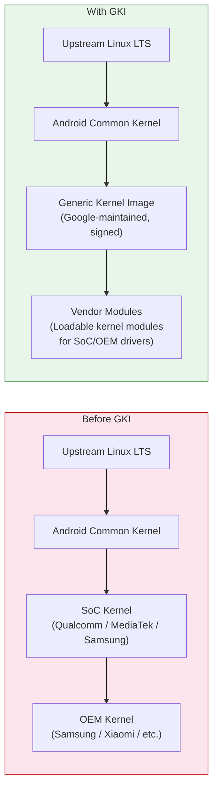

在 GKI 之前，每台设备都有一个独一无二的内核。Google 首先分叉了上游 Linux LTS
（ACK）。然后 SoC 厂商（例如高通的 `msm-kernel`）再次分叉，OEM 再分叉一次。这
造成了严重的碎片化——设备出厂时搭载的内核落后上游数年，安全补丁需要数月才能
传播开来。

GKI 提供单一、由 Google 构建的内核二进制文件，在所有使用相同 Android 版本和
内核版本的设备上通用。厂商特定的功能以**可加载内核模块（LKM）**和
**vendor_dlkm**（厂商动态加载内核模块）的形式交付，存放在独立分区上。这意味着
Google 可以独立于厂商更新内核。

在 AOSP 源码树中，与内核相关的内容位于：

- `kernel/configs/` -- GKI 内核配置片段
- `kernel/prebuilts/` -- 供开发使用的预编译内核镜像
- `kernel/tests/` -- 内核测试套件

实际的内核源码通常通过内核清单单独获取（`repo init -u https://android.googlesource.com/kernel/manifest`）。原因是它极其庞大，而且大多数
平台开发者并不需要修改它。

### 1.3.3 第 2 层：硬件抽象层（HAL）

HAL 是 Android 用户空间与硬件特定驱动之间的接口。它让 Android 无需修改框架即可
运行在各种硬件上。

#### HAL 架构演进

Android 的 HAL 架构经历了显著演进：

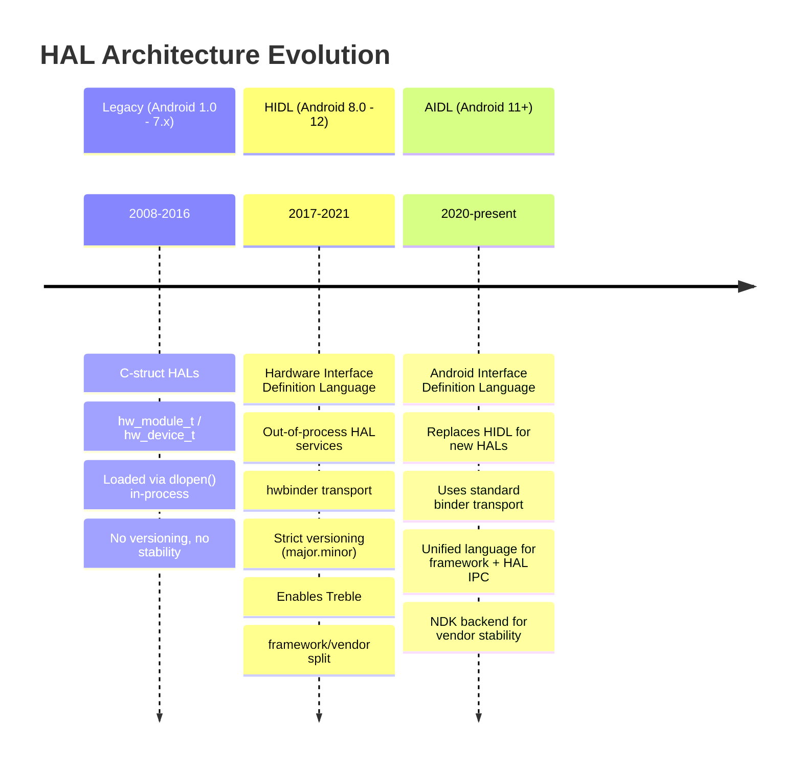

**传统 HAL**（Treble 之前）是被直接加载进调用进程的共享库。例如，相机 HAL 是
一个通过 `dlopen()` 加载进 `cameraserver` 的 `.so` 文件。这样做可以工作，但也意
味着 HAL 与框架紧密耦合——更新其中一方就必须更新另一方。

**Project Treble**（Android 8.0）引入了 **HIDL（硬件接口定义语言）**，它把
HAL 移入独立进程，通过 `hwbinder` 通信。这在框架与厂商实现之间创建了一个稳
定、带版本号的接口。它使以下事情成为可能：

- **更快的系统更新**：OEM 无需改动厂商 HAL 即可更新 Android 框架
- **通用系统镜像（GSI）**：单一系统镜像可在多台设备上工作
- **厂商测试套件（VTS）**：对 HAL 实现进行自动化测试

**稳定 AIDL**（Android 11+）如今是首选的 HAL 接口语言。它使用与多年来用于
应用到框架 IPC 相同的 AIDL，但带有一个厂商可以实现的稳定 **NDK 后端**。新的
HAL 必须用 AIDL 编写；HIDL 已被冻结，不再接受新接口。

#### HAL 接口目录

规范的 HAL 接口定义位于 `hardware/interfaces/`：

```
hardware/interfaces/
    audio/              -- Audio HAL (capture, playback, effects)
    automotive/         -- Automotive-specific HALs (vehicle, EVS)
    biometrics/         -- Fingerprint, face authentication
    bluetooth/          -- Bluetooth HAL
    boot/               -- Boot control HAL (A/B updates)
    broadcastradio/     -- FM/AM radio
    camera/             -- Camera HAL (camera2 API backend)
    cas/                -- Conditional Access System (DRM for broadcast)
    confirmationui/     -- Trusted UI confirmation
    contexthub/         -- Context Hub (always-on sensor processor)
    drm/                -- DRM plugin HAL (Widevine, etc.)
    dumpstate/          -- Bug report generation
    fastboot/           -- Fastboot HAL
    gatekeeper/         -- Password/PIN verification
    gnss/               -- GPS/GNSS location
    graphics/           -- Graphics HALs:
        allocator/      --   Gralloc (buffer allocation)
        composer/       --   HWC (hardware composer for display)
        mapper/         --   Buffer mapping
    health/             -- Battery/charging health
    identity/           -- Identity credential
    input/              -- Input classifier
    ir/                 -- Infrared (IR blaster)
    keymaster/          -- Cryptographic key management
    light/              -- LED/backlight control
    media/              -- Media codec (OMX/Codec2)
    memtrack/           -- Memory tracking
    neuralnetworks/     -- NNAPI (ML acceleration)
    nfc/                -- NFC
    power/              -- Power management, power hints
    radio/              -- Telephony radio (RIL replacement)
    secure_element/     -- Secure element access
    sensors/            -- Sensor HAL (accelerometer, gyro, etc.)
    soundtrigger/       -- Hotword detection
    thermal/            -- Thermal management
    tv/                 -- TV input framework
    usb/                -- USB HAL
    vibrator/           -- Haptic feedback
    wifi/               -- Wi-Fi HAL
    ... and more (60+ HAL interfaces total)
```

每个 HAL 接口目录都包含定义接口的 `.aidl` 或 `.hal` 文件，以及默认实现和
VTS（厂商测试套件）测试。

#### Treble 边界：VNDK 与厂商分区

Project Treble 在**系统分区**（框架，由 Google/OEM 更新）与**厂商分区**（HAL/
驱动，由 SoC 厂商更新）之间建立了一条硬边界：

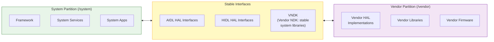

**VNDK（厂商 NDK）**是允许厂商代码链接的系统库集合。厂商代码不能链接任意的
系统库——只能链接 VNDK 中的那些。这一点在构建时和运行时通过**链接器命名空间**
（配置于 `system/linkerconfig/`）强制执行。

### 1.3.4 第 3 层：原生服务与库

在内核和 HAL 之上，是一层丰富的原生（C/C++）服务和库。它们是系统的主力——
负责显示合成、音频混音、输入分发、媒体播放等等。

#### 核心原生服务

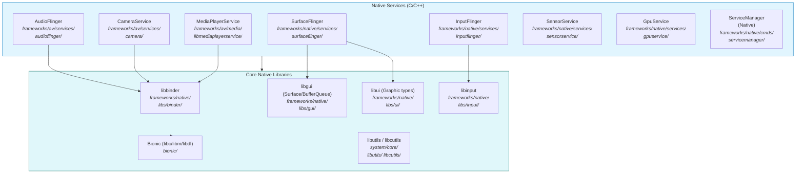

让我们考察最重要的几个原生服务：

**SurfaceFlinger**（`frameworks/native/services/surfaceflinger/`）是显示合成
器。SurfaceFlinger 合成你在 Android 设备上看到的每一帧画面。它接收来自应用窗
口的缓冲区（通过 `BufferQueue` 机制）。它把这些缓冲区与 GPU（客户端合成）或显
示硬件（通过 HWC HAL 的硬件合成）一起合成。然后把最终帧发送给显示设备。
SurfaceFlinger 管理多个显示设备，处理 VSYNC 时序，并与 system_server 中的
WindowManagerService 协作处理窗口布局与可见性。

**AudioFlinger**（`frameworks/av/services/audioflinger/`）是音频混音器和路由
器。它接收来自应用和系统服务的音频数据。它按照音频流类型（音乐、通知、闹钟、
语音通话）混合多个音频流，并施加音效。然后把混合后的音频通过 Audio HAL 路由
到合适的输出设备。它负责采样率转换、声道映射和延迟管理。

**InputFlinger**（`frameworks/native/services/inputflinger/`）从内核的
`/dev/input/` 设备（触摸、键盘、鼠标、手柄）读取原始输入事件，对其进行分类，
并分发到正确的窗口。**InputDispatcher** 组件维护窗口到输入通道的映射。它确保
触摸事件到达触摸点下方的窗口，键盘事件到达获得焦点的窗口。它还确保系统手势
（返回、主屏、最近应用）在到达应用之前被拦截。

**CameraService**（`frameworks/av/services/camera/`）在 Camera2 API（供应用
使用）与 Camera HAL（由厂商实现）之间斡旋。它管理相机设备的生命周期、请求处
理和流管理。

**MediaPlayerService / MediaCodecService**（`frameworks/av/`）提供媒体播
放和编码。Codec2 框架（最初的 OMX/Stagefright 架构的继任者）为视频和音频管理
硬件与软件编解码器。

**ServiceManager**（`frameworks/native/cmds/servicemanager/`）是原生 Binder
服务注册表。每个想要通过 Binder 被访问的系统服务都会向 ServiceManager 注册自
己。客户端按名称查找服务。实际上存在三个 ServiceManager：一个用于框架 binder
（`/dev/binder`），一个用于 HW binder（`/dev/hwbinder`，由
`hwservicemanager` 管理），第三个用于厂商 binder（`/dev/vndbinder`，由
`vndservicemanager` 管理）。

#### Bionic：Android 的 C 库

Bionic（`bionic/`）是 Android 定制的 C 库。它*不是* glibc。Bionic 是从零编写
的，并吸收了 BSD 的代码。它有这些特定目标：

1. **体积小**：移动设备内存有限。Bionic 显著小于 glibc。
2. **启动快**：`dlopen()`、`pthread_create()` 以及其他常见操作都针对移动工作
   负载进行了优化。
3. **BSD 许可证**：避开 LGPL——后者会要求 OEM 为用户提供替换 C 库的途径。
4. **Android 专用特性**：属性系统（`__system_property_get`）、Android 日志
   （`__android_log_print`）、Binder 支持。

Bionic 包括：

- `bionic/libc/` -- C 库本体
- `bionic/libm/` -- 数学库
- `bionic/libdl/` -- 动态链接库
- `bionic/linker/` -- 动态链接器（`/system/bin/linker64`），负责加载共享库并
  在运行时解析符号

`bionic/linker/` 中的动态链接器尤为重要，因为它实现了**链接器命名空间**隔
离，正是这一机制强制执行 Treble 边界。不同的命名空间（default、sphal、vndk、
rs）控制哪些库对哪些进程可见，从而确保厂商代码无法访问不稳定的系统库。

### 1.3.5 第 4 层：Android 运行时（ART）

Android 运行时（`art/`）执行应用程序字节码。ART 在 Android 5.0（Lollipop）
中取代 Dalvik 成为默认运行时。

#### ART 编译流水线

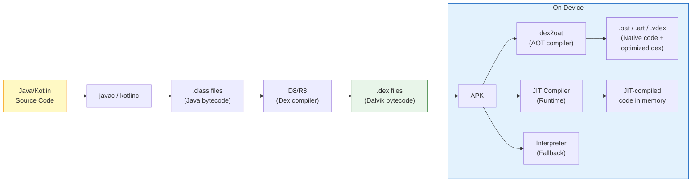

ART 采用**多层编译策略**：

1. **解释器（Interpreter）**：逐条指令执行字节码。速度最慢，但始终可用。用于
   调试以及很少执行的代码。

2. **JIT（即时）编译器**：在运行时把热点方法编译成原生代码。JIT 会对代码执行
   进行性能剖析，并把剖析数据保存到磁盘。

3. **AOT（提前）编译器**（`dex2oat`）：利用 JIT 剖析数据，在空闲时间或安装时
   把常用方法预先编译成原生代码。这就是 Android 7.0 引入的**基于剖析的优化
   （PGO）**方法。

4. **云端剖析（Cloud Profiles）**（Android 9+）：Google Play 分发从其他用户
   收集的聚合剖析数据。安装应用时，`dex2oat` 可以使用云端剖析数据，在你甚至还
   没有运行应用之前就把最常用的方法编译好。

`art/` 中的 ART 源码树包含：

- `art/runtime/` -- 运行时本体（GC、类加载、JNI、线程）
- `art/compiler/` -- JIT 和 AOT 编译器
- `art/dex2oat/` -- AOT 编译工具
- `art/libartbase/` -- 基础工具
- `art/libdexfile/` -- DEX 文件解析
- `art/libnativebridge/` -- 在 x86 上运行 ARM 应用的原生桥（用于
  Berberis/Houdini 翻译）
- `art/libnativeloader/` -- 带命名空间隔离的库加载
- `art/odrefresh/` -- ART 模块产物的端上刷新
- `art/openjdkjvm/` -- JVM 接口实现
- `art/openjdkjvmti/` -- JVMTI（调试/剖析）接口
- `art/profman/` -- 用于 PGO 的剖析管理器
- `art/imgdiag/` -- 启动镜像诊断

#### Zygote：进程工厂

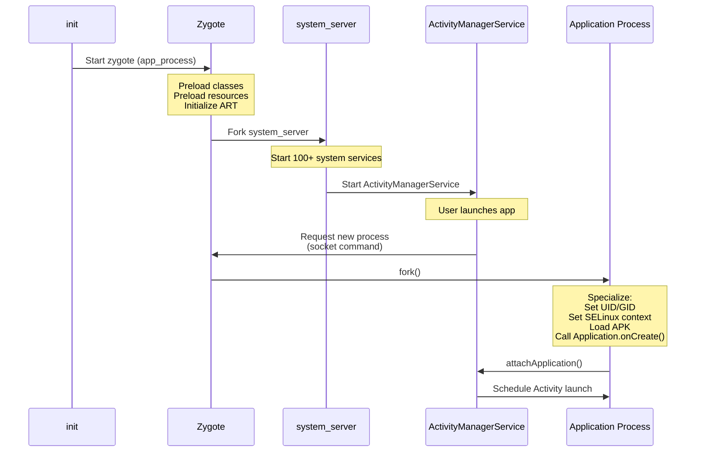

**Zygote**（`frameworks/base/cmds/app_process/` 和 `system/zygote/`）是
Android 最重要的架构创新之一。它是每个应用进程和 `system_server` 的父进程。

当 Android 启动时：

1. `init` 进程启动 `zygote`（准确地说，是 `app_process64` 二进制文件）
2. Zygote 初始化 ART 运行时
3. Zygote **预加载**所有应用都会用到的数千个 Java 类和资源
4. Zygote 进入循环，在一个 Unix 域套接字上监听命令

当需要一个新的应用进程时：

1. `ActivityManagerService` 向 Zygote 的套接字发送命令
2. Zygote 调用 `fork()` 创建一个子进程
3. 子进程通过**写时复制**的内存共享继承所有预加载的类和资源
4. 子进程完成特化（specialize）：设置自己的 UID、GID、SELinux 上下文，加载
   应用的 APK，并开始执行

这种基于 fork 的架构正是 Android 应用启动速度快的原因。如果没有 Zygote，每
个应用都需要从零启动一个新的 ART 实例，加载并验证数千个类，解析框架资源。这
个过程需要数秒时间。有了 Zygote，`fork()` 只需几毫秒，而且共享的内存页意味着
更少的物理内存消耗。

### 1.3.6 第 5 层：框架服务（system_server）

`system_server` 进程是 Android 框架的核心。它是 Zygote fork 出的第一个进程，
承载着**超过 100 个系统服务**，共同管理用户体验的方方面面。

#### system_server 服务目录

`system_server` 中的服务在源码树中组织于
`frameworks/base/services/core/java/com/android/server/` 之下。该目录包含超过
100 个子目录：

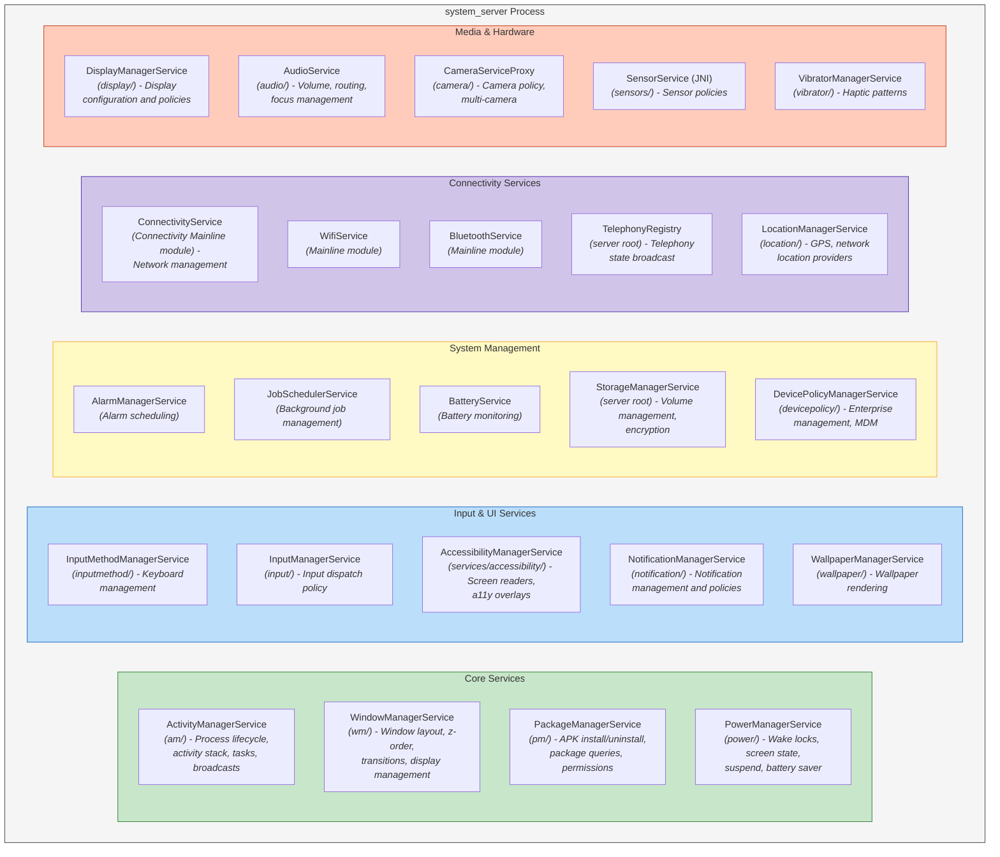

以下是 `frameworks/base/services/core/java/com/android/server/` 中服务子目录
的更完整列表：

| 目录 | 服务 | 职责 |
|---|---|---|
| `am/` | ActivityManagerService | 进程生命周期、Activity 栈、任务、最近应用、广播、内容提供者、OOM 调节 |
| `wm/` | WindowManagerService、ActivityTaskManagerService | 窗口层级、z 序、输入焦点、显示布局、过渡、旋转；任务与 Activity 管理（ATMS 从 AMS 拆分，与 WMS 同住于此） |
| `pm/` | PackageManagerService | APK 安装、卸载、包解析、权限管理、Intent 解析 |
| `power/` | PowerManagerService | 唤醒锁、屏幕开关、打盹/空闲模式、省电模式、挂起 |
| `display/` | DisplayManagerService | 显示生命周期、亮度、色彩模式、显示策略 |
| `input/` | InputManagerService | 输入设备管理、按键映射、输入分发策略 |
| `inputmethod/` | InputMethodManagerService | 软键盘管理、IME 切换 |
| `notification/` | NotificationManagerService | 通知投递、排名、策略、勿扰 |
| `audio/` | AudioService | 音量控制、音频路由、音频焦点、音效 |
| `connectivity/` | Vpn、PacProxyService | VPN 实现（`Vpn.java`）、PAC 代理、连接指标；ConnectivityService 本身来自 Connectivity Mainline 模块（`packages/modules/Connectivity/service/src/com/android/server/ConnectivityService.java`） |
| `location/` | LocationManagerService | 位置提供者、地理围栏、GNSS 管理 |
| `camera/` | CameraServiceProxy | 相机访问策略、多相机协调 |
| `storage/` | DeviceStorageMonitorService、DiskStatsLoggingService | 低存储监控、磁盘统计日志、存储会话辅助；StorageManagerService（卷管理、加密、采用）位于 server 包根目录，不在此子目录中 |
| `content/` | ContentService | 内容观察者通知、同步管理 |
| `accounts/` | AccountManagerService | 账户管理、身份验证令牌 |
| `clipboard/` | ClipboardService | 系统剪贴板 |
| `accessibility/` | AccessibilityManagerService | 无障碍事件分发、a11y 服务；该服务本身位于 `frameworks/base/services/accessibility/`，此子目录只存放小型辅助类 |
| `app/` | GameManagerService | 游戏模式选择、游戏服务提供者、游戏会话 |
| `backup/` | SystemBackupAgent | 系统备份代理和各子系统备份辅助类；BackupManagerService 本身（应用备份与恢复）位于 `frameworks/base/services/backup/` |
| `biometrics/` | BiometricService | 指纹、人脸、虹膜身份验证 |
| `companion/` | VirtualDeviceManagerInternal | 仅虚拟设备伴随内部实现；CompanionDeviceManagerService 本身（配对设备管理——手表等）位于 `frameworks/base/services/companion/` |
| `dreams/` | DreamManagerService | 屏幕保护（Daydream）管理 |
| `hdmi/` | HdmiControlService | HDMI-CEC 控制 |
| `incident/` | IncidentCompanionService | 原生 `incidentd` 守护进程产生的事件报告的用户批准流程 |
| `integrity/` | AppIntegrityManagerService | APK 完整性验证 |
| `lights/` | LightsService | LED 与背光控制 |
| `locksettings/` | LockSettingsService | PIN、图案、密码管理 |
| `media/` | MediaSessionService | 媒体会话管理、传输控制 |
| `net/` | NetworkManagementService | 底层网络配置（iptables、路由） |
| `om/` | OverlayManagerService | 运行时资源叠加层（主题） |
| `people/` | PeopleServiceInternal | 仅声明本地 `PeopleServiceInternal` 接口；PeopleService 本身（会话、快捷方式、人员相关功能）位于 `frameworks/base/services/people/` |
| `permission/` | PermissionManagerLocal | 本地与 BPF 权限辅助类；PermissionManagerService 本身（运行时权限授予与策略）位于 `pm/permission/` |
| `policy/` | PhoneWindowManager | 硬件按键处理、系统手势策略 |
| `role/` | RoleServicePlatformHelper | 默认应用角色（浏览器、电话、短信）的平台辅助类；真正的 RoleService 来自 Permission Mainline 模块（`packages/modules/Permission/service/java/com/android/role/RoleService.java`） |
| `search/` | SearchManagerService | 搜索框架 |
| `security/` | AttestationVerificationManagerService、FileIntegrityService、KeyChainSystemService | 密钥证明验证、文件完整性、KeyChain、远程密钥配置（SecurityStateManagerService 位于 server 包根目录） |
| `selinux/` | SelinuxAuditLogsService | SELinux 审计日志的限速收集与上报（策略本身位于 `system/sepolicy/`） |
| `slice/` | SliceManagerService | Slice 内容（应用内容预览） |
| `statusbar/` | StatusBarManagerService | 状态栏图标与通知栏（shade）协调 |
| `trust/` | TrustManagerService | 信任代理（Smart Lock） |
| `tv/` | TvInputManagerService | TV 输入框架 |
| `uri/` | UriGrantsManagerService | URI 权限授予 |
| `vibrator/` | VibratorManagerService | 触觉反馈模式 |
| `wallpaper/` | WallpaperManagerService | 壁纸渲染与管理 |
| `webkit/` | WebViewUpdateService | WebView 包管理 |

而且这并非全部——子目录总数超过 100 个。每个服务都通过 Binder IPC 与应用
及其他服务通信，并通过 AIDL 定义的接口暴露其功能。也并非每个系统服务都住在
这棵目录树之下：例如 TelecomService 来自
`packages/services/Telecomm/`，在 `frameworks/base/services/telecom/` 下只有一
个薄薄的构建垫片。

#### system_server 启动

当 `system_server` 启动时（由 Zygote fork 而来），它按照
`SystemServer.java`
（`frameworks/base/services/java/com/android/server/SystemServer.java`）中定义
的特定顺序初始化服务：

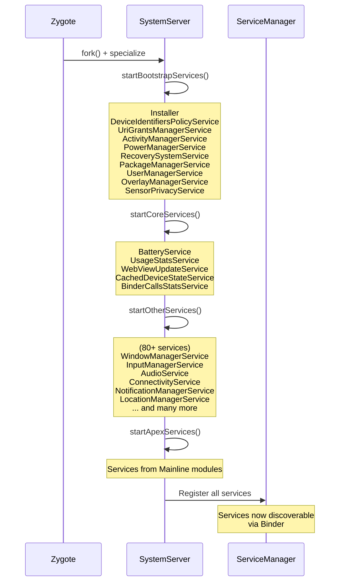

服务分四个阶段启动：

1. **引导服务（Bootstrap services）**——系统运行所需的绝对最低限度（AMS、
   PMS、PowerManager）
2. **核心服务（Core services）**——重要但不属于引导关键路径（Battery、
   UsageStats）
3. **其他服务（Other services）**——其余的一切（Window、Input、Audio、
   Connectivity、Notification、Location 等）
4. **APEX 服务**——来自 Mainline 模块的服务

### 1.3.7 第 6 层：框架 API

框架 API 层（`frameworks/base/core/java/android/`）是应用开发者直接交互的层。
它是 Android 平台的公共表面，在 developer.android.com 上有文档，并按 API 级别
进行版本管理。

`android.*` 包层次包含大约 50 个顶级包：

| 包 | 用途 |
|---|---|
| `android.app` | Activity、Service、Application、Fragment、Notification、Dialog |
| `android.content` | ContentProvider、ContentResolver、Intent、Context、SharedPreferences |
| `android.view` | View、ViewGroup、Window、MotionEvent、KeyEvent、Surface |
| `android.widget` | TextView、Button、RecyclerView、ImageView 以及所有标准控件 |
| `android.os` | Binder、Handler、Looper、Bundle、Parcel、Process、SystemClock |
| `android.graphics` | Canvas、Paint、Bitmap、drawable.*、animation.* |
| `android.media` | MediaPlayer、MediaRecorder、AudioTrack、AudioRecord、MediaCodec |
| `android.net` | ConnectivityManager、NetworkInfo、Uri、wifi.* |
| `android.telephony` | TelephonyManager、SmsManager、PhoneStateListener |
| `android.location` | LocationManager、LocationListener、Geocoder |
| `android.hardware` | Camera2 API、SensorManager、usb.*、biometrics.* |
| `android.database` | SQLite 包装器、Cursor、ContentValues |
| `android.provider` | Contacts、MediaStore、Settings、CallLog |
| `android.security` | KeyStore、KeyChain |
| `android.accounts` | AccountManager |
| `android.animation` | ValueAnimator、ObjectAnimator、AnimatorSet |
| `android.transition` | Scene、Transition 框架 |
| `android.speech` | 语音识别、文本转语音 |
| `android.print` | 打印框架 |
| `android.service` | 各种服务类型的抽象基类 |
| `android.permission` | 权限相关 API |
| `android.util` | Log、TypedValue、SparseArray、ArrayMap |
| `android.text` | Spannable、TextWatcher、Html、Editable |
| `android.webkit` | WebView、WebSettings、WebChromeClient |

这些包中的每一个都包含本质上是 Binder 客户端代理的类。当你调用
`startActivity()` 时，`Activity` 类（位于 `android.app`）会逐层调用到
`ActivityTaskManager`。该类再调用到 `IActivityTaskManager.Stub.Proxy`。代理
向 `system_server` 中的 `ActivityTaskManagerService` 发起一次 Binder 事务。
这种模式——**包装 Binder IPC、指向服务端实现的客户端代理**——在整个 Android
框架中是普适的。

### 1.3.8 第 7 层：应用

在技术栈的顶端是应用——既包括随操作系统发布的系统应用，也包括用户安装的应用。

#### AOSP 中的系统应用

AOSP 在 `packages/apps/` 中附带了一套相当庞大的系统应用：

| 应用 | 目录 | 描述 |
|---|---|---|
| **SystemUI** | `frameworks/base/packages/SystemUI/` | 状态栏、通知栏（shade）、快速设置、锁屏、音量对话框、电源菜单、最近应用、画中画 |
| **Launcher3** | `packages/apps/Launcher3/` | 主屏幕、应用抽屉、小部件、工作区 |
| **Settings** | `packages/apps/Settings/` | 系统设置应用 |
| **Contacts** | `packages/apps/Contacts/` | 联系人管理 |
| **Dialer** | `packages/apps/Dialer/` | 电话拨号器和通话管理 |
| **Camera2** | `packages/apps/Camera2/` | 相机应用 |
| **Calendar** | `packages/apps/Calendar/` | 日历应用 |
| **Messaging** | `packages/apps/Messaging/` | SMS/MMS 消息 |
| **DeskClock** | `packages/apps/DeskClock/` | 时钟、闹钟、计时器、秒表 |
| **Music** | `packages/apps/Music/` | 基础音乐播放器 |
| **Gallery2** | `packages/apps/Gallery2/` | 图库 |
| **DocumentsUI** | `packages/apps/DocumentsUI/` | 文件管理器（存储访问框架 UI） |
| **Browser2** | `packages/apps/Browser2/` | 基于 WebView 的浏览器 |
| **KeyChain** | `packages/apps/KeyChain/` | 证书管理 |
| **CertInstaller** | `packages/apps/CertInstaller/` | 证书安装 |
| **ManagedProvisioning** | `packages/apps/ManagedProvisioning/` | 企业设备配置（工作资料） |
| **Stk** | `packages/apps/Stk/` | SIM 工具包 |
| **StorageManager** | `packages/apps/StorageManager/` | 存储管理 |
| **ThemePicker** | `packages/apps/ThemePicker/` | Material You 主题定制 |
| **Traceur** | `packages/apps/Traceur/` | 系统跟踪（开发者工具） |
| **WallpaperPicker2** | `packages/apps/WallpaperPicker2/` | 壁纸选择 |
| **TV** | `packages/apps/TV/` | Android TV 启动器和电子节目单（EPG） |

SystemUI 值得特别提及，因为它不是一个典型的应用。它是一个拥有系统特权的进
程，提供核心用户界面外壳（chrome）。这一外壳包括状态栏、通知栏、快速设置面
板、锁屏和音量对话框。它还包括电源菜单、画中画控件、最近应用界面（在某些配
置上）等等。它运行在自己的进程（`com.android.systemui`）中，拥有提升的权限，
并与 `WindowManagerService` 及其他系统服务深度集成。

#### 内容提供者

AOSP 还在 `packages/providers/` 中附带了系统内容提供者：

| 提供者 | 描述 |
|---|---|
| `ContactsProvider` | 联系人数据库（contacts2.db） |
| `MediaProvider` | 媒体数据库（图片、视频、音频）和作用域存储 |
| `CalendarProvider` | 日历事件和提醒 |
| `TelephonyProvider` | SMS/MMS 消息、运营商配置 |
| `DownloadProvider` | 系统下载管理器 |
| `SettingsProvider` | 系统、安全和全局设置（实际位于 `frameworks/base/packages/SettingsProvider/`，而非 `packages/providers/`） |
| `BlockedNumberProvider` | 被拦截的电话号码 |
| `UserDictionaryProvider` | 自定义键盘词典 |
| `BookmarkProvider` | 浏览器书签（遗留） |

---

## 1.4 仓库结构：完整指南

AOSP 源码树非常庞大。一次完整的检出，包括预构建工具链和所有默认仓库，可能超过
300 GB。为了高效地在代码库中导航，你必须理解顶层目录结构。

源码由 `repo` 管理——这是一个构建在 Git 之上的工具。`.repo/manifest.xml` 文件
定义了完整的 Git 仓库集合以及它们的检出位置。一次典型的 AOSP 检出包含超过 1,000
个独立的 Git 仓库，每个仓库映射到源码树中的一个子目录。

### 1.4.1 目录地图

下面是 AOSP 源码树顶层目录的完整列表。对每个目录，它给出其用途、大致的体积占
比，以及对不同类型开发者的重要性。

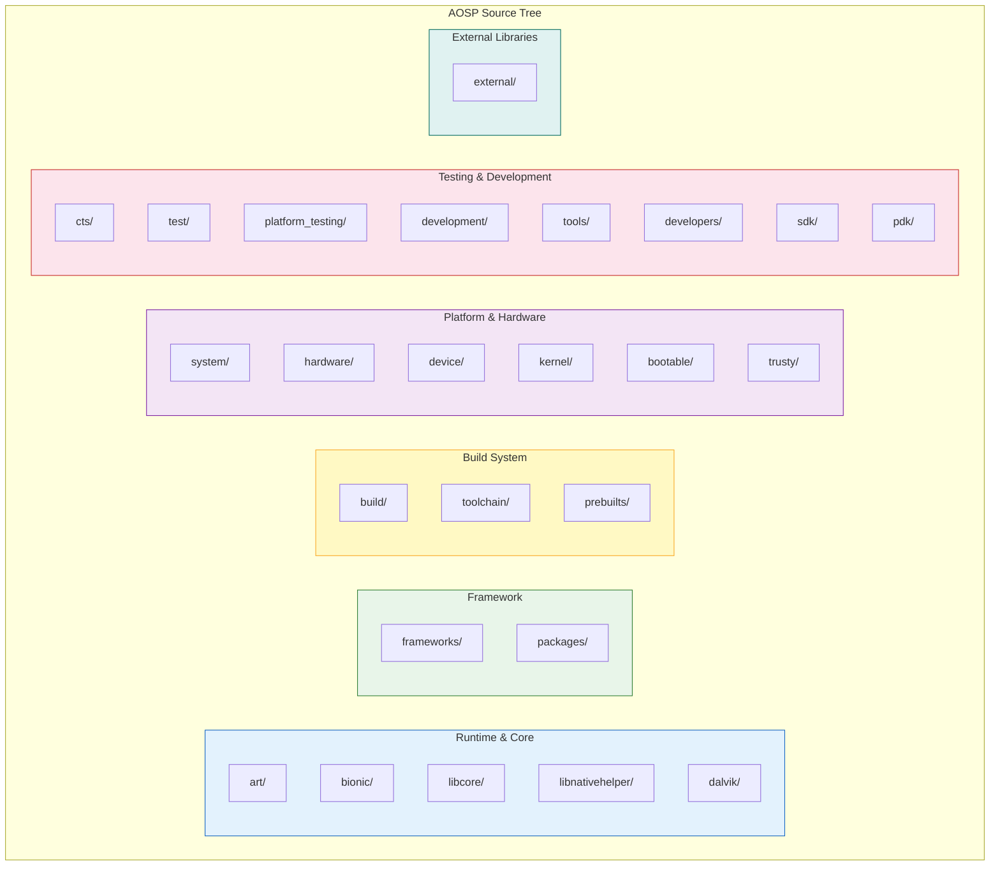

### 1.4.2 运行时与核心库

#### `art/` -- Android 运行时

Android 运行时是执行所有 Java/Kotlin 应用代码和框架代码的虚拟机。

```
art/
    runtime/          -- Core runtime: GC, class linker, JNI, threads, monitors
    compiler/         -- Optimizing compiler (for JIT and AOT)
    dex2oat/          -- Ahead-of-time compilation tool
    libdexfile/       -- DEX file format parser and verifier
    libartbase/       -- Base utilities shared across ART components
    libartservice/    -- ART service (manages compilation on device)
    libarttools/      -- Tools library
    libartpalette/    -- Platform abstraction layer
    libnativebridge/  -- Native bridge (for ISA translation, e.g., ARM on x86)
    libnativeloader/  -- Library loading with namespace isolation
    odrefresh/        -- On-device refresh of boot image artifacts
    openjdkjvm/       -- OpenJDK JVM_* interface implementation (used by libcore)
    openjdkjvmti/     -- JVMTI implementation (for debuggers/profilers)
    profman/          -- Profile manager (processes JIT profiles for PGO)
    imgdiag/          -- Boot image diagnostics
    dexdump/          -- DEX file disassembler
    dexlist/          -- DEX file lister
    oatdump/          -- OAT file disassembler
    dalvikvm/         -- ART entry point (dalvikvm command)
    adbconnection/    -- ADB-based debugging connection
    sigchainlib/      -- Signal chain management (for native signal handlers)
    perfetto_hprof/   -- Heap profiling via Perfetto
    test/             -- Extensive test suite (thousands of tests)
    benchmark/        -- Performance benchmarks
    tools/            -- Development utilities
    build/            -- Build configuration
```

**谁关心这个目录：** 运行时工程师、垃圾回收研究人员、JIT/AOT 编译器开发者，
以及任何调试类加载或 JNI 问题的人。

#### `bionic/` -- Android 的 C 库

Bionic 是 Android 的 C 库、数学库和动态链接器。

```
bionic/
    libc/             -- C library implementation
        arch-arm/     --   ARM-specific assembly (memcpy, strcmp, etc.)
        arch-arm64/   --   ARM64-specific assembly
        arch-riscv64/ --   RISC-V 64-bit assembly
        arch-x86/     --   x86-specific assembly
        arch-x86_64/  --   x86_64-specific assembly
        bionic/       --   Core C library sources (pthread, malloc, stdio, etc.)
        dns/          --   DNS resolver
        include/      --   C library headers
        kernel/       --   Kernel header wrappers (auto-generated from kernel)
        memory/       --   malloc_debug, malloc_hooks, and allocator tooling
        stdio/        --   Standard I/O implementation
        system_properties/ -- Android property system client
        upstream-*    --   Code imported from OpenBSD, FreeBSD, NetBSD
                      --   (e.g. getopt_long, glob, drand48, regex, gdtoa;
                      --   generic routines such as qsort/bsearch now come
                      --   from external/llvm-libc, and optimized
                      --   string/memory routines are per-architecture
                      --   under arch-*/string/)
    libm/             -- Math library (sin, cos, sqrt, etc.)
    libdl/            -- Dynamic loading library (dlopen, dlsym)
    libstdc++/        -- Minimal C++ standard library (full C++ is libc++)
    linker/           -- Dynamic linker (/system/bin/linker64)
    tests/            -- Test suite
    benchmarks/       -- Performance benchmarks
    tools/            -- Maintenance tools (header generation, symbol checking)
    apex/             -- APEX module configuration
    docs/             -- Documentation
```

**谁关心这个目录：** 在 C 层面工作的原生开发者，任何调试内存问题
（malloc_debug）、链接器/加载器问题或架构特定行为的人。`linker/` 子目录对于理
解命名空间隔离和 Treble 厂商边界至关重要。

#### `libcore/` -- Java 核心库

Android 的 Java 标准库实现。

```
libcore/
    dalvik/           -- Dalvik-specific classes (system, bytecode)
    dom/              -- DOM XML implementation
    harmony-tests/    -- Apache Harmony compatibility tests
    json/             -- org.json (JSON parsing)
    luni/             -- Main library: java.*, javax.*, sun.misc.*
    mmodules/         -- Mainline module boundaries
    ojluni/           -- OpenJDK-derived code (java.util, java.io, etc.)
    xml/              -- XML parsing (SAX, XPath)
```

这些提供了 `java.lang`、`java.util`、`java.io`、`java.net`、`java.nio`、
`java.security`、`java.sql`、`javax.crypto` 以及其他标准 Java API。与标准 JDK
不同，Android 的实现经过了大幅修改。它使用 Bionic 而不是 glibc，使用
`android.icu` 而不是部分 `java.text` 功能。它还带有 Android 专用的安全提供
者。

**谁关心这个目录：** 任何调试 Android 上 Java 标准库行为的人，或从事 ART
Mainline 模块工作的人。

#### `libnativehelper/` -- JNI 辅助库

简化 JNI（Java 原生接口）编码的工具库：

```
libnativehelper/
    header_only_include/  -- Header-only JNI helpers
    include/              -- Public headers
    include_jni/          -- JNI specification headers (jni.h)
    tests/                -- Tests
```

提供 `JNIHelp.h`，其中包含 `jniRegisterNativeMethods()`、
`jniThrowException()` 和 `jniCreateString()` 等函数，减少了整个平台 JNI 代码
中的样板代码。

#### `dalvik/` -- 遗留 Dalvik VM（主要是历史资料）

```
dalvik/
    dexgen/           -- DEX file generation utilities
    docs/             -- Historical documentation
    dx/               -- Original dx tool (DEX compiler, replaced by D8)
    opcode-gen/       -- Opcode definition generation
    tools/            -- Utilities
```

Dalvik VM 本身在 Android 5.0 中被 ART 取代时已被移除。该目录现在主要包含工具、
遗留的 `dx` 编译器（在构建系统中已被 D8/R8 取代），以及其他工具使用的指令码定
义。

### 1.4.3 框架

#### `frameworks/` -- Android 框架

这是 AOSP 中最大、最重要的目录。它包含整个 Android 应用框架、原生服务、系统库
和系统组件。

```
frameworks/
    base/                 -- The core framework (MASSIVE: ~15M lines, ~10M of Java/Kotlin/C++)
        core/             --   Core API classes (android.* packages)
            java/         --     Java source for framework APIs
            jni/          --     JNI bridge implementations
            res/          --     Framework resources (layouts, drawables, strings)
            proto/        --     Protobuf definitions
        services/         --   system_server services
            core/         --     Core services (AMS, WMS, PMS, 100+ more)
            java/         --     SystemServer.java entry point
            companion/    --     Companion device services
            appfunctions/ --     App functions service
            devicepolicy/ --     Device administration
            contentcapture/ --   Content capture service
            credentials/  --     Credentials manager service
            incremental/  --     Incremental file system service
            midi/         --     MIDI service
            net/          --     Network services
            people/       --     People/conversation services
            permission/   --     Permission service
            print/        --     Print service
            restrictions/ --     App restrictions
            texttospeech/ --     TTS service
            translation/  --     Translation service
            usage/        --     Usage stats service
            usb/          --     USB service
            voiceinteraction/ -- Voice interaction service
            wifi/         --     WiFi service
        packages/         --   Framework-internal applications
            SystemUI/     --     Status bar, notification shade, lock screen
            SettingsLib/  --     Shared settings library
            SettingsProvider/ --  Settings content provider
            Shell/        --     ADB shell utilities
            CompanionDeviceManager/ -- Companion device pairing
            FusedLocation/ --    Fused location provider
            PrintSpooler/ --     Print spooler service
            MtpDocumentsProvider/ -- MTP file access
            CredentialManager/ -- Credential management UI
        graphics/         --   Graphics classes (Canvas, Paint, etc.)
        libs/             --   Framework libraries
            hwui/         --     Hardware-accelerated 2D rendering (Skia/HWUI)
            androidfw/    --     Asset manager, resource system
            input/        --     Input framework library
            WindowManager/ --    WindowManager library
        media/            --   Media framework Java classes
        location/         --   Location framework Java classes
        telecomm/         --   Telecom framework Java classes
        wifi/             --   WiFi framework Java classes
        cmds/             --   Command-line tools
            app_process/  --     Zygote entry point
            am/           --     Activity Manager CLI (am start, am broadcast)
            pm/           --     Package Manager CLI (pm install, pm list)
            wm/           --     Window Manager CLI (wm size, wm density)
            input/        --     Input CLI (input tap, input text)
            svc/          --     Service control CLI
            settings/     --     Settings CLI (settings put, settings get)
            bootanimation/ --    Boot animation player
            idmap2/       --     Resource overlay compiler
        test-runner/      --   AndroidJUnitRunner
        tools/            --   Build and analysis tools
            aapt2/        --     Android Asset Packaging Tool 2
            lint/         --     Lint rules

    native/               -- Native framework (C/C++)
        services/
            surfaceflinger/  -- Display compositor
            inputflinger/    -- Input event processing
            sensorservice/   -- Sensor event processing
            audiomanager/    -- Native IAudioManager binder client (for the Java AudioService)
            gpuservice/      -- GPU management
            batteryservice/  -- Battery state
            powermanager/    -- Power HAL client
            vibratorservice/ -- Vibrator service
            stats/           -- android.frameworks.stats (IStats) AIDL service
                             --   (statsd itself is the packages/modules/StatsD module)
        libs/
            binder/          -- libbinder (Binder IPC client library)
            gui/             -- libgui (Surface, BufferQueue)
            ui/              -- libui (Graphic buffer types)
            input/           -- libinput
            sensor/          -- libsensor
            nativewindow/    -- ANativeWindow
            nativedisplay/   -- ADisplay
            renderengine/    -- GPU render engine (for SurfaceFlinger)
            permission/      -- Permission checking
            math/            -- Math utilities (vec, mat)
            ftl/             -- Functional Template Library
        cmds/
            servicemanager/  -- Binder ServiceManager daemon
            dumpsys/         -- dumpsys tool
            dumpstate/       -- Bug report generator
            cmd/             -- cmd tool (talks to services)
            atrace/          -- System trace tool
            installd/        -- Package installation daemon
            lshal/           -- HAL listing tool

    av/                   -- Audio/Video framework
        camera/           --   Camera service and client
        media/            --   Media framework
            libmediaplayerservice/ -- Media player service
            libstagefright/ --       Media codec framework
            codec2/        --        Codec2 (modern codec framework)
            libaudioclient/ --       Audio client library
            audioserver/   --        Audio server process
        services/
            camera/        --   Camera service
            audioflinger/  --   Audio mixer and router
            audiopolicy/   --   Audio routing policy
            mediametrics/  --   Media metrics
        drm/              --   DRM framework and drmserver
                          --   (libmediadrm, mediadrm)

    hardware/             -- Hardware abstraction framework layer
    compile/              -- Compilation tools
    ex/                   -- Extension libraries
    libs/                 -- Additional framework libraries
        binary_translation/ -- Berberis (native bridge / ISA translation)
        modules-utils/      -- Mainline module utilities
        native_bridge_support/ -- Native bridge support libraries
        systemui/           -- SystemUI shared libraries
        service_entitlement/ -- Carrier entitlement
    minikin/              -- Text layout engine (used by Skia/HWUI)
    multidex/             -- MultiDex support library
    opt/                  -- Optional framework components (telephony, net)
    proto_logging/        -- Protobuf-based logging
    rs/                   -- RenderScript (deprecated)
    wilhelm/              -- OpenSL ES / OpenMAX AL audio APIs
    layoutlib/            -- Layout rendering library (for Android Studio preview)
```

**谁关心这个目录：** 所有人。这就是 Android 框架。应用开发者在这里追踪 bug；系
统开发者在这里修改服务；OEM 工程师在这里定制 SystemUI、设置和服务；SoC 厂商通
过在这里定义的接口集成 HAL。

#### `packages/` -- 应用、模块、提供者和服务

```
packages/
    apps/                 -- System applications (55+)
        Launcher3/        --   Home screen and app drawer
        Settings/         --   System settings
        Camera2/          --   Camera application
        Contacts/         --   Contact management
        Dialer/           --   Phone dialer
        Calendar/         --   Calendar
        DeskClock/        --   Clocks and alarms
        Messaging/        --   SMS/MMS
        Music/            --   Music player
        Gallery2/         --   Photo gallery
        DocumentsUI/      --   File manager
        Browser2/         --   Browser
        ThemePicker/      --   Material You theming
        Traceur/          --   System tracing
        WallpaperPicker2/ --   Wallpaper selection
        ManagedProvisioning/ -- Work profile setup
        Car/              --   Android Auto apps
        TV/               --   Android TV app
        TvSettings/       --   Android TV settings
        ...

    modules/              -- Mainline modules (40+)
        Bluetooth/        --   Bluetooth stack
        Wifi/             --   WiFi stack
        Connectivity/     --   Network connectivity (includes Tethering)
        Telephony/        --   Telephony
        Telecom/          --   Telecom service
        Media/            --   Media framework components
        Permission/       --   Permission controller
        NeuralNetworks/   --   NNAPI runtime
        NpuManager/       --   NPU Manager (added in 17, Chapter 53)
        DnsResolver/      --   DNS resolution
        IPsec/            --   IPsec VPN
        Nfc/              --   NFC stack
        AdServices/       --   Advertising services
        Uwb/              --   Ultra-Wideband
        Virtualization/   --   pVM (protected VMs)
        DeviceLock/       --   Device lock service
        adb/              --   ADB daemon
        Scheduling/       --   Scheduling module
        ...

    providers/            -- Content providers
        ContactsProvider/ --   Contacts database
        MediaProvider/    --   Media files database
        CalendarProvider/ --   Calendar storage
        TelephonyProvider/ --  SMS/MMS storage
        DownloadProvider/ --   Downloads
        SettingsProvider/ --   Settings storage (in frameworks/base/)
        ...

    services/             -- Background services
        Telephony/        --   Telephony service
        Telecomm/         --   Telecom service
        Car/              --   Automotive services
        Mtp/              --   MTP (Media Transfer Protocol)
        ...

    inputmethods/         -- Input methods
    screensavers/         -- Screen savers
    wallpapers/           -- Live wallpapers
```

**谁关心这个目录：** 研究系统应用架构的应用开发者；定制预装应用的 OEM 工程师；
Mainline 模块开发者。

### 1.4.4 构建系统

#### `build/` -- 构建系统

AOSP 使用混合构建系统：**Soong**（基于 Blueprint、用 Go 编写）是主要的构建系
统，同时为尚未迁移的组件保留传统 **Make** 支持。

```
build/
    soong/            -- Soong build system (Go source)
        android/      --   Android module types
        cc/           --   C/C++ build rules
        java/         --   Java build rules
        apex/         --   APEX package build rules
        rust/         --   Rust build rules
        python/       --   Python build rules
        genrule/      --   Generic build rules
        ...
    make/             -- Legacy Make-based build system
        core/         --   Core Makefile logic
        target/       --   Target configuration
        tools/        --   Build tools (releasetools, zipalign, etc.)
        envsetup.sh   --   Environment setup (lunch, m, mm, mmm commands)
    blueprint/        -- Blueprint build file parser (Soong's frontend)
    pesto/            -- Build analysis tools
    release/          -- Release configuration
    target/           -- Target (device) build configuration
    tools/            -- Build utilities
```

AOSP 中的构建文件命名为：

- `Android.bp` -- Soong（Blueprint）构建文件（首选）
- `Android.mk` -- 传统 Make 构建文件（正在迁移到 .bp）
- `Makefile` -- 很少见，用于特殊情况

**谁关心这个目录：** 每个构建 AOSP 的人。构建系统是你接触的第一样东西，也是
构建出问题时你最后排查的东西。

#### `toolchain/` -- 编译器工具链配置

```
toolchain/
    pgo-profiles/     -- AFDO/PGO sampling profiles for platform binaries
        sampling/     --   Per-binary AFDO profiles (keystore2, libart, ...)
        kernel/       --   Kernel AFDO profiles
        scripts/      --   Profile-maintenance scripts
```

实际的编译器二进制文件（Clang/LLVM、Rust）位于 `prebuilts/`。该目录保存的是
剖析*数据*，而不是工具链配置。这些数据是从 AOSP 平台组件收集的 AFDO
（AutoFDO）采样剖析数据——`sampling/keystore2.afdo`、
`sampling/libart_arm64.afdo` 等等数十个。它还保存内核的剖析数据。构建时会把这
些数据喂给 Clang，以便针对真实世界的执行数据优化这些二进制文件中的热点路径。
`AFDO_SUMMARY.txt` 列出了每个剖析文件中排名靠前的函数，这是快速了解平台实际花
费时间在哪里的方法。

#### `prebuilts/` -- 预构建二进制文件

AOSP 树中按原始大小计算最大的目录。包含预构建的编译器工具链、SDK 以及其他在
正常 AOSP 构建期间不会从源码构建的工具。

```
prebuilts/
    clang/             -- Clang/LLVM compiler (multiple versions)
    gcc/               -- Legacy GCC compiler (for kernel, being phased out)
    go/                -- Go compiler (for Soong build system)
    jdk/               -- Java Development Kit
    build-tools/       -- aapt2, zipalign, d8, etc.
    gradle-plugin/     -- Android Gradle Plugin
    maven_repo/        -- Maven repository (AndroidX, etc.)
    sdk/               -- Android SDK platforms
    android-emulator/  -- Emulator binaries
    clang-tools/       -- Clang-based analysis tools
    cmake/             -- CMake (for NDK builds)
    cmdline-tools/     -- Android SDK command-line tools
    ktlint/            -- Kotlin linter
    manifest-merger/   -- Manifest merger tool
    bazel/             -- Bazel build tool (experimental)
    devtools/          -- Development tools
    ...
```

**谁关心这个目录：** 更新工具链的构建工程师，任何调试编译器问题的人，以及搭
建构建环境的开发者。

### 1.4.5 平台与硬件

#### `system/` -- 核心系统组件

位于内核与框架之间的低层系统组件。

```
system/
    core/                 -- Core system utilities
        init/             --   init process (PID 1, first userspace process)
        rootdir/          --   Root filesystem init.rc files
        fastboot/         --   Fastboot protocol implementation
        debuggerd/        --   Crash handler (generates tombstones)
        libcutils/        --   C utility library (properties, threads, etc.)
        libutils/         --   C++ utility library (RefBase, String, Vector)
        libsparse/        --   Sparse image handling
        healthd/          --   Battery health daemon
        bootstat/         --   Boot statistics
        storaged/         --   Storage health monitoring
        watchdogd/        --   Hardware watchdog daemon
        run-as/           --   run-as command (debuggable app access)
        sdcard/           --   FUSE-based SD card emulation (legacy)
        toolbox/          --   Small command-line utilities
        property_service/ --   Property service
        llkd/             --   Live lock daemon
        libprocessgroup/  --   Cgroup management
        trusty/           --   Trusty TEE client libraries

    sepolicy/             -- SELinux policy
        private/          --   Platform-private policy
        public/           --   Public policy (visible to vendor)
        vendor/           --   Vendor-extendable policy
        prebuilts/        --   Prebuilt policies

    apex/                 -- APEX module infrastructure
        apexd/            --   APEX daemon (manages module installation)
        apexer/           --   APEX package creation tool
        tools/            --   APEX utilities

    security/             -- Security components
    bpf/                  -- BPF (Berkeley Packet Filter) programs
    connectivity/         -- Connectivity components
    media/                -- Low-level media components
    memory/               -- Memory management:
        lmkd/             --   Low-memory killer daemon (PSI-driven)
        libmeminfo/       --   Memory accounting library
        mmd/              --   Memory Management Daemon (ZRAM/swap configuration)
        guardian/         --   pmgd Process Memory Guardian (heap-dump triggering)
    fs/                   -- Filesystem stack (split out of system/core in 17):
        fs_mgr/           --   Filesystem manager (mount, verity, overlayfs)
        casefolding_remover/ -- Case-folding migration tool
    lfi/                  -- Lightweight Fault Isolation runtime (Chapter 43):
        boxrt/            --   Runtime stubs linked into the sandboxed library
        allocator/        --   Minimal thread-safe allocator
        relocator/        --   Static-PIE loader for lfi-bind libraries
    software_defined_vehicle/ -- SDV platform (covered in Chapter 62)
    netd/                 -- Network daemon
    vold/                 -- Volume daemon (disk encryption, mounting)
    update_engine/        -- OTA update engine
    hardware/             -- Stable AIDL interfaces shared between framework and
                          --   hardware (interfaces/: keystore2, media, net, ...)
    hwservicemanager/     -- HIDL hardware service manager
    libhidl/              -- HIDL runtime library
    libhwbinder/          -- Hardware binder library
    libvintf/             -- VINTF (Vendor Interface) manifest library
    linkerconfig/         -- Linker namespace configuration
    logging/              -- logd (centralized log daemon) and liblog
    extras/               -- Additional system tools
    zygote/               -- Rust implementation of the Zygote daemon
    ...
```

`system/` 树在 Android 17 中新增了几个顶层树。**`fs_mgr` 从 `system/core` 移
出**，进入了新的 `system/fs/` 树。内存管理这一板块也扩大了，新增了两个部分，
都与现有的 `lmkd` 并列。第一个是 **`mmd`**，即内存管理守护进程（Memory
Management Daemon）。它把 ZRAM 和交换分区的配置与维护集中起来，并把交换管理
从 `system_server` 中移出。第二个是 **`guardian`**，即 `pmgd` 进程内存守护者
（Process Memory Guardian），它会在内存异常时触发堆转储。

Android 17 还新增了 **`system/lfi/`**，即轻量级故障隔离（Lightweight Fault
Isolation，一个进程内软件沙箱；见第 43 章）的运行时支持。它还新增了
**`system/software_defined_vehicle/`**。这是新的 SDV 平台，在第 62 章（设备形
态）中讲解。

**谁关心这个目录：** 系统工程师、安全研究人员（sepolicy、lfi）、启动工程师
（init、fs_mgr）和存储工程师（vold）。还有网络工程师（netd）、内存工程师
（lmkd、mmd、guardian），以及任何调试系统守护进程的人。

#### `hardware/` -- 硬件抽象

```
hardware/
    interfaces/       -- HAL interface definitions (AIDL and HIDL)
        audio/        --   Audio HAL
        camera/       --   Camera HAL
        graphics/     --   Graphics HAL (HWC, Gralloc)
        sensors/      --   Sensor HAL
        bluetooth/    --   Bluetooth HAL
        wifi/         --   WiFi HAL
        radio/        --   Telephony HAL
        power/        --   Power HAL
        vibrator/     --   Vibrator HAL
        health/       --   Battery health HAL
        neuralnetworks/ -- NNAPI HAL
        ... (60+ interfaces)

    libhardware/      -- Legacy HAL loading library (hw_get_module)
    libhardware_legacy/ -- Even older HAL loading
    ril/              -- Radio Interface Layer (telephony, legacy)
    sdv/              -- SDV HAL interfaces (Software Defined Vehicle, added in 17)

    google/           -- Google-specific hardware support
    qcom/             -- Qualcomm hardware support
    samsung/          -- Samsung hardware support
    broadcom/         -- Broadcom (WiFi, Bluetooth)
    nxp/              -- NXP (NFC)
    invensense/       -- InvenSense (sensors)
    ti/               -- Texas Instruments
    st/               -- STMicroelectronics
    synaptics/        -- Synaptics (touch)
```

Android 17 新增了 **`hardware/sdv/`**（当前为
`hardware/sdv/interfaces/`），这是软件定义车辆平台的 HAL 接口一侧，与
`system/software_defined_vehicle/` 和 `device/google/sdv/` 配套。SDV 在第 62 章
（设备形态）中讲解。

**谁关心这个目录：** HAL 实现者、SoC 厂商、设备 bring-up 工程师、驱动开发者。

#### `device/` -- 设备配置

每个受支持的设备在这里都有一个配置目录：

```
device/
    generic/          -- Generic device configurations
        goldfish/     --   Emulator (QEMU-based)
        car/          --   Android Automotive emulator
        trusty/       --   Trusty TEE emulator device config
        common/       --   Common configuration shared across generics
    google/           -- Google devices (Pixel)
        sdv/          --   Software Defined Vehicle products (added in 17;
                      --   sdv_core_arm64, sdv_core_cf, sdv_ivi_arm64,
                      --   sdv_ivi_cf, sdv_media_arm64, sdv_media_cf, etc.)
    google_car/       -- Google Automotive
    amlogic/          -- Amlogic SoC devices
    linaro/           -- Linaro reference boards
    sample/           -- Sample device configuration (template)
```

Android 17 引入了 **`device/google/sdv/`**，即软件定义车辆平台的产品配置集
合。它包含这些组：基于 Cuttlefish 的 `*_cf` 产品（`sdv_core_cf`、
`sdv_ivi_cf`、`sdv_media_cf`）、`arm64` 变体，以及更轻量的 `sdv_core_*` 层。
见第 62 章（设备形态）。

一个设备配置目录通常包含：

- `BoardConfig.mk` -- 板级配置（分区大小、内核配置、架构）
- `device.mk` -- 设备级配置（包含哪些包）
- `AndroidProducts.mk` -- 产品定义（lunch 目标）
- `<product>.mk` -- 产品特定配置
- `overlay/` -- 运行时资源叠加层（定制框架资源）
- `sepolicy/` -- 设备专用 SELinux 策略
- `init.*.rc` -- 设备专用 init 脚本
- 内核配置片段

当你运行 `lunch` 选择构建目标时，你选中的就是这些设备目录中某一个目录里定义
的产品。

#### `kernel/` -- 内核配置与预构建

```
kernel/
    configs/          -- GKI kernel configuration fragments
    prebuilts/        -- Prebuilt kernel images
    tests/            -- Kernel test suites
```

如前所述，完整的内核源码通常位于单独的仓库中。该目录包含配置片段、用于开发
的预构建镜像以及测试基础设施。

#### `bootable/` -- 启动与恢复

```
bootable/
    recovery/         -- Recovery mode implementation
    deprecated-ota/   -- Legacy OTA update tools
    libbootloader/    -- Bootloader libraries
```

恢复系统处理 OTA 更新（应用更新包）、恢复出厂设置和侧载。现代设备使用
`update_engine`（`system/update_engine/`）实现 A/B 无缝更新，但 recovery 仍
保留用于非 A/B 设备和恢复出厂设置。

#### `trusty/` -- 可信执行环境

```
trusty/
    device/           -- TEE device configurations
    hardware/         -- TEE hardware abstraction
    host/             -- Host-side tools
    kernel/           -- Trusty kernel (separate OS)
    user/             -- Trusty userspace applications
    vendor/           -- Vendor TEE components
```

Trusty 是 Google 的可信执行环境（TEE）操作系统。它与 Android 运行在同一处理器
上，位于一个独立的安全世界（通常使用 ARM TrustZone）。Trusty 承载安全敏感的
操作，如密钥存储（Keymaster）、生物特征模板存储和 DRM 密钥处理。并非所有设
备都使用 Trusty——有些设备使用高通的 QSEE 或其他 TEE 实现——但它是 AOSP 中
的参考 TEE。

### 1.4.6 测试与开发

#### `cts/` -- 兼容性测试套件

```
cts/
    tests/            -- CTS test cases (organized by API area)
    hostsidetests/    -- Tests that run on the host (controlling the device)
    apps/             -- Test helper applications
    libs/             -- Test libraries
    common/           -- Common test utilities
    helpers/          -- Test helper utilities
    suite/            -- Test suite configuration
```

CTS 是 Android 生态的支柱之一。要在设备上搭载 Google Play（GMS），OEM 必须通
过 CTS——一套包含数十万个测试的套件，用于验证 API 兼容性。CTS 确保针对
Android SDK 编写的应用在三星 Galaxy 和 Google Pixel 上的表现一致。

CTS 测试覆盖：

- API 行为（`Context.getSystemService()` 是否返回正确的服务？）
- 权限执行（非特权应用在预期情况下是否得到 SecurityException？）
- 媒体编解码器（设备是否支持所需编解码器的所需质量？）
- 图形（OpenGL ES / Vulkan 的行为是否正确？）
- 安全（SELinux 是否在强制？文件权限是否正确？）
- 性能（设备是否达到最低基准？）
- 以及数千个更多测试用例

#### `test/` -- 测试基础设施

```
test/
    vts/              -- Vendor Test Suite (tests HAL implementations)
    mlts/             -- Machine Learning Test Suite
    catbox/           -- Test suite for automotive
    cts-root/         -- CTS tests requiring root
    suite_harness/    -- Shared test-suite harness
    ...
```

VTS（厂商测试套件）是 CTS 在厂商分区一侧的配套。它测试 HAL 实现，确保其符合
HIDL/AIDL 接口规范。

#### `platform_testing/` -- 平台级测试

```
platform_testing/
    tests/            -- Platform integration tests
    libraries/        -- Test utility libraries
    host_runners/     -- Host-side test runners
```

超越 CTS 的平台级测试，测试不属于公共 API 契约的内部平台行为。

#### `development/` -- 开发工具

```
development/
    apps/             -- Sample applications
    samples/          -- SDK samples
    tools/            -- Development tools
    ide/              -- IDE configuration
    scripts/          -- Helper scripts
    vndk/             -- VNDK tools
    ...
```

包含示例代码、开发工具和 IDE 配置。这里的示例与 SDK 示例不同——它们通常演示
系统级功能。

#### `developers/` -- 开发者文档与示例

```
developers/
    build/            -- Build configuration for samples
    samples/          -- Developer-facing code samples
```

额外的面向开发者的示例和文档支持。

#### `tools/` -- 开发与分析工具

```
tools/
    metalava/         -- API signature extraction and checking tool
    tradefederation/  -- Trade Federation (test harness framework)
    apksig/           -- APK signing library
    apkzlib/          -- APK ZIP library
    treble/           -- Treble compliance tools
    acloud/           -- Cloud-based Android Virtual Devices
    asuite/           -- Test suite management (atest, etc.)
    security/         -- Security analysis tools
    dexter/           -- DEX analysis tool
    repohooks/        -- Repo pre-upload hooks
    netsim/           -- Network simulation
    rootcanal/        -- Bluetooth emulation
    external_updater/ -- Tool for updating external/ projects
    carrier_settings/ -- Carrier configuration tools
    lint_checks/      -- Custom lint checks
    ...
```

**Metalava** 值得特别提及。它是从源码中提取 Android API 签名并将其与之前版本
进行比较的工具。它还强制执行 API 兼容性规则（不得删除公共 API、不得更改方法
签名等）。它生成的 API 表面文件（`current.txt`、`removed.txt`、
`system-current.txt`）是 Android API 的权威定义。

**Trade Federation（TradeFed）** 是用于运行 CTS、VTS 和其他测试套件的测试框
架。它负责设备管理、测试执行、结果收集和报告。

#### `sdk/` -- SDK 构建支持

```
sdk/
    apkbuilder/       -- APK packaging tool
    templates/        -- SDK project templates
    emulator/         -- Emulator configuration
    ...
```

用于构建通过 Android Studio 分发给应用开发者的 Android SDK 的支持文件。

#### `pdk/` -- 平台开发套件

```
pdk/
    build/            -- PDK build support
    ...
```

平台开发套件（PDK）帮助 OEM 和 SoC 厂商在新 Android 版本公开发布之前就开始他
们的定制工作。Google 在 NDA 下向合作伙伴分享 PDK，使他们能够提前开始移植工
作。

### 1.4.7 外部库

#### `external/` -- 第三方库

拥有超过 **470 个子目录**的 `external/` 是 AOSP 中最宽的目录之一。它包含整个
平台中使用的第三方开源库：

| 类别 | 示例 |
|---|---|
| **压缩** | zlib、zstd、brotli、lz4、xz-embedded |
| **加密** | boringssl（Google 的 OpenSSL 分支）、conscrypt |
| **数据库** | sqlite |
| **图形** | skia（2D 渲染引擎）、vulkan-*、angle、mesa3d |
| **媒体** | libvpx、libaom、libopus、flac、tremolo、libmpeg2 |
| **网络** | curl、okhttp、grpc、protobuf |
| **字体** | noto-fonts、roboto-fonts |
| **文本/Unicode** | icu、harfbuzz_ng、libxml2、expat |
| **语言** | kotlin-*、python、lua |
| **测试** | googletest、junit、mockito、robolectric |
| **ML/AI** | tensorflow（包含 TFLite）、XNNPACK、flatbuffers |
| **调试** | strace、elfutils |
| **安全** | selinux、pcre、libcap |
| **蓝牙** | aac（用于 A2DP）、libldac |
| **杂项** | libjpeg-turbo、libpng、giflib、webp、freetype |

值得注意的是，`ninja` 和 `cmake` 等构建工具并不在其中——它们作为宿主机预构建
（`ninja` 位于 `prebuilts/build-tools/`，`cmake` 位于 `prebuilts/cmake/`）发布，
而不是作为 `external/` 项目。

`external/` 中的每个子目录都有自己的上游项目、许可证和更新节奏。
`tools/external_updater/` 工具通过跟踪上游版本并自动化更新来帮助维护这些依
赖。

Android 17 新增了 **`external/lfi/`**，即轻量级故障隔离的上游工具。它包含这些
部分：`lfi-verifier`（验证沙箱化机器代码停留在其区域内）以及 `lfi-bind` 和
`lfi-runtime` 粘合层。它还有 `disarm`/`fadec` ARM/x86 解码器以及
`rlbox`/`rlbox-lfi` 沙箱化封装。它与 `system/lfi/` 中树内的运行时支持配套；完
整设计在第 43 章中讲解。

**谁关心这个目录：** 任何调试第三方库行为、更新外部依赖或审计许可证的人。

### 1.4.8 输出

#### `out/` -- 构建输出

```
out/
    target/                       -- Device build artifacts
        product/<device>/
            system/               --   System partition image contents
            vendor/               --   Vendor partition image contents
            system.img            --   System image
            vendor.img            --   Vendor image
            boot.img              --   Boot image (kernel + ramdisk)
            recovery.img          --   Recovery image
            super.img             --   Super image (dynamic partitions)
    host/                         -- Host tool build artifacts
    soong/                        -- Soong intermediate files
        .intermediates/           --   Build intermediates (MASSIVE)
    .module_paths/                -- Module path cache
```

`out/` 目录不纳入版本控制。所有构建产物都在这里生成。一次完整构建可能产生
100+ GB 的中间和最终产物。`out/target/product/<device>/` 目录包含可刷写的镜
像。

### 1.4.9 源码树体积视角

为了给出规模感：

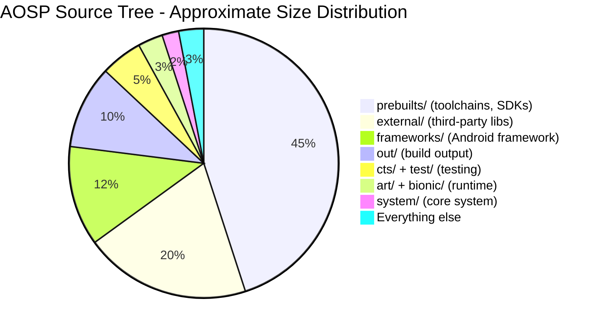

源码树磁盘占用的绝大部分来自预构建二进制文件（编译器、SDK、模拟器镜像）和外
部第三方库。真正的 Android 专用代码——框架、运行时、系统组件和构建系统——只占
总磁盘用量的一小部分。但它本身仍然极其庞大（数千万行代码）。

---

## 1.5 谁维护什么

Android 生态是 Google、芯片厂商、OEM 和开源社区之间的协作。了解谁负责技术栈
的哪一部分至关重要。这告诉你在哪里提交 bug、在哪里发送补丁；也告诉你谁的约
束塑造了架构。

### 1.5.1 利益相关方地图

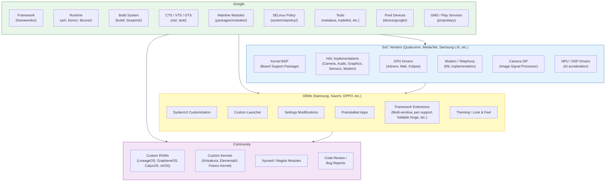

### 1.5.2 Google 的角色

Google 是 AOSP 的主要维护者。Google 工程师编写了大部分框架代码、运行时改进、
构建系统变更和测试基础设施。Google 的具体职责包括：

**框架开发：**

- `system_server` 中的所有系统服务（AMS、WMS、PMS 以及其他 100 多个）
- Android API 表面（`frameworks/base/core/`）
- 原生服务（SurfaceFlinger、AudioFlinger、InputFlinger）
- 媒体框架（`frameworks/av/`）
- 构建系统（Soong、Blueprint、Make）

**API 治理：**

- API 设计审查（每个新的公共 API 都要经过一个 API 委员会）
- API 兼容性执行（通过 Metalava 和 CTS）
- API 级别管理（每个 Android 版本递增 API 级别）
- 弃用政策（API 会被弃用但很少被移除）

**兼容性：**

- CTS 开发与维护
- CDD（兼容性定义文档）的编写
- 用于 HAL 合规的 VTS（厂商测试套件）
- 用于 GMS 合规的 GTS（Google 测试套件，专有）
- Treble / VNDK 稳定性要求

**Mainline 模块：**

- Google 开发并维护可通过 Play 商店独立于完整系统更新进行更新的 Mainline 模
  块。截至 Android 17，有超过 30 个模块被“mainlined”，包括：
  - Connectivity（WiFi、蓝牙、网络共享、DNS）
  - Media（编解码器、提取器）
  - Permissions
  - ART（运行时本身！）
  - ADB
  - Scheduling
  - Neural Networks（NNAPI）
  - 以及更多

**参考硬件：**

- Pixel 设备是参考实现
- Android 模拟器（goldfish/ranchu、`device/generic/goldfish`）和
  Cuttlefish（`device/google/cuttlefish`）提供软件参考设备
- Google Tensor 芯片使 Google 能够优化整个技术栈

**安全：**

- 每月安全公告和补丁
- SELinux 策略开发
- 验证启动实现
- Keystore/Keymaster/StrongBox 规范

### 1.5.3 SoC 厂商职责

芯片厂商（高通、联发科、三星 LSI、Google Tensor、展锐等）提供软件栈的最底层：

**内核板级支持包（BSP）：**

- SoC 的设备树定义
- 所有片上外设的驱动实现
- 电源管理（DVFS、空闲状态）
- 热管理
- 内核调度器调优

**HAL 实现：**

| HAL | SoC 厂商提供什么 |
|---|---|
| **相机** | ISP 驱动、3A 算法（自动对焦、自动曝光、自动白平衡）、HDR 处理、多相机同步 |
| **图形** | GPU 内核驱动、用户空间 GL/Vulkan 库、用于显示合成的 HWC（Hardware Composer） |
| **音频** | ALSA/音频内核驱动、音频 DSP 固件与控制、编解码器配置 |
| **传感器** | 传感器 Hub 固件、传感器 HAL 实现 |
| **调制解调器 / 电话** | RIL（Radio Interface Layer）实现、调制解调器固件、IMS（VoLTE/VoWiFi） |
| **视频编解码器** | 硬件编解码器驱动、Codec2 HAL 实现 |
| **AI/ML** | NPU/DSP 驱动、NNAPI HAL 实现 |
| **WiFi** | WiFi 驱动、WiFi HAL 实现、固件 |
| **蓝牙** | BT 控制器驱动、BT HAL 实现、固件 |
| **GNSS** | GNSS 驱动、位置 HAL 实现 |

SoC 厂商通常以大量专有源码和预构建二进制文件的形式交付其 BSP。OEM 接收这
个 BSP 并将其与自己的设备配置集成。

Treble 架构意味着 SoC 厂商只需交付一次 HAL 实现，OEM 就可以独立更新 Android
框架。在实践中，重大系统升级仍然需要 SoC 厂商提供 BSP 更新，但小幅更新和安
全补丁可以在没有厂商参与的情况下应用。

### 1.5.4 OEM 职责

OEM（三星、小米、OPPO、一加、摩托罗拉、索尼、Google 自身等）负责最终的消费
产品。他们的工作涵盖：

**设备 Bring-up（启动移植）：**

- 板级配置（设备树、分区布局）
- 设备专用 init 脚本
- SELinux 策略定制
- 内核配置（启用/禁用特性）

**用户体验定制：**

- SystemUI 修改（状态栏、快速设置、锁屏）
- 定制启动器（三星 One UI Home、小米 Poco Launcher 等）
- 设置应用定制（添加 OEM 特定的设置页面）
- 主题与视觉设计（图标、颜色、动画、字体）
- 音效（铃声、通知音、UI 音效）
- 启动动画

**功能开发：**

- 多窗口增强（三星 DeX、折叠屏分屏）
- 笔/手写笔支持（三星 S Pen、摩托罗拉 Smart Stylus）
- 相机软件（计算摄影、滤镜、模式）
- 安全增强（三星 Knox、小米 Mi Security）
- 无障碍功能
- 区域定制（双卡行为、本地支付集成）

**测试与认证：**

- 运行 CTS 以获得 Android 兼容性认证
- 运行 GTS 以获得 GMS 认证
- 运营商认证测试
- 区域监管测试（FCC、CE 等）

**更新：**

- 将新 Android 版本移植到现有设备
- 每月安全补丁集成
- Mainline 模块更新（通过 Play 商店）
- 固件更新（调制解调器、TrustZone、bootloader）

### 1.5.5 社区贡献

开源社区扮演着几个角色：

**定制 ROM 开发：**

定制 ROM 基于 AOSP 构建替代发行版。主要项目：

| 项目 | 侧重点 |
|---|---|
| **LineageOS** | CyanogenMod 的继任者。广泛的设备支持，接近 AOSP 并附带实用增强。最大的定制 ROM 社区。 |
| **GrapheneOS** | 以安全和隐私为中心。加固的内存分配器、改进的沙箱化，默认无 Google 依赖。仅限 Pixel。 |
| **CalyxOS** | 以隐私为中心，可选 microG（开源版 Play 服务替代品）。支持 Pixel 和少数其他设备。 |
| **/e/OS** | 去 Google 化的 Android，附带云服务。面向想要隐私又不想复杂的主流用户。 |
| **Paranoid Android** | 以 UI 创新和设计为中心。以引入后来被 AOSP 采纳的功能而闻名（沉浸模式、抬头通知）。 |
| **crDroid** | 功能丰富，汇集多个来源的定制。 |
| **Android-x86** | 社区将 AOSP 移植到 x86/x86_64 PC 的基础项目。添加了键盘、鼠标、触控板和以太网的驱动与输入处理，大多数“PC 版 Android”发行版都派生自它。 |
| **BlissOS** | 派生自 Android-x86 的 x86/x86_64 桌面发行版，通常跟踪 LineageOS。添加了桌面式任务栏、多窗口打磨和面向笔记本/PC 使用的主题。 |
| **BlissROMs** | BlissOS 的 ARM 手机/平板姊妹项目。构建于 LineageOS 之上的以定制和主题为中心的 ROM。 |
| **RemixOS** | Jide 推出的已停更（2017 年）商业版 PC Android 发行版，基于 Android-x86。以早期的桌面式窗口管理和类似开始菜单的启动器而闻名。 |

**Bug 报告与代码审查：**

AOSP Gerrit 实例（android-review.googlesource.com）接受外部贡献，尽管流程
比典型的开源项目更为严格。社区成员还在 AOSP issue 跟踪器
（issuetracker.google.com）上提交 bug，并参与邮件列表。

**定制内核：**

独立内核开发者为特定设备构建优化的内核。这些内核通常包含上游 Linux 改进、
调度器微调和领先于官方发布周期的性能优化。

**Xposed / Magisk：**

Mod 社区使用 Xposed（运行时 Java 方法钩子）和 Magisk（无系统 root）等框架。
这些框架在不修改系统分区的情况下改变 Android 的行为。这些工具展现了对 ART
内部实现、init 系统和 dm-verity 的深刻理解。

---

## 1.6 AOSP 版本历史

Android 自首次发布以来经历了巨大演变。下表记录了从 Android 1.0 到 Android 17
的每一个主要版本。

### 1.6.1 完整版本表

| 版本 | API 级别 | 代号 | 发布日期 | 关键亮点 |
|---|---|---|---|---|
| **1.0** | 1 | （无） | 2008 年 9 月 | 首个公开发布。HTC Dream（T-Mobile G1）。带有 Gmail、地图、浏览器、Market 的基础智能手机操作系统。 |
| **1.1** | 2 | Petit Four（内部） | 2009 年 2 月 | Bug 修复、API 完善。 |
| **1.5** | 3 | **Cupcake** | 2009 年 4 月 | 虚拟键盘、视频录制、小部件、AppWidget 框架、动画过渡。 |
| **1.6** | 4 | **Donut** | 2009 年 9 月 | CDMA 支持、不同屏幕尺寸、快速搜索框、电池用量显示。 |
| **2.0** | 5 | **Eclair** | 2009 年 10 月 | 多账户支持、Exchange 支持、HTML5、蓝牙 2.1、动态壁纸、新浏览器。 |
| **2.0.1** | 6 | Eclair | 2009 年 12 月 | 小幅更新。 |
| **2.1** | 7 | Eclair MR1 | 2010 年 1 月 | 动态壁纸 API、五个主屏。 |
| **2.2** | 8 | **Froyo** | 2010 年 5 月 | JIT 编译（Dalvik）、USB 网络共享、WiFi 热点、应用装到 SD 卡、Chrome V8 JS 引擎。 |
| **2.3** | 9 | **Gingerbread** | 2010 年 12 月 | NFC 支持、SIP VoIP、陀螺仪/气压计 API、并发 GC、绿/黑主题的新 UI。 |
| **2.3.3** | 10 | Gingerbread MR1 | 2011 年 2 月 | NFC API 改进、新传感器。 |
| **3.0** | 11 | **Honeycomb** | 2011 年 2 月 | 仅平板版本。Action bar、Fragment、硬件加速 2D 图形、Holomorphic UI。 |
| **3.1** | 12 | Honeycomb MR1 | 2011 年 5 月 | USB host API、MTP/PTP、摇杆支持。 |
| **3.2** | 13 | Honeycomb MR2 | 2011 年 7 月 | 屏幕兼容性改进。 |
| **4.0** | 14 | **Ice Cream Sandwich** | 2011 年 10 月 | 统一手机/平板体验。人脸解锁、数据用量监控、Android Beam（NFC 分享）、新 Holo 主题。 |
| **4.0.3** | 15 | Ice Cream Sandwich MR1 | 2011 年 12 月 | Social stream API、日历提供者改进。 |
| **4.1** | 16 | **Jelly Bean** | 2012 年 7 月 | Project Butter（三重缓冲、VSYNC 编排、60fps）、可展开通知、Google Now。 |
| **4.2** | 17 | Jelly Bean MR1 | 2012 年 11 月 | 多用户支持（平板）、Daydream 屏保、应用验证、 premium-SMS 确认。 |
| **4.3** | 18 | Jelly Bean MR2 | 2013 年 7 月 | 蓝牙低功耗（BLE）、受限资料、OpenGL ES 3.0、引入 SELinux（permissive 模式）。 |
| **4.4** | 19 | **KitKat** | 2013 年 10 月 | Project Svelte（低内存优化，支持 512MB 设备）、存储访问框架、打印框架、ART 作为开发者选项引入、SELinux 对少数核心域强制（installd、netd、vold、zygote）。 |
| **5.0** | 21 | **Lollipop** | 2014 年 11 月 | **ART 取代 Dalvik**（AOT 编译）。Material Design。64 位 ABI 支持。Project Volta（JobScheduler、电池历史学家）。多网络 API。SELinux 对所有域强制。 |
| **5.1** | 22 | Lollipop MR1 | 2015 年 3 月 | 多 SIM、设备保护（恢复出厂设置保护）、HD 语音通话。 |
| **6.0** | 23 | **Marshmallow** | 2015 年 10 月 | **运行时权限**（取代仅安装时授予的模式）。Doze（深度睡眠）、应用待机、指纹 API、USB-C、可 adopted 存储。 |
| **7.0** | 24 | **Nougat** | 2016 年 8 月 | 多窗口（分屏）、直接回复通知、Vulkan API、**JIT 编译器**（ART 现使用 JIT+AOT 混合）。基于文件的加密、无缝 A/B 更新。 |
| **7.1** | 25 | Nougat MR1 | 2016 年 10 月 | 应用快捷方式、图像键盘、增强的动态壁纸、Daydream VR。 |
| **8.0** | 26 | **Oreo** | 2017 年 8 月 | **Project Treble**（框架/厂商分离）。通知渠道、自动填充框架、PIP（画中画）、自适应图标。 |
| **8.1** | 27 | Oreo MR1 | 2017 年 12 月 | Android Go（低内存设备）、Neural Networks API 1.0。 |
| **9** | 28 | **Pie** | 2018 年 8 月 | 手势导航、自适应电池/亮度（基于 ML）、刘海屏 API、室内定位（WiFi RTT）。生物特征 API。DNS over TLS。 |
| **10** | 29 | **Android 10** | 2019 年 9 月 | 首个没有甜点代号（公开）的版本。深色主题、**作用域存储**、手势导航、折叠屏设备支持、5G API、**Project Mainline**（APEX 模块）、气泡 API。 |
| **11** | 30 | **Android 11** | 2020 年 9 月 | 通知中的会话、气泡、一次性权限、**用于 HAL 的稳定 AIDL**、5G 增强、无线调试、设备控件（智能家居）。 |
| **12** | 31 | **Android 12** | 2021 年 10 月 | **Material You**（从壁纸动态取色的主题）。**GKI**（通用内核镜像）。隐私面板、模糊定位、麦克风/相机指示器、启动屏 API、Mainline 模块扩展。 |
| **12L** | 32 | Android 12L | 2022 年 3 月 | 大屏优化（平板、折叠屏、ChromeOS）。任务栏、多栏布局、更好的分屏。 |
| **13** | 33 | **Android 13** | 2022 年 8 月 | 按应用的语言偏好、主题化应用图标、通知权限、照片选择器、预测式返回手势、可编程着色器（AGSL）。 |
| **14** | 34 | **Android 14** | 2023 年 10 月 | 语法屈折 API、区域偏好、路径互操作、凭据管理器、Health Connect、Ultra HDR、无损 USB 音频。**平台稳定性**改进。 |
| **15** | 35 | **Android 15 (Vanilla Ice Cream)** | 2024 | 应用归档、部分屏幕共享、卫星连接 API、改进的 PDF 渲染、**AV1 软件编解码器**、NFC 碰一碰支付改进、私密空间（敏感应用的独立资料）、屏幕录制/投影的增强安全、Health Connect 扩展。 |
| **16** | 36 | **Android 16 (Baklava)** | 2025 年 6 月 | 面向 API 36 的**16 KB 页大小**支持对新应用强制要求。用于进行中任务（网约车、配送、导航）的 **Live Updates** 通知 API。面向 API 36 的应用**预测式返回手势**默认开启。**全屏强制（Edge-to-edge）**扩展（必须显式选择退出）。大屏/折叠屏应用要求**自适应布局**。Linux **6.12** LTS GKI。Mainline 模块继续扩展。性能等级 16。 |
| **17** | 37 | **Android 17 (Cinnamon Bun)** | 2026 | 新的**软件定义车辆（SDV）**平台（`system/software_defined_vehicle/`、`device/google/sdv/`、`hardware/sdv/`）。面向端上 NPU/AI 加速器的 **NPU Manager** Mainline 模块（`packages/modules/NpuManager`）。**轻量级故障隔离（LFI）**进程内沙箱（`system/lfi`、`external/lfi`），首个使用者是 swcodec APEX。内存管理守护进程 **mmd** 和 **pmgd** 进程内存守护者。`fs_mgr` 从 `system/core` 迁至 `system/fs`。次版本完整版本编码（`SDK_INT_FULL`）。首个 `android17-6.18`（Linux **6.18**）GKI 配置。 |

### 1.6.2 架构里程碑

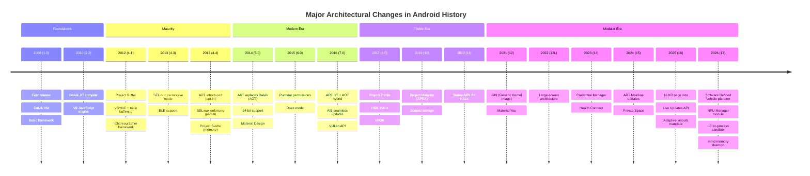

---

## 1.7 开发者之旅：本书路线图

与 AOSP 打交道是一场旅程：从下载源码开始，逐步深入理解、修改、构建、测试和
贡献平台。本节概述典型的开发者旅程，并将其与本书各章对应起来。

### 1.7.1 旅程

```mermaid
graph TB
    subgraph Phase1["Phase 1: Setup"]
        Download["Download Source<br/>(repo init + sync)"]
        Environment["Set Up Build<br/>Environment"]
        FirstBuild["First Build<br/>(lunch + m)"]
        Flash["Flash & Run<br/>(Emulator or Device)"]
    end

    subgraph Phase2["Phase 2: Understanding"]
        Architecture["Study Architecture<br/>(This chapter)"]
        BuildSystem["Learn Build System<br/>(Soong, Blueprint, Make)"]
        Binder_study["Understand Binder<br/>(IPC mechanism)"]
        Boot["Trace Boot Process<br/>(init → Zygote → system_server)"]
    end

    subgraph Phase3["Phase 3: Exploration"]
        ReadCode["Read Framework Code<br/>(Follow an API call end-to-end)"]
        Tracing["Use System Tracing<br/>(Perfetto, systrace)"]
        Debugging["Debug with GDB/LLDB<br/>and Android Studio"]
        Dumpsys["Use dumpsys, logcat,<br/>and other diagnostic tools"]
    end

    subgraph Phase4["Phase 4: Modification"]
        ModifyFramework["Modify a System Service"]
        AddHAL["Implement a HAL"]
        CustomApp["Modify a System App<br/>(SystemUI, Launcher, Settings)"]
        NewDevice["Add a New Device<br/>(device/ configuration)"]
    end

    subgraph Phase5["Phase 5: Mastery"]
        Performance["Performance Analysis<br/>and Optimization"]
        Security["Security Hardening<br/>and SELinux Policy"]
        Contribute["Contribute Upstream<br/>(Gerrit code review)"]
        Maintain["Maintain a Custom<br/>Distribution"]
    end

    Phase1 --> Phase2
    Phase2 --> Phase3
    Phase3 --> Phase4
    Phase4 --> Phase5

    style Phase1 fill:#e8f5e9,stroke:#2e7d32
    style Phase2 fill:#e3f2fd,stroke:#1565c0
    style Phase3 fill:#fff9c4,stroke:#f9a825
    style Phase4 fill:#f3e5f5,stroke:#7b1fa2
    style Phase5 fill:#fce4ec,stroke:#c62828
```

### 1.7.2 阶段 1：获取源码并构建

第一步是下载 AOSP 源码并构建它。这在 **第 2 章：搭建开发环境**中讲解。

```
# Install repo tool
mkdir -p ~/bin
curl https://storage.googleapis.com/git-repo-downloads/repo > ~/bin/repo
chmod a+x ~/bin/repo

# Initialize the AOSP repository
mkdir aosp && cd aosp
repo init -u https://android.googlesource.com/platform/manifest -b main

# Sync all repositories (this downloads ~100 GB)
repo sync -c -j$(nproc) --optimized-fetch

# Set up the build environment
source build/envsetup.sh

# Choose a build target
lunch aosp_cf_x86_64_phone-trunk_staging-eng

# Build
m -j$(nproc)
```

`lunch` 命令选择一个**产品**（设备配置）、一个**发行版**和一个**变体**
（eng、userdebug 或 user）：

| 变体 | 描述 | 调试 | 性能 |
|---|---|---|---|
| `eng` | 工程构建。完整调试、所有开发工具。 | 完整：adb root、所有日志、调试断言 | 较低（调试开销） |
| `userdebug` | 带调试的生产级构建。**推荐用于开发。** | adb root、可用调试日志 | 接近生产 |
| `user` | 生产构建。交付给消费者的版本。 | 无 adb root、日志受限 | 完整生产 |

构建完成后，你可以启动模拟器：

```
# Launch Cuttlefish (cloud/headless emulator)
launch_cvd

# Or launch the graphical emulator
emulator
```

### 1.7.3 阶段 2：理解架构

源码下载完毕、构建可以运行之后，下一步是理解各个部件如何拼合在一起。这是前
几章的重点：

- **第 1 章（本章）**：全局图景——架构、源码树、利益相关方
- **第 2 章**：构建环境、repo、Soong/Blueprint、`Android.bp` 模块、构建目标与
  变体
- **第 4 章**：启动过程——从 bootloader 到锁屏
- **第 9 章**：Binder IPC——所有进程间通信的骨干
- **第 20 章**：system_server 与框架服务——Android 的核心

### 1.7.4 阶段 3：探索与调试

一旦理解了架构，你就可以探索运行中的系统：

- **第 58 章**：调试工具——logcat、dumpsys、Perfetto、LLDB、Android Studio
  平台调试
- **第 18 章**：ART 内部实现——垃圾回收、JIT/AOT、类加载
- **第 13 章**：图形流水线——SurfaceFlinger、HWUI、BufferQueue、HWC
- **第 22 章**：Activity 与窗口管理——AMS、WMS、任务栈

### 1.7.5 阶段 4：修改与开发

随着理解的加深，你便有了修改的能力：

- **第 10 章**：HAL 开发——实现一个硬件抽象层
- **第 48-49 章**：系统应用开发——定制 SystemUI、启动器、设置
- **第 54 章**：Mainline 模块——开发可更新的组件

### 1.7.6 阶段 5：高级主题与精通

- **第 58 章**：性能优化——性能剖析、跟踪、基准测试
- **第 40 章**：安全架构——SELinux、Keystore、验证启动、沙箱化
- **第 57 章**：测试——CTS、VTS、编写平台测试

### 1.7.7 端到端追踪一次 API 调用

为了具体说明“理解架构”在实践中的含义，让我们追踪应用调用
`startActivity(intent)` 时发生的事情：

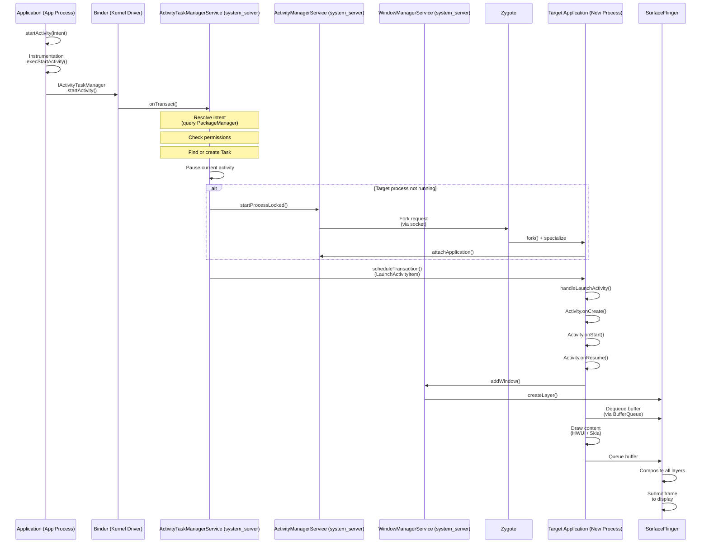

这一次 API 调用跨越了：

1. **应用进程**（Java）——`Activity.startActivity()`
2. **Binder IPC**（内核驱动）——跨进程事务
3. **system_server**（Java）——`ActivityTaskManagerService` 解析 intent、检查
   权限、管理任务/Activity 栈
4. **Zygote**（原生）——如有需要 fork 一个新进程
5. **目标应用进程**（Java）——Activity 生命周期回调
6. **WindowManagerService**（Java）——窗口创建与布局
7. **SurfaceFlinger**（原生 C++）——显示合成
8. **显示 HAL**（厂商）——硬件合成与显示输出

单次 `startActivity()` 调用几乎触及 Android 技术栈的每一层。这就是为什么理解
完整架构如此有价值。当出现问题时（启动缓慢、权限被拒、显示闪烁），你需要知道
该调查哪一层。

---

## 1.8 关键概念速查

本节简要定义你将在本书和整个 AOSP 开发过程中遇到的最重要概念。每个概念在后
续章节中都会深入讲解；本节作为速查和导引。

### 1.8.1 Binder

**Binder** 是 Android 的进程间通信（IPC）机制。它是 Android 中单一最重要的架
构元素——几乎所有进程间通信都要经过 Binder。

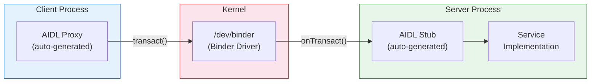

**关键特性：**

- **基于事务**：客户端发送一个数据包，接收一个回复包
- **默认同步**：调用方阻塞，直到服务端处理完请求并返回
- **面向对象**：Binder 引用作为对象句柄在进程间传递
- **内核中介**：内核驱动处理数据拷贝、UID/PID 验证和引用计数
- **三个实例**：`/dev/binder`（框架 IPC）、`/dev/hwbinder`
  （框架到 HAL）、`/dev/vndbinder`（厂商到厂商）

**源码位置：**

- 内核驱动：`drivers/android/binder.c`（在内核源码中）
- 原生库：`frameworks/native/libs/binder/`
- Java 层：`frameworks/base/core/java/android/os/Binder.java`
- AIDL 编译器：`system/tools/aidl/`
- ServiceManager：`frameworks/native/cmds/servicemanager/`

Binder 将在 **第 9 章**中深入讲解。

### 1.8.2 HAL（硬件抽象层）

**硬件抽象层**是 Android 框架与硬件特定厂商实现之间的标准化接口。它让同一个
Android 框架能够运行在不同的硬件平台上。

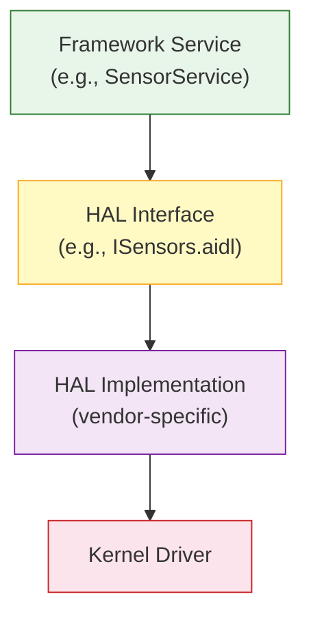

**关键特性：**

- 由 AIDL（现代）或 HIDL（遗留）接口定义
- 由 SoC 厂商和 OEM 实现
- 运行在独立进程中（进程外 HAL），以保证稳定性和安全性
- 由 VTS（厂商测试套件）测试
- 带版本号以支持向后兼容

**源码位置：** `hardware/interfaces/`（接口定义）

HAL 开发将在 **第 10 章**中讲解。

### 1.8.3 AIDL（Android 接口定义语言）

**AIDL** 是一种用于定义可用于 Binder IPC 的接口的语言。AIDL 编译器生成 Java、
C++、NDK C++ 或 Rust 的客户端代理和服务端桩代码。

```
// Example: IActivityManager.aidl
interface IActivityManager {
    int startActivity(in IApplicationThread caller,
                      in String callingPackage,
                      in Intent intent,
                      in String resolvedType,
                      in IBinder resultTo,
                      in String resultWho,
                      int requestCode,
                      int flags,
                      in ProfilerInfo profilerInfo,
                      in Bundle options);
    // ... many more methods
}
```

**关键特性：**

- 同时用于框架 IPC 和 HAL 接口（稳定 AIDL）
- 支持 parcelable 数据类型（自定义数据结构）
- 为 Java、C++（libbinder）、NDK C++（libbinder_ndk）和 Rust 生成代码
- 稳定 AIDL 接口带版本号且向后兼容
- 取代 HIDL 用于新的 HAL 接口（Android 11+）

**源码位置：**

- AIDL 编译器：`system/tools/aidl/`
- 框架 AIDL 文件：遍布 `frameworks/base/core/java/`
- HAL AIDL 文件：`hardware/interfaces/`

### 1.8.4 HIDL（硬件接口定义语言）

**HIDL** 随 Project Treble（Android 8.0）引入，作为 HAL 接口定义语言。对新
接口而言它已被稳定 AIDL 取代，但仍用于现有 HAL。

```
// Example: ICameraDevice.hal (HIDL)
interface ICameraDevice {
    getCameraCharacteristics()
        generates (Status status, CameraMetadata cameraCharacteristics);
    open(ICameraDeviceCallback callback)
        generates (Status status, ICameraDeviceSession session);
    // ...
};
```

**关键特性：**

- 使用 `hwbinder` 传输（与框架 binder 分离）
- 严格版本化（例如 `android.hardware.camera.device@3.5`）
- 支持 binderized（跨进程）和 passthrough（进程内）两种模式
- 已冻结：不再接受新的 HIDL 接口
- 现有 HIDL 接口将维护到迁移到 AIDL 为止

**源码位置：**

- HIDL 编译器：`system/tools/hidl/`
- HAL HIDL 文件：`hardware/interfaces/`（`.hal` 文件）
- 运行时：`system/libhidl/`

### 1.8.5 APEX（Android Pony EXpress）

**APEX** 是 Mainline 模块的打包格式。这些是 Android 的组件，可以独立于完整系
统更新进行更新。Google Play 商店负责分发它们。

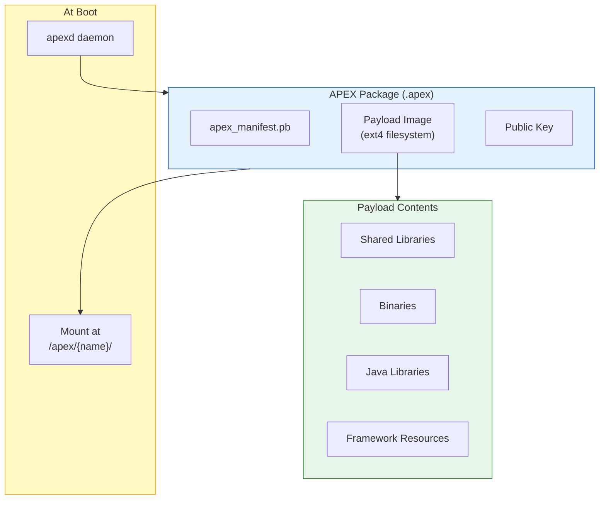

**关键特性：**

- 自带文件系统的自包含包
- 启动时挂载到 `/apex/<name>/`
- 经过加密签名和验证
- 支持回滚（如果新版本引发问题）
- 通过 Play 商店更新（不需要完整 OTA）
- 由 `apexd`（`system/apex/apexd/`）管理
- 示例：ART、Conscrypt、Media、DNS Resolver、WiFi、Tethering

**源码位置：** `system/apex/`（基础设施）、`packages/modules/`
（各个模块）

### 1.8.6 Mainline

**Project Mainline**（Android 10 引入）是 Android 模块化计划，使核心组件可以
通过 Play 商店独立更新。每个 Mainline 模块以 APEX 或更新后的 APK 形式交付。

```mermaid
graph TB
    subgraph Traditional["Traditional Update Model"]
        Google1["Google releases<br/>new Android version"]
        SoC1["SoC vendor updates BSP"]
        OEM1["OEM integrates & tests"]
        Carrier1["Carrier approves"]
        User1["User receives update<br/>(6-18 months later)"]

        Google1 --> SoC1 --> OEM1 --> Carrier1 --> User1
    end

    subgraph Mainline_Model["Mainline Update Model"]
        Google2["Google updates<br/>Mainline module"]
        PlayStore["Google Play Store<br/>delivers update"]
        User2["User receives update<br/>(days/weeks)"]

        Google2 --> PlayStore --> User2
    end

    style Traditional fill:#fce4ec,stroke:#c62828
    style Mainline_Model fill:#e8f5e9,stroke:#2e7d32
```

截至 Android 17，Mainline 模块包括：

| 模块 | 类型 | 更新内容 |
|---|---|---|
| **ART** | APEX | 运行时本身（GC、JIT、AOT、核心库） |
| **Conscrypt** | APEX | TLS/SSL（证书处理、加密） |
| **DNS Resolver** | APEX | DNS 解析 |
| **Media** | APEX | 媒体编解码器、提取器、框架 |
| **WiFi** | APEX | WiFi 协议栈 |
| **Tethering** | APEX | 热点和网络共享 |
| **Bluetooth** | APEX | 蓝牙协议栈 |
| **Connectivity** | APEX | 网络连接 |
| **Telephony** | APEX | 电话框架 |
| **Permission** | APEX | 运行时权限逻辑与 UI（搭载 PermissionController 和 SafetyCenter 应用） |
| **Neural Networks** | APEX | NNAPI 运行时 |
| **NPU Manager** | APEX | NPU/AI 加速器管理（17 新增，第 53 章） |
| **StatsD** | APEX | 指标收集 |
| **IPsec** | APEX | VPN |
| **SDK Extensions** | APEX | API 扩展机制 |
| **AdServices** | APEX | 保护隐私的广告 |
| **UWB** | APEX | 超宽带 |
| **ADB** | APEX | Android 调试桥 |
| **Health Connect** | APEX | 健康与健身数据 |
| **Scheduling** | APEX | 任务调度 |
| **Profiling** | APEX | 性能剖析 |
| **On-Device Personalization** | APEX | ML 个性化 |

Mainline 的意义怎么强调都不为过。在 Mainline 之前，DNS 解析器或媒体框架中的
安全漏洞需要一次完整的系统更新。该更新必须走完整个 OEM/运营商更新管线。有了
Mainline，Google 可以在数周内把修复推送到数十亿台设备，无论 OEM 是否发布了系
统更新。

### 1.8.7 ART（Android 运行时）

**ART** 是在 Android 上执行应用和框架代码的托管运行时。它在 Android 5.0 中
取代了 Dalvik。

**关键特性：**

- 执行 DEX 字节码（Dalvik 可执行格式）
- 多层执行：解释器、JIT 编译器、AOT 编译器（`dex2oat`）
- 基于剖析的优化：JIT 剖析数据指导 AOT 编译
- 并发、压缩式垃圾回收器（CMC：并发标记-压缩，自 Android 14 起为默认；它
  取代了旧的 CC / 并发复制回收器）
- 支持 32 位和 64 位架构（ARM、ARM64、x86、x86_64、RISC-V）
- 自身就是一个 Mainline 模块（可通过 Play 商店更新）

**源码位置：** `art/`

ART 内部实现将在 **第 18 章**中讲解。

### 1.8.8 Zygote

**Zygote** 是父进程，所有 Android 应用进程和 `system_server` 都由它 fork 而
来。

**关键特性：**

- 由 `init` 在启动早期启动
- 预加载常用类（约 18,000 个，列于
  `frameworks/base/config/preloaded-classes`）和资源
- 在 Unix 域套接字上监听 fork 请求
- 使用 `fork()` 通过写时复制实现快速进程创建
- 64 位设备上有两个实例：`zygote64`（主）和 `zygote`（用于遗留应用的 32
  位）

**源码位置：**

- 入口点：`frameworks/base/cmds/app_process/`
- Java：`frameworks/base/core/java/com/android/internal/os/ZygoteInit.java`
- Zygote 守护进程的 Rust 实现：`system/zygote/`（crates
  `zygote-sys`、`zygote-messages`、`zygote-core`、`zygote`）

### 1.8.9 system_server

**system_server** 是承载所有基于 Java 的框架服务的进程。它是 Zygote 在启动时
fork 的第一个进程。

**关键特性：**

- 承载 100 多个系统服务（AMS、WMS、PMS 以及更多）
- 服务通过 Binder IPC 与应用通信
- 以 `system` 用户（UID 1000）运行，拥有广泛权限
- system_server 崩溃会导致整个系统重启（软重启）
- 内核和 init 之后最关键的进程

**源码位置：**

- 入口点：`frameworks/base/services/java/com/android/server/SystemServer.java`
- 服务：`frameworks/base/services/core/java/com/android/server/`
- 原生组件：`frameworks/base/services/core/jni/`

### 1.8.10 SurfaceFlinger

**SurfaceFlinger** 是把所有可见表面（窗口、图层）合成为屏幕上显示的最终图像
的系统服务。

```mermaid
graph LR
    App1["App 1<br/>Window"] --> BQ1["BufferQueue"]
    App2["App 2<br/>Window"] --> BQ2["BufferQueue"]
    SysUI["SystemUI<br/>(Status Bar)"] --> BQ3["BufferQueue"]
    Nav["Navigation<br/>Bar"] --> BQ4["BufferQueue"]

    BQ1 --> SF["SurfaceFlinger"]
    BQ2 --> SF
    BQ3 --> SF
    BQ4 --> SF

    SF --> HWC["HWC HAL<br/>(Hardware<br/>Composer)"]
    HWC --> Display["Display"]

    style SF fill:#e3f2fd,stroke:#1565c0
    style HWC fill:#f3e5f5,stroke:#7b1fa2
    style Display fill:#e8f5e9,stroke:#2e7d32
```

**关键特性：**

- 通过 `BufferQueue` 接收来自所有可见窗口的缓冲区
- 用 HWC（Hardware Composer）合成硬件图层、用 GPU 合成客户端合成
- 管理 VSYNC 时序和帧调度
- 支持多显示（内置、外接、虚拟）
- 对显示性能至关重要（卡帧 = 可见的卡顿）

**源码位置：** `frameworks/native/services/surfaceflinger/`

图形流水线将在 **第 13 章**中讲解。

### 1.8.11 WindowManagerService（WMS）

**WindowManagerService** 管理窗口层次结构——决定哪些窗口可见、它们的尺寸和
位置、它们的 z 序（堆叠）、输入焦点以及过渡/动画。

**关键特性：**

- 管理所有显示器上的所有窗口
- 根据显示尺寸、insets 和系统栏决定窗口布局
- 与 SurfaceFlinger 协调图层的创建与销毁
- 管理窗口过渡和动画
- 执行窗口策略（哪些窗口可以出现在顶层、焦点规则）
- 与 ActivityTaskManagerService 紧密协作处理 Activity 窗口

**源码位置：**
`frameworks/base/services/core/java/com/android/server/wm/`

### 1.8.12 ActivityManagerService（AMS）/ ActivityTaskManagerService（ATMS）

**ActivityManagerService** 管理应用进程，包括进程生命周期（启动、停止、杀
死）、OOM 调节（内存压力下杀死哪些进程）和广播分发。

**ActivityTaskManagerService**（在 Android 10 中从 AMS 拆分）管理 Activity、
任务和 Activity 栈。这就是用户可见的“任务管理”。它决定哪个 Activity 在前台，
处理任务切换，并管理最近应用列表。

**关键特性：**

- AMS：进程生命周期、OOM adj、广播分发、内容提供者、服务绑定
- ATMS：Activity 生命周期、任务管理、最近应用、多窗口
- 两者合起来是 system_server 中最复杂的服务
- 源码目录 `am/` 包含 AMS，`wm/` 包含 ATMS 和 WMS（反映了 Activity 管理与
  窗口管理之间的紧密关系）

**源码位置：**

- AMS：`frameworks/base/services/core/java/com/android/server/am/`
- ATMS：`frameworks/base/services/core/java/com/android/server/wm/`

Activity 与窗口管理将在 **第 22 章**中讲解。

### 1.8.13 PackageManagerService（PMS）

**PackageManagerService** 负责一切与 APK 包有关的事情：安装、卸载、包查询、
权限管理、Intent 解析和 APK 验证。

**关键特性：**

- 启动时扫描并索引所有已安装包
- 处理 APK 安装（包括拆分 APK）
- 将 Intent 解析到目标组件
- 管理权限（安装时和运行时）
- 执行包签名与验证
- 维护包状态（启用/禁用的组件、默认处理者）
- system_server 中最复杂的服务之一

**源码位置：**
`frameworks/base/services/core/java/com/android/server/pm/`

---

## 1.9 AOSP 开发工具概览

在深入后续章节的细节之前，先了解一些你日常使用 AOSP 时会用到的基本工具会
很有帮助。

### 1.9.1 源码管理

| 工具 | 命令 | 用途 |
|---|---|---|
| **repo** | `repo init`、`repo sync` | 多仓库管理（封装 Git） |
| **git** | `git log`、`git diff`、`git commit` | 单个仓库的版本控制 |
| **Gerrit** | Web UI | AOSP 贡献的代码审查系统 |

### 1.9.2 构建工具

| 工具 | 命令 | 用途 |
|---|---|---|
| **lunch** | `lunch <target>` | 选择构建目标（设备 + 变体） |
| **m** | `m` | 构建整个平台 |
| **mm** | `mm` | 构建当前目录中的模块 |
| **mmm** | `mmm <path>` | 构建指定目录中的模块 |
| **mma** | `mma` | 构建并包含依赖 |
| **soong_ui** | （内部） | 构建系统入口点 |
| **blueprint** | （内部） | `.bp` 文件解析器 |

### 1.9.3 调试与分析

| 工具 | 命令示例 | 用途 |
|---|---|---|
| **adb** | `adb shell`、`adb logcat` | 设备通信、日志 |
| **logcat** | `adb logcat -s TAG` | 系统和应用日志查看器 |
| **dumpsys** | `adb shell dumpsys activity` | 转储系统服务状态 |
| **am** | `adb shell am start -n com.pkg/.Activity` | Activity 管理器命令 |
| **pm** | `adb shell pm list packages` | 包管理器命令 |
| **wm** | `adb shell wm size` | 窗口管理器命令 |
| **settings** | `adb shell settings get system font_scale` | 读取/写入系统设置 |
| **cmd** | `adb shell cmd package list packages` | 通用服务命令接口 |
| **Perfetto** | `perfetto --txt -c config.pbtxt -o trace` | 全系统跟踪（使用 pbtxt 配置时必须加 `--txt`） |
| **systrace** | `systrace.py --time=5 gfx view` | 传统系统跟踪 |
| **simpleperf** | `simpleperf record -p <pid>` | CPU 性能剖析 |
| **LLDB** | `lldb` | 原生代码调试器 |
| **Android Studio** | IDE | Java/Kotlin 调试、布局检查 |

### 1.9.4 设备工具

| 工具 | 命令 | 用途 |
|---|---|---|
| **fastboot** | `fastboot flash system system.img` | 刷写分区镜像 |
| **adb sideload** | `adb sideload update.zip` | 从 recovery 安装 OTA |
| **m snod** | `m snod` | 从已构建的包重建系统镜像 |
| **emulator** | `emulator` | 基于 QEMU 的 Android 模拟器 |
| **launch_cvd** | `launch_cvd` | Cuttlefish 虚拟设备 |
| **lshal** | `adb shell lshal` | 列出 HAL 服务 |
| **service** | `adb shell service list` | 列出 Binder 服务 |

### 1.9.5 dumpsys 命令：你最好的朋友

`dumpsys` 命令值得特别关注，因为它是 AOSP 开发中最有用的单一诊断工具。它查
询系统服务并打印它们的内部状态：

```bash
# List all services
adb shell dumpsys -l

# Dump a specific service (examples)
adb shell dumpsys activity              # AMS state (processes, tasks, etc.)
adb shell dumpsys activity activities   # Activity stacks only
adb shell dumpsys activity processes    # Process list with OOM adj
adb shell dumpsys window               # WMS state (windows, displays)
adb shell dumpsys window displays       # Display configuration
adb shell dumpsys package <pkg>        # Package details
adb shell dumpsys meminfo              # Memory usage by process
adb shell dumpsys battery              # Battery state
adb shell dumpsys alarm                # Alarm schedule
adb shell dumpsys jobscheduler         # Scheduled jobs
adb shell dumpsys notification         # Notification state
adb shell dumpsys audio                # Audio state
adb shell dumpsys SurfaceFlinger       # SurfaceFlinger state
adb shell dumpsys input                # Input state (devices, dispatch)
adb shell dumpsys connectivity         # Network state
adb shell dumpsys power                # Power state (wake locks, etc.)
adb shell dumpsys usagestats           # App usage statistics
```

每个系统服务都实现了一个 `dump()` 方法，以人类可读的文本输出其当前状态。调试
任何问题时，相关服务的 `dumpsys` 通常是第一个要运行的命令。

---

## 1.10 本书使用的约定

在整本书中，我们使用以下约定：

### 1.10.1 源码路径

所有源码路径都相对于 AOSP 根目录给出。当我们写：

```
frameworks/base/services/core/java/com/android/server/wm/WindowManagerService.java
```

意思是该文件位于：

```
<AOSP_ROOT>/frameworks/base/services/core/java/com/android/server/wm/WindowManagerService.java
```

其中 `<AOSP_ROOT>` 是你运行 `repo init` 和 `repo sync` 的目录。本书中的所有路
径都相对于该根目录。

### 1.10.2 代码清单

代码清单包含语言标识符，并在相关时包含源文件路径：

```java
// frameworks/base/core/java/android/app/Activity.java
public void startActivity(Intent intent) {
    this.startActivity(intent, null);
}
```

当代码被缩写时，省略号（`...`）表示省略的部分：

```java
public class ActivityManagerService extends IActivityManager.Stub {
    // ... hundreds of fields ...

    @Override
    public void startActivity(...) {
        // ... implementation ...
    }
}
```

### 1.10.3 Shell 命令

Shell 命令以 `$` 为前缀表示用户命令，以 `#` 为前缀表示 root 命令：

```bash
$ adb shell                      # Connect to device shell
$ source build/envsetup.sh       # Set up build environment
# setenforce 0                   # Disable SELinux (root required)
```

### 1.10.4 Mermaid 图

本书大量使用 Mermaid 图进行架构可视化、时序图和流程图。任何支持 Mermaid 的
Markdown 查看器（包括 GitHub、GitLab 和大多数现代文档工具）都可以渲染这些
图。

### 1.10.5 术语

| 术语 | 含义 |
|---|---|
| **AOSP** | Android 开源项目 |
| **Framework（框架）** | system_server 中的 Java/Kotlin 层和 `android.*` API |
| **Native（原生）** | C/C++ 代码（相对于 Java/Kotlin） |
| **HAL** | 硬件抽象层 |
| **Service（服务）** | 运行在 system_server 中（Java）或作为独立守护进程（原生）的系统服务 |
| **Process（进程）** | 拥有自己 PID 和内存空间的操作系统级进程 |
| **Binder service** | 可通过 Binder IPC 访问的服务 |
| **Client（客户端）** | 调用 Binder 服务的进程 |
| **Server（服务端）** | 承载 Binder 服务实现的进程 |
| **SoC** | 片上系统（例如高通骁龙、联发科天玑） |
| **OEM** | 原始设备制造商（设备厂商，例如三星、小米） |
| **BSP** | 板级支持包（特定 SoC 的内核 + 驱动） |
| **CTS** | 兼容性测试套件 |
| **VTS** | 厂商测试套件 |
| **GMS** | Google Mobile Services |
| **CDD** | 兼容性定义文档 |
| **GKI** | 通用内核镜像 |
| **GSI** | 通用系统镜像 |

### 1.10.6 配合 AI 助手使用本书

每一章都是纯 Markdown，并带有显式的源文件引用。这使得本书在让 AI 助手作为
背景知识来推理 AOSP 代码时异常好用。

助手不需要爬取整个站点。把它指向
[https://aospbooks.github.io/aosp-internal-book/llms.txt](https://aospbooks.github.io/aosp-internal-book/llms.txt)。这是一个
[llmstxt.org](https://llmstxt.org/) 风格的索引。它按部分分组，列出每一章和每一
个附录，附带一行描述和其发布 URL。助手可以先阅读 `llms.txt`。然后它可以判断
你询问的子系统与哪一章相关，并只获取该章。这节省了 token，并给你更精准的答
案。

实用的工作流：

- **把 URL 放进系统提示或项目上下文。** 大多数编程助手（Claude Code、Cursor、
  Copilot Workspace、Aider）接受任意 URL 作为背景。`llms.txt` 很小（约 15
  KB），可以轻松放入。
- **用节号引用章节。** 像 `9.4.2` 这样的节号在编辑中保持稳定。当你（或助手）
  想要引用特定主题时，节号是一个持久的句柄。
- **配合 `cs.android.com` 使用。** 本书的源码路径和行号可以在 Android Code
  Search 上直接解析。这让助手能够通过跟随路径来验证或扩展本书中的任何论述。

---

## 1.11 延伸阅读

- **AOSP 源码**：https://source.android.com/
- **AOSP 代码搜索**：https://cs.android.com/
- **AOSP Gerrit（代码审查）**：https://android-review.googlesource.com/
- **AOSP Issue 跟踪器**：https://issuetracker.google.com/issues?q=componentid:192735
- **Android 架构概览**：https://source.android.com/docs/core/architecture
- **Project Treble**：https://source.android.com/docs/core/architecture/treble
- **Project Mainline**：https://source.android.com/docs/core/ota/modular-system
- **GKI**：https://source.android.com/docs/core/architecture/kernel/generic-kernel-image
- **CTS 文档**：https://source.android.com/docs/compatibility/cts
- **CDD**：https://source.android.com/docs/compatibility/cdd
- **Android API 参考**：https://developer.android.com/reference
- **Android 平台架构**：https://developer.android.com/guide/platform

---

## 1.12 小结

本章建立了使用 AOSP 所需的基础知识：

1. **AOSP 是 Android 生态构建其上的开源基础**。Google 添加 GMS（专有）。OEM
   添加定制。社区构建替代发行版。理解你正在哪一层工作至关重要。

2. **Android 的架构是分层堆栈**，从 Linux 内核，经过 HAL、原生服务、ART 运
   行时、框架服务（system_server）、公共 API，到应用。每一层都有明确的职责
   和与相邻层定义良好的接口。

3. **源码树庞大但井然有序**。30 多个顶层目录各有特定用途。它们是：运行时的
   `art/`、C 库的 `bionic/`、应用框架的 `frameworks/`、HAL 接口的
   `hardware/`、核心系统组件的 `system/`。此外还有应用和模块的 `packages/`、
   构建系统的 `build/`，等等。

4. **生态是四方协作**。Google 提供框架、CTS 和 Mainline。SoC 厂商提供内核、
   HAL 和驱动。OEM 提供定制和设备 bring-up。社区提供定制 ROM、bug 报告和贡献。

5. **Android 在 15 多年和 37 个 API 级别中急剧演变**。重大架构转变包括从
   Dalvik 到 ART 的迁移和用于厂商分离的 Project Treble。还包括用于模块化更
   新的 Project Mainline 和用于内核标准化的 GKI。

6. **开发者的旅程**从下载和构建源码开始，经过理解架构，进展到修改、测试和
   为平台做贡献。

7. **核心概念**——Binder、HAL、AIDL、HIDL、APEX、Mainline、ART、Zygote、
   system_server、SurfaceFlinger、WMS、AMS、PMS——是 AOSP 开发的词汇。在随
   后的每一章中你都会遇到它们。

在下一章中，我们将搭建一个完整的 AOSP 开发环境。我们将安装依赖、下载源码、
配置构建，并在模拟器上运行第一次构建。
