# 第 5 章：内核 (GKI)

Linux 内核是每一台 Android 设备的基础。它管理硬件、强制执行安全边界，并调度进程。它还提供了 Binder IPC 和共享内存等底层原语，整个 Android 框架正是构建在这些原语之上的。然而，运行在 Android 设备上的内核并不是原版的上游 Linux 内核。在超过十五年的时间里，Android 积累了一整套内核修改、树外驱动程序以及配置要求。这些使它有别于任何桌面版或服务器版 Linux 发行版。

本章深入剖析 Android 内核。它涵盖以下主题：

- Android 向上游 Linux 添加了什么。
- 通用内核映像（GKI）架构如何减少碎片化。
- 各个 Android 特有的子系统在驱动层面是如何工作的。
- 设备树如何描述硬件。
- 内核配置如何在各个版本之间进行管理。
- 内核如何集成到 AOSP 构建系统中。
- 如何在真实设备和仿真设备上调试内核层面的问题。

在本章中，我们会引用 AOSP 源代码树中的真实文件。此处引用的每一个路径、配置片段和模块名称都可以在该代码树中找到。本章内容对应 Android 17，其 Android 通用内核分支为 `android17-6.18`（上游 LTS 6.18）。5.8 节汇总了随 Android 17 一起落地的内核层变更。这些包括新的 GKI 分支以及日趋成熟的 16 KB 页大小方案。它们还包括将 `fs_mgr` 及其姊妹库从 `system/core` 迁移到新的 `system/fs/` 代码树中。

---

## 5.1 Android 内核与上游 Linux

### 5.1.1 并非真正分支的分支

Android 并没有维护一个永久的 Linux 内核分支。相反，Google 维护着一组“Android 通用内核”（ACK）分支，它们跟踪特定的上游长期支持（LTS）版本。每个 ACK 分支都从一个上游 LTS 标签（例如 `6.6`、`6.12`、`6.18`）起步，并添加一组精心挑选的补丁，用于提供 Android 特有的功能。Android 17 的分支是 `android17-6.18`，跟踪上游 LTS 6.18。这些补丁可分为以下几类：

1. **Android 特有的驱动程序**，实现核心平台功能（Binder、ashmem、incremental-fs）
2. **调度器和内存管理变更**，改善移动设备上的交互性能
3. **安全加固**，超出上游默认提供的范围
4. **供应商钩子基础设施**（跟踪事件和受限的供应商钩子），允许 SoC 供应商在不修改核心内核代码的情况下定制行为
5. **测试与调试基础设施**，与 Android 的测试流水线集成

目标是尽量减小与上游的差异。许多源自 Android 代码树的补丁多年来已经陆续被上游化。Wakelocks（现为 `PM_WAKELOCKS`）、低内存杀手（已被基于 PSI 的用户空间 lmkd 取代）以及 `ashmem`（正被 `memfd` 取代）都是这种融合趋势的例子。

### 5.1.2 Android 的主要新增内容

下表总结了 Android 在原版上游内核之外添加或要求的最重大内核层特性：

| 特性 | 内核配置 | 用途 | 状态 |
|---------|--------------|---------|--------|
| Binder IPC | `CONFIG_ANDROID_BINDER_IPC` | 所有框架服务的跨进程通信 | 活跃，必需 |
| Binderfs | `CONFIG_ANDROID_BINDERFS` | 动态 Binder 设备管理 | 活跃，必需 |
| Ashmem | `CONFIG_ASHMEM` | 匿名共享内存区域 | 活跃，正迁移到 memfd |
| Wakelocks | `CONFIG_PM_WAKELOCKS` | 在关键操作期间阻止系统挂起 | 活跃，必需 |
| PSI（压力停滞信息） | `CONFIG_PSI` | 供 lmkd 使用的内存压力监控 | 活跃，必需 |
| DMA-BUF Heaps | `CONFIG_DMABUF_HEAPS_SYSTEM` | 图形缓冲区分配（ION 的替代方案） | 活跃 |
| FUSE 文件系统 | `CONFIG_FUSE_FS` | 用于存储访问的用户空间文件系统 | 活跃，必需 |
| 增量文件系统 | `CONFIG_INCREMENTAL_FS` | 按需加载 APK 数据块 | 活跃 |
| dm-verity | `CONFIG_DM_VERITY` | 系统分区的验证启动 | 活跃，必需 |
| 文件系统加密 | `CONFIG_FS_ENCRYPTION` | 用户数据的文件级加密 | 活跃，必需 |
| 文件系统 verity | `CONFIG_FS_VERITY` | 逐文件完整性校验 | 活跃，必需 |
| UID 系统统计 | `CONFIG_UID_SYS_STATS` | 按 UID 统计 I/O 和 CPU | 活跃，必需 |
| CPU 频率驻留时间 | `CONFIG_CPU_FREQ_TIMES` | 按 UID 跟踪 CPU 频率驻留情况 | 活跃，必需 |
| GPU 内存跟踪 | `CONFIG_TRACE_GPU_MEM` | GPU 内存分配跟踪 | 活跃，必需 |

这些选项中大多数都在 AOSP 代码树的 `kernel/configs/` 目录下的 Android 基础配置片段中被声明为强制项。其中有两个例外：`CONFIG_INCREMENTAL_FS` 和 `CONFIG_DMABUF_HEAPS_SYSTEM` 并未出现在 `android-base.config` 中，而是由 GKI defconfig 本身启用的。

### 5.1.3 架构对比

下图说明了 Android 内核在分层架构方面与上游 Linux 内核有何不同：

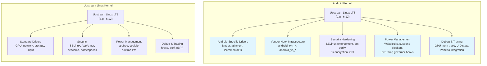

### 5.1.4 上游融合趋势

Google 一直在积极努力缩小 Android 通用内核与上游 Linux 之间的差异。多项历史上仅存在于 Android 的特性已经被上游化，或正处于这一过程中：

**已上游化或正在融合：**

- `PM_WAKELOCKS` —— wakelock 基础设施如今已是上游 Linux 的一部分
- PSI（压力停滞信息）—— 最初是为 Android 的 lmkd 开发的，现已成为标准内核特性
- 旧的内核内低内存杀手（`CONFIG_ANDROID_LOW_MEMORY_KILLER`）已被移除；Android 现在使用一个读取 PSI 事件的用户空间守护进程（lmkd）
- `memfd_create()` 正逐步在新代码中取代 `ashmem`
- ION 分配器已被上游的 DMA-BUF heap 框架取代

**仍然仅 Android 独有：**

- Binder 驱动（与 Android 的 IPC 模型深度集成）
- 增量文件系统（专为 APK 流式加载而设计）
- 供应商钩子（trace_android_rvh_* 和 trace_android_vh_*）
- 基于 UID 的资源统计（`CONFIG_UID_SYS_STATS`、`CONFIG_CPU_FREQ_TIMES`）

旧内核内低内存杀手被显式禁用这一点可以在基础配置片段中看到。在内核 6.12 的 Android 16（分支 `b`）配置中：

```
# CONFIG_ANDROID_LOW_MEMORY_KILLER is not set
```

**来源**：`kernel/configs/b/android-6.12/android-base.config`，第 2 行。

这一行就讲述了一段持续多年的迁移历程。内核的进程内 OOM 杀手已被一个复杂的用户空间守护进程所取代。该守护进程使用 PSI 事件来进行更智能的内存管理决策。

---

## 5.2 GKI（通用内核映像）

### 5.2.1 碎片化问题

在 GKI 出现之前，每一台 Android 设备都搭载一个独一无二的内核。SoC 供应商（高通、联发科、三星 LSI 等）会取一个 Android 通用内核分支，并为其 SoC 应用数百个补丁。然后他们会把它交给设备 OEM，后者再为其特定硬件应用更多补丁。结果是生态严重碎片化：

- 在没有供应商配合的情况下，安全补丁无法下发到内核
- 每台设备都有一个无法独立更新的独特内核二进制文件
- 内核缺陷的修复需要经过多个供应商代码树传播
- 由于没有两台设备运行相同的内核，大规模测试是不可能的

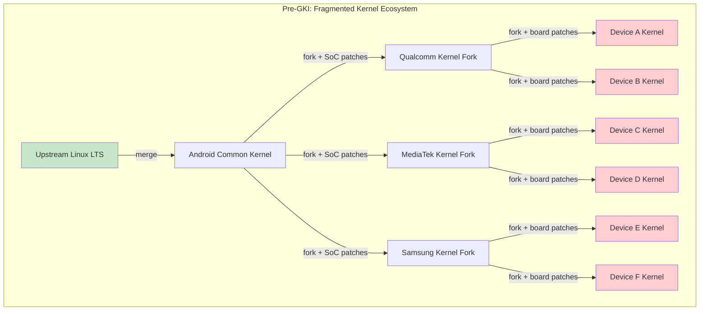

### 5.2.2 GKI 2.0 架构

GKI 通过将内核拆分为两部分来解决这个问题：

1. **GKI 核心内核** —— 由 Google 基于 Android 通用内核源码构建的单一二进制文件。对于使用同一内核版本的所有设备，该二进制文件完全相同。

2. **供应商模块** —— 可加载的内核模块（`.ko` 文件），包含所有 SoC 特定和设备特定的代码。这些模块由供应商针对稳定的内核模块接口（KMI）构建。

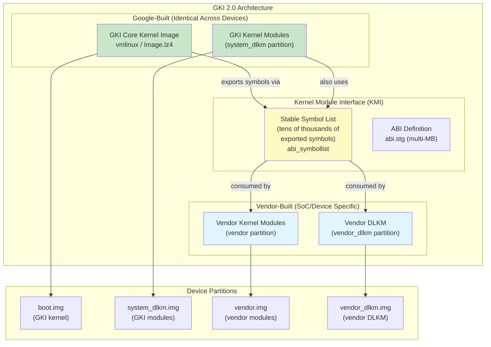

### 5.2.3 内核模块接口（KMI）

KMI 是 GKI 核心内核与供应商模块之间的契约。它由以下部分组成：

1. **符号列表** —— 供应商模块被允许调用的内核函数和变量集合。随着 KMI 被不断筛选，该列表的大小因分支而异。对于内核 6.6，它包含约 38,840 个条目。较新的 6.18 分支提供的是一份更精简的列表，大约有 22,961 个条目。

    **来源**：`kernel/prebuilts/6.6/arm64/abi_symbollist`，
    `kernel/prebuilts/6.18/arm64/abi_symbollist`

    符号列表以常用符号开头，并按以下分段组织：

    ```
    [abi_symbol_list]
    # commonly used symbols
        module_layout
        __put_task_struct
        utf8_data_table

    [abi_symbol_list]
        add_cpu
        add_device_randomness
        add_timer
        ...
    ```

2. **ABI 定义** —— 对 KMI 导出的类型、结构和函数签名的机器可读描述。对于内核 6.6，该文件大小约为 7.9 MB；6.18 分支的 `abi.stg` 大小相当（约 7.7 MB）。

    **来源**：`kernel/prebuilts/6.6/arm64/abi.stg`（7,908,320 字节），
    `kernel/prebuilts/6.18/arm64/abi.stg`（约 7.7 MB）

3. **模块版本控制**（`CONFIG_MODVERSIONS=y`）—— 会根据每个导出符号的原型为其计算 CRC 校验和。如果符号的签名发生变化，针对该符号某一版本编译的模块就无法被加载。

KMI 在每个 GKI 版本中都会被冻结。一旦冻结，Google 保证在该内核分支的整个生命周期内，符号列表和 ABI 都不会发生不兼容的向后变更。这使得供应商可以独立于内核更新来发布模块更新，反之亦然。

### 5.2.4 KMI 符号稳定性保证

配置选项 `CONFIG_MODVERSIONS=y` 会为每个导出符号启用编译期 CRC 生成。在 `b/android-6.12` 之前的每一个非空 Android 基础配置片段中都存在该选项。`c/` 和 `d/` 下用于 Android 17 的配置片段被刻意设为空（见 5.5.2 节）。当加载模块时，内核会检查模块中的 CRC 是否与运行中内核的 CRC 匹配。如果不匹配，模块加载会以类似下面的错误失败：

```
disagrees about version of symbol <name>
```

这就是 KMI 稳定性的强制执行机制：即使符号名存在，其类型签名的变更也会被检测出来并拒绝。

### 5.2.5 供应商钩子

由于供应商无法修改 GKI 核心内核，他们需要一种机制来为自己的 SoC 定制内核行为。GKI 通过**供应商钩子**提供了这种机制——供应商可以为其注册回调的轻量级跟踪点：

- **`android_vh_*`**（供应商钩子）—— 普通的基于跟踪点的钩子，可以在运行时挂接和卸载，但不得在原子上下文中调用。
- **`android_rvh_*`**（受限供应商钩子）—— 置于性能关键或原子路径中的钩子（调度器、IRQ 处理）。它们只能在启动时注册一次，并且永远无法卸载。

KMI 符号列表包含供应商钩子注册函数：

```
android_rvh_probe_register
```

**来源**：`kernel/prebuilts/6.6/arm64/abi_symbollist`，第 26 行

供应商钩子允许 SoC 供应商：

- 针对其 big.LITTLE/DynamIQ CPU 拓扑定制调度器
- 添加与特定传感器硬件绑定的热管理逻辑
- 实现自定义的内存管理策略
- 挂接到电源管理决策中

### 5.2.6 AOSP 中的 GKI 预构建内核

AOSP 代码树附带了预构建的 GKI 内核，供仿真器和参考设备使用。这些预构建产物包括：

```
kernel/prebuilts/
    6.1/
        arm64/
        x86_64/
    6.6/
        arm64/          # 113 entries, ~96 .ko modules
            kernel-6.6              # Uncompressed kernel image
            kernel-6.6-gz           # Gzip-compressed kernel
            kernel-6.6-lz4          # LZ4-compressed kernel
            kernel-6.6-allsyms      # Debug kernel with all symbols
            kernel-6.6-gz-allsyms   # Debug compressed kernel
            kernel-6.6-lz4-allsyms  # Debug LZ4 compressed kernel
            System.map               # Symbol address map
            System.map-allsyms       # Full symbol map
            abi_symbollist           # KMI symbol list
            abi_symbollist.raw       # Raw symbol names
            abi.stg                  # ABI definition (~7.8 MB)
            abi-full.stg             # Full ABI definition
            kernel_version.mk        # Version string for build system
            prebuilt-info.txt        # Build provenance metadata
            system_dlkm_staging/     # Staged system_dlkm content
            *.ko                     # ~96 GKI kernel modules
        x86_64/
    6.12/
        arm64/
        x86_64/
    6.18/                   # Android 17 GKI prebuilt (LTS 6.18)
        arm64/              # ~104 .ko modules; includes a 16k/ subtree
            16k/            # 16 KB page size variant of the same kernel + modules
        x86_64/
    common-modules/
        virtual-device/
            6.1/
            6.6/
                arm64/   # 54 device-specific modules
                x86-64/
            6.12/
            6.18/
            mainline/
        trusty/
    mainline/
        arm64/
        x86_64/
```

6.18 arm64 预构建产物的内核版本字符串揭示了它的血统：

```
BOARD_KERNEL_VERSION := 6.18.16-android17-1-gb61cd7ae4209-ab15097451-4k
```

**来源**：`kernel/prebuilts/6.18/arm64/kernel_version.mk`

将其拆解如下：

- `6.18.16` —— 上游 LTS 版本 6.18，补丁级别 16
- `android17` —— Android 17 ACK 分支
- `1` —— 该分支的首个版本（该分支在 Android 17 中是新出现的）
- `gb61cd7ae4209` —— git 提交哈希
- `ab15097451` —— Android 构建 ID
- `4k` —— 4 KB 页大小变体

`kernel/prebuilts/6.18/arm64/16k/` 下的 16 KB 页大小构建具有相同的血统，但没有 `-4k` 后缀：

```
BOARD_KERNEL_VERSION := 6.18.16-android17-1-gb61cd7ae4209-ab15097451
```

**来源**：`kernel/prebuilts/6.18/arm64/16k/kernel_version.mk`

作为对比，较旧的 Android 15 / 内核 6.6 预构建产物显示为 `6.6.119-android15-8-gf79a8f9ddb6e-ab14880967-4k`。它的解读方式相同（LTS 6.6 补丁级别 119，Android 15 ACK 分支，第八个版本）。

**来源**：`kernel/prebuilts/6.6/arm64/kernel_version.mk`

### 5.2.7 GKI 版本生命周期

每个 GKI 内核分支都有明确定义的生命周期，包含启动日期和终止支持（EOL）日期。这些记录在 `kernel/configs/kernel-lifetimes.xml` 中：

```xml
<branch name="android16-6.12"
        min_android_release="16"
        version="6.12"
        launch="2024-11-17"
        eol="2029-07-01">
    <lts-versions>
        <release version="6.12.23" launch="2025-06-12" eol="2026-10-01"/>
        <release version="6.12.30" launch="2025-07-11" eol="2026-11-01"/>
        <release version="6.12.38" launch="2025-08-11" eol="2027-01-01"/>
        <release version="6.12.58" launch="2025-12-11" eol="2027-04-01"/>
    </lts-versions>
</branch>
<branch name="android17-6.18"
        min_android_release="17"
        version="6.18"
        launch="2025-11-30"
        eol="2030-07-01">
    <no-releases reason="branch in pre-release phase"/>
</branch>
```

**来源**：`kernel/configs/kernel-lifetimes.xml`，第 157-167 行

从该文件中可以得出以下关键观察：

- 内核分支跨越多年（例如 android14-6.1 从 2022 年延续到 2029 年）
- 每个分支都有带各自 EOL 日期的特定 LTS 版本
- 季度 GKI 版本通常具有约 14 到 17 个月的支持窗口，近期条目集中在 15-16 个月左右
- 较旧的分支（5.10 之前）被标记为“非 GKI 内核”，因为 GKI 是随着面向 Android 12 的内核 5.10 引入的

受支持内核版本的完整血统如下：

| 分支 | 内核 | 最低 Android | 启动 | EOL |
|--------|--------|-------------|--------|-----|
| android12-5.10 | 5.10 | 12 | 2020-12 | 2027-07 |
| android13-5.10 | 5.10 | 13 | 2020-12 | 2027-07 |
| android13-5.15 | 5.15 | 13 | 2021-10 | 2028-07 |
| android14-5.15 | 5.15 | 14 | 2021-10 | 2028-07 |
| android14-6.1 | 6.1 | 14 | 2022-12 | 2029-07 |
| android15-6.6 | 6.6 | 15 | 2023-10 | 2028-07 |
| android16-6.12 | 6.12 | 16 | 2024-11 | 2029-07 |
| android17-6.18 | 6.18 | 17 | 2025-11 | 2030-07 |

`android17-6.18` 分支是最新的条目。在 Android 17 源代码树被切出时，它仍处于预发布阶段。其条目带有 `<no-releases reason="branch in pre-release phase"/>` 标记，而不是一份份单独的 LTS 版本列表。这是因为当时还没有为它发布任何季度 GKI 版本。还要注意，Android 11（`r/`）内核配置片段在本轮中被移除了，从而退役了最旧的仍在跟踪的配置目录。

### 5.2.8 供应商如何在不进行分支的情况下扩展

在 GKI 下，供应商扩展模型的运作方式如下：

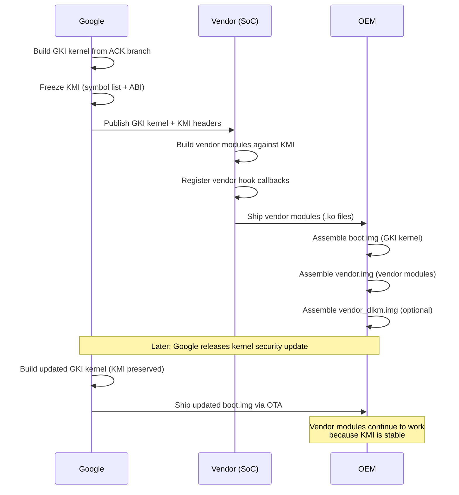

这种分离意味着：

- Google 可以在无需供应商参与的情况下为安全修复更新内核
- 供应商可以更新自己的模块而无需等待内核更新
- OEM 可以在相同的 KMI 代际内，自由搭配 GKI 内核版本与供应商模块版本

---

## 5.3 Android 特有的关键内核特性

### 5.3.1 Binder 驱动

Binder 是 Android 的进程间通信（IPC）机制。应用与系统服务之间的每一次交互——启动一个 Activity、绑定一个 Service、查询一个 ContentProvider、发送一个 Intent——都要流经 Binder。Binder 驱动正是使这一切成为可能的内核组件。

#### 内核配置

Binder 需要在 Android 基础配置中启用两个配置选项：

```
CONFIG_ANDROID_BINDER_IPC=y
CONFIG_ANDROID_BINDERFS=y
```

**来源**：`kernel/configs/b/android-6.12/android-base.config`，第 18-19 行

`CONFIG_ANDROID_BINDERFS` 选项启用 `binderfs`，这是一个特殊的文件系统，允许动态创建 Binder 设备节点。它取代了过去将 `/dev/binder`、`/dev/hwbinder` 和 `/dev/vndbinder` 创建为静态设备节点的做法。

#### 事务模型

Binder 驱动实现了一个同步 RPC 机制，具有以下特征：

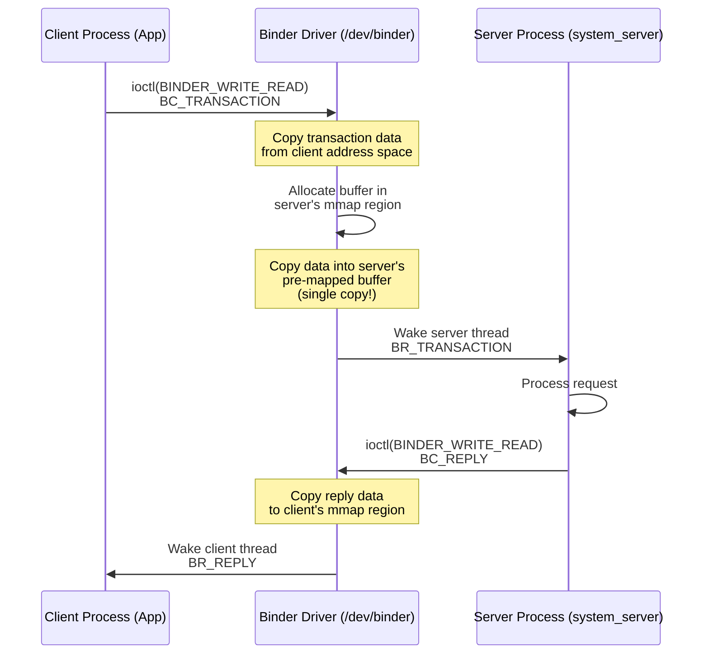

事务模型的关键方面：

1. **单次拷贝数据传输**：Binder 驱动使用 `mmap()` 在服务进程的地址空间中创建一个共享内存区域。当客户端发送事务时，驱动将数据直接从客户端的用户空间缓冲区拷贝到服务端已映射的区域。这意味着数据只拷贝一次（客户端用户空间到服务端内核映射缓冲区）。传统的 IPC 机制需要两次拷贝（客户端到内核、内核到服务端）。

2. **对象转换**：Binder 句柄（对远程对象的引用）会在事务跨越进程边界时由驱动进行转换。驱动维护着一个带引用计数的映射，记录 Binder 节点及其代理句柄。

3. **死亡通知**：一个进程可以注册以在另一个进程中的 Binder 对象消亡时收到通知。驱动跟踪这些注册，并在宿主进程退出时发送 `BR_DEAD_BINDER` 通知。

4. **安全上下文传播**：驱动将调用方的 PID、UID 和 SELinux 安全上下文嵌入到每个事务中，使服务端能够做出授权决策。

#### 内存映射

每个打开 Binder 设备的进程都会使用 `mmap()` 映射一段内存区域。该区域由驱动用于传递事务数据：

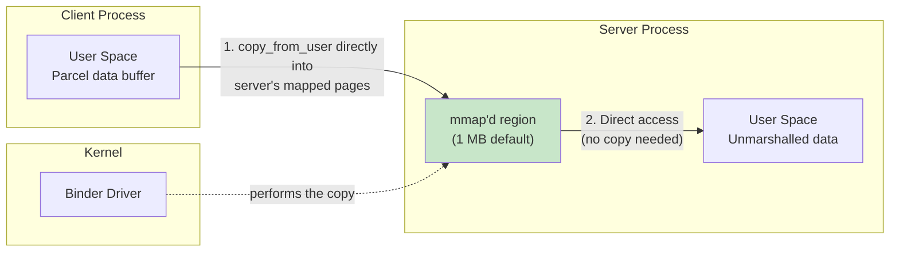

默认的 mmap 大小是 1 MB 减去两个页（1,048,576 - 8,192 = 1,040,384 字节）。这是单个进程的传入事务在任一时刻可处于传输中的最大数据量。

#### 线程管理

Binder 驱动为每个进程管理一个线程池：

- 当一个进程打开 Binder 设备时，它会通过 `BINDER_SET_CONTEXT_MGR` 注册自己（针对 servicemanager），或开始处理事务。
- 当所有现有线程都繁忙时，驱动可以通过 `BR_SPAWN_LOOPER` 请求创建新线程。
- 最大线程数通过 `BINDER_SET_MAX_THREADS` 设置。
- 线程通过 `ioctl(BINDER_WRITE_READ)` 进入驱动，并阻塞等待事务到达或有回复需要传递。

Binder 线程管理的用户空间部分实现在 `frameworks/native/libs/binder/IPCThreadState.cpp` 中：

```cpp
// frameworks/native/libs/binder/IPCThreadState.cpp
#include <binder/IPCThreadState.h>
#include <sys/ioctl.h>
#include "binder_module.h"
```

**来源**：`frameworks/native/libs/binder/IPCThreadState.cpp`

#### 三个 Binder 域

现代 Android 使用三个相互独立的 Binder 域，每个域都有自己的设备节点，以强制 Treble 架构的分离：

| 域 | 设备 | 用途 | 使用者 |
|--------|--------|---------|-------|
| 框架 | `/dev/binder` | 应用到框架的 IPC | 应用、system_server |
| 硬件 | `/dev/hwbinder` | 框架到 HAL 的 IPC | system_server、HAL 进程 |
| 供应商 | `/dev/vndbinder` | 供应商内部 IPC | 仅限供应商进程 |

借助 `binderfs`（`CONFIG_ANDROID_BINDERFS=y`），这些设备节点通过挂载 binderfs 文件系统动态创建，而不是通过 `mknod` 静态创建。这使得容器化的 Android 实例可以拥有自己隔离的 Binder 命名空间。

### 5.3.2 DMA-BUF Heap 系统

#### 从 ION 到 DMA-BUF Heaps

ION 内存分配器是 Android 最初用于分配物理连续或受其他特殊约束的内存缓冲区的方案。GPU、相机、视频编解码器和显示硬件都使用这些缓冲区。ION 是主线内核 staging 区域（`drivers/staging/android/ion`）中的一个 Android 专有驱动；在被移除之前，它从未走出 staging 区域。

从内核 5.10 开始，ION 已被上游的 **DMA-BUF heap 框架**取代。该框架提供相同的功能——分配可在硬件设备与用户空间之间共享的具备 DMA 能力的缓冲区——但通过标准的上游内核接口实现。

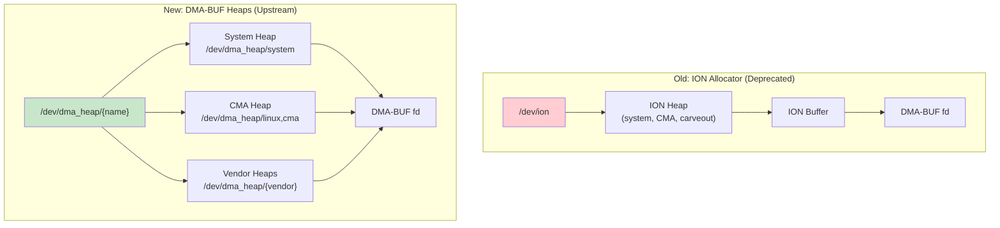

#### DMA-BUF Heaps 的工作原理

1. **Heap 注册**：内核驱动向 DMA-BUF heap 框架注册 heap，每个 heap 都作为 `/dev/dma_heap/` 下的一个字符设备出现。

2. **分配**：用户空间打开相应的 heap 设备并调用 `ioctl(DMA_HEAP_IOCTL_ALLOC)` 来分配一个缓冲区。返回的文件描述符就是一个 DMA-BUF fd。

3. **共享**：DMA-BUF fd 可以通过 Unix 域套接字或 Binder 传递给其他进程。任何拥有该 fd 的进程都可以将缓冲区映射到自己的地址空间，或将其传递给硬件设备驱动。

4. **零拷贝流水线**：GPU、相机和显示都可以通过 DMA-BUF fd 引用同一块物理内存，从而避免图形流水线中的拷贝。

模拟器的 goldfish 模块包含一个 `system_heap.ko` 模块，它为虚拟设备提供一个 DMA-BUF system heap：

**来源**：`prebuilts/qemu-kernel/arm64/6.12/goldfish_modules/system_heap.ko`

#### 配置

GKI 基础配置要求 sync file 支持，这是面向用户空间的 DMA-BUF 同步栅栏接口：

```
CONFIG_SYNC_FILE=y
```

**来源**：`kernel/configs/b/android-6.12/android-base.config`，第 238 行

### 5.3.3 FUSE 直通与存储访问

#### 存储访问问题

Android 的存储模型经历了多次修订：

1. **直到 Android 10**：SDCardFS（一种可堆叠文件系统）提供带有不同权限集的逐应用存储视图。
2. **Android 11+**：SDCardFS 被弃用，改用 FUSE，FUSE 完全在用户空间通过 MediaProvider 进程运行。
3. **Android 12+**：引入了 FUSE 直通，以挽回因将所有 I/O 经由用户空间守护进程路由而损失的性能。

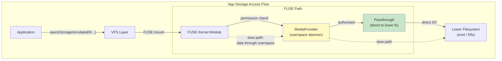

#### FUSE 直通的工作原理

FUSE 直通让 FUSE 守护进程（MediaProvider）可以表明某些文件操作应当由内核直接处理。这些操作在数据传输时绕过 FUSE 用户空间守护进程：

1. 应用通过 FUSE 挂载打开一个文件（例如 `/storage/emulated/0/Download/photo.jpg`）。
2. FUSE 内核模块向 MediaProvider 发送一个 `OPEN` 请求。
3. MediaProvider 检查权限。如果应用已获授权，MediaProvider 会在真实文件系统上打开底层文件，然后告诉 FUSE 内核模块对该文件使用直通。
4. 此后应用发出的 `read()` 和 `write()` 调用会直接从 FUSE 内核模块到达底层文件系统，完全绕过 MediaProvider。

这在保留了 MediaProvider 权限检查所带来的安全优势的同时，为实际数据 I/O 恢复了接近原生的文件系统性能。

#### 配置

FUSE 文件系统支持在 Android 基础配置中是强制的：

```
CONFIG_FUSE_FS=y
```

**来源**：`kernel/configs/b/android-6.12/android-base.config`，第 69 行

### 5.3.4 Incremental FS

#### 目的与设计

Incremental FS（`incfs`）使 Android 能够在 APK 的所有数据下载完成之前就开始使用它。这是支持 Android“增量 APK 安装”特性的内核组件，该特性允许大型应用（尤其是游戏）在仍在流式加载数据的同时启动。

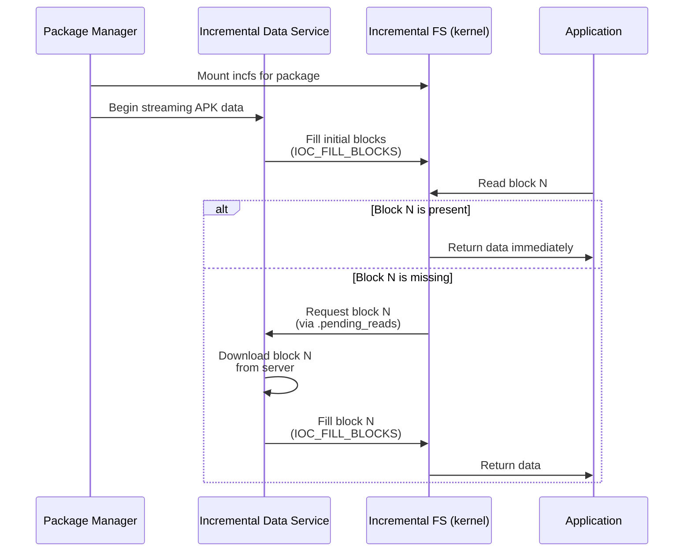

#### 内核接口

Incremental FS 内核模块通过在用户空间头文件 `system/incremental_delivery/incfs/kernel-headers/linux/incrementalfs.h` 中定义的 ioctl 命令暴露其接口：

```c
#define INCFS_NAME "incremental-fs"
#define INCFS_MAGIC_NUMBER (0x5346434e49ul & ULONG_MAX)
#define INCFS_DATA_FILE_BLOCK_SIZE 4096

#define INCFS_IOC_CREATE_FILE \
    _IOWR(INCFS_IOCTL_BASE_CODE, 30, struct incfs_new_file_args)
#define INCFS_IOC_FILL_BLOCKS \
    _IOR(INCFS_IOCTL_BASE_CODE, 32, struct incfs_fill_blocks)
#define INCFS_IOC_GET_FILLED_BLOCKS \
    _IOR(INCFS_IOCTL_BASE_CODE, 34, struct incfs_get_filled_blocks_args)
```

**来源**：`system/incremental_delivery/incfs/kernel-headers/linux/incrementalfs.h`

关键设计特征：

1. **块级粒度**：文件被划分为 4 KB 的块。每个块可以独立地存在或缺失。

2. **按需分页**：当一个进程读取尚未送达的块时，内核会阻塞该读取。它会通过 `.pending_reads` 特殊文件向用户空间数据加载器发出信号，要求获取该块。

3. **压缩支持**：块可以使用 LZ4 或 Zstd 压缩存储：
   ```c
   enum incfs_compression_alg {
     COMPRESSION_NONE = 0,
     COMPRESSION_LZ4 = 1,
     COMPRESSION_ZSTD = 2,
   };
   ```

4. **完整性校验**：Incremental FS 支持逐文件哈希树（`INCFS_BLOCK_FLAGS_HASH`）和 fs-verity 集成（`INCFS_XATTR_VERITY_NAME`），以在块到达时校验其完整性。

5. **特殊文件**：该文件系统暴露了若干用于监控和控制的特殊文件：
    - `.pending_reads` —— 由数据加载器读取，用于发现哪些块是需要的
    - `.log` —— 用于调试的访问日志
    - `.blocks_written` —— 跟踪写入进度
    - `.index` —— 将文件 ID 映射到 inode
    - `.incomplete` —— 列出尚未完全加载的文件

#### 用户空间集成

用户空间组件位于 `system/incremental_delivery/incfs/`：

```
system/incremental_delivery/
    incfs/
        Android.bp
        incfs.cpp           # Core incfs library
        incfs_ndk.c         # NDK interface
        MountRegistry.cpp   # Mount point tracking
        path.cpp            # Path utilities
        kernel-headers/
            linux/
                incrementalfs.h  # Kernel UAPI header
    libdataloader/          # Data loader service interface
    sysprop/                # System properties for incfs
```

**来源**：`system/incremental_delivery/incfs/`

### 5.3.5 Ashmem 与共享内存

Android 共享内存（ashmem）提供有名、带引用计数的共享内存区域。它在基础配置中是必需的：

```
CONFIG_ASHMEM=y
```

**来源**：`kernel/configs/b/android-6.12/android-base.config`，第 20 行

Ashmem 在几个方面不同于标准的 POSIX 共享内存（`shm_open`）：

- 区域可以被锁定和解除锁定，允许内核在内存压力下回收未锁定的页
- 区域通过文件描述符进行引用计数——当最后一个 fd 关闭时，内存被释放
- 一个区域的保护只能通过 `ASHMEM_SET_PROT_MASK` ioctl 被进一步收紧。真正使用 `F_ADD_SEALS` 的文件封印仅存在于 `system/core/libcutils/ashmem-dev.cpp` 中 `memfd` 替代路径上。

出于向后兼容考虑，Ashmem 仍然是必需的。鼓励新代码使用 `memfd_create()`。它是上游 Linux 的等价方案，通过标准内核 API 提供类似功能。

### 5.3.6 Wakelock 与电源管理

Android 的 wakelock 机制可防止系统在关键操作进行期间进入挂起状态。内核组件为：

```
CONFIG_PM_WAKELOCKS=y
```

**来源**：`kernel/configs/b/android-6.12/android-base.config`，第 210 行

请注意，`CONFIG_PM_AUTOSLEEP` 被显式禁用：

```
# CONFIG_PM_AUTOSLEEP is not set
```

**来源**：`kernel/configs/b/android-6.12/android-base.config`，第 12 行

这是因为 Android 是从用户空间（通过 PowerManager 服务）而不是依赖内核的 autosleep 机制来管理睡眠/唤醒周期的。

wakelock 接口通过以下内容暴露：

- `/sys/power/wake_lock` —— 写入一个 wakelock 名称以获取
- `/sys/power/wake_unlock` —— 写入一个 wakelock 名称以释放

用户空间的 PowerManager 服务（在 system_server 中）使用这些接口来实现 Android 的机会式挂起模型。在该模型中，除非有东西持有 wakelock，系统会激进地尝试进入挂起状态。

### 5.3.7 低内存杀手守护进程（lmkd）

内核内低内存杀手（`CONFIG_ANDROID_LOW_MEMORY_KILLER`）已从现代 Android 内核中移除。它被一个用户空间守护进程 `lmkd` 取代，后者在内存压力下对要杀死哪些进程做出更智能的决策。

#### 架构

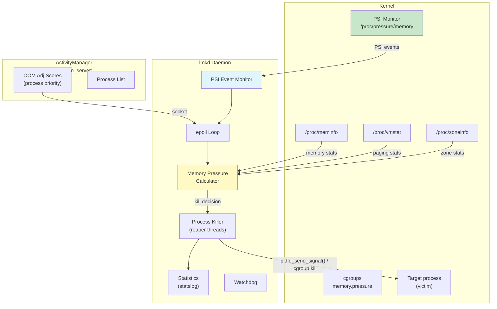

#### 基于 PSI 的触发

lmkd 使用内核的压力停滞信息（PSI）接口来检测内存压力。PSI 是 Google 与内核社区密切协作开发的，现已成为标准内核特性。

lmkd 中的 PSI 监控器配置：

```c
#define DEFAULT_PSI_WINDOW_SIZE_MS 1000
#define PSI_POLL_PERIOD_SHORT_MS 10
#define PSI_POLL_PERIOD_LONG_MS 100
```

**来源**：`system/memory/lmkd/lmkd.cpp`，第 122-126 行

PSI 接口通过 libpsi 库初始化：

```c
// system/memory/lmkd/libpsi/psi.cpp
int init_psi_monitor(enum psi_stall_type stall_type,
                     int threshold_us,
                     int window_us,
                     enum psi_resource resource) {
    fd = TEMP_FAILURE_RETRY(open(psi_resource_file[resource],
                                 O_WRONLY | O_CLOEXEC));
```

**来源**：`system/memory/lmkd/libpsi/psi.cpp`

#### OOM 调整分数

lmkd 从 system_server 中的 ActivityManager 接收进程优先级信息。每个进程都被分配一个反映其重要程度的 OOM 调整分数：

```c
#define SYSTEM_ADJ (-900)        // System processes (never kill)
#define PERCEPTIBLE_APP_ADJ 200  // Perceptible but not foreground
#define PREVIOUS_APP_ADJ 700     // Previous foreground app
```

**来源**：`system/memory/lmkd/lmkd.cpp`，第 84-85、103 行

当检测到内存压力时，lmkd 从最高的 OOM 调整分数（最不重要）开始杀进程，并向下处理，直到释放了足够的内存。

#### 关键源文件

```
system/memory/lmkd/
    lmkd.cpp            # Main daemon logic
    lmkd.rc             # init.rc service definition
    reaper.cpp           # Process kill execution (using pidfd)
    reaper.h
    watchdog.cpp         # Watchdog timer for lmkd hangs
    watchdog.h
    statslog.cpp         # Statistics reporting
    statslog.h
    libpsi/
        psi.cpp          # PSI monitor interface
        include/
            psi/psi.h    # PSI header
    liblmkd_utils.cpp   # Utility functions
```

**来源**：`system/memory/lmkd/`

### 5.3.8 dm-verity 与验证启动

dm-verity 是一个 device-mapper 目标，提供块设备的透明完整性检查。Android 在启动过程中用它来验证系统分区的完整性：

```
CONFIG_DM_VERITY=y
```

**来源**：`kernel/configs/b/android-6.12/android-base.config`，第 60 行

dm-verity 通过维护整个分区的哈希树（Merkle 树）来工作。在每次读取时，驱动计算数据块的哈希值，并对照哈希树进行验证。如果验证失败，读取会返回一个 I/O 错误。

#### dm-verity 的 Merkle 树如何工作

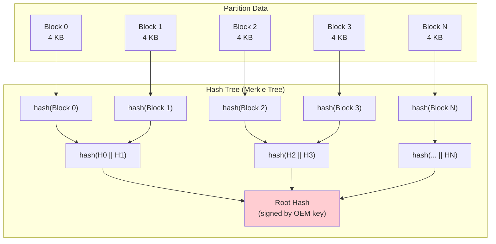

根哈希由设备 OEM 的密钥签名，并在加载内核之前由引导加载程序验证。这建立了一条从引导加载程序到系统分区上每一个数据块的、不间断的信任链。

dm-verity 以多种模式运行，通过 `androidboot.veritymode` 选择，并由 `system/fs/fs_mgr/libfs_avb/avb_util.cpp` 映射到内核的 dm-verity 错误处理模式：

- **强制模式**（`restart_on_corruption`）：在读到损坏的块时设备重启。
- **恐慌模式**（`panic_on_corruption`）：内核在遇到损坏的块时恐慌。
- **记录模式**（`ignore_corruption`）：验证失败会被记录，但读取成功。开发期间使用。
- **EIO**（`androidboot.veritymode=eio`）：不传递 dm-verity 错误模式参数，因此应用内核的默认行为。对损坏块的读取返回 `EIO`，设备继续运行。请注意，当 `androidboot.veritymode` 完全不存在时，`fs_mgr` 默认采用 *强制模式*（`restart_on_corruption`），而不是 EIO。

Android 中的验证启动链结合了多个内核子系统：

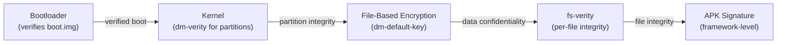

完整验证启动链的相关配置选项：

```
CONFIG_DM_DEFAULT_KEY=y          # Default key for dm-crypt
CONFIG_DM_SNAPSHOT=y             # Snapshot support for OTA
CONFIG_FS_ENCRYPTION=y           # File-based encryption
CONFIG_FS_ENCRYPTION_INLINE_CRYPT=y  # Hardware inline crypto
CONFIG_FS_VERITY=y               # Per-file integrity (fs-verity)
CONFIG_BLK_INLINE_ENCRYPTION=y   # Block-level inline encryption
```

#### 基于文件的加密（FBE）

Android 使用基于文件的加密而非全盘加密。这允许不同的文件使用不同的密钥加密。这使得 Direct Boot 等特性成为可能。借助 Direct Boot，设备可以在用户解锁之前显示锁屏并接听电话。

加密配置可以在模拟器的 fstab 中看到：

```
/dev/block/vdc  /data  ext4  ...  fileencryption=aes-256-xts:aes-256-cts,...
```

**来源**：`device/generic/goldfish/board/fstab/arm`

它指定了：

- `aes-256-xts` 用于文件内容加密（提供机密性）
- `aes-256-cts` 用于文件名加密（防止元数据泄露）

#### fs-verity：逐文件完整性

虽然 dm-verity 保护整个分区，但 fs-verity（`CONFIG_FS_VERITY=y`）提供逐文件完整性验证。它用于：

- 在安装后验证 APK 文件（补充 APK 签名）
- 保护可写分区上的系统文件
- 确保下载内容的完整性

fs-verity 使用与 dm-verity 相同的 Merkle 树概念，但将其应用于单个文件。一旦文件启用了 fs-verity，对其内容的任何修改都会在下一次读取时被检测为哈希不匹配。

### 5.3.9 eBPF 集成

Android 在网络、监控和安全方面广泛使用 eBPF（扩展的 Berkeley Packet Filter）：

```
CONFIG_BPF_JIT=y
CONFIG_BPF_SYSCALL=y
CONFIG_CGROUP_BPF=y
CONFIG_NETFILTER_XT_MATCH_BPF=y
CONFIG_NET_ACT_BPF=y
CONFIG_NET_CLS_BPF=y
```

**来源**：`kernel/configs/b/android-6.12/android-base.config`

6.12 配置还额外要求：

```
CONFIG_BPF_JIT_ALWAYS_ON=y
```

eBPF 程序在启动期间从 `/system/etc/bpf/` 加载，并用于：

- 按 UID 统计网络流量
- 网络防火墙规则
- CPU 频率跟踪
- 跟踪与性能分析

#### Android 上的 eBPF 架构

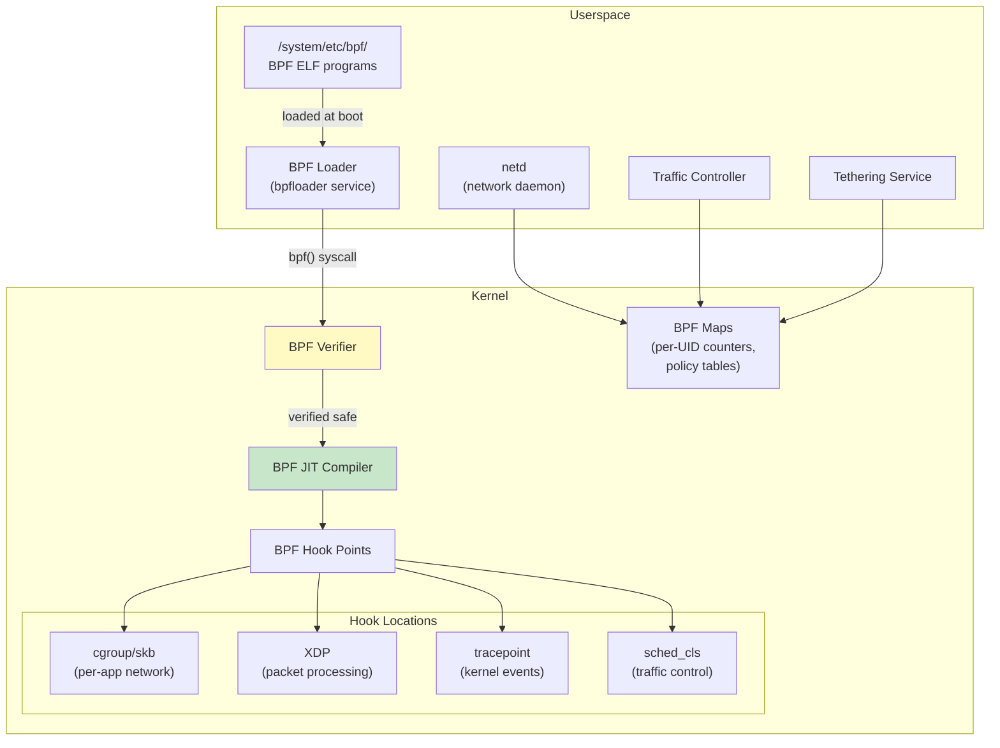

BPF 加载器（`bpfloader`）是启动期间最先启动的服务之一。它从 `/system/etc/bpf/` 加载一份固定的 `.bpf` ELF 对象列表。该列表硬编码在 `system/bpf/loader/bpfloader.rs` 中，条目包括 `/system/etc/bpf/gpuMem.bpf` 和 `/system/etc/bpf/cputimeinstate/timeInState.bpf`。它还会扫描 `/vendor/etc/bpf/` 中供应商提供的 `.o` 文件（`system/bpf/loader/Loader.cpp` 中的 `loadAllElfObjects()`）。它将结果固定到 `/sys/fs/bpf/` 的 BPF 文件系统中。随后，`netd` 和网络共享（tethering）服务等其他服务会挂接到这些已固定的程序上。

Android 上关键的 eBPF 用例：

1. **按 UID 统计流量**：挂接到 cgroup 套接字钩子的 BPF 程序统计每个 UID 发送和接收的字节数。这为“设置”应用的数据用量显示和逐应用数据限制提供支持。

2. **网络防火墙**：BPF 程序实现了用于逐应用网络访问控制的 iptables 替代品，既提供更好的性能，也提供更细粒度的控制。

3. **网络共享卸载**：BPF 程序处理 USB/WiFi 网络共享的包转发，将包处理从用户空间（慢）移至内核 BPF（快）。

4. **CPU 频率跟踪**：挂接到调度器跟踪点的 BPF 程序跟踪每个 UID 在各个 CPU 频率上花费的时间，从而能够准确归因电池用量。

### 5.3.10 SELinux 强制

SELinux（Security-Enhanced Linux）在 Android 上是强制的，并在内核层面配置：

```
CONFIG_SECURITY=y
CONFIG_SECURITY_NETWORK=y
CONFIG_SECURITY_SELINUX=y
CONFIG_DEFAULT_SECURITY_SELINUX=y
```

**来源**：`kernel/configs/b/android-6.12/android-base.config`，第 224-226、57 行

Android 在生产设备上以强制模式运行 SELinux。每个进程、文件、套接字和内核对象都被分配一个安全标签。SELinux 策略（从 AOSP 树中的 `.te` 文件编译而来）定义了带标签对象之间允许哪些操作。

内核的 SELinux 子系统：

- 为所有内核对象（inode、套接字、进程、IPC 对象）打标签
- 通过 Linux 安全模块（LSM）钩子拦截与安全相关的系统调用
- 对照加载的策略检查每个操作
- 拒绝未被显式允许的操作
- 将拒绝的操作记录到审计子系统（`CONFIG_AUDIT=y`）

SELinux 是将应用限制在沙箱中、防止权限提升并限制被攻陷系统服务影响的主要机制。

### 5.3.11 Seccomp 过滤器

除 SELinux 之外，Android 还使用 seccomp-BPF 过滤器来限制每个进程可用的系统调用：

```
CONFIG_SECCOMP=y
CONFIG_SECCOMP_FILTER=y
```

**来源**：`kernel/configs/b/android-6.12/android-base.config`，第 222-223 行

Seccomp 过滤器使用 BPF 程序（不是 eBPF——这些是经典 BPF）来检查每个系统调用及其参数。如果某个系统调用不在允许列表中，该进程会以 SIGSYS 被杀死。这提供了深度防御：即使攻击者逃出了 SELinux 沙箱，他们仍然无法调用危险的系统调用。

Android 的 seccomp 策略是按架构定义的。它们在进程专门化期间被安装到 fork 出的子进程中。`frameworks/base/core/jni/com_android_internal_os_Zygote.cpp` 中的 `SpecializeCommon()` 在 fork 之后调用 `SetUpSeccompFilter()`。它会根据新进程的 UID 选择应用、app-zygote 或系统过滤器。

### 5.3.12 Cgroups 与资源控制

Android 广泛使用 Linux cgroups（控制组）进行资源管理：

```
CONFIG_CGROUPS=y
CONFIG_CGROUP_BPF=y
CONFIG_CGROUP_CPUACCT=y
CONFIG_CGROUP_FREEZER=y
CONFIG_CGROUP_SCHED=y
```

**来源**：`kernel/configs/b/android-6.12/android-base.config`，第 34-38 行

这些 cgroup 服务于特定的 Android 用途：

| Cgroup 子系统 | 配置 | Android 用途 |
|-----------------|--------|---------------|
| cpuacct | `CONFIG_CGROUP_CPUACCT` | 按 UID 统计 CPU 时间 |
| freezer | `CONFIG_CGROUP_FREEZER` | 冻结缓存/后台应用 |
| cpu (sched) | `CONFIG_CGROUP_SCHED` | 应用组的 CPU 调度优先级 |

| bpf | `CONFIG_CGROUP_BPF` | 通过 BPF 进行逐应用网络控制 |

Android 上的 cgroup 层级由 `init` 和 `system_server` 进程管理。模拟器的 init 脚本展示了顶层 cgroup 的设置：

```
on init
    mkdir /dev/cpuctl/foreground
    mkdir /dev/cpuctl/background
    mkdir /dev/cpuctl/top-app
    mkdir /dev/cpuctl/rt
```

**来源**：`device/generic/goldfish/init/init.ranchu.rc`，第 49-52 行

这些 cgroup 目录对应 Android 的进程调度组：

- **top-app**：用户当前可见的前台应用
- **foreground**：用户感知到的进程（例如音乐播放器）
- **background**：在后台运行的进程
- **rt**：实时优先级进程（音频、传感器处理）

---

## 5.4 设备树与板级支持

### 5.4.1 设备树基础

设备树是一种描述系统硬件拓扑的数据结构。在 ARM 和 RISC-V 平台上，引导加载程序会将设备树二进制（DTB）传递给内核，内核用它来发现并配置硬件设备。

之所以需要设备树，是因为 ARM 和 RISC-V 系统没有让内核探测硬件的标准机制。x86 系统不同，因为它们使用 ACPI 进行硬件发现。设备树填补了这个空白。

Android 基础配置强制要求至少存在一种硬件描述机制：

```xml
<!-- CONFIG_ACPI || CONFIG_OF -->
<group>
    <conditions>
        <config>
            <key>CONFIG_ACPI</key>
            <value type="bool">n</value>
        </config>
    </conditions>
    <config>
        <key>CONFIG_OF</key>
        <value type="bool">y</value>
    </config>
</group>
```

**来源**：`kernel/configs/b/android-6.12/android-base-conditional.xml`，第 148-172 行

这个条件性要求意味着：如果 ACPI 被禁用，那么必须启用设备树（`CONFIG_OF`），反之亦然。ARM 设备使用 OF（Open Firmware / 设备树）；x86 设备通常使用 ACPI。

### 5.4.2 DTS、DTB 与 DTBO

设备树数据流经几种格式：

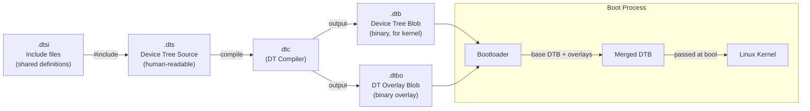

- **DTS**（设备树源）：描述硬件的人类可读文本文件。它们使用树状结构，节点代表设备，属性描述其配置。
- **DTSI**（设备树源包含文件）：由多个 DTS 文件包含的共享定义。通常，SoC 定义在一个 DTSI 中，每个板的 DTS 包含它并添加板级特定节点。
- **DTB**（设备树二进制）：DTS 文件的编译二进制形式。这是内核实际解析的内容。
- **DTBO**（设备树二进制覆盖）：一个编译后的覆盖层，可以应用在基础 DTB 之上。覆盖层允许在不修改基础 SoC DTB 的情况下进行板级定制。

### 5.4.3 设备树覆盖层（DTBO）

Android 广泛使用设备树覆盖层来分离 SoC 级和板级硬件描述：

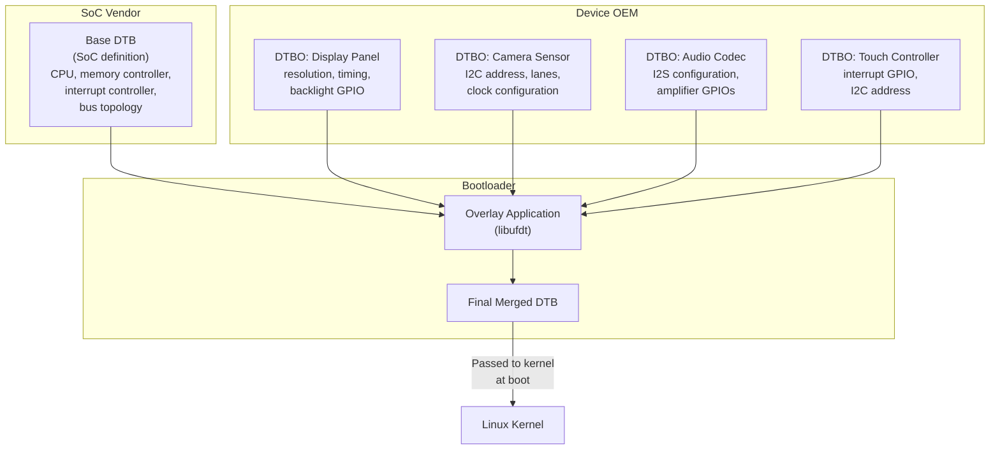

DTBO 分区是标准的 Android 分区，包含一个或多个覆盖层。启动期间，引导加载程序读取基础 DTB。基础 DTB 通常被编译进内核映像或存储在一个单独的分区中。引导加载程序从 DTBO 分区读取覆盖层，并使用 libufdt 库应用它们。然后它将合并后的结果传递给内核。

### 5.4.4 模拟器（Goldfish）设备树

Android 模拟器使用设备树来描述其虚拟硬件，但它并不自带一个签入的 DTB。与虚拟设备通用模块一起发布的唯一一个预编译 DTB 属于另一个目标。它是 Arm 的固定虚拟平台（FVP）Base RevC 模型的设备树。它与 FVP 特定的模块一起分发，例如 `vexpress-config.ko` 和 `pl111_drm.ko`：

**来源**：`kernel/prebuilts/common-modules/virtual-device/6.6/arm64/fvp-base-revc.dtb`

`device/generic/goldfish/` 中的模拟器板配置明确声明它在启动映像中不包含 DTB：

```makefile
BOARD_INCLUDE_DTB_IN_BOOTIMG := false
```

**来源**：`device/generic/goldfish/board/BoardConfigCommon.mk`，第 76 行

相反，模拟器的 QEMU 宿主通过以下内容的结合提供设备信息：

1. QEMU 传递给虚拟机的设备树
2. 准虚拟化设备的 virtio 设备发现
3. goldfish 特定虚拟硬件的平台设备注册

模拟器的 goldfish 虚拟平台包含这些设备特定的内核模块：

```
goldfish_address_space.ko  # Virtual address space for host communication
goldfish_battery.ko        # Virtual battery with host-controlled state
goldfish_pipe.ko           # High-bandwidth host-guest communication pipe
goldfish_sync.ko           # Synchronization primitives for GPU emulation
```

**来源**：`prebuilts/qemu-kernel/arm64/6.12/goldfish_modules/`

### 5.4.5 虚拟设备模块

除了 goldfish 特定模块之外，模拟器还加载大量 GKI 和虚拟设备模块。内核 6.6 arm64 的虚拟设备通用模块包含 54 个模块：

```
kernel/prebuilts/common-modules/virtual-device/6.6/arm64/
    virtio_dma_buf.ko       # DMA buffer sharing via virtio
    virtio_mmio.ko          # Memory-mapped virtio transport
    virtio-rng.ko           # Virtual random number generator
    virtio_net.ko           # Virtual network adapter
    virtio_input.ko         # Virtual input devices
    virtio_snd.ko           # Virtual sound device
    virtio-gpu.ko           # Virtual GPU (3D acceleration)
    virtio-media.ko         # Virtual media device
    cfg80211.ko             # Wireless configuration
    mac80211.ko             # IEEE 802.11 wireless stack
    mac80211_hwsim.ko       # Simulated wireless hardware
    system_heap.ko          # DMA-BUF system heap
    ...
```

**来源**：`kernel/prebuilts/common-modules/virtual-device/6.6/arm64/`

### 5.4.6 设备树语法参考

以下是 goldfish 风格设备树的一个简化示例：

```dts
/dts-v1/;

/ {
    compatible = "android,goldfish";
    #address-cells = <2>;
    #size-cells = <2>;

    chosen {
        bootargs = "8250.nr_uarts=1";
    };

    memory@80000000 {
        device_type = "memory";
        reg = <0x0 0x80000000 0x0 0x80000000>;  /* 2 GB */
    };

    cpus {
        #address-cells = <1>;
        #size-cells = <0>;

        cpu@0 {
            device_type = "cpu";
            compatible = "arm,armv8";
            reg = <0x0>;
            enable-method = "psci";
        };
    };

    virtio_mmio@a003c00 {
        compatible = "virtio,mmio";
        reg = <0x0 0xa003c00 0x0 0x200>;
        interrupts = <0 43 4>;
        /* Block device for /data partition */
    };

    /* Additional virtio devices for network, GPU, etc. */
};
```

关键元素：

- `compatible` 字符串标识应绑定到每个设备的驱动
- `reg` 属性指定内存映射 I/O 的地址和大小
- `interrupts` 指定中断号和类型
- `chosen` 节点传递内核命令行参数

### 5.4.7 设备树与驱动绑定

内核使用 `compatible` 属性将设备树节点与驱动匹配。当内核遇到一个设备树节点时，它会在所有已注册的平台驱动中搜索 `of_match_table` 包含匹配 `compatible` 字符串的那个。

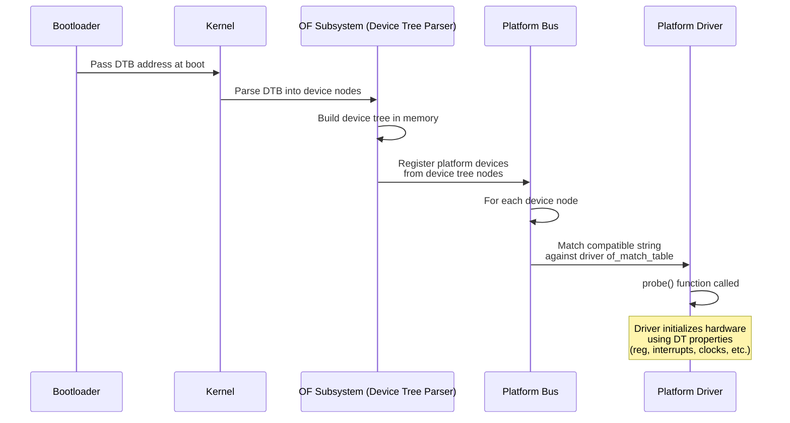

例如，virtio MMIO 传输驱动匹配 `"virtio,mmio"` 兼容字符串。当设备树中包含一个 `virtio_mmio` 节点时，内核会自动加载并探测 virtio MMIO 驱动。然后该驱动通过 virtio 设备协商协议发现各个 virtio 设备（网络、块、GPU 等）。

### 5.4.8 设备树属性参考

Android 设备树中常用的设备树属性：

| 属性 | 类型 | 示例 | 用途 |
|----------|------|---------|---------|
| `compatible` | 字符串列表 | `"arm,armv8"` | 驱动匹配 |
| `reg` | 地址、大小对 | `<0x0 0xa003c00 0x0 0x200>` | MMIO 寄存器 |
| `interrupts` | 中断说明符 | `<0 43 4>` | IRQ 配置 |
| `clocks` | phandle + clock-id | `<&cru CLK_UART0>` | 时钟源 |
| `clock-names` | 字符串列表 | `"uartclk", "apb_pclk"` | 命名时钟引用 |
| `status` | 字符串 | `"okay"` 或 `"disabled"` | 启用/禁用节点 |
| `#address-cells` | u32 | `<2>` | 子节点中的地址宽度 |
| `#size-cells` | u32 | `<2>` | 子节点中的尺寸宽度 |
| `pinctrl-0` | phandle 列表 | `<&uart0_pins>` | 引脚配置 |
| `dma-ranges` | 范围 | `<0x0 0x0 ...>` | DMA 地址转换 |

### 5.4.9 DTBO 分区格式

DTBO 分区使用 Android 定义的一种特定二进制格式：

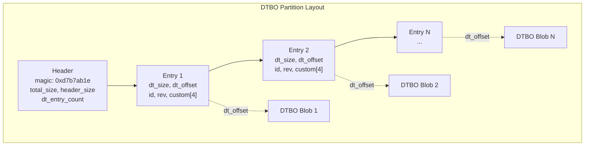

引导加载程序根据条目元数据中存储的硬件标识符（板 ID、版本等）来选择要应用哪些覆盖层。这使得单个 DTBO 分区可以包含多个硬件变体的覆盖层。

### 5.4.10 测试设备树变更

Android 提供了几种验证设备树变更的方法：

1. **dtc（设备树编译器）**：编译和反编译 DTS 文件以进行语法验证：
   ```bash
   # Compile DTS to DTB
   dtc -I dts -O dtb -o board.dtb board.dts

   # Decompile DTB to DTS (for inspection)
   dtc -I dtb -O dts -o decompiled.dts board.dtb
   ```

2. **fdtdump**：以人类可读格式转储 DTB：
   ```bash
   fdtdump board.dtb
   ```

3. **运行设备上的 /proc/device-tree**：内核将解析后的设备树暴露为一个文件系统层级：
   ```bash
   adb shell ls /proc/device-tree/
   adb shell cat /proc/device-tree/compatible
   ```

4. **VTS 测试**：供应商测试套件包含验证设备树属性与框架兼容矩阵匹配的测试。

---

## 5.5 内核配置

### 5.5.1 配置架构

Android 的内核配置管理是一个构建在 Linux 标准 Kconfig 基础设施之上的分层系统。Android 并不维护单一的庞杂 `defconfig` 文件，而是使用一组**配置片段**，将它们组合起来以产生最终的内核配置。

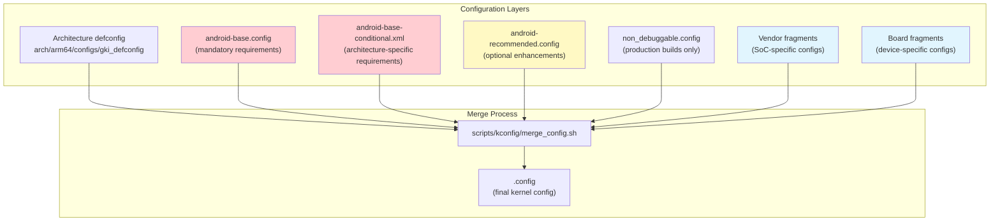

### 5.5.2 kernel/configs 代码库

内核配置片段存储在 `kernel/configs/` 中，结构如下：

```
kernel/configs/
    README.md                    # Comprehensive documentation
    kernel-lifetimes.xml         # Branch lifecycle and EOL dates
    approved-ogki-builds.xml     # Approved OEM GKI builds
    Android.bp                   # Build rules
    build/
        Android.bp
        kernel_config.go         # Soong config processing
    tools/
        Android.bp
        bump.py                  # Version bump utility
        check_fragments.sh       # Fragment validation
        kconfig_xml_fixup.py     # XML fixup utility
    xsd/
        approvedBuild/           # XML schema definitions
    b/                           # Android 16 release fragments
        android-6.12/
            Android.bp
            android-base.config
            android-base-conditional.xml
            android-tv-base.config
            android-tv-base-conditional.xml
    c/                           # Android 17 release fragments, kernel 6.18
        android-6.18/
            Android.bp
            android-base.config
            android-base-conditional.xml
            android-tv-base.config
            android-tv-base-conditional.xml
    d/                           # placeholder for the next release letter
        android-6.18/            #   (created by tools/bump.py)
    v/                           # Android 15 (Vanilla Ice Cream)
        android-6.6/
    u/                           # Android 14 (Upside Down Cake)
        android-5.15/
        android-6.1/
    t/                           # Android 13 (Tiramisu)
        android-5.10/
        android-5.15/
    s/                           # Android 12 (Snow Cone)
        android-4.19/
        android-5.4/
        android-5.10/
```

**来源**：`kernel/configs/`

目录命名约定使用连续的版本字母。它们大致遵循 Android 甜点代号的首字母。`v` 代表 Vanilla Ice Cream（Android 15），`b` 代表 Baklava（Android 16），`c` 代表 Android 17（内核 6.18）。`d/android-6.18` 是下一个版本字母的占位符，由 `tools/bump.py` 预先创建。

在这两个目录中，`android-base.config` 片段都是空的。这是有意为之，而不是待办工作。对于 6.18 分支，AOSP 不声明任何配置要求，因为 GKI 测试已经强制要求设备上运行的是 GKI 内核。TV 特定的要求后来也被显式移除了。

只剩下条件片段中的 `<kernel minlts="6.18.0" />` 固定项。因此，VTS 测试和框架兼容矩阵不强制任何 6.18 配置选项要求（见 5.8.1 节）。它们使用的正是这些相同的片段。与此同时，最旧的在跟踪目录 `r/`（Android 11 片段）在此周期中被移除。因此该代码树不再携带 android12 之前的配置集。

### 5.5.3 基础配置片段

`android-base.config` 文件包含所有对 Android 运行**强制**要求的内核配置选项。这些作为 VTS（供应商测试套件）的一部分进行测试，并在构建和 OTA 时通过 VINTF（供应商接口）兼容矩阵进行验证。

查看 Android 16 / 内核 6.12 的基础配置（`kernel/configs/b/android-6.12/android-base.config`），我们会发现数百行配置，组织为：

**显式禁用的选项**（第 1-15 行）：
```
# CONFIG_ANDROID_LOW_MEMORY_KILLER is not set
# CONFIG_ANDROID_PARANOID_NETWORK is not set
# CONFIG_BPFILTER is not set
# CONFIG_DEVMEM is not set
# CONFIG_FHANDLE is not set
# CONFIG_FW_CACHE is not set
# CONFIG_IP6_NF_NAT is not set
# CONFIG_MODULE_FORCE_UNLOAD is not set
# CONFIG_NFSD is not set
# CONFIG_NFS_FS is not set
# CONFIG_PM_AUTOSLEEP is not set
# CONFIG_RT_GROUP_SCHED is not set
# CONFIG_SYSVIPC is not set
# CONFIG_USELIB is not set
```

值得注意的禁用项：

- `CONFIG_DEVMEM` —— 出于安全考虑禁用 `/dev/mem`（防止原始物理内存访问）
- `CONFIG_MODULE_FORCE_UNLOAD` —— 防止强制卸载模块（稳定性）
- `CONFIG_SYSVIPC` —— Android 不使用 SysV IPC（由 Binder 取代）
- `CONFIG_USELIB` —— 出于安全考虑禁用旧式系统调用

**核心 Android 要求**（第 16-261 行）：

- IPC：`CONFIG_ANDROID_BINDER_IPC`、`CONFIG_ANDROID_BINDERFS`
- 内存：`CONFIG_ASHMEM`、`CONFIG_SHMEM`
- 文件系统：`CONFIG_FUSE_FS`、`CONFIG_FS_ENCRYPTION`、`CONFIG_FS_VERITY`
- 安全：`CONFIG_SECURITY_SELINUX`、`CONFIG_SECCOMP`、`CONFIG_SECCOMP_FILTER`、`CONFIG_STACKPROTECTOR_STRONG`
- 电源：`CONFIG_PM_WAKELOCKS`、`CONFIG_SUSPEND`
- 网络：广泛的 netfilter/iptables 配置（80+ 个选项）
- 监控：`CONFIG_PSI`、`CONFIG_UID_SYS_STATS`、`CONFIG_TRACE_GPU_MEM`
- 构建工具链：`CONFIG_CC_IS_CLANG`、`CONFIG_AS_IS_LLVM`、`CONFIG_LD_IS_LLD`

### 5.5.4 条件配置

`android-base-conditional.xml` 文件表达了取决于目标架构或其他内核配置值的要求。对于 Android 16 / 内核 6.12：

**最低 LTS 版本：**
```xml
<kernel minlts="6.12.0" />
```

**架构特定的要求：**

对于 ARM64：
```xml
<group>
    <conditions>
        <config>
            <key>CONFIG_ARM64</key>
            <value type="bool">y</value>
        </config>
    </conditions>
    <config><key>CONFIG_ARM64_PAN</key><value type="bool">y</value></config>
    <config><key>CONFIG_CFI_CLANG</key><value type="bool">y</value></config>
    <config><key>CONFIG_SHADOW_CALL_STACK</key><value type="bool">y</value></config>
    <config><key>CONFIG_RANDOMIZE_BASE</key><value type="bool">y</value></config>
    <config><key>CONFIG_KFENCE</key><value type="bool">y</value></config>
    <config><key>CONFIG_USERFAULTFD</key><value type="bool">y</value></config>
</group>
```

**来源**：`kernel/configs/b/android-6.12/android-base-conditional.xml`，
第 27-90 行

这些 ARM64 特定要求包括重要的安全特性：

- **CFI_CLANG** —— 控制流完整性，防止控制流劫持攻击
- **SHADOW_CALL_STACK** —— 使用单独的栈存放返回地址，防止 ROP 攻击
- **ARM64_PAN** —— 特权访问永不允许（Privileged Access Never），防止内核意外访问用户内存
- **RANDOMIZE_BASE** —— KASLR，随机化内核地址空间布局
- **KFENCE** —— 内核电子栅栏（Kernel Electric Fence），低开销的内存错误检测器

对于 x86：
```xml
<group>
    <conditions>
        <config>
            <key>CONFIG_X86</key>
            <value type="bool">y</value>
        </config>
    </conditions>
    <config><key>CONFIG_MITIGATION_PAGE_TABLE_ISOLATION</key><value type="bool">y</value></config>
    <config><key>CONFIG_MITIGATION_RETPOLINE</key><value type="bool">y</value></config>
    <config><key>CONFIG_RANDOMIZE_BASE</key><value type="bool">y</value></config>
</group>
```

x86 特定的安全要求包括针对 Meltdown（PTI）和 Spectre（Retpoline）的缓解措施。

### 5.5.5 跨内核版本的配置差异

内核 6.6 的 Android 15（v）配置不同于内核 6.12 的 Android 16（b）配置。这些差异展示了 Android 内核要求的变化：

| 配置选项 | 6.6（Android 15） | 6.12（Android 16） | 备注 |
|--------------|-------------------|---------------------|-------|
| `CONFIG_BPF_JIT_ALWAYS_ON` | 缺失 | `y` | 出于安全考虑强制 JIT 编译 |
| `CONFIG_HID_WACOM` | `y` | 缺失 | 移至可选 |
| `CONFIG_IP_NF_MATCH_RPFILTER` | 缺失 | `y` | 新增反向路径过滤器 |

### 5.5.6 kernel-lifetimes.xml

`kernel-lifetimes.xml` 文件跟踪每个 Android 内核分支的支持生命周期。它作为以下内容的权威来源：

1. **分支名称与版本** —— Android 版本与内核版本之间的映射
2. **启动与 EOL 日期** —— 每个分支首次可用的日期以及支持结束的日期
3. **LTS 版本跟踪** —— 带有各自启动和 EOL 日期的单个 GKI 版本

```xml
<branch name="android15-6.6"
        min_android_release="15"
        version="6.6"
        launch="2023-10-29"
        eol="2028-07-01">
    <lts-versions>
        <release version="6.6.30" launch="2024-07-12" eol="2025-11-01"/>
        <release version="6.6.46" launch="2024-09-16" eol="2025-11-01"/>
        <!-- ... more releases ... -->
        <release version="6.6.98" launch="2025-08-11" eol="2027-01-01"/>
        <release version="6.6.102" launch="2025-10-09" eol="2027-02-01"/>
        <release version="6.6.118" launch="2026-01-12" eol="2027-05-01"/>
    </lts-versions>
</branch>
```

**来源**：`kernel/configs/kernel-lifetimes.xml`，第 137-155 行

该数据被 VTS 测试、框架兼容矩阵检查器和构建系统消费，用于强制设备搭载受支持的内核版本。

### 5.5.7 approved-ogki-builds.xml

`approved-ogki-builds.xml` 文件列出了被批准供 OEM（原始设备制造商）使用的特定 GKI 构建。“OGKI”代表 OEM GKI——它指的是明确允许 OEM 在其设备上发布的 GKI 构建。

每个条目包含：

- 一个 SHA-256 哈希（`id`），唯一标识该构建
- 一个 bug 编号（`bug`），链接到审批跟踪记录

```xml
<ogki-approved version="1">
    <branch name="android14-6.1">
        <build id="ac5884e09bd22ecd..." bug="352795077"/>
    </branch>
    <branch name="android15-6.6">
        <build id="9541494216af24d2..." bug="359105495"/>
        <!-- ... 80+ approved builds ... -->
    </branch>
    <branch name="android16-6.12">
        <build id="38a0ecd98b0b73ee..." bug="435129220"/>
        <!-- ... 10+ approved builds ... -->
    </branch>
</ogki-approved>
```

**来源**：`kernel/configs/approved-ogki-builds.xml`

这一审批流程确保只有经过测试和验证的内核构建才会被用在生产设备上。

### 5.5.8 TV 特定配置

Android TV 设备有额外的内核配置要求。对于 Android 16 / 内核 6.12，有专门的 TV 配置片段：

```
kernel/configs/b/android-6.12/
    android-tv-base.config
    android-tv-base-conditional.xml
```

**来源**：`kernel/configs/b/android-6.12/android-tv-base.config`

TV 基础配置与标准基础配置几乎相同，反映了 Android TV 与主线 Android 平台的融合。实际差异很小。TV 基础配置省略了无条件的 `CONFIG_SCHED_DEBUG=y` 行。它的条件 XML 则仅在 `CONFIG_DEBUG_FS=y` 时要求 `CONFIG_SCHED_DEBUG=y`。TV 条件 XML 还去掉了标准 `android-base-conditional.xml` 所施加的 ARM64 `CONFIG_SHADOW_CALL_STACK` 要求。

### 5.5.9 配置验证

Android 在多个阶段验证内核配置：

1. **构建时**：构建系统检查内核配置是否与 VINTF 兼容矩阵匹配。

2. **VTS（供应商测试套件）**：`VtsKernelConfig` 测试验证运行中内核的配置是否包含该设备发布级别所需的全部选项。

3. **OTA/更新时**：`checkvintf` 在生成和安装 OTA 包时，会根据框架兼容矩阵验证内核配置。不匹配并不会在运行时阻止启动——不存在会中止启动的启动时内核配置检查。

构建规则是通过 `kernel/configs/build/kernel_config.go` 从配置片段生成的，后者将 `.config` 和 `.xml` 文件处理为兼容矩阵格式。

**来源**：`kernel/configs/build/kernel_config.go`

`kernel/configs/tools/check_fragments.sh` 脚本会检查配置片段是否与某个 Android 通用内核检出版本的 Kconfig 文件一致。该检出版本通过 `-k path-to-kernel` 提供。对于每个架构，脚本会运行 `make allnoconfig`。然后它使用 `scripts/kconfig/merge_config.sh` 合并这些片段。最后，它会验证每个片段中的每个选项都保留在结果 `.config` 中。它不检查条件 XML 片段。

**来源**：`kernel/configs/tools/check_fragments.sh`

---

## 5.6 内核构建集成

### 5.6.1 两条路径：预构建 vs 源码

AOSP 构建系统支持两种包含内核的方式：

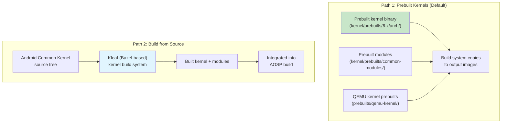

#### 预构建内核（模拟器默认）

对于模拟器和参考构建，AOSP 使用存储在以下位置的预构建内核：

1. **GKI 预构建**：`kernel/prebuilts/{6.1,6.6,6.12,6.18}/{arm64,x86_64}/`
2. **虚拟设备模块**：`kernel/prebuilts/common-modules/virtual-device/{6.1,6.6,6.12,6.18}/`
3. **QEMU 特定预构建**：`prebuilts/qemu-kernel/{arm64,x86_64}/`

模拟器板配置选择内核版本：

```makefile
TARGET_KERNEL_USE ?= 6.12
KERNEL_ARTIFACTS_PATH := prebuilts/qemu-kernel/arm64/$(TARGET_KERNEL_USE)
EMULATOR_KERNEL_FILE := $(KERNEL_ARTIFACTS_PATH)/kernel-$(TARGET_KERNEL_USE)-gz
```

**来源**：`device/generic/goldfish/board/kernel/arm64.mk`，第 20-21、65 行

请注意 `?=` 赋值：`TARGET_KERNEL_USE` 默认为 6.12，原则上可以在命令行上覆盖以选择不同的内核版本。实际上，`prebuilts/qemu-kernel/arm64/`（及其 `x86_64` 和 `arm64_16k` 兄弟目录）目前只包含 `6.12`。因此，只有当另一个版本被签入该预构建树之后，该覆盖才有用。

#### 使用 Kleaf 从源码构建

对于供应商特定内核，首选的构建系统是 Kleaf——一个基于 Bazel 的内核构建系统。第 2 章（构建系统）已详细讲解 Kleaf，但它与 AOSP 构建的关键集成点是：

1. Kleaf 独立于平台构建来构建内核
2. 输出（内核映像 + 模块）被放置在一个暂存目录中
3. AOSP 平台构建在生成映像期间获取内核产物

### 5.6.2 模拟器内核更新流程

`prebuilts/qemu-kernel/update_emu_kernels.sh` 脚本记录了更新模拟器预构建内核的流程：

```bash
#!/bin/bash
KERNEL_VERSION="6.12"

# ./update_emu_kernel.sh --bug 123 --bid 123456
```

**来源**：`prebuilts/qemu-kernel/update_emu_kernels.sh`

该脚本：

1. 从内部 CI 构建中获取一个构建 ID（`--bid`）
2. 获取每个架构的内核二进制文件和 GKI 模块
3. 获取 goldfish 特定的虚拟设备模块
4. 将它们放置到 `prebuilts/qemu-kernel/` 代码树中
5. 记录 bug 编号以便跟踪

### 5.6.3 模块组织

GKI 模块被组织为若干类别，每一类通过不同的分区交付：

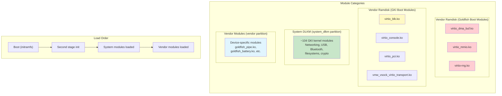

模拟器的 arm64 板配置显式定义了这种分类。两个 ramdisk 列表都随 vendor ramdisk 一起发布。它们在第一阶段 init 期间加载，以便启动能够到达第二阶段 init。两个列表的唯一区别在于 `.ko` 文件的来源（goldfish 设备模块目录或 GKI 模块目录）：

```makefile
# Boot-critical modules taken from the goldfish device modules directory
RAMDISK_KERNEL_MODULES := \
    virtio_dma_buf.ko \
    virtio_mmio.ko \
    virtio-rng.ko \

# Boot-critical modules taken from the GKI modules directory
RAMDISK_SYSTEM_KERNEL_MODULES := \
    virtio_blk.ko \
    virtio_console.ko \
    virtio_pci.ko \
    virtio_pci_legacy_dev.ko \
    virtio_pci_modern_dev.ko \
    vmw_vsock_virtio_transport.ko \

# All GKI modules go to system_dlkm
BOARD_SYSTEM_KERNEL_MODULES := \
    $(wildcard $(KERNEL_MODULES_ARTIFACTS_PATH)/*.ko)

# Both lists above are packed into the vendor ramdisk
BOARD_VENDOR_RAMDISK_KERNEL_MODULES := \
    $(wildcard $(patsubst %,$(VIRTUAL_DEVICE_KERNEL_MODULES_PATH)/%,$(RAMDISK_KERNEL_MODULES))) \
    $(wildcard $(patsubst %,$(KERNEL_MODULES_ARTIFACTS_PATH)/%,$(RAMDISK_SYSTEM_KERNEL_MODULES)))

# Vendor modules (minus ramdisk ones)
BOARD_VENDOR_KERNEL_MODULES := \
    $(filter-out $(BOARD_VENDOR_RAMDISK_KERNEL_MODULES) \
                 $(EMULATOR_EXCLUDE_KERNEL_MODULES), \
                 $(wildcard $(VIRTUAL_DEVICE_KERNEL_MODULES_PATH)/*.ko))
```

**来源**：`device/generic/goldfish/board/kernel/arm64.mk`，第 27-58 行

### 5.6.4 模块黑名单

某些模块包含在预构建集中，但在运行时不应被加载。模拟器维护了一份黑名单：

```
blocklist vkms.ko
# When enabled, hijacks the first audio device that's expected to be backed by
# virtio-snd. See also: aosp/3391025
blocklist snd-aloop.ko
```

**来源**：`device/generic/goldfish/board/kernel/kernel_modules.blocklist`

- `vkms.ko`（虚拟内核模式设置）被列入黑名单，因为模拟器改用 `virtio-gpu.ko` 来显示。
- `snd-aloop.ko`（ALSA 回环）被列入黑名单，因为它与提供实际音频设备的 `virtio_snd.ko` 冲突。

### 5.6.5 启动映像生成

启动映像（`boot.img`）包含内核映像、ramdisk 和启动参数。模拟器板配置指定：

```makefile
BOARD_BOOT_HEADER_VERSION := 4
BOARD_MKBOOTIMG_ARGS += --header_version $(BOARD_BOOT_HEADER_VERSION)
BOARD_VENDOR_BOOTIMAGE_PARTITION_SIZE := 0x06000000
BOARD_RAMDISK_USE_LZ4 := true
```

**来源**：`device/generic/goldfish/board/BoardConfigCommon.mk`，第 76-80 行

启动映像版本 4 是最新的格式。它支持：

- 分离的 vendor 启动映像（`vendor_boot.img`）
- `boot.img` 中的通用 ramdisk
- `vendor_boot.img` 中的 vendor ramdisk
- 位于独立 `bootconfig` 段中的启动配置

内核命令行是通过一个文件而不是启动映像头来传递的：

```makefile
# BOARD_KERNEL_CMDLINE is not supported (b/361341981), use the file below
PRODUCT_COPY_FILES += \
    device/generic/goldfish/board/kernel/arm64_cmdline.txt:kernel_cmdline.txt
```

**来源**：`device/generic/goldfish/board/kernel/arm64.mk`，第 67-69 行

arm64 内核命令行非常精简：
```
8250.nr_uarts=1
```

**来源**：`device/generic/goldfish/board/kernel/arm64_cmdline.txt`

x86_64 命令行增加了一个 clocksource 指定：
```
8250.nr_uarts=1 clocksource=pit
```

**来源**：`device/generic/goldfish/board/kernel/x86_64_cmdline.txt`

### 5.6.6 16K 页大小支持

现代 Android（16+）支持 16K 页大小内核，它提供更好的 TLB（转换旁路缓冲）利用率，并改善内存密集型工作负载的性能。模拟器包含专门的 16K 页大小配置：

```
device/generic/goldfish/board/kernel/
    arm64.mk             # Standard 4K page size
    arm64_16k.mk         # 16K page size variant
    arm64_16k_cmdline.txt
    x86_64.mk
    x86_64_16k.mk
    x86_64_16k_cmdline.txt
```

**来源**：`device/generic/goldfish/board/kernel/`

16K 页大小变体使用一组单独的预构建内核：

```makefile
TARGET_KERNEL_USE := 6.12
KERNEL_ARTIFACTS_PATH := prebuilts/qemu-kernel/arm64_16k/$(TARGET_KERNEL_USE)
```

**来源**：`device/generic/goldfish/board/kernel/arm64_16k.mk`，第 20-21 行

4K 页大小构建的内核版本字符串包含 `-4k` 后缀；16K 构建则完全不带页大小后缀。

### 5.6.7 GSI（通用系统映像）与内核

通用系统映像是 Google 的参考 AOSP 构建，它应当能在任何符合 GKI 的设备上运行。GSI 板配置揭示了在此上下文中内核是如何被处理的：

```makefile
# build/make/target/board/BoardConfigGsiCommon.mk
TARGET_NO_KERNEL := true
```

**来源**：`build/make/target/board/BoardConfigGsiCommon.mk`

`TARGET_NO_KERNEL := true` 设置意味着 GSI 不包含内核。这是有意为之的：GSI 的系统映像被设计为与设备现有的内核（位于 boot 分区中）搭配使用。正是这种清晰的分离，使得无需替换内核就能在任何符合 GKI 的设备上运行 GSI。

GSI 还启用了 system_dlkm 以实现模块兼容：

```makefile
BOARD_USES_SYSTEM_DLKMIMAGE := true
BOARD_SYSTEM_DLKMIMAGE_FILE_SYSTEM_TYPE := ext4
TARGET_COPY_OUT_SYSTEM_DLKM := system_dlkm
```

**来源**：`build/make/target/board/BoardConfigGsiCommon.mk`

### 5.6.8 构建系统中的内核版本控制

构建系统需要知道内核版本以进行兼容性检查。对于预构建内核，这由 `kernel_version.mk` 提供：

```makefile
BOARD_KERNEL_VERSION := 6.6.119-android15-8-gf79a8f9ddb6e-ab14880967-4k
```

**来源**：`kernel/prebuilts/6.6/arm64/kernel_version.mk`

版本字符串的各个组成部分被以下内容使用：

- **VINTF 兼容矩阵**：确保框架与内核兼容
- **VTS 测试**：验证内核满足所声明 Android 版本的要求
- **OTA 系统**：确保内核更新保持兼容性

### 5.6.9 Super 分区与动态分区

模拟器使用带有 super 分区的 Android 动态分区系统：

```makefile
BOARD_BUILD_SUPER_IMAGE_BY_DEFAULT := true
BOARD_SUPER_PARTITION_SIZE ?= 8598323200  # 8G + 8M
BOARD_SUPER_PARTITION_GROUPS := emulator_dynamic_partitions

BOARD_EMULATOR_DYNAMIC_PARTITIONS_PARTITION_LIST := \
    system \
    system_dlkm \
    system_ext \
    product \
    vendor
```

**来源**：`device/generic/goldfish/board/BoardConfigCommon.mk`，第 45-58 行

`system_dlkm` 分区专门用于 GKI 内核模块：

```makefile
BOARD_USES_SYSTEM_DLKMIMAGE := true
BOARD_SYSTEM_DLKMIMAGE_FILE_SYSTEM_TYPE := erofs  # we never write here
TARGET_COPY_OUT_SYSTEM_DLKM := system_dlkm
```

**来源**：`device/generic/goldfish/board/BoardConfigCommon.mk`，第 68-70 行

“我们从不在此写入”的注释确认了 `system_dlkm` 是一个只读分区——内核模块从它加载，但在运行时永不被修改。使用 `erofs`（增强型只读文件系统）进一步强化了这种不可变性。

---

## 5.7 内核调试

### 5.7.1 内核跟踪基础设施

Linux 内核提供了几种强大的跟踪机制，Android 将其与自身的工具集成：

```mermaid
graph TB
    subgraph "Kernel Tracing Mechanisms"
        FT["ftrace<br/>/sys/kernel/tracing/"]
        TP["Tracepoints<br/>(static instrumentation)"]
        KP["kprobes<br/>(dynamic instrumentation)"]
        EBPF["eBPF Programs<br/>(programmable tracing)"]
    end

    subgraph "Android Tracing Tools"
        ATRACE["atrace<br/>(Android trace tool)"]
        PERFETTO["Perfetto<br/>(system-wide tracing)"]
        SYSTRACE["Systrace<br/>(legacy, uses atrace)"]
        SIMPLEPERF["simpleperf<br/>(CPU profiling)"]
    end

    subgraph "Output"
        UI["Perfetto UI<br/>(ui.perfetto.dev)"]
        REPORT["Trace reports"]
        FLAME["Flame graphs"]
    end

    FT --> ATRACE
    FT --> PERFETTO
    TP --> PERFETTO
    KP --> PERFETTO
    EBPF --> PERFETTO
    ATRACE --> PERFETTO
    PERFETTO --> UI
    SIMPLEPERF --> FLAME
    PERFETTO --> REPORT

    style PERFETTO fill:#c8e6c9
    style FT fill:#e1f5fe
```

### 5.7.2 ftrace

ftrace 是内核内置的跟踪框架。Android 在基础配置中要求启用性能分析支持：

```
CONFIG_PROFILING=y
```

**来源**：`kernel/configs/b/android-6.12/android-base.config`，第 214 行

ftrace 提供：

- **函数跟踪**：跟踪每一次内核函数调用（或特定函数）
- **函数图跟踪**：跟踪函数的进入和退出并计时
- **事件跟踪**：记录特定的内核事件（调度、I/O、内存分配等）
- **跟踪标记**：用户空间可以写入 `/sys/kernel/tracing/trace_marker`，将事件注入内核跟踪

关键的 ftrace 虚拟文件：

```
/sys/kernel/tracing/
    available_tracers       # List of available tracers
    current_tracer          # Currently active tracer
    trace                   # Human-readable trace output
    trace_pipe              # Streaming trace output
    tracing_on              # Enable/disable tracing
    buffer_size_kb          # Per-CPU buffer size
    events/                 # Available tracepoints
        sched/              # Scheduler events
            sched_switch/
            sched_wakeup/
        binder/             # Binder IPC events
            binder_transaction/
            binder_transaction_received/
        block/              # Block I/O events
        ext4/               # ext4 filesystem events
        f2fs/               # f2fs filesystem events
```

#### 在 Android 上使用 ftrace

要在运行中的设备上启用函数跟踪：

```bash
# Enable tracing
adb shell "echo 1 > /sys/kernel/tracing/tracing_on"

# Set the tracer
adb shell "echo function_graph > /sys/kernel/tracing/current_tracer"

# Filter to specific functions (e.g., binder)
adb shell "echo 'binder_*' > /sys/kernel/tracing/set_ftrace_filter"

# Read the trace
adb shell cat /sys/kernel/tracing/trace

# Disable
adb shell "echo 0 > /sys/kernel/tracing/tracing_on"
```

### 5.7.3 跟踪点

跟踪点是编译进内核的静态插桩点。它们在内核代码的特定位置提供结构化的事件数据。Android 广泛使用跟踪点用于：

- **调度器跟踪**：`sched_switch`、`sched_wakeup`、`sched_process_exit`
- **Binder 跟踪**：`binder_transaction`、`binder_transaction_received`、`binder_return`
- **内存跟踪**：`mm_page_alloc`、`mm_page_free`、`oom_score_adj_update`
- **GPU 内存跟踪**：`gpu_mem_total`（`CONFIG_TRACE_GPU_MEM=y` 所要求）
- **电源管理**：`cpu_frequency`、`cpu_idle`、`suspend_resume`

Android 基础配置中的 `CONFIG_TRACE_GPU_MEM=y` 要求启用了 GPU 内存跟踪跟踪点：

```
CONFIG_TRACE_GPU_MEM=y
```

**来源**：`kernel/configs/b/android-6.12/android-base.config`，第 244 行

### 5.7.4 与 Perfetto 集成

Perfetto 是 Android 的系统级跟踪基础设施（后续章节会详细讲解）。它与内核的集成通过 `traced_probes` 守护进程实现，该守护进程从内核跟踪环形缓冲区读取 ftrace 事件。

Perfetto 的 ftrace 集成代码位于：

```
external/perfetto/src/traced/probes/ftrace/
    cpu_reader.cc           # Reads ftrace per-CPU ring buffers
    cpu_reader.h
    event_info.cc           # Maps ftrace event IDs to names
    event_info_constants.cc # Known event definitions
    compact_sched.cc        # Compact encoding for scheduler events
    atrace_hal_wrapper.cc   # Android trace HAL integration
    atrace_wrapper.cc       # atrace command integration
```

**来源**：`external/perfetto/src/traced/probes/ftrace/`

Perfetto 的 ftrace 集成：

1. 为每个 CPU 打开 `/sys/kernel/tracing/per_cpu/cpuN/trace_pipe_raw`
2. 通过 `/sys/kernel/tracing/events/<category>/<event>/enable` 启用所请求的跟踪点
3. 从环形缓冲区读取二进制跟踪数据
4. 将事件编码为 Perfetto 的 protobuf 跟踪格式
5. 将跟踪写入文件或流式传输到 Perfetto trace viewer

#### 使用 Perfetto 捕获内核跟踪

```bash
# Record a 10-second trace with scheduler and binder events
# (--txt is required because the heredoc supplies a text-format config)
adb shell perfetto \
    --txt \
    -c - \
    -o /data/misc/perfetto-traces/trace.perfetto-trace \
    <<EOF
buffers {
    size_kb: 63488
}
data_sources {
    config {
        name: "linux.ftrace"
        ftrace_config {
            ftrace_events: "sched/sched_switch"
            ftrace_events: "sched/sched_wakeup"
            ftrace_events: "binder/binder_transaction"
            ftrace_events: "power/cpu_frequency"
            ftrace_events: "power/cpu_idle"
        }
    }
}
duration_ms: 10000
EOF

# Pull the trace
adb pull /data/misc/perfetto-traces/trace.perfetto-trace .

# Open in Perfetto UI: https://ui.perfetto.dev
```

### 5.7.5 kprobes 与动态跟踪

kprobes 允许在运行时对任意内核函数进行插桩，而无需重新编译内核。它们的工作原理是在目标地址插入一条断点指令，并在其被命中时执行一个处理函数。

kprobes 需要 `CONFIG_KPROBES=y`，而 Android 基础配置并未强制要求这一点。某个 GKI 内核是否启用它是由 defconfig 决定的，而不是合规性要求。当可用并结合 eBPF（`CONFIG_BPF_SYSCALL=y`、`CONFIG_BPF_JIT=y`）时，kprobes 会成为自定义内核插桩的强大工具。

#### 基于 eBPF 的内核跟踪

Android 广泛的 eBPF 配置启用了内核跟踪程序：

```bash
# List loaded BPF programs
adb shell bpftool prog list

# Show BPF maps (key-value stores used by BPF programs)
adb shell bpftool map list
```

在启动时从 `/system/etc/bpf/` 加载的 eBPF 程序提供：

- 按 UID 统计网络流量
- 按 UID 跟踪 CPU 时间
- 内存事件监控

### 5.7.6 使用 debuggerd 进行内核崩溃分析

当 Android 上的某个进程崩溃时，`debuggerd`（具体来说是 `crash_dump`）会捕获一个 tombstone（墓碑）。tombstone 是一份详细的崩溃报告，包含寄存器状态、堆栈跟踪、内存映射和信号信息。

崩溃转储机制实现于：

```
system/core/debuggerd/
    crash_dump.cpp          # Main crash handler
    debuggerd.cpp           # Command-line client (debuggerd [-bj] PID)
    tombstoned/             # Tombstone-collecting daemon
    libdebuggerd/
        tombstone.cpp       # Tombstone generation
        tombstone_proto.cpp # Protobuf tombstone format
        backtrace.cpp       # Stack unwinding
        utility.cpp         # Utility functions
    handler/                # Signal handler installed in processes
    crasher/                # Test crash program
```

**来源**：`system/core/debuggerd/`

#### debuggerd 的工作原理

```mermaid
sequenceDiagram
    participant P as Crashing Process
    participant SH as Signal Handler (in-process)
    participant CD as crash_dump
    participant TS as Tombstone Writer
    participant LOG as logcat

    P->>P: SIGSEGV / SIGABRT / etc.
    P->>SH: Signal delivered
    SH->>SH: Clone crash_dump process
    SH->>CD: clone + execle crash_dump
    CD->>CD: ptrace PTRACE_SEIZE on crashed process
    CD->>CD: Read registers, memory maps
    CD->>CD: Unwind stack (libunwindstack)
    CD->>TS: Generate tombstone
    TS->>TS: Write /data/tombstones/tombstone_NN
    TS->>LOG: Log crash summary to logcat
    CD->>P: Resume (process will exit)
```

#### 内核崩溃信息来源

debuggerd 读取多个由内核提供的文件来构造 tombstone：

- `/proc/<pid>/maps` —— 崩溃进程的内存映射
- `/proc/<pid>/exe` —— 指向可执行文件路径的符号链接
- `/proc/<pid>/task/` —— 用于枚举线程的目录列表
- `/proc/<pid>/smaps` —— 每个映射的 `VmFlags`，用于映射详情
- `/proc/<pid>/comm` —— 进程命令名
- `/proc/<pid>/cmdline` —— 完整命令行

内核的 `ptrace()` 系统调用对崩溃分析至关重要——它允许 crash_dump 读取崩溃进程的寄存器和内存。

### 5.7.7 内核日志分析

内核环形缓冲区（`dmesg`）是最重要的调试工具之一。在 Android 上，内核消息也会被转发到一个专用的 `kernel` 日志缓冲区（在 userdebug 和 eng 构建中可用），可以通过 `adb logcat -b kernel` 读取。

```bash
# Read kernel ring buffer
adb shell dmesg

# Follow kernel messages in real time
adb shell dmesg -w

# Read kernel messages from logcat
adb logcat -b kernel

# Filter for specific subsystems
adb shell dmesg | grep -i binder
adb shell dmesg | grep -i "low memory"
adb shell dmesg | grep -i "oom"
```

#### 需要关注的典型内核消息

| 消息模式 | 子系统 | 含义 |
|----------------|-----------|---------|
| `binder: ...: ... got transaction` | Binder | 事务处理 |
| `oom_reaper:` | OOM | 内核 OOM reaper 已激活 |
| `CPU: ... MHz` | cpufreq | CPU 频率变化 |
| `audit: ` | SELinux | 策略违规 |
| `init: ` | init | 服务生命周期事件 |
| `dm_verity: ` | dm-verity | 完整性校验事件 |
| `FUSE: ` | FUSE | 文件系统操作 |
| `incfs: ` | Incremental FS | 增量加载事件 |

#### pstore：在内核恐慌后存活

pstore（持久存储）子系统会在重启之间保存内核日志，这对诊断内核恐慌至关重要：

```mermaid
graph LR
    subgraph "Before Crash"
        DMESG["Kernel Ring Buffer<br/>(dmesg)"]
        PSTORE_W["pstore Writer<br/>(ramoops backend)"]
        RAM["Reserved Memory Region<br/>(survives reboot)"]
    end

    subgraph "After Reboot"
        RAM2["Reserved Memory Region"]
        PSTORE_R["pstore Reader"]
        FILES["/sys/fs/pstore/<br/>dmesg-ramoops-0<br/>console-ramoops-0<br/>pmsg-ramoops-0"]
    end

    DMESG --> PSTORE_W
    PSTORE_W --> RAM
    RAM -.->|"survives reboot"| RAM2
    RAM2 --> PSTORE_R
    PSTORE_R --> FILES
```

在配置了 pstore 的设备上，恐慌前的最后几条内核消息会被保存在一个保留内存区域中。设备重启后，这些消息会作为 `/sys/fs/pstore/` 下的文件出现：

```bash
# Check for pstore data after a crash
adb shell ls /sys/fs/pstore/
# Output might include:
#   dmesg-ramoops-0     # Last kernel log
#   console-ramoops-0   # Last console output
#   pmsg-ramoops-0      # Last userspace messages

# Read the crash log
adb shell cat /sys/fs/pstore/dmesg-ramoops-0
```

### 5.7.8 内核恐慌与 Ramdump 分析

当内核本身崩溃（而不是用户空间进程）时，适用不同的机制：

1. **内核恐慌日志**：恐慌前的最后几条内核消息被保存在 `pstore`（持久存储）中，通常由一个保留内存区域作为后端。在下一次启动时，这些消息会出现在 `/sys/fs/pstore/` 中。

2. **Ramdump**：某些 SoC 支持在内核恐慌时捕获完整的内存转储。可以使用 `crash` 或 `gdb` 等工具，配合 vmlinux 符号文件对其进行分析。

3. **SysRq**：基础配置启用了 Magic SysRq 键（`CONFIG_MAGIC_SYSRQ=y`），即使系统看似挂起，它仍允许触发内核调试操作：

   ```bash
   # Trigger a kernel panic (for testing ramdump capture)
   adb shell "echo c > /proc/sysrq-trigger"

   # Show all running tasks
   adb shell "echo t > /proc/sysrq-trigger"

   # Show memory information
   adb shell "echo m > /proc/sysrq-trigger"
   ```

### 5.7.9 调试 Binder 子系统

Binder 通过 `debugfs` 暴露了自己的一组调试接口：

```
/sys/kernel/debug/binder/
    state                   # Global binder state (all processes)
    state_hashed            # Same, with pointers hashed
    stats                   # Binder transaction statistics
    transactions            # Active transactions
    transactions_hashed     # Same, with pointers hashed
    transaction_log         # Log of recent transactions
    failed_transaction_log  # Log of failed transactions
    proc/<pid>              # Per-process binder state
```

读取 binder 状态：

```bash
# Show binder statistics
adb shell cat /sys/kernel/debug/binder/stats

# Show binder state for system_server (PID varies)
adb shell cat /sys/kernel/debug/binder/proc/$(adb shell pidof system_server)
```

#### 解读 Binder 调试输出

binder stats 文件提供了关于系统 IPC 健康状况的有价值的信息：

```
# Example binder stats output structure
binder stats:
BC_TRANSACTION: 12345          # Total transactions sent
BC_REPLY: 12340                # Total replies sent
BR_TRANSACTION: 12345          # Total transactions received
BR_REPLY: 12340                # Total replies received
BR_DEAD_BINDER: 5              # Death notifications
proc 4242                      # One block per binder-using process (PID 4242)
  threads: 8                   # Thread count for this process
  requested threads: 0+4/15
  ready threads 6
  free async space 524288
```

需要监控的关键指标：

- **BR_DEAD_BINDER 计数偏高**：服务频繁死亡；排查 OOM 杀死或崩溃
- **ready_threads 接近 0**：线程池耗尽；进程无法处理更多传入事务
- **free_async_space 接近 0**：异步事务缓冲区已满；oneway 调用将被丢弃
- **BC_TRANSACTION >> BR_REPLY**：事务超时；服务端进程过载

### 5.7.10 热与电源调试

Android 的内核级电源管理可以通过几个接口进行调试：

```bash
# CPU frequency information
adb shell cat /sys/devices/system/cpu/cpu0/cpufreq/scaling_cur_freq
adb shell cat /sys/devices/system/cpu/cpu0/cpufreq/scaling_available_frequencies

# CPU idle state information
adb shell cat /sys/devices/system/cpu/cpu0/cpuidle/state0/name
adb shell cat /sys/devices/system/cpu/cpu0/cpuidle/state0/time

# Thermal zone information
adb shell cat /sys/class/thermal/thermal_zone0/type
adb shell cat /sys/class/thermal/thermal_zone0/temp

# Wakelock information
adb shell cat /sys/power/wake_lock
adb shell cat /d/wakeup_sources
```

### 5.7.11 内存调试

几个内核特性有助于内存调试：

1. **KFENCE**（内核电子栅栏）：条件配置在 ARM64 和 x86 上是必需的。KFENCE 使用一组守卫页，检测针对 slab 对象的释放后使用和越界访问。

2. **PSI 监控**：除了 lmkd 之外，PSI 也可以直接读取：
   ```bash
   adb shell cat /proc/pressure/memory
   # Output: some avg10=0.00 avg60=0.00 avg300=0.00 total=0
   #         full avg10=0.00 avg60=0.00 avg300=0.00 total=0
   ```

3. **meminfo 和 vmstat**：标准的内核内存报告：
   ```bash
   adb shell cat /proc/meminfo
   adb shell cat /proc/vmstat
   ```

4. **UID sys stats**：逐应用的 I/O 统计：
   ```bash
   adb shell cat /proc/uid_io/stats
   ```

---

## 5.8 Android 17 内核变更

Android 17 带来了几项直接影响内核层的变更。最显眼的是一个构建在更新的上游 LTS 之上的新通用内核映像分支。最具结构性的是将文件系统管理库（`fs_mgr`、`liblp`、`libsnapshot`、`libdm` 及其同类库）从 `system/core` 迁移到一个专用的 `system/fs/` 代码树中。本节将这些变更汇总在一起，以便本章其余部分可以继续使用稳定的 Android 16 / 内核 6.12 片段作为示例。这些示例在 Android 17 上仍然准确。

### 5.8.1 android17-6.18 GKI 分支

每个 Android 版本都与一个或多个 Android 通用内核分支配对。Android 17 引入了 `android17-6.18`，跟踪上游 LTS 6.18。它与较旧的分支一起注册在内核生命周期数据中：

```xml
<branch name="android17-6.18"
        min_android_release="17"
        version="6.18"
        launch="2025-11-30"
        eol="2030-07-01">
    <no-releases reason="branch in pre-release phase"/>
</branch>
```

**来源**：`kernel/configs/kernel-lifetimes.xml`，第 165-167 行

有两个细节值得指出：

1. **预发布状态**。与较旧的分支不同，`android17-6.18` 带有一个 `<no-releases reason="branch in pre-release phase"/>` 标记，而不是季度 LTS 版本的列表。当 Android 17 代码树被切出时，该分支尚未有稳定的 GKI 版本。因此没有可供跟踪的各个版本的启动和 EOL 日期。

2. **最低 LTS**。配套的条件片段固定了该分支的最低 LTS 版本：

   ```xml
   <kernel minlts="6.18.0" />
   ```

    **来源**：`kernel/configs/c/android-6.18/android-base-conditional.xml`
    （Android 17 片段；`d/android-6.18` 是下一个版本字母的相同占位符）

该分支的 GKI 预构建产物随代码树一起发布。其版本字符串编码了完整的血统：

```
BOARD_KERNEL_VERSION := 6.18.16-android17-1-gb61cd7ae4209-ab15097451-4k
```

**来源**：`kernel/prebuilts/6.18/arm64/kernel_version.mk`

这是 Android 17 ACK 分支上的上游 LTS 6.18 补丁级别 16。它是该分支的首个版本。该字符串还包括一个 git 提交哈希、一个 Android 构建 ID 以及 4 KB 页大小变体。6.18 预构建产物附带约 104 个 GKI `.ko` 模块和一个精简的 KMI。其 `abi_symbollist` 大约有 22,961 个条目，明显小于 6.6 分支的约 38,840 个。这反映了 Google 对稳定符号表面的持续精简。

**来源**：`kernel/prebuilts/6.18/arm64/abi_symbollist`，
`kernel/prebuilts/6.18/arm64/abi.stg`

#### 新的版本字母配置目录

内核配置片段被组织到按版本字母划分的目录中（5.5.2 节）。Android 17 为内核 6.18 新增了两个目录：

```
kernel/configs/
    c/
        android-6.18/      # android-base.config, conditional XML, TV fragments
    d/
        android-6.18/      # android-base.config, conditional XML, TV fragments
```

**来源**：`kernel/configs/d/android-6.18/`、`kernel/configs/c/android-6.18/`

`c/android-6.18` 和 `d/android-6.18` 下的 `android-base.config` 文件是有意设为空的。AOSP 不为 6.18 分支声明任何配置选项要求（GKI 测试已经强制要求运行的是 GKI 内核）。TV 要求也被显式移除，只剩下条件 XML 中的 `minlts="6.18.0"` 声明。因此，本章中实质性的配置引用继续使用 `kernel/configs/b/android-6.12/` 下内容完整的 Android 16 / 内核 6.12 片段。这些片段仍然保留在代码树中且未被改动。

在同一周期中，`kernel/configs/r/` 下的 Android 11 片段被移除了。这退役了最旧的在跟踪配置集。

**来源**：`kernel/configs/d/android-6.18/Android.bp`

新目录的 `Android.bp` 使用 `kernel_config_d_6.18` 规则将片段接入 Soong。与其他目录一样，它支持 Google TV 变体。`using_tv_gki` Soong 配置变量用于选择该变体。

将模拟器与内核版本配对的构建系统顺序在 Android 17 中保持不变。goldfish 模拟器仍然默认使用 `prebuilts/qemu-kernel/` 下的内核 6.12 预构建产物（`device/generic/goldfish/board/kernel/arm64.mk` 中的 `TARGET_KERNEL_USE ?= 6.12`）。6.18 映像位于 GKI 预构建代码树（`kernel/prebuilts/6.18/`）中，等待模拟器切换到它。因此，5.6 节中的机制同样适用，无需改动。

### 5.8.2 16 KB 页大小走向成熟

5.6.6 节介绍了 16 KB 页大小内核。几个版本之前，GKI 预构建产物开始在 4 KB 变体旁边附带完整的 16 KB 变体。`kernel/prebuilts/6.6/arm64/16k/` 和 `kernel/prebuilts/6.12/arm64/16k/` 各自已经包含一套完整的并行模块集（约 100 个 `.ko` 文件），并带有自己的 `kernel_version.mk`。6.18 GKI 预构建产物延续了这一模式。

在 `kernel/prebuilts/6.18/arm64/` 下有一个 `16k/` 子树。该子树包含自己的内核映像和一整套 `.ko` 模块。它们与父目录中的 4 KB 模块是不同的。

```
kernel/prebuilts/6.18/arm64/
    kernel_version.mk        # 4 KB build: ...-ab15097451-4k
    *.ko                     # 4 KB modules
    16k/
        kernel_version.mk    # 16 KB build (no -4k suffix)
        *.ko                 # 16 KB modules
```

**来源**：`kernel/prebuilts/6.18/arm64/16k/`

版本字符串仅在页大小后缀上有所不同。4 KB 构建追加 `-4k`；16 KB 构建则省略它：

```
# 4 KB:  6.18.16-android17-1-gb61cd7ae4209-ab15097451-4k
# 16 KB: 6.18.16-android17-1-gb61cd7ae4209-ab15097451
```

**来源**：`kernel/prebuilts/6.18/arm64/16k/kernel_version.mk`

在模拟器端，页大小变体仍然由单独的板 makefile 选择。不过，只有 `arm64_16k.mk` 指向一个专用的 `*_16k` 预构建路径（`prebuilts/qemu-kernel/arm64_16k/`），如 5.6.6 节所述。`x86_64_16k.mk` 仍然使用普通的 `prebuilts/qemu-kernel/x86_64/` 代码树，并且不存在 `x86_64_16k` 预构建目录。运行 16 KB 内核的设备或模拟器需要其所有可加载模块都为 16 KB 页编译。这就是为什么 6.18 预构建产物附带一套并行的 `16k/` 模块集，而不是复用 4 KB 的 `.ko` 文件。

### 5.8.3 fs_mgr 迁移到 system/fs

历史上，分区和文件系统管理代码位于 `system/core` 下。它包括 `fs_mgr`（挂载与 fstab 处理）、`liblp`（逻辑/动态分区元数据）、`libsnapshot`（基于快照的“虚拟 A/B”OTA）以及 `libdm`（device-mapper 包装器）。诸如 `libfiemap`、`libfs_avb`、`libfstab` 和 `libvbmeta` 等辅助库也在那里。Android 17 将这一整个家族迁移到了一个新的顶级代码树 `system/fs/` 中。

```
system/fs/
    fs_mgr/
        fs_mgr.cpp
        fs_mgr_dm_linear.cpp
        liblp/
        libsnapshot/
        libdm/
        libfiemap/
        libfs_avb/
        libfstab/
        libvbmeta/
        libstorage_literals/
        ...
    casefolding_remover/
```

**来源**：`system/fs/fs_mgr/`

`system/core` 下的相应目录（`system/core/fs_mgr`、`system/core/liblp`、`system/core/libsnapshot`、`system/core/libdm`）在 Android 17 代码树中已不复存在。这是一次迁移，而不是重写。`system/fs/fs_mgr` 下的 `Android.bp` 仍然带有原始的 2017 年版权头以及 `system_core_fs_mgr_license` 名称。模块名（`libfs_mgr`、`liblp`、`libsnapshot`、`libdm`）保持不变，因此依赖这些 Soong 模块的消费者无需修改即可构建。

**来源**：`system/fs/fs_mgr/Android.bp`

为什么这与内核一章有关？因为 `fs_mgr` 及其同类库直接位于内核存储栈之上：

- `fs_mgr` 读取 fstab 并执行第一阶段挂载，包括设置 5.3.8 节讨论的 **dm-verity** 和 **dm-default-key** device-mapper 目标。
- `liblp` 管理 super 分区（5.6.9 节）内部的**动态（逻辑）分区**元数据。
- `libsnapshot` 使用内核的 `dm-snapshot` 和用户空间快照（`dm-user`）机制实现基于快照的 OTA。
- `libdm` 是所有上述功能所依赖的内核 device-mapper ioctl 之上的一层薄薄的用户空间包装器。

因此，本章通篇描述的 device-mapper 和动态分区机制现在由 `system/fs/` 下的代码驱动，而不是 `system/core/`。要在 Android 17 源码中跟踪验证启动或 OTA 代码路径，请到 `system/fs/fs_mgr/` 下查找。例如，快照/OTA 逻辑使用 `system/fs/fs_mgr/libsnapshot/`，super 分区元数据使用 `system/fs/fs_mgr/liblp/`。

### 5.8.4 mmd：集中化的 ZRAM 与内存调优

Android 17 在 `system/memory/mmd/` 下引入了一个新的原生守护进程 **mmd**（Android 内存管理守护进程）。它的职责是集中化 ZRAM（压缩交换）的设置和维护，这在此前分散在 `init`、`fs_mgr` 和 `system_server` 中。

**来源**：`system/memory/mmd/README.md`

mmd 接管了两项直接影响内核的职责：

1. **ZRAM 设置**。在启动时，`mmd_setup` 配置 `zramN` 块设备并调用 `swapon`，取代了过去临时的 `swapon_all` 路径。配置（设备数量、压缩算法、交换优先级）由 `mmd.zram.enabled` 和 `mmd.zram.comp_algorithm` 等系统属性驱动。

    **来源**：`system/memory/mmd/mmd.rc`

2. **ZRAM 维护**。运行起来之后，mmd 按照自己的计划执行 ZRAM 回写和重新压缩。它通过 `IMmd` AIDL 接口接受来自 `system_server` 的 Binder 请求。`system_server` 不再直接操作内核的 zram sysfs 文件。

这一交接在迁移后的 `fs_mgr` 中可见。旧的 `swapon_all` 路径现在被显式弃用，改用 mmd。当 mmd 被配置为负责 zram 时，它会跳过 zram 设置。

```cpp
// swapon_all is deprecated to setup zram after mmd is launched. swapon_all
// command should skip setting up zram if mmd is enabled by AConfig flag and
// mmd is configured to set up zram.
```

**来源**：`system/fs/fs_mgr/fs_mgr.cpp`（swapon_all 处理）

对于模拟器而言，旧流程仍然适用。`init.ranchu.rc` 在早期 init 期间通过 `modprobe` 加载 `zram.ko`，并直接写入 zram 压缩算法（5.9 节的练习引用了这些行）。因此，模拟器尚未依赖 mmd 来建立交换。

### 5.8.5 casefolding_remover：一个新的 system/fs 工具

除了迁移后的 `fs_mgr` 之外，新的 `system/fs/` 代码树还新增了一个小型 Rust 工具 **casefolding_remover**。当相关的系统属性配置发生变化时，它用于在大小写折叠与非大小写折叠布局之间迁移 `/data/media` 目录。

**来源**：`system/fs/casefolding_remover/src/main.rs`

大小写折叠是一项内核 ext4/f2fs 特性（inode 标志 `FS_CASEFOLD_FL`）。它使目录执行大小写不敏感的名称查找，Android 可将其用于外部存储模拟。当请求的大小写折叠状态与磁盘上的情况不再匹配时，该工具的工作是：

1. 在一个新的 `/data/media_temp` 目录上设置正确的大小写折叠标志。
2. 将原来的 `/data/media` 移到 `/data/media_temp` 下。
3. 将 `/data/media_temp` 重命名替换为新的 `/data/media`。
4. 启动一个服务，随着各文件夹的加密密钥变得可用，将它们迁移回来（因此它与基于文件的加密和 Direct Boot 协同工作）。

它被实现为一个 Rust 二进制文件加上一个 `android.os.casefoldingremover` AIDL 接口，并作为一次性 init 服务运行：

```
service casefolding_remover /system/bin/casefolding_remover
    user media_rw
    group media_rw
    capabilities DAC_OVERRIDE CHOWN
    class core
    oneshot
    disabled
```

**来源**：`system/fs/casefolding_remover/casefolding_remover.rc`

该工具的 `Android.bp` 头注释仍然写着 `// system/core/casefolding_remover`，这是目录被放置到 `system/fs/` 之前的遗留。它很好地提醒人们，`system/fs/` 的整合发生在本周期较晚的时候。

**来源**：`system/fs/casefolding_remover/Android.bp`

### 5.8.6 Android 17 内核层变更摘要

| 领域 | Android 16 | Android 17 | 来源 |
|------|------------|------------|--------|
| GKI 分支 | `android16-6.12` (LTS 6.12) | 新增 `android17-6.18` (LTS 6.18) | `kernel/configs/kernel-lifetimes.xml` |
| 内核预构建 | `kernel/prebuilts/6.12/` | 新增 `kernel/prebuilts/6.18/`（约 104 个模块） | `kernel/prebuilts/6.18/arm64/` |
| KMI 符号列表 | 约 38,840 (6.6) | 约 22,961 (6.18) | `kernel/prebuilts/6.18/arm64/abi_symbollist` |
| 配置目录 | `b/android-6.12` | 新增 `c/`、`d/android-6.18`；移除 `r/` | `kernel/configs/d/android-6.18/` |
| 16 KB 页大小 | `6.12/arm64/16k/` 中有完整 16 KB 模块集 | `6.18/arm64/16k/` 中有完整 16 KB 模块集 | `kernel/prebuilts/6.18/arm64/16k/` |
| fs_mgr 家族 | `system/core/{fs_mgr,liblp,libsnapshot,libdm}` | 迁移到 `system/fs/fs_mgr/` | `system/fs/fs_mgr/` |
| ZRAM/交换设置 | `init` + `fs_mgr` 的 `swapon_all` | 新的 `mmd` 守护进程接管 ZRAM | `system/memory/mmd/` |
| 新的 fs 工具 | 无 | `casefolding_remover`（Rust） | `system/fs/casefolding_remover/` |

---

## 5.9 动手实践：剖析模拟器内核

本节提供用于探索 Android 模拟器内核的实操练习。这些练习假定你已经拥有一个已同步的 AOSP 源码树和一个已构建的模拟器映像。你也可以改用预构建映像。

### 练习 1：查看预构建内核

先检查 AOSP 代码树中的内核预构建产物：

```bash
# List the available prebuilt kernel versions
ls kernel/prebuilts/
# Output: 6.1  6.12  6.18  6.6  common-modules  mainline

# Check the kernel version string
cat kernel/prebuilts/6.6/arm64/kernel_version.mk
# Output: BOARD_KERNEL_VERSION := 6.6.119-android15-8-gf79a8f9ddb6e-ab14880967-4k

# Count the GKI modules
ls kernel/prebuilts/6.6/arm64/*.ko | wc -l
# Output: 96

# List some notable modules
ls kernel/prebuilts/6.6/arm64/*.ko | head -20
```

**关注要点：**

- 内核版本字符串编码了 LTS 版本、Android 版本、git 提交、构建 ID 和页大小
- GKI 模块涵盖网络（蓝牙、USB、WiFi）、文件系统、加密和设备驱动
- 符号信息以 `System.map`/`System.map-allsyms` 以及 `kernel-6.6-allsyms` 映像变体的形式发布——预构建树中没有 `vmlinux` 文件

### 练习 2：查看 KMI 符号列表

KMI 符号列表定义了 GKI 内核与供应商模块之间的契约：

```bash
# Count total KMI symbols
wc -l kernel/prebuilts/6.6/arm64/abi_symbollist
# Output: 38840

# Look at the structure
head -30 kernel/prebuilts/6.6/arm64/abi_symbollist

# Search for binder-related symbols
grep -i binder kernel/prebuilts/6.6/arm64/abi_symbollist

# Search for Android-specific symbols
grep android kernel/prebuilts/6.6/arm64/abi_symbollist

# Check the raw symbol list (just names, no sections)
head -10 kernel/prebuilts/6.6/arm64/abi_symbollist.raw
# Output: ANDROID_GKI_memcg_stat_item
#         ANDROID_GKI_node_stat_item
#         ANDROID_GKI_struct_dwc3
#         ...
```

**关注要点：**

- `ANDROID_GKI_*` 符号是内核结构的 Android 特定扩展
- `android_rvh_*` 符号是受限供应商钩子的注册函数
- 符号列表按 `[abi_symbol_list]` 分段组织
- 常用符号（如 `module_layout`）出现在顶部

### 练习 3：探索虚拟设备模块

模拟器使用 GKI 模块与设备特定模块的组合：

```bash
# List goldfish-specific modules
ls prebuilts/qemu-kernel/arm64/6.12/goldfish_modules/

# List GKI modules used by the emulator
ls prebuilts/qemu-kernel/arm64/6.12/gki_modules/ | head -20

# Count total emulator modules
ls prebuilts/qemu-kernel/arm64/6.12/goldfish_modules/ | wc -l
ls prebuilts/qemu-kernel/arm64/6.12/gki_modules/ | wc -l

# Check the module blocklist
cat device/generic/goldfish/board/kernel/kernel_modules.blocklist
```

**关注要点：**

- Goldfish 模块（`goldfish_*.ko`）是模拟器虚拟硬件特有的
- Virtio 模块（`virtio_*.ko`）实现准虚拟化设备（网络、GPU、输入、声音）
- `system_heap.ko` 模块提供 DMA-BUF 分配
- 被列入黑名单的模块（`vkms.ko`、`snd-aloop.ko`）会与 virtio 等价物冲突

### 练习 4：阅读内核配置

查看 Android 基础配置以了解内核的要求：

```bash
# Read the Android 16 base config for kernel 6.12
cat kernel/configs/b/android-6.12/android-base.config

# Count mandatory config options
grep -c "=y" kernel/configs/b/android-6.12/android-base.config
# (Count of options that must be enabled)

# Count explicitly disabled options
grep -c "is not set" kernel/configs/b/android-6.12/android-base.config

# Check architecture-specific requirements
cat kernel/configs/b/android-6.12/android-base-conditional.xml

# Compare across releases
diff kernel/configs/v/android-6.6/android-base.config \
     kernel/configs/b/android-6.12/android-base.config
```

**关注要点：**

- 基础配置按字母顺序排序以便于维护
- 安全选项（SELinux、seccomp、加密）是强制的
- 网络选项（netfilter、iptables）非常广泛，因为 Android 的防火墙依赖它们
- 条件 XML 添加了架构特定的安全特性（CFI、SCS、KFENCE）

### 练习 5：查看内核生命周期数据

```bash
# View kernel branch lifecycles
cat kernel/configs/kernel-lifetimes.xml

# Check approved OGKI builds
cat kernel/configs/approved-ogki-builds.xml | head -20

# Count approved builds per branch
grep -c "<build" kernel/configs/approved-ogki-builds.xml
```

**关注要点：**

- 每个分支都有一个定义在未来数年的 EOL（4-6 年的支持）
- 分支内的 LTS 版本有更短的各自生命周期（大多为 12-17 个月，近期条目约为 15-16 个月）
- android17-6.18 分支是最新的。它已注册，但仍处于预发布阶段，带有一个 `<no-releases .../>` 条目。android16-6.12 分支是拥有已发布 LTS 版本的最新分支，这些版本始于 2025 年。
- approved-ogki-builds.xml 文件中 android15-6.6 的条目远多于 android16-6.12，反映了成熟度差异

### 练习 6：提取运行中模拟器的内核配置

如果你有一台正在运行的模拟器，你可以提取内核的编译期配置：

```bash
# Start the emulator
emulator -avd <your_avd> &

# Wait for boot
adb wait-for-device

# Extract the kernel config (CONFIG_IKCONFIG_PROC=y is required)
adb shell "zcat /proc/config.gz" > emulator_kernel_config.txt

# Check the kernel version
adb shell cat /proc/version

# List loaded modules
adb shell lsmod

# Check memory info
adb shell cat /proc/meminfo

# Check PSI status
adb shell cat /proc/pressure/memory
adb shell cat /proc/pressure/cpu
adb shell cat /proc/pressure/io
```

基础配置中的 `CONFIG_IKCONFIG=y` 和 `CONFIG_IKCONFIG_PROC=y` 选项使内核的配置始终可以在运行时通过 `/proc/config.gz` 访问。这对于调试与配置相关的问题非常有价值。

### 练习 7：探索模拟器上的 Binder

```bash
# Check binder devices
adb shell ls -la /dev/binderfs/

# Check binder stats
adb shell cat /sys/kernel/debug/binder/stats 2>/dev/null || \
adb shell cat /dev/binderfs/binder_logs/stats 2>/dev/null

# Watch binder transactions in real time (root required)
adb root
adb shell "echo 1 > /sys/kernel/tracing/events/binder/binder_transaction/enable"
adb shell cat /sys/kernel/tracing/trace_pipe
# (Open an app while watching to see transactions flow)
```

### 练习 8：使用 atrace 跟踪内核活动

```bash
# List available trace categories
adb shell atrace --list_categories

# Capture a 5-second trace including scheduler and binder events
adb shell atrace -t 5 sched binder -o /data/local/tmp/trace.txt

# Pull and examine
adb pull /data/local/tmp/trace.txt
```

### 练习 9：查看启动时的模块加载

模拟器的 init 脚本展示了模块在启动期间是如何被加载的：

```bash
# Read the emulator's init script
cat device/generic/goldfish/init/init.ranchu.rc
```

`init.ranchu.rc` 中的关键行：

```
on early-init
    start vendor.dlkm_loader
    exec u:r:modprobe:s0 -- /system/bin/modprobe -a -d /system/lib/modules zram.ko
```

**来源**：`device/generic/goldfish/init/init.ranchu.rc`，第 39-40 行

这表明：

1. `vendor.dlkm_loader` 服务运行 `/vendor/bin/dlkm_loader`。该程序对 vendor 分区上 `/vendor/lib/modules` 下 `modules.load` 中列出的模块执行 modprobe。模拟器不使用 `vendor_dlkm` 分区。
2. `zram.ko` 在早期 init 期间通过 modprobe 从 `system_dlkm` 加载
3. modprobe 命令在 `modprobe` SELinux 域（`u:r:modprobe:s0`）中运行

init 脚本还为交换配置了 zram：

```
on init
    write /sys/block/zram0/comp_algorithm lz4
    write /proc/sys/vm/page-cluster 0
```

**来源**：`device/generic/goldfish/init/init.ranchu.rc`，第 43-44 行

### 练习 10：查看模拟器的文件系统布局

模拟器的 fstab 揭示了分区布局：

```bash
cat device/generic/goldfish/board/fstab/arm
```

关键条目：

```
system       /system       erofs   ro    wait,logical,first_stage_mount
system       /system       ext4    ro    wait,logical,first_stage_mount
vendor       /vendor       erofs   ro    wait,logical,first_stage_mount
system_dlkm  /system_dlkm  erofs   ro    wait,logical,first_stage_mount
/dev/block/vdc  /data      ext4    ...   wait,check,quota,fileencryption=...
/dev/block/zram0  none     swap    defaults  zramsize=75%
```

**来源**：`device/generic/goldfish/board/fstab/arm`

值得注意的观察：

- 系统、vendor 和 system_dlkm 以只读方式挂载（erofs 或 ext4）
- 数据分区使用基于文件的加密（`fileencryption=aes-256-xts:...`）
- 数据分区启用了 fs-verity（`fsverity`）
- zram 交换使用 75% 的 RAM 作为压缩交换空间
- 动态分区使用 Android 的 `logical` 分区系统（位于 super 分区中）

---

## 5.10 小结

Android 内核是 Linux 内核经过精心管理的扩展。它的新增内容支持 Android 在 IPC（Binder）、内存管理（lmkd + PSI）和存储（FUSE 直通、增量文件系统）方面的独特需求。它们还支持安全（dm-verity、基于文件的加密、SELinux）和电源管理（wakelock）。

GKI 架构代表了 Android 内核管理方式的一次根本性转变。通过将内核拆分为 Google 构建的核心映像和带有稳定接口（KMI）的供应商提供的模块，GKI 实现了：

- 独立的内核安全更新
- 减少整个生态的碎片化
- 更长的内核支持生命周期（每个分支 4-6 年）
- 供生产设备使用的、经过验证和审批的内核构建

内核配置系统确保所有 Android 设备都满足一组最低要求。这些要求在构建时、测试时（VTS）以及 OTA/更新时（对照框架兼容矩阵的 `checkvintf`）得到验证。生命周期管理系统（`kernel-lifetimes.xml`）透明地说明了哪些内核受支持以及支持多长时间。

Android 17 以几种具体的方式推进了这一局面，这些内容汇总在 5.8 节。第一，新的 `android17-6.18` GKI 分支（上游 LTS 6.18）拥有自己的预构建产物和一个精简的 KMI。第二，一套完整成熟的 16 KB 页大小构建与 4 KB 构建一起发布。第三，`fs_mgr`/`liblp`/`libsnapshot`/`libdm` 家族从 `system/core` 迁移到了新的 `system/fs/` 代码树中。第四，新的 `mmd` 守护进程从 `init` 和 `fs_mgr` 手中接管了 ZRAM 的设置与维护。

对于使用 AOSP 的开发者而言，理解内核层对于以下工作至关重要：

- 调试涉及调度器、内存或 I/O 行为的性能问题
- 理解安全模型（它在内核层面强制执行）
- 处理需要内核模块或设备树变更的硬件特定特性
- 为现网设备维护和更新内核

5.9 节中的练习为在 Android 模拟器上进行内核的动手探索提供了一个起点。模拟器包含一个功能完备的 GKI 内核，其架构与生产设备相同。

有几个要点值得牢记。Android 内核是上游 Linux 加上有针对性的扩展。随着曾经仅 Android 才有的特性被上游化，这一差异正在不断缩小。GKI 如今已是强制要求。从 Android 12 和内核 5.10 开始，每一台新设备都搭载了带有稳定 KMI 的 GKI 架构。正是这一点使得独立的内核更新和碎片化的减少成为可能。

配置以片段的形式存放在 `kernel/configs/` 下，而不是单一的庞杂 defconfig 中。该配置在构建、测试（VTS）以及 OTA/更新时（对照框架兼容矩阵的 `checkvintf`）接受验证。

安全在每一层都被强制执行，从 dm-verity 和基于文件的加密，到 SELinux、seccomp、CFI 和 SCS。调试手段也很丰富。它包括 ftrace、Perfetto、eBPF、debuggerd 和 pstore。goldfish 模拟器是一个功能完备的 GKI 目标。它运行的架构与生产设备硬件相同，因此是进行内核工作的好平台。

其他几个章节建立在这一材料之上。第 2 章介绍 Kleaf——基于 Bazel 的内核构建系统。第 4 章介绍内核是如何加载以及 init 如何开始的。第 10 章介绍依赖内核驱动的 HAL。第 40 章介绍 SELinux 策略、seccomp 过滤器和验证启动链。第 58 章介绍 Perfetto 跟踪、CPU 调度和内存调优。

### 关键文件参考

| 文件 / 目录 | 用途 |
|-----------------|---------|
| `kernel/configs/` | 内核配置片段和生命周期数据 |
| `kernel/configs/b/android-6.12/android-base.config` | Android 16 强制内核配置 |
| `kernel/configs/b/android-6.12/android-base-conditional.xml` | 架构特定的要求 |
| `kernel/configs/c/android-6.18/` | Android 17 内核 6.18 配置片段 |
| `kernel/configs/kernel-lifetimes.xml` | 分支支持生命周期（含 `android17-6.18`） |
| `kernel/configs/approved-ogki-builds.xml` | 已批准的 OEM GKI 构建 |
| `kernel/prebuilts/6.6/arm64/` | GKI 6.6 预构建内核和模块 |
| `kernel/prebuilts/6.6/arm64/abi_symbollist` | KMI 符号列表（38,840 个符号） |
| `kernel/prebuilts/6.18/arm64/` | Android 17 GKI 6.18 预构建（4 KB），约 104 个模块 |
| `kernel/prebuilts/6.18/arm64/16k/` | Android 17 GKI 6.18 预构建（16 KB 页大小） |
| `kernel/prebuilts/6.18/arm64/kernel_version.mk` | 6.18 内核版本字符串 |
| `kernel/prebuilts/common-modules/virtual-device/` | 虚拟设备内核模块 |
| `prebuilts/qemu-kernel/arm64/6.12/` | 模拟器内核预构建 |
| `device/generic/goldfish/` | 模拟器设备配置 |
| `device/generic/goldfish/board/kernel/arm64.mk` | 模拟器 arm64 内核配置 |
| `device/generic/goldfish/board/BoardConfigCommon.mk` | 模拟器板配置 |
| `device/generic/goldfish/init/init.ranchu.rc` | 模拟器 init 脚本 |
| `system/memory/lmkd/` | 低内存杀手守护进程 |
| `system/memory/lmkd/lmkd.cpp` | lmkd 主逻辑 |
| `system/memory/lmkd/libpsi/psi.cpp` | PSI 监控接口 |
| `system/incremental_delivery/incfs/` | Incremental FS 用户空间库 |
| `system/memory/mmd/` | 内存管理守护进程（ZRAM 设置/维护，Android 17） |
| `system/fs/fs_mgr/` | fs_mgr、liblp、libsnapshot、libdm（Android 17 中从 `system/core` 迁移而来） |
| `system/fs/casefolding_remover/` | `/data/media` 大小写折叠迁移工具（Android 17） |
| `system/core/debuggerd/` | 崩溃转储处理程序 |
| `frameworks/native/libs/binder/IPCThreadState.cpp` | Binder 用户空间 IPC |
| `external/perfetto/src/traced/probes/ftrace/` | Perfetto 内核跟踪集成 |
| `build/make/target/board/BoardConfigGsiCommon.mk` | GSI 板配置 |
