# 第 49 章：Launcher3

Launcher3 是 AOSP 中的默认主屏幕应用，负责用户在解锁设备后看到的第一印象。
它管理工作区上的应用图标、应用抽屉、小部件、文件夹、拖放操作以及大屏幕上的任务栏。
通过其 Quickstep 集成，它还管理最近应用概览。
代码库位于 `packages/apps/Launcher3/`。它大约有十五个 Java 和 Kotlin 源码的顶层
目录，外加一个用于手势导航和最近任务功能的 `quickstep/` 模块。

本章将全面介绍 Launcher3 的架构。它从模型层开始，该层在后台线程上加载工作区
数据。接着介绍负责渲染图标和小部件的视图层级。最后介绍拖放引擎，它将这一切
串联起来。每一节都
引用真实的 AOSP 源代码文件并摘录关键代码结构。

---

## 49.1 Launcher3 架构

### 49.1.1 项目布局

Launcher3 的顶层目录组织如下：

```
packages/apps/Launcher3/
  src/                     # Core launcher source
  quickstep/               # Gesture nav, recents, taskbar
  src_no_quickstep/        # Stubs for builds without quickstep
  src_plugins/             # Plugin interfaces
  shared/                  # Code shared across variants (e.g. TestProtocol)
  res/                     # Resources (layouts, XML configs)
  protos/                  # Protocol buffer definitions
  protos_overrides/        # Per-build proto overrides
  modules/                 # Compose modules (e.g. modules/widgetpicker)
  aconfig/                 # aconfig feature-flag definitions
  dagger/                  # Dagger dependency injection modules
  go/                      # Android Go variant overrides
  checks/                  # Lint and error-prone checks
  tests/                   # Unit and integration tests
  tools/                   # Build tooling
  AndroidManifest.xml      # Application manifest
  Android.bp               # Soong build file
```

现在不再有单独的 `compose/` 目录；基于 Compose 的代码现在位于 `modules/`
下（尤其是 `modules/widgetpicker/`）。

位于 `src/com/android/launcher3/` 的主要源码树包含以下
关键子目录：

| 子目录 | 用途 |
|---|---|
| `allapps/` | 应用抽屉、按字母排序的列表、标签页 |
| `dragndrop/` | 拖放控制器、拖放层、拖放视图 |
| `folder/` | 文件夹图标、文件夹分页视图、网格整理器 |
| `widget/` | 小部件宿主视图、小部件选择器 |
| `model/` | 数据模型、加载器任务、数据库 |
| `icons/` | 图标缓存、图标提供器 |
| `graphics/` | 主题管理器、遮罩、形状委托 |
| `statemanager/` | 启动器状态的状态机 |
| `celllayout/` | 单元格布局参数、重排算法 |
| `search/` | 搜索算法接口 |
| `responsive/` | 响应式网格规范 |
| `touch/` | 触摸控制器、点击处理器 |
| `anim/` | 动画工具 |
| `config/` | 功能标志 |
| `deviceprofile/` | 设备特定的布局配置 |
| `views/` | 通用视图工具 |
| `popup/` | 长按弹出菜单 |
| `shortcuts/` | 深层快捷方式 |
| `logging/` | 统计和事件日志记录 |

### 49.1.2 主 Activity：Launcher

入口点是 `Launcher.java`，这是一个继承自 `StatefulActivity<LauncherState>`
的大类：

```java
// src/com/android/launcher3/Launcher.java
public class Launcher extends StatefulActivity<LauncherState>
        implements InvariantDeviceProfile.OnIDPChangeListener {
```

`StatefulActivity` 是一个泛型基类，与 `StateManager`
集成，以处理启动器状态（NORMAL、ALL_APPS、SPRING_LOADED、
EDIT_MODE 等）之间的转换。在 `BgDataModel` 中定义的 `Callbacks`
接口提供了模型层将已加载数据传递给
UI 的契约。`Launcher` 本身并不实现该接口。它拥有实现者
`ModelCallbacks`（`src/com/android/launcher3/ModelCallbacks.kt`），作为其
`modelCallbacks` 字段。

`Launcher` 的关键成员变量建立了视图层级：

```java
// src/com/android/launcher3/Launcher.java
Workspace<?> mWorkspace;
DragLayer mDragLayer;
Hotseat mHotseat;
ActivityAllAppsContainerView<Launcher> mAppsView;
AllAppsTransitionController mAllAppsController;
ScrimView mScrimView;
LauncherDragController mDragController;
```

### 49.1.3 Launcher 生命周期：onCreate

`onCreate` 方法是核心初始化路径。其顺序如下：

```java
// src/com/android/launcher3/Launcher.java, onCreate()
protected void onCreate(Bundle savedInstanceState) {
    // 1. Startup tracing
    TraceHelper.INSTANCE.beginSection(ON_CREATE_EVT);

    super.onCreate(savedInstanceState);
    mWallpaperThemeManager = new WallpaperThemeManager(this);

    // 2. Obtain the application-wide state
    LauncherAppState app = LauncherAppState.getInstance(this);
    mModel = app.getModel();

    // 3. Initialize device profile and rotation
    mRotationHelper = new RotationHelper(this);
    InvariantDeviceProfile idp = app.getInvariantDeviceProfile();
    initDeviceProfile(idp);

    // 4. Set up drag controller and state manager
    initDragController();
    mAllAppsController = new AllAppsTransitionController(this);
    mStateManager = new StateManager<>(this, NORMAL);

    // 5. Widget infrastructure
    mAppWidgetManager = new WidgetManagerHelper(this);
    mAppWidgetHolder = LauncherWidgetHolder.newInstance(this);

    // 6. Inflate views
    setupViews();

    // 7. Start widget listening
    mAppWidgetHolder.startListening();

    // 8. Start model loading
    if (useModelRepositoryBinding()) {
        mModel.activate();
    } else {
        mModel.addCallbacksAndLoad(modelCallbacks);
    }
    modelCallbacks.bindWorkspaceDataModel();
}
```

请注意，`Launcher` 注册的是其 `modelCallbacks` 字段——而不是它自己——作为
模型回调（或者在新的仓库绑定路径上，只是激活模型）。

该流程可以用图来表示：

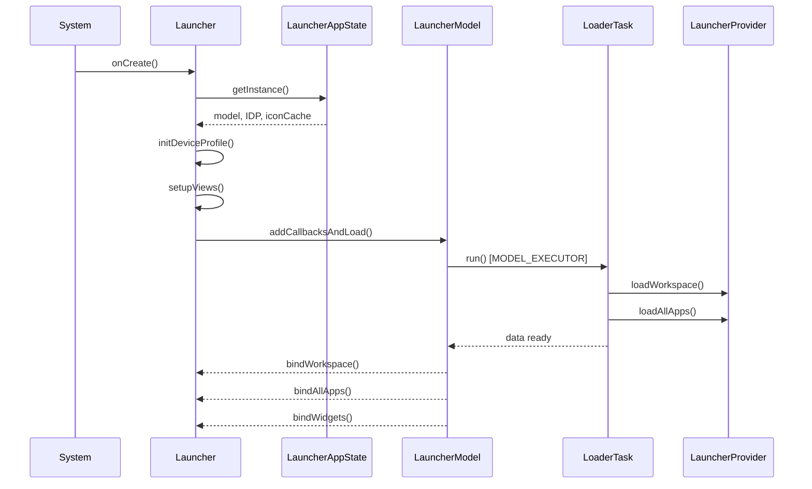

### 49.1.4 LauncherAppState：单例中心

`LauncherAppState`（现在是一个 Kotlin `data class`）聚合了核心单例：

```kotlin
// src/com/android/launcher3/LauncherAppState.kt
@Deprecated("Inject the specific targets directly instead of using LauncherAppState")
data class LauncherAppState
@Inject
constructor(
    @ApplicationContext val context: Context,
    val iconProvider: LauncherIconProvider,
    val iconCache: IconCache,
    val model: LauncherModel,
    val invariantDeviceProfile: InvariantDeviceProfile,
    @Named("SAFE_MODE") val isSafeModeEnabled: Boolean,
)
```

请注意 `@Deprecated` 注解——代码库正朝着通过 Dagger 注入单个组件的方向迁移，
而不是通过这个单例。`companion object`
仍然公开了旧的 `INSTANCE` 和 `getInstance()` 访问器以保持兼容。

### 49.1.5 LauncherModel：数据主干

`LauncherModel` 带有 `@LauncherAppSingleton` 注解，管理所有内存中的
启动器数据。它通过 Dagger 注入构造：

```kotlin
// src/com/android/launcher3/LauncherModel.kt
@LauncherAppSingleton
class LauncherModel
@Inject
constructor(
    @ApplicationContext private val context: Context,
    private val taskControllerProvider: Provider<ModelTaskController>,
    private val iconCache: IconCache,
    private val installQueue: ItemInstallQueue,
    @Named("ICONS_DB") dbFileName: String?,
    initializer: ModelInitializer,
    lifecycle: DaggerSingletonTracker,
    val modelDelegate: ModelDelegate,
    private val mBgAllAppsList: AllAppsList,
    private val mBgDataModel: BgDataModel,
    private val loaderFactory: LoaderTaskFactory,
    private val binderFactory: BaseLauncherBinderFactory,
    val modelDbController: ModelDbController,
    private val modelWriterFactory: ModelWriterFactory,
    dumpManager: DumpManager,
) : LauncherDumpable {
```

模型维护着两个关键数据结构：

- **`BgDataModel`**——保存工作区项、文件夹、应用小部件和屏幕顺序
- **`AllAppsList`**——保存可启动活动的完整列表

加载运行在 `MODEL_EXECUTOR`（一个专用的后台线程）上。模型通过
`mModelLoaded`、`mLoaderTask` 和 `lastLoadId` 跟踪加载
状态：

```kotlin
// src/com/android/launcher3/LauncherModel.kt
fun isModelLoaded() =
    synchronized(mLock) { mModelLoaded && mLoaderTask == null && !mModelDestroyed }
```

### 49.1.6 模型-视图分离

该架构遵循严格的模型-视图分离：

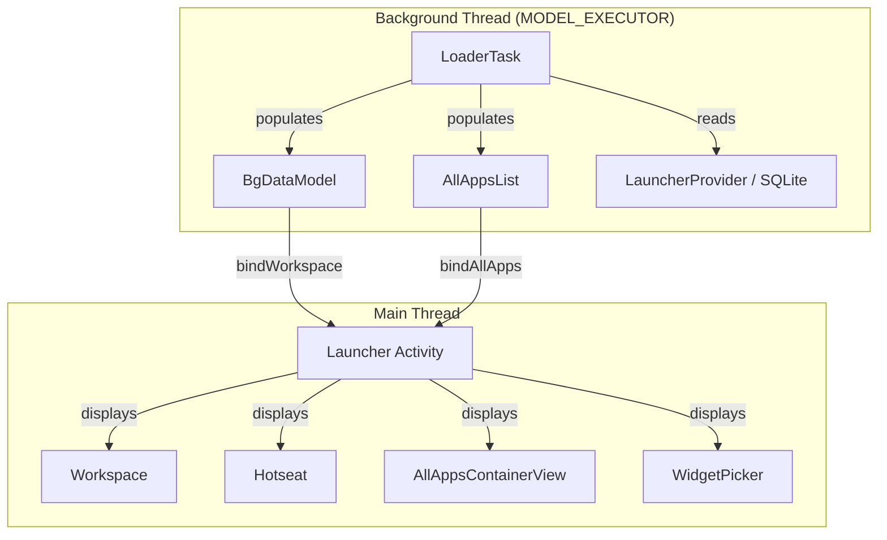

`ModelCallbacks`（`src/com/android/launcher3/ModelCallbacks.kt`）实现了
`Callbacks` 接口。`Launcher` 拥有这个实现者，作为其 `modelCallbacks`
字段。该实现者将绑定的数据转发到启动器视图层级。该接口定义了绑定契约：

- `bindCompleteModel()`——一次性重新绑定传递完整的工作区模型
- `bindItemsAdded()` / `bindItemsUpdated()`——传递工作区项的差异
- `bindAllApplications()`——传递完整的应用列表
- `bindAllWidgets()`——传递用于选择器的小部件目录

模型写入通过 `ModelWriter` 进行，该对象通过 `LauncherModel.getWriter()` 获取。
所有数据库变更都在模型线程上发生，以确保一致性。

### 49.1.7 状态机

`StateManager` 是一个泛型状态机，驱动启动器状态之间带动画的转换。每个状态
都是 `LauncherState` 的子类：

```java
// src/com/android/launcher3/LauncherState.java
public abstract class LauncherState implements BaseState<LauncherState> {
    public static final int HOTSEAT_ICONS = 1 << 0;
    public static final int ALL_APPS_CONTENT = 1 << 1;
    public static final int WORKSPACE_PAGE_INDICATOR = 1 << 5;
    public static final int FLOATING_SEARCH_BAR = 1 << 7;
    // ...
    public static final int FLAG_MULTI_PAGE = BaseState.getFlag(0);
    public static final int FLAG_WORKSPACE_ICONS_CAN_BE_DRAGGED = BaseState.getFlag(2);
    public static final int FLAG_RECENTS_VIEW_VISIBLE = BaseState.getFlag(6);
```

每个状态都带有一个 `ordinal` 字段，该字段从 `TestProtocol`
（`shared/src/com/android/launcher3/testing/shared/TestProtocol.java`）中匹配的
`*_STATE_ORDINAL` 常量设置，`LauncherState.java` 中状态定义将其传递给构造函数。
这些值并不是连续的“UI 层”顺序；它们是与测试框架共享的稳定标识符：

| 状态 | 序号 | 描述 |
|---|---|---|
| `NORMAL` | 0 | 默认工作区视图 |
| `SPRING_LOADED` | 1 | 拖动期间工作区缩小 |
| `OVERVIEW` | 2 | 最近任务视图（Quickstep） |
| `OVERVIEW_MODAL_TASK` | 3 | 任务菜单打开 |
| `QUICK_SWITCH` | 4 | 快速切换手势 |
| `ALL_APPS` | 5 | 应用抽屉打开 |
| `BACKGROUND_APP` | 6 | 应用位于前台 |
| `HINT_STATE` | 7 | 上滑提示指示器 |
| `HINT_STATE_TWO_BUTTON` | 8 | 两按钮导航提示指示器 |
| `OVERVIEW_SPLIT_SELECT` | 9 | 分屏选择 |
| `EDIT_MODE` | 10 | 工作区自定义模式 |
| `DESKTOP_DRAG_MODE` | 11 | 拖入桌面窗口 |

`StateManager` 通过动画驱动转换：

```java
// src/com/android/launcher3/statemanager/StateManager.java
public class StateManager<S extends BaseState<S>, T extends StatefulContainer<S>> {
    private final AnimationState<S> mConfig = new AnimationState<>();
    private final T mContainer;
    private final ArrayList<StateListener<S>> mListeners = new ArrayList<>();
    private S mState;
    private S mLastStableState;
    private S mCurrentStableState;
```

状态处理器（`StateHandler<S>[]`）负责应用特定于状态的
属性更改。例如，`AllAppsTransitionController` 在转换期间调整应用面板的垂直
位置和透明度。

### 49.1.8 使用 Dagger 进行依赖注入

Launcher3 代码库使用 Dagger 进行依赖注入，并带有以下关键注解：

- `@LauncherAppSingleton`——作用域限定为应用生命周期
- `@ApplicationContext`——应用的 `Context`
- `@Inject`——构造函数注入
- `@Named`——特定实例的限定符（例如 `"ICONS_DB"`）

DI 图以 `LauncherAppComponent` 为根，它提供 `InvariantDeviceProfile`、
`LauncherModel`、`IconCache` 和 `ThemeManager` 等单例。

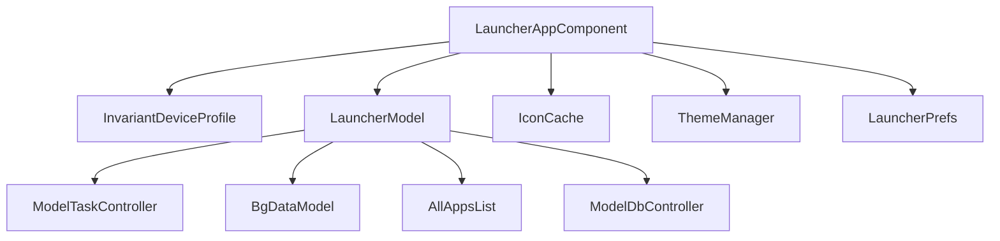

---

## 49.2 应用图标和网格

### 49.2.1 ItemInfo 层次结构

启动器主屏幕上的每个元素——应用图标、快捷方式、小部件、文件夹——
都由 `ItemInfo` 的子类表示：

```java
// src/com/android/launcher3/model/data/ItemInfo.java
public class ItemInfo {
    public int id = NO_ID;
    public int itemType;
    public int container = NO_ID;
    public int screenId = -1;
    public int cellX = -1;
    public int cellY = -1;
    public int spanX = 1;
    public int spanY = 1;
    public int minSpanX = 1;
    public int minSpanY = 1;
    public int rank = 0;
    public CharSequence title;
```

`itemType` 字段确定具体类型：

| 常量 | 值 | 含义 |
|---|---|---|
| `ITEM_TYPE_APPLICATION` | 0 | 应用快捷方式 |
| `ITEM_TYPE_FOLDER` | 2 | 文件夹容器 |
| `ITEM_TYPE_APPWIDGET` | 4 | 应用小部件 |
| `ITEM_TYPE_DEEP_SHORTCUT` | 6 | 固定深层快捷方式 |
| `ITEM_TYPE_TASK` | 7 | 任务（最近任务） |
| `ITEM_TYPE_QSB` | 8 | 快速搜索栏槽位 |
| `ITEM_TYPE_APP_GROUP` | 10 | 分屏应用组合（其 `toString` 标签仍为 `"APP_PAIR"`） |
| `ITEM_TYPE_FILE_SYSTEM_FILE` | 12 | 主屏幕文件 |

继承树：

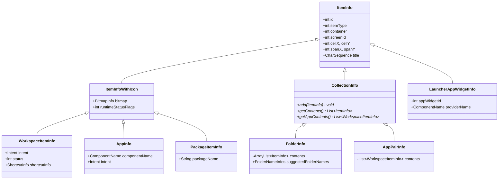

`container` 字段指定项所在的位置：

```java
// src/com/android/launcher3/LauncherSettings.java
public static final int CONTAINER_DESKTOP = -100;
public static final int CONTAINER_HOTSEAT = -101;
public static final int CONTAINER_ALL_APPS = -104;
```

### 49.2.2 CellLayout：网格容器

`CellLayout` 是基本的网格容器。每个工作区页面和 Dock 栏都是
`CellLayout` 实例。它管理一个网格，项可以放置在其中：

```java
// src/com/android/launcher3/CellLayout.java
public class CellLayout extends ViewGroup {
    @Thunk int mCellWidth;
    @Thunk int mCellHeight;
    protected Point mBorderSpace;
    protected int mCountX;
    protected int mCountY;
```

每个 `CellLayout` 维护一个 `GridOccupancy`，用于跟踪哪些单元格被占用：

```java
// src/com/android/launcher3/util/GridOccupancy.java
public class GridOccupancy {
    private final int mCountX;
    private final int mCountY;
    public final boolean[][] cells;
```

项使用 `CellLayoutLayoutParams` 定位：

```java
// src/com/android/launcher3/celllayout/CellLayoutLayoutParams.java
public class CellLayoutLayoutParams extends MarginLayoutParams {
    private int mCellX;
    private int mCellY;
    private int mTmpCellX;
    private int mTmpCellY;
    public boolean useTmpCoords;
    public int cellHSpan;
    public int cellVSpan;
```

单元格坐标是私有的，通过 getter/setter 访问器访问；只有跨度字段是公开的。

`CellLayout` 使用一个名为 `ShortcutAndWidgetContainer` 的子容器，
该容器执行子视图的实际布局。这种分离使 `CellLayout`
管理网格逻辑，而容器处理 `ViewGroup` 布局机制。

### 49.2.3 Workspace：分页容器

`Workspace` 继承自 `PagedView` 并持有多个 `CellLayout` 页面：

```java
// src/com/android/launcher3/Workspace.java
public class Workspace<T extends View & PageIndicator> extends PagedView<T>
        implements DropTarget, DragSource, View.OnTouchListener,
        LauncherOverlayCallbacks, Insettable {
```

工作区支持：

- **主屏幕页面之间的水平分页**
- **页面之间的项拖放**
- **根据内容创建和删除页面**
- **通过 `WallpaperOffsetInterpolator` 滚动壁纸**
- **拖放操作期间页面缩小的弹簧加载模式**

### 49.2.4 BubbleTextView：图标视图

`BubbleTextView` 是渲染应用图标的自定义 `TextView` 子类：

```java
// src/com/android/launcher3/BubbleTextView.java
public class BubbleTextView extends TextView
        implements ItemInfoUpdateReceiver, DraggableView, Poppable {
```

它同时渲染图标（作为顶部的复合 drawable）和下方的标签文本。
主要功能包括：

- **通知圆点**——当应用有通知时通过 `DotRenderer` 渲染
- **下载进度**——安装期间叠加进度环
- **主题化图标**——启用 Material You 主题时进行单色图标渲染
- **运行中应用状态**——任务栏图标上运行中应用的视觉指示器

该视图通过常量支持多个显示上下文：

```java
// src/com/android/launcher3/BubbleTextView.java
public static final int DISPLAY_WORKSPACE = 0;
public static final int DISPLAY_ALL_APPS = 1;
public static final int DISPLAY_FOLDER = 2;
public static final int DISPLAY_TASKBAR = 5;
public static final int DISPLAY_SEARCH_RESULT = 6;
public static final int DISPLAY_SEARCH_RESULT_SMALL = 7;
```

### 49.2.5 Hotseat：底部一行

`Hotseat` 是一个专门的 `CellLayout`，代表常驻的底部一行：

```java
// src/com/android/launcher3/Hotseat.java
public class Hotseat extends CellLayout implements Insettable {
```

它与工作区的 `CellLayout` 实例的不同之处在于：

- 它使用单行网格（`mCountY = 1`）
- 项不与特定的屏幕 ID 关联
- 它参与预测（建议的应用会出现在这里）

### 49.2.6 DeviceProfile 和网格配置

Launcher3 通过两层系统使其网格适应不同的屏幕尺寸：

**InvariantDeviceProfile (IDP)** 是从
`res/xml/device_profiles.xml` 加载的设备无关规范：

```xml
<!-- res/xml/device_profiles.xml -->
<grid-option
    launcher:name="4_by_4"
    launcher:numRows="4"
    launcher:numColumns="4"
    launcher:numFolderRows="3"
    launcher:numFolderColumns="4"
    launcher:numHotseatIcons="4"
    launcher:numExtendedHotseatIcons="6"
    launcher:dbFile="launcher_4_by_4.db"
    launcher:defaultLayoutId="@xml/default_workspace_4x4"
    launcher:deviceCategory="phone|multi_display" >
```

IDP 支持多种网格尺寸（`3_by_3`、`4_by_4`、`5_by_5`、`6_by_5`、
`desktop_6_by_5`）以及一个 `fixed_landscape_mode` 配置文件。每个网格定义都包含
显示选项，这些选项为不同的屏幕尺寸指定图标大小、文本大小和边框间距。

**DeviceProfile** 是为当前显示
配置计算的运行时配置文件。它包含响应式规范：

```java
// src/com/android/launcher3/DeviceProfile.java
public class DeviceProfile {
    public final InvariantDeviceProfile inv;
    private final boolean mIsScalableGrid;
    private final boolean mIsResponsiveGrid;
```

曾经是普通字段的标志（如内联 QSB 和左/右分屏
布尔值）现在通过访问器从子配置文件读取
（`mHotseatProfile.isQsbInline()`、`mSysuiProfile.isLeftRightSplit()`）。

设备配置文件将布局计算委托给子配置文件：

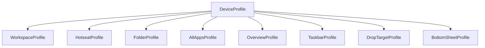

设备类型分类决定了布局行为：

```java
// src/com/android/launcher3/InvariantDeviceProfile.java
public static final int TYPE_PHONE = 0;
public static final int TYPE_MULTI_DISPLAY = 1;
public static final int TYPE_TABLET = 2;
public static final int TYPE_DESKTOP = 3;
```

### 49.2.7 图标加载和缓存

`IconCache` 负责加载和缓存应用图标。图标在后台线程上异步加载，
并缓存在 SQLite 数据库
（默认为 `app_icons.db`）中。

图标加载管道：

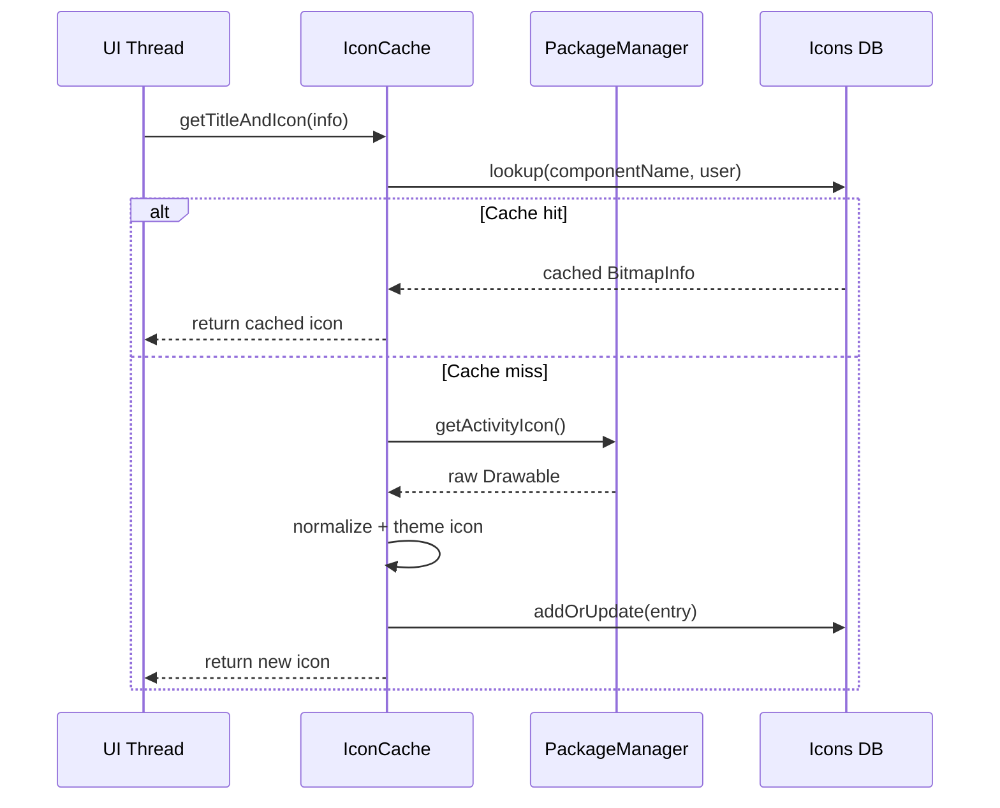

`LauncherIconProvider` 处理带主题支持的图标加载。当启用
主题化图标时，它会尝试加载单色图标变体，并应用用户基于壁纸的配色方案。

### 49.2.8 响应式网格系统

`src/com/android/launcher3/responsive/` 中的响应式网格系统根据可用的屏幕空间
动态调整单元格大小和间距：

```
responsive/
  ResponsiveSpec.kt              # Core spec definition
  ResponsiveSpecsProvider.kt     # Provider for workspace specs
  ResponsiveCellSpecsProvider.kt # Provider for cell specs
  HotseatSpecsProvider.kt        # Provider for hotseat specs
  SizeSpec.kt                    # Individual size specification
  ResponsiveSpecGroup.kt         # Grouping of specs
  ResponsiveSpecsParser.kt       # XML parser for spec files
```

响应式规范在 XML 资源文件中定义（例如 `spec_col_count_3_row.xml`、
`spec_handheld_all_apps_3_row.xml`），系统在运行时根据可用尺寸选择适当的规范。

---

## 49.3 小部件系统

### 49.3.1 小部件架构概述

Launcher3 的小部件系统将 Android 的 `AppWidgetManager` 框架与
启动器自己的视图层级连接起来。关键类构成了一个分层架构：

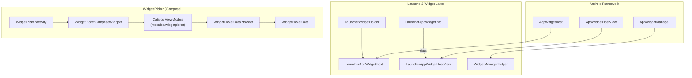

### 49.3.2 LauncherWidgetHolder

`LauncherWidgetHolder` 封装 `AppWidgetHost`，以允许从
后台线程执行小部件操作：

```java
// src/com/android/launcher3/widget/LauncherWidgetHolder.java
public class LauncherWidgetHolder {
    public static final int APPWIDGET_HOST_ID = 1024;

    protected static final int FLAG_LISTENING = 1;
    protected static final int FLAG_STATE_IS_NORMAL = 1 << 1;
    protected static final int FLAG_ACTIVITY_STARTED = 1 << 2;
    protected static final int FLAG_ACTIVITY_RESUMED = 1 << 3;

    @NonNull protected final Context mContext;
    @NonNull protected final ListenableAppWidgetHost mWidgetHost;
    @NonNull protected final SparseArray<LauncherAppWidgetHostView> mViews;
```

Holder 跟踪 Activity 生命周期标志，以确定何时监听更新。
只有当所有 `FLAGS_SHOULD_LISTEN` 都设置时（Activity 处于 NORMAL 状态、已启动
且已恢复），小部件视图才会接收远程视图更新。

### 49.3.3 LauncherAppWidgetHost

`LauncherAppWidgetHost` 继承 `ListenableAppWidgetHost` 并创建
`LauncherAppWidgetHostView` 实例：

```java
// src/com/android/launcher3/widget/LauncherAppWidgetHost.java
class LauncherAppWidgetHost extends ListenableAppWidgetHost {
    @Override
    @NonNull
    public LauncherAppWidgetHostView onCreateView(Context context, int appWidgetId,
            AppWidgetProviderInfo appWidget) {
        ListenableHostView result =
                mViewToRecycle != null ? mViewToRecycle : new ListenableHostView(context);
        mViewToRecycle = null;
        return result;
    }
```

请注意视图回收机制：当小部件被重新配置时，现有视图会传给
`recycleViewForNextCreation()`，以避免重新创建宿主视图。

### 49.3.4 小部件数据：LauncherAppWidgetInfo

小部件在模型中由 `LauncherAppWidgetInfo` 表示：

```java
// src/com/android/launcher3/model/data/LauncherAppWidgetInfo.java
public class LauncherAppWidgetInfo extends ItemInfo {
    public int appWidgetId;
    public ComponentName providerName;
    public int restoreStatus;
    public int installProgress;
```

`restoreStatus` 字段跟踪恢复生命周期：

- `FLAG_ID_NOT_VALID`——小部件 ID 需要分配
- `FLAG_PROVIDER_NOT_READY`——提供者尚未安装
- `FLAG_UI_NOT_READY`——视图尚未填充
- `RESTORE_COMPLETED`——完全恢复

### 49.3.5 小部件固定流程

当用户从小部件选择器添加小部件时，会执行以下流程：

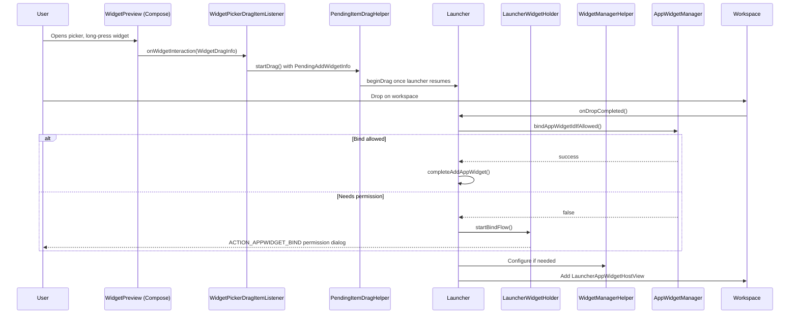

### 49.3.6 小部件选择器：WidgetPickerActivity（Compose）

小部件选择器不再是基于 `RecyclerView` 的底部弹窗。
`WidgetsFullSheet` / `WidgetsListAdapter` / `WidgetCell` 三件套已被移除，
取而代之的是一个独立的 Jetpack Compose Activity。宿主是
`WidgetPickerActivity`：

```kotlin
// src/com/android/launcher3/widgetpicker/WidgetPickerActivity.kt
open class WidgetPickerActivity :
    BaseActivity(), OnBackPressedDispatcherOwner, OnBackAnimationCallback, LifecycleOwner {
```

`WidgetPickerActivity` 填充一个 `SimpleDragLayer` 来承载拖放，然后将实际内容交给
`WidgetPickerComposeWrapper`。该包装器是一个接口，实现为
`WidgetPickerComposeWrapperImpl`：

```kotlin
// src/com/android/launcher3/widgetpicker/WidgetPickerComposeWrapper.kt
interface WidgetPickerComposeWrapper {
    fun showAllWidgets(activity: BaseActivity, widgetPickerConfig: WidgetPickerConfig)
    fun showWidgetsFor(packageName: String, user: UserHandle, /* ... */)
    fun showWidgetsForPinRequest(/* ... */)
}
```

实现会添加一个 `ComposeView`，调用 `setContent { }`，构建一个
`WidgetPickerComponent` Dagger 子图，并连接为目录提供数据的仓库
（`WidgetsRepository`、`WidgetUsersRepository`、
`WidgetAppIconsRepository`）。在 Quickstep 一侧，
`QuickstepWidgetPickerActivity`
（`quickstep/src/com/android/launcher3/QuickstepWidgetPickerActivity.kt`）继承
`WidgetPickerActivity`，以在额外的界面上承载选择器（例如锁屏小部件选择器）。
它在同一份 Compose 内容之上添加了壁纸模糊、缩放和手势拦截。

可组合目录位于 `modules/widgetpicker/` 模块中，每个都由
一个 ViewModel 驱动：

| 界面 | 可组合组件 | ViewModel |
|---|---|---|
| 所有小部件（主页 + 搜索） | `FullWidgetsCatalog` | `FullWidgetsCatalogViewModel` |
| 单应用小部件 | `SingleAppWidgetsCatalog` | `SingleAppWidgetsCatalogViewModel` |
| 固定小部件请求 | `PinAppWidgetCatalog` | `PinAppWidgetCatalogViewModel` |

完整目录进一步拆分为 `LandingScreen`（精选小部件，大屏上有单栏和双栏变体）
和 `SearchScreen`。每个都有自己的 ViewModel，位于
`modules/widgetpicker/src/com/android/launcher3/widgetpicker/ui/fullcatalog/screens/`。

### 49.3.7 小部件预览渲染和拖出

选择器 UI 中不再有 `WidgetCell` 视图。小部件图块现在是
`WidgetPreview` 可组合组件
（`modules/widgetpicker/src/com/android/launcher3/widgetpicker/ui/components/WidgetPreview.kt`），
由 `WidgetsGrid.kt` 布局。`DatabaseWidgetPreviewLoader`
（`src/com/android/launcher3/widget/DatabaseWidgetPreviewLoader.java`）仍然存在：
它被注入到 `WidgetsRepositoryImpl`
（`src/com/android/launcher3/widgetpicker/repository/WidgetsRepositoryImpl.kt`），
后者用它来生成可组合组件渲染的预览位图。网格渲染的数据来自
`WidgetPickerData`，由 `WidgetPickerDataProvider` 公开：

```kotlin
// src/com/android/launcher3/widget/picker/model/WidgetPickerDataProvider.kt
// holds a WidgetPickerData, whose allWidgets is a List<WidgetsListBaseEntry>
```

拖出仍然以与之前相同的模型侧机制结束。在可组合组件中，长按由
`detectDragGesturesAfterLongPress` 检测，其 `onDragStart`
通过
`WidgetPickerEventListeners` 接口
（`modules/widgetpicker/src/com/android/launcher3/widgetpicker/ui/WidgetPickerEventListeners.kt`）
报告 `WidgetInteractionInfo.WidgetDragInfo`。
`WidgetPickerComposeWrapperImpl` 将其转换为一个 `WidgetPickerDragItemListener`
（`src/com/android/launcher3/widgetpicker/listeners/WidgetPickerDragItemListener.kt`），
即一个 `BaseItemDragListener`。它将所选小部件转换为
`PendingAddWidgetInfo`。启动器恢复后，它通过未更改的
`PendingItemDragHelper` 启动拖放。

### 49.3.8 小部件缩放

已放置的小部件可以通过 `AppWidgetResizeFrame`（现在是一个 Kotlin 文件）缩放：

```
src/com/android/launcher3/AppWidgetResizeFrame.kt
```

缩放框在小部件边缘绘制句柄，并在用户拖动时更新单元格跨度。最小跨度约束
（`minSpanX`/`minSpanY`，派生自
`AppWidgetProviderInfo.minResizeWidth/Height`）和最大跨度约束
（`maxSpanX`/`maxSpanY`，派生自
`AppWidgetProviderInfo.maxResizeWidth/maxResizeHeight`）会被强制执行。

### 49.3.9 小部件可见性跟踪

`WidgetVisibilityTracker` 监控哪些小部件当前在屏幕上可见，并相应地通知
`AppWidgetHost`，使系统能够优化屏幕外小部件的资源使用：

```java
// src/com/android/launcher3/widget/WidgetVisibilityTracker.kt
// Initialized in Launcher.onCreate():
mWidgetVisibilityTracker = new WidgetVisibilityTracker(
    this, mAppWidgetHolder, mWorkspace, mStateManager);
```

---

## 49.4 拖放

### 49.4.1 拖放架构

拖放系统是 Launcher3 中最复杂的子系统之一，涉及
多个协调类：

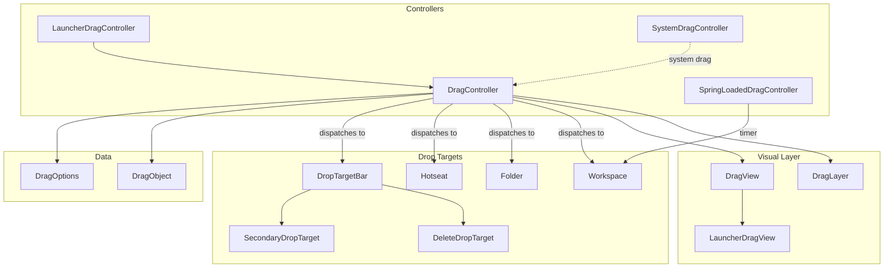

### 49.4.2 DragController

`DragController` 是具体的基类（由
`LauncherDragController` 继承），负责管理拖放生命周期：

```java
// src/com/android/launcher3/dragndrop/DragController.java
public class DragController implements DragDriver.EventListener, TouchController {

    private static final int DEEP_PRESS_DISTANCE_FACTOR = 3;

    private final ActivityContext mActivity;
    protected DragDriver mDragDriver = null;
    public DragOptions mOptions;
    protected final Point mMotionDown = new Point();
    protected final Point mLastTouch = new Point();

    public DropTarget.DragObject mDragObject;

    private final ArrayList<DropTarget> mDropTargets = new ArrayList<>();
    private final ArrayList<DragListener> mListeners = new ArrayList<>();
    protected DropTarget mLastDropTarget;
```

拖放生命周期：

1. **拖前**——检测到长按；控制器进入拖前模式
2. **拖动开始**——如果用户移动超过阈值，则创建 `DragView`
3. **拖动移动**——触摸事件更新 `DragView` 的位置并查找放置目标
4. **放置**——项被释放；相应的 `DropTarget` 接收它

### 49.4.3 DragLayer

`DragLayer` 是一个自定义 `ViewGroup`，位于启动器视图层级的根部，
在拖放期间拦截所有触摸事件：

```java
// src/com/android/launcher3/dragndrop/DragLayer.java
public class DragLayer extends BaseDragLayer<Launcher>
        implements LauncherOverlayCallbacks {

    public static final int ALPHA_INDEX_OVERLAY = 0;
    public static final int ALPHA_INDEX_LOADER = 1;
```

它协调：

- 在其他所有内容之上渲染 `DragView`
- 将触摸事件转发给 `DragController`
- 播放放置动画
- 管理文件夹打开/关闭的覆盖动画

### 49.4.4 DragView

`DragView` 是拖放期间跟随用户手指的浮动视图：

```java
// src/com/android/launcher3/dragndrop/DragView.java
public class DragView extends FrameLayout {

    public static final int VIEW_ZOOM_DURATION = 150;

    private final View mContent;
    private final int mWidth;
    private final int mHeight;
    private final int mBlurSizeOutline;
    protected final int mRegistrationX;
    protected final int mRegistrationY;
    private final float mInitialScale;
    private final float mEndScale;
    protected final float mScaleOnDrop;
```

`DragView` 使用弹簧动画以获得自然的感觉：

```java
// Uses SpringAnimation from AndroidX dynamic animation
private SpringAnimation mSpring;
```

`mRegistrationX/Y` 值表示从触摸点到拖动视图原点的偏移，
确保视图自然地跟随手指。

### 49.4.5 放置目标

`DropTarget` 接口定义了视图如何接受放置：

```java
// src/com/android/launcher3/DropTarget.java
public interface DropTarget {
    boolean acceptDrop(DragObject dragObject);
    void onDrop(DragObject dragObject, DragOptions options);
    void onDragEnter(DragObject dragObject);
    void onDragOver(DragObject dragObject);
    void onDragExit(DragObject dragObject);
```

主要的放置目标是：

- **`Workspace`**——接受工作区页面上的图标、快捷方式、小部件
- **`Hotseat`**——接受底部 Dock 栏中的图标
- **`Folder`**——在图标拖过文件夹时接受图标
- **`DeleteDropTarget`**——从主屏幕移除项
- **`SecondaryDropTarget`**——提供“卸载”或“应用信息”操作

### 49.4.6 SpringLoadedDragController

当用户拖动项并悬停在工作区页面上时，
`SpringLoadedDragController` 以延迟方式管理页面切换：

```kotlin
// src/com/android/launcher3/dragndrop/SpringLoadedDragController.kt
class SpringLoadedDragController(private val launcher: Launcher) : OnAlarmListener {
    internal val alarm = Alarm().also { it.setOnAlarmListener(this) }
    private var screen: CellLayout? = null

    fun setAlarm(cl: CellLayout?) {
        cancel()
        alarm.setAlarm(
            when {
                cl == null -> ENTER_SPRING_LOAD_CANCEL_HOVER_TIME
                Utilities.isRunningInTestHarness() -> ENTER_SPRING_LOAD_HOVER_TIME_IN_TEST
                else -> ENTER_SPRING_LOAD_HOVER_TIME
            }
        )
        screen = cl
    }

    override fun onAlarm(alarm: Alarm) {
        if (screen != null) {
            with(launcher.workspace) {
                if (!isVisible(screen) && launcher.dragController.mDistanceSinceScroll != 0) {
                    snapToPage(indexOfChild(screen))
                }
            }
        } else {
            launcher.dragController.cancelDrag()
        }
    }

    companion object {
        private const val ENTER_SPRING_LOAD_HOVER_TIME: Long = 500
        private const val ENTER_SPRING_LOAD_HOVER_TIME_IN_TEST: Long = 3000
        private const val ENTER_SPRING_LOAD_CANCEL_HOVER_TIME: Long = 950
    }
}
```

页面切换前 500ms 的悬停延迟是刻意的 UX 选择，旨在防止拖放操作期间
意外的页面导航。

### 49.4.7 系统拖放支持

Launcher3 还支持 Android 的系统拖放 API 以实现跨应用拖放：

```kotlin
// src/com/android/launcher3/dragndrop/SystemDragController.kt
```

`SystemDragController` 处理源自启动器外部的拖放事件
（例如，从另一个应用将文件拖到主屏幕上）。它创建
`SystemDragItemInfo` 来表示被拖动的内容，并通过
标准放置目标机制路由它。

### 49.4.8 完整拖放流程

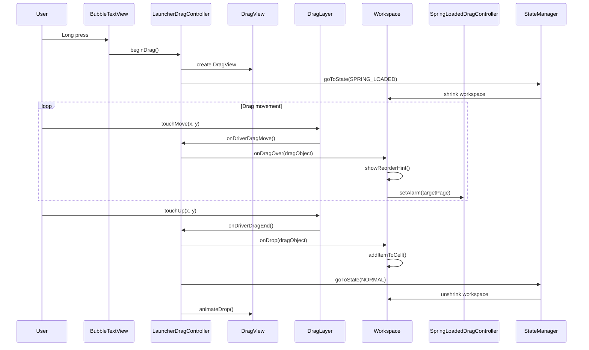

### 49.4.9 重排预览动画

在拖放期间，当项需要移动以腾出空间时，`CellLayout` 会显示重排
预览动画：

```java
// src/com/android/launcher3/celllayout/ReorderPreviewAnimation.kt
// src/com/android/launcher3/celllayout/ReorderAlgorithm.java
```

重排算法计算项的配置，在容纳被拖动项的同时最小化位移，
而 `ReorderPreviewAnimation` 平滑地将项平移到它们的新位置。

---

## 49.5 最近任务集成

### 49.5.1 Launcher 作为最近任务提供者

在现代 Android（自 Android 10 起）中，当包含 Quickstep 模块时，Launcher3
既充当主屏幕，又充当最近应用提供者。`QuickstepLauncher` 类继承 `Launcher`
以添加最近任务功能：

```java
// quickstep/src/com/android/launcher3/uioverrides/QuickstepLauncher.java
public class QuickstepLauncher extends Launcher {
```

这种集成由系统属性和 Quickstep 的
`TouchInteractionService` 控制。该服务拦截手势导航事件。
它将事件路由到启动器（用于返回主屏幕或显示最近任务）或
前台应用。

### 49.5.2 架构概述

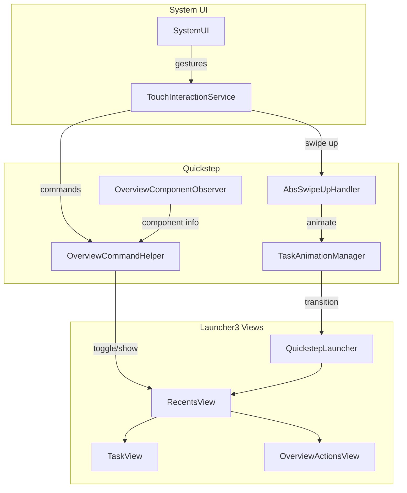

### 49.5.3 OverviewCommandHelper

`OverviewCommandHelper` 管理用于显示/隐藏最近任务视图的原子命令：

```kotlin
// quickstep/src/com/android/quickstep/OverviewCommandHelper.kt
class OverviewCommandHelper
@Inject
constructor(
    private val touchInteractionHandler: Provider<TouchInteractionHandler>,
    private val overviewComponentObserver: OverviewComponentObserver,
    private val dispatcherProvider: DispatcherProvider,
    private val displayRepository: DisplayRepository,
    private val taskbarManager: TaskbarManager,
    private val taskAnimationManagerRepository: PerDisplayRepository<TaskAnimationManager>,
    @ElapsedRealtimeLong private val elapsedRealtime: () -> Long,
    private val systemUiProxy: SystemUiProxy,
    private val latencyTracker: LatencyTracker,
) {
    private val coroutineScope =
        CoroutineScope(SupervisorJob() + dispatcherProvider.lightweightBackground)
    private val commandQueue = ConcurrentLinkedDeque<CommandInfo>()
```

在 Android 17 中，该辅助类是一个普通的 `@Inject` Dagger 类型。较早的版本
使用辅助注入类型。该辅助类并不直接接收
`TouchInteractionService`。相反，它拉取一个
`Provider<TouchInteractionHandler>`、一个 `PerDisplayRepository<TaskAnimationManager>`
和一个 `DisplayRepository`。所有这些都是显示感知的，因此单个辅助类可以在手势
发生所在显示器上驱动概览。
`SystemUiProxy` 仍然是直接的构造函数参数。

命令类型如下：

```kotlin
enum class CommandType {
    SHOW_ALT_TAB,
    HIDE_ALT_TAB,
    /** Toggle between overview and the next task */
    TOGGLE, // Navigate to Overview
    HOME, // Navigate to Home
    /**
     * Toggle between Overview and the previous screen before launching Overview, which can
     * either be a task or the home screen.
     */
    TOGGLE_OVERVIEW_PREVIOUS,
    /** Toggle between Overview and the keyboard-focused Overview task. */
    TOGGLE_WITH_FOCUS,
}
```

独立的 `SHOW_WITH_FOCUS` 命令已在 17 中移除；键盘聚焦的概览现在通过
`TOGGLE_WITH_FOCUS` 到达。

### 49.5.4 RecentsView

`RecentsView` 是一个用于最近任务缩略图的水平滚动容器：

```java
// quickstep/src/com/android/quickstep/views/RecentsView.java
public abstract class RecentsView<
        CONTAINER_TYPE extends Context & RecentsViewContainer & StatefulContainer<STATE_TYPE>,
        STATE_TYPE extends BaseState<STATE_TYPE>> extends PagedView implements Insettable,
        HighResLoadingState.HighResLoadingStateChangedCallback,
        TaskVisualsChangeListener {
```

容器类型参数是一个实现了
`RecentsViewContainer` 和 `StatefulContainer` 的 `Context`。它不一定是
一个 `Activity`。这正是让 49.5.8 节中窗口托管的
`RecentsWindowManager` 能够复用 `RecentsView` 的原因。

`RecentsView` 的主要功能：

- **任务卡片**是显示应用缩略图的 `TaskView` 实例
- **全部清除**按钮用于清除所有最近任务
- **分屏**通过将任务拖到分屏占位符来启动
- **桌面任务视图**用于窗口化/桌面模式任务
- **仅网格概览**模式，其中任务以网格布局显示

在 Android 17 中，`RecentsView` 还持有一个 `DesktopRecentsTransitionController`
（`quickstep/src/com/android/launcher3/desktop/DesktopRecentsTransitionController.kt`），
通过其 `init` 路径注入。当任务卡片移动到桌面窗口化时，
`RecentsView` 委托给该控制器的 `moveToDesktop`。当显示器是外部连接的显示器时，
它会调用 `moveToExternalDisplay`。
两者都运行一个名为 `"RecentsToDesktop"` 的 `RemoteTransition`。这使得任务从
概览网格动画进入自由形式的桌面窗口。

### 49.5.5 TaskView

`TaskView` 表示单个最近任务：

```kotlin
// quickstep/src/com/android/quickstep/views/TaskView.kt
open class TaskView
@JvmOverloads
constructor(
    context: Context,
    attrs: AttributeSet? = null,
    defStyleAttr: Int = 0,
    defStyleRes: Int = 0,
    // ... border animators, type, and fullscreen draw params
) : FrameLayout(context, attrs), ViewPool.Reusable {
```

每个 `TaskView` 包含：

- 一个任务缩略图（从最近截图渲染）
- 一个显示应用图标的图标芯片
- 一个用于运行状态指示器的覆盖层
- 用于启动、清除和分屏手势的触摸处理

`GroupedTaskView` 继承 `TaskView` 用于分屏任务对，并排显示两个缩略图。

### 49.5.6 最近任务的 Launcher 状态转换

`OVERVIEW` 状态由 Quickstep 模块添加：

```java
// quickstep/src/com/android/launcher3/uioverrides/states/OverviewState.java
public class OverviewState extends LauncherState {
```

`RecentsViewStateController` 处理状态之间的动画：

```kotlin
// quickstep/src/com/android/launcher3/uioverrides/RecentsViewStateController.kt
```

`NORMAL` 和 `OVERVIEW` 之间的转换涉及：

1. 将工作区缩小
2. 淡入最近任务视图
3. 显示/隐藏概览操作按钮
4. 调整任务栏状态

### 49.5.7 手势导航流程

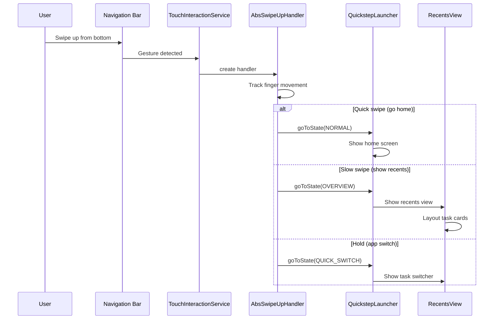

### 49.5.8 窗口化最近任务：RecentsWindowManager

历史上，概览由一个 `Activity` 托管（回退情况中的 `RecentsActivity`，或
启动器情况中的 `QuickstepLauncher` 本身）。借助桌面窗口化和连接的显示器，
Android 17 引入了一种在独立的*窗口*中而不是 Activity 中托管概览的方式。因此
最近任务可以位于辅助显示器上，或者在不拥有任务的情况下浮在桌面上方。宿主是
`RecentsWindowManager`：

```kotlin
// quickstep/src/com/android/quickstep/window/RecentsWindowManager.kt
class RecentsWindowManager
@Inject
constructor(
    @WindowContext private val windowContext: Context,
    private val fallbackWindowInterface: FallbackWindowInterface,
    private val recentsWindowTracker: RecentsWindowTracker,
    wallpaperColorHints: WallpaperColorHints,
    private val systemUiProxy: SystemUiProxy,
    recentsModel: RecentsModel,
    private val screenOnTracker: ScreenOnTracker,
    desktopState: DesktopState,
    displayController: DisplayController,
    @Ui private val uiExecutor: LooperExecutor,
    invariantDeviceProfile: InvariantDeviceProfile,
    lifeCycle: PerDisplayCleanupTask,
    @Named(WINDOW_BLUR_STATE) private val blurState: ListenableRef<Boolean>,
) :
    RecentsWindowContext(windowContext, wallpaperColorHints.hints, invariantDeviceProfile),
    RecentsViewContainer,
    StatefulContainer<RecentsState>,
    ComponentCallbacks {
```

`RecentsWindowManager` 不使用 `Activity`。它用自己的视图树构建自己的视图树，
由 `SurfaceControlViewHost` 驱动 `WindowlessWindowManager`。它拥有一个
`StateManager<RecentsState, RecentsWindowManager>`（其自己的 `HIDDEN`/可见
状态机，独立于 `LauncherState`）。它还实现了
`RecentsViewContainer`，因此来自 49.5.4 节的完全相同的 `RecentsView`/`TaskView`
机制在其中渲染。由于它是一个 `ComponentCallbacks`，它会按显示器响应自己的配置
更改（方向、屏幕尺寸）。

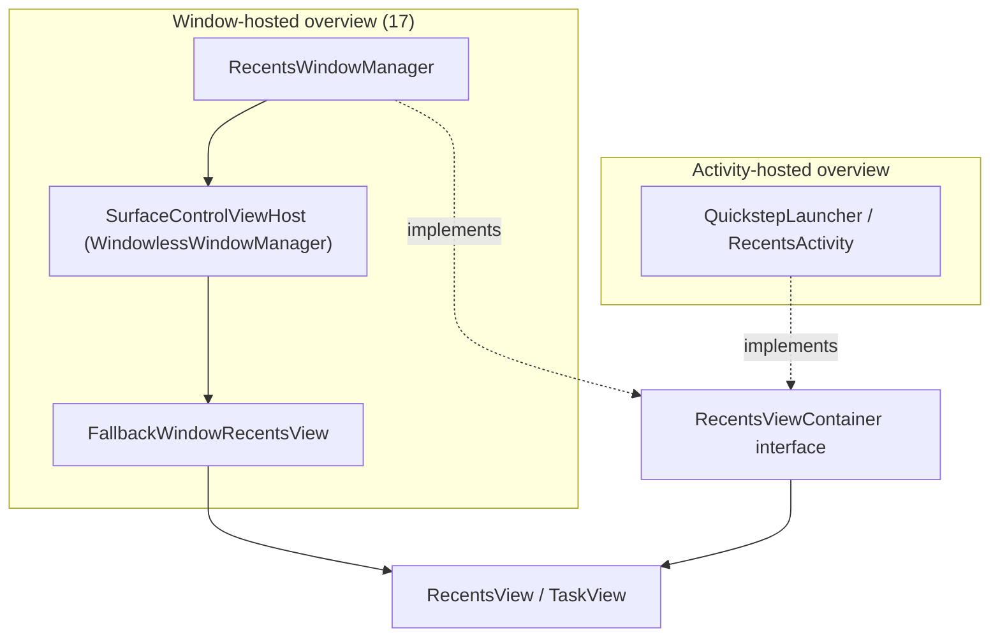

使用哪个宿主由 `RecentsWindowFlags`
（`quickstep/src/com/android/quickstep/window/RecentsWindowFlags.kt`）控制，其
`enableLauncherOverviewInWindow` 和 `enableFallbackOverviewInWindow`
`DesktopExperienceFlag` 包装 `enable_launcher_overview_in_window` 和
`enable_fallback_overview_in_window` aconfig 标志。按显示器的
`RecentsWindowManager` 由 `RecentsWindowTracker`
（`quickstep/src/com/android/quickstep/window/RecentsWindowTracker.kt`，一个
`ContextTracker`）创建和拆除。它与 49.6 节中描述的
`DisplayModel`/`PerDisplayComponent`
机制配合使用。因此每个带有系统装饰的显示器都可以
获得自己的概览窗口。匹配的手势处理器是
`RecentsWindowSwipeHandler`
（`quickstep/src/com/android/quickstep/window/RecentsWindowSwipeHandler.java`），
即 `AbsSwipeUpHandler` 的窗口托管对应物。

### 49.5.9 桌面应用启动转换

当桌面窗口化激活时，从主屏幕或任务栏启动应用应将新窗口动画到自由形式的
桌面位置。它不应该动画到全屏。Android 17 添加了一个专门的转换包，
`com.android.launcher3.desktop`。`DesktopAppLaunchTransitionManager`
（`quickstep/src/com/android/launcher3/desktop/DesktopAppLaunchTransitionManager.kt`）
为自由形式任务打开和窗口限制“取消最小化”情况向 SystemUI 注册一个
`RemoteTransition`：

```kotlin
// quickstep/src/com/android/launcher3/desktop/DesktopAppLaunchTransitionManager.kt
fun registerTransitions() {
    if (!shouldRegisterTransitions()) return
    remoteWindowLimitUnminimizeTransition =
        RemoteTransition(/* ... unminimize runner ... */)
    systemUiProxy.registerRemoteTransition(remoteWindowLimitUnminimizeTransition)
}

private fun shouldRegisterTransitions(): Boolean =
    DesktopModeStatus.canEnterDesktopMode(context)
```

实际动画由 `DesktopAppLaunchTransition`
（`quickstep/src/com/android/launcher3/desktop/DesktopAppLaunchTransition.kt`）
描述，其 `AppLaunchType` 枚举将新的 `LAUNCH` 与 `UNMINIMIZE` 区分开，并且
`DesktopAppLaunchAnimatorHelper`
（`quickstep/src/com/android/launcher3/desktop/DesktopAppLaunchAnimatorHelper.kt`）
构建每个窗口的动画器。`QuickstepTransitionManager` 将此接入。
在其远程转换路径中，它检查 `isDesktopAppLaunch(...)`。当结果为 true 时，它返回
`createDesktopAppLaunchRemoteTransition(...)`。因此桌面模式下点击主屏幕图标会播放
桌面启动动画。整个路径由
`DesktopModeStatus.canEnterDesktopMode()` 和
`desktop_homescreen_icons_applaunch_transitions` 标志控制，因此在手机
上经典的全屏启动动画保持不变。

---

## 49.6 任务栏

### 49.6.1 任务栏架构

任务栏是大屏幕（平板、折叠屏、桌面模式）上的常驻导航元素。它作为由
`TaskbarActivityContext` 管理的独立窗口存在：

```java
// quickstep/src/com/android/launcher3/taskbar/TaskbarActivityContext.java
public class TaskbarActivityContext extends BaseTaskbarContext {
```

在主显示器上，任务栏窗口的类型为 `TYPE_NAVIGATION_BAR`。
这将其放置在与导航栏相同的系统 UI 层级。在辅助（连接的）显示器上，它改用
`TYPE_NAVIGATION_BAR_PANEL`
（`createAllWindowParams()` 通过 `isPrimaryDisplay()` 选择类型）。它使用
`FLAG_NOT_FOCUSABLE` 以避免从前台应用窃取输入焦点。

每个显示器有一个 `TaskbarActivityContext`。在 Android 17 中，更高层的生命周期
（随着显示器的出现和消失而创建和销毁任务栏）由
`TaskbarManager` 接口及其基于 `DisplayModel` 的实现拥有。
49.6.7 节介绍了这种按显示器架构。

### 49.6.2 任务栏控制器架构

任务栏使用复杂的控制器架构，其中每个方面都由专用控制器管理：

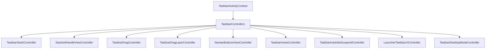

关键控制器：

- **`TaskbarStashController`**——管理任务栏的隐藏/取消隐藏
- **`StashedHandleViewController`**——管理隐藏时显示的小句柄
- **`NavbarButtonsViewController`**——管理返回/主页/最近任务按钮
- **`TaskbarDragController`**——处理从任务栏到工作区的拖放
- **`TaskbarInsetsController`**——向系统报告 insets

### 49.6.3 StashedHandleViewController

当任务栏被隐藏（stashed）时，会显示一个小句柄，可以滑动以将其显示出来：

```java
// quickstep/src/com/android/launcher3/taskbar/StashedHandleViewController.java
public class StashedHandleViewController
        implements TaskbarControllers.LoggableTaskbarController, NavHandle {

    public static final int ALPHA_INDEX_STASHED = 0;
    public static final int ALPHA_INDEX_HOME_DISABLED = 1;
    public static final int ALPHA_INDEX_ASSISTANT_INVOKED = 2;
    public static final int ALPHA_INDEX_HIDDEN_WHILE_DREAMING = 3;
    public static final int ALPHA_INDEX_NUDGED = 4;
    public static final int ALPHA_INDEX_ALL_SET_TRANSITION = 5;
    public static final int ALPHA_INDEX_CUEBAR_HIDDEN = 6;
    private static final int NUM_ALPHA_CHANNELS = 7;
```

隐藏句柄有多个 alpha 通道，用于控制其在不同场景下的可见性。该句柄使用区域
采样来使其颜色适应底层内容。

### 49.6.4 不同外形因素上的任务栏

任务栏适应不同的设备类型：

| 外形因素 | 行为 |
|---|---|
| **手机** | 无任务栏；使用手势导航栏 |
| **平板** | 带有应用图标的常驻任务栏 |
| **折叠屏** | 任务栏在展开状态下出现 |
| **桌面模式** | 带有溢出功能的全功能任务栏 |
| **连接的显示器** | 每个显示器独立的任务栏 |

`TaskbarDesktopModeController`
（`quickstep/src/com/android/launcher3/taskbar/TaskbarDesktopModeController.kt`）
处理桌面特定的行为。它将自己注册为
`DesktopVisibilityController.DesktopVisibilityListener`，并公开任务栏其余部分读取的
按显示器查询：

- `isInDesktopMode(displayId)` 和 `isInDesktopModeAndNotInOverview(displayId)`，
  委托给应用单例 `DesktopVisibilityController`
  （`quickstep/src/com/android/launcher3/statehandlers/DesktopVisibilityController.kt`）
- `shouldShowDesktopTasksInTaskbar(displayId)`，决定运行中的
  桌面任务是否出现在任务栏中（桌面模式或自由形式
  显示器上为 true）
- `onTaskbarCornerRoundingUpdate(...)`，当相邻的桌面窗口需要圆角时，
  动画任务栏的圆角半径
- 一个 `DisplayController` 监听器，以便在显示
  配置更改时重新评估状态

请注意，控制器是按 `TaskbarActivityContext` 构造的，因此每个显示器的任务栏都会
获得自己的、作用域限定在该显示器上的桌面模式控制器。

### 49.6.5 任务栏与启动器的通信

任务栏通过 `LauncherTaskbarUIController` 与启动器通信：

```java
// quickstep/src/com/android/launcher3/taskbar/LauncherTaskbarUIController.java
```

该控制器同步：

- 任务栏与启动器之间的图标状态
- 基于启动器状态更改的隐藏状态
- 任务栏与工作区之间的拖放操作
- 应用抽屉页面进度以实现平滑过渡

### 49.6.6 任务栏图标填充

任务栏图标从与 Dock 栏相同的模型加载。
`TaskbarInteractor` 管理数据流：

```kotlin
// quickstep/src/com/android/launcher3/taskbar/TaskbarInteractor.kt
```

运行中的应用状态被跟踪并使用 `BubbleTextView.RunningAppState`
显示为运行中应用图标下方的圆点指示器：

```java
// src/com/android/launcher3/BubbleTextView.java
public enum RunningAppState {
    NOT_RUNNING,
    RUNNING,
    MINIMIZED,
}
```

### 49.6.7 按显示器的任务栏

在手机上有且只有一个任务栏（或者没有）。桌面窗口化和连接的显示器意味着一个设备
可以同时显示多个带有系统装饰的显示器。
每个这样的显示器都需要自己的任务栏。Android 17 通过将管理器拆分为接口加实现，
并给实现一个 `DisplayModel`，使任务栏按显示器化。`TaskbarManager`
（`quickstep/src/com/android/launcher3/taskbar/TaskbarManager.kt`）现在是一个
接口，其方法接受 `displayId`，例如：

```kotlin
// quickstep/src/com/android/launcher3/taskbar/TaskbarManager.kt
interface TaskbarManager {
    fun getTaskbarForDisplay(displayId: Int): TaskbarActivityContext?
    fun setWallpaperVisible(displayId: Int, isVisible: Boolean)
    fun onSystemUiFlagsChanged(@SystemUiStateFlags systemUiStateFlags: Long, displayId: Int)
    fun getTaskbarInteractor(displayId: Int): TaskbarInteractor?
    // ...
}
```

具体逻辑位于 `TaskbarManagerImpl`
（`quickstep/src/com/android/launcher3/taskbar/TaskbarManagerImpl.java`，通过
`TaskbarManagerImplWrapper` 到达），它拥有一个
`DisplayModel<PerDisplayTaskbarResource>`：

```java
// quickstep/src/com/android/launcher3/taskbar/TaskbarManagerImpl.java
private final DisplayModel<PerDisplayTaskbarResource> mResources;
```

每个 `PerDisplayTaskbarResource`
（`quickstep/src/com/android/launcher3/taskbar/PerDisplayTaskbarResource.kt`）
实现 `DisplayModel.DisplayResource` 并拥有一个显示器的
`TaskbarActivityContext`、其根布局、窗口管理器视图和一个
`isExternalDisplay` 标志。`DisplayModel`
（`quickstep/src/com/android/quickstep/DisplayModel.kt`）是通用注册表，
当显示器获得系统装饰
（`onDisplayAddSystemDecorations`）时创建资源，并在
`onDisplayRemoved`/`onDisplayRemoveSystemDecorations` 时拆除资源：

```kotlin
// quickstep/src/com/android/quickstep/DisplayModel.kt
class DisplayModel<RESOURCE_TYPE : DisplayResource>
@AssistedInject
constructor(/* ... */) : DisplayDecorationListener, SafeCloseable {
    override fun onDisplayAddSystemDecorations(displayId: Int) { storeDisplayResource(displayId) }
    override fun onDisplayRemoved(displayId: Int) { deleteDisplayResource(displayId) }
    fun getDisplayResource(displayId: Int): RESOURCE_TYPE? { /* ... */ }
    fun forEach(callback: Consumer<RESOURCE_TYPE>) { /* ... */ }
    interface DisplayResource { fun cleanup(); fun dump(prefix: String, writer: PrintWriter) }
}
```

这种按显示器的模型是共享基础设施。任务栏将其用于其
`PerDisplayTaskbarResource`，如 49.5.8 节所示，同一类型的显示跟踪也管理
按显示器的 `RecentsWindowManager`。Dagger 通过
`PerDisplayComponent`/`PerDisplaySingleton` 作用域支持它
（`quickstep/src/com/android/launcher3/dagger/PerDisplayComponent.kt`）。因此每个
显示器的控制器都被注入到作用域限定在该显示器的子图中。当显示器消失时，它们通过
`PerDisplayCleanupTask` 清理。

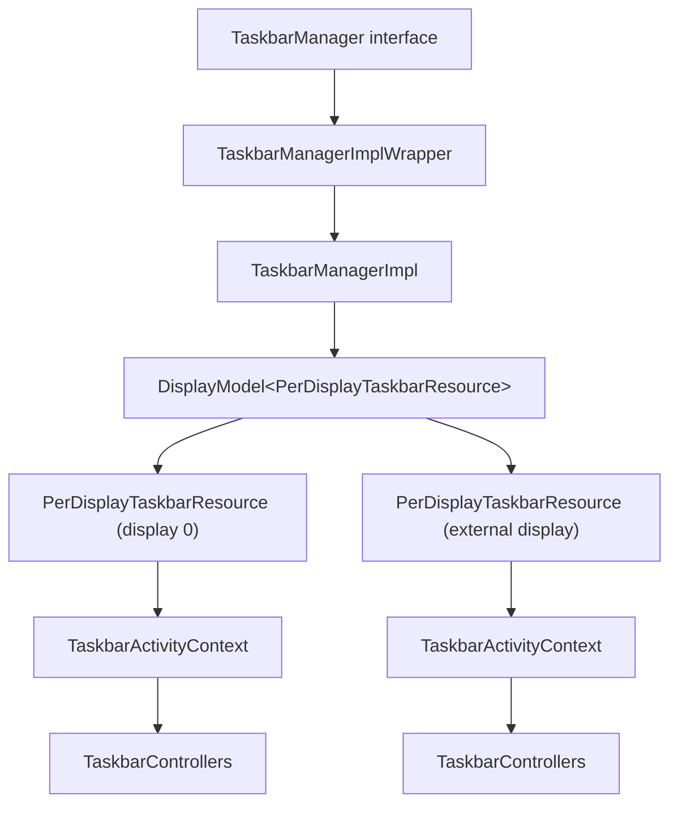

连接的显示器是否获得自己的任务栏由
`enable_taskbar_connected_displays`
（`frameworks/base/core/java/android/window/flags/lse_desktop_experience.aconfig`，
命名空间 `lse_desktop_experience`）控制。当标志关闭时，上述按显示器路径仍会运行。
但只创建主显示器的任务栏。

两个桌面级任务栏功能完成了这一概述。当打开的最近应用多于任务栏所能容纳的数量时，
`TaskbarOverflowView`
（`quickstep/src/com/android/launcher3/taskbar/TaskbarOverflowView.java`）会绘制一个
溢出项。该项将多余的图标折叠成一个芯片，并在点击时展开它们。
它由 `enable_taskbar_overflow` 控制（同一
`lse_desktop_experience` 命名空间）。键盘任务切换器是 `KeyboardQuickSwitchController`
（`quickstep/src/com/android/launcher3/taskbar/KeyboardQuickSwitchController.java`，
带有其 `KeyboardQuickSwitchView` 和 `KeyboardQuickSwitchViewController`），即
在最近任务之间循环的 Alt+Tab 切换器。其
`enable_alt_tab_kqs_flatenning` 标志（通过 `TaskbarDesktopExperienceFlags` 读取）
扁平化切换器，使应用以单个非分组列表显示。

---

## 49.7 搜索集成

### 49.7.1 搜索架构

应用抽屉包含一个具有可插拔架构的集成搜索系统：

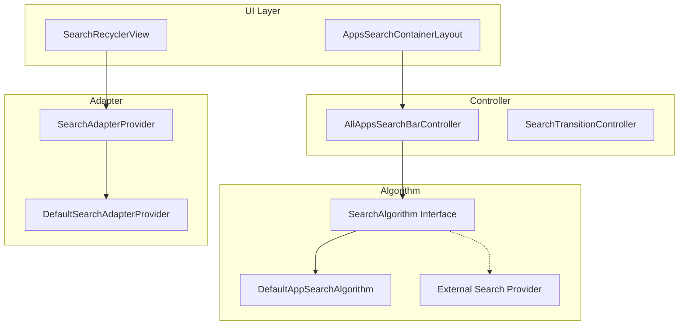

### 49.7.2 AllAppsSearchBarController

搜索栏控制器管理文本输入和搜索分发：

```java
// src/com/android/launcher3/allapps/search/AllAppsSearchBarController.java
public class AllAppsSearchBarController
        implements TextWatcher, OnEditorActionListener,
        ExtendedEditText.OnBackKeyListener {

    protected SearchAlgorithm<AdapterItem> mSearchAlgorithm;
    protected SearchCallback<AdapterItem> mCallback;
    protected ExtendedEditText mInput;
    protected String mQuery;
```

初始化将控制器连接到搜索算法和 UI：

```java
public final void initialize(
        SearchAlgorithm<AdapterItem> searchAlgorithm,
        ExtendedEditText input,
        ActivityContext launcher,
        SearchCallback<AdapterItem> callback) {
    mCallback = callback;
    mLauncher = launcher;
    mInput = input;
    mInput.addTextChangedListener(this);
    mInput.setOnEditorActionListener(this);
    mInput.setOnBackKeyListener(this);
    mSearchAlgorithm = searchAlgorithm;
}
```

### 49.7.3 SearchAlgorithm 接口

`SearchAlgorithm` 接口允许不同的搜索实现：

```java
// src/com/android/launcher3/search/SearchAlgorithm.java
public interface SearchAlgorithm<T> {
    void doSearch(String query, SearchCallback<T> callback);
    void cancel(boolean interruptActiveRequests);
}
```

### 49.7.4 DefaultAppSearchAlgorithm

内置搜索执行不区分大小写的标题匹配：

```java
// src/com/android/launcher3/allapps/search/DefaultAppSearchAlgorithm.java
public class DefaultAppSearchAlgorithm implements SearchAlgorithm<AdapterItem> {

    private static final int MAX_RESULTS_COUNT = 5;

    @Override
    public void doSearch(String query, SearchCallback<AdapterItem> callback) {
        mAppState.getModel().enqueueModelUpdateTask(
            (taskController, dataModel, apps) -> {
                ArrayList<AdapterItem> result = getTitleMatchResult(apps.data, query);
                if (mAddNoResultsMessage && result.isEmpty()) {
                    result.add(getEmptyMessageAdapterItem(query));
                }
                mResultHandler.post(() -> callback.onSearchResult(query, result));
            });
    }
```

搜索在模型线程上运行，以安全地访问 `AllAppsList.data`，然后在主线程上
返回结果。`StringMatcherUtility` 提供匹配逻辑，支持具有单词边界感知的子串匹配。

### 49.7.5 搜索转换

当用户输入搜索查询时，`SearchTransitionController` 将应用抽屉视图从字母排序列表
动画到搜索结果：

```java
// src/com/android/launcher3/allapps/SearchTransitionController.java
```

该转换涉及：

1. 隐藏字母排序的快速滚动条
2. 将 RecyclerView 适配器切换到搜索适配器
3. 将标签指示器动画移出屏幕
4. 调整头部高度

### 49.7.6 外部搜索提供者

Launcher3 通过 `SearchUiManager` 支持外部搜索：

```java
// src/com/android/launcher3/allapps/SearchUiManager.java
```

OEM 和 Google 搜索可以通过实现
`AllAppsSearchUiDelegate` 接口提供自定义搜索体验，该接口控制：

- 搜索输入布局
- 搜索结果适配器
- 搜索算法实现

`qsb/` 包在工作区上提供快速搜索栏集成，这是一个通常启动 Google 搜索的
单独搜索入口点。

### 49.7.7 应用预测和 AppPredictionService

Launcher3 不提供填充应用抽屉顶部预测行的推荐应用。它也不提供 Dock 栏中
预测的槽位。Launcher3 是系统 `AppPredictionService` 的客户端；一个单独的应用
提供预测。

在启动器端，`QuickstepModelDelegate` 通过框架 `AppPredictor` API 打开预测会话，
每个界面一个，并带有 UI 界面字符串标记：

**源文件**：`quickstep/src/com/android/launcher3/model/QuickstepModelDelegate.java`

```java
// QuickstepModelDelegate.recreatePredictors()
mAllPredictionAppsState.registerPredictor(mContext,
        new AppPredictionContext.Builder(mContext)
            .setUiSurface("home")          // All Apps prediction row
            .setPredictedTargetCount(mIDP.numDatabaseAllAppsColumns)
            .build(),
        mModel, PredictionUpdateTask::new);
// ... and a second session with setUiSurface("hotseat")
```

每次启动都会作为 `AppTargetEvent` 回报给服务。服务推送一份新的
`AppTarget` 列表。Launcher3 通过
`appprediction/PredictionRowView.java`（应用抽屉）和 Dock 栏预测器来渲染它们。

这些会话背后的服务可由设备选择。AOSP 在 `packages/apps/OnDeviceAppPrediction`
包中附带了一个最小参考实现，包名为
`com.android.apppredictionservice`。其唯一的类 `PredictionService` 继承
`android.service.appprediction.AppPredictionService`，并为
`android.service.appprediction.AppPredictionService` 动作注册：

**源文件**：`packages/apps/OnDeviceAppPrediction/src/com/android/apppredictionservice/PredictionService.java`

```java
public class PredictionService extends AppPredictionService {
    @Override
    public void onCreatePredictionSession(
            AppPredictionContext context, AppPredictionSessionId sessionId) {
        if (context.getUiSurface().equals("home")
                || context.getUiSurface().equals("overview")) {
            activeLauncherSessions.add(sessionId);
            postPredictionUpdate(sessionId);
        }
    }
}
```

其逻辑刻意保持简单。它保留最近启动的五个应用。在首次启动时，它从默认的日历、
相册、地图、邮件和浏览器处理器填充它们。它在每次 `onAppTargetEvent` 时将应用移到
列表前面。

没有设备端模型。生产构建会将其替换为按使用历史和上下文排序的 Google 或 OEM
预测器。参考应用的存在是为了让预测行在原生 AOSP 镜像上有内容可显示。其
`README` 指出该项目不受支持，并计划从清单中移除。

---

## 49.8 文件夹系统

### 49.8.1 文件夹架构

文件夹允许将多个应用图标分组。该系统涉及三个关键组件：

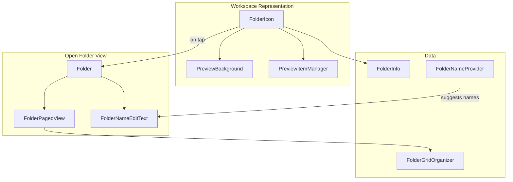

### 49.8.2 FolderIcon

`FolderIcon` 是工作区上显示的表示文件夹的视图：

```java
// src/com/android/launcher3/folder/FolderIcon.java
public class FolderIcon extends FrameLayout implements FloatingIconViewCompanion,
        DraggableView, Reorderable, Poppable {

    @Thunk ActivityContext mActivity;
    @Thunk Folder mFolder;
    public FolderInfo mInfo;
    static final int DROP_IN_ANIMATION_DURATION = 400;
    public static final boolean SPRING_LOADING_ENABLED = true;
    private static final int ON_OPEN_DELAY = 800;
```

该图标在由
`ClippedFolderIconLayoutRule` 管理的裁剪布局中显示最多 4 个项目的预览
（由 `MAX_NUM_ITEMS_IN_PREVIEW` 控制）：

```java
// src/com/android/launcher3/folder/ClippedFolderIconLayoutRule.java
public static final int MAX_NUM_ITEMS_IN_PREVIEW = 4;
private static final float MAX_RADIUS_DILATION = 0.25f;
public static final float ICON_OVERLAP_FACTOR = 1 + (MAX_RADIUS_DILATION / 2f); // 1.125
```

当项被拖过 `FolderIcon` 时，弹簧加载会导致文件夹在 800ms 延迟
（`ON_OPEN_DELAY`）后打开。

### 49.8.3 FolderInfo：数据模型

`FolderInfo` 保存文件夹的内容：

```java
// src/com/android/launcher3/model/data/FolderInfo.java
public class FolderInfo extends CollectionInfo {
    public FolderNameInfos suggestedFolderNames;
    private final ArrayList<ItemInfo> contents = new ArrayList<>();
    // ... accessed through getContents()
```

`contents` 列表是私有的，通过 `getContents()` 访问；
`suggestedFolderNames` 是一个 `FolderNameInfos`（可以容纳多个排序的标签
候选），而不是普通的 `CharSequence`。`willAcceptItemType` 静态方法
确定哪些项类型可以放入文件夹：

```java
public static boolean willAcceptItemType(int itemType) {
    return itemType == ITEM_TYPE_APPLICATION
            || itemType == ITEM_TYPE_DEEP_SHORTCUT
            || itemType == ITEM_TYPE_APP_GROUP;
}
```

### 49.8.4 Folder：打开的视图

`Folder` 是点击文件夹图标时出现的 `AbstractFloatingView`：

```java
// src/com/android/launcher3/folder/Folder.java
public class Folder extends AbstractFloatingView implements
        ClipPathView, DragSource, DragListener {
```

`Folder` 视图通过三个状态的 `@IntDef` 跟踪自己的打开/关闭生命周期
（这里没有区分“文件夹类型”的概念）：

```java
// src/com/android/launcher3/folder/Folder.java
public static final int STATE_CLOSED = 0;
public static final int STATE_ANIMATING = 1;
public static final int STATE_OPEN = 2;

@IntDef({STATE_CLOSED, STATE_ANIMATING, STATE_OPEN})
public @interface FolderState {}
```

文件夹视图包括：

- 一个用于分页浏览项的 `FolderPagedView`
- 一个用于编辑文件夹名称的 `FolderNameEditText`
- 多页文件夹的页面指示器
- 用于在文件夹内重排项的拖放支持

### 49.8.5 FolderPagedView

`FolderPagedView` 继承 `PagedView`，以网格形式显示文件夹内容：

```java
// src/com/android/launcher3/folder/FolderPagedView.java
public class FolderPagedView extends PagedView<PageIndicatorDots>
        implements ClipPathView {

    private static final int REORDER_ANIMATION_DURATION = 230;
    private static final int START_VIEW_REORDER_DELAY = 30;
    private static final float VIEW_REORDER_DELAY_FACTOR = 0.9f;

    private final FolderGridOrganizer mOrganizer;
    private int mGridCountX;
    private int mGridCountY;
```

文件夹中的每个页面都是具有文件夹网格尺寸的 `CellLayout`
（通常为 3x4 或 4x4，取决于设备配置文件）。

### 49.8.6 FolderGridOrganizer

`FolderGridOrganizer` 根据排名管理项的位置：

```java
// src/com/android/launcher3/folder/FolderGridOrganizer.java
public class FolderGridOrganizer {
    private final int mMaxCountX;
    private final int mMaxCountY;
    private final int mMaxItemsPerPage;
    private int mNumItemsInFolder;
    private int mCountX;
    private int mCountY;

    public static FolderGridOrganizer createFolderGridOrganizer(DeviceProfile profile) {
        return new FolderGridOrganizer(
                profile.getFolderProfile().getNumColumns(),
                profile.getFolderProfile().getNumRows()
        );
    }
```

整理器根据内容数量动态调整网格大小。网格大约以 `countX = ceil(sqrt(count))`
增长，`countY <= countX`（1 个项目：1x1，2 个项目：2x1，3-4 个项目：2x2，依此类推）。
只有当项目数量达到 `mMaxItemsPerPage` 时才会使用完整的
`mMaxCountX x mMaxCountY` 网格。

### 49.8.7 自动整理和文件夹命名

当项被一起拖动以创建文件夹时，系统使用 `FolderNameProvider` 自动建议文件夹名称：

```java
// src/com/android/launcher3/folder/FolderNameProvider.java
public class FolderNameProvider {
    public static final int SUGGEST_MAX = 4;

    @Inject
    public FolderNameProvider() {
        Preconditions.assertWorkerThread();
    }
```

命名算法检查文件夹中的应用，并尝试找到共同的类别。它使用来自模型的信息，
并可以提供最多 4 个名称建议。`FolderNameSuggestionLoader` 协调异步加载建议：

```kotlin
// src/com/android/launcher3/folder/FolderNameSuggestionLoader.kt
```

### 49.8.8 文件夹打开/关闭动画

文件夹打开动画由 `FolderAnimationManager` 管理：

```java
// src/com/android/launcher3/folder/FolderAnimationManager.java
```

该动画包括：

1. **预览到文件夹**——小预览图标放大到完整文件夹
2. **背景显现**——文件夹背景圆圈扩展
3. **内容淡入**——文件夹项交错淡入
4. **遮罩变暗**——文件夹背后的背景变暗

弹簧动画（`FolderSpringAnimatorSet`）提供有弹性的、自然的感觉：

```kotlin
// src/com/android/launcher3/folder/FolderSpringAnimatorSet.kt
```

关闭动画反转这些步骤。`FolderOpenCloseAnimationListener`
处理动画生命周期事件的回调。

### 49.8.9 通过拖放创建文件夹

当用户在工作区上将一个图标拖到另一个图标上时，会创建文件夹：

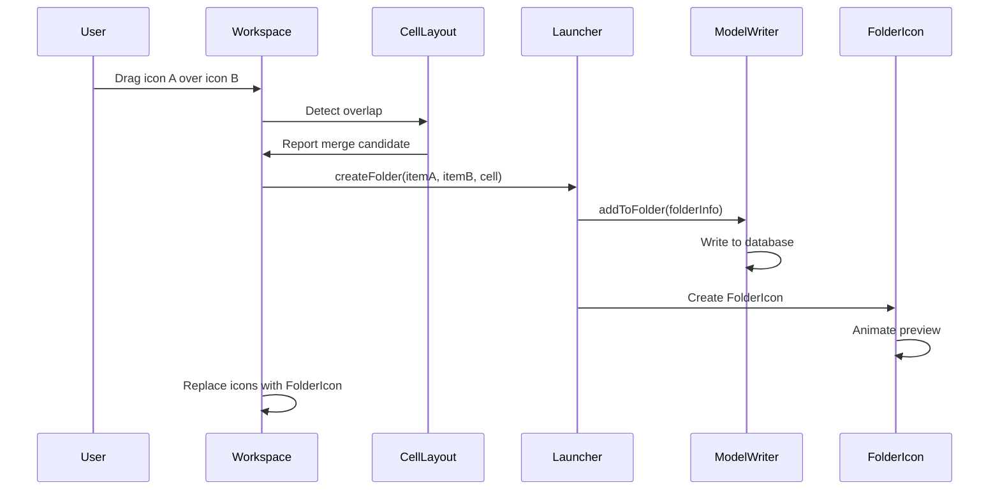

---

## 49.9 主题化

### 49.9.1 ThemeManager

`ThemeManager` 是一个集中管理图标主题化的 Dagger 单例：

```kotlin
// src/com/android/launcher3/graphics/ThemeManager.kt
@LauncherAppSingleton
class ThemeManager
@Inject
constructor(
    @ApplicationContext private val context: Context,
    private val prefs: LauncherPrefs,
    private val themePreference: ThemePreference,
    @Named(ICON_FACTORY_DAGGER_KEY)
    private val iconThemeFactories: Map<String, IconThemeFactory>,
    @Ui mainExecutor: LooperExecutor,
    overlayChangeHandler: OverlayChangeHandler,
    lifecycle: DaggerSingletonTracker,
) {
    private val _iconShapeData = MutableListenableRef(IconShape.EMPTY)
    val iconShapeData: ListenableRef<IconShape> = _iconShapeData.asListenable()
    var iconState = parseIconState(null)
```

`ThemeManager` 管理：

- **图标形状**——自适应图标遮罩形状（圆形、圆角方形等）
- **图标主题**——单色/主题化图标渲染
- **文件夹形状**——用于文件夹背景的形状
- **主题控制器**——协调图标重新着色

### 49.9.2 动态颜色（Material You）

Launcher3 与 Android 的 Material You 动态颜色系统集成。颜色
管道从壁纸中提取颜色并将其应用到整个 UI。

`WallpaperThemeManager` 在 `Launcher.onCreate()` 中初始化：

```java
// src/com/android/launcher3/Launcher.java
mWallpaperThemeManager = new WallpaperThemeManager(this);
```

壁纸颜色通过系统流动：

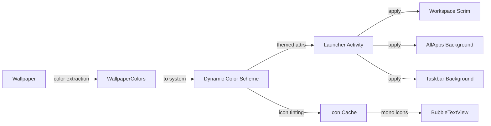

### 49.9.3 主题化图标

当启用主题化图标时，`ThemeManager` 应用单色图标
渲染：

```kotlin
// src/com/android/launcher3/graphics/ThemeManager.kt
@Deprecated("Use [ThemePreference] instead")
var isMonoThemeEnabled
    set(value) = themePreference.setValue(if (value) MONO_THEME_VALUE else null)
    get() = MONO_THEME_VALUE == themePreference.value
```

主题化图标管道：

1. 检查应用是否在其 `AdaptiveIconDrawable` 中提供单色图标
2. 如果可用，提取单色层
3. 使用源自壁纸的调色板颜色为其着色
4. 在图标数据库中缓存主题化版本

未提供单色层的应用将获得回退处理
（全彩图标可能会去饱和或叠加）。

### 49.9.4 图标形状

图标形状通过 `ShapeDelegate` 定义，并从系统覆盖层加载：

```kotlin
// src/com/android/launcher3/graphics/ShapeDelegate.kt
```

`ShapesProvider` 加载可用形状：

```kotlin
// src/com/android/launcher3/shapes/ShapesProvider.kt
```

支持的形状包括圆形、圆角方形、圆角矩形、水滴形和
自定义基于 SVG 的路径。图标形状影响：

- 应用图标裁剪
- 文件夹图标背景
- 小部件圆角半径
- 通知圆点定位

### 49.9.5 遮罩和背景处理

遮罩视图提供视觉背景处理：

```java
// src/com/android/launcher3/graphics/Scrim.java
// src/com/android/launcher3/graphics/SysUiScrim.java
```

`SysUiScrim` 管理系统栏上的渐变遮罩，而
应用抽屉遮罩在抽屉打开时提供深色覆盖层。

`PillColorProvider` 为圆角胶囊 UI 元素生成颜色：

```kotlin
// src/com/android/launcher3/PillColorProvider.kt
```

### 49.9.6 基于壁纸的颜色

`LocalColorExtractor` 从每个小部件背后的壁纸中提取颜色：

```java
// src/com/android/launcher3/widget/LocalColorExtractor.java
```

这使得小部件能够根据它们所覆盖的壁纸区域调整其外观，
从而在整个主屏幕上提供连贯的视觉体验。

### 49.9.7 深色模式支持

Launcher3 通过 `CONFIG_UI_MODE` 响应系统深色模式更改：

```java
// src/com/android/launcher3/Launcher.java (imports)
import static android.content.pm.ActivityInfo.CONFIG_UI_MODE;
```

深色模式影响：

- 工作区页面指示器
- 应用抽屉背景和文本颜色
- 文件夹背景
- 小部件背景着色
- 遮罩颜色和不透明度
- 任务栏外观

`Themes` 工具类提供读取主题化属性的辅助方法：

```java
// src/com/android/launcher3/util/Themes.java
```

---

## 49.10 动手实践：自定义启动器网格

本节将介绍如何修改 Launcher3 的网格配置以创建自定义布局。我们将把默认的手机网格
从 4x5 改为 6x5，并相应地调整图标大小。

### 49.10.1 理解网格系统

网格在两个文件中定义：

1. **`res/xml/device_profiles.xml`**——声明带有行/列数的网格选项
2. **`InvariantDeviceProfile.java`**——解析并选择合适的网格

XML 如下定义网格选项：

```xml
<!-- res/xml/device_profiles.xml -->
<grid-option
    launcher:name="4_by_4"
    launcher:numRows="4"
    launcher:numColumns="4"
    launcher:numFolderRows="3"
    launcher:numFolderColumns="4"
    launcher:numHotseatIcons="4"
    launcher:dbFile="launcher_4_by_4.db"
    launcher:defaultLayoutId="@xml/default_workspace_4x4"
    launcher:deviceCategory="phone|multi_display" >

    <display-option
        launcher:name="Short Stubby"
        launcher:minWidthDps="275"
        launcher:minHeightDps="420"
        launcher:iconImageSize="48"
        launcher:iconTextSize="13.0"
        launcher:allAppsBorderSpace="16"
        launcher:allAppsCellHeight="104"
        launcher:canBeDefault="true" />
```

### 49.10.2 第 1 步：添加新的网格选项

在 `res/xml/device_profiles.xml` 中添加一个新的 `grid-option` 条目：

```xml
<grid-option
    launcher:name="6_by_5_custom"
    launcher:numRows="5"
    launcher:numColumns="6"
    launcher:numFolderRows="3"
    launcher:numFolderColumns="4"
    launcher:numHotseatIcons="6"
    launcher:dbFile="launcher_6_by_5_custom.db"
    launcher:defaultLayoutId="@xml/default_workspace_6x5"
    launcher:deviceCategory="phone" >

    <display-option
        launcher:name="Custom Dense Grid"
        launcher:minWidthDps="300"
        launcher:minHeightDps="500"
        launcher:iconImageSize="40"
        launcher:iconTextSize="11.0"
        launcher:allAppsBorderSpace="12"
        launcher:allAppsCellHeight="88"
        launcher:canBeDefault="true" />
</grid-option>
```

关键参数：

- `numRows="5"` 和 `numColumns="6"`——定义 6x5 网格
- `iconImageSize="40"`——更小的图标（默认是 48dp）
- `iconTextSize="11.0"`——更小的文本以容纳更多列
- `numHotseatIcons="6"`——与列数匹配
- `allAppsCellHeight="88"`——应用抽屉的紧凑单元格

### 49.10.3 第 2 步：创建默认布局

创建 `res/xml/default_workspace_6x5.xml`，其中包含初始的主屏幕内容：

```xml
<?xml version="1.0" encoding="utf-8"?>
<favorites
    xmlns:launcher="http://schemas.android.com/apk/res-auto"
    xmlns:android="http://schemas.android.com/apk/res/android">

    <!-- First row: favorite apps -->
    <favorite
        launcher:packageName="com.android.dialer"
        launcher:className="com.android.dialer.main.impl.MainActivity"
        launcher:container="-101"
        launcher:screen="0"
        launcher:x="0"
        launcher:y="0" />

    <favorite
        launcher:packageName="com.android.contacts"
        launcher:className="com.android.contacts.activities.PeopleActivity"
        launcher:container="-101"
        launcher:screen="0"
        launcher:x="1"
        launcher:y="0" />

    <!-- Hotseat items -->
    <favorite
        launcher:packageName="com.android.messaging"
        launcher:className="com.android.messaging.ui.conversationlist.ConversationListActivity"
        launcher:container="-101"
        launcher:screen="0"
        launcher:x="2"
        launcher:y="0" />
</favorites>
```

### 49.10.4 第 3 步：更新网格选择逻辑

在 `InvariantDeviceProfile.java` 中，网格选择使用 `GRID_NAME` 偏好设置。
要在开发期间强制使用你的自定义网格，可以暂时修改初始化：

相关文件是：
```
src/com/android/launcher3/InvariantDeviceProfile.java
```

IDP 使用以下代码读取网格偏好设置：

```java
// InvariantDeviceProfile initialization
LauncherPrefs prefs = ...;
String gridName = prefs.get(GRID_NAME);
```

你可以通过启动器设置 UI 将网格名称设置为 `"6_by_5_custom"`，
或者在调试构建中直接写入偏好设置：

```java
// In a test or debug setup:
LauncherPrefs.getPrefs(context)
    .edit()
    .putString("idp_grid_name", "6_by_5_custom")
    .apply();
```

### 49.10.5 第 4 步：调整响应式规范

对于更密集的网格，创建或修改响应式规范 XML 文件。工作区
单元格规范控制每个单元格获得多少空间：

创建 `res/xml/spec_workspace_6_by_5_custom.xml`。遵循真实规范文件
（例如 `res/xml/spec_handheld_workspace_cell_3_row.xml`）的 schema。该文件
有一个 `<cellSpecs>` 根节点，其中包含按纵横比作为键的 `<specs>` 组。每个组
包含 `<cellSpec>` 条目，其子节点设置各个尺寸：

```xml
<?xml version="1.0" encoding="utf-8"?>
<cellSpecs xmlns:launcher="http://schemas.android.com/apk/res-auto">
    <specs launcher:maxAspectRatio="@dimen/aspect_ratio_portrait">
        <cellSpec
            launcher:dimensionType="height"
            launcher:maxAvailableSize="9999dp">
            <iconSize launcher:fixedSize="40dp" />
            <iconTextSize launcher:fixedSize="11sp" />
            <iconDrawablePadding launcher:fixedSize="4dp" />
        </cellSpec>
    </specs>
    <specs launcher:maxAspectRatio="@dimen/aspect_ratio_landscape">
        <cellSpec
            launcher:dimensionType="height"
            launcher:maxAvailableSize="9999dp">
            <iconSize launcher:fixedSize="44dp" />
            <iconTextSize launcher:fixedSize="12sp" />
            <iconDrawablePadding launcher:fixedSize="5dp" />
        </cellSpec>
    </specs>
</cellSpecs>
```

### 49.10.6 第 5 步：构建和测试

构建修改后的启动器：

```bash
# From AOSP root
source build/envsetup.sh
lunch <target>
m Launcher3
```

要在模拟器上测试，请推送 APK：

```bash
adb install -r out/target/product/<device>/system/priv-app/Launcher3/Launcher3.apk
adb shell am force-stop com.android.launcher3
```

### 49.10.7 第 6 步：验证网格指标

在设备上启动设置应用，导航到启动器设置，并
选择自定义网格。或者，使用自定义界面：

1. 长按主屏幕进入编辑模式
2. 工作区应显示 6 列网格
3. 验证图标更小但仍清晰可读
4. 检查 Dock 栏是否显示 6 个槽位
5. 打开一个文件夹并验证 4x3 文件夹网格

### 49.10.8 理解网格计算

当选择一个网格选项时，`InvariantDeviceProfile` 通过在定义的显示选项之间插值
来计算设备配置文件：

```java
// InvariantDeviceProfile.java
private static final float KNEARESTNEIGHBOR = 3;
private static final float WEIGHT_POWER = 5;
private static final float WEIGHT_EFFICIENT = 100000f;
```

该算法：

1. 找到最近的 `K` 个显示选项（按屏幕尺寸距离）
2. 按距离的 `WEIGHT_POWER` 次方的反比对每个选项加权
3. 在选项之间插值图标大小、文本大小和间距

这确保了在单个网格选项内不同屏幕尺寸之间平滑缩放。

### 49.10.9 进阶：添加双栏网格

对于折叠屏设备，你可以定义一个带有单独
竖屏和横屏配置的双栏网格选项。有四个大小索引，定义在
`DeviceTypedMap` 中（`InvariantDeviceProfile.java` 只是导入它们）：

```kotlin
// src/com/android/launcher3/deviceprofile/parser/DeviceTypedMap.kt
const val INDEX_DEFAULT: Int = 0             // Portrait
const val INDEX_LANDSCAPE: Int = 1           // Landscape
const val INDEX_TWO_PANEL_PORTRAIT: Int = 2  // Two-panel portrait
const val INDEX_TWO_PANEL_LANDSCAPE: Int = 3 // Two-panel landscape
```

边框间距、单元格高度和其他尺寸可以为
每个索引独立指定。这让你可以对每个
配置中的布局进行精细控制。

### 49.10.10 关键文件参考

对于网格自定义练习，以下是必要的文件：

| 文件 | 用途 |
|---|---|
| `res/xml/device_profiles.xml` | 网格选项定义 |
| `src/.../InvariantDeviceProfile.java` | 网格选择和插值 |
| `src/.../DeviceProfile.java` | 运行时布局计算 |
| `src/.../CellLayout.java` | 网格单元格渲染 |
| `src/.../Workspace.java` | 页面级网格管理 |
| `src/.../Hotseat.java` | 底部行网格 |
| `res/xml/default_workspace_*.xml` | 默认工作区布局 |
| `src/.../responsive/*.kt` | 响应式规范系统 |

---

## 总结

本章探索了 AOSP 中的 Launcher3 代码库，涵盖：

- **架构**（49.1 节）：`LauncherModel`
  （在 `MODEL_EXECUTOR` 上加载数据）与以 `Launcher` 为根的视图层级之间的
  模型-视图分离。
  `StateManager` 驱动 NORMAL、
  ALL_APPS、SPRING_LOADED 和 OVERVIEW 等状态之间的动画转换。Dagger 依赖注入
  管理单例图。

- **应用图标和网格**（49.2 节）：`ItemInfo` 层次结构表示所有
  启动器项。`CellLayout` 提供网格容器，而 `BubbleTextView`
  渲染图标。`DeviceProfile`/`InvariantDeviceProfile` 系统通过 XML 定义的网格选项和响应式
  规范，使布局适应不同的屏幕尺寸。

- **小部件系统**（49.3 节）：`LauncherWidgetHolder` 封装 `AppWidgetHost`
  以实现感知生命周期的小部件管理。小部件选择器现在是一个独立的
  Jetpack Compose Activity（`WidgetPickerActivity` + `modules/widgetpicker/`
  目录），由 `WidgetPickerDataProvider`/`WidgetPickerData` 支持。它
  取代了旧的 `WidgetsFullSheet`/`WidgetsListAdapter`/`WidgetCell` 视图。
  固定流程仍然通过 `PendingItemDragHelper` 运行所选小部件，
  然后绑定、配置和缩放。

- **拖放**（49.4 节）：`DragController` 管理拖放生命周期，
  以 `DragView` 作为视觉反馈，以 `DragLayer` 作为拦截层。
  `SpringLoadedDragController` 处理延迟页面切换。放置目标
  包括 `Workspace`、`Folder`、`Hotseat` 和 `DeleteDropTarget`。

- **最近任务集成**（49.5 节）：`QuickstepLauncher` 继承 `Launcher`
  以充当最近任务提供者。`OverviewCommandHelper` 处理命令，
  `RecentsView` 显示任务卡片，`TaskView` 渲染单个任务。
  手势导航通过 `TouchInteractionService` 流动。

- **任务栏**（49.6 节）：`TaskbarActivityContext` 在大屏幕上管理任务栏的
  独立窗口。多个控制器处理隐藏、
  拖放、桌面模式和外观。`StashedHandleViewController`
  在任务栏隐藏时显示句柄。

- **搜索集成**（49.7 节）：`AllAppsSearchBarController` 分发
  查询到 `SearchAlgorithm` 实现。`DefaultAppSearchAlgorithm`
  在模型线程上执行标题匹配。外部提供者可以替换
  搜索实现。

- **文件夹系统**（49.8 节）：`FolderIcon` 在
  工作区上表示文件夹，带有 4 项预览。`Folder` 是包含
  `FolderPagedView` 的展开视图，用于分页内容。`FolderNameProvider` 根据应用类别建议名称。
  弹簧动画提供自然的文件夹打开/关闭
  过渡。

- **主题化**（49.9 节）：`ThemeManager` 集中管理图标形状和主题
  管理。Material You 集成提取壁纸颜色以实现动态
  主题化。主题化图标使用以调色板着色的单色层。
  `LocalColorExtractor` 使小部件背景适应壁纸。

- **网格自定义**（49.10 节）：一个动手练习，通过修改 `device_profiles.xml`、
  创建默认布局并调整响应式规范来添加自定义
  6x5 网格。

### 关键源文件路径

所有路径相对于 `packages/apps/Launcher3/`：

| 组件 | 路径 |
|---|---|
| Launcher activity | `src/com/android/launcher3/Launcher.java` |
| Workspace | `src/com/android/launcher3/Workspace.java` |
| CellLayout | `src/com/android/launcher3/CellLayout.java` |
| BubbleTextView | `src/com/android/launcher3/BubbleTextView.java` |
| Hotseat | `src/com/android/launcher3/Hotseat.java` |
| LauncherModel | `src/com/android/launcher3/LauncherModel.kt` |
| LauncherAppState | `src/com/android/launcher3/LauncherAppState.kt` |
| InvariantDeviceProfile | `src/com/android/launcher3/InvariantDeviceProfile.java` |
| DeviceProfile | `src/com/android/launcher3/DeviceProfile.java` |
| LauncherState | `src/com/android/launcher3/LauncherState.java` |
| StateManager | `src/com/android/launcher3/statemanager/StateManager.java` |
| DragController | `src/com/android/launcher3/dragndrop/DragController.java` |
| DragLayer | `src/com/android/launcher3/dragndrop/DragLayer.java` |
| DragView | `src/com/android/launcher3/dragndrop/DragView.java` |
| SpringLoadedDragController | `src/com/android/launcher3/dragndrop/SpringLoadedDragController.kt` |
| FolderIcon | `src/com/android/launcher3/folder/FolderIcon.java` |
| Folder | `src/com/android/launcher3/folder/Folder.java` |
| FolderPagedView | `src/com/android/launcher3/folder/FolderPagedView.java` |
| FolderGridOrganizer | `src/com/android/launcher3/folder/FolderGridOrganizer.java` |
| FolderNameProvider | `src/com/android/launcher3/folder/FolderNameProvider.java` |
| LauncherWidgetHolder | `src/com/android/launcher3/widget/LauncherWidgetHolder.java` |
| LauncherAppWidgetHost | `src/com/android/launcher3/widget/LauncherAppWidgetHost.java` |
| WidgetPickerActivity | `src/com/android/launcher3/widgetpicker/WidgetPickerActivity.kt` |
| WidgetPickerComposeWrapper | `src/com/android/launcher3/widgetpicker/WidgetPickerComposeWrapper.kt` |
| QuickstepWidgetPickerActivity | `quickstep/src/com/android/launcher3/QuickstepWidgetPickerActivity.kt` |
| Widget catalogs (Compose) | `modules/widgetpicker/src/com/android/launcher3/widgetpicker/ui/` |
| WidgetPickerDataProvider | `src/com/android/launcher3/widget/picker/model/WidgetPickerDataProvider.kt` |
| ThemeManager | `src/com/android/launcher3/graphics/ThemeManager.kt` |
| AllAppsContainer | `src/com/android/launcher3/allapps/ActivityAllAppsContainerView.java` |
| AlphabeticalAppsList | `src/com/android/launcher3/allapps/AlphabeticalAppsList.java` |
| SearchBarController | `src/com/android/launcher3/allapps/search/AllAppsSearchBarController.java` |
| DefaultSearch | `src/com/android/launcher3/allapps/search/DefaultAppSearchAlgorithm.java` |
| ItemInfo | `src/com/android/launcher3/model/data/ItemInfo.java` |
| WorkspaceItemInfo | `src/com/android/launcher3/model/data/WorkspaceItemInfo.java` |
| Grid profiles | `res/xml/device_profiles.xml` |
| QuickstepLauncher | `quickstep/src/com/android/launcher3/uioverrides/QuickstepLauncher.java` |
| RecentsView | `quickstep/src/com/android/quickstep/views/RecentsView.java` |
| TaskView | `quickstep/src/com/android/quickstep/views/TaskView.kt` |
| OverviewCommandHelper | `quickstep/src/com/android/quickstep/OverviewCommandHelper.kt` |
| TaskbarActivityContext | `quickstep/src/com/android/launcher3/taskbar/TaskbarActivityContext.java` |
| StashedHandleVC | `quickstep/src/com/android/launcher3/taskbar/StashedHandleViewController.java` |
| TaskbarManager (interface) | `quickstep/src/com/android/launcher3/taskbar/TaskbarManager.kt` |
| TaskbarManagerImpl | `quickstep/src/com/android/launcher3/taskbar/TaskbarManagerImpl.java` |
| PerDisplayTaskbarResource | `quickstep/src/com/android/launcher3/taskbar/PerDisplayTaskbarResource.kt` |
| TaskbarDesktopModeController | `quickstep/src/com/android/launcher3/taskbar/TaskbarDesktopModeController.kt` |
| DisplayModel | `quickstep/src/com/android/quickstep/DisplayModel.kt` |
| RecentsWindowManager | `quickstep/src/com/android/quickstep/window/RecentsWindowManager.kt` |
| RecentsWindowFlags | `quickstep/src/com/android/quickstep/window/RecentsWindowFlags.kt` |
| DesktopAppLaunchTransitionManager | `quickstep/src/com/android/launcher3/desktop/DesktopAppLaunchTransitionManager.kt` |
| DesktopRecentsTransitionController | `quickstep/src/com/android/launcher3/desktop/DesktopRecentsTransitionController.kt` |
