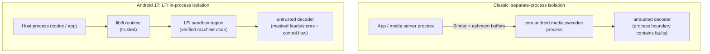
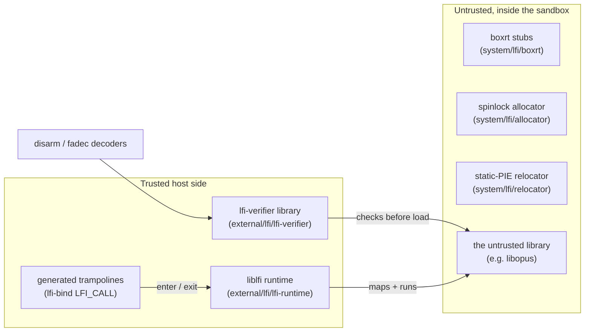
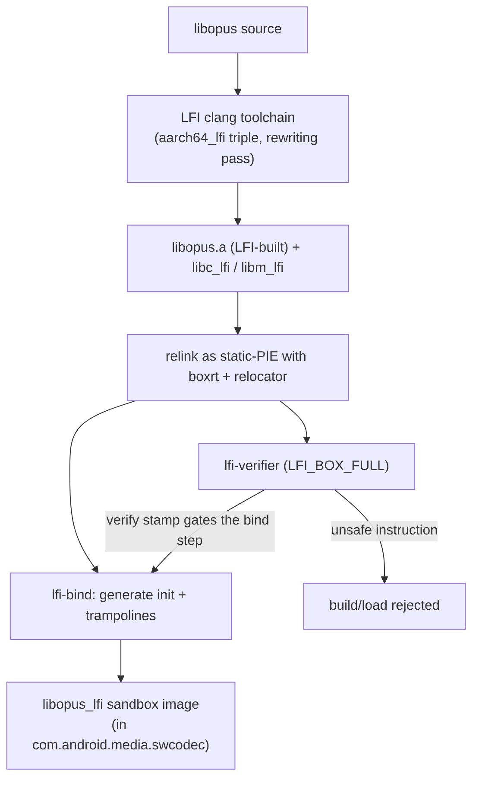
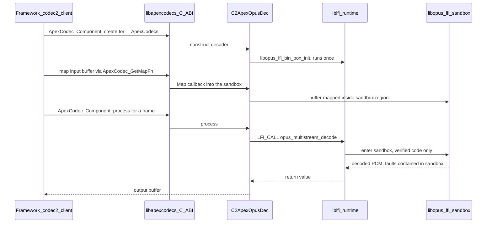

# 第 43 章：LFI Sandbox

Android 一直以来都用它手里最重的工具来隔离不可信的原生代码：一个独立的进程。软件媒体编解码器是典型的例子。畸形的音频或视频帧可能驱动 C 解码器中发生缓冲区溢出。因此 AOSP 在它自己的加固 APEX 进程（`com.android.media.swcodec`）中运行软件编解码器，并通过 Binder 访问。这样，`libopus` 或 AAC 解码器中的内存损坏错误就无法触及应用或媒体服务器。

这种隔离是真实的，但并非没有代价。每一个解码后的帧都要跨越一次进程边界。缓冲区通过 ashmem 和 Binder 共享。整个进程必须被创建、被调度并保持热度。

Android 17 增加了第二种更轻量的隔离原语：**轻量级故障隔离（Lightweight Fault Isolation，LFI）**。LFI 将不可信原生库的内存访问和控制流限制在*它自己的宿主进程*地址空间中的一个保留区域内。机器代码强制执行这一点，并且一个验证器已经证明了这段代码无法逃逸出该区域。

不可信的解码器在进程内运行。它可以被证明无法读写其沙箱之外的内存、无法跳转到沙箱之外的代码、也无法发起原始系统调用。不存在第二个进程，没有 Binder 跳转，也没有跨越地址空间边界的缓冲区拷贝。然而，解码器中的内存安全错误仍然留在沙箱内部。

第一个生产环境的使用者正是当初促使 swcodec 出现的那个用例。它是一个在 media APEX 内部运行的软件 Opus 解码器。LFI 对它进行沙箱化，而不是（或在独立进程模型之外）采用分离进程方案。

本章解释什么是 LFI 以及它所服务的威胁模型。它描述了树内粘合代码（`system/lfi`）与外部工具链（`external/lfi`）之间的验证器/运行时/绑定分工。它展示了沙箱化编解码器是如何被编译和加载的，以及构建它的 Soong LFI 工具链。它还涵盖了当不可信代码回到它过去被隔离的那个进程时的安全权衡。

---

## 43.1 LFI 是什么以及威胁模型

### 43.1.1 软件故障隔离的现代化

LFI 是一种软件故障隔离（SFI）方案。其思想是，你可以在自己的地址空间中安全地运行不可信的机器代码。只要*指令本身*将代码发出的每一次内存访问和每一次控制转移都约束在一个沙箱区域内，这就是可行的。

经典 SFI（Google Native Client 及其前身）在每次加载、存储或跳转之前屏蔽每个地址的高位。这样，被沙箱化的指针就永远无法指向一个二进制对齐区域之外的内存。LFI 是那条研究路线的现代、研究级后继者。`system/lfi/README.md` 将读者引向 Stanford LFI 论文和 LLVM LFI 文档作为背景。

关键特性是，安全性不依赖于信任不可信代码。它依赖于平台*确实*信任的两样东西：

1. 一个**编译器遍**，它只发出沙箱安全的指令序列（被屏蔽的地址、受限的控制流、一个保存沙箱基址的保留寄存器），以及
2. 一个**验证器**，它逐指令地重新检查已完成的二进制文件，并拒绝加载任何可能逃逸的内容。因此，即使是恶意或错误编译的库也无法通过这道关卡。

因为保证是在加载时由验证器重新建立的，所以威胁模型不需要信任产生该二进制文件的工具链。验证器很小、可审计，并且是真正的信任根。

### 43.1.2 威胁模型：无需第二个进程的内存安全

LFI 保护的资产是**宿主进程**——对于第一个使用者来说，是 media swcodec 进程，进而也包括它持有的缓冲区和凭据。攻击者是触发不可信 C 解码器内部未定义行为（越界读/写、释放后使用、类型混淆）的畸形媒体比特流。如果没有 LFI，平台唯一的结构性答案就是把这个解码器放进一个不同的进程。那么，一个损坏错误的爆炸半径就只是一个牺牲进程。

LFI 提供了一种不同的包含边界。解码器在进程内运行，但经过验证的机器代码保证三件事。它只能触碰自己的沙箱区域。它只能将控制权转移到沙箱内经过验证的目标。它不能发出任意系统调用，因为每个“系统调用”都会变成一次回调，进入一个可信运行时，由它来决定允许什么。

LFI *不是*针对侧信道的机密性边界，也不是对解码器允许行为中逻辑缺陷的防御。它是一种**内存安全**边界：它将“这个编解码器存在堆溢出”从一个进程沦陷原语变成一个被包含的故障。源代码对此有诚实的体现。`MediaCodecInfo::getSecurityModel()` 将 LFI 路径报告为 `SECURITY_MODEL_MEMORY_SAFE`，与 `SECURITY_MODEL_SANDBOXED`（独立进程）模型相区分。它并不声称两者是等价的（`frameworks/av/media/libmedia/MediaCodecInfo.cpp:199`）。

下图对比了针对同一个不可信解码器的两种包含策略。

#### 独立进程沙箱与 LFI 进程内沙箱



## 43.2 验证器、运行时和绑定的分工

Android 中的 LFI 被拆分到两个扮演截然不同角色的树中。树内 `system/lfi` 仓库保存每个沙箱化库都需要的*共享粘合代码*。`external/lfi` 树引入*上游工具链*——验证器、运行时、绑定生成器和指令解码器。理解哪一部分做什么，是理解后面的编解码器集成的关键。

### 43.2.1 外部工具链（`external/lfi`）

`external/lfi` 是一个引入的上游依赖。平台集成它，而不会修改它的内部。它有七个组件，每个都是被镜像进 AOSP 的独立上游项目。

**`lfi-verifier`（构建 `lfi-verifier` 库和 `lfi-verify` 宿主工具）。** 验证器是信任根。它扫描一个已编译的代码缓冲区，并在运行时被允许执行它之前，决定每条指令是否沙箱安全。它的公开接口是 `external/lfi/lfi-verifier/src/include/lfiv.h:36-46` 中少数几个按架构划分的入口点：

```c
// external/lfi/lfi-verifier/src/include/lfiv.h:37-46
bool
lfiv_verify_arm64(char *code, size_t size, uintptr_t addr, struct LFIVOptions *opts);

bool
lfiv_verify_x64(char *code, size_t size, uintptr_t addr, struct LFIVOptions *opts);

bool
lfiv_verify_riscv64(char *code, size_t size, uintptr_t addr, struct LFIVOptions *opts);
```

`LFIVOptions` 结构体（`lfiv.h:12-26`）选择沙箱模型。有两种盒子类型（`lfiv.h:7-10`）：`LFI_BOX_FULL`，它同时约束加载和存储（以及控制流）；以及 `LFI_BOX_STORES`，一个更弱的仅存储模式。它还可以保留一个**上下文寄存器**（`ctxreg`，`lfiv.h:19-22`）。在 arm64 上这是 `x25`，在 x64 上是 `r15`。沙箱被禁止修改它，并且只能使用它来对其所持地址进行 64 位加载/存储。

沙箱基址位于一个单独的保留寄存器中——在 arm64 上是 `x27`（`REG_BASE`，`external/lfi/lfi-verifier/src/arm64/verify.c:67`）。验证器链接下面的指令解码器，以理解它正在检查的字节。

**`lfi-runtime`（构建 `liblfi`）。** 运行时在执行时拥有沙箱。根据 `external/lfi/lfi-runtime/README.md`，它分为两层。`core` 层预留虚拟地址空间，映射沙箱内存，并将控制权传入和传出沙箱。`linux` 层在 core 之上提供一个 Linux 模拟层（宿主调用处理）。核心对象模型是 `external/lfi/lfi-runtime/core/include/lfi_core.h:16-28` 中记录的三个结构体：

- `LFIEngine` —— “跟踪一大块虚拟内存，并管理从该池中进行的沙箱分配。”
- `LFIBox` —— “虚拟地址空间中为沙箱预留的一个区域。每个沙箱有一个 LFIBox 对象。”
- `LFIContext` —— “一个沙箱执行上下文，跟踪沙箱的寄存器、线程指针、栈以及对相应 LFIBox 的引用”，每个沙箱线程有一个上下文。

`LFIOptions`（`lfi_core.h:30-64`）携带盒子大小、一个必须与验证器一致的 `stores_only` 开关，以及一个刻意令人生畏的 `no_verify` 标志。对该标志的注释将其标记为“（不安全）”。验证默认开启，显式退出可将其关闭。

**`lfi-bind`（一个 Go 工具）。** 沙箱化库不是被直接调用的；宿主通过生成的蹦床函数调用它们。`external/lfi/lfi-bind/README.md` 描述了该工具：“它生成用于初始化库沙箱的例程，以及用于从库中调用函数的蹦床函数。”

工作流程（README 第 20-31 行）有四个步骤。首先，用 LFI 编译器把库编译成一个 `.a`。其次，针对 `boxrt` 将其重链接为 static-PIE，生成一个 `.lfi` 沙箱镜像。第三步，在该镜像上运行 `lfi-bind`，输出一个初始化文件和一个蹦床文件。第四步，将这些编译进宿主。

生成的头文件还定义了宿主用来调用沙箱化函数的 `LFI_CALL(fn, ...)` 宏（`external/lfi/lfi-bind/embed/lib.h.in:164`）。你将在编解码器集成中随处看到这个宏。

**`rlbox` 和 `rlbox-lfi`。** RLBox 是一个通用的沙箱化 API。宿主编写 `tainted<T>` 类型，因此编译器强制它验证任何从沙箱中返回的值。

`external/lfi/rlbox-lfi/README.md` 将 LFI 插件描述为“与 [RLBox] 沙箱化 API 集成，以利用 LFI 编译器的沙箱化能力。”在 AOSP 中这是一个仅头文件的库（`rlbox_lfi_headers`）。它是手写蹦床函数的更高层替代品，并且可以使用，但第一个编解码器使用者还没有使用它。Soong 的 `lfi.use_rlbox` 属性已接线，但被拒绝，提示“尚不支持”（`build/soong/cc/lfi.go:90-91`）。

**`disarm` 和 `fadec`。** 这些是验证器所依赖的指令解码器：`disarm` 是一个快速、零依赖的 AArch64 解码器/编码器，而 `fadec` 是 x86-32/64 上的等价物。验证器使用它们来分类它检查的每条指令；它们自身不携带任何 LFI 策略。

### 43.2.2 树内粘合代码（`system/lfi`）

`system/lfi` 是每个沙箱化库都链接的少量 Android 特定代码。根据 `system/lfi/README.md`，它是“在 Android 中编译 LFI 所需的、在各种沙箱化库之间共享的代码”，它有三部分：

- **`boxrt`** —— “一组与沙箱化库链接的运行时桩函数。”这是在沙箱*内部*运行以引导它的代码。它的最小形式（`system/lfi/boxrt/boxrt_minimal.c`）将 `abort`、`lfi_brk` 和 `lfi_pause` 实现为原始的 `svc` 系统调用。它还提供 `_lfi_malloc`/`_lfi_free` 系列函数以及蹦床函数所需的 `_lfi_ret` 返回序列。
- **`allocator`** —— “一个利用自旋锁的线程安全最小分配器”（`system/lfi/allocator/alloc.c`）。沙箱没有系统 libc，因此它需要自己的堆。这个隐式空闲链表分配器通过 `lfi_brk` 获取内存，并用一个原子自旋锁保护它。
- **`relocator`** —— “一个为 lfi-bind 所必需的 `-static-pie` 执行重定位的最小加载器”（`system/lfi/relocator/relocate.c`，加上架构入口桩 `system/lfi/relocator/start.S`）。沙箱镜像是一个 static-PIE。因此，必须有东西在加载时、在任何沙箱代码运行之前应用它的 `R_*_RELATIVE` 重定位。重定位器做的正是这件事，然后跳转到沙箱的 `runtime_main`。

这三者组合成烘焙进沙箱库的运行时镜像。验证器（一个可信宿主组件）与 `boxrt`/`allocator`/`relocator`（不可信沙箱侧代码）位于信任边界的两侧。它们在相邻的仓库中发布，但仍然位于两侧。沙箱内的粘合代码本身在运行之前也会经过验证。

这种分工总结如下。

#### 跨越 LFI 组件的信任边界



## 43.3 使用 Soong LFI 工具链构建沙箱化编解码器

将一个库编译为安全的机器代码是验证器的前提条件，而这是构建系统的工作。Android 17 让 Soong 认识了一个 LFI 交叉工具链和一个按模块选择启用的机制。

### 43.3.1 Soong 中的 LFI 工具链

Soong 将 LFI 建模为一种与操作系统和架构并列选择的独立工具链。`build/soong/cc/config/toolchain.go` 以其 `[os][arch][lfi]` 作为键来索引它的工具链工厂映射。`registerLFIToolchainFactory` 注册 `lfi=true` 槽位。`Toolchain` 接口暴露一个 `Lfi() bool` 方法，因此 Soong 的其他部分可以询问某个变体是否为 LFI 构建。

arm64 LFI 工具链本身位于 `build/soong/cc/config/arm64_lfi_device.go`。它是普通 arm64 设备工具链的一个薄特化，带有一个 LFI 特定的 clang 目标三元组和一个强制的基线架构：

```go
// build/soong/cc/config/arm64_lfi_device.go:37-43
func (t *toolchainLFIArm64) ClangTriple() string {
	return "aarch64_lfi-unknown-linux-android30"
}

func (t *toolchainLFIArm64) Cflags() string {
	return "${config.Arm64Cflags} -mno-outline-atomics"
}
```

`aarch64_lfi-...` 三元组驱动 clang 的 LFI 汇编改写遍。保留的上下文寄存器和被屏蔽的内存访问来自编译器，而不是 Soong 标志。该工厂还强制使用带 `branchprot` 的 `armv8-a`/`cortex-a53`，因为正如注释所指出的，“那就是 lfi 编译器目前支持的全部内容”（`arm64_lfi_device.go:69-77`）。只有 arm64 设备被注册（`arm64_lfi_device.go:85-87`）；Android 17 中没有宿主或 x86 的 LFI 工具链。

### 43.3.2 模块如何选择启用

一个 `cc` 模块通过在 `build/soong/cc/lfi.go` 中解析的两个协作属性来启用 LFI：

- `lfi_supported: true` 声明一个模块*可以*以 LFI 变体构建。
- `lfi: { enabled: true }`（在二进制文件上）真正将其开启。`LFIProperties` 结构体（`build/soong/cc/lfi.go:39-45`）还携带 `stores_only` 和 `use_rlbox`，两者目前都被拒绝并标记为不支持（`lfi.go:87-92`）。

`lfi.begin`（`build/soong/cc/lfi.go:77-97`）将 LFI 限制为仅 arm64 设备、非 SDK 变体，并强制执行 `lfi.enabled` 要求 `lfi_supported: true` 的契约：

```go
// build/soong/cc/lfi.go:77-85
func (lfi *Lfi) begin(ctx BaseModuleContext) {
	lfiEnabled := Bool(lfi.Properties.Lfi.Enabled)
	if ctx.Host() || ctx.Arch().ArchType != android.Arm64 || ctx.isSdkVariant() {
		lfiEnabled = false
	}

	if lfiEnabled && !ctx.Module().(*Module).IsLFISupported() {
		ctx.PropertyErrorf("lfi.enabled", "lfi_supported: true must be set if LFI is enabled for the module.")
	}
```

当在二进制文件上启用 LFI 时，它会沿着其静态依赖图向下传播。一个 `lfiTransitionMutator`（`build/soong/cc/lfi.go:149-255`）为 LFI 二进制文件的每个静态依赖创建一个 `lfi_stores_and_loads`（或 `lfi_stores_only`）变体。因此，整个传递闭包都会用 LFI 工具链重新编译。这就是为什么 C 库和数学库需要它们自己的 LFI 构建。`libc_lfi`（`bionic/libc/Android.bp`）和 `libm_lfi`（`bionic/libm/Android.bp`）是仅限 arm64、`stl: "none"`、`lfi_supported: true` 的静态库，并被限制在 swcodec APEX 中使用（`libc_lfi` 还设置了 `nocrt: true`）。沙箱化库没有普通的 libc——它链接的是这些 LFI 构建的变体。

### 43.3.3 `system_lfi_defaults`

`system/lfi/Android.bp` 将每个沙箱化库所需的公共设置收集到一个 `cc_defaults` 中：

```
// system/lfi/Android.bp:32-60
cc_defaults {
    name: "system_lfi_defaults",
    lfi_supported: true,
    stl: "none",
    system_shared_libs: [],
    nocrt: true,
    min_sdk_version: "apex_inherit",
    apex_available: [
        "com.android.media.swcodec",
    ],
    static_libs: [
        "libc_lfi",
        "libm_lfi",
    ],
    arch: {
        arm: { enabled: false },
        arm64: { enabled: true },
        x86: { enabled: false },
        x86_64: { enabled: false },
    },
}
```

这里的一切都源自沙箱模型。`stl: "none"` 和 `system_shared_libs: []` 的存在是因为沙箱没有普通的 C++ 或系统库。`nocrt: true` 的存在是因为 `boxrt`/`relocator` 提供启动，而不是普通的 CRT。`libc_lfi`/`libm_lfi` 是唯一的库，并且默认设置是仅限 arm64。`apex_available` 被限制为 `com.android.media.swcodec`，这既记录了又强制执行了第一个生产范围恰好就是软件编解码器 APEX。

Opus 沙箱的端到端构建流水线就是上述所有环节构成的链。

#### 构建时流水线：从 libopus 源码到经过验证的沙箱库



## 43.4 加载并运行一个沙箱化编解码器

运行时使用者是媒体编解码器栈。沙箱化编解码器被暴露出来的边界是 `libapexcodecs`。选择进程内 LFI 路径的开关是 `in_process_sw_codec_lfi` aconfig 标志。真正的沙箱化解码器是 `C2ApexOpusDec`。

### 43.4.1 `libapexcodecs`：C ABI 边界

`libapexcodecs` 是一个稳定的 C ABI，让可更新的媒体（swcodec）APEX 能够向框架暴露 Codec2 软件组件。它的头文件（`frameworks/av/media/module/libapexcodecs/include/apex/ApexCodecs.h`）定义了一个不透明的 C 表面——`ApexCodec_ComponentStore`、`ApexCodec_Component` 以及 `ApexCodec_Component_create/start/flush/reset/process`——并且框架通过 `dlopen` 加载 `libcom.android.media.swcodec.apexcodecs.so` 来惰性地加载实现（`frameworks/av/media/codec2/hal/client/ApexCodecsLazy.cpp:104`）。

对 LFI 至关重要的是，这个头文件还暴露了一对内存映射钩子。`ApexCodec_GetMapFn` 和 `ApexCodec_GetUnmapFn`（`ApexCodecs.h:275-297`）返回 `mmap`/`munmap` 形状的函数指针，并且头文件确切地解释了它们为什么存在：

> 这是供框架使用的，用于在编解码器运行于沙箱机制（如 LFI（轻量级故障隔离））之下时处理内存缓冲区。在此类情况下，映射需要在特定的沙箱区域内拥有一个地址，以便沙箱化库能够访问该指针。

沙箱化解码器只能触碰其盒子内部的地址，所以框架不能把一个映射在任意宿主地址上的缓冲区交给它。这些钩子让沙箱来提供映射，从而使缓冲区落在盒子内部。

### 43.4.2 `in_process_sw_codec_lfi` 标志

整条路径由一个 aconfig 标志（`frameworks/av/media/aconfig/codec_fwk.aconfig:152-157`）控制：

```
flag {
  name: "in_process_sw_codec_lfi"
  namespace: "codec_fwk"
  description: "Feature flag for supporting in-process software codec using LFI"
  bug: "435023366"
}
```

它在两个地方被读取。首先，它控制编解码器如何通告自己的安全模型。`MediaCodecInfo::getSecurityModel()` 只有在该标志开启时，才会把一个 ApexCodecs 拥有的组件报告为内存安全（`frameworks/av/media/libmedia/MediaCodecInfo.cpp:199-205`）：

```cpp
// frameworks/av/media/libmedia/MediaCodecInfo.cpp:199-205
int MediaCodecInfo::getSecurityModel() const {
    if (android::media::codec::provider_->in_process_sw_codec_lfi()) {
        if (mOwner == "codec2::__ApexCodecs__") {
            return SECURITY_MODEL_MEMORY_SAFE;
        }
    }
    return SECURITY_MODEL_SANDBOXED;
}
```

其次，它选择缓冲区映射函数。当该标志开启时，codec2 客户端会把默认的 `::mmap`/`::munmap` 换成沙箱感知的映射函数。然后缓冲区就被映射在盒子内部。这发生在 `allocOutputBuffer` 中的输出块上（`frameworks/av/media/codec2/hal/client/client.cpp:1906-1914`）以及 `fillMemory` 中的输入 const 线性块上（`:2031-2038`）：

```cpp
// frameworks/av/media/codec2/hal/client/client.cpp:1906-1914
if (__builtin_available(android 37, *)) {
    ApexCodec_MapFn mapFn = ::mmap;
    ApexCodec_UnmapFn unmapFn = ::munmap;
    if (android::media::codec::provider_->in_process_sw_codec_lfi()) {
        mapFn = ApexCodec_GetMapFn(mApexStore, mComponentName.c_str());
        unmapFn = ApexCodec_GetUnmapFn(mApexStore, mComponentName.c_str());
    }
    linearView->emplace(_C2BlockFactory::MapLinearWithMapper(
            *linearBlock, mapFn, unmapFn).get());
}
```

### 43.4.3 `C2ApexOpusDec`：盒子内部的编解码器

`C2ApexOpusDec`（`frameworks/av/media/module/libapexcodecs/C2ApexOpusDec.cpp`）是第一个被接线为在 LFI 沙箱内运行的解码器。它调用的 `libopus` 函数不是直接链接的；而是通过 `lfi-bind` 生成的 `libopus_lfi_bin_box` 垫片（`#include "libopus_lfi_bin_box.h"`，`C2ApexOpusDec.cpp:37`）来访问的。在集成接缝处有三件事发生。

**沙箱只初始化一次。** 一个 `SandboxInitializer` 单例恰好调用一次生成的盒子初始化，并由互斥锁保护（`C2ApexOpusDec.cpp:94-103`），而解码器构造函数调用 `SandboxInitializer::Get().ensure()`（`:176`）：

```cpp
// frameworks/av/media/module/libapexcodecs/C2ApexOpusDec.cpp:94-103
bool ensure() {
    std::unique_lock lk(mMutex);
    if (mInit) {
        LOG(INFO) << "ensure: sandbox is already initialized";
        return true;
    }
    mInit = libopus_lfi_bin_box_init();
    LOG(INFO) << "ensure: sandbox is" << (mInit ? "" : " not") << " initialized.";
    return mInit;
}
```

**内存来自盒子内部。** 解码器将要触碰的分配使用沙箱堆，而不是宿主堆。`LfiAlloc` 是围绕生成的 `libopus_lfi_bin_box_malloc`/`_free` 的 RAII 包装（`C2ApexOpusDec.cpp:71-85`）。框架在 §43.4.2 中请求的映射钩子被转发到盒子自己的 `mmap`/`munmap`（`C2ApexOpusDec.cpp:207-215`）：

```cpp
// frameworks/av/media/module/libapexcodecs/C2ApexOpusDec.cpp:207-215
void *C2ApexOpusDec::Map(void *addr, size_t size, int prot, int flags, int fd, off_t offset) {
    return ::libopus_lfi_bin_box_mmap(addr, size, prot, flags, fd, offset);
}

int C2ApexOpusDec::Unmap(void *addr, size_t size) {
    return ::libopus_lfi_bin_box_munmap(addr, size);
}
```

**每一次编解码器调用都跨越蹦床函数。** 实际的解码工作只通过 `LFI_CALL` 宏调用 `libopus`。该宏把调用经由生成的蹦床函数路由进出沙箱。例子是创建解码器的调用（`C2ApexOpusDec.cpp:360`）和解码一帧的调用（`:478`）：

```cpp
// frameworks/av/media/module/libapexcodecs/C2ApexOpusDec.cpp:360, 478
mDecoder = LFI_CALL(opus_multistream_decoder_create, /* ...args... */);
// ...
int numSamples = LFI_CALL(opus_multistream_decode, /* ...args... */);
```

解码器只能通过 `LFI_CALL` 被访问，而且它只会触碰盒子分配、盒子映射的内存。所以 `opus_multistream_decode` 中的损坏错误可以胡乱写满沙箱堆，但无法触及宿主进程的内存。它也无法发起系统调用，因为验证器保证了唯一的出路是经由运行时的宿主调用处理程序返回。

端到端的运行时流程如下。

#### 运行时：通过 LFI 沙箱解码一帧



## 43.5 安全权衡

LFI 改变的是隔离问题的形状，而不是严格地改进它，其中的权衡值得精确地说清楚。

**你获得了什么。** 解码器在进程内运行，因此每一帧都没有 Binder 往返，也没有跨进程的缓冲区管道。这比独立进程模型具有更低的延迟和更少的开销。

内存安全保证不依赖于信任解码器、甚至不依赖于信任编译器。这是因为验证器会重新检查已完成的二进制文件，并拒绝任何不安全的内容。该保证的可信计算基是小的验证器加上运行时，而不是大的不可信库。而且边界是细粒度的：每个沙箱化库得到自己的 `LFIBox`。

**相对于独立进程你放弃了什么。** 进程边界是一个粗糙但被充分理解的屏障：独立的地址空间、独立的凭据、由内核强制执行，并且不仅对内存安全错误有效。LFI 的保证更窄——它是内存安全和控制流约束，由*同一*地址空间中经过验证的代码强制执行。它本身并不阻止侧信道泄漏，而且它的正确性依赖于验证器对每一种指令形式都判断正确。这恰恰是平台把 LFI 编解码器建模为 `SECURITY_MODEL_MEMORY_SAFE`、而不是与 `SECURITY_MODEL_SANDBOXED` 视为同一回事的原因（`frameworks/av/media/libmedia/MediaCodecInfo.cpp:199`）。它们是不同的保证，平台向调用者展示它们时也是作为不同的模型。

**为什么在 17 中范围被刻意保持得很小。** 源代码中的几个信号都在说“新且受限”。在 Soong 中 LFI 仅限 arm64 设备（`build/soong/cc/lfi.go:79`）。`system_lfi_defaults` 只对 `com.android.media.swcodec` 可用 `apex_available`（`system/lfi/Android.bp:39-41`）。整条运行时路径都位于 `in_process_sw_codec_lfi` aconfig 标志之后（`frameworks/av/media/aconfig/codec_fwk.aconfig:153`）。更弱的仅存储模式和 RLBox 模式虽然被解析，但被拒绝，提示“尚不支持”（`build/soong/cc/lfi.go:88-91`）。

第一个使用者是单个音频解码器。这是引入一个新隔离原语的保守方式。首先在一个界定清晰、攻击者可达的组件上证明它（一个软件编解码器，媒体 CVE 的历史来源）。只有在那之后才扩大范围。

诚实的总结是，LFI 不是进程隔离的替代品。它是第二种更轻的工具。在额外增加整个进程会过于昂贵的地方，它为不可信原生代码提供内存安全。一个小的、经过验证的 TCB 承载着这个保证。

## 43.6 试一试

这些命令检查 Android 17 源码树和运行设备上的 LFI 集成。请在 `android17-release` 检出的根目录下运行源码树命令。

- 查看树内粘合代码及其三个部分：

  ```bash
  ls system/lfi system/lfi/boxrt system/lfi/allocator system/lfi/relocator
  cat system/lfi/README.md
  ```

- 阅读每个沙箱化库都会继承的 `cc_defaults`：

  ```bash
  sed -n '/cc_defaults/,/^}/p' system/lfi/Android.bp
  ```

- 在 Soong 中找到 LFI 工具链接线和按模块选择启用：

  ```bash
  grep -rn "Lfi()\|registerLFIToolchainFactory" build/soong/cc/config/
  sed -n '37,43p' build/soong/cc/config/arm64_lfi_device.go
  sed -n '39,97p' build/soong/cc/lfi.go
  ```

- 找到特性标志及其两个读取位置：

  ```bash
  grep -n -A4 "in_process_sw_codec_lfi" frameworks/av/media/aconfig/codec_fwk.aconfig
  grep -rn "in_process_sw_codec_lfi" frameworks/av/media/libmedia frameworks/av/media/codec2/hal/client
  ```

- 阅读 Opus 解码器中的沙箱接缝（初始化、分配、映射、`LFI_CALL`）：

  ```bash
  grep -n "libopus_lfi_bin_box\|LFI_CALL\|SandboxInitializer" \
      frameworks/av/media/module/libapexcodecs/C2ApexOpusDec.cpp
  ```

- 查看外部验证器和运行时契约（仅集成）：

  ```bash
  sed -n '1,54p' external/lfi/lfi-verifier/src/include/lfiv.h
  sed -n '16,28p' external/lfi/lfi-runtime/core/include/lfi_core.h
  ```

- 在运行中的 Android 17 设备上，检查该标志是否已设置。（编解码器自身的安全模型只能通过 Java API 观察——`MediaCodecInfo.getSecurityModel()` / `MediaFormat.KEY_SECURITY_MODEL`——而不是通过 shell 命令。）注意，aconfig 标志存储在它们全限定包名之下：

  ```bash
  adb shell device_config get codec_fwk android.media.codec.in_process_sw_codec_lfi
  adb shell printflags | grep in_process_sw_codec_lfi
  ```

## 总结

- **LFI 是面向不可信原生代码的软件故障隔离。** 它通过经过验证的机器代码，将一个库的内存访问和控制流约束在其宿主进程的一个保留区域内。这在没有独立进程的情况下提供了内存安全边界。Android 17 把它作为经典的独立进程沙箱之外的第二种更轻的隔离原语加入。
- **威胁模型是内存安全，而不是完整的进程隔离。** 资产是宿主进程；攻击者是损坏不可信 C 解码器的畸形比特流。平台通过将 LFI 编解码器报告为 `SECURITY_MODEL_MEMORY_SAFE`、与独立进程的 `SECURITY_MODEL_SANDBOXED` 区分开来，反映了这一区别。
- **验证器、运行时和绑定拆分在两棵树中。** `external/lfi` 引入了工具链。它有 `lfi-verifier`（拒绝不安全指令的可信根）和 `lfi-runtime`/`liblfi`（预留/映射盒子并处理宿主调用）。它还有 `lfi-bind`（生成初始化 + `LFI_CALL` 蹦床函数）、`rlbox`/`rlbox-lfi`（一个更高层 API，尚未使用）以及 `disarm`/`fadec` 解码器。`system/lfi` 添加了沙箱内粘合代码：`boxrt`、一个自旋锁 `allocator` 和一个 static-PIE `relocator`。
- **Soong 有一个 LFI 交叉工具链。** 一个 `aarch64_lfi` clang 三元组驱动改写遍。模块通过 `lfi_supported`/`lfi: { enabled }` 选择启用。一个转换变异器会重新编译整个静态依赖闭包（因此有 `libc_lfi`/`libm_lfi`）。`system_lfi_defaults` 打包了公共设置，范围限定为 swcodec APEX 和 arm64。
- **第一个使用者是一个沙箱化软件 Opus 解码器。** `libapexcodecs` 是 C ABI 边界。`ApexCodec_GetMapFn`/`GetUnmapFn` 在盒子内部映射缓冲区。`C2ApexOpusDec` 只初始化一次沙箱，从盒子分配和映射，并且只通过 `LFI_CALL` 蹦床函数调用 `libopus`。`in_process_sw_codec_lfi` 标志控制这一切。
- **权衡是以更窄的保证换取更低得多的成本。** LFI 用一个小的、经过验证的 TCB 换来了进程内内存安全，但它不是独立进程那种粗糙的、由内核强制执行的屏障的替代品。在 17 中，它被刻意限定在一个由标志控制之后的解码器上。

### 关键源文件参考

| 文件 | 用途 |
|------|---------|
| `system/lfi/README.md` | 描述树内粘合代码：`boxrt`、`allocator`、`relocator` |
| `system/lfi/Android.bp` | `system_lfi_defaults` cc_defaults（arm64、nocrt、仅限 swcodec） |
| `system/lfi/boxrt/boxrt_minimal.c` | 沙箱内运行时桩函数（`abort`、`lfi_brk`、`_lfi_ret`） |
| `system/lfi/allocator/alloc.c` | 用于沙箱堆的线程安全自旋锁分配器 |
| `system/lfi/relocator/relocate.c` | 沙箱镜像的 static-PIE 重定位加载器 |
| `external/lfi/lfi-verifier/src/include/lfiv.h` | 验证器 API：`lfiv_verify_arm64/x64/riscv64`、盒子类型 |
| `external/lfi/lfi-runtime/core/include/lfi_core.h` | 运行时模型：`LFIEngine`、`LFIBox`、`LFIContext`、`LFIOptions` |
| `external/lfi/lfi-bind/README.md` | 蹦床函数/初始化生成器；沙箱化库的工作流程 |
| `external/lfi/rlbox-lfi/README.md` | 与 LFI 后端集成的 RLBox API |
| `build/soong/cc/lfi.go` | `lfi_supported`/`lfi.enabled` 属性、转换变异器 |
| `build/soong/cc/config/arm64_lfi_device.go` | arm64 LFI 工具链（`aarch64_lfi` clang 三元组） |
| `build/soong/cc/config/toolchain.go` | 工具链 `Lfi()` 选择与工厂注册 |
| `bionic/libc/Android.bp` / `bionic/libm/Android.bp` | `libc_lfi` / `libm_lfi` 的 LFI 构建 C/数学库 |
| `frameworks/av/media/aconfig/codec_fwk.aconfig` | `in_process_sw_codec_lfi` 特性标志 |
| `frameworks/av/media/module/libapexcodecs/include/apex/ApexCodecs.h` | C ABI 边界；用于 LFI 的 `ApexCodec_GetMapFn`/`GetUnmapFn` |
| `frameworks/av/media/module/libapexcodecs/C2ApexOpusDec.cpp` | 沙箱化 Opus 解码器：初始化、分配、映射、`LFI_CALL` |
| `frameworks/av/media/libmedia/MediaCodecInfo.cpp` | `getSecurityModel()` -> `SECURITY_MODEL_MEMORY_SAFE` |
| `frameworks/av/media/codec2/hal/client/client.cpp` | 由标志控制的、切换为沙箱感知的缓冲区映射 |
