# 第 33 章：位置服务

位置服务是 Android 中隐私敏感性最高却又不可或缺的子系统之一。它们将卫星接收器、
基站数据库、Wi-Fi 指纹引擎和传感器融合算法统一在单一框架 API——`LocationManager`
之下。它们还实施了一套多层权限模型，用于区分精细（fine）、粗略（coarse）、前台和
后台访问。本章追踪该技术栈的每一层。它从公共 SDK 接口开始，经过 `LocationManagerService`、
GNSS HAL AIDL 契约、融合定位与网络定位提供者、地理围栏，一直到地理编码。最后是
GeoTZ 模块，它将位置转换为时区标识符。

本章以 Android 17 中该子系统的状态为准。在 Android 17 中，GNSS HAL 已发展到 AIDL
第 7 版。结构化 GNSS 辅助接口已取代不透明的 PSDS 数据块，用于新硬件。一批特性标志
（feature flag）的移除使若干曾经属于实验性的行为（人口密度粗略化、GNSS 辅助注入）
变成了默认代码路径。

除非另有说明，所有源文件路径均相对于 AOSP 根目录。

---

## 33.1  位置架构

### 33.1.1  三大支柱

Android 位置子系统建立在三大概念支柱之上：

| 支柱 | 作用 | 关键构件 |
|--------|---------|--------------|
| **提供者抽象** | 将各种定位引擎的差异隐藏在统一接口之后 | `AbstractLocationProvider` |
| **请求复用** | 将数百个应用请求合并为每个提供者一个最优请求 | `LocationProviderManager` |
| **权限强制** | 用精细/粗略/后台检查把关每一条数据流 | `LocationPermissions` |

### 33.1.2  分层图

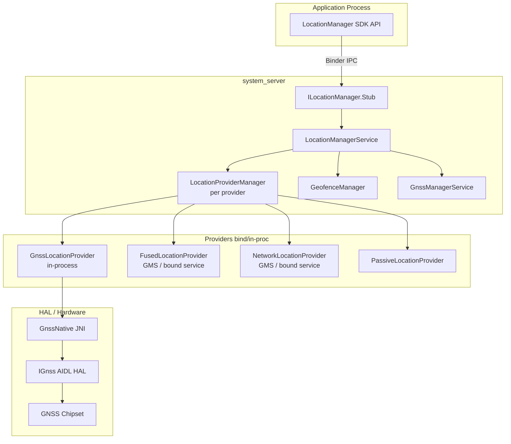

**来源：** `frameworks/base/location/java/android/location/LocationManager.java`——
带有 `@SystemService(Context.LOCATION_SERVICE)` 注解的公共 SDK 类。

### 33.1.3  提供者名称

`LocationManagerService` 定义了标注每个提供者的知名字符串常量。它们与
`LocationManager` 中的常量相匹配：

| 常量 | 值 | 描述 |
|----------|-------|-------------|
| `GPS_PROVIDER` | `"gps"` | 基于卫星（GNSS） |
| `NETWORK_PROVIDER` | `"network"` | 基于基站/Wi-Fi |
| `FUSED_PROVIDER` | `"fused"` | 传感器融合的最佳估计 |
| `PASSIVE_PROVIDER` | `"passive"` | 监听所有更新，不主动定位 |
| `GPS_HARDWARE_PROVIDER` | `"gps_hardware"` | 原始 GNSS HAL，需要 `LOCATION_HARDWARE` |

### 33.1.4  启动顺序

`LocationManagerService.Lifecycle` 继承自 `SystemService`。其启动阶段回调揭示了
精确的顺序：

```
onStart()
    publishBinderService(Context.LOCATION_SERVICE, mService)

onBootPhase(PHASE_SYSTEM_SERVICES_READY)
    SystemInjector.onSystemReady()
    LocationManagerService.onSystemReady()

onBootPhase(PHASE_THIRD_PARTY_APPS_CAN_START)
    LocationManagerService.onSystemThirdPartyAppsCanStart()
        1. create NetworkProvider    (ProxyLocationProvider)
        2. create FusedProvider      (ProxyLocationProvider, direct-boot aware)
        3. create GnssNative + GnssManagerService (also registers the
           GNSS assistance proxy in GnssManagerService.onSystemReady())
        4. create GnssLocationProvider, or a ProxyLocationProvider GNSS
           overlay (ACTION_GNSS_PROVIDER); optionally also expose the raw
           HAL as the "gps_hardware" provider
        5. bind GeocodeProvider      (ProxyGeocodeProvider)
        6. bind PopulationDensityProvider (ProxyPopulationDensityProvider)
        7. bind HardwareActivityRecognitionProxy (unless Flags.disableHardwareAr())
        8. bind GeofenceProxy -> GeofenceHardwareService
```

**来源：** `frameworks/base/services/core/java/com/android/server/location/LocationManagerService.java`，
`onSystemThirdPartyAppsCanStart()`，第 495-638 行。

网络提供者先于 GNSS 提供者创建，正如源码中的注释所说：

> "network provider should always be initialized before the gps provider since
> the gps provider has unfortunate hard dependencies on the network provider"

Android 17 改动的三个细节值得在此指出：

- **GNSS 提供者可以是代理叠加层。** 当 `config_useGnssHardwareProvider` 为 false 时，
  LMS 首先尝试通过 `ProxyLocationProvider.create(..., ACTION_GNSS_PROVIDER,
  config_enableGnssLocationOverlay, ...)` 绑定外部 GNSS 提供者。只有当没有安装叠加层时，
  它才回退到进程内的 `GnssLocationProvider`。如果叠加层*确实*存在，原始 HAL 仍会单独
  以 `GPS_HARDWARE_PROVIDER` 的形式暴露（由 `LOCATION_HARDWARE` 保护）。原因在于 GNSS HAL
  只支持单个客户端。
- **人口密度不再由标志位控制。** `ProxyPopulationDensityProvider` 被无条件注册。过去用于
  控制它的 `population_density_provider` 和 `density_based_coarse_locations` 标志已被清理。
  因此，唯一的条件是设备上是否存在该提供者服务（§33.5.8）。
- **GNSS 辅助代理移入了 GNSS 子系统。** `ProxyGnssAssistanceProvider` 不再从
  `onSystemThirdPartyAppsCanStart()` 绑定。它现在在 `GnssManagerService.onSystemReady()`
  内部注册（§33.10.5）。

### 33.1.5  源文件地图

位置子系统跨越多个目录。以下是完整的源码树地图：

```
frameworks/base/
    location/java/android/location/
        LocationManager.java          -- Public SDK API
        Geocoder.java                 -- Forward/reverse geocoding API
        LocationRequest.java          -- Request parameters
        GnssStatus.java              -- Satellite status
        GnssMeasurement.java          -- Raw measurement (framework side)
        GnssClock.java               -- GNSS clock state
        GnssCapabilities.java        -- HAL capability wrapper
        GnssAntennaInfo.java         -- Antenna phase center data
        Criteria.java                -- Legacy provider selection criteria
        Address.java                 -- Geocoded address

    core/java/android/location/      -- the android.location package is split
        Location.java                 -- Position data object
        Geofence.java                 -- Geofence definition (@hide)

    services/core/java/com/android/server/location/
        LocationManagerService.java   -- Core system service
        LocationPermissions.java      -- Permission enforcement
        LocationShellCommand.java     -- adb shell cmd location
        HardwareActivityRecognitionProxy.java
        geofence/
            GeofenceManager.java      -- Software geofence engine
            GeofenceProxy.java        -- Hardware geofence bridge
        gnss/
            GnssManagerService.java   -- GNSS subsystem manager
            GnssLocationProvider.java -- GNSS positioning provider
            GnssConfiguration.java    -- GNSS config management
            GnssMetrics.java          -- Performance metrics
            GnssListenerMultiplexer.java
            GnssMeasurementsProvider.java
            GnssNavigationMessageProvider.java
            GnssStatusProvider.java
            GnssNmeaProvider.java
            GnssAntennaInfoProvider.java
            GnssGeofenceProxy.java
            GnssPositionMode.java
            GnssPowerStats.java
            GnssPsdsDownloader.java
            GnssSatelliteBlocklistHelper.java
            GnssVisibilityControl.java
            GnssNetworkConnectivityHandler.java
            ExponentialBackOff.java
            NetworkTimeHelper.java        -- abstract NTP-time strategy
            NtpNetworkTimeHelper.java
            TimeDetectorNetworkTimeHelper.java
            hal/
                GnssNative.java       -- JNI bridge to HAL
        provider/
            AbstractLocationProvider.java
            LocationProviderController.java  -- provider control interface
            LocationProviderManager.java
            PassiveLocationProvider.java
            PassiveLocationProviderManager.java
            MockLocationProvider.java
            MockableLocationProvider.java
            StationaryThrottlingLocationProvider.java
            DelegateLocationProvider.java
            proxy/
                ProxyLocationProvider.java
                ProxyGeocodeProvider.java
                ProxyPopulationDensityProvider.java
                ProxyGnssAssistanceProvider.java
        injector/
            Injector.java             -- DI interface
            (UserInfoHelper, SettingsHelper, AlarmHelper, ... and their
             System* concrete implementations)
        listeners/
            ListenerMultiplexer.java, ListenerRegistration.java,
            BinderListenerRegistration.java, PendingIntentListenerRegistration.java
        settings/
            LocationSettings.java
            LocationUserSettings.java
        fudger/
            LocationFudger.java
            LocationFudgerCache.java
        altitude/
            AltitudeService.java
        countrydetector/
            ComprehensiveCountryDetector.java, LocationBasedCountryDetector.java
        contexthub/
            ContextHubService.java and the Context Hub / endpoint brokers
        eventlog/
            LocationEventLog.java

hardware/interfaces/gnss/
    aidl/android/hardware/gnss/
        IGnss.aidl                   -- Root GNSS HAL interface (V7)
        IGnssCallback.aidl           -- Framework callbacks + capability bits
        GnssConstellationType.aidl   -- Constellation enum
        GnssMeasurement.aidl         -- Raw measurement
        GnssSignalType.aidl          -- Signal type descriptor
        IGnssGeofence.aidl           -- Hardware geofence
        IGnssMeasurementInterface.aidl
        IGnssBatching.aidl
        IGnssPsds.aidl
        IGnssConfiguration.aidl
        IGnssPowerIndication.aidl
        IGnssDebug.aidl
        IGnssAntennaInfo.aidl
        IAGnss.aidl
        IAGnssRil.aidl
        gnss_assistance/             -- structured assistance HAL (V5+)
            IGnssAssistanceInterface.aidl, GnssAssistance.aidl, and the
            per-constellation ephemeris/almanac/ionospheric model parcelables
        measurement_corrections/
        visibility_control/

packages/modules/GeoTZ/
    locationtzprovider/              -- TimeZoneProviderService
    geotz_lookup/                    -- S2-based TZ lookup
    s2storage/                       -- S2 geometry storage
    output_data/                     -- tzs2.dat binary
```

### 33.1.6  类层次结构

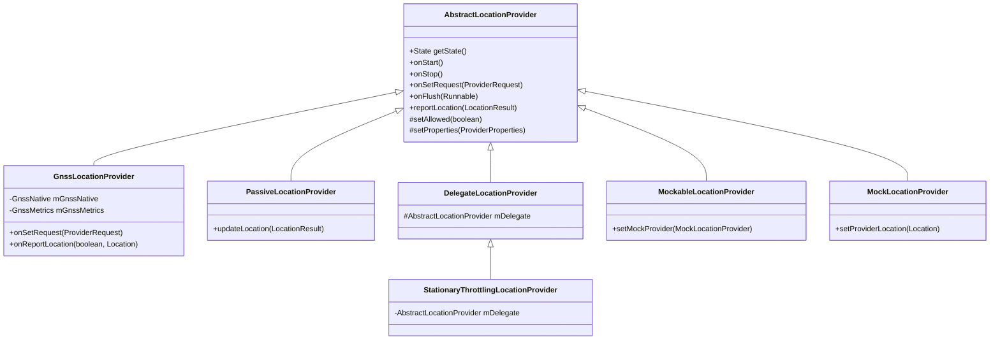

任何提供者的控制接口都是包级私有的 `LocationProviderController`
接口（`setRequest`、`start`、`stop`、`flush`、`sendExtraCommand`）。
`AbstractLocationProvider` 通过实现该接口的内部类 `Controller` 向
`LocationProviderManager` 暴露其状态。

**来源：** `frameworks/base/services/core/java/com/android/server/location/provider/`
（`AbstractLocationProvider.java`、`DelegateLocationProvider.java`、
`StationaryThrottlingLocationProvider.java`、`MockableLocationProvider.java`、
`LocationProviderController.java`）。

---

## 33.2  LocationManagerService

`LocationManagerService`（LMS）是 `LocationManager` 每一次调用背后的唯一系统服务。
它实现 `ILocationManager.Stub`——即应用通过
`Context.getSystemService(Context.LOCATION_SERVICE)` 调用的 Binder 接口。

**来源：** `frameworks/base/services/core/java/com/android/server/location/LocationManagerService.java`

### 33.2.1  字段与数据结构

```java
public class LocationManagerService extends ILocationManager.Stub
        implements LocationProviderManager.StateChangedListener {

    final Object mLock = new Object();
    private final Context mContext;
    private final Injector mInjector;
    private final GeofenceManager mGeofenceManager;
    private volatile @Nullable GnssManagerService mGnssManagerService;
    private ProxyGeocodeProvider mGeocodeProvider;

    private final PassiveLocationProviderManager mPassiveManager;

    // CopyOnWriteArrayList: hold lock for writes, no lock for reads
    final CopyOnWriteArrayList<LocationProviderManager> mProviderManagers;
}
```

`mProviderManagers` 列表为每个已注册的提供者包含一个 `LocationProviderManager`。
`CopyOnWriteArrayList` 模式允许在频繁的 `getLocationProviderManager(name)`
查找期间进行无锁读取。

### 33.2.2  Injector 模式

LMS 使用 `Injector` 接口将自己与 Android 系统服务解耦。这使得它在没有完整
system-server 环境的情况下也可测试。

```mermaid
graph LR
    subgraph Injector
        A[UserInfoHelper]
        B[SettingsHelper]
        C[AlarmHelper]
        D[AppForegroundHelper]
        E[LocationPermissionsHelper]
        F[DeviceIdleHelper]
        G[DeviceStationaryHelper]
        H[ScreenInteractiveHelper]
        I[EmergencyHelper]
        J[LocationUsageLogger]
        K[AppOpsHelper]
        L[PackageResetHelper]
        M[LocationPowerSaveModeHelper]
    end

    LMS[LocationManagerService] --> Injector
```

每个辅助类都有一个 `System*` 具体实现（例如 `SystemSettingsHelper`、
`SystemEmergencyHelper`），包装实际的系统 API。

**来源：** `frameworks/base/services/core/java/com/android/server/location/injector/`
（20 多个文件）。

### 33.2.3  提供者管理

#### 添加提供者

```java
void addLocationProviderManager(
        LocationProviderManager manager,
        @Nullable AbstractLocationProvider realProvider) {
    synchronized (mProviderManagers) {
        manager.startManager(this);

        if (realProvider != null) {
            // custom logic wrapping all non-passive providers
            if (manager != mPassiveManager) {
                int defaultStationaryThrottlingSetting =
                        mContext.getPackageManager().hasSystemFeature(
                            PackageManager.FEATURE_WATCH) ? 0 : 1;
                boolean enableStationaryThrottling = Settings.Global.getInt(
                        mContext.getContentResolver(),
                        Settings.Global.LOCATION_ENABLE_STATIONARY_THROTTLE,
                        defaultStationaryThrottlingSetting) != 0;
                // In Android 17 throttling is only ever applied to the GPS
                // provider, and only when keep_gnss_stationary_throttling is on.
                if (!(Flags.keepGnssStationaryThrottling() && enableStationaryThrottling
                        && GPS_PROVIDER.equals(manager.getName()))) {
                    enableStationaryThrottling = false;
                }
                if (enableStationaryThrottling) {
                    realProvider = new StationaryThrottlingLocationProvider(
                        manager.getName(), mInjector, realProvider);
                }
            }
            manager.setRealProvider(realProvider);
        }
        mProviderManagers.add(manager);
    }
}
```

`StationaryThrottlingLocationProvider` 装饰器在设备处于 doze 且加速度计表明其处于
静止状态时降低定位频率。它以较长的间隔重放最后已知位置，而不是要求硬件提供新的定位。

该门控逻辑在 Android 17 中被简化。旧的 `Flags.disableStationaryThrottling()`
标志已被移除。节流装饰器现在**仅**应用于 GPS 提供者。仅当
`Flags.keepGnssStationaryThrottling()` 启用且
`Settings.Global.LOCATION_ENABLE_STATIONARY_THROTTLE` 设置开启时才应用。

该设置在手机上默认为 1（开），但在 Wear OS 设备（`FEATURE_WATCH`）上默认为 0（关）。
原因是这些设备的外形尺寸较小，使静止检测不太可靠。换句话说，网络和融合提供者不再
被包装，这与早期版本的行为不同。

#### 移除提供者

```java
private void removeLocationProviderManager(LocationProviderManager manager) {
    synchronized (mProviderManagers) {
        mProviderManagers.remove(manager);
        manager.setMockProvider(null);
        manager.setRealProvider(null);
        manager.stopManager();
    }
}
```

### 33.2.4  请求处理

当应用调用 `LocationManager.requestLocationUpdates()` 时，Binder 调用到达
`registerLocationListener()`：

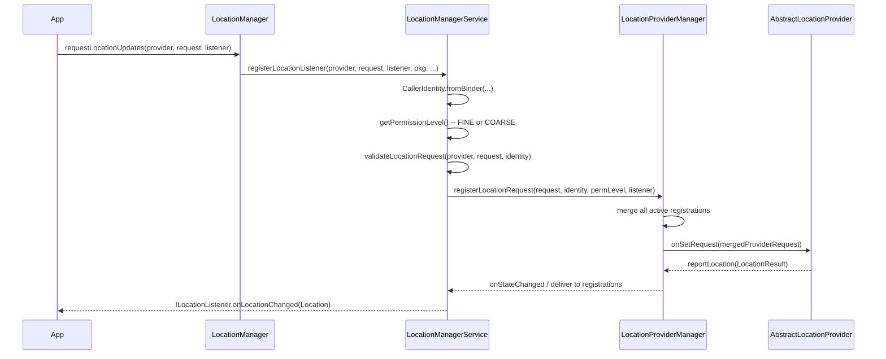

`validateLocationRequest()` 方法对每个字段进行清洗和检查：

1. **WorkSource**——需要 `UPDATE_DEVICE_STATS` 权限。
2. **低功耗模式**——需要 `LOCATION_HARDWARE` 权限。
3. **对 AppOps 隐藏**——需要 `UPDATE_APP_OPS_STATS`。
4. **ADAS GNSS 绕过**——仅限车载、仅限 GPS 提供者。
5. **忽略位置设置**——需要绕过权限。

### 33.2.5  当前位置请求

`getCurrentLocation()` 方法是一种一次性变体。LMS 委托给
`LocationProviderManager.getCurrentLocation()`，后者返回一个应用可用于取消
待处理请求的 `ICancellationSignal`。

### 33.2.6  最后已知位置

`getLastLocation()` 返回指定提供者最近的缓存 `Location`。它经过
`LocationProviderManager.getLastLocation()`，应用相同的权限检查和粗略位置模糊处理。

### 33.2.7  位置设置

每个用户的位置启用/禁用状态通过 `Settings.Secure.LOCATION_MODE` 管理。LMS 监听
变化：

```java
mInjector.getSettingsHelper().addOnLocationEnabledChangedListener(
    this::onLocationModeChanged);
```

当模式变化时，LMS：

1. 使 `LocationManager` 本地缓存失效。
2. 记录该事件。
3. 广播 `LocationManager.MODE_CHANGED_ACTION`。
4. 刷新受影响用户的 AppOps 限制。

### 33.2.8  LocationProviderManager

`LocationProviderManager`（LPM）是请求复用逻辑的核心。它是位置包中最大的单个类。
每个实例管理一个具名提供者。

关键职责：

| 职责 | 机制 |
|----------------|-----------|
| 将 N 个应用请求合并为 1 个提供者请求 | `mergeRegistrations()` |
| 跟踪每次注册的状态（活动、权限） | `Registration` 内部类 |
| 向匹配的注册交付位置 | `deliverToListeners()` |
| 对 COARSE 客户端应用粗略位置模糊处理 | `LocationFudger` |
| 为测试处理模拟提供者 | `setMockProvider()` |
| 支持用于诊断的提供者请求监听器 | `addProviderRequestListener()` |

**来源：** `frameworks/base/services/core/java/com/android/server/location/provider/LocationProviderManager.java`

### 33.2.9  LocationProviderManager 常量与阈值

LPM 定义了若干控制其行为的常量。理解它们对诊断位置交付问题至关重要：

```java
// Fastest interval for coarse-location clients (10 minutes)
private static final long MIN_COARSE_INTERVAL_MS = 10 * 60 * 1000;

// Max interval to be considered "high power" (5 minutes)
private static final long MAX_HIGH_POWER_INTERVAL_MS = 5 * 60 * 1000;

// Max age of a location before it is no longer "current" (30 seconds)
private static final long MAX_CURRENT_LOCATION_AGE_MS = 30 * 1000;

// Max timeout for getCurrentLocation (30 seconds)
private static final long MAX_GET_CURRENT_LOCATION_TIMEOUT_MS = 30 * 1000;

// Jitter tolerance for min update interval (10%)
private static final float FASTEST_INTERVAL_JITTER_PERCENTAGE = .10f;

// Max absolute jitter for min update interval (30 seconds)
private static final int MAX_FASTEST_INTERVAL_JITTER_MS = 30 * 1000;

// Minimum delay before honoring a delayed request (30 seconds)
private static final long MIN_REQUEST_DELAY_MS = 30 * 1000;

// Wakelock timeout for location delivery (30 seconds)
private static final long WAKELOCK_TIMEOUT_MS = 30 * 1000;

// Duration PendingIntent clients are allowlisted for FGS start (10 seconds)
private static final long TEMPORARY_APP_ALLOWLIST_DURATION_MS = 10 * 1000;
```

`MIN_COARSE_INTERVAL_MS` 的 10 分钟是粗略客户端的硬下限。即使应用只拥有
`ACCESS_COARSE_LOCATION` 权限却请求 1 秒更新，LPM 也会将有效间隔钳制为
10 分钟。这是一项隐私措施，用于防止粗略定位应用通过快速的位置增量推断出精细位置。

这些常量在 Android 17 中保持不变，已对照 `LocationProviderManager.java`
第 155-180 行重新核验。

### 33.2.10  LPM 省电模式

`LocationProviderManager` 通过 `LocationPowerSaveModeHelper` 与 Android 的省电机制
集成。定义了五种模式：

| 模式 | 常量 | 行为 |
|------|----------|----------|
| 不变 | `LOCATION_MODE_NO_CHANGE` | 正常运行 |
| 熄屏禁用 GPS | `LOCATION_MODE_GPS_DISABLED_WHEN_SCREEN_OFF` | 熄屏时 GPS 停止 |
| 熄屏全部禁用 | `LOCATION_MODE_ALL_DISABLED_WHEN_SCREEN_OFF` | 熄屏时所有提供者停止 |
| 仅前台 | `LOCATION_MODE_FOREGROUND_ONLY` | 仅前台应用获得更新 |
| 熄屏节流 | `LOCATION_MODE_THROTTLE_REQUESTS_WHEN_SCREEN_OFF` | 熄屏时降低频率 |

LPM 监听屏幕交互状态变化：

```java
mScreenInteractiveHelper.addListener(mScreenInteractiveChangedListener);
```

在 `LOCATION_MODE_GPS_DISABLED_WHEN_SCREEN_OFF` 模式下，如果这是 GPS 提供者且
屏幕关闭，则合并后的请求会被抑制。

### 33.2.11  LPM 注册类型

LPM 支持三种注册：

1. **监听器注册**：用于连续更新的 `ILocationListener` Binder 回调。
2. **PendingIntent 注册**：触发一个带有包含 `Location` 的 extras 的
   `PendingIntent`。
3. **当前位置请求**：带有 `ICancellationSignal` 的一次性请求，由
   `getCurrentLocation()` 处理。

每次注册跟踪：

- `LocationRequest`（间隔、质量、时长等）
- `CallerIdentity`（uid、pid、包名、归因标签）
- `@PermissionLevel`（FINE、COARSE 或 NONE）
- 调用进程是否在前台
- 注册是否处于活动状态（所有前提条件均满足）

### 33.2.12  LPM 位置交付流水线

当提供者报告新的 `LocationResult` 时，LPM 通过多阶段流水线处理它：

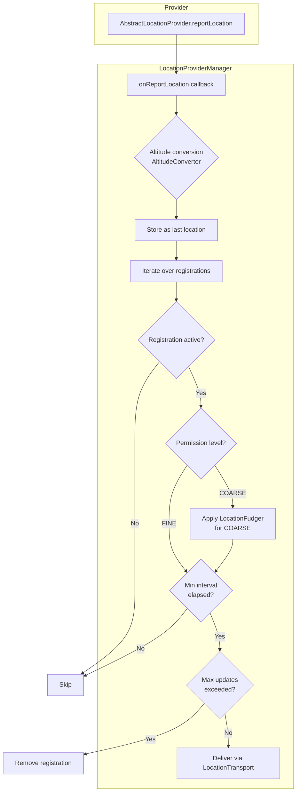

`AltitudeConverter`（可用时）将 WGS84 椭球高度转换为平均海平面海拔，改善了显示
海拔的应用的用户体验。

**来源：** `frameworks/base/services/core/java/com/android/server/location/altitude/AltitudeService.java`

### 33.2.13  位置模糊处理细节

在向粗略权限客户端交付时，`LocationFudger` 混淆真实位置。算法如下：

1. 向真实坐标添加一个缓慢漂移的随机偏移量。该偏移量在构造时由 `SecureRandom`
   播种（实际上每次启动不同）。每 `OFFSET_UPDATE_INTERVAL_MS`（1 小时）它会被
   `CHANGE_PER_INTERVAL`（3%）推动。这样模糊后的位置就不会完全静止，但也不会以
   快于网格分辨率的速度暴露移动。
2. 将偏移后的坐标吸附到单元格宽度为 `mAccuracyM` 的网格上。该宽度来自
   `Settings.Secure`，通过 `SettingsHelper.getCoarseLocationAccuracyM()` 获取，
   默认值为 `DEFAULT_COARSE_LOCATION_ACCURACY_M = 2000.0f`（2 公里），下限为
   `MIN_ACCURACY_M = 200.0f`。
3. 报告的位置是该网格吸附后的位置，报告的精度设置为
   `Math.max(mAccuracyM, originalAccuracy)`——模糊后的精度永远不会低于提供者最初
   报告的精度。

**来源：** `frameworks/base/services/core/java/com/android/server/location/fudger/LocationFudger.java`
和 `injector/SystemSettingsHelper.java`。

自 Android 16 起，`LocationFudger` 可以改用 S2 单元格密度路径，其中
`LocationFudgerCache` 咨询 `ProxyPopulationDensityProvider` 以选择每个 S2 单元格的
粗略化级别。在密集城区，单元格更小（更高精度）；在乡村地区，单元格更大（更强的
隐私保护）。在 Android 17 中，此路径不再由标志位控制。
`density_based_coarse_locations` 和 `population_density_provider` 标志已被清理。因此，
只要缓存已从非空的人口密度提供者填充，密度算法就会运行。否则它会回退到传统网格
算法。

### 33.2.14  事件记录

重要事件被记录到 `LocationEventLog`。例如，`LocationManagerService` 在
`onLocationModeChanged()` 和 `onLocationUserSettingsChanged()` 中记录设置变化：

```java
EVENT_LOG.logLocationEnabled(userId, enabled);
EVENT_LOG.logAdasLocationEnabled(userId, enabled);
```

这些日志可通过以下方式查看：

```bash
adb shell dumpsys location
```

dump 输出包括：

- 每个提供者的状态（允许、属性、身份）
- 所有活动注册及其参数
- 最近的位置交付
- 请求合并结果

### 33.2.15  Passive 提供者

`PassiveLocationProvider` 接收任何其他提供者产生的每个位置的副本。它从不主动请求
定位。应用在想要机会式更新时使用 `LocationManager.PASSIVE_PROVIDER`（例如，一个
受益于任何移动检测又不想付出 GPS 电池代价的天气应用）。

`PassiveLocationProviderManager` 重写基类 `LocationProviderManager`，以从所有其他
管理器传播位置。

**来源：** `frameworks/base/services/core/java/com/android/server/location/provider/PassiveLocationProvider.java`

### 33.2.16  模拟位置提供者

`LocationManagerService` 为插桩和开发公开了 `addTestProvider()` 和
`setTestProviderLocation()`。在底层，它们安装一个 `MockLocationProvider`，
在调用 `removeTestProvider()` 之前替换真实提供者。模拟提供者由
`OP_MOCK_LOCATION` app-op 控制。每个入口点调用
`mInjector.getAppOpsHelper().noteOp(AppOpsManager.OP_MOCK_LOCATION, identity)`。
该 op 授予用户在开发者选项中选为模拟位置应用的应用。（自 API 23 起，旧的
`ACCESS_MOCK_LOCATION` 权限已不再用于此目的。）
---

## 33.3  GNSS HAL

全球导航卫星系统（GNSS）HAL 是卫星定位的主要硬件抽象。自 Android 12 起它使用
AIDL HAL 接口；`hardware/interfaces/gnss/1.0` 到 `2.1` 中的旧式 HIDL 接口已被弃用。

AIDL 接口按版本管理，并在每个版本中冻结。截至 Android 17，当前冻结版本为 **V7**
（`android.hardware.gnss-V7`）。框架通过 `hardware/interfaces/gnss/aidl/Android.bp`
中的 `gnss_use_latest_hal` 默认值针对最新版本生成桩代码。Android 17 兼容性矩阵接受
GNSS HAL 版本 2 至 7。V7 新增了 `CAPABILITY_ENGINE_RESTART_AFTER_POWER_MODE_CHANGE`
能力（§33.3.9），并在结构化辅助 parcelable 中增加了附加字段。结构化 GNSS 辅助接口本身
（§33.10.5）最早出现在 V5。

**来源目录：** `hardware/interfaces/gnss/aidl/android/hardware/gnss/`

### 33.3.1  IGnss 根接口

`IGnss.aidl` 是每个 GNSS HAL 实现都必须暴露的 VINTF 稳定根接口。

```mermaid
graph TB
    IGnss --> IGnssCallback
    IGnss --> IGnssPsds
    IGnss --> IGnssConfiguration
    IGnss --> IGnssMeasurementInterface
    IGnss --> IGnssPowerIndication
    IGnss --> IGnssBatching
    IGnss --> IGnssGeofence
    IGnss --> IGnssNavigationMessageInterface
    IGnss --> IAGnss
    IGnss --> IAGnssRil
    IGnss --> IGnssDebug
    IGnss --> IGnssVisibilityControl
    IGnss --> IGnssAntennaInfo
    IGnss --> IMeasurementCorrectionsInterface
    IGnss --> IGnssAssistanceInterface
```

图中的每个子接口都通过 `IGnss` 上的 `getExtension*` 访问器访问（例如
`getExtensionGnssMeasurement()`、`getExtensionGnssConfiguration()`、
`getExtensionGnssAssistanceInterface()`）。可空的那些
（`getExtensionPsds()`、`getExtensionGnssBatching()`、
`getExtensionGnssGeofence()`、`getExtensionGnssNavigationMessage()`、
`getExtensionMeasurementCorrections()`）在未实现它们的硬件上返回 null。

**来源：** `hardware/interfaces/gnss/aidl/android/hardware/gnss/IGnss.aidl`

`IGnss` 上的关键方法：

| 方法 | 作用 |
|--------|---------|
| `setCallback(IGnssCallback)` | 注册框架回调 |
| `close()` | 结束会话 |
| `start()` / `stop()` | 开始/停止位置输出 |
| `startSvStatus()` / `stopSvStatus()` | 开始/停止 SV 状态报告 |
| `startNmea()` / `stopNmea()` | 开始/停止 NMEA 输出 |
| `setPositionMode(PositionModeOptions)` | 配置重复模式、间隔、精度、模式 |
| `injectTime(long timeMs, long timeReferenceMs, int uncertaintyMs)` | 注入 NTP 时间 |
| `injectLocation(GnssLocation)` | 注入网络位置 |
| `injectBestLocation(GnssLocation)` | 注入最佳可用位置 |
| `deleteAidingData(GnssAidingData)` | 清除星历/历书以进行冷启动 |

`setPositionMode` 接收单个 `PositionModeOptions` parcelable，而不是零散的
基本类型；该 parcelable 打包了 `mode`、`recurrence`、`minIntervalMs`、
`preferredAccuracyMeters`、`preferredTimeMs` 和 `lowPowerMode`。

### 33.3.2  定位模式

```java
@Backing(type="int")
enum GnssPositionMode {
    STANDALONE = 0,   // No assistance
    MS_BASED   = 1,   // Mobile-Station-Based AGNSS
    MS_ASSISTED = 2,  // Platform recommends falling back to MS_BASED
}
```

在 MS_BASED 模式下，GNSS 芯片组从辅助服务器下载卫星轨道数据（星历、历书），以
加快首次定位时间（TTFF）。HAL 文档指出 `setPositionMode` 应仅传入 `MS_BASED` 或
`STANDALONE`。它还建议当请求 `MS_ASSISTED` 且支持 `MS_BASED` 时，实现应回退到
`MS_BASED`。

**来源：** `hardware/interfaces/gnss/aidl/android/hardware/gnss/IGnss.aidl`
（`GnssPositionMode` 枚举）。

### 33.3.3  卫星星座

Android 通过 `GnssConstellationType` 枚举支持所有主要的 GNSS 星座：

```java
enum GnssConstellationType {
    UNKNOWN  = 0,
    GPS      = 1,  // US Global Positioning System
    SBAS     = 2,  // Satellite-Based Augmentation System
    GLONASS  = 3,  // Russian GLONASS
    QZSS     = 4,  // Japanese Quasi-Zenith
    BEIDOU   = 5,  // Chinese BeiDou
    GALILEO  = 6,  // European Galileo
    IRNSS    = 7,  // Indian NavIC
}
```

**来源：** `hardware/interfaces/gnss/aidl/android/hardware/gnss/GnssConstellationType.aidl`

每次卫星定位通过 `GnssSvInfo` 报告每颗 SV 的信息：

| 字段 | 类型 | 描述 |
|-------|------|-------------|
| `svid` | `int` | 卫星编号（依星座为 1-63） |
| `constellation` | `GnssConstellationType` | GNSS 系统类型 |
| `cN0Dbhz` | `float` | 天线端口载噪比（0-63 dB-Hz） |
| `basebandCN0DbHz` | `float` | 基带 C/N0 |
| `elevationDegrees` | `float` | 水平面以上仰角 |
| `azimuthDegrees` | `float` | 从正北起算的方位角 |
| `carrierFrequencyHz` | `long` | 载波频率（如 L1=1575.45 MHz） |
| `svFlag` | `int` | 位掩码：含星历、历书、参与定位、含载波频率 |

### 33.3.4  GNSS 测量值

`GnssMeasurement` parcelable 为自行进行位置计算的应用（如 PPP 或 RTK 解算）提供
原始 GNSS 观测量。

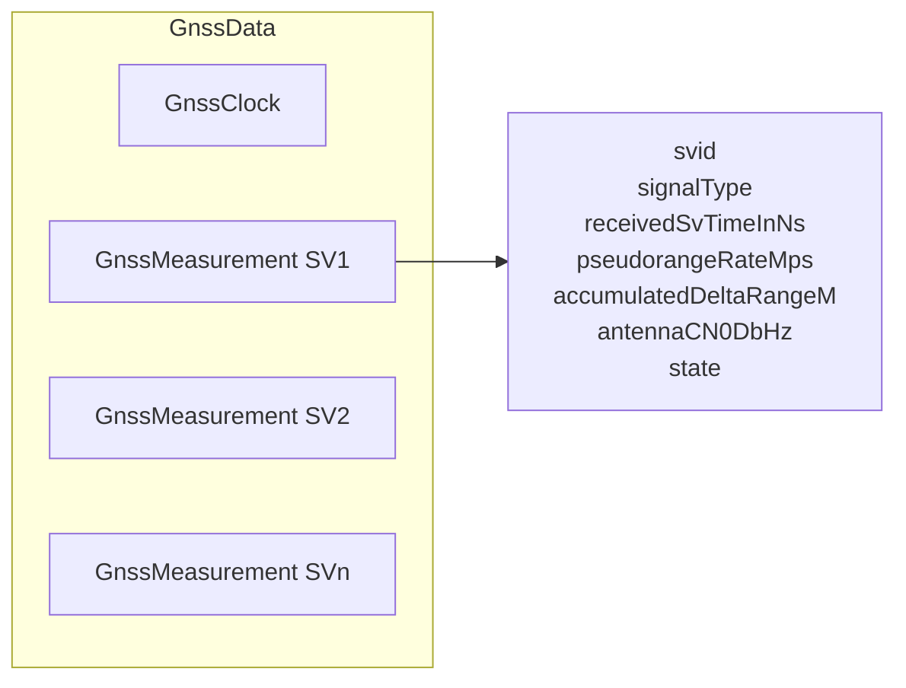

**来源：** `hardware/interfaces/gnss/aidl/android/hardware/gnss/GnssMeasurement.aidl`

关键测量字段：

| 字段 | 描述 |
|-------|-------------|
| `svid` | 卫星编号 |
| `signalType` | `GnssSignalType`（星座 + 频率 + 码型） |
| `receivedSvTimeInNs` | 接收到的卫星 TOW（纳秒） |
| `pseudorangeRateMps` | 伪距变化率（多普勒），单位 m/s |
| `accumulatedDeltaRangeM` | 载波相位累积量，单位米 |
| `antennaCN0DbHz` | 天线端口 C/N0 |
| `state` | 指示同步状态（CODE_LOCK、BIT_SYNC 等）的位字段 |

测量状态是一个渐进式位字段。随着接收机捕获信号，越来越多的位被置位：

```
STATE_UNKNOWN         -> 0
STATE_CODE_LOCK       -> 1 ms ambiguity
STATE_BIT_SYNC        -> 20 ms ambiguity
STATE_SUBFRAME_SYNC   -> 6 s ambiguity
STATE_TOW_DECODED     -> full time-of-week
STATE_TOW_KNOWN       -> TOW from any source
```

### 33.3.5  辅助 GNSS（A-GNSS）

A-GNSS 通过向接收机提供轨道预测、参考时间和近似位置来降低 TTFF。没有辅助时，
冷启动可能需要 30-60 秒；有了 A-GNSS，TTFF 可缩短到 5 秒以内。

AIDL 接口定义了几种辅助机制：

#### PSDS（预测卫星数据服务）

PSDS 前身为 XTRA（高通专有名称），提供多天轨道预测文件，使接收机无需解码广播星历
即可预测卫星位置。

`IGnssPsds` 接口：

```java
interface IGnssPsds {
    void setCallback(in IGnssPsdsCallback callback);
    void injectPsdsData(in PsdsType psdsType, in byte[] psdsData);
}
```

注意参数顺序：`psdsType` 在 `psdsData` 之前。`PsdsType` 枚举是 1 起始的，不是
0 起始的：

| 类型 | 值 | 描述 | 有效期 |
|------|-------|-------------|----------|
| `LONG_TERM` | 1 | 扩展轨道预测 | 1-14 天 |
| `NORMAL` | 2 | 标准轨道预测 | 1-3 天 |
| `REALTIME` | 3 | 实时校正 | 数分钟 |

**来源：** `hardware/interfaces/gnss/aidl/android/hardware/gnss/IGnssPsds.aidl`
和 `PsdsType.aidl`。

框架从 `gps_debug.conf` 中配置的服务器下载 PSDS 数据，并通过
`GnssNative.injectPsdsData()` 注入。

#### 通过 RIL 的 AGNSS

`IAGnss` 和 `IAGnssRil` 接口使用蜂窝无线提供数据面和控制面 A-GNSS。它用于：

1. **SUPL（安全用户面定位）**：通过数据面（TCP/IP）传输的位置辅助数据。
2. **控制面**：通过蜂窝信令通道传输的辅助数据（用于 E911）。

`IAGnssRil` 接口向 HAL 提供蜂窝身份信息（小区 ID、LAC/TAC、MCC/MNC）。HAL 使用
这些信息从网络获取辅助数据。

#### 时间和位置注入

两种更简单的辅助形式：

1. **时间注入**：`injectTime(timeMs, timeReferenceMs, uncertaintyMs)`
   提供 NTP 同步的时间以缩小搜索空间。

2. **位置注入**：`injectLocation(GnssLocation)` 或
   `injectBestLocation(GnssLocation)` 提供来自基站/Wi-Fi 定位的近似位置。

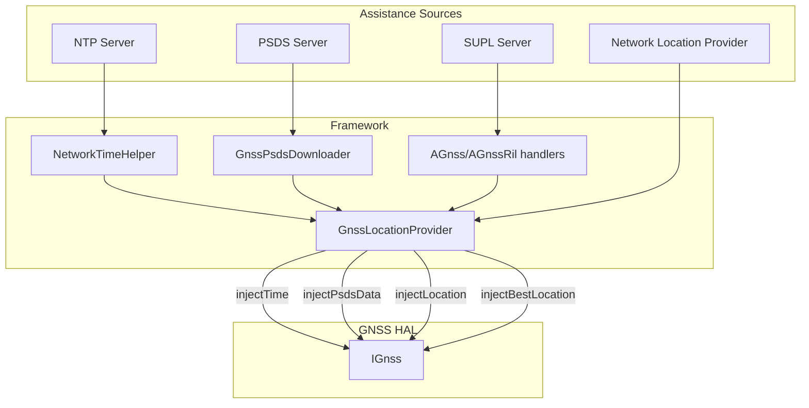

### 33.3.6  GnssNative JNI 桥

GNSS HAL 交互的框架侧入口点是 `GnssNative`，一个通过 JNI 绑定原生方法的 Java 类。

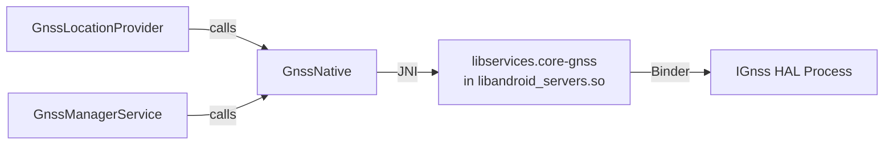

原生侧是 `libservices.core-gnss` 静态库（源码在
`frameworks/base/services/core/jni/gnss/` 下）。它被链接进 `libservices.core`，
并打包在 `libandroid_servers.so` 中。没有独立的 GNSS JNI 共享库。

**来源：** `frameworks/base/services/core/java/com/android/server/location/gnss/hal/GnssNative.java`

`GnssNative` 定义了供各组件注册以接收 HAL 事件的回调接口：

| 回调接口 | 事件 |
|-------------------|--------|
| `BaseCallbacks` | `onHalStarted`、`onHalRestarted`、`onCapabilitiesChanged` |
| `StatusCallbacks` | `onReportStatus`、`onReportFirstFix` |
| `SvStatusCallbacks` | `onReportSvStatus(GnssStatus)` |
| `LocationCallbacks` | `onReportLocation`、`onReportLocations` |
| `NmeaCallbacks` | `onReportNmea(timestamp)` |
| `MeasurementCallbacks` | `onReportMeasurements(GnssMeasurementsEvent)` |
| `NavigationMessageCallbacks` | `onReportNavigationMessage(GnssNavigationMessage)` |
| `AntennaInfoCallbacks` | `onReportAntennaInfo(List<GnssAntennaInfo>)` |
| `GeofenceCallbacks` | 转换、状态、添加/移除/暂停/恢复 |
| `AGpsCallbacks` | 数据连接请求 |
| `PsdsCallbacks` | PSDS 下载请求 |
| `TimeCallbacks` | NTP 时间注入请求 |
| `LocationRequestCallbacks` | HAL 发出的位置注入请求 |
| `NotificationCallbacks` | 非框架（NFW）位置通知 |
| `PowerStatsCallback` | 异步 `GnssPowerStats` 投递 |
| `GnssAssistanceCallbacks` | 结构化 GNSS 辅助注入请求 |

`GnssAssistanceCallbacks` 接口是 V5+ 结构化辅助 HAL 的框架钩子：`GnssManagerService`
实现它，并通过 `GnssNative.setGnssAssistanceCallbacks()` 注册（§33.10.5）。

`GnssNative` 中定义的定位模式常量：

```java
public static final int GNSS_POSITION_MODE_STANDALONE  = 0;
public static final int GNSS_POSITION_MODE_MS_BASED    = 1;
public static final int GNSS_POSITION_MODE_MS_ASSISTED = 2;
```

`deleteAidingData()` 的辅助数据标志：

```java
public static final int GNSS_AIDING_TYPE_EPHEMERIS    = 0x0001;
public static final int GNSS_AIDING_TYPE_ALMANAC      = 0x0002;
public static final int GNSS_AIDING_TYPE_POSITION     = 0x0004;
public static final int GNSS_AIDING_TYPE_TIME         = 0x0008;
public static final int GNSS_AIDING_TYPE_ALL          = 0xFFFF;
```

### 33.3.7  GnssLocationProvider

`GnssLocationProvider` 继承 `AbstractLocationProvider`，并实现了 `GnssNative`
的十几个回调接口。它是 LMS 以 `GPS_PROVIDER` 名义注册的具体提供者。

**来源：** `frameworks/base/services/core/java/com/android/server/location/gnss/GnssLocationProvider.java`

#### 提供者属性

GNSS 提供者如下声明自身：

```java
private static final ProviderProperties PROPERTIES = new ProviderProperties.Builder()
    .setHasSatelliteRequirement(true)
    .setHasAltitudeSupport(true)
    .setHasSpeedSupport(true)
    .setHasBearingSupport(true)
    .setPowerUsage(POWER_USAGE_HIGH)
    .setAccuracy(ACCURACY_FINE)
    .build();
```

这告诉框架：该提供者需要卫星可见性（户外使用），提供海拔/速度/方位，耗电高，
并提供精细精度。

#### 关键时序常量

```java
// Location update minimum interval
private static final long LOCATION_UPDATE_MIN_TIME_INTERVAL_MILLIS = 1000;  // 1 Hz

// Default location request duration for injected location assistance
private static final long LOCATION_UPDATE_DURATION_MILLIS = 10 * 1000;     // 10 seconds

// Emergency mode extends this by 3x
private static final int EMERGENCY_LOCATION_UPDATE_DURATION_MULTIPLIER = 3;

// No-fix timeout: stop trying after 60 seconds without a fix
private static final int NO_FIX_TIMEOUT = 60 * 1000;

// GPS polling threshold: below this interval, leave GPS on continuously;
// above it, duty-cycle the hardware.  10s is typical for hot TTFF (~5s).
private static final int GPS_POLLING_THRESHOLD_INTERVAL = 10 * 1000;

// PSDS retry with exponential backoff: 5 min initial, 4 hours maximum
private static final long RETRY_INTERVAL = 5 * 60 * 1000;
private static final long MAX_RETRY_INTERVAL = 4 * 60 * 60 * 1000;

// Maximum batching length: 1 day
private static final long MAX_BATCH_LENGTH_MS = DateUtils.DAY_IN_MILLIS;
```

#### GPS 占空比循环

当请求的定位间隔超过 `GPS_POLLING_THRESHOLD_INTERVAL`（10 秒）时，
`GnssLocationProvider` 进入占空比循环模式：

1. **导航阶段**：GPS 硬件上电，获取定位。
2. **休眠阶段**：GPS 硬件断电（或处于低功耗模式）。
3. **唤醒闹钟**：`AlarmManager` 闹钟触发以开始下一个导航阶段。

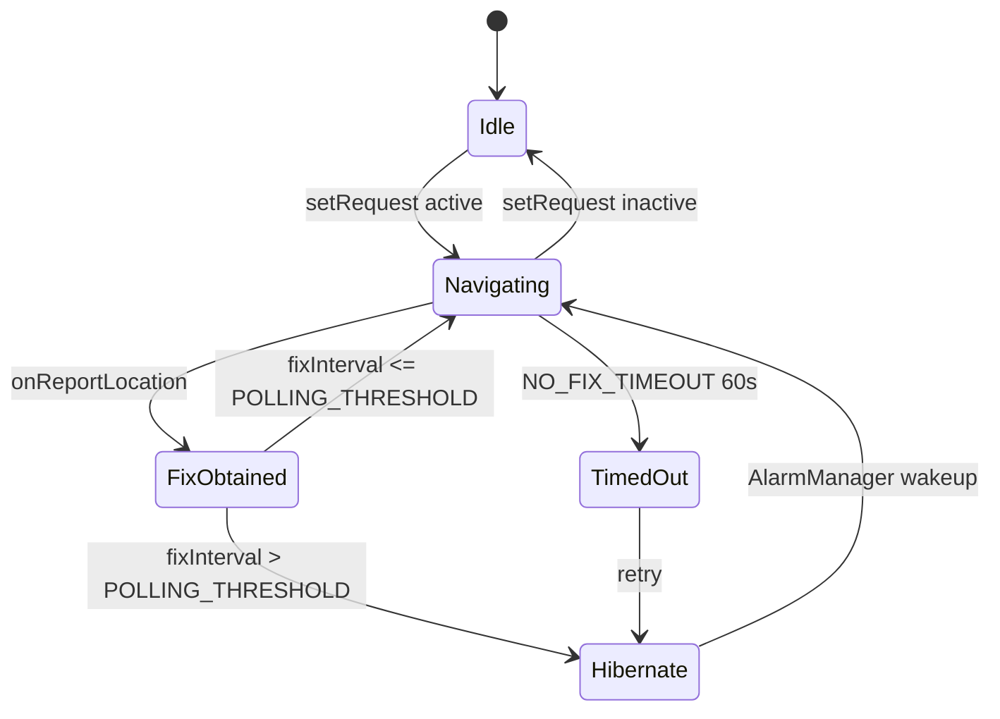

唤醒锁管理使用 `mWakeLock`（一个标记为 `*location*:GnssLocationProvider` 的
`PARTIAL_WAKE_LOCK`），以防止设备在活动导航和定位投递期间挂起。

#### 位置附加数据

每次 GNSS 定位都在 `Bundle` 中包含附加数据：

```java
class LocationExtras {
    private int mSvCount;    // Number of satellites used
    private int mMeanCn0;    // Mean C/N0 of used satellites
    private int mMaxCn0;     // Max C/N0 across all satellites
}
```

这些可通过 `location.getExtras().getInt("satellites")` 等方式访问。

关键行为：

1. **定位模式选择**：为更快的 TTFF 优先使用 `MS_BASED`；如果 HAL 不支持，则回退到
   `STANDALONE`。
2. **PSDS 下载**：当 HAL 通过 `GnssNative.PsdsCallbacks` 请求辅助数据时，提供者使用
   `GnssPsdsDownloader` 通过 HTTP 下载文件并注入。
3. **NTP 时间注入**：`NetworkTimeHelper` 获取 NTP 时间并通过
   `GnssNative.injectTime()` 注入。
4. **卫星黑名单**：`GnssSatelliteBlocklistHelper` 允许运营商按星座屏蔽特定的 SVID。
5. **车载挂起**：`setAutomotiveGnssSuspended()` 为停放车辆省电而完全挂起 GNSS。
6. **批量采集**：如果 HAL 支持，位置在芯片上批量缓存并定期刷新，避免频繁唤醒
   应用处理器。

#### PSDS 下载流程

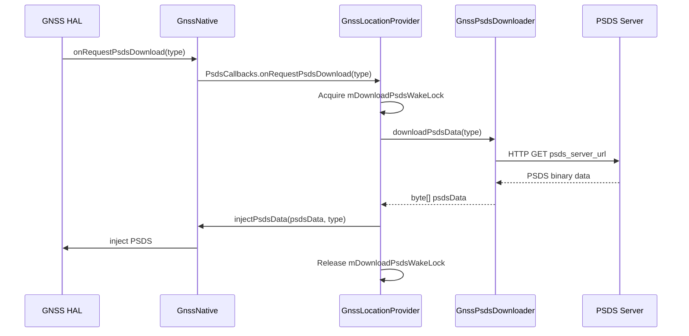

PSDS 服务器 URL 从 GNSS 配置属性中读取：

```
LONGTERM_PSDS_SERVER_1=https://...
LONGTERM_PSDS_SERVER_2=https://...
LONGTERM_PSDS_SERVER_3=https://...
NORMAL_PSDS_SERVER=https://...
REALTIME_PSDS_SERVER=https://...
```

这些键在 `GnssConfiguration.java`（第 84-88 行）中定义为
`CONFIG_LONGTERM_PSDS_SERVER_1..3`、`CONFIG_NORMAL_PSDS_SERVER` 和
`CONFIG_REALTIME_PSDS_SERVER`，并由 `GnssPsdsDownloader` 使用。在量产设备上，它们
通常通过 `config.xml` 资源叠加层设置。`gps_debug.conf` 仅作为调试覆盖（树中的示例
`gps_debug.conf` 不包含任何 PSDS 条目）。

**来源：** `frameworks/base/services/core/java/com/android/server/location/gnss/GnssConfiguration.java`
和 `GnssPsdsDownloader.java`。

#### 运营商配置集成

`GnssConfiguration.reloadGpsProperties()` 从多个来源加载属性，后加载的会覆盖先前
来源中的键——因此最后加载的来源优先级最高：

1. `/etc/gps_debug.conf`——系统调试覆盖（最高优先级，最后加载）。
2. `/vendor/etc/gps_debug.conf`——厂商特定的 GNSS 配置。
3. 资源叠加层（`config.xml`）。
4. 通过 `CarrierConfigManager` 的运营商配置（最低优先级，最先加载）。

关键配置属性：

| 属性 | 描述 |
|----------|-------------|
| `SUPL_HOST` | SUPL（安全用户面定位）服务器主机名 |
| `SUPL_PORT` | SUPL 服务器端口 |
| `SUPL_MODE` | SUPL 模式（MSA=0x02，MSB=0x01） |
| `SUPL_VER` | SUPL 协议版本 |
| `LPP_PROFILE` | LTE 定位协议配置文件 |
| `GPS_LOCK` | GPS 锁定位掩码 |
| `ES_EXTENSION_SEC` | 紧急会话延长（最长 300 秒） |
| `NFW_PROXY_APPS` | 用于可见性控制的非框架代理应用 |
| `ENABLE_PSDS_PERIODIC_DOWNLOAD` | 定期 PSDS 刷新 |

**来源：** `frameworks/base/services/core/java/com/android/server/location/gnss/GnssConfiguration.java`

当 SIM 卡变化（订阅或运营商配置变化）时，`GnssLocationProvider` 重新加载配置以应用
运营商特定的 SUPL 和 LPP 设置：

```java
private void subscriptionOrCarrierConfigChanged() {
    TelephonyManager phone = mContext.getSystemService(TelephonyManager.class);
    String mccMnc = phone.getSimOperator();
    // ... reload properties for the carrier
    mGnssConfiguration.reloadGpsProperties();
    setSuplHostPort();
    mC2KServerHost = mGnssConfiguration.getC2KHost();
    mC2KServerPort = mGnssConfiguration.getC2KPort(TCP_MIN_PORT);
}
```

#### 网络发起的位置

`GpsNetInitiatedHandler` 处理来自蜂窝网络的网络发起（NI）位置请求（例如用于
E911 定位）。NI 会话可以在紧急呼叫期间覆盖用户位置设置。

### 33.3.8  GnssManagerService

`GnssManagerService` 位于 `LocationManagerService` 和 `GnssNative` 之间。它管理
所有 GNSS 专用的监听器 API：

```java
public class GnssManagerService implements GnssNative.GnssAssistanceCallbacks {
    private final GnssLocationProvider mGnssLocationProvider;
    private final GnssStatusProvider mGnssStatusProvider;
    private final GnssNmeaProvider mGnssNmeaProvider;
    private final GnssMeasurementsProvider mGnssMeasurementsProvider;
    private final GnssNavigationMessageProvider mGnssNavigationMessageProvider;
    private final GnssAntennaInfoProvider mGnssAntennaInfoProvider;
    private final IGpsGeofenceHardware mGnssGeofenceProxy;
    private final GnssMetrics mGnssMetrics;

    // Registered in onSystemReady() to serve structured-assistance requests
    private @Nullable ProxyGnssAssistanceProvider mProxyGnssAssistanceProvider = null;
}
```

`GnssManagerService` 实现了 `GnssNative.GnssAssistanceCallbacks`。在其
`onSystemReady()` 中，它绑定 `ProxyGnssAssistanceProvider`。如果存在，它会通过
`mGnssNative.setGnssAssistanceCallbacks(this)` 注册自身。这让 HAL 可以请求结构化
辅助数据（§33.10.5）。

**来源：** `frameworks/base/services/core/java/com/android/server/location/gnss/GnssManagerService.java`

通过 `GnssManagerService` 的 GNSS 专用 API：

| API | 所需权限 |
|-----|-------------------|
| `registerGnssStatusCallback` | `ACCESS_FINE_LOCATION` |
| `registerGnssNmeaCallback` | `ACCESS_FINE_LOCATION` |
| `addGnssMeasurementsListener` | `ACCESS_FINE_LOCATION`（相关向量还需 `LOCATION_HARDWARE`） |
| `addGnssNavigationMessageListener` | `ACCESS_FINE_LOCATION` |
| `addGnssAntennaInfoListener` | 无（天线信息不是 PII） |
| `injectGnssMeasurementCorrections` | `LOCATION_HARDWARE` + `ACCESS_FINE_LOCATION` |

### 33.3.9  GNSS 能力

HAL 通过位掩码报告其能力。框架将其包装在 `GnssCapabilities` 中：

| 能力位 | 值 | 含义 |
|---------------|-------|---------|
| `CAPABILITY_SCHEDULING` | 1 &lt;&lt; 0 | HAL 可安排周期性定位 |
| `CAPABILITY_MSB` | 1 &lt;&lt; 1 | 支持 MS-Based AGNSS |
| `CAPABILITY_MSA` | 1 &lt;&lt; 2 | 支持 MS-Assisted AGNSS |
| `CAPABILITY_SINGLE_SHOT` | 1 &lt;&lt; 3 | 支持单次定位 |
| `CAPABILITY_ON_DEMAND_TIME` | 1 &lt;&lt; 4 | 请求周期性时间注入 |
| `CAPABILITY_GEOFENCING` | 1 &lt;&lt; 5 | 硬件地理围栏 |
| `CAPABILITY_MEASUREMENTS` | 1 &lt;&lt; 6 | 原始测量值 |
| `CAPABILITY_NAV_MESSAGES` | 1 &lt;&lt; 7 | 导航电文 |
| `CAPABILITY_LOW_POWER_MODE` | 1 &lt;&lt; 8 | 低功耗模式 |
| `CAPABILITY_SATELLITE_BLOCKLIST` | 1 &lt;&lt; 9 | 卫星黑名单 |
| `CAPABILITY_MEASUREMENT_CORRECTIONS` | 1 &lt;&lt; 10 | 测量校正 |
| `CAPABILITY_ANTENNA_INFO` | 1 &lt;&lt; 11 | 天线信息 |
| `CAPABILITY_CORRELATION_VECTOR` | 1 &lt;&lt; 12 | 相关向量 |
| `CAPABILITY_SATELLITE_PVT` | 1 &lt;&lt; 13 | 卫星 PVT 数据 |
| `CAPABILITY_MEASUREMENT_CORRECTIONS_FOR_DRIVING` | 1 &lt;&lt; 14 | 行车校正 |
| `CAPABILITY_ACCUMULATED_DELTA_RANGE` | 1 &lt;&lt; 15 | ADR（载波相位） |
| `CAPABILITY_ENGINE_RESTART_AFTER_POWER_MODE_CHANGE` | 1 &lt;&lt; 16 | 功耗模式变化后引擎重启（V7 新增） |

**来源：** `hardware/interfaces/gnss/aidl/android/hardware/gnss/IGnssCallback.aidl`

第 16 位 `CAPABILITY_ENGINE_RESTART_AFTER_POWER_MODE_CHANGE` 是 Android 17 GNSS
HAL（V7）中新增的能力。它告诉框架引擎在其功耗模式变化时会重启，框架通过
`GnssCapabilities.hasGnssEngineRestartAfterPowerModeChange()` 暴露这一点（由
`gnss_capability_restart_engine_after_power_mode_change` 标志控制）。

当能力变化时，`GnssManagerService` 向所有已注册的接收器广播
`ACTION_GNSS_CAPABILITIES_CHANGED`。

### 33.3.10  GNSS 信号类型

`GnssSignalType` parcelable 将星座、载波频率和码型组合成一个结构。HAL 在初始化时
通过 `gnssSetSignalTypeCapabilitiesCb()` 报告其支持的信号类型，使框架能够理解接收机
的多频段能力（例如 L1 + L5 双频 GPS）。

常见信号类型：

| 星座 | 信号 | 频率 | 码 | 用途 |
|--------------|--------|-----------|------|-----|
| GPS | L1 C/A | 1575.42 MHz | C | 传统民用 |
| GPS | L1C | 1575.42 MHz | L1C | 现代化民用 |
| GPS | L5 | 1176.45 MHz | L5Q | 高精度 |
| Galileo | E1 | 1575.42 MHz | E1B/E1C | 主要民用 |
| Galileo | E5a | 1176.45 MHz | E5aQ | 高精度 |
| GLONASS | L1 OF | ~1602 MHz | L1OF | 传统民用 |
| BeiDou | B1I | 1561.098 MHz | B1I | 民用 |
| BeiDou | B1C | 1575.42 MHz | B1C | 现代化 |
| QZSS | L1 C/A | 1575.42 MHz | C | 日本区域 |
| IRNSS | L5 | 1176.45 MHz | L5C | 印度区域 |

多频接收机（L1 + L5 或类似）通过电离层延迟校正提供显著的精度提升，因为电离层对
不同频率的影响不同。双频组合可以完全消除电离层误差项。

`GnssSignalType.codeType` 是取自 HAL 的 `CODE_TYPE_*` 常量的单个字母字符串
（`"A"`、`"B"`、`"C"`，…… `"Z"`，加上 `CODE_TYPE_UNKNOWN`）。其中几个码型字符串
记录了 NavIC L1 的用法（数据、导频以及数据+导频）。它们反映了 Android 17 在 SDK
层面通过新的 `gnss_api_navic_l1` 标志暴露的 NavIC（IRNSS）L1 信号支持。该标志在现有
`TYPE_IRN_L5` 之外增加了 `GnssNavigationMessage.TYPE_IRN_L1 = 0x0703`。

### 33.3.11  GNSS 功耗统计

`IGnssPowerIndication` 接口报告功耗指标：

```java
interface IGnssPowerIndication {
    void setCallback(IGnssPowerIndicationCallback callback);
    void requestGnssPowerStats();
}
```

`GnssPowerStats` 包括：

| 指标 | 描述 |
|--------|-------------|
| `elapsedRealtime` | 报告的时间戳 |
| `totalEnergyMilliJoule` | 自启动以来的总能耗 |
| `singlebandTrackingModeEnergyMilliJoule` | 单频跟踪模式下的能耗 |
| `multibandTrackingModeEnergyMilliJoule` | 多频跟踪模式下的能耗 |
| `singlebandAcquisitionModeEnergyMilliJoule` | 单频捕获模式下的能耗 |
| `multibandAcquisitionModeEnergyMilliJoule` | 多频捕获模式下的能耗 |
| `otherModesEnergyMilliJoule` | 每种信号类型其他模式下的能耗 |

这些统计数据由 `GnssMetrics` 用于系统健康监测，可通过以下命令访问：

```bash
adb shell dumpsys location
```

### 33.3.12  GNSS 调试接口

`IGnssDebug` 接口提供有关 GNSS 引擎内部状态的调试信息。包括：

- 当前卫星星历数据
- 时间模型信息
- 位置估计
- 卫星健康信息

该接口主要用于通过 VTS（厂商测试套件）测试进行 GNSS HAL 一致性测试。

---

## 33.4  融合定位提供者

### 33.4.1  概述

融合定位提供者（FLP）将来自 GNSS、Wi-Fi、基站、气压传感器和惯性测量单元的信号
组合成单一、经过优化的位置估计。在经过 Google 认证的设备上，这由 Google Play
服务（GMS）实现；在 AOSP 上，它是一个可插拔的绑定服务。

### 33.4.2  LMS 如何绑定 FLP

```java
ProxyLocationProvider fusedProvider = ProxyLocationProvider.create(
        mContext,
        FUSED_PROVIDER,
        ACTION_FUSED_PROVIDER,
        com.android.internal.R.bool.config_enableFusedLocationOverlay,
        com.android.internal.R.string.config_fusedLocationProviderPackageName,
        com.android.internal.R.bool.config_fusedLocationOverlayUnstableFallback);
```

`ProxyLocationProvider` 通过 intent action
`com.android.location.service.FusedLocationProvider` 发现服务（网络提供者的 action 是
`com.android.location.service.v3.NetworkLocationProvider`）。框架要求必须存在一个
支持 direct-boot 的融合提供者：

```java
Preconditions.checkState(!mContext.getPackageManager()
    .queryIntentServicesAsUser(
        new Intent(ACTION_FUSED_PROVIDER),
        MATCH_DIRECT_BOOT_AWARE | MATCH_SYSTEM_ONLY,
        UserHandle.USER_SYSTEM).isEmpty(),
    "Unable to find a direct boot aware fused location provider");
```

### 33.4.3  ProxyLocationProvider 绑定

`ProxyLocationProvider` 类处理绑定外部位置提供者服务的复杂性。它使用
`ServiceWatcher` 来：

1. 发现最佳匹配的服务（仅系统、最高版本）。
2. 以适当的标志绑定到它。
3. 如果服务崩溃或更新则自动重新绑定。
4. 通过 Binder 接口编组 `ProviderRequest` 对象。

绑定序列：

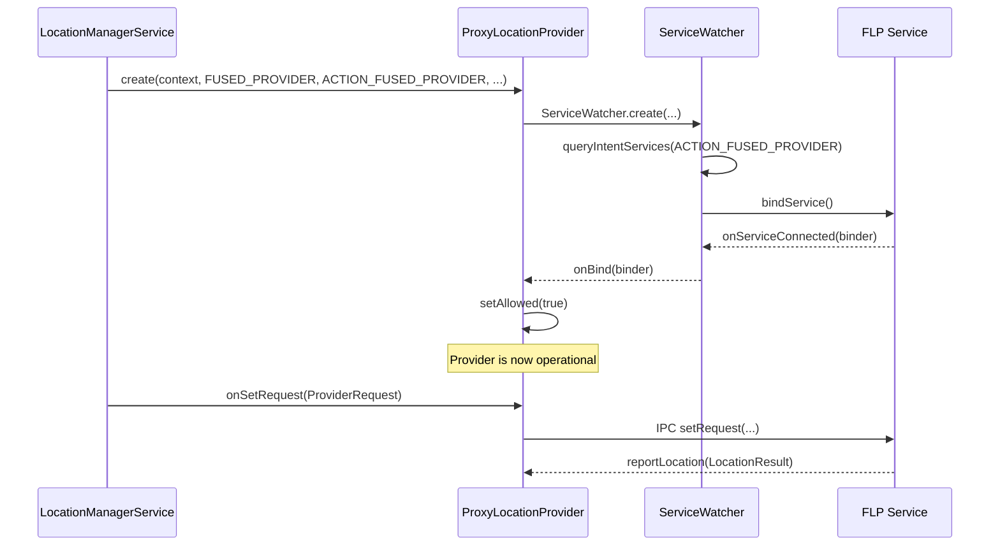

当服务意外断开连接时，`ServiceWatcher` 会自动尝试重新绑定。在断开期间，提供者将
自己报告为不允许，`LocationProviderManager` 停止向已注册的客户端投递更新。

### 33.4.4  FLP 架构

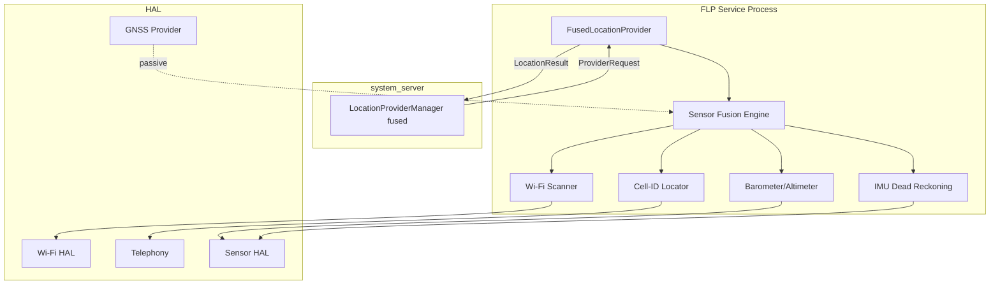

### 33.4.5  功耗效率

FLP 动态选择满足合并请求的最省电的定位来源。考虑一个低精度、长间隔请求（例如，一个
每 30 分钟请求一次更新的天气应用）。FLP 可能完全依赖基站定位，而不激活 GNSS 或
Wi-Fi 扫描。对于请求 1 秒更新的导航应用，它会动用包括 GNSS 在内的完整传感器套件。

### 33.4.6  FLP 请求优先级

`LocationRequest` API 暴露了一个 `quality` 参数，FLP 使用它：

| 质量 | 常量 | 行为 |
|---------|----------|----------|
| 高精度 | `QUALITY_HIGH_ACCURACY` | GNSS + Wi-Fi + 基站 |
| 平衡 | `QUALITY_BALANCED_POWER_ACCURACY` | Wi-Fi + 基站 |
| 低功耗 | `QUALITY_LOW_POWER` | 仅基站 |
| Passive | `QUALITY_LOW_POWER` + passive | 无主动扫描 |

### 33.4.7  静止节流

当设备静止（通过加速度计检测）时，`StationaryThrottlingLocationProvider`
包装器会降低有效定位速率。这是 FLP 协同配合的一项功耗优化。

**来源：** `frameworks/base/services/core/java/com/android/server/location/provider/StationaryThrottlingLocationProvider.java`

静止检测使用 `DeviceStationaryHelper`，它监控加速度计的持续静止状态。静止时：

1. 合并请求的间隔增大。
2. 向底层提供者请求的定位减少。
3. 电池消耗显著下降。

该特性由以下设置控制：

```java
Settings.Global.LOCATION_ENABLE_STATIONARY_THROTTLE
```

在手机上默认启用（1），但在 Wear OS 设备上默认禁用（0），因为较小的外形尺寸使
静止检测不太可靠。

§33.2.3 描述了该门控在 Android 17 中如何被简化。旧的 `Flags.disableStationaryThrottling()`
标志已被移除。`StationaryThrottlingLocationProvider` 包装器现在**仅应用于 GPS 提供者**。
仅当 `Flags.keepGnssStationaryThrottling()` 开启且上述设置启用时才应用。因此，融合
提供者不再被包装进节流装饰器；希望在静止时进行节流的 FLP 实现现在自行在内部完成。

### 33.4.8  海拔转换

Android 提供了一个 `AltitudeConverter`（在 `android.location.altitude` 中），使用
大地水准面模型将 GPS 椭球高度（WGS84）转换为平均海平面（MSL）海拔。大地水准面高度
来自一个内置的 S2 单元格地图（`MapParamsProto`，以 `S2CellIdUtils` 为键），而不是来自
HAL。同一个转换器集成在 `LocationProviderManager` 的位置交付流水线中，因此读取
`Location.getMslAltitudeMeters()` 的应用会获得已填充的值。

转换很重要，因为 GPS 接收机原生报告的是 WGS84 椭球上方的高度。该高度在某些位置可能
与实际海平面以上海拔相差多达 100 米。向用户显示海拔的应用需要 MSL 海拔才能获得有意义
的结果。

`AltitudeService` 是此功能的 system-server 端。它是一个
`IAltitudeService.Stub`（由 `SystemServer` 中的 `AltitudeService.Lifecycle` 发布）。
它公开 `addMslAltitudeToLocation()` 和 `getGeoidHeight()`，以便**厂商 HAL 客户端**可以
请求相同的框架侧大地水准面转换，两个方法都委托给 `AltitudeConverter`。方向是框架
*向厂商提供*转换，而不是框架从 HAL 读取大地水准面高度。Android 17 中定义了一个
`geoid_heights_via_altitude_hal` 标志，用于通过 Altitude HAL 提供大地水准面高度。
它尚未接入服务。

**来源：** `frameworks/base/services/core/java/com/android/server/location/altitude/AltitudeService.java`

---

## 33.5  网络定位提供者

### 33.5.1  概述

网络定位提供者（NLP）使用基站和 Wi-Fi 接入点数据库确定位置。与 FLP 一样，它是通过
intent action 发现的绑定服务：

```java
ProxyLocationProvider networkProvider = ProxyLocationProvider.create(
    mContext,
    NETWORK_PROVIDER,
    ACTION_NETWORK_PROVIDER,
    com.android.internal.R.bool.config_enableNetworkLocationOverlay,
    com.android.internal.R.string.config_networkLocationProviderPackageName);
```

**来源：** `frameworks/base/services/core/java/com/android/server/location/LocationManagerService.java`，
`onSystemThirdPartyAppsCanStart()`，第 498-510 行。

### 33.5.2  NLP 与 FLP 对比

| 方面 | 网络提供者 | 融合提供者 |
|--------|-----------------|----------------|
| Intent action | `ACTION_NETWORK_PROVIDER` | `ACTION_FUSED_PROVIDER` |
| 使用 GNSS | 否 | 是 |
| 典型精度 | 20-200 米 | 3-50 米 |
| 功耗 | 低 | 可变 |
| 主要用例 | 面向 COARSE 权限应用的粗略位置 | 最佳可用位置 |

### 33.5.3  基站定位

NLP 使用 `TelephonyManager` 获取当前的 `CellInfo` 列表，其中包含小区标识
（MCC、MNC、LAC/TAC、CID）。这些会在数据库（本地或服务端）中查找，以获得近似位置。

### 33.5.4  Wi-Fi 定位

NLP 触发 Wi-Fi 扫描并收集 BSSID/RSSI 对。它们与 Wi-Fi 指纹数据库匹配以进行位置三角
定位。这在城市环境中通常能达到 10-50 米的精度。

### 33.5.5  ProxyLocationProvider

`ProxyLocationProvider` 继承 `AbstractLocationProvider`，并使用 `ServiceWatcher`
绑定外部服务。它将 `ProviderRequest` 对象编组到绑定的服务，并接收 `LocationResult`
回调。

**来源：** `frameworks/base/services/core/java/com/android/server/location/provider/proxy/ProxyLocationProvider.java`

### 33.5.6  ServiceWatcher 架构

NLP 和 FLP 都使用相同的 `ServiceWatcher` 基础设施进行服务发现和绑定。
`ServiceWatcher` 提供：

1. **基于 Intent 的发现**：查找匹配特定 action 的服务。
2. **叠加层支持**：配置资源 `config_enableNetworkLocationOverlay` 和
   `config_networkLocationProviderPackageName` 允许 OEM 覆盖默认的提供者包。
3. **版本选择**：当多个服务匹配时，选择最高版本。
4. **当前用户绑定**：服务以当前用户的上下文绑定。
5. **自动重连**：如果服务死亡，`ServiceWatcher` 自动重新绑定。

### 33.5.7  MockableLocationProvider

每个真实提供者都被包装在一个 `MockableLocationProvider` 中，该类允许为测试无缝注入
模拟位置。当调用 `setMockProvider()` 时，`MockableLocationProvider` 将所有请求重定向
到 `MockLocationProvider`，而不是真实提供者。

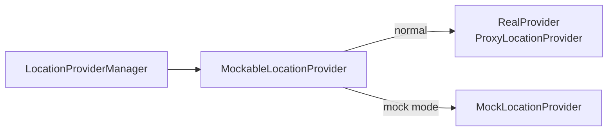

这种架构意味着模拟位置会经过与真实位置完全相同的交付流水线——相同的权限检查、
相同的模糊处理、相同的间隔强制。

### 33.5.8  人口密度提供者

Android 16 引入了 `ProxyPopulationDensityProvider`，通过以下方式绑定：

```java
setProxyPopulationDensityProvider(
        ProxyPopulationDensityProvider.createAndRegister(mContext));
```

该提供者提供人口密度数据，`LocationFudgerCache` 使用这些数据实现基于密度的粗略位置
模糊处理。在人口密度高的地区（城市），模糊单元格更小，为粗略位置应用保持合理的
可用性。在乡村地区，单元格更大，以提供更强的隐私保证。

在 Android 17 中，绑定是无条件的。过去用于控制此功能的 `population_density_provider`
和 `density_based_coarse_locations` 标志已被清理。唯一的检查是设备是否附带人口密度
提供者服务。如果 `createAndRegister()` 返回非空，LMS 在其上安装 `LocationFudgerCache`，
密度算法运行。否则它回退到传统网格（§33.2.13）。LMS 还记录带有加载时间的
`POPULATION_DENSITY_PROVIDER_LOADING_REPORTED`。

**来源：** `frameworks/base/services/core/java/com/android/server/location/provider/proxy/ProxyPopulationDensityProvider.java`

---

## 33.6  地理围栏

地理围栏允许应用定义地理区域，并在设备进入或离开这些区域时接收通知。Android 支持
两个地理围栏层：基于软件的（在 `GeofenceManager` 中）和硬件加速的（通过 GNSS HAL）。

### 33.6.1  软件地理围栏——GeofenceManager

**来源：** `frameworks/base/services/core/java/com/android/server/location/geofence/GeofenceManager.java`

`GeofenceManager` 继承 `ListenerMultiplexer` 并实现 `LocationListener`。它使用融合
提供者监控地理围栏：

```java
@Override
protected boolean registerWithService(LocationRequest locationRequest,
        Collection<GeofenceRegistration> registrations) {
    getLocationManager().requestLocationUpdates(
        FUSED_PROVIDER, locationRequest, FgThread.getExecutor(), this);
    return true;
}
```

#### 关键常量

```java
private static final int MAX_SPEED_M_S = 100;          // 360 km/hr
private static final long MAX_LOCATION_AGE_MS = 5 * 60 * 1000L;  // 5 minutes
private static final long MAX_LOCATION_INTERVAL_MS = 2 * 60 * 60 * 1000;  // 2 hours
```

#### 自适应轮询间隔

轮询间隔根据设备到最近地理围栏边界的距离动态计算：

```java
intervalMs = Math.min(MAX_LOCATION_INTERVAL_MS,
    Math.max(
        settingsHelper.getBackgroundThrottleProximityAlertIntervalMs(),
        minFenceDistanceM * 1000 / MAX_SPEED_M_S));
```

当设备远离任何地理围栏时，间隔很长（最长 2 小时）。随着它接近边界，间隔减小以实现
及时检测。

#### 地理围栏状态机

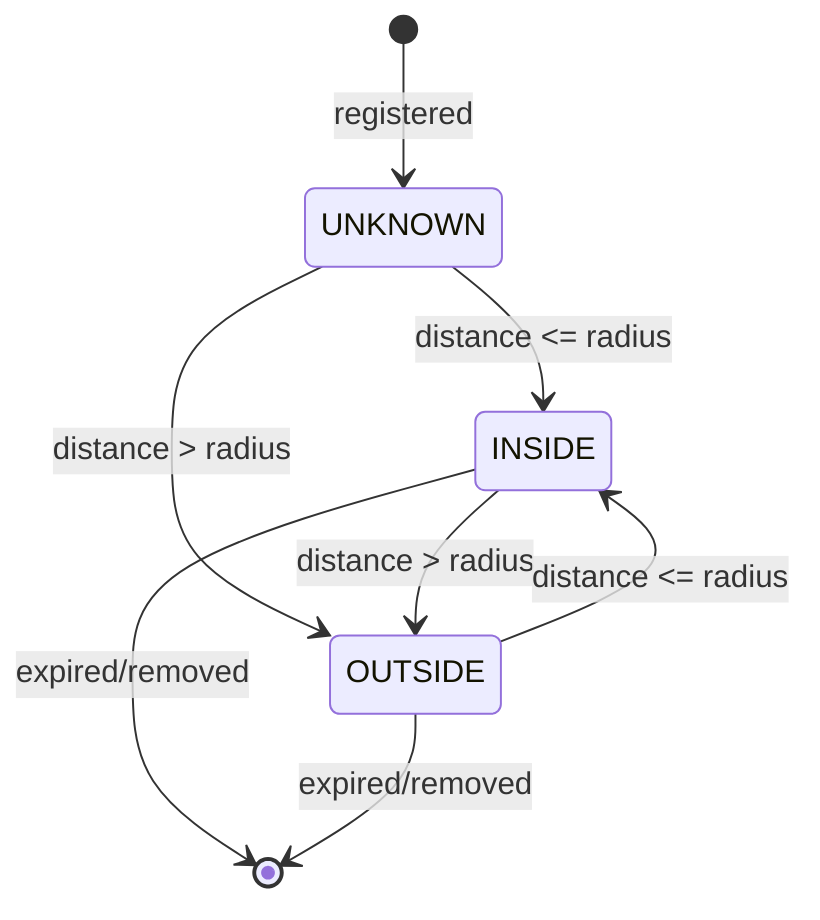

当从 UNKNOWN/OUTSIDE 转换到 INSIDE 时，会触发一个带有
`KEY_PROXIMITY_ENTERING = true` 的 `PendingIntent`。当从 INSIDE 转换到 OUTSIDE 时，
intent 以 `KEY_PROXIMITY_ENTERING = false` 触发。

### 33.6.2  GeofenceRegistration

每次地理围栏注册跟踪：

```java
class GeofenceRegistration extends PendingIntentListenerRegistration {
    private final Geofence mGeofence;
    private final CallerIdentity mIdentity;
    private final Location mCenter;
    private final PowerManager.WakeLock mWakeLock;
    private int mGeofenceState;  // UNKNOWN, INSIDE, OUTSIDE
    private boolean mPermitted;
}
```

`mWakeLock` 确保设备保持唤醒足够长的时间以投递转换通知。它在
`WAKELOCK_TIMEOUT_MS`（30 秒）后自动释放。

### 33.6.3  硬件地理围栏——GeofenceProxy

**来源：** `frameworks/base/services/core/java/com/android/server/location/geofence/GeofenceProxy.java`

`GeofenceProxy` 在框架与硬件地理围栏服务之间架桥。它绑定到：

1. 一个 `GeofenceProvider` 服务（action `com.android.location.service.GeofenceProvider`）。
2. `GeofenceHardwareService` 系统服务。

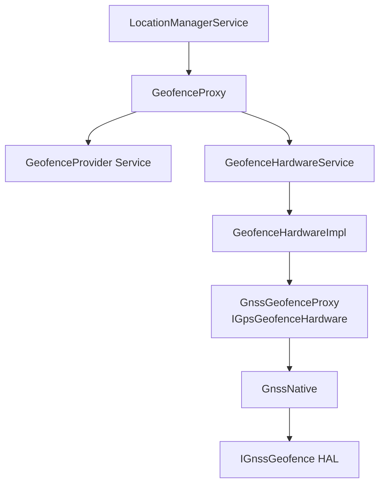

### 33.6.4  IGnssGeofence HAL 接口

**来源：** `hardware/interfaces/gnss/aidl/android/hardware/gnss/IGnssGeofence.aidl`

硬件地理围栏 HAL 直接在 GNSS 芯片组上支持圆形地理围栏：

```java
interface IGnssGeofence {
    void setCallback(in IGnssGeofenceCallback callback);
    void addGeofence(int geofenceId, double lat, double lng,
                     double radiusM, int lastTransition,
                     int monitorTransitions,
                     int notificationResponsivenessMs,
                     int unknownTimerMs);
    void pauseGeofence(int geofenceId);
    void resumeGeofence(int geofenceId, int monitorTransitions);
    void removeGeofence(int geofenceId);
}
```

硬件地理围栏比软件地理围栏的功耗效率高得多，因为当 GNSS 芯片组自主监控边界时，
应用处理器可以保持深度睡眠。

### 33.6.5  GnssGeofenceHalModule

`GnssManagerService` 中的 `GnssGeofenceHalModule` 内部类接收 HAL 地理围栏回调，并
将其转换为 `GeofenceHardwareImpl` 调用：

```java
@Override
public void onReportGeofenceTransition(int geofenceId, Location location,
        @GeofenceTransition int transition, long timestamp) {
    FgThread.getHandler().post(() ->
        getGeofenceHardware().reportGeofenceTransition(
            geofenceId, location, transition, timestamp,
            GeofenceHardware.MONITORING_TYPE_GPS_HARDWARE,
            FusedBatchOptions.SourceTechnologies.GNSS));
}
```

地理围栏状态转换：

| HAL 状态 | 框架状态 |
|-----------|-----------------|
| `GEOFENCE_STATUS_OPERATION_SUCCESS` | `GEOFENCE_SUCCESS` |
| `GEOFENCE_STATUS_ERROR_GENERIC` | `GEOFENCE_FAILURE` |
| `GEOFENCE_STATUS_ERROR_ID_EXISTS` | `GEOFENCE_ERROR_ID_EXISTS` |
| `GEOFENCE_STATUS_ERROR_TOO_MANY_GEOFENCES` | `GEOFENCE_ERROR_TOO_MANY_GEOFENCES` |
| `GEOFENCE_STATUS_ERROR_ID_UNKNOWN` | `GEOFENCE_ERROR_ID_UNKNOWN` |

---

## 33.7  地理编码

地理编码在人类可读的地址与地理坐标之间进行转换。Android 通过 `Geocoder` 类同时提供
正向地理编码（地址到经纬度）和反向地理编码（经纬度到地址）。

### 33.7.1  客户端 API

```java
Geocoder geocoder = new Geocoder(context, Locale.getDefault());

// Reverse geocode (non-blocking; preferred form)
geocoder.getFromLocation(lat, lng, maxResults, addresses -> { /* ... */ });

// Forward geocode (non-blocking; preferred form)
geocoder.getFromLocationName("1600 Amphitheatre Pkwy", 1,
        addresses -> { /* ... */ });
```

阻塞式的 `getFromLocation(lat, lng, maxResults)` 和
`getFromLocationName(name, maxResults)` 重载仍然存在，但已被弃用，推荐改用
`GeocodeListener` 回调形式。当请求跨过 Binder 到达地理编码提供者时，回调形式不会
阻塞调用线程。在内部，已弃用的重载调用监听器变体并等待一个 `SynchronousGeocoder`。

**来源：** `frameworks/base/location/java/android/location/Geocoder.java`。

### 33.7.2  服务端实现

`Geocoder` 类委托给 `ILocationManager.reverseGeocode()` 和
`ILocationManager.forwardGeocode()`，它们透传到 `ProxyGeocodeProvider`：

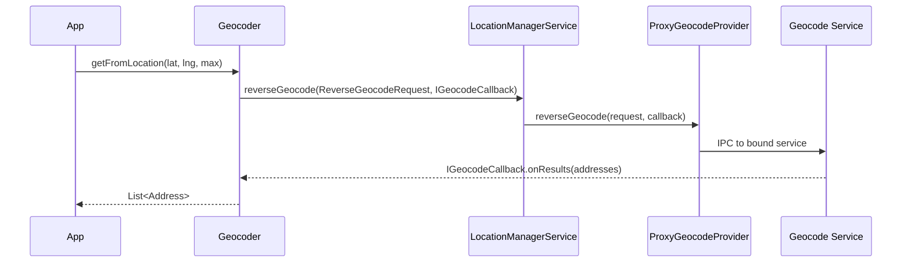

注意返回路径。`Geocoder` 传入的 `IGeocodeCallback` 是一个位于*应用*进程中的
`IGeocodeCallback.Stub`。LMS 将该 binder 直接经 `ProxyGeocodeProvider` 透传给绑定的
地理编码服务。因此，服务会直接在应用的回调上调用 `onResults()`——LMS 和
`ProxyGeocodeProvider` 都不会看到或转接结果。

**来源：** `frameworks/base/services/core/java/com/android/server/location/provider/proxy/ProxyGeocodeProvider.java`

`ProxyGeocodeProvider` 通过 `ServiceWatcher` 在 action
`GeocodeProviderBase.ACTION_GEOCODE_PROVIDER` 上发现其后端服务。
`ForwardGeocodeRequest` / `ReverseGeocodeRequest` parcelable 以及
`GeocodeProviderBase` 基类（在 `android.location.provider` 中）是现代、结构化的
地理编码提供者 SDK 接口面。Android 17 的 `new_geocoder` 标志控制它。注意，该标志控制
的是*提供者*侧的类；客户端 `Geocoder` 的 `GeocodeListener` 重载（§33.7.1）的可用性
与此无关。

### 33.7.3  可用性

`Geocoder.isPresent()` 仅在绑定了地理编码提供者服务时返回 `true`。在没有 GMS 的 AOSP
上，这可能返回 `false`，此时地理编码调用会优雅地失败。

LMS 检查可用性：

```java
@Override
public boolean isGeocodeAvailable() {
    return mGeocodeProvider != null;
}
```

### 33.7.4  正向地理编码流程

正向地理编码（地址到坐标）遵循类似的路径：

```java
@Override
public void forwardGeocode(ForwardGeocodeRequest request, IGeocodeCallback callback) {
    CallerIdentity identity = CallerIdentity.fromBinder(
        mContext, request.getCallingPackage(), request.getCallingAttributionTag());
    Preconditions.checkArgument(identity.getUid() == request.getCallingUid());

    if (mGeocodeProvider != null) {
        mGeocodeProvider.forwardGeocode(request, callback);
    } else {
        try {
            callback.onError(null);
        } catch (RemoteException e) {
            // ignore
        }
    }
}
```

`ForwardGeocodeRequest` 包含：

| 字段 | 描述 |
|-------|-------------|
| `locationName` | 要进行地理编码的地址字符串 |
| `maxResults` | 要返回的最大结果数 |
| `lowerLeftLatitude/Longitude` | 可选边界框左下角 |
| `upperRightLatitude/Longitude` | 可选边界框右上角 |
| `locale` | 响应使用的区域设置 |
| `callingPackage` | 请求地理编码的包名 |
| `callingUid` | 请求者的 UID |

边界框允许应用将结果偏向某个地理区域，从而改善模糊地址查询的相关性。

### 33.7.5  地理编码错误处理

`IGeocodeCallback` 接口报告结果或错误：

```java
oneway interface IGeocodeCallback {
    void onError(String error);
    void onResults(in List<Address> results);
}
```

当地理编码提供者不可用（`mGeocodeProvider == null`）时，会调用 `onError(null)`。
`Geocoder` 客户端类将其转换为应用收到的 `IOException`。

常见失败场景：

- 没有绑定地理编码提供者（没有 GMS 的 AOSP）
- 网络不可用（服务端地理编码）
- 无效的地址查询
- 提供者服务崩溃

### 33.7.6  Address 对象

`Address` 类包含：

| 字段 | 描述 |
|-------|-------------|
| `latitude`、`longitude` | 地理坐标 |
| `featureName` | 地点名称 |
| `thoroughfare` | 街道名称 |
| `subThoroughfare` | 门牌号 |
| `locality` | 城市名称 |
| `adminArea` | 州/省 |
| `postalCode` | 邮政编码 |
| `countryCode` | ISO 国家代码 |
| `countryName` | 完整国家名称 |
| `locale` | 响应使用的区域设置 |

---

## 33.8  位置权限

Android 的位置权限模型是平台中最精细的之一。它区分四个维度：精度（精细 vs. 粗略）、
时效性（前台 vs. 后台）、紧急程度（正常 vs. 紧急）以及绕过（覆盖设置的系统组件）。

### 33.8.1  权限层次结构

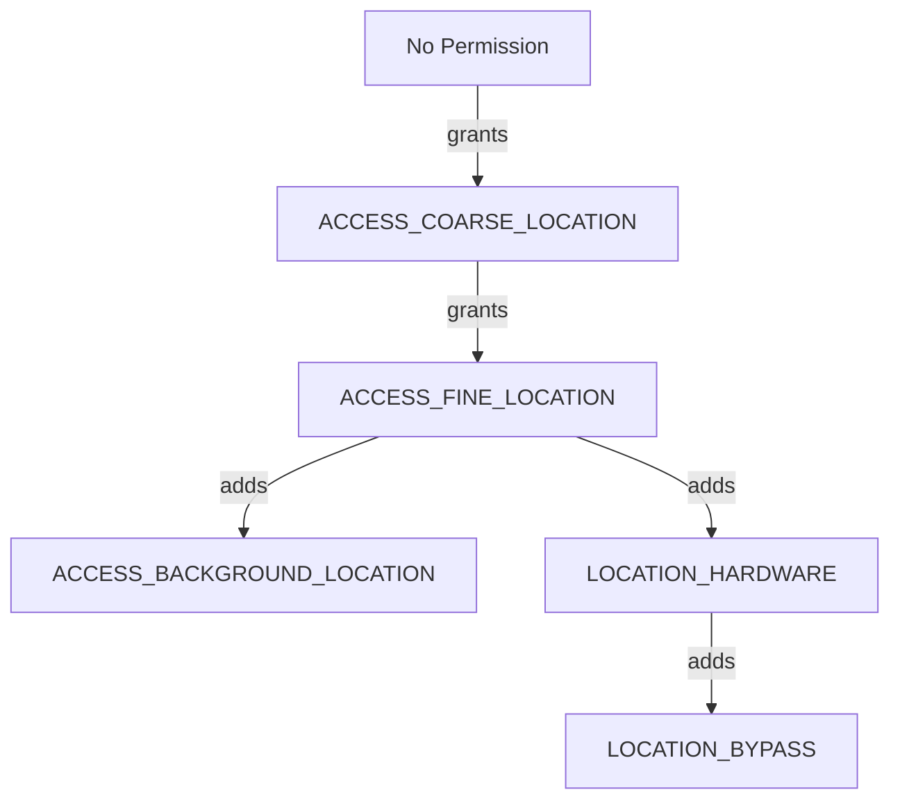

### 33.8.2  LocationPermissions 工具类

**来源：** `frameworks/base/services/core/java/com/android/server/location/LocationPermissions.java`

`LocationPermissions` 类定义了三个权限级别：

```java
public static final int PERMISSION_NONE   = 0;
public static final int PERMISSION_COARSE = 1;
public static final int PERMISSION_FINE   = 2;
```

`getPermissionLevel()` 方法按递减顺序检查权限：

```java
public static int getPermissionLevel(Context context, int uid, int pid) {
    if (context.checkPermission(ACCESS_FINE_LOCATION, pid, uid) == GRANTED) {
        return PERMISSION_FINE;
    }
    if (context.checkPermission(ACCESS_COARSE_LOCATION, pid, uid) == GRANTED) {
        return PERMISSION_COARSE;
    }
    return PERMISSION_NONE;
}
```

### 33.8.3  精细与粗略位置

| 方面 | 精细 | 粗略 |
|--------|------|--------|
| 权限 | `ACCESS_FINE_LOCATION` | `ACCESS_COARSE_LOCATION` |
| 精度 | 精确的 GPS 坐标 | 模糊到约 2 公里网格（默认） |
| 提供者访问 | 所有提供者 | 所有提供者（结果被模糊处理） |
| GNSS 原始数据 | 是 | 否 |

当应用仅持有 `ACCESS_COARSE_LOCATION` 时，`LocationProviderManager` 应用
`LocationFudger` 来混淆精确位置。模糊处理会添加一个缓慢漂移的随机偏移量。然后它将
结果吸附到单元格宽度默认为 2 公里（`DEFAULT_COARSE_LOCATION_ACCURACY_M`，下限为
200 米）的网格上。因此，模糊后的位置在小幅移动时保持稳定（§33.2.13）。

自 Android 16 起，可用基于人口密度的模糊模式。`ProxyPopulationDensityProvider`
提供密度数据。`LocationFudgerCache` 按密度选择 S2 单元格的粗略化级别：乡村地区
单元格更大，人口密集的城区单元格更小。截至 Android 17，此模式不再由标志位控制
（`density_based_coarse_locations` 和 `population_density_provider` 已被清理）；
只要存在人口密度提供者，它就会运行。

### 33.8.4  后台位置

从 Android 10（API 29）开始，`ACCESS_BACKGROUND_LOCATION` 是一个独立的权限。应用
必须在其不处于前台时持有它才能接收位置更新。该权限在运行时权限对话框中作为独立步骤
授予。

后台节流机制通过 `SettingsHelper` 实现：

```java
mInjector.getSettingsHelper().getBackgroundThrottlePackageWhitelist()
```

系统豁免包（列入白名单）不受后台节流限制。

### 33.8.5  位置绕过

系统组件（例如紧急拨号器、车载位置服务）即使在用户禁用了位置设置时也可能需要位置。
`LOCATION_BYPASS` 权限授予此能力：

```java
public static void enforceBypassPermission(Context context, int uid, int pid) {
    if (context.checkPermission(LOCATION_BYPASS, pid, uid) == GRANTED) {
        return;
    }
    throw new SecurityException(...);
}
```

在 Android 17 中，此强制检查是一个普通权限检查，没有标志位控制。
`location_bypass` 标志（仍定义在 `location.aconfig` 中）在运行时不再被查询。旧的
`enable_location_bypass` 标志已被移除。现在，单独的 `READ_LOCATION_BYPASS_ALLOWLIST`
权限守护对绕过白名单的读取（`LocationPermissions.enforceReadLocationBypassAllowlist*`）。

**来源：** `frameworks/base/services/core/java/com/android/server/location/LocationPermissions.java`。

绕过还扩展到车载设备上的 ADAS（高级驾驶辅助系统），即使在位置禁用的情况下也能访问
GPS：

```java
if (request.isAdasGnssBypass()) {
    if (!mContext.getPackageManager().hasSystemFeature(FEATURE_AUTOMOTIVE)) {
        throw new IllegalArgumentException(
            "adas gnss bypass requests are only allowed on automotive devices");
    }
}
```

### 33.8.6  AppOps 集成

除了运行时权限之外，位置访问还由 AppOps 进一步控制。`AppOpsHelper` 跟踪
`OP_FINE_LOCATION` 和 `OP_COARSE_LOCATION` 操作，允许用户通过设置撤销特定应用的位置
访问，而无需完全移除权限。

### 33.8.7  紧急位置

在紧急呼叫（例如 E911）期间，Android 会放宽位置限制。`EmergencyHelper` 跟踪紧急
状态，LMS 通过以下方式检查：

```java
mInjector.getEmergencyHelper().isInEmergency(Long.MIN_VALUE)
```

GNSS HAL 回调在框架的 `LocationRequestCallbacks` 上表现为
`onRequestLocation(independentFromGnss, isUserEmergency)`，将紧急标志从硬件层向下传播。

Android 17 收紧了紧急状态与 AppOps 限制的交互方式。它通过几个标志实现这一点。
`fix_app_ops_restriction_for_emergency_mode` 在紧急状态转换时刷新 AppOps 限制（因此
忽略设置的白名单仅在紧急模式下被排除）。`cache_emergency_callback_mode` 缓存紧急回调
模式的广播值，以避免在热路径上查询 `TelephonyManager`。
`check_bypass_permission_before_emergency_mode` 首先检查绕过权限，以跳过不必要的 IPC。

### 33.8.8  权限强制流程

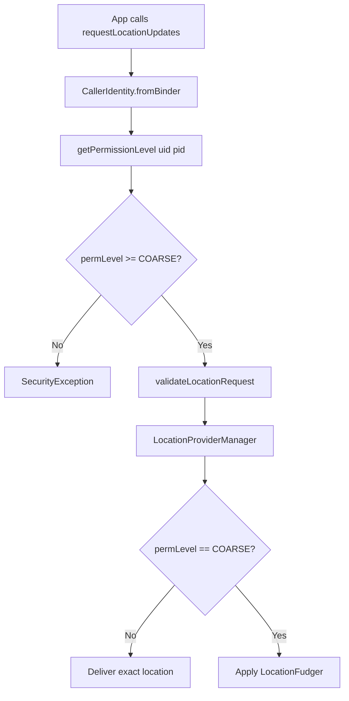

### 33.8.9  前台服务要求

从 Android 10（API 29）开始，需要持续后台位置的应用必须使用类型为 `location`
的前台服务（`FOREGROUND_SERVICE_TYPE_LOCATION`）。Android 12 随后增加了对从后台启动
此类服务的限制。LMS 跟踪前台服务 API 的使用：

```java
ActivityManagerInternal managerInternal =
    LocalServices.getService(ActivityManagerInternal.class);
if (managerInternal != null) {
    managerInternal.logFgsApiBegin(
        ActivityManager.FOREGROUND_SERVICE_API_TYPE_LOCATION,
        Binder.getCallingUid(), Binder.getCallingPid());
}
```

当监听器注销时，会调用相应的 `logFgsApiEnd()`。此跟踪使系统能够向用户显示哪些应用
正在后台主动使用位置。

### 33.8.10  PendingIntent 安全性

基于 PendingIntent 的位置请求受到额外限制。由于在 PendingIntent 注册后无法跟踪应用的
权限变化（进程可能已死亡），系统 API 被阻止：

```java
if (isChangeEnabled(BLOCK_PENDING_INTENT_SYSTEM_API_USAGE, identity.getUid())) {
    boolean usesSystemApi = request.isLowPower()
            || request.isHiddenFromAppOps()
            || request.isLocationSettingsIgnored()
            || !request.getWorkSource().isEmpty();
    if (usesSystemApi) {
        throw new SecurityException(
            "PendingIntent location requests may not use system APIs: " + request);
    }
}
```

### 33.8.11  位置指示器

Android 12 引入了持久指示器，显示应用何时访问位置。`AppOpsManager` 跟踪位置操作，
当任何应用持有活动的位置 note 时，SystemUI 显示一个绿点或状态栏图标。

`LocationManagerService.onSystemReady()` 在 `AppOpsManager` 上注册了一个观察者：

```java
// Track OP_FINE_LOCATION and OP_COARSE_LOCATION
appOps.startWatchingNoted(
    new int[]{AppOpsManager.OP_FINE_LOCATION, AppOpsManager.OP_COARSE_LOCATION},
    (code, uid, packageName, attributionTag, flags, result) -> {
        if (!isLocationEnabledForUser(UserHandle.getUserId(uid))) {
            Log.w(TAG, "location noteOp with location off - " + identity);
        }
    });
```

此看门狗仅安装在调试版本上，以检测位置被禁用时发生位置操作的潜在框架缺陷。

### 33.8.12  归因标签

Android 11 引入了归因标签，用于在同一个包内对位置使用进行细粒度跟踪。整个位置服务
中使用的 `CallerIdentity` 包含归因标签：

```java
CallerIdentity identity = CallerIdentity.fromBinder(
    mContext, packageName, attributionTag, listenerId);
```

归因标签显示在权限仪表板中，帮助用户理解多模块应用中的哪个组件正在访问位置。

### 33.8.13  按用户的位置设置

位置可以按用户启用/禁用：

```java
@Override
public void setLocationEnabledForUser(boolean enabled, int userId) {
    mContext.enforceCallingOrSelfPermission(WRITE_SECURE_SETTINGS, null);
    LocationManager.invalidateLocalLocationEnabledCaches();
    mInjector.getSettingsHelper().setLocationEnabled(enabled, userId);
}
```

`frameworks/base/services/core/java/com/android/server/location/settings/` 中的
`LocationSettings` 类持久化按用户的设置，包括车载设备的 ADAS GNSS 位置启用状态。

---

## 33.9  GeoTZ——从位置获取时区

GeoTZ 模块是 Android 基于位置检测时区的参考实现。它使用离线边界数据库将地理坐标映射
到时区标识符，从而消除了网络查询的需要。

### 33.9.1  模块结构

**来源：** `packages/modules/GeoTZ/`

```
packages/modules/GeoTZ/
    apex/              - Mainline module APEX configuration
    common/            - Shared utility code
    data_pipeline/     - Host-side data generation tools
    geotz_lookup/      - Time-zone lookup API using tzs2.dat
    locationtzprovider/ - The actual TimeZoneProviderService
    output_data/       - Generated tzs2.dat file
    s2storage/         - S2 geometry storage library
    tzs2storage/       - TZ-specific S2 storage
    tzbb_data/         - Source data from timezone-boundary-builder
    validation/        - Validation tooling
```

### 33.9.2  数据流水线

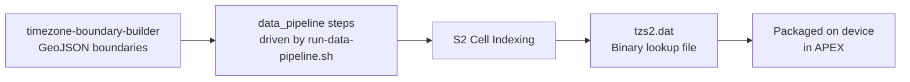

数据流水线：

1. 从
   [timezone-boundary-builder](https://github.com/evansiroky/timezone-boundary-builder)
   项目下载边界数据（存储在 `tzbb_data/` 中）。
2. 使用 Google 的 S2 Geometry 库处理 GeoJSON 多边形。
3. 生成 `tzs2.dat`，这是一个将 S2 单元格映射到时区 ID 的紧凑二进制文件。

### 33.9.3  GeoTimeZonesFinder

`geotz_lookup` 库提供高层 API：

```java
try (GeoTimeZonesFinder finder = GeoTimeZonesFinder.create(...)) {
    LocationToken token = finder.createLocationTokenForLatLng(lat, lng);
    List<String> tzIds = finder.findTimeZonesForLocationToken(token);
    // tzIds might be ["America/Los_Angeles"] or ["Europe/Berlin"]
}
```

`LocationToken` 是一个轻量级句柄，可支持高效缓存。如果设备没有移动到足以跨越
S2 单元格边界的距离，则可以复用上一次的查找结果。

### 33.9.4  OfflineLocationTimeZoneDelegate

**来源：** `packages/modules/GeoTZ/locationtzprovider/src/main/java/com/android/timezone/location/provider/core/OfflineLocationTimeZoneDelegate.java`

这是 GeoTZ 提供者的核心逻辑。它围绕两个正交维度构建。粗粒度生命周期是一个四值
`Mode` 枚举（`MODE_STOPPED=1`、`MODE_STARTED=2`、`MODE_DESTROYED=3`、
`MODE_FAILED=4`，定义于 `.../provider/core/Mode.java`）。只有在 `MODE_STARTED`
状态下，第二个字段 `mListenMode` 才会在 `LOCATION_LISTEN_MODE_ACTIVE` 和
`LOCATION_LISTEN_MODE_PASSIVE` 之间做出选择：

```mermaid
stateDiagram-v2
    [*] --> MODE_STOPPED
    MODE_STOPPED --> MODE_STARTED : onStartUpdates
    state MODE_STARTED {
        [*] --> ACTIVE
        ACTIVE --> PASSIVE : location received / active budget spent
        PASSIVE --> ACTIVE : passive timeout, no location
        PASSIVE --> PASSIVE : location received, stay passive
    }
    MODE_STARTED --> MODE_STOPPED : onStopUpdates
    MODE_STARTED --> MODE_FAILED : IOException
    MODE_STOPPED --> MODE_DESTROYED : onDestroy
```

**ACTIVE 监听模式**（`LOCATION_LISTEN_MODE_ACTIVE`）：

- 短时、高功耗监听。
- 可能激活 GNSS。
- 恰好返回一个位置或一个“位置未知”结果。

**PASSIVE 监听模式**（`LOCATION_LISTEN_MODE_PASSIVE`）：

- 长时、低功耗监听。
- 仅接收机会式位置更新。
- 不保证收到位置。

`LocationListeningAccountant` 管理一套预算系统：

1. Passive 监听累积 active 监听预算。
2. Active 监听消耗预算。
3. 这确保了提供者不会因大部分时间处于 passive 模式而滥用 GNSS 电量。

### 33.9.5  OfflineLocationTimeZoneProviderService

**来源：** `packages/modules/GeoTZ/locationtzprovider/src/main/java/com/android/timezone/location/provider/OfflineLocationTimeZoneProviderService.java`

这是 `TimeZoneProviderService` 的入口点：

```java
public final class OfflineLocationTimeZoneProviderService
        extends TimeZoneProviderService {

    @Override
    public void onCreate() {
        Environment environment = new EnvironmentImpl(
            attributionContext, this::reportTimeZoneProviderEvent);
        mDelegate = OfflineLocationTimeZoneDelegate.create(environment);
    }

    @Override
    public void onStartUpdates(long initializationTimeoutMillis) {
        mDelegate.onStartUpdates(Duration.ofMillis(initializationTimeoutMillis));
    }

    @Override
    public void onStopUpdates() {
        mDelegate.onStopUpdates();
    }
}
```

该服务报告三种类型的结果：

| 结果类型 | 含义 |
|-------------|---------|
| `RESULT_TYPE_SUGGESTION` | 从位置确定的时区 ID |
| `RESULT_TYPE_UNCERTAIN` | 无法确定时区 |
| `RESULT_TYPE_PERMANENT_FAILURE` | 不可恢复的错误（如数据文件损坏） |

### 33.9.6  位置到时区流程

```mermaid
sequenceDiagram
    participant LTZP as OfflineLocationTimeZoneDelegate
    participant ENV as Environment
    participant LOC as LocationManager
    participant GTZF as GeoTimeZonesFinder
    participant Platform as time_zone_detector

    Note over LTZP: onStartUpdates() called
    LTZP->>ENV: startActiveGetCurrentLocation()
    ENV->>LOC: getCurrentLocation(fused)
    LOC-->>ENV: Location(lat, lng)
    ENV-->>LTZP: onActiveListeningResult(location)
    LTZP->>GTZF: createLocationTokenForLatLng(lat, lng)
    GTZF-->>LTZP: LocationToken
    LTZP->>GTZF: findTimeZonesForLocationToken(token)
    GTZF-->>LTZP: ["America/New_York"]
    LTZP->>Platform: reportSuggestion(tzIds, elapsedRealtime)
```

### 33.9.7  S2 几何存储

`s2storage` 和 `tzs2storage` 库实现了基于 Google S2 Geometry 库的高效空间索引。
S2 单元格将地球表面划分为分层网格。给定层级的每个单元格覆盖固定区域，二进制文件将
单元格 ID 映射到时区标识符集。

这种方法有几个优势：

- **紧凑**：`tzs2.dat` 文件只有几兆字节。
- **查找快速**：对单元格 ID 进行 O(log n) 二分查找。
- **离线**：无需网络访问。
- **可更新**：该文件可通过 APEX 模块更新机制进行更新。

### 33.9.8  GeoDataFileManager

`GeoDataFileManager` 处理在设备上加载和缓存 `tzs2.dat` 文件。该文件打包在 GeoTZ
APEX 模块内：

```
/apex/com.android.geotz/etc/tzs2.dat
```

当 APEX 通过 Mainline 更新时，数据文件会自动刷新，无需完整的 OTA 更新。这一点至关
重要，因为时区边界会定期变化（各国偶尔会重组时区或调整夏令时规则）。

### 33.9.9  错误处理与弹性

委托处理几种失败场景：

1. **初始化超时**：如果在初始化期间内没有可用位置，则会报告一个不确定的结果。
   `time_zone_detector` 回退到其他来源。

2. **查找期间出现 IOException**：如果 `tzs2.dat` 文件损坏或缺失，委托进入
   `MODE_FAILED` 并报告永久性失败。

3. **Passive 模式下位置不可用**：委托可能切换到 active 监听（这会消耗预算）来获取
   定位。当 passive 监听超时且没有位置到达时会发生这种情况。

4. **用户切换**：当当前用户变化时，会调用 `onStopUpdates()`。委托清除所有位置状态，
   以防止跨用户的位置泄露。

### 33.9.10  功耗预算管理

`LocationListeningAccountant` 执行严格的功耗预算：

```mermaid
graph LR
    subgraph "Budget System"
        PL["Passive Listening<br>Accrues Budget"]
        AL["Active Listening<br>Consumes Budget"]
    end

    PL -->|time-based accrual| Budget[Active Budget Pool]
    Budget -->|withdrawal| AL
    AL -->|unused time returned| Budget
```

每进行一小时的 passive 监听，就会累积少量 active 监听预算。这确保了 active
（高功耗）监听仅限于总运行时间的一小部分。

会计还会考虑：

- 最后已知位置的新旧程度。
- 是否有初始化超时正在等待。
- 配置的最小和最大监听时长。

### 33.9.11  与时区检测的集成

GeoTZ 提供者是 Android `time_zone_detector` 服务使用的几种信号之一。检测器权衡来自
以下方面的建议：

1. 电话（基于 MCC）。
2. 位置（GeoTZ）。
3. 用户手动选择。

在由多个时区的基站提供服务的地区（例如边境附近），基于位置的提供者具有比电话更高的
优先级。

检测优先级链：

```mermaid
graph TB
    subgraph "Time Zone Detection Sources"
        Manual["Manual User Selection<br>Highest Priority"]
        Location["Location-based<br>GeoTZ Provider"]
        Telephony["Telephony-based<br>MCC/NITZ"]
    end

    Manual --> TZD[time_zone_detector]
    Location --> TZD
    Telephony --> TZD
    TZD --> SystemClock[System Time Zone Setting]
```

`time_zone_detector` 服务管理这些来源之间的优先级。当在设置中启用位置检测时，
GeoTZ 提供者的建议优先于基于电话的检测。这在国际边境附近很重要，因为单个基站的
MCC 可能无法反映用户的实际时区。

GeoTZ 在以下地区尤其有价值：

- **印度/尼泊尔边境**：印度只有一个时区（IST，UTC+5:30），而尼泊尔使用
  UTC+5:45。
- **中国/中亚边境**：中国使用单一时区，而邻国有不同的偏移量。
- **美国州边境**：亚利桑那州不实行夏令时，而邻近的州实行。

### 33.9.12  APEX 模块更新

GeoTZ 模块作为 Mainline APEX（`com.android.geotz`）分发，支持通过 Google Play
系统更新独立于完整的 OS OTA 更新进行更新。

APEX 包含：

| 组件 | 路径 | 作用 |
|-----------|------|---------|
| `tzs2.dat` | `etc/tzs2.dat` | 时区边界数据（一个 `prebuilt_etc`） |
| `geotz.jar` | `javalib/` | 提供者，作为 system-server 类路径 jar |
| 许可证文件 | `etc/` | timezone-boundary-builder 数据的归属说明 |

此 APEX 中没有 `app/` APK，也没有原生 `lib/` 目录。该提供者作为 `geotz` Java 库
发布，通过 `systemserverclasspath_fragment` 交付。`geotz_lookup` 和 `s2storage`
库是静态链接到该 jar 中的 Java 库。

当发生时区边界变化（例如某国更改时区）时，Google 可以推送包含新 `tzs2.dat`
文件的更新版 APEX。暂存的 APEX 更新仅在激活重启后生效，而该重启也会重启托管该提供者
的系统服务器。因此，新数据从下一次启动起生效。

---

## 33.10  高级主题

### 33.10.1  GNSS 测量校正

对于车载和高精度应用，Android 通过 `GnssMeasurementCorrections` 支持 GNSS 测量校正。
这允许三维地图校正服务注入建筑物反射信息，帮助 GNSS 芯片组补偿城市峡谷中的多径效应。

流程：

```mermaid
sequenceDiagram
    participant Map as 3D Mapping Service
    participant App as Correction App
    participant LMS as LocationManagerService
    participant GMS as GnssManagerService
    participant GNat as GnssNative
    participant HAL as GNSS HAL

    Map->>App: 3D building model + satellite positions
    App->>App: Compute per-satellite corrections
    App->>LMS: injectGnssMeasurementCorrections(corrections)
    LMS->>GMS: injectGnssMeasurementCorrections(corrections)
    GMS->>GNat: injectMeasurementCorrections(corrections)
    GNat->>HAL: IMeasurementCorrectionsInterface.setCorrections()
    HAL->>HAL: Apply corrections to position solution
```

这需要 `LOCATION_HARDWARE` + `ACCESS_FINE_LOCATION` 权限。

HAL 能力 `CAPABILITY_MEASUREMENT_CORRECTIONS` 指示支持，而
`CAPABILITY_MEASUREMENT_CORRECTIONS_FOR_DRIVING` 指示车载变体。

### 33.10.2  GNSS 可见性控制

`IGnssVisibilityControl` HAL 接口管理哪些应用有权接收非框架发起（NFW）的位置数据。
NFW 位置是指 GNSS 芯片组响应网络发起的请求（例如蜂窝运营商为 E911 发起的请求）而
生成的位置数据。

`GnssVisibilityControl` 类管理代理应用列表（通过 `gps_debug.conf` 中的
`NFW_PROXY_APPS` 配置），这些应用有权接收 NFW 位置数据。

### 33.10.3  GNSS 导航电文

`IGnssNavigationMessageInterface` 提供对卫星广播的原始导航电文（星历数据）的访问。
研究需要解码完整卫星导航电文的专业定位应用会使用它。

导航电文类型包括：

| 类型 | 描述 |
|------|-------------|
| GPS L1 C/A | 标准 GPS 民用导航电文 |
| GPS L2 CNAV | GPS 现代化民用导航 |
| GPS L5 CNAV | GPS L5 信号导航 |
| GLONASS | GLONASS 导航帧 |
| BeiDou D1/D2 | 北斗导航数据 |
| Galileo I/NAV/F/NAV | 伽利略导航电文 |

### 33.10.4  GNSS 天线信息

`IGnssAntennaInfo` 接口提供有关 GNSS 天线相位中心偏移和变化的信息。这些数据对于
毫米级精度应用（例如测量）至关重要。

框架通过 `GnssAntennaInfo` 暴露这一点：

| 字段 | 描述 |
|-------|-------------|
| `carrierFrequencyMHz` | 此天线数据的载波频率 |
| `phaseCenterOffset` | 相位中心相对于天线参考点的 3D 偏移 |
| `phaseCenterVariationCorrections` | 相位中心变化的校正 |
| `signalGainCorrections` | 天线增益方向图 |

### 33.10.5  GNSS 辅助（结构化接口）

结构化 GNSS 辅助机制通过 `IGnssAssistanceInterface` HAL 暴露（通过
`IGnss.getExtensionGnssAssistanceInterface()` 访问）。此 HAL 最早出现在 GNSS HAL
V5，并属于 Android 17（V7）接口面的一部分。它以类型丰富的辅助模型补充了传统的
不透明 PSDS 方法。

在 Android 17 中，注册是**无条件的**。过去用于控制 JNI 路径的
`gnss_assistance_interface_jni` 标志已被移除。因此，
`GnssManagerService.onSystemReady()` 只需绑定代理提供者，并在其存在时注册其辅助回调：

```java
public void onSystemReady() {
    mGnssLocationProvider.onSystemReady();
    mProxyGnssAssistanceProvider =
            ProxyGnssAssistanceProvider.createAndRegister(mContext);
    if (mProxyGnssAssistanceProvider == null) {
        Log.e(TAG, "no gnss assistance provider found");
    } else {
        mGnssNative.setGnssAssistanceCallbacks(this);
    }
}
```

**来源：** `frameworks/base/services/core/java/com/android/server/location/gnss/GnssManagerService.java`，
`onSystemReady()`，第 106-115 行。

当 HAL 触发 `GnssAssistanceCallbacks.onRequestGnssAssistanceInject()` 时，
`GnssManagerService` 向代理提供者查询一个 `GnssAssistance` 对象。HAL 的
`GnssAssistance` parcelable 嵌套了按星座的辅助数据（`GpsAssistance`、
`GalileoAssistance`、`GlonassAssistance`、`QzssAssistance`、
`BeidouAssistance`），外加可选的 `IonexAssistance`。

每个按星座的记录引用其自己的星历 parcelable
（`GpsSatelliteEphemeris`、`GalileoSatelliteEphemeris`、
`BeidouSatelliteEphemeris`、`GlonassSatelliteEphemeris`、
`QzssSatelliteEphemeris`）。它还引用一个历书
（`GnssAlmanac`/`GlonassAlmanac`）和电离层模型
（`KlobucharIonosphericModel`、`GalileoIonosphericModel`）。它引用
`LeapSecondsModel`、`UtcModel`、`TimeModel`、`RealTimeIntegrityModel` 和
`AuxiliaryInformation`。与不透明的 PSDS 二进制块相比，这种结构化格式允许更细粒度、
更高效的辅助传输。Android 17 还为相应的 `IonexAssistance` 和历书适用时刻（time-of-
applicability）字段增加了 `support_ionex_assistance` 和
`support_toa_in_gnss_satellite_almanac` SDK 标志。

**来源：** `hardware/interfaces/gnss/aidl/android/hardware/gnss/gnss_assistance/`。

### 33.10.6  GNSS 批量采集

对于需要在不保持应用处理器唤醒的情况下进行连续位置跟踪的应用（例如健身跟踪），
GNSS HAL 通过 `IGnssBatching` 支持芯片上批量采集。

批量采集的工作方式如下：

1. 框架向 HAL 请求批量大小。
2. 位置累积在 GNSS 芯片组的内存中。
3. 当批次已满（或请求刷新）时，所有位置一次性交付。
4. 应用处理器在批次之间可以保持深度睡眠。

LMS 公开了已弃用的批量 API（`startGnssBatch`、`flushGnssBatch`、
`stopGnssBatch`），它们在内部映射为带有 `setMaxUpdateDelayMillis()` 的常规
`registerLocationListener` 调用：

```java
registerLocationListener(
    GPS_PROVIDER,
    new LocationRequest.Builder(intervalMs)
        .setMaxUpdateDelayMillis(
            intervalMs * mGnssManagerService.getGnssBatchSize())
        .setHiddenFromAppOps(true)
        .build(),
    listener, packageName, attributionTag, listenerId);
```

### 33.10.7  国家检测

Android 包含一个 `CountryDetector` 服务，它使用位置和其他信号确定当前国家。虽然它
并不严格属于位置服务，但它消费位置数据：

```
frameworks/base/services/core/java/com/android/server/location/countrydetector/
```

检测器使用多种策略：

1. 基于位置：使用当前 GPS/网络位置查找国家。
2. 基于 SIM：使用 SIM 卡的 MCC（移动国家代码）。
3. 基于区域设置：回退到设备的区域设置。

### 33.10.8  位置事件日志

`LocationEventLog` 类维护一个重要位置事件的循环缓冲区，用于调试：

```
frameworks/base/services/core/java/com/android/server/location/eventlog/LocationEventLog.java
```

记录的事件包括：

- 按用户启用/禁用位置
- 提供者状态变化
- 位置交付
- 权限变化
- 紧急状态转换
- ADAS GNSS 启用/禁用

该日志可通过 `adb shell dumpsys location` 访问，对于事后调试位置相关问题非常有价值。

### 33.10.9  Context Hub 集成

`HardwareActivityRecognitionProxy`（在 `onSystemThirdPartyAppsCanStart` 期间启动，除非
设置了 `Flags.disableHardwareAr()`）在位置服务与 Context Hub 之间架桥，以实现硬件加速的
活动识别。Android 17 增加了 §33.11.1 中描述的 `disable_hardware_ar` 标志，用于关闭此
旧代码路径。

活动识别（步行、跑步、驾驶等）使用位置服务消费的相同传感器数据。结果会影响位置提供
者的行为（例如，FLP 可能会根据检测到的活动对不同来源赋予不同权重）。

Context Hub 本身托管在此包中（`com.android.server.location.contexthub`）。在 Android
17 中，它获得了数据流/端点模型，并带有按连接权限的 `PccAccessList`。第 17 章
（传感器与 Context Hub）涵盖了此模型。

---

## 33.11  Android 17 位置变更

本节汇总了 Android 17 对位置子系统带来的变更。每一项都对照 Android 17 源码树进行了
核验；相关的标志位和来源引用已内联给出。

### 33.11.1  特性标志清理（行为成为默认）

16 到 17 版本之间位置相关变更的很大一部分是标志位的移除。早期版本中隐藏在
`android.location.flags` 标志之后的行为成为了默认代码路径。无用的标志已被删除。下列
标志在运行时不再控制任何内容：

| 已移除/清理的标志 | 移除后的效果 |
|---------------------------|----------------------------|
| `disable_stationary_throttling` | 静止节流仅由 `keep_gnss_stationary_throttling` + `LOCATION_ENABLE_STATIONARY_THROTTLE` 设置控制，且仅适用于 GPS 提供者（§33.2.3） |
| `density_based_coarse_locations` | 只要存在人口密度提供者，基于密度的粗略模糊处理就会运行（§33.2.13、§33.8.3） |
| `population_density_provider` | `ProxyPopulationDensityProvider` 被无条件绑定（§33.5.8） |
| `gnss_assistance_interface_jni` | 结构化 GNSS 辅助代理在 `GnssManagerService.onSystemReady()` 中无条件注册（§33.10.5） |
| `enable_location_bypass` | `LOCATION_BYPASS` 强制检查是普通权限检查（§33.8.5） |

仍然有效的 `disable_hardware_ar` 标志则反其道而行之：设置后，它会关闭旧版的硬件活动
识别代理（§33.10.9）。

### 33.11.2  新的 GNSS HAL 接口面（AIDL V7）

GNSS HAL 在 Android 17 中达到 **V7**（`android.hardware.gnss-V7`；兼容性矩阵接受
版本 2 至 7）。可见的新增内容：

- `IGnssCallback.aidl` 中的 **`CAPABILITY_ENGINE_RESTART_AFTER_POWER_MODE_CHANGE`
 （第 16 位）**（§33.3.9），通过
  `GnssCapabilities.hasGnssEngineRestartAfterPowerModeChange()` 暴露，并在 SDK 侧由
  `gnss_capability_restart_engine_after_power_mode_change` 控制。
- `hardware/interfaces/gnss/aidl/android/hardware/gnss/gnss_assistance/` 下结构化辅助
  parcelable 的附加字段，以及配套的 SDK 标志 `support_ionex_assistance` 和
  `support_toa_in_gnss_satellite_almanac`（§33.10.5）。

### 33.11.3  新的 GNSS SDK API

Android 17 公开了几个新的 GNSS SDK 接口面，每个都由
`frameworks/base/location/java/android/location/flags/location.aconfig` 中的一个标志
控制：

| 标志 | 新 API |
|------|---------|
| `gnss_api_navic_l1` | `GnssNavigationMessage.TYPE_IRN_L1 = 0x0703`（NavIC L1 导航电文），与 `TYPE_IRN_L5` 互补 |
| `support_codetype_in_gnss_status` | `GnssStatus.hasCodeType()/getCodeType()` 和 `hasElapsedRealtimeNanos()/getElapsedRealtimeNanos()` |
| `gnss_qzss_svid_range_extension` | `GnssStatus.getSvid()` 的 QZSS 范围从 183-206 扩展到 183-212 |
| `gnss_capability_restart_engine_after_power_mode_change` | `GnssCapabilities.hasGnssEngineRestartAfterPowerModeChange()` |
| `gnss_api_measurement_request_work_source` | `GnssMeasurementRequest.getWorkSource()` |
| `gnss_assistance_interface` | `GnssAssistance`、`GnssAlmanac` 和 `IonexAssistance` SDK 类 |

注意，QZSS SVID 范围在不同的接口面上不一致。旧的 `GnssSvInfo` HAL 文档和 `GnssStatus`
使用 183-212。较新的 `gnss_assistance` parcelable 和 `android.location.GnssAssistance`
使用 183-206。

**来源：** `frameworks/base/location/java/android/location/GnssStatus.java`、
`GnssNavigationMessage.java`、`GnssCapabilities.java`、
`GnssMeasurementRequest.java`。

### 33.11.4  现代化的地理编码提供者接口面

`new_geocoder` 标志引入了结构化的提供者侧地理编码 API
（`android.location.provider.GeocodeProviderBase` 以及
`ForwardGeocodeRequest` / `ReverseGeocodeRequest` parcelable），`ProxyGeocodeProvider`
绑定到它（§33.7.2）。在客户端，异步的
`Geocoder.getFromLocation(..., GeocodeListener)` /
`getFromLocationName(..., GeocodeListener)` 重载现在是首选形式，阻塞式重载已被弃用
（§33.7.1）。

### 33.11.5  紧急模式的 AppOps 细化

Android 17 重构了紧急状态与 AppOps 限制及位置绕过路径（§33.8.5、§33.8.7）的交互方式：

- `fix_app_ops_restriction_for_emergency_mode` 在紧急状态转换时刷新 AppOps 限制，因此
  忽略设置的白名单仅在紧急模式下被排除。
- `cache_emergency_callback_mode` 缓存紧急回调模式的广播 extra，而不是在热路径上查询
  `TelephonyManager`。
- `check_bypass_permission_before_emergency_mode` 在紧急模式检查之前检查绕过权限，以
  跳过不必要的 IPC。
- 新的 `READ_LOCATION_BYPASS_ALLOWLIST` 权限守护对绕过白名单的读取，同时
  `change_get_adas_allowlist_from_hidden_to_system` 标志将 `getAdasAllowlist` 从隐藏
  API 提升为系统 API。

**来源：** `frameworks/base/services/core/java/com/android/server/location/LocationManagerService.java`
和 `LocationPermissions.java`。

---

## 33.12  动手实践——实用练习

### 33.12.1  练习 1：查询所有位置提供者

编写一个简单的应用，列出所有可用的提供者及其属性：

```java
LocationManager lm = (LocationManager) getSystemService(LOCATION_SERVICE);
for (String provider : lm.getAllProviders()) {
    ProviderProperties props = lm.getProviderProperties(provider);
    boolean enabled = lm.isProviderEnabled(provider);
    Log.i("LocTest", "Provider: " + provider
        + " enabled=" + enabled
        + " accuracy=" + (props != null ? props.getAccuracy() : "N/A")
        + " power=" + (props != null ? props.getPowerUsage() : "N/A"));
}
```

使用 `adb shell dumpsys location` 将你的结果与系统的内部状态进行对比。

### 33.12.2  练习 2：观察 GNSS 卫星状态

注册一个 `GnssStatus.Callback` 并显示卫星信息：

```java
LocationManager lm = (LocationManager) getSystemService(LOCATION_SERVICE);
lm.registerGnssStatusCallback(getMainExecutor(), new GnssStatus.Callback() {
    @Override
    public void onSatelliteStatusChanged(GnssStatus status) {
        for (int i = 0; i < status.getSatelliteCount(); i++) {
            Log.i("GNSS", String.format(
                "SV%d constellation=%d cn0=%.1f used=%b",
                status.getSvid(i),
                status.getConstellationType(i),
                status.getCn0DbHz(i),
                status.usedInFix(i)));
        }
    }
});
```

在户外运行此程序，观察现代多星座接收机报告的星座多样性（GPS、GLONASS、
Galileo、BeiDou）。

### 33.12.3  练习 3：导出 GNSS 指标

使用 shell 命令检查 GNSS 性能：

```bash
# Dump full location service state
adb shell dumpsys location

# Dump GNSS-specific metrics as proto
adb shell dumpsys location --gnssmetrics
```

输出包括：

- 能力位图
- 硬件型号名称
- 状态/测量/导航电文提供者状态
- 功耗统计

### 33.12.4  练习 4：软件地理围栏

在你当前位置周围创建一个地理围栏并观察转换：

```java
LocationManager lm = (LocationManager) getSystemService(LOCATION_SERVICE);

Intent intent = new Intent("com.example.GEOFENCE_TRANSITION");
PendingIntent pi = PendingIntent.getBroadcast(
    this, 0, intent, PendingIntent.FLAG_MUTABLE);

// 100 m radius, no expiration
lm.addProximityAlert(lat, lng, 100f, -1, pi);
```

`addProximityAlert()` 是软件地理围栏的公共入口点。在内部，它会构建一个
`android.location.Geofence`（一个 `@hide` 类，其工厂方法为
`Geofence.createCircle(lat, lng, radius, expirationMs)`），并将其交给
`GeofenceManager`。

注册一个检查 `KEY_PROXIMITY_ENTERING` 的 `BroadcastReceiver`：

```java
boolean entering = intent.getBooleanExtra(
    LocationManager.KEY_PROXIMITY_ENTERING, false);
```

### 33.12.5  练习 5：检查 GeoTZ 数据

在安装了 GeoTZ 模块的设备上：

```bash
# Dump the GeoTZ provider state
adb shell dumpsys time_zone_detector

# Check the installed tzs2.dat file
adb shell ls -la /apex/com.android.geotz/etc/
```

### 33.12.6  练习 6：模拟位置提供者

使用 shell 注入模拟位置：

```bash
# Enable mock location in developer settings first

# Use adb to set mock location via the LocationManagerService shell command
adb shell cmd location providers
adb shell cmd location set-location-enabled true

# Alternatively, use the setTestProviderLocation API from a test app
```

编写一个测试应用，该应用：

1. 调用 `LocationManager.addTestProvider("test", ...)`。
2. 用 `setTestProviderEnabled("test", true)` 启用它。
3. 用 `setTestProviderLocation("test", location)` 注入位置。
4. 验证另一个组件收到了注入的位置。

### 33.12.7  练习 7：探索 GNSS 原始测量值

注册一个 `GnssMeasurementsEvent.Callback` 并记录伪距数据：

```java
GnssMeasurementRequest request = new GnssMeasurementRequest.Builder()
    .setFullTracking(true)
    .build();

lm.registerGnssMeasurementsCallback(request, getMainExecutor(),
    new GnssMeasurementsEvent.Callback() {
        @Override
        public void onGnssMeasurementsReceived(GnssMeasurementsEvent event) {
            GnssClock clock = event.getClock();
            for (GnssMeasurement m : event.getMeasurements()) {
                Log.i("GNSS", String.format(
                    "SV%d state=0x%04x prRate=%.3f m/s cn0=%.1f",
                    m.getSvid(),
                    m.getState(),
                    m.getPseudorangeRateMetersPerSecond(),
                    m.getCn0DbHz()));
            }
        }
    });
```

开源 GNSS 处理软件可以使用这些数据。它在独立于 HAL 内置定位引擎的情况下计算位置
定位。

### 33.12.8  练习 8：权限行为对比

构建位置应用的两个变体：

1. **变体 A**：仅请求 `ACCESS_COARSE_LOCATION`。
2. **变体 B**：请求 `ACCESS_FINE_LOCATION`。

对比每个变体收到的位置。变体 A 应收到被模糊到网格上的位置。网格的默认单元格宽度约为
2 公里。在基于人口密度的路径处于活动状态的密集区域，单元格更细。记录原始坐标，并
计算两个变体报告的位置之间的距离。

### 33.12.9  练习 9：追踪提供者初始化

启用详细日志并追踪完整的启动序列：

```bash
adb shell setprop log.tag.LocationManagerService VERBOSE
adb shell setprop log.tag.GnssManager VERBOSE
adb shell setprop log.tag.GnssLocationProvider VERBOSE

# Reboot and capture logs
adb logcat -b all | grep -E "(LocationManagerService|GnssManager|GnssLocationProvider)"
```

确定以下事件的精确时间戳：

- Passive 提供者注册
- 网络提供者绑定
- 融合提供者绑定
- GNSS HAL 初始化
- GeofenceProxy 绑定

### 33.12.10  练习 10：监控地理围栏轮询

观察 `GeofenceManager` 如何调整其轮询间隔：

```bash
# Add a geofence via your app, then monitor the location requests
adb shell dumpsys location

# Look for the "GeofencingService" attribution tag
# The interval should decrease as you approach the geofence boundary
```

研究输出以确定：

- 当前轮询间隔。
- 到最近地理围栏边界的距离。
- `WorkSource`，它显示正在服务的地理围栏所属的应用。

### 33.12.11  练习 11：对比 GNSS 星座

编写一个按星座对卫星进行分类的应用：

```java
lm.registerGnssStatusCallback(getMainExecutor(), new GnssStatus.Callback() {
    @Override
    public void onSatelliteStatusChanged(GnssStatus status) {
        Map<Integer, Integer> counts = new HashMap<>();
        Map<Integer, Integer> usedCounts = new HashMap<>();

        for (int i = 0; i < status.getSatelliteCount(); i++) {
            int type = status.getConstellationType(i);
            counts.merge(type, 1, Integer::sum);
            if (status.usedInFix(i)) {
                usedCounts.merge(type, 1, Integer::sum);
            }
        }

        for (var entry : counts.entrySet()) {
            String name = constellationName(entry.getKey());
            int total = entry.getValue();
            int used = usedCounts.getOrDefault(entry.getKey(), 0);
            Log.i("GNSS", name + ": " + used + "/" + total + " used in fix");
        }
    }

    String constellationName(int type) {
        switch (type) {
            case GnssStatus.CONSTELLATION_GPS: return "GPS";
            case GnssStatus.CONSTELLATION_GLONASS: return "GLONASS";
            case GnssStatus.CONSTELLATION_BEIDOU: return "BeiDou";
            case GnssStatus.CONSTELLATION_GALILEO: return "Galileo";
            case GnssStatus.CONSTELLATION_QZSS: return "QZSS";
            case GnssStatus.CONSTELLATION_IRNSS: return "IRNSS";
            case GnssStatus.CONSTELLATION_SBAS: return "SBAS";
            default: return "Unknown(" + type + ")";
        }
    }
});
```

### 33.12.12  练习 12：分析位置功耗

使用 Battery Historian 分析位置功耗影响：

```bash
# Reset battery stats
adb shell dumpsys batterystats --reset

# Use location-intensive app for 10 minutes

# Collect bug report
adb bugreport bugreport.zip
```

在 Battery Historian 中打开 bug 报告并查找：

- GPS 开/关时段。
- 标记为 `*location*` 的唤醒锁时长。
- 归因于应用的位置使用。

对比不同位置请求配置的功耗概况：

| 配置 | 预期影响 |
|---------------|----------------|
| GPS 1 秒间隔 | 最高：连续 GNSS |
| 融合平衡 30 秒 | 中等：占空比 GNSS + Wi-Fi |
| 仅网络 5 分钟 | 低：仅基站 |
| 仅 Passive | 最小：无主动请求 |

### 33.12.13  练习 13：检查 GNSS 配置

检查设备上的 GNSS 配置：

```bash
# View the GNSS configuration file
adb shell cat /vendor/etc/gps_debug.conf

# Check system properties
adb shell getprop | grep -i gnss
adb shell getprop | grep -i gps
adb shell getprop persist.sys.gps.lpp
```

确定：

- SUPL 服务器配置。
- PSDS 服务器 URL。
- LPP 配置文件设置。
- 紧急延长时长。

### 33.12.14  练习 14：位置 Shell 命令

`LocationManagerService` 注册了一个 shell 命令处理程序，提供有用的调试工具：

```bash
# List all providers and their states
adb shell cmd location providers

# Check if location is enabled
adb shell cmd location is-location-enabled

# Enable/disable location (requires root or special permissions)
adb shell cmd location set-location-enabled true
adb shell cmd location set-location-enabled false

# Send an extra command to a provider
adb shell cmd location send-extra-command gps delete_aiding_data
```

`delete_aiding_data` extra 命令会触发 GNSS 接收机的冷启动，可用于 TTFF 基准测试。

### 33.12.15  练习 15：构建自定义位置提供者

创建一个最小化的 `LocationProviderBase` 实现：

```java
public class MyProvider extends LocationProviderBase {
    public MyProvider(Context context, String tag, ProviderProperties props) {
        super(context, tag, props);
    }

    @Override
    public void onSetRequest(ProviderRequest request) {
        if (request.isActive()) {
            // Start generating locations
            Location loc = new Location("my_provider");
            loc.setLatitude(37.4220);
            loc.setLongitude(-122.0841);
            loc.setAccuracy(10.0f);
            loc.setTime(System.currentTimeMillis());
            loc.setElapsedRealtimeNanos(SystemClock.elapsedRealtimeNanos());
            reportLocation(loc);
        }
    }
}
```

在清单文件中用适当的 intent filter 声明它，并将其安装为系统应用。使用
`adb shell dumpsys location` 验证它出现在提供者列表中。

### 33.12.16  练习 16：地理编码可用性

在有和没有 GMS 的设备上测试地理编码：

```java
Geocoder geocoder = new Geocoder(context, Locale.getDefault());
Log.i("Geocode", "Geocoder available: " + Geocoder.isPresent());

if (Geocoder.isPresent()) {
    try {
        List<Address> results = geocoder.getFromLocation(37.4220, -122.0841, 1);
        for (Address addr : results) {
            Log.i("Geocode", "Address: " + addr.getAddressLine(0));
        }
    } catch (IOException e) {
        Log.e("Geocode", "Geocoding failed", e);
    }
}
```

在没有 GMS 的 AOSP 上，`Geocoder.isPresent()` 返回 `false`。本练习演示了基于提供者的
架构：地理编码是一个可插拔的服务，而不是内置在框架中的。

### 33.12.17  练习 17：位置事件日志分析

捕获并分析位置事件日志：

```bash
# Full dump includes event log
adb shell dumpsys location

# Look for sections:
# - "Event Log:" showing recent events
# - Provider registration/unregistration events
# - Location delivery events
# - Permission changes
```

编写一个脚本解析 dump 输出并提取：

- 每个提供者两次位置交付之间的平均时间。
- 每个提供者的活动注册数量。
- 已注册客户端的权限级别分布。

---

## 总结

本章探讨了 Android 的位置服务。它从公共的 `LocationManager` API 开始，然后深入到
`LocationManagerService` 中的 system-server 实现、GNSS HAL AIDL 契约，以及用于地理
围栏、地理编码和时区检测的辅助子系统。

关键架构洞见如下：

1. **请求复用**：`LocationProviderManager` 中的请求复用将数百个应用请求合并为一个
   最优的硬件请求，直接以电池寿命换取精度。

2. **提供者抽象**（`AbstractLocationProvider`）将框架与各种定位技术干净地分离。卫星
   接收机、Wi-Fi 扫描器、基站数据库和传感器融合引擎在同一个接口背后都是可互换的。

3. **GNSS HAL**（`IGnss` AIDL）提供了一个丰富的、能力驱动的接口，支持从基本位置定位
   到适合厘米级定位的原始载波相位测量的一切。

4. **权限模型**实现了纵深防御。运行时权限、AppOps、前台/后台分离、按用户的设置、
   紧急覆盖和 ADAS 绕过构成了对位置数据流的多个独立关卡。

5. **地理围栏**在两个层面上运行。第一层是软件 `GeofenceManager`，它根据与围栏边界的
   接近程度动态调整轮询间隔。第二层是硬件 `IGnssGeofence` HAL，它将边界监控卸载到
   GNSS 芯片组，以实现最低功耗。

6. **GeoTZ** 展示了 Android 的模块化架构。它是一个通过 APEX 交付的模块，使用离线
   S2 几何数据库将位置转换为时区标识符，不依赖网络服务。其双模式监听策略（带功耗
   预算的 active/passive）体现了贯穿整个位置子系统的功耗效率模式。

7. **地理编码**完全基于提供者——框架定义 API 契约，但将所有实际的地址解析委托给绑定
   的服务，使其可替换且可选。

8. **运营商集成**：`GnssConfiguration` 中的运营商集成展示了 GNSS 行为如何适应蜂窝
   环境。SUPL 服务器地址、LPP 配置文件和紧急 PDN 设置都是运营商可配置的。

9. **Android 17** 主要通过将实验变为默认来推进该子系统。GNSS HAL 达到 AIDL V7
   （增加了引擎重启能力和结构化辅助字段）。结构化 GNSS 辅助接口和人口密度粗略模糊
   在门控标志移除后成为无条件行为。静止节流收窄到 GPS 提供者。新的 GNSS SDK 接口面
   （NavIC L1、GNSS 状态码类型、QZSS SVID 扩展）在标志位之后落地（§33.11）。

本章探讨的源文件如下：

| 路径 | 描述 |
|------|-------------|
| `frameworks/base/location/java/android/location/LocationManager.java` | 公共 SDK API |
| `frameworks/base/services/core/java/com/android/server/location/LocationManagerService.java` | 核心系统服务 |
| `frameworks/base/services/core/java/com/android/server/location/provider/LocationProviderManager.java` | 请求复用器 |
| `frameworks/base/services/core/java/com/android/server/location/provider/AbstractLocationProvider.java` | 提供者基类 |
| `frameworks/base/services/core/java/com/android/server/location/gnss/GnssManagerService.java` | GNSS 管理 |
| `frameworks/base/services/core/java/com/android/server/location/gnss/GnssLocationProvider.java` | GNSS 提供者 |
| `frameworks/base/services/core/java/com/android/server/location/gnss/hal/GnssNative.java` | GNSS HAL 的 JNI 桥 |
| `frameworks/base/services/core/java/com/android/server/location/geofence/GeofenceManager.java` | 软件地理围栏 |
| `frameworks/base/services/core/java/com/android/server/location/geofence/GeofenceProxy.java` | 硬件地理围栏桥 |
| `frameworks/base/services/core/java/com/android/server/location/LocationPermissions.java` | 权限工具 |
| `hardware/interfaces/gnss/aidl/android/hardware/gnss/IGnss.aidl` | GNSS HAL 根接口 |
| `hardware/interfaces/gnss/aidl/android/hardware/gnss/IGnssCallback.aidl` | GNSS HAL 回调 |
| `hardware/interfaces/gnss/aidl/android/hardware/gnss/GnssConstellationType.aidl` | 星座定义 |
| `hardware/interfaces/gnss/aidl/android/hardware/gnss/GnssMeasurement.aidl` | 原始测量结构 |
| `hardware/interfaces/gnss/aidl/android/hardware/gnss/IGnssGeofence.aidl` | 硬件地理围栏 HAL |
| `hardware/interfaces/gnss/aidl/android/hardware/gnss/gnss_assistance/IGnssAssistanceInterface.aidl` | 结构化 GNSS 辅助 HAL（V5+） |
| `frameworks/base/services/core/java/com/android/server/location/fudger/LocationFudger.java` | 粗略位置模糊处理 |
| `frameworks/base/services/core/java/com/android/server/location/altitude/AltitudeService.java` | MSL 海拔转换服务 |
| `frameworks/base/location/java/android/location/flags/location.aconfig` | 位置特性标志 |
| `packages/modules/GeoTZ/locationtzprovider/` | GeoTZ 提供者服务 |
| `packages/modules/GeoTZ/geotz_lookup/` | 时区查找库 |
