# 第 54 章：Mainline 模块

Android 历来以单体 OTA 镜像的形式推送操作系统更新。每一个安全补丁、每一个
bug 修复、每一项 API 改进都必须先经过设备制造商，等待运营商认证，最后才能
到达用户手中。这条流水线往往需要数月之久。Project Mainline 从根本上改变了
这一模式。它把平台切分为*可独立更新的模块*。Google 可以通过 Google Play
基础设施直接将这些模块推送到设备上。

本章剖析使这一切成为可能的架构。它涵盖四个主题。第一个是 **APEX** 容器
格式。第二个是负责在启动时激活模块的 **apexd** 守护进程。第三个是 AOSP 中
随附的 40 多个 Mainline 模块目录。第四个是让应用在运行时发现当前存在哪些
模块版本的 SDK Extensions 机制。

Android 17（API 级别 37，代号 CINNAMON_BUN）延续了这一趋势。它新增了一条
新的“C” SDK-extension 轴，并随附了全新的模块（`com.android.npumanager`、
`com.android.webapp` 以及 bootstrap APEX 包）。它还让 `apexd` 能够直接从
APEX 文件挂载 EROFS 负载，而无需使用 loop 设备。

一个新的顶层 `tools/mainline` 仓库现在承载了开源的“训练构建”工具，用于将
这些模块组装成通过 Google Play 分发的 bundle。

---

## 54.1  Project Mainline

### 54.1.1  问题：碎片化与陈旧的安全修复

在 Android 10（Q）之前，每个平台组件的更新生命周期大致相同：

1. Google 工程师将修复提交到 AOSP。
2. 每个 OEM 将修复 cherry-pick 到自己的 BSP 分支中。
3. OEM 构建完整的系统镜像。
4. 运营商认证该镜像。
5. OTA 到达最终用户设备。

对于例如 DNS 解析器或媒体编解码器栈中的关键 CVE 来说，这条流水线可能需要
三个月到*永远*。耗时取决于 OEM 的重视程度以及设备的新旧程度。其结果是一个
碎片化的生态：数十亿台设备运行着危险过时的平台代码。

### 54.1.2  解决方案：模块化、可更新的组件

Project Mainline 于 Android 10 引入并在此后每个版本中不断扩展，它将平台切分
为**模块**。每个模块都可以独立于基础系统镜像进行更新。每个模块以以下两种
形式之一打包：

- 一个 **APEX**（Android Pony EXpress）——一种用于原生代码、Java 库和配置
  文件的新容器格式。

- 一个标准 **APK**——适用于纯 Java / Kotlin 模块。

Google 通过 **Google Play system update** 机制（在设备上标记为 “Google Play
system updates”）推送模块更新。安全关键的修复可以在数天内到达*所有*受支持
设备，而不是数月之久。

### 54.1.3  设计目标

| 目标 | 机制 |
|------|-----------|
| 无需完整 OTA 即可更新原生代码 | 带有 dm-verity 负载的 APEX 文件格式 |
| 跨版本保持 ABI 稳定性 | `@SystemApi`、隐藏 API 强制、稳定 AIDL |
| 确保回滚安全 | apexd 中的分阶段会话、检查点/恢复 |
| 最大限度减少对 OEM 的干扰 | 模块预装；更新为增量式 |
| 同时支持新旧设备 | 每个模块的 `min_sdk_version`、用于运行时检查的 SDK Extensions |

### 54.1.4  历史时间线

| 版本 | 代号 | Mainline 里程碑 |
|---------|----------|-------------------|
| Android 10 | Q (2019) | 首次发布，约 12 个 APEX 模块 |
| Android 11 | R (2020) | SDK Extensions；`min_sdk_version` 强制；压缩 APEX（CAPEX） |
| Android 12 | S (2021) | ART 模块可更新；GeoTZ、Scheduling 模块 |
| Android 13 | T (2022) | AdServices、AppSearch、OnDevicePersonalization 模块 |
| Android 14 | U (2023) | ConfigInfrastructure、HealthFitness 模块 |
| Android 15 | V (2024) | ThreadNetwork 模块；WebView bootstrap APEX |
| Android 16 | B / Baklava (2025) | UprobeStats；apexd 中全新的 APEX 支持 |
| Android 17 | C / CinnamonBun (2026) | NpuManager、WebApp；新的“C” SDK-extension 轴；EROFS 文件支撑的 APEX 挂载 |

### 54.1.5  更新流程（高层视角）

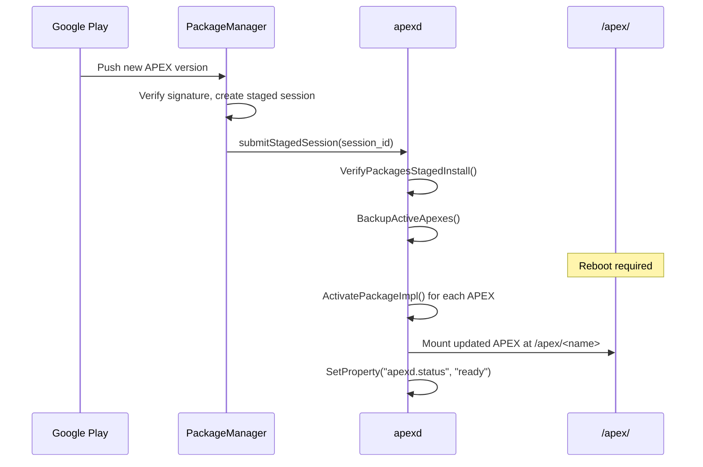

关键洞见在于 APEX 更新是*分阶段的*——它们在重启前被下载并验证，然后在下一
次启动期间原子地激活。如果激活失败，apexd 会回滚到预装版本。

---

## 54.2  APEX 格式

APEX 文件格式是 Project Mainline 的基石。它解决了 APK 无法解决的问题。该问
题是把**原生共享库**、**可执行文件**、**配置文件**和 **Java bootclasspath
片段**打包成单个经过签名和完整性验证的单元并进行更新。

### 54.2.1  为什么不能直接用 APK？

APK 是为 Dalvik/ART 应用设计的 ZIP 归档。它们携带 DEX 字节码、资源和原生库
（`lib/<abi>/`）。但它们缺少：

- 针对负载镜像的 **dm-verity 保护**。
- 允许内核将负载视为真实文件系统的**loop 设备挂载**。

- 在 zygote 启动之前的**启动时激活**。
- 替换 `libc++` 或 `libcrypto` 等平台级原生库的能力。

APEX 解决了所有这些问题。

### 54.2.2  文件结构

一个 APEX 文件（`.apex`）是一个包含以下内容的 ZIP 归档：

```
my_module.apex (ZIP)
+-- AndroidManifest.xml        # Standard APK manifest (for Play Store)
+-- apex_manifest.pb           # Protobuf: name, version, provideNativeLibs, ...
+-- apex_payload.img           # ext4/f2fs/erofs filesystem image
+-- apex_pubkey                # AVB public key (embedded for verification)
+-- META-INF/                  # JAR signing (v2/v3 APK signature)
```

关键组件是 `apex_payload.img`。这是一个真实的文件系统镜像——ext4、f2fs 或
erofs——包含模块的文件，其布局与挂载到 `/apex/<module_name>/` 时完全一致。

`system/apex/apexd/` 中的 `apex_file.cpp` 实现通过魔数识别全部三种文件系统
类型：

```cpp
// Source: system/apex/apexd/apex_file.cpp

constexpr const char* kImageFilename = "apex_payload.img";
constexpr const char* kCompressedApexFilename = "original_apex";
constexpr const char* kBundledPublicKeyFilename = "apex_pubkey";

struct FsMagic {
  const char* type;
  int32_t offset;
  int16_t len;
  const char* magic;
};
constexpr const FsMagic kFsType[] = {
    {"f2fs", 1024, 4, "\x10\x20\xf5\xf2"},
    {"ext4", 1024 + 0x38, 2, "\123\357"},
    {"erofs", 1024, 4, "\xe2\xe1\xf5\xe0"}
};
```

### 54.2.3  APEX 清单（Protobuf）

每个 APEX 都携带一个在 `system/apex/proto/apex_manifest.proto` 中定义的
protobuf 清单：

```protobuf
// Source: system/apex/proto/apex_manifest.proto

message ApexManifest {
  // Name used to mount under /apex/<name>
  string name = 1;

  // Version Number
  int64 version = 2;

  // Pre Install Hook
  string preInstallHook = 3;

  // Version Name
  string versionName = 5;

  // If true, apexd mounts with MS_NOEXEC
  bool noCode = 6;

  // Native libs provided to other APEXes or the platform
  repeated string provideNativeLibs = 7;

  // Native libs required from other APEXes or the platform
  repeated string requireNativeLibs = 8;

  // JNI libraries (used by linkerconfig/libnativeloader)
  repeated string jniLibs = 9;

  // Compressed APEX metadata
  CompressedApexMetadata capexMetadata = 12;

  // Can be updated without reboot
  bool supportsRebootlessUpdate = 13;

  // Whether activated in bootstrap phase
  bool bootstrap = 16;
}
```

`provideNativeLibs` 和 `requireNativeLibs` 字段尤为重要：它们允许 apexd 和链接
器配置系统在启动时构建正确的共享库命名空间。

### 54.2.4  压缩 APEX（CAPEX）

从 Android 11 开始，APEX 可以在系统分区上被**压缩**以节省空间。压缩后的
APEX 具有后缀 `.capex`，内部包含经过压缩的原始 APEX。启动时，apexd 将其解
压缩到 `/data/apex/decompressed/`：

```
// Source: system/apex/apexd/apex_constants.h

static constexpr const char* kApexDecompressedDir = "/data/apex/decompressed";
static constexpr const char* kCompressedApexPackageSuffix = ".capex";
static constexpr const char* kDecompressedApexPackageSuffix =
    ".decompressed.apex";
```

`ApexFile::IsCompressed()` 方法检测 APEX 是否被压缩，`ApexFile::Decompress()`
负责解压。

### 54.2.5  ApexFile 类

C++ `ApexFile` 类（`system/apex/apexd/apex_file.h`）是运行时操作 APEX 包的
主要抽象：

```cpp
// Source: system/apex/apexd/apex_file.h

class ApexFile {
 public:
  static android::base::Result<ApexFile> Open(const std::string& path);

  const std::string& GetPath() const { return apex_path_; }
  const std::optional<uint32_t>& GetImageOffset() const {
    return image_offset_;
  }
  const std::optional<size_t>& GetImageSize() const { return image_size_; }
  const ::apex::proto::ApexManifest& GetManifest() const {
    return manifest_;
  }
  const std::string& GetBundledPublicKey() const { return apex_pubkey_; }
  const std::optional<std::string>& GetFsType() const { return fs_type_; }

  android::base::Result<ApexVerityData> VerifyApexVerity(
      const std::string& public_key) const;
  bool IsCompressed() const { return is_compressed_; }
  android::base::Result<void> Decompress(
      const std::string& output_path) const;

 private:
  std::string apex_path_;
  std::optional<uint32_t> image_offset_;
  std::optional<size_t> image_size_;
  ::apex::proto::ApexManifest manifest_;
  std::string apex_pubkey_;
  std::optional<std::string> fs_type_;
  bool is_compressed_;
};
```

`ApexVerityData` 结构体携带了设置 dm-verity 所需的信息：

```cpp
// Source: system/apex/apexd/apex_file.h

struct ApexVerityData {
  std::unique_ptr<AvbHashtreeDescriptor> desc;
  std::string hash_algorithm;
  std::string salt;
  std::string root_digest;
};
```

`Open()` 工厂方法执行以下步骤：

1. 使用 `libziparchive` 将文件作为 ZIP 归档打开。
2. 读取 `apex_manifest.pb` 条目并解析 protobuf。
3. 读取 `apex_pubkey` 条目（AVB 公钥）。
4. 定位 `apex_payload.img` 条目并记录其在 ZIP 内的偏移量和大小。

5. 通过读取负载镜像中的魔数来检测文件系统类型。
6. 检查这是否为压缩 APEX（包含 `original_apex` 而非 `apex_payload.img`）。

```cpp
// Source: system/apex/apexd/apex_file.cpp (Open method, simplified)

Result<ApexFile> ApexFile::Open(const std::string& path) {
  // Open as ZIP archive
  ZipArchiveHandle handle;
  int ret = OpenArchiveFd(fd.get(), path.c_str(), &handle, false);

  // Try to find apex_payload.img
  ZipEntry entry;
  ret = FindEntry(handle, kImageFilename, &entry);
  if (ret == 0) {
    image_offset = entry.offset;
    image_size = entry.uncompressed_length;
    // Detect filesystem type (ext4, f2fs, erofs)
    fs_type = RetrieveFsType(fd, entry.offset);
  }

  // Read manifest
  FindEntry(handle, kManifestFilenamePb, &entry);
  // ... parse protobuf ...

  // Read public key
  FindEntry(handle, kBundledPublicKeyFilename, &entry);
  // ... read key ...

  return ApexFile(path, image_offset, image_size,
                  manifest, pubkey, fs_type, is_compressed);
}
```

### 54.2.6  签名

APEX 使用两层签名：

1. **负载签名（AVB）**：`apex_payload.img` 使用 `avbtool` 通过
  [Android Verified Boot](https://source.android.com/security/verifiedboot)
  进行签名。公钥作为 `apex_pubkey` 打包在 ZIP 内部。

2. **容器签名（APK Signature Scheme v2/v3）**：外层 ZIP 像普通 APK 一样签名，
   以便 Google Play 基础设施能够验证它。

构建系统使用 `apex_key` 模块类型定义密钥：

```
// Source: packages/modules/SdkExtensions/Android.bp

apex_key {
    name: "com.android.sdkext.key",
    public_key: "com.android.sdkext.avbpubkey",
    private_key: "com.android.sdkext.pem",
}

android_app_certificate {
    name: "com.android.sdkext.certificate",
    certificate: "com.android.sdkext",
}
```

`build/soong/apex/key.go` 中的 Soong 实现解析这些密钥：

```go
// Source: build/soong/apex/key.go

type apexKeyProperties struct {
    // Path or module to the public key file in avbpubkey format.
    Public_key *string `android:"path"`
    // Path or module to the private key file in pem format.
    Private_key *string `android:"path"`
}
```

密钥解析遵循一条回退链：首先是全局 apex 密钥目录（可配置），然后是本地模块
目录。

### 54.2.7  构建时构造：`apexer` 工具

`apexer` 工具（`system/apex/apexer/apexer.py`）是一个命令行实用程序，用于从
一个内容目录组装 APEX 文件：

```python
# Source: system/apex/apexer/apexer.py (line 16-20)

"""apexer is a command line tool for creating an APEX file, a package
format for system components.

Typical usage: apexer input_dir output.apex
"""
```

调用 `apexer` 的 Soong 构建规则定义在 `build/soong/apex/builder.go` 中：

```go
// Source: build/soong/apex/builder.go

apexRule = pctx.StaticRule("apexRule", blueprint.RuleParams{
    Command2: blueprint.NewCommand(
        android.Rm, ` -rf ${image_dir} && `, android.Mkdir, ` -p ${image_dir} && `,
        `(. ${out}.copy_commands) && `,
        `APEXER_TOOL_PATH=${tool_path} `,
        apexer, ` --force --manifest ${manifest} `,
        `--file_contexts ${file_contexts} `,
        `--canned_fs_config ${canned_fs_config} `,
        `--include_build_info `,
        `--payload_type image `,
        `--key ${key} ${opt_flags} ${image_dir} ${out} && `,
        android.SoongZip, ` -d -C ${image_dir} -D ${image_dir} -o ${image_zip}`,
    ),
    // ...
})
```

流程如下：

1. 收集所有原生库、二进制文件、Java 库和配置文件。
2. 将它们复制到暂存目录（`${image_dir}`）中。
3. 使用 `mke2fs`、`make_f2fs` 或 `mkfs.erofs` 创建文件系统镜像（ext4/f2fs/
   erofs）。

4. 使用 `avbtool` 对镜像签名。
5. 使用 `soong_zip` 将一切打包成 ZIP。
6. 使用 APK Signature Scheme 对 ZIP 签名。


### 54.2.8  Soong 中的 APEX 模块定义

`apex` 模块类型在 `build/soong/apex/apex.go` 中注册：

```go
// Source: build/soong/apex/apex.go

func registerApexBuildComponents(ctx android.RegistrationContext) {
    ctx.RegisterModuleType("apex", BundleFactory)
    ctx.RegisterModuleType("apex_test", TestApexBundleFactory)
    ctx.RegisterModuleType("apex_vndk", vndkApexBundleFactory)
    ctx.RegisterModuleType("apex_defaults", DefaultsFactory)
    ctx.RegisterModuleType("prebuilt_apex", PrebuiltFactory)
    ctx.RegisterModuleType("override_apex", OverrideApexFactory)
    ctx.RegisterModuleType("apex_set", apexSetFactory)
}
```

`Android.bp` 文件中典型的 APEX 定义如下所示：

```
// Source: packages/modules/SdkExtensions/Android.bp

apex {
    name: "com.android.sdkext",
    defaults: ["com.android.sdkext-defaults"],
    bootclasspath_fragments: ["com.android.sdkext-bootclasspath-fragment"],
    binaries: [
        "derive_classpath",
        "derive_sdk",
    ],
    prebuilts: [
        "current_sdkinfo",
        "extensions_db",
    ],
    manifest: "manifest.json",
}
```

`apex.go` 中的 `apexBundleProperties` 结构体公开了一整套可配置属性：

```go
// Source: build/soong/apex/apex.go (selected properties)

type apexBundleProperties struct {
    Manifest *string `android:"path"`
    AndroidManifest proptools.Configurable[string] `android:"path,..."`
    File_contexts *string `android:"path"`

    // Whether this APEX is updatable (default: true)
    Updatable *bool

    // Filesystem type: 'ext4', 'f2fs', or 'erofs' (default: 'ext4')
    Payload_fs_type *string

    // Marks future updatability without enabling it yet
    Future_updatable *bool

    // Whether this APEX can use platform APIs (only when updatable: false)
    Platform_apis *bool

    // Variant version of the mainline module (0-9)
    Variant_version *string
}
```

依赖属性允许 APEX 包含不同类型的内容：

```go
// Source: build/soong/apex/apex.go

type ApexNativeDependencies struct {
    Native_shared_libs proptools.Configurable[[]string]
    Jni_libs proptools.Configurable[[]string]
    Rust_dyn_libs []string
    Binaries proptools.Configurable[[]string]
    Tests []string
    Filesystems []string
    Prebuilts proptools.Configurable[[]string]
}
```

### 54.2.9  启动时激活：apexd 守护进程

`apexd` 守护进程（`system/apex/apexd/`）是负责在启动时激活 APEX 模块的系统
服务。它作为 `apexd.rc` 中定义的三种不同服务配置运行：

```
# Source: system/apex/apexd/apexd.rc

service apexd /system/bin/apexd
    interface aidl apexservice
    class core
    user root
    group system
    oneshot
    disabled
    reboot_on_failure reboot,apexd-failed
    capabilities CHOWN DAC_OVERRIDE DAC_READ_SEARCH FOWNER SYS_ADMIN MKNOD

service apexd-bootstrap /system/bin/apexd --bootstrap
    user root
    group system
    oneshot
    disabled
    reboot_on_failure reboot,bootloader,bootstrap-apexd-failed
    capabilities SYS_ADMIN MKNOD

service apexd-snapshotde /system/bin/apexd --snapshotde
    user root
    group system
    oneshot
    disabled
    capabilities CHOWN DAC_OVERRIDE DAC_READ_SEARCH FOWNER
```

三种服务配置分别服务于不同的阶段：

| 服务 | 阶段 | 用途 |
|---------|-------|---------|
| `apexd-bootstrap` | 早期启动 | 在 `/data` 之前挂载关键 APEX（runtime、tzdata、i18n） |
| `apexd` | `/data` 挂载后 | 挂载所有剩余 APEX，处理分阶段会话 |
| `apexd-snapshotde` | 激活后 | 快照/恢复 DE 数据以实现回滚安全 |

#### 启动时激活流程

`apexd.cpp` 中的 `MountPackageImpl` 函数实现了五步挂载过程：

```cpp
// Source: system/apex/apexd/apexd.cpp (MountPackageImpl)

// Steps to mount an APEX file:
//
// 1. create a mount point (directory)
// 2. create a block device for the payload part of the APEX
// 3. wrap it with a dm-verity device if the APEX is not on top of verity
//    device
// 4. mount the payload filesystem
// 5. verify the mount
```

步骤 2 创建支撑负载的块设备。从 Android 17 起，`MountPackageImpl` 按优先级
顺序选择三种策略之一。第一种是用于*pinned* APEX 的 `dm-linear` 设备。第二种
是**文件支撑的 EROFS 挂载**，完全跳过块设备。第三种是经典的 loop 设备：

```cpp
// Source: system/apex/apexd/apexd.cpp (MountPackageImpl)

if (UsesPinnedApex() && GetImageManager()->IsPinnedApex(apex)) {
    linear_dev = OR_RETURN(CreateDmLinearForPayload(apex));
    mount_device = linear_dev.GetDevPath();
} else if (IsFileBackedMountEnabled() && fs_type == "erofs" &&
           !mount_on_verity) {
    mount_options = std::format("fsoffset={}", *apex.GetImageOffset());
    mount_device = apex.GetPath();
#if COM_ANDROID_APEX_FLAGS_MICRODROID_NO_LOOP_DEVICE
} else if (instance.IsBlockApex(apex)) {
    linear_dev = OR_RETURN(CreateDmLinearForBlockApex(apex, device_name));
    mount_device = linear_dev.GetDevPath();
#endif
} else {
    loop = OR_RETURN(CreateLoopForApex(apex, loop_id));
    mount_device = loop.name;
}
```

EROFS 文件支撑分支是这里最重要的变化（详见 54.11 节）。当
`erofs_file_backed_mount` 标志打开，且预装的 EROFS APEX 不需要自己的
dm-verity 层时，此分支生效。此时 `apexd` 直接从 `.apex` 文件挂载负载。它
使用内核的 `fsoffset=` 挂载选项，不涉及 loop 设备。

步骤 3 使用 dm-verity 封装块设备以进行完整性验证。位于 dm-verity 保护分区
（如 `/system`）上的预装 APEX 可以跳过这一额外层：

```cpp
// Source: system/apex/apexd/apexd.cpp

const bool mount_on_verity = !instance.IsPreInstalledApex(apex) ||
                             instance.IsDecompressedApex(apex) ||
                             instance.IsBlockApex(apex);
```

#### dm-verity 表构造

`CreateVerityTable` 函数从 APEX 中嵌入的 AVB hashtree 描述符构造 device-mapper
verity 表：

```cpp
// Source: system/apex/apexd/apexd.cpp

std::unique_ptr<DmTable> CreateVerityTable(
    const ApexVerityData& verity_data,
    const std::string& block_device,
    bool restart_on_corruption) {
  AvbHashtreeDescriptor* desc = verity_data.desc.get();
  auto table = std::make_unique<DmTable>();

  const uint64_t start = 0;
  const uint64_t length = desc->image_size / 512;  // in sectors

  const std::string& hash_device = block_device;
  const uint32_t num_data_blocks =
      desc->image_size / desc->data_block_size;
  const uint32_t hash_start_block =
      desc->tree_offset / desc->hash_block_size;

  auto target = std::make_unique<DmTargetVerity>(
      start, length, desc->dm_verity_version,
      block_device, hash_device,
      desc->data_block_size, desc->hash_block_size,
      num_data_blocks, hash_start_block,
      verity_data.hash_algorithm,
      verity_data.root_digest,
      verity_data.salt);

  target->IgnoreZeroBlocks();
  if (restart_on_corruption) {
    target->SetVerityMode(kDmVerityRestartOnCorruption);
  }
  table->AddTarget(std::move(target));
  table->set_readonly(true);

  return table;
}
```

关键 dm-verity 参数：

- **数据块大小**和**哈希块大小**——通常各为 4096 字节。
- **哈希算法**——通常为 SHA-256。
- **根摘要**——链到所有数据块的顶层哈希。
- **盐值**——混入哈希计算的随机数据。
- **restart_on_corruption**——如果设置，内核在检测到 verity 损坏时会重启
  （而不是返回 I/O 错误）。

对于 `/system` 上的预装 APEX（它已经受 dm-verity 保护），额外的 dm-verity 层
会被跳过以避免双重验证开销。`/data` 上的已更新 APEX 总是会获得自己的
dm-verity 设备。

#### 文件系统挂载

dm-verity 设备创建完成后，负载以只读文件系统形式挂载：

```cpp
// Source: system/apex/apexd/apexd.cpp

// Step 4. Mount the payload filesystem at the mount point
uint32_t mount_flags = MS_NOATIME | MS_NODEV | MS_DIRSYNC | MS_RDONLY;
if (apex.GetManifest().nocode()) {
    mount_flags |= MS_NOEXEC;
}

if (mount(mount_device.c_str(), mount_point.c_str(), fs_type.c_str(),
          mount_flags, mount_options.c_str()) != 0) {
    return ErrnoError() << "Mounting failed for package " << full_path;
}
```

最后的 `mount_options` 参数正是文件支撑的 EROFS 路径向内核传递其 `fsoffset=`
值的方式。对于 loop 设备和 dm-linear 路径，它为空。

挂载标志强制以下行为：

- `MS_RDONLY`——只读（APEX 一旦激活即不可变）。
- `MS_NOATIME`——不更新访问时间（性能）。
- `MS_NODEV`——不允许设备节点。
- `MS_DIRSYNC`——同步目录更新。
- `MS_NOEXEC`——禁止执行（针对 `noCode` APEX，如 tzdata）。

挂载完成后，步骤 5 验证已挂载的镜像是否与清单匹配：

```cpp
// Source: system/apex/apexd/apexd.cpp

// Step 5. After mounting, verify the mounted image
auto status = VerifyMountedImage(apex, mount_point);
if (!status.ok()) {
    umount2(mount_point.c_str(), UMOUNT_NOFOLLOW);
    return Error() << "Failed to verify " << full_path;
}
```

`ActivatePackageImpl` 函数随后将最新版本 bind-mount 到
`/apex/<package_name>`：

```cpp
// Source: system/apex/apexd/apexd.cpp

Result<void> ActivatePackageImpl(const ApexFile& apex_file, ...) {
    // ...
    // Bind mount the latest version to /apex/<package_name>.
    auto st = gMountedApexes.DoIfLatest(
        manifest.name(), apex_file.GetPath(), [&]() -> Result<void> {
            return apexd_private::BindMount(
                apexd_private::GetActiveMountPoint(manifest), mount_point);
        });
    // ...
}
```

所有包激活完成后，apexd 设置系统属性以表示就绪状态：

```cpp
// Source: system/apex/apexd/apexd.cpp

void OnAllPackagesActivated() {
    LOG(INFO) << "Marking APEXd as activated";
    SetProperty(gConfig->apex_status_sysprop, kApexStatusActivated);
}

void OnAllPackagesReady() {
    LOG(INFO) << "Marking APEXd as ready";
    SetProperty(gConfig->apex_status_sysprop, kApexStatusReady);
    SetProperty(kApexAllReadyProp, "true");
}
```

其他服务可以等待这些属性：

```
// In an init .rc file:
on property:apexd.status=ready
    start my_service_that_needs_apex
```

下图展示了完整的启动时激活流程：

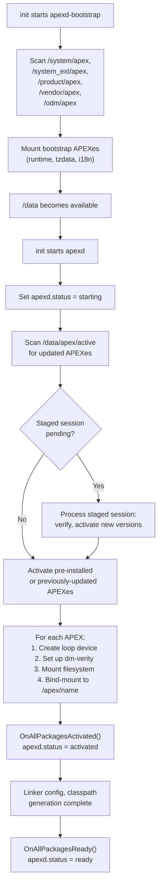

### 54.2.10  OnBootstrap 与 OnStart 生命周期

`apexd` 守护进程有两个主要入口点，对应两个启动阶段。理解这种拆分对于诊断
启动失败至关重要。

**阶段 1：OnBootstrap（在 /data 之前）**

```cpp
// Source: system/apex/apexd/apexd.cpp

int OnBootstrap() {
  ATRACE_NAME("OnBootstrap");
  auto time_started = boot_clock::now();

  ApexFileRepository& instance = ApexFileRepository::GetInstance();
  // Scan /system/apex, /system_ext/apex, /product/apex, /vendor/apex, /odm/apex
  if (auto st = AddPreinstalledData(instance); !st.ok()) {
    LOG(ERROR) << st.error();
    return 1;
  }

  ActivationContext ctx;
  std::vector<ApexFileRef> activation_list;

  if (IsMountBeforeDataEnabled()) {
    // New flow: wait for the /data block device, process sessions, scan data
    OR_RETURN(GetImageManager()->WaitForDataBlockDevice());
    ProcessSessions(ctx);
    auto data_apexes = ScanDataApexFiles(GetImageManager());
    instance.AddDataApexFiles(std::move(data_apexes));
    activation_list = instance.SelectApexForActivation();
  } else {
    // Legacy flow: only activate bootstrap APEXes
    const auto& pre_installed_apexes = instance.GetPreInstalledApexFiles();
    for (const auto& apex : pre_installed_apexes) {
      if (IsBootstrapApex(apex.get())) {
        LOG(INFO) << "Found bootstrap APEX " << apex.get().GetPath();
        activation_list.push_back(apex);
      }
    }
  }

  auto result = ActivateApexPackages(ctx, activation_list,
      ActivationMode::kBootstrapMode, ...);
  EmitApexInfoList(result.activated, /*is_bootstrap=*/true);
  LOG(INFO) << "OnBootstrap done, duration=" << time_elapsed;
  return 0;
}
```

Bootstrap APEX（清单中 `bootstrap: true` 的 APEX）必须在 `/data` 挂载之前就
可用，因为其他早期服务依赖它们。例如：

- `com.android.art`——运行时本身必须为 zygote 激活。
- `com.android.i18n`——文本处理需要 ICU 数据。
- `com.android.tzdata`——时钟显示需要时区数据。

**阶段 2：OnStart（在 /data 之后）**

```cpp
// Source: system/apex/apexd/apexd.cpp

void OnStart() {
  ATRACE_NAME("OnStart");
  LOG(INFO) << "Marking APEXd as starting";
  SetProperty(gConfig->apex_status_sysprop, kApexStatusStarting);

  // Check if filesystem checkpointing needs a rollback
  if (gSupportsFsCheckpoints) {
    Result<bool> needs_revert = gVoldService->NeedsRollback();
    if (needs_revert.ok() && *needs_revert) {
      LOG(INFO) << "Exceeded number of session retries. "
                << "Starting a revert";
      RevertActiveSessions("", "");
    }
  }

  // Activate remaining APEXes (the ones not in bootstrap)
  if (!IsMountBeforeDataEnabled()) {
    ActivateApexesOnStart();
  }

  // Snapshot or restore DE_sys data for rollback support
  SnapshotOrRestoreDeSysData();
  LOG(INFO) << "OnStart done, duration=" << time_elapsed;
}
```

`ActivateApexesOnStart()` 函数首先处理任何待处理的分阶段会话，然后扫描
`/data/apex/active/` 中的已更新 APEX，并激活每个模块的最佳版本：

```cpp
// Source: system/apex/apexd/apexd.cpp

void ActivateApexesOnStart() {
  ActivationContext ctx;
  // Process staged sessions first: revert or activate
  ProcessSessions(ctx);

  auto& instance = ApexFileRepository::GetInstance();
  // Scan /data/apex/active/ for updated APEXes
  instance.AddDataApex(gConfig->active_apex_data_dir);

  auto activate_status = ActivateApexPackages(
      ctx, instance.SelectApexForActivation(),
      ActivationMode::kBootMode,
      /*revert_on_error=*/true, /*fallback_on_error=*/true);
  EmitApexInfoList(activate_status.activated, /*is_bootstrap=*/false);
}
```

`SelectApexForActivation()` 方法比较预装和 data APEX，并为每个模块名称选择最
高版本。

**会话处理**

`ProcessSessions()` 函数处理待处理的分阶段会话：

```cpp
// Source: system/apex/apexd/apexd.cpp

void ProcessSessions(ActivationContext& ctx) {
  auto sessions = gSessionManager->GetSessions();

  if (sessions.empty()) {
    LOG(INFO) << "No sessions to revert/activate.";
    return;
  }

  // If there's any pending revert, revert active sessions.
  if (std::ranges::any_of(sessions, [](const auto& session) {
        return session.GetState() == SessionState::REVERT_IN_PROGRESS;
      })) {
    RevertActiveSessions("", "");
  } else {
    // Otherwise, activate STAGED sessions.
    ActivateStagedSessions(ctx, std::move(sessions));
  }
}
```

这是让 Mainline 更新能够在重启间工作的核心逻辑。会话在重启前被“分阶段”。
然后在下一次启动时，`ProcessSessions` 激活它。

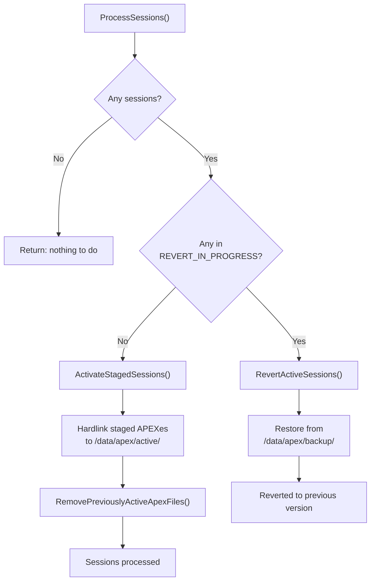

### 54.2.11  无需重启的更新路径

从 Android 13 开始，在清单中声明 `supportsRebootlessUpdate: true` 的 APEX 可以
在不重启设备的情况下更新。`installAndActivatePackage()` AIDL 方法实现了这一点：

1. 验证新的 APEX 包。
2. 从 init 卸载当前 APEX（停止服务，卸载 init 脚本）。
3. 卸载当前激活的 APEX。
4. 将新 APEX 硬链接到 `/data/apex/active/`。
5. 激活（挂载）新 APEX。
6. 将 APEX 重新加载到 init（重启服务，重新读取 init 脚本）。

```cpp
// Source: system/apex/apexd/apexd.cpp (rebootless update, simplified)

// 1. Unload from init
OR_RETURN(UnloadApexFromInit(module_name));

// Scope guard: reload from init whether we succeed or fail
auto reload_apex = android::base::make_scope_guard([&]() {
    LoadApexFromInit(module_name);
});

// 2. Unmount currently active APEX
OR_RETURN(UnmountPackage(*cur_apex, /*deferred=*/true, ...));

// 3. Hard-link new APEX to /data/apex/active/
link(package_path.c_str(), target_file.c_str());

// 4. Activate new APEX
ActivatePackageImpl(*new_apex, loop::kFreeLoopId, new_id, false);
```

这对于那些只包含配置数据或能够优雅地重启其服务的模块特别有用。

### 54.2.12  Brand-New APEX 支持

Android 16（Baklava）引入了 **brand-new APEX** 的概念——即使未预装，也能在
设备上安装的 APEX。这让 Google 可以通过 Play 更新将全新的模块添加到现有设备
上。在 Android 17 中，它仍然是将新模块（如 `com.android.npumanager` 和
`com.android.webapp`，两者均有 flag 门控）交付给未在出厂时预装它们的设备群
的后盾。

关键基础设施文件：

```cpp
// Source: system/apex/apexd/apex_constants.h

static constexpr const char* kBrandNewApexPublicKeySuffix = ".avbpubkey";
static constexpr const char* kBrandNewApexBlocklistFileName = "blocklist.json";
static constexpr const char* kBrandNewApexConfigSystemDir =
    "/system/etc/brand_new_apex";
```

每个分区都可以提供一个包含以下内容的配置目录：

- **公钥**（`.avbpubkey` 文件）——用于验证新 APEX 的受信任密钥。
- **黑名单**（`blocklist.json`）——不应安装的 APEX。

`ApexFileRepository` 处理 brand-new APEX 验证：

```cpp
// Source: system/apex/apexd/apexd.cpp (AddPreinstalledData)

if (ApexFileRepository::IsBrandNewApexEnabled()) {
    instance.AddBrandNewApexCredentialAndBlocklist(
        gConfig->brand_new_apex_config_dirs);
}
```

### 54.2.13  预构建 APEX 与 Deapexer

除了从源码构建 APEX 之外，构建系统还支持**预构建 APEX**。当某个模块在单独的
构建流水线中构建，且结果以二进制形式检入代码树时，这种情况很常见：

```go
// Source: build/soong/apex/prebuilt.go

var (
    extractMatchingApex = pctx.StaticRule(
        "extractMatchingApex",
        blueprint.RuleParams{
            Command2: blueprint.NewCommand(
                android.Rm, ` -rf "$out" && `,
                extract_apks, ` -o "${out}" -allow-prereleased=${allow-prereleased} `,
                `-sdk-version=${sdk-version} -skip-sdk-check=${skip-sdk-check} -abis=${abis} `,
                `-screen-densities=all -extract-single `,
                `${in}`,
            ),
        },
        "abis", "allow-prereleased", "sdk-version", "skip-sdk-check")
    decompressApex = pctx.StaticRule("decompressApex",
        blueprint.RuleParams{
            Command2: blueprint.NewCommand(
                android.Rm, ` -rf $out && `,
                deapexer, ` decompress --copy-if-uncompressed --input ${in} --output ${out}`,
            ),
        })
)
```

预构建 APEX 声明如下：

```
prebuilt_apex {
    name: "com.android.art",
    src: "com.android.art-arm64.apex",
    prefer: true,
}
```

有时构建系统需要预构建 APEX 的内容（例如，针对 bootclasspath 片段的 JAR 文
件进行编译）。这时它使用 `deapexer` 工具提取内容：

```bash
# Extract all contents
$ deapexer extract com.android.art.apex output_dir/

# List contents
$ deapexer list com.android.art.apex

# Get APEX info (name, version)
$ deapexer info com.android.art.apex
```

`deapexer` 工具在底层理解 APEX 格式。它打开 ZIP 并找到负载镜像。然后它挂载
或读取镜像（对 ext4 使用 `debugfs`，对 erofs 使用 `fsck.erofs`）并提取文件。

这种双向流程有两个部分。APEX 使用 `apexer` 构建，使用 `deapexer` 分解。该流
程支持模块化开发工作流，不同团队可以开发不同模块并通过预构建产物集成。

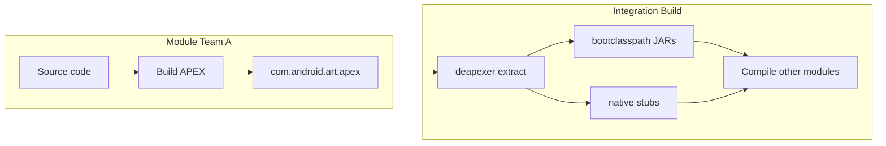

### 54.2.14  APEX 变异与变体

Soong 构建系统为包含在 APEX 中的所有模块创建 APEX 特定的变体。这由
`apexTransitionMutator` 处理：

```go
// Source: build/soong/apex/apex.go

func RegisterPostDepsMutators(ctx android.RegisterMutatorsContext) {
    ctx.BottomUp("apex_unique", apexUniqueVariationsMutator)
    ctx.BottomUp("mark_platform_availability",
        markPlatformAvailability)
    ctx.InfoBasedTransition("apex",
        android.NewGenericTransitionMutatorAdapter(
            &apexTransitionMutator{}))
}
```

该 mutator 为每个库创建独立的构建变体：一个用于平台，一个用于包含它的每个
APEX。APEX 变体可能具有不同的编译标志，尤其是：

- 不同的 `min_sdk_version` 限制。
- 不同的符号可见性（用于可更新模块中的 NDK 合规性）。
- 不同的链接行为（DCLA 的静态与动态）。

例如，`libc++` 可能具有：

- 链接系统 `libc` 的**平台变体**。
- 为 `min_sdk_version: 30` 编译的 **com.android.tethering 变体**。
- 为 `min_sdk_version: 31` 编译的 **com.android.art 变体**。

### 54.2.15  设备上的 APEX 目录布局

APEX 激活后，其内容在 `/apex/` 下可见：

```
/apex/
+-- apex-info-list.xml           # Metadata about all activated APEXes
+-- com.android.sdkext/          # Active (latest) version
|   +-- bin/
|   |   +-- derive_classpath
|   |   +-- derive_sdk
|   +-- etc/
|   |   +-- sdkinfo.pb
|   |   +-- extensions_db
|   +-- javalib/
|       +-- framework-sdkextensions.jar
+-- com.android.sdkext@370090000/ # Versioned mount point
+-- com.android.tethering/
+-- com.android.permission/
+-- ...
```

带版本的挂载点（`@<version>`）保留实际挂载的文件系统。不带版本的路径
（`/apex/com.android.sdkext/`）是一个指向最高版本挂载点的 bind 挂载。

### 54.2.16  APEX 分区位置

APEX 文件可以预装在多个分区上：

```cpp
// Source: system/apex/apexd/apex_constants.h

static constexpr const char* kApexPackageSystemDir = "/system/apex";
static constexpr const char* kApexPackageSystemExtDir = "/system_ext/apex";
static constexpr const char* kApexPackageProductDir = "/product/apex";
static constexpr const char* kApexPackageVendorDir = "/vendor/apex";
static constexpr const char* kApexPackageOdmDir = "/odm/apex";
```

已更新的 APEX（来自 Google Play 或 `adb install`）存储在：

```cpp
// Source: system/apex/apexd/apex_constants.h

static constexpr const char* kActiveApexPackagesDataDir = "/data/apex/active";
static constexpr const char* kApexBackupDir = "/data/apex/backup";
```

`ApexFileRepository` 类（`system/apex/apexd/apex_file_repository.h`）管理
预装 APEX 与已更新 APEX 之间的映射：

```cpp
// Source: system/apex/apexd/apex_file_repository.h

class ApexFileRepository final {
 public:
    static ApexFileRepository& GetInstance();

    // Populate from pre-installed directories
    android::base::Result<void> AddPreInstalledApex(
        const std::unordered_map<ApexPartition, std::string>&
            partition_to_prebuilt_dirs);

    // Query methods
    bool IsPreInstalledApex(const ApexFile& apex) const;
    bool IsDecompressedApex(const ApexFile& apex) const;
    bool IsBlockApex(const ApexFile& apex) const;
};
```

### 54.2.17  回滚与安全

如果已更新的 APEX 激活失败，apexd 支持回滚：

1. **备份**：在分阶段之前，`BackupActiveApexes()` 将当前激活的 APEX 复制到
   `/data/apex/backup/`。

2. **验证**：`VerifyPackagesStagedInstall()` 在任何激活之前验证签名和兼容性。

3. **检查点**：在支持文件系统检查点的设备上（通过 vold），整个 `/data` 状态
   都可以回滚。

4. **失败时回退**：如果触发 `reboot_on_failure`，下一次启动会跳过失败的更新并
   使用预装版本。

```cpp
// Source: system/apex/apexd/apexd.cpp (SubmitStagedSession)

OR_RETURN(BackupActiveApexes());
auto ret = OR_RETURN(
    OpenApexFilesInSessionDirs(session_id, child_session_ids));
auto result = OR_RETURN(VerifyPackagesStagedInstall(ret));
```

---

## 54.3  模块目录

AOSP 中的 `packages/modules/` 目录包含所有 Mainline 模块的源代码。每个模块通常
生成一个或多个 APEX 包。

### 54.3.1  完整模块清单

下表列出了截至 Android 17，`packages/modules/` 中每个生成 Mainline 产物的模
块目录。有两个目录被省略。共享的 `common` 目录存放每个模块使用的构建默认值和
工具。`vndk` 目录是遗留目录。对于每个模块，表格给出其 APEX 包名和它变得可更新
的 Android 版本。它还给出了模块所提供内容的摘要。

并非每个目录都生成 APEX。有些是 APK，有些是纯代码位置。Android 17 的新成员
（`NpuManager`、`WebApp`、`WebViewBootstrap`）由版本标志门控。

| # | 模块目录 | APEX 名称 | 发布版本 | 描述 |
|---|-----------------|-----------|--------|-------------|
| 1 | `AdServices` | `com.android.adservices` | T (13) | Privacy Sandbox：Topics、Attribution、FLEDGE |
| 2 | `AppSearch` | `com.android.appsearch` | T (13) | 设备端结构化搜索索引引擎 |
| 3 | `ArtPrebuilt` | `com.android.art` | S (12) | Android Runtime（ART）、DEX 编译器、核心库 |
| 4 | `Bluetooth` | `com.android.bt` | B (16) | 蓝牙协议栈（Gabeldorsche / Fluoride） |
| 5 | `CaptivePortalLogin` | *（Connectivity 中的 APK）* | R (11) | 强制门户检测与登录 UI |
| 6 | `CellBroadcastService` | `com.android.cellbroadcast` | R (11) | 紧急警报消息处理（CMAS/ETWS） |
| 7 | `ConfigInfrastructure` | `com.android.configinfrastructure` | U (14) | 设备配置框架（`DeviceConfig`） |
| 8 | `Connectivity` | `com.android.tethering` | R (11) | 网络共享、Connectivity、Cronet HTTP 协议栈 |
| 9 | `CrashRecovery` | `com.android.crashrecovery` | B (16) | 系统崩溃检测与恢复 |
| 10 | `DeviceLock` | `com.android.devicelock` | U (14) | 设备融资/锁定框架 |
| 11 | `DnsResolver` | `com.android.resolv` | Q (10) | DNS 解析（DNS-over-TLS、私有 DNS） |
| 12 | `ExtServices` | `com.android.extservices` | R (11) | 扩展服务（通知排序、自动填充） |
| 13 | `GenericBootstrappingArchitecture` | *（APK：`GbaService`）* | C (17) | GBA（Generic Bootstrapping Architecture）运营商认证服务 |
| 14 | `GeoTZ` | `com.android.geotz` | S (12) | 基于地理位置的时区检测 |
| 15 | `Gki` | *（代码位置，无 APEX）* | -- | GKI 支持代码（`libkver`、sysprops）；AOSP 中不再构建 APEX |
| 16 | `HealthFitness` | `com.android.healthfitness` | U (14) | Health Connect：健康/健身数据平台 |
| 17 | `IPsec` | `com.android.ipsec` | R (11) | IKEv2/IPsec VPN 框架 |
| 18 | `ImsMedia` | *（在 Telephony 中）* | T (13) | 用于 VoLTE/VoNR 的 IMS 媒体处理 |
| 19 | `ImsStack` | *（代码位置，无 APEX）* | -- | IMS 协议栈库（Java + 原生），不是 APEX |
| 20 | `IntentResolver` | *（APK）* | T (13) | Chooser/intent 解析 UI |
| 21 | `Media` | `com.android.media` / `com.android.media.swcodec` | Q (10) | 媒体框架、软件编解码器 |
| 22 | `ModuleMetadata` | *（APK）* | Q (10) | 模块元数据提供者 |
| 23 | `NetworkStack` | *（可更新的 APK）* | Q (10) | 网络连接评估、DHCP 客户端 |
| 24 | `NeuralNetworks` | `com.android.neuralnetworks` | R (11) | NNAPI 运行时和 HAL |
| 25 | `Nfc` | `com.android.nfcservices` | B (16) | NFC 协议栈和服务 |
| 26 | `NpuManager` | `com.android.npumanager` | C (17) | NPU 访问仲裁（flag 门控，`min_sdk 36`） |
| 27 | `OnDevicePersonalization` | `com.android.ondevicepersonalization` | T (13) | 设备端 ML 个性化框架 |
| 28 | `Permission` | `com.android.permission` | R (11) | 权限控制器、角色管理器、SafetyCenter |
| 29 | `Profiling` | `com.android.profiling` | B (16) | 系统性能分析基础设施 |
| 30 | `RemoteKeyProvisioning` | `com.android.rkpd` | U (14) | 用于 KeyStore 的远程密钥配置 |
| 31 | `RuntimeI18n` | `com.android.i18n` | Q (10) | ICU 国际化库 |
| 32 | `Scheduling` | `com.android.scheduling` | S (12) | 作业调度基础设施 |
| 33 | `SdkExtensions` | `com.android.sdkext` | R (11) | SDK 扩展版本管理 |
| 34 | `StatsD` | `com.android.os.statsd` | R (11) | 指标收集守护进程 |
| 35 | `Telecom` | `com.android.telecom` | B (16) | Telecom 通话管理框架（由 `RELEASE_TELECOM_MAINLINE_MODULE` 门控，尚不可更新） |
| 36 | `Telephony` | `com.android.telephonycore` | B (16) | 电话核心（通话/SMS 框架；由 `RELEASE_TELEPHONY_MODULE` 门控） |
| 37 | `ThreadNetwork` | `com.android.threadnetwork` | V (15) | Thread / Matter 智能家居网络 |
| 38 | `UprobeStats` | `com.android.uprobestats` | B (16) | 基于 eBPF 的 uprobe 统计收集 |
| 39 | `Uwb` | `com.android.uwb` | T (13) | 超宽带测距框架 |
| 40 | `Virtualization` | `com.android.virt` | T (13) | Android 虚拟化框架（pKVM、Microdroid） |
| 41 | `WebApp` | `com.android.webapp` | C (17) | 渐进式 Web 应用（PWA）安装/管理（flag 门控） |
| 42 | `WebViewBootstrap` | `com.android.webview.bootstrap` | V (15) | 预留 WebView 挂载点的空 bootstrap APEX |
| 43 | `Wifi` | `com.android.wifi` | R (11) | Wi-Fi 框架和服务 |
| 44 | `adb` | `com.android.adbd` | R (11) | Android Debug Bridge 守护进程 |
| 45 | `desktop` | *（代码位置）* | V (15) | 桌面窗口服务能力代码 |

关于此表中 Android 17 具体内容的几点说明：

- **`com.android.telephonycore`** 是 17 中唯一的 Telephony APEX。本章早先的草
  稿引用了单独的 `com.android.telephonymodules`；`packages/modules/Telephony/
  apex/Android.bp` 现在定义了一个单一的 `com.android.telephonycore` APEX，带有
  `com.android.telephony-*` classpath 片段。
- **`NpuManager`** 和 **`WebApp`** 是真正全新的 Android 17 模块。两者均由版本
  标志门控（`RELEASE_NPUMANAGER_MODULE`、`RELEASE_WEBAPP_MODULE`），并继承
  `b-launched-apex-module` 默认值（`min_sdk_version: "36"`）。`NpuManager`
  在第 53 章（NPU Manager）中有单独的介绍；`WebApp` 与包管理器交互（第 26
  章）。
- **`ImsStack`** 是一个代码位置（Java、原生库、标志），但不产生自己的 APEX；
  其输出由电话协议栈使用。
- **`GenericBootstrappingArchitecture`** 发布一个名为 `GbaService` 的
  `android_app`，而不是 APEX。

除了 `packages/modules/` 之外，代码树中还定义了其他几个 APEX 模块：

| APEX 名称 | 源代码位置 | 描述 |
|-----------|----------------|-------------|
| `com.android.media` | `frameworks/av/apex/` | 媒体框架（提取器、编解码器） |
| `com.android.media.swcodec` | `frameworks/av/apex/` | 软件编解码器进程 |
| `com.android.conscrypt` | `external/conscrypt/` | TLS/SSL 提供者（BoringSSL 封装） |
| `com.android.mediaprovider` | `packages/providers/MediaProvider/` | MediaStore 内容提供者 |
| `com.android.tzdata` | `system/timezone/` | 时区数据 |

### 54.3.2  按内容类型对模块分类

Mainline 模块可以按其主要内容分类：

**原生重型模块**（主要是 C/C++ 共享库和二进制文件）：

| 模块 | APEX 名称 | 关键原生组件 |
|--------|-----------|----------------------|
| DnsResolver | `com.android.resolv` | *（空的遗留 APEX；`libnetd_resolv.so` 现在随 `com.android.tethering` 发布）* |
| NeuralNetworks | `com.android.neuralnetworks` | NNAPI 运行时、HAL 客户端 |
| adb | `com.android.adbd` | `adbd` 二进制文件 |
| RuntimeI18n | `com.android.i18n` | ICU 库 |

**Java 重型模块**（主要是带有 bootclasspath/systemserver 贡献的 JAR 文件）：

| 模块 | APEX 名称 | 关键 Java 组件 |
|--------|-----------|-------------------|
| Permission | `com.android.permission` | `framework-permission.jar`、PermissionController 应用 |
| AppSearch | `com.android.appsearch` | `framework-appsearch.jar`、`service-appsearch.jar` |
| SdkExtensions | `com.android.sdkext` | `framework-sdkextensions.jar` |
| AdServices | `com.android.adservices` | Privacy Sandbox Java 框架 |
| ConfigInfrastructure | `com.android.configinfrastructure` | `framework-configinfrastructure.jar` |

**混合模块**（同时包含原生和 Java 组件）：

| 模块 | APEX 名称 | 关键混合组件 |
|--------|-----------|---------------------|
| Connectivity | `com.android.tethering` | `framework-connectivity.jar` + `libnetd_resolv.so`、`libnetd_updatable.so` |
| Media | `com.android.media` | `updatable-media.jar` + 媒体提取器（原生） |
| Wifi | `com.android.wifi` | `framework-wifi.jar` + 原生 HAL 桥接 |
| Bluetooth | `com.android.bt` | `framework-bluetooth.jar` + 原生协议栈 |
| Telephony | `com.android.telephonycore` | `framework-telephony.jar` + RIL 组件 |
| Virtualization | `com.android.virt` | VirtualizationService + 原生虚拟机监控支持 |

**纯数据模块**（带有 `noCode: true` 的配置/数据）：

| 模块 | APEX 名称 | 内容 |
|--------|-----------|---------|
| GeoTZ | `com.android.geotz` | 地理位置时区数据库 |
| tzdata | `com.android.tzdata` | IANA 时区数据 |

### 54.3.3  模块架构图

```mermaid
graph TB
    subgraph "Google Play System Updates"
        GP[Google Play Infrastructure]
    end

    subgraph "Mainline Modules (APEX)"
        direction LR
        subgraph "Networking"
            CONN["com.android.tethering<br/>Connectivity"]
            DNS["com.android.resolv<br/>DNS Resolver"]
            NET[NetworkStack]
            WIFI["com.android.wifi<br/>Wi-Fi"]
            NFC["com.android.nfcservices<br/>NFC"]
            UWB["com.android.uwb<br/>UWB"]
            THR["com.android.threadnetwork<br/>Thread"]
        end
        subgraph "Security & Privacy"
            PERM["com.android.permission<br/>Permission"]
            CONSCRYPT["com.android.conscrypt<br/>TLS/SSL"]
            IPSEC["com.android.ipsec<br/>IPsec"]
            ADS["com.android.adservices<br/>Ad Services"]
            RKP["com.android.rkpd<br/>Remote Key"]
        end
        subgraph "Runtime & Core"
            ART["com.android.art<br/>ART Runtime"]
            I18N["com.android.i18n<br/>ICU"]
            SDKEXT["com.android.sdkext<br/>SDK Extensions"]
            STATSD["com.android.os.statsd<br/>StatsD"]
        end
        subgraph "Media & ML"
            MEDIA["com.android.media<br/>Media"]
            SWCODEC["com.android.media.swcodec<br/>SW Codecs"]
            NNAPI["com.android.neuralnetworks<br/>Neural Networks"]
        end
        subgraph "Telephony"
            TCORE["com.android.telephonycore<br/>Telephony"]
            TELECOM["com.android.telecom<br/>Telecom"]
        end
    end

    GP --> CONN
    GP --> ART
    GP --> PERM
    GP --> MEDIA
    GP --> TCORE

    subgraph "apexd"
        APEXD[APEX Daemon]
    end

    APEXD --> |"mount /apex/..."| CONN
    APEXD --> |"mount /apex/..."| ART
    APEXD --> |"mount /apex/..."| PERM
```

### 54.3.4  深入剖析：Connectivity 模块

Connectivity 模块（`com.android.tethering`）是最复杂的 Mainline 模块之一。尽管
其 APEX 名称提到“tethering”，但它实际上涵盖整个连接协议栈：

```
// Source: packages/modules/Connectivity/Tethering/apex/Android.bp

apex {
    name: "com.android.tethering",
    defaults: [
        "ConnectivityApexDefaults",
        "CronetInTetheringApexDefaults",
        "r-launched-apex-module",
    ],
    compile_multilib: "both",
    bootclasspath_fragments: [
        "com.android.tethering-bootclasspath-fragment",
    ],
    systemserverclasspath_fragments: [
        "com.android.tethering-systemserverclasspath-fragment",
    ],
    multilib: {
        first: {
            jni_libs: [
                "libservice-connectivity",
                "libservice-thread-jni",
                // ...
            ],
            native_shared_libs: [
                "libnetd_resolv",
                "libnetd_updatable",
            ],
        },
        both: {
            native_shared_libs: [
                "libcom.android.tethering.connectivity_native",
            ],
            // ...
        },
    },
}
```

此模块中的关键组件：

- **网络共享服务**：USB、Wi-Fi、蓝牙和以太网网络共享
- **Connectivity 服务片段**：`framework-connectivity` 和
  `service-connectivity`

- **Cronet**：Google 的 HTTP 协议栈（可选捆绑）
- **clatd**：CLAT NAT64 转换器（原生二进制文件）
- **Thread Network**：IEEE 802.15.4 Thread 支持（JNI 库）
- **DNS 解析器**：`libnetd_resolv`——DNS 解析库，现在随此处发布，而非遗留的
  `com.android.resolv` APEX（见 54.3.8 节）

### 54.3.5  深入剖析：Permission 模块

Permission 模块管理运行时权限子系统：

```
// Source: packages/modules/Permission/Android.bp

apex {
    name: "com.android.permission",
    defaults: ["com.android.permission-defaults"],
    manifest: "apex_manifest.json",
}

apex_defaults {
    name: "com.android.permission-defaults",
    defaults: ["r-launched-apex-module"],
    // Indicates that pre-installed version can be compressed.
    // Actual compression is per-device.
    ...
}
```

此模块包含：

- **PermissionController**：管理权限授予的系统应用
- **Role Manager**：声明和分配默认应用的系统
- **Safety Center**：统一的安全与隐私仪表盘（Android 13+）

### 54.3.6  深入剖析：Virtualization 模块

Virtualization 模块（`com.android.virt`）因其条件构建配置而引人注目：

```
// Source: packages/modules/Virtualization/apex/Android.bp

virt_apex {
    name: "com.android.virt",
    soong_config_variables: {
        avf_enabled: {
            defaults: ["com.android.virt_avf_enabled"],
            conditions_default: {
                defaults: ["com.android.virt_avf_disabled"],
            },
        },
    },
}

apex_defaults {
    name: "com.android.virt_common",
    updatable: false,
    future_updatable: false,
    platform_apis: true,  // Can use non-public APIs
    ...
}
```

与大多数 Mainline 模块不同，Virtualization APEX 目前明确**不可更新**
（`updatable: false`），并使用 `platform_apis: true` 访问内部平台 API。它包含
pKVM（protected KVM）虚拟机监控支持、Microdroid 文件系统镜像以及
VirtualizationService。

### 54.3.7  深入剖析：StatsD 模块

StatsD 模块（`com.android.os.statsd`）是指标收集守护进程：

```
// Source: packages/modules/StatsD/apex/Android.bp

apex {
    name: "com.android.os.statsd",
    defaults: ["com.android.os.statsd-defaults"],
    manifest: "apex_manifest.json",
}

apex_defaults {
    name: "com.android.os.statsd-defaults",
    defaults: ["r-launched-apex-module"],
    ...
}
```

StatsD 负责：

- 收集系统指标（CPU、内存、电池、网络统计）。
- 处理来自应用和系统服务的指标订阅。
- 提供 `android.app.StatsManager` API。
- 将指标转发到服务器端分析流水线。

它在 R（Android 11）中的发布意义重大，因为它将一个核心平台服务移入了
Mainline 模块。这让 Google 无需完整的平台 OTA 即可修复指标收集 bug 并添加新的
atom 定义。

### 54.3.8  深入剖析：DnsResolver 模块

DNS 解析器是 Android 10 中最初的 Mainline 模块之一：

```
// Source: packages/modules/DnsResolver/apex/Android.bp

apex {
    name: "com.android.resolv",
    manifest: "manifest.json",
    key: "com.android.resolv.key",
    certificate: ":com.android.resolv.certificate",
    androidManifest: "AndroidManifest.xml",
    compressible: true,
    defaults: ["q-launched-dcla-enabled-apex-module"],
    // ...
}
```

注意缺失了什么：该定义完全没有声明 `native_shared_libs`、`binaries` 或
classpath 片段。`com.android.resolv` 如今是一个**空的遗留容器**。
`libnetd_resolv.so` 是处理设备上所有 DNS 解析的原生库。它随 Connectivity APEX
（`com.android.tethering`，54.3.4 节）发布。该 APEX 的 `native_shared_libs`
列表将 `libnetd_resolv` 与 `libnetd_updatable` 一起携带
（`packages/modules/Connectivity/Tethering/apex/Android.bp`）。因此，DNS 解析器
功能如今通过 Connectivity 模块更新：

- DNS-over-TLS（DoT）支持。
- DNS-over-HTTPS（DoH）支持。
- 私有 DNS 配置。
- DNS 缓存投毒漏洞的 bug 修复。

空的 `com.android.resolv` APEX 继续被构建和发布，以便随它发布的设备保留有效的
挂载点和更新路径。

### 54.3.9  深入剖析：Profiling 模块

Profiling 模块在 Baklava 中发布，展示了一个带有条件启用的现代模块定义：

```
// Source: packages/modules/Profiling/apex/Android.bp

apex {
    enabled: select(
        release_flag("RELEASE_PACKAGE_PROFILING_MODULE"), {
            true: true,
            false: false,
        }),

    name: "com.android.profiling",
    manifest: "manifest.json",
    key: "com.android.profiling.key",
    certificate: ":com.android.profiling.certificate",
    defaults: ["b-launched-apex-module"],

    binaries: ["trace_redactor"],

    bootclasspath_fragments: [
        "com.android.profiling-bootclasspath-fragment"
    ],
    systemserverclasspath_fragments: [
        "com.android.profiling-systemserverclasspath-fragment"
    ],
}
```

显著方面：

- **条件构建**：使用 `select(release_flag(...))` 基于版本标志启用/禁用，允
  许将模块从某些构建配置中排除。

- **原生二进制文件**：包含 `trace_redactor`，一个用于从系统跟踪中编辑 PII 的
  工具。

- **两个 classpath 片段**：同时贡献到启动 classpath 和系统服务器 classpath。

- **B 发布**：使用 `b-launched-apex-module` 默认值，即
  `min_sdk_version: "36"`。

### 54.3.10  深入剖析：adb 模块

ADB 守护进程模块因使用 DCLA（Dynamic Common Lib APEX）而引人注目：

```
// Source: packages/modules/adb/apex/Android.bp

apex {
    name: "com.android.adbd",
    defaults: [
        "com.android.adbd-defaults",
        "r-launched-dcla-enabled-apex-module",
    ],
    ...
}
```

借助 DCLA，adb APEX 可以与
其他 APEX 共享通用库，而不是捆绑自己的副本。这减少了设备上总的存储占用。

### 54.3.11  跨版本发布周期的模块生命周期

下图展示了 Mainline 模块数量如何在各个 Android 版本中增长：

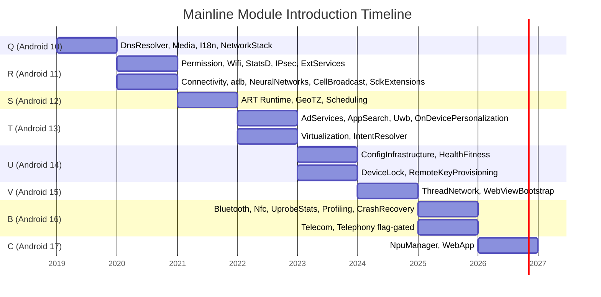

### 54.3.12  深入剖析：Media 模块

Media 模块拆分为在 `frameworks/av/apex/` 中定义的两个 APEX：

```
// Source: frameworks/av/apex/Android.bp

apex {
    name: "com.android.media",
    manifest: "manifest.json",
    defaults: ["com.android.media-defaults"],
    ...
}

apex {
    name: "com.android.media.swcodec",
    manifest: "manifest_codec.json",
    defaults: ["com.android.media.swcodec-defaults"],
    ...
}
```

- `com.android.media`——主媒体 APEX。它包含提取器、媒体框架服务以及
  bootclasspath 上的 `updatable-media.jar`。它的 bootclasspath 片段列出了
  `contents: ["updatable-media"]`。`framework-media` 是 `updatable-media` 所
  提供 API 的 stubs 库。

- `com.android.media.swcodec`——一个用于软件编解码器的独立进程（通过
  `mediaswcodec` 服务隔离以保障安全）。

这种分离是一项安全措施：软件编解码器 bug（通常由不受信任的媒体文件触发）被
限制在一个单独的、沙箱化的进程中。

---

## 54.4  SDK Extensions

### 54.4.1  问题：运行时的 API 可用性

Mainline 模块独立于平台进行更新。这意味着运行 Android 12（S）的设备可能拥有
一个 R 时代的模块或一个更新得多的模块。应用如何知道哪些 API 实际上可用？

传统的 `Build.VERSION.SDK_INT` 检查告诉你的是*平台*版本，但对*模块*版本却一
无所知。**SDK Extensions** 机制填补了这一空白。

### 54.4.2  工作原理

每个 Android 版本都定义了一个**扩展版本**——一个整数，随着该“训练”中的模块
一起更新而递增。该版本在启动时由 `derive_sdk` 二进制文件派生，后者检查已安装
模块的实际版本。

`derive_sdk` 进程：

1. 从每个已挂载的 APEX（位于 `/apex/<name>/etc/sdkinfo.pb`）读取
   `sdkinfo.pb`。
2. 读取 `extensions_db`（一个版本要求的 protobuf 数据库）。
3. 对于每个扩展（R、S、T、U、V、B、C、ad_services），计算满足所有模块要求
   的最高版本。

4. 设置系统属性：`build.version.extensions.r`、`.s`、`.t`、...、`.c`。

```cpp
// Source: packages/modules/SdkExtensions/derive_sdk/derive_sdk.cpp

static const std::unordered_map<std::string, SdkModule> kApexNameToModule = {
    {"com.android.adservices", SdkModule::AD_SERVICES},
    {"com.android.appsearch", SdkModule::APPSEARCH},
    {"com.android.art", SdkModule::ART},
    {"com.android.configinfrastructure", SdkModule::CONFIG_INFRASTRUCTURE},
    {"com.android.conscrypt", SdkModule::CONSCRYPT},
    {"com.android.extservices", SdkModule::EXT_SERVICES},
    {"com.android.healthfitness", SdkModule::HEALTH_FITNESS},
    {"com.android.ipsec", SdkModule::IPSEC},
    {"com.android.media", SdkModule::MEDIA},
    {"com.android.mediaprovider", SdkModule::MEDIA_PROVIDER},
    {"com.android.neuralnetworks", SdkModule::NEURAL_NETWORKS},
    {"com.android.ondevicepersonalization", SdkModule::ON_DEVICE_PERSONALIZATION},
    {"com.android.permission", SdkModule::PERMISSIONS},
    {"com.android.scheduling", SdkModule::SCHEDULING},
    {"com.android.sdkext", SdkModule::SDK_EXTENSIONS},
    {"com.android.os.statsd", SdkModule::STATSD},
    {"com.android.tethering", SdkModule::TETHERING},
};
```

每个扩展训练都关联一组模块：

```cpp
// Source: packages/modules/SdkExtensions/derive_sdk/derive_sdk.cpp

static const std::unordered_set<SdkModule> kRModules = {
    SdkModule::CONSCRYPT,      SdkModule::EXT_SERVICES,
    SdkModule::IPSEC,          SdkModule::MEDIA,
    SdkModule::MEDIA_PROVIDER, SdkModule::PERMISSIONS,
    SdkModule::SDK_EXTENSIONS, SdkModule::STATSD,
    SdkModule::TETHERING,
};

static const std::unordered_set<SdkModule> kSModules = {
    SdkModule::ART, SdkModule::SCHEDULING
};

static const std::unordered_set<SdkModule> kTModules = {
    SdkModule::AD_SERVICES, SdkModule::APPSEARCH,
    SdkModule::ON_DEVICE_PERSONALIZATION
};

static const std::unordered_set<SdkModule> kUModules = {
    SdkModule::CONFIG_INFRASTRUCTURE, SdkModule::HEALTH_FITNESS
};

static const std::unordered_set<SdkModule> kVModules = {};

static const std::unordered_set<SdkModule> kBModules = {SdkModule::NEURAL_NETWORKS};

static const std::unordered_set<SdkModule> kCModules = {};
```

Android 17 为新的“C”扩展训练添加了 `kCModules` 集合。目前它是空的。C 轴存在
的意义在于*未来*的模块更新可以声明针对“Android 17 及以上”的 API。但目前没有
模块单独推进 C 扩展。V 也遵循同样的模式（`kVModules` 过去是、现在仍然是空的）。

### 54.4.3  版本派生算法

`GetSdkLevel` 函数确定所有要求都得到满足的最高扩展版本：

```cpp
// Source: packages/modules/SdkExtensions/derive_sdk/derive_sdk.cpp

int GetSdkLevel(const ExtensionDatabase& db,
                const std::unordered_set<SdkModule>& relevant_modules,
                const std::unordered_map<SdkModule, int>& module_versions) {
  int max = 0;
  for (const auto& ext_version : db.versions()) {
    if (ext_version.version() > max &&
        VersionRequirementsMet(ext_version, relevant_modules,
                               module_versions)) {
      max = ext_version.version();
    }
  }
  return max;
}
```

而 `VersionRequirementsMet` 逐一检查每个模块：

```cpp
// Source: packages/modules/SdkExtensions/derive_sdk/derive_sdk.cpp

bool VersionRequirementsMet(
    const ExtensionVersion& ext_version,
    const std::unordered_set<SdkModule>& relevant_modules,
    const std::unordered_map<SdkModule, int>& module_versions) {
  for (const auto& requirement : ext_version.requirements()) {
    if (relevant_modules.find(requirement.module()) ==
        relevant_modules.end())
      continue;

    auto version = module_versions.find(requirement.module());
    if (version == module_versions.end()) return false;
    if (version->second < requirement.version().version())
      return false;
  }
  return true;
}
```

算法：对于每个扩展级别（R、S、T、...），遍历数据库中定义的所有版本。对于每
个版本号，检查每个所需模块是否都满足最低版本阈值。通过的最高版本号即成为扩
展级别。

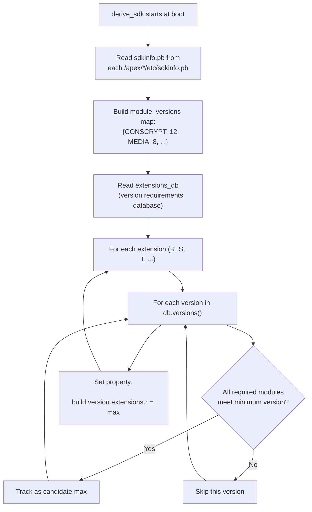

### 54.4.4  Java API：SdkExtensions 类

应用通过 `android.os.ext.SdkExtensions` 查询扩展版本：

```java
// Source: packages/modules/SdkExtensions/java/android/os/ext/SdkExtensions.java

public class SdkExtensions {
    public static final int AD_SERVICES = 1_000_000;

    private static final int R_EXTENSION_INT;
    private static final int S_EXTENSION_INT;
    private static final int T_EXTENSION_INT;
    private static final int U_EXTENSION_INT;
    private static final int V_EXTENSION_INT;
    private static final int B_EXTENSION_INT;
    private static final int C_EXTENSION_INT;          // Android 17
    private static final int AD_SERVICES_EXTENSION_INT;

    static {
        R_EXTENSION_INT = SystemProperties.getInt(
            "build.version.extensions.r", 0);
        S_EXTENSION_INT = SystemProperties.getInt(
            "build.version.extensions.s", 0);
        T_EXTENSION_INT = SystemProperties.getInt(
            "build.version.extensions.t", 0);
        U_EXTENSION_INT = SystemProperties.getInt(
            "build.version.extensions.u", 0);
        V_EXTENSION_INT = SystemProperties.getInt(
            "build.version.extensions.v", 0);
        B_EXTENSION_INT = SystemProperties.getInt(
            "build.version.extensions.b", 0);
        C_EXTENSION_INT = SystemProperties.getInt(
            "build.version.extensions.c", 0);
        AD_SERVICES_EXTENSION_INT = SystemProperties.getInt(
            "build.version.extensions.ad_services", 0);
    }

    /**
     * Return the version of the specified extensions.
     *
     * Example:
     *   if (getExtensionVersion(VERSION_CODES.R) >= 3) {
     *       // Safely use API available since R extensions version 3
     *   }
     */
    public static int getExtensionVersion(@Extension int extension) {
        if (extension < VERSION_CODES.R) {
            throw new IllegalArgumentException(
                "not a valid extension: " + extension);
        }
        if (extension == VERSION_CODES.R) return R_EXTENSION_INT;
        if (extension == VERSION_CODES.S) return S_EXTENSION_INT;
        if (extension == VERSION_CODES.TIRAMISU) return T_EXTENSION_INT;
        if (extension == VERSION_CODES.UPSIDE_DOWN_CAKE) return U_EXTENSION_INT;
        if (extension == VERSION_CODES.VANILLA_ICE_CREAM) return V_EXTENSION_INT;
        if (extension == VERSION_CODES.BAKLAVA) return B_EXTENSION_INT;
        if (extension == VERSION_CODES.CINNAMON_BUN) return C_EXTENSION_INT;
        if (extension == AD_SERVICES) return AD_SERVICES_EXTENSION_INT;
        return 0;
    }

    public static Map<Integer, Integer> getAllExtensionVersions() {
        return ALL_EXTENSION_INTS;
    }
}
```

### 54.4.5  在应用代码中使用扩展版本

应用开发者的典型模式：

```java
import android.os.Build;
import android.os.ext.SdkExtensions;

// Check if a T-extensions API (added in extension version 5) is available
if (Build.VERSION.SDK_INT >= Build.VERSION_CODES.TIRAMISU &&
    SdkExtensions.getExtensionVersion(Build.VERSION_CODES.TIRAMISU) >= 5) {
    // Safe to use the API
    useNewTiramisuApi();
}
```

`@RequiresExtension` 注解（来自 AndroidX）使这更加符合人体工学：

```java
@RequiresExtension(extension = Build.VERSION_CODES.TIRAMISU, version = 5)
public void useNewTiramisuApi() {
    // ...
}
```

### 54.4.6  实例演示：扩展版本如何计算

让我们逐步看一个 `derive_sdk` 计算 R 扩展版本的具体例子。

**输入**：`extensions_db` 包含以下（简化的）条目：

```
version: 5
requirements:
  - module: CONSCRYPT,       min_version: 10
  - module: MEDIA,           min_version: 8
  - module: PERMISSIONS,     min_version: 12
  - module: TETHERING,       min_version: 6

version: 6
requirements:
  - module: CONSCRYPT,       min_version: 11
  - module: MEDIA,           min_version: 9
  - module: PERMISSIONS,     min_version: 14
  - module: TETHERING,       min_version: 7
```

**已安装的模块版本**（来自每个 APEX 中的 `sdkinfo.pb`）：

```
CONSCRYPT: 12
MEDIA: 9
PERMISSIONS: 14
TETHERING: 6
```

**评估**：

对于版本 5：

- CONSCRYPT 12 >= 10 -- 通过
- MEDIA 9 >= 8 -- 通过
- PERMISSIONS 14 >= 12 -- 通过
- TETHERING 6 >= 6 -- 通过
- **全部满足：版本 5 是一个候选。**

对于版本 6：

- CONSCRYPT 12 >= 11 -- 通过
- MEDIA 9 >= 9 -- 通过
- PERMISSIONS 14 >= 14 -- 通过
- TETHERING 6 >= 7 -- **失败**（6 &lt; 7）
- **并非全部满足：版本 6 被拒绝。**

**结果**：R 扩展版本 = 5。

版本为 6 的 TETHERING 模块不满足扩展版本 6 所需的最低要求 7。假设 Google 推送
一个 Connectivity 模块更新，将 TETHERING 提升到版本 7 或更高。那么 R 扩展版本
将在下一次重启时自动推进到 6。

这一机制确保应用可以信任扩展版本检查。如果
`SdkExtensions.getExtensionVersion(R) >= 6`，那么 R 训练中的*所有*模块都达到
或高于所需版本。此外，R 扩展 6 中引入的所有 API 都可用。

### 54.4.7  Ad Services 扩展

Ad Services 扩展是一个特殊情况。它有自己的独立扩展轨道
（`AD_SERVICES = 1_000_000`）。原因是 Privacy Sandbox API 的演进节奏与平台扩
展不同：

```java
// Source: packages/modules/SdkExtensions/java/android/os/ext/SdkExtensions.java

public static final int AD_SERVICES = 1_000_000;

// In the static initializer:
AD_SERVICES_EXTENSION_INT = SystemProperties.getInt(
    "build.version.extensions.ad_services", 0);

if (SdkLevel.isAtLeastT()) {
    extensions.put(AD_SERVICES, AD_SERVICES_EXTENSION_INT);
}
```

使用 Privacy Sandbox API 的应用会检查：

```java
if (SdkExtensions.getExtensionVersion(SdkExtensions.AD_SERVICES) >= 4) {
    // Safe to use Ad Services API from extension version 4
}
```

### 54.4.8  SdkExtensions APEX

SdkExtensions 模块本身打包为一个 APEX：

```
// Source: packages/modules/SdkExtensions/Android.bp

apex {
    name: "com.android.sdkext",
    defaults: ["com.android.sdkext-defaults"],
    bootclasspath_fragments: [
        "com.android.sdkext-bootclasspath-fragment"
    ],
    binaries: [
        "derive_classpath",
        "derive_sdk",
    ],
    prebuilts: [
        "current_sdkinfo",
        "extensions_db",
    ],
    manifest: "manifest.json",
}
```

它捆绑了：

- `derive_sdk`——启动时计算扩展版本的二进制文件。
- `derive_classpath`——一个二进制文件，根据已安装模块的 classpath 片段生成
  `BOOTCLASSPATH`、`DEX2OATBOOTCLASSPATH` 和 `SYSTEMSERVERCLASSPATH` 环境变
  量。

- `extensions_db`——版本要求的 protobuf 数据库。
- `framework-sdkextensions.jar`——Java API（`SdkExtensions` 类）。

`extensions_db` 的源代码位于
`packages/modules/SdkExtensions/gen_sdk/extensions_db.textpb`。在 Android 17
中，定义的最高扩展是**版本 22**。大多数模块都固定在此版本（ART、Conscrypt、
Media、MediaProvider、Permissions、StatsD、Tethering、AppSearch、
OnDevicePersonalization、ConfigInfrastructure、HealthFitness、NeuralNetworks
等）。

有两个模块冻结在当前基线之下。`gen_sdk/gen_sdk.py` 在其 `skipped_modules`
集合中列出了 `AD_SERVICES` 和 `EXT_SERVICES`，将两者保持在版本 20。AdServices
在 20 之后终止。ExtServices 在 20 之后不再需要。

### 54.4.9  扩展版本生命周期

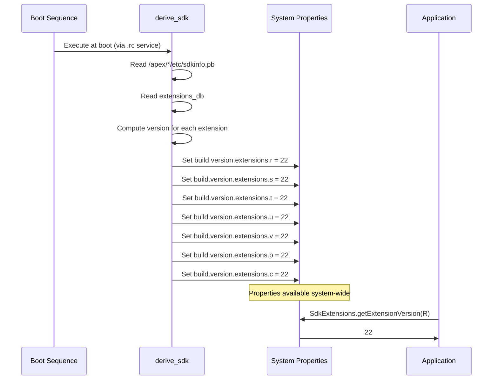

---

## 54.5  模块边界

Mainline 模块必须与平台以及其他模块共存，同时保持严格的接口边界。本节说明规
管哪些内容可以、哪些内容不能进入模块的规则。

### 54.5.1  `apex_available` 属性

每个想要被包含在 APEX 中的库、二进制文件或应用都必须声明它可用于哪些 APEX：

```go
// Source: build/soong/android/apex.go

type ApexProperties struct {
    // Availability of this module in APEXes. Only the listed APEXes
    // can contain this module.
    //
    // "//apex_available:anyapex" matches any APEX.
    // "//apex_available:platform" refers to non-APEX partitions.
    // Prefix pattern (com.foo.*) can match any APEX with that prefix.
    // Default is ["//apex_available:platform"].
    Apex_available []string
}
```

例如，一个应同时可用于平台和 Connectivity APEX 的库会声明：

```
cc_library {
    name: "libnetutils",
    apex_available: [
        "//apex_available:platform",
        "com.android.tethering",
    ],
}
```

构建系统强制规定：除非模块的 `apex_available` 列表允许，否则该模块不能被包含
在 APEX 中。这防止了意外的依赖膨胀，并确保清晰的归属关系。

### 54.5.2  API 表面层级

Mainline 模块通过精心定义的 API 表面与平台及彼此交互。Soong 中的
`java_sdk_library` 模块类型生成多个 API 作用域：

```go
// Source: build/soong/java/sdk_library.go

apiScopePublic = initApiScope(&apiScope{
    name: "public",
    sdkVersion: "current",
    kind: android.SdkPublic,
})

apiScopeSystem = initApiScope(&apiScope{
    name: "system",
    annotation: "android.annotation.SystemApi(
        client=android.annotation.SystemApi.Client.PRIVILEGED_APPS)",
    kind: android.SdkSystem,
})

apiScopeModuleLib = initApiScope(&apiScope{
    name: "module-lib",
    annotation: "android.annotation.SystemApi(
        client=android.annotation.SystemApi.Client.MODULE_LIBRARIES)",
    kind: android.SdkModule,
})

apiScopeSystemServer = initApiScope(&apiScope{
    name: "system-server",
    annotation: "android.annotation.SystemApi(
        client=android.annotation.SystemApi.Client.SYSTEM_SERVER)",
    kind: android.SdkSystemServer,
})
```

这些映射到五个不同的 API 表面：

| 表面 | 注解 | 谁可以使用 |
|---------|-----------|---------------|
| **Public** | （无） | 任何应用（稳定、经过 CTS 测试） |
| **System** | `@SystemApi(PRIVILEGED_APPS)` | 特权应用和系统服务 |
| **Module-lib** | `@SystemApi(MODULE_LIBRARIES)` | 仅限其他 Mainline 模块 |
| **System-server** | `@SystemApi(SYSTEM_SERVER)` | 仅限系统服务器进程 |
| **Test** | `@TestApi` | CTS 和其他测试套件 |

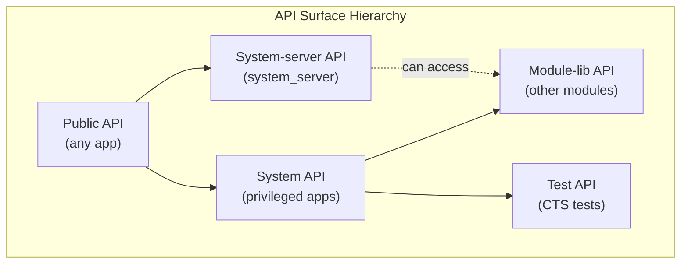

### 54.5.3  隐藏 API 强制

未标注上述任何标记的 API 被视为**隐藏 API**。Mainline 模块与普通应用一样受隐藏
API 强制约束：

- 构建系统通过 bootclasspath 片段定义中的 `hidden_api` 语句来跟踪隐藏 API。

- 在运行时，`libnativeloader` 和 ART 基于调用模块的 API 级别强制访问限制。

一个 bootclasspath 片段声明它拥有哪些包及其隐藏 API 标志：

```
bootclasspath_fragment {
    name: "com.android.permission-bootclasspath-fragment",
    contents: ["framework-permission"],
    apex_available: ["com.android.permission"],
    hidden_api: {
        split_packages: ["*"],
        // annotation flags, metadata, index files
    },
}
```

### 54.5.4  模块中可以包含什么

一个 Mainline 模块（APEX）可以包含：

| 内容类型 | 构建模块类型 | 属性 |
|-------------|------------------|----------|
| 原生共享库 | `cc_library` | `native_shared_libs` |
| 原生可执行文件 | `cc_binary` | `binaries` |
| JNI 库 | `cc_library`（带有 `is_jni: true`） | `jni_libs` |
| Java 库 | `java_library` | `java_libs` |
| Bootclasspath 片段 | `bootclasspath_fragment` | `bootclasspath_fragments` |
| 系统服务器片段 | `systemserverclasspath_fragment` | `systemserverclasspath_fragments` |
| Android 应用（APK） | `android_app` | `apps` |
| Shell 脚本 | `sh_binary` | `sh_binaries` |
| 配置文件 | `prebuilt_etc` | `prebuilts` |
| Rust 动态库 | `rust_library` | `rust_dyn_libs` |
| 文件系统镜像 | `android_filesystem` | `filesystems` |
| 运行时资源覆盖 | `runtime_resource_overlay` | `rros` |
| 兼容配置文件 | `platform_compat_config` | `compat_configs` |

### 54.5.5  模块中不能包含什么

并非所有内容都可以模块化。以下约束适用：

1. **内核模块**——内核代码通过 GKI 更新，而不是 APEX。
2. **HAL 实现**——HAL 是供应商特定的；它们使用 VINTF 清单，不属于 Mainline
   （尽管存在 vendor APEX）。

3. **启动关键的 init 脚本**——最早期的 init 阶段必须在没有任何 APEX 挂载的
   情况下也能工作。

4. **SELinux 策略**——基础策略随平台发布；模块只贡献其自身挂载点的
   `file_contexts`。

5. **来自 framework-res 的资源**——核心框架资源不在 APEX 中（尽管覆盖是可能
   的）。

### 54.5.6  模块依赖与 `min_sdk_version`

每个 APEX 声明一个决定以下内容的 `min_sdk_version`：

- 该 APEX 可以安装的最低平台版本。
- 模块的原生代码可以使用哪些 NDK/SDK API。

`packages/modules/common/sdk/Android.bp` 文件为每个发布窗口定义了标准默认值。
最低支持的 `min_sdk_version` 本身在 Android 17 中是一个版本标志决策。
`APEX_LOWEST_MIN_SDK_VERSION` 默认为 `"30"`（R），但在设置
`RELEASE_DEPRECATE_MAINLINE_R_SUPPORT` 时会切换为 `"31"`（S）。这反映了对
R 时代模块支持的逐步淘汰：

```
// Source: packages/modules/common/sdk/Android.bp

APEX_LOWEST_MIN_SDK_VERSION = select(
    release_flag("RELEASE_DEPRECATE_MAINLINE_R_SUPPORT"), {
        true: "31",
        default: "30",
    })

apex_defaults {
    name: "r-launched-apex-module",
    defaults: ["any-launched-apex-modules"],
    min_sdk_version: APEX_LOWEST_MIN_SDK_VERSION,
}

apex_defaults {
    name: "s-launched-apex-module",
    defaults: ["any-launched-apex-modules"],
    min_sdk_version: "31",
    compressible: true,
}

apex_defaults {
    name: "t-launched-apex-module",
    defaults: ["any-launched-apex-modules"],
    min_sdk_version: "Tiramisu",
    compressible: true,
}

apex_defaults {
    name: "u-launched-apex-module",
    defaults: ["any-launched-apex-modules"],
    min_sdk_version: "UpsideDownCake",
    compressible: true,
}

apex_defaults {
    name: "v-launched-apex-module",
    defaults: ["any-launched-apex-modules"],
    min_sdk_version: "VanillaIceCream",
    compressible: true,
}

apex_defaults {
    name: "b-launched-apex-module",
    defaults: ["any-launched-apex-modules"],
    min_sdk_version: "36",
    compressible: true,
}
```

截至 Android 17，最高的发布窗口默认值仍然是 `b-launched-apex-module`
（`min_sdk_version: "36"`）。还没有 `c-launched-apex-module`。因此 Android 17
的新成员 `NpuManager` 和 `WebApp` 都继承 `b-launched` 默认值。

所有可更新的 APEX 都继承自 `any-launched-apex-modules`：

```
// Source: packages/modules/common/sdk/Android.bp

apex_defaults {
    name: "any-launched-apex-modules",
    updatable: true,
}
```

这设置了 `updatable: true`，从而触发额外的构建时检查：

- 所有原生依赖必须使用稳定的 NDK API。
- 所有 Java 依赖必须使用 `sdk_version: "module_current"` 或更低版本。
- 对共享库强制执行符号版本化。

### 54.5.7  动态通用库 APEX（DCLA）

一些模块使用 **DCLA**（Dynamic Common Lib APEX）策略在多个 APEX 之间共享原
生库，而不重复它们：

```
// Source: packages/modules/common/sdk/Android.bp

DCLA_MIN_SDK_VERSION = "31"

library_linking_strategy_apex_defaults {
    name: "r-launched-dcla-enabled-apex-module",
    defaults: ["r-launched-apex-module"],
    soong_config_variables: {
        library_linking_strategy: {
            prefer_static: {},
            conditions_default: {
                min_sdk_version: DCLA_MIN_SDK_VERSION,
            },
        },
    },
}
```

当 DCLA 启用时，像 `libc++` 和 `libcrypto` 这样的共享库从共享位置加载，而
不是在每个 APEX 中重复。这减少了设备上的存储占用，但共享库加载基础设施需要
API 级别 31+。

### 54.5.8  跨模块依赖

模块可以通过以下方式相互依赖：

1. **provideNativeLibs / requireNativeLibs**——在 APEX 清单中声明，这些允许一
   个 APEX 导出另一个 APEX 导入的原生库。

2. **java_sdk_library**——提供其他模块编译所依赖的稳定 Java API stubs。

3. **稳定 AIDL**——用于不同模块中服务之间的 IPC。

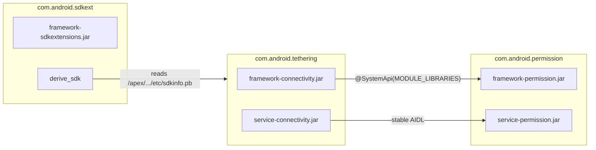

### 54.5.9  `apex_available` 强制机制

构建系统在 Soong 模块图层面强制 `apex_available`。`build/soong/android/apex.go`
中的 `ApexModule` 接口定义了该契约：

```go
// Source: build/soong/android/apex.go

type ApexModule interface {
    // Returns true if this module is available in any APEX
    InAnyApex() bool

    // Returns true if the module is NOT available to the platform
    NotInPlatform() bool

    // Tests if this module can have APEX variants
    CanHaveApexVariants() bool

    // Tests if installable as a file in an APEX
    IsInstallableToApex() bool

    // Tests availability for a specific APEX or ":platform"
    AvailableFor(what string) bool

    // Returns the list of APEXes this module is available for
    ApexAvailableFor() []string

    // Returns the min SDK version the module supports
    MinSdkVersionSupported(ctx BaseModuleContext) ApiLevel
}
```

当 APEX 定义引用某个库（例如 `native_shared_libs: ["libfoo"]`）时，构建系统：

1. 通过 `apexTransitionMutator` 为 `libfoo` 创建 APEX 变体。
2. 检查 `libfoo` 的 `apex_available` 列表是否包含该 APEX 名称。
3. 验证 `libfoo` 的 `min_sdk_version` 是否与该 APEX 兼容。
4. 传递性地检查 `libfoo` 的所有依赖。

如果任何检查失败，构建会中止，并给出清晰的错误消息，指明哪个模块违反了边界。

### 54.5.10  链接器命名空间配置

当 APEX 激活时，其原生库需要自己的链接器命名空间，以避免与平台库和其他 APEX
冲突。`linkerconfig` 工具根据激活的 APEX 动态生成命名空间配置。

每个 APEX 的 `apex_manifest.pb` 声明：

- `provideNativeLibs`——该 APEX 导出给其他模块的库。
- `requireNativeLibs`——该 APEX 从其他模块需要的库。

链接器配置确保：

- APEX 内部的库可以互相看见。
- 来自平台的库只能通过平台命名空间访问。

- 跨 APEX 库共享遵循显式的 `provideNativeLibs` / `requireNativeLibs` 声明。

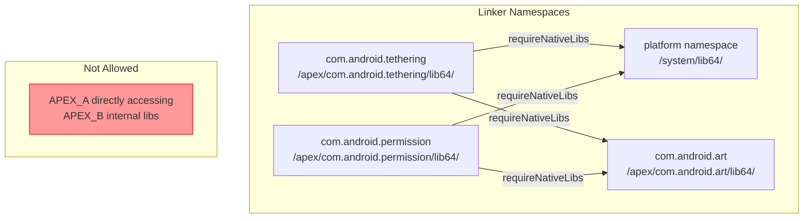

### 54.5.11  Bootclasspath 和系统服务器 classpath

包含 Java 的 Mainline 模块通过 **bootclasspath 片段**和
**systemserverclasspath 片段**参与启动 classpath。这些片段定义了模块中哪些
JAR 文件应被添加到 classpath 中。

一个 bootclasspath 片段声明：

```
bootclasspath_fragment {
    name: "com.android.tethering-bootclasspath-fragment",
    contents: [
        "framework-connectivity",
        "framework-connectivity-t",
    ],
    apex_available: ["com.android.tethering"],
    hidden_api: {
        split_packages: ["*"],
        // ...
    },
}
```

在启动时，`derive_classpath` 二进制文件（来自 SdkExtensions 模块）读取激活的
APEX 并生成：

- `BOOTCLASSPATH`——用于启动类加载器的 JAR 列表。
- `DEX2OATBOOTCLASSPATH`——由 dex2oat 预编译的子集。
- `SYSTEMSERVERCLASSPATH`——加载到系统服务器进程中的 JAR。

这种动态生成至关重要，因为激活的模块集合会随着更新而改变，而 classpath 必
须始终反映实际安装的内容。

---

## 54.6  模块开发

### 54.6.1  构建 Mainline 模块

构建特定模块：

```bash
# Build a single APEX
$ m com.android.tethering

# Build all Mainline modules (phony target in packages/modules/common/build/)
$ m aosp_mainline_modules

# Build a module and install it on a connected device
$ m com.android.sdkext && adb install out/target/product/generic_arm64/system/apex/com.android.sdkext.apex
```

### 54.6.2  模块构建的结构

一个完整的模块定义通常涉及：

1. **APEX 定义**（模块 `apex/` 目录中的 `Android.bp`）
2. **APEX 密钥**（`apex_key` 模块）
3. **证书**（`android_app_certificate` 模块）
4. **Bootclasspath 片段**（针对包含 Java 的模块）
5. **系统服务器 classpath 片段**（针对含系统服务器代码的模块）
6. **框架库**（通常为 `java_sdk_library`）
7. **服务实现**（通常为 `java_library`）

以下是使用 SdkExtensions 模块作为示例的最小结构：

```
packages/modules/SdkExtensions/
+-- Android.bp                    # APEX definition + key + certificate
+-- manifest.json                 # APEX manifest (JSON, converted to protobuf)
+-- com.android.sdkext.avbpubkey  # AVB public key
+-- com.android.sdkext.pem        # AVB private key
+-- com.android.sdkext.pk8        # Container signing private key
+-- com.android.sdkext.x509.pem   # Container signing certificate
+-- derive_sdk/
|   +-- derive_sdk.cpp            # Boot-time binary
|   +-- derive_sdk.rc             # init service definition
+-- java/
|   +-- android/os/ext/
|       +-- SdkExtensions.java    # Public API
+-- gen_sdk/                      # SDK version database generation
+-- javatests/                    # Tests
```

### 54.6.3  从零创建新模块

如果你想创建一个新的 Mainline 模块，步骤如下：

**步骤 1：生成签名密钥。**

```bash
# Generate AVB key pair
$ openssl genrsa -out com.android.mymodule.pem 4096
$ avbtool extract_public_key --key com.android.mymodule.pem \
    --output com.android.mymodule.avbpubkey

# Generate container signing key
$ development/tools/make_key com.android.mymodule \
    '/CN=com.android.mymodule'
```

**步骤 2：编写 Android.bp。**

```
apex {
    name: "com.android.mymodule",
    defaults: ["v-launched-apex-module"],  // launched in V
    manifest: "apex_manifest.json",
    key: "com.android.mymodule.key",
    certificate: ":com.android.mymodule.certificate",
    bootclasspath_fragments: [
        "com.android.mymodule-bootclasspath-fragment",
    ],
    native_shared_libs: ["libmymodule"],
    java_libs: ["mymodule-java-lib"],
}

apex_key {
    name: "com.android.mymodule.key",
    public_key: "com.android.mymodule.avbpubkey",
    private_key: "com.android.mymodule.pem",
}

android_app_certificate {
    name: "com.android.mymodule.certificate",
    certificate: "com.android.mymodule",
}
```

**步骤 3：编写 APEX 清单。**

```json
{
    "name": "com.android.mymodule",
    "version": 1
}
```

**步骤 4：创建 SELinux file contexts。**

```
# system/sepolicy/apex/com.android.mymodule-file_contexts
(/.*)?       u:object_r:system_file:s0
/bin(/.*)?   u:object_r:mymodule_exec:s0
/lib(64)?(/.*)?  u:object_r:system_lib_file:s0
```

**步骤 5：在所有依赖中声明 apex_available。**

```
cc_library {
    name: "libmymodule",
    srcs: ["mymodule.cpp"],
    apex_available: [
        "com.android.mymodule",
    ],
    min_sdk_version: "VanillaIceCream",
}
```

### 54.6.4  测试 Mainline 模块

#### CTS（兼容性测试套件）

CTS 测试验证设备在已安装的模块版本下行为正确。许多模块特定的 CTS 测试与模块源
码放在一起：

```
packages/modules/SdkExtensions/javatests/
+-- com/android/os/ext/SdkExtensionsTest.java
+-- com/android/sdkext/extensions/SdkExtensionsHostTest.java
```

#### MTS（Mainline 测试套件）

MTS 是 CTS 的一个子集，专门用于测试 Mainline 模块更新。它可以独立运行：

```bash
# Run the module's CTS/MTS test cases
$ atest CtsSdkExtensionsTestCases

# Or target the Google-signed mainline APEX variant explicitly
$ atest 'CtsSdkExtensionsTestCases[com.google.android.sdkext.apex]'

# Host-side end-to-end tests
$ atest sdkextensions_e2e_tests
```

#### 单元测试

各个模块组件都有自己的单元测试：

```bash
# Run apexd unit tests
$ atest apex_file_test
$ atest apex_manifest_test
$ atest apex_database_test
$ atest apex_file_repository_test

# Run derive_sdk tests
$ atest derive_sdk_test
```

#### TEST_MAPPING

模块使用 `TEST_MAPPING` 文件声明哪些测试应在预提交和后提交期间运行：

```json
{
    "presubmit": [
        {"name": "CtsSdkExtensionsTestCases"},
        {"name": "derive_sdk_test"},
        {"name": "gen_sdk_test"}
    ],
    "presubmit-large": [
        {"name": "sdkextensions_e2e_tests"}
    ]
}
```

### 54.6.5  在设备上安装与更新

**安装本地构建的 APEX：**

```bash
$ adb install --staged out/target/product/generic_arm64/system/apex/com.android.sdkext.apex
$ adb reboot
```

APEX 需要 `--staged` 标志，因为它们需要重启才能激活（除非该 APEX 通过清单中的
`supportsRebootlessUpdate` 支持无需重启的更新）。

**回滚到预装版本：**

没有用于此目的的 `cmd apexservice` 子命令——shell 接口只接受 `help`、
`getAllPackages`、`getActivePackages` 和 `getStagedSessionInfo [sessionId]`。
回滚通过 binder 方法 `IApexService.revertActiveSessions()` 进行，由平台的回滚
机制调用。从 shell 出发，请改用包管理器的回滚支持：

```bash
$ adb shell pm rollback-app com.android.sdkext
$ adb reboot
```

**检查已安装的 APEX 版本：**

```bash
$ adb shell pm list packages --apex-only --show-versioncode
package:com.android.adbd versionCode:370090000
package:com.android.art versionCode:370090000
package:com.android.conscrypt versionCode:370090000
package:com.android.i18n versionCode:370090000
package:com.android.media versionCode:370090000
package:com.android.media.swcodec versionCode:370090000
package:com.android.os.statsd versionCode:370090000
package:com.android.permission versionCode:370090000
package:com.android.resolv versionCode:370090000
package:com.android.sdkext versionCode:370090000
package:com.android.tethering versionCode:370090000
package:com.android.wifi versionCode:370090000
...
```

（在 Android 17 trunk-staging 构建上，版本码以 `370…` 开头。在较旧的构建上，
开头的 SDK 段更低，例如 Tiramisu 时代镜像上的 `340…`。）

**检查已挂载的 APEX：**

```bash
$ adb shell ls /apex/com.android.sdkext/
bin/
etc/
javalib/

$ adb shell cat /apex/apex-info-list.xml
```

**查询扩展版本：**

```bash
$ adb shell getprop build.version.extensions.r
22
$ adb shell getprop build.version.extensions.s
22
$ adb shell getprop build.version.extensions.t
22
$ adb shell getprop build.version.extensions.c
22
```

### 54.6.6  调试 APEX 问题

**检查 apexd 日志：**

```bash
$ adb logcat -s apexd
$ adb logcat -s apexd-bootstrap
```

**检查 APEX 数据库：**

```bash
# List all activated APEXes
$ adb shell cmd -w apexservice getActivePackages

# List every known APEX (active and inactive)
$ adb shell cmd -w apexservice getAllPackages

# Show the state of a staged session
$ adb shell cmd -w apexservice getStagedSessionInfo 1543

# For per-APEX details, read the info list or use deapexer on the file
$ adb shell cat /apex/apex-info-list.xml
```

**从主机检查 APEX 文件内容：**

```bash
$ deapexer list com.android.sdkext.apex
$ deapexer extract com.android.sdkext.apex output_dir/
```

**检查 SELinux 上下文：**

```bash
$ adb shell ls -Z /apex/com.android.sdkext/
$ adb shell ls -Z /apex/com.android.sdkext/bin/
```

### 54.6.7  分阶段会话与更新工作流

Mainline 模块更新的完整生命周期：

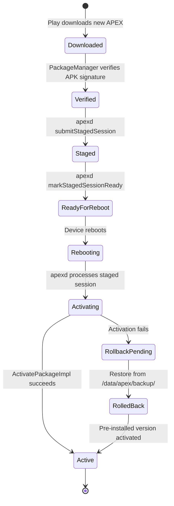

### 54.6.8  APEX 构建流水线（完整）

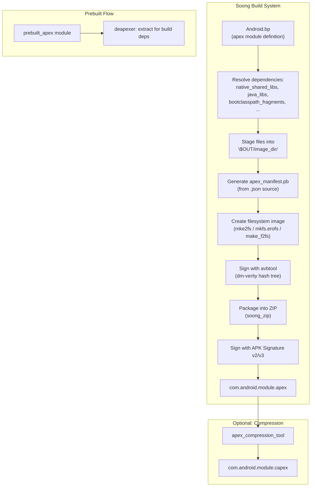

### 54.6.9  APEX 服务接口（AIDL）

`apexd` 守护进程公开一个 AIDL 服务接口，`PackageManager` 和其他系统组件使用它
来管理 APEX 包。关键方法包括：

```
// Source: system/apex/apexd/aidl (simplified interface)

interface IApexService {
    void submitStagedSession(in ApexSessionParams params,
                             out ApexInfoList packages);
    void markStagedSessionReady(int session_id);
    void markStagedSessionSuccessful(int session_id);
    ApexSessionInfo getStagedSessionInfo(int session_id);
    void markBootCompleted();
    ApexInfo[] getActivePackages();
    ApexInfo[] getAllPackages();
    ApexInfo installAndActivatePackage(in @utf8InCpp String packagePath,
                                       boolean force);
    void revertActiveSessions();
}
```

`installAndActivatePackage` 方法是无需重启更新的入口点。它验证调用者（必须是
system 或 root）、验证包，并执行 54.2.11 节中描述的激活步骤。

### 54.6.10  持续集成与模块测试

Mainline 模块遵循严格的测试流水线：

**预提交（代码落地之前）：**

1. 单元测试（在 `TEST_MAPPING` 中指定）。
2. 构建验证（模块必须干净构建）。
3. API 兼容性检查（对稳定 API 无破坏性变更）。

**后提交（代码落地之后）：**

1. MTS（Mainline 测试套件）在多种设备类型上运行。
2. CTS（兼容性测试套件）用于行为验证。
3. 性能基准测试以捕获回归。

**模块发布之前：**

1. 在目标设备上完整通过 MTS。
2. 向内部设备进行 dogfood 部署。
3. 分阶段发布（1%、5%、25%、50%、100%）。
4. 监控崩溃率、ANR 率和指标异常。

### 54.6.11  处理模块中的 API 演进

当 Mainline 模块添加新 API 时，流程如下：

1. 添加带有适当注解的 API（`@SystemApi`、`@TestApi` 等）。
2. 更新 API 表面文件（`current.txt` / `system-current.txt`）。
3. 运行 `m update-api` 重新生成 API 跟踪文件。
4. 为新 API 添加 CTS 测试。
5. 如果该 API 应按扩展版本门控，则将模块添加到 `derive_sdk.cpp` 中相应的扩
   展训练中。

例如，如果为 T 扩展训练在版本 5 向 Permission 模块添加了新 API，则
`extensions_db` 会被更新。它会要求一个最低的 Permission 模块版本，其中包含
该新 API。

### 54.6.12  调试构建失败

Mainline 模块常见的构建问题：

**`apex_available` 违规：**

```
error: "libfoo" is not available for "com.android.mymodule"
    Add "com.android.mymodule" to apex_available of "libfoo"
```

修复：将 APEX 名称添加到该库的 `apex_available` 属性。

**`min_sdk_version` 违规：**

```
error: "libfoo" with min_sdk_version "current" cannot be used
    in "com.android.mymodule" with min_sdk_version "30"
```

修复：在依赖库上设置具体的 `min_sdk_version`。

**可更新模块限制：**

```
error: "com.android.mymodule" is updatable but references "libbar"
    which uses unstable platform APIs
```

修复：确保所有依赖都使用稳定 API 级别（NDK、SDK stubs）。

### 54.6.13  模块版本策略

在源码层面，APEX 只是在其 `apex_manifest.pb` 中携带一个 `int64 version`（见
54.2.3 节），而 `SelectApexForActivation()` 总是偏好较大的数字。AOSP 构建用
平台构建号为此打上戳。因此，一个本地构建的 APEX 报告的版本码类似于
`370090000`，对应 Android 17（`bp1a` 风格）trunk-staging 构建。

Google 发布的已发布训练版本码遵循结构化的 `XYYZZZNNN` 约定，因此更新的训练总
是排序更高。该约定有四个段：训练类型的前导数字、平台 SDK 段、递增的构建段，
以及尾部的变体段（release 与 development）。

应用此编码的是训练构建工具，而不是 AOSP 的 `apexer`。在 Android 17 中，该工具
移入了新的 `tools/mainline/train_build/` 仓库（`versioning_action.py` 提升版本
码，`pack_action.py` 打包结果——见 54.10 节）。前导 SDK 段随每个平台版本推进。
因此，Android 17 训练总是排名高于同模块的 Android 16 训练。这正是 Play Store
更新机制所需要的。

---

## 54.7  深入剖析：HealthFitness（Health Connect）

HealthFitness 模块（`com.android.healthfitness`）提供 **Health Connect** 平
台——一个集中的、设备端的健康与健身数据仓库。它允许来自不同发布者的应用（健
身追踪器、睡眠监测器、医疗应用）通过统一的 API 共享健康记录，并带有细粒度的、
按数据类型的权限。

### 54.7.1  模块结构

```
packages/modules/HealthFitness/
    apex/               APEX packaging & bootclasspath fragment
    apk/                HealthConnectController (Settings UI)
    backuprestore/      HealthConnectBackupRestore (cloud B&R agent)
    framework/          Public API (android.health.connect.*)
    service/            System server implementation
    flags/              Feature flags (aconfig)
    lint/               Custom lint checks
    testapps/           Development toolbox app
    tests/              CTS, unit, and integration tests
```

该 APEX 捆绑了两个 APK，加上框架和系统服务器 JAR：

```
// Source: packages/modules/HealthFitness/apex/Android.bp

apex {
    name: "com.android.healthfitness",
    apps: [
        "HealthConnectBackupRestore",
        "HealthConnectController",
    ],
    bootclasspath_fragments: [
        "com.android.healthfitness-bootclasspath-fragment"
    ],
    systemserverclasspath_fragments: [
        "com.android.healthfitness-systemserverclasspath-fragment"
    ],
    min_sdk_version: "34",
    updatable: true,
}
```

### 54.7.2  架构概览

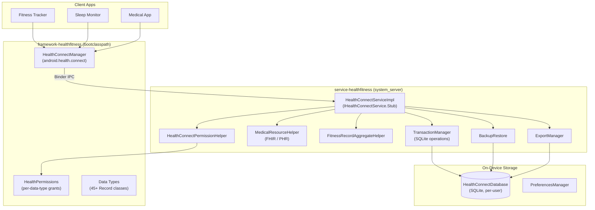

### 54.7.3  数据类型

Health Connect 在 `android.health.connect.datatypes` 包中定义了**超过 45 种记
录类型**（46 个具体类）。每个记录类都继承自两个基类之一：

| 基类 | 语义 | 示例 |
|------------|-----------|---------|
| `InstantRecord` | 单时间点测量 | `RestingHeartRateRecord`、`BloodPressureRecord`、`BloodGlucoseRecord`、`OxygenSaturationRecord`、`BodyTemperatureRecord` |
| `IntervalRecord` | 时间范围内的测量 | `StepsRecord`、`HeartRateRecord`（样本序列）、`ExerciseSessionRecord`、`SleepSessionRecord`、`NutritionRecord`、`HydrationRecord`、`DistanceRecord` |

数据类型跨越由 `HealthDataCategory` 定义的八个类别——六个稳定的加上两个受标
志门控的新增项：

1. **Activity**——步数、距离、卡路里、锻炼会话、骑行节奏、爬楼层数、海拔增
   加、锻炼路线。

2. **身体测量**——体重、身高、体脂、骨量、去脂体重、基础代谢率、身体水分质
   量。

3. **周期追踪**——月经流量、宫颈粘液、排卵测试、经间期出血、性行为。

4. **营养**——营养记录（按营养素细分）、水合、餐食类型。

5. **睡眠**——带有各阶段细分的睡眠会话（清醒、浅睡、深睡、REM）。

6. **生命体征**——心率、心率变异性（RMSSD）、血压、血糖、血氧饱和度、呼吸频
   率、体温。

7. **健康**——正念会话（由 `FLAG_MINDFULNESS` 门控）。

8. **症状**——症状追踪（由 `FLAG_SYMPTOMS` 门控）。

每条记录都携带 `Metadata`（数据来源、设备信息、客户端记录 ID、最后修改时
间），以支持去重和优先级排序。

### 54.7.4  个人健康记录（FHIR）支持

近期版本中的一项重要扩展是**个人健康记录**（PHR）API，它支持使用 **FHIR R4**
标准存储临床医疗数据：

```java
// Source: framework/java/android/health/connect/CreateMedicalDataSourceRequest.java
// Source: framework/java/android/health/connect/UpsertMedicalResourceRequest.java
// (data types: framework/java/android/health/connect/datatypes/
//  MedicalResource.java, MedicalDataSource.java, FhirResource.java)

// Apps create a MedicalDataSource, then upsert FHIR resources:
CreateMedicalDataSourceRequest request =
    new CreateMedicalDataSourceRequest.Builder(
        Uri.parse("https://fhir.hospital.example"),
        "Hospital Portal",
        FhirVersion.parseFhirVersion("4.0.1"))
        .build();

UpsertMedicalResourceRequest upsert =
    new UpsertMedicalResourceRequest.Builder(
        dataSourceId,
        FhirVersion.parseFhirVersion("4.0.1"),
        fhirJsonString)
        .build();
```

PHR 数据需要 `WRITE_MEDICAL_DATA` 权限，并使用服务 JAR 中捆绑的二进制
protobuf 规范，对照 FHIR R4 规范进行结构验证。

### 54.7.5  权限模型

Health Connect 使用两级权限系统：

**按数据类型的权限**——每种记录类型在 `HealthPermissions` 中定义了读权限和写
权限：

```
android.permission.health.READ_HEART_RATE
android.permission.health.WRITE_HEART_RATE
android.permission.health.READ_STEPS
android.permission.health.WRITE_STEPS
android.permission.health.READ_SLEEP
...
```

**超出按数据类型集合的额外权限**（级别如 `apk/HealthPermissionsManifest.xml`
中所声明）：

| 权限 | 级别 | 用途 |
|-----------|-------|---------|
| `MANAGE_HEALTH_PERMISSIONS` | signature | 授予/撤销健康权限 |
| `MANAGE_HEALTH_DATA` | signature\|privileged | 删除记录、管理优先级 |
| `START_ONBOARDING` | signature | 启动客户端引导流程 |
| `READ_HEALTH_DATA_IN_BACKGROUND` | dangerous（运行时、用户授予） | 后台读取 |
| `READ_HEALTH_DATA_HISTORY` | dangerous（运行时、用户授予） | 访问历史记录 |
| `WRITE_MEDICAL_DATA` | dangerous | 写入 FHIR 医疗资源 |

应用还必须声明一个处理 `ACTION_VIEW_PERMISSION_USAGE` 的 activity，并带有
`CATEGORY_HEALTH_PERMISSIONS` 类别，才有资格获得健康权限授予。

### 54.7.6  设备端存储

所有健康数据都存储在由 `HealthConnectDatabase`（继承自 `SQLiteOpenHelper`）管
理的每用户 SQLite 数据库中。该数据库位于凭据加密的存储中，确保在设备锁定时无
法访问。

关键存储组件：

| 类 | 职责 |
|-------|---------------|
| `TransactionManager` | 在事务中执行所有 SQLite 读/写操作 |
| `DatabaseHelper` | 模式创建和升级 |
| `DatabaseUpgradeHelper` | 版本迁移逻辑 |
| `FitnessRecordUpsertHelper` | 插入或更新健身记录并进行去重 |
| `FitnessRecordReadHelper` | 使用时间过滤器、分页、数据来源过滤器查询记录 |
| `FitnessRecordAggregateHelper` | 在时间窗口上计算聚合（sum、avg、min、max） |
| `FitnessRecordDeleteHelper` | 按 ID、时间范围或数据来源删除 |

服务通过 `RateLimiter` 对每个应用强制执行**速率限制**——每个 UID 对读、写
和聚合操作都有一个滑动窗口配额。

### 54.7.7  数据优先级与聚合

当多个应用写入同一数据类型时，Health Connect 使用**数据来源优先级顺序**来解
决聚合过程中的冲突。用户可以在设置中重新排序优先级。一个例子是手表和手机都
记录步数。

```java
// Source: framework/java/android/health/connect/HealthConnectManager.java

void updateDataOriginPriorityOrder(
    UpdateDataOriginPriorityOrderRequest request,
    Executor executor,
    OutcomeReceiver<Void, HealthConnectException> callback);

void fetchDataOriginsPriorityOrder(
    int dataCategory,
    Executor executor,
    OutcomeReceiver<FetchDataOriginsPriorityOrderResponse,
                    HealthConnectException> callback);
```

### 54.7.8  备份、恢复与导出

Health Connect 支持三种数据可移植性机制：

1. **云端备份/恢复**——`HealthConnectBackupRestore` APK 与 Android 的备份基础
   设施集成。变更通过 `BackupChangeTokenHelper` 跟踪，并使用 Protocol Buffers
   序列化。

2. **设备间恢复**——从旧设备的迁移使用在一个单独进程中暂存的 `MigrationEntity`
   记录。

3. **导出/导入**——用户可以通过 `ExportManager` 将数据导出到外部存储，后者将
   数据库压缩为 ZIP 归档。`ImportManager` 和 `DatabaseMerger` 处理重新导入和去
   重。

### 54.7.9  关键源代码路径

| 组件 | 路径 |
|-----------|------|
| 公共 API | `packages/modules/HealthFitness/framework/java/android/health/connect/` |
| 数据类型 | `packages/modules/HealthFitness/framework/java/android/health/connect/datatypes/` |
| AIDL 接口 | `packages/modules/HealthFitness/framework/java/android/health/connect/aidl/` |
| 系统服务 | `packages/modules/HealthFitness/service/java/com/android/server/healthconnect/` |
| 存储层 | `packages/modules/HealthFitness/service/java/com/android/server/healthconnect/storage/` |
| 备份/恢复 | `packages/modules/HealthFitness/service/java/com/android/server/healthconnect/backuprestore/` |
| 导出/导入 | `packages/modules/HealthFitness/service/java/com/android/server/healthconnect/exportimport/` |
| 设置 UI（APK） | `packages/modules/HealthFitness/apk/` |
| APEX 配置 | `packages/modules/HealthFitness/apex/Android.bp` |

---

## 54.8  深入剖析：Profiling 模块

Profiling 模块（`com.android.profiling`）是一个 Mainline 模块，通过
`ProfilingManager` API 提供**应用可访问的系统性能分析**。它将 Perfetto、
heapprofd 和 simpleperf 封装在一个安全、受速率限制、注重隐私的接口之后，任何
应用无需 root 访问权限或特殊权限即可调用。

### 54.8.1  模块结构

```
packages/modules/Profiling/
    aidl/               IProfilingService.aidl
    apex/               APEX packaging (includes trace_redactor binary)
    framework/          Public API (android.os.ProfilingManager)
    service/            ProfilingService (system_server)
    anomaly-detector/   AnomalyDetectorService (optional, flag-gated)
    flags/              Feature flags (aconfig)
    tests/              CTS tests
```

该 APEX 由特性标志门控：

```
// Source: packages/modules/Profiling/apex/Android.bp

apex {
    name: "com.android.profiling",
    enabled: select(
        release_flag("RELEASE_PACKAGE_PROFILING_MODULE"),
        { true: true, false: false }),
    binaries: ["trace_redactor"],
    bootclasspath_fragments: [
        "com.android.profiling-bootclasspath-fragment"
    ],
    systemserverclasspath_fragments: [
        "com.android.profiling-systemserverclasspath-fragment"
    ],
}
```

### 54.8.2  架构

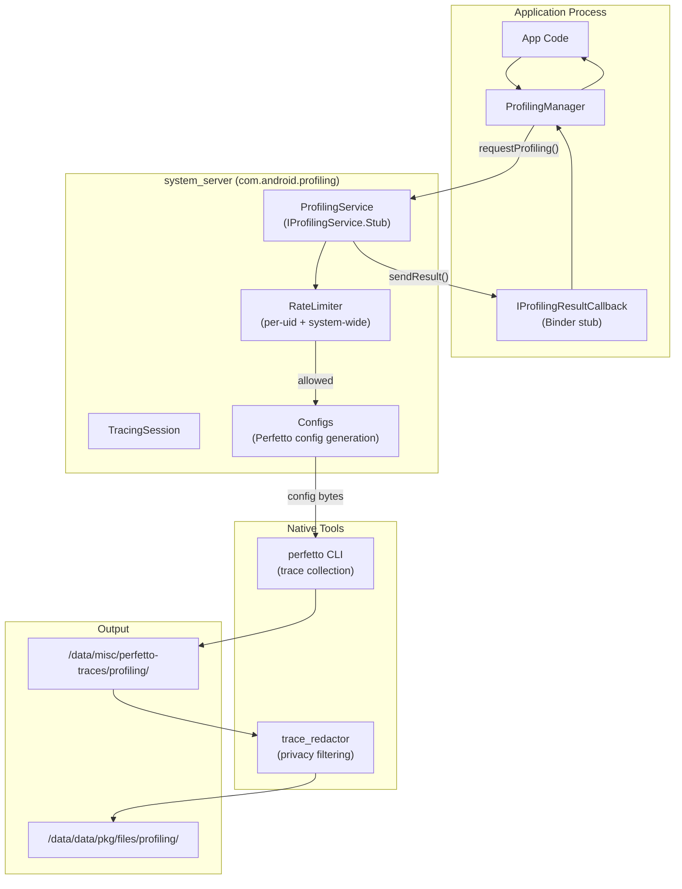

### 54.8.3  性能分析类型

`ProfilingManager` 支持四种性能分析类型，每种由不同的 Perfetto 数据源支撑：

| 类型 | 常量 | 后端 | 输出后缀 |
|------|----------|---------|---------------|
| Java 堆转储 | `PROFILING_TYPE_JAVA_HEAP_DUMP` | `JavaHprofConfig` | `.perfetto-java-heap-dump` |
| 堆分析 | `PROFILING_TYPE_HEAP_PROFILE` | `HeapprofdConfig` | `.perfetto-heap-profile` |
| 栈采样 | `PROFILING_TYPE_STACK_SAMPLING` | `PerfEventConfig` | `.perfetto-stack-sample` |
| 系统跟踪 | `PROFILING_TYPE_SYSTEM_TRACE` | `FtraceConfig` + `ProcessStatsConfig` | `.perfetto-trace` |

`Configs` 类（`service/java/.../Configs.java`）将 `ProfilingManager` 的请求参数
转换为 Perfetto `TraceConfig` protobuf。每种性能分析类型都有受 DeviceConfig 控
制的持续时间、缓冲区大小和采样率界限：

```java
// Source: packages/modules/Profiling/service/java/.../Configs.java
// Example: heap profile defaults

sHeapProfileDurationMsDefault  // e.g. 60 seconds
sHeapProfileDurationMsMin      // minimum allowed
sHeapProfileDurationMsMax      // maximum allowed
sHeapProfileSizeKbDefault      // buffer size
sHeapProfileSamplingIntervalBytesDefault  // Poisson interval
```

### 54.8.4  速率限制

`RateLimiter` 使用**基于成本的滑动窗口**模型来防止滥用：

| 窗口 | 全系统默认值 | 每进程默认值 |
|--------|-------------------|-------------------|
| 1 小时 | 20 成本单位 | 10 成本单位 |
| 1 天 | 50 成本单位 | 20 成本单位 |
| 1 周 | 150 成本单位 | 30 成本单位 |

每次性能分析会话消耗 10 个单位（应用发起）或 5 个单位（系统触发）。速率限制
可以在本地测试时禁用：

```bash
adb shell device_config put profiling_testing rate_limiter.disabled true
```

### 54.8.5  系统触发的性能分析

除了按需请求之外，应用还可以注册**触发器**——自动生成性能分析数据的系统事件：

| 触发器 | 常量 | 触发时机 |
|---------|----------|--------------|
| 应用完全绘制 | `TRIGGER_TYPE_APP_FULLY_DRAWN` | 冷启动时在 `Activity.reportFullyDrawn()` 之后 |
| ANR | `TRIGGER_TYPE_ANR` | 检测到该应用发生 ANR 时 |
| 应用请求运行中的跟踪 | `TRIGGER_TYPE_APP_REQUEST_RUNNING_TRACE` | 后台跟踪的按需快照 |
| 强制停止终止 | `TRIGGER_TYPE_KILL_FORCE_STOP` | 用户通过设置强制停止 |
| 最近任务终止 | `TRIGGER_TYPE_KILL_RECENTS` | 用户在最近任务中划掉 |

系统维护一个后台跟踪（可通过 DeviceConfig 配置），并在触发器触发时克隆一个
快照。结果通过 `registerForAllProfilingResults()` 回调传递。

### 54.8.6  跟踪脱敏与隐私

所有性能分析输出在交付给应用之前，都会由 `trace_redactor` 二进制文件进行
**脱敏**。脱敏会剥离属于其他进程的数据，只保留关于请求应用自身 UID 的信息。
这使非特权应用能够安全地接收系统跟踪。

脱敏流水线：

1. Perfetto 将原始跟踪写入 `/data/misc/perfetto-traces/profiling/`。
2. `ProfilingService` 调用 `trace_redactor` 来过滤跟踪。
3. 脱敏后的输出通过 Binder 发送的 `ParcelFileDescriptor` 写入应用的文件目录。

4. 临时的未脱敏跟踪被删除。

### 54.8.7  异常检测器

Profiling APEX 可选地包含 **AnomalyDetectorService**，由
`RELEASE_ANOMALY_DETECTOR` 标志门控。它通过可插拔的 `SignalCollector` 组件
提供系统级异常检测的框架：

```java
// Source: packages/modules/Profiling/anomaly-detector/service/java/.../
//         AnomalyDetectorService.java

public final class AnomalyDetectorService extends SystemService {
    private final SignalCollectorRegistry mSignalCollectorRegistry;
    // ...
}

// Source: .../anomaly/internal/SignalCollectorRegistryImpl.java

public final class SignalCollectorRegistryImpl
        implements SignalCollectorRegistry {
    /** Map from signal type ID to the registered collector. */
    private final ArrayMap<SignalTypeId, SignalCollector<?, ?>>
            mRegisteredCollectors = new ArrayMap<>();
    // ...
}
```

信号收集器（例如 `BinderSpamConfig` / `BinderSpamData`）检测异常模式，并可
自动触发性能分析。

### 54.8.8  关键源代码路径

| 组件 | 路径 |
|-----------|------|
| AIDL 接口 | `packages/modules/Profiling/aidl/android/os/IProfilingService.aidl` |
| 公共 API | `packages/modules/Profiling/framework/java/android/os/ProfilingManager.java` |
| 结果类 | `packages/modules/Profiling/framework/java/android/os/ProfilingResult.java` |
| 触发器类 | `packages/modules/Profiling/framework/java/android/os/ProfilingTrigger.java` |
| 服务实现 | `packages/modules/Profiling/service/java/com/android/os/profiling/ProfilingService.java` |
| 配置生成 | `packages/modules/Profiling/service/java/com/android/os/profiling/Configs.java` |
| 速率限制器 | `packages/modules/Profiling/service/java/com/android/os/profiling/RateLimiter.java` |
| 会话状态 | `packages/modules/Profiling/service/java/com/android/os/profiling/TracingSession.java` |
| 异常检测器 | `packages/modules/Profiling/anomaly-detector/service/java/.../AnomalyDetectorService.java` |
| APEX 配置 | `packages/modules/Profiling/apex/Android.bp` |

---

## 54.9  深入剖析：UWB（超宽带）

UWB 模块（`com.android.uwb`）提供 Android 的超宽带无线电协议栈。UWB 是一种短
距离、高带宽的无线技术。它用于精确测距（距离测量）、到达角定位以及安全的设备
间通信。

### 54.9.1  模块结构

```
packages/modules/Uwb/
    apex/               APEX packaging
    framework/          Public API (android.uwb.*)
    service/            UwbServiceCore, UwbSessionManager
      fusion_lib/       Sensor fusion for positioning
      multichip-parser/ Multi-chip UWB configuration
      proto/            UWB stats logging protos
      support_lib/      FiRA, CCC, ALIRO param builders
      uci/              UCI command layer
    libuwb-uci/         Rust UCI HAL implementation
      src/rust/
        uci_hal_android/  Android HAL binding
        uwb_core/         Core UWB state machine
    ranging/            Generic Ranging API (multi-technology)
      framework/        android.ranging.*
      uwb_backend/      UWB backend for generic ranging
      rtt_backend/      Wi-Fi RTT backend for generic ranging
    androidx_backend/   AndroidX UWB library backend
    indev_uwb_adaptation/  In-development UWB adaptation
    flags/              Feature flags
```

### 54.9.2  协议栈架构

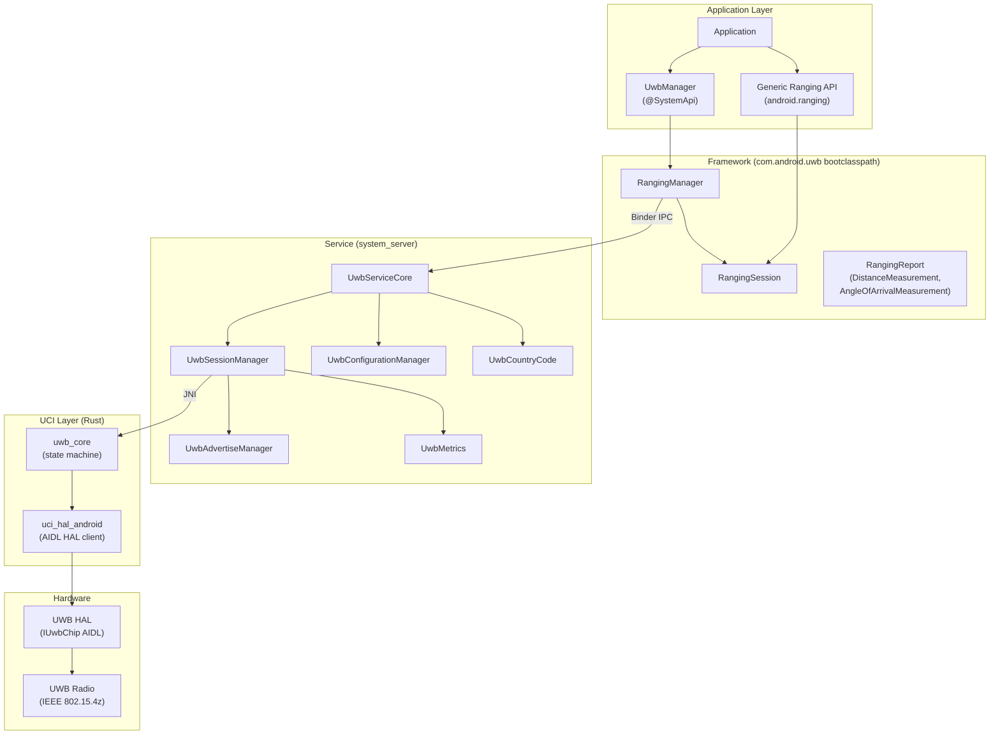

### 54.9.3  UWB 协议

该模块支持三个协议族，每个在支持库中都有其自己的参数构建器：

| 协议 | 类 | 用例 |
|----------|-------|----------|
| **FiRA** | `FiraOpenSessionParams`、`FiraParams` | 标准化的 IEEE 802.15.4z 测距（手机、标签、IoT） |
| **CCC**（Car Connectivity Consortium） | `CccOpenRangingParams`、`CccParams` | 数字车钥匙 |
| **ALIRO** | `AliroOpenRangingParams`、`AliroParams` | 门禁控制（门锁、闸门） |

此外，`RadarParams` 和 `RfTestParams` 支持 UWB 雷达感知和 RF 测试模式。

### 54.9.4  UCI（UWB 命令接口）

UCI 层用 **Rust**（`libuwb-uci/src/rust/`）实现，并提供到 UWB 硬件的底层命
令接口：

```
libuwb-uci/src/rust/
    uwb_core/src/
        lib.rs          Core library entry
        service.rs      UWB service state machine
        params.rs       Parameter definitions
        params/
            fira_app_config_params.rs
            ccc_app_config_params.rs
            aliro_app_config_params.rs
            uci_packets.rs     UCI packet parsing
    uci_hal_android/
        uci_hal_android.rs     UciHal impl over the AIDL HAL
```

`uci_hal_android.rs` 是针对 `android.hardware.uwb` AIDL HAL（`IUwb` /
`IUwbChip`）实现 `uwb_core` 的 `UciHal` trait 的 binder 客户端——而不是 JNI 桥
接。JNI 层单独位于 `packages/modules/Uwb/service/uci/jni/`（入口点
`uci_jni_android_new.rs`）。Java 服务通过该层进入 Rust 协议栈。它封装
`uwb_core`。反过来，`uwb_core` 驱动 `uci_hal_android` 来与硬件通信。

UCI 会话状态遵循标准状态机：

| 状态 | 值 | 描述 |
|-------|-------|-------------|
| `INIT` | 0x00 | 会话已初始化 |
| `DEINIT` | 0x01 | 会话已取消初始化 |
| `ACTIVE` | 0x02 | 正在测距 |
| `IDLE` | 0x03 | 已配置但未测距 |

在 UCI 层之下是 `android.hardware.uwb` AIDL HAL（`IUwb` / `IUwbChip`）。
Android 17 在 `hardware/nxp/uwb` 为 NXP SR1XX 芯片发布了它的参考供应商实现。
精简的 AIDL 服务二进制文件（`android.hardware.uwb-service.nxp`，注册为 init
服务 `vendor.uwb_hal`）桥接到 `halimpl/` 下 NXP 的遗留 HAL 核心。该核心处理
HBCI 固件下载、SPI TML 传输、OTP 校准以及会话/时间同步。正是这一点使硬件 UWB
测距在为上述协议栈提供数据的 NXP 设备上工作。

### 54.9.5  测距测量

一个 `RangingReport` 包含一个或多个 `RangingMeasurement` 对象，每个对象提供：

| 测量 | 类 | 数据 |
|-------------|-------|------|
| **距离** | `DistanceMeasurement` | 带有置信度的米制距离 |
| **到达角** | `AngleOfArrivalMeasurement` | 方位角和仰角 |
| **双向测量** | `UwbTwoWayMeasurement` | 原始 ToF 数据 |
| **OWR AoA** | `UwbOwrAoaMeasurement` | 单向测距角度 |
| **DL TDoA** | `UwbDlTDoAMeasurement` | 下行链路到达时间差 |

### 54.9.6  通用测距 API

`ranging/` 子目录引入了一个**与技术无关的 Ranging API**（`android.ranging.*`），
它抽象了多种测距技术：

```
ranging/
    framework/      android.ranging.* API surface
    uwb_backend/    UWB implementation of generic ranging
    rtt_backend/    Wi-Fi RTT implementation of generic ranging
    service/        RangingService
```

这允许应用在请求测距时不必绑定到特定技术。bootclasspath 片段有条件地包含
`framework-ranging`：

```
// Source: packages/modules/Uwb/apex/Android.bp

soong_config_variables: {
    release_ranging_stack: {
        contents: [
            "framework-uwb",
            "framework-ranging",
        ],
    },
},
```

### 54.9.7  带外测距规范（v2/v3）

当两台设备互相测距时，它们必须就使用哪种技术达成一致。它们还必须就如何配置
它达成一致。它们在发送任何测距帧之前完成这一过程。通用测距协议栈通过带外
（OOB）通道——通常是 BLE GATT——承载这种协商，使用在
`packages/modules/Uwb/ranging/service/oob/oob_packets.pdl` 中定义的一个小消
息协议。`.pdl` 文件是一个分组描述，由 `pdlc` 工具编译为 OOB 发起方和响应方使
用的 Java 解析器（`packages/modules/Uwb/ranging/service/java/com/android/
server/ranging/oob/`）。每条消息都以相同的两字节 `OobMessage` 头开始：一个
`version` 字节和一个 `MessageId`。

该协议是带版本的。`Version` 枚举声明了 `V1 = 1`、`V2 = 2` 和 `CURRENT = 3`。
因此，设备会通告它所支持的修订版本，双方回退到最低的共同版本。两个后续修订版
本在 v1 基线之上添加了能力：

- **v2——支持的技术切换。**能力交换现在可以说明设备是否可以在会话中途切换测
  距技术，而不是拆除会话并重新开始。`CapabilitiesResponseV2` 添加了一个类型
  为 `TechnologyTransitioning` 的 `supported_transitioning` 字段，其值为
  `NOT_SUPPORTED` 和 `MAKE_BEFORE_BREAK`。发起方读取此字段以选择一个“先建后拆”
  的引擎，该引擎在丢弃当前技术之前先启动下一项技术。OOB 协议通过
  `Technology` / `TechnologySet` 类型协商多种技术：UWB、BLE 信道测距、Wi-Fi
  NAN RTT、BLE RSSI 和 Wi-Fi PD。PDL 将 Wi-Fi PD 标记为开发中的 v4 新增项。

- **v3——运动通知。**一个新的 `MOTION_NOTIFICATION` 消息
  （`MessageId = 0x8`）携带一个 `Motion` 负载，将检测到的运动报告为
  `NOT_DETECTED`、`SLIGHT`、`MODERATE` 或 `LARGE`。对它的支
  持通过添加到 `ConfigurationRequestV3` 的 `supported_motion` 字段（类型
  `MotionIndicator`，值为 `NOT_SUPPORTED` / `SUPPORTED`）来通告。发起方会话
  在 `session/OobInitiatorRangingSession.java` 中处理传入的
  `MotionNotification` 消息（`oob/` 包只包含协议构建器和解析器）。因此，应用
  可以对报告自己正在移动的对等方做出反应。

完整的消息集是 `MessageId` 枚举：能力请求/响应、配置请求/响应、停止请求/响应，
以及 v3 运动通知。每种消息类型在 PDL 中独立地带版本（例如
`CapabilitiesResponseV1` 与 `CapabilitiesResponseV2`，以及
`ConfigurationRequestV1` 与 `ConfigurationRequestV3`）。因此，生成的解析器从
头部版本中选择正确的布局。这就是 v3 设备如何与 v1 或 v2 对等方保持互操作的方
式。

### 54.9.8  会话管理

`UwbSessionManager` 是 UWB 会话生命周期的核心类：

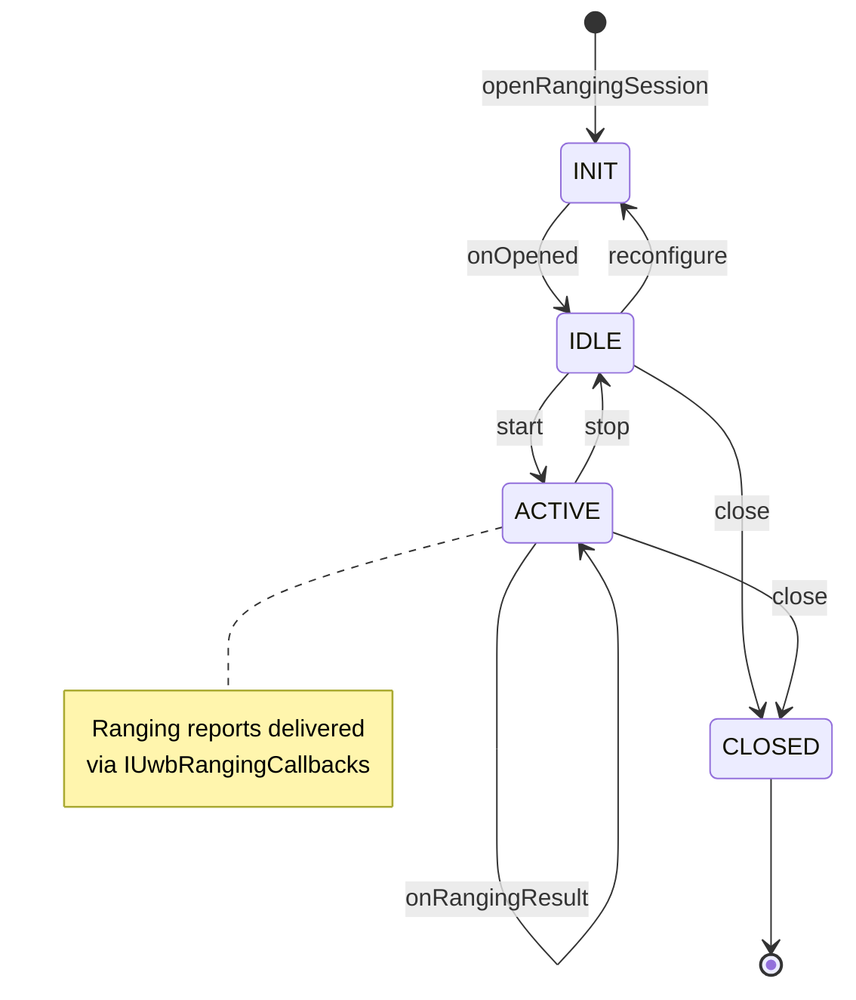

会话管理器跟踪每会话状态，处理多播列表更新（添加/移除受控方），管理挂起/恢
复，并将测距通知路由到正确的回调。

### 54.9.9  国家代码与监管

`UwbCountryCode` 确定设备的运行国家并相应地配置信道限制。它监听电话和 Wi-Fi
国家代码变更，默认使用基于 SIM 的国家。监管合规通过信道使用限制
（`ChannelUsage`）强制执行。

### 54.9.10  关键源代码路径

| 组件 | 路径 |
|-----------|------|
| 公共 API | `packages/modules/Uwb/framework/java/android/uwb/` |
| UwbManager | `packages/modules/Uwb/framework/java/android/uwb/UwbManager.java` |
| RangingSession | `packages/modules/Uwb/framework/java/android/uwb/RangingSession.java` |
| 服务核心 | `packages/modules/Uwb/service/java/com/android/server/uwb/UwbServiceCore.java` |
| 会话管理器 | `packages/modules/Uwb/service/java/com/android/server/uwb/UwbSessionManager.java` |
| UCI 常量 | `packages/modules/Uwb/service/java/com/android/server/uwb/data/UwbUciConstants.java` |
| Rust UCI 核心 | `packages/modules/Uwb/libuwb-uci/src/rust/uwb_core/src/` |
| UCI HAL 客户端 | `packages/modules/Uwb/libuwb-uci/src/rust/uci_hal_android/` |
| JNI 桥接 | `packages/modules/Uwb/service/uci/jni/` |
| 支持库 | `packages/modules/Uwb/service/support_lib/` |
| 通用测距 API | `packages/modules/Uwb/ranging/framework/` |
| APEX 配置 | `packages/modules/Uwb/apex/Android.bp` |

---

## 54.10  `tools/mainline` 训练构建仓库

到目前为止，本章都将每个模块视为一个自包含的 APEX。实际上，Google 并不是逐个
发布模块的。相关模块被捆绑成一个**训练（train）**。训练是一组一起发布、一起
打版本戳、并通过 Google Play 一起推出的 APEX 和 APK 文件。Android 17 新增了一个
顶层仓库 `tools/mainline`，承载了组装这些训练的工具的开源部分。

### 54.10.1  为什么需要一个单独的仓库

每个模块的 `Android.bp` 文件描述了如何*构建一个 APEX*。将一批新构建的模块产物
转换为一个签名的、版本正确的训练，是一个单独的、跨模块的步骤。这一步必须将
每个模块裁剪到给定目标所需的架构，并构建共享的通用库 APEX。它还必须重新打版
本码，使训练排序高于先前的发布，并将一切打包成最终的 bundle。历史上，这些逻辑
存在于 Google 内部的脚本中。Android 17 将可重用的、AOSP 可共享的机制拆分到
`tools/mainline/train_build/`，将专有的模拟数据和胶水代码留在
`vendor/google/train_build`。

### 54.10.2  `train_build` 流水线

`tools/mainline/train_build/Android.bp` 定义了一组 `python_binary_host` “工作
者”二进制文件和 `python_library_host` “动作”库。每个都实现流水线的一个阶段。
该文件还为大多数阶段定义了 `python_test_host` 单元测试（裁剪、版本化，以及两
个编排器及其工作者）：

| 阶段 | 动作模块 | 职责 |
|-------|--------------|---------------|
| 裁剪 | `trim_action.py` | 将捆绑的 APEX 裁剪为目标所需的 ABI，将模块 ABI 映射到 DCLA 架构集 |
| DCLA 构建 | `dcla_build_action.py` | 构建共享的通用库 APEX，以在模块间去重原生库 |
| 版本化 | `versioning_action.py` | 提升每个模块的版本码，使训练排序高于先前的发布 |
| 打包 | `pack_action.py` | 将裁剪后的、带版本的模块打包成最终的训练产物 |

两个编排器将这些阶段联系在一起。`primary_train_build_action.py` 构建**主**训
练（及其 Go 变体），以共享的 DCLA 库 APEX 为中心；
`generic_train_build_action.py` 构建其他训练类型。每个训练都被建模为一个
`TrainBuildSpec`，并由 `TrainType` 枚举分派：

```python
# Source: tools/mainline/train_build/generic_train_build_action.py

class TrainType(Enum):
  TELEMETRY = 1
  GO_TELEMETRY = 2
  ADSERVICES = 3
  NPU = 9
  GO_NONUPDATABLE = 4
  NONUPDATABLE = 5
  PRELOAD = 6
  TIMEZONE = 7
  UNKNOWN = 8
```

专用的 `NPU` 训练类型的存在本身就是一个 Android 17 信号。新的
`com.android.npumanager` 模块（54.11 节）足够重要，可以以自己的训练节奏发
布。

### 54.10.3  共享 DCLA 库 APEX

54.5.7 节在构建规则层面介绍了 DCLA（Dynamic Common Lib APEX）。
`primary_train_build_action.py` 是共享库 APEX 真正为训练被组装的地方。它命名
了两个众所周知的共享库 APEX——完整 Android 版本和 Android Go 变体：

```python
# Source: tools/mainline/train_build/primary_train_build_action.py

BIG_ANDROID_DCLA = 'com.google.mainline.primary.libs'
GO_DCLA = 'com.google.mainline.go.primary.libs'
```

`dcla_apex_info.py` 按模块记录该模块期望由外部提供的 DCLA 库。因此裁剪和打包
阶段可以将共享 APEX 接入训练。然后每个模块就不必捆绑自己的 `libc++`、
`libcrypto` 等副本。

### 54.10.4  训练构建流程

下图展示了每个模块的产物如何流经 `train_build` 阶段，成为一个完整的训练。

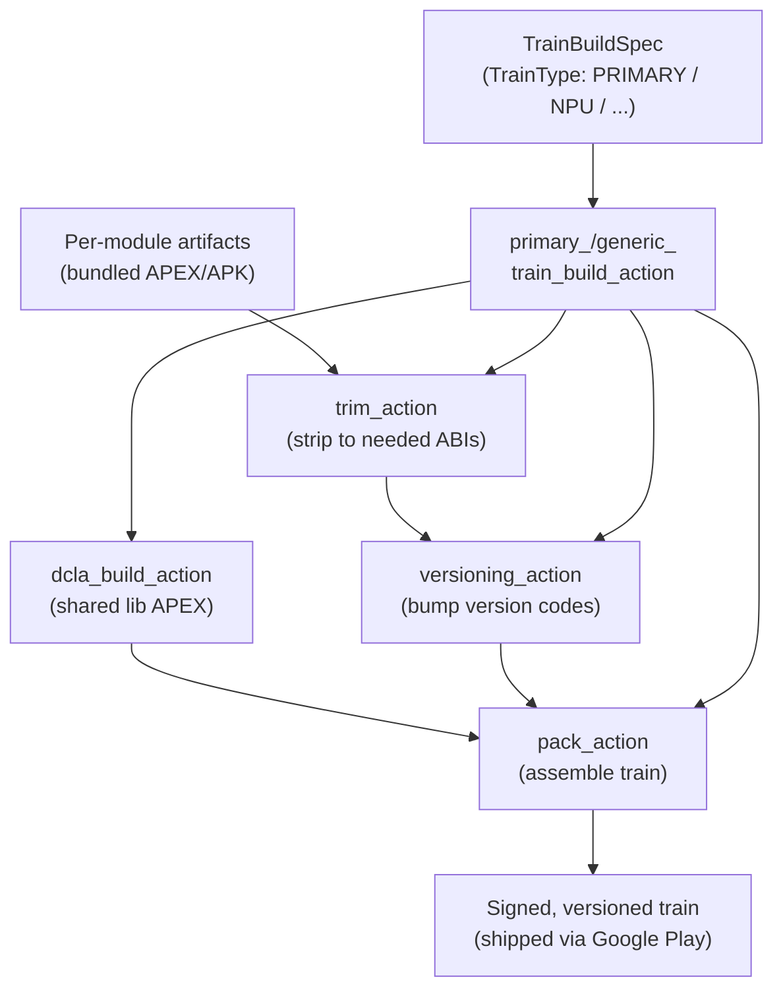

---

## 54.11  Android 17 的 apexd 与模块变更

Android 17 对 Mainline 的运行时侧做了两项值得注意的变更。首先，`apexd` 增加了
一种无需 loop 设备即可激活 EROFS APEX 负载的方法。其次，模块集合本身随着
`com.android.npumanager` 和 `com.android.webapp` 这两个新成员而增长。

### 54.11.1  EROFS 文件支撑挂载

APEX 消耗的每一个 loop 设备都是有限的内核资源。模块数量在攀升（54.3 节现在列
出了四十多个目录），启动时的 loop 设备压力也随之攀升。Android 17 针对 EROFS
负载用**文件支撑挂载**解决了这个问题。如果负载是 EROFS 且不需要自己的
dm-verity 层，`apexd` 就直接从 `.apex` 文件挂载负载。它使用内核的 `fsoffset=`
挂载选项，中间没有 loop 设备。这就是 54.2.9 节中展示的 `MountPackageImpl` 的
EROFS 分支：

```cpp
// Source: system/apex/apexd/apexd.cpp (MountPackageImpl, EROFS branch)

} else if (IsFileBackedMountEnabled() && fs_type == "erofs" &&
           !mount_on_verity) {
    mount_options = std::format("fsoffset={}", *apex.GetImageOffset());
    mount_device = apex.GetPath();
```

该特性由 `system/apex/apexd/apexd.aconfig` 中的 aconfig 标志守护（包
`com.android.apex.flags`）：

```
// Source: system/apex/apexd/apexd.aconfig

flag {
  name: "erofs_file_backed_mount"
  namespace: "treble"
  description: "This flag controls if file-backed mounting for EROFS APEXes"
}

flag {
  name: "microdroid_no_loop_device"
  namespace: "treble"
  description: "This flag controls if apexd activates apexes without loop devices"
}
```

由于并非每个内核都支持文件支撑的 EROFS 挂载，`apexd` 不会盲目信任该标志。在
运行时，它会对捆绑的空 EROFS 镜像执行一次**测试挂载**。它将结果缓存在非持久
的运行时属性 `apexd.config.runtime.erofs_file_backed_mount` 中。因此同一启动
周期内后续的检查会跳过探测。供应商可设置的覆盖项是
`apexd.config.erofs_file_backed_mount`：

```cpp
// Source: system/apex/apexd/apexd_mount.cpp

static constexpr const char* kApexTestMountFolder = "/apex/.test@0.tmp";
static constexpr const char* kTestMountImage =
    "/system/etc/apexd/empty_erofs.img";

// ...
if (mount(kTestMountImage, kApexTestMountFolder, "erofs", mount_flags,
          "fsoffset=0")) {
    android::base::SetProperty(kFileBackedMountRuntimeProp, "false");
    PLOG(INFO)
        << "File-backed mount is disabled due to test mount failure (mount)";
    return false;
}
```

配套的 `microdroid_no_loop_device` 标志让 Microdroid 通过 `dm-linear` 设备
而不是 loop 设备来激活*块* APEX。这就是 `MountPackageImpl` 的
`CreateDmLinearForBlockApex` 分支，仅在该标志被构建时才编译进来。这两条路径一
起，随着模块集合不断增长，缩小了每个 APEX 的 loop 设备开销。

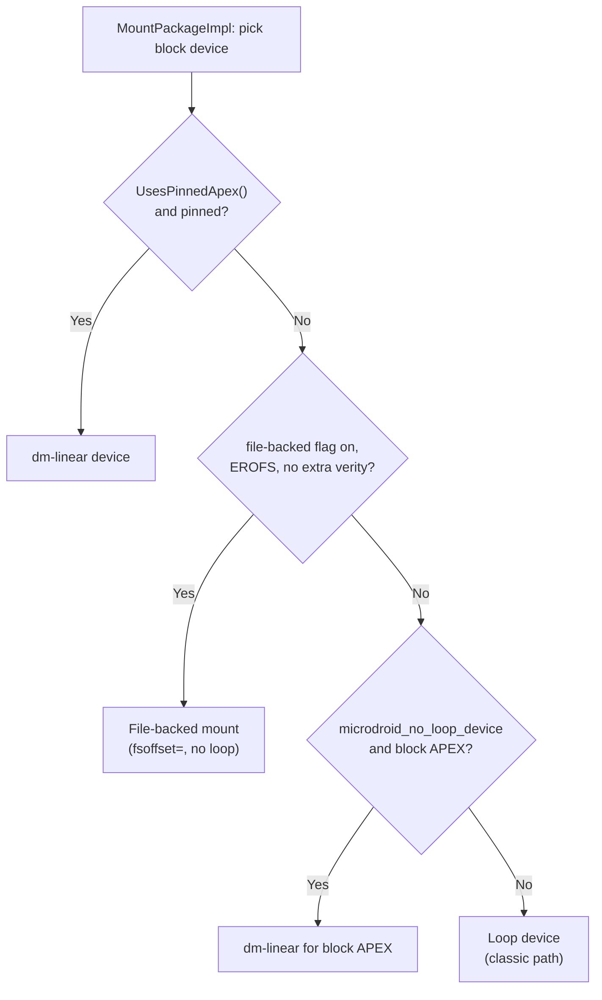

### 54.11.2  NpuManager 模块

`com.android.npumanager`（`packages/modules/NpuManager/apex/Android.bp`）是两
个真正全新的 Android 17 模块之一。它在相互竞争的应用之间仲裁对设备端**神经处
理单元（NPU）**的访问。应用不会获得对加速器的原始访问权限。它们向该模块的服
务询问加载模型是否明智，服务根据内存预算和优先级作答。该 APEX 由
`RELEASE_NPUMANAGER_MODULE` 版本标志门控，并继承 `b-launched-apex-module` 默
认值（`min_sdk_version: "36"`）：

```
// Source: packages/modules/NpuManager/apex/Android.bp

apex {
    enabled: select(release_flag("RELEASE_NPUMANAGER_MODULE"), {
        true: true,
        false: false,
    }),
    name: "com.android.npumanager",
    min_sdk_version: "36",
    defaults: ["b-launched-apex-module"],
    bootclasspath_fragments: ["com.android.npumanager-bootclasspath-fragment"],
    systemserverclasspath_fragments:
        ["com.android.npumanager-systemserverclasspath-fragment"],
    native_shared_libs: ["libcom.android.npumanager"],
    jni_libs: ["libnpumanager_service_jni"],
}
```

bootclasspath 片段贡献 `framework-npumanager`（公共 `NpuManager` API 表面）。系
统服务器片段贡献 `service-npumanager`（`NpuManagerService`）。该模块附带自己的
`npumanager-module-sdk`，因此其他组件可以针对其导出的 API 进行编译。详细的准
入控制架构在第 53 章中介绍。它包括模型加载策略、Rust 支撑的原生缓冲区管理，
以及配套的 `android.hardware.npu` 供应商 HAL。

### 54.11.3  WebApp 模块

`com.android.webapp`（`packages/modules/WebApp/apex/Android.bp`）是第二个
Android 17 新成员。它将**渐进式 Web 应用（PWA）**作为一等安装实体来安装和管理。
它公开一个 `WebAppManager`
（`packages/modules/WebApp/framework/java/android/content/pm/webapp/WebAppManager.java`），
其背后是 APEX 内的 `WebAppService` APK。与 NpuManager 一样，它由标志门控
（`RELEASE_WEBAPP_MODULE`）并继承 `b-launched-apex-module` 默认值：

```
// Source: packages/modules/WebApp/apex/Android.bp

apex {
    enabled: select(release_flag("RELEASE_WEBAPP_MODULE"), {
        true: true,
        false: false,
    }),
    name: "com.android.webapp",
    defaults: ["b-launched-apex-module"],
    binaries: ["aapt2"],
    prebuilts: ["webapp-template-res"],
    apps: ["WebAppService"],
    bootclasspath_fragments: ["com.android.webapp-bootclasspath-fragment"],
}
```

捆绑的 `aapt2` 二进制文件和 `webapp-template-res` 预构建让该模块可以在安装时
编译资源，将 PWA 实体化为一个可安装的包。包管理器集成在第 26 章中讨论。

### 54.11.4  Bootstrap 和代码位置目录

并非 `packages/modules/` 下的每个 Android 17 新增项都是可更新的 APEX：

- `WebViewBootstrap`（`packages/modules/WebViewBootstrap/apex/Android.bp`）定
  义了 `com.android.webview.bootstrap`，一个本质上**空**的 bootstrap APEX
  （`v-launched-apex-module` 默认值），用于预留挂载点。它不捆绑任何应用、库或
  classpath 片段。
- `ImsStack`（`packages/modules/ImsStack/`）是一个**代码位置**。它存放电话协议
  栈使用的 Java、原生库和特性标志。它本身不产生 APEX。
- `GenericBootstrappingArchitecture`
  （`packages/modules/GenericBootstrappingArchitecture/`）发布一个名为
  `GbaService`（Generic Bootstrapping Architecture 运营商认证）的 `android_app`，
  而不是 APEX。

在推理 `apexd` 启动时实际挂载了什么时，重要的是将这些与真正的 APEX 模块区分开。
只有其 `Android.bp` 声明了 `apex {`（或 `custom_apex {` / `virt_apex {`）语句
的目录才会贡献一个 `/apex/<name>` 挂载。

---

## 54.12  动手实践

以下练习带你在运行中的设备上检查 Mainline 模块，并从源码理解它们的结构。

### 练习 54.1：检查已激活的 APEX

列出设备或模拟器上所有已激活的 APEX：

```bash
$ adb shell ls /apex/ | grep -v '@'
```

对于每个 APEX，检查其内容：

```bash
$ adb shell ls -la /apex/com.android.sdkext/
$ adb shell ls -la /apex/com.android.tethering/
$ adb shell ls -la /apex/com.android.permission/
```

**问题**：哪些模块包含原生二进制文件（`bin/` 目录）？哪些只包含 Java 库
（`javalib/`）？

### 练习 54.2：读取 APEX 信息列表

文件 `/apex/apex-info-list.xml` 包含关于每个已激活 APEX 的元数据：

```bash
$ adb shell cat /apex/apex-info-list.xml
```

解析 XML 以回答：

- 哪些 APEX 在 `/system` 分区上，哪些在 `/system_ext` 上？
- 哪些 APEX 已从其预装版本更新？
- 每个 APEX 的版本码是多少？

### 练习 54.3：查询扩展版本

检查所有 SDK 扩展版本：

```bash
$ adb shell getprop | grep build.version.extensions
```

比较 R、S、T、U、V、B 和 C 扩展版本。查看 `derive_sdk.cpp` 中的
`kRModules`、`kSModules`、`kTModules`（以及空的 `kVModules` / `kCModules`）
集合。确定哪些模块为每个扩展级别做出贡献。

### 练习 54.4：检查 APEX 构建规则

读取 Permission 模块的 APEX 模块定义：

```bash
$ cat packages/modules/Permission/Android.bp
```

追踪依赖链：

1. 它继承哪些默认值？
2. 它的 `min_sdk_version` 是什么？
3. 它包含哪些 bootclasspath 片段？
4. 它使用哪个密钥和证书？

### 练习 54.5：构建并安装一个 APEX

构建 SdkExtensions 模块并安装它：

```bash
$ source build/envsetup.sh
$ lunch aosp_cf_x86_64_phone-trunk_staging-userdebug
$ m com.android.sdkext

# Install on a running emulator
$ adb install --staged out/target/product/vsoc_x86_64/system/apex/com.android.sdkext.apex
$ adb reboot
```

重启后，验证版本已改变：

```bash
$ adb shell pm list packages --apex-only --show-versioncode | grep sdkext
```

### 练习 54.6：在 Logcat 中追踪 APEX 激活

捕获启动日志以查看 apexd 的运行：

```bash
# Reboot and capture logs
$ adb reboot
$ adb wait-for-device
$ adb logcat -d -s apexd | head -100
```

查找：

- 显示在何处找到 APEX 的 `"Scanning <path>"` 消息。
- 每个 APEX 的 `"Successfully activated"` 消息。
- `"Marking APEXd as activated"` 和 `"Marking APEXd as ready"` 里程碑。
- 用于启动性能的计时信息（`"OnStart done, duration=..."`）。

### 练习 54.7：检查 dm-verity 设置

对于已更新的 APEX（位于 `/data/apex/active/` 中的一个），dm-verity 层增加了
完整性保护。使用 `dmsetup` 检查：

```bash
$ adb root
$ adb shell dmsetup table | grep apex
```

这会显示 dm-verity 参数：哈希算法、数据块大小、哈希块大小、块数和根哈希。

### 练习 54.8：比较预装与已更新的 APEX

找到一个同时具有预装版本和已更新版本的模块：

```bash
# Pre-installed (factory) version
$ adb shell ls /system/apex/ | grep sdkext

# Updated (if any) version
$ adb shell ls /data/apex/active/ | grep sdkext
```

拉取两者并比较它们的清单：

```bash
# On host (requires deapexer)
$ deapexer info /path/to/system_version.apex
$ deapexer info /path/to/data_version.apex
```

### 练习 54.9：检查模块边界

选取两个具有依赖关系的模块（例如 `com.android.tethering` 依赖
`com.android.permission` 的 API）。

在源码中：

1. 在两个模块中找出 `java_sdk_library` 定义。
2. 确定跨模块依赖使用的是哪个 API 作用域（`public`、`system`、`module-lib`）。

3. 检查共享依赖上的 `apex_available` 声明。

### 练习 54.10：编写扩展版本检查

编写一个小的 Android 应用（或使用 `adb shell am` 加一个测试 APK），它：

1. 调用 `SdkExtensions.getExtensionVersion(Build.VERSION_CODES.R)`。
2. 调用 `SdkExtensions.getAllExtensionVersions()`。
3. 将所有扩展版本打印到 logcat。
4. 基于扩展版本有条件地使用某个 API。

这演示了运行时 API 可用性检查模式，当所有应用的目标是通过 Mainline 模块引入
的 API 时，都应使用这种模式。

### 练习 54.11：探索 APEX 构建系统

检查用于 APEX 构造的 Soong 构建规则：

```bash
# Look at the APEX module type registration
$ cat build/soong/apex/apex.go | grep -A5 "RegisterModuleType"

# Look at the builder rules
$ cat build/soong/apex/builder.go | grep -A10 "apexRule ="

# Examine the key management
$ cat build/soong/apex/key.go | grep -A10 "apexKeyProperties"
```

**问题**：APEX 构建器依赖哪些主机工具？列出至少十个参与构建 APEX 文件的工具。

### 练习 54.12：绘制模块依赖图

对于 Connectivity 模块（`com.android.tethering`），追踪依赖链：

```bash
# Find all libraries declared in the APEX
$ grep -A30 "multilib" \
    packages/modules/Connectivity/Tethering/apex/Android.bp

# For each JNI library, find its apex_available declaration
$ grep -r "apex_available" \
    packages/modules/Connectivity/service/ \
    --include="*.bp" | grep tethering
```

绘制一张依赖图，显示：

1. APEX 包。
2. 其 bootclasspath 片段。
3. 其系统服务器 classpath 片段。
4. 原生共享库。
5. JNI 库。
6. APEX 中的应用（APK）。

### 练习 54.13：模拟一次 APEX 更新回滚

在一台 userdebug 设备上：

```bash
# 1. Check current APEX versions
$ adb shell pm list packages --apex-only --show-versioncode | grep sdkext

# 2. Build a modified APEX with a higher version
# (edit the manifest.json to bump version)

# 3. Install it as a staged session
$ adb install --staged com.android.sdkext.apex

# 4. Reboot
$ adb reboot
$ adb wait-for-device

# 5. Verify the new version is active
$ adb shell pm list packages --apex-only --show-versioncode | grep sdkext

# 6. Trigger a rollback through the package manager (which in turn
#    drives apexd's IApexService.revertActiveSessions() binder method)
$ adb shell pm rollback-app com.android.sdkext
$ adb reboot
$ adb wait-for-device

# 7. Verify we're back to the original version
$ adb shell pm list packages --apex-only --show-versioncode | grep sdkext
```

### 练习 54.14：分析 dm-verity 保护

dm-verity 层是让 APEX 防篡改的东西。研究它的工作原理：

```bash
# 1. List all device-mapper devices
$ adb root
$ adb shell dmsetup ls

# 2. Show the dm-verity table for an APEX
$ adb shell dmsetup table | grep com.android

# 3. The table format is:
# <start_sector> <num_sectors> verity <version> <data_dev> <hash_dev>
# <data_block_size> <hash_block_size> <num_data_blocks> <hash_start_block>
# <algorithm> <digest> <salt> [optional_params]
```

**问题**：使用什么哈希算法？如果一个块损坏会发生什么（在表中查找
`restart_on_corruption`）？

### 练习 54.15：构建完整的模块测试套件

运行特定 Mainline 模块的测试套件：

```bash
# Run SdkExtensions tests
$ atest CtsSdkExtensionsTestCases

# Run apexd unit tests
$ atest apex_file_test apex_manifest_test apex_database_test

# Run derive_sdk tests
$ atest derive_sdk_test

# Run CTS tests for a module
$ atest CtsApexTestCases
```

### 练习 54.16：检查 apex-info-list.xml 模式

`apex-info-list.xml` 文件是设备上所有 APEX 的权威记录。检查其模式：

```bash
$ adb shell cat /apex/apex-info-list.xml
```

XML 包含类似以下的条目：

```xml
<apex-info
    moduleName="com.android.sdkext"
    modulePath="/system/apex/com.android.sdkext.apex"
    preinstalledModulePath="/system/apex/com.android.sdkext.apex"
    versionCode="370090000"
    versionName=""
    isFactory="true"
    isActive="true"
    lastUpdateMillis="0" />
```

对于每个条目，识别：

- `isFactory`——这是预装版本吗？
- `isActive`——这是当前激活的版本吗？
- `modulePath` 与 `preinstalledModulePath`——它是否已被更新？

### 练习 54.17：创建一个最小测试 APEX

创建一个包含单个 shell 脚本的最小 APEX：

1. 创建一个目录 `packages/modules/MyTest/`：

```
MyTest/
+-- Android.bp
+-- apex_manifest.json
+-- my_script.sh
```

2. 编写 `Android.bp`：

```
apex {
    name: "com.android.mytest",
    updatable: false,
    platform_apis: true,
    manifest: "apex_manifest.json",
    sh_binaries: ["my_test_script"],
    key: "com.android.mytest.key",
    certificate: ":com.android.mytest.certificate",
    file_contexts: ":apex.test-file_contexts",
}

sh_binary {
    name: "my_test_script",
    src: "my_script.sh",
    apex_available: ["com.android.mytest"],
}
```

3. 构建并检查：

```bash
$ m com.android.mytest
$ deapexer list out/.../com.android.mytest.apex
```

**问题**：APEX 内部除了你的脚本之外还有什么文件？它们是由什么生成的？

### 练习 54.18：追踪 derive_sdk 启动行为

监控 `derive_sdk` 在启动时做了什么：

```bash
# Enable verbose logging
$ adb shell setprop log.tag.derive_sdk VERBOSE
$ adb reboot
$ adb wait-for-device
$ adb logcat -d -s derive_sdk | head -50
```

将日志输出与 `packages/modules/SdkExtensions/derive_sdk/derive_sdk.cpp` 中的
代码对应起来：

- 找到了哪些 APEX？
- 读取了哪些 `sdkinfo.pb` 版本？
- 为每个训练（R、S、T、U、V、B）计算了什么扩展版本？

---

## 总结

### 架构回顾

下图捕捉了从构建时到运行时的完整 Mainline 架构：

```mermaid
graph TB
    subgraph "Build Time"
        SRC["Module Source Code<br/>(packages/modules/*)"]
        SOONG["Soong Build System<br/>(build/soong/apex/)"]
        APEXER["apexer tool<br/>(system/apex/apexer/)"]
        KEYS["Signing Keys<br/>(AVB + APK Signature)"]

        SRC --> SOONG
        SOONG --> APEXER
        KEYS --> APEXER
        APEXER --> APEX_FILE[".apex file"]
    end

    subgraph "Distribution"
        APEX_FILE --> PREINSTALL["Pre-installed<br/>(/system/apex/)"]
        APEX_FILE --> GPLAY["Google Play<br/>System Updates"]
    end

    subgraph "Boot Time"
        PREINSTALL --> APEXD["apexd daemon"]
        GPLAY -->|"staged"| DATA_DIR["/data/apex/active/"]
        DATA_DIR --> APEXD

        APEXD --> REPO["ApexFileRepository<br/>(select best version)"]
        REPO --> MOUNT["MountPackageImpl<br/>(loop + dm-verity + mount)"]
        MOUNT --> ACTIVATE["ActivatePackageImpl<br/>(bind mount to /apex/name)"]
        ACTIVATE --> READY["apexd.status = ready"]
    end

    subgraph "Runtime"
        READY --> APEX_MOUNT["/apex/MODULE/"]
        APEX_MOUNT --> DERIVE["derive_sdk<br/>(set extension versions)"]
        APEX_MOUNT --> LINKER["linkerconfig<br/>(namespace config)"]
        APEX_MOUNT --> CLASSPATH["derive_classpath<br/>(BOOTCLASSPATH)"]
        DERIVE --> PROPS["System Properties<br/>(build.version.extensions.*)"]
        PROPS --> APPS["Applications<br/>(SdkExtensions.getExtensionVersion())"]
    end
```

### 关键数据路径

| 路径 | 用途 |
|------|---------|
| `/system/apex/` | 预装的 APEX（工厂镜像） |
| `/system_ext/apex/` | system-ext 分区 APEX |
| `/product/apex/` | product 分区 APEX |
| `/vendor/apex/` | vendor 分区 APEX |
| `/odm/apex/` | ODM 分区 APEX |
| `/data/apex/active/` | 已更新的 APEX（来自 Play 或 adb） |
| `/data/apex/backup/` | 用于回滚的备份 |
| `/data/apex/decompressed/` | 解压后的 CAPEX |
| `/data/app-staging/` | 分阶段会话（等待重启） |
| `/apex/<name>/` | 激活的挂载点（bind 挂载到最新版本） |
| `/apex/<name>@<version>/` | 带版本的挂载点 |
| `/apex/apex-info-list.xml` | 关于所有已激活 APEX 的元数据 |

### 关键源代码文件

Project Mainline 代表了 Android 历史上最重大的架构变革之一。Google 将平台组件
打包成可独立更新的 APEX 模块。借助这些模块，Google 可以向数十亿台设备交付安全
修复和功能改进，而无需等待传统的 OEM 更新流水线。

本章的要点：

- **APEX** 是一个包含 dm-verity 签名文件系统镜像的 ZIP。这让原生代码、Java 库
  和配置可以作为一个单一的原子单元来更新。

- **apexd** 管理完整的生命周期。它在启动时扫描分区，并创建 loop（或者在
  Android 17 中是 dm-linear / 文件支撑的 EROFS）设备和 dm-verity 表。它将激活
  的版本 bind-mount，处理分阶段更新，并支持回滚。

- **40 多个模块**在 `packages/modules/` 中覆盖了网络、安全、媒体、电话、ML
  等。每个都有它自己的 APEX 名称、签名密钥和版本生命周期。Android 17 新增了
  `com.android.npumanager` 和 `com.android.webapp`（两者均受标志门控）以及新的
  `tools/mainline` 训练构建仓库。

- **SDK Extensions** 解决了运行时 API 可用性问题。在启动时，它们从实际安装的
  模块版本派生扩展版本号。Android 17（API 37，CinnamonBun）将扩展数据库基线提
  升至版本 22，并新增了一条“C”扩展轴。

- **模块边界**通过 `apex_available`、API 表面注解（`@SystemApi`）、
  `min_sdk_version` 和隐藏 API 策略来强制执行。

理解该系统的核心源文件：

| 组件 | 路径 |
|-----------|------|
| APEX 构建规则 | `build/soong/apex/apex.go`、`builder.go`、`key.go` |
| APEX 工具 | `system/apex/apexer/apexer.py` |
| APEX 清单 proto | `system/apex/proto/apex_manifest.proto` |
| apexd 守护进程 | `system/apex/apexd/apexd.cpp`、`apex_file.cpp`、`apex_constants.h` |
| apexd EROFS 文件支撑挂载 | `system/apex/apexd/apexd_mount.cpp`、`apexd.aconfig` |
| apexd init 配置 | `system/apex/apexd/apexd.rc` |
| 模块默认值 | `packages/modules/common/sdk/Android.bp` |
| SDK Extensions API | `packages/modules/SdkExtensions/java/android/os/ext/SdkExtensions.java` |
| derive_sdk | `packages/modules/SdkExtensions/derive_sdk/derive_sdk.cpp` |
| 扩展数据库 | `packages/modules/SdkExtensions/gen_sdk/extensions_db.textpb` |
| APEX 文件仓库 | `system/apex/apexd/apex_file_repository.h` |
| 训练构建工具 | `tools/mainline/train_build/` |
| NpuManager APEX | `packages/modules/NpuManager/apex/Android.bp` |
| WebApp APEX | `packages/modules/WebApp/apex/Android.bp` |

---
