# 第 16 章：媒体与相机

Android 的媒体框架是 AOSP 中架构最复杂的子系统之一。它从高层 Java API（`MediaPlayer`、`MediaCodec`、`MediaRecorder`）延伸到原生 C++ 栈。这个栈包括 Stagefright、Codec2 框架、NuPlayer、Camera 服务、媒体提取器以及硬件抽象层。硬件抽象层直接与厂商提供的编解码器和相机硬件通信。核心流水线是一个庞大的 C++ 代码库。你在设备上观看的每一帧视频、听到的每一个音频采样，以及拍摄的每张照片，都要经过本章所述的这套机制。

---

## 16.1 媒体架构概述

### 16.1.1 分层架构

Android 的媒体栈分为五个不同的层。在最顶层，Java 和 NDK API 提供了应用开发者使用的接口。在它们之下，一个原生服务层管理编解码器实例、播放会话和录制流水线。核心编解码器抽象层在服务层和实际编解码器实现之间进行转换。这一层既包括传统的 Stagefright/OMX 路径，也包括现代的 Codec2 路径。

再往下，HAL（硬件抽象层）提供了厂商契约。最底层是硬件本身：DSP、专用视频编码器/解码器、相机传感器和 ISP。

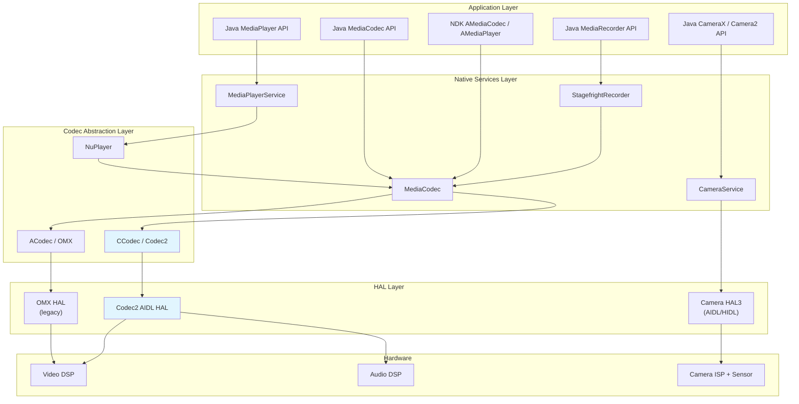

上图揭示了 Android 媒体架构的核心要点：编解码器层中存在两条并行路径。**传统 OMX 路径**（ACodec）封装了 OpenMAX IL 组件。它可以追溯到 Android 2.2/2.3 时代对媒体栈的 Stagefright 改造。ACodec 本身随 MediaCodec 在 Android 4.1 时代一同问世。

**现代 Codec2 路径**（CCodec）在 Android 10 中引入。如今它已成为所有 Google 提供的软件编解码器和大多数厂商硬件编解码器的主要路径。两条路径都被抽象在 `MediaCodec` API 之后，因此应用无需知道当前使用的是哪一条。

### 16.1.2 关键进程与服务

媒体框架跨越多个系统进程运行：

| 进程 | 服务 | 可执行文件 |
|---|---|---|
| `mediaserver` | MediaPlayerService（同时提供 MediaRecorderClient）、ResourceManagerService | `/system/bin/mediaserver` |
| `android-hardware-media-c2-hal` | Codec2 组件服务（厂商） | `/vendor/bin/hw/android.hardware.media.c2-default-service` |
| `media.swcodec` | Google 软件 Codec2 组件 | `/apex/com.android.media.swcodec/bin/mediaswcodec` |
| `media.extractor` | MediaExtractorService | `/system/bin/mediaextractor` |
| `cameraserver` | CameraService | `/system/bin/cameraserver` |
| `media.resource_manager` | ResourceManagerService | mediaserver 的一部分 |

这种进程隔离是有意为之的：媒体提取器运行在沙箱进程中，以控制解析不受信任的媒体文件所带来的安全影响。编解码器组件可以运行在厂商进程中，从而将厂商代码与框架隔离。

### 16.1.3 视频帧的流转

为了具体说明这一架构，我们来看播放过程中单个视频帧的生命周期：

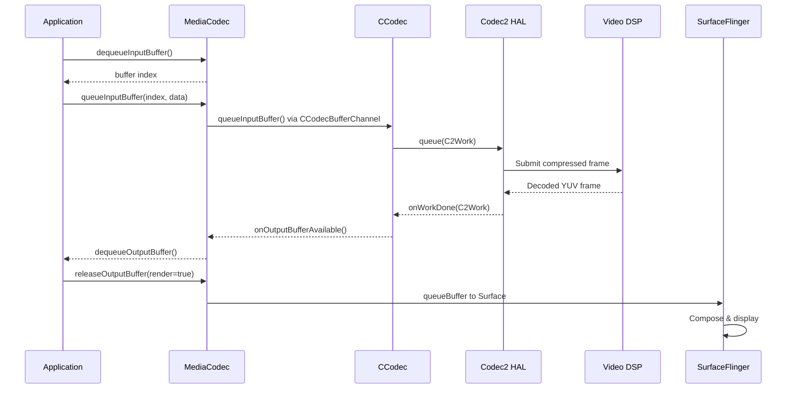

这一端到端流程至少涉及三个进程（应用、编解码器服务、SurfaceFlinger），仅编解码器本身就通常有两次 Binder/AIDL 跨进程调用。

### 16.1.4 源代码树布局

`frameworks/av/` 中相关源代码树的概要如下：

```
frameworks/av/
  media/
    libstagefright/          # Core Stagefright library
      MediaCodec.cpp         # the MediaCodec state machine
      ACodec.cpp             # OMX codec wrapper
      MPEG4Writer.cpp        # MP4 muxer
      NuMediaExtractor.cpp   # extractor wrapper
      MediaExtractorFactory.cpp  # extractor plugin loading
    codec2/
      components/            # 21 software codec families (plus base/, cmds/, tests/)
        aac/  amr_nb_wb/  aom/  apv/  avc/  base/  dav1d/  flac/
        g711/ gav1/ gsm/ hevc/ iamf/ mp3/ mpeg2/ mpeg4_h263/
        opus/ raw/ vorbis/ vpx/ xaac/ xhe_aac/
      sfplugin/              # Codec2-to-Stagefright bridge
        CCodec.cpp
        CCodecBufferChannel.cpp
        CCodecConfig.cpp
        Codec2Buffer.cpp
      hal/                   # Codec2 HAL implementation
        aidl/  hidl/  services/
      core/                  # Codec2 core interfaces
    libmediaplayerservice/
      MediaPlayerService.cpp
      StagefrightRecorder.cpp
      nuplayer/
        NuPlayer.cpp
        NuPlayerDecoder.cpp
        NuPlayerRenderer.cpp
        NuPlayerDriver.cpp
    libmedia/
      VideoCapabilities.cpp
      MediaProfiles.cpp
  services/
    camera/
      libcameraservice/
        CameraService.cpp
        device3/             # Camera HAL3 device implementation
        api1/                # Legacy camera API
        api2/                # Camera2 API (CameraDeviceClient)
```

---

## 16.2 MediaCodec 与 Stagefright

### 16.2.1 MediaCodec：核心状态机

`MediaCodec` 是 Android 媒体框架中最重要的类。`frameworks/av/media/libstagefright/MediaCodec.cpp` 中的代码长达 8234 行，它实现了一个复杂的异步状态机。这个状态机管理系统中每一个编解码器实例的生命周期——音频和视频、编码器和解码器、硬件和软件。

该类通过以下工厂方法定义：

```cpp
// frameworks/av/media/libstagefright/MediaCodec.cpp, line 1293
// static
sp<MediaCodec> MediaCodec::CreateByType(
        const sp<ALooper> &looper, const AString &mime, bool encoder,
        status_t *err, pid_t pid, uid_t uid) {
    sp<AMessage> format;
    return CreateByType(looper, mime, encoder, err, pid, uid, format);
}

sp<MediaCodec> MediaCodec::CreateByType(
        const sp<ALooper> &looper, const AString &mime, bool encoder,
        status_t *err, pid_t pid, uid_t uid, sp<AMessage> format) {
    Vector<AString> matchingCodecs;

    MediaCodecList::findMatchingCodecs(
            mime.c_str(),
            encoder,
            0,
            format,
            &matchingCodecs);

    if (err != NULL) {
        *err = NAME_NOT_FOUND;
    }
    for (size_t i = 0; i < matchingCodecs.size(); ++i) {
        sp<MediaCodec> codec = new MediaCodec(looper, pid, uid);
        AString componentName = matchingCodecs[i];
        status_t ret = codec->init(componentName);
        if (err != NULL) {
            *err = ret;
        }
        if (ret == OK) {
            return codec;
        }
        ALOGD("Allocating component '%s' failed (%d), try next one.",
                componentName.c_str(), ret);
    }
    return NULL;
}
```

这种工厂模式至关重要。`CreateByType` 向 `MediaCodecList` 查询所有支持给定 MIME 类型的编解码器，然后按优先级顺序尝试实例化它们。如果某个硬件编解码器分配失败（可能是因为所有硬件实例都在使用中），系统就会回退到软件编解码器。

#### 状态机

MediaCodec 实现了一个定义良好的状态机，包含以下状态：

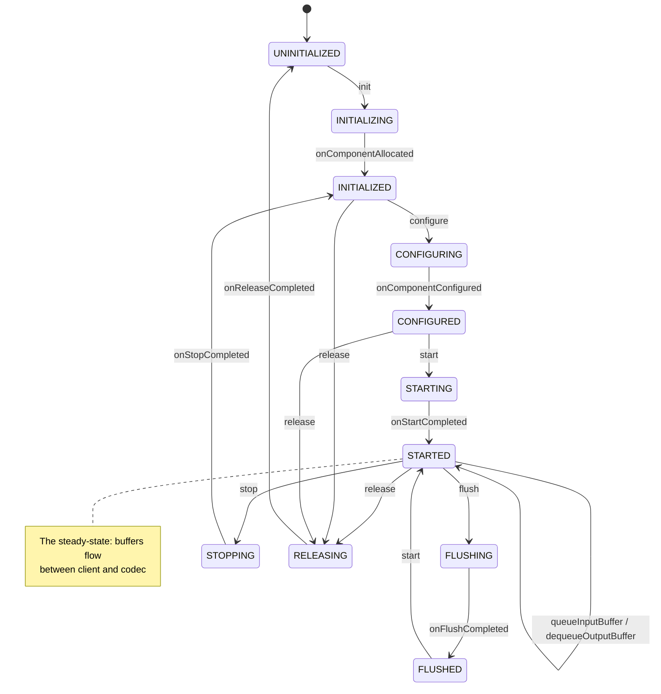

状态转换由定义在 `MediaCodec.cpp` 第 912 行的内部消息代码驱动：

```cpp
// frameworks/av/media/libstagefright/MediaCodec.cpp, line 912
enum {
    kWhatFillThisBuffer      = 'fill',
    kWhatDrainThisBuffer     = 'drai',
    kWhatEOS                 = 'eos ',
    kWhatStartCompleted      = 'Scom',
    kWhatStopCompleted       = 'scom',
    kWhatReleaseCompleted    = 'rcom',
    kWhatFlushCompleted      = 'fcom',
    kWhatError               = 'erro',
    kWhatCryptoError         = 'ercp',
    kWhatComponentAllocated  = 'cAll',
    kWhatComponentConfigured = 'cCon',
    kWhatInputSurfaceCreated = 'isfc',
    kWhatInputSurfaceAccepted = 'isfa',
    kWhatSignaledInputEOS    = 'seos',
    kWhatOutputFramesRendered = 'outR',
    kWhatOutputBuffersChanged = 'outC',
    kWhatFirstTunnelFrameReady = 'ftfR',
    kWhatPollForRenderedBuffers = 'plrb',
    kWhatMetricsUpdated      = 'mtru',
    kWhatRequiredResourcesChanged = 'reqR',
};
```

使用四字符代码（FourCC）作为消息标识符是 Stagefright 框架的标志性模式。这些代码使调试日志具有可读性：当你在日志中看到 `'fill'` 时，你立刻就知道这是一条“填充此缓冲区”的消息。

### 16.2.2 MediaCodec 初始化

`init()` 方法（第 2606 行）执行选择并实例化底层编解码器实现的关键步骤。它在抽象的 `MediaCodec` API 与具体的编解码器后端之间架起桥梁：

```cpp
// frameworks/av/media/libstagefright/MediaCodec.cpp, line 2606
status_t MediaCodec::init(const AString &name) {
    ScopedTrace trace(ATRACE_TAG, "MediaCodec::Init#native");
    status_t err = mResourceManagerProxy->init();
    if (err != OK) {
        mErrorLog.log(LOG_TAG, base::StringPrintf(
                "Fatal error: failed to initialize ResourceManager (err=%d)", err));
        mCodec = NULL; // remove the codec
        return err;
    }

    // save init parameters for reset
    mInitName = name;

    mCodecInfo.clear();

    bool secureCodec = false;
    const char *owner = "";
    if (!name.startsWith("android.filter.")) {
        err = mGetCodecInfo(name, &mCodecInfo);
        // ... error handling ...
        secureCodec = name.endsWith(".secure");
        Vector<AString> mediaTypes;
        mCodecInfo->getSupportedMediaTypes(&mediaTypes);
        for (size_t i = 0; i < mediaTypes.size(); ++i) {
            if (mediaTypes[i].startsWith("video/")) {
                mDomain = DOMAIN_VIDEO;
                break;
            } else if (mediaTypes[i].startsWith("audio/")) {
                mDomain = DOMAIN_AUDIO;
                break;
            } else if (mediaTypes[i].startsWith("image/")) {
                mDomain = DOMAIN_IMAGE;
                break;
            }
        }
        owner = mCodecInfo->getOwnerName();
    }

    mCodec = mGetCodecBase(name, owner);
```

这里有几点重要的细节：

1. **资源管理器集成**：在任何编解码器分配之前，ResourceManager 都会被初始化。该服务跟踪系统中的所有编解码器实例，当资源紧张时，可以从低优先级应用那里回收编解码器。

2. **域检测**：编解码器通过检查其支持的 MIME 类型来判断自己正在处理的是视频、音频还是图像数据。视频编解码器会获得一个专用的 `ALooper` 线程（`CodecLooper`），因为如果不这样做，视频解码就会与主事件队列共享而导致卡顿。

3. **编解码器基类选择**：`mGetCodecBase` 回调会创建一个 `ACodec`（用于 OMX 组件）或 `CCodec`（用于 Codec2 组件）。来自 `MediaCodecInfo` 的 `owner` 字段决定了选择哪一个。

4. **安全编解码器处理**：名称以 `.secure` 结尾的编解码器表示受 DRM 保护的内容路径。这些路径需要特殊的硬件支持和额外的安全检查。

### 16.2.3 配置与资源管理

`configure()` 方法（第 2997 行）使用格式参数和输出 surface 来设置编解码器：

```cpp
// frameworks/av/media/libstagefright/MediaCodec.cpp, line 2997
status_t MediaCodec::configure(
        const sp<AMessage> &format,
        const sp<Surface> &surface,
        const sp<ICrypto> &crypto,
        const sp<IDescrambler> &descrambler,
        uint32_t flags) {
    ScopedTrace trace(ATRACE_TAG, "MediaCodec::configure#native");
    // Update the codec importance.
    updateCodecImportance(format);
    // ...
    sp<AMessage> msg = new AMessage(kWhatConfigure, this);
    msg->setMessage("format", format);
    msg->setInt32("flags", flags);
    msg->setObject("surface", surface);

    if (crypto != NULL || descrambler != NULL) {
        if (crypto != NULL) {
            msg->setPointer("crypto", crypto.get());
        } else {
            msg->setPointer("descrambler", descrambler.get());
        }
    }
```

配置步骤包含一个带资源回收机制的重试机制。如果由于资源不足导致首次配置失败，MediaCodec 会请求 ResourceManagerService 回收一个编解码器。该编解码器来自一个优先级较低的进程。然后 MediaCodec 会重试。一个典型的触发原因是所有硬件编解码器实例都在使用中。下面的代码展示了重试过程：

```cpp
    for (int i = 0; i <= kMaxRetry; ++i) {
        sp<AMessage> response;
        err = PostAndAwaitResponse(msg, &response);
        if (err != OK && err != INVALID_OPERATION) {
            if (isResourceError(err) && !mResourceManagerProxy->reclaimResource(resources)) {
                break;
            }
            // ...reset and retry...
        }
        if (!isResourceError(err)) {
            break;
        }
    }
```

`kMaxRetry` 常量设置为 2（第 337 行），这意味着配置最多会尝试三次。

### 16.2.4 资源管理器

`ResourceManagerServiceProxy`（从第 415 行开始定义）是系统媒体资源管理器的一个复杂封装。它处理：

- **资源注册**：每个编解码器实例都向 ResourceManager 注册其资源消耗情况（类型、硬件/软件、安全/非安全）。
- **资源回收**：当资源耗尽时，ResourceManager 会识别出优先级最低的客户端，并向其发送 `reclaimResource()` 调用。
- **Binder 死亡处理**：如果 ResourceManager 进程死亡，该代理会自动重新连接并重新注册所有资源。

```cpp
// frameworks/av/media/libstagefright/MediaCodec.cpp, line 349
struct ResourceManagerClient : public BnResourceManagerClient {
    explicit ResourceManagerClient(MediaCodec* codec, int32_t pid, int32_t uid) :
            mMediaCodec(codec), mPid(pid), mUid(uid) {}

    Status reclaimResource(bool* _aidl_return) override {
        sp<MediaCodec> codec = mMediaCodec.promote();
        if (codec == NULL) {
            // Codec is already gone, so remove the resources as well
            // ...
            *_aidl_return = true;
            return Status::ok();
        }
        status_t err = codec->reclaim();
        if (err == WOULD_BLOCK) {
            ALOGD("Wait for the client to release codec.");
            usleep(kMaxReclaimWaitTimeInUs);
            ALOGD("Try to reclaim again.");
            err = codec->reclaim(true /* force */);
        }
        // ...
    }
```

回收机制对于编解码器硬件有限的移动设备尤为重要。典型的 SoC 可能只支持 2-4 个并发硬件解码会话。当请求第五个会话时，ResourceManager 必须决定驱逐哪个现有会话。优先级基于进程的 OOM 调整分数，这些分数反映了应用对用户的可见性和重要性。

### 16.2.5 MediaCodec 指标与遥测

MediaCodec 实现了全面的遥测，文件顶部约 140 个指标键常量（第 111-286 行）就是明证。这些指标涵盖：

- **编解码器标识**：名称、MIME 类型、模式（音频/视频/图像）、编码器/解码器、硬件/软件、安全、隧道模式
- **性能**：延迟（最小/最大/平均/直方图）、帧率、比特率
- **质量**：卡顿事件（次数、时长、分数）、抖动事件（次数、分数）
- **渲染质量**：已释放、已渲染、已丢弃、已跳过、停滞的帧
- **HDR 元数据**：色彩标准、范围、传递函数、HDR10+ 信息
- **错误跟踪**：错误代码、错误状态

渲染质量跟踪尤其复杂。它同时实现了卡顿检测（帧未按时渲染时）和抖动检测（帧间隔不均匀时）。这些指标会被上报到平台的 MediaMetrics 系统，用于大规模监控视频播放质量。

### 16.2.6 STARTED 状态下的缓冲区流转

一旦编解码器启动，缓冲区就会以乒乓模式在客户端与编解码器之间流转：

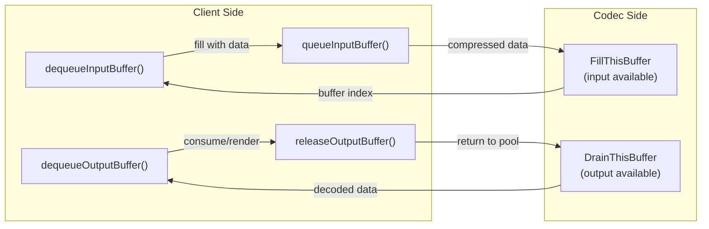

`BufferCallback` 类（第 1047 行）在编解码器内部的缓冲区通知与驱动 MediaCodec 状态机的 `AMessage` 事件之间进行转换：

```cpp
// frameworks/av/media/libstagefright/MediaCodec.cpp, line 1063
void BufferCallback::onInputBufferAvailable(
        size_t index, const sp<MediaCodecBuffer> &buffer) {
    sp<AMessage> notify(mNotify->dup());
    notify->setInt32("what", kWhatFillThisBuffer);
    notify->setSize("index", index);
    notify->setObject("buffer", buffer);
    notify->post();
}

void BufferCallback::onOutputBufferAvailable(
        size_t index, const sp<MediaCodecBuffer> &buffer) {
    sp<AMessage> notify(mNotify->dup());
    notify->setInt32("what", kWhatDrainThisBuffer);
    notify->setSize("index", index);
    notify->setObject("buffer", buffer);
    notify->post();
}
```

### 16.2.7 ACodec：OMX 桥梁

`frameworks/av/media/libstagefright/ACodec.cpp` 中的 `ACodec` 是 MediaCodec 与 OpenMAX IL（OMX）组件之间的传统桥梁。它是媒体框架中最大的单个源文件之一。虽然正逐渐被 Codec2 取代，但对于与较旧的厂商 OMX 实现保持向后兼容，ACodec 仍然很重要。

ACodec 使用 `AHierarchicalStateMachine` 模式实现了自己的嵌套状态机。每个状态都是一个嵌套类：

```cpp
// frameworks/av/media/libstagefright/ACodec.cpp, line 276
struct ACodec::BaseState : public AState {
    explicit BaseState(ACodec *codec, const sp<AState> &parentState = NULL);

protected:
    enum PortMode {
        KEEP_BUFFERS,
        RESUBMIT_BUFFERS,
        FREE_BUFFERS,
    };

    ACodec *mCodec;
    virtual PortMode getPortMode(OMX_U32 portIndex);
    virtual void stateExited();
    virtual bool onMessageReceived(const sp<AMessage> &msg);
    virtual bool onOMXEvent(OMX_EVENTTYPE event, OMX_U32 data1, OMX_U32 data2);
    virtual void onOutputBufferDrained(const sp<AMessage> &msg);
    virtual void onInputBufferFilled(const sp<AMessage> &msg);
};
```

ACodec 的状态层次结构如下：

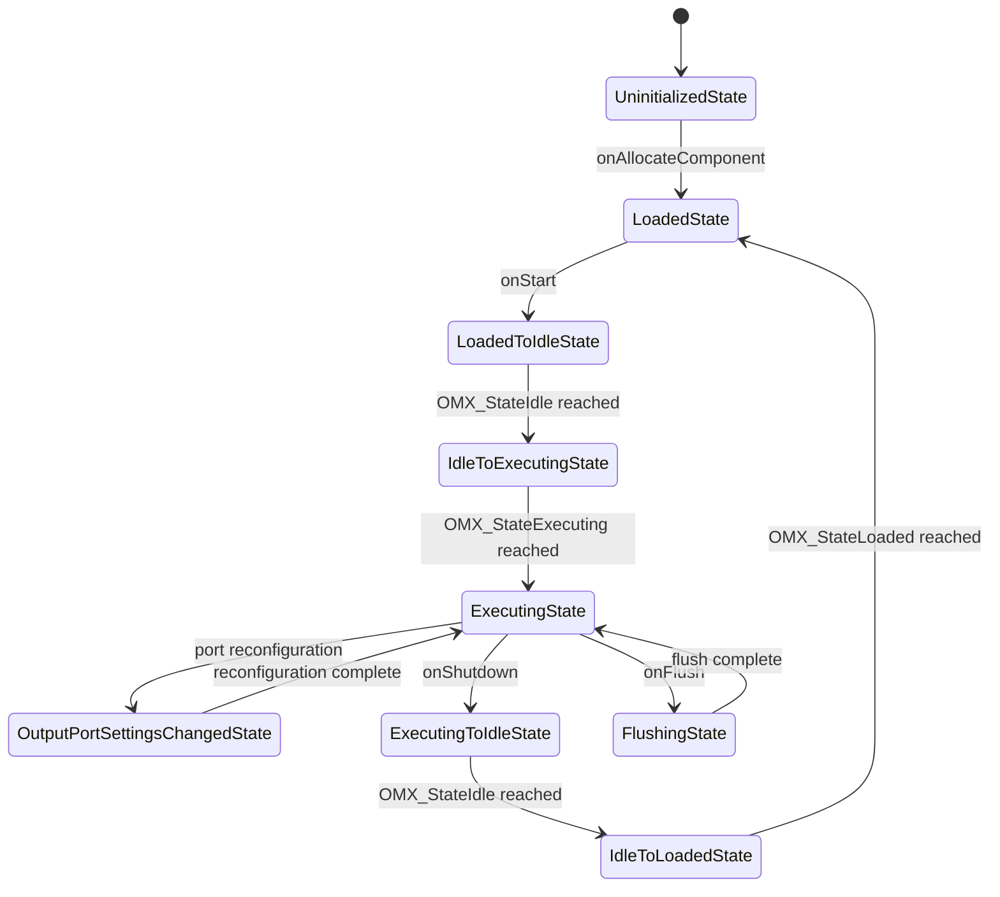

`CodecObserver` 类（第 192 行）接收 OMX 回调消息并将其转换为 AMessage 事件：

```cpp
// frameworks/av/media/libstagefright/ACodec.cpp, line 192
struct CodecObserver : public BnOMXObserver {
    explicit CodecObserver(const sp<AMessage> &msg) : mNotify(msg) {}

    virtual void onMessages(const std::list<omx_message> &messages) {
        if (messages.empty()) {
            return;
        }

        sp<AMessage> notify = mNotify->dup();
        sp<MessageList> msgList = new MessageList();
        for (std::list<omx_message>::const_iterator it = messages.cbegin();
              it != messages.cend(); ++it) {
            const omx_message &omx_msg = *it;
            sp<AMessage> msg = new AMessage;
            msg->setInt32("type", omx_msg.type);
            switch (omx_msg.type) {
                case omx_message::EVENT:
                    msg->setInt32("event", omx_msg.u.event_data.event);
                    msg->setInt32("data1", omx_msg.u.event_data.data1);
                    msg->setInt32("data2", omx_msg.u.event_data.data2);
                    break;
                case omx_message::EMPTY_BUFFER_DONE:
                    msg->setInt32("buffer", omx_msg.u.buffer_data.buffer);
                    msg->setInt32("fence_fd", omx_msg.fenceFd);
                    break;
                case omx_message::FILL_BUFFER_DONE:
                    // ... range_offset, range_length, flags, timestamp, fence_fd
                    break;
                case omx_message::FRAME_RENDERED:
                    // ... media_time_us, system_nano
                    break;
            }
            msgList->getList().push_back(msg);
        }
        notify->setObject("messages", msgList);
        notify->post();
    }
};
```

OMX 消息类型直接映射到 OpenMAX IL 规范：

- `EMPTY_BUFFER_DONE`：编解码器已消费一个输入缓冲区并将其归还
- `FILL_BUFFER_DONE`：编解码器已在缓冲区中生成了输出
- `EVENT`：状态变更通知、错误事件、端口设置变更
- `FRAME_RENDERED`：一帧已被渲染到输出 surface

ACodec 还负责在 Android API 常量与 OMX 的 `OMX_VIDEO_CONTROLRATETYPE` 之间转换比特率控制模式：

```cpp
// frameworks/av/media/libstagefright/ACodec.cpp, line 147
static OMX_VIDEO_CONTROLRATETYPE getVideoBitrateMode(const sp<AMessage> &msg) {
    int32_t tmp;
    if (msg->findInt32("bitrate-mode", &tmp)) {
        switch (tmp) {
            //BITRATE_MODE_CQ
            case 0: return OMX_Video_ControlRateConstantQuality;
            //BITRATE_MODE_VBR
            case 1: return OMX_Video_ControlRateVariable;
            //BITRATE_MODE_CBR
            case 2: return OMX_Video_ControlRateConstant;
            default: break;
        }
    }
    return OMX_Video_ControlRateVariable;
}
```

### 16.2.8 MPEG4Writer：容器封装器

`frameworks/av/media/libstagefright/MPEG4Writer.cpp` 中的 `MPEG4Writer` 实现了 ISO 14496（MP4/3GP）容器格式的写入器。它负责处理交织音视频轨道、写入元数据盒以及管理构成 MP4 文件的 atom 树等复杂任务。

Track 内部类（第 117 行）管理每个轨道的状态：

```cpp
// frameworks/av/media/libstagefright/MPEG4Writer.cpp, line 117
class MPEG4Writer::Track {
public:
    Track(MPEG4Writer *owner, const sp<MediaSource> &source, uint32_t aTrackId);
    ~Track();

    status_t start(MetaData *params);
    status_t stop(bool stopSource = true);
    status_t pause();
    bool reachedEOS();

    int64_t getDurationUs() const;
    int64_t getEstimatedTrackSizeBytes() const;
    void writeTrackHeader();
    // ...
    bool isAvc() const { return mIsAvc; }
    bool isHevc() const { return mIsHevc; }
    bool isAv1() const { return mIsAv1; }
    bool isApv() const { return mIsApv; }
    bool isHeic() const { return mIsHeic; }
    bool isAvif() const { return mIsAvif; }
    bool isHeif() const { return mIsHeif; }
    bool isAudio() const { return mIsAudio; }
    bool isMPEG4() const { return mIsMPEG4; }
    bool usePrefix() const { return mIsAvc || mIsHevc || mIsHeic || mIsDovi; }
```

Track 类支持多种编解码器：AVC（H.264）、HEVC（H.265）、AV1、APV、HEIC、AVIF、HEIF、Dolby Vision 以及传统的 MPEG-4 Part 2。关键常量定义了运行限制：

```cpp
// frameworks/av/media/libstagefright/MPEG4Writer.cpp, line 74
static const int64_t kMinStreamableFileSizeInBytes = 5 * 1024 * 1024;
static const uint8_t kNalUnitTypeSeqParamSet = 0x07;
static const uint8_t kNalUnitTypePicParamSet = 0x08;
static const int64_t kInitialDelayTimeUs     = 700000LL;
static const int64_t kMaxMetadataSize = 0x4000000LL;   // 64MB max per-frame metadata size
static const int64_t kMaxCttsOffsetTimeUs = 30 * 60 * 1000000LL;  // 30 minutes
```

MPEG4Writer 还处理 HEIF/AVIF 图像写入和 gainmap（HDR）元数据，这对较新的 Ultra HDR 照片格式至关重要。轨道标识系统使用 `TrackId` 结构体（第 118 行）。该结构体强制执行 ISO 14496-12 的约束。轨道 ID 不能为零。当与 `MediaRecorder` 一起使用时，它们被限制为 4 位（值 1-15）。

### 16.2.9 AMessage 模式

在整个媒体框架中，组件之间的通信都使用 `AMessage`/`AHandler`/`ALooper` 模式。这是 Stagefright 自己的轻量级 Actor 模型：

- **ALooper**：一个从队列中处理消息的线程
- **AHandler**：接收由 looper 分发给它的消息
- **AMessage**：一个带类型的键值容器，可以投递给 handler

这种模式出现在 MediaCodec 几乎每个方法中。例如 `start()`：

```cpp
// frameworks/av/media/libstagefright/MediaCodec.cpp, line 3683
status_t MediaCodec::start() {
    ScopedTrace trace(ATRACE_TAG, "MediaCodec::start#native");
    sp<AMessage> msg = new AMessage(kWhatStart, this);

    // ...resource checking and retry logic...

    sp<AMessage> response;
    err = PostAndAwaitResponse(msg, &response);
    // ...
}
```

`PostAndAwaitResponse` 是一个同步包装器：它将消息投递到 looper 线程，并阻塞调用线程直到收到响应。这意味着，虽然 `MediaCodec::start()` 对调用者而言看起来是同步的，但它在内部是在 looper 线程上执行的，从而确保了对 MediaCodec 状态的线程安全访问。

---

## 16.3 Codec2 框架

### 16.3.1 架构与设计理念

Codec2（常缩写为 C2）是 Android 的现代编解码器框架，旨在取代日渐陈旧的 OMX IL 接口。它位于 `frameworks/av/media/codec2/`，包含 10 个子目录，分别存放核心 API、21 个软件编解码器家族、HAL 层以及通往 Stagefright 框架的 `sfplugin` 桥梁。

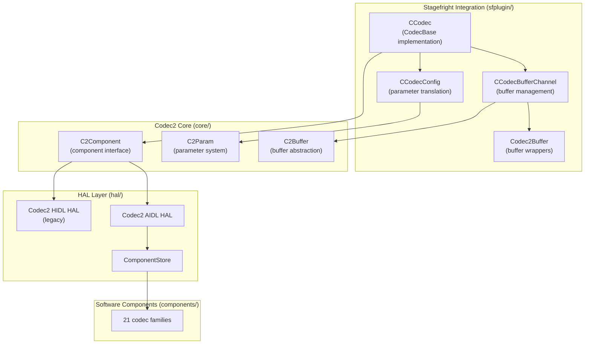

相比 OMX，关键的设计改进包括：

1. **带类型的参数系统**：Codec2 不再使用 OMX 那种扁平的、基于索引的参数方案，而是使用强类型的、可反射的参数系统（`C2Param`），可以在编译时捕获配置错误。

2. **基于工作项的处理模型**：Codec2 不再使用 OMX 那种分离的输入/输出缓冲区队列，而是使用统一的 `C2Work` 结构，将输入和输出捆绑在一起。这简化了缓冲区生命周期的跟踪。

3. **灵活的缓冲区管理**：Codec2 通过统一的 `C2Buffer` 抽象支持多种分配器后端（Gralloc、ION/DMA-buf、blob）。

4. **组件存储**：编解码器通过 `C2ComponentStore` 接口被发现，而不是通过全局 OMX 节点注册表，从而提供了更好的隔离性和厂商可扩展性。

### 16.3.2 CCodec：Codec2 到 Stagefright 的桥梁

`frameworks/av/media/codec2/sfplugin/CCodec.cpp` 中的 `CCodec` 实现了 `CodecBase` 接口，使 Codec2 组件可以被 `MediaCodec` 使用。它是 Codec2 世界中 `ACodec` 的对应物。

```cpp
// frameworks/av/media/codec2/sfplugin/CCodec.cpp, line 18-19
#define LOG_TAG "CCodec"
#define ATRACE_TAG  ATRACE_TAG_VIDEO
```

CCodec 包含一个**看门狗机制**来检测挂起的编解码器：

```cpp
// frameworks/av/media/codec2/sfplugin/CCodec.cpp, line 90
class CCodecWatchdog : public AHandler {
private:
    enum {
        kWhatWatch,
    };
    constexpr static int64_t kWatchIntervalUs = 3300000;  // 3.3 secs

public:
    static sp<CCodecWatchdog> getInstance() {
        static sp<CCodecWatchdog> sInstance = [] {
            sp<CCodecWatchdog> instance = new CCodecWatchdog;
            instance->incStrong((void *)CCodecWatchdog::getInstance);
            instance->init();
            return instance;
        }();
        return sInstance;
    }

    void watch(sp<CCodec> codec) {
        bool shouldPost = false;
        {
            Mutexed<std::set<wp<CCodec>>>::Locked codecs(mCodecsToWatch);
            shouldPost = codecs->empty();
            codecs->emplace(codec);
        }
        if (shouldPost) {
            ALOGV("posting watch message");
            (new AMessage(kWhatWatch, this))->post(kWatchIntervalUs);
        }
    }
```

看门狗运行一个单例 looper 线程。每隔 3.3 秒，它会检查所有已注册的 CCodec 实例，并对任何看起来挂起的实例调用 `initiateReleaseIfStuck()`。这对健壮性至关重要。如果某个厂商编解码器 HAL 冻结，看门狗能确保系统最终恢复，而 MediaCodec 不会一直停留在永久卡死的状态。

### 16.3.3 CCodecBufferChannel

`frameworks/av/media/codec2/sfplugin/CCodecBufferChannel.cpp` 中的 `CCodecBufferChannel` 管理 MediaCodec 与 Codec2 组件之间的缓冲区流水线。它负责：

- 缓冲区分配与池化
- 在 MediaCodec 的 `MediaCodecBuffer` 与 Codec2 的 `C2Buffer` 之间转换
- 视频输出的 Surface 缓冲区管理
- DRM/加密缓冲区处理
- 大帧音频缓冲区管理

MediaCodec 与 Codec2 缓冲区标志之间的转换体现了这一翻译层：

```cpp
// frameworks/av/media/codec2/sfplugin/CCodecBufferChannel.cpp, line 101
constexpr static std::initializer_list<std::pair<uint32_t, uint32_t>> flagList = {
        {BUFFER_FLAG_CODEC_CONFIG, C2FrameData::FLAG_CODEC_CONFIG},
        {BUFFER_FLAG_END_OF_STREAM, C2FrameData::FLAG_END_OF_STREAM},
        {BUFFER_FLAG_DECODE_ONLY, C2FrameData::FLAG_DROP_FRAME}
};

static uint32_t convertFlags(uint32_t flags, bool toC2) {
    return std::transform_reduce(
            flagList.begin(), flagList.end(),
            0u,
            std::bit_or{},
            [flags, toC2](const std::pair<uint32_t, uint32_t> &entry) {
                if (toC2) {
                    return (flags & entry.first) ? entry.second : 0;
                } else {
                    return (flags & entry.second) ? entry.first : 0;
                }
            });
}
```

`SurfaceCallbackHandler`（第 203 行）管理异步的 Surface 缓冲区事件：

```cpp
// frameworks/av/media/codec2/sfplugin/CCodecBufferChannel.cpp, line 203
class SurfaceCallbackHandler {
public:
    enum callback_type_t {
        ON_BUFFER_RELEASED = 0,
        ON_BUFFER_ATTACHED,
        ON_BUFFER_DETACHED,
        ON_BUFFERS_REMOVED,
    };

    void post(callback_type_t callback,
            std::shared_ptr<Codec2Client::Component> component,
            uint32_t generation,
            const std::vector<uint64_t>& removedBufferIds = {}) {
        // ...post callback to handler thread...
    }
};
```

关键的运行时常量包括：

```cpp
// frameworks/av/media/codec2/sfplugin/CCodecBufferChannel.cpp, line 88
constexpr size_t kSmoothnessFactor = 4;
const static size_t kDequeueTimeoutNs = 0;
```

`kSmoothnessFactor` 取 4 是作为附加余量。缓冲区通道将其槽位数量设置为编解码器声明的输入延迟、流水线延迟和输出延迟再加上 4 个额外槽位（例如 `numInputSlots = inputDelayValue + pipelineDelayValue + kSmoothnessFactor`）。这为在变化不定的解码延迟下平滑运行留出了余量。

### 16.3.4 C2InputSurface 包装器

对于输入来自 `Surface` 的编码场景（例如屏幕录制、相机录制），CCodec 使用 `C2InputSurfaceWrapper`：

```cpp
// frameworks/av/media/codec2/sfplugin/CCodec.cpp, line 164
class C2InputSurfaceWrapper : public InputSurfaceWrapper {
public:
    explicit C2InputSurfaceWrapper(
            const std::shared_ptr<Codec2Client::InputSurface> &surface,
            uint32_t width, uint32_t height, uint64_t usage)
        : mSurface(surface), mWidth(width), mHeight(height) {
        mDataSpace = HAL_DATASPACE_BT709;
        mConfig.mUsage = usage;
    }

    status_t connect(const std::shared_ptr<Codec2Client::Component> &comp) override {
        // Configure block size, count, usage, dataspace
        C2StreamBlockSizeInfo::output blockSize{0u, mWidth, mHeight};
        C2StreamBlockCountInfo::output blockCount{0u, getInputBufferCount(comp)};
        C2StreamUsageTuning::output usage{0u, mConfig.mUsage};
        C2StreamDataSpaceInfo::output dataspace{0u, mDataSpace};
        c2_status_t err = mSurface->config(
                {&blockSize, &blockCount, &usage, &dataspace},
                C2_MAY_BLOCK, &failures);
        // ...
        return mSurface->connect(comp, &mConnection);
    }
```

该包装器配置输入 surface 的缓冲区尺寸、数量和使用标志，然后将其直接连接到 Codec2 组件。这实现了零拷贝编码路径：相机或 GPU 的输出被直接送入编码器，无需在 CPU 侧进行缓冲区拷贝。

### 16.3.5 软件编解码器组件（21 个家族）

`frameworks/av/media/codec2/components/` 目录包含 Google 的软件编解码器实现，按编解码器家族组织。每个组件都遵循 `c2.android.<codec>.<encoder|decoder>` 的命名约定。

以下是全部 21 个组件家族，同时也列出了它们都基于构建的共享 `base/` 类。该目录还包含 `cmds/` 和 `tests/`，其中是工具而非编解码器：

| 目录 | 编解码器 | 类型 | 源文件 |
|---|---|---|---|
| `aac/` | AAC | 音频 解码+编码 | `C2SoftAacDec.cpp`、`C2SoftAacEnc.cpp` |
| `amr_nb_wb/` | AMR-NB、AMR-WB | 音频 解码+编码 | `C2SoftAmrDec.cpp`、`C2SoftAmrNbEnc.cpp`、`C2SoftAmrWbEnc.cpp` |
| `aom/` | AV1 (libaom) | 视频 解码+编码 | `C2SoftAomDec.cpp`、`C2SoftAomEnc.cpp` |
| `apv/` | APV | 视频 解码+编码 | `C2SoftApvDec.cpp`、`C2SoftApvEnc.cpp` |
| `avc/` | H.264/AVC | 视频 解码+编码 | `C2SoftAvcDec.cpp`、`C2SoftAvcEnc.cpp` |
| `dav1d/` | AV1 (dav1d) | 视频 解码 | `C2SoftDav1dDec.cpp` |
| `flac/` | FLAC | 音频 解码+编码 | `C2SoftFlacDec.cpp`、`C2SoftFlacEnc.cpp` |
| `g711/` | G.711 (alaw/ulaw) | 音频 解码 | `C2SoftG711Dec.cpp` |
| `gav1/` | AV1 (libgav1) | 视频 解码 | `C2SoftGav1Dec.cpp` |
| `gsm/` | GSM | 音频 解码 | `C2SoftGsmDec.cpp` |
| `hevc/` | H.265/HEVC | 视频 解码+编码 | `C2SoftHevcDec.cpp`、`C2SoftHevcEnc.cpp` |
| `iamf/` | IAMF | 音频 解码 | `C2SoftIamfDec.cpp` |
| `mp3/` | MP3 | 音频 解码 | `C2SoftMp3Dec.cpp` |
| `mpeg2/` | MPEG-2 | 视频 解码 | `C2SoftMpeg2Dec.cpp` |
| `mpeg4_h263/` | MPEG-4/H.263 | 视频 解码+编码 | `C2SoftMpeg4Dec.cpp`、`C2SoftMpeg4Enc.cpp` |
| `opus/` | Opus | 音频 解码+编码 | `C2SoftOpusDec.cpp`、`C2SoftOpusEnc.cpp` |
| `raw/` | PCM | 音频 解码 | `C2SoftRawDec.cpp` |
| `vorbis/` | Vorbis | 音频 解码 | `C2SoftVorbisDec.cpp` |
| `vpx/` | VP8、VP9 | 视频 解码+编码 | `C2SoftVpxDec.cpp`、`C2SoftVp8Enc.cpp`、`C2SoftVp9Enc.cpp` |
| `xaac/` | xHE-AAC | 音频 解码 | `C2SoftXaacDec.cpp` |
| `xhe_aac/` | xHE-AAC | 音频 编码 | `C2SoftXheAacEnc.cpp` |
| `base/` | （基类） | 工具 | `SimpleC2Component.cpp`、`SimpleC2Interface.cpp` |

值得注意的几点：

- **三个 AV1 解码器**：框架包含三个独立的 AV1 实现：libaom（参考实现）、dav1d（速度优化）和 libgav1（Google 的实现）。在实践中，dav1d 因其更优越的性能而成为首选的软件解码器。

- **IAMF（Immersive Audio Model and Formats）**：`iamf/` 家族是 AOM Immersive Audio Model and Formats 标准（`audio/iamf`）的软件解码器。它构建在 `external/iamf_tools` 库之上。它由 `frameworks/av/media/aconfig/swcodec_flags.aconfig` 中的 `iamf_software_decoder` 标志控制，并针对 `minsdk="36"` 注册。16.3.13 节将详细介绍它。

- **APV（Advanced Professional Video）**：`apv/` 家族解码和编码三星的 APV 仅帧内专业编解码器（`video/apv`），构建在 `external/libopenapv` 之上。它由 `apv_software_codec` 标志控制，默认禁用（编解码器列表中 `enabled="false"`），因此设备需要明确开启。16.3.12 节将介绍它。

每个软件编解码器都继承 `SimpleC2Component` 基类，并实现 `IntfImpl` 模式来进行参数声明：

```cpp
// frameworks/av/media/codec2/components/avc/C2SoftAvcDec.cpp, line 37
constexpr char COMPONENT_NAME[] = "c2.android.avc.decoder";
constexpr uint32_t kDefaultOutputDelay = 8;
constexpr uint32_t kMaxOutputDelay = 34;

class C2SoftAvcDec::IntfImpl : public SimpleInterface<void>::BaseParams {
public:
    explicit IntfImpl(const std::shared_ptr<C2ReflectorHelper> &helper)
        : SimpleInterface<void>::BaseParams(
                helper,
                COMPONENT_NAME,
                C2Component::KIND_DECODER,
                C2Component::DOMAIN_VIDEO,
                MEDIA_MIMETYPE_VIDEO_AVC) {
        noPrivateBuffers();
        noInputReferences();
        noOutputReferences();
        noInputLatency();
        noTimeStretch();

        addParameter(
                DefineParam(mActualOutputDelay, C2_PARAMKEY_OUTPUT_DELAY)
                .withDefault(new C2PortActualDelayTuning::output(kDefaultOutputDelay))
                .withFields({C2F(mActualOutputDelay, value).inRange(0, kMaxOutputDelay)})
                .withSetter(Setter<decltype(*mActualOutputDelay)>::StrictValueWithNoDeps)
                .build());

        addParameter(
                DefineParam(mSize, C2_PARAMKEY_PICTURE_SIZE)
                .withDefault(new C2StreamPictureSizeInfo::output(0u, 320, 240))
                .withFields({
                    C2F(mSize, width).inRange(2, 4096, 2),
                    C2F(mSize, height).inRange(2, 4096, 2),
                })
                .withSetter(SizeSetter)
                .build());
```

AVC 的 `kMaxOutputDelay` 取 34 源自规范。AVC 允许最多 16 帧的重排序延迟。隔行内容将其翻倍为 32 个场。软件解码器又增加 2 帧内部延迟，总共为 34。

### 16.3.6 Codec2 HAL

`frameworks/av/media/codec2/hal/` 中的 Codec2 HAL 层提供了 Android 框架与厂商编解码器实现之间的接口。HAL 经历了两代演进：

```
hal/
  aidl/          # Modern AIDL HAL (current)
    Component.cpp
    ComponentInterface.cpp
    ComponentStore.cpp
    Configurable.cpp
    InputBufferManager.cpp
    ParamTypes.cpp
  hidl/          # Legacy HIDL HAL
  services/      # HAL service entry point
    vendor.cpp
    android.hardware.media.c2-default-service.rc
    manifest_media_c2_default.xml
```

AIDL HAL 定义了以下关键接口：

- **IComponentStore**：发现并实例化编解码器组件
- **IComponent**：表示单个编解码器实例，具有 queue/flush/start/stop/reset 操作
- **IComponentInterface**：提供参数查询和配置
- **IConfigurable**：通用配置接口

HAL 服务作为一个独立进程（`android.hardware.media.c2-default-service`）运行，在厂商编解码器代码与框架之间提供了进程隔离：

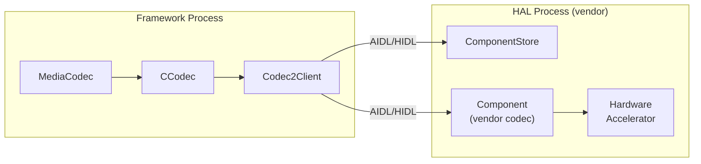

### 16.3.7 Codec2 参数系统

Codec2 最重要的创新之一是其带类型的参数系统。与 OMX 扁平的 `OMX_INDEXTYPE` + void 指针方式不同，Codec2 参数是带有编译时类型检查的 C++ 结构体：

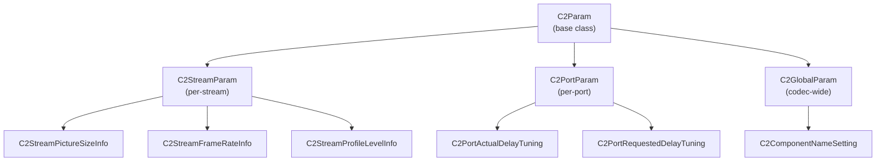

`DefineParam` / `withDefault` / `withFields` / `withSetter` / `build()` 构建器模式提供了一种声明式的方式来指定参数约束。例如，AVC 解码器的图片尺寸参数将宽度和高度约束在 [2, 4096] 范围内、步长为 2。这使得尺寸为偶数，正如 YUV 格式所需。

### 16.3.8 CCodecConfig：参数翻译

`frameworks/av/media/codec2/sfplugin/CCodecConfig.cpp` 中的 `CCodecConfig` 承担了在 Stagefright 基于 `AMessage` 的格式参数（例如 `"width"`、`"height"`、`"bitrate"`）与 Codec2 强类型的 `C2Param` 结构之间进行翻译的关键任务。之所以需要这个翻译层，是因为 Java 的 `MediaFormat` API 早于 Codec2 出现，使用的是字符串键。

该翻译涵盖了数百个参数映射，包括：

- 视频尺寸：`"width"` / `"height"` 到 `C2StreamPictureSizeInfo`
- 帧率：`"frame-rate"` 到 `C2StreamFrameRateInfo`
- 比特率：`"bitrate"` 到 `C2StreamBitrateInfo`
- Profile/level：`"profile"` / `"level"` 到 `C2StreamProfileLevelInfo`
- 色彩格式：`"color-format"` 到 `C2StreamPixelFormatInfo`
- HDR 元数据：各种 HDR 键到 `C2StreamHdrStaticInfo` 等

### 16.3.9 Codec2 工作项

Codec2 中处理的基本单元是 `C2Work` 结构：

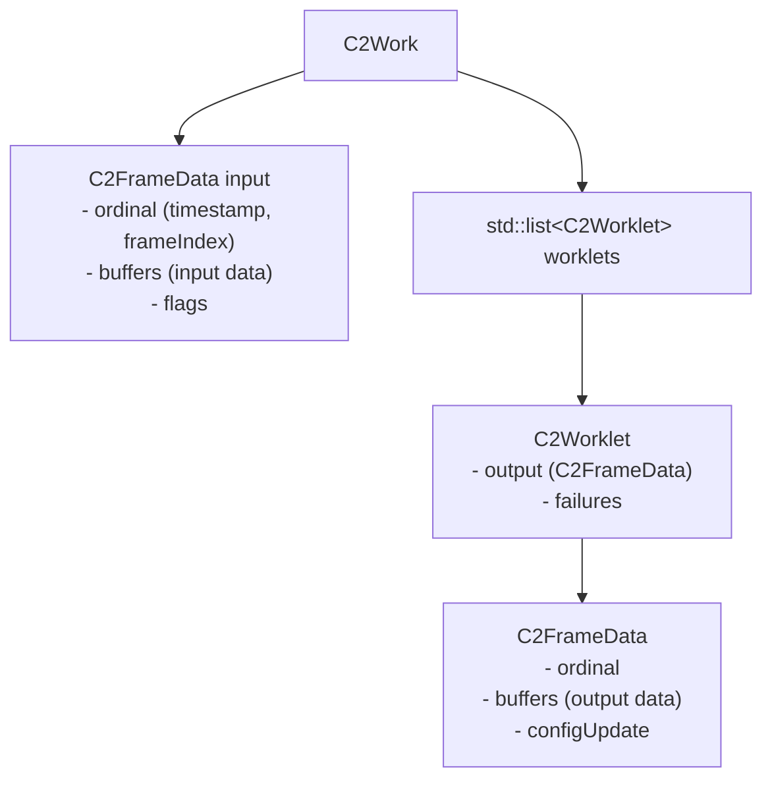

与 OMX 分离的 `EmptyThisBuffer` / `FillThisBuffer` 调用不同，`C2Work` 将输入和输出捆绑在一起。客户端提交一个已填入输入数据的 `C2Work`，组件对其进行处理，并在同一个 `C2Work` 结构中填入输出数据，然后组件通过 `onWorkDone` 回调将该结构返回。这一设计消除了 OMX 所需的复杂缓冲区匹配逻辑。

### 16.3.12 APV：高级专业视频编解码器

Android 16（Baklava，API 36）新增了 APV（Advanced Professional Video）的软件编解码器。APV 是三星贡献的仅帧内中间编解码器，后来被开放媒体联盟（Alliance for Open Media）采纳。第 17 周期一直在继续扩展它。

APV 面向专业拍摄和编辑工作流，在这种工作流中每一帧都是关键帧。它没有帧间预测，因此每幅图像都可以独立解码。这使得拖动浏览、裁剪和帧精确编辑都很廉价，代价是比特率要高得多。Codec2 组件位于 `frameworks/av/media/codec2/components/apv/`，包装了 `external/libopenapv`（`libopenapv`，即 `oapv` API）参考库。

发布了两个组件：一个解码器和一个编码器，针对 `video/apv` 媒体类型注册。

```cpp
// frameworks/av/media/codec2/components/apv/C2SoftApvDec.cpp, line 37 and 55
const char* MEDIA_MIMETYPE_VIDEO_APV = "video/apv";
constexpr char COMPONENT_NAME[] = "c2.android.apv.decoder";
constexpr uint32_t kDefaultOutputDelay = 8;
```

```cpp
// frameworks/av/media/codec2/components/apv/C2SoftApvEnc.cpp, line 45
constexpr char COMPONENT_NAME[] = "c2.android.apv.encoder";
```

编码器声明了唯一支持的 Profile，即 4:2:2 10-bit Profile（`C2Config::PROFILE_APV_422_10`）。这反映了 APV 作为高保真拍摄格式而非分发格式的定位。解码器在 `C2SoftApvDec.cpp` 第 88-92 行以 `C2StreamProfileLevelInfo::input` 参数的形式做出匹配的声明。编码器的声明是：

```cpp
// frameworks/av/media/codec2/components/apv/C2SoftApvEnc.cpp, line 119
.withDefault(new C2StreamProfileLevelInfo::output(
        0u, C2Config::PROFILE_APV_422_10, LEVEL_APV_1_BAND_0))
.withFields({
    C2F(mProfileLevel, profile).oneOf({C2Config::PROFILE_APV_422_10}),
    C2F(mProfileLevel, level).oneOf({
            C2Config::LEVEL_APV_1_BAND_0,
            C2Config::LEVEL_APV_1_1_BAND_0,
            C2Config::LEVEL_APV_2_BAND_0,
            // ... up to LEVEL_APV_7_1_BAND_3
    }),
})
```

APV 将其级别组织为若干带（Band 0 到 Band 3）。这些带按级别缩放允许的比特率。因此级别枚举是级别编号与带的笛卡尔积。

APV 在比特流本身中携带 HDR 元数据（母版显示色彩体积、内容亮度级别，以及用于 HDR10+ 的 ITU-T T.35 用户数据）。因此，解码器从每个访问单元中解析出这些元数据，并作为 `C2StreamHdrStaticMetadataInfo` 和 `C2StreamHdr10PlusInfo` 重新发布，使流水线的其他部分看到标准的 Codec2 HDR 参数。解码器在 `C2SoftApvDec.cpp` 中的 `getHdrInfo`、`getHDRStaticParams` 和 `getHDR10PlusInfoData` 辅助函数执行这一提取。

该特性被置于两层标志之后分阶段推出，以便厂商可以逐步采用。`frameworks/av/media/aconfig/codec_fwk.aconfig` 中面向框架的 `apv_support` 标志控制平台是否宣传 APV。它控制 `MediaFormat.MIMETYPE_VIDEO_APV` 的管道以及 `frameworks/base/media/java/android/media/MediaCodecInfo.java` 中的 `CodecProfileLevel.APVProfile*`/`APVLevel*` 常量。`frameworks/av/media/aconfig/swcodec_flags.aconfig` 中的 `apv_software_codec` 标志控制软件组件本身。在编解码器列表中，这些条目声明为 `enabled="false" minsdk="36" variant="!slow-cpu"`：

```xml
<!-- frameworks/av/media/libstagefright/data/media_codecs_sw.xml, line 288 -->
<MediaCodec name="c2.android.apv.decoder" type="video/apv"
            enabled="false" minsdk="36" variant="!slow-cpu">
    <Limit name="size" min="16x16" max="1920x1920"/>
    <Limit name="alignment" value="2x2"/>
    <Limit name="bitrate" range="1-240000000"/>
    ...
</MediaCodec>
```

该声明中有两点很突出。`enabled="false"` 的默认值意味着设备只有在其编解码器列表覆盖层将其开启时才会出厂支持 APV。APV 是可选加入而非普遍可用的。而 `variant="!slow-cpu"` 属性排除了低端 CPU。这是因为在 APV 比特率下对 10-bit 4:2:2 仅帧内流进行软件解码是很昂贵的。在上面的限制中，这些比特率最高可达 240 Mbit/s。

`minsdk="36"` 属性是该编解码器到达时间最清晰的标志：APV 随 Android 16 发布，而不是随 17 发布。第 17 周期新增了 `apv_software_codec_cq` 标志，这是编码器的恒定质量码率控制模式。因此编码器的编解码器列表条目现在带有 `<Limit name="quality" range="0-100" default="90" />`。而 Android 16 在该条目中只声明了 VBR 比特率模式。

### 16.3.13 IAMF：沉浸式音频解码

另一个新近添加的 Codec2 家族是 IAMF 的解码器，即开放媒体联盟的 Immersive Audio Model and Formats 标准。它也在 Android 16（API 36）中到来。IAMF 将基于场景和基于声道的沉浸式音频描述为一棵由“音频元素”和“混音呈现”组成的树。可以把它想象成 Dolby Atmos 那种基于对象/床的混音，但它是免版税的。这棵树承载在 OBU（Open Bitstream Units）中，这是与 AV1 使用的相同的容器概念。组件位于 `frameworks/av/media/codec2/components/iamf/`，且仅为解码器：代码树中没有软件 IAMF 编码器。

```cpp
// frameworks/av/media/codec2/components/iamf/C2SoftIamfDec.cpp, line 38, 50
constexpr char COMPONENT_NAME[] = "c2.android.iamf.decoder";
// ... DOMAIN_AUDIO, MEDIA_MIMETYPE_AUDIO_IAMF ("audio/iamf")
```

该组件并不在 `frameworks/av` 中实现比特流解析器。它链接 `external/iamf_tools` 库，并通过一个小的 C++ API 表面（`iamf_tools::api::IamfDecoderFactory` / `IamfDecoderInterface`，包含自 `<iamf_tools/iamf_decoder_factory.h>`）来驱动它。`external/iamf_tools` 是 16 到 17 变更集中最活跃的媒体仓库之一。因此 Codec2 包装器主要是胶水代码：它将 OBU 喂给解码器，并取回已解码的“时间单元”。它还在 Android 的声道掩码词汇与 IAMF 的扬声器布局词汇之间进行转换。

这种转换是其中有趣的部分，它位于 `LayoutTranslation.cpp` 中。IAMF 将输出配置表达为标准化布局（ITU-R BS.2051 声音系统和 IAMF 扩展布局），而不是 Android 的 `CHANNEL_OUT_*` 掩码。`GetIamfLayout` 将请求的 Android 声道掩码映射到最接近的 IAMF 布局，而 `GetAndroidChannelMask` 则映射回来：

```cpp
// frameworks/av/media/codec2/components/iamf/C2SoftIamfDec.cpp, line 187
std::optional<iamf_tools::api::OutputLayout> C2SoftIamfDec::getTargetOutputLayout() {
    // ...
    //   stereo  -> kItu2051_SoundSystemA_0_2_0
    //   5.1     -> kItu2051_SoundSystemB_0_5_0
    //   7.1     -> kItu2051_SoundSystemI_0_7_0
    //   mono    -> kIAMF_SoundSystemExtension_0_1_0
}
```

`LayoutTranslation.h` 中的头文件注释明确说明，没有精确 IAMF 布局的掩码会被拒绝。例外是 `CHANNEL_OUT_5POINT1POINT2` 和 `CHANNEL_OUT_7POINT1POINT2`，它们会被吸附到最接近的等效布局。

这就是沉浸式混音如何被下混渲染到设备实际拥有的扬声器配置上的方式。应用请求一个声道数或掩码。解码器选择一个 IAMF `OutputLayout`。`iamf_tools` 引擎在内部执行下混/渲染并返回一个 `SelectedMix`。组件将其读回，以发布真实的输出声道掩码。

编解码器列表以 `minsdk="36"` 声明该解码器，并内联记录了当前的编解码器支持情况和 IAMF Profile 限制：

```xml
<!-- frameworks/av/media/libstagefright/data/media_codecs_sw.xml, line 119 -->
<MediaCodec name="c2.android.iamf.decoder" type="audio/iamf" minsdk="36">
    <!-- IAMF v1.0 (Simple and Base profiles) support up to 18 input channels. -->
    <Limit name="channel-count" max="18" />
    <!-- The decoder currently supports Opus and PCM ... -->
    <Limit name="sample-rate" ranges="16000,32000,44100,48000,96000" />
    <Limit name="bitrate" range="1-21000000" />
</MediaCodec>
```

`minsdk="36"` 再次表明该组件属于 Android 16。此处可见的第 17 周期变化是去掉了 `variant="!slow-cpu"` 属性。Android 16 将低端 CPU 排除在 IAMF 解码器之外。现在该条目不再这样做，因此解码器会在所有启用它的设备上提供。

XML 注释记录了真实的实现限制。现阶段解码器处理 Opus 和 PCM 子流编解码器。`swcodec_flags.aconfig` 中的 `iamf_aac_flac` 标志是将其扩展到 AAC 和 FLAC 子流的开关。整个组件本身还由 `iamf_software_decoder` 控制。在框架一侧，`codec_fwk.aconfig` 中的 `audio_mix_presentation_support` 标志添加了应用用来在 IAMF 流提供的多个混音呈现之间进行选择的 `MediaFormat.KEY_AUDIO_PRESENTATION_ID` 键。

### 16.3.14 进程内软件编解码器：ApexCodecs 与 LFI

历史上，Android 上的每个软件编解码器都运行在专用的 `media.swcodec` HAL 进程内。即使编解码器是 Google 自己的软件实现，访问也要经过 Binder/Codec2-HAL。这种隔离对安全有好处，但代价是每次缓冲区都要多一次 IPC 跳转和一个进程边界。Android 17 通过一个新的模块 API `libapexcodecs`，为部分软件音频编解码器引入了*进程内*路径。编解码器直接在客户端进程内运行，同时保留了 Codec2 编程模型。

该模块位于 `frameworks/av/media/module/libapexcodecs/`，其公共 API 为 `ApexCodecs.h`：

```cpp
// frameworks/av/media/module/libapexcodecs/include/apex/ApexCodecs.h
/**
 * An API to access and operate codecs implemented within an APEX module,
 * used only by the OS when using the codecs within a client process
 * (instead of via a HAL).
 * NOTE: Many of the constants and types mirror the ones in the Codec 2.0 API.
 */
```

正如注释所说，`ApexCodec_*` 类型刻意模仿了 Codec2 的词汇（`ApexCodec_Status`、`ApexCodec_Configurable`、线性/图形缓冲区、支持值的查询）。因此，相同的参数和缓冲区模型无需经过 HAL 跳转即可沿用。编解码器实现是薄薄的 C2 到 ApexCodec 适配器，但其中发布的两个组件包装了截然不同的后端。`C2ApexOpusDec` 包装现有的 libopus 解码器，为这条路径构建为 `libopus_lfi`（`external/libopus/Android.bp`，第 426 行）。`C2ApexAacDec` 则包装一个*新的* Rust AAC 解码器：`frameworks/av/media/module/libapexcodecs/Android.bp`（第 108-113 行）静态链接 `libaac` 和 `libaac_ffi`，而 `external/aac/rust/Android.bp` 将 `libaac` 定义为 `rust_ffi_static` crate。这就是为什么它的控制标志命名为 `rust_aac_software_decoder` 而不是某个更通用的编解码器名称。

哪些编解码器符合条件是在 `ApexCodecsStoreImpl.cpp` 中在运行时决定的，并受标志和平台约束的控制：

```cpp
// frameworks/av/media/module/libapexcodecs/ApexCodecsStoreImpl.cpp, line 108
static std::map<std::string, ComponentDesc> BuildCodecs() {
    std::map<std::string, ComponentDesc> codecs;
#ifdef __aarch64__
    if (android::media::swcodec::flags::opus_inproc_software_decoder()) {
        // 64-bit-only devices, API level >= 37
        if (GetApiLevel() >= 37 && sIs64bitOnly) {
            AddCodec<C2ApexOpusDec>(&codecs);
        }
    }
#endif
    if (android::media::swcodec::flags::rust_aac_software_decoder()) {
        if (GetApiLevel() >= 37) {
            AddCodec<C2ApexAacDec>(&codecs);
        }
    }
    // ...
}
```

这种控制是保守的。进程内 Opus 解码器只允许在 API level 37 或更高的仅 64 位 `aarch64` 设备上启用。进程内 AAC 解码器则依赖 `rust_aac_software_decoder` 标志。相应的框架标志（`frameworks/av/media/aconfig/codec_fwk.aconfig` 中的 `in_process_sw_audio_codec` 和 `in_process_sw_audio_codec_support`）在两个地方控制进程内变体。它们决定 `MediaCodecList` 和 Codec2 客户端（`frameworks/av/media/codec2/hal/client/client.cpp`）是否宣传并将其路由到它。`frameworks/av/media/libstagefright/MediaCodecList.cpp` 和 `frameworks/av/media/codec2/hal/client/client.cpp` 带有 `in_process_sw_audio_codec_support()` 检查，决定某个组件落在哪个列表中（`frameworks/av/media/libmedia/MediaCodecInfo.cpp` 则检查相关的 `in_process_sw_codec_lfi()` 标志）。

在客户端进程内运行的编解码器重新打开了 HAL 进程最初要解决的安全问题。因此 Android 17 将进程内路径与一项新的沙箱技术配对使用。`in_process_sw_codec_lfi` 标志指出了它的名字：LFI，轻量级故障隔离（Lightweight Fault Isolation）。

LFI 位于 `frameworks/av` 之外，在新的 `system/lfi` 项目中（连同
支持在 16 到 17 变更集中到来的 `external/lfi/*` 仓库）。它通过软件故障隔离，对编解码器内存访问和控制流进行隔离，从而在进程内对原生代码进行沙箱化。它不依赖单独的地址空间。其意图是保留进程内编解码器的延迟和功耗优势，同时将畸形比特流利用的爆炸半径限制在沙箱内，而不是整个客户端。LFI 是进程内的安全方案；`libapexcodecs` 是编解码器交付和 API 方案；而 `in_process_sw_*` 标志则是开启这一组合的开关。

### 16.3.15 VVC（H.266）：厂商编解码器的框架管道

Android 17 在 MIME 类型 `video/vvc` 下增加了对 VVC（Versatile Video Coding，H.266）的框架支持。与 APV 和 IAMF 不同，代码树中并没有随附 VVC 的软件编解码器：没有 `frameworks/av/media/codec2/components/vvc/` 目录，没有 `c2.android.vvc` 组件，也没有 `media_codecs_sw.xml` 条目。Android 17 增加的是厂商解码器可以插入的管道。拥有硬件或厂商 VVC 编解码器的设备随后就可以通过标准的 `MediaCodec` 和 `MediaExtractor` API 将其暴露出来。

MIME 常量在原生端和 Java 端都存在：

```cpp
// frameworks/av/media/module/foundation/MediaDefs.cpp, line 41
const char *MEDIA_MIMETYPE_VIDEO_VVC = "video/vvc";
```

```java
// frameworks/base/media/java/android/media/MediaFormat.java, line 188
@FlaggedApi(FLAG_VVC_SUPPORT)
public static final String MIMETYPE_VIDEO_VVC = "video/vvc";
```

`MediaCodecInfo` 增加了 VVC Profile 常量（`VVCProfileMain10`、`VVCProfileMain10Still`、`VVCProfileMain10HDR10` 等）以及匹配的 tier/level 常量（从 `VVCMainTierLevel10` 到 `VVCHighTierLevel63`），全部位于 `@FlaggedApi(FLAG_VVC_SUPPORT)` 之后。在 Codec2 一侧，`C2Config.h` 定义了从 `_C2_PL_VVC_BASE` 开始的 `PROFILE_VVC_*` 枚举。`C2Config.cpp` 带有字符串到枚举的映射表。该表让厂商编解码器可以声明 `vvc-main-10` 和 `vvc-main-10-still` 之类的 Profile：

```cpp
// frameworks/av/media/codec2/vndk/C2Config.cpp, line 138
{ "vvc-main-10" , C2Config::PROFILE_VVC_MAIN_10 },
{ "vvc-main-10-still" , C2Config::PROFILE_VVC_MAIN_10_STILL },
// ... 15 vvc- profile mappings here (plus 23 vvc- level mappings in a separate table) ...
```

`VideoCapabilities` 会根据这组映射来校验声明的 VVC 编解码器的 Profile/level，并由 `codec_fwk.aconfig` 中的 `vvc_support()` 标志控制：

```cpp
// frameworks/av/media/libmedia/VideoCapabilities.cpp, line 1871
} else if (android::media::codec::vvc_support()
        && base::EqualsIgnoreCase(mMediaType, MIMETYPE_VIDEO_VVC)) {
```

容器支持随后出现在 MP4 提取器中。在那里，VVC 轨道仅在 Android 17 及更高版本上、且仅当设置了第二个标志时才会被识别：

```cpp
// frameworks/av/media/module/extractors/mp4/MPEG4Extractor.cpp, line 5714
mIsVVC = false;
if (isAtLeastRelease(37, "CinnamonBun")) {
    mIsVVC = com::android::media::extractor::flags::extractor_mp4_enable_vvc() &&
             !strcasecmp(mime, MEDIA_MIMETYPE_VIDEO_VVC);
}
```

因此，AOSP 17 中的 VVC 是由两个标志控制的解码端管道。`vvc_support` 标志（`frameworks/av/media/aconfig/codec_fwk.aconfig`）覆盖框架的 Profile/level 和 `MediaCodec` 集成。`extractor_mp4_enable_vvc` 标志（`frameworks/av/media/module/extractors/extractor.aconfig`）覆盖 MP4 解复用。设备是否真的能解码 `video/vvc`，取决于是否有厂商提供编解码器组件。

---

## 16.4 MediaPlayer 与 MediaRecorder

### 16.4.1 MediaPlayerService

`frameworks/av/media/libmediaplayerservice/MediaPlayerService.cpp` 中的 `MediaPlayerService` 是管理所有媒体播放会话的系统服务。它运行在 `mediaserver` 进程中，注册名为 `"media.player"`。

```cpp
// frameworks/av/media/libmediaplayerservice/MediaPlayerService.cpp, line 21-22
#define LOG_TAG "MediaPlayerService"
// Proxy for media player implementations
```

该服务通过其 `create()` 方法创建客户端会话：

```cpp
// frameworks/av/media/libmediaplayerservice/MediaPlayerService.cpp, line 503
sp<IMediaPlayer> MediaPlayerService::create(
        const sp<IMediaPlayerClient>& client,
        audio_session_t audioSessionId,
        const AttributionSourceState& attributionSource)
{
    int32_t connId = android_atomic_inc(&mNextConnId);
    AttributionSourceState verifiedAttributionSource = attributionSource;
    verifiedAttributionSource.pid = VALUE_OR_FATAL(
        legacy2aidl_pid_t_int32_t(IPCThreadState::self()->getCallingPid()));
    verifiedAttributionSource.uid = VALUE_OR_FATAL(
        legacy2aidl_uid_t_int32_t(IPCThreadState::self()->getCallingUid()));

    sp<Client> c = new Client(
            this, verifiedAttributionSource, connId, client, audioSessionId);
    // ...
    return c;
}
```

每个客户端连接都会获得一个唯一的连接 ID（`connId`），并且 `AttributionSourceState` 会根据实际调用进程的 PID 和 UID 进行校验，以防止伪造。

该服务还提供对编解码器列表的访问：

```cpp
// frameworks/av/media/libmediaplayerservice/MediaPlayerService.cpp, line 528
sp<IMediaCodecList> MediaPlayerService::getCodecList() const {
    return MediaCodecList::getLocalInstance();
}
```

该服务包含全面的 dumpsys 支持（从第 609 行开始），这对调试非常有价值。运行 `adb shell dumpsys media.player` 会输出所有活动播放会话的详细信息，包括：

- 客户端归属（UID、PID、包名）
- 播放器状态（播放中、暂停、停止）
- 音频输出配置（流类型、音量、延迟）
- 打开的文件描述符和内存映射
- 每个活动解码器/编码器的编解码器信息

MediaPlayerService 还管理一个重要的 MediaRecorderClient 列表：

```cpp
// frameworks/av/media/libmediaplayerservice/MediaPlayerService.cpp, line 614
SortedVector< sp<Client> > clients;
SortedVector< sp<MediaRecorderClient> > mediaRecorderClients;
// ...
for (const sp<Client> &c : clients) {
    c->dump(fd, args);
}
```

### 16.4.2 NuPlayer：默认媒体播放器

NuPlayer 是所有本地和流媒体播放所使用的默认播放器背后的引擎。MediaPlayerService 实际实例化的 `MediaPlayerBase`/`MediaPlayerInterface` 实现是 `NuPlayerDriver`；NuPlayer 本身是由它驱动的 `AHandler`。播放器位于 `frameworks/av/media/libmediaplayerservice/nuplayer/`，由多个源文件组成：

| 文件 | 用途 |
|---|---|
| `NuPlayer.cpp` | 核心播放器逻辑、动作队列 |
| `NuPlayerRenderer.cpp` | 音视频同步 |
| `NuPlayerDecoder.cpp` | 解码器管理（包装 MediaCodec） |
| `NuPlayerDriver.cpp` | MediaPlayerBase 接口适配器 |
| `GenericSource.cpp` | 本地文件播放 |
| `HTTPLiveSource.cpp` | HLS 流媒体 |
| `RTSPSource.cpp` | RTSP 流媒体 |
| `RTPSource.cpp` | RTP 流媒体 |
| `StreamingSource.cpp` | MPEG-TS 流媒体 |

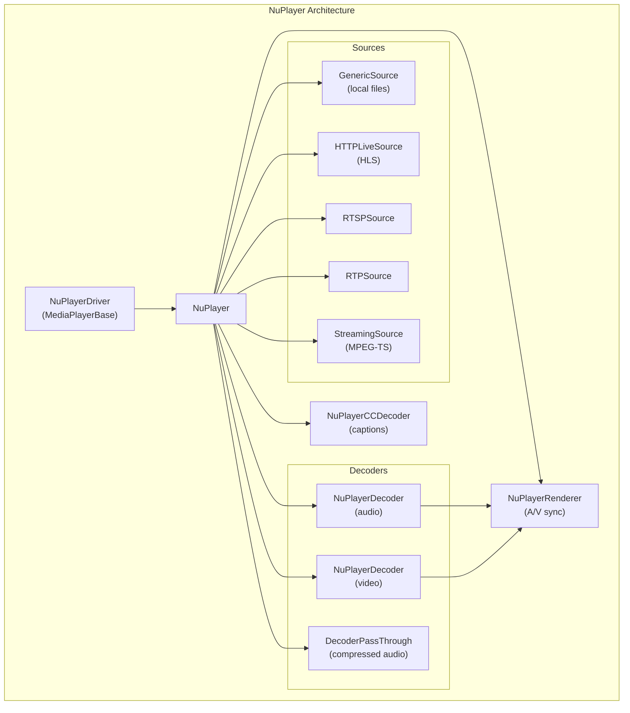

NuPlayer 使用 **Action 模式**来进行延迟操作。这是一个操作队列，其中的操作应在满足特定条件时（例如在 flush 完成后）执行：

```cpp
// frameworks/av/media/libmediaplayerservice/nuplayer/NuPlayer.cpp, line 68
struct NuPlayer::Action : public RefBase {
    Action() {}
    virtual void execute(NuPlayer *player) = 0;
};

struct NuPlayer::SeekAction : public Action {
    explicit SeekAction(int64_t seekTimeUs, MediaPlayerSeekMode mode)
        : mSeekTimeUs(seekTimeUs), mMode(mode) {
    }
    virtual void execute(NuPlayer *player) {
        player->performSeek(mSeekTimeUs, mMode);
    }
};

struct NuPlayer::ResumeDecoderAction : public Action {
    explicit ResumeDecoderAction(bool needNotify)
        : mNeedNotify(needNotify) {
    }
    virtual void execute(NuPlayer *player) {
        player->performResumeDecoders(mNeedNotify);
    }
};

struct NuPlayer::SetSurfaceAction : public Action {
    explicit SetSurfaceAction(const sp<Surface> &surface)
        : mSurface(surface) {
    }
    virtual void execute(NuPlayer *player) {
        player->performSetSurface(mSurface);
    }
};

struct NuPlayer::FlushDecoderAction : public Action {
    FlushDecoderAction(FlushCommand audio, FlushCommand video)
        : mAudio(audio), mVideo(video) {
    }
    virtual void execute(NuPlayer *player) {
        player->performDecoderFlush(mAudio, mVideo);
    }
};
```

延迟动作模式解决了媒体播放器中的一个常见问题。像 seek 这样的操作需要对音频和视频解码器都进行 flush。它们必须等待 flush 完成，然后从新的位置继续播放。NuPlayer 不实现复杂的多步状态机，而是将按顺序执行的动作排入队列。

### 16.4.3 NuPlayerDecoder：MediaCodec 包装器

`NuPlayerDecoder` 包装 `MediaCodec` 以便在 NuPlayer 中使用。它负责：

- 根据源轨道格式选择和初始化编解码器
- 从 NuPlayer 源供给输入缓冲区
- 消费输出缓冲区并转发给渲染器
- 编解码器错误处理与恢复
- 格式变更检测与处理

该解码器使用 MediaCodec 的回调 API 以**异步模式**运行，这意味着它接收 `onInputBufferAvailable` 和 `onOutputBufferAvailable` 回调，而不是通过 `dequeueInputBuffer` / `dequeueOutputBuffer` 进行轮询。

### 16.4.4 NuPlayerRenderer：音视频同步

`NuPlayerRenderer` 负责同步音频和视频播放这一关键任务。它实现了：

- **音视频同步**：视频帧被调度在相对于音频时间线的正确时间渲染。音频轨道的位置作为主时钟。
- **音频轨道管理**：为 PCM 音频输出创建和管理 `AudioTrack`。
- **帧调度**：使用显示器的 vsync 时序来调度视频帧渲染，以最大程度减少抖动。
- **播放速度**：通过对音频进行重采样并调整视频帧时序来支持变速播放。
- **暂停/恢复**：处理暂停和恢复，并正确处理时间戳。

### 16.4.5 StagefrightRecorder

`frameworks/av/media/libmediaplayerservice/StagefrightRecorder.cpp` 中的 `StagefrightRecorder` 实现了用于录制音频和视频的 `MediaRecorderBase` 接口。它通过将源（相机、麦克风）连接到编码器再到封装器来编排录制流水线。

```cpp
// frameworks/av/media/libmediaplayerservice/StagefrightRecorder.cpp, line 128
StagefrightRecorder::StagefrightRecorder(const AttributionSourceState& client)
    : MediaRecorderBase(client),
      mWriter(NULL),
      mOutputFd(-1),
      mAudioSource((audio_source_t)AUDIO_SOURCE_CNT),
      mPrivacySensitive(PRIVACY_SENSITIVE_DEFAULT),
      mVideoSource(VIDEO_SOURCE_LIST_END),
      // ... RTP/RTSP parameters ...
      mStarted(false),
      mSelectedDeviceId(AUDIO_PORT_HANDLE_NONE),
      mDeviceCallbackEnabled(false),
      mSelectedMicDirection(MIC_DIRECTION_UNSPECIFIED),
      mSelectedMicFieldDimension(MIC_FIELD_DIMENSION_NORMAL) {
    ALOGV("Constructor");
    mMetricsItem = NULL;
    mAnalyticsDirty = false;
    reset();
}
```

StagefrightRecorder 支持多种输出格式，并为每种格式采用相应的写入器：

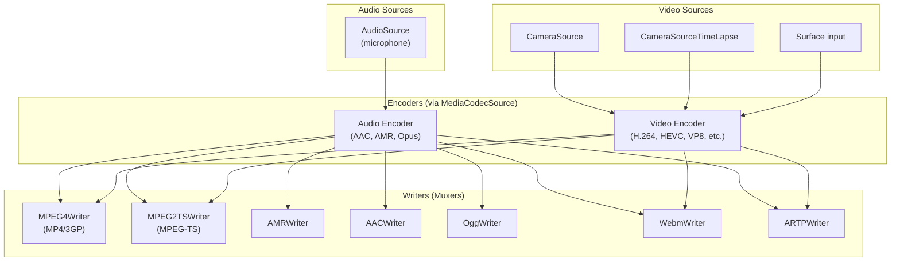

该写入器包含对多种容器格式的支持，这从导入语句中可见：

```cpp
// frameworks/av/media/libmediaplayerservice/StagefrightRecorder.cpp, line 27+
#include <webm/WebmWriter.h>
// ...
#include <media/stagefright/AMRWriter.h>
#include <media/stagefright/AACWriter.h>
#include <media/stagefright/CameraSource.h>
#include <media/stagefright/CameraSourceTimeLapse.h>
#include <media/stagefright/MPEG2TSWriter.h>
#include <media/stagefright/MPEG4Writer.h>
#include <media/stagefright/OggWriter.h>
#include <media/stagefright/rtsp/ARTPWriter.h>
```

StagefrightRecorder 收集用于遥测的大量指标：

```cpp
// frameworks/av/media/libmediaplayerservice/StagefrightRecorder.cpp, line 82
static const char *kKeyRecorder = "recorder";
static const char *kRecorderLogSessionId = "android.media.mediarecorder.log-session-id";
static const char *kRecorderAudioBitrate = "android.media.mediarecorder.audio-bitrate";
static const char *kRecorderAudioChannels = "android.media.mediarecorder.audio-channels";
static const char *kRecorderAudioSampleRate = "android.media.mediarecorder.audio-samplerate";
static const char *kRecorderFrameRate = "android.media.mediarecorder.frame-rate";
static const char *kRecorderHeight = "android.media.mediarecorder.height";
static const char *kRecorderWidth = "android.media.mediarecorder.width";
static const char *kRecorderVideoBitrate = "android.media.mediarecorder.video-bitrate";
```

电池跟踪被集成到录制流水线中：

```cpp
// frameworks/av/media/libmediaplayerservice/StagefrightRecorder.cpp, line 115
static void addBatteryData(uint32_t params) {
    sp<IBinder> binder =
        defaultServiceManager()->waitForService(String16("media.player"));
    sp<IMediaPlayerService> service = interface_cast<IMediaPlayerService>(binder);
    if (service.get() == nullptr) {
        ALOGE("%s: Failed to get media.player service", __func__);
        return;
    }
    service->addBatteryData(params);
}
```

这确保了系统的电池统计数据能正确计入视频编码，这是一项耗电操作。

Android 17 为 `MediaRecorder` 增加了一条恒定质量录制路径。旧的 `setVideoEncodingBitRate()` 以某个比特率为目标。新的 `setVideoEncodingQuality()` 则要求编码器保持某个质量级别，并让比特率浮动。这可以避免复杂场景因比特不足而出现画质下降：

```java
// frameworks/base/media/java/android/media/MediaRecorder.java, line 1177
@FlaggedApi(FLAG_QUALITY_SETTING_SUPPORT)
public void setVideoEncodingQuality(@IntRange(from = 0) int quality) {
    Preconditions.checkArgument(quality >= 0, "Video encoding quality is negative");
    setParameter("video-param-encoding-quality=" + quality);
}
```

质量值是编码器相关的；应用通过 `MediaCodecInfo.EncoderCapabilities.getQualityRange()` 查询有效范围。同时设置质量和比特率会导致行为未定义。该参数经由 `StagefrightRecorder::setParamVideoEncodingQuality()` 进入 `mVideoEncodingQuality`，当记录器构建编码器格式时，它会在 `"quality"` 键下写入该值：

```cpp
// frameworks/av/media/libmediaplayerservice/StagefrightRecorder.cpp, line 2108
if (mVideoEncodingQuality != -1) {
    format->setInt32("quality", mVideoEncodingQuality);
}
```

`MediaCodecSource::adjustMediaFormatForConstantQuality()` 是该请求被采纳或丢弃的地方。它会检查所选编码器是否声明支持 `BITRATE_MODE_CQ`。如果支持，它将 `KEY_BITRATE_MODE` 设为 `BITRATE_MODE_CQ`。如果不支持，它会记录一条警告并移除 `quality` 键，从而让录制回退到比特率控制：

```cpp
// frameworks/av/media/libstagefright/MediaCodecSource.cpp, line 520
int32_t videoEncodingQuality = -1;
if (format->findInt32(KEY_QUALITY, &videoEncodingQuality) && videoEncodingQuality != -1) {
    if (!isCQSupported) {
        ALOGW("Selected encoder does not support CQ mode, falling back to bitrate control.");
        format->removeEntryByName(KEY_QUALITY);
    } else {
        format->setInt32(KEY_BITRATE_MODE, BITRATE_MODE_CQ);
    }
}
```

`BITRATE_MODE_CQ` 就是 `ACodec` 映射到 `OMX_Video_ControlRateConstantQuality` 的同一个恒定质量码率控制模式（16.2.7 节）。Android 17 的新增内容是记录器级别的 API 和编码器能力检查，它们将录制会话路由到该模式。整条路径由 `FLAG_QUALITY_SETTING_SUPPORT` 标志控制。

### 16.4.6 MediaPlayer 播放流水线

从应用到硬件的完整播放流水线：

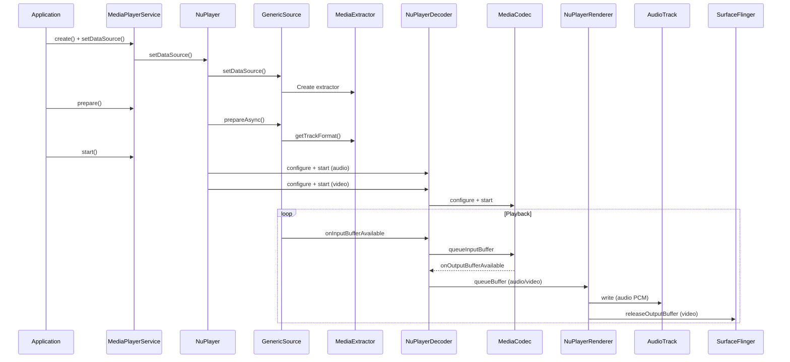

---

## 16.5 Camera 服务

### 16.5.1 CameraService 架构

`frameworks/av/services/camera/libcameraservice/CameraService.cpp` 中的 `CameraService` 是 Android 中所有相机操作的核心权威。它管理相机设备发现、客户端连接、安全、资源分配，以及 Java API 与厂商相机 HAL 之间的接口。

```cpp
// frameworks/av/services/camera/libcameraservice/CameraService.cpp, line 17-18
#define LOG_TAG "CameraService"
#define ATRACE_TAG ATRACE_TAG_CAMERA
```

该服务在系统启动期间初始化：

```cpp
// frameworks/av/services/camera/libcameraservice/CameraService.cpp, line 189
CameraService::CameraService(
        std::shared_ptr<CameraServiceProxyWrapper> cameraServiceProxyWrapper,
        std::shared_ptr<AttributionAndPermissionUtils> attributionAndPermissionUtils) :
        // ...
        mEventLog(DEFAULT_EVENT_LOG_LENGTH),
        mNumberOfCameras(0),
        mNumberOfCamerasWithoutSystemCamera(0),
        mSoundRef(0), mInitialized(false),
        mAudioRestriction(ICameraDeviceUser::AudioRestriction::NONE) {
    ALOGI("CameraService started (pid=%d)", getpid());
}
```

### 16.5.2 Provider 枚举与设备发现

在首次引用时（`onFirstRef`，第 225 行），CameraService 初始化相机子系统：

```cpp
// frameworks/av/services/camera/libcameraservice/CameraService.cpp, line 225
void CameraService::onFirstRef()
{
    ALOGI("CameraService process starting");
    BnCameraService::onFirstRef();

    // Update battery life tracking if service is restarting
    BatteryNotifier& notifier(BatteryNotifier::getInstance());
    notifier.noteResetCamera();
    notifier.noteResetFlashlight();

    status_t res = INVALID_OPERATION;
    res = enumerateProviders();
    if (res == OK) {
        mInitialized = true;
    }

    mUidPolicy = new UidPolicy(this);
    mUidPolicy->registerSelf();
    mSensorPrivacyPolicy = new SensorPrivacyPolicy(this, mAttributionAndPermissionUtils);
    mSensorPrivacyPolicy->registerSelf();
    mInjectionStatusListener = new InjectionStatusListener(this);
```

`enumerateProviders()` 方法（第 278 行）创建 `CameraProviderManager` 并发现所有可用相机：

```cpp
// frameworks/av/services/camera/libcameraservice/CameraService.cpp, line 278
status_t CameraService::enumerateProviders() {
    status_t res;
    std::vector<std::string> deviceIds;
    std::unordered_map<std::string, std::set<std::string>> unavailPhysicalIds;
    {
        Mutex::Autolock l(mServiceLock);
        if (nullptr == mCameraProviderManager.get()) {
            mCameraProviderManager = new CameraProviderManager();
            res = mCameraProviderManager->initialize(this);
            // ...
        }
        mCameraProviderManager->setUpVendorTags();

        if (nullptr == mFlashlight.get()) {
            mFlashlight = new CameraFlashlight(mCameraProviderManager, this);
        }
        res = mFlashlight->findFlashUnits();
        deviceIds = mCameraProviderManager->getCameraDeviceIds(&unavailPhysicalIds);
    }

    for (auto& cameraId : deviceIds) {
        if (getCameraState(cameraId) == nullptr) {
            onDeviceStatusChanged(cameraId, CameraDeviceStatus::PRESENT);
        }
    }
```

Provider 枚举涉及：

1. 创建 `CameraProviderManager`，发现相机 HAL Provider
2. 设置厂商定义的相机元数据标签
3. 枚举闪光灯单元
4. 查询所有相机设备 ID，包括逻辑多相机设置中的物理相机
5. 将每个发现的相机注册到服务

该服务还注册 HIDL 和 AIDL VNDK 接口，供厂商访问：

```cpp
    sp<HidlCameraService> hcs = HidlCameraService::getInstance(this);
    if (hcs->registerAsService() != android::OK) {
        ALOGW("%s: Did not register default android.frameworks.cameraservice.service@2.2",
              __FUNCTION__);
    }

    if (!AidlCameraService::registerService(this)) {
        ALOGE("%s: Failed to register default AIDL VNDK CameraService", __FUNCTION__);
    }
```

### 16.5.3 Camera API1 与 API2

Android 支持两个相机 API：

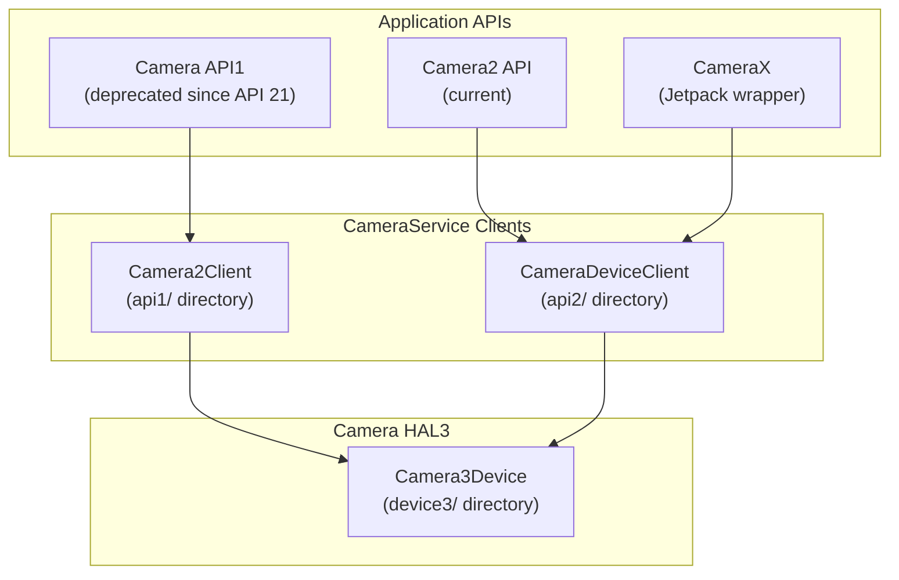

两个 API 最终都与 Camera HAL3 设备通信，但通过不同的客户端实现：

- **`Camera2Client`**（`api1/Camera2Client.h`）：将传统的 API1 接口转换为 Camera HAL3 操作。它为尚未迁移到 Camera2 的应用保持向后兼容。

- **`CameraDeviceClient`**（`api2/CameraDeviceClient.h`）：Camera2 API 的原生客户端，提供对 Camera HAL3 功能的直接访问，包括手动控制、RAW 拍摄、再处理和多相机支持。

### 16.5.4 Camera3Device：HAL3 接口

`device3/` 目录包含 Camera HAL3 设备实现，它是 CameraService 与厂商相机硬件之间的桥梁：

```
device3/
  Camera3Device.cpp          # Main HAL3 device wrapper
  Camera3Device.h
  Camera3OutputStream.cpp    # Output stream management
  Camera3InputStream.cpp     # Input stream (reprocessing)
  Camera3IOStreamBase.cpp    # Base I/O stream
  Camera3SharedOutputStream.cpp  # Shared output streams
  Camera3StreamSplitter.cpp  # Stream splitting
  Camera3BufferManager.cpp   # Buffer allocation
  StatusTracker.cpp          # Device state tracking
  DistortionMapper.cpp       # Lens distortion correction
  ZoomRatioMapper.cpp        # Zoom coordinate mapping
  RotateAndCropMapper.cpp    # Rotation/crop transforms
  PreviewFrameSpacer.cpp     # Preview frame timing
```

`Camera3Device` 实现了核心的拍摄请求流水线：

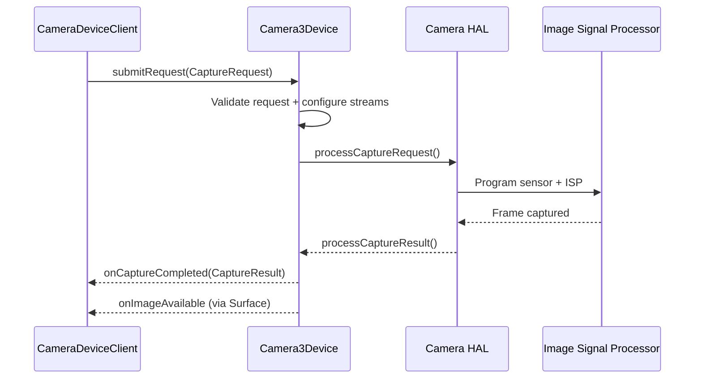

### 16.5.5 安全与权限模型

CameraService 实现了一个在文件顶部定义的复杂权限模型：

```cpp
// frameworks/av/services/camera/libcameraservice/CameraService.cpp, line 93-96
const char* kActivityServiceName = "activity";
const char* kSensorPrivacyServiceName = "sensor_privacy";
const char* kAppopsServiceName = "appops";
const char* kProcessInfoServiceName = "processinfo";
```

权限检查集成了 Android 的 `AppOpsManager`：

```cpp
// frameworks/av/services/camera/libcameraservice/CameraService.cpp, line 102
android::PermissionChecker::PermissionResult appOpModeToPermissionResult(int32_t res) {
    switch (res) {
        case android::AppOpsManager::MODE_ERRORED:
            return android::PermissionChecker::PERMISSION_HARD_DENIED;
        case android::AppOpsManager::MODE_IGNORED:
            return android::PermissionChecker::PERMISSION_SOFT_DENIED;
        case android::AppOpsManager::MODE_ALLOWED:
            return android::PermissionChecker::PERMISSION_GRANTED;
    }
    return android::PermissionChecker::PERMISSION_HARD_DENIED;
}
```

相机访问涉及多个安全层：

1. **Android 权限**（`android.permission.CAMERA`）
2. **AppOps 跟踪**（启用按应用的相机访问控制）
3. **传感器隐私**（硬件/软件隐私开关）
4. **UID 策略**（后台应用限制）
5. **系统相机限制**（某些相机仅对系统应用可见）
6. **虚拟设备隔离**（虚拟设备上下文中的相机）

虚拟设备相机 ID 映射器（第 344 行）启用了 Android 的多设备支持，其中不同的虚拟设备可以有不同的相机映射：

```cpp
auto [deviceId, mappedCameraId] =
    mVirtualDeviceCameraIdMapper.getDeviceIdAndMappedCameraIdPair(cameraId);
```

### 16.5.6 Camera NDK

Camera NDK（原生开发工具包）提供从原生代码访问相机的 C API，供游戏引擎和跨平台框架使用。它不是 Java Camera2 API 周围的 JNI 包装器。`libcamera2ndk`（`frameworks/av/camera/ndk/`）是一个原生客户端。它直接获取 `hardware::ICameraService` binder 接口（Java API 使用的同一接口），然后通过 Binder 与 CameraService 通信：

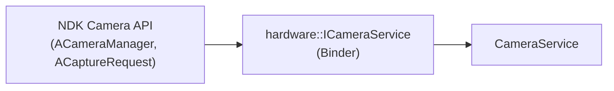

NDK 相机 API 包括：

- `ACameraManager`：相机发现与访问
- `ACameraDevice`：相机设备控制
- `ACameraCaptureSession`：拍摄会话管理
- `ACaptureRequest`：请求构建器
- `ACameraMetadata`：元数据访问
- `AImageReader`：图像输出

---

## 16.6 媒体提取器

### 16.6.1 NuMediaExtractor

`frameworks/av/media/libstagefright/NuMediaExtractor.cpp` 中的 `NuMediaExtractor` 提供了媒体容器解复用的原生接口。它包装了 `MediaExtractor` 接口，并添加了数据源管理、轨道选择和样本读取。

```cpp
// frameworks/av/media/libstagefright/NuMediaExtractor.cpp, line 53
NuMediaExtractor::NuMediaExtractor(EntryPoint entryPoint)
    : mEntryPoint(entryPoint),
      mTotalBitrate(-1LL),
      mDurationUs(-1LL) {
}
```

`EntryPoint` 参数跟踪提取器的创建来源，从而支持按 API 的遥测。

数据源可以从 URI、文件描述符或原始 `DataSource` 对象设置：

```cpp
// frameworks/av/media/libstagefright/NuMediaExtractor.cpp, line 106
status_t NuMediaExtractor::setDataSource(
        const sp<MediaHTTPService> &httpService,
        const char *path,
        const KeyedVector<String8, String8> *headers) {
    Mutex::Autolock autoLock(mLock);
    if (mImpl != NULL || path == NULL) {
        return -EINVAL;
    }
    sp<DataSource> dataSource =
        DataSourceFactory::getInstance()->CreateFromURI(httpService, path, headers);
    if (dataSource == NULL) {
        return -ENOENT;
    }
    return initMediaExtractor(dataSource);
}

status_t NuMediaExtractor::setDataSource(int fd, off64_t offset, off64_t size) {
    // ...
    sp<FileSource> fileSource = new FileSource(dup(fd), offset, size);
    status_t err = fileSource->initCheck();
    if (err != OK) {
        return err;
    }
    return initMediaExtractor(fileSource);
}
```

实际的提取器创建委托给 `MediaExtractorFactory`：

```cpp
// frameworks/av/media/libstagefright/NuMediaExtractor.cpp, line 75
status_t NuMediaExtractor::initMediaExtractor(const sp<DataSource>& dataSource) {
    status_t err = OK;
    mImpl = MediaExtractorFactory::Create(dataSource);
    if (mImpl == NULL) {
        ALOGE("%s: failed to create MediaExtractor", __FUNCTION__);
        return ERROR_UNSUPPORTED;
    }
    setEntryPointToRemoteMediaExtractor();
    // ...
    mName = mImpl->name();
    err = updateDurationAndBitrate();
    if (err == OK) {
        mDataSource = dataSource;
    }
    return OK;
}
```

该提取器还支持 CAS（Conditional Access System），用于受 DRM 保护的广播内容：

```cpp
// frameworks/av/media/libstagefright/NuMediaExtractor.cpp, line 181
status_t NuMediaExtractor::setMediaCas(const HInterfaceToken &casToken) {
    ALOGV("setMediaCas: casToken={%s}", arrayToString(casToken).c_str());
    Mutex::Autolock autoLock(mLock);
    if (casToken.empty()) {
        return BAD_VALUE;
    }
    mCasToken = casToken;
    if (mImpl != NULL) {
        status_t err = mImpl->setMediaCas(casToken);
        // ...
    }
```

### 16.6.2 MediaExtractorFactory

`frameworks/av/media/libstagefright/MediaExtractorFactory.cpp` 中的 `MediaExtractorFactory` 实现了提取器插件系统。提取器作为共享库从特定目录加载，从而支持厂商提供的格式。

```cpp
// frameworks/av/media/libstagefright/MediaExtractorFactory.cpp, line 43
// static
sp<IMediaExtractor> MediaExtractorFactory::Create(
        const sp<DataSource> &source, const char *mime) {
    ALOGV("MediaExtractorFactory::Create %s", mime);

    if (!property_get_bool("media.stagefright.extractremote", true)) {
        // local extractor
        ALOGW("creating media extractor in calling process");
        return CreateFromService(source, mime);
    } else {
        // remote extractor
        sp<IBinder> binder = defaultServiceManager()->getService(
            String16("media.extractor"));
        if (binder != 0) {
            sp<IMediaExtractorService> mediaExService(
                    interface_cast<IMediaExtractorService>(binder));
            sp<IMediaExtractor> ex;
            mediaExService->makeExtractor(
                    CreateIDataSourceFromDataSource(source),
                    mime ? std::optional<std::string>(mime) : std::nullopt,
                    &ex);
            return ex;
        }
    }
    return NULL;
}
```

这里的关键设计决策是**默认远程提取**。`media.stagefright.extractremote` 属性（默认为 true）使提取器插件运行在隔离的 `media.extractor` 进程中。这是一项安全措施。媒体容器解析是最常见的攻击面之一。沙箱化的进程限制了解析漏洞的影响。

嗅探机制（第 132 行）遍历所有已加载的插件，为给定数据源找到最佳匹配：

```cpp
// frameworks/av/media/libstagefright/MediaExtractorFactory.cpp, line 132
void *MediaExtractorFactory::sniff(
        const sp<DataSource> &source, float *confidence, void **meta,
        FreeMetaFunc *freeMeta, sp<ExtractorPlugin> &plugin,
        uint32_t *creatorVersion) {
    *confidence = 0.0f;
    *meta = nullptr;
    // ...
    void *bestCreator = NULL;
    for (auto it = plugins->begin(); it != plugins->end(); ++it) {
        ALOGV("sniffing %s", (*it)->def.extractor_name);
        float newConfidence;
        // Each plugin returns a confidence score [0.0, 1.0]
        // The plugin with the highest confidence wins
```

每个提取器插件都会针对给定数据源报告一个置信度分数（0.0 到 1.0）。工厂会选择置信度最高的插件。这一机制允许多个插件支持同一种容器格式，而最专门的插件优先。

插件系统使用 `ExtractorDef` 结构：

```cpp
// frameworks/av/media/libstagefright/MediaExtractorFactory.cpp, line 106
struct ExtractorPlugin : public RefBase {
    ExtractorDef def;
    void *libHandle;
    String8 libPath;
    String8 uuidString;

    ExtractorPlugin(ExtractorDef definition, void *handle, String8 &path)
        : def(definition), libHandle(handle), libPath(path) {
        for (size_t i = 0; i < sizeof ExtractorDef::extractor_uuid; i++) {
            uuidString.appendFormat("%02x", def.extractor_uuid.b[i]);
        }
    }
    ~ExtractorPlugin() {
        if (libHandle != nullptr) {
            ALOGV("closing handle for %s %d", libPath.c_str(), def.extractor_version);
            dlclose(libHandle);
        }
    }
};
```

### 16.6.3 容器格式支持

Android 通过其提取器插件支持广泛的容器格式：

| 容器 | 提取器 | 说明 |
|---|---|---|
| MP4/M4A/3GP | MPEG4Extractor | ISO BMFF 家族 |
| Matroska/WebM | MatroskaExtractor | Matroska 容器 |
| MPEG-TS | MPEG2TSExtractor | 传输流 |
| MPEG-PS | MPEG2PSExtractor | 节目流 |
| Ogg | OggExtractor | Ogg 容器 |
| WAV | WAVExtractor | 波形音频 |
| FLAC | FLACExtractor | 无损音频 |
| AMR | AMRExtractor | 自适应多速率 |
| AAC (ADTS) | AACExtractor | 原始 AAC 流 |
| MIDI | MidiExtractor | 乐器数字接口 |
| MP3 | MP3Extractor | MPEG-1/2 音频第三层 |

典型 MP4 文件的提取流水线：

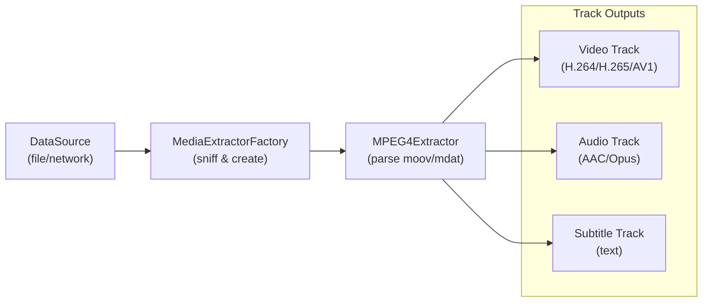

---

## 16.7 视频能力

### 16.7.1 VideoCapabilities

`frameworks/av/media/libmedia/VideoCapabilities.cpp` 中的 `VideoCapabilities` 提供了查询编解码器能力（支持的分辨率、帧率、比特率等）的基础设施。这是 Java 中 `MediaCodecInfo.VideoCapabilities` 类的原生对应物。

```cpp
// frameworks/av/media/libmedia/VideoCapabilities.cpp, line 18-19
#define LOG_TAG "VideoCapabilities"
```

该类定义了基本范围：

```cpp
// frameworks/av/media/libmedia/VideoCapabilities.cpp, line 33
static const Range<int64_t> POSITIVE_INT64 = Range((int64_t)1, INT64_MAX);
static const Range<int32_t> BITRATE_RANGE = Range<int32_t>(0, 500000000);
static const Range<int32_t> FRAME_RATE_RANGE = Range<int32_t>(0, 960);
static const Range<Rational> POSITIVE_RATIONALS =
    Range<Rational>(Rational((int32_t)1, INT32_MAX),
                    Rational(INT32_MAX, (int32_t)1));
```

最高 500 Mbps 的比特率和最高 960 fps 的帧率代表了能力系统理论上的上限。各个编解码器会在这些范围内报告其实际限制。

能力查询系统支持多维约束。例如，`getSupportedWidthsFor(height)` 计算给定特定高度时的有效宽度范围：

```cpp
// frameworks/av/media/libmedia/VideoCapabilities.cpp, line 67
std::optional<Range<int32_t>> VideoCapabilities::getSupportedWidthsFor(
        int32_t height) const {
    Range<int32_t> range = mWidthRange;
    if (!mHeightRange.contains(height)
            || (height % mHeightAlignment) != 0) {
        ALOGE("unsupported height");
        return std::nullopt;
    }

    const int32_t heightInBlocks = divUp(height, mBlockHeight);
    // constrain by block count and by block aspect ratio
    const int32_t minWidthInBlocks = std::max(
            divUp(mBlockCountRange.lower(), heightInBlocks),
            (int32_t)std::ceil(mBlockAspectRatioRange.lower().asDouble()
                    * heightInBlocks));
    const int32_t maxWidthInBlocks = std::min(
            mBlockCountRange.upper() / heightInBlocks,
            (int32_t)(mBlockAspectRatioRange.upper().asDouble()
                    * heightInBlocks));
    range = range.intersect(
            (minWidthInBlocks - 1) * mBlockWidth + mWidthAlignment,
            maxWidthInBlocks * mBlockWidth);

    // constrain by smaller dimension limit
    if (height > mSmallerDimensionUpperLimit) {
        range = range.intersect(1, mSmallerDimensionUpperLimit);
    }

    // constrain by aspect ratio
    range = range.intersect(
            (int32_t)std::ceil(mAspectRatioRange.lower().asDouble() * height),
            (int32_t)(mAspectRatioRange.upper().asDouble() * height));
    if (range.empty()) {
        return std::nullopt;
    }
    return range;
}
```

能力计算使用**宏块模型**。编解码器的能力用块来表示（AVC 通常为 16x16，HEVC 为 64x64）。支持的分辨率范围由最大块数、块宽高比约束、对齐要求和较小尺寸限制计算得出。

给定分辨率的帧率能力使用相同的块模型：

```cpp
// frameworks/av/media/libmedia/VideoCapabilities.cpp, line 145
std::optional<Range<double>> VideoCapabilities::getSupportedFrameRatesFor(
        int32_t width, int32_t height) const {
    if (!supports(std::make_optional<int32_t>(width),
                  std::make_optional<int32_t>(height),
                  std::nullopt /* rate */)) {
        ALOGE("Unsupported size. width: %d, height: %d", width, height);
        return std::nullopt;
    }
```

### 16.7.2 MediaProfiles

`frameworks/av/media/libmedia/MediaProfiles.cpp` 中的 `MediaProfiles` 从 XML 配置文件解析设备特定的媒体能力配置文件。这些配置文件定义：

- 支持的相机录制质量级别（QCIF、CIF、480p、720p、1080p、2160p、4K DCI、8K UHD）
- 编码器配置（编解码器、比特率、帧率）
- 文件格式支持

配置文件按优先级顺序搜索：

```cpp
// frameworks/av/media/libmedia/MediaProfiles.cpp, line 45
std::array<char const*, 5> const& getXmlPaths() {
    static std::array<std::string const, 5> const paths =
        []() -> decltype(paths) {
            constexpr std::array<char const*, 4> searchDirs = {
                "product/etc/",
                "odm/etc/",
                "vendor/etc/",
                "system/etc/",
            };
            char variant[PROPERTY_VALUE_MAX];
            property_get("ro.media.xml_variant.profiles", variant, "_V1_0");
            std::string fileName =
                std::string("media_profiles") + variant + ".xml";
            return { searchDirs[0] + fileName,
                     searchDirs[1] + fileName,
                     searchDirs[2] + fileName,
                     searchDirs[3] + fileName,
                     "system/etc/media_profiles.xml" };
        }();
```

搜索顺序（`product` > `odm` > `vendor` > `system`）允许在每个定制层进行设备特定的覆盖。变体属性 `ro.media.xml_variant.profiles` 使不同的设备 SKU 可以使用不同的配置文件。

受支持的编码器/解码器名称映射非常全面：

```cpp
// frameworks/av/media/libmedia/MediaProfiles.cpp, line 89
const MediaProfiles::NameToTagMap MediaProfiles::sVideoEncoderNameMap[] = {
    {"h263", VIDEO_ENCODER_H263},
    {"h264", VIDEO_ENCODER_H264},
    {"m4v",  VIDEO_ENCODER_MPEG_4_SP},
    {"vp8",  VIDEO_ENCODER_VP8},
    {"hevc", VIDEO_ENCODER_HEVC},
    {"vp9",  VIDEO_ENCODER_VP9},
    {"dolbyvision", VIDEO_ENCODER_DOLBY_VISION},
    {"apv", VIDEO_ENCODER_APV},
};

const MediaProfiles::NameToTagMap MediaProfiles::sAudioEncoderNameMap[] = {
    {"amrnb",  AUDIO_ENCODER_AMR_NB},
    {"amrwb",  AUDIO_ENCODER_AMR_WB},
    {"aac",    AUDIO_ENCODER_AAC},
    {"heaac",  AUDIO_ENCODER_HE_AAC},
    {"aaceld", AUDIO_ENCODER_AAC_ELD},
    {"opus",   AUDIO_ENCODER_OPUS}
};
```

HDR 格式支持也有声明：

```cpp
// frameworks/av/media/libmedia/MediaProfiles.cpp, line 106
const MediaProfiles::NameToTagMap MediaProfiles::sHdrFormatNameMap[] = {
    {"sdr", HDR_FORMAT_NONE},
    {"hlg", HDR_FORMAT_HLG},
    {"hdr10", HDR_FORMAT_HDR10},
    {"hdr10+", HDR_FORMAT_HDR10PLUS},
    {"dolbyvision", HDR_FORMAT_DOLBY_VISION},
};

const MediaProfiles::NameToTagMap MediaProfiles::sChromaSubsamplingNameMap[] = {
    {"yuv 4:2:0", CHROMA_SUBSAMPLING_YUV_420},
    {"yuv 4:2:2", CHROMA_SUBSAMPLING_YUV_422},
    {"yuv 4:4:4", CHROMA_SUBSAMPLING_YUV_444},
};
```

以及从 QCIF 到 8K UHD 的摄像机质量级别：

```cpp
// frameworks/av/media/libmedia/MediaProfiles.cpp, line 136
const MediaProfiles::NameToTagMap MediaProfiles::sCamcorderQualityNameMap[] = {
    {"low", CAMCORDER_QUALITY_LOW},
    {"high", CAMCORDER_QUALITY_HIGH},
    {"qcif", CAMCORDER_QUALITY_QCIF},
    {"cif", CAMCORDER_QUALITY_CIF},
    {"480p", CAMCORDER_QUALITY_480P},
    {"720p", CAMCORDER_QUALITY_720P},
    {"1080p", CAMCORDER_QUALITY_1080P},
    {"2160p", CAMCORDER_QUALITY_2160P},
    {"qvga", CAMCORDER_QUALITY_QVGA},
    {"vga", CAMCORDER_QUALITY_VGA},
    {"4kdci", CAMCORDER_QUALITY_4KDCI},
    {"qhd", CAMCORDER_QUALITY_QHD},
    {"2k", CAMCORDER_QUALITY_2K},
    {"8kuhd", CAMCORDER_QUALITY_8KUHD},
```

### 16.7.3 编解码器发现与选择

编解码器选择过程涉及多个组件协同工作：

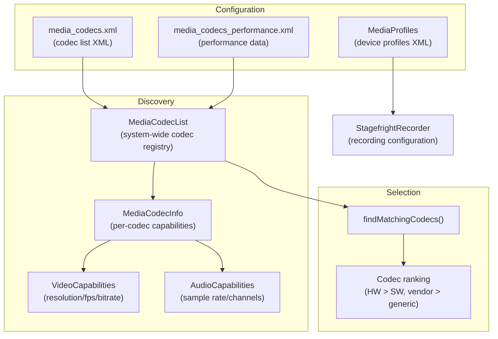

位于厂商或系统分区的 `media_codecs.xml` 文件声明了设备上所有可用的编解码器。`media_codecs_performance.xml` 文件提供性能数据（实测可达到的分辨率 x 帧率组合）。这些数据使框架能够区分可以维持 4K@30fps 的编解码器和只能维持 1080p@30fps 的编解码器。

### 16.7.4 编解码器特性标志

编解码器能力系统支持指示可选能力的特性标志：

| 特性 | 说明 |
|---|---|
| `adaptive-playback` | 支持在不重启的情况下改变分辨率 |
| `secure-playback` | 支持受 DRM 保护的内容 |
| `tunneled-playback` | 支持硬件隧道渲染 |
| `low-latency` | 支持用于游戏/会议的低延迟模式 |
| `multiple-frames` | 支持在每个缓冲区中批量处理多个帧 |
| `partial-frame` | 支持部分帧输入 |
| `frame-parsing` | 支持帧边界检测 |
| `dynamic-timestamp` | 输出缓冲区时间戳派生自产生它们的输入缓冲区，而不是第一个输入缓冲区 |

这些特性在 `media_codecs.xml` 中声明，并通过 `MediaCodecInfo.CodecCapabilities.isFeatureSupported()` 查询。

---

## 16.8 附录：深入主题

### 16.8.1 ALooper/AHandler/AMessage 框架

Stagefright 的消息传递框架是媒体栈中所有异步操作的骨干。理解它是阅读任何媒体源代码的前提。

#### ALooper：事件循环

`ALooper` 是一个运行事件循环的线程，它从队列中取出消息并将它们分发给已注册的 handler。关键特性：

- **线程安全**：消息可以从任何线程投递；它们被原子地入队，并在 looper 线程上按顺序处理。
- **定时投递**：消息可以延迟投递（`msg->post(delayUs)`），从而支持基于定时器的操作。
- **优先级**：Looper 可以以不同的线程优先级运行。视频编解码器 looper 以 `ANDROID_PRIORITY_AUDIO` 运行以实现低延迟。

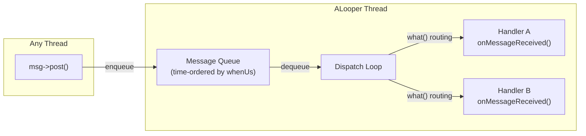

#### AMessage：带类型的消息

`AMessage` 是一个键值容器，在组件之间携带数据：

```cpp
sp<AMessage> msg = new AMessage(kWhatConfigure, targetHandler);
msg->setMessage("format", format);    // nested AMessage
msg->setInt32("flags", flags);        // integer
msg->setInt64("timeUs", timestamp);   // 64-bit integer
msg->setString("name", "avc");        // string
msg->setObject("surface", surface);   // RefBase object
msg->setSize("index", bufferIndex);   // size_t
msg->setFloat("rate", 30.0f);         // float
msg->setPointer("ptr", rawPtr);       // raw pointer
msg->setRect("crop", l, t, r, b);    // rectangle
msg->post();                          // async delivery
```

#### PostAndAwaitResponse：同步 RPC

`PostAndAwaitResponse` 模式将异步消息传递转换为同步函数调用：

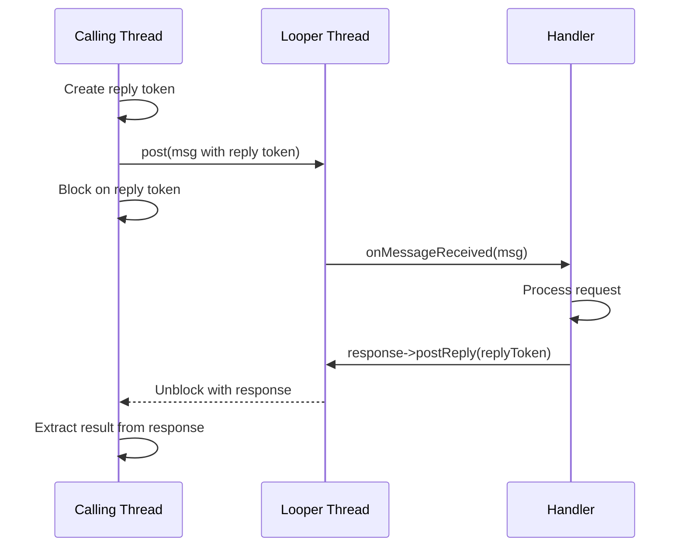

MediaCodec 在 `configure()`、`start()`、`stop()`、`queueInputBuffer()` 和 `dequeueOutputBuffer()` 等方法中广泛使用了这一模式。

### 16.8.2 MediaCodec 域分类

MediaCodec 将编解码器分为三个域，每个域有不同的行为：

| 域 | Looper | CPU 提升 | 电池 | 资源类型 |
|---|---|---|---|---|
| `DOMAIN_VIDEO` | 专用 `CodecLooper` | 1080p+ 时 HDR | 跟踪 | 硬件/软件视频编解码器 |
| `DOMAIN_AUDIO` | 共享主 looper | 从不 | 不跟踪 | 硬件/软件音频编解码器 |
| `DOMAIN_IMAGE` | 共享主 looper | 从不 | 不跟踪 | 硬件/软件图像编解码器 |

视频编解码器获得一个专用的 looper 线程，因为视频处理对延迟敏感：编解码器消息处理中的一次停顿会直接导致丢帧。音频和图像编解码器共享主 looper，因为它们的时序要求不那么严格。电池跟踪同样仅限于视频。`BatteryChecker` 仅在 `mDomain == DOMAIN_VIDEO` 时实例化。每个调用点都有空值保护，因此音频和图像编解码器永远不会报告电池活动。

### 16.8.3 安全编解码器路径（DRM）

受 DRM 保护内容的安全编解码器路径涉及额外的组件：

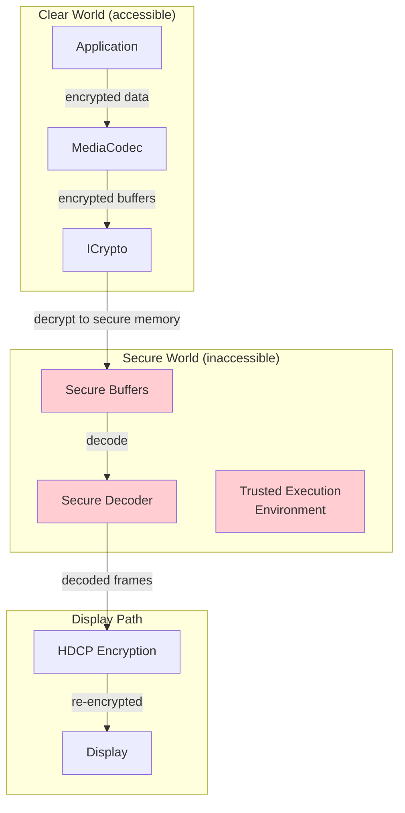

关键的安全属性：

1. 解密后的内容永远不会存在于 CPU 可访问的内存中
2. 解码后的帧直接通过安全缓冲区路径流转
3. HDCP（高带宽数字内容保护）保护显示链路
4. 加密插件运行在 TEE（可信执行环境）中

`queueSecureInputBuffer` 方法将加密元数据（密钥、IV、子样本映射、模式）传递给加密子系统。加密子系统直接解密到仅硬件解码器可访问的安全内存中。

### 16.8.4 隧道播放模式

隧道播放绕过标准的缓冲区交换，直接通过硬件渲染视频：

```mermaid
graph LR
    subgraph "Standard Path"
        MC1["MediaCodec"]
        APP1["App dequeue/release"]
        SF1["SurfaceFlinger"]
    end

    subgraph "Tunneled Path"
        MC2["MediaCodec"]
        HW["Hardware A/V Sync"]
        DISP2["Display"]
    end

    MC1 -->|"output buffer"| APP1
    APP1 -->|"releaseOutputBuffer"| SF1
    SF1 --> DISP2

    MC2 -->|"direct render"| HW
    HW -->|"hardware composited"| DISP2
```

在隧道模式中：

- 应用永远不会看到解码后的帧
- 音频和视频同步完全在硬件中处理
- 帧时序由硬件 A/V 同步单元控制
- 这通常能实现更低的延迟和更好的功耗效率
- 仅在支持该功能的硬件编解码器上可用

### 16.8.5 低延迟模式

对于游戏和视频会议，低延迟模式减少了编解码器的内部缓冲：

```
kCodecNumLowLatencyModeOn    - Times low-latency was enabled
kCodecNumLowLatencyModeOff   - Times low-latency was disabled
kCodecFirstFrameIndexLowLatencyModeOn - Frame index when first enabled
```

当低延迟模式激活时：

- 输出延迟被最小化（通常为 0-1 帧）
- 重排序被禁用或最小化
- 编解码器可能会跳过 B 帧解码
- 优先丢帧而不是缓冲

### 16.8.6 多访问单元（大帧）音频

IAMF 和 xHE-AAC 等现代音频编解码器可以从在单个缓冲区中处理多个音频帧中受益：

```mermaid
graph LR
    subgraph "Traditional (one AU per buffer)"
        B1["Buffer 1: AU 0"]
        B2["Buffer 2: AU 1"]
        B3["Buffer 3: AU 2"]
    end

    subgraph "Large Frame (multiple AUs per buffer)"
        B4["Buffer 1: AU 0 | AU 1 | AU 2"]
    end
```

`queueInputBuffers`（复数）API 通过接受一个 `BufferInfosWrapper` 来支持这一点，该包装器描述了较大缓冲区内每个访问单元的边界和时间戳。这减少了每帧的开销，并实现了更高效的处理流水线。

### 16.8.7 Codec2 与 OMX 特性比较

| 特性 | OMX (ACodec) | Codec2 (CCodec) |
|---|---|---|
| 参数系统 | 扁平索引 + void* | 带类型的 C2Param 结构体 |
| 缓冲区模型 | 分离的输入/输出队列 | 统一的 C2Work |
| 错误处理 | OMX_EVENTTYPE | c2_status_t + 详细失败信息 |
| 厂商参数 | 有限的 OMX 扩展 | 一等厂商参数 |
| 组件发现 | 全局 OMX 注册表 | 每个存储的组件列表 |
| 进程模型 | 进程内或 HIDL | AIDL HAL（独立进程） |
| 缓冲区分配 | OMX_AllocateBuffer | C2BlockPool + 分配器 |
| 挂起检测 | 应用必须实现 | 内置 CCodecWatchdog |
| 多帧输入 | 不支持 | AccessUnitInfo |
| 逐帧调优 | 不支持 | C2Work tunings |
| HAL 规范 | OMX IL 1.1.2 | android.hardware.media.c2 |
| 状态 | 维护模式 | 积极开发 |

### 16.8.8 媒体框架进程边界

```mermaid
graph TD
    subgraph "App Process"
        JAVA["Java MediaCodec / MediaPlayer"]
        NDK["NDK AMediaCodec"]
        JNI["JNI / libmedia_jni"]
    end

    subgraph "mediaserver"
        MPS["MediaPlayerService"]
        MRS["MediaRecorderClient /<br/>StagefrightRecorder"]
        RMS["ResourceManagerService"]
        NP2["NuPlayer"]
    end

    subgraph "vendor codec service"
        C2HAL["Codec2 AIDL HAL"]
        VENDOR["Vendor Codec Plugins"]
    end

    subgraph "media.extractor"
        EXTSVC["MediaExtractorService"]
        PLUGINS["Extractor Plugins"]
    end

    subgraph "cameraserver"
        CAMSVC["CameraService"]
    end

    subgraph "camera provider (vendor)"
        CAMHAL["Camera HAL"]
    end

    subgraph "SurfaceFlinger"
        SFCOMP["Compositor"]
    end

    JAVA --> JNI
    NDK --> JNI
    JNI -->|"Binder"| MPS
    JNI -->|"Binder"| RMS
    JNI -->|"AIDL"| C2HAL

    MPS --> NP2
    MPS --> MRS
    NP2 -->|"Binder"| EXTSVC
    NP2 -->|"AIDL"| C2HAL

    MRS -->|"AIDL"| C2HAL

    JNI -->|"Binder"| CAMSVC
    CAMSVC -->|"AIDL/HIDL"| CAMHAL

    C2HAL --> VENDOR
    EXTSVC --> PLUGINS

    JNI -->|"BufferQueue"| SFCOMP
```

每个进程边界都代表一个安全隔离边界：

- **应用到 mediaserver**：带有 UID/PID 验证的 Binder IPC
- **mediaserver 到厂商编解码器服务**：带有 SELinux 策略的 AIDL HAL
- **mediaserver 到 media.extractor**：Binder IPC，沙箱进程
- **应用到 cameraserver**：带有相机权限检查的 Binder IPC
- **cameraserver 到 Camera HAL**：带有厂商隔离的 AIDL/HIDL

### 16.8.9 MediaCodec 生命周期汇总表

| 状态 | 进入动作 | 有效操作 | 退出条件 |
|---|---|---|---|
| UNINITIALIZED | 构造函数 / release() | init() | 调用了 init() |
| INITIALIZING | init() 已投递 | （等待） | 组件已分配 |
| INITIALIZED | 组件已分配 | configure()、release() | 调用了 configure() |
| CONFIGURING | configure() 已投递 | （等待） | 组件已配置 |
| CONFIGURED | 组件已配置 | start()、release() | 调用了 start() |
| STARTING | start() 已投递 | （等待） | 启动完成 |
| STARTED | 启动完成 | queue/dequeue/flush/stop/release | 其中任意一个 |
| FLUSHING | flush() 已投递 | （等待） | flush 完成 |
| FLUSHED | flush 完成 | start()、stop()、release() | 调用了 start()/stop() |
| STOPPING | stop() 已投递 | （等待） | 停止完成 |
| RELEASING | release() 已投递 | （等待） | 释放完成 |

### 16.8.10 编解码器指标键参考

所有指标键都以 `android.media.mediacodec.` 为前缀：

| 类别 | 键后缀 | 类型 | 说明 |
|---|---|---|---|
| 标识 | `codec` | string | 组件名称 |
| 标识 | `mime` | string | MIME 类型 |
| 标识 | `mode` | string | audio/video/image |
| 标识 | `encoder` | int32 | 0=解码器，1=编码器 |
| 标识 | `hardware` | int32 | 0=软件，1=硬件 |
| 标识 | `secure` | int32 | 0=普通，1=安全 |
| 标识 | `tunneled` | int32 | 0=普通，1=隧道 |
| 分辨率 | `width` | int32 | 视频宽度 |
| 分辨率 | `height` | int32 | 视频高度 |
| 分辨率 | `rotation-degrees` | int32 | 0/90/180/270 |
| 性能 | `frame-rate` | double | 帧率 |
| 性能 | `operating-rate` | double | 运行速率 |
| 性能 | `bitrate` | int32 | 比特率 |
| 性能 | `bitrate_mode` | string | CQ/VBR/CBR |
| 延迟 | `latency.max` | int64 | 最大延迟（us） |
| 延迟 | `latency.min` | int64 | 最小延迟（us） |
| 延迟 | `latency.avg` | int64 | 平均延迟（us） |
| 延迟 | `latency.n` | int64 | 样本数 |
| 质量 | `freeze-count` | int64 | 卡顿事件数 |
| 质量 | `freeze-score` | int64 | 卡顿严重程度 |
| 质量 | `judder-count` | int64 | 抖动事件数 |
| 质量 | `judder-score` | int64 | 抖动严重程度 |
| 渲染 | `frames-released` | int64 | 总释放数 |
| 渲染 | `frames-rendered` | int64 | 实际显示数 |
| 渲染 | `frames-dropped` | int64 | 丢弃数（迟到） |
| 渲染 | `frames-skipped` | int64 | 跳过数 |
| 错误 | `errcode` | int32 | 错误代码 |
| 错误 | `errstate` | string | 错误状态 |
| 生命周期 | `lifetimeMs` | int64 | 总生命周期（ms） |

### 16.8.11 完整的缓冲区生命周期详解

要完全理解 MediaCodec，我们必须追踪一个缓冲区经历的每一个阶段。`queueInputBuffer` 和 `dequeueOutputBuffer` 方法揭示了完整的协议。

#### 输入缓冲区入队

```cpp
// frameworks/av/media/libstagefright/MediaCodec.cpp, line 3831
status_t MediaCodec::queueInputBuffer(
        size_t index,
        size_t offset,
        size_t size,
        int64_t presentationTimeUs,
        uint32_t flags,
        AString *errorDetailMsg) {
    ScopedTrace trace(ATRACE_TAG, "MediaCodec::queueInputBuffer#native");
    if (errorDetailMsg != NULL) {
        errorDetailMsg->clear();
    }

    sp<AMessage> msg = new AMessage(kWhatQueueInputBuffer, this);
    msg->setSize("index", index);
    msg->setSize("offset", offset);
    msg->setSize("size", size);
    msg->setInt64("timeUs", presentationTimeUs);
    msg->setInt32("flags", flags);
    msg->setPointer("errorDetailMsg", errorDetailMsg);
    sp<AMessage> response;
    return PostAndAwaitResponse(msg, &response);
}
```

参数有：

- **index**：从 `dequeueInputBuffer` 获得的缓冲区槽位
- **offset**：缓冲区内有效数据开始的字节偏移量
- **size**：有效数据的字节数
- **presentationTimeUs**：以微秒为单位的呈现时间戳
- **flags**：位字段，包括 `BUFFER_FLAG_CODECCONFIG`、`BUFFER_FLAG_EOS`、`BUFFER_FLAG_SYNCFRAME`、`BUFFER_FLAG_DECODE_ONLY`（Java API 以更长的名称暴露相同的位，例如 `BUFFER_FLAG_CODEC_CONFIG` 和 `BUFFER_FLAG_END_OF_STREAM`）

#### 大帧音频（多访问单元缓冲区）

一个较新的 API 支持在单个缓冲区中入队多个访问单元，这对大帧音频编解码器尤为重要：

```cpp
// frameworks/av/media/libstagefright/MediaCodec.cpp, line 3854
status_t MediaCodec::queueInputBuffers(
        size_t index,
        size_t offset,
        size_t size,
        const sp<BufferInfosWrapper> &infos,
        AString *errorDetailMsg) {
    ScopedTrace trace(ATRACE_TAG, "MediaCodec::queueInputBuffers#native");
    sp<AMessage> msg = new AMessage(kWhatQueueInputBuffer, this);
    uint32_t bufferFlags = 0;
    uint32_t flagsinAllAU = BUFFER_FLAG_DECODE_ONLY | BUFFER_FLAG_CODECCONFIG;
    uint32_t andFlags = flagsinAllAU;
    if (infos == nullptr || infos->value.empty()) {
        ALOGE("ERROR: Large Audio frame with no BufferInfo");
        return BAD_VALUE;
    }
    // Compute combined flags across all access units
    int infoIdx = 0;
    std::vector<AccessUnitInfo> &accessUnitInfo = infos->value;
    int64_t minTimeUs = accessUnitInfo.front().mTimestamp;
    bool foundEndOfStream = false;
    for ( ; infoIdx < accessUnitInfo.size() && !foundEndOfStream; ++infoIdx) {
        bufferFlags |= accessUnitInfo[infoIdx].mFlags;
        andFlags &= accessUnitInfo[infoIdx].mFlags;
        if (bufferFlags & BUFFER_FLAG_END_OF_STREAM) {
            foundEndOfStream = true;
        }
    }
    bufferFlags = bufferFlags & (andFlags | (~flagsinAllAU));
```

标志聚合逻辑很微妙：`BUFFER_FLAG_DECODE_ONLY` 仅在*所有*访问单元都设置了它时才在聚合中设置（通过 AND 操作）。其他标志只要*任何*访问单元有设置就会被设置（通过 OR 操作）。表达式 `bufferFlags & (andFlags | (~flagsinAllAU))` 通过屏蔽掉“所有都必须一致”的标志（除非它们出现在每个访问单元中）来实现这一点。

#### 安全输入缓冲区（DRM）

对于受 DRM 保护的内容，安全入队路径包含加密元数据：

```cpp
// frameworks/av/media/libstagefright/MediaCodec.cpp, line 3898
status_t MediaCodec::queueSecureInputBuffer(
        size_t index,
        size_t offset,
        const CryptoPlugin::SubSample *subSamples,
        size_t numSubSamples,
        const uint8_t key[16],
        const uint8_t iv[16],
        CryptoPlugin::Mode mode,
        const CryptoPlugin::Pattern &pattern,
        int64_t presentationTimeUs,
        uint32_t flags,
        AString *errorDetailMsg) {
    // ...
    msg->setPointer("subSamples", (void *)subSamples);
    msg->setSize("numSubSamples", numSubSamples);
    msg->setPointer("key", (void *)key);
    msg->setPointer("iv", (void *)iv);
    msg->setInt32("mode", mode);
    msg->setInt32("encryptBlocks", pattern.mEncryptBlocks);
    msg->setInt32("skipBlocks", pattern.mSkipBlocks);
```

`CryptoPlugin::SubSample` 结构体描述了缓冲区的哪些部分是加密的、哪些是明文（未加密）的。`pattern` 参数支持 CENC 基于模式的加密，其中加密以加密块和明文块交替的重复模式应用。

#### Codec2 原生缓冲区入队

对于 Codec2 组件，有一条直接路径可以避免传统缓冲区转换：

```cpp
// frameworks/av/media/libstagefright/MediaCodec.cpp, line 3988
status_t MediaCodec::queueBuffer(
        size_t index,
        const std::shared_ptr<C2Buffer> &buffer,
        const sp<BufferInfosWrapper> &bufferInfos,
        const sp<AMessage> &tunings,
        AString *errorDetailMsg) {
    // ...
    sp<WrapperObject<std::shared_ptr<C2Buffer>>> obj{
        new WrapperObject<std::shared_ptr<C2Buffer>>{buffer}};
    msg->setObject("c2buffer", obj);
    if (OK != (err = generateFlagsFromAccessUnitInfo(msg, bufferInfos))) {
        return err;
    }
    msg->setObject("accessUnitInfo", bufferInfos);
    if (tunings && tunings->countEntries() > 0) {
        msg->setMessage("tunings", tunings);
    }
```

这条路径直接接受一个 `C2Buffer`，以及逐缓冲区的 `tunings`——即仅对此特定缓冲区生效的运行时参数更改。应用程序就是这样逐帧更改编码器参数（如比特率）的。

#### 输出缓冲区出队

`dequeueOutputBuffer` 方法返回解码后的数据：

```cpp
// frameworks/av/media/libstagefright/MediaCodec.cpp, line 4080
status_t MediaCodec::dequeueOutputBuffer(
        size_t *index,
        size_t *offset,
        size_t *size,
        int64_t *presentationTimeUs,
        uint32_t *flags,
        int64_t timeoutUs) {
    ScopedTrace trace(ATRACE_TAG, "MediaCodec::dequeueOutputBuffer#native");
    sp<AMessage> msg = new AMessage(kWhatDequeueOutputBuffer, this);
    msg->setInt64("timeoutUs", timeoutUs);

    sp<AMessage> response;
    status_t err;
    if ((err = PostAndAwaitResponse(msg, &response)) != OK) {
        return err;
    }

    CHECK(response->findSize("index", index));
    CHECK(response->findSize("offset", offset));
    CHECK(response->findSize("size", size));
    CHECK(response->findInt64("timeUs", presentationTimeUs));
    CHECK(response->findInt32("flags", (int32_t *)flags));

    return OK;
}
```

输出返回五条信息：

1. **index**：与 `getOutputBuffer` 或 `releaseOutputBuffer` 一起使用的缓冲区槽位
2. **offset**：缓冲区内有效数据的起始位置
3. **size**：有效解码数据的量
4. **presentationTimeUs**：此帧应该被呈现的时间
5. **flags**：输出标志（EOS、编解码器配置等）

#### 输出渲染与释放

解码后的缓冲区可以被渲染到 surface 或直接释放：

```cpp
// frameworks/av/media/libstagefright/MediaCodec.cpp, line 4106
status_t MediaCodec::renderOutputBufferAndRelease(size_t index) {
    ScopedTrace(ATRACE_TAG, "MediaCodec::renderOutputBufferAndRelease#native");
    sp<AMessage> msg = new AMessage(kWhatReleaseOutputBuffer, this);
    msg->setSize("index", index);
    msg->setInt32("render", true);
    sp<AMessage> response;
    return PostAndAwaitResponse(msg, &response);
}

// With explicit timestamp for precise rendering control
status_t MediaCodec::renderOutputBufferAndRelease(size_t index, int64_t timestampNs) {
    ScopedTrace trace(ATRACE_TAG, "MediaCodec::renderOutputBufferAndRelease#native");
    sp<AMessage> msg = new AMessage(kWhatReleaseOutputBuffer, this);
    msg->setSize("index", index);
    msg->setInt32("render", true);
    msg->setInt64("timestampNs", timestampNs);
    sp<AMessage> response;
    return PostAndAwaitResponse(msg, &response);
}

status_t MediaCodec::releaseOutputBuffer(size_t index) {
    ScopedTrace trace(ATRACE_TAG, "MediaCodec::releaseOutputBuffer#native");
    sp<AMessage> msg = new AMessage(kWhatReleaseOutputBuffer, this);
    msg->setSize("index", index);
    sp<AMessage> response;
    return PostAndAwaitResponse(msg, &response);
}
```

带时间戳的变体 `renderOutputBufferAndRelease(index, timestampNs)` 允许应用程序精确指定一帧应该被显示的时间，从而实现精确的帧节奏控制，保证视频播放流畅。

---

### 16.8.12 onMessageReceived 处理器

中央消息分发器（第 4610 行）是 MediaCodec 异步架构的核心。它处理所有的状态转换和缓冲区流转：

```cpp
// frameworks/av/media/libstagefright/MediaCodec.cpp, line 4610
void MediaCodec::onMessageReceived(const sp<AMessage> &msg) {
    switch (msg->what()) {
        case kWhatCodecNotify:
        {
            int32_t what;
            CHECK(msg->findInt32("what", &what));
            switch (what) {
                case kWhatError:
                case kWhatCryptoError:
                {
                    int32_t err, actionCode;
                    CHECK(msg->findInt32("err", &err));
                    CHECK(msg->findInt32("actionCode", &actionCode));
                    ALOGE("Codec reported err %#x/%s, actionCode %d, "
                          "while in state %d/%s",
                          err, StrMediaError(err).c_str(), actionCode,
                          mState, stateString(mState).c_str());
                    if (err == DEAD_OBJECT) {
                        mFlags |= kFlagSawMediaServerDie;
                        mFlags &= ~kFlagIsComponentAllocated;
                    }
```

错误处理区分了 `DEAD_OBJECT`（编解码器进程死亡）和其他错误。当检测到 `DEAD_OBJECT` 时，会设置 `kFlagSawMediaServerDie` 标志，触发尝试与编解码器服务重新连接的特殊恢复逻辑。

---

### 16.8.13 电池与电源管理

MediaCodec 通过 `BatteryChecker` 集成到 Android 的电池跟踪系统中：

```cpp
// frameworks/av/media/libstagefright/MediaCodec.cpp, line 4397
BatteryChecker::BatteryChecker(const sp<AMessage> &msg, int64_t timeoutUs)
    : mTimeoutUs(timeoutUs)
    , mLastActivityTimeUs(-1ll)
    , mBatteryStatNotified(false)
    , mBatteryCheckerGeneration(0)
    , mIsExecuting(false)
    , mBatteryCheckerMsg(msg) {}

void BatteryChecker::onCodecActivity(std::function<void()> batteryOnCb) {
    if (!isExecuting()) {
        return;
    }
    if (!mBatteryStatNotified) {
        batteryOnCb();
        mBatteryStatNotified = true;
        sp<AMessage> msg = mBatteryCheckerMsg->dup();
        msg->setInt32("generation", mBatteryCheckerGeneration);
        msg->post(mTimeoutUs);
        mLastActivityTimeUs = -1ll;
    } else {
        mLastActivityTimeUs = ALooper::GetNowUs();
    }
}
```

BatteryChecker 实现了一种基于超时的方法。当发生缓冲区活动时，它记录编解码器处于活动状态。如果在超时期内没有活动发生，它会记录编解码器处于空闲状态。这防止了电池统计数据被那些已配置但并未实际处理数据的编解码器虚高。

此外，高分辨率的 HDR 内容会触发 CPU 提升请求：

```cpp
// frameworks/av/media/libstagefright/MediaCodec.cpp, line 4371
void MediaCodec::requestCpuBoostIfNeeded() {
    if (mCpuBoostRequested) {
        return;
    }
    int32_t colorFormat;
    if (mOutputFormat->contains("hdr-static-info")
            && mOutputFormat->findInt32("color-format", &colorFormat)
            && ((mSoftRenderer != NULL
                    && colorFormat == OMX_COLOR_FormatYUV420Planar16)
                || mOwnerName.equalsIgnoreCase("codec2::software"))) {
        int32_t left, top, right, bottom, width, height;
        int64_t totalPixel = 0;
        if (mOutputFormat->findRect("crop", &left, &top, &right, &bottom)) {
            totalPixel = (right - left + 1) * (bottom - top + 1);
        } else if (mOutputFormat->findInt32("width", &width)
                && mOutputFormat->findInt32("height", &height)) {
            totalPixel = width * height;
        }
        if (totalPixel >= 1920 * 1080) {
            mResourceManagerProxy->addResource(
                MediaResource::CpuBoostResource());
            mCpuBoostRequested = true;
        }
    }
}
```

软件解码的 1080p 或更高分辨率的 HDR 内容会触发 CPU 提升，因为 HDR 到 SDR 转换所需的色调映射操作在计算上非常昂贵。

---

### 16.8.14 厂商参数支持

MediaCodec 通过一个发现和订阅 API 暴露厂商特定的参数：

```cpp
// frameworks/av/media/libstagefright/MediaCodec.cpp, line 4349
status_t MediaCodec::querySupportedVendorParameters(
        std::vector<std::string> *names) {
    return mCodec->querySupportedParameters(names);
}

status_t MediaCodec::describeParameter(
        const std::string &name, CodecParameterDescriptor *desc) {
    return mCodec->describeParameter(name, desc);
}

status_t MediaCodec::subscribeToVendorParameters(
        const std::vector<std::string> &names) {
    return mCodec->subscribeToParameters(names);
}

status_t MediaCodec::unsubscribeFromVendorParameters(
        const std::vector<std::string> &names) {
    return mCodec->unsubscribeFromParameters(names);
}
```

这使得硬件厂商可以在不修改核心 MediaCodec API 的情况下，暴露编解码器特定的调优参数（如厂商专有的质量设置或硬件特定模式）。

---

### 16.8.15 Dequeue 处理器：同步模式详解

内部的 `handleDequeueOutputBuffer` 方法揭示了同步缓冲区管理的复杂性：

```cpp
// frameworks/av/media/libstagefright/MediaCodec.cpp, line 4512
MediaCodec::DequeueOutputResult MediaCodec::handleDequeueOutputBuffer(
        const sp<AReplyToken> &replyID, bool newRequest) {
    if (!isExecuting()) {
        PostReplyWithError(replyID, INVALID_OPERATION);
    } else if (mFlags & kFlagIsAsync) {
        PostReplyWithError(replyID, INVALID_OPERATION);
    } else if (newRequest && (mFlags & kFlagDequeueOutputPending)) {
        PostReplyWithError(replyID, INVALID_OPERATION);
    } else if (mFlags & kFlagStickyError) {
        PostReplyWithError(replyID, getStickyError());
    } else if (mFlags & kFlagOutputBuffersChanged) {
        PostReplyWithError(replyID, INFO_OUTPUT_BUFFERS_CHANGED);
        mFlags &= ~kFlagOutputBuffersChanged;
    } else {
        sp<AMessage> response = new AMessage;
        BufferInfo *info = peekNextPortBuffer(kPortIndexOutput);
        if (!info) {
            return DequeueOutputResult::kNoBuffer;
        }

        const sp<MediaCodecBuffer> &buffer = info->mData;
        handleOutputFormatChangeIfNeeded(buffer);
        if (mFlags & kFlagOutputFormatChanged) {
            PostReplyWithError(replyID, INFO_FORMAT_CHANGED);
            mFlags &= ~kFlagOutputFormatChanged;
            return DequeueOutputResult::kRepliedWithError;
        }

        ssize_t index = dequeuePortBuffer(kPortIndexOutput);
        if (discardDecodeOnlyOutputBuffer(index)) {
            return DequeueOutputResult::kDiscardedBuffer;
        }

        response->setSize("index", index);
        response->setSize("offset", buffer->offset());
        response->setSize("size", buffer->size());

        int64_t timeUs;
        CHECK(buffer->meta()->findInt64("timeUs", &timeUs));
        response->setInt64("timeUs", timeUs);

        int32_t flags;
        CHECK(buffer->meta()->findInt32("flags", &flags));
        response->setInt32("flags", flags);

        statsBufferReceived(timeUs, buffer);
        response->postReply(replyID);
        return DequeueOutputResult::kSuccess;
    }
    return DequeueOutputResult::kRepliedWithError;
}
```

dequeue 处理器实现了几个重要的行为：

1. **输出格式变更**（`INFO_FORMAT_CHANGED`）：编解码器的输出格式发生变化（例如自适应播放期间的分辨率变更）。在这种情况下，该变更以 `dequeueOutputBuffer` 的特殊返回值传递，而不是作为单独的回调。

2. **输出缓冲区变更**（`INFO_OUTPUT_BUFFERS_CHANGED`）：当缓冲区集合本身发生变化时，此信号告诉客户端重新获取缓冲区引用。

3. **仅解码缓冲区**：标记为仅解码的帧（用于 seek，即帧必须被解码但不能显示）会被静默丢弃。

4. **粘性错误**：一旦发生致命错误，在编解码器被重置之前，所有后续的 dequeue 调用都会返回相同的错误。

---

### 16.8.16 ReleaseSurface：不显示的排空

当编解码器需要在持有已缓冲帧的情况下进行 flush 或释放时，MediaCodec 会创建一个临时的 `ReleaseSurface` 来排空这些缓冲区：

```cpp
// frameworks/av/media/libstagefright/MediaCodec.cpp, line 834
class MediaCodec::ReleaseSurface {
    public:
        explicit ReleaseSurface(uint64_t usage) {
            std::tie(mConsumer, mSurface) =
                BufferItemConsumer::create(usage);
            struct FrameAvailableListener :
                    public BufferItemConsumer::FrameAvailableListener {
                FrameAvailableListener(
                        const sp<BufferItemConsumer> &consumer) {
                    mConsumer = consumer;
                }
                void onFrameAvailable(const BufferItem&) override {
                    BufferItem buffer;
                    sp<BufferItemConsumer> consumer = mConsumer.promote();
                    if (consumer != nullptr
                            && consumer->acquireBuffer(&buffer, 0) == NO_ERROR) {
                        consumer->releaseBuffer(
                            buffer.mGraphicBuffer, buffer.mFence);
                    }
                }
                wp<BufferItemConsumer> mConsumer;
            };
            mFrameAvailableListener =
                sp<FrameAvailableListener>::make(mConsumer);
            mConsumer->setFrameAvailableListener(mFrameAvailableListener);
            mConsumer->setName(String8{"MediaCodec.release"});
        }
```

`ReleaseSurface` 创建一个哑缓冲区消费者，它立即获取并释放任何排队到它的帧。这使得编解码器无需真实的显示 surface 即可完成其待处理的输出操作。

---

### 16.8.17 格式整形

MediaCodec 包含一个**格式整形**（format shaping）特性，可以修改编码器参数以提高视觉质量。`FormatShaper` 插件根据设备能力调整 QP（量化参数）值和其他设置：

```
kCodecOriginalVideoQPIMin  - QP I-frame min before shaping
kCodecOriginalVideoQPIMax  - QP I-frame max before shaping
kCodecOriginalVideoQPPMin  - QP P-frame min before shaping
kCodecOriginalVideoQPPMax  - QP P-frame max before shaping
kCodecOriginalVideoQPBMin  - QP B-frame min before shaping
kCodecOriginalVideoQPBMax  - QP B-frame max before shaping
kCodecRequestedVideoQPIMin - QP I-frame min after shaping
kCodecRequestedVideoQPIMax - QP I-frame max after shaping
kCodecRequestedVideoQPPMin - QP P-frame min after shaping
kCodecRequestedVideoQPPMax - QP P-frame max after shaping
kCodecRequestedVideoQPBMin - QP B-frame min after shaping
kCodecRequestedVideoQPBMax - QP B-frame max after shaping
```

`kCodecShapingEnhanced` 指标跟踪有多少字段被修改：-1 表示整形已禁用，0 或更多表示被调整的字段数量。

---

### 16.8.18 Codec2 错误处理与恢复

Codec2 框架实现了分层错误处理：

```mermaid
graph TD
    subgraph "Error Sources"
        HW_ERR["Hardware Error<br/>(timeout, corruption)"]
        BUF_ERR["Buffer Error<br/>(allocation failure)"]
        CFG_ERR["Config Error<br/>(invalid parameter)"]
        HAL_ERR["HAL Error<br/>(process crash)"]
    end

    subgraph "Error Handling"
        C2ERR["c2_status_t<br/>(C2_OK, C2_BAD_VALUE, etc.)"]
        WATCH["CCodecWatchdog<br/>(stuck detection)"]
        RECOV["Recovery<br/>(reset + reconfigure)"]
        RECLAIM["ResourceManager<br/>(reclaim + reallocate)"]
    end

    HW_ERR --> C2ERR
    BUF_ERR --> C2ERR
    CFG_ERR --> C2ERR
    HAL_ERR --> RECOV

    C2ERR --> WATCH
    WATCH --> RECOV
    RECOV --> RECLAIM
```

当 CCodecWatchdog 检测到编解码器挂起（3.3 秒内没有活动）时，它会启动释放序列。如果编解码器进程死亡（`DEAD_OBJECT`），MediaCodec 的 `onMessageReceived` 处理器会触发包括从 `UNINITIALIZED` 状态重新初始化在内的完整恢复。

---

### 16.8.19 SimpleC2Component：基类模式

所有软件 Codec2 组件都继承 `SimpleC2Component`，它定义在 `frameworks/av/media/codec2/components/base/SimpleC2Component.cpp`。这个基类提供：

1. **线程管理**：一个出队 `C2Work` 项的工作处理线程
2. **缓冲池管理**：与 Codec2 缓冲区分配器系统的集成
3. **标准生命周期**：`start()`、`stop()`、`flush_sm()`、`reset()`、`release()`
4. **错误传播**：从编解码器特定错误到 `c2_status_t` 的映射

`SimpleInterface` 伴随类提供了用于参数声明的 `IntfImpl` 模式：

```mermaid
classDiagram
    class SimpleC2Component {
        #process(C2Work, C2BlockPool)
        #drain(drainMode, C2BlockPool)
        +start()
        +stop()
        +flush_sm()
        +queue_nb(list~C2Work~)
    }

    class SimpleInterface {
        +query(params, mayBlock)
        +config(params, mayBlock)
    }

    class C2SoftAvcDec {
        -IntfImpl mIntf
        #process(C2Work, C2BlockPool)
        #drain(drainMode, C2BlockPool)
    }

    class C2SoftHevcDec {
        -IntfImpl mIntf
        #process(C2Work, C2BlockPool)
    }

    SimpleC2Component <|-- C2SoftAvcDec
    SimpleC2Component <|-- C2SoftHevcDec
    SimpleC2Component --> SimpleInterface
```

每个软件编解码器都重写 `process()` 方法来实现其特定的解码或编码逻辑。基类处理队列管理、缓冲区分配和错误处理的所有样板代码。

---

### 16.8.20 StagefrightRecorder 输出格式选择

StagefrightRecorder 根据输出格式选择合适的写入器：

```mermaid
graph TD
    OF["Output Format"]
    OF -->|THREE_GPP| MP4W["MPEG4Writer<br/>(3GP container)"]
    OF -->|MPEG_4| MP4W2["MPEG4Writer<br/>(MP4 container)"]
    OF -->|WEBM| WEBM["WebmWriter<br/>(WebM container)"]
    OF -->|AMR_NB| AMRW["AMRWriter"]
    OF -->|AMR_WB| AMRW
    OF -->|AAC_ADTS| AACW["AACWriter"]
    OF -->|MPEG_2_TS| TSW["MPEG2TSWriter"]
    OF -->|OGG| OGGW["OggWriter"]
    OF -->|RTP_AVP| RTPW["ARTPWriter"]
```

每个写入器处理特定容器格式的要求：

- **MPEG4Writer** 同时处理 MP4 和 3GP，包括 moov atom 管理、块交织以及 HEIF/AVIF 图像写入
- **WebmWriter** 生成基于 Matroska 的容器，用于 VP8/VP9/Opus 内容
- **AMRWriter** 和 **AACWriter** 处理简单的纯音频容器
- **MPEG2TSWriter** 生成适合流媒体的传输流
- **ARTPWriter** 生成用于实时流媒体的 RTP 包

---

### 16.8.21 MediaPlayerFactory：播放器选择

MediaPlayerService 使用工厂模式来选择合适的播放器实现。`frameworks/av/media/libmediaplayerservice/MediaPlayerFactory.cpp` 中的 `MediaPlayerFactory` 可以实例化不同的播放器类型：

| 播放器类型 | 实现 | 用例 |
|---|---|---|
| `NU_PLAYER` | NuPlayerDriver | 所有本地/流媒体播放的默认选择 |
| `TEST_PLAYER` | TestPlayerStub | 测试与开发 |

历史上，Android 曾支持 `PV_PLAYER`（PacketVideo）和 `SONIVOX_PLAYER`（MIDI），但 NuPlayer 已将所有非测试播放整合为单一实现。

工厂选择基于内容类型和数据源：

```mermaid
graph TD
    DS["Data Source Type"]
    DS -->|"Local file or HTTP(S) URL"| GS["GenericSource"]
    DS -->|"HLS (.m3u8)"| HLS["HTTPLiveSource"]
    DS -->|"RTSP URL"| RTSP["RTSPSource"]
    DS -->|"RTP"| RTP["RTPSource"]
    DS -->|"MPEG-TS (push)"| SS["StreamingSource"]

    GS --> NP["NuPlayer"]
    HLS --> NP
    RTSP --> NP
    RTP --> NP
    SS --> NP
```

---

### 16.8.22 NuPlayerRenderer：帧调度详解

NuPlayerRenderer 实现了一种复杂的帧调度算法，以保证视频播放流畅：

```mermaid
sequenceDiagram
    participant Dec as NuPlayerDecoder
    participant Rend as NuPlayerRenderer
    participant Clock as MediaClock
    participant Display as SurfaceFlinger

    Dec->>Rend: queueBuffer(video frame, pts)
    Rend->>Clock: getRealTimeFor(pts)
    Clock-->>Rend: targetRenderTimeNs

    alt Frame is early
        Rend->>Rend: postDrainVideoQueue(delay)
        Note over Rend: Wait until target time
    else Frame is on time
        Rend->>Display: renderOutputBuffer(frame, targetRenderTimeNs)
    else Frame is late
        alt Within tolerance
            Rend->>Display: renderOutputBuffer(frame, now)
        else Too late
            Rend->>Rend: dropFrame()
            Note over Rend: Increment dropped frame counter
        end
    end
```

渲染器使用音频时钟作为主时序参考。由于音频播放必须连续（间隙是可听见的），视频渲染器会调整其时序以匹配音频位置。这就是为什么音频停顿通常会导致视频停顿，反之则不然。

---

### 16.8.23 Camera HAL3 请求流水线详解

Camera3Device 实现了一个复杂的请求流水线：

```mermaid
graph TD
    subgraph "Request Pipeline"
        RQ["Request Queue"]
        RT["Request Thread"]
        IFR["In-Flight Requests"]
        HAL_Q["HAL Request Queue"]
    end

    subgraph "Result Pipeline"
        PR["Partial Results"]
        FR["Full Results"]
        BUF["Buffer Returns"]
        META["Metadata Returns"]
    end

    RQ -->|"dequeue"| RT
    RT -->|"processCaptureRequest"| HAL_Q
    HAL_Q -->|"track"| IFR
    IFR -->|"partial_result"| PR
    IFR -->|"complete"| FR
    FR --> BUF
    FR --> META
```

Camera3Device 跟踪在途请求，以确保：

- 结果按顺序传递
- 部分结果被正确累积
- 缓冲区引用被正确管理
- 过期请求被检测和清理

`StatusTracker` 监控设备状态，并确保在空闲、活动和错误状态之间的正确转换。

---

### 16.8.24 流管理与缓冲区分配

device3 目录包含几种专门的流类型：

```mermaid
classDiagram
    class Camera3Stream {
        +startConfiguration()
        +finishConfiguration()
        +getBuffer()
        +returnBuffer()
    }

    class Camera3OutputStream {
        -sp~Surface~ mConsumer
        +queueBufferToConsumer()
    }

    class Camera3InputStream {
        +getInputBuffer()
        +returnInputBuffer()
    }

    class Camera3SharedOutputStream {
        -array~SurfaceHolderUniqueId~ mSurfaceUniqueIds
        +setConsumers()
        +updateStream()
        +getSurfaceId()
    }

    Camera3Stream <|-- Camera3OutputStream
    Camera3Stream <|-- Camera3InputStream
    Camera3OutputStream <|-- Camera3SharedOutputStream
```

- **Camera3OutputStream**：将帧排队到 Surface（BufferQueue 消费者）的标准输出流。用于预览、录制和静态拍摄。
- **Camera3InputStream**：用于再处理的输入流。允许将拍摄的帧重新馈入相机流水线，进行降噪或 HDR+ 合并等操作。
- **Camera3SharedOutputStream**：使多个消费者共享单个相机输出流，用于同时进行预览和分析。
- **Camera3StreamSplitter**：将单个流拆分为多份副本，供不同的消费者使用。

`Camera3BufferManager` 处理缓冲区分配策略：

- 为低延迟运行预分配缓冲区
- 动态分配缓冲区以最大程度减少内存使用
- 在重新配置期间在流之间移交缓冲区

---

### 16.8.25 Camera 手电筒（Torch）管理

CameraService 还管理设备的手电筒：

```cpp
// frameworks/av/services/camera/libcameraservice/CameraService.cpp, line 341
void CameraService::broadcastTorchModeStatus(
        const std::string& cameraId,
        TorchModeStatus status,
        SystemCameraKind systemCameraKind) {
    auto [deviceId, mappedCameraId] =
        mVirtualDeviceCameraIdMapper
            .getDeviceIdAndMappedCameraIdPair(cameraId);

    Mutex::Autolock lock(mStatusListenerLock);
    for (auto& i : mListenerList) {
        if (shouldSkipStatusUpdates(systemCameraKind,
                i->isVendorListener(),
                i->getListenerPid(),
                i->getListenerUid())) {
            continue;
        }
        auto ret = i->getListener()->onTorchStatusChanged(
            mapToInterface(status), mappedCameraId, deviceId);
    }
}
```

手电筒管理与虚拟设备映射器集成，确保手电筒状态更新随正确的相机 ID 映射一起发送给虚拟设备。

---

### 16.8.26 提取器安全架构

媒体提取器的安全模型值得特别关注，因为媒体解析是被利用最多的攻击面之一：

```mermaid
graph TD
    subgraph "App Process"
        MP["MediaPlayer"]
        NME["NuMediaExtractor<br/>(NDK/Java MediaExtractor)"]
    end

    subgraph "MediaServer Process"
        NP["NuPlayer<br/>(GenericSource)"]
    end

    subgraph "Extractor Process (sandboxed)"
        MEF["IMediaExtractorService /<br/>MediaExtractorFactory"]
        EP["Extractor Plugins<br/>(loaded as .so)"]
    end

    MP --> NP
    NP -->|"Binder IPC"| MEF
    NME -->|"Binder IPC"| MEF
    MEF --> EP

    style EP fill:#ffcdd2
```

NuPlayer 的 `GenericSource` 直接到达沙箱化的提取器进程。它获取 `media.extractor` binder 服务，将其转换为 `IMediaExtractorService`，并调用 `makeIDataSource()`（`frameworks/av/media/libmediaplayerservice/nuplayer/GenericSource.cpp`）。`MediaExtractorFactory` 通过相同的接口调用 `makeExtractor()`。`NuMediaExtractor` 类并不是 NuPlayer 流水线的一部分。它支撑应用进程中的 NDK 和 Java `MediaExtractor` API。它跨越相同的 Binder 边界到达提取器服务。

提取器进程具有：

- **最小权限**：不访问网络、传感器或其他服务
- **Seccomp 过滤器**：系统调用白名单限制了攻击面
- **独立的地址空间**：利用提取器漏洞不会危及主媒体服务
- **插件隔离**：每个提取器都是用 `dlopen` 加载的共享库，支持模块化更新

`media.stagefright.extractremote` 属性可以设置为 `false` 以便在调试时在进程内运行提取器，但在生产环境中绝不应该这样做。

---

### 16.8.27 提取器插件加载

提取器插件加载机制使用 Linux 动态链接：

```mermaid
sequenceDiagram
    participant Boot as System Boot
    participant MES as MediaExtractorService
    participant MEF as MediaExtractorFactory
    participant DL as dlopen/dlsym

    Boot->>MES: Start extractor service
    MES->>MEF: LoadExtractors()
    MEF->>DL: Scan /apex/com.android.media/lib64/extractors/
    MEF->>DL: Scan /system/lib64/extractors/
    MEF->>DL: Scan /system_ext/lib64/extractors/
    DL-->>MEF: libmp4extractor.so
    DL-->>MEF: libmkvextractor.so
    DL-->>MEF: libmp3extractor.so
    DL-->>MEF: libaacextractor.so
    DL-->>MEF: libflacextractor.so
    DL-->>MEF: libwavextractor.so
    DL-->>MEF: liboggextractor.so
    DL-->>MEF: libamrextractor.so
    DL-->>MEF: libmpeg2extractor.so
    DL-->>MEF: libmidiextractor.so

    Note over MEF: Each plugin exports<br/>GETEXTRACTORDEF symbol

    MEF->>DL: dlopen(each .so)
    MEF->>DL: dlsym("GETEXTRACTORDEF")
    DL-->>MEF: ExtractorDef*
    MEF->>MEF: Register in plugin list
```

`MediaExtractorFactory::LoadExtractors()` 对每个插件目录调用一次内部的 `RegisterExtractors()`。它首先扫描 media APEX 路径（在 `com_android_media` linker 命名空间内），然后扫描 `/system` 和 `/system_ext` 位置。在当前构建中，提取器随 `com.android.media` APEX 发布。每个提取器共享库导出一个符号 `GETEXTRACTORDEF`，返回一个包含以下内容的 `ExtractorDef` 结构：

- 提取器名称和版本
- 用于标识的 UUID
- 用于格式检测的嗅探函数
- 用于实例化的创建函数

---

### 16.8.28 编解码器能力查询流水线

应用程序通过多层过程查询编解码器能力：

```mermaid
sequenceDiagram
    participant App as Application
    participant MCL as MediaCodecList
    participant MCI as MediaCodecInfo
    participant VC as VideoCapabilities
    participant XML as media_codecs.xml
    participant HAL as Codec2 HAL

    App->>MCL: getInstance()
    MCL->>XML: Parse codec declarations
    MCL->>HAL: Query component capabilities
    HAL-->>MCL: C2Param capabilities
    MCL-->>App: IMediaCodecList

    App->>MCL: findCodecByName("c2.android.avc.decoder")
    MCL-->>App: codecIndex

    App->>MCL: getCodecInfo(codecIndex)
    MCL-->>App: MediaCodecInfo

    App->>MCI: getCapabilitiesForType("video/avc")
    MCI-->>App: CodecCapabilities

    App->>VC: getSupportedWidthsFor(1080)
    Note over VC: Compute from block model:<br/>block count, aspect ratio,<br/>alignment constraints
    VC-->>App: Range(1, 4096)

    App->>VC: getSupportedFrameRatesFor(1920, 1080)
    Note over VC: Compute from block rate:<br/>blocks_per_frame * fps <= max_blocks_per_sec
    VC-->>App: Range(0.0, 240.0)
```

能力计算是基于性能的：`media_codecs_performance.xml` 文件指定了每个编解码器在各种分辨率/帧率组合下的实测吞吐量。`VideoCapabilities` 类在这些数据点之间进行插值，以回答关于任意分辨率/帧率组合的查询。

---

### 16.8.29 HDR 格式支持

媒体流水线支持多种 HDR 格式，每种格式都有不同的元数据和传递函数要求：

| HDR 格式 | 传递函数 | 元数据 | 容器支持 |
|---|---|---|---|
| HLG | ARIB STD-B67 | 无要求 | MP4、MPEG-TS |
| HDR10 | SMPTE ST 2084 (PQ) | 静态（SMPTE ST 2086） | MP4、WebM |
| HDR10+ | SMPTE ST 2084 (PQ) | 动态（逐帧） | MP4 |
| Dolby Vision | PQ 或 HLG | 动态（RPU） | MP4 |

MediaCodec 通过多个指标键跟踪 HDR 信息：

```
kCodecConfigColorStandard    - BT.709, BT.2020, etc.
kCodecConfigColorRange       - Limited, Full
kCodecConfigColorTransfer    - SDR, HLG, PQ
kCodecParsedColorStandard    - As parsed from bitstream
kCodecParsedColorRange       - As parsed from bitstream
kCodecParsedColorTransfer    - As parsed from bitstream
kCodecHdrStaticInfo          - Mastering display metadata
kCodecHdr10PlusInfo          - Dynamic metadata present
kCodecHdrFormat              - Which HDR format
```

“config”和“parsed”元数据之间的区别很重要。config 值是应用程序在 `configure()` 期间请求的值。parsed 值是编解码器实际在比特流中找到的值。两者不匹配可能表明内容标记不正确。

---

### 16.8.30 PerformancePoint：基于宏块的能力模型

`VideoCapabilities::PerformancePoint` 类实现了基于宏块的性能模型：

```cpp
// frameworks/av/media/libmedia/VideoCapabilities.cpp, line 260
void VideoCapabilities::PerformancePoint::init(
        int32_t width, int32_t height,
        int32_t frameRate, int32_t maxFrameRate,
        VideoSize blockSize) {
    mBlockSize = VideoSize(
        divUp(blockSize.getWidth(), (int32_t)16),
        divUp(blockSize.getHeight(), (int32_t)16));

    mWidth = (int32_t)(divUp(std::max(width, 1),
                    std::max(blockSize.getWidth(), 16))
                * mBlockSize.getWidth());
    mHeight = (int32_t)(divUp(std::max(height, 1),
                    std::max(blockSize.getHeight(), 16))
                * mBlockSize.getHeight());
    mMaxFrameRate = std::max(std::max(frameRate, maxFrameRate), 1);
    mMaxMacroBlockRate = std::max(frameRate, 1)
                       * (int64_t)getMaxMacroBlocks();
}
```

该模型的工作方式如下：

1. 分辨率以宏块表示（AVC 为 16x16 像素，其他可配置）
2. 总宏块数 = `ceil(width/16) * ceil(height/16)`
3. 最大宏块速率 = `macroblock_count * max_frame_rate`
4. 如果 PerformancePoint 的宏块速率足够，则它“覆盖”另一个 PerformancePoint

这使得系统能够回答诸如“这个编解码器能解码 4K@60fps 吗？”这样的问题：只需检查 `ceil(3840/16) * ceil(2160/16) * 60 = 240 * 135 * 60 = 1,944,000` 宏块/秒是否在编解码器的能力范围内。

`estimateFrameRatesFor` 方法使用实测数据点来估计未测试分辨率下的性能：

```cpp
// frameworks/av/media/libmedia/VideoCapabilities.cpp, line 186
std::optional<Range<double>> VideoCapabilities::estimateFrameRatesFor(
        int32_t width, int32_t height) const {
    std::optional<VideoSize> size = findClosestSize(width, height);
    if (!size) {
        return std::nullopt;
    }
    auto rangeItr = mMeasuredFrameRates.find(size.value());
    Range<int64_t> range = rangeItr->second;
    double ratio = getBlockCount(size.value().getWidth(),
                                  size.value().getHeight())
            / (double)std::max(getBlockCount(width, height), 1);
    return std::make_optional(
        Range(range.lower() * ratio, range.upper() * ratio));
}
```

这种线性缩放假设编解码器性能随宏块数量线性缩放，这对于大多数编解码器实现来说是一个合理的近似。

---

### 16.8.31 MPEG4Writer 内部结构：Box/Atom 结构
MPEG4Writer 创建 ISO 14496-12 所要求的复杂 box 层次结构：

```mermaid
graph TD
    FTYP["ftyp (file type)"]
    MDAT["mdat (media data)"]
    MOOV["moov (movie)"]
    MVHD["mvhd (movie header)"]
    TRAK1["trak (video track)"]
    TRAK2["trak (audio track)"]
    TKHD1["tkhd (track header)"]
    MDIA1["mdia (media)"]
    MDHD1["mdhd (media header)"]
    HDLR1["hdlr (handler)"]
    MINF1["minf (media info)"]
    STBL1["stbl (sample table)"]
    STSD1["stsd (sample desc)"]
    STSZ1["stsz (sample sizes)"]
    STSC1["stsc (sample-to-chunk)"]
    STCO1["stco/co64 (chunk offsets)"]
    STTS1["stts (time-to-sample)"]
    CTTS1["ctts (composition time)"]
    STSS1["stss (sync samples)"]

    FTYP
    MDAT
    MOOV --> MVHD
    MOOV --> TRAK1
    MOOV --> TRAK2
    TRAK1 --> TKHD1
    TRAK1 --> MDIA1
    MDIA1 --> MDHD1
    MDIA1 --> HDLR1
    MDIA1 --> MINF1
    MINF1 --> STBL1
    STBL1 --> STSD1
    STBL1 --> STSZ1
    STBL1 --> STSC1
    STBL1 --> STCO1
    STBL1 --> STTS1
    STBL1 --> CTTS1
    STBL1 --> STSS1
```

模板类 `ListTableEntries`（第 197 行）为样本表提供了高效的存储：

```cpp
// frameworks/av/media/libstagefright/MPEG4Writer.cpp, line 367
ListTableEntries<uint32_t, 1> *mStszTableEntries;  // sample sizes
ListTableEntries<off64_t, 1> *mCo64TableEntries;   // chunk offsets
ListTableEntries<uint32_t, 3> *mStscTableEntries;   // sample-to-chunk
ListTableEntries<uint32_t, 1> *mStssTableEntries;   // sync samples
ListTableEntries<uint32_t, 2> *mSttsTableEntries;   // time-to-sample
ListTableEntries<uint32_t, 2> *mCttsTableEntries;   // composition time
ListTableEntries<uint32_t, 3> *mElstTableEntries;   // edit list
```

模板参数（1、2 或 3）表示每个条目的值的数量。例如，`mStscTableEntries` 每个条目有 3 个值（first_chunk、samples_per_chunk、sample_description_index），与 MP4 规范中 `stsc` box 的要求一致。

`ListTableEntries` 的实现使用分块链表来高效处理可能多达数百万个条目：

```cpp
// frameworks/av/media/libstagefright/MPEG4Writer.cpp, line 278
void add(const TYPE& value) {
    CHECK_LT(mNumValuesInCurrEntry, mElementCapacity);
    uint32_t nEntries = mTotalNumTableEntries % mElementCapacity;
    uint32_t nValues  = mNumValuesInCurrEntry % ENTRY_SIZE;
    if (nEntries == 0 && nValues == 0) {
        mCurrTableEntriesElement = new TYPE[ENTRY_SIZE * mElementCapacity];
        CHECK(mCurrTableEntriesElement != NULL);
        mTableEntryList.push_back(mCurrTableEntriesElement);
    }
    uint32_t pos = nEntries * ENTRY_SIZE + nValues;
    mCurrTableEntriesElement[pos] = value;
    ++mNumValuesInCurrEntry;
    if ((mNumValuesInCurrEntry % ENTRY_SIZE) == 0) {
        ++mTotalNumTableEntries;
        mNumValuesInCurrEntry = 0;
    }
}
```

这一设计以块为单位分配内存（每次 `mElementCapacity` 个条目）。这避免了对可能包含数百万帧的视频逐样本分配所带来的开销。

---

## 16.9 动手实践

### 16.9.1 查看可用的编解码器

使用 `dumpsys` 列出设备上所有已注册的编解码器：

```bash
# List all codecs with their capabilities
adb shell dumpsys media.player

# This outputs detailed information including:
# - Decoder infos by media types
# - Encoder infos by media types
# - For each codec: aliases, attributes (encoder/vendor/software-only/hw-accelerated),
#   owner, HAL name, rank, supported profiles/levels, color formats
```

dump 输出按媒体类型对编解码器分类。例如，在 `Media type 'video/avc'` 下，你会看到类似这样的条目：

```
  Decoder "c2.android.avc.decoder" supports
    aliases: []
    attributes: 0x4
      encoder: 0, vendor: 0, software-only: 1, hw-accelerated: 0
    owner: "codec2::software"
    rank: 512
```

rank 值决定编解码器优先级：rank 越低意味着优先级越高。硬件编解码器的 rank 来自设备的 `media_codecs.xml`。平台的软件编解码器默认对视频和图像组件使用 rank 512，但对音频组件使用 rank 8（`frameworks/av/media/codec2/vndk/C2Store.cpp`）。因此软件音频编解码器的排名往往高于硬件替代品。

### 16.9.2 跟踪视频解码会话

使用 systrace/perfetto 捕获视频解码跟踪：

```bash
# Capture a trace with video tag enabled
adb shell perfetto \
  -c - --txt \
  -o /data/misc/perfetto-traces/media-trace.pb \
<<EOF
buffers: {
    size_kb: 63488
    fill_policy: DISCARD
}
buffers: {
    size_kb: 2048
    fill_policy: DISCARD
}
data_sources: {
    config {
        name: "linux.ftrace"
        ftrace_config {
            ftrace_events: "sched/sched_switch"
            atrace_categories: "video"
            atrace_categories: "view"
        }
    }
}
duration_ms: 10000
EOF
```

在跟踪中，查找：

- `MediaCodec::Init#native` —— 编解码器分配
- `MediaCodec::configure#native` —— 编解码器配置
- `MediaCodec::start#native` —— 编解码器启动
- `CCodec` / `ACodec` 跨度，展示 HAL 交互
- 缓冲区队列事件，展示帧向 SurfaceFlinger 的流转

### 16.9.3 监控编解码器资源使用

可以查询 ResourceManagerService 的当前资源使用情况：

```bash
# Show current codec resource allocation
adb shell dumpsys media.resource_manager
```

这会显示：

- 按进程分组的所有活动编解码器实例
- 资源类型（安全/非安全、硬件/软件、视频/音频）
- 进程优先级（OOM 调整分数）
- 是否有任何客户端被标记为待移除

### 16.9.4 查看 Camera 服务状态

```bash
# Full camera service dump
adb shell dumpsys media.camera

# This provides:
# - Number of cameras
# - Camera characteristics for each camera
# - Active client connections
# - Recent error events
# - Flash unit status
# - Sensor privacy state
```

### 16.9.5 检查媒体提取器插件

```bash
# List loaded extractor plugins
adb shell dumpsys media.extractor

# This shows all loaded extractor shared libraries,
# their supported formats, and version information.
```

### 16.9.6 从代码中查询 VideoCapabilities

以下代码片段演示了如何查询视频能力：

```java
// Java API to query codec capabilities
MediaCodecList codecList = new MediaCodecList(MediaCodecList.ALL_CODECS);
for (MediaCodecInfo info : codecList.getCodecInfos()) {
    if (!info.isEncoder()) {
        for (String type : info.getSupportedTypes()) {
            if (type.startsWith("video/")) {
                MediaCodecInfo.CodecCapabilities caps =
                    info.getCapabilitiesForType(type);
                MediaCodecInfo.VideoCapabilities vcaps =
                    caps.getVideoCapabilities();

                // Query supported resolution range
                Range<Integer> widths = vcaps.getSupportedWidths();
                Range<Integer> heights = vcaps.getSupportedHeights();

                // Query max supported frame rate for 1080p
                Range<Double> fps1080p =
                    vcaps.getSupportedFrameRatesFor(1920, 1080);

                // Check if 4K@60fps is supported
                boolean supports4K60 =
                    vcaps.areSizeAndRateSupported(3840, 2160, 60.0);

                Log.d("Codec", info.getName() + ": " + type
                    + " widths=" + widths + " heights=" + heights
                    + " 1080p_fps=" + fps1080p
                    + " 4K60=" + supports4K60);
            }
        }
    }
}
```

### 16.9.7 构建并运行 Codec2 测试

Codec2 框架包含一个命令行编解码器工具：

```bash
# Build the codec2 command-line tool
cd frameworks/av/media/codec2/components/cmds
mm

# The tool is in frameworks/av/media/codec2/components/cmds/codec2.cpp
# It can be used to test codec functionality directly from the command line
```

### 16.9.8 检查编解码器 HAL 服务

```bash
# List running Codec2 HAL services (AIDL)
adb shell dumpsys -l | grep c2

# Typical output:
# android.hardware.media.c2.IComponentStore/software
# android.hardware.media.c2.IComponentStore/default
```

"software" 存储提供 Google 的软件编解码器。"default" 存储通常是厂商的硬件编解码器存储。在当前构建中，这些存储注册为 AIDL 服务。软件存储的 HIDL 包装器已被弃用，除非在 VINTF 清单中声明，否则会被跳过。因此 `adb shell lshal | grep c2` 仅在传统的 HIDL 设备上显示 `android.hardware.media.c2@1.x::IComponentStore` 条目。

### 16.9.9 触发编解码器回收

要观察资源回收机制，从不同的应用启动多个视频解码会话并观察日志：

```bash
# Filter for resource manager logs
adb logcat -s ResourceManagerService MediaCodec

# When codec resources are exhausted, you'll see:
# ResourceManagerService: reclaimResource(...)
# MediaCodec: reclaim(...) <component_name>
```

### 16.9.10 读取 MediaCodec 指标报告

播放视频后，提取编解码器指标：

```bash
# Dump MediaMetrics
adb shell dumpsys media.metrics

# Look for entries with key "codec", which contain:
# - android.media.mediacodec.codec: <codec name>
# - android.media.mediacodec.mime: <mime type>
# - android.media.mediacodec.width/height: <dimensions>
# - android.media.mediacodec.latency.avg: <avg latency in us>
# - android.media.mediacodec.frames-rendered: <count>
# - android.media.mediacodec.freeze-count: <freeze events>
# - android.media.mediacodec.judder-count: <judder events>
```

### 16.9.11 调试技巧：常见问题与解决方案

### 问题：编解码器分配失败

**症状**：`MediaCodec.configure()` 返回 `-12`（`NO_MEMORY`）。

**诊断**：
```bash
adb shell dumpsys media.resource_manager
# Check how many codecs are in use
# Look for processes with lower priority that could be reclaimed
```

**根本原因**：所有硬件编解码器实例都在使用中。ResourceManager 找不到可以回收的更低优先级会话。

**解决方案**：释放未使用的编解码器实例，或使用软件编解码器作为回退。

### 问题：视频播放显示绿色帧

**症状**：视频的前几帧显示为纯绿色或损坏。

**诊断**：解码器尚未收到 SPS/PPS（H.264 的情况）或 VPS/SPS/PPS（HEVC 的情况）。检查编解码器特定数据是否在视频数据之前以 `BUFFER_FLAG_CODEC_CONFIG` 入队。

### 问题：音视频同步漂移

**症状**：播放过程中音频和视频逐渐失同步。

**诊断**：
```bash
adb logcat -s NuPlayerRenderer
# Look for "too late" or "dropped" frame messages
# Check audio clock vs video presentation timestamps
```

**根本原因**：视频解码器跟不上实时速度，导致丢帧。在软件解码高分辨率内容时可能发生这种情况。

### 问题：相机预览冻结

**症状**：相机预览停止更新，但应用没有报告错误。

**诊断**：
```bash
adb shell dumpsys media.camera
# Check active client connections
# Look for error events
# Check "in-flight request" count
```

**根本原因**：Camera HAL 可能因内部错误而停止产生帧。使用 `adb logcat -s CameraHal` 检查 HAL 崩溃日志。

### 问题：媒体提取器返回 ERROR_UNSUPPORTED

**症状**：无法播放某个特定的媒体文件。

**诊断**：
```bash
adb shell dumpsys media.extractor
# Check which extractors are loaded
# Try: adb shell am start -a android.intent.action.VIEW -d file:///path/to/file.mp4
```

**根本原因**：没有提取器插件识别出该文件格式。文件可能已损坏、使用了不支持的容器格式，或在受支持的容器内使用了不受支持的编解码器。

### 16.9.12 使用 Perfetto 进行性能分析

要进行详细的媒体性能分析，请使用带有以下配置的 Perfetto：

```protobuf
# media_trace_config.pbtx
buffers: {
    size_kb: 131072
    fill_policy: RING_BUFFER
}
data_sources: {
    config {
        name: "linux.ftrace"
        ftrace_config {
            ftrace_events: "sched/sched_switch"
            ftrace_events: "power/cpu_frequency"
            ftrace_events: "power/gpu_frequency"
            atrace_categories: "video"
            atrace_categories: "audio"
            atrace_categories: "camera"
            atrace_categories: "hal"
            atrace_categories: "view"
            atrace_categories: "gfx"
            atrace_apps: "*"
        }
    }
}
data_sources: {
    config {
        name: "android.surfaceflinger.frametimeline"
    }
}
duration_ms: 30000
```

在生成的跟踪中，需要查找的关键跨度：

| 跨度 | 组件 | 指示 |
|---|---|---|
| `MediaCodec::configure#native` | MediaCodec | 配置时间 |
| `MediaCodec::start#native` | MediaCodec | 启动延迟 |
| `MediaCodec::queueInputBuffer#native` | MediaCodec | 输入入队时间 |
| `MediaCodec::dequeueOutputBuffer#native` | MediaCodec | 输出出队时间 |
| `CCodec::msg-onWorkDone` | CCodec | HAL 处理完成 |
| `queueBuffer` | SurfaceFlinger | 帧已提交给合成器 |
| `onMessageReceived` | NuPlayer | 播放器消息处理 |

### 16.9.13 理解卡顿与抖动指标

MediaCodec 跟踪两种类型的播放质量问题：

**卡顿（Freeze）**：一段时间内没有新帧被渲染。卡顿表现为播放中可见的停顿。

```
freeze-count        - Total number of freeze events
freeze-score        - Severity score (duration-weighted)
freeze-rate         - Fraction of playback time spent frozen
freeze-duration-ms-avg  - Average freeze duration
freeze-duration-ms-max  - Longest freeze
```

**抖动（Judder）**：帧间隔不均匀，即使没有丢帧也会导致可见的卡滞。

```
judder-count        - Total number of judder events
judder-score        - Severity score
judder-rate         - Fraction of playback with judder
judder-score-avg    - Average judder severity
judder-score-max    - Worst judder event
```

解码器停顿（慢速硬件、资源争用）通常会导致卡顿。帧率不匹配通常会导致抖动。例如，在 60Hz 显示器上播放 24fps 内容会产生 3:2 pulldown 模式，从而导致帧间隔不均匀。

### 16.9.14 编解码器 ID 的生成与跟踪

每个 MediaCodec 实例都会获得一个全局唯一的 64 位 ID：

```cpp
// frameworks/av/media/libstagefright/MediaCodec.cpp, line 1521
static uint64_t GenerateCodecId() {
    static std::atomic_uint64_t sId = [] {
        std::random_device rd;
        std::mt19937 gen(rd());
        std::uniform_int_distribution<uint32_t> distrib(0, UINT32_MAX);
        uint32_t randomID = distrib(gen);
        uint64_t id = randomID;
        return id << 32;
    }();
    return sId++;
}
```

该 ID 由一个随机的 32 位前缀（每个进程唯一）和一个原子的 32 位序列号（每个进程内每个编解码器实例唯一）组成。这使得在整个系统中关联日志、指标和资源管理器条目成为可能。

---

### 关键源文件参考

| 文件 | 路径 |
|---|---|
| MediaCodec.cpp | `frameworks/av/media/libstagefright/MediaCodec.cpp` |
| ACodec.cpp | `frameworks/av/media/libstagefright/ACodec.cpp` |
| MPEG4Writer.cpp | `frameworks/av/media/libstagefright/MPEG4Writer.cpp` |
| CCodec.cpp | `frameworks/av/media/codec2/sfplugin/CCodec.cpp` |
| CCodecBufferChannel.cpp | `frameworks/av/media/codec2/sfplugin/CCodecBufferChannel.cpp` |
| MediaPlayerService.cpp | `frameworks/av/media/libmediaplayerservice/MediaPlayerService.cpp` |
| StagefrightRecorder.cpp | `frameworks/av/media/libmediaplayerservice/StagefrightRecorder.cpp` |
| NuPlayer.cpp | `frameworks/av/media/libmediaplayerservice/nuplayer/NuPlayer.cpp` |
| NuPlayerRenderer.cpp | `frameworks/av/media/libmediaplayerservice/nuplayer/NuPlayerRenderer.cpp` |
| CameraService.cpp | `frameworks/av/services/camera/libcameraservice/CameraService.cpp` |
| NuMediaExtractor.cpp | `frameworks/av/media/libstagefright/NuMediaExtractor.cpp` |
| MediaExtractorFactory.cpp | `frameworks/av/media/libstagefright/MediaExtractorFactory.cpp` |
| VideoCapabilities.cpp | `frameworks/av/media/libmedia/VideoCapabilities.cpp` |
| MediaProfiles.cpp | `frameworks/av/media/libmedia/MediaProfiles.cpp` |

---

## 总结

Android 的媒体与视频流水线是一个分层架构，横跨五大子系统中约 50,000 行核心 C++ 代码：

1. **MediaCodec** 提供中央状态机和 API 表面，具有复杂的资源管理、指标收集和重试逻辑。

2. **ACodec** 桥接到传统的 OMX 编解码器。**CCodec**（3,849 行）桥接到现代的 Codec2 框架。Codec2 拥有带类型的参数系统、基于工作项的处理模型和 21 个软件编解码器家族。

3. **MediaPlayerService** 和 **NuPlayer** 编排从提取、解码到同步音视频渲染的完整播放流水线。

4. **CameraService** 以全面的安全模型管理相机硬件访问，支持多相机，并提供 API1（传统）和 API2（现代）两条客户端路径。

5. **媒体提取器** 提供带有安全隔离（在独立进程中运行）的容器解析，而 **VideoCapabilities** 和 **MediaProfiles** 描述硬件能做什么。

从 OMX 到 Codec2 的演进代表了过去十年 Android 媒体领域最重大的架构转变。它带来了类型安全、更好的缓冲区管理和改进的厂商可扩展性。与此同时，媒体流水线仍在继续扩展，不断获得新的编解码器支持（AV1、IAMF、APV）、HDR 格式（HDR10+、Dolby Vision）以及专业视频特性。
