# 第 8 章：内存管理

内存管理可以说是移动操作系统中最关键的子系统。
Android 设备在严苛的物理限制下运行。一部旗舰手机可能只有 8--16 GB 的
RAM，但用户通常会安装数十个应用，并期望在它们之间即时切换。
本章剖析 AOSP 如何从硬件页表一路编排到开发者所接触的 Java `onTrimMemory()` 回调。

我们将沿着这些部分追踪这条路径：
Linux 内核的虚拟内存子系统、用户态的低内存杀手守护进程（lmkd），以及
cgroup 记账。这条路径还涵盖压缩交换（zRAM）、图形缓冲区分配
（ION/DMA-BUF）、匿名共享内存（ashmem/memfd）以及性能分析工具。最后，我们介绍
面向安全的内存加固特性，以抵御漏洞利用。

Android 17 重塑了这一栈的底层。ZRAM 管理从 `system_server`
和启动时的 `swapon_all` 路径迁移到一个专用的原生 Rust 守护进程——内存管理守护进程
（`mmd`，`system/memory/mmd/`）。该守护进程还引入了按进程的 ZRAM 回写与预取。

配套守护进程——进程内存守护者（`pmgd`，`system/memory/guardian/`）——在 lmkd 的系统级
杀进程之外，增加了按进程的内存强制执行。第 8.10 节深入介绍 `mmd`，并交叉引用第 29 章，
其中 `pmgd` 作为电源与进程生命周期故事的一部分被记录。

平台也正处于 4 KB 到 16 KB 页大小过渡的中途。第 8.11
节解释了更大的页大小如何在内存子系统中产生连锁影响。第 7 章涵盖了同一迁移中 bionic
链接器一侧的内容。

每一节都引用以 AOSP 源码树为根的真实源文件。当出现诸如
`system/memory/lmkd/lmkd.cpp` 这样的路径时，它是相对于 AOSP 检出根目录的。

---

## 8.1 内存架构

### 8.1.1 虚拟内存基础

Android 运行在 Linux 内核上，内核为每个进程提供自己的虚拟地址空间。
在 64 位 ARM 设备（AArch64）上，内核通常使用 39 位或 48 位虚拟地址
空间。这使得每个进程最多拥有 256 TB 的可寻址内存，远远超过任何物理
设备所能容纳的容量。CPU 中的内存管理单元（MMU）通过多级页表将虚拟地址
转换为物理帧号。

```
Virtual Address (48-bit example)
+--------+--------+--------+--------+-----------+
| L0 idx | L1 idx | L2 idx | L3 idx | Page Offs |
| (9 bit)| (9 bit)| (9 bit)| (9 bit)| (12 bit)  |
+--------+--------+--------+--------+-----------+
         |
         v
    Page Table Walk (4 levels on AArch64)
         |
         v
    Physical Frame Number + Offset = Physical Address
```

Android 开发者和平台工程师需要掌握的关键概念：

| 概念 | 描述 |
|---|---|
| **页面** | 内存管理的最小单位；历史上在 ARM64 上为 4 KB，Android 17 正在推动向 16 KB 页面过渡（见第 8.11 节） |
| **页表** | 将虚拟地址映射到物理地址的层次结构 |
| **TLB** | 翻译旁路缓冲（Translation Lookaside Buffer）——最近翻译的硬件缓存 |
| **缺页** | 当虚拟地址没有有效映射时产生的 CPU 异常 |
| **按需分页** | 页面在首次访问（次缺页）或从后备存储加载（主缺页）之前不会被分配 |
| **写时复制（CoW）** | 共享页面只有在被某个进程写入时才会被复制——这对 `fork()` 和 Zygote 至关重要 |

### 8.1.2 进程地址空间布局

每个 Android 进程都通过 `fork()` 从 Zygote 继承其初始地址空间。64 位设备上的一般
布局遵循以下模式：

```mermaid
graph TD
    subgraph "Process Virtual Address Space (64-bit)"
        A["0x0000000000000000<br/>NULL page (unmapped)"]
        B["Program text (.text)<br/>Executable code"]
        C["Read-only data (.rodata)"]
        D["Initialized data (.data, .bss)"]
        E["Heap (brk/sbrk)<br/>grows upward"]
        F["Memory-mapped regions (mmap)<br/>shared libraries, file mappings,<br/>anonymous mappings"]
        G["Thread stacks<br/>(each ~1 MB default)"]
        H["[stack] - main thread stack<br/>grows downward"]
        I["0x0000007fffffffff<br/>User space limit (39-bit VA)"]
        J["--- Kernel / User boundary ---"]
        K["0xffffff8000000000<br/>Kernel virtual address space"]
    end

    A --> B --> C --> D --> E --> F --> G --> H --> I --> J --> K

    style A fill:#ff6666,color:#000
    style J fill:#ffcc00,color:#000
    style K fill:#66aaff,color:#000
```

在此布局中，Android 增加了若干专门的区域：

- **Dalvik/ART 堆**：Java/Kotlin 对象的托管堆，位于 mmap 区域内。ART
  使用 `mmap(MAP_ANONYMOUS)` 来创建大对象空间、非移动空间以及其他 GC
  空间。
- **JIT 代码缓存**：ART 的 JIT 编译器通过 `mmap(PROT_READ |
  PROT_EXEC)` 为编译后的方法分配可执行内存。
- **Ashmem / memfd 区域**：用于 Binder 事务、图形
  缓冲区和进程间数据共享的共享内存段。
- **栈保护页**：每个线程的栈都由未映射的保护页限定边界，以捕获栈
  溢出。

### 8.1.3 内核内存与用户态内存

内核保留虚拟地址空间的上半部分供自己使用。用户态
进程无法访问内核内存（由 MMU 强制执行）。这种隔离是系统稳定性的基础——一个有问题的应用无法破坏内核数据结构。

内核内存分为：

| 区域 | 用途 |
|---|---|
| **线性映射** | 所有物理 RAM 的直接映射（带偏移量的身份映射） |
| **vmalloc 区域** | 虚拟连续但物理分散的分配 |
| **模块空间** | 可加载内核模块 |
| **fixmap** | 供特殊硬件使用的编译时固定虚拟地址 |
| **PCI I/O 空间** | 外设的内存映射 I/O |

Android 的内核配置增加了若干重要的内存相关特性：

```
# Typical Android kernel config excerpts
CONFIG_ZRAM=y                    # Compressed swap in RAM
CONFIG_MEMCG=y                   # Memory cgroup support
CONFIG_PSI=y                     # Pressure Stall Information
CONFIG_TRANSPARENT_HUGEPAGE=y    # THP for reduced TLB misses
CONFIG_KSM=y                     # Kernel Same-page Merging (optional)
CONFIG_KASAN=y                   # Kernel Address Sanitizer (debug builds)
CONFIG_ARM64_MTE=y               # Memory Tagging Extension (ARMv8.5+)
```

### 8.1.4 内存区域与 NUMA

Linux 内核将物理内存组织为若干区域：

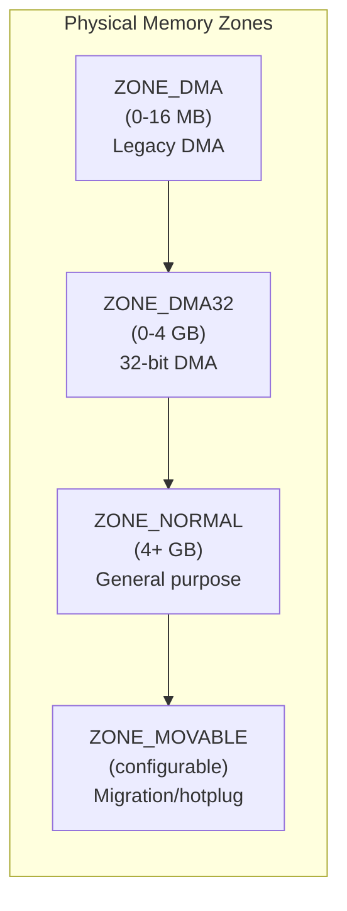

lmkd 守护进程解析 `/proc/zoneinfo` 以了解区域级别的内存压力。
`system/memory/lmkd/lmkd.cpp` 中的解析代码定义了这些结构：

```c
// system/memory/lmkd/lmkd.cpp (from line 308)

/* Fields to parse in /proc/zoneinfo */
enum zoneinfo_zone_field {
    ZI_ZONE_NR_FREE_PAGES = 0,
    ZI_ZONE_MIN,
    ZI_ZONE_LOW,
    ZI_ZONE_HIGH,
    ZI_ZONE_PRESENT,
    ZI_ZONE_NR_FREE_CMA,
    ZI_ZONE_FIELD_COUNT
};

struct zoneinfo_zone {
    union zoneinfo_zone_fields fields;
    int64_t protection[MAX_NR_ZONES];
    int64_t max_protection;
};

struct zoneinfo {
    int node_count;
    struct zoneinfo_node nodes[MAX_NR_NODES];
    int64_t totalreserve_pages;
    int64_t total_inactive_file;
    int64_t total_active_file;
};
```

`totalreserve_pages` 字段是每个区域的 `max_protection + high watermark` 之和，
表示内核为自己操作保留的最小内存量。这对 lmkd 计算可用内存至关重要。

### 8.1.5 Zygote 与写时复制

Zygote 进程是 Android 内存效率的核心。每个应用进程都从
Zygote 派生而来，Zygote 预加载了整个 Android 框架（约 100+ MB 的类库、
资源和原生代码）。得益于写时复制（CoW），所有这些页面在被修改之前都在 Zygote 与每个派生的应用进程之间物理共享。

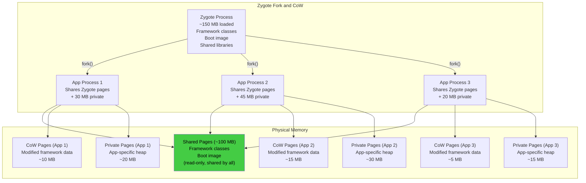

如果没有 Zygote 和 CoW，这三个应用中的每一个都需要自己的一份框架副本，
使共享代码的内存消耗增加三倍。有了 CoW，物理开销是：

- **没有 CoW**：3 x 150 MB = 450 MB 用于框架 + 95 MB 私有 = 总计 545 MB
- **有 CoW**：100 MB 共享 + 30 MB CoW 页面 + 65 MB 私有 = 总计 195 MB

这一差异会乘以 Android 设备上通常运行的 20-40 个进程。

### 8.1.6 内存回收机制

内核在压力增加时采用若干机制回收内存：

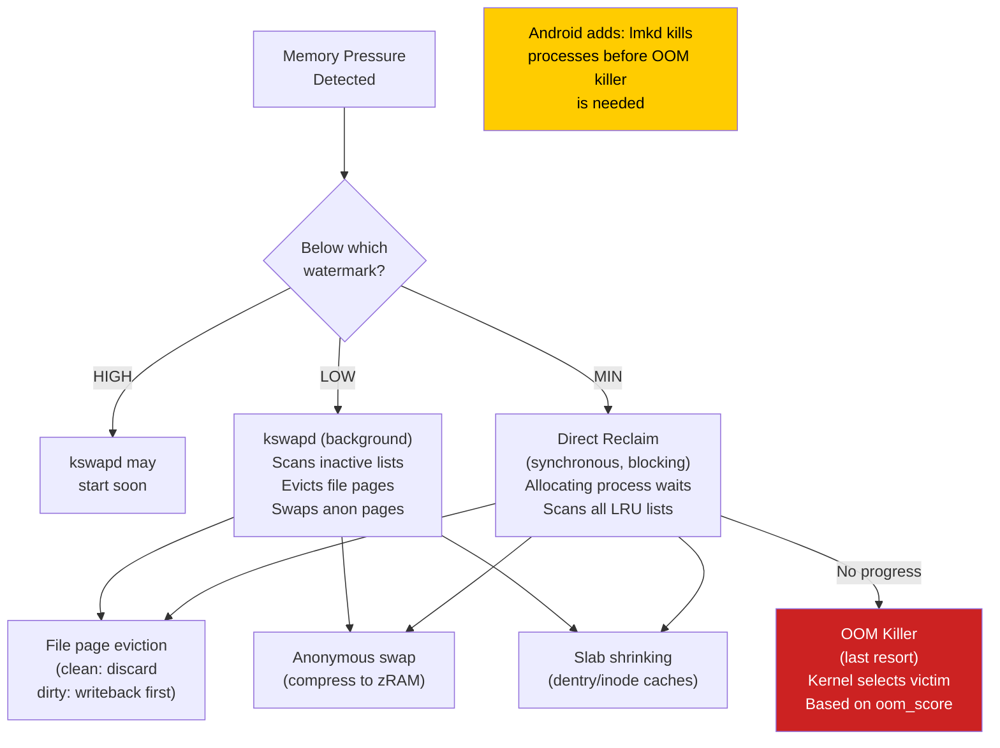

页面回收算法使用两个关键指标：

- **非活跃比例**：根据访问模式，页面从活跃列表降级到非活跃列表。
  最近未被访问的页面更有可能被驱逐。
- **扫描优先级**：更高的优先级意味着每个回收周期扫描更多页面。直接
  回收使用比 kswapd 更高的优先级。

### 8.1.7 页缓存

Linux 页缓存将最近读取的文件数据保留在内存中。在 Android 上，这一点尤为重要，因为：

1. **应用启动速度** 取决于页缓存中是否有 APK 内容（DEX、资源、原生库）。
2. **页缓存是可驱逐的** —— 内核在内存压力下回收这些页面，这就是为什么
   文件缓存大小会纳入 lmkd 的杀进程决策。
3. **活跃列表与非活跃列表** —— 内核维护 LRU 列表来决定先驱逐哪些页面。lmkd 通过 `/proc/meminfo` 读取这些信息：

```c
// system/memory/lmkd/lmkd.cpp (enum meminfo_field, from line 399)
enum meminfo_field {
    MI_NR_FREE_PAGES = 0,
    MI_CACHED,
    MI_SWAP_CACHED,
    MI_BUFFERS,
    MI_SHMEM,
    MI_UNEVICTABLE,
    MI_TOTAL_SWAP,
    MI_FREE_SWAP,
    MI_ACTIVE_ANON,
    MI_INACTIVE_ANON,
    MI_ACTIVE_FILE,
    MI_INACTIVE_FILE,
    MI_SRECLAIMABLE,
    MI_SUNRECLAIM,
    MI_KERNEL_STACK,
    MI_PAGE_TABLES,
    // ...
    MI_FIELD_COUNT
};
```

---

## 8.2 低内存杀手守护进程（lmkd）

低内存杀手守护进程是负责在内存压力下保持
Android 系统响应的核心用户态组件。当物理内存不足时，lmkd 选择并杀死进程，
在系统进入不可恢复的内存不足（OOM）状态之前释放内存。

**源目录**：`system/memory/lmkd/`

| 文件 | 用途 |
|---|---|
| `lmkd.cpp` | 主守护进程实现 |
| `lmkd.rc` | Init 服务定义 |
| `lmkd.h`（位于 `include/`） | 命令协议定义 |
| `reaper.cpp` / `reaper.h` | 使用 `process_mrelease()` 异步回收进程 |
| `watchdog.cpp` / `watchdog.h` | 用于检测 lmkd 挂起的看门狗定时器 |
| `statslog.cpp` / `statslog.h` | 杀进程事件的统计日志 |
| `libpsi/psi.cpp` | PSI（压力停滞信息）监视器接口 |

### 8.2.1 历史背景：从内核驱动到用户态守护进程

Android 最初使用位于
`drivers/staging/android/lowmemorykiller.c` 的内核内低内存杀手（LMK）驱动。该内核驱动通过挂钩内核的 shrink 回调机制运行。当内存低于配置的阈值时，驱动会遍历进程列表，并杀死 `oom_adj_score` 超过
阈值且分数最高的进程。

迁移到用户态守护进程（lmkd）有几个原因：

1. **移除 staging 驱动**：内核社区将 LMK 驱动从 staging 树中剔除。
2. **灵活性**：用户态守护进程可以独立于内核更新。
3. **PSI 集成**：现代内核中的压力停滞信息（PSI）框架提供了
   比旧的 vmpressure 事件更好的内存压力信号。
4. **更好的杀进程策略**：用户态可以访问更多进程元数据。

代码仍然会检查旧的内核内接口：

```c
// system/memory/lmkd/lmkd.cpp (lines 86-87, 155)
#define INKERNEL_MINFREE_PATH "/sys/module/lowmemorykiller/parameters/minfree"
#define INKERNEL_ADJ_PATH "/sys/module/lowmemorykiller/parameters/adj"

/* default to old in-kernel interface if no memory pressure events */
static bool use_inkernel_interface = true;
static bool has_inkernel_module;
```

### 8.2.2 lmkd 服务配置

守护进程由 Android 的 init 系统通过其 `.rc` 文件启动：

```
# system/memory/lmkd/lmkd.rc (lines 1-8)
service lmkd /system/bin/lmkd
    class core
    user lmkd
    group lmkd system readproc
    capabilities DAC_OVERRIDE KILL IPC_LOCK SYS_NICE SYS_RESOURCE
    critical
    socket lmkd seqpacket+passcred 0660 system system
    task_profiles ServiceCapacityLow
```

此配置的关键方面：

- **`class core`**：lmkd 在 core 服务类中启动，意味着它在启动早期启动。
- **`user lmkd`**：以专用用户运行，实现安全隔离。
- **`capabilities`**：需要 `CAP_KILL` 来终止进程、`CAP_DAC_OVERRIDE` 来写入
  `/proc/[pid]/oom_score_adj`，以及用于资源调整的 `CAP_SYS_RESOURCE`。
- **`critical`**：如果 lmkd 崩溃，系统将重启（它至关重要）。
- **`socket lmkd`**：创建一个 Unix 域套接字用于与 ActivityManagerService 通信。
- **重新初始化触发器**：`.rc` 文件包含属性触发器（第 10-72 行），当实验标志通过 `persist.device_config.lmkd_native.*` 属性更改时，会重新初始化
  lmkd。

### 8.2.3 通信协议

lmkd 通过 Unix 域套接字与框架（主要是 ActivityManagerService 中的 `ProcessList.java`）通信。协议定义在 `include/lmkd.h`：

```c
// system/memory/lmkd/include/lmkd.h (lines 29-42)
enum lmk_cmd {
    LMK_TARGET = 0,         /* Associate minfree with oom_adj_score */
    LMK_PROCPRIO,           /* Register a process and set its oom_adj_score */
    LMK_PROCREMOVE,         /* Unregister a process */
    LMK_PROCPURGE,          /* Purge all registered processes */
    LMK_GETKILLCNT,         /* Get number of kills */
    LMK_SUBSCRIBE,          /* Subscribe for asynchronous events */
    LMK_PROCKILL,           /* Unsolicited msg to subscribed clients on proc kills */
    LMK_UPDATE_PROPS,       /* Reinit properties */
    LMK_STAT_KILL_OCCURRED, /* Unsolicited msg for statsd logging */
    LMK_START_MONITORING,   /* Start psi monitoring if skipped earlier */
    LMK_BOOT_COMPLETED,     /* Notify LMKD boot is completed */
    LMK_PROCS_PRIO,         /* Register processes and set the same oom_adj_score */
};
```

正常运行期间的消息流：

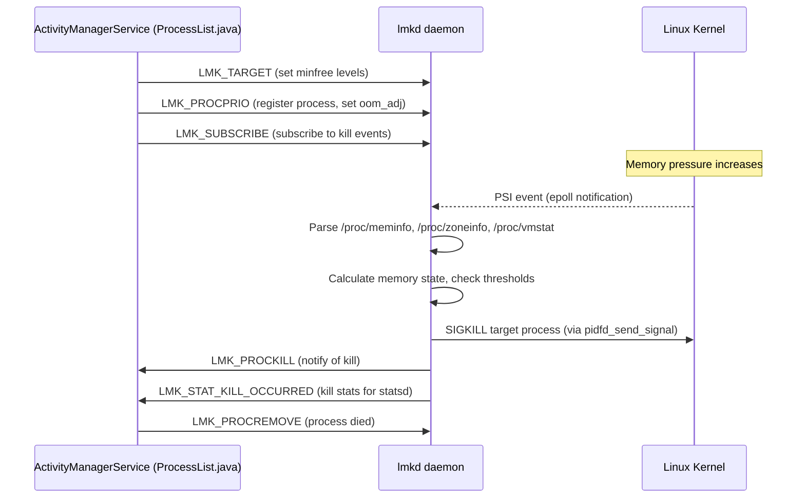

每个数据包以网络字节序的 `int` 命令码开头，后跟命令特定的
字段。例如，`LMK_PROCPRIO` 数据包携带：

```c
// system/memory/lmkd/include/lmkd.h (lines 116-124)
struct lmk_procprio {
    pid_t pid;
    uid_t uid;
    int oomadj;
    enum proc_type ptype;
    // Whether this procprio is for lmkd only. If set, the procprio update will
    // not be sent to kernel.
    bool for_lmkd_only;
};
```

`LMK_PROCS_PRIO` 命令（第 41 行）是一项优化。它允许在单个数据包中批量处理多个进程
优先级更新。当许多进程优先级同时变化时（例如在 activity 切换期间），这减少了套接字往返次数。

### 8.2.4 OOM 调整分数

Android 中的每个进程都有一个 OOM 调整分数（`oom_adj_score`），表示其
重要性。分数越低表示重要性越高。lmkd 将此值写入
`/proc/[pid]/oom_score_adj`，并据此决定先杀死哪些进程。

分数范围定义在
`frameworks/base/services/core/java/com/android/server/am/psc/Constants.java`
（`ProcessList.java` 静态导入它们）：

| 常量 | 值 | 进程类型 |
|---|---|---|
| `NATIVE_ADJ` | -1000 | 原生系统守护进程 |
| `SYSTEM_ADJ` | -900 | system_server |
| `PERSISTENT_PROC_ADJ` | -800 | 持久系统进程 |
| `PERSISTENT_SERVICE_ADJ` | -700 | 持久服务 |
| `FOREGROUND_APP_ADJ` | 0 | 当前可见的前台应用 |
| `VISIBLE_APP_ADJ` | 100 | 可见但未聚焦的 activity |
| `PERCEPTIBLE_APP_ADJ` | 200 | 用户可感知（例如播放音频） |
| `PERCEPTIBLE_LOW_APP_ADJ` | 250 | 低优先级可感知 |
| `BACKUP_APP_ADJ` | 300 | 正在执行备份 |
| `HEAVY_WEIGHT_APP_ADJ` | 400 | 重量级后台进程 |
| `SERVICE_ADJ` | 500 | 正在运行服务 |
| `HOME_APP_ADJ` | 600 | 启动器应用 |
| `PREVIOUS_APP_ADJ` | 700 | 上一个前台应用 |
| `SERVICE_B_ADJ` | 800 | B 列表服务 |
| `CACHED_APP_MIN_ADJ` | 900 | 缓存（空）进程的最低分数 |
| `CACHED_APP_LMK_FIRST_ADJ` | 950 | 第一个被杀死的缓存进程 |
| `CACHED_APP_MAX_ADJ` | 999 | 缓存进程的最高分数 |

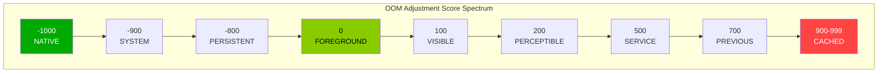

lmkd 维护一个按 OOM 分数排序的双向链表，以快速找到分数最高
（最不重要）的进程：

```c
// system/memory/lmkd/lmkd.cpp (struct proc line 530; pidhash/procadjslot_list line 547+)
struct proc {
    struct adjslot_list asl;
    int pid;
    int pidfd;
    CgroupFD cgroupfd;
    uid_t uid;
    int oomadj;
    pid_t reg_pid;
    bool valid;
    struct proc *pidhash_next;
};

#define PIDHASH_SZ 1024
static struct proc *pidhash[PIDHASH_SZ];
#define pid_hashfn(x) ((((x) >> 8) ^ (x)) & (PIDHASH_SZ - 1))

#define ADJTOSLOT(adj) ((adj) + -OOM_SCORE_ADJ_MIN)
#define ADJTOSLOT_COUNT (ADJTOSLOT(OOM_SCORE_ADJ_MAX) + 1)
static struct adjslot_list procadjslot_list[ADJTOSLOT_COUNT];
```

`procadjslot_list` 是一个包含 2001 个槽位的数组（从 -1000 到 +1000），每个槽位是
具有该 OOM 分数的进程链表。通过从槽位 2000 向后扫描，可以 O(1) 查找分数最高的
进程。

### 8.2.5 基于 PSI 的杀进程触发

现代 lmkd 将内核的压力停滞信息（PSI）框架作为其杀进程决策的主要触发因素。PSI 测量任务因等待内存
资源而停滞的时间百分比。

PSI 接口通过 `/proc/pressure/memory` 访问，该文件报告：

```
some avg10=0.00 avg60=0.00 avg300=0.00 total=0
full avg10=0.00 avg60=0.00 avg300=0.00 total=0
```

- **`some`**：至少有一个任务因内存而停滞。
- **`full`**：所有非空闲任务同时因内存而停滞。

lmkd 定义了三个压力级别，带有编译时默认阈值：

```c
// system/memory/lmkd/lmkd.cpp (enum vmpressure_level line 166; psi_thresholds line 231)
enum vmpressure_level {
    VMPRESS_LEVEL_LOW = 0,
    VMPRESS_LEVEL_MEDIUM,
    VMPRESS_LEVEL_CRITICAL,
    VMPRESS_LEVEL_COUNT
};

static struct psi_threshold psi_thresholds[VMPRESS_LEVEL_COUNT] = {
    { PSI_SOME, 70 },    /* 70ms out of 1sec for partial stall */
    { PSI_SOME, 100 },   /* 100ms out of 1sec for partial stall */
    { PSI_FULL, 70 },    /* 70ms out of 1sec for complete stall */
};
```

这些静态值仅是旧的基于 minfree 策略的回退值。

在默认的
新策略模式（当 `ro.lmk.use_minfree_levels` 为 false 时 `use_new_strategy` 为 true，这是其
默认值）中，`init_psi_monitors()` 会在注册前覆盖该表。LOW 阈值
设置为 0。`init_mp_psi()` 在阈值为 0 时跳过注册，因此不存在 LOW 监视器。MEDIUM 变为
`psi_partial_stall_ms`（`some`，默认 70 ms/1 s，低 RAM 设备上为 200 ms）。CRITICAL 变为
`psi_complete_stall_ms`（`full`，700 ms/1 s）。实际上只注册两个 PSI 监视器。

PSI 监视库（`system/memory/lmkd/libpsi/psi.cpp`）向内核注册触发器：

```c
// system/memory/lmkd/libpsi/psi.cpp (lines 36-83)
int init_psi_monitor(enum psi_stall_type stall_type, int threshold_us,
                     int window_us, enum psi_resource resource) {
    int fd;
    char buf[256];

    fd = TEMP_FAILURE_RETRY(open(psi_resource_file[resource],
                                 O_WRONLY | O_CLOEXEC));
    if (fd < 0) {
        ALOGE("No kernel psi monitor support (errno=%d)", errno);
        return -1;
    }

    // Write trigger: "some 70000 1000000" means
    // "notify when 'some' stall exceeds 70ms in a 1000ms window"
    snprintf(buf, sizeof(buf), "%s %d %d",
             stall_type_name[stall_type], threshold_us, window_us);

    write(fd, buf, strlen(buf) + 1);
    return fd;  // fd can be added to epoll
}
```

返回的文件描述符被添加到 lmkd 的 epoll 集合中。当内核检测到内存
停滞时间在窗口内超过阈值时，它会在 fd 上触发 `EPOLLPRI` 事件。

### 8.2.6 杀进程决策逻辑

当 PSI 事件触发时，lmkd 进入其杀进程决策循环。该逻辑考虑多个因素：

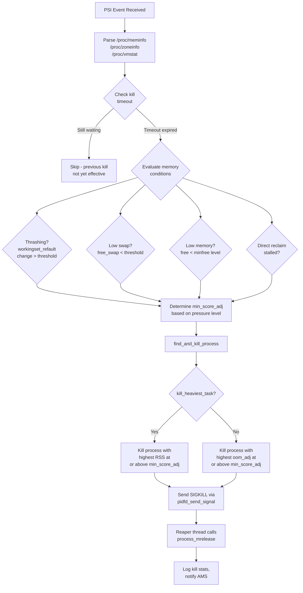

杀进程原因在代码中枚举如下：

```c
// system/memory/lmkd/statslog.h (lines 71-87)
enum kill_reasons {
    NONE = -1,
    PRESSURE_AFTER_KILL = 0,
    NOT_RESPONDING,
    LOW_SWAP_AND_THRASHING,
    LOW_MEM_AND_SWAP,
    LOW_MEM_AND_THRASHING,
    DIRECT_RECL_AND_THRASHING,
    LOW_MEM_AND_SWAP_UTIL,
    LOW_FILECACHE_AFTER_THRASHING,
    LOW_MEM,
    DIRECT_RECL_STUCK,
    /* reserve aosp kill 0 ~ 999 */
    VENDOR_KILL_REASON_BASE = 1000,
    VENDOR_KILL_REASON_END = VENDOR_KILL_REASON_BASE + NUM_VENDOR_LMK_KILL_REASON - 1,
    KILL_REASON_COUNT
};
```

可用内存的计算是微妙的。lmkd 计算"易于可用"的内存，该计算考虑到
文件缓存的可驱逐性和交换压缩：

```c
// system/memory/lmkd/lmkd.cpp (inside meminfo_parse, from line 1980; this block at line 2007)
mi->field.easy_available = mi->field.nr_free_pages;
if (relaxed_available_memory && swap_compression_ratio) {
    mi->field.easy_available += mi->field.active_file
                              + mi->field.inactive_file;
    mi->field.easy_available -= mi->field.dirty;

    int64_t anon_pages = mi->field.active_anon + mi->field.inactive_anon;
    mi->field.easy_available +=
        (swap_compression_ratio - swap_compression_ratio_div)
        * anon_pages / swap_compression_ratio;
} else {
    mi->field.easy_available += mi->field.inactive_file;
}
```

该计算认识到：

- 空闲页面立即可用。
- 文件支持的页面（活跃和非活跃）可以被驱逐以回收内存。
- 脏页面需要先回写，因此被减去。
- 匿名页面可以交换出去，但 zRAM 压缩意味着它们只释放
  `(1 - 1/compression_ratio)` 的原始大小。

### 8.2.7 完整的杀进程决策状态机

`lmkd.cpp` 中完整的 PSI 事件处理器（`__mp_event_psi`）实现了一个复杂的
状态机，在决定是否杀进程之前评估多种内存状况：

```c
// system/memory/lmkd/lmkd.cpp (__mp_event_psi, from line 2773, abbreviated)
static void __mp_event_psi(enum event_source source,
                           union psi_event_data data,
                           uint32_t events,
                           struct polling_params *poll_params) {
    static int64_t init_ws_refault;
    static int64_t prev_workingset_refault;
    static int64_t base_file_lru;
    static bool killing;
    static int thrashing_limit = thrashing_limit_pct;
    static struct wakeup_info wi;
    static int max_thrashing = 0;

    union meminfo mi;
    union vmstat vs;
    struct psi_data psi_data;
    int64_t thrashing = 0;
    bool swap_is_low = false;
    enum kill_reasons kill_reason = NONE;
    // ...

    // Step 1: Rate-limit based on pending kills
    bool kill_pending = is_kill_pending();
    if (kill_pending && (kill_timeout_ms == 0 ||
        get_time_diff_ms(&last_kill_tm, &curr_tm)
            < static_cast<long>(kill_timeout_ms))) {
        wi.skipped_wakeups++;
        goto no_kill;
    }

    // Step 2: Parse all memory state
    vmstat_parse(&vs);
    meminfo_parse(&mi);

    // Step 3: Calculate thrashing percentage
    thrashing = (workingset_refault_file - init_ws_refault) * 100
                / (base_file_lru + 1);
    thrashing += prev_thrash_growth;

    // Step 4: Check swap levels
    swap_is_low = get_free_swap(&mi) < swap_low_threshold;

    // Step 5: Identify reclaim state
    in_direct_reclaim = vs.field.pgscan_direct != init_pgscan_direct;
    in_kswapd_reclaim = vs.field.pgscan_kswapd != init_pgscan_kswapd;

    // Step 6: Check watermarks
    wmark = get_lowest_watermark(&mi, &watermarks);

    // Step 7: Determine kill reason based on combined state
    if (cycle_after_kill && wmark < WMARK_LOW) {
        kill_reason = PRESSURE_AFTER_KILL;
    } else if (level == VMPRESS_LEVEL_CRITICAL) {
        kill_reason = NOT_RESPONDING;
    } else if (swap_is_low && thrashing > thrashing_limit_pct) {
        kill_reason = LOW_SWAP_AND_THRASHING;
    } else if (swap_is_low && wmark < WMARK_HIGH) {
        kill_reason = LOW_MEM_AND_SWAP;
    } else if (reclaim == DIRECT_RECLAIM && thrashing > thrashing_limit) {
        kill_reason = DIRECT_RECL_AND_THRASHING;
    } // ... more conditions
}
```

完整的杀进程决策树：

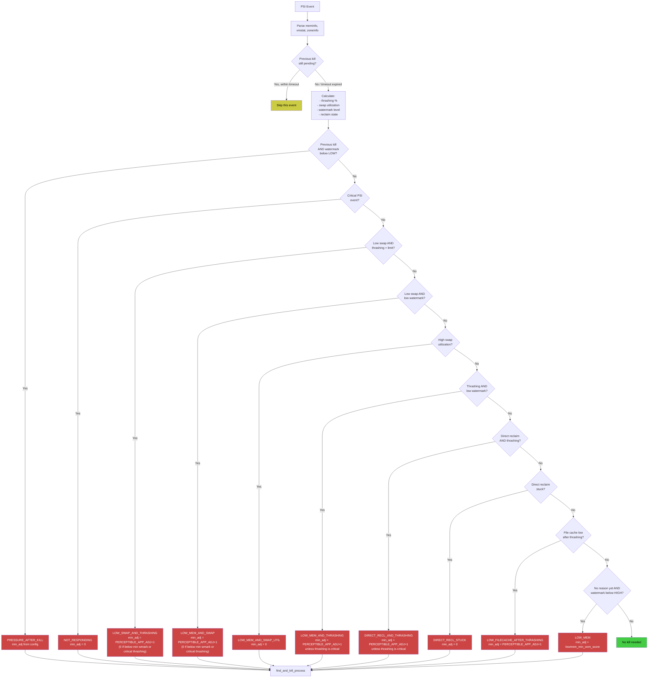

### 8.2.8 水位计算

lmkd 计算区域水位以了解系统距离 OOM 有多近：

```c
// system/memory/lmkd/lmkd.cpp (get_lowest_watermark / calc_zone_watermarks, from line 2711)
enum zone_watermark {
    WMARK_MIN = 0,   // Below min: direct reclaim, risk of OOM
    WMARK_LOW,       // Below low: kswapd is active
    WMARK_HIGH,      // Below high: kswapd may start soon
    WMARK_NONE       // Above all watermarks: healthy
};

struct zone_watermarks {
    long high_wmark;
    long low_wmark;
    long min_wmark;
};

void calc_zone_watermarks(struct zoneinfo *zi,
                          struct zone_watermarks *watermarks) {
    memset(watermarks, 0, sizeof(struct zone_watermarks));

    for (int node_idx = 0; node_idx < zi->node_count; node_idx++) {
        struct zoneinfo_node *node = &zi->nodes[node_idx];
        for (int zone_idx = 0; zone_idx < node->zone_count; zone_idx++) {
            struct zoneinfo_zone *zone = &node->zones[zone_idx];
            if (!zone->fields.field.present) continue;

            watermarks->high_wmark += zone->max_protection
                                    + zone->fields.field.high;
            watermarks->low_wmark  += zone->max_protection
                                    + zone->fields.field.low;
            watermarks->min_wmark  += zone->max_protection
                                    + zone->fields.field.min;
        }
    }
}

static enum zone_watermark get_lowest_watermark(
        union meminfo *mi, struct zone_watermarks *watermarks) {
    int64_t nr_free_pages = mi->field.nr_free_pages
                          - mi->field.cma_free;

    if (nr_free_pages < watermarks->min_wmark) return WMARK_MIN;
    if (nr_free_pages < watermarks->low_wmark) return WMARK_LOW;
    if (nr_free_pages < watermarks->high_wmark) return WMARK_HIGH;
    return WMARK_NONE;
}
```

水位层次可视化如下：

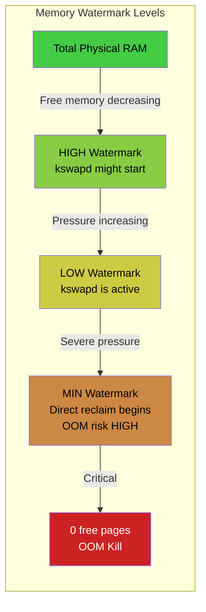

### 8.2.9 受害者选择：find_and_kill_process

受害者选择算法从最高 OOM 分数向下迭代：

```c
// system/memory/lmkd/lmkd.cpp (find_and_kill_process, from line 2602)
static int find_and_kill_process(int min_score_adj,
                                 struct kill_info *ki,
                                 union meminfo *mi,
                                 struct wakeup_info *wi,
                                 struct timespec *tm,
                                 struct psi_data *pd) {
    int killed_size = 0;
    bool choose_heaviest_task = kill_heaviest_task;

    for (int i = OOM_SCORE_ADJ_MAX; i >= min_score_adj; i--) {
        struct proc *procp;

        if (!choose_heaviest_task && i <= PERCEPTIBLE_APP_ADJ) {
            // For perceptible processes, always kill heaviest
            // to minimize the number of victims
            choose_heaviest_task = true;
        }

        while (true) {
            procp = choose_heaviest_task ?
                proc_get_heaviest(i) : proc_adj_tail(i);

            if (!procp) break;

            killed_size = kill_one_process(procp, min_score_adj,
                                           ki, mi, wi, tm, pd);
            if (killed_size >= 0) {
                return killed_size;
            }
        }
    }
    return killed_size;
}
```

一旦 `kill_one_process()` 成功（结果为非负值），函数就会返回。只有当
每个候选都失败时，外层循环才会落到最后并返回最后一次失败。

双重选择策略很重要：

1. **对于缓存/后台进程**（`oom_adj > PERCEPTIBLE_APP_ADJ`）：在每个分数级别杀死
   最近最少添加（最老）的进程。新注册的进程被插入到每个 adj 槽位的头部。`proc_adj_tail` 从尾部遍历。因此，在该分数下注册时间最长的进程最先被杀死。
2. **对于可感知进程**（`oom_adj <= 200`）：始终杀死最重的进程
   （`proc_get_heaviest`），它会为每个候选读取 `/proc/[pid]/statm`。这最大限度地减少了
   必须被杀死的用户可见进程数量。

`proc_get_heaviest` 函数：

```c
// system/memory/lmkd/lmkd.cpp (proc_get_heaviest, from line 2294)
static struct proc *proc_get_heaviest(int oomadj) {
    struct adjslot_list *head = &procadjslot_list[ADJTOSLOT(oomadj)];
    struct adjslot_list *curr = head->next;
    struct proc *maxprocp = NULL;
    int maxsize = 0;

    // Optimization: if only one process, skip size lookup
    if ((curr != head) && (curr->next == head)) {
        return (struct proc *)curr;
    }

    while (curr != head) {
        int pid = ((struct proc *)curr)->pid;
        int tasksize = proc_get_size(pid);
        if (tasksize < 0) {
            // Process died, clean up
            struct adjslot_list *next = curr->next;
            pid_remove(pid);
            curr = next;
        } else {
            if (tasksize > maxsize) {
                maxsize = tasksize;
                maxprocp = (struct proc *)curr;
            }
            curr = curr->next;
        }
    }
    return maxprocp;
}
```

### 8.2.10 杀进程执行：kill_one_process

一旦选定受害者，就通过大量安全检查来执行杀进程：

```c
// system/memory/lmkd/lmkd.cpp (kill_one_process, from line 2466, abbreviated)
static int kill_one_process(struct proc* procp, int min_oom_score,
                            struct kill_info *ki, union meminfo *mi,
                            struct wakeup_info *wi, struct timespec *tm,
                            struct psi_data *pd) {
    int pid = procp->pid;
    int pidfd = procp->pidfd;
    uid_t uid = procp->uid;
    char buf[pagesize];

    // Safety check 1: verify process is still valid
    if (!procp->valid || !read_proc_status(pid, buf, sizeof(buf))) {
        goto out;
    }

    // Safety check 2: detect PID reuse
    int64_t tgid;
    if (!parse_status_tag(buf, PROC_STATUS_TGID_FIELD, &tgid)) {
        goto out;
    }
    if (tgid != pid) {
        ALOGE("Possible pid reuse detected (pid %d, tgid %" PRId64 ")!",
              pid, tgid);
        goto out;
    }

    // Read RSS and swap for logging
    parse_status_tag(buf, PROC_STATUS_RSS_FIELD, &rss_kb);
    parse_status_tag(buf, PROC_STATUS_SWAP_FIELD, &swap_kb);

    // Hook: allow vendor code to free memory without killing
    result = lmkd_free_memory_before_kill_hook(procp, rss_kb / page_k,
                                                procp->oomadj, /*...*/);
    if (result > 0) {
        ALOGI("Skipping kill; %ld kB freed elsewhere.", result * page_k);
        return result;
    }

    // Execute the kill via the reaper (Reaper::kill returns true on success)
    start_wait_for_proc_kill(pidfd < 0 ? pid : pidfd);
    if (!reaper.kill({ pidfd, procp->cgroupfd, pid, uid }, false)) {
        stop_wait_for_proc_kill(false);
        ALOGE("kill(%d): errno=%d", pid, errno);
        // Delete the process record even on failure so we don't get stuck on it
        goto out;
    }

    // Log the kill
    ALOGI("Kill '%s' (%d), uid %d, oom_score_adj %d "
          "to free %" PRId64 "kB rss, %" PRId64 "kB swap; "
          "reason: %s",
          taskname, pid, uid, procp->oomadj, rss_kb, swap_kb,
          ki->kill_desc);
    killinfo_log(procp, min_oom_score, rss_kb, swap_kb,
                 ki, mi, wi, tm, pd);

    // Notify AMS and statsd
    ctrl_data_write_lmk_kill_occurred((pid_t)pid, uid, rss_kb);
    stats_write_lmk_kill_occurred(&kill_st, mem_st);

out:
    pid_remove(pid);
    return result;
}
```

`lmkd_free_memory_before_kill_hook` 是一个厂商钩子。它允许 OEM 特定的代码释放内存
（例如通过压缩特定缓存或丢弃 GPU 资源），而无需真正杀死一个
进程。如果该钩子释放了足够的内存，杀进程就会被完全跳过。

### 8.2.11 看门狗杀进程路径

当 lmkd 的主事件循环挂起时（由看门狗定时器检测），看门狗线程
执行自己的紧急杀进程：

```c
// system/memory/lmkd/lmkd.cpp (watchdog_callback, from line 2354)
static void watchdog_callback() {
    int prev_pid = 0;

    ALOGW("lmkd watchdog timed out!");
    for (int oom_score = OOM_SCORE_ADJ_MAX; oom_score >= 0;) {
        struct proc target;

        if (!find_victim(oom_score, prev_pid, target)) {
            oom_score--;
            prev_pid = 0;
            continue;
        }

        if (target.valid &&
            reaper.kill({ target.pidfd, target.cgroupfd, target.pid, target.uid },
                        true /* synchronous */)) {
            ALOGW("lmkd watchdog killed process %d, oom_score_adj %d",
                  target.pid, oom_score);
            pid_invalidate(target.pid);
            break;
        }
        prev_pid = target.pid;
    }
}
```

看门狗杀进程是**同步的**（注意传给 `reaper.kill()` 的 `true` 参数），这意味着它
会阻塞直到杀进程完成。这是因为看门狗线程无法
使用异步回收队列（处理队列完成的主线程已挂起）。看门狗还使用 `pid_invalidate()` 而不是 `pid_remove()`，因为后者只能
从主线程安全地调用。

### 8.2.12 颠簸检测

lmkd 通过监控来自 `/proc/vmstat` 的 `workingset_refault` 计数器来检测内存颠簸：

```c
// system/memory/lmkd/lmkd.cpp (enum vmstat_field, from line 479)
enum vmstat_field {
    VS_FREE_PAGES,
    VS_INACTIVE_FILE,
    VS_ACTIVE_FILE,
    VS_WORKINGSET_REFAULT,
    VS_WORKINGSET_REFAULT_FILE,
    VS_PGSCAN_KSWAPD,
    VS_PGSCAN_DIRECT,
    VS_PGSCAN_DIRECT_THROTTLE,
    VS_PGREFILL,
    VS_FIELD_COUNT
};
```

`workingset_refault` 是一个最近从页缓存中被驱逐、现在又被缺页调回的页面。它是系统正在颠簸的强烈信号。颠簸百分比是
`workingset_refault_file` 的增长，占窗口开始时采样的文件支持的页缓存大小
（`nr_inactive_file + nr_active_file`）的百分比。该
百分比与可配置的阈值进行比较：

| 属性 | 默认值 | 低 RAM 默认值 |
|---|---|---|
| `ro.lmk.thrashing_limit` | 100 | 30 |
| `ro.lmk.thrashing_limit_decay` | 10 | 50 |
| `ro.lmk.thrashing_limit_critical` | 300 | 300 |

### 8.2.13 回收者：异步进程杀进程

当 lmkd 决定杀死一个进程时，实际的杀进程由一组回收线程执行。
这种设计将杀进程决策与从被杀死的进程回收内存这一可能很慢的过程解耦。

`Reaper` 类（`system/memory/lmkd/reaper.h` 和 `reaper.cpp`）管理一个线程池：

```c
// system/memory/lmkd/reaper.h (lines 37-71)
class Reaper {
public:
    struct target_proc {
        int pidfd;
        CgroupFD cgroupfd;
        pid_t pid;
        uid_t uid;
    };
private:
    static constexpr size_t THREAD_POOL_SIZE = 2;
    ThreadsafeQueue<target_proc> reap_queue_;
    // write side of the pipe to communicate kill failures with the main thread
    int comm_fd_;
    std::vector<std::thread> thread_pool_;
    bool debug_enabled_ = false;

    ThreadsafeQueue<std::pair<uid_t, pid_t>> setprio_queue_;
    std::thread setprio_thread_;
    // ...
};
```

回收线程的主循环：

1. **弹出** 一个杀进程目标从线程安全的回收队列中。
2. **杀死目标的 cgroup** —— `kill_cgroup_or_process()` 写入 cgroup 的 `cgroup.kill`
   （或遍历 `cgroup.procs`）。对于不在其自己的 Android 管理 cgroup 中的进程（例如 adbd 的子进程），它会回退到 `pidfd_send_signal(SIGKILL)`。pidfd 避免了 PID 重用竞争。
3. **移交优先级调整** —— 受害者的 uid/pid 交给一个专用的
   `lmkd_setprio` 线程。该线程将正在消亡的进程移入 LMKD 回收目标 cgroup，
   以便其拆除可以使用大核。
4. **调用 `process_mrelease()`** —— 一个 Linux 系统调用（编号 448），触发从正在消亡的进程同步回收内存。

```c
// system/memory/lmkd/reaper.cpp (lines 55-57, 166-209, abbreviated)
static int process_mrelease(int pidfd, unsigned int flags) {
    return syscall(__NR_process_mrelease, pidfd, flags);
}

void Reaper::reaper_main() {
    // ... pin the thread to big cores, raise its priority ...
    for (;;) {
        Reaper::target_proc target = reap_queue_.pop();

        if (!kill_cgroup_or_process(target)) {
            // Inform the main thread about failure to kill
            notify_kill_failure(target.pid);
            goto done;
        }

        setprio_queue_.push({target.uid, target.pid});

        if (process_mrelease(target.pidfd, 0)) {
            ALOGE("process_mrelease %d failed: %s",
                  target.pid, strerror(errno));
            goto done;
        }
done:
        close(target.pidfd);
        close(target.cgroupfd);
        reap_queue_.request_complete();
    }
}
```

`process_mrelease()` 系统调用很重要，因为如果没有它，被杀死进程的内存会作为
`exit_mmap()` 的一部分被内核惰性释放。有了 `process_mrelease()`，调用线程会主动回收正在消亡进程的内存，缩短了杀进程决策
与实际内存可用之间的时间。

### 8.2.14 看门狗

lmkd 包含一个看门狗定时器（`system/memory/lmkd/watchdog.cpp`），用于检测守护进程何时挂起——这可能是灾难性的，因为在内存压力期间不会杀任何进程：

```c
// system/memory/lmkd/watchdog.h (lines 23-39)
class Watchdog {
private:
    int timeout_;                  // 2 seconds (WATCHDOG_TIMEOUT_SEC)
    timer_t timer_;
    std::atomic<bool> timer_created_;
    void (*callback_)();
public:
    Watchdog(int timeout, void (*callback)())
        : timeout_(timeout), timer_created_(false), callback_(callback) {}
    bool init();
    bool start();
    bool stop();
    bool create_timer(sigset_t &sigset);
    void bite() const { if (callback_) callback_(); }
};
```

看门狗使用一个 `CLOCK_MONOTONIC` 定时器，通过 `SIGALRM` 投递。如果 lmkd 的主事件循环
没有在 2 秒超时内解除看门狗，看门狗就会咬人。然后 `bite()` 调用
`watchdog_callback()`，执行第 8.2.11 节所述的紧急同步杀进程。
它不会中止守护进程。

### 8.2.15 可配置属性

lmkd 从系统属性读取配置，并支持实验覆盖：

```c
// system/memory/lmkd/lmkd.cpp (lines 108-110)
#define GET_LMK_PROPERTY(type, name, def) \
    property_get_##type("persist.device_config.lmkd_native." name, \
        property_get_##type("ro.lmk." name, def))
```

关键属性：

| 属性 | 默认值 | 描述 |
|---|---|---|
| `ro.lmk.debug` | false | 启用详细的杀进程日志 |
| `ro.lmk.kill_heaviest_task` | false | 按 RSS 而不是 oom_adj 杀进程 |
| `ro.lmk.kill_timeout_ms` | 100 | 杀进程之间的最小时间 |
| `ro.lmk.use_minfree_levels` | false | 使用传统的 minfree 阈值 |
| `ro.lmk.psi_partial_stall_ms` | 70（低 RAM 上为 200） | PSI 部分停滞阈值 |
| `ro.lmk.psi_complete_stall_ms` | 700 | PSI 完全停滞阈值 |
| `ro.lmk.psi_window_size_ms` | 1000 | PSI 监视窗口 |
| `ro.lmk.swap_free_low_percentage` | 10 | 低交换阈值 |
| `ro.lmk.thrashing_limit` | 100（低 RAM 上为 30） | 颠簸百分比阈值 |
| `ro.lmk.swap_compression_ratio` | 1 | 预期的 zRAM 压缩比 |
| `ro.lmk.filecache_min_kb` | 0 | 要维护的最小文件缓存 |
| `ro.lmk.direct_reclaim_threshold_ms` | 0 | 直接回收停滞阈值 |

### 8.2.16 事件循环架构

lmkd 主事件循环使用 `epoll` 在多个事件源之间进行多路复用：

```c
// system/memory/lmkd/lmkd.cpp (MAX_EPOLL_EVENTS, from line 289)
/*
 * 1 ctrl listen socket, 3 ctrl data socket, 3 memory pressure levels,
 * 1 lmk events + 1 fd to wait for process death
 * + 1 fd to receive kill failure notifications
 * + 1 fd to receive memevent_listener notifications
 */
#define MAX_EPOLL_EVENTS (1 + MAX_DATA_CONN + VMPRESS_LEVEL_COUNT \
                          + 1 + 1 + 1 + 1)
```

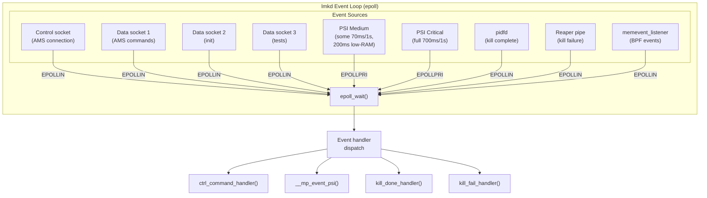

epoll 容量是为所有三个压力级别设置的。但正如第 8.2.5 节所述，在默认的新策略模式中
LOW 监视器不会被注册。因此事件循环中只出现 MEDIUM 和 CRITICAL
文件描述符。

接收到 PSI 事件后，lmkd 进入轮询模式，以较短间隔定期重新检查内存
状况：

| 常量 | 值 | 用途 |
|---|---|---|
| `PSI_POLL_PERIOD_SHORT_MS` | 10 ms | 高压期间的轮询间隔 |
| `PSI_POLL_PERIOD_LONG_MS` | 100 ms | 中等压力期间的轮询间隔 |
| `DEFAULT_PSI_WINDOW_SIZE_MS` | 1000 ms | PSI 监视器窗口大小 |

这种轮询是必要的，因为 PSI 事件有速率限制（每个窗口最多一个），但
内存状况在窗口内可能迅速变化。

### 8.2.17 BPF 内存事件集成

现代 lmkd 与内核的 BPF（Berkeley Packet Filter）子系统集成，以接收
更细粒度的内存事件。`memevent_listener` 跟踪直接回收和 kswapd 活动：

```c
// system/memory/lmkd/lmkd.cpp (line 190)
static std::unique_ptr<android::bpf::memevents::MemEventListener>
    memevent_listener(nullptr);
static struct timespec direct_reclaim_start_tm;
static struct timespec kswapd_start_tm;
```

BPF 程序在启动完成后加载：

```c
// system/memory/lmkd/lmkd.cpp (LMK_BOOT_COMPLETED handler)
case LMK_BOOT_COMPLETED:
    // Initialize the memevent listener after boot is completed
    // to prevent waiting for BPF programs to be loaded
    init_memevent();
    boot_completed_handled = true;
    break;
```

这种 BPF 集成提供了比解析 `/proc/vmstat`
计数器更准确的回收检测，后者可能会错过轮询间隔之间短暂的回收活动突发。

### 8.2.18 交换利用率计算

lmkd 计算交换利用率以检测交换子系统何时趋于饱和：

```c
// system/memory/lmkd/lmkd.cpp (calc_swap_utilization, from line 2756)
static int calc_swap_utilization(union meminfo *mi) {
    int64_t swap_used = mi->field.total_swap - get_free_swap(mi);
    int64_t total_swappable = mi->field.active_anon
                            + mi->field.inactive_anon
                            + mi->field.shmem + swap_used;
    return total_swappable > 0 ? (swap_used * 100) / total_swappable : 0;
}
```

该计算表示已经交换出去的可交换内存的百分比。
高利用率（可通过 `ro.lmk.swap_util_max` 配置）表明系统
剩余的交换页面容量有限，使杀进程更加紧迫。

---

## 8.3 Cgroup 与内存核算

Android 使用 Linux cgroup（控制组）将进程组织为分层组，用于资源管理和核算。内存 cgroup（`memcg`）对于跟踪每应用内存使用情况并强制执行软限制尤为重要。

### 8.3.1 Cgroup 版本

Android 同时支持 cgroup v1 和 cgroup v2。lmkd 代码会检测当前使用的是哪个版本：

```c
// system/memory/lmkd/statslog.h (lines 33-37)
enum class MemcgVersion {
    kNotFound,
    kV1,
    kV2,
};

MemcgVersion memcg_version();
```

在现代 Android（Android 12+）上，cgroup v2 是首选。cgroup 层级在启动时由 init 配置：

```
/dev/memcg/                          # cgroup v1 memory controller mount
/dev/memcg/apps/                     # All app processes
/dev/memcg/apps/uid_<uid>/           # Per-UID groups
/dev/memcg/apps/uid_<uid>/pid_<pid>/ # Per-process groups
/dev/memcg/system/                   # System processes

# cgroup v2 (unified hierarchy)
/sys/fs/cgroup/                      # Unified cgroup v2 mount
```

### 8.3.2 进程组分配

当 ActivityManagerService 通过 `LMK_PROCPRIO` 向 lmkd 注册进程时，lmkd 会写入该进程的 `/proc/[pid]/oom_score_adj`。它还会在进程已经属于的 cgroup 上设置内存软限制。lmkd 从不在 cgroup 之间移动进程：成员关系由 ActivityManagerService 通过 libprocessgroup 分配，lmkd 只查找由此产生的属性路径。

```c
// system/memory/lmkd/lmkd.cpp (register_oom_adj_proc, from line 1149)
static void register_oom_adj_proc(const struct lmk_procprio& proc,
                                   struct ucred* cred) {
    char val[20];
    int soft_limit_mult;
    int oom_adj_score = proc.oomadj;
    // ... other locals elided ...

    /* lmkd should not change soft limits for services */
    if (proc.ptype == PROC_TYPE_APP && per_app_memcg) {
        if (proc.oomadj >= 900) {
            soft_limit_mult = 0;
        } else if (proc.oomadj >= 800) {
            soft_limit_mult = 0;
        } else if (proc.oomadj >= 700) {
            soft_limit_mult = 0;
        } else if (proc.oomadj >= 600) {
            // Launcher should be perceptible, don't kill it.
            oom_adj_score = 200;
            soft_limit_mult = 1;
        } else if (proc.oomadj >= 500) {
            soft_limit_mult = 0;
        } else if (proc.oomadj >= 400) {
            soft_limit_mult = 0;
        } else if (proc.oomadj >= 300) {
            soft_limit_mult = 1;
        } else if (proc.oomadj >= 200) {
            soft_limit_mult = 8;      // 64 MB
        } else if (proc.oomadj >= 100) {
            soft_limit_mult = 10;     // 80 MB
        } else if (proc.oomadj >= 0) {
            soft_limit_mult = 20;     // 160 MB
        } else {
            // Persistent processes: 512 MB
            soft_limit_mult = 64;
        }

        snprintf(val, sizeof(val), "%d",
                 soft_limit_mult * EIGHT_MEGA);  // EIGHT_MEGA = 1 << 23
        // Write to cgroup memory.soft_limit_in_bytes
        std::string soft_limit_path;
        CgroupGetAttributePathForTask("MemSoftLimit",
                                       proc.pid, &soft_limit_path);
        writefilestring(soft_limit_path.c_str(), val, !is_system_server);
    }
}
```

软限制乘数转换为实际的内存限制：

| OOM 分数范围 | 软限制乘数 | 有效限制 |
|---|---|---|
| >= 900（缓存） | 0 | 无限制 |
| >= 700（上一个） | 0 | 无限制 |
| >= 600（主屏幕） | 1 | 8 MB |
| >= 500（服务） | 0 | 无限制 |
| >= 400（重量级） | 0 | 无限制 |
| >= 300（备份） | 1 | 8 MB |
| >= 200（可感知） | 8 | 64 MB |
| >= 100（可见） | 10 | 80 MB |
| >= 0（前台） | 20 | 160 MB |
| &lt; 0（持久） | 64 | 512 MB |

这些是**软限制**。内核会先尝试从超出其软限制的进程中回收内存，然后再从处于其限制之内的进程回收。但如果内存可用，进程可以使用更多内存。注意 home/launcher 范围的特殊处理。`>= 600` 分支还会将注册的 `oom_adj_score` 向下重映射为 200，因此 lmkd 将 launcher 视为可感知进程而不是杀死它。服务（`>= 500`）和重量级应用（`>= 400`）范围完全没有软限制。

### 8.3.3 Task Profile

Android 用 task profile 框架扩展了 cgroup 管理，该框架提供了一个将进程分配到 cgroup 的更高层级 API：

```c
// Used in reaper.cpp (lines 106-108, in the lmkd_setprio thread)
set_process_group_and_prio(uid, pid,
    {"CPUSET_LMKD_REAP_TARGET", "SCHED_LMKD_REAP_TARGET"},
    ANDROID_PRIORITY_NORMAL);

// In reaper thread initialization (reaper.cpp, line 171)
SetTaskProfiles(tid, {"CPUSET_SP_FOREGROUND"}, true);
```

Task profile 定义在 JSON 配置文件中：

```
/etc/task_profiles.json          # Profile definitions
/etc/cgroups.json                # Cgroup controller configuration
```

内存子系统常用的 task profile：

| Profile | 用途 |
|---|---|
| `ServiceCapacityLow` | 后台服务的低 CPU 容量 |
| `CPUSET_SP_FOREGROUND` | 前台 CPU 集合（全部核心） |
| `SCHED_SP_FOREGROUND` | 前台调度组 |
| `CPUSET_LMKD_REAP_TARGET` | lmkd 专用聚合项，对 reap 受害者解析为 `CPUSET_SP_FOREGROUND` |
| `SCHED_LMKD_REAP_TARGET` | lmkd 专用聚合项，对 reap 受害者解析为 `SCHED_SP_FOREGROUND` |
| `HighEnergySaving` | 后台任务的节能执行 |
| `MaxPerformance` | 前台应用的满性能 |

### 8.3.4 内存 Cgroup 核算

内存 cgroup 为每个组跟踪若干计数器：

```
# Per-cgroup memory accounting files (cgroup v1)
memory.usage_in_bytes         # Current memory usage
memory.max_usage_in_bytes     # Peak memory usage
memory.limit_in_bytes         # Hard limit (OOM kill trigger)
memory.soft_limit_in_bytes    # Soft limit (reclaim priority)
memory.stat                   # Detailed statistics
memory.oom_control            # OOM killer settings

# Per-cgroup memory accounting files (cgroup v2)
memory.current                # Current memory usage
memory.high                   # High pressure threshold
memory.max                    # Hard limit
memory.stat                   # Detailed statistics
memory.events                 # OOM and other events
```

`memory.stat` 文件提供细粒度的细分：

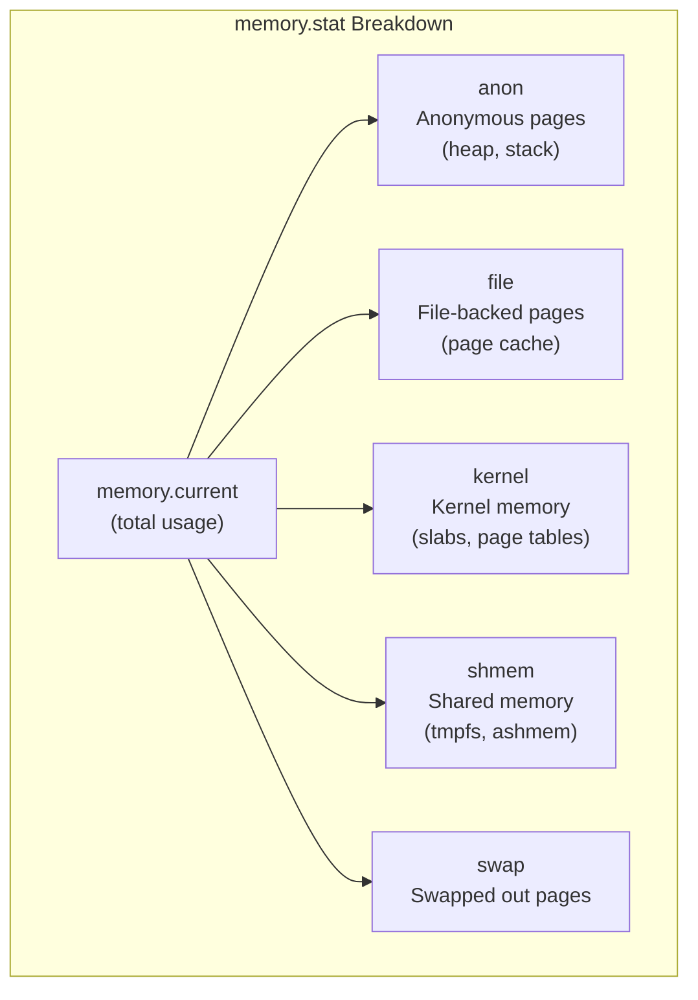

### 8.3.5 应用类别与 freezer cgroup

Android 11 引入了应用冻结器（app freezer），它使用 cgroup freezer 控制器挂起后台应用而不是杀死它们。被冻结的应用消耗零 CPU，但保留其内存：

Android 将 freezer 挂载为 cgroup v2 控制器（`system/core/libprocessgroup/profiles/cgroups.json`），因此冻结通过每个进程自己的 cgroup 目录来控制。没有单独的 v1 `freezer/` 层级：

```
/sys/fs/cgroup/uid_<uid>/pid_<pid>/               # Per-process cgroup directory
/sys/fs/cgroup/uid_<uid>/pid_<pid>/cgroup.freeze  # Write 1 to freeze, 0 to thaw
```

`Frozen`/`Unfrozen` task profile（`system/core/libprocessgroup/profiles/task_profiles.json`）通过 `FreezerState` 属性向 `cgroup.freeze` 写入 `1` 或 `0`。

冻结器与 lmkd 之间的交互很简单：

1. 当应用进入后台时，ActivityManagerService 可能会冻结它。
2. 被冻结的应用仍然消耗内存——它们的 oom_adj 很高，使它们成为 lmkd
   杀死的候选。
3. lmkd 本身对 freezer 毫无感知。它纯粹按 oom_score_adj（以及可感知进程的
   RSS）选择受害者，对冻结和未冻结的应用没有偏好。它不需要解冻步骤。reaper 的
   `cgroup.kill` 写入和 `pidfd_send_signal(SIGKILL)` 都能终止被 cgroup v2
   freezer 冻结的进程。

---

## 8.4 zRAM（压缩交换）

Android 使用 zRAM（压缩 RAM 磁盘）作为其交换设备，而不是传统的基于磁盘的交换。zRAM 在存储页面之前先在内存中压缩它们。这有效地增加了系统的可用内存容量，代价是压缩和解压缩消耗的 CPU 周期。

本节描述 zRAM 机制本身：内核设备、其分配器（zsmalloc），以及 lmkd 如何推理压缩交换。从 Android 17 开始，zRAM 的*配置和维护*不再位于 init 脚本和 `system_server` 中；它们移入了新的 `mmd` 守护进程。下面各小节中展示的旧版 init 脚本设置，应视为 `mmd` 现在驱动的机制。8.10 节记录了 `mmd` 的所有权模型、其 `mmd.zram.*` 属性以及按进程回写。

### 8.4.1 zRAM 架构

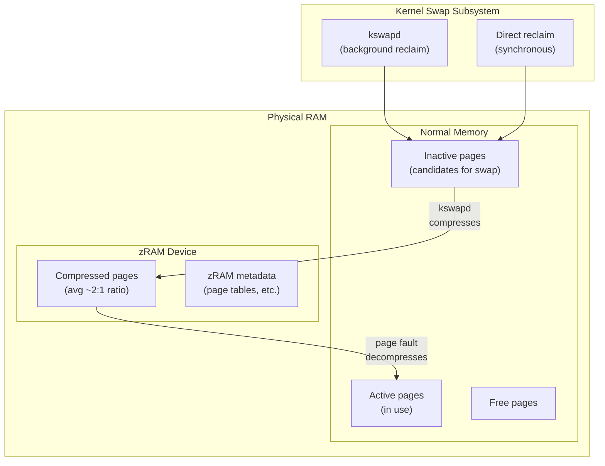

Android 上 zRAM 的关键特性：

- **压缩算法**：LZ4（默认，速度优先）或 ZSTD（压缩比更好，CPU 开销更大）。
- **典型压缩比**：应用数据为 2:1 到 3:1。
- **zRAM 大小**：通常配置为物理 RAM 的 50-75%。
- **无磁盘交换**：Android 刻意避免使用闪存进行交换，以保护
  闪存寿命并避免缓慢的 I/O 停顿。

### 8.4.2 zRAM 配置

历史上，zRAM 在启动期间通过 init 脚本和 `swapon_all` 内置命令配置：

```shell
# Legacy init.rc zram configuration (pre-mmd path)
write /sys/block/zram0/comp_algorithm lz4
write /sys/block/zram0/disksize 2147483648   # 2 GB
swapon_all /vendor/etc/fstab.${ro.hardware}

# fstab entry
/dev/block/zram0  none  swap  defaults  zramsize=2147483648,zram_backingdev_size=512M
```

在 Android 17 上，当设置了 `mmd.zram.enabled` 时，这项工作移入 `mmd_setup` 服务。该服务根据 `mmd.zram.size`（字节数或 RAM 百分比，默认 `50%`）确定设备大小。它根据 `mmd.zram.comp_algorithm` 选择压缩算法。然后它调用 `swapon`，并带有可选的交换优先级。

在该模式下，`swapon_all` 内部的 zRAM 设置变为空操作，旧版 overlay
`config_zramWriteback` / `ro.zram.*` 属性被忽略。下面的内核 sysfs 节点仍然存在并报告相同的统计信息；只是写入者变了。8.10.2 节逐步讲解 `mmd_setup` 流程。

内核通过 `/sys/block/zram0/` 暴露 zRAM 统计信息：

| 文件 | 内容 |
|---|---|
| `disksize` | 最大未压缩数据大小 |
| `mem_used_total` | 压缩数据实际消耗的内存 |
| `orig_data_size` | 原始（未压缩）数据大小 |
| `compr_data_size` | 压缩数据大小 |
| `mem_limit` | zRAM 的内存限制 |
| `comp_algorithm` | 当前使用的压缩算法 |
| `num_reads` / `num_writes` | I/O 统计信息 |

### 8.4.3 zsmalloc：zRAM 内存分配器

zRAM 使用一种称为 zsmalloc 的专用内存分配器（来自内核中的 `mm/zsmalloc.c`）。像 slab 这样的传统分配器按页大小或更大的块进行分配，这对于 zRAM 处理的许多小型压缩对象来说会浪费内存。

zsmalloc 的特性：

- **大小类**：对象按大小类分组（32 字节到 4 KB）。
- **压实**：可以压实部分填充的页以减少碎片。
- **无每对象元数据**：分配器将元数据与数据页分开存储。
- **跨页**：单个 zsmalloc 对象可以跨越多个物理页。

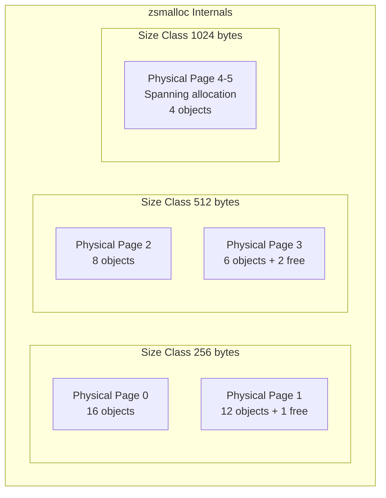

### 8.4.4 针对 Android 的 zRAM 调优

lmkd 对 zRAM 的行为非常敏感。有几个 lmkd 属性直接影响杀进程决策中对交换的考量：

```c
// system/memory/lmkd/lmkd.cpp (get_free_swap, around line 2027)
// In the case of ZRAM, mi->field.free_swap can't be used directly
// because swap space is taken from free memory or reclaimed.
// Use the lowest of free_swap and easily available memory to
// measure free swap because they represent how much swap space
// the system will consider to use and how much it can actually use.
static inline int64_t get_free_swap(union meminfo *mi) {
    if (swap_compression_ratio)
        return std::min(mi->field.free_swap,
                        mi->field.easy_available * swap_compression_ratio /
                        swap_compression_ratio_div);
    return mi->field.free_swap;
}
```

这是一个关键认识。内核报告的可用交换（`/proc/meminfo` 中的 `SwapFree`）在 zRAM 上可能具有误导性，因为交换空间本身会消耗物理 RAM。假设系统有 100 MB 的可用交换，但只有 50 MB 的可用物理 RAM。那么它实际上只能交换 50 MB（压缩前）。`swap_compression_ratio` 属性（默认：1:1）会调整此计算。

### 8.4.5 zRAM 回写

Android 10+ 支持 zRAM 回写，即冷压缩页被写入后备设备（通常是 `/data` 上文件之上的 loop 设备）。底层内核接口是 zRAM sysfs 节点集：

```
# Kernel sysfs interface (driven by mmd on Android 17)
write /sys/block/zram0/backing_dev /dev/block/loopX

# Trigger writeback of idle pages
write /sys/block/zram0/idle all
write /sys/block/zram0/writeback idle
```

回写通过将不常访问的页面移到闪存来减少 zRAM 的内存占用。由于担心闪存磨损，它被谨慎使用。在 Android 17 上，这种整设备的"空闲回写"不再是固定的 init 脚本。`mmd` 根据策略属性（`mmd.zram.writeback.*`）决定*何时*以及*回写多少*。它还根据内存利用率动态调整空闲页的年龄。

内核通过 `CONFIG_ZRAM_TRACK_ENTRY_ACTIME` /
`CONFIG_ZRAM_MEMORY_TRACKING` 暴露空闲跟踪；当两者都不存在时，`mmd` 回退为按定时器将所有页标记为空闲（`system/memory/mmd/src/zram/writeback.rs`，`system/memory/mmd/src/zram/idle.rs`）。A17 还在该整设备路径之上添加了*按进程*的回写和预取，见 8.10.3 节。8.10 节记录了完整的回写和重新压缩策略调节项。

### 8.4.6 监控 zRAM 性能

```shell
# Check zRAM status
adb shell cat /sys/block/zram0/mm_stat
# Output: orig_data_size compr_data_size mem_used_total mem_limit
#         max_used_total same_pages pages_compacted huge_pages

# Check swap usage
adb shell cat /proc/meminfo | grep -i swap
# SwapTotal:       2097148 kB
# SwapFree:        1234567 kB
# SwapCached:       123456 kB

# Check zRAM compression stats
adb shell cat /sys/block/zram0/stat
```

### 8.4.7 zRAM 与 lmkd 交互小结

zRAM 与 lmkd 杀进程决策之间的关系总结在此图中：

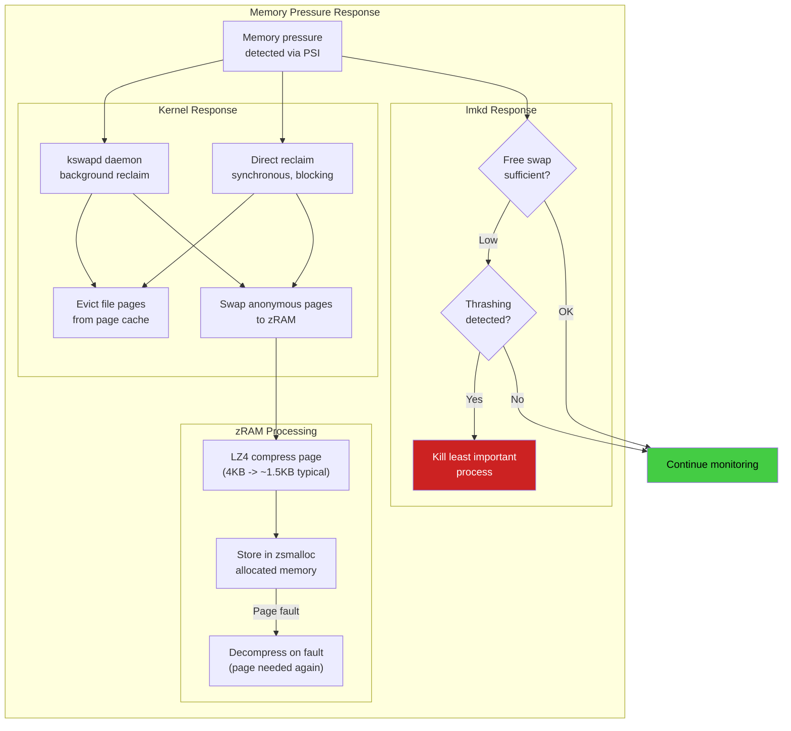

### 8.4.8 针对不同设备类别的 zRAM 调优

不同的设备类别需要不同的 zRAM 配置：

| 设备类别 | RAM | 推荐 zRAM 大小 | 压缩算法 | 备注 |
|---|---|---|---|---|
| 低内存（Go） | 1-2 GB | RAM 的 50% | LZ4 | 最大化交换，最小化 CPU 开销 |
| 中端 | 4-6 GB | RAM 的 50-75% | LZ4 | 交换容量与性能之间的平衡 |
| 旗舰 | 8-12 GB | RAM 的 50% | LZ4 或 ZSTD | 可以承受更高的压缩 CPU 成本 |
| 高端 | 16+ GB | RAM 的 25-50% | ZSTD | 需要的交换更少，优化压缩比 |

`ro.lmk.swap_compression_ratio` 属性应设置为与每台设备上观察到的压缩比匹配：

```shell
# Measure actual compression ratio
adb shell "mm_stat=$(cat /sys/block/zram0/mm_stat); \
  orig=$(echo $mm_stat | awk '{print $1}'); \
  compr=$(echo $mm_stat | awk '{print $2}'); \
  ratio=$(echo \"scale=1; $orig / $compr\" | bc); \
  echo \"Actual compression ratio: ${ratio}:1\""

# Set the property accordingly
adb shell setprop persist.device_config.lmkd_native.swap_compression_ratio 3
adb shell setprop persist.device_config.lmkd_native.swap_compression_ratio_div 1
```

---

## 8.5 ION / DMA-BUF（图形缓冲区分配）

图形缓冲区是 Android 设备上最大的内存消耗者之一。单个 1080p
RGBA 缓冲区约占用 8 MB。图形流水线需要专门的分配机制。这些机制可以提供 CPU 和各种硬件加速器（GPU、视频编解码器、显示控制器、相机 ISP）都能访问的内存。

### 8.5.1 演进：从 ION 到 DMA-BUF Heaps

Android 的图形缓冲区分配经历了几代演进：

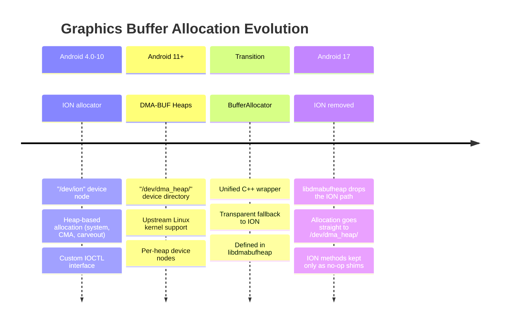

**源代码目录**：

- `system/memory/libion/` -- 旧版 ION 用户空间库（仍然存在，但 `BufferAllocator` 不再使用）
- `system/memory/libdmabufheap/` -- DMA-BUF heap 分配器（Android 17 中的唯一路径）
- `frameworks/native/libs/ui/` -- GraphicBuffer、Gralloc 接口

8.5.2 节描述 ION 在过渡之前的工作方式；8.5.9 节介绍它在 Android 17 中的移除。

### 8.5.2 ION 分配器（旧版）

ION 通过 `/dev/ion` 设备提供基于 heap 的内存分配。以下是 libion 在 Android 17 之前的样子（此实现已不在树中）：

```c
// Historical libion implementation (pre-Android-17); removed from
// the current system/memory/libion/ion.c
int ion_open() {
    int fd = open("/dev/ion", O_RDONLY | O_CLOEXEC);
    if (fd < 0) ALOGE("open /dev/ion failed: %s", strerror(errno));
    return fd;
}

int ion_alloc(int fd, size_t len, size_t align,
              unsigned int heap_mask, unsigned int flags,
              ion_user_handle_t* handle) {
    struct ion_allocation_data data = {
        .len = len,
        .align = align,
        .heap_id_mask = heap_mask,
        .flags = flags,
    };
    return ion_ioctl(fd, ION_IOC_ALLOC, &data);
}
```

ION 历史上支持两个内核 ABI 版本（"legacy" 4.12 之前的接口和 "modern" 接口），libion 过去会探测使用的是哪个。该探测已不存在。在当前树中
`system/memory/libion/ion.c` 是一个由桩组成的小文件。其中每个入口点都会无条件失败，且 `ion_is_legacy()` 是硬编码的 `return 0`：

```c
// system/memory/libion/ion.c (lines 22-30, 62-63) -- the current stubs
int ion_open()
{ return -1; }

int ion_alloc(int, size_t, size_t, unsigned int,
              unsigned int, ion_user_handle_t *)
{ return -1; }

// ...

int ion_is_legacy(int)
{ return 0; }
```

ION heap 类型：

| Heap 类型 | 描述 | 用例 |
|---|---|---|
| `ION_HEAP_SYSTEM` | 来自 buddy 分配器的页 | 通用缓冲区 |
| `ION_HEAP_SYSTEM_CONTIG` | 物理连续的页 | 需要连续 DMA 的硬件 |
| `ION_HEAP_CARVEOUT` | 预留的物理内存区域 | 安全视频、可信执行 |
| `ION_HEAP_DMA` (CMA) | 连续内存分配器 | 相机、显示 |

### 8.5.3 DMA-BUF Heaps（现代）

DMA-BUF heaps 是上游 Linux 对 ION 的替代。每个 heap 在 `/dev/dma_heap/` 下暴露自己的设备节点。在 Android 17 中，该根目录是库所知道的唯一分配路径（见 8.5.9 节）：

```c
// system/memory/libdmabufheap/BufferAllocator.cpp (line 36)
static constexpr char kDmaHeapRoot[] = "/dev/dma_heap/";
```

`BufferAllocator::Alloc` 打开指定的 heap 并从中分配。较早的版本会先尝试 DMA-BUF heap，失败后回退到 `/dev/ion`。当前代码去掉了该回退，如果 heap 不存在就直接失败：

```c
// system/memory/libdmabufheap/BufferAllocator.cpp (Alloc)
int BufferAllocator::Alloc(const std::string& heap_name, size_t len, unsigned int) {
    int dma_buf_heap_fd = OpenDmabufHeap(heap_name);
    if (dma_buf_heap_fd < 0) return -1;

    return DmabufAlloc(heap_name, len, dma_buf_heap_fd);
}
```

通过 DMA-BUF heaps 进行的分配使用一个简单的 ioctl：

```c
// system/memory/libdmabufheap/BufferAllocator.cpp (lines 87-107, abbreviated)
int BufferAllocator::DmabufAlloc(const std::string& heap_name,
                                  size_t len, int fd) {
    struct dma_heap_allocation_data heap_data{
        .len = len,
        .fd_flags = O_RDWR | O_CLOEXEC,
    };

    auto ret = TEMP_FAILURE_RETRY(
        ioctl(fd, DMA_HEAP_IOCTL_ALLOC, &heap_data));
    if (ret < 0) {
        PLOG(ERROR) << "Unable to allocate from DMA-BUF heap: "
                    << heap_name;
        return ret;
    }

    return heap_data.fd;  // Returns a DMA-BUF file descriptor
}
```

### 8.5.4 Gralloc：图形内存分配器 HAL

Gralloc（Graphics Allocation）HAL 位于 ION/DMA-BUF 之上，提供分配图形缓冲区的标准接口。它经历了多个版本：

```c
// frameworks/native/libs/ui/GraphicBufferMapper.cpp (lines 69-93)
GraphicBufferMapper::GraphicBufferMapper() {
    mMapper = std::make_unique<const Gralloc5Mapper>();
    if (mMapper->isLoaded()) {
        mMapperVersion = Version::GRALLOC_5;
        return;
    }
    mMapper = std::make_unique<const Gralloc4Mapper>();
    if (mMapper->isLoaded()) {
        mMapperVersion = Version::GRALLOC_4;
        return;
    }
    if (!requireMapper4()) {
        mMapper = std::make_unique<const Gralloc3Mapper>();
        if (mMapper->isLoaded()) {
            mMapperVersion = Version::GRALLOC_3;
            return;
        }
        mMapper = std::make_unique<const Gralloc2Mapper>();
        if (mMapper->isLoaded()) {
            mMapperVersion = Version::GRALLOC_2;
            return;
        }
    }

    LOG_ALWAYS_FATAL("gralloc-mapper is missing");
}
```

`requireMapper4()` 守卫（`android_get_device_api_level() >= 36 &&
flags::require_gralloc4_or_newer()`）意味着，在启用了
`require_gralloc4_or_newer` 标志的 API level 36+ 设备上，Gralloc 2/3 回退被完全跳过。
只考虑 Gralloc 4 和 5。

`GraphicBufferAllocator` 选择匹配的分配器实现：

```c
// frameworks/native/libs/ui/GraphicBufferAllocator.cpp (lines 54-76)
GraphicBufferAllocator::GraphicBufferAllocator()
    : mMapper(GraphicBufferMapper::getInstance()) {
    switch (mMapper.getMapperVersion()) {
        case GraphicBufferMapper::GRALLOC_5:
            mAllocator = std::make_unique<const Gralloc5Allocator>(
                reinterpret_cast<const Gralloc5Mapper&>(
                    mMapper.getGrallocMapper()));
            break;
        case GraphicBufferMapper::GRALLOC_4:
            mAllocator = std::make_unique<const Gralloc4Allocator>(/*...*/);
            break;
        case GraphicBufferMapper::GRALLOC_3:
            mAllocator = std::make_unique<const Gralloc3Allocator>(/*...*/);
            break;
        case GraphicBufferMapper::GRALLOC_2:
            mAllocator = std::make_unique<const Gralloc2Allocator>(/*...*/);
            break;
    }
}
```

### 8.5.5 GraphicBuffer 生命周期

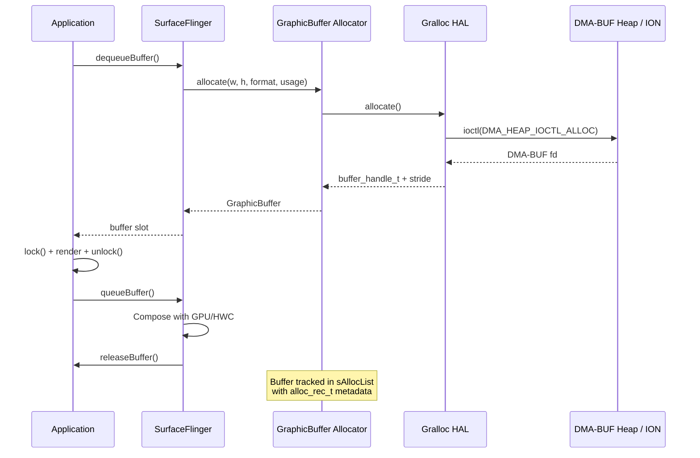

分配器维护一个全局分配列表用于调试：

```c
// frameworks/native/libs/ui/GraphicBufferAllocator.cpp (lines 89-111)
void GraphicBufferAllocator::dump(std::string& result, bool less) const {
    Mutex::Autolock _l(sLock);
    KeyedVector<buffer_handle_t, alloc_rec_t>& list(sAllocList);
    uint64_t total = 0;
    result.append("GraphicBufferAllocator buffers:\n");
    StringAppendF(&result,
        "%18s | %12s | %18s | %s | %8s | %10s | %s\n",
        "Handle", "Size", "W (Stride) x H",
        "Layers", "Format", "Usage", "Requestor");
    for (size_t i = 0; i < count; i++) {
        const alloc_rec_t& rec(list.valueAt(i));
        // ... format and print each allocation
        total += rec.size;
    }
    StringAppendF(&result,
        "Total allocated by GraphicBufferAllocator (estimate): "
        "%.2f KB\n", static_cast<double>(total) / 1024.0);
}
```

此 dump 可通过 `adb shell dumpsys SurfaceFlinger` 访问，显示所有未释放的
图形缓冲区分配。

### 8.5.6 HardwareBuffer：NDK 接口

对于 NDK 开发者，`AHardwareBuffer` 提供了分配图形缓冲区的公共 API：

```c
// frameworks/native/libs/ui/include/ui/GraphicBuffer.h
class GraphicBuffer {
    AHB_CONVERSION static GraphicBuffer* fromAHardwareBuffer(AHardwareBuffer*);
    AHB_CONVERSION AHardwareBuffer* toAHardwareBuffer();
};
```

影响分配的关键 usage 标志：

| 标志 | 值 | 描述 |
|---|---|---|
| `AHARDWAREBUFFER_USAGE_CPU_READ_*` | NEVER/RARELY/OFTEN，掩码 `0xF` | CPU 读取缓冲区的频率 |
| `AHARDWAREBUFFER_USAGE_CPU_WRITE_*` | NEVER/RARELY/OFTEN，掩码 `0xF << 4` | CPU 写入缓冲区的频率 |
| `AHARDWAREBUFFER_USAGE_GPU_SAMPLED_IMAGE` | | GPU 纹理采样 |
| `AHARDWAREBUFFER_USAGE_GPU_COLOR_OUTPUT` | | GPU 渲染目标 |
| `AHARDWAREBUFFER_USAGE_COMPOSER_OVERLAY` | | 硬件合成器叠加层 |
| `AHARDWAREBUFFER_USAGE_VIDEO_ENCODE` | | 视频编码器输入 |
| `AHARDWAREBUFFER_USAGE_CAMERA_WRITE` | | 相机输出缓冲区（仅限 VNDK：定义在 `vndk/hardware_buffer.h`，而非公共 NDK 头文件） |
| `AHARDWAREBUFFER_USAGE_PROTECTED_CONTENT` | | DRM 保护的内容 |

DMA-BUF 分配器可以根据这些标志将分配路由到不同的 heap：

```c
// system/memory/libdmabufheap/BufferAllocator.cpp (lines 133-158, abbreviated)
int BufferAllocator::AllocSystem(bool cpu_access_needed, size_t len,
                                  unsigned int heap_flags) {
    if (!cpu_access_needed) {
        // Try uncached heap first for non-CPU buffers
        static bool uncached_support = [this]() -> bool {
            auto heaps = this->GetDmabufHeapList();
            return (heaps.find(kDmabufSystemUncachedHeapName)
                    != heaps.end());
        }();

        if (uncached_support) {
            int fd = OpenDmabufHeap(kDmabufSystemUncachedHeapName);
            return DmabufAlloc(kDmabufSystemUncachedHeapName, len, fd);
        }
    }
    // Fall back to cached system heap
    return Alloc(kDmabufSystemHeapName, len, heap_flags);
}
```

### 8.5.7 DMA-BUF 同步与缓存一致性

当 CPU 和硬件加速器共享内存时，必须显式管理缓存一致性：

```c
// system/memory/libdmabufheap/BufferAllocator.cpp (lines 165-171)
int BufferAllocator::DoSync(unsigned int dmabuf_fd, bool start,
                            SyncType sync_type) {
    struct dma_buf_sync sync = {
        .flags = (start ? DMA_BUF_SYNC_START : DMA_BUF_SYNC_END) |
                 static_cast<uint64_t>(sync_type),
    };
    return TEMP_FAILURE_RETRY(
        ioctl(dmabuf_fd, DMA_BUF_IOCTL_SYNC, &sync));
}
```

这里不再有 ION 回退。随着 ION 的移除（8.5.9 节），同步路径就是单个
`DMA_BUF_IOCTL_SYNC` ioctl。旧的 `CustomCpuSyncLegacyIon` 重载只是转发到该函数。

同步协议：

1. **CPU 访问之前**：`CpuSyncStart()` -- 使缓存失效，以便 CPU 看到硬件的写入。
2. **CPU 访问之后**：`CpuSyncEnd()` -- 刷新缓存，以便硬件看到 CPU 的写入。

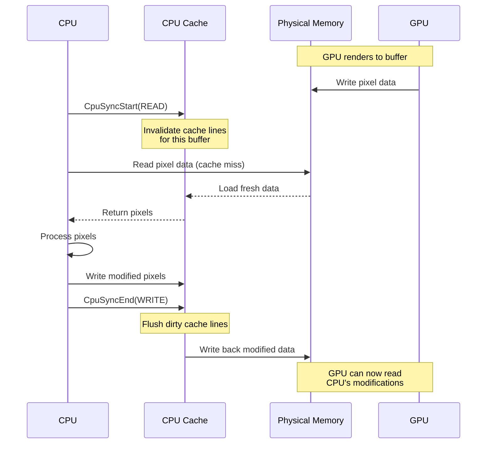

### 8.5.8 GPU 内存跟踪

lmkd 通过一个 BPF map 跟踪 GPU 内存使用情况：

```c
// system/memory/lmkd/lmkd.cpp (read_gpu_total_kb, from line 1966)
static int64_t read_gpu_total_kb() {
    static android::base::unique_fd fd(
        android::bpf::mapRetrieveRO(
            "/sys/fs/bpf/map_gpuMem_gpu_mem_total_map"));
    static constexpr uint64_t kBpfKeyGpuTotalUsage = 0;
    uint64_t value;

    if (!fd.ok()) return 0;

    return android::bpf::findMapEntry(fd, &kBpfKeyGpuTotalUsage, &value)
        ? 0
        : (int32_t)(value / 1024);
}
```

一个 GPU 内存跟踪 BPF 程序维护此 BPF map。该程序挂钩 GPU 驱动的
分配和释放路径，并提供 GPU 内存总使用量。lmkd 不需要任何厂商特定代码来实现这一点。

BPF map 给 lmkd 的是*系统范围*的总量，但它无法将图形内存归属到特定进程。
进程的大部分 GPU 和图形缓冲区内存位于驱动私有分配中，永远不会出现在该进程的 `/proc/<pid>/smaps` 里。因此，简单的 PSS 求和会低估图形密集型应用。

`libmemtrack`（`system/memory/libmemtrack/`）填补了这一空白。它
是 memtrack HAL 的一个薄客户端。调用者用
`memtrack_proc_get(pid)` 填充一个 `memtrack_proc` 句柄，并读回每进程的图形、GL 和"其他"总量。

在内部，该库并不直接与厂商 HAL 通信。它绑定到 `memtrack.proxy` 服务
（`MemtrackProxy` 类，`frameworks/native/services/memtrackproxy/`），该服务位于
每设备 memtrack HAL 的前端。路径从进程到 `libmemtrack`，再到 memtrack
代理，再到 HAL。这条路径产生了 8.7.1 节所示 `dumpsys meminfo` 输出中的 `GL mtrack` 行。JNI 层（`frameworks/base/core/jni/android_os_Debug.cpp`）调用
`memtrack_proc_get()`，将缺失的图形内存添加到每个进程的报告中。

### 8.5.9 Android 17 中移除 ION

Android 17 移除了 ION 这一受支持的分配器。`libdmabufheap`（提交 "libdmabufheap: Remove
most ION support"）删除了每一条 ION 代码路径。`BufferAllocator` 不再打开 `/dev/ion`。
`kIonDevice` 和 `kIonSystemHeapName` 常量已从 `BufferAllocator.cpp` 中移除，分配
直接进入 `/dev/dma_heap/`。ION 形式的入口点仅保留在头文件中，以让预编译产物保持
ABI 稳定；它们被标记为已弃用，不执行任何有用操作：

```cpp
// system/memory/libdmabufheap/BufferAllocator.cpp
[[deprecated("ION support is removed. Retained for binary compatibility.")]]
bool BufferAllocator::CheckIonSupport() {
    return false;
}

[[deprecated("ION support is removed. Retained for binary compatibility.")]]
int BufferAllocator::MapNameToIonHeap(const std::string&, const std::string&, unsigned int,
                                      unsigned int, unsigned int) {
    /* If ION support is not detected, ignore the mappings */
    return 0;
}
```

`CheckIonSupport()` 返回 `false`，`MapNameToIonHeap()` 是空操作，旧的对齐和
`CustomCpuSyncLegacyIon` 重载转发到它们仅 DMA-BUF 的等效函数。头文件
（`system/memory/libdmabufheap/include/BufferAllocator/BufferAllocator.h`）将保留的
`ion_fd_` 字段以及 `ion_heap_data`/`IonHeapConfig` 结构体标记为 `[[deprecated("Retained for ABI
compatibility for GRF")]]`，因此它们在对象中占据空间，但永远不会被填充。

对厂商来说，这意味着设备必须搭载 DMA-BUF heaps。每个过去是 ION heap 的缓冲池都需要一个匹配的 `/dev/dma_heap/<name>` 节点。该节点通过内核的
`dma-buf` heap 框架（system、CMA 和厂商专用 heap）注册，而不是通过旧的 ION heap
注册。`MapNameToIonHeap()` 过去携带的
heap 标志和对齐属性没有替代品——它们是 ION 特有的，就简单地消失了。

与此更改一起添加的 `/vendor/etc/dma_heap.json` 文件
（`system/memory/libdmabufheap/configs/schema.proto`）是另一回事。它是一个
NPU/heap 兼容矩阵，将每个 `/dev/dma_heap/<name>` 设备映射到它能服务的 NPU 设备
编号和缓冲区类型。独立的 `libdma_heap_config_rust`（Rust，
crate `dma_heap_config`）和 `libdma_heap_config_proto`（C++）库消费它。
`BufferAllocator` 本身从不读取它。

`system/memory/libion/` 仍然作为共享库发布，但仅为了 ABI 兼容。其中的每个
函数都是桩（每个返回 -1，两个 `ion_is_*` 谓词返回 0），且该库从不打开 `/dev/ion`。
因此调用 libion 根本无法触及 ION 驱动。厂商 blob 必须自己打开 `/dev/ion`，而
这又取决于仍构建 ION 驱动的内核。Android 17 参考配置未启用
`CONFIG_ION`；树中仅存的 `CONFIG_ION=y` 行位于旧的 `kernel/configs/s/`（Android 12）
推荐配置中。

---

## 8.6 Ashmem 与 Memfd

匿名共享内存（ashmem）和 memfd 是创建可在进程之间传递的共享内存区域的机制，通常通过 Binder 传递。

### 8.6.1 Ashmem（Android 共享内存）

Ashmem 是 Android 最初的共享内存机制，作为内核驱动实现于
`drivers/staging/android/ashmem.c`。它提供：

- **命名区域**：每个区域都有一个在 `/proc/[pid]/maps` 中可见的名称，便于调试。
- **钉住/取消钉住**：区域可以被取消钉住，以允许内核在压力下回收其内存，并在需要时重新钉住。
- **按大小分配**：与 POSIX 共享内存不同，ashmem 区域可以调整大小。

典型的使用模式：

```c
// Traditional ashmem usage (deprecated in favor of memfd)
#include <linux/ashmem.h>

int fd = open("/dev/ashmem", O_RDWR);
ioctl(fd, ASHMEM_SET_NAME, "my-shared-region");
ioctl(fd, ASHMEM_SET_SIZE, 4096);
void* ptr = mmap(NULL, 4096, PROT_READ | PROT_WRITE, MAP_SHARED, fd, 0);

// Pin/unpin for memory pressure response
struct ashmem_pin pin = { .offset = 0, .len = 0 };  // entire region
ioctl(fd, ASHMEM_UNPIN, &pin);   // Allow kernel to reclaim
ioctl(fd, ASHMEM_PIN, &pin);     // Re-pin before access
// Returns ASHMEM_WAS_PURGED if data was reclaimed
```

### 8.6.2 Memfd：现代替代品

Android 一直在从 ashmem 过渡到 `memfd_create()`，这是一个标准的 Linux 系统调用，可创建由 tmpfs 文件系统支持的匿名文件描述符。Memfd 有几个优势：

- **上游内核支持**：不需要 Android 专用的内核补丁。
- **密封**：`fcntl(fd, F_ADD_SEALS, ...)` 可以使区域变为只读或阻止调整大小。
- **更好的安全性**：基于文件描述符的共享与 seccomp 和 SELinux 天然配合。

```c
// Modern shared memory creation
#include <sys/mman.h>

int fd = memfd_create("my-shared-region", MFD_CLOEXEC | MFD_ALLOW_SEALING);
ftruncate(fd, 4096);
void* ptr = mmap(NULL, 4096, PROT_READ | PROT_WRITE, MAP_SHARED, fd, 0);

// Seal to prevent modification after initialization
fcntl(fd, F_ADD_SEALS, F_SEAL_SHRINK | F_SEAL_GROW | F_SEAL_WRITE);
```

### 8.6.3 Binder 中的共享内存

在传输大数据时，共享内存对 Binder IPC 至关重要。典型的模式：

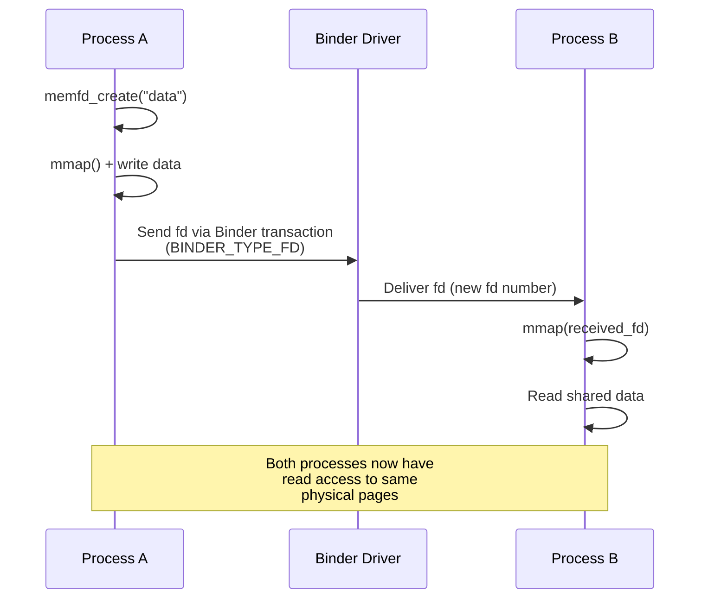

### 8.6.4 SharedMemory Java API

`android.os.SharedMemory` 类为 Java 代码封装了 memfd：

```java
// Create shared memory
SharedMemory shm = SharedMemory.create("my-region", 4096);
ByteBuffer buffer = shm.mapReadWrite();
buffer.putInt(42);
shm.setProtect(OsConstants.PROT_READ); // Make read-only

// Pass to another process via Binder (implements Parcelable)
parcel.writeParcelable(shm, 0);
```

### 8.6.5 可清除内存

ashmem 有一个 memfd 无法直接替代的特性，那就是可清除内存（purgeable memory）。这是取消钉住内存区域以便内核在压力下回收它们的能力。该模式对缓存很重要：

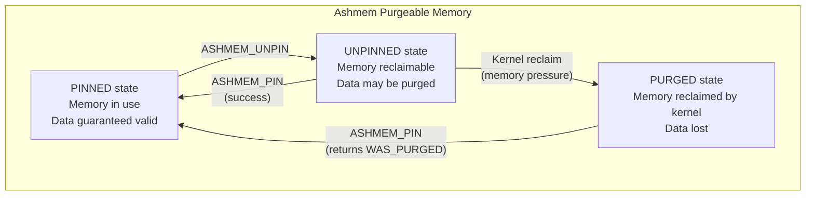

对于基于 memfd 的替代方案，Android 通过 NDK 提供 `ASharedMemory_setProt()`，框架则通过显式的缓存管理而不是内核辅助的取消钉住来处理可清除性。

### 8.6.6 共享区域的内存核算

共享内存带来了核算挑战：

- **PSS（Proportional Set Size，比例集大小）**：共享页在所有映射它们的进程之间平均分配。一个由 4 个进程映射的 4 KB 页对每个进程的 PSS 贡献 1 KB。
- **RSS（Resident Set Size，常驻集大小）**：每个进程在其 RSS 中计入完整的页。
- **USS（Unique Set Size，独占集大小）**：仅由单个进程独占映射的页。

`dumpsys meminfo` 输出会显示每个进程的这些区别。

### 8.6.7 Ashmem 与 Memfd 对比

| 特性 | Ashmem | Memfd |
|---|---|---|
| **内核支持** | Android 专用驱动 | 上游 Linux 系统调用 |
| **创建** | `open("/dev/ashmem")` + ioctl | `memfd_create()` |
| **命名** | `ASHMEM_SET_NAME` ioctl | `memfd_create()` 参数中的名称 |
| **大小** | `ASHMEM_SET_SIZE` ioctl | `ftruncate()` |
| **密封** | 不支持 | 通过 `fcntl()` 的 `F_SEAL_*` |
| **可清除** | `ASHMEM_PIN`/`ASHMEM_UNPIN` | 不直接支持 |
| **SELinux** | 自定义策略规则 | 标准文件描述符策略 |
| **seccomp** | 需要 ioctl 允许列表 | 标准系统调用过滤 |
| **可用性** | 所有 Android 版本 | 厂商 API level 202604+，且具备 `memfd_class` sepolicy 能力 |
| **NDK API** | `ASharedMemory_create()` | `ASharedMemory_create()`（仅在门控开启时路由到 memfd） |
| **Binder 传输** | 通过 `BINDER_TYPE_FD` | 通过 `BINDER_TYPE_FD` |

此切换在 `system/core/libcutils/ashmem-dev.cpp` 中门控：`ASharedMemory_create()` 调用
`ashmem_create_region()`，后者仅在 `__use_memfd()` 通过时才选择 memfd 而非
`/dev/ashmem`。该检查有三个条件。内核/sepolicy 必须支持 `memfd_class`
能力。设备必须具有 `ro.vendor.api_level >= 202604`。应用必须以 SDK 37 或
更高版本为目标（或通过 `sys.use_memfd=true` 强制使用 memfd）。在任何更早的版本上，该调用仍会回退到 `/dev/ashmem`。

### 8.6.8 内存映射模式

mmap 标志的选择显著影响内存行为：

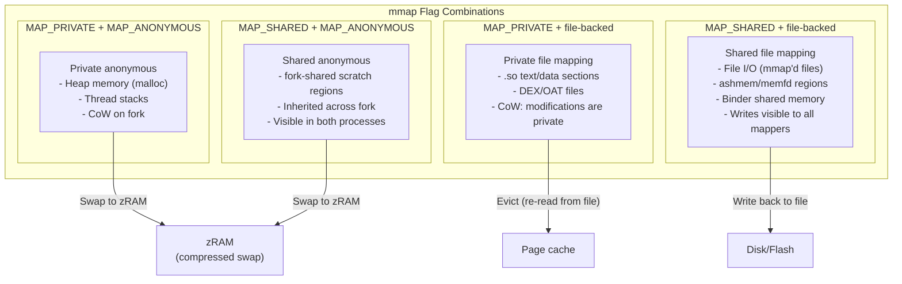

---

## 8.7 内存性能分析

Android 提供了一整套工具，用于在不同详细程度上分析内存使用情况，从高层的每应用摘要到单次分配的回溯。

### 8.7.1 dumpsys meminfo

快速内存分析的主要工具：

```shell
# System-wide memory summary
adb shell dumpsys meminfo

# Per-process detailed breakdown
adb shell dumpsys meminfo <package-name-or-pid>
```

示例输出结构：

```
Applications Memory Usage (in Kilobytes):
Uptime: 12345678 Realtime: 12345678

** MEMINFO in pid 1234 [com.example.app] **
                   Pss  Private  Private  SwapPss   Rss
                 Total    Dirty    Clean    Dirty  Total
                ------   ------   ------   ------  ------
  Native Heap    12345    12300       45      234   15678
  Dalvik Heap     8765     8700       65      123   12345
  Dalvik Other    1234     1200       34        0    2345
        Stack      234      234        0        0     512
       Ashmem       56       56        0        0     100
    Other dev        8        0        8        0      16
     .so mmap     3456      100     2000        0    8000
    .jar mmap        0        0        0        0       0
    .apk mmap     1234        0     1234        0    5000
    .ttf mmap      234        0      234        0     500
    .dex mmap     2345       56     2289        0    3456
    .oat mmap      567        0      567        0    1234
    .art mmap     1234      800      434        0    3456
   Other mmap      456      100      356        0    1000
    GL mtrack    15000    15000        0        0   15000
      Unknown     2345     2300       45        0    4567
        TOTAL    50069    41046     7311      357   73189
```

关键列：

- **Pss Total**：Proportional Set Size——对进程内存影响的最准确度量。
- **Private Dirty**：由此进程修改、无法共享的页。
- **Private Clean**：未修改的私有页（例如从 APK 加载的代码）。
- **SwapPss Dirty**：按比例的交换使用量。
- **Rss Total**：映射的总页数（共享页按完整计数计入）。

### 8.7.2 procstats

`procstats` 服务随时间跟踪每进程的内存使用情况，有助于识别长期趋势和后台内存泄漏：

```shell
# Current process stats
adb shell dumpsys procstats

# Last 3 hours
adb shell dumpsys procstats --hours 3

# CSV output for analysis
adb shell dumpsys procstats --csv
```

procstats 将进程归类为各种状态（前台、后台、缓存等），并跟踪每个状态下的 PSS。输出包括每个进程在其各种状态下的最小/平均/最大 PSS，使识别内存使用逐渐增长的进程成为可能。

### 8.7.3 heapprofd（Perfetto 原生堆分析）

`heapprofd` 是一个系统守护进程（由 init 作为 `heapprofd` 服务启动，运行
`/system/bin/heapprofd`；见 `external/perfetto/heapprofd.rc`），它能以极小的开销捕获分配回溯。目标进程只承载一个与守护进程通信的小型客户端库，该守护进程与 Perfetto 集成以进行跟踪收集：

```shell
# Profile a running process
adb shell perfetto \
  -c - --txt \
  -o /data/misc/perfetto-traces/heap.perfetto-trace <<EOF
buffers: {
    size_kb: 65536
    fill_policy: RING_BUFFER
}
data_sources: {
    config {
        name: "android.heapprofd"
        target_buffer: 0
        heapprofd_config {
            sampling_interval_bytes: 4096
            process_cmdline: "com.example.app"
            continuous_dump_config {
                dump_phase_ms: 0
                dump_interval_ms: 10000
            }
        }
    }
}
duration_ms: 30000
EOF
```

heapprofd 的工作方式：

1. **拦截 malloc/free**：使用预加载到目标进程中的共享库。
2. **采样**：并非每次分配都被记录；每 N 字节只记录一次（可配置）。
3. **栈展开**：在分配点捕获完整的调用栈。
4. **流式传输到 Perfetto**：结果被写入 Perfetto 跟踪基础设施。

输出可以在 [Perfetto UI](https://ui.perfetto.dev/) 中可视化，用火焰图展示分配热点。

### 8.7.4 showmap

`showmap` 在 `/proc/[pid]/smaps` 之上构建，提供进程内存映射的详细视图：

**源代码**：`system/memory/libmeminfo/tools/showmap.cpp`

```shell
# Show all mappings
adb shell showmap <pid>

# Output format
#  virtual                          shared   shared  private  private
#     size      RSS      PSS    clean    dirty    clean    dirty  # object
# -------- -------- -------- -------- -------- -------- -------- ----
#    12288     4096     1024     2048     1024      512      512  [anon:libc_malloc]
```

`system/memory/libmeminfo/tools/` 中的相关工具：

| 工具 | 用途 |
|---|---|
| `showmap.cpp` | 按映射的内存细分 |
| `procmem.cpp` | 进程内存摘要 |
| `procrank.cpp` | 按内存使用情况对进程排序 |
| `librank.cpp` | 按内存消耗对共享库排序 |
| `wsstop.cpp` | 工作集大小跟踪 |

### 8.7.5 libmemunreachable：原生泄漏检测

`libmemunreachable` 是一个用于原生（C/C++）代码的运行时泄漏检测器。它通过对进程堆执行保守的垃圾回收遍历来工作。

**源代码**：`system/memory/libmemunreachable/`

检测算法（`system/memory/libmemunreachable/MemUnreachable.cpp`）：

```c++
// system/memory/libmemunreachable/MemUnreachable.cpp (lines 53-75)
class MemUnreachable {
public:
    MemUnreachable(pid_t pid, Allocator<void> allocator)
        : pid_(pid), allocator_(allocator), heap_walker_(allocator_) {}

    bool CollectAllocations(
        const allocator::vector<ThreadInfo>& threads,
        const allocator::vector<Mapping>& mappings,
        const allocator::vector<uintptr_t>& refs);

    bool GetUnreachableMemory(
        allocator::vector<Leak>& leaks, size_t limit,
        size_t* num_leaks, size_t* leak_bytes);
};
```

检测过程：

```mermaid
flowchart TD
    A[GetUnreachableMemory called] --> B[Create PtracerThread]
    B --> C["Ptrace all threads<br/>in target process"]
    C --> D["Capture thread registers<br/>and stack contents"]
    D --> E[Snapshot /proc/pid/maps]
    E --> F[Get Binder references]
    F --> G[Fork heap walker process]

    subgraph "Heap Walker (child process)"
        G --> H["Enumerate all heap allocations<br/>via malloc_iterate"]
        H --> I["Mark roots:<br/>- Global variables<br/>- Thread stacks<br/>- Thread registers<br/>- Binder references"]
        I --> J["Walk heap: for each root,<br/>scan for pointers to allocations"]
        J --> K["Unreachable = allocations<br/>not reachable from any root"]
        K --> L["Fold similar leaks<br/>by backtrace"]
        L --> M[Send results via pipe]
    end

    M --> N[Receive leak report]
```

代码识别不同的映射类型，以准确识别根：

```c++
// system/memory/libmemunreachable/MemUnreachable.cpp (lines 256-277)
// Heap mappings (potential leaks)
if (mapping_name == "[anon:libc_malloc]" ||
    StartsWith(mapping_name, "[anon:scudo:") ||
    StartsWith(mapping_name, "[anon:GWP-ASan")) {
    heap_mappings.emplace_back(*it);
}
// Dalvik heap (global roots)
else if (has_prefix(mapping_name, "[anon:dalvik-")) {
    globals_mappings.emplace_back(*it);
}
// Thread stacks
else if (has_prefix(mapping_name, "[stack")) {
    stack_mappings.emplace_back(*it);
}
```

命令行用法：

```shell
# Dump unreachable memory for a process
adb shell dumpsys -t 600 meminfo --unreachable <pid>

# Programmatic usage in native code
#include <memunreachable/memunreachable.h>
android::UnreachableMemoryInfo info;
android::GetUnreachableMemory(info, 100);
ALOGE("%s", info.ToString(true).c_str());
```

### 8.7.6 内存分析决策树

选择合适的工具取决于你要调查的内容：

```mermaid
flowchart TD
    Start["Memory Issue<br/>Detected"] --> Q1{"What kind<br/>of issue?"}

    Q1 -->|"High overall<br/>memory usage"| DumpSys["dumpsys meminfo<br/>(system-wide overview)"]
    Q1 -->|"Single app<br/>using too much"| AppDebug["dumpsys meminfo {pkg}<br/>(per-app breakdown)"]
    Q1 -->|"Gradual memory<br/>increase over time"| ProcStats["procstats<br/>(long-term trends)"]
    Q1 -->|"Native memory<br/>leak"| NativeLeak["heapprofd via Perfetto<br/>(allocation backtraces)"]
    Q1 -->|"Java/Kotlin<br/>memory leak"| JavaLeak["Android Studio Profiler<br/>or hprof dump"]
    Q1 -->|"Unreachable native<br/>allocations"| Unreachable["libmemunreachable<br/>(conservative GC scan)"]
    Q1 -->|"Graphics buffer<br/>leak"| GraphicsLeak["dumpsys SurfaceFlinger<br/>+ dumpsys gpu"]
    Q1 -->|"Per-mapping<br/>breakdown"| ShowMap["showmap {pid}<br/>(smaps analysis)"]
    Q1 -->|"Real-time system<br/>monitoring"| Perfetto["Perfetto trace<br/>(sys_stats + process_stats)"]
    Q1 -->|"Shared library<br/>memory impact"| LibRank["librank<br/>(library memory ranking)"]

    DumpSys --> Narrow["Identify problematic<br/>process"]
    Narrow --> AppDebug
    AppDebug --> Q2{"Native or<br/>managed heap?"}
    Q2 -->|Native| NativeLeak
    Q2 -->|Managed| JavaLeak

    style NativeLeak fill:#4488cc,color:#fff
    style JavaLeak fill:#4488cc,color:#fff
    style Unreachable fill:#4488cc,color:#fff
```

### 8.7.7 理解内存指标

各种内存指标可能令人困惑。以下是每个指标的精确定义：

```mermaid
graph TD
    subgraph "Memory Metric Relationships"
        VSS["VSS (Virtual Set Size)<br/>Total virtual address space<br/>= All mapped regions<br/>Includes unmapped reservations"]

        RSS["RSS (Resident Set Size)<br/>Pages physically in RAM<br/>Includes shared pages<br/>at full count"]

        PSS["PSS (Proportional Set Size)<br/>Private pages at full count<br/>+ Shared pages divided<br/>among mapping processes"]

        USS["USS (Unique Set Size)<br/>Only private pages<br/>= Private Clean + Private Dirty"]

        SwapPSS["SwapPSS<br/>Proportional swap usage<br/>Same as PSS but for<br/>swapped-out pages"]
    end

    VSS -->|"Minus unmapped<br/>+ demand-paged"| RSS
    RSS -->|"Shared pages<br/>proportionally counted"| PSS
    PSS -->|"Minus shared<br/>pages entirely"| USS

    style PSS fill:#44cc44,color:#000
```

**PSS 是推荐的指标**，用于比较进程之间的内存使用情况，因为它能正确计入共享内存而不会重复计算。

| 指标 | 最适合 | 局限 |
|---|---|---|
| **VSS** | 检测地址空间耗尽 | 严重高估实际内存使用 |
| **RSS** | 瞬时物理内存使用 | 重复计算共享页 |
| **PSS** | 进程之间的公平比较 | 计算缓慢（需要 smaps） |
| **USS** | 理解私有内存成本 | 完全忽略共享内存 |
| **SwapPSS** | 理解总内存影响 | 仅在较新内核上可用 |

### 8.7.8 解读 dumpsys meminfo 输出

针对单个进程解读 `dumpsys meminfo` 输出的详细讲解：

```
** MEMINFO in pid 1234 [com.example.app] **
                   Pss  Private  Private  SwapPss   Rss
                 Total    Dirty    Clean    Dirty  Total
                ------   ------   ------   ------  ------
  Native Heap    12345    12300       45      234   15678
```

- **Native Heap**：原生代码中通过 `malloc()`、`new` 等分配的内存。
  - `Private Dirty`：已修改的堆页（原生分配的"真实成本"）。
  - `Private Clean`：堆上很少出现；表示尚未被修改的写时复制页。
  - `SwapPss Dirty`：已被交换到 zRAM 的堆页。

```
  Dalvik Heap     8765     8700       65      123   12345
```

- **Dalvik Heap**：ART 为 Java/Kotlin 对象提供的托管堆。
  - 较高的 `Private Dirty` 表示有许多存活对象。
  - `SwapPss` 显示 ART 的 GC 未回收、但被内核交换出去的对象。

```
  .so mmap     3456      100     2000        0    8000
```

- **.so mmap**：共享库映射。
  - `Private Clean`（2000）：加载到此进程私有地址空间的库代码页。
  - `Private Dirty`（100）：已修改的库数据（全局变量、可写数据段）。
  - 高 `Rss` 但低 `Pss` 表示与其他进程共享良好。

```
  .dex mmap     2345       56     2289        0    3456
```

- **.dex mmap**：DEX 文件映射（应用代码）。
  - 大部分为 `Private Clean`：从 APK 加载的代码页。
  - 这些页由 APK 文件支持，可以被驱逐而无需交换。

```
        TOTAL    50069    41046     7311      357   73189
```

- **TOTAL**：所有类别的总和。
  - **关键认识**：`Private Dirty`（41046）是该进程不可缩减的内存占用。
  - `Private Clean`（7311）可以通过驱逐并从后备文件重新读取来回收。
  - `SwapPss`（357）表示在 zRAM 中消耗的额外内存。

### 8.7.9 Perfetto 内存计数器

Perfetto 通过其 `linux.process_stats` 和
`linux.sys_stats` 数据源提供系统范围的内存跟踪：

```shell
# Collect memory counters with Perfetto
adb shell perfetto \
  -c - --txt \
  -o /data/misc/perfetto-traces/mem.perfetto-trace <<EOF
buffers: { size_kb: 32768 }
data_sources: {
    config {
        name: "linux.process_stats"
        target_buffer: 0
        process_stats_config {
            scan_all_processes_on_start: true
            proc_stats_poll_ms: 1000
        }
    }
}
data_sources: {
    config {
        name: "linux.sys_stats"
        target_buffer: 0
        sys_stats_config {
            meminfo_period_ms: 1000
            meminfo_counters: MEMINFO_MEM_FREE
            meminfo_counters: MEMINFO_CACHED
            meminfo_counters: MEMINFO_SWAP_FREE
            vmstat_period_ms: 1000
            vmstat_counters: VMSTAT_PGSCAN_KSWAPD
            vmstat_counters: VMSTAT_PGSCAN_DIRECT
        }
    }
}
duration_ms: 60000
EOF
```

### 8.7.10 /proc 文件系统内存文件

`/proc` 文件系统暴露每进程和系统范围的内存信息：

| 路径 | 内容 |
|---|---|
| `/proc/meminfo` | 系统范围的内存统计 |
| `/proc/[pid]/status` | 进程状态，包括 VmRSS、VmSwap |
| `/proc/[pid]/statm` | 以页为单位的进程内存（总计、常驻、共享、文本、数据） |
| `/proc/[pid]/maps` | 虚拟内存映射 |
| `/proc/[pid]/smaps` | 按映射的详细统计 |
| `/proc/[pid]/smaps_rollup` | 聚合的 smaps 数据（更快） |
| `/proc/[pid]/oom_score_adj` | OOM 调整分数 |
| `/proc/[pid]/oom_score` | 内核计算的 OOM 分数 |
| `/proc/vmstat` | 虚拟内存统计 |
| `/proc/zoneinfo` | 每个区的内存信息 |
| `/proc/pressure/memory` | PSI 内存压力 |
| `/proc/pressure/io` | PSI I/O 压力 |
| `/proc/pressure/cpu` | PSI CPU 压力 |

### 8.7.11 libprocinfo：规范的 /proc 解析器

前面几节中的几乎每个工具——`showmap`、`procrank`、`dumpsys meminfo` 的 JNI
路径、heapprofd 的展开器——都必须读取同样 handful 的 `/proc/<pid>` 文件。每个工具还必须将这些文件的文本转换为结构化记录。与其让每个工具各自重新实现脆弱的逐行解析器，Android
将这项工作集中到一个小型、头文件密集的库 `libprocinfo`
（`system/libprocinfo/`）中。它是本章反复引用的 `/proc/<pid>/{status,task,maps}`
文件背后的规范解析器。树中数十个模块依赖它，
包括 `libmeminfo`、`libunwindstack`、`simpleperf`、`debuggerd` 和 `init`。

该库在 `android::procinfo` 命名空间中暴露两个头文件：

| 头文件 | 解析内容 | 关键 API |
|---|---|---|
| `system/libprocinfo/include/procinfo/process.h` | `/proc/<tid>/status` 和 `task/` 目录 | `GetProcessInfo()`、`GetProcessInfoFromProcPidFd()`、`GetProcessTids()` |
| `system/libprocinfo/include/procinfo/process_map.h` | `/proc/<pid>/maps` | `ReadProcessMaps()`、`ReadMapFile()`、`ReadMapFileAsyncSafe()`、`MappedFileSize()` |

`GetProcessInfo()` 通过单次读取 `status` 填充 `struct ProcessInfo`（名称、状态、pid/tid/ppid、uid/gid 以及
相对于启动的 `starttime`）。`...FromProcPidFd` 变体接收一个已打开的
`/proc/<pid>` 目录 fd。这让已经钉住某个进程（通过 pidfd 或
`openat`）的调用者能够避免该 pid 上的 TOCTOU 窗口。`GetProcessTids()` 通过列出其
`task/` 子目录来枚举进程的线程。

maps 读取器是更有意思的一半。`ParseMapsFileLine()` 将一行 `maps` 解码为起始/结束地址、保护标志、页偏移、inode 和后备对象的名称。
`ReadProcessMaps()` 在整个文件上驱动它，并对每个映射调用回调。有两个细节对本章的其余部分很重要：

- **`ReadMapFileAsyncSafe()`** 将 `maps` 解析到调用者提供的固定缓冲区，不进行堆
  分配。因此，从信号处理器或堆可能被持有或损坏的其他上下文调用它是安全的。它专为分配器锁定时进程内的自我 `maps` 迭代而构建。这就是 `malloc_disable()` / `ReadMapFileAsyncSafe()` / `malloc_enable()` 模式，
  在该模式下，通过*会分配内存*的路径读取 `maps` 会导致死锁或使快照失真。实际上它没有生产环境调用者。其在树内的唯一调用点是 bionic 的 malloc-iterate
  测试（`bionic/tests/malloc_iterate_test.cpp`，它正是以这种方式界定该调用）以及
  libprocinfo 自己的 `process_map_test.cpp`。

    崩溃工具有不同的形态。`debuggerd`
    及其 `crash_dump` 助手（第 58 章）是一个*独立*进程，它 `PTRACE_SEIZE` 目标进程并从外部读取其 `maps`。`libunwindstack`
    （`system/unwinding/libunwindstack/Maps.cpp`）通过*会分配内存*的 `ReadMapFile()` /
    `ReadMapFileContent()` 路径读取。两者仍建立在 `libprocinfo` 之上，只是不基于 async-safe 变体。

- **`MappedFileSize()`** 返回映射中有多少实际由其文件支持。头文件指出这适用于页大小大于 4 KB 的构建。在这种情况下，文件映射完全由文件支持的旧假设更容易被证伪。因此核算工具必须钳制到真实的文件大小，以避免对文件末尾之后的字节计费（或触发缺页）。8.11 节介绍了使这一点变得重要的页大小转换。

`MapInfo` 还将内核为 MTE 全局变量
映射生成的 `[anon:mt:...]` 名称规范化（8.9.2 节）。它重新提取原始页偏移和基本名，因此下游工具报告真实的段，而不是匿名化的块。因为 `libmeminfo` 的 smaps 读取器位于这些原语之上，`dumpsys meminfo` 和 `showmap` 中的每个 PSS/RSS 数字最终都流经
`libprocinfo`。

---

## 8.8 应用内存管理

### 8.8.1 ActivityManager 内存修剪

Android 框架通过 `ActivityManagerService` (AMS) 主动管理应用内存。
当系统检测到内存压力时，AMS 会向应用发送 `onTrimMemory()` 回调。
这些回调让它们有机会在系统诉诸杀进程之前释放缓存资源。

修剪级别定义在 `ComponentCallbacks2.java` 中：

```java
// frameworks/base/core/java/android/content/ComponentCallbacks2.java

// Running process levels (app is in foreground or near-foreground)
static final int TRIM_MEMORY_RUNNING_MODERATE = 5;   // Moderate pressure
static final int TRIM_MEMORY_RUNNING_LOW = 10;        // Low memory available
static final int TRIM_MEMORY_RUNNING_CRITICAL = 15;   // Critical, kills imminent

// Background process levels
static final int TRIM_MEMORY_UI_HIDDEN = 20;          // UI no longer visible
static final int TRIM_MEMORY_BACKGROUND = 40;          // In background LRU list
static final int TRIM_MEMORY_MODERATE = 60;            // Middle of LRU list
static final int TRIM_MEMORY_COMPLETE = 80;            // Bottom of LRU list
```

```mermaid
graph TD
    subgraph "Memory Trim Levels"
        direction TB
        A["TRIM_MEMORY_RUNNING_MODERATE (5)<br/>System is under moderate pressure"]
        B["TRIM_MEMORY_RUNNING_LOW (10)<br/>System is running low"]
        C["TRIM_MEMORY_RUNNING_CRITICAL (15)<br/>System about to kill processes"]
        D["TRIM_MEMORY_UI_HIDDEN (20)<br/>App UI no longer visible"]
        E["TRIM_MEMORY_BACKGROUND (40)<br/>App is in background list"]
        F["TRIM_MEMORY_MODERATE (60)<br/>App in middle of list"]
        G["TRIM_MEMORY_COMPLETE (80)<br/>App near end of list<br/>Kill imminent"]
    end

    A -->|"Increasing<br/>pressure"| B -->|"Increasing<br/>pressure"| C
    D -->|"App moves<br/>down LRU"| E -->|"App moves<br/>down LRU"| F -->|"App moves<br/>down LRU"| G

    style A fill:#88cc88
    style B fill:#cccc44
    style C fill:#cc8844
    style D fill:#cccccc
    style E fill:#cc8844
    style F fill:#cc4444
    style G fill:#aa2222,color:#fff
```

### 8.8.2 AppProfiler

`AppProfiler` 类（`frameworks/base/services/core/java/com/android/server/am/AppProfiler.java`）
管理内存状态跟踪和修剪回调：

```java
// frameworks/base/services/core/java/com/android/server/am/AppProfiler.java

public class AppProfiler {
    // Called periodically to update low memory state
    void updateLowMemStateLSP(int numCached, int numEmpty, long now) {
        // Determine current memory state
        // Send TRIM_MEMORY callbacks to appropriate processes
    }

    // Trim UI-hidden processes
    private void trimMemoryUiHiddenIfNecessaryLSP(ProcessRecord app) {
        // Send TRIM_MEMORY_UI_HIDDEN when app loses visibility
    }
}
```

### 8.8.3 ProcessList 与 OOM 调整

`ProcessList` 类管理进程重要性与 OOM 分数之间的映射：

```java
// frameworks/base/services/core/java/com/android/server/am/psc/Constants.java
// (OOM adjustment levels, lines ~77-162; ProcessList static-imports them)
public static final int CACHED_APP_MIN_ADJ = 900;
public static final int PERCEPTIBLE_APP_ADJ = 200;
public static final int VISIBLE_APP_ADJ = 100;
public static final int FOREGROUND_APP_ADJ = 0;

// frameworks/base/services/core/java/com/android/server/am/ProcessList.java
public final class ProcessList {
    // OOM levels reported to lmkd alongside the minfree thresholds
    private final int[] mOomAdj = new int[] {
        FOREGROUND_APP_ADJ, VISIBLE_APP_ADJ, PERCEPTIBLE_APP_ADJ,
        PERCEPTIBLE_LOW_APP_ADJ, CACHED_APP_MIN_ADJ,
        CACHED_APP_LMK_FIRST_ADJ
    };

    // Set the oom_adj for a process
    public static void setOomAdj(int pid, int uid, int amt) {
        // Writes to /proc/[pid]/oom_score_adj via lmkd socket
    }
}
```

### 8.8.4 AMS 如何与 lmkd 通信

进程优先级更改时的通信流程：

```mermaid
sequenceDiagram
    participant App as Activity Lifecycle
    participant AMS as Activity Manager
    participant OomAdj as OomAdjuster
    participant ProcList as ProcessList
    participant LMKD as lmkd

    App->>AMS: Activity paused/stopped
    AMS->>OomAdj: updateOomAdjLocked()
    OomAdj->>OomAdj: Compute new oom_adj<br/>based on activity state
    OomAdj->>ProcList: setOomAdj(pid, uid, newAdj)
    ProcList->>LMKD: LMK_PROCPRIO packet<br/>(via Unix socket)
    LMKD->>LMKD: Update proc in adjslot_list
    LMKD->>LMKD: Write to /proc/pid/oom_score_adj
    LMKD->>LMKD: Set cgroup soft limit

    Note over App,LMKD: Process priority now reflects<br/>its current importance
```

### 8.8.5 内存限制与阈值

Android 对应用施加了若干内存限制：

```mermaid
graph TD
    subgraph "Per-App Memory Limits"
        DalvikLimit["dalvik.vm.heapsize<br/>(max Dalvik heap, e.g., 512 MB)"]
        GrowthLimit["dalvik.vm.heapgrowthlimit<br/>(default heap limit, e.g., 256 MB)"]
        LargeHeap["android:largeHeap=true<br/>(allows up to heapsize)"]
        NativeLimit["No hard limit<br/>(bounded by system RAM<br/>and lmkd kills)"]
    end

    GrowthLimit -->|"App requests<br/>largeHeap"| LargeHeap
    LargeHeap --> DalvikLimit

    subgraph "System-wide Thresholds"
        CachedThresh["Cached app threshold<br/>(typically ~250 MB free)"]
        VisibleThresh["Visible app threshold<br/>(typically ~100 MB free)"]
        ForegroundThresh["Foreground app threshold<br/>(typically ~75 MB free)"]
    end
```

ProcessList 根据设备 RAM 计算 minfree 级别：

```java
// frameworks/base/services/core/java/com/android/server/am/ProcessList.java
// (minfree level computation, abbreviated)
// Scale minfree levels based on device memory size
final long cachedAppMem = getMemLevel(CACHED_APP_MIN_ADJ);
// visibleAppThreshold, foregroundAppThreshold, etc. are derived
// from the device's total RAM and reported to the kernel/lmkd
```

### 8.8.6 进程生命周期与内存

理解进程生命周期状态如何映射到内存管理：

```mermaid
stateDiagram-v2
    [*] --> Created: Process fork'd from Zygote
    Created --> Foreground: Activity started/resumed
    Foreground --> Visible: Activity partially obscured
    Visible --> Perceptible: Service with notification
    Perceptible --> Background: Activity stopped
    Background --> Cached: No active components
    Cached --> Killed: lmkd kills

    Foreground --> Background: onStop
    Background --> Foreground: onRestart
    Cached --> Foreground: onRestart
    Background --> Cached: All components stopped

    state Foreground {
        [*] --> Active: oom_adj = 0
        Active --> [*]: Still using memory
        note right of Active: Full memory access<br/>No trim callbacks
    }

    state Cached {
        [*] --> LowPriority: oom_adj = 900-999
        LowPriority --> [*]: Candidate for killing
        note right of LowPriority: onTrimMemory COMPLETE<br/>should release everything
    }

    state Killed {
        [*] --> Destroyed: Memory reclaimed
        note right of Destroyed: Process gone<br/>Saved state in Bundle
    }
```

### 8.8.7 应用开发者最佳实践

应用开发者应实现 `onTrimMemory()` 来主动释放资源：

```java
public class MyApplication extends Application {
    @Override
    public void onTrimMemory(int level) {
        super.onTrimMemory(level);

        if (level >= TRIM_MEMORY_COMPLETE) {
            // Release ALL cached data
            clearImageCache();
            clearDatabaseCache();
            releasePooledConnections();
        } else if (level >= TRIM_MEMORY_MODERATE) {
            // Release most cached data
            trimImageCacheToHalf();
            clearDatabaseCache();
        } else if (level >= TRIM_MEMORY_BACKGROUND) {
            // Release non-essential cached data
            trimImageCacheToQuarter();
        } else if (level >= TRIM_MEMORY_UI_HIDDEN) {
            // UI is hidden; release UI-specific resources
            releaseLayoutInflaterCache();
            clearBitmapCacheForInvisibleViews();
        }
    }
}
```

关键准则：

1. **始终响应 `TRIM_MEMORY_UI_HIDDEN`**——这是你的应用不再可见的第一个信号。
2. **逐步释放缓存**——不要在 `TRIM_MEMORY_BACKGROUND` 时释放一切；应用可能回到前台。
3. **避免持有大位图**——使用 `Bitmap.recycle()` 或交给 GC 处理。
4. **使用 `onLowMemory()`** 作为 pre-API-14 兼容的回退。
5. **定期分析**——使用 `adb shell dumpsys meminfo <package>` 验证你的修剪回调是否有效。

### 8.8.8 ART 垃圾回收与内存

Android Runtime (ART) 通过垃圾回收管理 Java/Kotlin 对象内存。关键的
内存空间：

```mermaid
graph TD
    subgraph "ART Heap Spaces"
        Main["Main Space<br/>(RegionSpace or BumpPointer)<br/>Most allocations"]
        LOS["Large Object Space<br/>Objects > 12 KB"]
        ImageSpace["Image Space<br/>Boot image classes<br/>(.art files)"]
        NonMoving["Non-Moving Space<br/>JNI globals, interned strings"]
        ZygoteSpace["Zygote Space<br/>Shared with all apps<br/>(CoW after fork)"]
    end

    subgraph "GC Algorithms"
        CMC["Concurrent Mark-Compact (CMC)<br/>Default collector<br/>userfaultfd-based, compacting"]
        CC["Concurrent Copying (CC)<br/>Previous default<br/>Low pause, compacting"]
    end

    Main --> CMC
    LOS --> CMC
    NonMoving --> CMC
```

默认收集器在构建时选择（`ART_DEFAULT_GC_TYPE`，在
`art/build/art.go` 中默认为 `CMC`）。CMC 使用内核的 `userfaultfd` 机制压实主空间。它
在同一次回收中对非移动空间和大对象空间进行标记-清除。并发拷贝
(CC) 是之前的默认值，仍可选择。

ART 基于以下因素触发 GC：

- **堆增长**：当堆超过其当前目标大小。
- **显式请求**：`System.gc()` 或 `Runtime.gc()`。
- **原生内存压力**：通过 `mallinfo()` 跟踪的原生分配。
- **后台切换**：当应用进入后台时，ART 执行一次压实 GC 以
  减少碎片和内存占用。

---

## 8.9 内核内存特性

### 8.9.1 KASAN（Kernel Address Sanitizer）

KASAN 检测内核代码中的越界访问和释放后使用（use-after-free）错误。它在
Android 调试/开发构建中启用：

```
CONFIG_KASAN=y
CONFIG_KASAN_GENERIC=y   # Software-based, slower but comprehensive
# or
CONFIG_KASAN_SW_TAGS=y   # ARM64 tag-based, faster
# or
CONFIG_KASAN_HW_TAGS=y   # Hardware MTE-based, minimal overhead
```

KASAN 通过维护一个影子内存区域来工作，该区域跟踪每个内存字节的有效性。
对于每 8 字节真实内存，KASAN 使用 1 字节影子内存来记录哪些字节可访问：

```mermaid
graph TD
    subgraph "KASAN Shadow Memory"
        Real["Real Memory<br/>8 bytes"]
        Shadow["Shadow Byte<br/>1 byte"]
    end

    Real --> Shadow

    subgraph "Shadow Values"
        V0["0x00: All 8 bytes valid"]
        V1["0x01-0x07: First N bytes valid"]
        VN["0xFC: Slab object redzone"]
        VF["0xFB: Freed slab object"]
        VA["0xF1: Stack left redzone"]
        VB["0xF8: Inaccessible vmalloc area"]
    end
```

### 8.9.2 MTE（Memory Tagging Extension）

ARM 的 Memory Tagging Extension（MTE）从 ARMv8.5 起可用，提供硬件辅助的
内存安全。Android 是第一个在整个系统范围内采用 MTE 的主要平台。

MTE 为指针和内存分配都分配一个 4 位标签（0-15）。指针的标签搭载在
59:56 位。这些位位于 AArch64 的 Top-Byte-Ignore 特性已经排除在地址转换之外的顶字节中。因此可寻址的虚拟地址不变，仍为 56 位。
硬件在每次访问时检查指针标签与内存标签是否匹配：

```mermaid
graph LR
    subgraph "MTE-Tagged Pointer"
        Tag["Tag<br/>(4 bits, 59:56)"]
        Addr["Virtual Address<br/>(56 bits, 55:0)"]
    end

    subgraph "Physical Memory"
        MT1["Allocation 1<br/>Tag: 0x3"]
        MT2["Allocation 2<br/>Tag: 0x7"]
        MT3["Free memory<br/>Tag: 0xA"]
    end

    Tag -->|"Must match"| MT1

    style Tag fill:#ff9900,color:#000
    style MT1 fill:#ff9900,color:#000
```

Android 的 MTE 配置：

```
# Kernel config
CONFIG_ARM64_MTE=y
CONFIG_KASAN_HW_TAGS=y

# Per-process MTE mode (Android property)
arm64.memtag.process.<process_name>=sync   # Synchronous: crash on error
arm64.memtag.process.<process_name>=async  # Asynchronous: delayed reporting
arm64.memtag.process.<process_name>=off    # Disabled
```

MTE 模式：

| 模式 | 开销 | 检测 | 用例 |
|---|---|---|---|
| 同步 | ~3-5% | 违规时立即崩溃 | 测试、安全关键进程 |
| 非对称 | ~1-2% | 读同步、写异步 | 某些设备上的生产环境 |
| 异步 | &lt;1% | 通过 SIGSEGV 延迟报告 | 生产监控 |

### 8.9.3 GWP-ASan

GWP-ASan 是一种概率式内存错误检测器，会对一小部分
分配进行插桩。上游将其展开为递归缩写 "GWP-ASan Will Provide Allocation
SANity"。与完整的 ASan 不同，它的运行时开销可以忽略不计，因此可以在生产构建上运行。

从 Android 14 起，普通应用也默认获得它。系统进程、系统应用和
保持为 `Mode::APP_MANIFEST_DEFAULT` 的应用都通过 1/128 的随机进程
采样启用 GWP-ASan（`bionic/libc/bionic/gwp_asan_wrappers.cpp` 中的 `kDefaultProcessSampling`）。设置
`android:gwpAsanMode="always"` 会取消进程采样，因此该应用的每个进程都
受到保护。值 `android:gwpAsanMode="never"` 是选择退出。这是唯一保持
GWP-ASan 关闭的模式（`bionic/libc/platform/bionic/malloc.h`，`Mode` 枚举）。

关键特性：

- **保护页**：选中的分配被放置在自己的页中，前后都有保护页，立即捕获溢出。
- **延迟释放**：已释放的内存被隔离，其页被标记为不可访问，捕获释放后使用。
- **概率式**：默认只有约 1/2500 的分配受保护
  （`bionic/libc/bionic/gwp_asan_wrappers.cpp` 中的 `kDefaultSampleRate = 2500`），保持开销接近零。
- **崩溃报告**：检测到 bug 时，崩溃报告包含分配和
  释放的回溯。

`libmemunreachable` 代码识别 GWP-ASan 映射：

```c++
// system/memory/libmemunreachable/MemUnreachable.cpp (line 258)
} else if (mapping_name == "[anon:libc_malloc]" ||
           android::base::StartsWith(mapping_name, "[anon:scudo:") ||
           android::base::StartsWith(mapping_name, "[anon:GWP-ASan")) {
    heap_mappings.emplace_back(*it);
}
```

通过 Android 清单配置：

```xml
<application android:gwpAsanMode="always">
    <!-- Guard every process of this app: no 1-in-128 process sampling -->
</application>
```

或通过 bionic 系统属性（`bionic/libc/bionic/gwp_asan_wrappers.cpp`）：

```
# 1-in-N process sampling for system processes (default 128)
libc.debug.gwp_asan.process_sampling.system_default
# 1-in-N allocation sampling once enabled (default 2500)
libc.debug.gwp_asan.sample_rate.system_default
# Per-process override by executable basename
libc.debug.gwp_asan.sample_rate.<basename>
```

匹配的 `app_default` 变体和 `libc.debug.gwp_asan.max_allocs.*` 属性控制应用
进程以及受保护分配池的大小。

### 8.9.4 Scudo：Android 的加固分配器

Scudo 是 Android 的默认内存分配器（自 Android 11 起取代 jemalloc）。它
设计为既快速又抗堆漏洞利用：

安全特性：

- **块头校验和**：每次分配都有一个检测损坏的校验和。
- **隔离**：最近释放的块被隔离以捕获释放后使用。
- **保护页**：在分配区域之间随机插入保护页。
- **随机化**：分配地址被随机化以挫败堆喷射。

性能特性：

- **每线程缓存**：线程本地存储，无需锁定即可快速分配。
- **基于大小类**：常用大小的固定大小分配减少碎片。
- **主分配器和次分配器**：小分配使用主分配器（快）；大
  分配直接使用 mmap。

```mermaid
graph TD
    subgraph "Scudo Allocator Architecture"
        App["Application malloc/free"]
        TCache["Per-Thread Cache<br/>(lock-free)"]
        Primary["Primary Allocator<br/>(size classes: 16B-64KB)<br/>Region-based"]
        Secondary["Secondary Allocator<br/>(>64KB)<br/>mmap-based"]
        Quarantine["Quarantine<br/>(delayed free)"]
    end

    App --> TCache
    TCache --> Primary
    TCache --> Secondary
    Primary --> Quarantine
    Secondary --> Quarantine

    subgraph "Security Checks"
        HC["Header Checksum"]
        AB["Alignment Check"]
        DC["Double-Free Detection"]
    end

    Primary --> HC
    Primary --> AB
    Quarantine --> DC
```

### 8.9.5 MTE 与 Android 内存栈的集成


MTE 与 Android 内存子系统的集成非常全面：

```mermaid
graph TD
    subgraph "MTE Integration Points"
        Scudo_MTE["Scudo Allocator<br/>- Tags each allocation<br/>- Re-tags on free<br/>- Checks on malloc/free"]
        Stack_MTE["Stack Protection<br/>- Compiler tags stack frames<br/>- Detects stack buffer overflow<br/>- Tags change per function call"]
        Heap_MTE["Heap Protection<br/>- Use-after-free detection<br/>- Buffer overflow detection<br/>- Double-free detection"]
        Kernel_MTE["Kernel MTE (KASAN_HW_TAGS)<br/>- Kernel heap tagging<br/>- Slab allocator integration<br/>- Near-zero overhead"]
    end

    subgraph "Configuration"
        Manifest["AndroidManifest.xml<br/>android:memtagMode"]
        SysProp["System property<br/>arm64.memtag.process.*"]
        BuildConfig["Build config<br/>SANITIZE_TARGET=memtag_heap"]
        KernelConfig["Kernel config<br/>CONFIG_ARM64_MTE<br/>CONFIG_KASAN_HW_TAGS"]
    end

    Manifest --> Scudo_MTE
    SysProp --> Scudo_MTE
    BuildConfig --> Heap_MTE
    KernelConfig --> Kernel_MTE
```

Android 的 MTE 部署策略：

1. **第一阶段**（Android 12）：MTE 在受支持的硬件上可用，按应用选择启用。
2. **第二阶段**（Android 13-14）：系统进程在受支持设备上默认以 MTE 运行。
3. **第三阶段**（Android 15+）：扩展到更多进程，生产环境使用异步模式。

当 MTE 检测到错误时，故障会生成一个 `SIGSEGV`，其 `si_code = SEGV_MTEAERR`
（异步）或 `SEGV_MTESERR`（同步）。崩溃报告包含：

- 带有标签的出错地址。
- 期望的标签（来自内存分配）。
- 分配以及（如果可用）释放的回溯。
- 这是缓冲区溢出、释放后使用还是其他违规。

### 8.9.6 Kernel Same-page Merging (KSM)


KSM 扫描具有相同内容的页并使用写时复制合并它们。这在
Android 上尤其有益，因为同一应用或库的多个实例可能存在于内存中：

```
# Enable KSM (if compiled into kernel)
echo 1 > /sys/kernel/mm/ksm/run
echo 100 > /sys/kernel/mm/ksm/sleep_millisecs
echo 1000 > /sys/kernel/mm/ksm/pages_to_scan

# Monitor KSM effectiveness
cat /sys/kernel/mm/ksm/pages_sharing    # Pages being shared
cat /sys/kernel/mm/ksm/pages_shared     # Unique pages shared
cat /sys/kernel/mm/ksm/pages_unshared   # Pages scanned but unique
```

在 Android 上，KSM 对以下场景最有效：

- 从 Zygote 派生但尚未产生差异的应用进程。
- 同一 WebView 内容的多个实例。
- 当多个应用使用相同库时 ART 的编译代码缓存。

### 8.9.7 Transparent Huge Pages (THP)

THP 让内核使用 2 MB 页（在 ARM64 上）而不是 4 KB 页。这减少了 TLB 未命中，
并提升了大型连续分配的性能：

```
# Android kernel typically enables THP selectively
CONFIG_TRANSPARENT_HUGEPAGE=y
echo madvise > /sys/kernel/mm/transparent_hugepage/enabled
```

在 Android 上，THP 通常设置为 `madvise` 模式，这意味着只有显式标记了
`madvise(MADV_HUGEPAGE)` 的内存区域才会使用大页。这防止了自动大页提升带来的意外内存膨胀。

---

## 8.10 mmd：内存管理守护进程

在 Android 17 之前，ZRAM 由 `swapon_all` init 内置命令设置，并由 `system_server` 内部的临时逻辑维护。各种调节项散落在 `config.xml` overlay
（`config_zramWriteback`）和 `ro.zram.*` 系统属性中。Android 17 将这一切整合到一个原生 Rust 守护进程——内存管理守护进程（`mmd`）。其既定目标是集中 ZRAM 配置，并将交换管理与 `system_server` 分离
（`system/memory/mmd/README.md`）。

**源代码目录**：`system/memory/mmd/`（Rust）

| 文件 | 用途 |
|---|---|
| `README.md` | 设计概述和完整的 `mmd.zram.*` 属性参考 |
| `mmd.rc` | `mmd` 和 `mmd_setup` 服务的 init 定义 |
| `src/main.rs` | 守护进程入口点；注册 `mmd` Binder 服务 |
| `aidl/android/os/IMmd.aidl` | `IMmd` Binder 接口 |
| `aidl/android/os/IMmdProcessWritebackCallback.aidl` | 按进程回写完成回调 |
| `src/service.rs` | `MmdService` Binder 实现和工作队列 |
| `src/zram/setup.rs` | 每次启动的 ZRAM 设备配置、`mkswap` 和 `swapon` |
| `src/zram/writeback.rs` | 空闲回写策略 |
| `src/zram/recompression.rs` | 重新压缩策略 |
| `src/zram/idle.rs` | 空闲页年龄跟踪 |
| `src/zram/per_process_ioctls.rs` | zRAM 按进程 ioctl 的 Rust 包装 |
| `src/atom.rs` | 用于 ZRAM 遥测的 statsd atom 生产者 |
| `flags.aconfig` | `android.mmd.flags.mmd_enabled` 特性标志 |

### 8.10.1 为什么需要一个专用守护进程

README 将动机表述为两方面。首先，旧的配置方式是碎片化的。
ZRAM 大小、压缩算法和回写分散在一个 init 内置命令、一个 overlay
资源和一组只读属性中。这使得按设备调优变得别扭。它也使添加新特性（如重新压缩）变得更加困难。将逻辑集中到一个守护进程中，使配置界面统一，并提供了实现策略的单一位置。

其次，交换管理是一个关注点分离问题。将其保留在 `system_server` 内部，会将一个核心、安全敏感的服务与持续不断的交换维护工作耦合在一起。`mmd`
将其抽离到一个小型、专用的进程中。

`mmd` 由一个 AConfig 标志门控（`android.mmd.flags.mmd_enabled`，
`system/memory/mmd/flags.aconfig`）。init 的 `on property` 触发器无法直接读取 AConfig 标志。因此 `mmd.rc` 在 `sys.boot_completed=1` 时运行 `mmd --set-property`，将标志值复制到 `mmd.enabled_aconfig` 系统属性中。启动序列的其余部分以此为依据。

### 8.10.2 mmd 与 mmd_setup 服务

`mmd.rc` 定义了两个具有不同特权级别的 init 服务：

mmd 与 mmd_setup 之间的 init 服务划分

```mermaid
graph TD
    BootComplete["sys.boot_completed=1"] --> SetProp["exec /system/bin/mmd --set-property<br/>(copies AConfig flag to<br/>mmd.enabled_aconfig)"]
    SetProp --> FlagCheck{"mmd.enabled_aconfig<br/>== true?"}
    FlagCheck -->|"no"| Idle["mmd stays disabled"]
    FlagCheck -->|"yes"| StartSetup["start mmd_setup<br/>(user root, oneshot)"]
    StartSetup --> Setup["Create zram devices,<br/>mkswap, swapon,<br/>set up writeback loop device"]
    Setup --> SetupDone["mmd.setup_complete=true"]
    SetupDone --> EnableMmd["enable mmd<br/>(user mmd, CAP_SYS_NICE)"]
    EnableMmd --> Service["mmd MmdService<br/>handles maintenance"]

    style Setup fill:#cc8844,color:#000
    style Service fill:#44cc44,color:#000
```

- **`mmd_setup`** 以 `root` 运行，是一个 `oneshot` 服务。ZRAM 激活需要对
  `/dev/loop-control` 以及一系列 zram sysfs 节点的写权限。一次性设置以特权方式运行然后退出，因此长期存活的守护进程不需要那些权限。它根据
  `mmd.zram.size`（字节数，或 RAM 百分比，默认 `50%`）确定设备大小，选择压缩算法，运行 `mkswap`，并调用 `swapon`。
- **`mmd`** 以非特权 `mmd` 用户运行，仅具有 `CAP_SYS_NICE`（按进程回写所需）。它仅在 `mmd.setup_complete=true` 之后启动，并处理持续的维护工作。

`mmd_setup` 使用 `SWAP_FLAG_PREFER` 将可选的交换优先级打包进 `swapon` 标志
（`system/memory/mmd/src/zram/setup.rs`）。Android 17 通过
`mmd.zram.num_devices` 支持多个 zram 设备，并带有按设备的属性列表。`mmd` 守护进程在
`system/memory/mmd/src/main.rs` 中以 `mmd` 名称注册其 Binder 服务。

### 8.10.3 通过 Binder 进行 ZRAM 维护

由于 `mmd` 拥有 ZRAM，定期维护（空闲回写和重新压缩）不再由 `system_server` 自己的定时器驱动。相反，`system_server` 调度一个 `JobService`
（`frameworks/base/services/core/java/com/android/server/memory/ZramMaintenance.java`）。当足够长时间过去、设备空闲且电池不低时，该作业触发。然后它向 `mmd` 发送一个单向*提示*：

```java
// frameworks/base/services/core/java/com/android/server/memory/ZramMaintenance.java
IBinder binder = ServiceManager.getService("mmd");
IMmd mmd = IMmd.Stub.asInterface(binder);
// ...
if (checkStatus && !mmd.isZramMaintenanceSupported()) {
    // device does not use zram; nothing to do
}
mmd.doZramMaintenanceAsync();
```

`IMmd` 的提示和方法（
`doZramMaintenanceAsync`、
`asyncWritebackProcessZramMemory`、
`asyncPrefetchProcessZramMemory`）被声明为 `oneway`。`mmd` 将外部传入的一切视为*提示*并应用自己的策略。因此调用者永远不会因它们而阻塞。两个能力查询（`isZramMaintenanceSupported`、
`supportsProcessMemoryZramOps`）是普通的阻塞式 Binder 调用，这就是为什么
`ZramMaintenance` 从后台线程调用它们
（`system/memory/mmd/aidl/android/os/IMmd.aidl`）。

当维护提示到达时，`mmd` 决定
是回写空闲页、用更强的算法重新压缩页面（默认 `zstd`），还是什么都不做。它基于 `mmd.zram.writeback.*` 和 `mmd.zram.recompression.*` 策略
属性以及设备近期的内存利用率做出决定。空闲页年龄在最小和最大边界之间动态计算，而不是使用单一固定阈值
（`system/memory/mmd/src/zram/idle.rs`）。

一个微妙的正确性要点：空闲页跟踪依赖于一个内核特性
（`CONFIG_ZRAM_TRACK_ENTRY_ACTIME` 或 `CONFIG_ZRAM_MEMORY_TRACKING`）。当内核缺少它时，
`mmd` 回退到更简单的行为。它在启动时将*所有* zram 页标记为空闲。然后它跳过后续轮次，直到所需的空闲时长过去
（`system/memory/mmd/README.md`，"Zram idle pages tracking"）。

### 8.10.4 按进程回写与预取

Android 17 中真正新的低内存能力是*按进程*的 ZRAM 操作。整设备的
空闲回写移动任何碰巧是冷的页。按进程回写让框架能够针对某个进程的压缩页。当某个特定缓存应用不太可能很快被恢复时，这很有用。`IMmd` 接口为此新增了三个方法
（`system/memory/mmd/aidl/android/os/IMmd.aidl`）：

```aidl
// system/memory/mmd/aidl/android/os/IMmd.aidl
boolean supportsProcessMemoryZramOps();
oneway void asyncWritebackProcessZramMemory(in ParcelFileDescriptor pidfd,
                                            in IMmdProcessWritebackCallback cb);
oneway void asyncPrefetchProcessZramMemory(in ParcelFileDescriptor pidfd);
```

- **`asyncWritebackProcessZramMemory(pidfd, cb)`** 将目标进程驻留在 zRAM 中的页
  推送到回写后备设备，并通过
  `IMmdProcessWritebackCallback.onProcessMemoryWritebackComplete()` 报告 `WritebackStatus` 以及写入的字节数。状态枚举区分
  `SUCCESS`、`FAILURE_DEVICE_FULL`、`FAILURE_UNSUPPORTED` 和 `FAILURE_OTHER`
  （`system/memory/mmd/aidl/android/os/IMmdProcessWritebackCallback.aidl`）。
- **`asyncPrefetchProcessZramMemory(pidfd)`** 是相反的操作。它将某个进程已回写的
  页拉回到压缩池中。它旨在缓存应用恢复之前运行，因此恢复不会因后备设备读取而停顿。

进程通过 `pidfd` 而不是原始 PID 来标识，这与 lmkd 的 reaper 一样消除了 PID 复用竞争。在底层，这些操作使用新的 zRAM 内核 ioctl
（`ZRAM_ANDROID_IOC_PROCESS_WRITEBACK_CMD` 和 `..._PREFETCH_CMD`，魔数 `0xBB`），由
`system/memory/mmd/src/zram/per_process_ioctls.rs` 包装。

调用者是 `CachedAppOptimizer`
（`frameworks/base/services/core/java/com/android/server/am/CachedAppOptimizer.java`），即拥有应用冻结器的同一个
ActivityManager 组件。它调用一次 `supportsProcessMemoryZramOps()` 以了解设备是否支持该特性。然后它对自己已冻结的进程发出
`asyncWritebackProcessZramMemory()`。这将冻结决策镜像到交换子系统中。

mmd 按进程的 ZRAM 回写与预取流程

```mermaid
sequenceDiagram
    participant CAO as CachedAppOptimizer (AMS)
    participant MMD as mmd MmdService
    participant Queue as Two-level work queue
    participant ZRAM as zram device + backing dev

    CAO->>MMD: asyncWritebackProcessZramMemory(pidfd, cb)
    MMD->>Queue: enqueue Writeback on other_work (low priority)
    Note over CAO,MMD: Later, app about to resume
    CAO->>MMD: asyncPrefetchProcessZramMemory(pidfd)
    MMD->>Queue: enqueue on prefetch_work (high priority)<br/>cancel pending writeback for same pidfd
    Queue->>ZRAM: PROCESS_PREFETCH ioctl
    ZRAM-->>MMD: pages pulled back into compressed pool
    MMD->>CAO: onProcessMemoryWritebackComplete (if cancelled: SUCCESS)
```

在内部，`MmdService` 运行一个两级工作队列（`system/memory/mmd/src/service.rs`）：
预取请求进入高优先级的 `prefetch_work` 双端队列。回写和定期
维护进入低优先级的 `other_work` 双端队列。关键是，某个进程的新预取会取消该进程任何仍在等待的回写（通过 `pidfds_likely_equals` 匹配）。
因此，恢复永远不会与即将驱逐预取正要拉回的那些页面的回写产生竞争。

### 8.10.5 mmd 作为 statsd 生产者

`mmd` 通过 `statslog_rust`
（`system/memory/mmd/src/atom.rs`）向 statsd 报告其自身的 ZRAM 遥测：来自设置服务的 `ZramSetupExecuted`，加上
来自维护的 `ZramMaintenanceExecuted`、`ZramMmStatMmd`、`ZramIoStatMmd` 和 `ZramBdStatMmd`。这意味着 `lmkd` 从
`/sys/block/zram0/` 读取的同样的压缩比、回写和 I/O 统计信息也可以作为结构化指标获得。因此，设备群的交换行为可以脱离设备与 lmkd 杀进程 atom 一起分析。

### 8.10.6 与 lmkd 和 pmgd 的关系

`mmd` 不做杀进程决策。它拥有交换的*形态*：zRAM 有多大、什么
压缩它、哪些页被回写或重新压缩。`lmkd`（8.2 节）仍然是在全局压力下决定*哪个进程死亡*的组件。它在计算易用可用内存时继续从 sysfs 读取原始
zRAM 统计信息（8.4.4 节）。两者是互补的：`mmd` 通过良好地管理压缩交换来扩大有效内存预算，而
`lmkd` 在预算耗尽时强制执行预算。

第三个守护进程——进程内存守护进程（`pmgd`，`system/memory/guardian/`）——在概念上位于它们之间。当 `lmkd` 和 `mmd` 推理*系统范围*内存时，`pmgd` 监视
*单个*命名进程。它使用 cgroup-v2 `memory.events` 文件上的 `inotify` 来检测被监视进程何时越过其 `memory.high` 阈值。然后它等待一个可配置的回收宽限期。如果进程持续超过其限制或超出硬
`anon_limit_in_mb`，它会杀死该进程。在杀进程之前，它会发出一个 statsd 内存 atom。

其目标列表和限制由厂商通过 `/vendor/etc/pmgd/config.json` 提供。它将自己限制为每次重启每个目标最多杀一次，使用 `/data/misc/pmgd/history.json` 避免启动循环。`pmgd` 主要是一个进程生命周期和稳定性机制，而不是交换机制。因此本书在第 29 章（29.14 节）中记录它。关键文件是
`system/memory/guardian/README.md`。

## 8.11 4 KB 到 16 KB 的页大小转换

Android 历史上在 ARM64 上使用 4 KB 硬件页大小。Android 17 推动平台转向 16 KB 页大小。这以一点内存开销换取可衡量的性能收益。
更大的页意味着映射同样数量的内存所需的项更少。因此 TLB 覆盖更多工作集，内核走更短的页表。

本节涵盖内存子系统的后果。第 7 章涵盖 bionic 动态
链接器如何在更大的页大小下加载 ELF 段。第 18 章涵盖 ART 方面。

### 8.11.1 "页大小"触及的范围

页大小几乎是每个内存操作的粒度，因此更改它会广泛波及：

```mermaid
graph TD
    PageSize["System page size<br/>(4 KB or 16 KB)"]

    PageSize --> Mmap["mmap alignment<br/>(offsets, lengths<br/>round to page size)"]
    PageSize --> ELF["ELF segment loading<br/>(p_align must allow<br/>system page size)"]
    PageSize --> Reclaim["Reclaim/swap unit<br/>(pages compressed,<br/>evicted, swapped whole)"]
    PageSize --> Metrics["Memory accounting<br/>(RSS/PSS counted<br/>in page multiples)"]
    PageSize --> Guard["Guard pages and<br/>allocator size classes"]

    style PageSize fill:#4488cc,color:#fff
```

硬编码 `4096` 而不是查询 `getpagesize()` / `sysconf(_SC_PAGESIZE)` 的用户空间代码在 16 KB 内核上会出错。`mmap` 的偏移量和长度必须是*运行时*页
大小的倍数。此外，对子页范围的 `mprotect` 会静默取整。平台自己的库对此进行了审计；例如，链接器从
`kPageSize` 而不是字面量推导其对齐方式（见第 7 章）。

### 8.11.2 对内存子系统的影响

更大的页大小改变了本章前面描述的几种机制：

| 机制 | 16 KB 页的影响 |
|---|---|
| 按需分页 | 每次小/大缺页调入 16 KB 而不是 4 KB，减少缺页次数，但增加每次缺页承诺的内存 |
| zRAM / swap | 交换单元变大；单个压缩槽位现在容纳一个 16 KB 页，改变了 zsmalloc 大小类行为和 `lmkd` 读取的 orig/compr 核算 |
| RSS/PSS 核算 | 所有 `/proc/[pid]/smaps`、`statm` 和 `dumpsys meminfo` 数字都以更大的页倍数计算，因此每个映射的最小可报告足迹上升 |
| 页缓存 | 文件后备页以 16 KB 为单位缓存和驱逐，这可以在每次缺页时读取更多数据，但在小文件上浪费更多 |
| lmkd 水位线 | 内核的区水位线和 `totalreserve_pages`（8.1.4 节）以页为单位表示；`lmkd` 的数学基于页数且已能扩展，但每页的字节值发生变化 |

`lmkd`、`libmeminfo` 和 `mmd` 都按从内核读取的*页数*推理。它们不
假设固定的每页字节常量。因此它们在 16 KB 内核上继续工作，无需算术更改。可见的差异在于绝对字节数字：同样数量的页现在代表四倍的字节。

### 8.11.3 兼容性与推广

16 KB 内核只能运行 ELF 段对齐到允许 16 KB 加载的应用和原生库。为了平滑迁移：

- **构建对齐**：原生库以最大页大小对齐构建，因此单个
  二进制文件可在 4 KB 和 16 KB 内核上正确加载。
- **链接器段扩展和填充**：bionic 链接器在加载时扩展或填充段以满足更大的对齐。每个应用的兼容性属性让旧代码选择退出。
  第 7 章详细介绍了链接器的段扩展和填充——
  `kPageSize`、`FixMinAlignFor16KiB()`——以及页大小兼容性属性。
- **模拟器和开发设备**：Android 17 提供 16 KB 系统镜像和模拟器目标。开发者可以在默认启动 16 KB 内核的硬件出货之前用它们进行测试。

页大小在运行时可观察：

```shell
# Query the running kernel's page size
adb shell getconf PAGE_SIZE
# 4096 on a 4 KB kernel, 16384 on a 16 KB kernel
```

对应用开发者来说，实践规则很简单：永远不要假设 4096。在运行时查询页大小，并将 `mmap`/`mprotect` 参数与之对齐。使用工具链的
16 KB 对齐默认值构建原生代码，使生成的 `.so` 文件可在任一内核上加载。

Android 17 新增了 `amemdiff`（`system/memory/amemdiff/`），这是一个主机端 Python 工具，用于测量 4 KB 与 16 KB 页大小配置的内存影响。它将这一权衡量化，而不是让它停留在抽象层面。它通过 ADB 连接两台设备（一台启动 4 KB，一台 16 KB）。它应用一组固定的设备配置以抑制差异。它驱动一个工作负载，例如默认的 `SteadyStateWorkload`。然后它用 `/proc/meminfo` 和 `showmap` 反复探测每台设备。

然后它输出每设备的 CSV，以及均值和均值差文件。开发者可以从中读出更大页大小在相同工作负载下额外消耗多少 RAM，以及碎片落在哪里。用 `m amemdiff` 构建它会产生一个主机二进制文件
（`out/host/linux-x86/bin/amemdiff`）；其设计记录在 `system/memory/amemdiff/README.md`。
它是一个测量工具，而不是设备上的守护进程。因此它用具体数字补充了上面的页数推理，用于验证设备向 16 KB 页的迁移。

---

## 8.12 Memory Limiter

Android 17 新增了一个 `system_server` 服务——`MemoryLimiter`——它通过 cgroup v2 限制单个应用进程可以使用的内存（`frameworks/base/services/core/java/com/android/server/am/MemoryLimiter.java`）。它与 8.10 节中的守护进程不同。`mmd` 塑造交换形态，`lmkd` 决定在全局压力下哪个进程死亡。相比之下，pmgd（29.14 节）监视一小组厂商命名的
进程。`MemoryLimiter` 则对*每个*应用进程施加预算，并从进程的 ActivityManager 状态推导该预算。该服务由 `ActivityManagerService` 拥有，后者用 `MemoryLimiter.getDefaultMemoryLimiter()` 构造它，并在系统启动后调用一次 `onSystemReady()`。

### 8.12.1 Java 服务与原生工作线程

`MemoryLimiter` 分为两层。`am` 包中的 Java 类跟踪进程状态和配置，并通过 JNI 将进程信息下发给原生工作线程
（`frameworks/base/services/core/jni/com_android_server_am_MemoryLimiter.cpp`）。原生层
负责 cgroup 交互。它将限制写入 cgroup v2 文件。它在每个进程的 `memory.events` 文件上使用
`inotify`（`IN_MODIFY`）来了解限制何时触发，然后通知 Java 层。

该类被注明为非线程安全。AMS 在持有 AMS 锁时调用它。原生侧持有 cgroup watch 描述符，因此实例会分配原生资源。这些资源仅在实例关闭时释放。在生产环境中，这发生在 `system_server`
退出时。

它编程的两个 cgroup v2 属性是 `memory.high` 和 `memory.swap.max`。第一个是软限制，在被越过时会节流进程并触发内核回收。第二个是进程交换的上限。源码在交换属性的命名上不一致。原生工作线程写入 `memory.swap.max`（真正限制交换的文件），而 Java 层的字符串和注释称之为 `memory.swap.high`。

原生工作线程在编程的 `memory.high` 上加了一个裕量，并使用 10 MB 的滞后带。一旦内存和交换事件都触发过，工作线程就不再依赖该进程的 cgroup 事件，而是改用轮询。仅当进程回落到限制之下后，它才会重新启用事件。

### 8.12.2 按状态的限制

`MemoryLimiter` 只监视应用进程（`uid >= FIRST_APPLICATION_UID`，即 10000）；
系统 UID 被豁免，因此核心服务永远不会被节流。它将每个进程的
`ActivityManager.ProcessState` 映射到四种限制类别之一：

| 限制类别 | `memory.high` | `memory.swap.max` |
|---|---|---|
| 不受限（`PERSISTENT`、`PERSISTENT_UI`） | 无限制 | 无限制 |
| 可见（`TOP`、`BOUND_TOP`、`IMPORTANT_FOREGROUND`、`TOP_SLEEPING`） | 配置 `memVisible` | 配置 `swapVisible` |
| 不可见（前台服务、`SERVICE`、`RECEIVER`、`HOME`、`BACKUP` 等） | 配置 `memNotVisible` | 配置 `swapNotVisible` |
| 缓存（`CACHED_*`） | 保持不变 | 无限制 |

当进程超过其 `memory.high` 或 `memory.swap.max` 时，原生层会报告违规。Java 层随后发出一个 statsd atom（每个进程一个）和一行日志。第三种更强的动作适用于进程的匿名内存与交换之和超过其
`memory.high` 与 `memory.swap.max` 之和的情况。此时 `MemoryLimiter` 会发出第三个 atom，并通过 ProfilingManager 服务通知该进程，以便其捕获诊断信息。它在 30 秒延迟后
（`KILL_DELAY_MS`）杀死该进程。

### 8.12.3 配置与标志

该服务由一个可选的厂商 XML 文件 `/vendor/etc/memory-limiter-config.xml` 配置，并依据
`frameworks/base/services/core/xsd/memory-limiter-config/memory-limiter-config.xsd` 验证。
如果文件不存在，`MemoryLimiter` 被禁用；如果文件存在但无效，服务会抛出
致命异常。该文件带有一个 `<version>`（必须为 1）和一个 `<configList>`，其中包含 `<limitSet>`
条目。

每个 `limitSet` 有一个 `minimumRequiredMemTotal` 和四个 MiB 值
（`memVisible`/`memNotVisible`/`swapVisible`/`swapNotVisible`）。启动时 `MemoryLimiter` 选择
`minimumRequiredMemTotal` 最大但仍不高于设备总 RAM 的条目。因此 14 GB 的手机和 10 GB 的手机从同一文件得到不同的预算。如果没有条目适用，服务保持禁用，这不被视为错误。

该特性由 `system_performance` 命名空间中的 aconfig 标志门控
（`frameworks/base/services/core/java/com/android/server/am/flags.aconfig`，包
`com.android.server.am`）。这些标志是 `memory_limiter_enable`（总开关）、
`memory_limiter_default_app_limits` 和 `memory_limiter_trigger`（超内存事件时通过 ProfilingManager 触发）。设计文档 `frameworks/base/services/core/java/com/android/server/am/MemoryLimiter.md`
还记录了一个强制开启的覆盖项 `com.android.server.am.memory_limiter_force_on`，它绕过厂商文件。该文档本身在打印包名时带有一个 `serve` 拼写错误。该覆盖项未在 `flags.aconfig` 中声明。

### 8.12.4 运行时检查

`am memory-limiter`（由 `ActivityManagerShellCommand.runMemoryLimiter` 处理）在运行时暴露该服务。`am memory-limiter status` 打印监控是否开启、计算出的可见和不可见内存与交换限制、被监视进程的数量以及事件计数。`am memory-limiter ignore <uid|all|none>` 临时将某个 UID（或每个进程）排除在限制之外，这在基准测试时很有用。`am memory-limiter manual <pid> <percent|none>` 用自定义百分比覆盖单个进程的限制，直到它下次改变状态或重启。

---

## 8.13 关键源文件参考

| 组件 | 路径 |
|---|---|
| lmkd 主实现 | `system/memory/lmkd/lmkd.cpp` |
| lmkd init 服务 | `system/memory/lmkd/lmkd.rc` |
| mmd 守护进程入口 / Binder 注册 | `system/memory/mmd/src/main.rs` |
| mmd Binder 接口 | `system/memory/mmd/aidl/android/os/IMmd.aidl` |
| mmd 按进程回写回调 | `system/memory/mmd/aidl/android/os/IMmdProcessWritebackCallback.aidl` |
| mmd 服务 / 工作队列 | `system/memory/mmd/src/service.rs` |
| mmd zRAM 设置 | `system/memory/mmd/src/zram/setup.rs` |
| mmd 按进程 zRAM ioctl | `system/memory/mmd/src/zram/per_process_ioctls.rs` |
| mmd init 服务 | `system/memory/mmd/mmd.rc` |
| mmd 设计与属性参考 | `system/memory/mmd/README.md` |
| ZramMaintenance JobService | `frameworks/base/services/core/java/com/android/server/memory/ZramMaintenance.java` |
| CachedAppOptimizer（按进程回写调用者） | `frameworks/base/services/core/java/com/android/server/am/CachedAppOptimizer.java` |
| Process Memory Guardian (pmgd) | `system/memory/guardian/README.md`（见第 29 章） |
| Memory Limiter 服务（Java） | `frameworks/base/services/core/java/com/android/server/am/MemoryLimiter.java` |
| Memory Limiter 原生工作线程（JNI） | `frameworks/base/services/core/jni/com_android_server_am_MemoryLimiter.cpp` |
| Memory Limiter 配置 schema | `frameworks/base/services/core/xsd/memory-limiter-config/memory-limiter-config.xsd` |
| Memory Limiter 设计文档 | `frameworks/base/services/core/java/com/android/server/am/MemoryLimiter.md` |
| lmkd 协议定义 | `system/memory/lmkd/include/lmkd.h` |
| 进程回收者 | `system/memory/lmkd/reaper.cpp` |
| 看门狗 | `system/memory/lmkd/watchdog.cpp` |
| 杀进程统计 | `system/memory/lmkd/statslog.h` |
| PSI 监控库 | `system/memory/lmkd/libpsi/psi.cpp` |
| PSI 头文件 | `system/memory/lmkd/libpsi/include/psi/psi.h` |
| ION 分配器（旧版，BufferAllocator 不再使用） | `system/memory/libion/ion.c` |
| DMA-BUF heap 分配器 | `system/memory/libdmabufheap/BufferAllocator.cpp` |
| DMA-BUF heap 头文件 | `system/memory/libdmabufheap/include/BufferAllocator/BufferAllocator.h` |
| GraphicBufferAllocator | `frameworks/native/libs/ui/GraphicBufferAllocator.cpp` |
| GraphicBufferMapper | `frameworks/native/libs/ui/GraphicBufferMapper.cpp` |
| GraphicBuffer 头文件 | `frameworks/native/libs/ui/include/ui/GraphicBuffer.h` |
| libmemunreachable | `system/memory/libmemunreachable/MemUnreachable.cpp` |
| showmap 工具 | `system/memory/libmeminfo/tools/showmap.cpp` |
| procrank / librank | `system/memory/libmeminfo/tools/procrank.cpp` |
| smapinfo 库 | `system/memory/libmeminfo/libsmapinfo/smapinfo.cpp` |
| ProcessList（Java） | `frameworks/base/services/core/java/com/android/server/am/ProcessList.java` |
| AppProfiler（Java） | `frameworks/base/services/core/java/com/android/server/am/AppProfiler.java` |
| ComponentCallbacks2 | `frameworks/base/core/java/android/content/ComponentCallbacks2.java` |
| ActivityManagerService | `frameworks/base/services/core/java/com/android/server/am/ActivityManagerService.java` |
| libdmabufinfo | `system/memory/libmeminfo/libdmabufinfo/` |
| libmemevents | `system/memory/libmeminfo/libmemevents/` |
| procmem 工具 | `system/memory/libmeminfo/tools/procmem.cpp` |
| wsstop 工具 | `system/memory/libmeminfo/tools/wsstop.cpp` |

---

## 8.14 延伸阅读

想深入了解本章涵盖的主题：

### 内核文档
- Linux 内核源代码中的 `Documentation/admin-guide/mm/`——关于
  内核内存管理子系统的全面文档，包括 zRAM、KSM、THP 和 hugetlbfs。
- `Documentation/admin-guide/cgroup-v2.txt`——cgroup v2 内存控制器文档。
- `Documentation/vm/`——内核 VM 子系统的设计文档。

### Android 专用资源
- `system/memory/lmkd/README.md` 中的 Android 源代码文档——lmkd 设计概述。
- `system/memory/mmd/README.md`——内存管理守护进程设计、完整的 `mmd.zram.*`
  属性参考，以及空闲页跟踪 / 回写 / 重新压缩策略。
- `system/memory/guardian/README.md`——Process Memory Guardian 守护进程、其执行流程
  以及厂商配置格式。
- Perfetto 文档 `https://perfetto.dev/docs/data-sources/memory-counters`，了解
  内存跟踪分析的细节。
- Android CDD（兼容性定义文档）对不同设备
  类别的内存要求。

### 学术与业界参考资料
- Mel Gorman 的《Understanding the Linux Virtual Memory Manager》——关于
  Linux 内核内存管理内部机制的权威参考。
- ARM Architecture Reference Manual，Memory Tagging Extension (MTE) 章节。
- LLVM 项目文档中的 "Scudo Hardened Allocator" 设计文档。
- Google Project Zero 关于 MTE 部署与效果的博客文章。

### 相关 AOSP 章节
- 第 5 章（内核）涵盖内核启动过程和基本内核子系统。
- 第 7 章（Bionic 与链接器）涵盖 C 库分配器（Scudo）。
  它还涵盖 4 KB 到 16 KB 页大小转换的链接器一侧（段扩展、
  对齐、兼容性属性）。
- 第 13 章（图形渲染流水线）涵盖 GraphicBuffer 如何流经显示
  流水线。
- 第 18 章（ART 运行时）涵盖垃圾回收算法和托管堆内部机制。
- 第 29 章（电源管理）涵盖 29.14 节的 Process Memory Guardian 守护进程（pmgd）。
  它还涵盖内存管理与电源状态（挂起、doze 模式）之间的交互。
- 第 58 章（调试工具）涵盖额外的调试技术，包括 Perfetto 和
  systrace 集成。

---

## 8.15 动手实践

本节提供动手练习，以实践方式探索 Android 的内存管理。

### 练习 54.1：观察 lmkd 的实际运行

在运行中的设备上监视 lmkd 的行为：

```shell
# 1. Watch lmkd log output
adb logcat -s lowmemorykiller:* lmkd:*

# 2. Check current lmkd configuration
adb shell getprop | grep ro.lmk

# 3. View the minfree levels set by AMS
adb shell getprop sys.lmk.minfree_levels

# 4. Monitor PSI pressure in real-time
adb shell "while true; do cat /proc/pressure/memory; sleep 1; echo '---'; done"

# 5. See all processes sorted by oom_score_adj
adb shell "for p in /proc/[0-9]*/oom_score_adj; do \
  pid=\$(echo \$p | cut -d/ -f3); \
  score=\$(cat \$p 2>/dev/null); \
  name=\$(cat /proc/\$pid/cmdline 2>/dev/null | tr '\0' ' '); \
  echo \"\$score \$pid \$name\"; \
done" | sort -n
```

### 练习 54.2：用 dumpsys 分析内存

```shell
# 1. Get system-wide memory summary
adb shell dumpsys meminfo

# 2. Pick a specific app and analyze it
adb shell dumpsys meminfo com.android.systemui

# 3. Compare PSS vs RSS
adb shell dumpsys meminfo --oom

# 4. View procstats for background memory trends
adb shell dumpsys procstats --hours 3

# 5. Check Graphics buffer allocations
adb shell dumpsys SurfaceFlinger --vsync | head -50
adb shell dumpsys gpu
```

### 练习 54.3：用 heapprofd 分析原生内存

```shell
# 1. Start heap profiling for a target app
adb shell perfetto \
  -c - --txt \
  -o /data/misc/perfetto-traces/heap_profile.perfetto-trace <<EOF
buffers: {
    size_kb: 65536
    fill_policy: RING_BUFFER
}
data_sources: {
    config {
        name: "android.heapprofd"
        target_buffer: 0
        heapprofd_config {
            sampling_interval_bytes: 4096
            process_cmdline: "com.android.systemui"
            shmem_size_bytes: 8388608
            block_client: true
        }
    }
}
duration_ms: 10000
EOF

# 2. Pull the trace
adb pull /data/misc/perfetto-traces/heap_profile.perfetto-trace .

# 3. Open in Perfetto UI: https://ui.perfetto.dev/
# Navigate to the "Heap Profile" track
# Use flamegraph view to identify allocation hotspots
```

### 练习 54.4：探索 zRAM

```shell
# 1. Check zRAM configuration
adb shell cat /sys/block/zram0/comp_algorithm
adb shell cat /sys/block/zram0/disksize

# 2. Check zRAM usage statistics
adb shell cat /sys/block/zram0/mm_stat
# Fields: orig_data_size compr_data_size mem_used_total ...

# 3. Calculate compression ratio
adb shell "mm_stat=\$(cat /sys/block/zram0/mm_stat); \
  orig=\$(echo \$mm_stat | awk '{print \$1}'); \
  compr=\$(echo \$mm_stat | awk '{print \$2}'); \
  echo \"Original: \$orig bytes\"; \
  echo \"Compressed: \$compr bytes\"; \
  echo \"Ratio: \$(echo \"scale=2; \$orig / \$compr\" | bc):1\""

# 4. Monitor swap activity
adb shell vmstat 1 10
# Watch the si (swap in) and so (swap out) columns
```

### 练习 54.4b：检查 mmd（Android 17+）

```shell
# 1. Is mmd managing zRAM on this device?
adb shell getprop mmd.enabled_aconfig
adb shell getprop mmd.zram.enabled
adb shell getprop mmd.setup_complete

# 2. View mmd's effective zRAM configuration
adb shell getprop | grep '\[mmd.zram'

# 3. Confirm the mmd Binder service is registered
adb shell dumpsys -l | grep -w mmd
adb shell service check mmd

# 4. Watch mmd's maintenance activity
adb logcat -s mmd:*

# 5. Inspect writeback/recompression policy knobs
adb shell getprop | grep 'mmd.zram.writeback'
adb shell getprop | grep 'mmd.zram.recompression'
```

### 练习 54.5：检测不可达内存

```shell
# 1. Enable unreachable memory detection for a debug build
adb shell setprop libc.debug.malloc.options "backtrace"

# 2. Trigger a leak report for a process
adb shell dumpsys -t 600 meminfo --unreachable $(adb shell pidof com.android.systemui)

# 3. Interpret the output:
# - "X bytes in Y unreachable allocations" = potential leaks
# - Backtrace shows where the leaked memory was allocated
# - "referencing Z unreachable bytes" = transitive leak graph
```

### 练习 54.6：尝试内存 Cgroup

```shell
# 1. Check cgroup version in use
adb shell mount | grep cgroup

# 2. List memory cgroup hierarchy
adb shell ls /dev/memcg/apps/

# 3. Check a specific app's memory usage in its cgroup
adb shell "uid=\$(dumpsys package com.android.settings | \
  grep userId= | head -1 | awk -F= '{print \$2}'); \
  echo \"UID: \$uid\"; \
  cat /dev/memcg/apps/uid_\$uid/memory.usage_in_bytes 2>/dev/null || \
  echo 'Cgroup not found (check if per-app memcg is enabled)'"

# 4. View cgroup memory statistics
adb shell cat /dev/memcg/apps/memory.stat
```

### 练习 54.7：监视图形内存

```shell
# 1. Check DMA-BUF allocation summary
adb shell cat /proc/dma_buf/bufinfo 2>/dev/null || \
  echo "DMA-BUF debug info not available"

# 2. View GraphicBuffer allocations
adb shell dumpsys SurfaceFlinger | grep -A 20 "GraphicBufferAllocator"

# 3. Check GPU memory usage
adb shell dumpsys gpu

# 4. List DMA-BUF heaps available on this device
adb shell ls /dev/dma_heap/
```

### 练习 54.8：触发并观察 onTrimMemory

创建一个包含以下代码的测试应用：

```java
public class MemoryTestActivity extends Activity {
    private static final String TAG = "MemoryTest";
    private List<byte[]> memoryHog = new ArrayList<>();

    @Override
    public void onTrimMemory(int level) {
        super.onTrimMemory(level);
        String levelName;
        switch (level) {
            case TRIM_MEMORY_RUNNING_MODERATE: levelName = "RUNNING_MODERATE"; break;
            case TRIM_MEMORY_RUNNING_LOW: levelName = "RUNNING_LOW"; break;
            case TRIM_MEMORY_RUNNING_CRITICAL: levelName = "RUNNING_CRITICAL"; break;
            case TRIM_MEMORY_UI_HIDDEN: levelName = "UI_HIDDEN"; break;
            case TRIM_MEMORY_BACKGROUND: levelName = "BACKGROUND"; break;
            case TRIM_MEMORY_MODERATE: levelName = "MODERATE"; break;
            case TRIM_MEMORY_COMPLETE: levelName = "COMPLETE"; break;
            default: levelName = "UNKNOWN(" + level + ")"; break;
        }
        Log.w(TAG, "onTrimMemory: " + levelName);

        // Release memory based on level
        if (level >= TRIM_MEMORY_BACKGROUND) {
            memoryHog.clear();
            Log.w(TAG, "Released all cached memory");
        }
    }
}
```

然后观察：

```shell
# Monitor trim callbacks
adb logcat -s MemoryTest:* ActivityManager:* lowmemorykiller:*

# Force a trim callback
adb shell am send-trim-memory com.example.memorytest RUNNING_LOW

# Navigate away from the app and watch for UI_HIDDEN
# Open multiple other apps to increase pressure
```

### 练习 54.9：在受支持的硬件上检查 MTE

```shell
# 1. Check if MTE is available
adb shell cat /proc/cpuinfo | grep -i mte

# 2. Check tagged-address use for a process (untag_mask != all-ones
#    means tagged addresses are enabled; the per-process MTE mode is
#    queried via PR_GET_TAGGED_ADDR_CTRL or the memtag properties)
adb shell cat /proc/$(adb shell pidof com.android.systemui)/status | grep untag_mask

# 3. Check system-wide MTE configuration
adb shell getprop persist.arm64.memtag.default

# 4. Check per-process MTE overrides
adb shell getprop | grep memtag.process
```

### 练习 54.10：用 Perfetto 跟踪内存

```shell
# 1. Create a Perfetto trace config for comprehensive memory analysis
cat > /tmp/mem_trace_config.txt << 'CONFIGEOF'
buffers: {
    size_kb: 65536
    fill_policy: RING_BUFFER
}

# System-wide memory counters
data_sources: {
    config {
        name: "linux.sys_stats"
        target_buffer: 0
        sys_stats_config {
            meminfo_period_ms: 500
            meminfo_counters: MEMINFO_MEM_TOTAL
            meminfo_counters: MEMINFO_MEM_FREE
            meminfo_counters: MEMINFO_MEM_AVAILABLE
            meminfo_counters: MEMINFO_CACHED
            meminfo_counters: MEMINFO_SWAP_CACHED
            meminfo_counters: MEMINFO_ACTIVE
            meminfo_counters: MEMINFO_INACTIVE
            meminfo_counters: MEMINFO_SWAP_TOTAL
            meminfo_counters: MEMINFO_SWAP_FREE
            meminfo_counters: MEMINFO_DIRTY
            vmstat_period_ms: 500
            vmstat_counters: VMSTAT_PGSCAN_KSWAPD
            vmstat_counters: VMSTAT_PGSCAN_DIRECT
            vmstat_counters: VMSTAT_PGFAULT
            vmstat_counters: VMSTAT_PGMAJFAULT
            vmstat_counters: VMSTAT_WORKINGSET_REFAULT
            stat_period_ms: 500
        }
    }
}

# Per-process memory stats
data_sources: {
    config {
        name: "linux.process_stats"
        target_buffer: 0
        process_stats_config {
            scan_all_processes_on_start: true
            proc_stats_poll_ms: 2000
        }
    }
}

# LMK events via atrace
data_sources: {
    config {
        name: "linux.ftrace"
        target_buffer: 0
        ftrace_config {
            atrace_categories: "am"
            atrace_categories: "dalvik"
            atrace_apps: "*"
        }
    }
}

duration_ms: 60000
CONFIGEOF

# 2. Push config and start trace
adb push /tmp/mem_trace_config.txt /data/local/tmp/
adb shell perfetto \
  -c /data/local/tmp/mem_trace_config.txt \
  -o /data/misc/perfetto-traces/memory_analysis.perfetto-trace

# 3. While tracing, launch several apps to create memory pressure
# (manually open apps on the device)

# 4. Pull and analyze
adb pull /data/misc/perfetto-traces/memory_analysis.perfetto-trace .
echo "Open the trace at https://ui.perfetto.dev/"
echo "Look for:"
echo "  - Memory counter tracks (MemFree, SwapFree, etc.)"
echo "  - Process memory RSS/PSS trends"
echo "  - LMK kill events in the timeline"
echo "  - Correlation between memory drops and process kills"
```

### 练习 54.11：分析 DMA-BUF 分配

```shell
# 1. Check what DMA-BUF heaps are available
adb shell ls -la /dev/dma_heap/

# 2. View all DMA-BUF allocations system-wide
adb shell "cat /proc/dma_buf/bufinfo 2>/dev/null | head -50"

# 3. Check per-process DMA-BUF usage
adb shell "for pid in $(ls /proc/ | grep '^[0-9]'); do \
  dma_size=0; \
  if [ -d /proc/$pid/fdinfo ]; then \
    for fd in /proc/$pid/fdinfo/*; do \
      size=$(grep -s 'size:' $fd | awk '{print $2}'); \
      exp=$(grep -s 'exp_name:' $fd | awk '{print $2}'); \
      if [ -n '$exp' ] && [ -n '$size' ]; then \
        dma_size=$((dma_size + size)); \
      fi; \
    done; \
    if [ $dma_size -gt 0 ]; then \
      name=$(cat /proc/$pid/cmdline 2>/dev/null | tr '\0' ' '); \
      echo \"$pid ($name): $((dma_size / 1024)) KB DMA-BUF\"; \
    fi; \
  fi; \
done 2>/dev/null | sort -t: -k2 -n -r | head -20"

# 4. Monitor GraphicBufferAllocator state
adb shell dumpsys SurfaceFlinger | \
  sed -n '/GraphicBufferAllocator/,/^$/p'
```

### 练习 54.12：实时调查进程 OOM 分数

```shell
# 1. Create a monitoring script
cat > /tmp/oom_monitor.sh << 'SCRIPTEOF'
#!/system/bin/sh
echo "=== OOM Score Monitor ==="
echo "Press Ctrl+C to stop"
echo ""
while true; do
    echo "--- $(date) ---"
    printf "%-8s %-6s %-40s\n" "OOM_ADJ" "PID" "PROCESS"
    echo "-------- ------ ----------------------------------------"

    for p in /proc/[0-9]*/oom_score_adj; do
        pid=$(echo $p | cut -d/ -f3)
        score=$(cat $p 2>/dev/null)
        if [ -n "$score" ]; then
            name=$(cat /proc/$pid/cmdline 2>/dev/null | tr '\0' ' ' | cut -c1-40)
            if [ -n "$name" ]; then
                printf "%-8s %-6s %-40s\n" "$score" "$pid" "$name"
            fi
        fi
    done | sort -n | tail -30

    echo ""
    echo "Memory: $(grep MemFree /proc/meminfo) | $(grep SwapFree /proc/meminfo)"
    echo "PSI: $(cat /proc/pressure/memory | head -1)"
    echo ""
    sleep 5
done
SCRIPTEOF

adb push /tmp/oom_monitor.sh /data/local/tmp/
adb shell chmod 755 /data/local/tmp/oom_monitor.sh
adb shell /data/local/tmp/oom_monitor.sh
```

### 练习 54.13：比较内存指标

```shell
# Compare PSS, RSS, USS, and VSS for a single process
adb shell "pid=\$(pidof com.android.systemui); \
  echo '=== Memory Metrics for SystemUI (PID: '\$pid') ==='; \
  echo ''; \
  echo '--- From /proc/'\$pid'/status ---'; \
  grep -E 'VmSize|VmRSS|VmSwap|VmPeak|VmHWM|RssAnon|RssFile|RssShmem' \
    /proc/\$pid/status; \
  echo ''; \
  echo '--- From /proc/'\$pid'/statm (in pages) ---'; \
  statm=\$(cat /proc/\$pid/statm); \
  echo 'Total: '\$(echo \$statm | awk '{print \$1}')'  '; \
  echo 'RSS:   '\$(echo \$statm | awk '{print \$2}')'  '; \
  echo 'Shared:'\$(echo \$statm | awk '{print \$3}')'  '; \
  echo ''; \
  echo '--- From smaps_rollup ---'; \
  cat /proc/\$pid/smaps_rollup 2>/dev/null; \
  echo ''; \
  echo '--- From dumpsys meminfo ---'; \
  dumpsys meminfo \$pid | head -30"
```

### 练习 54.14：构建内存压力实验

编写一个 shell 脚本，创建受控的内存压力并观察系统响应：

```shell
#!/system/bin/sh
# memory_pressure_test.sh
# WARNING: This will kill background apps. Run on a test device only.

echo "=== Memory Pressure Experiment ==="
echo "Starting baseline measurement..."

# Record baseline
BASELINE_FREE=$(cat /proc/meminfo | grep MemFree | awk '{print $2}')
BASELINE_CACHED=$(cat /proc/meminfo | grep "^Cached:" | awk '{print $2}')
echo "Baseline - Free: ${BASELINE_FREE} kB, Cached: ${BASELINE_CACHED} kB"

# Monitor PSI and lmk events in background
cat /proc/pressure/memory &
PSI_PID=$!

# Record lmkd kills
logcat -b events -s lowmemorykiller:* &
LOG_PID=$!

echo "Creating memory pressure (allocating anonymous pages)..."
# Use dd to consume memory (each block is 1MB)
for i in $(seq 1 100); do
    dd if=/dev/zero bs=1M count=1 2>/dev/null | cat > /dev/null &
    sleep 0.1
    FREE=$(cat /proc/meminfo | grep MemFree | awk '{print $2}')
    CACHED=$(cat /proc/meminfo | grep "^Cached:" | awk '{print $2}')
    echo "[$i] Free: ${FREE} kB, Cached: ${CACHED} kB"

    if [ "$FREE" -lt 50000 ]; then
        echo "Stopping - free memory critically low"
        break
    fi
done

# Cleanup
kill $PSI_PID $LOG_PID 2>/dev/null
echo "=== Experiment Complete ==="
```

### 练习 54.15：调查 lmkd 杀进程历史

```shell
# 1. Parse recent lmkd kills from the event log
adb shell logcat -b events -d | grep lowmemorykiller | tail -20

# 2. Get detailed kill statistics
adb shell "logcat -b main -d | grep -E 'Kill.*oom_score_adj|lowmemorykiller' | tail -20"

# 3. Query lmkd kill counts via its socket interface
# (This requires a custom tool: lmkd_get_kill_count() in
#  system/memory/lmkd/liblmkd_utils.cpp sends the LMK_GETKILLCNT
#  command over the lmkd control socket and returns the count)

# 4. Analyze the pattern: what oom_adj levels are being killed?
adb shell "logcat -b main -d | grep 'Kill.*oom_score_adj' | \
  sed 's/.*oom_score_adj \([0-9]*\).*/\1/' | sort | uniq -c | sort -rn"

# 5. Check how much memory was freed by each kill
adb shell "logcat -b main -d | grep 'Kill.*to free' | \
  sed 's/.*to free \([0-9]*\)kB.*/\1/' | \
  awk '{sum+=\$1; count++} END {print \"Total freed: \" sum \"kB in \" count \" kills\"}'"
```

### 练习 54.16：用 memtest 进行内存压力测试

```shell
# Build and push a simple memory stress tool
cat > /tmp/memstress.c << 'CEOF'
#include <stdio.h>
#include <stdlib.h>
#include <string.h>
#include <unistd.h>
#include <sys/mman.h>

int main(int argc, char *argv[]) {
    size_t chunk_mb = 10;
    size_t max_mb = 500;
    size_t total = 0;

    if (argc > 1) max_mb = atoi(argv[1]);
    if (argc > 2) chunk_mb = atoi(argv[2]);

    printf("Memory stress: allocating up to %zu MB in %zu MB chunks\n",
           max_mb, chunk_mb);

    while (total < max_mb) {
        size_t size = chunk_mb * 1024 * 1024;
        void *p = mmap(NULL, size, PROT_READ | PROT_WRITE,
                        MAP_PRIVATE | MAP_ANONYMOUS, -1, 0);
        if (p == MAP_FAILED) {
            printf("mmap failed at %zu MB\n", total);
            break;
        }
        // Touch every page to make it resident
        memset(p, 0xAA, size);
        total += chunk_mb;
        printf("Allocated %zu MB (total: %zu MB)\n", chunk_mb, total);

        // Read memory state
        FILE *f = fopen("/proc/meminfo", "r");
        if (f) {
            char line[256];
            while (fgets(line, sizeof(line), f)) {
                if (strncmp(line, "MemFree:", 8) == 0 ||
                    strncmp(line, "SwapFree:", 9) == 0) {
                    printf("  %s", line);
                }
            }
            fclose(f);
        }
        usleep(500000); // 500ms between allocations
    }

    printf("Holding %zu MB. Press Enter to release...\n", total);
    getchar();
    return 0;
}
CEOF

# Cross-compile for Android (requires NDK)
# $NDK/toolchains/llvm/prebuilt/linux-x86_64/bin/aarch64-linux-android30-clang \
#   -o /tmp/memstress /tmp/memstress.c -static

# Alternatively, use a pre-built test:
echo "Use 'adb shell am start-activity' to launch multiple heavy apps"
echo "Monitor with: adb logcat -s lowmemorykiller:* lmkd:*"
```

### 练习 54.17：审计内存安全特性

```shell
# 1. Check which security features are active
echo "=== Memory Security Audit ==="

# MTE status
adb shell "cat /proc/cpuinfo | grep -c 'mte' && \
  echo 'MTE: Hardware available' || echo 'MTE: Not available'"

# GWP-ASan status (properties always carry a scope suffix:
# .system_default, .app_default, or .<process basename>)
adb shell "getprop libc.debug.gwp_asan.max_allocs.system_default"
adb shell "getprop libc.debug.gwp_asan.process_sampling.system_default"

# Scudo configuration
adb shell "cat /proc/\$(pidof com.android.systemui)/maps | \
  grep -c 'scudo' && echo 'Scudo: Active' || echo 'Scudo: Not detected'"

# ASLR status
adb shell "cat /proc/sys/kernel/randomize_va_space"
# 2 = Full randomization (expected)

# Stack canary (compile-time, verify with binary inspection)
adb shell "readelf -s /system/bin/surfaceflinger 2>/dev/null | \
  grep -c '__stack_chk_fail' && \
  echo 'Stack canaries: Present' || echo 'Stack canaries: Check manually'"

# SELinux status
adb shell getenforce

echo ""
echo "=== Per-Process Tagged-Address Status ==="
# The kernel exposes only untag_mask in /proc/<pid>/status; an untag_mask
# with the top byte cleared means tagged addresses are in use.
adb shell "for p in /proc/[0-9]*/status; do \
  pid=\$(echo \$p | cut -d/ -f3); \
  tagged=\$(grep 'untag_mask' \$p 2>/dev/null); \
  if [ -n \"\$tagged\" ]; then \
    name=\$(cat /proc/\$pid/cmdline 2>/dev/null | tr '\0' ' ' | cut -c1-30); \
    echo \"PID \$pid (\$name): \$tagged\"; \
  fi; \
done 2>/dev/null | head -20"
```

---

## 总结

Android 的内存管理是一个精密的多层系统，从硬件
页表一直延伸到 Java 应用回调。本章涵盖的关键组件：

```mermaid
graph TD
    subgraph "Hardware Layer"
        MMU["MMU / Page Tables"]
        MTE_HW["MTE (ARMv8.5+)"]
        TLB["TLB Cache"]
    end

    subgraph "Kernel Layer"
        VMM["Virtual Memory Manager"]
        PageCache["Page Cache"]
        Zones["Memory Zones"]
        zRAM["zRAM<br/>(compressed swap)"]
        DMABUF["DMA-BUF Heaps"]
        Memfd["memfd / ashmem"]
        PSI["PSI Framework"]
        Cgroups["Memory Cgroups"]
        KSM_K["KSM"]
    end

    subgraph "Native Layer"
        Scudo["Scudo Allocator"]
        GWPASan["GWP-ASan"]
        LMKD["lmkd<br/>(kill decisions)"]
        MMD["mmd<br/>(zRAM management)"]
        PMGD["pmgd<br/>(per-process guard)"]
        Gralloc["Gralloc HAL"]
        LibMem["libmemunreachable"]
        Heapprofd["heapprofd"]
    end

    subgraph "Framework Layer"
        AMS["ActivityManagerService"]
        ProcList["ProcessList"]
        AppProfiler_f["AppProfiler"]
        Dumpsys["dumpsys meminfo"]
    end

    subgraph "App Layer"
        TrimMem["onTrimMemory()"]
        ART_GC["ART Garbage Collector"]
        HWBuffer["HardwareBuffer"]
    end

    MMU --> VMM
    MTE_HW --> Scudo
    VMM --> PageCache
    VMM --> Zones
    VMM --> zRAM
    VMM --> DMABUF
    PSI --> LMKD
    Cgroups --> LMKD
    Cgroups --> PMGD
    zRAM --> MMD
    MMD --> zRAM
    LMKD --> AMS
    DMABUF --> Gralloc
    AMS --> ProcList
    AMS --> AppProfiler_f
    AMS --> MMD
    ProcList --> TrimMem
    Gralloc --> HWBuffer
```

关键要点：

1. **lmkd 是守护者**——它通过 PSI 持续监视内存压力，并做出杀进程
   决策，以防止系统范围的 OOM 状况。

2. **OOM 分数建立了杀进程层级**——从原生守护进程（从不被杀）到
   前台应用（很少被杀），再到缓存进程（最先被杀）。

3. **zRAM 扩展有效 RAM**——通过在内存中压缩交换页，Android 设备
   可以容纳比其物理 RAM 原本允许的更多的数据。在 Android 17 上，`mmd`
   守护进程拥有 zRAM 的设置和维护（并增加了按进程回写/预取）。
   另外，`pmgd` 在 lmkd 的系统级杀进程之外增加了按进程的内存强制执行。

4. **图形内存是特殊的**——DMA-BUF/ION/Gralloc 栈处理了在 CPU、GPU 和其他硬件加速器之间共享内存的复杂
   需求。

5. **开发者有主动权**——正确实现 `onTrimMemory()` 回调可以
   通过减少杀进程的需要，显著改善用户体验。

6. **安全是内置的**——MTE、GWP-ASan、KASAN 和 Scudo 提供多层
   防御，抵御内存损坏漏洞。

---

### 架构原则

Android 内存管理的设计体现了几个核心原则：

**1. 主动而非被动**：lmkd 不会等待内核的 OOM killer——后者是最后的手段，可能杀死关键进程。相反，lmkd 主动监视压力，并在情况变得危急之前杀死
进程。

**2. 按重要性排序的杀进程**：OOM 分数系统确保用户体验得到
保护——前台应用受到保护，而缓存的后台进程首先被牺牲。

**3. 协作式内存管理**：`onTrimMemory()` 回调系统给应用一个自愿释放内存的机会。这比杀进程更高效，因为进程
不需要重启。

**4. 安全纵深防御**：MTE、GWP-ASan、KASAN 和 Scudo 提供重叠的
保护层。没有单一机制被单独依赖。

**5. 软硬件协同设计**：像 MTE 这样的特性需要硬件支持，但深度
集成到软件栈中（Scudo、编译器、内核）。DMA-BUF 系统同样架起了
硬件能力与软件分配策略之间的桥梁。

**6. 透明性与可观测性**：广泛的性能分析工具（dumpsys、heapprofd、Perfetto、
showmap、libmemunreachable）确保内存行为可以在每个
层级被理解和调试。

### 常见陷阱

| 陷阱 | 症状 | 解决方案 |
|---|---|---|
| 未实现 `onTrimMemory()` | 应用在后台频繁被杀 | 实现修剪回调以释放缓存 |
| 持有 Activity 引用 | Dalvik 堆无界增长 | 使用 WeakReference，避免静态 Activity 引用 |
| 原生内存泄漏 | Native Heap 随时间增长 | 用 heapprofd 找到分配位置 |
| 位图缓存无上限 | Private Dirty 非常高 | 使用带大小限制的 LruCache |
| 后台服务过多 | 应用 oom_adj 高却消耗内存 | 使用 WorkManager 而不是持久服务 |
| 过多的 JNI 全局引用 | 非移动空间增长 | 不再需要时释放全局引用 |
| DMA-BUF 泄漏 | 图形内存增长 | 确保在 surface 销毁时释放 GraphicBuffer |
| 线程栈累积 | 栈内存随线程数增长 | 使用有界大小的线程池 |
