# 第 31 章：多用户

Android 是一个多用户操作系统。从设备开机的那一刻起，就有一个用户身份（用户 0，即系统用户）处于活动状态。整个框架都是为了沿用户边界隔离数据、进程和权限而构建的。这种多用户能力不仅支撑着“设置”中的“用户”界面，还支持工作资料、私密空间、访客账户、受限资料和克隆资料。

本章通过真实的 AOSP 源码梳理多用户架构。它从 `system_server` 中的 `UserManagerService` 讲起，然后涵盖用户类型定义、生命周期管理、存储布局、资料隔离以及用户切换机制。

---

## 31.1 多用户架构

### 31.1.1 设计基础

Android 的多用户模型建立在 Linux 基于 UID 的进程隔离之上：

| 概念 | Linux 基础 | Android 扩展 |
|---|---|---|
| 用户隔离 | UID 范围 | 每个 Android 用户获得 100,000 的 UID 范围 |
| 进程分离 | 进程命名空间 | 每个应用以 `uid = userId * 100000 + appId` 运行 |
| 文件隔离 | 文件所有权 | 每个用户的数据目录位于 `/data/user/<userId>/` 下 |
| 存储加密 | dm-crypt | 每个用户的 CE/DE（凭据加密/设备加密）存储 |

对于用户 ID 为 0 和 10 的设备，一个 appId 为 10045 的应用会这样运行：

- 用户 0：UID 10045
- 用户 10：UID 1010045

这段算术被编码进 `UserHandle`：
```java
public static final int PER_USER_RANGE = 100000;

public static int getUid(int userId, int appId) {
    return userId * PER_USER_RANGE + (appId % PER_USER_RANGE);
}
```

### 31.1.2 核心类

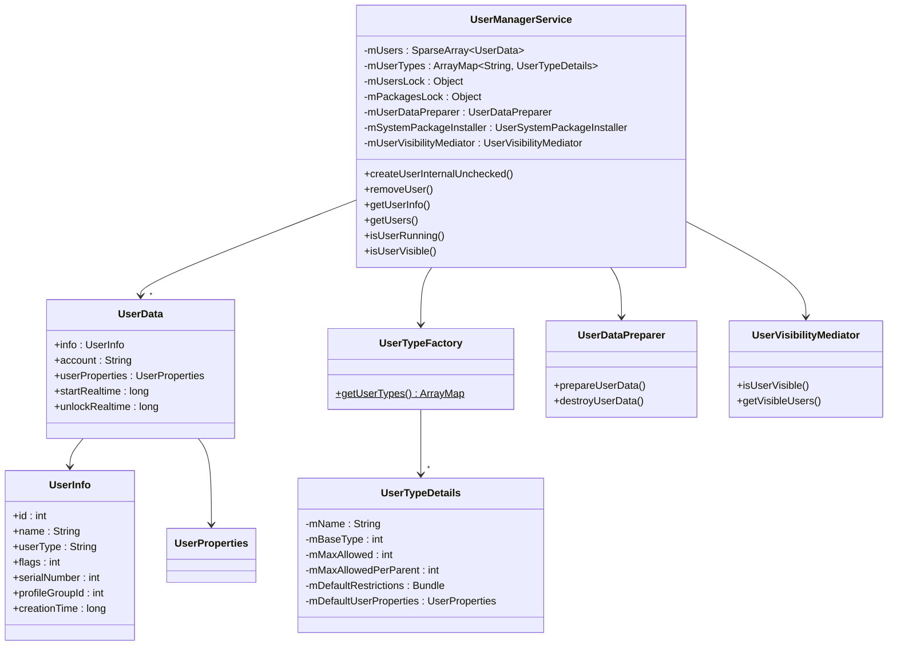

**源位置：**

| 类 | 路径 |
|---|---|
| `UserManagerService` | `frameworks/base/services/core/java/com/android/server/pm/UserManagerService.java` |
| `UserTypeFactory` | `frameworks/base/services/core/java/com/android/server/pm/UserTypeFactory.java` |
| `UserTypeDetails` | `frameworks/base/services/core/java/com/android/server/pm/UserTypeDetails.java` |
| `UserDataPreparer` | `frameworks/base/services/core/java/com/android/server/pm/UserDataPreparer.java` |
| `UserVisibilityMediator` | `frameworks/base/services/core/java/com/android/server/pm/UserVisibilityMediator.java` |
| `UserSystemPackageInstaller` | `frameworks/base/services/core/java/com/android/server/pm/UserSystemPackageInstaller.java` |

### 31.1.3 UserManagerService 初始化

`UserManagerService` 是所有用户操作的中心权威。它实现了 `IUserManager.Stub`，并在多把锁的保护下维护关键状态：

```java
// From UserManagerService.java
public class UserManagerService extends IUserManager.Stub {

    // Lock ordering: mPackagesLock first, then mUsersLock
    private final Object mPackagesLock;
    private final Object mUsersLock = LockGuard.installNewLock(LockGuard.INDEX_USER);
    private final Object mRestrictionsLock = NamedLock.create("mRestrictionsLock");
    private final Object mAppRestrictionsLock = NamedLock.create("mAppRestrictionsLock");

    @GuardedBy("mUsersLock")
    private final SparseArray<UserData> mUsers;

    private final ArrayMap<String, UserTypeDetails> mUserTypes;
}
```

锁顺序约定在类中已有文档说明：

```
Method naming convention:
- Methods suffixed with "LAr" should be called within the `mAppRestrictionsLock` lock.
- Methods suffixed with "LP" should be called within the `mPackagesLock` lock.
- Methods suffixed with "LR" should be called within the `mRestrictionsLock` lock.
- Methods suffixed with "LU" should be called within the `mUsersLock` lock.
```

### 31.1.4 持久化存储

用户元数据存储在磁盘上的 `/data/system/users/` 中：

```
/data/system/users/
    userlist.xml          # List of all users and next serial number
    user.list             # Perfetto user list (plain-text user ids/types for tracing)
    0.xml                 # UserInfo for user 0
    10.xml                # UserInfo for user 10
    11.xml                # UserInfo for user 11
    0/                    # System user (user 0) per-user files
        photo.png         # User avatar
        res_*.xml         # Per-package application restrictions (res_<packageName>.xml)
    10/                   # Secondary user (user 10)
    11/                   # Work profile (user 11)
```

`userlist.xml` 的格式：

```xml
<users nextSerialNumber="15" version="11">
    <user id="0" />
    <user id="10" />
    <user id="11" />
</users>
```

每个用户的 XML 文件（`<id>.xml`）包含：

```xml
<user
    id="10"
    serialNumber="12"
    flags="0x00000810"
    type="android.os.usertype.full.SECONDARY"
    created="1700000000000"
    lastLoggedIn="1700100000000"
    lastEnteredForeground="1700100000000"
    lastLoggedInFingerprint="google/pixel/..." >
    <name>John</name>
    <restrictions />
    <userProperties />
</user>
```

文件属性直接对应 `UserManagerService` 常量：

```java
// From UserManagerService.java
private static final String ATTR_FLAGS = "flags";
private static final String ATTR_TYPE = "type";
private static final String ATTR_ID = "id";
private static final String ATTR_CREATION_TIME = "created";
private static final String ATTR_LAST_LOGGED_IN_TIME = "lastLoggedIn";
private static final String ATTR_LAST_ENTERED_FOREGROUND_TIME = "lastEnteredForeground";
private static final String ATTR_SERIAL_NO = "serialNumber";
private static final String ATTR_NEXT_SERIAL_NO = "nextSerialNumber";
private static final String ATTR_PROFILE_GROUP_ID = "profileGroupId";
private static final String ATTR_RESTRICTED_PROFILE_PARENT_ID = "restrictedProfileParentId";
```

### 31.1.5 用户 ID 分配

用户 ID 从 `MIN_USER_ID`（10）开始顺序分配：

```java
// From UserManagerService.java
@VisibleForTesting
static final int MIN_USER_ID = UserHandle.MIN_SECONDARY_USER_ID;  // 10

@VisibleForTesting
static final int MAX_USER_ID = UserHandle.MAX_SECONDARY_USER_ID;  // Integer.MAX_VALUE / 100000 - 1
```

用户 0 始终是系统用户。ID 1-9 为保留值。新创建的用户会获得下一个可用的 ID。序列号单调递增且永不复用（即使在删除用户之后），以维持数据来源的可追溯性：

```java
// Serial numbers are separate from user IDs:
// UserID = 10 might have serialNumber = 12
// If user 10 is deleted, a new user might get ID 10 but serial 15
```

最近移除的用户 ID 会被跟踪，以防止过早复用：

```java
@VisibleForTesting
static final int MAX_RECENTLY_REMOVED_IDS_SIZE = 100;
```

### 31.1.6 用户限制

用户限制来自多个来源并层层叠加：

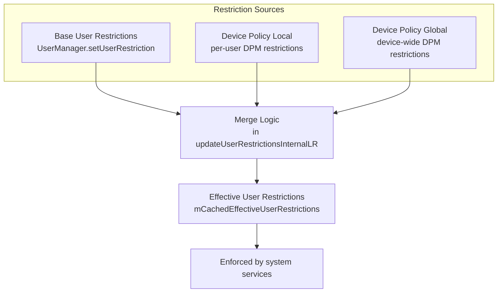

服务会将有效限制与基础限制分别缓存：

```java
// From UserManagerService.java
@GuardedBy("mRestrictionsLock")
private final RestrictionsSet mBaseUserRestrictions = new RestrictionsSet();

@GuardedBy("mRestrictionsLock")
private final RestrictionsSet mCachedEffectiveUserRestrictions = new RestrictionsSet();
```

重要：当限制发生变化时，总是会创建一个新的 `Bundle`。现有 Bundle 不会被修改，因为 Bundle 可能在基础集合与缓存集合之间共享。

---

## 31.2 用户类型

### 31.2.1 UserTypeDetails 系统

Android 使用基于类型的系统来定义用户类别。每个类型都由 `UserTypeDetails` 定义，并通过 `UserTypeFactory` 注册。

**来源：** `frameworks/base/services/core/java/com/android/server/pm/UserTypeFactory.java`

```java
// From UserTypeFactory.java
public static ArrayMap<String, UserTypeDetails> getUserTypes() {
    final ArrayMap<String, UserTypeDetails.Builder> builders = getDefaultBuilders();
    // Allow OEM customization via config_user_types XML
    try (XmlResourceParser parser =
             Resources.getSystem().getXml(R.xml.config_user_types)) {
        customizeBuilders(builders, parser);
    }
    // Build all types
    final ArrayMap<String, UserTypeDetails> types = new ArrayMap<>(builders.size());
    for (int i = 0; i < builders.size(); i++) {
        types.put(builders.keyAt(i), builders.valueAt(i).createUserTypeDetails());
    }
    return types;
}
```

OEM 可以通过提供 `res/xml/config_user_types.xml` 来自定义用户类型，以覆盖默认值（最大允许数量、限制、属性等）。

### 31.2.2 AOSP 用户类型目录

工厂注册以下默认类型：

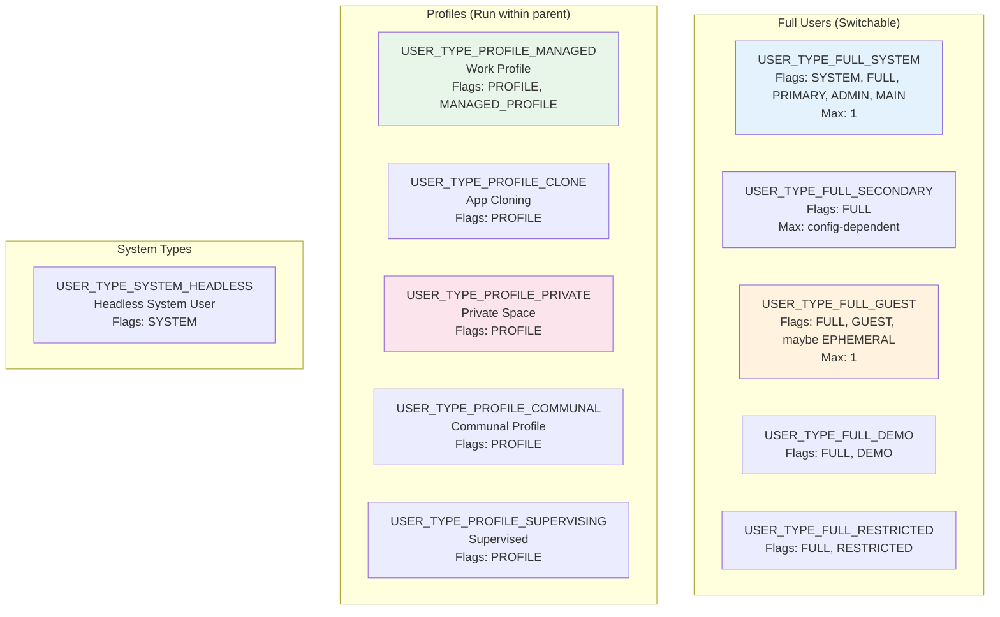

**来自源码的详细类型规范：**

| 类型常量 | 基础类型 | 最大值 | 需要父级 | 关键属性 |
|---|---|---|---|---|
| `USER_TYPE_FULL_SYSTEM` | `FLAG_SYSTEM | FLAG_FULL` | 1 | 否 | 主用户、管理员用户、Main 用户 |
| `USER_TYPE_FULL_SECONDARY` | `FLAG_FULL` | 配置决定 | 否 | 标准次要用户 |
| `USER_TYPE_FULL_GUEST` | `FLAG_FULL` | 1 | 否 | 可能是临时用户 |
| `USER_TYPE_FULL_DEMO` | `FLAG_FULL` | 3 | 否 | 演示/kiosk 模式 |
| `USER_TYPE_FULL_RESTRICTED` | `FLAG_FULL` | 配置决定 | 否 | 受限资料 |
| `USER_TYPE_PROFILE_MANAGED` | `FLAG_PROFILE` | 配置决定 | 是 | 工作资料 |
| `USER_TYPE_PROFILE_CLONE` | `FLAG_PROFILE` | 每个父级 1 个 | 是 | 应用克隆 |
| `USER_TYPE_PROFILE_PRIVATE` | `FLAG_PROFILE` | 1 | 是 | 私密空间 |
| `USER_TYPE_PROFILE_COMMUNAL` | `FLAG_PROFILE` | 1 | 否 | 共享公用资料 |
| `USER_TYPE_PROFILE_SUPERVISING` | `FLAG_PROFILE` | 1 | 否 | 被监督用户 |
| `USER_TYPE_PROFILE_TEST` | `FLAG_PROFILE` | 4（每个父级 2 个） | 是 | 仅调试用资料 |
| `USER_TYPE_SYSTEM_HEADLESS` | `FLAG_SYSTEM` | 1 | 否 | 无头系统用户模式 |

`USER_TYPE_PROFILE_TEST` 仅在 `Build.IS_DEBUGGABLE` 构建上注册（参见 `UserTypeFactory.java` 中的 `getDefaultBuilders()`）；它借用工作资料的角标，纯粹用于插桩。上面的目录反映了 `getDefaultBuilders()` 中注册的默认构建器。

### 31.2.3 Full System 用户

系统用户（用户 0）是特殊的。在传统（非无头）模式下：

```java
// From UserTypeFactory.java
private static UserTypeDetails.Builder getDefaultTypeFullSystem() {
    return new UserTypeDetails.Builder()
            .setName(USER_TYPE_FULL_SYSTEM)
            .setBaseType(FLAG_SYSTEM | FLAG_FULL)
            .setDefaultUserInfoPropertyFlags(FLAG_PRIMARY | FLAG_ADMIN | FLAG_MAIN)
            .setMaxAllowed(1)
            .setDefaultRestrictions(getDefaultSystemUserRestrictions());
}
```

它始终是用户 ID 0，始终存在，无法被移除，并且是启动过程中第一个启动的用户。在无头系统用户模式（HSUM，用于车载设备）下，用户 0 会运行，但对人类操作员不可见。真正的人类用户在其之上启动。

### 31.2.4 次要用户

标准次要用户是可以切换到的完整用户：

```java
private static UserTypeDetails.Builder getDefaultTypeFullSecondary() {
    return new UserTypeDetails.Builder()
            .setName(USER_TYPE_FULL_SECONDARY)
            .setBaseType(FLAG_FULL)
            .setMaxAllowed(getDefaultMaxAllowedForSwitchableTypes())
            .setDefaultRestrictions(getDefaultSecondaryUserRestrictions());
}
```

`getDefaultMaxAllowedForSwitchableTypes()` 返回 `getMaxSwitchableUsers() - 1`（它将每种类型的上限与设备范围内的可切换用户配额关联起来）。同一个辅助函数也为克隆资料和受限资料提供上限。

次要用户的默认限制：

- `DISALLOW_OUTGOING_CALLS` = true
- `DISALLOW_SMS` = true

这些限制可以被管理员用户解除。

### 31.2.5 访客用户

访客用户是为临时共用设备而设计的：

```java
private static UserTypeDetails.Builder getDefaultTypeFullGuest() {
    final boolean ephemeralGuests = Resources.getSystem()
            .getBoolean(com.android.internal.R.bool.config_guestUserEphemeral);
    final int flags = FLAG_GUEST | (ephemeralGuests ? FLAG_EPHEMERAL : 0);

    return new UserTypeDetails.Builder()
            .setName(USER_TYPE_FULL_GUEST)
            .setBaseType(FLAG_FULL)
            .setDefaultUserInfoPropertyFlags(flags)
            .setEnabled(getMaxSwitchableUsers() > 1 ? 1 : 0)
            .setMaxAllowed(1)
            .setDefaultRestrictions(getDefaultGuestUserRestrictions());
}
```

访客的关键属性：

- 一次只允许一个访客
- 可以是临时的（退出时清除数据，由 `config_guestUserEphemeral` 控制）
- 继承次要用户的限制，并附加更多限制。`getDefaultGuestUserRestrictions()`
  会添加 `DISALLOW_INSTALL_UNKNOWN_SOURCES` 和 `DISALLOW_CONFIG_CREDENTIALS`，并且根据
  `android.multiuser.Flags.userRestrictionConfigWifiSharedPrivate()` 标志添加
  `DISALLOW_CONFIG_WIFI_SHARED` 或 `DISALLOW_CONFIG_WIFI`
- 在单用户设备上被禁用（`setEnabled(getMaxSwitchableUsers() > 1 ? 1 : 0)`）

### 31.2.6 托管资料（工作资料）

工作资料是使用最广泛的资料类型，由设备策略控制器（DPC）管理：

```java
private static UserTypeDetails.Builder getDefaultTypeProfileManaged() {
    return new UserTypeDetails.Builder()
            .setName(USER_TYPE_PROFILE_MANAGED)
            .setBaseType(FLAG_PROFILE)
            .setDefaultUserInfoPropertyFlags(FLAG_MANAGED_PROFILE)
            .setMaxAllowed(getMaxManagedProfiles())
            .setMaxAllowedPerParent(getMaxManagedProfiles())
            .setProfileParentRequired(true)
            // ... badges, labels, colors
            .setDefaultUserProperties(new UserProperties.Builder()
                    .setStartWithParent(true)
                    .setShowInLauncher(UserProperties.SHOW_IN_LAUNCHER_SEPARATE)
                    .setShowInSettings(UserProperties.SHOW_IN_SETTINGS_SEPARATE)
                    .setShowInQuietMode(UserProperties.SHOW_IN_QUIET_MODE_PAUSED)
                    .setShowInSharingSurfaces(
                            UserProperties.SHOW_IN_SHARING_SURFACES_SEPARATE)
                    .setCredentialShareableWithParent(true));
}
```

属性说明：

- `startWithParent=true`：当父级用户启动时，资料会自动启动
- `SHOW_IN_LAUNCHER_SEPARATE`：工作应用在启动器中显示时带有角标
- `SHOW_IN_QUIET_MODE_PAUSED`：当静音模式开启时，应用显示为已暂停
- `credentialShareableWithParent=true`：屏幕锁定可以与父级用户共享

### 31.2.7 克隆资料

克隆资料允许运行某个应用的第二个实例（通常是消息类应用）：

```java
private static UserTypeDetails.Builder getDefaultTypeProfileClone() {
    return new UserTypeDetails.Builder()
            .setName(USER_TYPE_PROFILE_CLONE)
            .setBaseType(FLAG_PROFILE)
            .setMaxAllowedPerParent(1)
            .setProfileParentRequired(true)
            .setDefaultUserProperties(new UserProperties.Builder()
                    .setStartWithParent(true)
                    .setShowInLauncher(UserProperties.SHOW_IN_LAUNCHER_WITH_PARENT)
                    .setShowInSettings(UserProperties.SHOW_IN_SETTINGS_WITH_PARENT)
                    .setInheritDevicePolicy(
                            UserProperties.INHERIT_DEVICE_POLICY_FROM_PARENT)
                    .setUseParentsContacts(true)
                    .setMediaSharedWithParent(true)
                    .setCredentialShareableWithParent(true)
                    .setDeleteAppWithParent(true));
}
```

值得注意的克隆专用属性：

- `SHOW_IN_LAUNCHER_WITH_PARENT`：与父级应用并排显示（不在单独的标签页中）
- `useParentsContacts=true`：使用父级的联系人数据库
- `mediaSharedWithParent=true`：与父级共享媒体存储
- `deleteAppWithParent=true`：当父级移除应用时，克隆的应用也会被移除

### 31.2.8 受限资料

受限资料（多用于平板设备）与父级用户共享数据集运行，但访问受到限制：

```java
private static UserTypeDetails.Builder getDefaultTypeFullRestricted() {
    return new UserTypeDetails.Builder()
            .setName(USER_TYPE_FULL_RESTRICTED)
            .setBaseType(FLAG_FULL)
            .setDefaultUserInfoPropertyFlags(FLAG_RESTRICTED)
            .setMaxAllowed(getDefaultMaxAllowedForSwitchableTypes())
            .setProfileParentRequired(false) // a "parent", but not a profile parent
            .setDefaultRestrictions(null);
}
```

与资料不同，受限用户是完整用户（可单独切换），但它们有一个“受限资料父级”，用于控制它们可以访问哪些应用和内容。

### 31.2.9 用户类型属性（UserProperties）

`UserProperties` 封装了每种用户类型的显示与行为属性：

| 属性 | 取值 | 用途 |
|---|---|---|
| `startWithParent` | boolean | 父级启动时自动启动 |
| `showInLauncher` | `NO`、`WITH_PARENT`、`SEPARATE` | 应用在启动器中的显示方式 |
| `showInSettings` | `NO`、`WITH_PARENT`、`SEPARATE` | 资料在“设置”中的显示方式 |
| `showInQuietMode` | `DEFAULT`、`PAUSED`、`HIDDEN` | 资料处于静音状态时的应用外观 |
| `showInSharingSurfaces` | `NO`、`WITH_PARENT`、`SEPARATE` | 在分享界面中的可见性 |
| `credentialShareableWithParent` | boolean | 能否与父级共享屏幕锁定 |
| `mediaSharedWithParent` | boolean | 共享媒体存储 |
| `inheritDevicePolicy` | `NO`、`FROM_PARENT` | DPM 策略是否继承 |
| `crossProfileIntentFilterAccessControl` | levels | 谁可以修改跨资料 intent |
| `crossProfileContentSharingStrategy` | strategies | 内容共享规则 |
| `profileApiVisibility` | `VISIBLE`、`HIDDEN` | 是否对资料查询 API 可见 |
| `authAlwaysRequiredToDisableQuietMode` | boolean | 解锁资料需要身份验证 |
| `deleteAppWithParent` | boolean | 父级移除应用时移除应用 |
| `itemsRestrictedOnHomeScreen` | boolean | 限制主屏幕上的项目 |

---

## 31.3 用户生命周期

### 31.3.1 用户创建

用户创建通过 `createUserInternalUnchecked()` 进行，这是一个处理所有用户类型的中心方法：

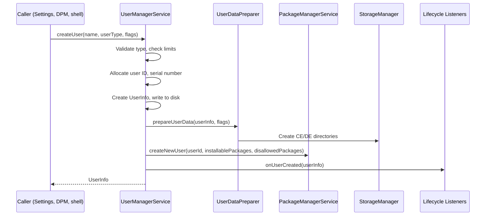

创建方法会进行大量验证：

```java
// From UserManagerService.java (simplified)
@NonNull UserInfo createUserInternalUnchecked(
        @Nullable String name, @NonNull String userType,
        @UserInfoFlag int flags, @UserIdInt int parentId,
        boolean preCreate, @Nullable String[] disallowedPackages,
        @Nullable Object token) throws UserManager.CheckedUserOperationException {

    // 1. Validate user type exists and is enabled
    final UserTypeDetails userTypeDetails = mUserTypes.get(userType);

    // 2. Check max users limit
    // 3. Check max profiles per parent limit
    // 4. Check device storage capacity

    // 5. Allocate new user ID
    userId = getNextAvailableId();

    // 6. Create UserInfo
    UserInfo userInfo = new UserInfo(userId, name, null, flags, userType);
    userInfo.serialNumber = mNextSerialNumber++;
    userInfo.creationTime = getCreationTime();
    userInfo.profileGroupId = parentId;

    // 7. Create UserData wrapper
    final UserData userData = new UserData();
    userData.info = userInfo;
    userData.userProperties = new UserProperties(
            userTypeDetails.getDefaultUserPropertiesReference());

    // 8. Store in memory and write to disk
    synchronized (mUsersLock) {
        mUsers.put(userId, userData);
    }
    writeUserLP(userData);
    writeUserListLP();

    // 9. Prepare storage
    mUserDataPreparer.prepareUserData(userInfo, storageFlags);

    // 10. Install the system packages appropriate for this user type
    mPm.createNewUser(userId,
            mSystemPackageInstaller.getInstallablePackagesForUserType(userType),
            disallowedPackages);

    // 11. Notify listeners
    for (UserLifecycleListener listener : mUserLifecycleListeners) {
        listener.onUserCreated(userInfo, token);
    }

    return userInfo;
}
```

### 31.3.2 用户 ID 分配

新用户 ID 通过查找下一个未使用的 ID 来分配：

```java
// Simplified from getNextAvailableId() / scanNextAvailableIdLU()
private int getNextAvailableId() {
    synchronized (mUsersLock) {
        // Scan for the smallest ID >= MIN_USER_ID that is neither in mUsers
        // nor in mRemovingUserIds (every id removed since boot)
        for (int i = MIN_USER_ID /* 10 */; i < MAX_USER_ID; i++) {
            if (mUsers.indexOfKey(i) < 0 && !mRemovingUserIds.get(i)) {
                return i;
            }
        }
        // All ids exhausted: recycle removed ids, keeping only
        // mRecentlyRemovedIds (an LRU list of the most recently removed
        // ids, capped at MAX_RECENTLY_REMOVED_IDS_SIZE) off-limits,
        // then rescan. If even that fails:
        throw new IllegalStateException("No user id available!");
    }
}
```

### 31.3.3 预创建的用户

为了更快地创建用户（例如快速访客设置），Android 支持预先创建用户：

```java
// From UserManagerService.java
private static final String ATTR_PRE_CREATED = "preCreated";
private static final String ATTR_CONVERTED_FROM_PRE_CREATED = "convertedFromPreCreated";
```

预创建的用户已准备好存储，但尚未与真实人物关联。当需要新用户时，系统会转换一个预创建的用户，而不是从头开始创建。这避免了存储准备和应用安装带来的延迟。

### 31.3.4 用户的启动与运行状态

用户在创建后会经历几个状态：

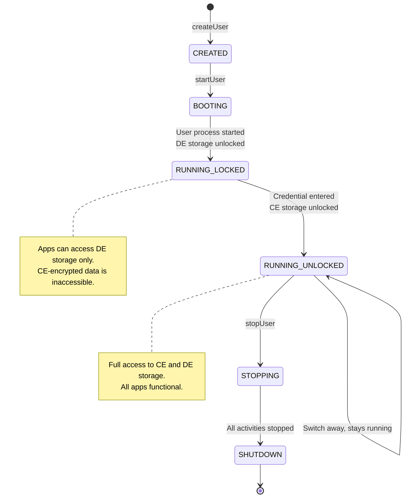

这些状态通过 `UserState` 跟踪：

```java
// From UserState.java (frameworks/base/services/core/java/com/android/server/am/)
public class UserState {
    public final static int STATE_BOOTING = 0;
    public final static int STATE_RUNNING_LOCKED = 1;
    public final static int STATE_RUNNING_UNLOCKING = 2;
    public final static int STATE_RUNNING_UNLOCKED = 3;
    public final static int STATE_STOPPING = 4;
    public final static int STATE_SHUTDOWN = 5;
}
```

### 31.3.5 用户移除

用户移除是一个多步骤过程：

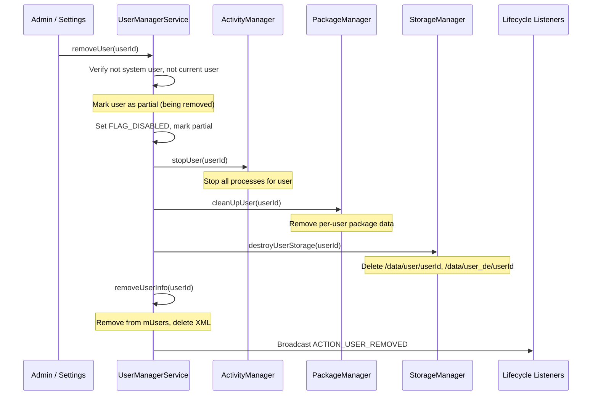

关键的安全检查：

- 不能移除用户 0（系统用户）
- 不能移除当前的前台用户（必须先切换）
- 当父级用户被移除时，资料也会被移除
- `partial` 标志会阻止使用正在被移除的用户

```java
// From UserManagerService.java
public boolean removeUser(@UserIdInt int userId) {
    Slog.i(LOG_TAG, "removeUser u" + userId);
    // ... permission checks
    return removeUserWithProfilesUnchecked(userId);
}

private boolean removeUserWithProfilesUnchecked(@UserIdInt int userId) {
    // Remove all profiles of this user first
    synchronized (mUsersLock) {
        for (int i = mUsers.size() - 1; i >= 0; i--) {
            UserInfo profile = mUsers.valueAt(i).info;
            if (profile.profileGroupId == userId && profile.id != userId) {
                removeUserUnchecked(profile.id);
            }
        }
    }
    return removeUserUnchecked(userId);
}
```

### 31.3.6 生命周期监听器

系统服务会注册为用户生命周期监听器，以响应用户事件：

```java
// From UserManagerInternal.java
public interface UserLifecycleListener {
    default void onUserCreated(UserInfo user, Object token) {}
    default void onUserRemoved(UserInfo user) {}
}
```

在用户创建过程中，监听器会收到同步通知：

```java
// From UserManagerService.java
synchronized (mUserLifecycleListeners) {
    for (int i = 0; i < mUserLifecycleListeners.size(); i++) {
        mUserLifecycleListeners.get(i).onUserCreated(userInfo, token);
    }
}
```

---

## 31.4 工作资料

### 31.4.1 工作资料架构

工作资料是 Android 企业功能的基石。它们在个人用户内部为公司应用和数据创建一个隔离环境：

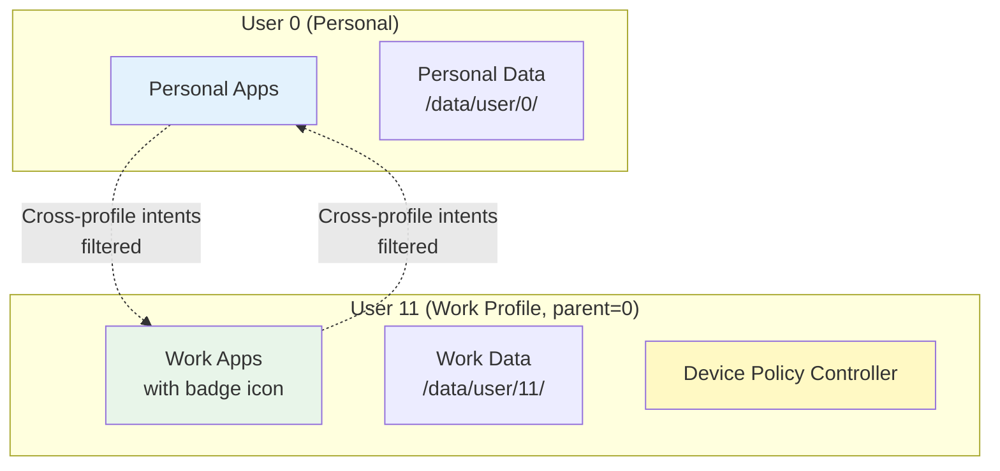

### 31.4.2 资料组

同一资料组中的用户共享一个等于父级用户 ID 的资料组 ID。它存储在 `UserInfo.profileGroupId` 中：

```java
// User 0: profileGroupId = 0 (or NO_PROFILE_GROUP_ID)
// Work profile (user 11): profileGroupId = 0
// Private profile (user 12): profileGroupId = 0
```

`UserManagerService.isSameProfileGroup()` 会检查这种关系：

```java
public boolean isSameProfileGroup(int userId, int otherUserId) {
    synchronized (mUsersLock) {
        UserInfo user = getUserInfoLU(userId);
        UserInfo other = getUserInfoLU(otherUserId);
        return user != null && other != null
                && user.profileGroupId != UserInfo.NO_PROFILE_GROUP_ID
                && user.profileGroupId == other.profileGroupId;
    }
}
```

### 31.4.3 跨资料 Intent 过滤器

个人资料与工作资料之间的通信由跨资料 intent 过滤器控制。这些过滤器按用户类型预先配置：

```java
// From UserTypeFactory.java
.setDefaultCrossProfileIntentFilters(getDefaultManagedCrossProfileIntentFilter())
```

默认的托管资料跨资料 intent 过滤器允许：

- 在个人浏览器中打开来自工作的网页 URL
- 在资料之间共享内容（当策略允许时）
- 打开系统设置
- 处理电话和联系人

访问控制级别决定了谁可以修改这些过滤器：

```java
.setCrossProfileIntentFilterAccessControl(
        UserProperties.CROSS_PROFILE_INTENT_FILTER_ACCESS_LEVEL_SYSTEM)
```

级别包括：

- `SYSTEM`：只有系统可以修改跨资料过滤器
- `SYSTEM_ADD_ONLY`：系统可以添加，但任何人都不能移除
- Standard：拥有相应权限的应用可以修改

### 31.4.4 跨资料数据共享

个人资料与工作资料之间的数据共享由多种机制控制：

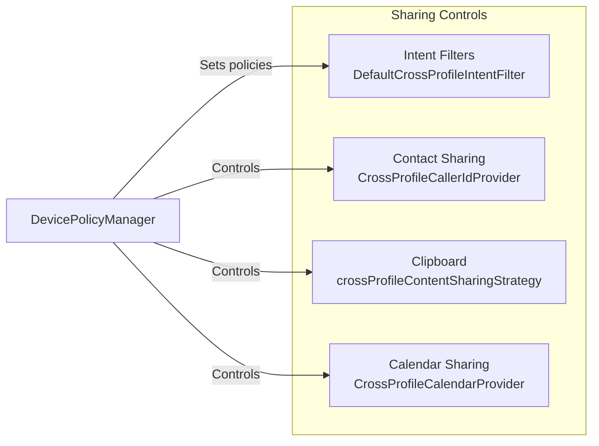

### 31.4.5 静音模式

工作资料支持“静音模式”——一种工作应用被挂起的暂停状态：

公开入口点 `requestQuietModeEnabled()` 会验证调用方和标志，然后委托给 `setQuietModeEnabled()`。该方法会切换资料 `UserInfo` 上的 `FLAG_QUIET_MODE`，并停止或启动资料：

```java
// From UserManagerService.java (simplified)
private void setQuietModeEnabled(@UserIdInt int userId, boolean enableQuietMode,
        IntentSender target, @Nullable String callingPackage) {
    // ... verify userId is a profile and quiet mode actually changes
    profile.flags ^= UserInfo.FLAG_QUIET_MODE;  // toggle the flag
    writeUserLP(profileUserData);               // persist to <id>.xml

    if (enableQuietMode) {
        stopUserForQuietMode(userId);           // stop the profile's apps
        // Apps will show as "paused" in launcher
    } else {
        // Restart the profile; `target` is fired once it is unlocked
        ActivityManager.getService().startProfileWithListener(userId, callback);
    }
    // ... broadcast profile availability changes
}
```

`showInQuietMode` 属性控制视觉行为：

- `SHOW_IN_QUIET_MODE_PAUSED`：应用可见但被置灰（工作资料）
- `SHOW_IN_QUIET_MODE_HIDDEN`：应用完全隐藏（私密空间）
- `SHOW_IN_QUIET_MODE_DEFAULT`：系统默认行为

### 31.4.6 工作资料角标

工作应用通过角标在视觉上加以区分。角标配置来自 `UserTypeDetails`：

```java
// Managed profile badge configuration (from UserTypeFactory.java)
.setIconBadge(R.drawable.ic_corp_icon_badge_case)          // Briefcase overlay
.setBadgePlain(R.drawable.ic_corp_badge_case)               // Simple badge
.setBadgeNoBackground(R.drawable.ic_corp_badge_no_background)
.setStatusBarIcon(R.drawable.stat_sys_managed_profile_status)
.setBadgeLabels(
        R.string.managed_profile_label_badge,     // "Work"
        R.string.managed_profile_label_badge_2,   // "Work 2"
        R.string.managed_profile_label_badge_3)   // "Work 3"
.setBadgeColors(
        R.color.profile_badge_1,
        R.color.profile_badge_2,
        R.color.profile_badge_3)
```

角标索引存储在 `UserInfo.profileBadge` 中，在调试构建上最多支持 3 个托管资料。

### 31.4.7 通过 DevicePolicyManager 创建工作资料

`UserManagerService.createProfileForUserWithThrow()` 是底层机制。DPMS 实际调用的是它的 `createProfileForUserEvenWhenDisallowedWithThrow()` 变体。不过，工作资料通常是通过 **Device Policy Manager** 配置流程创建的。这是企业 MDM 解决方案和设置向导所调用的：

#### 配置流程

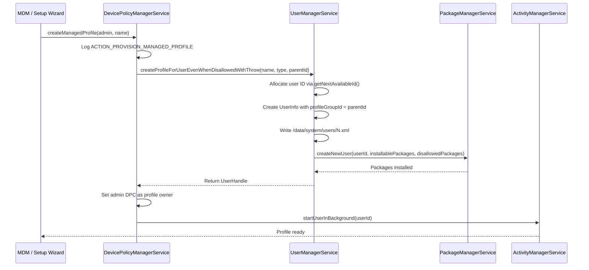

```java
// Source: frameworks/base/services/devicepolicy/java/com/android/server/devicepolicy/DevicePolicyManagerService.java:21426
public UserHandle createManagedProfile(
        @NonNull ManagedProfileProvisioningParams provisioningParams,
        @NonNull String callerPackage) {
    // The admin component comes from
    // provisioningParams.getProfileAdminComponentName();
    // delegates to createManagedProfileInternal()
}

// Line 21440
private UserHandle createManagedProfileInternal(
        @NonNull ManagedProfileProvisioningParams provisioningParams,
        @NonNull CallerIdentity caller) {
    // 1. Log provisioning action
    // 2. Call UserManager.createProfileForUserEvenWhenDisallowedWithThrow()
    // 3. Set up admin DPC as profile owner
    // 4. Store seed account if provided
}
```

独立的 `createAndManageUser()` 方法（第 12166 行）*不会*创建工作资料。它是一项仅限设备所有者的操作。它通过 `UserManagerInternal.createUserEvenWhenDisallowed()` 创建一个新的完整次要用户（`USER_TYPE_FULL_SECONDARY`，或演示模式下的 `USER_TYPE_FULL_DEMO`）。然后它把调用方的组件设置为该用户的资料所有者。它在无头单用户模式下会被阻止。

### 31.4.8 工作资料生命周期管理

#### 资料状态

工作资料在其生命周期中会经历多个状态：

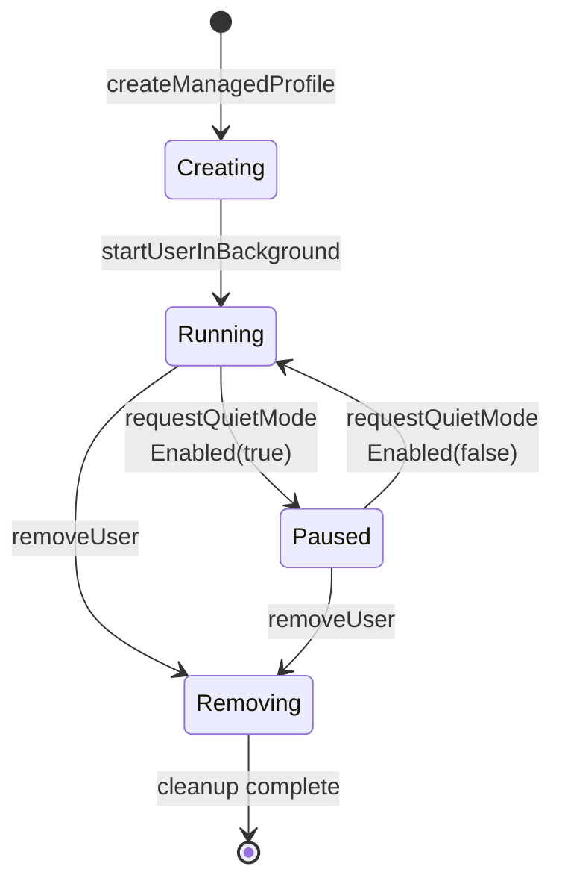

#### 静音模式（暂停/恢复）

静音模式 API 让用户可以在不移除工作资料的情况下暂停它。这在“设置”中表现为“暂停工作应用”，在启动器中表现为工作标签页开关：

```java
// Source: frameworks/base/core/java/android/os/UserManager.java:6008
public boolean requestQuietModeEnabled(
        boolean enableQuietMode,
        @NonNull UserHandle userHandle,
        IntentSender target,
        int flags)
```

当静音模式被**启用**时：

1. `UserManagerService.setQuietModeEnabled()` 在 `UserInfo` 上设置 `FLAG_QUIET_MODE`
2. `stopUserForQuietMode()` 停止资料中的所有进程
3. `killForegroundAppsForUser()` 终止可见的应用
4. `broadcastProfileAvailabilityChanges()` 通知系统
5. 启动器将工作应用置灰，并显示“Work apps paused”横幅

当静音模式被**禁用**时：

1. 如果资料有独立的锁，可能会弹出凭据对话框
2. `startProfileWithListener()` 启动资料用户
3. 所有工作应用重新可用
4. 通知恢复投递

```java
// Source: frameworks/base/services/core/java/com/android/server/pm/UserManagerService.java:2307
private void setQuietModeEnabled(int userId, boolean enableQuietMode,
        IntentSender target, String callingPackage) {
    // Toggle FLAG_QUIET_MODE
    // Stop or start the profile
    // Broadcast availability changes
}
```

公开入口点 `requestQuietModeEnabled()`（第 2149 行）接受一个 `@QuietModeFlag int flags`，并在*启用*静音模式时拒绝非空的 `target`。只有在禁用并等待解锁时，target 才有意义。

#### 静音模式标志

两个标志控制特殊的静音模式行为（定义在 `frameworks/base/core/java/android/os/UserManager.java` 中，并由 `@QuietModeFlag` IntDef 接受）：

| 标志 | 值 | 用途 |
|---|---|---|
| `QUIET_MODE_DISABLE_ONLY_IF_CREDENTIAL_NOT_REQUIRED` | 0x1 | 仅在没有锁屏挑战时才恢复 |
| `QUIET_MODE_DISABLE_DONT_ASK_CREDENTIAL` | 0x2 | 无需提示输入资料凭据即可恢复 |

#### 资料移除级联

当父级用户被移除时，所有关联的资料会先被移除：

```java
// Source: frameworks/base/services/core/java/com/android/server/pm/UserManagerService.java:7075
private boolean removeUserWithProfilesUnchecked(int userId) {
    // 1. Find all profiles where profileGroupId == userId
    // 2. removeUserUnchecked() for each profile
    // 3. removeUserUnchecked() for the user itself
}
```

每次资料移除都会触发：

- 在 UserInfo 上设置 `FLAG_DISABLED`，并标记为 partial
- `ActivityManager.stopUser()` 停止所有进程
- `PackageManager.cleanUpUser()` 移除每个用户的包数据
- `StorageManager.destroyUserStorage()` 清除 CE 和 DE 目录
- `removeUserInfo()` 删除用户元数据
- `ACTION_USER_REMOVED` 广播

### 31.4.9 跨资料应用 API

Android 为需要跨资料边界通信的应用提供了公共 API。`CrossProfileApps` 系统服务负责管理：

```java
// Source: frameworks/base/core/java/android/content/pm/CrossProfileApps.java
public class CrossProfileApps {
    // Get profiles this app can interact with
    List<UserHandle> getTargetUserProfiles();

    // Check if cross-profile interaction is permitted
    boolean canInteractAcrossProfiles();

    // Launch an activity in the target profile
    void startActivity(Intent intent, UserHandle targetUser);

    // Launch the main activity in the target profile
    void startMainActivity(ComponentName component, UserHandle targetUser);
}
```

#### 跨资料 Intent 过滤器机制

`CrossProfileIntentFilter` 类控制哪些 intent 可以跨越资料边界：

```java
// Source: frameworks/base/services/core/java/com/android/server/pm/CrossProfileIntentFilter.java:42
class CrossProfileIntentFilter extends WatchedIntentFilter {
    final int mTargetUserId;        // Which user can receive
    final String mOwnerPackage;     // Package that created the filter
    final int mFlags;               // Behavior flags
    final int mAccessControlLevel;  // Who can modify (@AccessControlLevel)
}
```

访问控制级别限制了谁可以添加或修改过滤器：

| 级别 | 值 | 描述 |
|---|---|---|
| `ACCESS_LEVEL_ALL` | 0 | 任何调用方都可以修改 |
| `ACCESS_LEVEL_SYSTEM` | 10 | 只有系统可以修改 |
| `ACCESS_LEVEL_SYSTEM_ADD_ONLY` | 20 | 系统可以添加但不能移除 |

`FLAG_ALLOW_CHAINED_RESOLUTION` 标志（值 `0x00000010`）支持跨三个或更多链接资料进行 intent 解析——例如 personal → work → clone 资料链。

#### 默认的跨资料 Intent

系统在资料创建过程中会预先配置几个跨资料 intent 过滤器。这些过滤器让基本功能能够在资料之间工作：

- **网页浏览** — 带有 `http/https` scheme 的 `ACTION_VIEW`
- **电话** — `ACTION_DIAL`、`ACTION_CALL_EMERGENCY`、`ACTION_CALL_PRIVILEGED`
- **设置** — `ACTION_DATA_ROAMING_SETTINGS`、`ACTION_NETWORK_OPERATOR_SETTINGS`
- **相机拍照** — `ACTION_IMAGE_CAPTURE`、`ACTION_VIDEO_CAPTURE`
- **文件选择** — `ACTION_GET_CONTENT`、`ACTION_OPEN_DOCUMENT`

工作资料中的应用可以在个人浏览器中打开网页链接。个人应用可以发起经由工作拨号器的电话。这些跨资料 intent 过滤器管理着所有这些行为。

### 31.4.10 企业策略集成

以资料所有者身份安装的设备策略控制器（DPC）可以强制执行仅在工作资料内适用的限制：

#### 资料范围限制

```java
// Source: frameworks/base/services/core/java/com/android/server/pm/UserManagerService.java:4053
// (updateUserRestrictionsInternalLR)
// Restrictions are merged from three sources:
// BASE    → mBaseUserRestrictions (per-user defaults)
// DPL     → Device Policy Local (profile-owner restrictions)
// DPG     → Device Policy Global (device-wide restrictions)
// Merged  → mCachedEffectiveUserRestrictions
```

常见的资料所有者限制包括：

| 限制 | 效果 |
|---|---|
| `DISALLOW_CAMERA` | 在工作应用中禁用相机 |
| `DISALLOW_SHARE_INTO_MANAGED_PROFILE` | 阻止从个人向工作资料共享 |
| `DISALLOW_UNIFIED_PASSWORD` | 要求独立的工作锁屏 |
| `DISALLOW_INSTALL_APPS` | 阻止在工作资料中安装应用 |
| `DISALLOW_BLUETOOTH_SHARING` | 阻止工作资料的蓝牙连接 |

#### 凭据共享

工作资料支持与父级用户共享凭据，由 `UserProperties` 中的 `credentialShareableWithParent` 属性控制：

```java
// Source: frameworks/base/services/core/java/com/android/server/pm/UserTypeFactory.java
.setDefaultUserProperties(new UserProperties.Builder()
        .setCredentialShareableWithParent(true))  // Unified lock screen
```

当凭据共享启用时，解锁设备也会解锁工作资料。当禁用时（通过 `DISALLOW_UNIFIED_PASSWORD`），工作资料需要自己的 PIN/密码/生物识别。

### 31.4.11 工作资料 UI 集成

#### 启动器工作标签页

在支持的启动器中，工作资料会出现在一个专门的 **Work** 标签页中。这由 `UserProperties.showInLauncher` 设置控制：

```java
// Source: frameworks/base/services/core/java/com/android/server/pm/UserTypeFactory.java
.setShowInLauncher(SHOW_IN_LAUNCHER_SEPARATE)  // Separate "Work" tab
```

`LauncherApps` 系统服务为启动器提供查询和显示工作资料应用的 API：

- `getActivityList(packageName, userHandle)` — 列出可启动的活动
- `isPackageEnabled(packageName, userHandle)` — 检查工作应用是否已启用
- `startMainActivity(componentName, userHandle)` — 启动工作应用

#### SystemUI 集成

SystemUI 通过多个组件显示工作资料状态：

- **状态栏图标** — 当工作资料处于活动状态时显示公文包图标（`stat_sys_managed_profile_status`）
- **快捷设置磁贴** — 控制静音模式的“Work mode”开关
- **通知面板** — 带有公文包角标的工作通知分组

```kotlin
// Source: frameworks/base/packages/SystemUI/src/com/android/systemui/statusbar/policy/profile/data/repository/impl/ManagedProfileRepositoryImpl.kt
// Monitors managed profile availability and quiet mode state
// Feeds data to the Quick Settings work mode tile
```

#### 联系人集成

跨资料联系人查找由以下设置管理：

```
Settings.Secure.MANAGED_PROFILE_CONTACT_REMOTE_SEARCH
```

启用后，个人联系人应用可以搜索工作联系人（例如用于来电显示）。但实际联系人数据仍保留在工作资料的 ContactsProvider 存储中。

---

## 31.5 私密空间

### 31.5.1 概述

私密空间（在 Android 15 中引入）为敏感应用提供了一个隐藏的、经过身份验证的区域。与工作资料（由企业 DPC 管理）不同，私密空间由用户自己管理。

```java
// From UserTypeFactory.java
private static UserTypeDetails.Builder getDefaultTypeProfilePrivate() {
    return new UserTypeDetails.Builder()
            .setName(USER_TYPE_PROFILE_PRIVATE)
            .setBaseType(FLAG_PROFILE)
            .setProfileParentRequired(true)
            .setMaxAllowed(1)
            .setMaxAllowedPerParent(1)
            .setEnabled(!android.multiuser.Flags.blockPrivateSpaceCreation()
                    || !ActivityManager.isLowRamDeviceStatic() ? 1 : 0)
            // ... badges, labels, restrictions
            .setDefaultRestrictions(getDefaultPrivateProfileRestrictions())
            .setDefaultUserProperties(new UserProperties.Builder()
                    .setStartWithParent(true)
                    .setCredentialShareableWithParent(true)
                    .setAuthAlwaysRequiredToDisableQuietMode(true)
                    .setAllowStoppingUserWithDelayedLocking(true)
                    .setMediaSharedWithParent(false)
                    .setShowInLauncher(UserProperties.SHOW_IN_LAUNCHER_SEPARATE)
                    .setShowInSettings(UserProperties.SHOW_IN_SETTINGS_SEPARATE)
                    .setShowInQuietMode(
                            UserProperties.SHOW_IN_QUIET_MODE_HIDDEN)
                    .setShowInSharingSurfaces(
                            UserProperties.SHOW_IN_SHARING_SURFACES_SEPARATE)
                    .setCrossProfileIntentFilterAccessControl(
                            UserProperties.CROSS_PROFILE_INTENT_FILTER_ACCESS_LEVEL_SYSTEM)
                    .setInheritDevicePolicy(
                            UserProperties.INHERIT_DEVICE_POLICY_FROM_PARENT)
                    .setCrossProfileContentSharingStrategy(
                            UserProperties.CROSS_PROFILE_CONTENT_SHARING_DELEGATE_FROM_PARENT)
                    .setProfileApiVisibility(
                            UserProperties.PROFILE_API_VISIBILITY_HIDDEN)
                    .setItemsRestrictedOnHomeScreen(true)
                    .setUpdateCrossProfileIntentFiltersOnOTA(true));
}
```

启用谓词取代了较旧的 `isPrivateProfileEnabled()` 辅助方法（该方法在 Android 17 开发周期中被移除）。私密空间现在由 `android.multiuser.Flags.blockPrivateSpaceCreation()` 标志与低 RAM 设备检查共同限制。在设置了阻止标志的低 RAM 设备上，该类型会被禁用。默认限制（`getDefaultPrivateProfileRestrictions()`）在常见的 `DISALLOW_WALLPAPER` 基础上添加了 `DISALLOW_BLUETOOTH_SHARING`。

### 31.5.2 与工作资料的关键区别

| 功能 | 工作资料 | 私密空间 |
|---|---|---|
| 管理 | 企业 DPC | 用户自己 |
| 静音模式下的可见性 | 已暂停（置灰） | 完全隐藏 |
| 媒体共享 | 可配置 | 不共享（`mediaSharedWithParent=false`） |
| 资料 API 可见性 | 可见 | 隐藏（`PROFILE_API_VISIBILITY_HIDDEN`） |
| 解锁所需身份验证 | 可选 | 始终要求（`authAlwaysRequiredToDisableQuietMode=true`） |
| 主屏幕项目 | 正常 | 受限（`itemsRestrictedOnHomeScreen=true`） |
| 跨资料过滤器 | 由 DPC 控制 | 仅限系统 |
| 分享界面 | 独立 | 独立 |

### 31.5.3 自动锁定机制

私密空间在设备不活动后实现自动锁定：

```java
// From UserManagerService.java
private static final long PRIVATE_SPACE_AUTO_LOCK_INACTIVITY_TIMEOUT_MS =
        5 * 60 * 1000;  // 5 minutes

private static final long PRIVATE_SPACE_AUTO_LOCK_INACTIVITY_ALARM_WINDOW_MS =
        TimeUnit.SECONDS.toMillis(55);
```

自动锁定系统通过屏幕关闭/开启广播来工作：

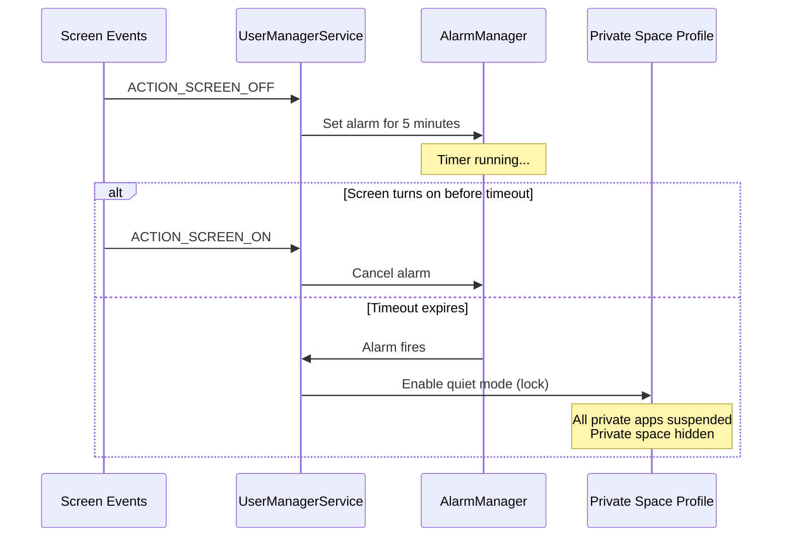

自动锁定行为的偏好存储在“设置”中：

```java
// From UserManagerService.java
int privateProfileUserId = getPrivateProfileUserId();
// Auto-lock on screen off, after timeout, or never
```

### 31.5.4 入口点隐藏

私密空间可以从启动器中隐藏其入口点：

```java
// From UserManagerService.java imports
import static android.content.pm.LauncherUserInfo.PRIVATE_SPACE_ENTRYPOINT_HIDDEN;
import static android.provider.Settings.Secure.HIDE_PRIVATESPACE_ENTRY_POINT;
```

隐藏后，私密空间在启动器中完全不可见。用户必须使用特定手势或通过“设置”导航才能访问它。

### 31.5.5 私密空间生物识别集成

私密空间的身份验证利用带有自定义品牌标识的生物识别提示：

```java
// From UserManagerService.java
if (getUserInfo(userId).isPrivateProfile()) {
    // Custom biometric prompt with Private Space branding
    mContext.getString(R.string.private_space_biometric_prompt_title);
}
```

---

## 31.6 按用户存储

### 31.6.1 存储布局

Android 为每个用户维护独立的存储区域：

```
/data/
    system/users/          # System-level user metadata
        userlist.xml
        0/                 # User 0 metadata
        10/                # User 10 metadata

    user/                  # Per-user CE app data roots
    user/0/                # CE storage for user 0 (/data/data is bind-mounted here)
        com.example.app/   # App data
    user/10/               # CE storage for user 10
        com.example.app/   # Separate app data instance

    user_de/               # Device-encrypted storage
    user_de/0/             # DE storage for user 0
        com.example.app/
    user_de/10/            # DE storage for user 10
        com.example.app/

    misc/                  # Shared misc data
    misc_de/               # Device-encrypted misc
    misc_ce/               # Credential-encrypted misc
```

### 31.6.2 CE 与 DE 存储

Android 实现了基于文件的加密（FBE），并包含两个加密类别：

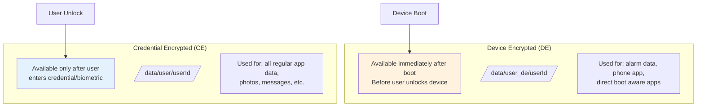

| 属性 | CE（凭据加密） | DE（设备加密） |
|---|---|---|
| 路径 | `/data/user/<userId>/` | `/data/user_de/<userId>/` |
| 可用时间 | 用户输入凭据之后 | 设备启动之后 |
| 加密密钥 | 派生自用户凭据 | 派生自设备密钥 |
| 典型数据 | 应用数据、照片、消息 | 闹钟、通话记录、直接启动数据 |
| 访问 API | `Context.getDataDir()` | `Context.createDeviceProtectedStorageContext()` |

### 31.6.3 存储准备

`UserDataPreparer` 负责为新用户创建存储目录：

```java
// From UserDataPreparer.java
void prepareUserData(UserInfo userInfo, int flags) {
    try (PackageManagerTracedLock installLock = mInstallLock.acquireLock()) {
        final StorageManager storage = mContext.getSystemService(StorageManager.class);
        /*
         * Internal storage must be prepared before adoptable storage,
         * since the user's volume keys are stored in their internal storage.
         */
        prepareUserDataLI(null /* internal storage */, userInfo, flags, true);
        for (VolumeInfo vol : storage.getWritablePrivateVolumes()) {
            final String volumeUuid = vol.getFsUuid();
            if (volumeUuid != null) {
                prepareUserDataLI(volumeUuid, userInfo, flags, true);
            }
        }
    }
}
```

内部存储始终最先准备，因为 adoptable 存储卷的密钥存储在用户的内部存储中。

### 31.6.4 按用户安装应用

并非所有系统应用都会为每个用户安装。`UserSystemPackageInstaller` 控制每种用户类型可以使用哪些应用：

```java
// From UserSystemPackageInstaller.java
// The per-user-type allowlist/denylist comes from SystemConfig's
// <install-in-user-type> entries in /etc/sysconfig XML, read via
// SystemConfig.getAndClearPackageToUserTypeAllowlist().
// The enforcement mode is the integer resource
// config_userTypePackageWhitelistMode (bit values 1/2/4/8).
```

安装器从设备的 sysconfig XML 中读取允许列表和拒绝列表。这确保（例如）企业管理应用只会安装在工作资料中，而消费类应用不会安装到受限资料中。

### 31.6.5 按用户的外部存储

每个用户都有自己隔离的外部存储：

```
/storage/emulated/0/    # User 0's external storage
/storage/emulated/10/   # User 10's external storage
```

FUSE 守护进程协调访问，确保每个用户只能看到自己的文件。`sdcardfs` 或基于 FUSE 的文件系统会应用与用户 UID 范围相匹配的基于 UID 的访问控制。

---

## 31.7 用户切换

### 31.7.1 用户切换概述

用户切换会将前台从一个完整用户转换到另一个完整用户。这是一个复杂的操作，涉及 `ActivityManagerService`、`WindowManagerService`、`UserManagerService` 以及所有系统服务。

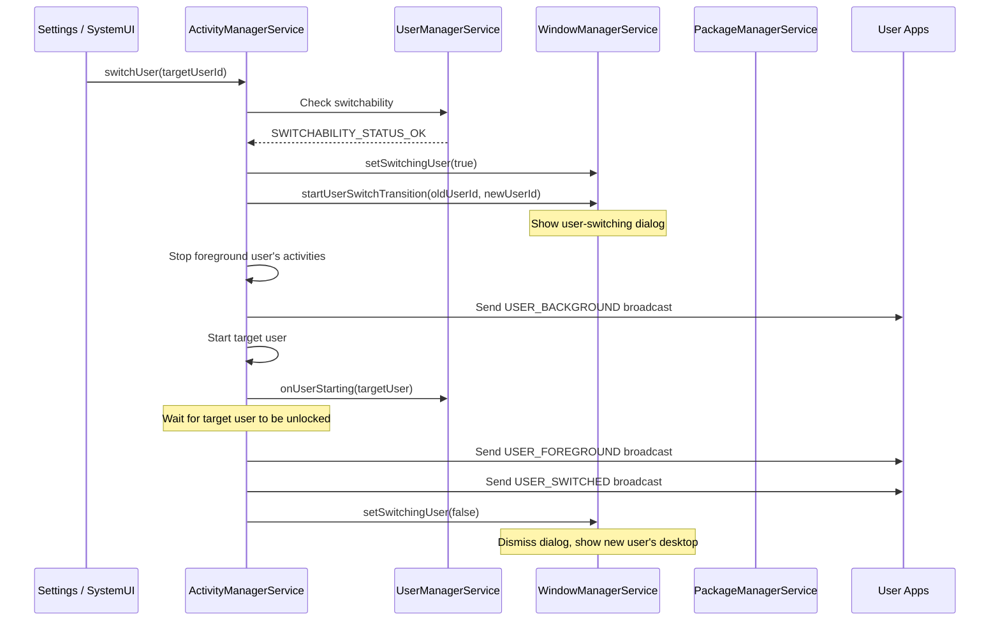

### 31.7.2 可切换性检查

在切换之前，系统会验证切换是否被允许：

```java
// From UserManagerService.java
public @UserManager.UserSwitchabilityResult int getUserSwitchability(
        @UserIdInt int userId) {
    int flags = UserManager.SWITCHABILITY_STATUS_OK;

    // Check 1: User in phone call?
    if (telecomManager != null && telecomManager.isInCall()) {
        flags |= UserManager.SWITCHABILITY_STATUS_USER_IN_CALL;
    }

    // Check 2: User switch disallowed by policy?
    if (mLocalService.hasUserRestriction(DISALLOW_USER_SWITCH, userId)) {
        flags |= UserManager.SWITCHABILITY_STATUS_USER_SWITCH_DISALLOWED;
    }

    // Check 3: System user locked? (non-HSUM only)
    if (!isHeadlessSystemUserMode()) {
        if (!allowUserSwitchingWhenSystemUserLocked && !systemUserUnlocked) {
            flags |= UserManager.SWITCHABILITY_STATUS_SYSTEM_USER_LOCKED;
        }
    }

    return flags;
}
```

可切换性结果标志：

| 标志 | 含义 |
|---|---|
| `SWITCHABILITY_STATUS_OK` | 允许切换 |
| `SWITCHABILITY_STATUS_USER_IN_CALL` | 有正在进行的通话 |
| `SWITCHABILITY_STATUS_USER_SWITCH_DISALLOWED` | DPM 限制处于活动状态 |
| `SWITCHABILITY_STATUS_SYSTEM_USER_LOCKED` | 系统用户尚未解锁 |

### 31.7.3 用户可见性中介器

`UserVisibilityMediator` 决定哪些用户是“可见的”——即他们应该运行并能够访问其应用：

```java
// From UserVisibilityMediator.java (class doc)
// Three modes:
// 1. SUSD (Single User Single Display) - phones, tablets
//    Only current foreground user + profiles are visible
// 2. MUMD (Multiple Users Multiple Displays) - automotive
//    Background users can be visible on secondary displays
// 3. MUPAND (Multiple Passengers, No Driver) - automotive
//    All human users in background, system user in foreground
```

对于标准手机模式（SUSD）：

- 前台用户是可见的
- 前台用户的所有资料都是可见的
- 所有其他用户都是不可见的

对于车载设备（MUMD）：

- 前台用户在主显示屏上可见
- 其他用户可以在乘客显示屏上可见
- 每个用户-显示屏映射都会被跟踪

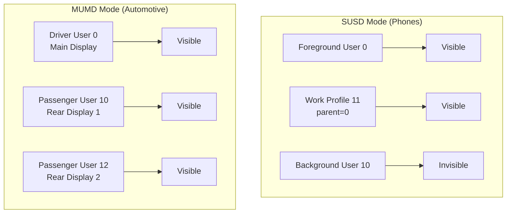

### 31.7.4 切换期间的进程管理

切换用户时，系统会仔细管理进程：

1. **过渡开始：** `WindowManagerService.setSwitchingUser(true)` 和
   `startUserSwitchTransition()` 会弹出用户切换对话框
2. **当前用户进入后台：** 当前用户的活动被暂停/停止
3. **启动目标用户：** 目标用户的系统服务和关键应用启动
4. **必要时解锁：** 如果用户有锁屏，则等待解锁
5. **目标用户进入前台：** 启动用户的启动器并恢复活动
6. **过渡结束：** `setSwitchingUser(false)` 关闭对话框，显示
   新用户的 UI

前一个用户的资料会被停止。那些在其 `UserProperties` 中设置了
`allowStoppingUserWithDelayedLocking` 的资料会以*延迟锁定*方式停止，因此在资料停止期间其
CE 存储保持解锁。新用户的资料会被启动（如果 `startWithParent=true`）。

### 31.7.5 启动用户选择

在无头系统用户模式（HSUM）下，系统必须决定启动后将哪个人类用户置于前台：

```java
// From UserManagerService.java
static final int BOOT_STRATEGY_DO_NOT_OVERRIDE = -1;
static final int HSUM_BOOT_STRATEGY_TO_PREVIOUS_FOREGROUND_USER = 0;
static final int HSUM_BOOT_STRATEGY_TO_HSU_FOR_PROVISIONED_DEVICE = 1;

private static final String BOOT_STRATEGY_PROPERTY = "persist.user.hsum_boot_strategy";
```

| 策略 | 值 | 行为 |
|---|---|---|
| `BOOT_STRATEGY_DO_NOT_OVERRIDE` | -1 | 不覆盖；使用默认的启动用户选择 |
| `HSUM_BOOT_STRATEGY_TO_PREVIOUS_FOREGROUND_USER` | 0 | 启动到之前的前台（最后活动的）用户 |
| `HSUM_BOOT_STRATEGY_TO_HSU_FOR_PROVISIONED_DEVICE` | 1 | 在已配置的设备上启动到无头系统用户 |

一个 `CountDownLatch` 会等待启动用户被确定：

```java
private final CountDownLatch mBootUserLatch = new CountDownLatch(1);
private static final long BOOT_USER_SET_TIMEOUT_MS = 300_000;  // 5 minutes
```

### 31.7.6 用户切换器 UI

用户切换器出现在多个位置：

1. **快捷设置** — 通知面板中下拉的用户头像
2. **锁屏** — 解锁前的用户选择
3. **设置 > 用户** — 完整的用户管理界面

`SystemUI` 从 `UserManagerService` 读取用户列表，并提供切换控件。SystemUI 中的
`UserSwitcherInteractor` 会订阅用户变更广播以保持 UI 同步（较旧的 `UserSwitcherController`
是一个已废弃的外观，委托给它）。

### 31.7.7 用户生命周期中的广播

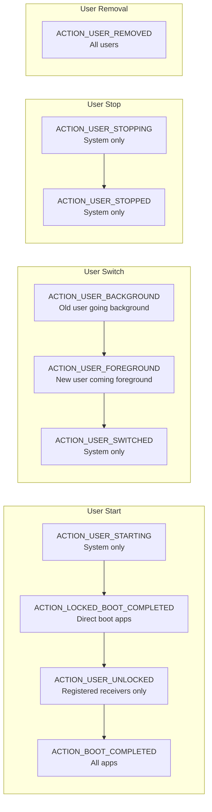

| 广播 | 接收者 | 时机 |
|---|---|---|
| `ACTION_USER_STARTING` | 系统服务 | 用户进程开始启动 |
| `ACTION_LOCKED_BOOT_COMPLETED` | 支持直接启动的应用 | DE 存储可用 |
| `ACTION_USER_UNLOCKED` | 任何应用的*已注册*接收器（非清单接收器） | CE 存储可用 |
| `ACTION_BOOT_COMPLETED` | 用户中的所有应用 | 完整存储可用 |
| `ACTION_USER_BACKGROUND` | 系统服务 | 用户移入后台 |
| `ACTION_USER_FOREGROUND` | 系统服务 | 用户移到前台 |
| `ACTION_USER_SWITCHED` | 系统服务 | 用户切换完成 |
| `ACTION_USER_STOPPING` | 系统服务 | 用户正在被停止 |
| `ACTION_USER_STOPPED` | 系统服务 | 用户已完全停止 |
| `ACTION_USER_REMOVED` | 所有用户 | 用户已从设备删除 |

---

## 31.8 内部机制深入剖析

### 31.8.1 UserInfo 标志

`UserInfo.flags` 字段是一个位掩码，编码用户的属性。这些标志定义在 `UserInfo.java` 中：

```java
// Base type flags (mutually exclusive categories)
public static final int FLAG_PRIMARY   = 0x00000001;
public static final int FLAG_ADMIN     = 0x00000002;
public static final int FLAG_GUEST     = 0x00000004;
public static final int FLAG_RESTRICTED = 0x00000008;

// State flags
public static final int FLAG_INITIALIZED = 0x00000010;
public static final int FLAG_MANAGED_PROFILE = 0x00000020;
public static final int FLAG_DISABLED   = 0x00000040;
public static final int FLAG_QUIET_MODE = 0x00000080;

// Type flags
public static final int FLAG_EPHEMERAL = 0x00000100;
public static final int FLAG_DEMO      = 0x00000200;
public static final int FLAG_FULL      = 0x00000400;
public static final int FLAG_SYSTEM    = 0x00000800;
public static final int FLAG_PROFILE   = 0x00001000;
public static final int FLAG_EPHEMERAL_ON_CREATE = 0x00002000;
public static final int FLAG_MAIN      = 0x00004000;
public static final int FLAG_FOR_TESTING = 0x00008000;

// Convenience checks — some test flag bits, others resolve the userType string
public boolean isAdmin()   { return (flags & FLAG_ADMIN) == FLAG_ADMIN; }
public boolean isProfile() { return (flags & FLAG_PROFILE) != 0; }
public boolean isFull()    { return (flags & FLAG_FULL) != 0; }
public boolean isGuest()   { return UserManager.isUserTypeGuest(userType); }
public boolean isManagedProfile() {
    return UserManager.isUserTypeManagedProfile(userType);
}
public boolean isCommunalProfile() { ... }   // checks userType
public boolean isPrivateProfile()  { ... }   // checks userType
```

`FLAG_EPHEMERAL_ON_CREATE`（`0x00002000`）与 `FLAG_EPHEMERAL` 不同：它标记一个在创建时*被请求*为临时的用户，即使该用户最终是持久的。只有像 `isAdmin()`、`isProfile()` 和 `isFull()` 这样的检查才是纯粹的位测试。`isGuest()`、`isManagedProfile()`、`isPrivateProfile()` 和 `isCommunalProfile()` 则是针对存储的 `userType` 字符串进行解析。`isMain()` 在记录一条静态弃用警告后，通过 `isMainUnlogged()` 测试 `FLAG_MAIN`。

常见的标志组合：

| 用户类型 | 标志 | 十六进制 |
|---|---|---|
| 系统用户（非 HSUM） | SYSTEM, FULL, PRIMARY, ADMIN, INITIALIZED, MAIN | `0x00004C13` |
| 次要用户 | FULL | `0x00000400` |
| 访客（临时） | FULL, GUEST, EPHEMERAL | `0x00000504` |
| 工作资料 | PROFILE, MANAGED_PROFILE | `0x00001020` |
| 私密资料 | PROFILE | `0x00001000` |

### 31.8.2 用户限制深入剖析

用户限制是以字符串为键的布尔值，存储在 `Bundle` 对象中。完整的限制集合定义在 `UserManager` 中：

**通信限制：**

| 限制 | 效果 |
|---|---|
| `DISALLOW_OUTGOING_CALLS` | 阻止拨出电话 |
| `DISALLOW_SMS` | 阻止发送 SMS 消息 |
| `DISALLOW_OUTGOING_BEAM` | 阻止 NFC beam 分享 |

**应用管理限制：**

| 限制 | 效果 |
|---|---|
| `DISALLOW_INSTALL_APPS` | 无法安装任何应用 |
| `DISALLOW_INSTALL_UNKNOWN_SOURCES` | 无法侧载应用 |
| `DISALLOW_UNINSTALL_APPS` | 无法卸载应用 |

**配置限制：**

| 限制 | 效果 |
|---|---|
| `DISALLOW_CONFIG_WIFI` | 无法配置 WiFi |
| `DISALLOW_CONFIG_WIFI_SHARED` | 无法配置共享 WiFi |
| `DISALLOW_CONFIG_BLUETOOTH` | 无法配置蓝牙 |
| `DISALLOW_CONFIG_LOCATION` | 无法更改位置设置 |
| `DISALLOW_CONFIG_TETHERING` | 无法配置网络共享 |
| `DISALLOW_CONFIG_VPN` | 无法配置 VPN |

**安全限制：**

| 限制 | 效果 |
|---|---|
| `DISALLOW_DEBUGGING_FEATURES` | 无 USB 调试 |
| `DISALLOW_FACTORY_RESET` | 无法恢复出厂设置 |
| `DISALLOW_ADD_USER` | 无法添加用户 |
| `DISALLOW_REMOVE_USER` | 无法移除用户 |
| `DISALLOW_USER_SWITCH` | 无法切换用户 |

限制的强制执行是分布式的——每个系统服务都会检查调用用户的相关限制。例如，电话服务（`com.android.server.telecom.UserUtil`）在允许通话前会检查 `DISALLOW_OUTGOING_CALLS`。

### 31.8.3 UserSystemPackageInstaller 详情

系统包安装器决定每个用户类型可以使用哪些预装包。它使用来自设备叠加层的允许列表和阻止列表：

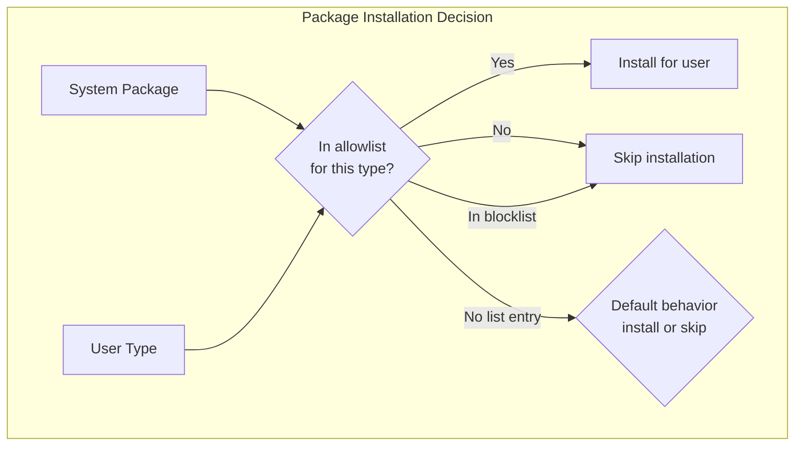

OEM 在 SystemConfig XML（位于 `/etc/sysconfig`）中配置按类型的允许列表：

- `<install-in-user-type package="...">` 条目，带有 `<install-in user-type="..."/>` 和
  `<do-not-install-in user-type="..."/>` 子元素
- 强制模式来自 `config_userTypePackageWhitelistMode` 整数资源（位值 1/2/4/8）

这确保了：

- 企业管理应用在工作资料中可用
- 消费类娱乐应用跳过受限资料
- 系统实用工具在所有位置可用
- 运营商特定应用与设备配置相匹配

### 31.8.4 UserFilter 系统

`UserManagerService` 使用 `UserFilter` 高效地查询用户的子集：

```java
// From UserFilter.java
// The filter knobs (set through UserFilter.Builder) are:
// - includePartial (withPartialUsers): include users being created/removed
// - includeDying (withDyingUsers): include users in the middle of removal
// - requiredFlags (setRequiredFlags): only users with these UserInfo flags
// - excludedIds (excludeUserId): skip specific user ids
// By default, partial and dying users are excluded.
```

过滤器系统通过在遍历 `mUsers` SparseArray 时直接应用谓词，避免了创建中间列表。

### 31.8.5 跨资料 Intent 过滤器机制

跨资料 intent 过滤器使用 `DefaultCrossProfileIntentFilter` 实现：

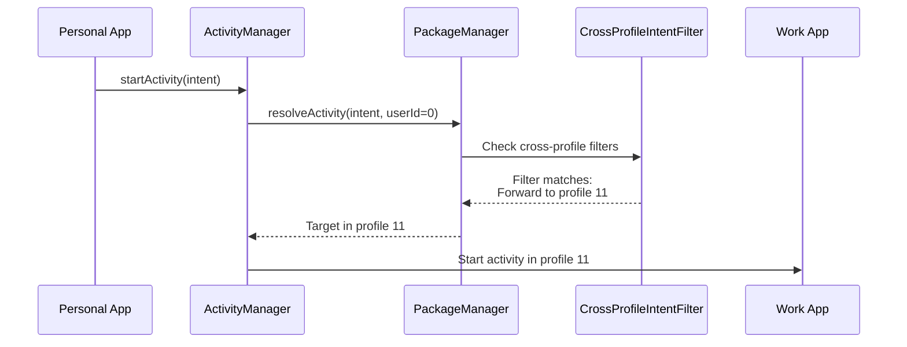

每个 `DefaultCrossProfileIntentFilter` 指定：

- 一个用于匹配的 `IntentFilter` 模式
- 一个转发 `direction` — `TO_PARENT` 或 `TO_PROFILE`
- 转发 `flags`，例如 `SKIP_CURRENT_PROFILE` 或 `ONLY_IF_NO_MATCH_FOUND`
- `letsPersonalDataIntoProfile`，当设置了 `DISALLOW_SHARE_INTO_MANAGED_PROFILE` 时会被抑制

解析策略由 `crossProfileIntentResolutionStrategy` 控制：

- `NO_FILTERING`：所有匹配的 intent 都可以跨资料
- Standard：只有显式过滤的 intent 可以跨资料

### 31.8.6 用户生命周期广播详解

当用户在启动后（或被创建后）第一次启动时：

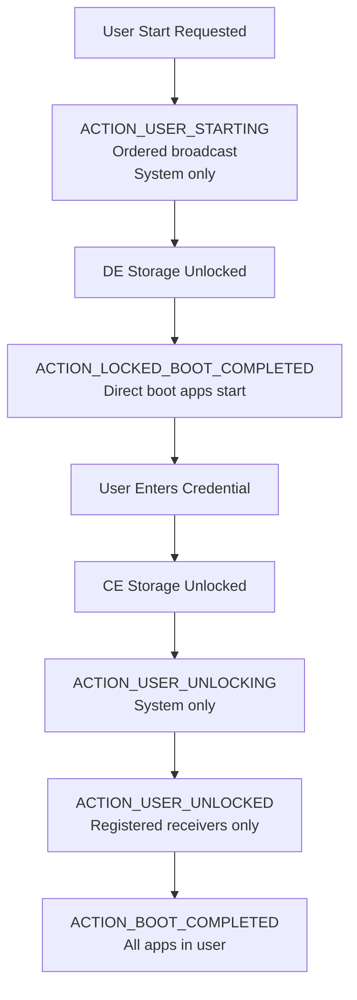

对于用户切换：

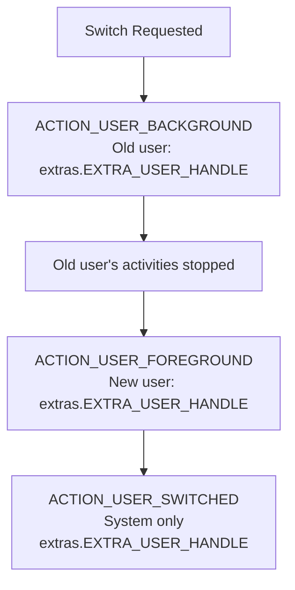

这些广播中的 `EXTRA_USER_HANDLE` 包含该事件所属的用户 ID。系统服务会注册这些广播的接收器，以初始化/取消初始化按用户的状态。

### 31.8.7 无头系统用户模式（HSUM）

在 HSUM 中，用户 0 存在但不是“人类”用户。它运行系统服务和后台任务，而真正的人类用户则以次要完整用户的形式启动：

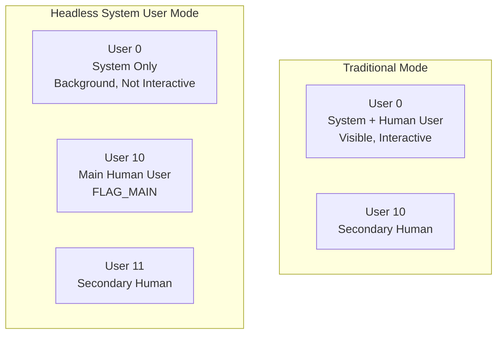

HSUM 配置：

```java
// From UserTypeFactory.java
private static UserTypeDetails.Builder getDefaultTypeSystemHeadless() {
    return new UserTypeDetails.Builder()
            .setName(USER_TYPE_SYSTEM_HEADLESS)
            .setBaseType(FLAG_SYSTEM)
            .setDefaultUserInfoPropertyFlags(FLAG_PRIMARY
                    | (android.multiuser.Flags.hsuNotAdmin() ? 0 : FLAG_ADMIN))
            .setMaxAllowed(1)
            .setDefaultRestrictions(getDefaultHeadlessSystemUserRestrictions());
}
```

在 HSUM 中：

- 系统用户没有 `FLAG_FULL`，因此无法运行面向用户的活动
- 带有 `FLAG_MAIN` 的“主用户”充当设备所有者的人类身份
- 第一个可切换的用户在启动后会被置于前台
- 系统用户保持运行但处于不可见状态

此模式主要用于车载平台，其中“设备”就是汽车的信息娱乐系统。系统用户管理车辆级服务，而各个人类用户（驾驶员、乘客）拥有自己的资料。

### 31.8.8 多显示屏上的多用户（MUMD）

在具有多个屏幕的车载设备上，不同用户可以在不同显示屏上同时可见：

```mermaid
graph TB
    subgraph "Car with Multiple Displays"
        MAIN["Main Display<br/>Driver: User 10"]
        REAR1["Rear Display 1<br/>Passenger: User 12"]
        REAR2["Rear Display 2<br/>Passenger: User 13"]
        CLUSTER["Cluster Display<br/>System Info"]
    end

    UVM[UserVisibilityMediator] --> MAIN
    UVM --> REAR1
    UVM --> REAR2

    style MAIN fill:#e3f2fd
    style REAR1 fill:#e8f5e9
    style REAR2 fill:#fff3e0
```

`UserVisibilityMediator` 跟踪用户到显示屏的分配：

```java
// From UserVisibilityMediator.java
// MUMD mode maintains:
// - mUsersAssignedToDisplayOnStart: SparseIntArray (userId -> displayId)
// - mExtraDisplaysAssignedToUsers: reverse mapping
// - Visibility queries check both foreground user and display assignments
```

MUMD 模式扩展了可见性概念：

- `isUserVisible(userId)`：当用户处于前台**或**被分配到任何显示屏时为 True
- `isUserVisible(userId, displayId)`：当用户被分配到该特定显示屏时为 True
- `getVisibleUsers()`：返回当前在任何显示屏上可见的所有用户

### 31.8.9 UserData 持久化格式

每个用户的 XML 文件包含完整的用户状态：

```xml
<?xml version="1.0" encoding="utf-8"?>
<user
    id="11"
    serialNumber="14"
    flags="0x00001020"
    type="android.os.usertype.profile.MANAGED"
    created="1700000000000"
    lastLoggedIn="1700100000000"
    lastLoggedInFingerprint="google/pixel8/pixel8:14/..."
    lastEnteredForeground="0"
    profileGroupId="0"
    profileBadge="0">
    <name>Work</name>
    <restrictions>
        <entry key="no_wallpaper" type="b">true</entry>
        <entry key="no_bluetooth_sharing" type="b">true</entry>
    </restrictions>
    <device_policy_local_restrictions />
    <device_policy_global_restrictions />
    <userProperties>
        <!-- Properties serialized from UserProperties -->
    </userProperties>
    <ignorePrepareStorageErrors>false</ignorePrepareStorageErrors>
</user>
```

限制值类型：

- `"b"` = boolean
- `"s"` = string
- `"i"` = integer
- `"sa"` = string array
- `"B"` = bundle
- `"BA"` = bundle array

### 31.8.10 用户版本迁移

用户数据格式随着 Android 版本的发布而演进。当前版本为 11：

```java
// From UserManagerService.java
private static final int USER_VERSION = 11;
```

当设备更新时，`UserManagerService` 会为每个版本步骤运行迁移逻辑。例如新增字段，以及将用户类型从旧的基于 `FLAG` 的系统转换为现代的 `userType` 字符串系统。

### 31.8.11 资料关联与解析

当系统服务需要将用户解析为其“有效”用户（例如用于内容访问）时，它们会使用资料组解析：

```java
// getProfileParentId resolves a profile to its parent
// For user 0 (not a profile): returns 0
// For work profile 11 (parent=0): returns 0
// For private profile 12 (parent=0): returns 0
```

这对 `ContentProvider` 等服务至关重要，因为资料可能需要通过跨资料内容 URI 访问父级用户的内容（反之亦然）。

### 31.8.12 访客用户重置

访客用户具有特殊的重置行为。当访客用户退出（切换离开）时：

1. 如果访客是临时的（`FLAG_EPHEMERAL`），它会被标记为移除
2. 会预创建一个新访客来替换它
3. 当旧访客的进程停止时，其数据会被清除
4. 下次有人选择“访客”时，他们会得到全新的预创建访客

```java
// From UserManagerService.java
private static final String ATTR_GUEST_TO_REMOVE = "guestToRemove";
```

`guestToRemove` 属性标记了在停止运行后应被销毁的访客。这确保了每个访客会话都有一个干净的开始，同时避免了在切换过程中创建新用户的延迟。

### 31.8.13 用户旅程日志

`UserJourneyLogger` 跟踪用户管理操作的结果，用于遥测：

```java
// From UserJourneyLogger.java — journey IDs map onto the
// USER_LIFECYCLE_JOURNEY_REPORTED statsd atom rather than being literal ints.
public static final int USER_JOURNEY_UNKNOWN =
        FrameworkStatsLog.USER_LIFECYCLE_JOURNEY_REPORTED__JOURNEY__UNKNOWN;
public static final int USER_JOURNEY_USER_SWITCH_FG = ...;
public static final int USER_JOURNEY_USER_SWITCH_UI = ...;
public static final int USER_JOURNEY_USER_START = ...;
public static final int USER_JOURNEY_USER_CREATE = ...;
public static final int USER_JOURNEY_USER_STOP = ...;
public static final int USER_JOURNEY_USER_REMOVE = ...;
public static final int USER_JOURNEY_GRANT_ADMIN = ...;
public static final int USER_JOURNEY_REVOKE_ADMIN = ...;
public static final int USER_JOURNEY_USER_LIFECYCLE = ...;
public static final int USER_JOURNEY_PROMOTE_MAIN_USER = ...;
public static final int USER_JOURNEY_DEMOTE_MAIN_USER = ...;
public static final int USER_JOURNEY_USER_LOGOUT = ...;

// Error codes
public static final int ERROR_CODE_INVALID_SESSION_ID = 0;
public static final int ERROR_CODE_UNSPECIFIED = -1;
public static final int ERROR_CODE_INCOMPLETE_OR_TIMEOUT = 2;
public static final int ERROR_CODE_ABORTED = 3;
public static final int ERROR_CODE_NULL_USER_INFO = 4;
public static final int ERROR_CODE_USER_ALREADY_AN_ADMIN = 5;
public static final int ERROR_CODE_USER_IS_NOT_AN_ADMIN = 6;
public static final int ERROR_CODE_INVALID_USER_TYPE = 7;
public static final int ERROR_CODE_USER_IS_LAST_ADMIN = 8;
```

每个旅程常量都是 `FrameworkStatsLog` atom 枚举值的别名。statsd atom 定义拥有这些整数。日志记录器不会硬编码它们。该集合涵盖用户切换（前台和 UI 发起）、启动、创建、停止、移除、管理员授予/撤销、主用户提升/降级以及注销。这些旅程会记录到 `FrameworkStatsLog` 中，用于设备健康监控和聚合分析。

### 31.8.14 公用资料

公用资料是一个相对较新的概念，专为共享设备场景设计，在该场景中多个人类用户需要访问公共应用和数据：

```java
// From UserTypeFactory.java
private static UserTypeDetails.Builder getDefaultTypeProfileCommunal() {
    return new UserTypeDetails.Builder()
            .setName(USER_TYPE_PROFILE_COMMUNAL)
            .setBaseType(FLAG_PROFILE)
            .setMaxAllowed(1)
            .setProfileParentRequired(false)  // Does NOT require a parent
            .setEnabled(UserManager.isCommunalProfileEnabled() ? 1 : 0)
            .setDefaultUserProperties(new UserProperties.Builder()
                    .setStartWithParent(false)
                    .setShowInLauncher(UserProperties.SHOW_IN_LAUNCHER_SEPARATE)
                    .setCredentialShareableWithParent(false)
                    .setAlwaysVisible(true));  // Visible to all users
}
```

公用资料的关键特征：

- 不需要父级（与工作/私密资料不同）
- `alwaysVisible=true`：无论哪个用户处于前台都可见
- `credentialShareableWithParent=false`：拥有自己的独立凭据
- `startWithParent=false`：生命周期独立管理
- 每台设备最多一个

### 31.8.15 监督资料

监督资料支持家长监督场景：

```java
// From UserTypeFactory.java
private static UserTypeDetails.Builder getDefaultTypeProfileSupervising() {
    return new UserTypeDetails.Builder()
            .setName(USER_TYPE_PROFILE_SUPERVISING)
            .setBaseType(FLAG_PROFILE)
            .setMaxAllowed(1)
            .setProfileParentRequired(false)
            .setLabels(R.string.profile_label_supervising)
            .setDefaultRestrictions(getDefaultSupervisingProfileRestrictions())
            .setDefaultSecureSettings(getDefaultNonManagedProfileSecureSettings())
            .setDefaultUserProperties(new UserProperties.Builder()
                    .setStartWithParent(false)
                    .setShowInLauncher(UserProperties.SHOW_IN_LAUNCHER_NO)
                    .setShowInSettings(UserProperties.SHOW_IN_SETTINGS_NO)
                    .setShowInQuietMode(UserProperties.SHOW_IN_QUIET_MODE_HIDDEN)
                    .setCredentialShareableWithParent(false)
                    .setAlwaysVisible(true));
}
```

值得注意的属性：

- 不在启动器或“设置”中显示（对被监督用户不可见）
- 对系统始终可见（用于执行监督）
- 默认携带 `DISALLOW_INSTALL_APPS`
  （`getDefaultSupervisingProfileRestrictions()`）

在 Android 17 中，该类型会被无条件注册：此前用于限制它的
`android.multiuser.allow_supervising_profile` 标志已被清理，因此
`getDefaultTypeProfileSupervising()` 不再调用 `setEnabled(...)`。

### 31.8.16 多用户对系统服务的影响

每个系统服务都必须感知用户。常见的模式有：

**按用户的状态：**

大多数服务维护一个以用户 ID 为键的 `SparseArray<ServiceState>`。

**用户生命周期回调：**

服务继承 `SystemService` 并重写：
```java
@Override
public void onUserStarting(@NonNull TargetUser user) { ... }

@Override
public void onUserStopping(@NonNull TargetUser user) { ... }

@Override
public void onUserStopped(@NonNull TargetUser user) { ... }

@Override
public void onUserSwitching(@Nullable TargetUser from, @NonNull TargetUser to) { ... }
```

**Binder 身份：**

服务经常检查调用用户：
```java
int callingUserId = UserHandle.getCallingUserId();
```

并且可能需要以特定用户身份运行：
```java
Context userContext = context.createContextAsUser(UserHandle.of(userId), 0);
```

**跨用户权限：**

系统级代码在访问另一个用户的数据之前会检查 `INTERACT_ACROSS_USERS` 或
`INTERACT_ACROSS_USERS_FULL`。

### 31.8.17 最大用户数限制

最大用户数量可在设备上配置。可切换用户的设备级上限来自
`UserManager.getMaxSwitchableUsers()`：

```java
// Source: frameworks/base/core/java/android/os/UserManager.java
public static int getMaxSwitchableUsers() {
    return Math.max(1, SystemProperties.getInt("fw.max_users",
            Resources.getSystem().getInteger(R.integer.config_multiuserMaximumUsers)));
}
```

`UserTypeFactory` 由此推导出按类型的默认上限，即比可切换配额少一个：

```java
// Source: frameworks/base/services/core/java/com/android/server/pm/UserTypeFactory.java
private static int getDefaultMaxAllowedForSwitchableTypes() {
    return getMaxSwitchableUsers() - 1;
}
```

OEM 通过以下方式设置配额：

- `config_multiuserMaximumUsers` 资源叠加层（通常：4-8）
- `fw.max_users` 系统属性（用于测试）

按类型的上限也会被强制执行。例如，只允许 1 个访客、每个父级只允许 1 个私密
资料，以及每个父级只允许 1 个工作资料。工作资料上限通过 `getMaxManagedProfiles()`
应用于生产构建。除非构建可调试，否则该方法返回 1。

### 31.8.18 SystemUI 中的用户切换器控制器

SystemUI 通过 `UserSwitcherInteractor`（位于
`packages/SystemUI/src/com/android/systemui/user/domain/interactor/`）实现用户切换器；
较旧的 `UserSwitcherController` 仅保留为一个已废弃的外观，委托给它：

```mermaid
graph TB
    subgraph "SystemUI User Switcher"
        USC[UserSwitcherInteractor]
        USC --> USERS["User Records<br/>from UserManager"]
        USC --> QS[Quick Settings Tile]
        USC --> LS[Lock Screen Selector]
        USC --> DIALOG[Full-Screen Dialog]
    end

    UMS[UserManagerService] -->|"getUsers()"| USC
    AM[ActivityManager] -->|"switchUser()"| SWITCH[User Switch]
    USC --> AM
```

该交互器的广播接收器监听：

- `ACTION_USER_ADDED` / `ACTION_USER_REMOVED`：更新用户列表
- `ACTION_USER_SWITCHED`：更新当前用户指示器
- `ACTION_USER_INFO_CHANGED`：更新用户名/头像

### 31.8.19 安全模型小结

```mermaid
graph TB
    subgraph "User A (UID range 0-99999)"
        APP_A1[App1: UID 10045]
        APP_A2[App2: UID 10128]
        DATA_A[/data/user/0/]
    end

    subgraph "User B (UID range 1000000-1099999)"
        APP_B1[App1: UID 1010045]
        APP_B2[App2: UID 1010128]
        DATA_B[/data/user/10/]
    end

    APP_A1 -.->|"Cannot access"| DATA_B
    APP_B1 -.->|"Cannot access"| DATA_A

    KERNEL["Linux Kernel<br/>UID-based access control"] --> APP_A1
    KERNEL --> APP_A2
    KERNEL --> APP_B1
    KERNEL --> APP_B2

    style KERNEL fill:#fff3e0
```

隔离保证：

1. **进程隔离：** 每个用户的应用以不同的 UID 运行
2. **文件隔离：** 每个用户都有独立的 `/data/user/<id>/` 目录
3. **加密隔离：** 每个用户都有独立的 CE/DE 加密密钥
4. **网络隔离：** 网络策略可以按用户应用
5. **密钥库隔离：** 每个用户都有独立的密钥库
6. **账户隔离：** AccountManager 维护按用户的账户列表
7. **设置隔离：** 大多数 Settings.Secure 值都是按用户的
8. **通知隔离：** 通知是按用户的
9. **剪贴板隔离：** 剪贴板内容是按用户的（带有跨资料例外）

### 31.8.20 多用户对内容提供者的影响

内容提供者必须谨慎处理多用户访问：

```mermaid
graph TB
    subgraph "User 0 Process"
        APP0[App in User 0]
        CP0["ContentProvider<br/>authority: contacts<br/>User 0 instance"]
    end

    subgraph "User 10 Process"
        APP10[App in User 10]
        CP10["ContentProvider<br/>authority: contacts<br/>User 10 instance"]
    end

    APP0 --> CP0
    APP10 --> CP10
    APP0 -.->|"Cannot directly access"| CP10

    subgraph "Cross-Profile Access"
        CPCP["CrossProfileContentProvider<br/>Requires INTERACT_ACROSS_USERS"]
    end

    APP0 -->|"Special URI scheme"| CPCP --> CP10
```

每个内容提供者都按用户作为独立实例运行。`content://` URI scheme 本身并不携带用户
身份——系统根据调用进程的用户 ID 解析提供者实例。

对于跨资料访问（例如工作联系人出现在个人拨号器中）：

- 提供者必须配置为支持跨资料访问
- 调用应用需要 `INTERACT_ACROSS_USERS` 或类似权限
- 特殊 URI scheme（例如 `content://com.android.contacts/enterprise/...`）
  用于跨资料联系人解析

### 31.8.21 按用户的设置

`Settings.Secure` 值按用户存储，而 `Settings.Global` 值是设备级的：

```
/data/system/users/0/settings_secure.xml    # User 0 secure settings
/data/system/users/10/settings_secure.xml   # User 10 secure settings
/data/system/users/0/settings_system.xml    # User 0 system settings
/data/system/users/0/settings_global.xml    # Global settings (stored under the system user)
```

当代码调用 `Settings.Secure.getString()` 时，系统会自动解析到调用用户的设置
数据库。要访问另一个用户的设置：

```java
Settings.Secure.getStringForUser(contentResolver, key, userId);
```

### 31.8.22 多用户通知处理

通知是按用户划分的。`NotificationManagerService` 为每个用户维护独立的通知
列表：

- 每个用户的应用只能看到/清除自己的通知
- 切换用户时，通知面板会刷新以显示新用户的通知
- 资料通知（工作资料）会带有角标指示器出现在父级用户的通知面板中
- 当私密空间被锁定时，其通知会被隐藏

### 31.8.23 多用户与设备管理

设备策略控制器（DPC）与多用户的交互：

```mermaid
graph TB
    subgraph "Device Owner"
        DO["Device Owner DPC<br/>Controls entire device<br/>Runs in user 0 or main user"]
    end

    subgraph "Profile Owner"
        PO["Profile Owner DPC<br/>Controls work profile only<br/>Runs in profile user 11"]
    end

    DO --> DEVICE_POLICY["Device-wide policies<br/>WiFi config, VPN, etc."]
    PO --> PROFILE_POLICY["Profile-specific policies<br/>App restrictions, password, etc."]

    DO -->|Can create| WP[Work Profile]
    PO -->|Manages| WP
```

设备策略可以是：

- **设备级：** 由设备所有者应用，影响所有用户
- **资料特定：** 由资料所有者应用，仅影响该资料
- **继承：** 某些资料从父级继承策略（由
  `inheritDevicePolicy` 属性控制）

### 31.8.24 多用户与应用权限

每个用户都有一组独立的运行时权限：

```
User 0: Camera permission granted to com.example.app
User 10: Camera permission NOT granted to com.example.app
```

权限授予由 `PackageManagerService` 按用户存储。当应用在运行时请求权限时，
对话框和授予/拒绝状态是针对当前用户的。

`FLAG_PERMISSION_GRANTED_BY_DEFAULT` 和 `FLAG_PERMISSION_GRANTED_BY_ROLE`
标志也按用户生效，确保基于角色的权限反映每个用户的配置。

### 31.8.25 多用户与安装器

当用户创建一个新用户（或资料）时，`PackageManagerService` 必须决定安装哪些包。
过程如下：

1. **枚举系统包：** `/system/app/` 和 `/system/priv-app/` 中的所有包都是候选
2. **应用用户类型允许列表：** 检查 `UserSystemPackageInstaller` 以获取按类型的
   包含/排除项
3. **安装选定的包：** 创建按用户的包数据目录
4. **跳过用户安装的包：** 只有系统包会被自动安装；来自其他用户的用户安装应用
   不会被复制

对于资料，还会进行额外的过滤：

- 工作资料获得企业相关的系统应用
- 克隆资料继承父级已安装应用的一个子集
- 私密资料获得完整的系统包集合

### 31.8.26 多用户与进程管理

`ActivityManagerService` 以用户感知的方式管理进程生命周期：

```mermaid
graph TB
    subgraph "Foreground User (Priority: High)"
        FG_PROC[Foreground app processes]
        FG_SVC[Visible services]
        FG_BG[Background processes]
    end

    subgraph "Background User (Priority: Lower)"
        BG_PROC[Cached processes]
        BG_SVC[Background services]
    end

    subgraph "Profile (Same priority as parent)"
        PROF_PROC[Profile app processes]
        PROF_SVC[Profile services]
    end

    LMKD[Low Memory Killer] -->|"Kill background user first"| BG_PROC
    LMKD -->|"Then foreground user's cached"| FG_BG
```

进程优先级考虑：

- 前台用户的进程获得最高的 OOM 调整优先级
- 后台用户的进程被降优先级（更高的 OOM score）
- 资料进程与其父级用户共享优先级
- 当内存不足时，后台用户进程会先被杀死
- 在用户切换时，后台用户可能会被停止，这由
  `config_multiuserMaxRunningUsers` 和 `config_multiuserDelayUserDataLocking`
  控制

### 31.8.27 多用户启动流程

```mermaid
sequenceDiagram
    participant INIT as init / zygote
    participant SS as SystemServer
    participant UMS as UserManagerService
    participant AM as ActivityManagerService
    participant APPS as User 0 Apps

    INIT->>SS: Start system_server
    SS->>UMS: Initialize (read userlist.xml)
    SS->>AM: systemReady()

    Note over AM: Start user 0 (system user)
    AM->>UMS: User 0 starting

    Note over AM: Unlock DE storage
    AM->>APPS: ACTION_LOCKED_BOOT_COMPLETED (user 0)

    Note over AM: User enters credential
    Note over AM: Unlock CE storage
    AM->>APPS: ACTION_BOOT_COMPLETED (user 0)

    Note over AM: Start profiles of user 0
    loop For each profile with startWithParent=true
        AM->>UMS: Start profile
        AM->>APPS: Lifecycle broadcasts for profile
    end

    alt Headless System User Mode
        Note over AM: Start main human user (user 10)
        AM->>AM: switchUser(10)
    end
```

### 31.8.28 多用户与 Keystore

Android Keystore 为每个用户维护独立的密钥命名空间：

- 每个用户都有独立的 keystore 守护进程命名空间
- 由用户 0 的应用生成的密钥，用户 10 的应用无法访问
- CE 绑定的密钥只有在用户的 CE 存储解锁后才可用
- 工作资料的密钥与个人密钥是分开的，即使它们共享同一台设备

这种隔离对以下方面至关重要：

- 每个用户独立的生物识别注册
- 独立的凭据存储（密码、证书）
- 由 DPC 管理的工作资料证书
- 私密空间密钥隔离

### 31.8.29 多用户测试策略

测试多用户场景需要特定的方法：

**插桩测试：**
```java
@Test
public void testCrossProfileAccess() {
    // Create a managed profile
    UserInfo profile = userManager.createProfileForUser(
            "Test Work", USER_TYPE_PROFILE_MANAGED, 0, 0);

    // Install test app in profile
    // Verify data isolation
    // Verify cross-profile intent filters

    // Clean up
    userManager.removeUser(profile.id);
}
```

**CTS 测试：**
`android.multiuser.cts` 包（测试 APK `CtsMultiUserTestCases`）包含全面的测试：

- `UserVisibilityTest` -- 针对所有可见性模式的测试
- `UserManagerTest` -- 核心用户管理操作

跨资料通信由主机端的 devicepolicy 套件（`com.android.cts.managedprofile.CrossProfileTest`）单独覆盖。

**手动测试：**
```bash
# Create test users and profiles quickly
adb shell pm create-user "Test1" && \
adb shell pm create-user --profileOf 0 --managed "Work"

# Run a test scenario
adb shell am instrument -w -e class \
    android.multiuser.cts.UserManagerTest \
    android.multiuser.cts/androidx.test.runner.AndroidJUnitRunner

# Clean up
adb shell pm list users | grep -o "UserInfo{[0-9]*" | \
    grep -v "UserInfo{0" | grep -o "[0-9]*" | \
    xargs -I {} adb shell pm remove-user {}
```

### 31.8.30 已知限制与边缘情况

1. **最大用户数量：** 受 `PER_USER_RANGE`（100,000）和 `MAX_USER_ID` 限制。
   实际上受存储和内存限制。

2. **用户切换延迟：** 切换用户需要 2-10 秒，具体取决于设备性能、应用数量，
   以及目标用户是否需要启动。

3. **每个父级的资料数量：** 大多数资料类型限制为每个父级 1 个。工作资料在生产
   构建中允许 1 个，在调试构建中更多。

4. **跨资料数据泄漏：** 尽管有隔离，某些系统数据（例如 WiFi 网络、蓝牙配对）
   会在用户之间共享。这是为易用性而设计，但在企业部署中可能是一个顾虑。

5. **后台用户资源消耗：** 同时运行多个用户（例如 MUMD 模式）会消耗大量 RAM
   和 CPU。后台用户可能会被限流或停止以保留资源。

6. **加密密钥管理：** 每个用户的 CE 密钥必须安全地托管。如果用户忘记了自己的
   凭据，CE 数据将永久无法访问（出于安全考虑而设计）。

7. **应用兼容性：** 并非所有应用都能正确处理多用户。单例内容提供者、全局共享
   偏好设置以及带有硬编码路径的原生代码都可能在多用户环境中引发问题。

---

## 31.9 Android 17 多用户变更

Android 17 并没有重绘多用户架构，但它确实加固并清理了其中的几个角落。无头系统用户
（HSU）成为了一个一等受管身份。私密空间和监督资料摆脱了它们的开发特性标志。新增了
两项用户限制，用户类型查询 API 也被重塑。本节收集了触及本章前面所涵盖类的各种变更，
每一项都对照 Android 17 源码进行了验证。

### 31.9.1 无头系统用户应用管理

在无头系统用户模式下，系统用户（用户 0）不是人类用户。在车载及其他 HSUM 设备上，
它仍然运行应用。Android 17 让这些应用变得可管理且可见，而不是匿名的。
`getDefaultTypeSystemHeadless()` 现在会条件性地为无头系统用户类型附加角标、活动
允许列表和允许列表模式：

```java
// Source: frameworks/base/services/core/java/com/android/server/pm/UserTypeFactory.java
private static UserTypeDetails.Builder getDefaultTypeSystemHeadless() {
    final UserTypeDetails.Builder builder = new UserTypeDetails.Builder()
            .setName(USER_TYPE_SYSTEM_HEADLESS)
            .setBaseType(FLAG_SYSTEM)
            .setDefaultUserInfoPropertyFlags(FLAG_PRIMARY
                    | (android.multiuser.Flags.hsuNotAdmin() ? 0 : FLAG_ADMIN))
            .setMaxAllowed(1)
            .setDefaultRestrictions(getDefaultHeadlessSystemUserRestrictions());

    if (android.multiuser.Flags.hsuAllowlistActivities()) {
        builder.setActivitiesAllowlist(
                com.android.internal.R.array.hsu_allowlist_activities);
        builder.setActivitiesAllowlistMode(Resources.getSystem().getInteger(
                com.android.internal.R.integer.config_hsuActivitiesAllowlistMode));
    }
    if (android.multiuser.Flags.hsuAppManagement()) {
        builder.setIconBadge(com.android.internal.R.drawable.ic_hsu_icon_badge)
                .setBadgePlain(com.android.internal.R.drawable.ic_hsu_badge)
                .setBadgeNoBackground(
                        com.android.internal.R.drawable.ic_hsu_badge_no_background)
                .setBadgeLabels(com.android.internal.R.string.hsu_label_badge)
                .setBadgeColors(com.android.internal.R.color.transparent)
                .setDarkThemeBadgeColors(com.android.internal.R.color.transparent);
    }
    return builder;
}
```

由此产生了三种行为，每种行为都有自己的 `android.multiuser.Flags` 门控：

- **`hsuAppManagement()`** 为 HSU 应用提供角标，使其在“设置”中在视觉上可以
  区分（角标资源为 `ic_hsu_*`）。它们配置的 `setActivitiesAllowlist`/
  `setActivitiesAllowlistMode` 字段会通过 `UserTypeDetails` 上的
  `getActivitiesAllowlist()`/`getActivitiesAllowlistMode()` 读回。
- **`hsuAllowlistActivities()`** 通过 `hsu_allowlist_activities` 数组和
  `config_hsuActivitiesAllowlistMode` 限制无头系统用户可以启动哪些活动。
- **`hsuNotAdmin()`** 从无头系统用户中去掉 `FLAG_ADMIN`，因此 HSU 不再是隐式的
  管理员用户。

HSU 通知在 SystemUI 侧也获得了专门的处理：新的 `HsuCoordinator`（位于
`frameworks/base/packages/SystemUI/src/com/android/systemui/statusbar/notification/collection/coordinator/HsuCoordinator.kt`）
会过滤或允许列表来自无头系统用户的通知。

`getDefaultHeadlessSystemUserRestrictions()` 基线还添加了
`DISALLOW_MODIFY_ACCOUNTS`，因此无头系统用户无法添加或修改账户。

Android 17 的 HSU 选项如何叠加到无头系统用户类型上：

```mermaid
graph TB
    HSU["USER_TYPE_SYSTEM_HEADLESS<br/>user 0, FLAG_SYSTEM"]

    HSU --> NOTADMIN{"hsuNotAdmin()"}
    NOTADMIN -->|true| DROP["Drop FLAG_ADMIN<br/>HSU is not admin"]
    NOTADMIN -->|false| KEEP["Keep FLAG_ADMIN"]

    HSU --> APPMGMT{"hsuAppManagement()"}
    APPMGMT -->|true| BADGE["ic_hsu_* badge<br/>visible in Settings"]

    HSU --> ALLOWACT{"hsuAllowlistActivities()"}
    ALLOWACT -->|true| ALLOW["hsu_allowlist_activities<br/>+ allowlist mode"]

    style HSU fill:#e3f2fd
    style DROP fill:#fce4ec
    style BADGE fill:#e8f5e9
    style ALLOW fill:#fff3e0
```

### 31.9.2 新增用户限制

Android 17 增加了两项用户限制，都定义在
`frameworks/base/core/java/android/os/UserManager.java` 中：

| 限制 | 字符串键 | 效果 |
|---|---|---|
| `DISALLOW_ADD_GUEST` | `no_add_guest` | 该用户无法创建访客用户 |
| `DISALLOW_TASK_CONTINUITY_HANDOFF` | `no_task_continuity_handoff` | 阻止该用户的跨设备任务连续性（handoff） |

`DISALLOW_ADD_GUEST` 补充了现有的 `DISALLOW_ADD_USER` 和
`DISALLOW_ADD_PRIVATE_PROFILE`（`no_add_private_profile`）控件，使设备策略可以
专门禁止创建访客。两个新键都注册在 `UserManager` 限制的
`@StringDef`/`@interface` 集合中。它们像其他任何限制一样，通过 `setUserRestriction()`
以及 `updateUserRestrictionsInternalLR()` 中的合并逻辑流转。

### 31.9.3 私密空间与监督资料标志清理

在 Android 17 周期中，两种资料类型失去了它们的开发门控：

- **私密空间。** `UserManager` 上的 `isPrivateProfileEnabled()` 辅助方法被移除
  （见 §31.5.1）。私密资料类型的 `setEnabled(...)` 谓词现在直接写在
  `getDefaultTypeProfilePrivate()` 中。它使用
  `android.multiuser.Flags.blockPrivateSpaceCreation()` 与
  `ActivityManager.isLowRamDeviceStatic()` 一起编写。因此门控位于用户类型工厂中，
  而不是一个独立的 API。
- **监督资料。** `android.multiuser.allow_supervising_profile` 标志被清理，
  `getDefaultTypeProfileSupervising()` 不再调用 `setEnabled(...)`（见 §31.8.15）。
  因此监督资料在 Android 17 上被无条件注册。

这些都是标志清理类变更：早期版本中通过标志发布的功能现在已成为基线，死标志及其
辅助 API 已被移除。

### 31.9.4 用户类型查询 API

`UserManager.isUserTypeEnabled(String)` 已被弃用，改用
`isUserTypeSupported(String)`：

```java
// Source: frameworks/base/core/java/android/os/UserManager.java
public boolean isUserTypeSupported(@NonNull String userType) { ... }

/** @deprecated use {@link #isUserTypeSupported(String)} instead. */
@Deprecated
@FlaggedApi(android.multiuser.Flags.FLAG_QUERY_USER_TYPE_SUPPORTED)
public boolean isUserTypeEnabled(@NonNull String userType) {
    return isUserTypeSupported(userType);
}
```

这次重命名（由 `android.multiuser.Flags.queryUserTypeSupported()` 门控）反映了
调用者真正提出的问题。他们问的是设备是否*支持*某种用户类型，而不是它是否暂时
“已启用”。已弃用的方法只是转发给新方法。

### 31.9.5 多用户多显示屏（MUMD）的改进

`UserVisibilityMediator` 裁定的三种可见性模式在 Android 17 中名称和含义均未改变
（已在中介器的类文档中核实）：

- **SUSD**（Single User on Single Display），用于手机和平板，
- **MUMD**（Multiple Users on Multiple Displays），用于车载并发用户，
- **MUPAND**（MUltiple PAssengers, No Driver），无驾驶员的车载扩展。

Android 17 在这方面的工作是在车载侧，而不是中介器本身。一个构建标志
（`RELEASE_CAR_SYS_EXP_MUMD_SCALABLE_UI_DRIVER`）推进了 MUMD 并发用户设备的
ScalableUI 体验。此外，若干 CTS 主机测试也做了更新，使其在 MUMD 硬件上以乘客用户
运行时跳过仅驾驶员的行为。中介器继续通过 `mExtraDisplaysAssignedToUsers`
跟踪按显示屏的分配，并完全按照 §31.8.8 中的描述回答
`isUserVisible(userId, displayId)` 查询。

---

## 31.10 动手实践

### 31.10.1 列出用户

```bash
# List all users with their details
adb shell pm list users

# More detailed output from UserManagerService
adb shell dumpsys user

# Just the user summary
adb shell cmd user list -v
```

示例输出：
```
Users:
  UserInfo{0:Owner:4c13} running
    Type: android.os.usertype.full.SYSTEM
    Flags: 0x00004c13 (ADMIN|PRIMARY|FULL|SYSTEM|MAIN)
    State: RUNNING_UNLOCKED
  UserInfo{10:Guest:504} running
    Type: android.os.usertype.full.GUEST
    Flags: 0x00000504 (GUEST|FULL|EPHEMERAL)
    State: -
  UserInfo{11:Work profile:1030} running
    Type: android.os.usertype.profile.MANAGED
    Flags: 0x00001030 (MANAGED_PROFILE|INITIALIZED|PROFILE)
    profileGroupId: 0
    State: RUNNING_UNLOCKED
```

### 31.10.2 创建用户

```bash
# Create a secondary user
adb shell pm create-user "Test User"

# Create a guest
adb shell pm create-user --guest "Guest"

# Create a managed profile (work profile) for user 0
adb shell pm create-user --profileOf 0 --managed "Work"

# Create a private profile
adb shell pm create-user --profileOf 0 \
    --user-type android.os.usertype.profile.PRIVATE "Private"
```

### 31.10.3 切换用户

```bash
# Switch to user 10
adb shell am switch-user 10

# Check current foreground user
adb shell am get-current-user

# Switchability is computed by UserManager.getUserSwitchability();
# inspect the relevant state in the service dump
adb shell dumpsys user
```

### 31.10.4 管理资料

```bash
# Quiet mode has no `cmd user` shell command; it is toggled
# programmatically via UserManager.requestQuietModeEnabled()
# (e.g. from Settings or the launcher's work-apps toggle)

# Check if a user is a profile
adb shell cmd user is-profile 11

# Get profile parent
adb shell cmd user get-profile-parent 11
```

### 31.10.5 用户限制

```bash
# Set a restriction on user 10
adb shell pm set-user-restriction --user 10 no_install_apps 1

# Clear a restriction
adb shell pm set-user-restriction --user 10 no_install_apps 0

# List restrictions for a user
adb shell dumpsys user | grep -A 20 "UserInfo{10"
```

常见限制：

| 限制 | 效果 |
|---|---|
| `no_install_apps` | 无法安装应用 |
| `no_uninstall_apps` | 无法卸载应用 |
| `no_share_location` | 无法共享位置 |
| `no_outgoing_calls` | 无法拨出电话 |
| `no_sms` | 无法发送 SMS |
| `no_config_wifi` | 无法配置 WiFi |
| `no_remove_user` | 无法移除此用户 |
| `no_user_switch` | 无法从此用户切换离开 |

### 31.10.6 检查存储布局

```bash
# List per-user data directories
adb shell ls -la /data/user/

# CE storage for user 10
adb shell ls /data/user/10/

# DE storage for user 10
adb shell ls /data/user_de/10/

# User metadata files
adb shell ls /data/system/users/

# Read a user's XML metadata (requires root)
adb shell cat /data/system/users/10.xml
```

### 31.10.7 移除用户

```bash
# Remove user 10 (and all its profiles)
adb shell pm remove-user 10

# Force remove (even if currently running)
adb shell pm remove-user --set-ephemeral-if-in-use 10
```

### 31.10.8 监控用户事件

```bash
# Watch for user-related broadcasts
adb logcat -s ActivityManager | grep -i "user"

# Monitor UserManagerService logs
adb logcat -s UserManagerService

# Watch user state changes
adb logcat | grep -E "onUserStart|onUserStop|switchUser|UserState"
```

### 31.10.9 检查用户可见性

```bash
# Check if a specific user is visible
adb shell cmd user is-user-visible 10

# Check visibility on a specific display
adb shell cmd user is-user-visible --display 2 10

# Visible users and display assignments appear in the service dump
adb shell dumpsys user
```

### 31.10.10 私密空间操作

```bash
# Create Private Space profile
adb shell pm create-user --profileOf 0 \
    --user-type android.os.usertype.profile.PRIVATE "Private"

# Locking/unlocking Private Space is quiet mode, toggled via
# UserManager.requestQuietModeEnabled() — there is no
# `cmd user` shell equivalent

# Check whether the private profile type is available on this device
adb shell pm get-max-users --user-type android.os.usertype.profile.PRIVATE
```

### 31.10.11 无头系统用户模式测试

```bash
# Check if device is in headless system user mode
adb shell getprop ro.fw.mu.headless_system_user

# Emulate headless system user mode (sets
# persist.debug.user_mode_emulation=headless and reboots;
# never set the property directly)
adb shell cmd user set-system-user-mode-emulation --reboot headless

# Check boot strategy
adb shell getprop persist.user.hsum_boot_strategy
```

### 31.10.12 用户类型检查

```bash
# Each user's type is printed in the service dump ("Type: ...")
adb shell dumpsys user | grep -E "UserInfo|Type:"

# Inspect user properties
adb shell dumpsys user | grep -A 30 "UserProperties"
```

### 31.10.13 性能监控

```bash
# Time user creation
adb shell cmd user create-user --timed "Performance Test"

# Monitor user start time
adb logcat -s SystemServerTiming | grep -i user

# Check user start/unlock timing
adb shell dumpsys user | grep -E "Start time|Unlock time"
```

### 31.10.14 多用户调试清单

在排查多用户问题时，按顺序检查以下各项：

1. **用户存在且类型正确：**
   ```bash
   adb shell pm list users
   adb shell dumpsys user | grep -E "UserInfo|Type:"
   ```

2. **用户正在运行且已解锁：**
   ```bash
   adb shell am get-started-user-state <userId>
   ```

3. **资料组正确：**
   ```bash
   adb shell dumpsys user | grep -E "UserInfo|parentId"
   ```

4. **存储已准备好：**
   ```bash
   adb shell ls /data/user/<userId>/
   adb shell ls /data/user_de/<userId>/
   ```

5. **用户限制符合预期：**
   ```bash
   adb shell dumpsys user | grep -A 5 "Restrictions:"
   ```

6. **应用已安装：**
   ```bash
   adb shell pm list packages --user <userId>
   ```

7. **跨资料 intent 过滤器已配置：**
   ```bash
   # See the "Cross-profile intent filters" section of the package dump
   adb shell dumpsys package
   ```

---

## 总结

Android 的多用户系统是一个深度集成的框架，从 Linux 内核 UID 隔离延伸到系统服务，再到面向用户的 UI：

- **`UserManagerService`** 是中心权威，在 `/data/system/users/` 中管理用户元数据，强制执行限制，并协调用户生命周期事件

- **用户类型**：由 `UserTypeFactory` 定义，构建了一个类型安全、可扩展的系统。每个类别（完整用户、资料、系统）都带有自己的属性、限制、角标和跨资料规则

- **资料**（工作、私密、克隆）在父级用户的上下文中运行，共享同一个前台会话，但拥有隔离的存储和进程身份

- **私密空间** 增加了一个隐藏的、自我管理的资料，具有自动锁定、入口点隐藏和强制身份验证功能——填补了工作资料与完整用户隔离之间的空白

- **按用户的 CE/DE 存储** 配合基于文件的加密，确保数据在静态和解锁前都保持隔离。`UserDataPreparer` 创建并销毁这些存储区域

- **用户切换** 涉及 `ActivityManagerService`、`WindowManagerService` 以及每个感知用户的系统服务的协调行动，由支持多种显示模式（SUSD、MUMD、MUPAND）的 `UserVisibilityMediator` 管理

- **生命周期管理** 遵循严格的顺序。创建伴随着存储准备。启动经历锁定和解锁状态。停止伴随着进程清理，移除伴随着存储销毁。所有这些步骤都通过广播和生命周期监听器来跟踪

多用户架构是 Android 最普及的功能之一，几乎触及每个系统服务，并为所有用户数据定义了安全边界。

---
