# 第 19 章：原生桥接 (Berberis)

Android 的 **原生桥接（Native Bridge）** 是一套框架，它允许应用携带为某一种 CPU 架构编译的原生代码，在其他架构的设备上运行。例如，一款仅支持 ARM 的游戏可以在 x86 平板上运行——或者，在最新的场景中，RISC-V 应用可以在 x86_64 主机上运行。

本章剖析 ART 所暴露的原生桥接接口。它探究 Berberis（Google 的开源二进制翻译器），并考察 `native_bridge_support` 代理库。它还涉及 Intel 闭源的 Houdini 翻译器，并对 RISC-V 做了展望。

---

## 19.1 NativeBridge 接口

### 19.1.1 为什么需要原生桥接

Android 的应用生态建立在 Java/Kotlin 之上，但性能关键代码会通过 NDK 编译为原生共享库（`.so` 文件）。这些库面向特定的指令集——`armeabi-v7a`、`arm64-v8a`、`x86` 或 `x86_64`。当设备的 ISA 与应用原生库的 ISA 不匹配时，**原生桥接**可以在运行时翻译外来指令。这样，应用仍然可以正常工作。

来自 `art/libnativebridge/README.md` 中的 ART README：

> 原生桥接使包含原生组件的应用能够在具有不同 ISA 或 ABI 的系统上运行。
>
> 例如，一个仅包含原生 ARM 二进制文件的应用，如果在系统上安装了能够将 ARM 翻译为 x86 的原生桥接，就可以在 x86 系统上运行。这对于引导那些架构未被应用商店中大多数原生应用所支持的设备非常有用。

关键设计要点：

1. **AOSP 定义接口但不发布翻译器。** `libnativebridge` 库是*宿主侧胶水代码*；实际的翻译引擎是一个在运行时加载的独立 `.so`。
2. **桥接是按进程的。** 每个由 Zygote 派生的应用进程都可以（或不可以）加载桥接。
3. **桥接对应用是透明的。** 一旦加载，`System.loadLibrary()` 和 JNI 调用就完全像该库是原生的一样工作。

### 19.1.2 源码布局

```
art/libnativebridge/
    Android.bp                     # Build rules
    README.md                      # Overview
    include/
        nativebridge/
            native_bridge.h        # Public C header -- THE interface
    native_bridge.cc               # Implementation
    native_bridge_lazy.cc          # Lazy-loading shim
    libnativebridge.map.txt        # Symbol exports
    tests/                         # Unit tests
    nb-diagram.png                 # Integration diagram
```

### 19.1.3 NativeBridgeCallbacks 结构体

ART 与桥接实现之间的核心契约是 `NativeBridgeCallbacks` 结构体。任何桥接实现都必须导出一个名为 `NativeBridgeItf` 的全局符号，其类型为此结构体。ART 通过 `dlsym` 发现它：

```c
// art/libnativebridge/native_bridge.cc, line 73
static constexpr const char* kNativeBridgeInterfaceSymbol = "NativeBridgeItf";
```

该结构体定义在 `art/libnativebridge/include/nativebridge/native_bridge.h`（第 188-431 行）中。以下是完整的回调表，以及每个字段引入的版本：

```c
// art/libnativebridge/include/nativebridge/native_bridge.h
struct NativeBridgeCallbacks {
  // ---- Version 1 (Android L) ----
  uint32_t version;

  bool (*initialize)(const struct NativeBridgeRuntimeCallbacks* runtime_cbs,
                     const char* private_dir, const char* instruction_set);
  void* (*loadLibrary)(const char* libpath, int flag);
  void* (*getTrampoline)(void* handle, const char* name,
                         const char* shorty, uint32_t len);       // deprecated v7
  bool (*isSupported)(const char* libpath);
  const struct NativeBridgeRuntimeValues* (*getAppEnv)(
      const char* instruction_set);

  // ---- Version 2 (signal handling) ----
  bool (*isCompatibleWith)(uint32_t bridge_version);
  NativeBridgeSignalHandlerFn (*getSignalHandler)(int signal);

  // ---- Version 3 (namespace support) ----
  int (*unloadLibrary)(void* handle);
  const char* (*getError)();
  bool (*isPathSupported)(const char* library_path);
  bool (*unused_initAnonymousNamespace)(const char*, const char*);
  struct native_bridge_namespace_t* (*createNamespace)(...);
  bool (*linkNamespaces)(...);
  void* (*loadLibraryExt)(const char* libpath, int flag,
                          struct native_bridge_namespace_t* ns);

  // ---- Version 4 (vendor namespace) ----
  struct native_bridge_namespace_t* (*getVendorNamespace)();

  // ---- Version 5 (runtime namespaces, Android Q) ----
  struct native_bridge_namespace_t* (*getExportedNamespace)(
      const char* name);

  // ---- Version 6 (pre-zygote-fork) ----
  void (*preZygoteFork)();

  // ---- Version 7 (critical native) ----
  void* (*getTrampolineWithJNICallType)(void* handle, const char* name,
      const char* shorty, uint32_t len, enum JNICallType jni_call_type);
  void* (*getTrampolineForFunctionPointer)(const void* method,
      const char* shorty, uint32_t len, enum JNICallType jni_call_type);

  // ---- Version 8 (function pointer identification) ----
  bool (*isNativeBridgeFunctionPointer)(const void* method);
};
```

每个后续版本都是一次增量扩展。新的函数指针被追加到结构体末尾。`version` 字段告诉宿主库哪些回调是安全可调用的。

### 19.1.4 版本历史

| 版本 | Android | 关键新增 |
|---------|---------|--------------|
| 1 | L (5.0) | 基本加载与蹦床 |
| 2 | L MR1 | 信号处理器委托 |
| 3 | N (7.0) | 链接器命名空间支持 |
| 4 | O (8.0) | 厂商命名空间 |
| 5 | Q (10) | 导出命名空间查找 |
| 6 | R (11) | 用于 app-zygote 清理的 `preZygoteFork` |
| 7 | S (12) | `@CriticalNative` JNI 调用类型 |
| 8 | T (13+) | `isNativeBridgeFunctionPointer` |

`native_bridge.cc` 中的版本枚举（第 115-132 行）：

```c
enum NativeBridgeImplementationVersion {
  DEFAULT_VERSION = 1,
  SIGNAL_VERSION = 2,
  NAMESPACE_VERSION = 3,
  VENDOR_NAMESPACE_VERSION = 4,
  RUNTIME_NAMESPACE_VERSION = 5,
  PRE_ZYGOTE_FORK_VERSION = 6,
  CRITICAL_NATIVE_SUPPORT_VERSION = 7,
  IDENTIFY_NATIVELY_BRIDGED_FUNCTION_POINTERS_VERSION = 8,
};
```

### 19.1.5 NativeBridgeRuntimeCallbacks——ART 反向通信

桥接并非单行道。ART 在初始化期间向桥接传入一个 `NativeBridgeRuntimeCallbacks` 结构体*给*桥接，使翻译器能够向 ART 查询方法信息：

```c
// art/libnativebridge/include/nativebridge/native_bridge.h, lines 434-465
struct NativeBridgeRuntimeCallbacks {
  const char* (*getMethodShorty)(JNIEnv* env, jmethodID mid);
  uint32_t (*getNativeMethodCount)(JNIEnv* env, jclass clazz);
  uint32_t (*getNativeMethods)(JNIEnv* env, jclass clazz,
                               JNINativeMethod* methods,
                               uint32_t method_count);
};
```

**shorty** 是方法签名的一种紧凑表示。`V` 表示 void，`I` 表示 int，`L` 表示对象引用，`J` 表示 long，依此类推。桥接需要此信息来构建正确的调用约定**蹦床（trampolines）**——即在宿主与客户机寄存器布局之间整理参数的包装函数。

### 19.1.6 状态机

桥接按一个严格的状态机推进：

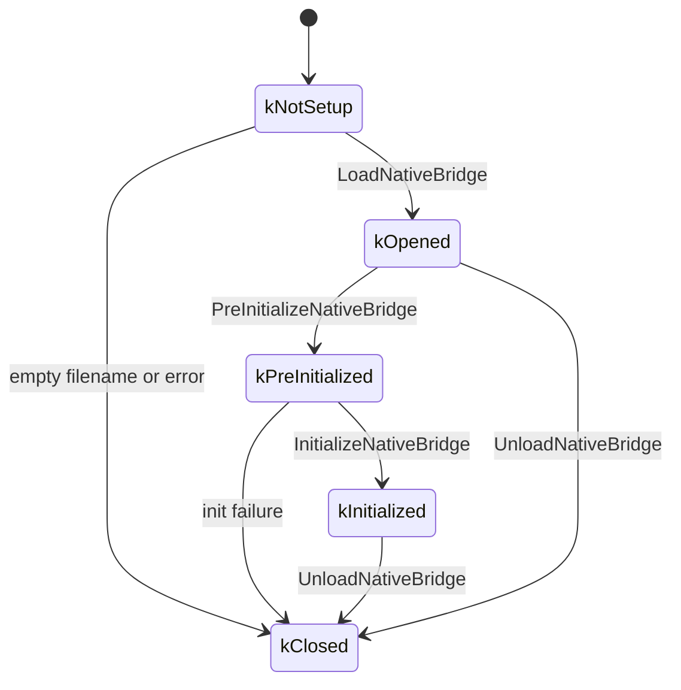

来自 `native_bridge.cc`（第 75-81 行）：

```c
enum class NativeBridgeState {
  kNotSetup,           // Initial state.
  kOpened,             // After successful dlopen.
  kPreInitialized,     // After successful pre-initialization.
  kInitialized,        // After successful initialization.
  kClosed              // Closed or errors.
};
```

### 19.1.7 加载序列——引导期间发生什么

完整的加载序列如下：

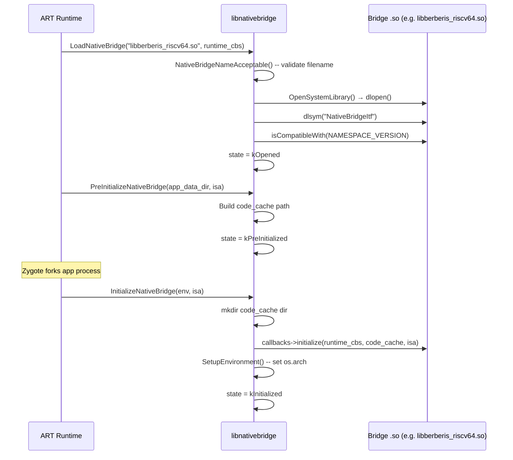

让我们逐步分析最重要的函数 `LoadNativeBridge`，来自 `native_bridge.cc`（第 227-291 行）：

```c
bool LoadNativeBridge(const char* nb_library_filename,
                      const NativeBridgeRuntimeCallbacks* runtime_cbs) {
  // ...
  if (!NativeBridgeNameAcceptable(nb_library_filename)) {
    CloseNativeBridge(true);
  } else {
    void* handle = OpenSystemLibrary(nb_library_filename, RTLD_LAZY);
    if (handle != nullptr) {
      g_callbacks = reinterpret_cast<NativeBridgeCallbacks*>(
          dlsym(handle, kNativeBridgeInterfaceSymbol));
      if (g_callbacks != nullptr) {
        if (isCompatibleWith(NAMESPACE_VERSION)) {
          g_native_bridge_handle = handle;
        } else {
          // reject incompatible version
        }
      }
    }
    // ...
    g_runtime_callbacks = runtime_cbs;
    g_state = NativeBridgeState::kOpened;
  }
  return g_state == NativeBridgeState::kOpened;
}
```

关键观察：

1. 文件名按字符逐一验证——只允许 `[a-zA-Z0-9._-]`，且首字符必须为字母（第 175 行）。
2. `OpenSystemLibrary` 在设备上使用 `android_dlopen_ext` 从系统命名空间打开，或在主机上使用普通 `dlopen`（第 41-61 行）。
3. 兼容性检查（`isCompatibleWith(NAMESPACE_VERSION)`）只会直接拒绝报告版本 0 的桥接。v1 桥接始终被视为兼容（检查落到 `return true`）。v2+ 桥接通过其自身的 `isCompatibleWith()` 回调自行决定是否支持 `NAMESPACE_VERSION`（3）。

### 19.1.8 NeedsNativeBridge——ISA 检查

当 Zygote 准备加载一个库时，它首先会询问是否需要桥接：

```c
// native_bridge.cc, line 293
bool NeedsNativeBridge(const char* instruction_set) {
  return strncmp(instruction_set, ABI_STRING,
                 strlen(ABI_STRING) + 1) != 0;
}
```

`ABI_STRING` 是宿主架构的编译期常量（例如 `"x86_64"`）。如果应用的 ISA 是 `"riscv64"` 而设备是 `x86_64`，该函数返回 `true`，ART 就会通过桥接路由该库的加载。

### 19.1.9 蹦床分发

蹦床机制是 JNI 调用跨越 ISA 边界的方式。当 ART 解析一个原生方法时，它会调用：

```c
// native_bridge.cc, lines 477-494
void* NativeBridgeGetTrampoline2(
    void* handle, const char* name, const char* shorty,
    uint32_t len, JNICallType jni_call_type) {
  // ...
  if (isCompatibleWith(CRITICAL_NATIVE_SUPPORT_VERSION)) {
    return g_callbacks->getTrampolineWithJNICallType(
        handle, name, shorty, len, jni_call_type);
  }
  return g_callbacks->getTrampoline(handle, name, shorty, len);
}
```

`JNICallType` 枚举区分以下几种：

- `kJNICallTypeRegular`（1）——带 `JNIEnv*` 和 `jobject`/`jclass` 隐式参数的标准 JNI。
- `kJNICallTypeCriticalNative`（2）——无 JNI 开销、无隐式参数的 `@CriticalNative` 方法。

版本 7 专门添加了 `getTrampolineWithJNICallType`，因为 `@CriticalNative` 方法具有根本不同的调用约定。它们不传入 `JNIEnv*` 或 `jobject`，桥接不得注入它们。

### 19.1.10 链接器命名空间集成

从版本 3 开始，原生桥接映射了 Android 的链接器命名空间系统。`NativeBridgeCallbacks` 中每个与命名空间相关的函数在动态链接器中都有一个精确的对应项：

| 原生桥接回调 | 动态链接器等价项 |
|---|---|
| `createNamespace` | `android_create_namespace` |
| `linkNamespaces` | `android_link_namespaces` |
| `loadLibraryExt` | `android_dlopen_ext` |
| `getExportedNamespace` | `android_get_exported_namespace` |

这种并行设计确保客户机库看到与宿主库相同的隔离边界。厂商代码无法访问平台内部实现，平台库也与应用库相互分离。

命名空间操作全都以版本检查为门槛：

```c
// native_bridge.cc, lines 571-591
native_bridge_namespace_t* NativeBridgeCreateNamespace(...) {
  if (NativeBridgeInitialized()) {
    if (isCompatibleWith(NAMESPACE_VERSION)) {
      return g_callbacks->createNamespace(...);
    }
  }
  return nullptr;
}
```

### 19.1.11 构建配置

库名在产品配置期间通过系统属性设置。来自 `frameworks/libs/binary_translation/enable_riscv64_to_x86_64.mk`（第 24-25 行）：

```makefile
PRODUCT_SYSTEM_PROPERTIES += \
    ro.dalvik.vm.native.bridge=libberberis_riscv64.so
```

其他相关属性：

```makefile
PRODUCT_SYSTEM_PROPERTIES += \
    ro.dalvik.vm.isa.riscv64=x86_64 \
    ro.enable.native.bridge.exec=1
```

`ro.dalvik.vm.isa.riscv64=x86_64` 告诉包管理器哪个宿主 ISA 可以翻译 `riscv64` 客户机代码。`ro.enable.native.bridge.exec=1` 启用针对非 Android 可执行文件的独立程序运行器。

### 19.1.12 架构图

原生桥接层的完整架构：

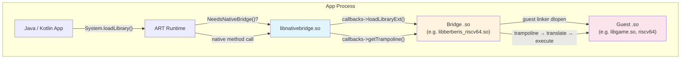

---

## 19.2 Berberis：Google 的二进制翻译器

### 19.2.1 概述

**Berberis** 是原生桥接接口的 Google 开源参考实现。它是一个动态二进制翻译器，使带有 RISC-V 64 位原生代码的 Android 应用能够在 x86_64 设备或模拟器上运行。

来自 `frameworks/libs/binary_translation/README.md`（第 1 行）：

> 动态二进制翻译器，用于在 x86_64 设备或模拟器上运行带有 riscv64 原生代码的 Android 应用。

“Berberis”这个名字来自一个灌木属。该项目的公开邮件列表是 `berberis-discuss@googlegroups.com`。

源码树位于：

```
frameworks/libs/binary_translation/
```

### 19.2.2 目录映射

在 Android 17 中，二进制翻译代码树被重新组织。构成 CPU 仿真核心的每个模块都被移动到一个新建的顶层 `cpu_emulation/` 目录之下（提交“cpu_emulation: consolidate modules under new directory”，`Bug: 476465845`）。在移动之前，解码器、解释器、两个 JIT 层级、IR 后端、汇编器和内建函数各自位于顶层。现在它们都是 `cpu_emulation/` 下的同级目录。这使得*仿真客户机 CPU 的引擎*与*承载该引擎的运行时*之间的边界变得明确。

翻译器分发器本身也从 `runtime/` 拆分出来，成为独立的 `cpu_emulation/translator/` 模块。第 19.8 节将介绍位于其中的三层引擎。

```
frameworks/libs/binary_translation/
    Android.bp              # Top-level build
    README.md               # Getting started
    OWNERS
    berberis_config.mk      # Product package lists
    enable_riscv64_to_x86_64.mk  # Product configuration

    # ---- CPU Emulation Core (Android 17 consolidation) ----
    cpu_emulation/
        decoder/            # Instruction decoder (RISC-V → IR)
            include/berberis/decoder/riscv64/
                decoder.h   # Template-based decoder
        interpreter/        # Instruction-by-instruction interpreter
            riscv64/
                interpreter-main.cc
                interpreter.h
                interpreter-demultiplexers.cc
                interpreter-V*.cc   # Vector instruction handlers
        lite_translator/    # Lightweight JIT: riscv64 → x86_64
            riscv64_to_x86_64/
                lite_translator.cc
                lite_translate_region.cc
        heavy_optimizer/    # Optimizing JIT (region-based)
            riscv64/
        translator/         # Tier dispatcher (split out of runtime/ in 17)
            include/berberis/translator/translator.h
            riscv64/
                translator.cc            # Arch-independent init
                translator_x86_64.cc     # Three-tier dispatch (host=x86_64)
                translator_arm64.cc       # Interpreter-only (host=arm64)
        backend/            # x86_64 code generation (IR → machine code)
            x86_64/
            common/
            gen_lir.py      # LIR generation script
        assembler/          # x86_64 / RISC-V assembler
        code_gen_lib/       # Per direction code-gen helpers (riscv64_to_x86_64, arm64_to_x86_64, ...)
        intrinsics/         # Optimized instruction implementations
        insn_tests/         # Per-ISA instruction conformance tests
    exec_region/            # Executable memory management

    # ---- Guest Environment ----
    guest_state/            # CPU register state
        riscv64/
            include/berberis/guest_state/
                guest_state_arch.h   # RISC-V register definitions
        include/berberis/guest_state/
            guest_addr.h            # GuestAddr type
            guest_state_opaque.h    # ThreadState interface
    guest_abi/              # ABI conversion (calling conventions)
        riscv64/
    guest_loader/           # ELF loading for guest binaries
        guest_loader.cc     # Main loader logic
        app_process.cc      # Guest app_process handling
    guest_os_primitives/    # Thread management, signals, mmap

    # ---- JNI Bridge ----
    jni/                    # JNI trampoline generation
        jni_trampolines.cc
        guest_jni_trampolines.cc
        gen_jni_trampolines.py
        api.json

    # ---- Native Bridge Integration ----
    native_bridge/          # NativeBridgeCallbacks implementation
        native_bridge.cc    # The NativeBridgeItf export
        native_bridge.h     # Local copy of callback struct

    # ---- API Proxies ----
    android_api/            # Host-side proxy implementations
        libEGL/   libGLESv1_CM/   libGLESv2/   libGLESv3/
        libaaudio/  libamidi/  libandroid/  libandroid_runtime/
        libbinder_ndk/  libc/  libcamera2ndk/  libjnigraphics/
        libm/  libmediandk/  libnativehelper/  libnativewindow/
        libneuralnetworks/  libvulkan/  libOpenMAXAL/
        libOpenSLES/  libwebviewchromium_plat_support/

    # ---- Supporting Infrastructure ----
    proxy_loader/           # Proxy library discovery & loading
    runtime/                # Initialization, guest entry, per-direction subdirs
    runtime_primitives/     # Translation cache, trampolines
    calling_conventions/    # ABI parameter passing rules
    kernel_api/             # Syscall emulation
    native_activity/        # ANativeActivity wrapping
    tiny_loader/            # Lightweight ELF loader
    program_runner/         # Standalone binary runner
    base/                   # Utility library
    device_arch_info/       # Architecture information
    tools/                  # Development utilities
    tests/                  # Integration tests
    test_utils/             # Test infrastructure
    prebuilt/               # Prebuilt binaries
    docs/                   # Internal documentation
    instrument/             # Instrumentation support
```

### 19.2.3 翻译流水线

Berberis 使用多层翻译策略：

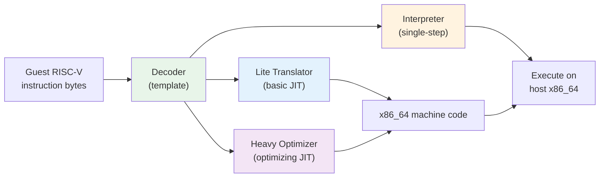

**第 1 层——解释器：** 每条客户机指令被解码并逐条执行。这是回退路径，也是最易于维护的。它处理所有指令，包括不常见的向量操作。

**第 2 层——Lite 翻译器：** 一个轻量级 JIT 编译器，将 RISC-V 代码的短区域翻译为 x86_64 机器码。开销低于解释器，但生成的代码优化程度较低。

**第 3 层——重型优化器：** 一个基于区域的优化 JIT，执行寄存器分配、死代码消除以及其他经典编译器优化。用于热点代码路径。

### 19.2.4 解码器

解码器是一个 C++ 模板类，接受一个 `InsnConsumer` 类型参数。同一个解码器模板同时驱动解释器（其中消费者立即执行语义）和翻译器（其中消费者发出宿主指令）。

来自 `frameworks/libs/binary_translation/cpu_emulation/decoder/include/berberis/decoder/riscv64/decoder.h`（第 35-37 行）：

```cpp
template <class InsnConsumer>
class Decoder {
 public:
  explicit Decoder(InsnConsumer* insn_consumer)
      : insn_consumer_(insn_consumer) {}
```

解码器为每个 RISC-V 操作码族定义了枚举。`OpOpcode` 枚举（第 92-127 行）的取样如下：

```cpp
enum class OpOpcode : uint16_t {
  kAdd = 0b0000'000'000,
  kSub = 0b0100'000'000,
  kSll = 0b0000'000'001,
  kSlt = 0b0000'000'010,
  kXor = 0b0000'000'100,
  kSrl = 0b0000'000'101,
  kSra = 0b0100'000'101,
  kOr  = 0b0000'000'110,
  kAnd = 0b0000'000'111,
  kMul = 0b0000'001'000,
  kDiv = 0b0000'001'100,
  // ... Zba/Zbb/Zbs bit-manipulation extensions
  kSh1add = 0b0010'000'010,
  kSh2add = 0b0010'000'100,
  kSh3add = 0b0010'000'110,
  kBclr   = 0b0100'100'001,
  kBext   = 0b0100'100'101,
  // ...
};
```

解码器支持：

- **RV64GCV**：基础整数、乘法/除法、原子、压缩、单/双精度浮点以及向量扩展。
- **Zba/Zbb/Zbs**：位操作扩展（地址生成、基本位操作、单比特操作）。
- **压缩指令**：解码器透明展开的 16 位编码。

### 19.2.5 解释器

解释器是最简单的执行后端。在 `frameworks/libs/binary_translation/cpu_emulation/interpreter/riscv64/interpreter-main.cc` 中：

```cpp
void InterpretInsn(ThreadState* state) {
  GuestAddr pc = state->cpu.insn_addr;

  Interpreter interpreter(state);
  SemanticsPlayer sem_player(&interpreter);
  Decoder decoder(&sem_player);
  uint8_t insn_len = decoder.Decode(ToHostAddr<const uint16_t>(pc));
  interpreter.FinalizeInsn(insn_len);
}
```

执行模型：

1. 从客户机 CPU 状态读取 `insn_addr`。
2. 用 `SemanticsPlayer` 包装 `Interpreter`，后者将解码出的字段映射为语义操作。
3. 将 `SemanticsPlayer` 喂给 `Decoder` 模板。
4. 解码器调用相应的 `SemanticsPlayer` 方法，该方法调用 `Interpreter` 方法，后者在 `ThreadState` 中读写客户机寄存器。
5. `FinalizeInsn` 将程序计数器向前推进 `insn_len` 字节。

这是一个经典的**解码-分发**解释器。对于向量指令，实现被拆分到多个文件中：

```
interpreter-VLoadIndexedArgs.cc
interpreter-VLoadStrideArgs.cc
interpreter-VLoadUnitStrideArgs.cc
interpreter-VOpFVfArgs.cc
interpreter-VOpFVvArgs.cc
interpreter-VOpIViArgs.cc
interpreter-VOpIVvArgs.cc
interpreter-VOpIVxArgs.cc
interpreter-VOpMVvArgs.cc
interpreter-VOpMVxArgs.cc
interpreter-VStoreIndexedArgs.cc
interpreter-VStoreStrideArgs.cc
interpreter-VStoreUnitStrideArgs.cc
```

来自 README：

> 支持的扩展包括 Zb*（位操作）和大部分 Zv（向量）。一些较不常用的向量指令尚未实现，但 Android CTS 和一些 Android 应用可以在当前已实现的指令集上运行。

### 19.2.6 客户机状态

客户机 CPU 状态是保存 RISC-V 内核寄存器组的基本数据结构。它按架构定义。

来自 `frameworks/libs/binary_translation/guest_state/include/berberis/guest_state/guest_addr.h`：

```cpp
using GuestAddr = uintptr_t;

constexpr GuestAddr kNullGuestAddr = {};

template <typename T>
inline GuestAddr ToGuestAddr(T* addr) {
  return reinterpret_cast<GuestAddr>(addr);
}

template <typename T>
inline T* ToHostAddr(GuestAddr addr) {
  return reinterpret_cast<T*>(addr);
}
```

由于 Berberis 目前的目标是 64 位客户机在 64 位宿主上运行，`GuestAddr` 就是 `uintptr_t`——客户机和宿主指针大小相同。这大大简化了地址空间映射。

RISC-V 的 `CPUState` 定义在一个共享头文件中（从 `native_bridge_support` 引入），并在 `guest_state/riscv64/include/berberis/guest_state/guest_state_arch.h` 中用便捷访问器包装。

寄存器组：

```cpp
constexpr uint32_t kNumGuestRegs = std::size(CPUState{}.x);     // 32
constexpr uint32_t kNumGuestFpRegs = std::size(CPUState{}.f);   // 32
```

RISC-V 的按 ABI 命名的寄存器常量（第 213-244 行）：

```cpp
constexpr uint8_t RA  = 1;    // Return address
constexpr uint8_t SP  = 2;    // Stack pointer
constexpr uint8_t GP  = 3;    // Global pointer
constexpr uint8_t TP  = 4;    // Thread pointer
constexpr uint8_t T0  = 5;    // Temporary 0
constexpr uint8_t A0  = 10;   // Argument 0 / return value
constexpr uint8_t A1  = 11;   // Argument 1 / return value
constexpr uint8_t A7  = 17;   // Argument 7 (syscall number)
constexpr uint8_t S0  = 8;    // Saved 0 / frame pointer
```

模板化寄存器访问：

```cpp
template <uint8_t kIndex>
inline uint64_t GetXReg(const CPUState& state) {
  static_assert(kIndex > 0);   // x0 is hardwired to zero
  static_assert(kIndex < std::size(CPUState{}.x));
  return state.x[kIndex];
}

template <uint8_t kIndex>
inline void SetXReg(CPUState& state, uint64_t val) {
  static_assert(kIndex > 0);
  static_assert(kIndex < std::size(CPUState{}.x));
  state.x[kIndex] = val;
}
```

`ThreadState` 结构体包装 `CPUState` 并添加进程级元数据：

```cpp
// guest_state/riscv64/include/berberis/guest_state/guest_state_arch.h
struct ThreadState {
  CPUState cpu;
  alignas(config::kScratchAreaAlign)
      uint8_t intrinsics_scratch_area[config::kScratchAreaSize];
  GuestThread* thread;
  std::atomic<uint_least8_t> pending_signals_status;
  GuestThreadResidence residence;
  void* instrument_data;
  void* thread_state_storage;
};
```

`residence` 字段跟踪线程当前是在生成的（翻译后的）代码内部执行还是在外部执行——这对信号处理和垃圾回收安全点至关重要。

RISC-V 的 CSR（控制和状态寄存器）支持：

```cpp
enum class CsrName {
  kFFlags = 0b00'00'0000'0001,   // FP exception flags
  kFrm    = 0b00'00'0000'0010,   // FP rounding mode
  kFCsr   = 0b00'00'0000'0011,   // FP control/status
  kVstart = 0b00'00'0000'1000,   // Vector start index
  kVxsat  = 0b00'00'0000'1001,   // Vector fixed-point saturation
  kVxrm   = 0b00'00'0000'1010,   // Vector fixed-point rounding mode
  kVcsr   = 0b00'00'0000'1111,   // Vector control/status
  kCycle  = 0b11'00'0000'0000,   // Cycle counter (read-only)
  kVl     = 0b11'00'0010'0000,   // Vector length (read-only)
  kVtype  = 0b11'00'0010'0001,   // Vector type (read-only)
  kVlenb  = 0b11'00'0010'0010,   // Vector length in bytes (read-only)
};
```

### 19.2.7 客户机加载器

`GuestLoader` 类管理客户机 ELF 二进制文件的加载。它处理三个文件：主可执行文件、VDSO（虚拟动态共享对象）和动态链接器。

来自 `frameworks/libs/binary_translation/guest_loader/include/berberis/guest_loader/guest_loader.h`：

```cpp
class GuestLoader {
 public:
  static GuestLoader* StartAppProcessInNewThread(std::string* error_msg);
  static void StartExecutable(const char* main_executable_path,
                               const char* vdso_path,
                               const char* loader_path,
                               size_t argc, const char* argv[],
                               char* envp[], std::string* error_msg);
  static GuestLoader* GetInstance();

  void* DlOpen(const char* libpath, int flags);
  void* DlOpenExt(const char* libpath, int flags,
                   const android_dlextinfo* extinfo);
  GuestAddr DlSym(void* handle, const char* name);
  android_namespace_t* CreateNamespace(...);
  android_namespace_t* GetExportedNamespace(const char* name);
  bool LinkNamespaces(...);
  // ...
};
```

`guest_loader.cc` 中的初始化序列（第 265-341 行）：

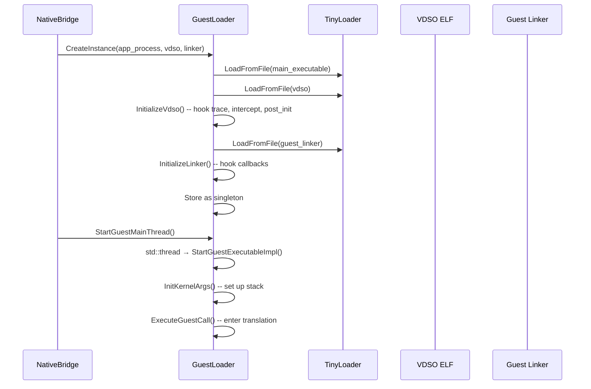

关键点：

1. **TinyLoader** 是一个极简的 ELF 加载器，它使用带 `kLibraryAlignment` 的 `mmap` 将客户机二进制文件映射到进程地址空间中。
2. **VDSO** 为客户机到宿主的回调（如跟踪和符号拦截）提供蹦床。`InitializeVdso()` 修补若干 VDSO 符号以调用宿主函数：
   - `native_bridge_trace` ——转发给 `TraceCallback`
   - `native_bridge_intercept_symbol` ——转发给 `InterceptGuestSymbolCallback`
   - `native_bridge_post_init` ——转发给 `PostInitCallback`
3. **客户机链接器**（`linker64`）作为客户机代码运行，为客户机库处理 `dlopen`、`dlsym` 和命名空间操作。Berberis 通过 `LinkerCallbacks` 拦截其关键函数。

`LinkerCallbacks` 结构体映射了 Android 的动态链接器 API：

```cpp
struct LinkerCallbacks {
  using android_create_namespace_fn_t = android_namespace_t* (*)(...);
  using android_dlopen_ext_fn_t = void* (*)(...);
  using android_get_exported_namespace_fn_t =
      android_namespace_t* (*)(const char* name);
  using dlsym_fn_t = void* (*)(void* handle, const char* symbol,
                                const void* caller_addr);
  // ... and more
};
```

### 19.2.8 Berberis 中的 NativeBridge 实现

Berberis 在 `frameworks/libs/binary_translation/native_bridge/native_bridge.cc` 中实现了 NativeBridge 接口。文件底部的关键导出（第 645-668 行）：

```cpp
extern "C" {
android::NativeBridgeCallbacks NativeBridgeItf = {
    kNativeBridgeCallbackVersion,     // 8
    &native_bridge_initialize,
    &native_bridge_loadLibrary,
    &native_bridge_getTrampoline,
    &native_bridge_isSupported,
    &native_bridge_getAppEnv,
    &native_bridge_isCompatibleWith,
    &native_bridge_getSignalHandler,
    &native_bridge_unloadLibrary,
    &native_bridge_getError,
    &native_bridge_isPathSupported,
    &native_bridge_initAnonymousNamespace,
    &native_bridge_createNamespace,
    &native_bridge_linkNamespaces,
    &native_bridge_loadLibraryExt,
    &native_bridge_getVendorNamespace,
    &native_bridge_getExportedNamespace,
    &native_bridge_preZygoteFork,
    &native_bridge_getTrampolineWithJNICallType,
    &native_bridge_getTrampolineForFunctionPointer,
    &native_bridge_isNativeBridgeFunctionPointer,
};
}
```

版本在编译时设置：

```cpp
const constexpr uint32_t kNativeBridgeCallbackMinVersion = 2;
const constexpr uint32_t kNativeBridgeCallbackVersion = 8;
const constexpr uint32_t kNativeBridgeCallbackMaxVersion =
    kNativeBridgeCallbackVersion;
```

### 19.2.9 双命名空间架构

Berberis 为每个逻辑命名空间维护**两个并行的链接器命名空间**——一个用于客户机库，一个用于宿主库：

```cpp
// native_bridge/native_bridge.cc, lines 77-81
struct native_bridge_namespace_t {
  android_namespace_t* guest_namespace;
  android_namespace_t* host_namespace;
};
```

这种双命名空间设计至关重要。当 ART 要求桥接创建一个命名空间时，Berberis 会同时创建两个：

```cpp
native_bridge_namespace_t* BerberisNativeBridge::CreateNamespace(
    const char* name, ..., native_bridge_namespace_t* parent_ns) {
  auto* host_namespace = android_create_namespace(
      name, ..., parent_ns->host_namespace);
  auto* guest_namespace = guest_loader_->CreateNamespace(
      name, ..., parent_ns->guest_namespace);
  return CreateNativeBridgeNamespace(host_namespace, guest_namespace);
}
```

加载库时，系统首先尝试客户机命名空间。如果客户机加载器失败（该库不存在对应的客户机 ISA 版本），Berberis 会回退到宿主命名空间：

```cpp
void* BerberisNativeBridge::LoadLibrary(const char* libpath, int flags,
    const native_bridge_namespace_t* ns) {
  void* handle = LoadGuestLibrary(libpath, flags, ns);
  if (handle != nullptr) return handle;

  // http://b/206676167: Do not fallback to host for libRS.so
  if (berberis::Basename(libpath) == "libRS.so") return handle;

  // ... (fill extinfo with ns->host_namespace when ns != nullptr)

  // Try falling back to host loader.
  handle = android_dlopen_ext(libpath, flags, extinfo);
  if (handle != nullptr) {
    AddHostLibrary(handle);  // Track as host handle
  }
  return handle;
}
```

这种回退在源码中的理由（参见 `frameworks/libs/binary_translation/native_bridge/native_bridge.cc:243-253` 处的 `CreateNamespace` 注释以及 bug b/308371292）有两方面。Android SDK 库没有一种好的机制来附带 JNI 库。因此这样的库通常位于系统搜索路径中，只能通过宿主系统链接器命名空间解析。这也是为宿主命名空间保留客户机搜索路径的原因。

而且应用有时会把一种架构的库放进另一种架构的目录中（例如把 x86_64 二进制文件放在 `arm64` 目录下）。当架构恰好与宿主匹配时，这些库可以正常加载。有一个库被明确排除在回退之外：`libRS.so` 永远不会解析为宿主二进制文件（b/206676167）。

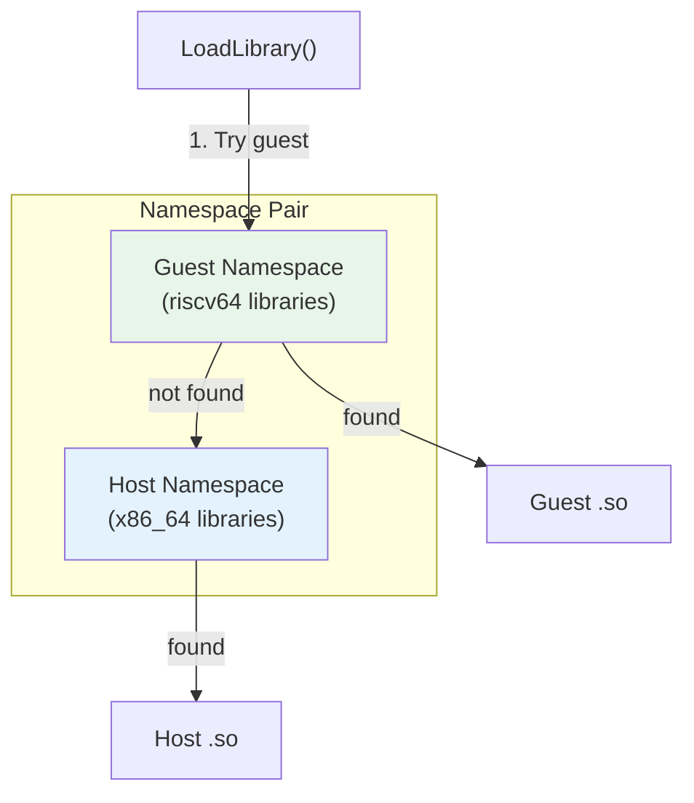

### 19.2.10 JNI 蹦床

JNI 蹦床系统是桥接中最复杂的部分。当 ART 调用客户机库中的原生方法时，它会经过一个宿主侧的**蹦床**，该蹦床：

1. 将宿主调用约定转换为客户机调用约定。
2. 在宿主与客户机表示之间转换 `JNIEnv*` 和 `JavaVM*` 指针。
3. 通过翻译引擎调用客户机函数。
4. 将返回值转换回宿主约定。

来自 `frameworks/libs/binary_translation/jni/jni_trampolines.cc`：

```cpp
HostCode WrapGuestJNIFunction(GuestAddr pc,
                               const char* shorty,
                               const char* name,
                               bool has_jnienv_and_jobject) {
  const size_t size = strlen(shorty);
  char signature[size + 3];  // env, clazz, trailing zero
  ConvertDalvikShortyToWrapperSignature(
      signature, sizeof(signature), shorty, has_jnienv_and_jobject);
  auto guest_runner = has_jnienv_and_jobject
      ? RunGuestJNIFunction : RunGuestCall;
  return WrapGuestFunctionImpl(pc, signature, guest_runner, name);
}
```

**shorty 到包装器的转换**将 Dalvik 类型字符映射为包装器类型字符：

```cpp
char ConvertDalvikTypeCharToWrapperTypeChar(char c) {
  switch (c) {
    case 'V': return 'v';  // void
    case 'Z': return 'z';  // boolean
    case 'B': return 'b';  // byte
    case 'I': return 'i';  // int
    case 'L': return 'p';  // object → pointer
    case 'J': return 'l';  // long
    case 'F': return 'f';  // float
    case 'D': return 'd';  // double
    // ...
  }
}
```

对于 shorty 为 `"IIF"` 的 JNI 方法 `jint foo(JNIEnv*, jobject, jint, jfloat)`，包装器签名变为 `"ippif"`——返回 int、两个指针（env + jobject）、int、float。

**JNIEnv 转换**尤为复杂。客户机 `JNIEnv*` 与宿主 `JNIEnv*` 并不相同。这是因为函数指针表需要包含将客户机调用转换回宿主 JNI 调用的蹦床。Berberis 维护按线程的双向映射：

```cpp
GuestType<JNIEnv*> ToGuestJNIEnv(JNIEnv* host_jni_env) {
  // Wrap host JNI functions (once)
  if (g_jni_env_wrapped == 0) {
    WrapJNIEnv(host_jni_env);
    g_jni_env_wrapped = 1;
  }
  // Create per-thread mapping
  std::lock_guard<std::mutex> lock(g_jni_guard_mutex);
  pid_t thread_id = GettidSyscall();
  JNIEnvMapping& mapping = g_jni_env_mappings[thread_id];
  // ... lookup or create mapping
}
```

同样，`JavaVM*` 也被包装：

```cpp
void WrapJavaVM(void* java_vm) {
  HostCode* vtable = *reinterpret_cast<HostCode**>(java_vm);
  WrapHostFunctionImpl(vtable[3], DoJavaVMTrampoline_DestroyJavaVM, ...);
  WrapHostFunctionImpl(vtable[4], DoJavaVMTrampoline_AttachCurrentThread, ...);
  WrapHostFunctionImpl(vtable[5], DoJavaVMTrampoline_DetachCurrentThread, ...);
  WrapHostFunctionImpl(vtable[6], DoJavaVMTrampoline_GetEnv, ...);
  WrapHostFunctionImpl(vtable[7],
      DoJavaVMTrampoline_AttachCurrentThreadAsDaemon, ...);
}
```

每个 `JavaVM` 虚表条目都被替换为一个在客户机与宿主表示之间进行转换的蹦床。

### 19.2.11 JNI_OnLoad 处理

当客户机库被加载时，桥接需要拦截 `JNI_OnLoad` 以转换 `JavaVM*` 参数：

```cpp
template <typename FnT>
void ConvertJavaVMToGuest(GuestArgumentBuffer* buf) {
  auto host_java_vm = HostArgumentsValues<FnT>(buf).template get<0>();
  auto&& guest_java_vm = GuestArgumentsReferences<FnT>(buf).template get<0>();
  guest_java_vm = ToGuestJavaVM(host_java_vm);
}

void RunGuestJNIOnLoad(GuestAddr pc, GuestArgumentBuffer* buf) {
  ConvertJavaVMToGuest<decltype(JNI_OnLoad)>(buf);
  RunGuestCall(pc, buf);
}

HostCode WrapGuestJNIOnLoad(GuestAddr pc) {
  return WrapGuestFunctionImpl(pc, "ipp", RunGuestJNIOnLoad, "JNI_OnLoad");
}
```

该包装器在 JNI 初始化期间注册：

```cpp
void InitializeJNI() {
  RegisterKnownGuestFunctionWrapper("JNI_OnLoad", WrapGuestJNIOnLoad);
}
```

### 19.2.12 蹦床请求流程

当 ART 解析原生方法时的完整流程：

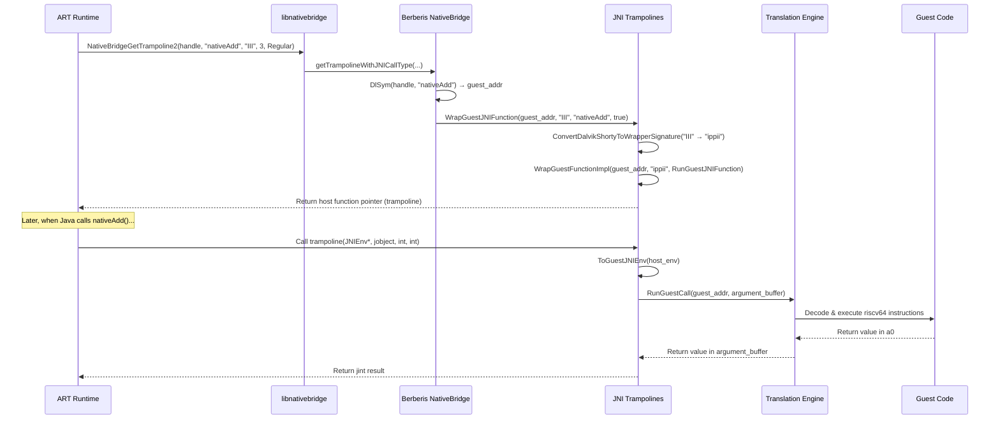

### 19.2.13 代理加载器

客户机库可以调用系统库（如 `libEGL.so` 或 `libc.so`）中存在的函数。这样的调用必须被重定向到一个宿主侧**代理**，由它处理 ISA 翻译。

来自 `frameworks/libs/binary_translation/proxy_loader/proxy_loader.cc`：

```cpp
bool LoadProxyLibrary(ProxyLibraryBuilder* builder,
                      const char* library_name,
                      const char* proxy_prefix) {
  std::string proxy_name = proxy_prefix;
  proxy_name += library_name;
  void* proxy = dlopen(proxy_name.c_str(), RTLD_NOW | RTLD_LOCAL);
  // ...
  using InitProxyLibraryFunc = void (*)(ProxyLibraryBuilder*);
  InitProxyLibraryFunc init = reinterpret_cast<InitProxyLibraryFunc>(
      dlsym(proxy, "InitProxyLibrary"));
  init(builder);
}

void InterceptGuestSymbol(GuestAddr addr, const char* library_name,
                           const char* name, const char* proxy_prefix) {
  // ...
  if (res.second && !LoadProxyLibrary(&res.first->second, library_name,
                                       proxy_prefix)) {
    FATAL("Unable to load library \"%s\"", library_name);
  }
  res.first->second.InterceptSymbol(addr, name);
}
```

对于每个系统库，都有一个对应的代理：`libberberis_proxy_libc.so`、`libberberis_proxy_libEGL.so` 等。这些都是从 `android_api/` 子目录构建的。

### 19.2.14 运行时初始化

Berberis 运行时通过 `InitBerberis()` 初始化，位于 `frameworks/libs/binary_translation/runtime/berberis.cc`（第 37-55 行）：

```cpp
// runtime/berberis.cc
bool InitBerberisUnsafe() {
  InitLargeMmap();
  InitHostEntries();
  Tracing::Init();
  InitGuestThreadManager();
  InitGuestFunctionWrapper(&IsAddressGuestExecutable);
  InitTranslator();
  InitGuestSignalHandling();
  InitGuestArch();
  return true;
}

void InitBerberis() {
  // C++11 guarantees this is called only once and is thread-safe.
  static bool initialized = InitBerberisUnsafe();
  UNUSED(initialized);
}
```

`static bool` 技巧确保线程安全的一次性初始化（C++11 保证了这一点）。`InitTranslator()` 是启动三层引擎的调用。在 Android 17 代码树中，它位于合并后的 translator 模块中（第 19.8 节），而不是 `runtime/` 中。

同一个文件还暴露了 `PreZygoteForkUnsafe()`，它会转发给翻译缓存的 `PreZygoteForkUnsafe()`。该调用不会刷新翻译后的代码。它关闭缓存的 `memfd` 文件描述符。原因在于 Zygote 的 fork 不会让未识别的打开文件描述符在子进程中存活。

当客户机代码被覆盖时（例如客户机内部的自修改 JIT，或 `dlclose`），运行时会使受影响的已编译区域失效。在 Android 17 中，这部分位于 `frameworks/libs/binary_translation/runtime/runtime_library/runtime_library.cc`（第 54-59 行）：

```cpp
// runtime/runtime_library/runtime_library.cc
void InvalidateGuestRange(GuestAddr start, GuestAddr end) {
  TranslationCache* cache = TranslationCache::GetInstance();
  cache->InvalidateGuestRange(start, end);
  // ...
  FlushGuestCodeCache();
}
```

`TranslationCache::InvalidateGuestRange` 的实现位于 `frameworks/libs/binary_translation/runtime_primitives/translation_cache.cc`（第 261 行）。

### 19.2.15 携带客户机状态的崩溃报告

Berberis 提供详细的崩溃报告，其中包含宿主与客户机线程状态。来自 README 的 tombstone 示例：

```
ABI: 'x86_64'
Guest architecture: 'riscv64'
```

tombstone 包含 x86_64 宿主回溯：

```
backtrace:
  #00 pc .../libc.so (syscall+24)
  #01 pc .../libberberis_riscv64.so (berberis::RunGuestSyscall+82)
  #02 pc .../libberberis_riscv64.so (berberis::Decoder<...>::DecodeSystem()+133)
  #03 pc .../libberberis_riscv64.so (berberis::Decoder<...>::DecodeBaseInstruction()+831)
  #04 pc .../libberberis_riscv64.so (berberis::InterpretInsn+100)
```

随后是 RISC-V 客户机线程信息：

```
Guest thread information for tid: 2896
    pc  00007442942e4e64  ra  00007442ecc88b08
    sp  00007442eced6fc0  gp  000074428dee8000
    a0  0000000000000b3b  a1  0000000000000b50
    a7  0000000000000083
```

以及客户机回溯：

```
backtrace:
  #00 pc .../riscv64/libc.so (tgkill+4)
  #01 pc .../base.apk!libberberis_jni_tests.so (add42+18)
  #02 pc .../riscv64/libnative_bridge_vdso.so
```

这种双栈回溯对调试极其宝贵。开发者可以看到崩溃发生在客户机代码的何处，也能看到翻译器在那一刻正在做什么。

### 19.2.16 构建 Berberis

来自 README：

```bash
source build/envsetup.sh
lunch sdk_phone64_x86_64_riscv64-trunk_staging-eng
m berberis_all
```

`sdk_phone64_x86_64_riscv64` 目标是一个带有 RISC-V 二进制翻译支持的 x86_64 模拟器镜像。要构建所有目标：

```bash
mmm frameworks/libs/binary_translation
```

运行一个简单测试：

```bash
out/host/linux-x86/bin/berberis_program_runner_riscv64 \
  out/target/product/emu64xr/testcases/\
  berberis_hello_world_static.native_bridge/x86_64/\
  berberis_hello_world_static
```

### 19.2.17 程序运行器

`berberis_program_runner_riscv64` 二进制文件是一个独立的宿主程序，无需完整的 Android 环境即可运行客户机 RISC-V ELF 可执行文件。存在两种变体：

- `berberis_program_runner_riscv64` ——手动调用
- `berberis_program_runner_binfmt_misc_riscv64` ——注册为 binfmt_misc 处理器，因此内核会自动为 RISC-V 二进制文件调用它

安装到设备上的构建产物：

```
system/bin/berberis_program_runner_riscv64
system/bin/berberis_program_runner_binfmt_misc_riscv64
system/etc/binfmt_misc/riscv64_dyn
system/etc/binfmt_misc/riscv64_exe
system/etc/init/berberis.rc
```

---

## 19.3 native_bridge_support 库

### 19.3.1 用途

这些 `native_bridge_support` 库是为客户机架构交叉编译、并与桥接一起安装的**客户机 ISA 库**。它们提供应用所链接的客户机侧对应实现。

当客户机应用调用 `malloc()` 时，该调用会进入客户机 ISA 的 `libc.so`。那个客户机 `libc.so` 是一个**经过修改**的版本，它会把某些操作经由桥接路由到宿主系统。

**源码**：`frameworks/libs/native_bridge_support/`

```
frameworks/libs/native_bridge_support/
    Android.bp
    native_bridge_support.mk    # Package lists
    android_api/                # Guest-side API stubs
        libc/
        app_process/
        linker/
        vdso/
        libEGL/  libGLESv1_CM/  libGLESv2/  libGLESv3/
        ... (24 subdirectories)
    guest_state/                # Guest CPU state definitions
    guest_state_accessor/       # State accessor utilities
    tools/
```

### 19.3.2 包清单

`native_bridge_support.mk` 是定义原生桥接构建中包含哪些库的核心清单。它导出了若干变量：

```makefile
# frameworks/libs/native_bridge_support/native_bridge_support.mk

# Core infrastructure
NATIVE_BRIDGE_PRODUCT_PACKAGES := \
    libnative_bridge_vdso.native_bridge \
    native_bridge_guest_app_process.native_bridge \
    native_bridge_guest_linker.native_bridge
```

这三个包是任何原生桥接所需的最小集合：

1. **libnative_bridge_vdso**——提供宿主回调的客户机 VDSO。
2. **native_bridge_guest_app_process**——客户机 `app_process64` 二进制文件（每个 Android 应用进程的入口点）。
3. **native_bridge_guest_linker**——客户机 `linker64`（加载客户机 `.so` 文件的动态链接器）。

### 19.3.3 两类客户机库

该 makefile 区分两类：

**原始客户机库**——从与宿主版本相同的 AOSP 源码交叉编译而来，不做修改：

```makefile
NATIVE_BRIDGE_ORIG_GUEST_LIBS := \
    libandroidicu.bootstrap \
    libcompiler_rt \
    libcrypto \
    libcutils \
    libdl.bootstrap \
    libdl_android.bootstrap \
    libicu.bootstrap \
    liblog \
    libsqlite \
    libssl \
    libstdc++ \
    libsync \
    libutils \
    libz
```

这些是纯库，它们不会发出需要特定 ISA 处理的系统调用。它们可以直接针对客户机 ISA 编译，并且无需翻译即可正常工作。

**修改后的客户机库**——需要宿主侧代理支持：

```makefile
NATIVE_BRIDGE_MODIFIED_GUEST_LIBS := \
    libaaudio \
    libamidi \
    libandroid \
    libandroid_runtime \
    libbinder_ndk \
    libc \
    libcamera2ndk \
    libEGL \
    libGLESv1_CM \
    libGLESv2 \
    libGLESv3 \
    libjnigraphics \
    libm \
    libmediandk \
    libnativehelper \
    libnativewindow \
    libneuralnetworks \
    libOpenMAXAL \
    libOpenSLES \
    libvulkan \
    libwebviewchromium_plat_support
```

这 21 个库与硬件、内核接口或其他宿主特定 API 交互。`libc` 和 `libm` 包含系统调用包装器。`libEGL`、`libGLESv2` 和 `libvulkan` 与 GPU 驱动交互。`libaaudio` 与音频 HAL 通信。每个库都需要宿主侧有一个对应的代理。

### 19.3.4 构建规则

修改后的客户机库使用以下命名约定：

```makefile
NATIVE_BRIDGE_PRODUCT_PACKAGES += \
    $(addprefix libnative_bridge_guest_,\
        $(addsuffix .native_bridge,$(NATIVE_BRIDGE_MODIFIED_GUEST_LIBS)))
```

因此 `libc` 变成 `libnative_bridge_guest_libc.native_bridge`，它针对客户机 ISA 构建，并安装在 `/system/lib64/riscv64/libc.so`。

原始客户机库使用更简单的模式：

```makefile
NATIVE_BRIDGE_PRODUCT_PACKAGES += \
    $(addsuffix .native_bridge,$(NATIVE_BRIDGE_ORIG_GUEST_LIBS))
```

### 19.3.5 APEX 兼容性

该 makefile 包含一个针对支持 APEX 的库的变通方案：

```makefile
# If library is APEX-enabled:
#   "libraryname.native_bridge" is not installed anywhere.
#   "libraryname.bootstrap.native_bridge" gets installed into
#   /system/lib/$GUEST_ARCH/
```

这个变通方案是必要的。这是因为 APEX 库通常安装在 APEX 模块内部（`/apex/com.android.runtime/lib64/`）。然而，原生桥接支持库需要位于传统的 `/system/lib64/riscv64/` 路径。`.bootstrap` 变体就是实现这一点的机制。

### 19.3.6 设备上的布局

在支持 RISC-V 桥接的 x86_64 设备上，客户机库安装在以客户机 ISA 命名的子目录下：

```
/system/lib64/riscv64/
    libc.so
    libm.so
    libdl.so
    liblog.so
    libEGL.so
    libGLESv2.so
    libvulkan.so
    libnative_bridge_vdso.so
    ... (30+ libraries)

/system/bin/riscv64/
    app_process64
    linker64

/system/lib64/
    libberberis_riscv64.so              # The bridge itself
    libberberis_proxy_libc.so           # Host-side proxies
    libberberis_proxy_libEGL.so
    libberberis_proxy_libGLESv2.so
    ... (21 proxy libraries)
    libberberis_exec_region.so          # Executable memory manager
```

### 19.3.7 库流程

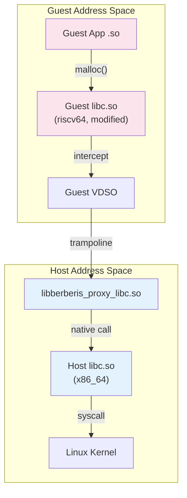

代理库是惰性加载的。当客户机链接器在修改后的客户机库中解析一个符号时，VDSO 会调用 `InterceptGuestSymbol`。该调用触发 `LoadProxyLibrary` 加载对应的 `libberberis_proxy_<name>.so` 并注册拦截。

### 19.3.8 Berberis 配置

`berberis_config.mk` 通过定义完整的产品包列表将所有内容串联起来：

```makefile
# frameworks/libs/binary_translation/berberis_config.mk
include frameworks/libs/native_bridge_support/native_bridge_support.mk

BERBERIS_PRODUCT_PACKAGES_RISCV64_TO_X86_64 := \
    libberberis_exec_region \
    libberberis_proxy_libEGL \
    libberberis_proxy_libGLESv1_CM \
    libberberis_proxy_libGLESv2 \
    ...
    libberberis_proxy_libwebviewchromium_plat_support \
    berberis_prebuilt_riscv64 \
    berberis_program_runner_binfmt_misc_riscv64 \
    berberis_program_runner_riscv64 \
    libberberis_riscv64
```

### 19.3.9 Berberis 与 NBS 之间的同步

构建文件包含明确的同步注释：

```makefile
# Note: keep in sync with `berberis_all_riscv64_to_x86_64_defaults` in
#       frameworks/libs/binary_translation/Android.bp.
```

这条注释在 `native_bridge_support.mk` 中出现了三次（第 31、61、81 行）。这表明两个项目紧密耦合。对其中一个的修改必须反映到另一个中。

---

## 19.4 Houdini：Intel 的闭源桥接

### 19.4.1 背景

**Houdini** 是 Intel 的专有二进制翻译器，它使 ARM 原生代码能够在 x86/x86_64 Android 设备上运行。它最初部署在基于 Intel Atom 的平板和 Chromebook 上，并且仍然是生产 Android 设备上部署最广泛的原生桥接实现。

与 Berberis 不同，Houdini **并不**属于 AOSP。它以专有二进制文件的形式由 Intel 分发，并由 OEM 集成。

### 19.4.2 相同的接口，不同的实现

Houdini 实现的接口与 Berberis 完全相同，即 `NativeBridgeCallbacks` 接口。它导出相同的 `NativeBridgeItf` 符号，结构布局也相同。激活它的系统属性遵循相同的模式：

```
ro.dalvik.vm.native.bridge=libhoudini.so
```

Berberis 使用 `libberberis_riscv64.so`，而 Houdini 使用 `libhoudini.so`。从 ART 的角度看，两者可以互换。

### 19.4.3 翻译方向

| 翻译器 | 客户机（源） | 宿主（目标） |
|------------|---------------|---------------|
| Berberis | RISC-V 64 位 | x86_64 |
| Houdini | ARM / ARM64 | x86 / x86_64 |

Houdini 将 ARM（32 位）和 ARM64（64 位）原生代码翻译到 x86 和 x86_64 宿主上运行。这与典型的 ARM 服务器场景（x86 代码运行在 ARM 上）正好相反——Houdini 是为 Intel 移动平台设计的。

### 19.4.4 架构比较

由于共用同一接口，两个翻译器都采用这些架构模式：

1. **双链接器命名空间设计**：两者都维护并行的客户机与宿主命名空间，因为 `NativeBridgeCallbacks` 需要命名空间操作（`createNamespace`、`linkNamespaces` 等）。
2. **JNI 蹦床生成**：两者都必须基于 JNI 方法 shorty 字符串生成蹦床，因为 `getTrampoline` / `getTrampolineWithJNICallType` 需要在客户机与宿主调用约定之间建立映射。
3. **修改后的客户机库**：两者都发布系统库的客户机 ISA 版本。Houdini 在 x86 设备上发布 ARM/ARM64 库，而 Berberis 在 x86_64 设备上发布 RISC-V 库。
4. **信号处理器委托**：两者都实现 `getSignalHandler`，以处理源自翻译代码的信号（尤其是 SIGSEGV）。
5. **Zygote fork 前清理**：两者都实现 `preZygoteFork`，在进程 fork 前清理翻译状态。

### 19.4.5 已知差异

尽管接口相同，实现却差异显著：

| 方面 | Berberis | Houdini |
|--------|----------|---------|
| 许可证 | Apache 2.0（开源） | 专有 |
| 客户机 ISA | RISC-V 64 | ARM / ARM64 |
| 宿主 ISA | x86_64 | x86 / x86_64 |
| 翻译引擎 | 解释器 + JIT（lite + heavy） | 专有 JIT |
| 向量支持 | RISC-V V 扩展 | ARM NEON |
| 在 AOSP 中可用 | 是 | 否 |
| 分发形式 | 源码 | 二进制 blob |

### 19.4.6 集成点

Houdini 使用相同的系统属性和 init 脚本集成。典型的集成如下所示：

```
# Device configuration
PRODUCT_SYSTEM_PROPERTIES += \
    ro.dalvik.vm.native.bridge=libhoudini.so

# ISA mapping
PRODUCT_SYSTEM_PROPERTIES += \
    ro.dalvik.vm.isa.arm=x86 \
    ro.dalvik.vm.isa.arm64=x86_64
```

包管理器使用 `ro.dalvik.vm.isa.arm` 来确定 ARM 代码可以通过翻译在此 x86 设备上运行。当 APK 仅包含 ARM 原生库时，系统知道要提取它们并通过桥接进行路由。

### 19.4.7 Berberis 作为参考

AOSP 代码库清楚地表明，Berberis 是 NativeBridge 接口的参考实现。AOSP 中的 `native_bridge_support` 库被设计为可与任何遵循 `NativeBridgeCallbacks` 契约的桥接实现一起工作。`native_bridge_support.mk` 文件在定义库列表时没有任何 Berberis 特定的引用——Houdini 可以（并且确实）复用相同的列表。

`native_bridge_support.mk` 中三处明确的“keep in sync”注释表明，支持库与翻译器被设计为一对协调的组件。这对每个翻译器实现都成立。

### 19.4.8 Intel 桥接技术（IBT）

Intel Bridge Technology 是 Houdini 面向现代 Intel 平台的演进。Houdini 是为 Intel Atom 移动 SoC 设计的。IBT 面向运行 Android 的 Intel Core 和 Xeon 处理器。这些包括支持 Android 应用的 Chrome OS 以及 Windows Subsystem for Android：

| 代际 | 产品 | 目标平台 |
|---|---|---|
| Houdini v1-v6 | Intel Atom 平板/手机 | ARM → x86（32 位） |
| Houdini v7+ | Chromebook、Android-x86 | ARM/ARM64 → x86_64 |
| Intel Bridge Technology | Alder Lake+ | ARM64 → x86_64（桌面级） |

IBT 在 Houdini 基础上做了如下改进：

- **混合核心感知**——在 Intel 混合架构（Alder Lake、Raptor Lake）上将翻译后的 ARM 代码调度到 P 核与 E 核
- **AVX/AVX2 利用**——将 ARM NEON SIMD 操作映射到更宽的 Intel 向量指令以获得更高吞吐
- **改进的 JIT 编译**——对长时间运行的翻译代码进行更激进的优化，将开销差距从约 30%（Houdini）缩小到约 10-15%
- **内存模型翻译**——在 Intel 的 TSO（Total Store Order）模型上处理 ARM 的弱序内存模型，插入最少的 fence 指令

IBT 仍然实现相同的 `NativeBridgeCallbacks` 接口，并通过相同的 `ro.dalvik.vm.native.bridge` 系统属性进行配置。

### 19.4.9 Houdini 部署场景

Houdini 及其后继产品部署在多个产品类别中：

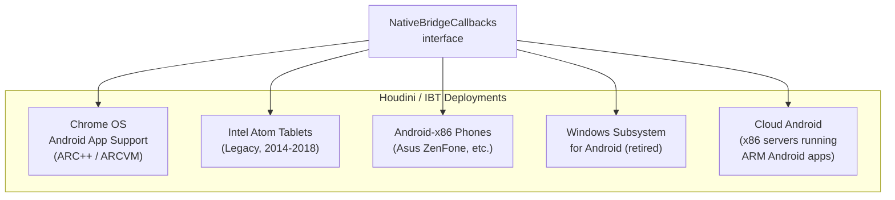

在每种部署中，都适用相同的模式。Houdini/IBT 作为 `libhoudini.so` 安装。客户机 ARM 库放置在 `system/lib/arm/` 和 `system/lib64/arm64/`。包管理器在设备的 ABI 列表中将 ARM ABI 公告为回退目标。

---

## 19.5 DigitalisX64：基于 Berberis 的 ARM64 到 x86_64 翻译器

DigitalisX64 是一个开源的 ARM64 到 x86_64 二进制翻译器，构建在第 19.2 节所述的 Berberis 引擎之上。Berberis 是 AOSP 内部的上游参考实现。DigitalisX64 将其打包为面向 x86_64 模拟器（Goldfish）的可构建发行版。有了它，仅支持 ARM64 的 Android 应用就能在 x86_64 宿主环境中运行。其给出的描述是：

> 基于 Berberis 框架的 arm64 到 x86_64 二进制翻译。

### 19.5.1 源码布局

DigitalisX64 被拆分为一组小型仓库，由一个顶层 `repo` 清单组装而成：

| 仓库 | 用途 |
|---|---|
| `manifest` | 映射 AOSP 与 DigitalisX64 分支的 `repo` 清单 |
| `digitalis` | 入口点，含构建/使用文档 |
| `platform_frameworks_libs_binary_translation` | 位于 `frameworks/libs/binary_translation/` 的 Berberis 分支 |
| `device_generic_goldfish` | 接线使用 DigitalisX64 作为原生桥接的模拟器设备目标 |
| `sample_hello_digitalis` | 在 x86_64 宿主上运行客户机 ARM64 代码的最小示例 |
| `digitalisx64.github.io` | 项目网站 |

### 19.5.2 构建与运行

该项目固定在 `android-latest-release` AOSP 分支。典型的构建流程如下：

```bash
repo init -b android-latest-release \
    -u git@github.com:DigitalisX64/manifest.git
repo sync

source build/envsetup.sh
lunch sdk_phone64_x86_64_digitalis-trunk_staging-userdebug
m

emulator
```

该 lunch 目标生成一个 Goldfish x86_64 系统镜像，其中预装了 Berberis 运行时并配置了 `ro.dalvik.vm.native.bridge`。这使得安装在模拟器内的仅支持 ARM64 的 APK 能够通过第 19.1 节所述的标准 NativeBridge 分发路径经由翻译器路由。

### 19.5.3 与 Berberis 和 Houdini 的关系

DigitalisX64 在设计空间中占据的位置与 Houdini（第 19.4 节）不同：

| 方面 | Houdini / IBT | DigitalisX64 |
|---|---|---|
| 源码 | 闭源（Intel） | 开源（基于 Berberis） |
| 分发 | 预装在授权设备上 | 可从公开清单复现 |
| 维护者 | Intel | 社区 |
| 主要目标 | 硬件设备与 ChromeOS | x86_64 模拟器 |
| 翻译引擎 | 专有 | Berberis（见第 19.2 节） |

由于底层引擎是 Berberis，第 19.2 节的架构评述——解码器、解释器、客户机状态、蹦床以及双命名空间加载器——可以原样适用。DigitalisX64 贡献的是清单、设备树和构建接线，而不是一个新的翻译器核心。

项目链接：

- 源码：[https://github.com/DigitalisX64](https://github.com/DigitalisX64)
- 网站：[https://digitalisx64.github.io](https://digitalisx64.github.io)

---

## 19.6 Android 模拟器原生桥接

Android 模拟器（Goldfish/Ranchu）使用一种不同的原生桥接配置，以支持 x86_64 模拟器镜像上的 ARM 应用。这与 Houdini（设备端）和 Berberis（RISC-V）都不同。它让开发者能够在 x86_64 模拟器中测试仅支持 ARM 的应用。无需完整的 ARM 系统镜像。

### 19.6.1 板配置

将 x86_64 与翻译后的 ARM 配对的 Goldfish 板将 ARM64 声明为其原生桥接架构：

```makefile
# Source: device/generic/goldfish/board/emu64xa/BoardConfig.mk:16-25
# x86_64 emulator specific definitions
TARGET_CPU_ABI := x86_64
TARGET_ARCH := x86_64
TARGET_ARCH_VARIANT := x86_64
TARGET_2ND_ARCH_VARIANT := x86_64

TARGET_NATIVE_BRIDGE_ARCH := arm64
TARGET_NATIVE_BRIDGE_ARCH_VARIANT := armv8-a
TARGET_NATIVE_BRIDGE_CPU_VARIANT := generic
TARGET_NATIVE_BRIDGE_ABI := arm64-v8a
```

这产生一个仅支持 64 位的设备，它原生运行 x86_64 代码，并能通过原生桥接翻译 ARM64 代码。对应的 RISC-V 版本 `device/generic/goldfish/board/emu64xr/BoardConfig.mk:22-25` 是相同的板形状，只是 `TARGET_NATIVE_BRIDGE_ARCH := riscv64` 且 `TARGET_NATIVE_BRIDGE_ABI := riscv64`；它通过 `PRODUCT_DEVICE := emu64xr`（`device/generic/goldfish/64bitonly/product/sdk_phone64_x86_64_riscv64.mk:26`）支撑 `sdk_phone64_x86_64_riscv64` 产品。这两块板都没有 `TARGET_2ND_CPU_ABI` 或 `TARGET_NATIVE_BRIDGE_2ND_*`。现代模拟器镜像仅支持 64 位，因此没有 32 位 x86 或 `armeabi-v7a` 槽位可填。

### 19.6.2 ABI 列表构建

构建系统通过将原生 ABI 放在前面、再追加原生桥接 ABI 作为回退来构造设备的 ABI 列表：

```makefile
# Source: build/make/core/board_config.mk:387-399
# Add NATIVE_BRIDGE_ABIs at the end to keep order of preference.
TARGET_CPU_ABI_LIST := $(TARGET_CPU_ABI_LIST_64_BIT) $(TARGET_CPU_ABI_LIST_32_BIT) \
                       $(_target_native_bridge_abi_list_64_bit) \
                       $(_target_native_bridge_abi_list_32_bit)

# For the 64-bit-only emu64xa board this collapses to:
TARGET_CPU_ABI_LIST := x86_64,arm64-v8a
#                      ^^^^^^ native  ^^^^^^^^^^ bridge
```

**顺序很重要**。当原生 x86_64 库可用时，包管理器会优先选择它们。只有当 APK 不包含任何 x86_64 代码时，它才会通过桥接回退到 ARM。这就是为什么大多数应用在模拟器上以全原生速度运行——只有那些仅包含 ARM 原生库的应用才会经过翻译。

### 19.6.3 NDK 翻译包

`ndk_translation_package` Soong 模块为 x86 设备打包 ARM 库：

```go
// Source: build/soong/cc/ndk_translation_package.go:29-60
func init() {
    android.RegisterModuleType("ndk_translation_package",
        NdkTranslationPackageFactory)
}

type ndkTranslationPackageProperties struct {
    // ARM/ARM64 libraries that should be bundled for translation
    Native_bridge_deps  proptools.Configurable[[]string]
    // x86/x86_64 libraries that should be bundled alongside
    Device_both_deps    []string
    Device_64_deps      []string
    Device_32_deps      []string
}
```

在构建时，该模块收集其依赖的原生桥接变体和原生变体。它将它们（以 `system/...` 条目的形式，连同生成的 `Android.bp` 和 `product.mk`）打包成一个可分发的 `ndk_translation_package.zip`。没有直接的系统镜像安装规则。使用该包的产品随后会把 ARM 库放在：

```
/system/lib/arm/           # 32-bit ARM libraries
/system/lib64/arm64/       # 64-bit ARM64 libraries
```

这些目录映射了标准库布局，但包含的是原生桥接在运行时翻译的 ARM 架构二进制文件。

### 19.6.4 Soong 架构变体

Soong 的构建系统在为支持 ARM 桥接的 x86 目标构建时，会为每个模块创建特殊的“原生桥接”变体：

```go
// Illustrative pseudocode (simplified from build/soong/android/arch.go:396-405).
// The real ArchVariation() also has an `else if target.LFI` branch and builds
// the prefix into a local before appending the arch name.
func (target Target) ArchVariation() string {
    var variation string
    if target.NativeBridge {
        variation = "native_bridge_"
    }
    return variation + target.Arch.String()
}
```

对于带有 ARM64 原生桥接的 x86_64 设备，每个原生库都会被编译两次：

| 变体 | 架构 | 输出路径 | 用途 |
|---|---|---|---|
| `x86_64` | 原生 x86_64 | `/system/lib64/` | 直接执行 |
| `x86` | 原生 x86 | `/system/lib/` | 32 位兼容 |
| `native_bridge_arm64` | ARM64 | `/system/lib64/arm64/` | 桥接翻译 |
| `native_bridge_arm` | ARM | `/system/lib/arm/` | 桥接翻译 |

### 19.6.5 图形与 Vulkan 桥接支持

两个图形加载器都链接到 `libnativebridge_lazy`：

```
// Source: frameworks/native/opengl/libs/Android.bp:193
"libnativebridge_lazy",   // in the libEGL shared_libs list

// Source: frameworks/native/vulkan/libvulkan/Android.bp:152
"libnativebridge_lazy",   // in the libvulkan shared_libs list
```

有必要精确说明这个依赖带来了什么，因为它比看起来要窄。这些加载器使用 libnativebridge 仅为了加载为客户机 ISA 构建的 GPU *调试层*库。`egl_layers.h:77` 通过 `android::NativeBridgeGetTrampoline(dlhandle_, name, nullptr, 0)` 解析层入口点。`frameworks/native/vulkan/libvulkan/layers_extensions.cpp:129-134` 对 Vulkan 层做了同样的事。应用自身所调用的任何普通 GL 或 Vulkan 入口点都不会通过 libnativebridge 分发。

应用日常的 GLES 和 Vulkan 调用走的是另一条路线。客户机进程链接到从 `frameworks/libs/native_bridge_support/android_api/libEGL` 和 `.../libvulkan` 构建的客户机 ISA 桩库。对这些桩库的调用会被拦截并交给宿主侧代理库：`libberberis_proxy_libEGL` 和 `libberberis_proxy_libvulkan`（`frameworks/libs/binary_translation/berberis_config.mk:27,46`）。`proxy_loader/proxy_loader.cc:63-78` 在首次使用时加载它们。它们转发到真正的宿主 GPU 驱动。

第 19.2.10 节的蹦床机制在两条路径中都桥接了这两种 ISA。只有层加载路径通过 libnativebridge 的公共 API。

### 19.6.6 模拟器与设备桥接比较

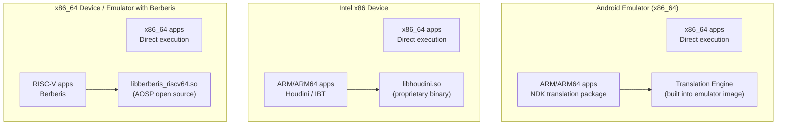

| 方面 | 模拟器桥接 | Houdini / IBT | Berberis | DigitalisX64 |
|---|---|---|---|---|
| **宿主** | x86_64 (QEMU) | x86 / x86_64 (bare metal) | x86_64 (bare metal) | x86_64 (QEMU) |
| **客户机** | ARM / ARM64 | ARM / ARM64 | RISC-V 64 | ARM64 |
| **源码** | AOSP 构建系统 | Intel 专有 | AOSP 开源 | 基于 Berberis 的分支（开源） |
| **配置文件** | `BoardConfig.mk` | 系统属性 | `berberis_config.mk` | `BoardConfig.mk`（分支）+ manifest |
| **库路径** | `system/lib/arm/` | `system/lib/arm/` | `system/lib64/riscv64/` | `system/lib64/arm64/` |
| **主要用途** | 开发者测试 | 生产设备 | RISC-V 应用生态系统启动 | 开源 ARM64 到 x86_64 模拟器构建 |

### 19.6.7 翻译生态系统

所有四种桥接实现——Berberis、Houdini/IBT、模拟器的 NDK 翻译以及 DigitalisX64 社区构建——都共享相同的 NativeBridge 接口。它们还共享相同的运行时集成点。这种统一的架构意味着：

1. **应用开发者无需关心**使用的是哪种桥接——他们的 ARM APK 在所有桥接上运行效果一致
2. **框架透明地处理回退**——PackageManager 从设备的列表中选择最佳 ABI，仅在必要时使用桥接
3. **在模拟器上测试可验证真实设备行为**——相同的翻译路径既用于 x86 模拟器，也用于装有 Houdini 的 Intel Chromebook 以及 DigitalisX64 构建的模拟器镜像
4. **单一引擎驱动多种发行版**——Berberis 是 AOSP 内部的上游翻译器。DigitalisX64 将其复用为社区维护的 ARM64 → x86_64 模拟器发行版（见第 19.5 节）

---

## 19.7 RISC-V 与未来

### 19.7.1 AOSP 中的 RISC-V

RISC-V 是 AOSP 二进制翻译战略的重点。尽管 ARM 到 x86 的翻译（Houdini）是历史上的用例，但 Google 当前的投入是通过 Berberis 进行 RISC-V 到 x86_64 的翻译。

RISC-V 的工具链配置位于 `build/soong/cc/config/riscv64_device.go`：

```go
var (
  riscv64Cflags = []string{
    "-Werror=implicit-function-declaration",
    "-march=rv64gcv_zba_zbb_zbs_zvbb",
    "-mno-implicit-float",
  }
  riscv64Ldflags = []string{
    "-march=rv64gcv_zba_zbb_zbs_zvbb",
    "-Wl,-z,max-page-size=4096",
  }
)
```

`-march=rv64gcv_zba_zbb_zbs_zvbb` 标志指定了：

| 扩展 | 含义 |
|-----------|---------|
| rv64g | 基础 64 位整数 + M（乘法）+ A（原子）+ F（单精度浮点）+ D（双精度浮点） |
| c | 压缩指令（16 位） |
| v | 向量扩展 |
| zba | 地址生成（位操作） |
| zbb | 基本位操作 |
| zbs | 单比特操作 |
| zvbb | 向量位操作 |

`-mno-implicit-float` 标志是一个变通方案：

```go
// TODO: remove when qemu V works
// (Note that we'll probably want to wait for berberis to be good enough
// that most people don't care about qemu's V performance either!)
"-mno-implicit-float",
```

这条注释揭示了一个重要的战略细节：**Berberis 被定位为运行 RISC-V Android 时 QEMU 的继任者**。一旦 Berberis 的向量翻译足够成熟，针对 QEMU 限制的 `-mno-implicit-float` 变通方案就可以移除。

### 19.7.2 工具链

RISC-V 工具链在 Soong 构建系统中注册：

```go
func (t *toolchainRiscv64) ClangTriple() string {
  return "riscv64-linux-android"
}

func init() {
  registerToolchainFactory(android.Android, android.Riscv64,
      riscv64ToolchainFactory)
}
```

`riscv64-linux-android` 是 Android RISC-V 目标的 Clang triple。页面大小设置为 4096 字节（`-Wl,-z,max-page-size=4096`），与移动设备的典型配置一致。

### 19.7.3 产品配置

RISC-V 桥接通过产品配置激活。来自 `enable_riscv64_to_x86_64.mk`：

```makefile
include frameworks/libs/binary_translation/berberis_config.mk

PRODUCT_PACKAGES += $(BERBERIS_PRODUCT_PACKAGES_RISCV64_TO_X86_64)

PRODUCT_SYSTEM_PROPERTIES += \
    ro.dalvik.vm.native.bridge=libberberis_riscv64.so

PRODUCT_SYSTEM_PROPERTIES += \
    ro.dalvik.vm.isa.riscv64=x86_64 \
    ro.enable.native.bridge.exec=1

BUILD_BERBERIS := true
BUILD_BERBERIS_RISCV64_TO_X86_64 := true
$(call soong_config_set,berberis,translation_arch,riscv64_to_x86_64)
```

Soong 配置变量 `berberis.translation_arch=riscv64_to_x86_64` 控制构建哪些翻译模块。`BUILD_BERBERIS` 和 `BUILD_BERBERIS_RISCV64_TO_X86_64` 标志被旧的 Make 构建系统使用。

### 19.7.4 分发产物

为支持 RISC-V 桥接而安装在设备上的完整文件集（`berberis_config.mk`，第 57-130 行）：

**二进制文件：**
```
system/bin/berberis_program_runner_binfmt_misc_riscv64
system/bin/berberis_program_runner_riscv64
system/bin/riscv64/app_process64
system/bin/riscv64/linker64
```

**配置：**
```
system/etc/binfmt_misc/riscv64_dyn
system/etc/binfmt_misc/riscv64_exe
system/etc/init/berberis.rc
system/etc/ld.config.riscv64.txt
```

**宿主侧库（x86_64）：**
```
system/lib64/libberberis_riscv64.so
system/lib64/libberberis_exec_region.so
system/lib64/libberberis_proxy_lib*.so   (21 proxy libraries)
```

**客户机侧库（RISC-V）：**
```
system/lib64/riscv64/libc.so
system/lib64/riscv64/libm.so
system/lib64/riscv64/libEGL.so
system/lib64/riscv64/libGLESv2.so
system/lib64/riscv64/libvulkan.so
... (30+ guest libraries)
```

### 19.7.5 binfmt_misc 集成

binfmt_misc 注册文件使 Linux 内核能在执行 RISC-V ELF 二进制文件时自动调用 Berberis：

```
system/etc/binfmt_misc/riscv64_dyn    # Dynamic executables
system/etc/binfmt_misc/riscv64_exe    # Static executables
```

init 脚本 `berberis.rc` 在引导期间将它们注册到内核的 binfmt_misc 文件系统中，从而可以从 shell 透明地执行 RISC-V 二进制文件。

### 19.7.6 为什么 RISC-V 翻译很重要

对 RISC-V 的关注代表一项战略投资：

1. **生态系统引导**：RISC-V Android 硬件正在涌现，但缺乏应用支持。二进制翻译通过让 x86_64 设备（模拟器、开发板）在过渡期间运行 RISC-V 应用来弥合这一差距。
2. **取代 QEMU**：`riscv64_device.go` 中的注释明确将 Berberis 定位为最终取代用于 RISC-V Android 开发的 QEMU。Berberis 在 Android 进程模型内运行，并与 ART 有恰当的集成，而 QEMU 是一个开销更高的全系统模拟器。
3. **双向价值**：ARM 到 x86 的翻译惠及 x86 设备，因为这些设备运行 ARM 应用。RISC-V 翻译也惠及 RISC-V 生态系统，因为它在硬件广泛可用之前提供了一个开发平台。

### 19.7.7 多目标架构

Berberis 的架构支持多个客户机到宿主的翻译配对，并且 Android 17 代码树中为生产路径 RISC-V 到 x86_64 之外的两个方向提供了脚手架。ARM（32 位）和 ARM64 客户机都有按架构划分的状态和 ABI 目录：

```
frameworks/libs/binary_translation/guest_state/arm/
frameworks/libs/binary_translation/guest_state/arm64/
frameworks/libs/binary_translation/guest_abi/arm/
frameworks/libs/binary_translation/guest_abi/arm64/
```

还有一个 RISC-V 运行在 ARM64 *宿主*上的路径，其中宿主机器是 ARM64，客户机仍然是 RISC-V。第 19.9 节将详细介绍这两个 ARM64 方向。简而言之：ARM64 工作是脚手架，而非生产。ARM64 宿主翻译器只进行解释，其系统调用桥接是一个 `-ENOSYS` 桩。相比之下，ARM64 *客户机*路径已实现系统调用仿真，但还没有翻译器层级。

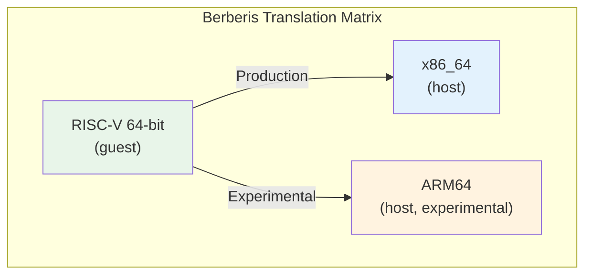

### 19.7.8 扩展支持路线图

RISC-V ISA 是模块化的——无需更改基础指令集即可添加新的扩展。当前的 Berberis 解码器已经处理：

- **RV64I**：基础整数指令
- **M**：整数乘法与除法
- **A**：原子指令（LR/SC、AMO）
- **F/D**：单精度与双精度浮点
- **C**：压缩（16 位）指令
- **V**：向量扩展（大多数指令）
- **Zba/Zbb/Zbs**：位操作

解码器基于枚举的操作码设计使添加新扩展变得简单。每个扩展都会在解码器模板中添加新的枚举值和新的 `Decode*` 方法。

---

## 19.8 三层 CPU 仿真引擎

第 19.2.3 节介绍了 Berberis 的解释器、lite 翻译器和重型优化器这三个执行后端。Android 17 的重新组织使它们之间的关系变得明确。三者加上解码器、IR 后端以及在它们之间进行选择的分发器，现在都位于 `frameworks/libs/binary_translation/cpu_emulation/` 之下。本节介绍将这些层级串联起来的分发器。

### 19.8.1 translator 模块

在 Android 17 之前，按区域翻译的分发器位于 `runtime/` 库内部。17 的重新组织将其拆分为独立的模块（提交“translator_riscv64: split out from runtime”，`Bug: 476465845`）。因此运行时不再依赖完整的代码生成器。公共入口点是 `frameworks/libs/binary_translation/cpu_emulation/translator/include/berberis/translator/translator.h` 中的一个单一函数：

```cpp
void InitTranslator();
```

该实现中与架构无关的一半位于 `frameworks/libs/binary_translation/cpu_emulation/translator/riscv64/translator.cc`（第 88-92 行）。它接线了按宿主的分发器、用于返回宿主的虚拟调用帧以及解释器：

```cpp
void InitTranslator() {
  InitTranslatorArch();
  InitVirtualGuestCallFrameReturnAddress(ToGuestAddr(g_native_bridge_call_guest + 1));
  InitInterpreter();
}
```

`InitTranslatorArch()` 有两个在构建时由*宿主*架构选择的定义：`translator_x86_64.cc` 中的完整版本和 `translator_arm64.cc` 中接近空的桩。这个拆分就是让同一个 RISC-V 前端既能面向 x86_64 也能面向 ARM64 宿主的接缝（第 19.9 节）。

### 19.8.2 翻译模式

位于 `frameworks/libs/binary_translation/cpu_emulation/translator/riscv64/translator_x86_64.cc`（第 50-60 行）中的 x86_64 分发器枚举了决定运行哪个层级的策略：

```cpp
enum class TranslationMode {
  kInterpretOnly,
  kLiteTranslateOrFallbackToInterpret,
  kHeavyOptimizeOrFallbackToInterpret,
  kHeavyOptimizeOrFallbackToLiteTranslator,
  kLiteTranslateThenHeavyOptimize,
  kTwoGear = kLiteTranslateThenHeavyOptimize,
  kNumModes
};

TranslationMode g_translation_mode = TranslationMode::kTwoGear;
```

默认是**双档**（`kLiteTranslateThenHeavyOptimize`）：一个区域首先被 lite 翻译，之后只有热点区域才会被提升到重型优化器。`UpdateTranslationMode()`（第 62-86 行）让开发者可以通过配置字符串按名称覆盖策略（`"interpret-only"`、`"two-gear"` 等）。当错误编译被隔离到单一层级时，这非常有用。

### 19.8.3 双档提升

分发器区分两个*档位*（第 88-91 行）：

```cpp
enum class TranslationGear {
  kFirst,
  kSecond,
};
```

第一档在一个区域首次被翻译时运行。第二档在已经 lite 翻译过的区域被提升时运行。该决策位于 `TranslateRegion`（`translator_x86_64.cc`，第 156-229 行）中。在双档模式下，第一档以启用自分析的方式调用 `TryLiteTranslateAndInstallRegion`，将区域的调用计数器编织进生成的代码：

```cpp
} else if (g_translation_mode == TranslationMode::kTwoGear &&
           kGear == TranslationGear::kFirst) {
  std::tie(success, host_code_piece, size, kind) = TryLiteTranslateAndInstallRegion(
      pc, {.enable_self_profiling = true, .counter_location = &(entry->invocation_counter)});
  if (!success) {
    // Heavy supports more insns than lite, so try to heavy optimize. If that
    // fails, then fallback to interpret.
    std::tie(success, host_code_piece, size, kind) = HeavyOptimizeRegion(pc);
    // ...
  }
}
```

注入的计数器在区域每次执行时递增。当它越过一个阈值时，区域会在第二档重新进入，第二档通过 `LockForGearUpTranslation`（第 165 行）获取缓存槽并运行 `HeavyOptimizeRegion`。每个层级都会报告它所产生的代码种类，结果通过 `SetTranslatedAndUnlock`（第 228 行）提交到翻译缓存。这些种类本身是在同文件顶部附近声明的别名（`translator_x86_64.cc`，第 45-48 行）：

```cpp
GuestCodeEntry::Kind kInterpreted = GuestCodeEntry::Kind::kInterpreted;
GuestCodeEntry::Kind kLiteTranslated = GuestCodeEntry::Kind::kLiteTranslated;
GuestCodeEntry::Kind kHeavyOptimized = GuestCodeEntry::Kind::kHeavyOptimized;
```

每个层级都可以回退到其下方的层级。Lite 对于无法翻译的指令会回退到解释器。Heavy 会回退到 lite 或解释器。解释器是万能的兜底，因此没有任何 JIT 能处理的区域仍然能正确运行，只是速度较慢。

### 19.8.4 层级提升状态机

在默认的双档策略下，单个客户机区域的生命周期：

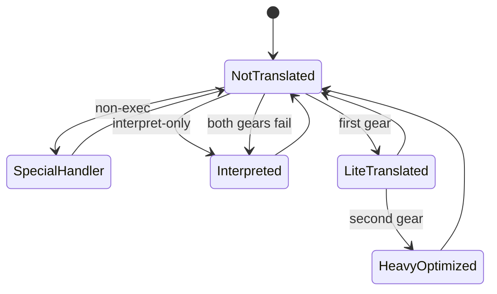

每一条回到 `NotTranslated` 的无标签边都是对 `InvalidateGuestRange` 的调用，它会将区域从它所到达的任何层级丢弃回该状态。一旦区域的执行计数器越过重型优化阈值，`second gear` 提升就会被触发。

### 19.8.5 现在每个层级所在的位置

合并之后，三个层级及其共享基础设施映射到 `cpu_emulation/` 下的这些路径：

| 层级或组件 | Android 17 路径 |
|---|---|
| 解码器 | `frameworks/libs/binary_translation/cpu_emulation/decoder/` |
| 解释器 | `frameworks/libs/binary_translation/cpu_emulation/interpreter/riscv64/` |
| Lite 翻译器 | `frameworks/libs/binary_translation/cpu_emulation/lite_translator/riscv64_to_x86_64/` |
| 重型优化器 | `frameworks/libs/binary_translation/cpu_emulation/heavy_optimizer/riscv64/` |
| IR 后端 | `frameworks/libs/binary_translation/cpu_emulation/backend/` |
| 汇编器 | `frameworks/libs/binary_translation/cpu_emulation/assembler/` |
| 内建函数 | `frameworks/libs/binary_translation/cpu_emulation/intrinsics/` |
| 层级分发器 | `frameworks/libs/binary_translation/cpu_emulation/translator/` |

分发器写入的翻译缓存、蹦床以及 `runtime/` 初始化仍然在 `cpu_emulation/` 之外。它们是*宿主*运行时的一部分，而不是客户机 CPU 仿真器的一部分。

---

## 19.9 ARM64 脚手架

Android 17 代码树包含两项截然不同的 ARM64 工作，重要的是不要把它们混为一谈。两者都是脚手架——结构足以构建和测试该路径，但并非生产级翻译器。

### 19.9.1 两个 ARM64 方向

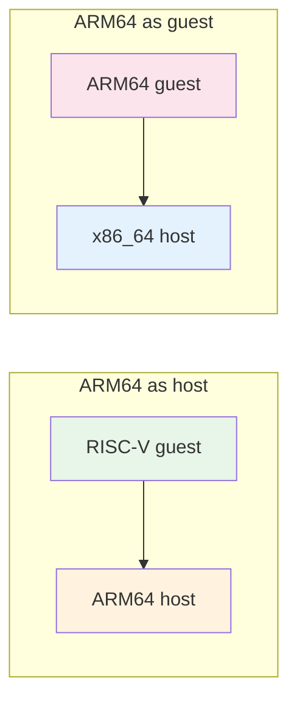

- **ARM64 作为宿主**：同样的 RISC-V 前端，但生成的（或解释的）代码在 ARM64 机器上运行。这由*宿主*构建架构选择。
- **ARM64 作为客户机**：ARM64 原生代码作为输入，被翻译以运行在 x86_64 宿主上。这映射了 Houdini 所做的事（第 19.4 节），但使用的是 Berberis 引擎。

### 19.9.2 ARM64 作为宿主：仅解释

当 Berberis 为 ARM64 宿主构建时，翻译器的架构钩子会解析到 `frameworks/libs/binary_translation/cpu_emulation/translator/riscv64/translator_arm64.cc` 中的桩。将其与第 19.8 节的 x86_64 分发器对比：完全没有层级。`InitTranslatorArch()` 是空的，`TranslateRegion` 将每个可执行区域记录为 `kInterpreted`：

```cpp
void InitTranslatorArch() {}

void TranslateRegion(GuestAddr pc) {
  using Kind = GuestCodeEntry::Kind;
  TranslationCache* cache = TranslationCache::GetInstance();
  GuestCodeEntry* entry = cache->AddAndLockForTranslation(pc, 0);
  if (!entry) {
    return;
  }
  // ... executability check ...
  cache->SetTranslatedAndUnlock(pc, entry, insn_size, Kind::kInterpreted, {kEntryInterpret, 0});
}
```

换句话说，RISC-V 运行在 ARM64 上目前*仅进行解释*；该宿主还没有 lite 或 heavy JIT。支持性的宿主运行时入口点位于 `frameworks/libs/binary_translation/runtime/runtime_library/runtime_library_arm64.cc` 以及汇编桩 `frameworks/libs/binary_translation/base/raw_syscall_arm64.S` 中。

### 19.9.3 ARM64 作为客户机：状态、ABI 与系统调用

ARM64 客户机方向在数据结构方面比在翻译方面进展更远。代码树带有按架构划分的客户机状态和 ABI 模块：

```
frameworks/libs/binary_translation/guest_state/arm64/
frameworks/libs/binary_translation/guest_abi/arm64/
frameworks/libs/binary_translation/cpu_emulation/code_gen_lib/arm64_to_x86_64/
frameworks/libs/binary_translation/cpu_emulation/insn_tests/arm64/
```

有一个运行时方向目录 `frameworks/libs/binary_translation/runtime/arm64_to_x86_64/`，以及位于 `frameworks/libs/binary_translation/runtime/arm64/`（`init_guest_arch.cc`、`init_kernel_args.cc`、`run_guest_call.cc`）中的客户机入口管道。

ARM64 客户机的系统调用层也是真实的，并非占位符。`frameworks/libs/binary_translation/kernel_api/arm64/` 带有已实现的仿真（`syscall_emulation.cc`、`syscall_emulation_arch.cc`、`open_emulation.cc`、`epoll_emulation.cc`）。该仿真被构建进 arm/arm64 客户机内核 API 库中。代码树中未完成的系统调用桥接属于*另一个*方向。
`frameworks/libs/binary_translation/kernel_api/runtime_bridge_riscv64_to_arm64.cc` 只为 ARM64 *宿主*编译（ARM64 机器上的 RISC-V 客户机，第 19.9.2 节）。其中的每个入口点都是返回 `-ENOSYS` 并跟踪该调用的桩：

```cpp
long RunGuestSyscall___NR_rt_sigaction(long sig_num_arg,
                                       long act_arg,
                                       long old_act_arg,
                                       long sigset_size_arg) {
  UNUSED(sig_num_arg, act_arg, old_act_arg, sigset_size_arg);
  TRACE("unimplemented syscall __NR_rt_sigaction");
  errno = ENOSYS;
  return -1;
}
```

ARM64 客户机方向的生成式系统调用号表（`frameworks/libs/binary_translation/kernel_api/arm64/gen_syscall_emulation_arm64_to_x86_64-inl.h`）被那个 `syscall_emulation.cc` 包含，因此客户机侧分发已端到端接线完成。

### 19.9.4 这对路线图意味着什么

要点：在 Android 17 中，Berberis 是一个生产级的 RISC-V 到 x86_64 翻译器，同时正在两条战线上进行 ARM64 扩展。ARM64 宿主路径可以解释 RISC-V，但没有 JIT。其系统调用桥接是 `-ENOSYS` 桩。ARM64 客户机路径拥有其状态、ABI 和代码生成目录、指令测试以及已实现的系统调用仿真层。它还没有翻译器层级。

目前这两个 ARM64 方向都不能替代 Houdini 或 IBT（第 19.4 节）。社区的 DigitalisX64 发行版（第 19.5 节）采用 ARM64 客户机引擎并将其打包用于 x86_64 模拟器。如今，这是来自公开来源的、最完整的 ARM64 路径。

---

## 19.10 动手试试

### 练习 19.1：检查 NativeBridge 状态

检查你的设备或模拟器上是否配置了原生桥接：

```bash
adb shell getprop ro.dalvik.vm.native.bridge
```

如果配置了桥接，你会看到一个库名（例如 `libberberis_riscv64.so` 或 `libhoudini.so`）。如果输出是 `0`，则没有加载桥接。

```bash
# Check ISA mappings
adb shell getprop ro.dalvik.vm.isa.riscv64
adb shell getprop ro.dalvik.vm.isa.arm
adb shell getprop ro.dalvik.vm.isa.arm64
```

### 练习 19.2：检查桥接库

在启用了 Berberis 的模拟器上：

```bash
# Verify the bridge library exists
adb shell ls -la /system/lib64/libberberis_riscv64.so

# Check the NativeBridgeItf symbol
adb shell readelf -s /system/lib64/libberberis_riscv64.so | \
    grep NativeBridgeItf
```

输出应显示一个名为 `NativeBridgeItf` 的 GLOBAL 符号，类型为 OBJECT。

### 练习 19.3：列出客户机库

```bash
# List guest RISC-V libraries
adb shell ls /system/lib64/riscv64/

# List proxy libraries
adb shell ls /system/lib64/libberberis_proxy_*
```

将代理列表与 `native_bridge_support.mk` 中的 `NATIVE_BRIDGE_MODIFIED_GUEST_LIBS` 进行比较——每个修改后的客户机库都应该有一个对应的代理。

### 练习 19.4：运行客户机二进制文件

如果安装了 `berberis_program_runner_riscv64`：

```bash
# Run on device
adb shell /system/bin/berberis_program_runner_riscv64 \
    /data/nativetest64/berberis_hello_world_static.native_bridge/x86_64/\
    berberis_hello_world_static
```

或者从主机构建：

```bash
# Run on host
out/host/linux-x86/bin/berberis_program_runner_riscv64 \
    out/target/product/emu64xr/testcases/\
    berberis_hello_world_static.native_bridge/x86_64/\
    berberis_hello_world_static
```

### 练习 19.5：跟踪桥接加载

Berberis 原生桥接垫片中的每回调消息并不是 logcat 消息。每条都是一个 `LOG_NB(...)` 调用。`frameworks/libs/binary_translation/native_bridge/native_bridge.cc:50` 将 `LOG_NB` 定义为 `TRACE`。该宏是 Berberis 自己的跟踪宏。它受 `Tracing::IsOn()` 控制，并写入文件或套接字而不是日志缓冲区。

（在此提高 `log.tag.nativebridge` 没有任何作用：`art/libnativebridge/native_bridge.cc` 设置了 `LOG_TAG "nativebridge"`，但完全没有 `ALOGV` 调用，只有警告和错误。）因此，观察加载的方法是开启 Berberis 跟踪：

```bash
# Destination is a file path, ":<port>" for localhost, or "1"/"2" for stdout/stderr.
# A relative path lands in the app's private directory; prefix "<package>=" to
# trace only one app.
adb shell setprop berberis.tracing com.example.game=berberis.trace

# Launch the app, then collect the trace from its data directory
adb shell run-as com.example.game cat berberis.trace
```

对于主机运行，也可以通过 `BERBERIS_TRACING` 环境变量提供相同的目标（`base/config_globals.cc:226-229`、`base/tracing.cc:119-141`）。在得到的跟踪中，你应该能看到如下所示的行：

```
native_bridge_initialize(runtime_callbacks=0x..., private_dir='...', app_isa='riscv64')
native_bridge_loadLibraryExt(path=libgame.so)
native_bridge_getTrampolineWithJNICallType(handle=0x..., name='nativeInit', shorty='VL', ...)
```

也只有少数几条消息会到达 logcat。它们在 `LOG_TAG "berberis"` 下使用 `TRACE_AND_ALOGI`。这些消息是启动横幅 `Initialized Berberis (riscv64)`（`native_bridge.cc:414-416`）以及库回退到宿主平台的通知（`native_bridge.cc:187`）。这些消息你可以用 `adb logcat -s berberis:*` 来观察。

### 练习 19.6：阅读 NativeBridgeCallbacks 头文件

打开 `art/libnativebridge/include/nativebridge/native_bridge.h` 并：

1. 数出 `NativeBridgeCallbacks` 中函数指针字段的总数。
   答案：20 个函数指针，从 `initialize` 到
   `isNativeBridgeFunctionPointer`——如果包含开头的
   `uint32_t version`，则总共 21 个字段。

2. 确定哪个版本引入了命名空间支持。
   答案：版本 3——`createNamespace`、`linkNamespaces` 和
   `loadLibraryExt` 回调。

3. 找到 `NativeBridgeRuntimeCallbacks` 结构体，并解释
   `getMethodShorty` 的作用。
   答案：它检索 Java 方法的紧凑类型描述符（"shorty"）。
   桥接用它来生成正确的蹦床调用约定。

### 练习 19.7：从源码构建 Berberis

```bash
source build/envsetup.sh
lunch sdk_phone64_x86_64_riscv64-trunk_staging-eng
m berberis_all
```

构建之后，运行主机测试：

```bash
m berberis_all berberis_run_host_tests
```

或者直接：

```bash
out/host/linux-x86/nativetest64/berberis_host_tests/berberis_host_tests
```

### 练习 19.8：走读一个蹦床

跟踪一次 JNI 原生方法调用穿过桥接的代码路径：

1. 从 `art/libnativebridge/native_bridge.cc` 中的 `NativeBridgeGetTrampoline2()`（第 477 行）开始。
2. 跟踪到 `g_callbacks->getTrampolineWithJNICallType()` 的分发。
3. 这会调用 `frameworks/libs/binary_translation/native_bridge/native_bridge.cc` 中的 `native_bridge_getTrampolineWithJNICallType()`（第 432 行）。
4. 该函数调用 `DlSym` 找到客户机地址，然后调用 `WrapGuestJNIFunction` 创建蹦床。
5. 在 `jni_trampolines.cc` 内部，shorty 被转换为包装器签名，`WrapGuestFunctionImpl` 创建宿主可调用的函数。

### 练习 19.9：比较两个头文件

并排打开这两个文件：

- `art/libnativebridge/include/nativebridge/native_bridge.h`（ART 的规范定义）
- `frameworks/libs/binary_translation/native_bridge/native_bridge.h`（Berberis 的本地副本）

Berberis 头文件在第 17 行注明：

```cpp
// ATTENTION: this is a local copy of system/core/include/nativebridge/
// native_bridge.h for v3, modded to remove interfaces used by the
// runtime to control native bridge.
// The copy makes berberis compile-time independent from native bridge
// version in system/core/libnativebridge.
```

比较这些结构体。它们在布局上应该是相同的（相同的函数指针偏移），但 Berberis 的副本可能省略了一些工具函数。这种解耦使 Berberis 无需依赖构建树中 `libnativebridge` 的确切版本即可编译。

### 练习 19.10：检查解码器操作码

打开 `frameworks/libs/binary_translation/cpu_emulation/decoder/include/berberis/decoder/riscv64/decoder.h` 并：

1. 找到 `BranchOpcode` 枚举并列出所有分支类型。
2. 找到 `AmoOpcode` 枚举并确定支持哪些原子操作。
3. 查找压缩指令处理——解码器会透明地处理 16 位压缩指令以及 32 位基础指令。

---

## 总结

NativeBridge 系统是 Android 在架构上最优雅的子系统之一。通过在 `libnativebridge` 中定义一个清晰的回调接口（`NativeBridgeCallbacks` v1-v8），AOSP 允许任何二进制翻译器无需修改 ART 即可接入。

Berberis 是 Google 的开源参考实现，展示了 Android 上二进制翻译的完整复杂性。它展示了多层翻译（解释器、lite JIT、重型优化器）、双链接器命名空间以及从方法 shorty 字符串生成 JNI 蹦床。它还展示了客户机 CPU 状态管理、代理库拦截以及带双栈回溯的崩溃报告。在 Android 17 中，该引擎被重新组织。解码器、三个层级、IR 后端、汇编器、内建函数和层级分发器被合并到一个新的 `cpu_emulation/` 目录下。分发器的双档策略（先 lite 翻译，再对热点区域进行重型优化）现在是从 `runtime/` 拆分出来的独立模块。

`native_bridge_support` 库提供客户机侧运行时环境。这包括 21 个客户机侧 API 库、一个客户机链接器、一个客户机 VDSO 和一个客户机 app_process。相匹配的宿主侧 `libberberis_proxy_*` 代理由 `frameworks/libs/binary_translation/android_api/` 构建。它们与桥接实现一起，构成了一个面向外来 ISA 应用的完整执行环境。

对 RISC-V 的关注使 Berberis 成为 Android 未来的一项战略投资。`riscv64_device.go` 中的注释明确将其定位为 QEMU 的继任者，而全面的向量扩展支持和 CTS 兼容性也展现了生产级的雄心。在生产路径 RISC-V 到 x86_64 之外，17 代码树还在两个方向上带有 ARM64 脚手架。一个是仅解释的 RISC-V-on-ARM64 宿主路径，其运行时系统调用桥接是一个 `-ENOSYS` 桩。另一个是 ARM64 客户机路径，其系统调用仿真已实现，但还没有翻译器层级。

### 关键源码文件

| 文件 | 作用 |
|------|------|
| `art/libnativebridge/include/nativebridge/native_bridge.h` | 规范的 NativeBridgeCallbacks 定义 |
| `art/libnativebridge/native_bridge.cc` | ART 侧桥接管理 |
| `frameworks/libs/binary_translation/native_bridge/native_bridge.cc` | Berberis NativeBridgeItf 导出 |
| `frameworks/libs/binary_translation/README.md` | Berberis 入门 |
| `frameworks/libs/binary_translation/cpu_emulation/decoder/include/berberis/decoder/riscv64/decoder.h` | RISC-V 解码器 |
| `frameworks/libs/binary_translation/cpu_emulation/interpreter/riscv64/interpreter-main.cc` | 解释器入口 |
| `frameworks/libs/binary_translation/cpu_emulation/translator/riscv64/translator_x86_64.cc` | 三层分发（宿主=x86_64） |
| `frameworks/libs/binary_translation/cpu_emulation/translator/riscv64/translator_arm64.cc` | 仅解释分发（宿主=arm64） |
| `frameworks/libs/binary_translation/guest_state/riscv64/include/berberis/guest_state/guest_state_arch.h` | RISC-V 寄存器定义 |
| `frameworks/libs/binary_translation/guest_loader/guest_loader.cc` | 客户机 ELF 加载 |
| `frameworks/libs/binary_translation/jni/jni_trampolines.cc` | JNI 蹦床生成 |
| `frameworks/libs/binary_translation/proxy_loader/proxy_loader.cc` | 代理库加载 |
| `frameworks/libs/binary_translation/runtime/berberis.cc` | 运行时初始化 |
| `frameworks/libs/native_bridge_support/native_bridge_support.mk` | 客户机库清单 |
| `frameworks/libs/binary_translation/enable_riscv64_to_x86_64.mk` | 产品配置 |
| `build/soong/cc/config/riscv64_device.go` | RISC-V 工具链 |
