# 第 12 章：原生服务

Android 的系统功能并非由单一庞大的进程来承载。
`system_server` 托管基于 Java 的系统服务（ActivityManagerService、
WindowManagerService、PackageManagerService 以及其他数十个服务）。平台很大一部分
关键功能运行在以 C++ 编写的**独立的原生
进程**中。这些原生服务处理从在屏幕上合成像素，到路由触摸事件，再到在磁盘上
安装 APK 的所有工作。

本章探讨这些原生服务的架构与实现。
我们将看到它们如何向 `servicemanager` 注册、如何通过 Binder 通信，以及
如何同时与硬件（通过 HAL）和框架其余部分交互。我们将
通读真实的 AOSP 源代码，追踪贯穿完整
流水线的数据流，并理解塑造每个服务的设计决策。

---

## 12.1 原生服务架构

### 12.1.1 什么是原生服务？

**原生服务**是一个 C++ 进程，它：

1. 作为独立进程启动（由 `init` 依据 `.rc` 文件启动）。
2. 向 `servicemanager` 注册一个或多个 Binder 接口。
3. 进入 Binder 线程池或事件循环来处理请求。
4. 随系统生命周期运行（若崩溃由 `init` 重启）。

与全部驻留在 `system_server` JVM 中的 Java 系统服务不同，
原生服务运行在自己的地址空间中。这提供了
进程隔离——SurfaceFlinger 崩溃不会导致 AudioFlinger 崩溃。
这也让每个服务都能以所需的最小 Linux capabilities 集合和
SELinux 权限运行。

### 12.1.2 servicemanager 注册表模式

在 Android 服务发现机制的中心是 `servicemanager`，
即第一个也是最基础的原生服务。其他每个服务——无论是
原生还是 Java——都向它注册，每个客户端也都通过它找到服务。

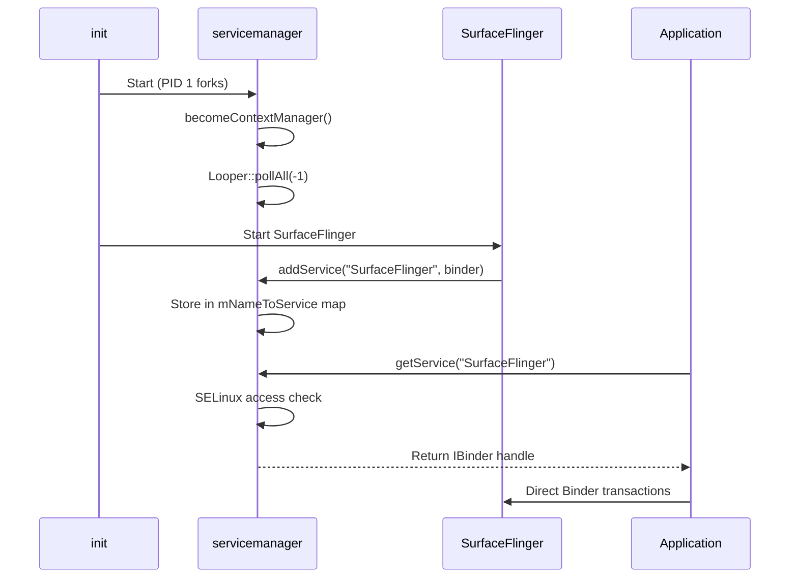

该架构保证了：

- **注册经过认证**：`servicemanager` 在允许 `addService()` 或 `getService()` 调用之前会验证 SELinux 标签。
- **发现是集中式的**：所有服务都可以通过一个单一的、众所周知的 Binder context 被找到。
- **死亡被集中检测**：当服务死亡时，`servicemanager`
  将其从注册表中移除，因此后续查找会失败。客户端通过链接到该服务 binder 的自己的 `IBinder::DeathRecipient` 检测到
  死亡；注册回调
  （`IServiceCallback::onRegistration()`）仅在服务（重新）注册时触发。

### 12.1.3 标准服务生命周期

每个原生服务都遵循一种通用模式。让我们以 GPU 服务作为一个具体的、最小化的示例来考察它。入口点位于：

> `frameworks/native/services/gpuservice/main_gpuservice.cpp`

```cpp
int main(int /* argc */, char** /* argv */) {
    signal(SIGPIPE, SIG_IGN);

    // publish GpuService
    sp<GpuService> gpuservice = new GpuService();
    sp<IServiceManager> sm(defaultServiceManager());
    sm->addService(String16(GpuService::SERVICE_NAME), gpuservice, false);

    // limit the number of binder threads to 4.
    ProcessState::self()->setThreadPoolMaxThreadCount(4);

    // start the thread pool
    sp<ProcessState> ps(ProcessState::self());
    ps->startThreadPool();
    ps->giveThreadPoolName();
    IPCThreadState::self()->joinThreadPool();

    return 0;
}
```

该模式包含五个步骤：

| 步骤 | 代码 | 作用 |
|------|------|---------|
| 1 | `signal(SIGPIPE, SIG_IGN)` | 防止管道破裂导致崩溃 |
| 2 | `new GpuService()` | 构造服务对象 |
| 3 | `sm->addService(...)` | 向 servicemanager 注册 |
| 4 | `setThreadPoolMaxThreadCount(N)` | 配置 Binder 线程池大小 |
| 5 | `joinThreadPool()` | 阻塞主线程以处理 Binder 调用 |

有些服务使用略有不同的模式。`SensorService` 使用
`BinderService<T>` 模板，该模板将步骤 2-5 封装为一次调用：

> `frameworks/native/services/sensorservice/main_sensorservice.cpp`

```cpp
int main(int /*argc*/, char** /*argv*/) {
    signal(SIGPIPE, SIG_IGN);
    SensorService::publishAndJoinThreadPool();
    return 0;
}
```

`BinderService<T>::publishAndJoinThreadPool()` 模板调用
`T::getServiceName()` 来确定注册名称，构造服务，调用 `addService()`，并进入线程池。

### 12.1.4 进程隔离与 init.rc 配置

每个原生服务都在一个 `.rc` 文件中定义，`init` 在启动时解析该文件。一个典型的定义如下所示：

```
service surfaceflinger /system/bin/surfaceflinger
    class core animation
    user system
    group graphics drmrpc readproc
    capabilities SYS_NICE
    onrestart restart --only-if-running zygote
    task_profiles HighPerformance
```

关键属性：

- **`class`**：决定服务在启动过程中何时启动（例如 `core`、`main`、`late_start`）。
- **`user`/`group`**：用于进程隔离的 Linux UID/GID。
- **`capabilities`**：受限的 Linux capabilities 集合。
- **`onrestart`**：服务重启时要执行的动作（通常是级联重启依赖该服务的其它服务）。
- **`task_profiles`**：用于 CPU 调度的 cgroup 配置。

### 12.1.5 三种 servicemanager

Android 实际上有三个 `servicemanager` 实例：

| 实例 | 二进制文件 | Binder 设备 | 用途 |
|----------|--------|---------------|---------|
| `servicemanager` | `/system/bin/servicemanager` | `/dev/binder` | 框架服务 |
| `vndservicemanager` | `/vendor/bin/vndservicemanager` | `/dev/vndbinder` | 供应商 HAL 服务 |
| `servicemanager`（recovery） | 使用 `__ANDROID_RECOVERY__` 构建 | `/dev/binder` | 恢复模式 |

供应商服务管理器的存在是为了强制执行 Treble 边界：供应商
进程不能直接访问框架服务，反之亦然。这种
隔离是在内核层通过不同的 Binder 设备节点强制执行的。

### 12.1.6 Binder 线程池大小

每个原生服务都会根据预期的并发量仔细配置其 Binder 线程池的大小。这一选择至关重要：

- **线程太少**：客户端会因等待线程而被阻塞，从而增加延迟。
- **线程太多**：浪费内存并带来上下文切换开销。

以下是来自真实源代码的线程池配置：

| 服务 | 最大线程数 | 理由 |
|---------|-------------|-----------|
| `servicemanager` | 0（基于 Looper） | 单线程以避免死锁 |
| `surfaceflinger` | 4 | 由 VSYNC 驱动，并发有限 |
| `gpuservice` | 4 | 用于统计/查询的中等并发 |
| `media.codec` | 64 | 大量并行的编解码器会话 |
| `installd` | 默认（约 15） | 多个并发的软件包操作 |
| `sensorservice` | 默认（约 15） | 大量并发的传感器客户端 |

servicemanager 中的 `setThreadPoolMaxThreadCount(0)` 调用值得特别关注。当线程池中没有任何线程时，所有 Binder 处理都通过 Looper 在主线程上进行。这是有意为之的：servicemanager 绝不能同步调用另一个服务（这可能导致死锁）。因此它所有发出的调用都是单向的，并且它按顺序处理收到的调用。

### 12.1.7 死亡通知与服务恢复

当原生服务崩溃时，恢复流程如下：

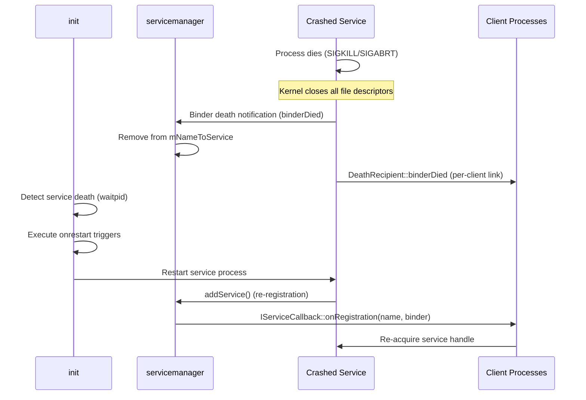

请注意，`servicemanager` 不会向客户端推送死亡通知——它的
`binderDied()` 只将已死亡的服务从 `mNameToService` 中擦除（并丢弃该进程的
回调）。每个客户端都是通过链接到服务 binder 的自己的 `IBinder::DeathRecipient` 获知死亡的。

`.rc` 文件中的 `onrestart` 指令会触发级联重启。例如，当 SurfaceFlinger 崩溃时：

```
onrestart restart --only-if-running zygote
```

这会重启 `zygote` 进程（进而重启所有应用进程），因为 SurfaceFlinger 的状态无法恢复——所有 layer 句柄和 buffer 队列都已丢失。

### 12.1.8 权限与 Capabilities

原生服务使用多层安全机制：

1. **Linux UID/GID**：由 `.rc` 文件中的 `user` 和 `group` 指令设置。
   例如，SurfaceFlinger 以 `user system` 运行，其所属组包括
   `graphics`、`drmrpc` 和 `readproc`。

2. **Linux Capabilities**：细粒度的特权控制。例如，
   SurfaceFlinger 具有 `SYS_NICE` capability 以进行实时调度：
   ```
   capabilities SYS_NICE
   ```

3. **SELinux 强制访问控制**：每个 IPC 调用都会依据 SELinux 策略进行检查。
   `service_contexts` 文件将服务名称映射到 SELinux 类型：
   ```
   SurfaceFlinger  u:object_r:surfaceflinger_service:s0
   installd        u:object_r:installd_service:s0
   gpu             u:object_r:gpu_service:s0
   ```

4. **seccomp-bpf 沙箱**：媒体服务使用它来限制系统调用。
   `SetUpMinijail()` 函数应用一个 seccomp 过滤器，限制进程可以发出的
   系统调用，从而减少恶意媒体内容带来的攻击面。

### 12.1.9 原生服务全景图

下图展示了主要的原生服务及其关系：

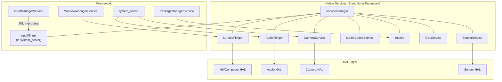

每条箭头代表一个 Binder 连接，但有一个例外：InputFlinger
不是一个独立进程，而是 `system_server` 内部的一组原生线程。
InputManagerService 通过进程内 JNI 调用而非 Binder 与之交互（见 12.3）。原生服务位于上层的
Java 框架与下层的 HAL 实现之间，将高层
API 调用转换为硬件操作。

---

## 12.2 SurfaceFlinger

SurfaceFlinger 是**显示合成服务**——可以说是 Android 中最复杂、对性能最关键的原生服务。它从每个应用和系统 UI 组件接收图形缓冲区，并将它们合成在一起。它在正确的时间将合成结果呈现到屏幕上，并与垂直同步（VSYNC）信号同步。

### 12.2.1 源代码布局

`frameworks/native/services/surfaceflinger/` 下的 SurfaceFlinger 源代码树非常庞大——约 650 个文件（排除测试和模糊测试工具后约 340 个），组织为以下结构：

| 目录 | 用途 |
|-----------|---------|
| `CompositionEngine/` | 合成流水线的抽象 |
| `Display/` | 显示设备管理、模式切换 |
| `DisplayHardware/` | HWComposer HAL 接口、电源控制 |
| `Effects/` | 颜色校正（面向色盲用户的 Daltonizer） |
| `FrameTracer/` | 逐帧性能追踪 |
| `FrontEnd/` | Layer 生命周期、快照构建、事务处理 |
| `Jank/` | 卡顿检测与报告 |
| `PowerAdvisor/` | 向 Power HAL 发送 ADPF 电源提示 |
| `Scheduler/` | VSYNC 预测、帧调度、刷新率选择 |
| `TimeStats/` | 帧时序统计 |
| `Tracing/` | 用于 layer 与事务追踪的 Perfetto 集成 |
| `Utils/` | 共享工具（fences、dumpers） |

主要实现位于 `SurfaceFlinger.cpp` 中。`SurfaceFlinger.h` 头文件揭示了类层次结构：

> `frameworks/native/services/surfaceflinger/SurfaceFlinger.h`

```cpp
class SurfaceFlinger : public BnSurfaceComposer,
                       public PriorityDumper,
                       private IBinder::DeathRecipient,
                       private HWC2::ComposerCallback,
                       private ICompositor,
                       private scheduler::ISchedulerCallback,
                       private compositionengine::ICEPowerCallback {
```

SurfaceFlinger 继承自：

- **`BnSurfaceComposer`**：传统手写 C++ `ISurfaceComposer` 接口
  （`frameworks/native/libs/gui/include/gui/ISurfaceComposer.h`）的 Binder 原生端，仍用于
  `setTransactionState()` 和 buffer 注册等热路径。AIDL 接口
  `android.gui.ISurfaceComposer` 由一个独立的
  `SurfaceComposerAIDL` 类提供服务（声明在 `SurfaceFlinger.h` 末尾附近），该类将自己的调用转发给 SurfaceFlinger。
- **`PriorityDumper`**：支持带有基于优先级的 dump 分区的 `dumpsys SurfaceFlinger`。
- **`HWC2::ComposerCallback`**：接收来自 Hardware Composer HAL 的回调（热插拔、VSYNC、刷新率变化）。
- **`ICompositor`**：Scheduler 用于触发合成的接口。
- **`ISchedulerCallback`**：接收调度决策（模式更改、帧率更新）。

### 12.2.2 高层架构

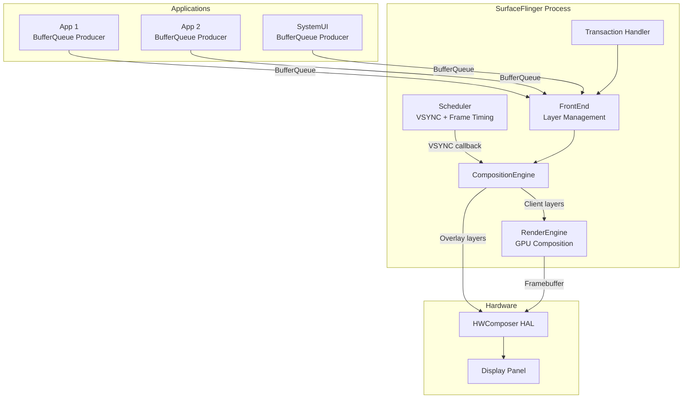

### 12.2.3 合成周期

SurfaceFlinger 的主循环由 Scheduler 驱动。在每个 VSYNC 周期中，执行以下步骤：

1. **提交阶段**（`commit()`）：
    - 应用待处理的事务（layer 创建、属性更改、buffer 更新）。
    - 从前端状态构建 layer 快照。
    - 更新 layer 树层次结构。

2. **合成阶段**（`composite()`）：
    - 对每个显示器，确定可见的 layer 集合。
    - 将 layers 发送给 HWComposer 以进行 `validateDisplay()`。
    - HWC 决定哪些 layer 可以在硬件中合成（overlay），哪些需要 GPU 回退（客户端合成）。
    - 如果需要进行客户端合成，使用 RenderEngine（Skia/OpenGL）将这些 layers 渲染到 framebuffer 中。
    - 调用 `presentDisplay()` 将最终帧提交给显示器。

3. **合成后处理**：
    - 向应用发出 release fence 信号，使其可以重用 buffer。
    - 更新帧时序统计。
    - 如果发生丢帧，则发送卡顿指标。

关键的性能洞见在于，HWC overlay 合成本质上是“免费”的——显示硬件以零 GPU 成本合成这些 layers。GPU 合成是 HWC 无法处理的 layers（例如复杂的混合模式、过多的 layers、颜色空间转换）的回退方案。

### 12.2.4 Layer 管理

**Layer** 代表一块矩形的图形内容区域。每个 layer 具有：

- **通过事务交付的 buffer**：自 BLAST 改造以来，客户端通过
  `Transaction::setBuffer()` 附加每个图形缓冲区。layer
  将其存储在绘制状态（`mDrawingState.buffer`）中。生产者/消费者
  `BufferQueue` 对位于应用的 `BLASTBufferQueue` 中，而不是在 SurfaceFlinger 内部。
- 单一的**绘制状态**（`mDrawingState`）；待处理的客户端状态在 FrontEnd 中以 `RequestedLayerState` 形式持有，后者为合成构建不可变的
  `LayerSnapshot`。
- 几何属性：位置、大小、裁剪、变换、z 序。
- 视觉属性：alpha、颜色、混合模式、颜色空间。

来自 `frameworks/native/services/surfaceflinger/Layer.cpp`：

```cpp
Layer::Layer(const surfaceflinger::LayerCreationArgs& args)
      : sequence(args.sequence),
        mFlinger(sp<SurfaceFlinger>::fromExisting(args.flinger)),
        mName(base::StringPrintf("%s#%d", args.name.c_str(), sequence)),
        mWindowType(static_cast<WindowInfo::Type>(
                args.metadata.getInt32(gui::METADATA_WINDOW_TYPE, 0))) {
    ALOGV("Creating Layer %s", getDebugName());

    mDrawingState.crop = {0, 0, -1, -1};
    mDrawingState.sequence = 0;
    mDrawingState.transform.set(0, 0);
    mDrawingState.frameNumber = 0;
    // ...
}
```

`FrontEnd/` 子系统通过以下组件管理 layer 生命周期：

- **`LayerLifecycleManager`**：跟踪创建与销毁。
- **`LayerSnapshotBuilder`**：为合成引擎生成不可变快照，避免事务线程与合成线程之间的锁竞争。
- **`TransactionHandler`**：以原子方式排队并应用事务。

SurfaceFlinger 强制规定 layer 数量上限为 4096（`MAX_LAYERS = 4096`），以防止资源耗尽。

### 12.2.5 Scheduler 与 VSYNC

位于 `frameworks/native/services/surfaceflinger/Scheduler/` 的 Scheduler 子系统负责：

- **VSYNC 预测**：使用 `VSyncPredictor` 根据历史数据估算未来的 VSYNC 时间戳。
- **刷新率选择**：根据活跃 layer 的帧率选择最优的显示刷新率（60Hz、90Hz、120Hz 等）。
- **帧调度**：在 VSYNC 之前的恰当时间唤醒 SurfaceFlinger 以执行合成。

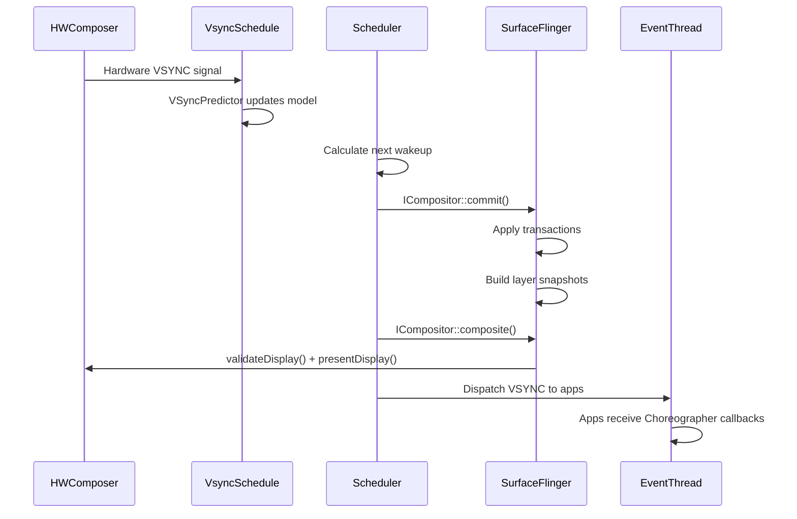

关键类：

- **`Scheduler`**（`Scheduler.h`）：协调所有时序。同时继承自 `IEventThreadCallback` 和 `MessageQueue`。
- **`VSyncPredictor`**（`VSyncPredictor.cpp`）：对硬件 VSYNC 时间戳拟合线性模型以预测未来事件。
- **`VSyncDispatchTimerQueue`**（`VSyncDispatchTimerQueue.cpp`）：管理面向不同 VSYNC 客户端的基于定时器的唤醒。
- **`RefreshRateSelector`**（`RefreshRateSelector.cpp`）：选择最能满足所有活跃 layers 的显示模式（刷新率 + 分辨率）。
- **`EventThread`**（`EventThread.cpp`）：通过 `DisplayEventConnection` 将 VSYNC 事件投递给应用。

### 12.2.6 与 HWComposer HAL 的关系

SurfaceFlinger 通过 HWComposer HAL（Hardware Composer）与显示硬件通信。该接口以 AIDL HAL 形式定义在：

```
hardware/interfaces/graphics/composer/aidl/
```

`HWComposer` 封装类（`DisplayHardware/HWComposer.h`）将 SurfaceFlinger 的内部表示转换为 HAL 调用：


关键的 HAL 操作有：

| HAL 方法 | 作用 |
|-----------|---------|
| `createLayer()` | 为显示器创建 HWC layer 句柄（overlay-plane 分配在稍后的 `validateDisplay()` 时决定） |
| `setLayerBuffer()` | 将图形缓冲区分配给 layer |
| `setLayerCompositionType()` | 标记为 DEVICE（overlay）或 CLIENT（GPU） |
| `validateDisplay()` | 让 HWC 评估 layer 栈 |
| `acceptDisplayChanges()` | 接受 HWC 的合成类型决策 |
| `presentDisplay()` | 提交帧以供显示 |
| `getReleaseFences()` | 获取用于 buffer 回收的 fences |

### 12.2.7 CompositionEngine

`CompositionEngine`（位于 `CompositionEngine/`）是使合成算法与 SurfaceFlinger 策略逻辑解耦的抽象。它处理一组 `CompositionRefreshArgs`，并为每个显示器生成一帧合成结果。

引擎内的合成流程：

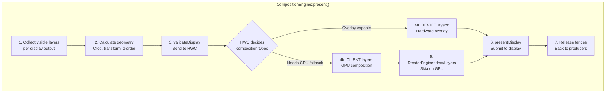

合成引擎中的每个 `Output` 代表一个显示器或虚拟显示器。引擎的 `OutputLayer` 对象包装各个 layer 快照，并带有显示器特定的合成状态（例如 HWC 在该显示器上分配给该 layer 的合成类型）。

**预测式合成策略**

一种现代优化是预测式合成，由以下标志控制：

```cpp
// If set, composition engine tries to predict the composition strategy
// provided by HWC based on the previous frame. If the strategy can be
// predicted, gpu composition will run parallel to the hwc validateDisplay
// call and re-run if the prediction is incorrect.
bool mPredictCompositionStrategy = false;
```

启用后，合成引擎会根据前一帧的 HWC 决策预测哪些 layers 需要 GPU 回退。它在 `validateDisplay()` 调用的同时并行启动 GPU 合成。如果预测正确，当 `validateDisplay()` 返回时 GPU 工作已经完成，从而为 GPU 合成路径节省整整一帧的延迟。

### 12.2.8 RenderEngine：GPU 合成

当 HWC 无法合成所有 layers（layers 过多、不支持的混合模式、需要颜色空间转换）时，SurfaceFlinger 使用 RenderEngine 进行基于 GPU 的合成。RenderEngine 的实现使用：

- **Skia**：主要渲染后端，使用 Vulkan 或 GLES。
- **线程化渲染**：RenderEngine 可以在专用线程上运行，以避免阻塞主合成线程。

RenderEngine 的关键操作是 `drawLayers()`。它接收一组 layer 设置（源 buffer、几何信息、混合模式、颜色矩阵），并将它们合成到单个输出 buffer 中。该 buffer 随后作为“客户端目标”layer 传递给 HWC。

### 12.2.9 事务模型

应用通过**事务**修改 layer 属性。事务是一组被一起应用的原子更改：

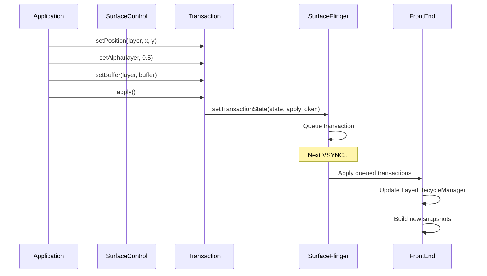

`TransactionHandler` 管理待处理事务的队列。事务可以是：

- **立即型**：在下一个 VSYNC 应用。
- **延迟型**：保留直到达到请求的 `setDesiredPresentTime()`，或直到未发信号的 acquire fences 与 apply-token 顺序允许事务锁定生效。
- **同步型**：多个事务跨不同 surface 原子地应用。

`LayerLifecycleManager` 尤其值得关注：

> `frameworks/native/services/surfaceflinger/FrontEnd/LayerLifecycleManager.h`

```cpp
// Owns a collection of RequestedLayerStates and manages their lifecycle
// and state changes.
//
// RequestedLayerStates are tracked and destroyed if they have no parent
// and no handle left to keep them alive.
class LayerLifecycleManager {
public:
    void addLayers(std::vector<std::unique_ptr<RequestedLayerState>>);
    void applyTransactions(const std::vector<QueuedTransactionState>&,
                           bool ignoreUnknownLayers = false);
    void onHandlesDestroyed(const std::vector<std::pair<uint32_t,
                            std::string>>&,
                            bool ignoreUnknownHandles = false);
    void fixRelativeZLoop(uint32_t relativeRootId);
    void commitChanges();
    // ...
};
```

### 12.2.10 HWComposer 回调

SurfaceFlinger 从 HWComposer HAL 接收若干回调：

```cpp
// HWC2::ComposerCallback overrides:
void onComposerHalVsync(hal::HWDisplayId, nsecs_t timestamp,
                        std::optional<hal::VsyncPeriodNanos>) override;
void onComposerHalHotplugEvent(hal::HWDisplayId,
                                DisplayHotplugEvent) override;
void onComposerHalRefresh(hal::HWDisplayId) override;
void onComposerHalVsyncPeriodTimingChanged(hal::HWDisplayId,
                        const hal::VsyncPeriodChangeTimeline&) override;
void onComposerHalSeamlessPossible(hal::HWDisplayId) override;
void onComposerHalVsyncIdle(hal::HWDisplayId) override;
void onRefreshRateChangedDebug(
                        const RefreshRateChangedDebugData&) override;
void onComposerHalHdcpLevelsChanged(hal::HWDisplayId,
                        const HdcpLevels& levels) override;
```

| 回调 | 触发 | SurfaceFlinger 的响应 |
|----------|---------|------------------------|
| `onVsync` | 硬件 VSYNC 脉冲 | 更新 VSyncPredictor 模型 |
| `onHotplugEvent` | 显示器连接/断开 | 创建/销毁 DisplayDevice |
| `onRefresh` | HWC 请求刷新 | 调度立即合成 |
| `onVsyncPeriodTimingChanged` | 刷新率变更进行中 | 更新时序参数 |
| `onVsyncIdle` | 显示器进入空闲（VRR） | 调整空闲时的调度 |
| `onHdcpLevelsChanged` | HDCP 保护级别变更 | 更新内容保护状态 |

### 12.2.11 ISurfaceComposer API

SurfaceFlinger 通过 `ISurfaceComposer` AIDL 接口暴露丰富的 API。主要方法类别包括：

**显示器管理**：

- `createVirtualDisplay()` / `destroyVirtualDisplay()`
- `getPhysicalDisplayIds()` / `getPhysicalDisplayToken()`
- `setDesiredDisplayModeSpecs()`（刷新率策略）
- `setPowerMode()`（ON、OFF、DOZE、DOZE_SUSPEND）
- `setDisplayBrightness()`

**Layer 操作**：

- `setTransactionState()`（所有 layer 更改的主要通道）。其中的逐 surface 属性（如 `Transaction::setFrameRate()` 帧率偏好）随其传输。它们不是独立的接口方法。
- `setGameModeFrameRateOverride()`（游戏专用覆盖）

**屏幕捕获**：

- `captureDisplay()`（显示器截图）
- `captureLayers()`（特定 layers 截图）

**监控**：

- `addFpsListener()` / `addHdrLayerInfoListener()`
- `addRegionSamplingListener()`（自动亮度的亮度采样）
- `addWindowInfosListener()`（面向 InputFlinger 的窗口信息更新）

### 12.2.12 可变刷新率（VRR）支持

现代显示器支持可变刷新率（VRR），即显示器的刷新周期可以动态变化。SurfaceFlinger 通过以下方式处理：

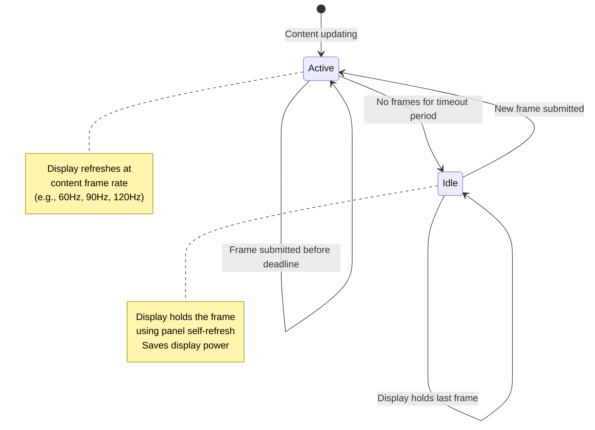

`VsyncSchedule` 类管理支持 VRR 的调度：

- 当内容在主动更新时，VSYNC 按内容的帧率运行。
- 当没有新内容到达时，显示器进入空闲模式并调用 `onComposerHalVsyncIdle()`。
- Scheduler 自己的 VRR 空闲定时器通过 `ISchedulerCallback::vrrDisplayIdle()`（`frameworks/native/services/surfaceflinger/Scheduler/ISchedulerCallback.h:35`，由 `Scheduler.cpp:176`/`180` 触发）通知 SurfaceFlinger。SurfaceFlinger 的重写
  （`SurfaceFlinger.cpp:8022`）通过 `onVrrIdle()` 将该状态转发给显示器的
  刷新率叠加层。不必要的唤醒是在 Scheduler 的定时器本身内部被抑制的，而不是
  在这个回调中。
- `KernelIdleTimerController` 枚举（位于 `RefreshRateSelector` 中）选择内核的
  显示空闲定时器的驱动方式——通过系统属性（`Sysprop`）或
  HWC API（`HwcApi`）。`RefreshRateSelector`/SurfaceFlinger 通过所选机制应用
  超时。

`VsyncModulator` 根据工作负载调整 VSYNC 偏移。它持有一个
`VsyncConfigSet`，其中包含三种可能的配置，并跟踪当前激活的是哪一个：

```cpp
// Scheduler/include/scheduler/VsyncConfig.h
struct VsyncConfigSet {
    VsyncConfig early;    // Used for early transactions, and during refresh rate change.
    VsyncConfig earlyGpu; // Used during GPU composition.
    VsyncConfig late;     // Default.
    // ...
};

// Scheduler/VsyncModulator.h
class VsyncModulator {
    enum class VsyncConfigType { Early, EarlyGpu, Late };
    // ...
    VsyncConfigSet mVsyncConfigSet;
    VsyncConfig mVsyncConfig{mVsyncConfigSet.late};
    // ...
};
```

`early` 配置会更早地唤醒 SurfaceFlinger（例如当触摸事件到达并预期有新帧
时，或在刷新率变更期间）。`earlyGpu` 在帧回退到 GPU 合成时应用。`late`
是可预测工作负载的默认值。

### 12.2.13 锁定未发信号（Latch Unsignaled）

`LatchUnsignaledConfig` 控制 SurfaceFlinger 能否在其 acquire fence 发信号
之前锁定（使用）一个 buffer：

```cpp
enum class LatchUnsignaledConfig {
    Disabled,           // Never latch unsignaled buffers
    AutoSingleLayer,    // Latch unsignaled only for single-layer
                        // buffer-only updates
    Always,             // Always latch unsignaled (risky)
};
```

`AutoSingleLayer` 模式是生产环境中的默认值。当单个 layer 提交 buffer
更新且没有其他待处理事务时，SurfaceFlinger 将该 buffer 的 acquire fence
直接传递给 HWC。如果 fence 在显示器的截止时间之前发信号，则显示该帧；否则，
显示器显示上一帧。这为简单的 buffer 更新减少了一帧的延迟。

### 12.2.14 电源管理

SurfaceFlinger 通过以下方式与 Android 的电源管理集成：

1. **PowerAdvisor**：与 `PowerHAL` 通信以发送 ADPF
   （Android 动态性能框架）提示。在合成之前，
   SurfaceFlinger 报告预期的工作负载时长；合成之后，
   它报告实际时长。电源 HAL 利用这些信息调整
   CPU/GPU 频率。

2. **显示电源模式**：SurfaceFlinger 控制显示电源状态：
    - `OFF`：显示器关闭，SurfaceFlinger 停止合成。
    - `ON`：正常运行。
    - `DOZE`：环境显示（低功耗、低亮度）。
    - `DOZE_SUSPEND`：类似 DOZE，但 SurfaceFlinger 停止合成
      （显示控制器显示静态图像）。

3. **CPU 负载通知**：`ICEPowerCallback::notifyCpuLoadUp()`
   回调就即将到来的 CPU 负载增加向电源系统发出预警
   （例如，有一批事务正在处理）。

### 12.2.15 显示亮度与颜色管理

SurfaceFlinger 管理显示器的颜色流水线：

- **广色域**：支持 Display-P3 和 BT.2020 色彩空间。
  `defaultCompositionDataspace` 和 `wideColorGamutCompositionDataspace`
  控制渲染色彩空间。

- **HDR**：管理 HDR 内容的合成，包括 SDR 到 HDR 以及
  HDR 到 SDR 的色调映射。当 HDR 内容在屏幕上时，
  `HdrLayerInfoReporter` 会通知感兴趣的客户端。

- **颜色矩阵**：可以将一个 4x4 的颜色变换矩阵应用于
  整个显示输出，用于无障碍功能（颜色反转、
  面向色盲的 Daltonizer）。

- **区域采样**：`RegionSamplingThread` 从指定的屏幕区域采样
  像素值。状态栏利用它根据背景内容调整其文本颜色，
  以提高可读性。

### 12.2.16 启动阶段

SurfaceFlinger 跟踪三个启动阶段：

```cpp
enum class BootStage {
    BOOTLOADER,     // Display showing bootloader splash
    BOOTANIMATION,  // Boot animation playing
    FINISHED,       // System fully booted
};
```

在 `BOOTLOADER` 阶段，SurfaceFlinger 初始化但尚未驱动
显示器。一旦 `BOOTANIMATION` 开始，SurfaceFlinger 便开始合成
启动动画帧。当 `system_server` 调用 `bootFinished()` 时，
阶段切换到 `FINISHED`，正常运行开始。

### 12.2.17 交叉引用

SurfaceFlinger 与其他章节所涵盖的图形流水线深度交织：

- **第 13 章（图形渲染流水线）**：向 SurfaceFlinger 提供 buffer 的
  BufferQueue 生产者-消费者模型。该章还详细涵盖了
  CompositionEngine、RenderEngine（Skia）以及逐帧合成
  算法。
- **第 10 章（HAL）**：HWComposer HAL 接口及其 AIDL 定义。

---

## 12.3 InputFlinger

InputFlinger 处理所有用户输入——触摸事件、按键、手写笔笔画、鼠标移动、
手柄按钮——并将它们路由到正确的应用窗口。它是 Android 中对延迟最敏感的
服务之一；即使额外几毫秒的延迟，用户也能感知到。

### 12.3.1 源代码布局

InputFlinger 的源代码位于
`frameworks/native/services/inputflinger/`，组织方式如下：

| 目录 | 用途 |
|-----------|---------|
| `reader/` | EventHub + InputReader：读取原始内核事件 |
| `dispatcher/` | InputDispatcher：将事件路由到窗口 |
| `reporter/` | InputReporter：提供未处理/丢弃按键的报告（`InteractionReporter` 位于 inputflinger 根目录，而非此处） |
| `trace/` | Perfetto 追踪集成 |
| `rust/` | 通过 `IInputFlingerRust` 实现的 Rust FFI 组件 |
| `aidl/` | AIDL 接口定义 |
| 根目录文件 | InputManager、filters、blockers、choreographer |

### 12.3.2 输入流水线

`InputManager.cpp` 中的注释描述了完整的流水线：

> `frameworks/native/services/inputflinger/InputManager.cpp`

```cpp
/**
 * The event flow is via the "InputListener" interface, as follows:
 *   InputReader
 *     -> UnwantedInteractionBlocker
 *     -> InputFilter
 *     -> PointerChoreographer
 *     -> InputProcessor
 *     -> InputDeviceMetricsCollector
 *     -> InteractionReporter
 *     -> InputDispatcher
 */
```

然而，这段注释相对于其下方的代码已经过时。构造函数自下而上地构建监听器链，
每个阶段包装在它之前构造的阶段。它将 `InputFilter` 放置在
`InputDeviceMetricsCollector` 之后，而不是紧接在
`UnwantedInteractionBlocker` 之后。实际产生的连接方式是：

```
InputReader
  -> UnwantedInteractionBlocker
  -> PointerChoreographer
  -> InputProcessor
  -> InputDeviceMetricsCollector
  -> InputFilter
  -> InteractionReporter
  -> InputDispatcher
```

`InteractionReporter` 阶段（位于
`frameworks/native/services/inputflinger/InteractionReporter.cpp`，在
inputflinger 根目录下）是 dispatcher 之前倒数第二个监听器。它呈现交互信号
——例如，在用户交互时唤醒 attention service——而不会干扰事件流。（
`reporter/` 下名称相似的 `InputReporter` 是一个不同且无关的类，仅报告未处理
和被丢弃的按键。）

让我们追踪这条从硬件到应用的流水线：

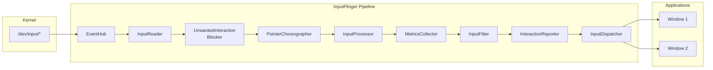

### 12.3.3 EventHub：读取原始事件

EventHub 是输入栈的最底层。它：

1. 使用 `inotify` 监控 `/dev/input/` 以获取设备热插拔事件。
2. 打开输入设备节点并通过 `epoll` 读取 `struct input_event`。
3. 识别设备能力（键盘、触摸屏、鼠标等）。
4. 使用键布局映射（`.kl`）和键字符映射（`.kcm`）
   文件映射键码。

来自 `frameworks/native/services/inputflinger/reader/EventHub.cpp`：

```cpp
static const char* DEVICE_INPUT_PATH = "/dev/input";
// v4l2 devices go directly into /dev
static const char* DEVICE_PATH = "/dev";

static constexpr size_t EVENT_BUFFER_SIZE = 256;

// Logs if the difference between the event timestamp and the read time is
// greater than this threshold.
static constexpr nsecs_t SLOW_READ_LOG_THRESHOLD_NS = ms2ns(100);
```

EventHub 使用 `epoll` 同时高效地等待多个设备文件描述符。当任何设备上有
事件到达时，`epoll_wait()` 返回，EventHub 以一批最多 `EVENT_BUFFER_SIZE`
（256）个原始事件的方式读取。

每个原始事件都是 Linux 的 `struct input_event`：

```c
struct input_event {
    struct timeval time;  // Kernel timestamp
    __u16 type;           // EV_KEY, EV_ABS, EV_REL, EV_SYN, ...
    __u16 code;           // KEY_A, ABS_MT_POSITION_X, ...
    __s32 value;          // Key state, coordinate value, ...
};
```

### 12.3.4 InputReader：解释原始事件

InputReader 运行在它自己的线程中，并消费来自 EventHub 的原始事件。
它维护一组 **InputDevice** 对象，每个对象包含一个或多个
**InputMapper** 实例：

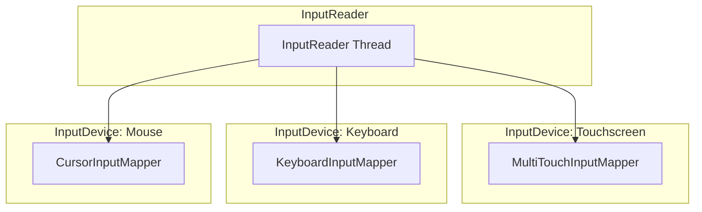

关键的 InputMapper 类型（位于 `reader/mapper/` 中）：

| Mapper | 输入类型 | 输出 |
|--------|-----------|--------|
| `KeyboardInputMapper` | `EV_KEY` 事件 | `NotifyKeyArgs` |
| `MultiTouchInputMapper` | `EV_ABS` 多点触控协议 | `NotifyMotionArgs` |
| `SingleTouchInputMapper` | `EV_ABS` 单点触控协议 | `NotifyMotionArgs` |
| `CursorInputMapper` | `EV_REL` 相对移动 | `NotifyMotionArgs` |
| `TouchpadInputMapper` | 触摸板手势 | `NotifyMotionArgs` |
| `RotaryEncoderInputMapper` | 旋转编码器（手表、汽车） | `NotifyMotionArgs` |
| `SwitchInputMapper` | `EV_SW` 开关事件（翻盖、耳机） | `NotifySwitchArgs` |
| `VibratorInputMapper` | 力反馈/触觉反馈 | 触觉控制 |

子设备检测将代表同一个物理设备的多个 Linux 输入设备节点合并
（例如，带有集成触摸板的键盘）：

```cpp
bool isSubDevice(const InputDeviceIdentifier& identifier1,
                 const InputDeviceIdentifier& identifier2) {
    return (identifier1.vendor == identifier2.vendor &&
            identifier1.product == identifier2.product &&
            identifier1.bus == identifier2.bus &&
            identifier1.version == identifier2.version &&
            identifier1.uniqueId == identifier2.uniqueId &&
            identifier1.location == identifier2.location);
}
```

### 12.3.5 流水线阶段

在 InputReader 生成 `NotifyArgs`（`NotifyKeyArgs` 或
`NotifyMotionArgs`）之后，事件会流经若干处理阶段：

**UnwantedInteractionBlocker**

移除无意的触摸，尤其是触摸屏上的手掌触摸。当在屏幕边缘检测到大面积接触
时，blocker 要么移除个别指针，要么抑制整个触摸序列。

**PointerChoreographer**

管理指针图标及其位置。对于触摸板和鼠标输入，它确定指针显示在哪个显示器上，
并应用多显示器设置所需的任何坐标变换。

**InputProcessor**

与设备特定的 `IInputProcessor` HAL 通信，以应用硬件辅助的事件分类。
例如，HAL 可能将某个触摸手势分类为手掌误触候选。

**InputDeviceMetricsCollector**

按输入设备收集使用统计：每个设备被使用的频率、延迟测量值以及交互模式。
这些数据被送入系统的遥测流水线。

**InputFilter**

应用系统定义的过滤规则。它服务于无障碍功能（例如慢速按键、粘滞按键）。
它还服务于 `InputFilter` AIDL 接口，该接口让 Rust 组件可以应用额外的过滤
逻辑：

```cpp
mInputFilter = std::make_unique<InputFilter>(
    *mTracingStages.back(), *mInputFlingerRust,
    inputFilterPolicy, vm);
```

### 12.3.6 InputDispatcher：路由到窗口

InputDispatcher 是最后一个也是最复杂的阶段。它运行在自己的线程中，负责：

1. **窗口目标定位**：根据触摸坐标和窗口层次结构确定每个事件应送达哪个（些）
   窗口。
2. **焦点管理**：跟踪哪个窗口拥有按键事件的输入焦点。
3. **ANR 检测**：监控窗口是否在超时窗口内（通常为 5 秒）响应事件。
4. **事件注入**：支持用于测试的程序化事件注入。

来自 `frameworks/native/services/inputflinger/dispatcher/InputDispatcher.h`
的头注释：

```cpp
/* Dispatches events to input targets. Some functions of the input
 * dispatcher, such as identifying input targets, are controlled by a
 * separate policy object.
 *
 * IMPORTANT INVARIANT:
 *     Because the policy can potentially block or cause re-entrance
 *     into the input dispatcher, the input dispatcher never calls
 *     into the policy while holding its internal locks.
 */
class InputDispatcher : public android::InputDispatcherInterface {
```

dispatcher 维护几个关键数据结构：

| 数据结构 | 用途 |
|----------------|---------|
| `mInboundQueue` | 等待分发的传入事件 |
| `mConnectionsByToken` | 将窗口 token 映射到 `Connection` 对象 |
| `TouchState`（每个显示器） | 跟踪进行中的触摸序列 |
| `FocusResolver` | 确定拥有焦点的窗口 |
| `AnrTracker` | 监控响应超时 |

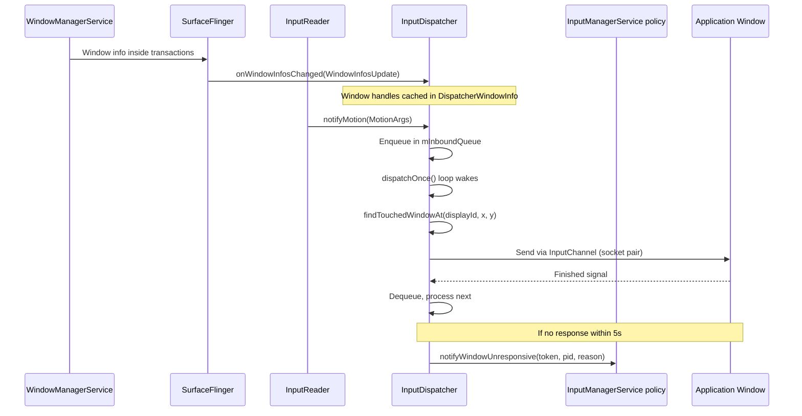

### 12.3.7 Dispatcher 事件类型

InputDispatcher 处理几种类型的事件，定义于
`frameworks/native/services/inputflinger/dispatcher/Entry.h`：

```cpp
struct EventEntry {
    enum class Type {
        DEVICE_RESET,             // Input device was reset
        FOCUS,                    // Focus changed to a new window
        KEY,                      // Keyboard key press/release
        MOTION,                   // Touch, mouse, trackpad motion
        SENSOR,                   // Sensor event (rare)
        POINTER_CAPTURE_CHANGED,  // Pointer capture mode changed
        DRAG,                     // Drag-and-drop state change
        TOUCH_MODE_CHANGED,       // Touch mode toggled

        ftl_last = TOUCH_MODE_CHANGED
    };

    int32_t id;
    Type type;
    nsecs_t eventTime;
    uint32_t policyFlags;
    std::shared_ptr<InjectionState> injectionState;
    mutable bool dispatchInProgress;

    // Injected events are from external (untrusted) sources
    inline bool isInjected() const { return injectionState != nullptr; }

    // Synthesized events aren't directly from hardware
    inline bool isSynthesized() const {
        return isInjected() ||
            IdGenerator::getSource(id) != IdGenerator::Source::INPUT_READER;
    }
};
```

关键的具体类型包括：

- **`KeyEntry`**：包含 `deviceId`、`source`、`displayId`、`action`、
  `keyCode`、`scanCode`、`metaState`、`repeatCount` 和 `flags`。
- **`MotionEntry`**：包含指针数据数组（`PointerProperties`、
  `PointerCoords`）、`action`、`actionButton`、`buttonState`、`xPrecision`、
  `yPrecision` 和 `classification`（例如 palm、ambiguous）。

### 12.3.8 焦点管理

`FocusResolver` 类跟踪每个显示器上哪个窗口拥有输入焦点：

> `frameworks/native/services/inputflinger/dispatcher/FocusResolver.h`

```cpp
// Focus Policy:
//   Window focusability - A window token can be focused if there is
//   at least one window handle that is visible with the same token
//   and all window handles with the same token are focusable.
//
//   Focus request - Granted if the window is focusable. If not,
//   persisted and granted when it becomes focusable.
//
//   Conditional focus request - Granted only if the specified focus
//   token is currently focused. Otherwise dropped.
class FocusResolver {
public:
    sp<IBinder> getFocusedWindowToken(
        ui::LogicalDisplayId displayId) const;

    struct FocusChanges {
        sp<IBinder> oldFocus;
        sp<IBinder> newFocus;
        ui::LogicalDisplayId displayId;
        std::string reason;
    };
    // ...
private:
    enum class Focusability {
        OK,
        NO_WINDOW,
        NOT_FOCUSABLE,
        NOT_VISIBLE,
    };
};
```

焦点变更会生成 `FocusEntry` 事件，这些事件通过与按键事件和动作事件相同的
流水线进行分发。这确保了焦点变更相对于触发它们的事件被正确排序。

### 12.3.9 ANR（应用无响应）检测

InputDispatcher 监控应用是否在超时窗口内对已分发的事件作出响应。
`AnrTracker` 维护每个连接的截止时间：

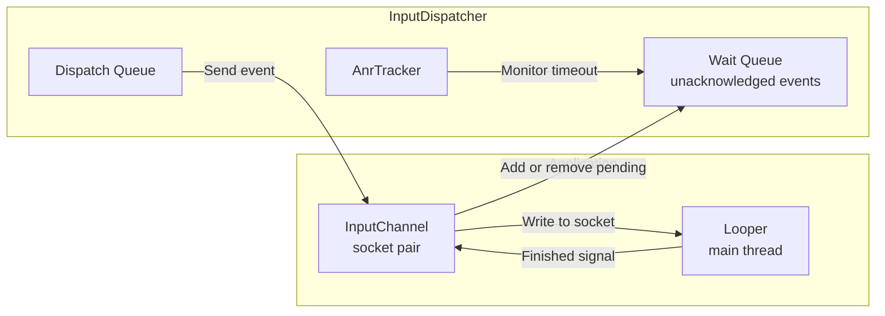

如果应用在 5 秒内（默认 ANR 超时时间）没有发送 `finished` 信号，
dispatcher 会通知 policy：

1. policy（位于 system_server 中的 InputManagerService）显示 ANR 对话框。
2. 用户可以选择等待或强制关闭应用。
3. 如果强制关闭，该窗口的所有待处理事件都会被取消。

### 12.3.10 触摸状态跟踪

`TouchState` 类跟踪每个显示器上进行中的多点触控交互：

- 当前正在被触摸的窗口。
- “已触摸窗口”集合——收到 `ACTION_DOWN` 并应在 `ACTION_UP` 之前继续接收
  动作事件的窗口。
- 分割动作支持——一条触摸流可以跨多个窗口分割（例如在窗口边界上拖动时）。
- 用于多点触控消歧的指针 ID 跟踪。

`TouchedWindow` 类存储按窗口划分的触摸信息：

```
frameworks/native/services/inputflinger/dispatcher/TouchedWindow.h
frameworks/native/services/inputflinger/dispatcher/TouchState.h
```

### 12.3.11 InputChannels 与传输

事件通过 **InputChannels**——成对的 Unix 域套接字——传递给应用。
一端由 InputDispatcher 持有，另一端传递给应用进程。`InputTransport` 协议
定义了一种经过零拷贝优化的二进制消息格式：

- **`InputMessage::Type::MOTION`**：带坐标的触摸/鼠标事件。
- **`InputMessage::Type::KEY`**：带键码的键盘事件。
- **`InputMessage::Type::FINISHED`**：应用确认收到。
- **`InputMessage::Type::TIMELINE`**：帧时序反馈。

基于套接字的传输避免了对高频输入事件流使用 Binder IPC 的开销。典型的触摸屏
以 120-240 Hz 的频率生成事件，而 Binder 往返会增加不可接受的延迟。

### 12.3.12 事件注入

InputDispatcher 支持用于测试和无障碍的事件注入：

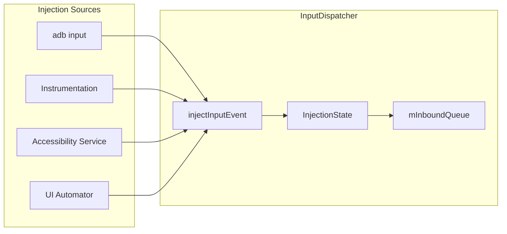

注入的事件带有 `POLICY_FLAG_INJECTED` 标签，并通过 `InjectionState` 对象
跟踪。dispatcher 可以等待注入完成（同步模式），也可以立即返回（异步模式）。

权限检查确保只有特权调用者才能注入事件：

- 常规注入需要 `INJECT_EVENTS` 权限。
- 无障碍服务拥有用于无障碍悬浮层的特殊注入权限。
- `adb shell input` 使用 shell UID 的注入权限。

### 12.3.13 延迟跟踪

InputDispatcher 包含一个 `LatencyTracker`，用于测量端到端的输入延迟：

```
// From LatencyTracker.h / LatencyAggregator.h
// Tracks the timeline for each event:
// 1. Event creation time (kernel timestamp)
// 2. Event read time (EventHub)
// 3. Dispatch time (InputDispatcher)
// 4. Delivery time (written to InputChannel)
// 5. Consumption time (app reads from channel)
// 6. Finish time (app sends finished signal)
// 7. Graphics latency (frame presented on display)
```

`LatencyAggregatorWithHistograms` 生成直方图数据并报告给系统的遥测流水线，
从而实现：

- 检测输入延迟持续偏高的应用。
- 识别系统性的延迟回退问题。
- 设备级输入性能基准测试。

### 12.3.14 Rust 组件

当前 AOSP 中一个值得注意的架构演进是通过 `IInputFlingerRust` 将 Rust 引入
输入流水线：

```cpp
// Create the Rust component of InputFlinger that uses AIDL interfaces
// as the foreign function interface (FFI).
std::shared_ptr<IInputFlingerRust> createInputFlingerRust() {
    // ...
    create_inputflinger_rust(binderToPointer(*callback));
    // ...
}
```

Rust 实现通过一种 C++ 回调模式进行引导启动：

1. C++ 创建一个 `BnInputFlingerRustBootstrapCallback`。
2. 调用 CXX 桥接函数 `create_inputflinger_rust()`。
3. Rust 端创建 `IInputFlingerRust` 的实现。
4. 通过回调将其传回 C++。

这种混合方式让新的输入过滤和处理逻辑可以用 Rust 编写，并享有其内存安全
保证。现有的 C++ 基础设施保持不变。

### 12.3.15 InputManager 绑定

`InputManager` 类将所有部分联系在一起，并实现了 `BnInputFlinger` Binder
接口：

> `frameworks/native/services/inputflinger/InputManager.h`

```cpp
class InputManager : public InputManagerInterface, public BnInputFlinger {
private:
    std::unique_ptr<InputReaderInterface> mReader;
    std::unique_ptr<UnwantedInteractionBlockerInterface> mBlocker;
    std::unique_ptr<InputFilterInterface> mInputFilter;
    std::unique_ptr<PointerChoreographerInterface> mChoreographer;
    std::unique_ptr<InputProcessorInterface> mProcessor;
    std::unique_ptr<InputDeviceMetricsCollectorInterface> mCollector;
    std::unique_ptr<InteractionReporterInterface> mInteractionReporter;
    std::unique_ptr<InputDispatcherInterface> mDispatcher;
    std::shared_ptr<IInputFlingerRust> mInputFlingerRust;
    std::vector<std::unique_ptr<TracedInputListener>> mTracingStages;
};
```

`start()` 方法启动 reader 和 dispatcher 线程：

```cpp
status_t InputManager::start() {
    status_t result = mDispatcher->start();
    if (result) {
        ALOGE("Could not start InputDispatcher thread due to error %d.", result);
        return result;
    }
    result = mReader->start();
    if (result) {
        ALOGE("Could not start InputReader due to error %d.", result);
        mDispatcher->stop();
        return result;
    }
    return OK;
}
```

InputManager 不是一个独立进程——它由 `system_server` 中的
`InputManagerService` 通过 JNI 创建并拥有。然而，整个 C++ 流水线运行在
`system_server` 进程内的原生线程中。

---

## 12.4 AudioFlinger 概述

AudioFlinger 是负责混音与音频流路由的原生服务。它作为独立进程
（`audioserver`）运行。它是 Android 中最成熟的原生服务之一，其历史可以追溯到
该平台最早的版本。

### 12.4.1 源代码位置

AudioFlinger 的实现位于：

```
frameworks/av/services/audioflinger/
```

关键文件包括：

| 文件 | 用途 |
|------|---------|
| `AudioFlinger.h` / `.cpp` | 主要服务实现 |
| `Threads.h` / `.cpp` | 播放与录音线程管理 |
| `Tracks.cpp` | 音频 track 生命周期与混音 |
| `Effects.h` / `.cpp` | 音频效果链处理 |
| `PatchPanel.h` / `.cpp` | 音频路由 patch 管理 |
| `MelReporter.h` / `.cpp` | 声音剂量测量（瞬时暴露水平） |
| `DeviceEffectManager.h` / `.cpp` | 按设备划分的音频效果 |
| `Client.h` / `.cpp` | 按客户端划分的状态跟踪 |

### 12.4.2 架构概述

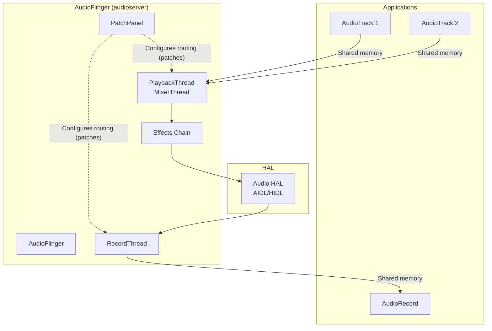

请注意，`PatchPanel` 位于控制路径上，而不是数据路径上。它创建并拆除
音频 patch，由这些 patch 决定每个线程连接到哪个 HAL 设备。播放线程直接将
混合后的 PCM 数据写入其 HAL 输出流。

AudioFlinger 使用共享内存（ashmem/memfd）缓冲区在应用与混音线程之间进行
零拷贝的音频数据传输。这对保持低音频延迟至关重要。

线程模型基于专门的线程类：

- **`MixerThread`**：最常见的播放线程。使用软件混音器混合多条音频
  track（或卸载到硬件）。
- **`DirectOutputThread`**：将单个 track 直接发送给 HAL，不做软件混音
  （用于压缩音频直通）。
- **`OffloadThread`**：用于硬件卸载的音频解码与播放。
- **`RecordThread`**：从输入设备采集音频。
- **`MmapThread`**：使用内存映射 I/O 实现超低延迟路径（AAudio
  MMAP 模式）。

### 12.4.3 AudioFlinger 线程模型

AudioFlinger 的线程架构是理解其设计的核心。每个音频输出设备（扬声器、
耳机、蓝牙、USB）通常都有一个或多个专用线程：

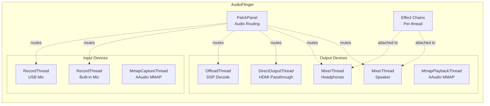

**MixerThread** 是主力线程。它运行在一个紧凑的循环中：

1. 等待下一个缓冲区周期（通常为 5-20ms）。
2. 从所有活跃的 `Track` 对象拉取数据（通过共享内存环形缓冲区）。
3. 混合所有 track，应用逐 track 的音量、声像和辅助效果。
4. 应用输出效果（均衡器、低音增强、虚拟器等）。
5. 将混合后的缓冲区写入 Audio HAL。

**DirectOutputThread** 绕过混音器，用于不应被混合的格式（例如，发送给
HDMI 接收器进行解码的压缩音频）。

**OffloadThread** 将解码委托给音频 DSP，使应用处理器在播放期间可以休眠。
这对音乐播放期间的电池续航至关重要。

**MmapThread** 通过将 HAL 的缓冲区直接映射到应用的地址空间，消除所有拷贝
操作，从而提供尽可能低的延迟。AAudio 的 MMAP 模式将其用于专业音频应用。

### 12.4.4 共享内存音频传输

AudioFlinger 使用共享内存进行零拷贝的音频数据传输：

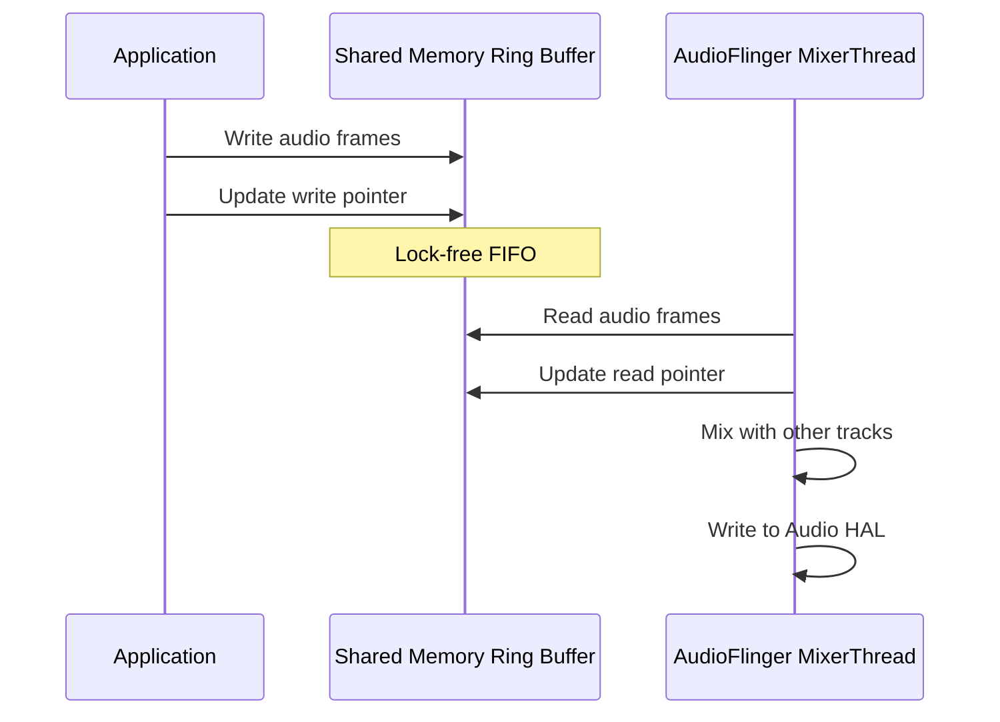

共享内存区域包含：

- 一个**控制块**，带有读写指针和流控标志。
- 一个用于音频数据（PCM 采样）的**环形缓冲区**。
- 用于高效阻塞的流控 **futex**：缓冲区写满时（生产者）或
  读空时（消费者）。

该设计将 Binder IPC 从音频数据路径中彻底移除。只有控制操作（start、
stop、set volume）使用 Binder——实际的音频数据通过共享内存流动，几乎不涉及
内核。

### 12.4.5 交叉引用

关于 AudioFlinger 混音流水线、效果链、延迟优化和 Audio HAL 接口的深入
探讨，请参见**第 15 章（音频系统）**。该章涵盖：

- 完整的音频路由模型以及与 `AudioPolicy` 的交互。
- 共享内存环形缓冲区以及 `AudioTrack`/`AudioRecord` 协议。
- 效果处理链以及 `EffectModule` 架构。
- AAudio/MMAP 低延迟路径。
- Audio HAL 版本演进（从 HIDL 迁移到 AIDL）。

---

## 12.5 CameraService 概述

CameraService 管理所有相机硬件访问，是确保多个应用能够安全共享相机资源的
守门人。

### 12.5.1 源代码位置

CameraService 的源代码位于：

```
frameworks/av/services/camera/libcameraservice/
```

关键文件：

| 文件 | 用途 |
|------|---------|
| `CameraService.h` / `.cpp` | 主要服务、客户端管理 |
| `CameraFlashlight.h` / `.cpp` | 闪光灯/手电筒控制 |
| `CameraServiceWatchdog.h` / `.cpp` | 检测并从 HAL 挂起中恢复 |

一个有趣的近期新增是位于以下位置的**虚拟相机**子系统：

```
frameworks/av/services/camera/virtualcamera/
```

它提供基于软件的相机设备，用于测试、远程相机和虚拟显示器。

### 12.5.2 架构概述

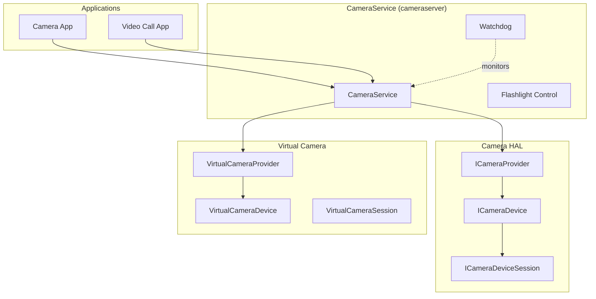

CameraService 强制执行严格的资源仲裁：

- 默认情况下，同一时间只有一个客户端可以使用一个相机设备（针对前台
  与后台应用采用基于优先级的驱逐）。
  然而，CameraService 也支持共享模式（connect 时的 `sharedMode` 标志）。
  在此模式下，多个客户端共享一个相机设备。
- `CameraServiceWatchdog` 监控 HAL 响应，并在 HAL 无响应时触发恢复。
- 相机访问受 `android.permission.CAMERA` 和 AppOps 检查的约束。

### 12.5.3 客户端优先级与驱逐

CameraService 实现了基于优先级的驱逐系统。当更高优先级的客户端请求一个
已被更低优先级客户端使用的相机时，低优先级客户端会被驱逐：

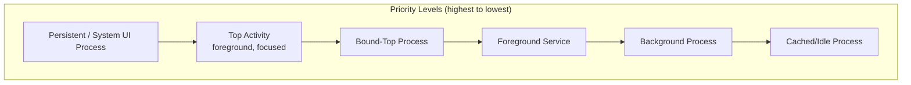

这些级别并不是 CameraService 内部手工搭建的阶梯。每个客户端的优先级是
`(oom 优先级分数, 进程状态)` 这对值。CameraService 通过
`ProcessInfoService` 从 ActivityManager 获取该对值。较低的进程状态值获胜。
`PROCESS_STATE_TOP` 和 `PROCESS_STATE_BOUND_TOP` 的优先级高于
`PROCESS_STATE_FOREGROUND_SERVICE`，而持久化状态的优先级高于所有这些状态。

驱逐算法：

1. 新客户端请求相机。
2. CameraService 检查相机当前是否正被使用。
3. 如果正在使用，将新客户端的优先级（基于其进程状态）
   与当前客户端的优先级进行比较。
4. 如果新客户端的优先级更高，则断开旧客户端并
   连接新客户端。
5. 旧客户端收到 `disconnect()` 回调，必须释放所有
   资源。

这确保了前台相机应用总是优先于后台进程。这也确保了系统级的相机访问
（例如人脸解锁）优先于所有用户应用。

### 12.5.4 CameraServiceWatchdog

watchdog 监控 HAL 挂起，这是复杂相机硬件的一种常见故障模式：

```cpp
class CameraServiceWatchdog {
    // Monitors camera operations and aborts the process if they exceed
    // the default timeout of 65 seconds
    // (kMaxCycles = 650 cycles of kCycleLengthMs = 100 ms)
};
```

当 HAL 操作耗时过长时：

1. watchdog 设置一条中止消息，指明卡住的函数
    （`android_set_abort_message()`）。
2. 它向相机 HAL provider 进程发送 `SIGABRT`，并对 cameraserver 自身调用
    `abort()`，从而生成用于调试的 tombstone。
3. `init` 重启 cameraserver，已连接的客户端观察到 binder 死亡。
4. 当客户端重新连接时，HAL 会被重新打开。

### 12.5.5 虚拟相机

虚拟相机子系统（`frameworks/av/services/camera/virtualcamera/`）
提供基于软件实现的相机设备。关键组件：

| 类 | 用途 |
|-------|---------|
| `VirtualCameraProvider` | 为虚拟相机实现 `ICameraProvider` |
| `VirtualCameraDevice` | 实现 `ICameraDevice` |
| `VirtualCameraSession` | 实现 `ICameraDeviceSession` |
| `VirtualCameraRenderThread` | 从各种来源生成相机帧 |
| `VirtualCameraStream` | 管理输出流 |

虚拟相机的来源可以是：

- 屏幕捕获（用于远程桌面场景）。
- 网络流（用于 IP 相机或远程协作）。
- 合成内容（用于测试和开发）。
- 显示输出（用于可折叠设备的后置显示器相机）。

### 12.5.6 交叉引用

关于 Camera HAL 接口、采集流水线、流配置和 Camera2 API 的完整内容，请参见
**第 16 章（媒体与相机）**。该章涵盖：

- `ICameraDevice` / `ICameraDeviceSession` AIDL HAL 接口。
- 请求/结果元数据处理。
- 流配置与缓冲区管理。
- 多相机支持与并发访问。

---

## 12.6 MediaService 概述

媒体子系统被拆分到几个原生服务中，每个服务都运行在各自的进程里，并具有受限
权限（使用 seccomp 沙箱）。

### 12.6.1 MediaCodecService

这是传统的编解码器服务。其二进制文件名为
`android.hardware.media.omx@1.0-service`，在启动时仅将 `argv[0]` 重命名为
`media.codec`。它是一个仅供应商可用的 32 位 HIDL HAL，注册
`IOmx`/`IOmxStore` 接口，因此与现代的 Codec2 路径毫无关系。它使用
seccomp-bpf 沙箱来限制系统调用：

> `frameworks/av/services/mediacodec/main_codecservice.cpp`

```cpp
int main(int argc __unused, char** argv) {
    strcpy(argv[0], "media.codec");
    LOG(INFO) << "mediacodecservice starting";
    signal(SIGPIPE, SIG_IGN);
    SetUpMinijail(kSystemSeccompPolicyPath, kVendorSeccompPolicyPath);

    android::ProcessState::initWithDriver("/dev/vndbinder");
    android::ProcessState::self()->startThreadPool();

    ::android::hardware::configureRpcThreadpool(64, false);

    // Default codec services
    using namespace ::android::hardware::media::omx::V1_0;
    sp<IOmx> omx = new implementation::Omx();
    // ...
    ::android::hardware::joinRpcThreadpool();
}
```

关键观察：

- 使用 `/dev/vndbinder`（vendor binder），将其置于供应商域中。
- 配置 64 个 RPC 线程用于并行的编解码器操作。
- 应用来自 `/system/etc/seccomp_policy/` 的 minijail seccomp 策略。
- 为基于 OMX 的编解码器注册 `IOmx` HAL 接口。

OMX 是传统的、已弃用的接口；该服务仅为较旧的供应商编解码器 HAL 而保留。
当前路径是 `mediaswcodec` 二进制文件（`main_swcodecservice.cpp`，
`argv[0]` 重命名为 `media.swcodec`）。它调用 `RegisterCodecServices()`，
通过 12.6.3 节所述的 Codec2（C2）框架暴露软件编解码器。这使得软件编解码器与
硬件编解码器驱动相互隔离。

### 12.6.2 MediaExtractorService

媒体提取器以 `media.extractor` 运行，负责解析容器格式（MP4、MKV、OGG 等）
并将它们解复用为基本流。与编解码器服务一样，它运行在经过 seccomp 沙箱隔离
的进程中。

### 12.6.3 Codec2（C2）框架

现代编解码器框架是 Codec2（C2），位于：

```
frameworks/av/media/codec2/
```

Codec2 用更灵活的架构取代了较旧的 OMX（OpenMAX IL）接口：

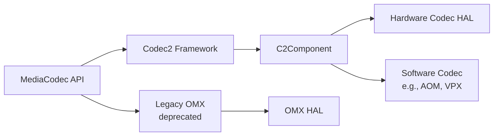

Codec2 提供：

- **基于组件的架构**：每个编解码器都是一个 `C2Component`，具有
  定义良好的输入/输出工作队列。
- **缓冲池管理**：高效的缓冲区分配与回收。
- **隧道化播放**：解码器与 SurfaceFlinger 之间直接传递缓冲区，无需
  CPU 拷贝。
- **多实例支持**：并发运行多个编解码器实例。

### 12.6.4 进程隔离架构

媒体服务展示了 Android 的纵深防御方法。每个媒体服务都运行在具有受限特权
的独立进程中：

```mermaid
graph TB
    subgraph "Media Processes"
        direction LR
        MC["media.codec<br/>seccomp + vndbinder"]
        ME["media.extractor<br/>seccomp + binder"]
        SWMC["media.swcodec<br/>seccomp + binder"]
        MS["mediaserver<br/>binder"]
    end

    subgraph "Isolation Measures"
        direction TB
        SEC["seccomp-bpf<br/>Syscall filtering"]
        MJ["Minijail<br/>Privilege restriction"]
        SEL["SELinux<br/>Mandatory access control"]
        NS[Namespace isolation]
    end

    MC --- SEC
    MC --- MJ
    MC --- SEL
    ME --- SEC
    ME --- MJ
    SWMC --- SEC
    SWMC --- MJ
```

这种隔离的理由：

- **媒体解析器（extractor）**是恶意媒体文件的主要攻击面。构造精巧的
  MP4/MKV 文件可能利用解析器漏洞。在沙箱进程中运行解析器限制了此类漏洞利用
  的影响。
- **硬件编解码器**与供应商特定的驱动交互，这些驱动可能有自己的漏洞。
  使用 `/dev/vndbinder` 将它们与框架服务隔离开。
- **软件编解码器**历来是漏洞的来源（例如 Stagefright）。让它们与硬件
  编解码器运行在独立的进程中，可以防止软件编解码器漏洞访问硬件编解码器
  驱动。

seccomp 策略文件将系统调用限制在所需的最小集合：

```
/system/etc/seccomp_policy/mediacodec.policy
/vendor/etc/seccomp_policy/mediacodec.policy
```

### 12.6.5 Codec2 组件生命周期

Codec2 组件会经历一个定义良好的生命周期。`frameworks/av/media/codec2/core/include/C2Component.h` 中记录的状态为
**released**、**stopped** 和 **running**，其中 **tripped** 和 **error**
是 running 的子状态：

```mermaid
stateDiagram-v2
    [*] --> released
    released --> stopped: create
    stopped --> running: start
    running --> running
    running --> stopped: stop
    running --> tripped: limit tripped
    running --> error: fatal error
    tripped --> stopped: reset
    error --> stopped: reset
    stopped --> released: release
    released --> [*]
```

running 上的自转换是组件执行工作的地方。它在那里处理排队的工作项。没有单独
的 flushing 状态，因为 `flush()` 是在组件保持 running 状态时被调用的。

组件从输入队列处理工作项：

1. 客户端提交包含输入缓冲区的 `C2Work` 项。
2. 组件处理每个工作项（解码/编码）。
3. 已完成的工作项连同输出缓冲区返回给客户端。
4. 客户端读取输出数据并回收缓冲区。

### 12.6.6 交叉引用

关于完整的媒体流水线架构（包括 `MediaCodec`、`MediaPlayer`、
`MediaRecorder` 和 Codec2 内部实现），请参见**第 16 章（媒体与相机）**。

---

## 12.7 installd

`installd` 是特权守护进程，负责与应用安装、数据管理和 DEX 优化相关的所有
磁盘操作。它以 `system_server` 本身所没有的提升后的权限运行，为软件包管理
操作提供了一条安全的提权路径。

### 12.7.1 为什么存在 installd

`system_server` 以 UID `system`（1000）运行，但应用数据目录由按应用划分的
UID（10000+）拥有。创建、修改和删除这些目录需要 root 或特定的 capabilities。
Android 没有将这些特权赋予 `system_server`，而是将文件系统操作委托给
`installd`——它以 root 身份运行，但具有受限的 capabilities 并受 SELinux
强制约束。

### 12.7.2 源代码布局

源代码位于 `frameworks/native/cmds/installd/`：

| 文件 | 用途 |
|------|---------|
| `installd.cpp` | 主要入口点、初始化 |
| `InstalldNativeService.h` / `.cpp` | Binder 服务实现 |
| `dexopt.h` / `.cpp` | DEX 优化（调用 dex2oat） |
| `utils.cpp` | 文件系统工具函数 |
| `CacheTracker.h` | 用于存储管理的缓存大小跟踪 |
| `QuotaUtils.h` / `.cpp` | 磁盘配额管理 |
| `CrateManager.cpp` | “Crate”存储管理 |
| `run_dex2oat.cpp` | dex2oat 进程派生 |
| `installd_constants.h` | 共享常量和标志 |
| `globals.h` | 全局路径变量 |

### 12.7.3 启动与初始化

`installd` 主函数在接受 Binder 调用之前会进行仔细的初始化：

> `frameworks/native/cmds/installd/installd.cpp`

```cpp
static int installd_main(const int argc ATTRIBUTE_UNUSED, char *argv[]) {
    // ...
    SLOGI("installd firing up");

    // SELinux setup
    union selinux_callback cb;
    cb.func_log = log_callback;
    selinux_set_callback(SELINUX_CB_LOG, cb);

    if (!initialize_globals()) {
        SLOGE("Could not initialize globals; exiting.\n");
        exit(1);
    }

    if (initialize_directories() < 0) {
        SLOGE("Could not create directories; exiting.\n");
        exit(1);
    }

    if (selinux_enabled && selinux_status_open(true) < 0) {
        SLOGE("Could not open selinux status; exiting.\n");
        exit(1);
    }

    if ((ret = InstalldNativeService::start()) != android::OK) {
        SLOGE("Unable to start InstalldNativeService: %d", ret);
        exit(1);
    }

    IPCThreadState::self()->joinThreadPool();
    // ...
}
```

`initialize_directories()` 函数处理文件系统布局升级。它读取
`{android_data_dir}/misc/installd/layout_version` 处的版本文件，并在布局版本
发生变化时执行迁移：

```cpp
if (version < 2) {
    SLOGD("Assuming that device has multi-user storage layout; "
          "upgrade no longer supported");
    version = 2;
}
```

### 12.7.4 InstalldNativeService 接口

`InstalldNativeService` 实现了 `IInstalld` AIDL 接口，向
`PackageManagerService` 暴露了数十个操作：

> `frameworks/native/cmds/installd/InstalldNativeService.h`

```cpp
class InstalldNativeService : public BinderService<InstalldNativeService>,
                              public os::BnInstalld {
public:
    static char const* getServiceName() { return "installd"; }

    // User data management
    binder::Status createUserData(const std::optional<std::string>& uuid,
            int32_t userId, int32_t userSerial, int32_t flags);
    binder::Status destroyUserData(const std::optional<std::string>& uuid,
            int32_t userId, int32_t flags);

    // App data management
    binder::Status createAppData(/* ... */);
    binder::Status createAppDataBatched(/* ... */);
    binder::Status clearAppData(/* ... */);
    binder::Status destroyAppData(/* ... */);

    // DEX optimization
    binder::Status dexopt(const std::string& apkPath, int32_t uid,
                          /* ... 14 more parameters ... */);

    // Storage management
    binder::Status freeCache(/* ... */);
    binder::Status getAppSize(/* ... */);
    binder::Status getUserSize(/* ... */);

    // Profile management
    binder::Status mergeProfiles(/* ... */);
    binder::Status dumpProfiles(/* ... */);

    // fs-verity
    binder::Status createFsveritySetupAuthToken(/* ... */);
    binder::Status enableFsverity(/* ... */);
    // ... and many more
};
```

### 12.7.5 应用数据目录结构

当应用被安装时，`installd` 会创建以下目录结构：

```
/data/user/{userId}/{packageName}/      (CE - Credential Encrypted)
/data/user_de/{userId}/{packageName}/   (DE - Device Encrypted)
```

CE（Credential Encrypted）与 DE（Device Encrypted）存储之间的区分对 Direct Boot
的支持至关重要：

| 存储 | 可用时机 | 用例 |
|---------|-----------|----------|
| CE | 用户解锁后 | 应用数据库、用户文件 |
| DE | 设备启动后（解锁前） | 闹钟数据、通知渠道 |

这些标志定义在 `installd_constants.h` 中：

```cpp
// NOTE: keep in sync with StorageManager
constexpr int FLAG_STORAGE_DE = 1 << 0;
constexpr int FLAG_STORAGE_CE = 1 << 1;
```

### 12.7.6 DEX 优化（dexopt）

`installd` 最重要的职责之一是调用 `dex2oat`，将 DEX 字节码编译为原生机器码。
`dexopt()` 函数接受大量参数：

> `frameworks/native/cmds/installd/dexopt.h`

```cpp
int dexopt(const char *apk_path, uid_t uid, const char *pkgName,
        const char *instruction_set, int dexopt_needed,
        const char* oat_dir, int dexopt_flags,
        const char* compiler_filter, const char* volume_uuid,
        const char* class_loader_context, const char* se_info,
        bool downgrade, int target_sdk_version,
        const char* profile_name, const char* dexMetadataPath,
        const char* compilation_reason, std::string* error_msg,
        /* out */ bool* completed = nullptr);
```

dex2oat 二进制文件位于 ART APEX 中：

```cpp
#define ANDROID_ART_APEX_BIN "/apex/com.android.art/bin"
static constexpr const char* kDex2oat32Path = ANDROID_ART_APEX_BIN "/dex2oat32";
static constexpr const char* kDex2oat64Path = ANDROID_ART_APEX_BIN "/dex2oat64";
static constexpr const char* kDex2oatDebug32Path = ANDROID_ART_APEX_BIN "/dex2oatd32";
static constexpr const char* kDex2oatDebug64Path = ANDROID_ART_APEX_BIN "/dex2oatd64";
```

dexopt 标志控制编译行为：

```cpp
constexpr int DEXOPT_PUBLIC         = 1 << 1;   // Shared library (world-readable)
constexpr int DEXOPT_DEBUGGABLE     = 1 << 2;   // Include debug info
constexpr int DEXOPT_BOOTCOMPLETE   = 1 << 3;   // Boot has finished
constexpr int DEXOPT_PROFILE_GUIDED = 1 << 4;   // Use profile for compilation
constexpr int DEXOPT_SECONDARY_DEX  = 1 << 5;   // Secondary DEX file
constexpr int DEXOPT_FORCE          = 1 << 6;   // Force recompilation
constexpr int DEXOPT_STORAGE_CE     = 1 << 7;   // CE storage
constexpr int DEXOPT_STORAGE_DE     = 1 << 8;   // DE storage
constexpr int DEXOPT_IDLE_BACKGROUND_JOB = 1 << 9;  // Background optimization
constexpr int DEXOPT_ENABLE_HIDDEN_API_CHECKS = 1 << 10;
constexpr int DEXOPT_GENERATE_COMPACT_DEX = 1 << 11;
constexpr int DEXOPT_GENERATE_APP_IMAGE = 1 << 12;
```

dexopt needed 级别决定了所需的编译类型：

```cpp
static constexpr int NO_DEXOPT_NEEDED            = 0;  // Already optimized
static constexpr int DEX2OAT_FROM_SCRATCH        = 1;  // Full compilation
static constexpr int DEX2OAT_FOR_BOOT_IMAGE      = 2;  // Boot image changed
static constexpr int DEX2OAT_FOR_FILTER          = 3;  // Compiler filter changed
```

### 12.7.7 Profile 管理

`installd` 管理指导 Profile 引导优化（PGO）的 ART profiles：

1. **当前 profiles**：按用户记录运行时执行了哪些方法的 profiles
   （`/data/misc/profiles/cur/{userId}/{packageName}/primary.prof`）。
2. **参考 profiles**：作为 dex2oat 输入的合并 profiles
   （`/data/misc/profiles/ref/{packageName}/primary.prof`）。

`mergeProfiles()` 操作将当前 profiles 合并到参考 profile 中。当合并后的
profile 显示有显著变化时，系统会安排后台 dexopt，以使用更新后的 profile 数据
重新编译应用。

profile 分析的结果有以下几种：

```cpp
constexpr int PROFILES_ANALYSIS_OPTIMIZE                     = 1;
constexpr int PROFILES_ANALYSIS_DONT_OPTIMIZE_SMALL_DELTA    = 2;
constexpr int PROFILES_ANALYSIS_DONT_OPTIMIZE_EMPTY_PROFILES = 3;
```

### 12.7.8 dexopt 流程

从软件包安装到优化代码的完整 dexopt 流程：

```mermaid
sequenceDiagram
    participant PMS as PackageManagerService
    participant INS as installd (IInstalld)
    participant D2O as dex2oat process
    participant ART as ART Runtime

    PMS->>INS: createAppData(uuid, pkg, userId, ...)
    INS->>INS: mkdir /data/user/{userId}/{pkg}/
    INS->>INS: chown to app UID
    INS->>INS: restorecon (SELinux labels)

    PMS->>INS: dexopt(apkPath, uid, pkgName, isa, ...)
    INS->>INS: Determine dex2oat binary (32/64 bit)
    INS->>INS: Open profile file (if PGO)
    INS->>INS: Create output .oat/.art/.vdex files
    INS->>D2O: fork + exec dex2oat
    D2O->>D2O: Parse DEX bytecode
    D2O->>D2O: Apply compiler filter (speed, speed-profile, etc.)
    D2O->>D2O: Generate native machine code
    D2O->>D2O: Write .oat (code), .art (image), .vdex (dex)
    D2O-->>INS: Exit code
    INS-->>PMS: Return success/failure

    Note over ART: At app launch...
    ART->>ART: Load .oat file for pre-compiled methods
    ART->>ART: JIT remaining methods as needed
```

编译器过滤器决定了优化级别：

| 过滤器 | 行为 | 用例 |
|--------|----------|----------|
| `verify` | 仅验证 DEX，不编译 | 首次安装（最小延迟） |
| `speed` | 完整 AOT 编译 | 后台优化 |
| `speed-profile` | 仅对 profile 中的热点方法做 AOT | 体积/速度的最佳平衡 |
| `everything` | 编译所有方法 | 测试/基准测试 |

（旧的 `quicken` 过滤器已废弃：ART 现在将其映射为 `verify` 并发出弃用警告，
且它不再执行任何字节码优化。）

`dex2oat` 进程作为 `installd` 的子进程运行。它继承受限的 capabilities，并受
资源限制（CPU、内存）约束。当作为后台任务（`DEXOPT_IDLE_BACKGROUND_JOB`）
运行时，`dex2oat` 使用较低的 CPU 优先级，并可能包含额外的调试信息。

### 12.7.9 存储管理

`installd` 管理跨多个卷和用户的存储：

```mermaid
graph TB
    subgraph "Internal Storage"
        DATA["/data"]
        U0["/data/user/0<br/>(Primary user)"]
        U10["/data/user/10<br/>(Work profile)"]
        DE0["/data/user_de/0<br/>(Device encrypted)"]
        DE10["/data/user_de/10"]
        PROF["/data/misc/profiles"]
        DALVIK["/data/dalvik-cache"]
    end

    subgraph "External Storage"
        EXT["/data/media/0"]
    end

    subgraph "Per-App Layout"
        direction TB
        CE_APP["CE: /data/user/0/{pkg}/"]
        DE_APP["DE: /data/user_de/0/{pkg}/"]
        CACHE["cache/"]
        CODE_CACHE["code_cache/"]
        FILES["files/"]
        DB["databases/"]
        SP["shared_prefs/"]
    end

    DATA --> U0
    DATA --> U10
    DATA --> DE0
    DATA --> DE10
    DATA --> PROF
    DATA --> DALVIK

    U0 --> CE_APP
    DE0 --> DE_APP
    CE_APP --> CACHE
    CE_APP --> CODE_CACHE
    CE_APP --> FILES
    CE_APP --> DB
    CE_APP --> SP
```

当磁盘空间不足时会调用 `freeCache()` 方法，并且它按 UID 逐个选择清理目标，
而不是按全局的按时间旧新来选择
（`frameworks/native/cmds/installd/InstalldNativeService.cpp:2439`）。它
为每个已知 UID 构建一个 `CacheTracker` 并加载每个 tracker 的统计信息。它将
这些 tracker 推入一个按 `getCacheRatio()` 排序的优先队列——即该 UID 超出其
分配的缓存配额的程度。

接下来它在队列中来回切换。它从当前超出配额最多的 UID 中清理条目，并在每一步
之后重新检查，直到达到目标可用空间。除非调用者传入
`FLAG_FREE_CACHE_V2_DEFY_QUOTA`，一旦活动 tracker 的比率降到配额以下，循环
就会停止。因此，保持在其额度内的应用会被保留不动。

修改时间戳仍然
重要，但仅*在*一个 tracker *内部*：`CacheTracker::loadItems()` 将该 UID 的条目
按从新到旧排序，以便最先删除最旧的条目。旧的非配额代码路径已不复存在——在没有
`FLAG_FREE_CACHE_V2` 的情况下，该调用现在返回 `"Legacy cache logic no longer
supported"`。

磁盘配额通过 `QuotaUtils` 模块
（`frameworks/native/cmds/installd/QuotaUtils.h`）进行管理。当文件系统支持时，
它是一套基于 Linux 文件系统配额系统的便捷辅助函数：

```cpp
// From QuotaUtils.h
// Whether quota is supported in the device with the given uuid
bool IsQuotaSupported(const std::string& uuid);

// Get the current occupied space in bytes for a uid or -1 if fails
int64_t GetOccupiedSpaceForUid(const std::string& uuid, uid_t uid);

// Ensure a hard-limit inode quota to protect against abusive apps
bool PrepareAppInodeQuota(const std::string& uuid, uid_t uid);
```

`InstalldNativeService` 调用这些辅助函数，通过 Binder 暴露能力检查，并自行
跟踪按 UID 划分的缓存配额：

```cpp
// From InstalldNativeService.h
// Check if the given UUID volume supports disk quotas
binder::Status isQuotaSupported(const std::optional<std::string>& volumeUuid,
        bool* _aidl_return);

// Map from UID to cache quota size
std::unordered_map<uid_t, int64_t> mCacheQuotas;
```

### 12.7.10 批量操作

为了在批量操作期间的性能（例如，在创建用户后为其所有应用创建数据目录），
`installd` 支持批量变体：

```cpp
binder::Status createAppDataBatched(
    const std::vector<android::os::CreateAppDataArgs>& args,
    std::vector<android::os::CreateAppDataResult>* _aidl_return);
```

批量 API 通过在一次 IPC 调用中处理多个操作，减少了 Binder 往返开销。

### 12.7.11 SDK 沙箱数据

对于隐私沙箱（Privacy Sandbox），`installd` 管理 SDK 沙箱的隔离数据目录：

```cpp
binder::Status createSdkSandboxDataPackageDirectory(
    const std::optional<std::string>& uuid,
    const std::string& packageName,
    int32_t userId, int32_t appId, int32_t flags);
```

这些目录与主应用的数据目录隔离，防止 SDK 访问宿主应用的私有数据。

### 12.7.12 fs-verity 支持

现代 `installd` 支持 fs-verity 用于 APK 完整性验证。`createFsveritySetupAuthToken()`
和 `enableFsverity()` 方法允许 `PackageManagerService` 对已安装的 APK 文件启用
基于 Merkle 树的完整性检查：

```cpp
binder::Status createFsveritySetupAuthToken(
    const android::os::ParcelFileDescriptor& authFd,
    int32_t uid,
    android::sp<IFsveritySetupAuthToken>* _aidl_return);

binder::Status enableFsverity(
    const android::sp<IFsveritySetupAuthToken>& authToken,
    const std::string& filePath,
    const std::string& packageName,
    int32_t* _aidl_return);
```

认证令牌模式确保只有打开了该文件的进程才能为其启用 fs-verity，从而防止
TOCTOU（time-of-check-time-of-use）竞争。

### 12.7.13 并发控制

`installd` 使用细粒度锁定来允许对不同软件包的并发操作：

```cpp
private:
    std::recursive_mutex mLock;
    std::unordered_map<userid_t, std::weak_ptr<std::shared_mutex>> mUserIdLock;
    std::unordered_map<std::string, std::weak_ptr<std::recursive_mutex>> mPackageNameLock;
```

对不同软件包的操作可以并行进行，而对同一软件包的操作会被串行化。
`mUserIdLock` 映射为每个用户 ID 提供共享锁，使得同一用户内不同软件包的多个
软件包操作可以并发运行。

---

## 12.8 GPU 服务

GpuService 管理与 GPU 相关的功能，包括驱动统计、内存跟踪、工作负载监控和
游戏驱动管理。

### 12.8.1 源代码布局

源代码位于 `frameworks/native/services/gpuservice/`：

| 目录 | 用途 |
|-----------|---------|
| `gpustats/` | GPU 驱动加载统计 |
| `gpumem/` | 通过 eBPF 按进程跟踪 GPU 内存 |
| `gpuwork/` | 通过 eBPF 跟踪 GPU 工作负载 |
| `tracing/` | 基于 Perfetto 的 GPU 内存追踪 |
| `feature_override/` | ANGLE 特性覆盖配置 |
| 根目录文件 | 主要服务实现 |

### 12.8.2 服务实现

> `frameworks/native/services/gpuservice/include/gpuservice/GpuService.h`

```cpp
class GpuService : public BnGpuService, public PriorityDumper {
public:
    static const char* const SERVICE_NAME ANDROID_API;  // "gpu"

    GpuService() ANDROID_API;

private:
    // Components
    std::shared_ptr<GpuMem> mGpuMem;
    std::shared_ptr<gpuwork::GpuWork> mGpuWork;
    std::unique_ptr<GpuStats> mGpuStats;
    std::unique_ptr<GpuMemTracer> mGpuMemTracer;
    std::mutex mLock;
    std::string mDeveloperDriverPath;
    FeatureOverrideParser mFeatureOverrideParser;
};
```

### 12.8.3 子系统

**GpuStats**

跟踪每个应用的驱动加载统计，包括：

- 驱动软件包名称和版本。
- GL、Vulkan 和 ANGLE 的加载成功/失败计数。
- 按应用划分的加载时间。
- Vulkan 引擎名称（用于游戏识别）。

来自 `frameworks/native/services/gpuservice/gpustats/GpuStats.cpp`：

```cpp
static void addLoadingCount(GpuStatsInfo::Driver driver, bool isDriverLoaded,
                            GpuStatsGlobalInfo* const outGlobalInfo) {
    switch (driver) {
        case GpuStatsInfo::Driver::GL:
        case GpuStatsInfo::Driver::GL_UPDATED:
            outGlobalInfo->glLoadingCount++;
            if (!isDriverLoaded) outGlobalInfo->glLoadingFailureCount++;
            break;
        case GpuStatsInfo::Driver::VULKAN:
        case GpuStatsInfo::Driver::VULKAN_UPDATED:
            outGlobalInfo->vkLoadingCount++;
            if (!isDriverLoaded) outGlobalInfo->vkLoadingFailureCount++;
            break;
        case GpuStatsInfo::Driver::ANGLE:
            outGlobalInfo->angleLoadingCount++;
            if (!isDriverLoaded) outGlobalInfo->angleLoadingFailureCount++;
            break;
        // ...
    }
}
```

该数据会被报告给 statsd 用于遥测。

**GpuMem（GPU 内存跟踪）**

使用 eBPF（扩展的 Berkeley Packet Filter）程序跟踪按进程划分的 GPU
内存分配。eBPF 程序挂接到 GPU 驱动 tracepoint 上，并维护一个
PID 到内存使用量的映射，可以从用户空间读取。

```mermaid
graph TB
    subgraph "Kernel"
        TP[GPU Driver Tracepoints]
        BPF[eBPF Program]
        MAP["eBPF Map<br/>pid -> memory"]
    end

    subgraph "GpuService"
        GM[GpuMem]
        GMT[GpuMemTracer]
    end

    TP --> BPF
    BPF --> MAP
    MAP --> GM
    GM --> GMT
    GMT -->|Perfetto| Trace[Trace File]
```

**GpuWork（GPU 工作负载跟踪）**

与 GpuMem 类似，使用 eBPF 跟踪按进程划分的 GPU 工作负载，包括在 GPU
执行上花费的时间。BPF 程序头文件位于：

```
frameworks/native/services/gpuservice/gpuwork/bpfprogs/include/gpuwork/gpuWork.h
```

**ANGLE 集成**

GpuService 将 ANGLE（Almost Native Graphics Layer Engine）作为系统驱动进行
管理。`toggleAngleAsSystemDriver()` 方法设置 `persist.graphics.egl`
属性：

```cpp
void GpuService::toggleAngleAsSystemDriver(bool enabled) {
    // Permission check: only system_server allowed
    if (multiuserappid != AID_SYSTEM ||
        !PermissionCache::checkPermission(sAccessGpuServicePermission, pid, uid)) {
        ALOGE("Permission Denial: can't set persist.graphics.egl");
        return;
    }

    if (enabled) {
        android::base::SetProperty("persist.graphics.egl", sAngleGlesDriverSuffix);
    } else {
        android::base::SetProperty("persist.graphics.egl", "");
    }
}
```

**Feature Override 解析器**

从以下位置解析 ANGLE 特性覆盖配置：

```cpp
const std::string kConfigFilePath =
    "/system/etc/angle/feature_config_vk.binarypb";
```

这允许 OEM 按应用或按设备覆盖特定的 Vulkan/GLES 特性。

### 12.8.4 用于 GPU 监控的 eBPF 程序

GPU 服务使用 eBPF（扩展的 Berkeley Packet Filter）程序进行内核级监控。
eBPF 程序在内核内部运行，可以高效地跟踪事件，而无需为每个事件付出用户-内核
切换的开销。

**GPU 内存跟踪（GpuMem）**：

eBPF 程序挂接到 GPU 驱动 tracepoint 上，并维护按进程划分的内存映射：

```mermaid
graph TB
    subgraph "Kernel Space"
        TP[gpu_mem tracepoint]
        BPF_PROG["eBPF Program:<br/>gpu_mem_total"]
        BPF_MAP["eBPF Map:<br/>gpu_mem_total_map<br/>key: (gpu_id << 32) | pid<br/>value: bytes"]
    end

    subgraph "User Space"
        GM[GpuMem::initialize]
        READ[Read eBPF map]
        DUMP[dumpsys gpu --gpumem]
    end

    TP -->|triggers| BPF_PROG
    BPF_PROG -->|updates| BPF_MAP
    GM -->|attaches program| BPF_PROG
    READ -->|reads| BPF_MAP
    READ --> DUMP
```

`GpuMem::initialize()` 方法获取已经固定在 `/sys/fs/bpf/` 下的 eBPF
程序，将其挂接到 `gpu_mem/gpu_mem_total` tracepoint 上，并以只读方式打开固定的
映射（`BpfMapRO`）。
`GpuMemTracer` 注册一个 Perfetto 数据源，并在追踪会话开始时将映射的计数器
dump 到追踪文件中。

**GPU 工作跟踪（GpuWork）**：

类似地，GPU 工作跟踪器使用 eBPF 监控每个进程在 GPU 执行上花费的时间。BPF
程序头文件：

```
frameworks/native/services/gpuservice/gpuwork/bpfprogs/include/gpuwork/gpuWork.h
```

该数据的用途：

- 功耗归因：确定哪个应用正在消耗 GPU 功耗。
- 性能分析：识别 GPU 使用过度的应用。
- 调试：理解 GPU 调度行为。

两个 eBPF 程序都由受限的 C 语言编译而成。`bpfloader` 在启动时加载它们并将其
固定在内核中。在服务启动时，GpuService 只是等待程序被加载
（`waitForProgsLoaded()`）。然后它从 `/sys/fs/bpf/` 获取固定的程序，并将其
挂接到相应的 tracepoint 上。它们以最小的开销运行，因为它们直接在内核上下文中
执行，避免了上下文切换。

### 12.8.5 异步初始化

GpuService 异步初始化其 eBPF 子系统，以避免延迟服务注册：

```cpp
GpuService::GpuService()
      : mGpuMem(std::make_shared<GpuMem>()),
        mGpuWork(std::make_shared<gpuwork::GpuWork>()),
        mGpuStats(std::make_unique<GpuStats>()),
        mGpuMemTracer(std::make_unique<GpuMemTracer>()),
        mFeatureOverrideParser(kConfigFilePath) {

    mGpuMemAsyncInitThread = std::make_unique<std::thread>([this]() {
        mGpuMem->initialize();
        mGpuMemTracer->initialize(mGpuMem);
    });

    mGpuWorkAsyncInitThread = std::make_unique<std::thread>([this]() {
        mGpuWork->initialize();
    });
};
```

eBPF 程序的加载和映射的创建发生在专用线程上，使 GpuService 能够立即开始接受
Binder 调用。析构函数 join 这两个线程以确保干净地关闭：

```cpp
GpuService::~GpuService() {
    mGpuMem->stop();
    mGpuWork->stop();
    mGpuWorkAsyncInitThread->join();
    mGpuMemAsyncInitThread->join();
}
```

### 12.8.6 游戏驱动支持

Android 通过游戏驱动（Game Driver）机制支持可更新的 GPU 驱动。GpuService
跟踪两个驱动槽位：

```cpp
void dumpGameDriverInfo(std::string* result) {
    char stableGameDriver[PROPERTY_VALUE_MAX] = {};
    property_get("ro.gfx.driver.0", stableGameDriver, "unsupported");
    StringAppendF(result, "Stable Game Driver: %s\n", stableGameDriver);

    char preReleaseGameDriver[PROPERTY_VALUE_MAX] = {};
    property_get("ro.gfx.driver.1", preReleaseGameDriver, "unsupported");
    StringAppendF(result, "Pre-release Game Driver: %s\n", preReleaseGameDriver);
}
```

`setUpdatableDriverPath()` 方法允许 `system_server` 为开发目的指定替代的驱动
路径。

### 12.8.7 Shell 命令

GpuService 通过 `adb shell cmd gpu` 支持 shell 命令：

| 命令 | 用途 |
|---------|---------|
| `vkjson` | 以 JSON 形式 dump Vulkan 设备属性 |
| `vkprofiles` | 打印对 Vulkan profiles 的支持 |
| `featureOverrides` | 显示 ANGLE 特性覆盖 |

---

## 12.9 Sensor Service

SensorService 管理对所有硬件和虚拟传感器的访问——加速度计、陀螺仪、磁力计、
气压计、距离传感器以及许多其他传感器。

### 12.9.1 源代码布局

源代码位于 `frameworks/native/services/sensorservice/`：

| 文件 | 用途 |
|------|---------|
| `SensorService.h` / `.cpp` | 主要服务实现 |
| `SensorDevice.h` / `.cpp` | HAL 抽象（单例） |
| `SensorEventConnection.cpp` | 按客户端划分的连接处理 |
| `SensorDirectConnection.h` | 直接传感器通道（低延迟） |
| `ISensorHalWrapper.h` | HAL 包装接口 |
| `AidlSensorHalWrapper.h` | AIDL HAL 实现 |
| `SensorFusion.cpp` | 软件传感器融合 |
| `RotationVectorSensor.cpp` | 计算得出的旋转矢量 |
| `CorrectedGyroSensor.cpp` | 偏置校正后的陀螺仪 |
| `OrientationSensor.cpp` | 计算得出的方向 |
| `LimitedAxesImuSensor.h` | 有限轴 IMU 传感器 |
| `SensorInterface.h` / `.cpp` | 抽象传感器接口 |
| `SensorRecord.h` | 按传感器划分的激活跟踪 |
| `RecentEventLogger.h` | 近期事件历史 |
| `BatteryService.h` | 传感器的电池使用跟踪 |

### 12.9.2 架构

```mermaid
graph TB
    subgraph "Applications"
        SM1["SensorManager<br/>App 1"]
        SM2["SensorManager<br/>App 2"]
    end

    subgraph "SensorService"
        SS["SensorService<br/>Thread"]
        SEC["SensorEventConnection<br/>per client"]
        SDC["SensorDirectConnection<br/>low-latency"]
        SD["SensorDevice<br/>Singleton"]
        SF[SensorFusion]
        VS["Virtual Sensors<br/>RotationVector, etc."]
    end

    subgraph "HAL"
        HW[ISensorHalWrapper]
        AIDL[AidlSensorHalWrapper]
        HIDL[HidlSensorHalWrapper]
    end

    SM1 --> SEC
    SM2 --> SEC
    SM1 --> SDC
    SEC --> SS
    SDC --> SD
    SS --> SD
    SD --> HW
    HW --> AIDL
    HW --> HIDL
    SS --> SF
    SF --> VS
```

### 12.9.3 服务启动

SensorService 使用 `BinderService` 模板进行注册：

> `frameworks/native/services/sensorservice/main_sensorservice.cpp`

```cpp
int main(int /*argc*/, char** /*argv*/) {
    signal(SIGPIPE, SIG_IGN);
    SensorService::publishAndJoinThreadPool();
    return 0;
}
```

`SensorService` 类继承自三个基类：

```cpp
class SensorService :
        public BinderService<SensorService>,
        public BnSensorServer,
        protected Thread
{
```

- **`BinderService<SensorService>`**：处理向 servicemanager 的注册。
- **`BnSensorServer`**：`ISensorServer` 的 Binder 原生实现。
- **`Thread`**：SensorService 运行自己的轮询线程。

### 12.9.4 SensorDevice 单例

`SensorDevice` 是一个与传感器 HAL 对接的单例：

> `frameworks/native/services/sensorservice/SensorDevice.cpp`

```cpp
ANDROID_SINGLETON_STATIC_INSTANCE(SensorDevice)

SensorDevice::SensorDevice() : mInHalBypassMode(false) {
    if (!connectHalService()) {
        return;
    }
    initializeSensorList();
    mIsDirectReportSupported =
        (mHalWrapper->unregisterDirectChannel(-1) != INVALID_OPERATION);
}
```

HAL 包装接口（`ISensorHalWrapper`）对 AIDL 和 HIDL HAL 版本进行了抽象：

```cpp
class ISensorHalWrapper {
public:
    enum HalConnectionStatus {
        CONNECTED,
        DOES_NOT_EXIST,
        FAILED_TO_CONNECT,
        UNKNOWN,
    };

    virtual bool connect(SensorDeviceCallback *callback) = 0;
    virtual ssize_t poll(sensors_event_t *buffer, size_t count) = 0;
    virtual ssize_t pollFmq(sensors_event_t *buffer,
                            size_t maxNumEventsToRead) = 0;
    virtual std::vector<sensor_t> getSensorsList() = 0;
    virtual status_t activate(int32_t sensorHandle, bool enabled) = 0;
    virtual status_t batch(int32_t sensorHandle, int64_t samplingPeriodNs,
                           int64_t maxReportLatencyNs) = 0;
    virtual status_t flush(int32_t sensorHandle) = 0;
    // ...
};
```

该包装器支持两种轮询模式：

- **传统轮询**（`poll()`）：阻塞式调用，在有事件可用时返回。
- **快速消息队列**（`pollFmq()`）：使用共享内存 FIFO 实现更低延迟的事件
  交付（HAL 2.0+）。

### 12.9.5 传感器融合与虚拟传感器

SensorService 创建了几个**虚拟传感器**，它们并不对应物理硬件。这些传感器是
使用传感器融合算法根据物理传感器数据计算得出的：

来自 `frameworks/native/services/sensorservice/RotationVectorSensor.cpp`：

```cpp
RotationVectorSensor::RotationVectorSensor(int mode) : mMode(mode) {
    const sensor_t sensor = {
        .name       = getSensorName(),
        .vendor     = "AOSP",
        .version    = 3,
        .handle     = getSensorToken(),
        .type       = getSensorType(),
        .maxRange   = 1,
        .resolution = 1.0f / (1<<24),
        .power      = mSensorFusion.getPowerUsage(),
        .minDelay   = mSensorFusion.getMinDelay(),
    };
    mSensor = Sensor(&sensor);
}
```

融合模式产生不同的旋转矢量：

| 模式 | 传感器类型 | 输入传感器 |
|------|-------------|---------------|
| `FUSION_9AXIS` | `ROTATION_VECTOR` | 加速度计 + 陀螺仪 + 磁力计 |
| `FUSION_NOMAG` | `GAME_ROTATION_VECTOR` | 加速度计 + 陀螺仪 |
| `FUSION_NOGYRO` | `GEOMAGNETIC_ROTATION_VECTOR` | 加速度计 + 磁力计 |

`GyroDriftSensor` 从传感器融合算法计算陀螺仪偏置估计，允许其他组件校正
陀螺仪漂移。

### 12.9.6 客户端连接模型

每个注册传感器事件的客户端都会获得一个 `SensorEventConnection`：

```cpp
SensorService::SensorEventConnection::SensorEventConnection(
        const sp<SensorService>& service, uid_t uid, pid_t pid,
        String8 packageName, bool isDataInjectionMode,
        const String16& opPackageName, const String16& attributionTag)
    : mService(service), mUid(uid), mPid(pid), mWakeLockRefCount(0),
      mHasLooperCallbacks(false), mDead(false),
      mDataInjectionMode(isDataInjectionMode), mEventCache(nullptr),
      mCacheSize(0), mMaxCacheSize(0), /* ... */ {
    mUserId = multiuser_get_user_id(mUid);
    mChannel = new BitTube(mService->mSocketBufferSize);
}
```

事件通过 `BitTube` 对象交付——专为批量事件交付而优化的底层套接字对。套接字
缓冲区大小可配置：

```cpp
#define MAX_SOCKET_BUFFER_SIZE_BATCHED (100 * 1024)    // 100 KB
#define SOCKET_BUFFER_SIZE_NON_BATCHED (4 * 1024)      // 4 KB
```

### 12.9.7 速率限制与隐私

为了保护隐私，SensorService 对面向 Android 12+ 且缺少
`HIGH_SAMPLING_RATE_SENSORS` 权限的应用限制采样率上限：

```cpp
// Capped at 200 Hz
#define SENSOR_SERVICE_CAPPED_SAMPLING_PERIOD_NS (5 * 1000 * 1000)
// Direct channel rate capped to NORMAL (<=110 Hz)
#define SENSOR_SERVICE_CAPPED_SAMPLING_RATE_LEVEL SENSOR_DIRECT_RATE_NORMAL
```

这防止了应用使用高频传感器数据进行侧信道攻击（例如，从加速度计数据推断屏幕
点击）。

### 12.9.8 SensorService 轮询循环

SensorService 继承自 `Thread` 并运行一个连续的轮询循环：

```mermaid
graph TB
    subgraph "SensorService Thread Loop"
        A[threadLoop start]
        B["SensorDevice::poll<br/>Block until events available"]
        C{Events received?}
        D[Process physical sensor events]
        E[Feed to SensorFusion]
        F[Generate virtual sensor events]
        G["Distribute to all<br/>SensorEventConnections"]
        H[Write to BitTube sockets]
        I[Track battery usage]
    end

    A --> B
    B --> C
    C -->|Yes| D
    C -->|No events / error| B
    D --> E
    E --> F
    F --> G
    G --> H
    H --> I
    I --> B
```

该循环的设计以效率为导向：

1. `poll()` 在内核中阻塞，直到有传感器事件可用，使用传统的阻塞读取或快速
   消息队列（FMQ）。
2. 事件被批量处理——HAL 可以在一次 poll 返回中交付多达数百个事件。
3. 虚拟传感器处理（融合）与物理事件处理内联进行，增加的延迟极小。
4. 对客户端的分发是批量的——单个 poll 周期的所有事件被一起写入客户端
   套接字。

基于 FMQ 的轮询（`pollFmq()`）是 HAL 2.0+ 的首选，因为它避免了每个 poll
周期都进行 Binder/HIDL 调用的开销。FMQ 是 SensorService 与 HAL 之间的共享内存
环形缓冲区，并使用 eventfd 或 futex 作为轻量级的信号机制。

### 12.9.9 动态传感器支持

SensorService 支持动态传感器——可以在运行时连接和断开的传感器（例如 USB
传感器、蓝牙传感器）：

```cpp
class ISensorHalWrapper {
public:
    class SensorDeviceCallback {
    public:
        virtual void onDynamicSensorsConnected(
            const std::vector<sensor_t>& dynamicSensorsAdded) = 0;
        virtual void onDynamicSensorsDisconnected(
            const std::vector<int32_t>& dynamicSensorHandlesRemoved) = 0;
    };
};
```

当动态传感器连接时：

1. HAL 通过回调通知 SensorDevice。
2. SensorDevice 将新传感器添加到其内部列表中。
3. SensorService 为动态传感器创建一个新的 `SensorInterface`。
4. 注册了动态传感器通知的客户端会收到通知。

### 12.9.10 运行模式

SensorService 支持多种运行模式：

```cpp
enum Mode {
    NORMAL = 0,         // Regular operation
    DATA_INJECTION = 1, // HAL accepts injected data (testing)
    RESTRICTED = 2,     // Only allowlisted apps can access sensors
    // ...
};
```

`DATA_INJECTION` 模式由 CTS 测试使用，以提供已知的传感器值。`RESTRICTED`
模式只允许白名单应用（通常是 CTS）访问传感器，禁用所有其他连接。

### 12.9.11 直接传感器通道

为了超低延迟的传感器交付，SensorService 支持**直接通道**。事件不经过基于
套接字的 `SensorEventConnection`，而是直接写入应用映射的共享内存区域：

```
SensorHAL -> Shared Memory (GRALLOC/ashmem) -> Application
```

这绕过了所有 SensorService 处理，为 VR 等需要即时传感器数据的应用实现了尽可能
低的延迟。

---

## 12.10 servicemanager 与 dumpsys

### 12.10.1 servicemanager：基础底座

`servicemanager` 是 `init` 在 `core`
类中启动的首批服务之一（在 `ueventd` 和 `logd` 等早期服务之后）。它
是 Android 服务基础设施的基石。其他每个
服务——无论是原生还是 Java——在注册与发现上都依赖于它。

**源代码位置**：`frameworks/native/cmds/servicemanager/`

| 文件 | 用途 |
|------|---------|
| `main.cpp` | 入口点、Binder 设置、事件循环 |
| `ServiceManager.h` / `.cpp` | 核心服务注册表 |
| `Access.h` / `.cpp` | SELinux 权限检查 |
| `NameUtil.h` | 服务名称解析工具 |

### 12.10.2 servicemanager 的启动

`main.cpp` 中的启动序列是 Binder 架构的典范：

> `frameworks/native/cmds/servicemanager/main.cpp`

```cpp
int main(int argc, char** argv) {
    android::base::InitLogging(argv, android::base::KernelLogger);

    const char* driver = argc == 2 ? argv[1] : "/dev/binder";

    sp<ProcessState> ps = ProcessState::initWithDriver(driver);
    ps->setThreadPoolMaxThreadCount(0);
    ps->setCallRestriction(ProcessState::CallRestriction::FATAL_IF_NOT_ONEWAY);

    IPCThreadState::self()->disableBackgroundScheduling(true);

    sp<ServiceManager> manager =
        sp<ServiceManager>::make(std::make_unique<Access>());
    manager->setRequestingSid(true);

    if (!manager->addService("manager", manager, false,
            IServiceManager::DUMP_FLAG_PRIORITY_DEFAULT).isOk()) {
        LOG(ERROR) << "Could not self register servicemanager";
    }

    IPCThreadState::self()->setTheContextObject(manager);
    if (!ps->becomeContextManager()) {
        LOG(FATAL) << "Could not become context manager";
    }

    sp<Looper> looper = Looper::prepare(false);
    sp<BinderCallback> binderCallback = BinderCallback::setupTo(looper);
    ClientCallbackCallback::setupTo(looper, manager, binderCallback);

    if (!SetProperty("servicemanager.ready", "true")) {
        LOG(ERROR) << "Failed to set servicemanager ready property";
    }

    while(true) {
        looper->pollAll(-1);
    }

    return EXIT_FAILURE;
}
```

关键的初始化步骤：

1. **`ProcessState::initWithDriver("/dev/binder")`**：打开 Binder 驱动。
   对于供应商 servicemanager，这里将是 `/dev/vndbinder`。

2. **`setThreadPoolMaxThreadCount(0)`**：servicemanager 使用单线程的
    Looper 模型，而不是线程池。所有 Binder 调用都
    在主线程上按顺序处理。

3. **`setCallRestriction(FATAL_IF_NOT_ONEWAY)`**：由于 servicemanager
    在单线程上处理所有调用，允许向其他服务发起同步（双向）
    调用会带来死锁风险。这一限制确保
    servicemanager 只进行单向调用。

4. **`becomeContextManager()`**：这个特殊的 Binder ioctl
    （`BINDER_SET_CONTEXT_MGR`）使该进程成为默认的 Binder context
    管理器。任何发往 handle 0（“null” handle）的 Binder 事务都会被路由到
    该进程。`defaultServiceManager()` 就是通过这种方式工作的——它返回一个
   指向 handle 0 的代理。

5. **自我注册**：servicemanager 将自己注册为 `"manager"`，
    使其可以通过与所有其他服务相同的机制被发现。

6. **基于 Looper 的事件循环**：servicemanager 没有使用 `joinThreadPool()`，而是
    使用带有基于回调的 FD 监控的 `Looper`。这使它还能处理用于客户端回调
    管理的定时器事件。

### 12.10.3 服务注册表

`ServiceManager` 类维护三个关键数据结构：

```cpp
ServiceMap mNameToService;                     // name -> Service
ServiceCallbackMap mNameToRegistrationCallback; // name -> callbacks
ClientCallbackMap mNameToClientCallback;        // name -> client callbacks
```

`Service` 结构体存储了关于一个已注册服务的一切信息：

```cpp
struct Service {
    sp<IBinder> binder;       // not null
    bool allowIsolated;       // Accessible from isolated processes?
    int32_t dumpPriority;     // CRITICAL, HIGH, NORMAL, DEFAULT
    bool hasClients = false;  // Client notification state
    bool guaranteeClient = false;
    Access::CallingContext ctx; // Who registered this service
};
```

### 12.10.4 SELinux 访问控制

对 servicemanager 的每个操作都受 SELinux 策略强制执行。`Access` 类封装了
SELinux 检查：

> `frameworks/native/cmds/servicemanager/Access.cpp`

```cpp
bool Access::canFind(const CallingContext& ctx, const std::string& name) {
    return actionAllowedFromLookup(ctx, name, "find");
}

bool Access::canAdd(const CallingContext& ctx, const std::string& name) {
    return actionAllowedFromLookup(ctx, name, "add");
}

bool Access::canList(const CallingContext& ctx) {
    return actionAllowed(ctx, mThisProcessContext, "list", "service_manager");
}
```

该实现会从
`service_contexts` 文件中查找服务的 SELinux context，然后执行权限检查：

```cpp
bool Access::actionAllowedFromLookup(const CallingContext& sctx,
        const std::string& name, const char *perm) {
    char *tctx = nullptr;
    if (selabel_lookup(getSehandle(), &tctx, name.c_str(),
                       SELABEL_CTX_ANDROID_SERVICE) != 0) {
        LOG(ERROR) << "SELinux: No match for " << name
                   << " in service_contexts.";
        return false;
    }
    bool allowed = actionAllowed(sctx, tctx, perm, name);
    freecon(tctx);
    return allowed;
}
```

这正是防止任意应用注册为系统服务或查找它们不应访问的服务的机制。例如，
一个不可信的应用进程无法查找 `"installd"`，因为它的 SELinux 域没有针对
该服务 context 的 `find` 权限。

调用 context 是从 Binder 事务中提取的：

```cpp
Access::CallingContext Access::getCallingContext() {
    IPCThreadState* ipc = IPCThreadState::self();
    const char* callingSid = ipc->getCallingSid();
    pid_t callingPid = ipc->getCallingPid();

    return CallingContext {
        .debugPid = callingPid,
        .uid = ipc->getCallingUid(),
        .sid = callingSid ? std::string(callingSid)
                          : getPidcon(callingPid),
    };
}
```

### 12.10.5 服务注册流程

当服务调用 `addService()` 时，会发生以下情况：

```mermaid
sequenceDiagram
    participant Svc as New Service
    participant SM as ServiceManager
    participant SEL as SELinux
    participant CB as Registered Callbacks

    Svc->>SM: addService("name", binder, allowIsolated, priority)
    SM->>SM: getCallingContext()
    SM->>SEL: canAdd(ctx, "name")
    SEL->>SEL: selabel_lookup + selinux_check_access
    SEL-->>SM: allowed = true
    SM->>SM: mNameToService["name"] = Service{binder, ...}
    SM->>SM: binder->linkToDeath(this)
    SM->>CB: Notify all mNameToRegistrationCallback["name"]
    SM-->>Svc: Status::ok()
```

`linkToDeath()` 调用确保了如果服务进程死亡，
servicemanager 会收到死亡通知，并将该服务从
其注册表中移除。通过
`registerForNotifications()` 注册了回调的客户端会在服务出现或消失时被
通知。

### 12.10.6 getService 与 addService 流程

让我们追踪注册和发现两者的完整代码路径。

**addService 流程**：

当服务调用 `sm->addService("SurfaceFlinger", binder, ...)` 时，
以下代码路径会在 servicemanager 内部执行：

```cpp
// ServiceManager.cpp (simplified)
binder::Status ServiceManager::addService(
        const std::string& name, const sp<IBinder>& binder,
        bool allowIsolated, int32_t dumpPriority) {
    auto ctx = mAccess->getCallingContext();

    // 1. Validate the service name
    std::optional<std::string> accessor;
    auto status = canAddService(ctx, name, &accessor);
    if (!status.isOk()) return status;

    // 2. VINTF declaration check (meetsDeclarationRequirements):
    // binders marked as requiring VINTF stability must be declared
    // in the VINTF manifest

    // 3. Store in the service map
    mNameToService[name] = Service {
        .binder = binder,
        .allowIsolated = allowIsolated,
        .dumpPriority = dumpPriority,
        .ctx = ctx,
    };

    // 4. Register for death notifications
    binder->linkToDeath(sp<ServiceManager>::fromExisting(this));

    // 5. Notify waiting clients
    auto it = mNameToRegistrationCallback.find(name);
    if (it != mNameToRegistrationCallback.end()) {
        for (const auto& cb : it->second) {
            cb->onRegistration(name, binder);
        }
    }

    return Status::ok();
}
```

**getService 流程**：

当客户端调用 `sm->getService("SurfaceFlinger")` 时：

```cpp
// ServiceManager.cpp (simplified)
binder::Status ServiceManager::getService(
        const std::string& name, sp<IBinder>* outBinder) {
    *outBinder = tryGetBinder(name, true /* startIfNotFound */).service;
    return Status::ok();
}

os::ServiceWithMetadata ServiceManager::tryGetBinder(
        const std::string& name, bool startIfNotFound) {
    auto ctx = mAccess->getCallingContext();

    // 1. SELinux permission check
    std::optional<std::string> accessor;
    if (!canFindService(ctx, name, &accessor).isOk()) {
        return {};
    }

    // 2. Look up in the service map
    auto it = mNameToService.find(name);
    if (it != mNameToService.end()) {
        return it->second;
    }

    // 3. If not found and startIfNotFound, try to start it
    if (startIfNotFound) {
        tryStartService(ctx, name);
    }

    return {};
}
```

`tryStartService()` 方法设置一个系统属性
（`ctl.interface_start`），触发 `init` 启动该服务：

```cpp
void ServiceManager::tryStartService(
        const Access::CallingContext& ctx,
        const std::string& name) {
    // ... property-based service start
    android::base::SetProperty("ctl.interface_start",
                               "aidl/" + name);
}
```

这就是“惰性服务”机制：HAL 服务仅在首次被请求时启动，从而减少了启动时间和
内存使用。

### 12.10.7 VINTF 集成

对于非供应商的 servicemanager，`isDeclared()` 方法会检查服务是否在
VINTF（Vendor Interface）清单中声明：

```cpp
binder::Status ServiceManager::isDeclared(const std::string& name,
                                          bool* outReturn) {
    // ... checks VINTF manifest for the service name
}
```

这在启动期间用于验证所有必需的 HAL 服务都已声明并将最终被注册。
`getDeclaredInstances()` 方法返回某个特定 HAL 接口的所有已声明实例。

### 12.10.8 客户端回调机制

servicemanager 为服务提供了一种通知机制，用于跟踪它们是否有活跃的客户端：

```cpp
binder::Status registerClientCallback(const std::string& name,
                                      const sp<IBinder>& service,
                                      const sp<IClientCallback>& cb);
```

一个定时器每 5 秒触发一次，以检查客户端引用计数：

```cpp
// From main.cpp
itimerspec timespec {
    .it_interval = { .tv_sec = 5, .tv_nsec = 0, },
    .it_value = { .tv_sec = 5, .tv_nsec = 0, },
};
```

当引用计数降至零（不再有客户端）时，回调会通知该服务。服务随后可以决定
停止或进入空闲状态。

### 12.10.9 tryUnregisterService 方法

服务可以自愿注销自己。当服务确定自己不再被需要时会使用这一机制：

```cpp
binder::Status tryUnregisterService(const std::string& name,
                                     const sp<IBinder>& binder);
```

该方法仅在以下情况下成功：

1. 调用者是注册该服务的同一进程。
2. 该服务没有剩余的客户端（或者 `hasClients` 标志表明
   所有客户端都已收到通知）。

这是“惰性服务”模式的一部分：一个 HAL 服务在首次被请求时启动，为客户端
提供服务，然后在所有客户端断开连接时注销。
然后服务进程可以退出，释放内存和 CPU 资源。

### 12.10.10 服务调试信息

`getServiceDebugInfo()` 方法返回关于所有已注册服务的详细信息：

```cpp
binder::Status getServiceDebugInfo(
    std::vector<ServiceDebugInfo>* outReturn);
```

每个 `ServiceDebugInfo` 条目恰好包含两个字段：

- 服务名称
- `debugPid`——注册时托管进程的 PID
  （可能已失效）

这些信息被系统监控工具和 `bugreport` 用来提供服务生态系统的快照。

### 12.10.11 Perfetto 追踪集成

系统 servicemanager（但不是供应商 servicemanager）与 Perfetto 集成，以追踪
服务注册和查找事件：

```cpp
#if !defined(VENDORSERVICEMANAGER) && !defined(__ANDROID_RECOVERY__)
#define PERFETTO_SM_CATEGORIES(C) \
    C(servicemanager, "servicemanager", "Service Manager category")
PERFETTO_TE_CATEGORIES_DECLARE(PERFETTO_SM_CATEGORIES);
#endif
```

开发者可以在 Perfetto 追踪中看到服务注册和查找事件。
这有助于诊断启动性能问题。例如，一个服务启动耗时过长，可能因为它依赖的
某个 HAL 注册很慢。

### 12.10.12 dumpsys：诊断的瑞士军刀

`dumpsys` 是用于查询系统服务状态的命令行工具。
它位于 `frameworks/native/cmds/dumpsys/`。

**用法**：

```bash
# Dump all services
adb shell dumpsys

# Dump a specific service
adb shell dumpsys SurfaceFlinger

# List all registered services
adb shell dumpsys -l

# Dump with priority filter
adb shell dumpsys --priority CRITICAL

# Dump with timeout
adb shell dumpsys -t 30 SurfaceFlinger

# Dump PID of service host process
adb shell dumpsys --pid SurfaceFlinger

# Dump thread usage
adb shell dumpsys --thread SurfaceFlinger

# Dump client PIDs
adb shell dumpsys --clients SurfaceFlinger

# Dump binder stability info
adb shell dumpsys --stability SurfaceFlinger

# Skip certain services
adb shell dumpsys --skip SurfaceFlinger,input
```

### 12.10.13 dumpsys 的实现

`Dumpsys` 类包装了 `IServiceManager` 接口：

> `frameworks/native/cmds/dumpsys/dumpsys.h`

```cpp
class Dumpsys {
public:
    explicit Dumpsys(android::IServiceManager* sm) : sm_(sm) {}

    int main(int argc, char* const argv[]);

    enum Type {
        TYPE_DUMP = 0x1,
        TYPE_PID = 0x2,
        TYPE_STABILITY = 0x4,
        TYPE_THREAD = 0x8,
        TYPE_CLIENTS = 0x10,
    };

    // ...
};
```

dump 机制的工作原理是：

1. 调用 `sm_->listServices()` 获取所有已注册的服务。
2. 对每个服务，调用 `sm_->checkService()` 获取 `IBinder`。
3. 派生一个线程，在该服务上调用 `service->dump(fd, args)`。
4. 通过管道读取输出，并使用可配置的超时时间（默认 10 秒）。
5. 将输出连同分区标题和计时信息一起写入 stdout。

带超时的多线程 dump 至关重要，因为 `dump()` 调用会进入
服务的进程，可能会挂起：

```cpp
status_t Dumpsys::startDumpThread(int dumpTypeFlags,
        const String16& serviceName, const Vector<String16>& args,
        ServiceBehavior serviceBehavior) {
    sp<IBinder> service;
    if (serviceBehavior == ServiceBehavior::WAIT_UNTIL_STARTED) {
        service = sm_->waitForService(serviceName);  // the -w flag (12.11.5)
    } else {
        service = sm_->checkService(serviceName);
    }
    if (service == nullptr) {
        std::cerr << "Can't find service: " << serviceName << std::endl;
        return NAME_NOT_FOUND;
    }

    int sfd[2];
    if (pipe(sfd) != 0) { /* error handling */ }

    redirectFd_ = unique_fd(sfd[0]);
    unique_fd remote_end(sfd[1]);

    // dump blocks until completion, so spawn a thread..
    activeThread_ = std::thread([=, remote_end{std::move(remote_end)}]() mutable {
        // ... other dump types (PID, stability, threads, clients) run
        // first, acting as a header for the main dump output
        if (dumpTypeFlags & TYPE_DUMP) {
            status_t err = service->dump(remote_end.get(), args);
            reportDumpError(serviceName, err, "dumping");
        }
    });
    return OK;
}
```

### 12.10.14 基于优先级的 dump

服务在调用 `addService()` 时注册一个 dump 优先级：

```cpp
sm->addService(name, binder, allowIsolated, dumpPriority);
```

优先级级别有：

| 优先级 | 标志 | 用途 |
|----------|------|-----|
| `DUMP_FLAG_PRIORITY_CRITICAL` | 关键系统状态 | bug 报告中的优先部分 |
| `DUMP_FLAG_PRIORITY_HIGH` | 重要但非关键 | 报告中的第二部分 |
| `DUMP_FLAG_PRIORITY_NORMAL` | 标准服务 | dump 输出的主体部分 |
| `DUMP_FLAG_PRIORITY_DEFAULT` | 未指定优先级 | 与 NORMAL 相同 |

`PriorityDumper` 辅助类（被 SurfaceFlinger、GpuService 等使用）根据
优先级参数将 dump 请求路由到相应的处理程序：

```cpp
status_t dumpCritical(int fd, const Vector<String16>& args, bool asProto);
status_t dumpHigh(int fd, const Vector<String16>& args, bool asProto);
status_t dumpNormal(int fd, const Vector<String16>& args, bool asProto);
status_t dumpAll(int fd, const Vector<String16>& args, bool asProto);
```

这使得像 `bugreport` 这样的工具能够先收集关键信息
（在超时之前），然后再收集不太关键的信息。

### 12.10.15 dumpsys 的超时机制

超时处理值得特别关注，因为如果服务发生死锁，服务 dump 可能会挂起：

```cpp
status_t Dumpsys::writeDump(int fd, const String16& serviceName,
        std::chrono::milliseconds timeout, bool asProto,
        std::chrono::duration<double>& elapsedDuration,
        size_t& bytesWritten) const {
    // ...
    struct pollfd pfd = {.fd = serviceDumpFd, .events = POLLIN};

    while (true) {
        auto time_left_ms = [end]() {
            auto now = std::chrono::steady_clock::now();
            auto diff = std::chrono::duration_cast<
                std::chrono::milliseconds>(end - now);
            return std::max(diff.count(), 0LL);
        };

        int rc = TEMP_FAILURE_RETRY(poll(&pfd, 1, time_left_ms()));
        if (rc == 0 || time_left_ms() == 0) {
            status = TIMED_OUT;
            break;
        }

        char buf[4096];
        rc = TEMP_FAILURE_RETRY(read(redirectFd_.get(), buf, sizeof(buf)));
        // ... write to output
    }
}
```

该机制的工作原理是：

1. dump 在一个独立线程中运行，该线程写入管道的一端。
2. 主线程通过 `poll()` 从管道的另一端读取。
3. 如果 `poll()` 超时（默认 10 秒），该 dump 会被放弃。
4. dump 线程被分离（detach，而不是 join），以避免无限期阻塞。

当发生超时时，dumpsys 会打印：

```
*** SERVICE 'SurfaceFlinger' DUMP TIMEOUT (10000ms) EXPIRED ***
```

这防止了一个挂起的服务阻塞整个 `bugreport` 收集过程。

### 12.10.16 dumpsys 的其他 dump 类型

除了标准的 `dump()` 调用之外，dumpsys 还可以提取其他信息：

```cpp
enum Type {
    TYPE_DUMP = 0x1,       // Call service->dump()
    TYPE_PID = 0x2,        // Get host process PID
    TYPE_STABILITY = 0x4,  // Binder stability information
    TYPE_THREAD = 0x8,     // Thread pool usage
    TYPE_CLIENTS = 0x10,   // Client process PIDs
};
```

**线程 dump** 对于诊断线程池耗尽特别有用：

```cpp
static status_t dumpThreadsToFd(const sp<IBinder>& service,
                                 const unique_fd& fd) {
    pid_t pid;
    service->getDebugPid(&pid);
    BinderPidInfo pidInfo;
    getBinderPidInfo(BinderDebugContext::BINDER, pid, &pidInfo);
    WriteStringToFd("Threads in use: " +
        std::to_string(pidInfo.threadUsage) + "/" +
        std::to_string(pidInfo.threadCount) + "\n", fd.get());
    return OK;
}
```

**客户端 dump** 显示哪些进程连接到某个服务：

```cpp
static status_t dumpClientsToFd(const sp<IBinder>& service,
                                 const unique_fd& fd) {
    // ... uses Binder debug interface to find client PIDs
    WriteStringToFd("Client PIDs: " +
        ::android::base::Join(pids, ", ") + "\n", fd.get());
    return OK;
}
```

### 12.10.17 服务名称约定

一般的服务名称验证由 `ServiceManager.cpp` 中的 `isValidServiceName()` 完成。
另外，`NameUtil.h` 提供了一个 `NativeName`
解析器，用于解析*原生*（非 AIDL）VINTF 实例名称，形式为
`{package}/{instance}`。package 部分不能包含点号。
`hasNativeInstance()` VINTF 查找使用该解析器：

> `frameworks/native/cmds/servicemanager/NameUtil.h`

```cpp
struct NativeName {
    std::string package;
    std::string instance;

    // Parse {package}/{instance}
    static bool fill(std::string_view name, NativeName* nname) {
        size_t slash = name.find('/');
        if (slash == std::string_view::npos) return false;
        if (name.find('/', slash + 1) != std::string_view::npos) return false;
        if (slash == 0 || slash + 1 == name.size()) return false;
        if (name.rfind('.', slash) != std::string_view::npos) return false;
        nname->package = name.substr(0, slash);
        nname->instance = name.substr(slash + 1);
        return true;
    }
};
```

像 `mapper/default` 这样的原生 HAL 实例名称会被解析为 `NativeName`。
请注意，上面的 `rfind('.', slash)` 检查明确拒绝了带点号的
AIDL 风格名称，例如 `android.hardware.sensors.ISensors/default`。框架服务使用
简单名称（例如 `SurfaceFlinger`、`installd`、`gpu`）。

---

## 12.11 Android 17 中的原生服务

原生服务架构已经成熟，因此 Android 17 的大部分更改都是增量改进，而不是新增的
顶层服务。本节汇集了落在上文所涵盖服务中的更改。每项更改都基于与
`android-16.0.0_r4` 基线的 diff，因此这里的所有内容相对 16 都是 17 中的新增
内容。

### 12.11.1 installd：Private Compute Core 数据目录

本章仓库中最大的单项更改是 `installd` 获得了对 **Private Compute Core
（PCC）**数据目录的原生支持。PCC 是托管隐私敏感推理的隔离式设备端计算环境
（与 Android Private Compute Core / AICore 技术栈同属一类）。在 17 中，
`PackageManagerService` 可以要求 `installd` 为某个软件包配置第二套隔离的数据
目录，与该软件包的常规应用数据区分开。

这些目录复用软件包名称并加上固定后缀：

> `frameworks/native/cmds/installd/installd_constants.h`

```cpp
constexpr const char* kPccDataSuffix = "-pcc";
```

因此，软件包 `com.example.app` 会获得类似
`/data/user/{userId}/com.example.app-pcc/`（CE）和
`/data/user_de/{userId}/com.example.app-pcc/`（DE）的 PCC 目录。一个独立的 PCC
UID 拥有它们。`PackageManagerService` 提供 PCC app id，UID 由其派生。PCC
目录遵循与普通应用数据相同的
CE/DE 划分（12.7.5）。因此，隐私敏感状态可以是设备加密的（在 Direct Boot 时
可用），也可以根据需要是凭据加密的。

`IInstalld` AIDL 接口被扩展以携带 PCC 身份。create/clear/destroy 操作现在在
其参数中贯穿 PCC app id 和 inode：

> `frameworks/native/cmds/installd/binder/android/os/CreateAppDataArgs.aidl`

```aidl
int pccId;
int previousPccId;
```

> `frameworks/native/cmds/installd/InstalldNativeService.h`

```cpp
binder::Status clearAppData(const std::optional<std::string>& uuid,
                            const std::string& packageName, int32_t userId, int32_t flags,
                            int64_t ceDataInode, int64_t pccCeDataInode);
binder::Status destroyAppData(const std::optional<std::string>& uuid,
                              const std::string& packageName, int32_t userId, int32_t flags,
                              int64_t ceDataInode, int64_t pccCeDataInode);
binder::Status destroyPccData(const std::optional<std::string>& uuid,
                              const std::string& packageName, int32_t userId, int32_t flags,
                              int64_t ceDataInode);
```

根据 `InstalldNativeService.cpp` 中的实现，其行为如下：

- **`createAppData`** 当在 `CreateAppDataArgs` 中提供了有效的 PCC app id
  （`pccId`）时，会创建 `{pkg}-pcc` CE 和 DE 目录。installd 使用
  `multiuser_get_uid(userId, pccId)` 派生所属 UID。如果 PCC app id 无效（该
  软件包不再需要 PCC），installd 会移除任何已存在的 `{pkg}-pcc` 目录。
- **`clearAppData`** 清除 `{pkg}-pcc` 目录的内容。
- **`destroyAppData`**（以及专用的 `destroyPccData`）删除它们。

整个特性由
`android.app.privatecompute.flags.enable_pcc_framework_support` aconfig 标志
控制。

新增了一对相关操作 `moveAppDataPath()` 和 `copyAppDataPath()`。它们在应用
目录之间移动或复制数据。当数据移入或移出 PCC 目录时使用它们：

> `frameworks/native/cmds/installd/InstalldNativeService.h`

```cpp
binder::Status copyAppDataPath(const std::optional<std::string>& uuid,
                               const std::string& fromPath, const std::string& toPath,
                               int32_t userId, int32_t appId, const std::string& seInfo,
                               int32_t flags, int32_t callerUid,
                               const android::sp<IAppDataOperationCallback>& callback);
binder::Status moveAppDataPath(const std::optional<std::string>& uuid,
                               const std::string& fromPath, const std::string& toPath,
                               int32_t userId, int32_t appId, const std::string& seInfo,
                               int32_t flags, int32_t callerUid,
                               const android::sp<IAppDataOperationCallback>& callback);
```

实现刻意在打开的文件描述符上使用 `*at()` 系列系统调用，而不是
`std::filesystem`。这专门为了避免 TOCTOU 攻击。一个经检查不是符号链接的路径
可能在操作中途被替换为符号链接。通过 fd 操作使该操作固定在已验证的 inode
上。这些方法自身强制执行的唯一结构性限制是源路径和目标路径都必须位于 CE 或
DE 应用数据根目录下。更高层的策略由调用者负责。

`installd` 在 17 中还加强了存储卫生。它现在在应用数据操作中验证源所有权。
它将 inode 配额设置限制为应用 UID。它默认禁用硬 inode 配额。这些都是对
12.7.9 中描述的配额和所有权处理的纵深防御性修复，而不是新 API。

### 12.11.2 InputFlinger：InteractionReporter 阶段

输入流水线（12.3.2）在 `InputFilter` 和 dispatcher 之间新增了一个监听器
阶段。从 17 起，`frameworks/native/services/inputflinger/InputManager.cpp`
中构造函数所连接的 `InputListener` 链为：

```
InputReader
  -> UnwantedInteractionBlocker
  -> PointerChoreographer
  -> InputProcessor
  -> InputDeviceMetricsCollector
  -> InputFilter
  -> InteractionReporter
  -> InputDispatcher
```

`InteractionReporter`（位于 `frameworks/native/services/inputflinger/InteractionReporter.cpp`，
在 `Android.bp` 第 93 行列出）
观察事件流并向感兴趣的系统组件报告用户交互信号。例如，它将 interaction
provider 与 attention service 的唤醒 API 链接起来，使用户活动可以让
attention 感知的功能保持唤醒。它是一个纯粹的观察者。它作为
`TracedInputListener` 位于流水线中，并将每个事件原样转发给 dispatcher。因此
它不会给事件路由增加任何行为变化。

相应地，`InputManager` 将其作为专用成员持有：

> `frameworks/native/services/inputflinger/InputManager.h`

```cpp
std::unique_ptr<InteractionReporterInterface> mInteractionReporter;
```

### 12.11.3 SensorService：挂起被冻结的客户端

17 中的 SensorService 停止向进程处于**冻结**状态（被框架通过 freezer
cgroup 冻结的缓存应用）的客户端交付传感器事件。此前，被冻结客户端的
`SensorEventConnection` 会保持其传感器处于活跃状态，白白消耗电力产生该应用
无法消费的事件。

该机制挂接了 Binder 的冻结状态通知。SensorService 按连接记录客户端 PID，
并注册一个实现了该客户端的死亡接收者和冻结状态回调的
`ClientStateRecipient`：

> `frameworks/native/services/sensorservice/SensorService.h`

```cpp
class ClientStateRecipient : public IBinder::DeathRecipient,
                             public IBinder::FrozenStateChangeCallback {
    // ...
    bool isFrozen() const { /* ... */ return mIsFrozen; }
};
```

当客户端进程被冻结时，`onStateChanged()` 触发。对应的传感器连接以专用原因
被禁用（`DISABLED_REASON_PID_FROZEN`，定义于 `SensorDevice.h`），事件交付暂停。
当进程解冻时，该连接被重新启用。该特性由
`android.hardware.flags.suspend_sensor_event_delivery_on_frozen_pid` 控制。

SensorService 在 17 中还添加了**按传感器的活跃时间跟踪**。旧的按连接的
`FlushInfo` 被重构为 `SensorConnectionRecord`。`UsageStats` 结构现在跟踪每个
传感器的激活时间和总活跃时长，并考虑了 UID 空闲挂起。这会体现在
`dumpsys sensorservice` 中，并为平台的功耗归因体系提供数据。

### 12.11.4 SurfaceFlinger：带裁剪的镜像、显示器 LUT 与内容过滤

SurfaceFlinger 的内部 `mirrorLayer()` 获得了一个裁剪 handle。借助它，被镜像的
surface 可以被裁剪到源的子区域，而不是镜像整个 layer 子树：

> `frameworks/native/services/surfaceflinger/SurfaceFlinger.h`

```cpp
status_t mirrorLayer(const LayerCreationArgs& args, const sp<IBinder>& mirrorFromHandle,
                     const sp<IBinder>& stopAtHandle, const sp<IBinder>& cropByHandle,
                     gui::CreateSurfaceResult& outResult);
```

在 16 中，该方法只接受 `mirrorFromHandle` 和 `stopAtHandle`；
`cropByHandle` 参数是 17 的新增内容。

在颜色管理方面（12.2.15），17 延续了按 layer 的**显示器 LUT**（查找表）。
一个 layer 可以选择启用 LUT，其绘制状态中的 `useLuts` 标志跟踪这一点。
SurfaceFlinger 还可以从 **SMPTE ST 2094-50** 动态色调映射元数据生成 LUT。
合成路径和 `dumpsys SurfaceFlinger` 现在会记录应用提供的和生成的 LUT 以及
2094-50 元数据，这有助于诊断 HDR 色调映射决策。

还有两个标志值得注意，因为它们塑造了前文涵盖的行为：

- **`virtual_display_content_filtering`**（命名空间 `window_surfaces`）让
  SurfaceFlinger 能够过滤虚拟显示器被允许捕获的内容，从而加固安全应用，防止
  通过虚拟显示器进行未授权的内容捕获。
- **`synced_resolution_switch`**（命名空间 `core_graphics`）将显示分辨率
  modest 与 framebuffer 尺寸调整同步。SurfaceFlinger 只在启动完成后才应用它：

> `frameworks/native/services/surfaceflinger/SurfaceFlinger.h`

```cpp
bool shouldSyncResolutionSwitch() const {
    return FlagManager::getInstance().synced_resolution_switch() &&
            mBootStage == BootStage::FINISHED;
}
```

这些标志位于 `surfaceflinger_flags_new.aconfig` 中，这是尚未合并进长期存在的
`surfaceflinger_flags.aconfig` 的标志的暂存文件。

### 12.11.5 servicemanager、dumpsys 与 GpuService 的改进

**servicemanager：隔离应用可以等待惰性服务。** 较早的版本直接以
`EX_SECURITY` 拒绝隔离应用进程的 `registerForNotifications()`。这破坏了
`AServiceManager_waitForService()`，对那些试图访问惰性服务的隔离客户端
（如 AICore）造成了影响。

在 17 中，
`servicemanager` 允许隔离应用注册通知，转而将安全决策推迟到注册时。新的
`RegistrationCallback` 结构记录等待中的客户端的 UID。`allowIsolated` 检查
位于服务查找路径中（`tryGetBinder()`，被 `getService()` 和
`checkService()` 使用）。它们也位于 `dispatchRegistrationCallbacks()` 中。
`addService()` 和 `registerForNotifications()` 在触发任何回调之前都会经过它。

如果服务以 `allowIsolated=false` 注册，那么对隔离客户端的通知会被静默丢弃，
因此不会暴露任何受限服务。实际效果是，隔离客户端现在可以等待并连接到选择
加入隔离访问的惰性服务。未选择加入的服务不会被泄露。

> `frameworks/native/cmds/servicemanager/ServiceManager.cpp`

**dumpsys：`-w` 等待惰性服务。** `dumpsys` 新增了 `-w` 标志，仿照
`cmd -w`。借助它，`dumpsys` 会在 dump 之前无限期等待惰性（按需）服务变为
就绪。没有此标志，当服务尚未注册时该命令会快速失败：

> `frameworks/native/cmds/dumpsys/dumpsys.cpp`

```
-w: wait for service indefinitely to be ready before dumping
```

这与 12.10.9 中描述的惰性服务生命周期自然配对。一个只在按需启动的服务现在
可以用 `dumpsys -w <service>` 进行 dump，而无需与其第一个客户端竞争。

**GpuService：笔记本上的 GPU 工作跟踪。** eBPF GPU 工作跟踪器（12.8.4）
不再在笔记本形态上硬性要求 `power/gpu_work_period` 内核 tracepoint——该
tracepoint 在笔记本形态上可能不存在。GpuService 还将它的 BPF 映射移至
`BpfMap::init`（而不是直接构造它们）。因此，加载失败会被优雅地处理，而不是
中止。GpuService 还移除了一个过时的 ANGLE `angle_feature_overrides` 标志
引用。这些是对监控子系统的健壮性更改；12.8 中描述的 GpuStats、GpuMem、
GpuWork 以及 ANGLE-as-system-driver 特性在其他方面没有变化。

---

## 12.12 动手实践

本节提供用于探索本章所涵盖原生服务的实操练习。

### 12.12.1 概述

下面的练习设计为在具有 `adb` 访问权限的开发设备或模拟器上运行。部分练习需要
`root` 访问权限（在 `userdebug` 或 `eng` 构建上可用）。每个练习都建立在本章
概念之上，从简单观察逐步推进到主动实验。

### 练习 1：列出所有运行中的服务

连接到设备或模拟器，并列出所有已注册的服务：

```bash
# List all services registered with servicemanager
adb shell service list

# List with dumpsys (shows running status)
adb shell dumpsys -l

# Count the total number of services
adb shell service list | wc -l
```

你通常会看到 150-200 个已注册的服务。注意原生服务（`SurfaceFlinger`、`gpu`、
`installd` 等简单名称）与 Java 服务（`activity`、`window`、`package` 等名称）
的混合。

### 练习 2：探索 SurfaceFlinger 状态

```bash
# Full SurfaceFlinger dump
adb shell dumpsys SurfaceFlinger

# Look for specific information
adb shell dumpsys SurfaceFlinger | grep "Display"
adb shell dumpsys SurfaceFlinger | grep "VSYNC"
adb shell dumpsys SurfaceFlinger | grep "Layer"

# Count visible layers
adb shell dumpsys SurfaceFlinger --list
```

在 dump 输出中，查找：

- **显示配置**：分辨率、刷新率、颜色模式。
- **Layer 列表**：每个当前提交进行合成的 surface。
- **合成类型**：哪些 layer 是 DEVICE（硬件 overlay），哪些是
  CLIENT（GPU 合成）。
- **VSYNC 信息**：预测的 VSYNC 时间戳和调度
  参数。
- **帧统计**：丢帧、卡顿计数、合成时间。

### 练习 3：监控输入事件

```bash
# Watch raw input events
adb shell getevent -lt

# Watch interpreted input events (requires root)
adb shell dumpsys input

# Look for input devices
adb shell dumpsys input | grep "Device"
```

在 `getevent` 运行时触摸屏幕并观察：

1. `EV_ABS ABS_MT_TRACKING_ID`——触摸开始（分配了 tracking ID）。
2. `EV_ABS ABS_MT_POSITION_X/Y`——触摸坐标。
3. `EV_ABS ABS_MT_PRESSURE`——触摸压力。
4. `EV_SYN SYN_REPORT`——事件包结束。
5. `EV_ABS ABS_MT_TRACKING_ID ffffffff`——触摸结束（tracking ID -1）。

### 练习 4：检视 installd 操作

```bash
# Watch installd operations in real time
adb logcat -s installd

# Dump installd state
adb shell dumpsys installd

# Check app data directories (requires root)
adb shell ls -la /data/user/0/com.android.settings/
adb shell ls -la /data/user_de/0/com.android.settings/
```

在监视 `logcat` 的同时安装一个新应用，可以看到 `createAppData`、
`dexopt` 和 profile 设置操作。

### 练习 5：GPU 服务诊断

```bash
# Dump GPU service state
adb shell dumpsys gpu

# Get Vulkan device properties
adb shell cmd gpu vkjson

# Check Vulkan profile support
adb shell cmd gpu vkprofiles

# View GPU memory usage (if available)
adb shell dumpsys gpu --gpumem

# View GPU driver statistics
adb shell dumpsys gpu --gpustats
```

### 练习 6：探索 Sensor Service

```bash
# Dump all sensor information
adb shell dumpsys sensorservice

# Look for virtual sensors
adb shell dumpsys sensorservice | grep "AOSP"

# Watch sensor registrations
adb shell dumpsys sensorservice | grep "Connection"
```

在输出中识别：

- **物理传感器**：带有供应商名称的硬件传感器。
- **虚拟传感器**：AOSP 提供的融合传感器（Rotation Vector、
  Game Rotation Vector 等）。
- **活跃连接**：哪些应用当前正在接收传感器数据
  以及以什么速率接收。

### 练习 7：servicemanager 内部机制

请注意 `dumpsys manager` 不会打印任何内容。`ServiceManager` 从未重写
`dump()`，因此它继承了 `BBinder::dump()`
（`frameworks/native/libs/binder/Binder.cpp:608`）。该方法不写入任何输出，并
返回 `NO_ERROR`。请通过服务列表来检视注册表。

```bash
# List every service name the registry knows about
adb shell dumpsys -l

# Check if a specific service is registered
adb shell service check SurfaceFlinger
adb shell service check installd

# List all registered services
adb shell service list
```

### 练习 8：端到端追踪一次 Binder 调用

使用 Perfetto 追踪一次完整的 Binder 事务：

```bash
# Record a 5-second trace with Binder and scheduling info
adb shell perfetto \
  -c - --txt \
  -o /data/misc/perfetto-traces/native-services.perfetto-trace \
  <<EOF
buffers: {
    size_kb: 63488
    fill_policy: DISCARD
}
data_sources: {
    config {
        name: "linux.ftrace"
        ftrace_config {
            ftrace_events: "sched/sched_switch"
            ftrace_events: "binder/binder_transaction"
            ftrace_events: "binder/binder_transaction_received"
        }
    }
}
duration_ms: 5000
EOF

# Pull and analyze in the Perfetto UI
adb pull /data/misc/perfetto-traces/native-services.perfetto-trace
```

在 Perfetto UI（https://ui.perfetto.dev）中打开该 trace 并查找：

- 应用进程与原生服务之间的 Binder 事务。
- SurfaceFlinger 合成周期的线程调度。
- VSYNC 时序关系。

### 练习 9：构建并修改一个原生服务

为了理解构建系统集成，试着修改一个简单的原生服务：

```bash
# Navigate to the GPU service
cd $AOSP_ROOT/frameworks/native/services/gpuservice/

# Edit main_gpuservice.cpp - add a log message at startup
# Before sm->addService(...), add:
# ALOGI("GpuService starting - custom build");

# Build just the GPU service module
cd $AOSP_ROOT
m gpuservice

# The output binary will be at:
# out/target/product/<device>/system/bin/gpuservice
```

### 练习 10：观察 SurfaceFlinger 合成类型

```bash
# Dump SurfaceFlinger layer state
adb shell dumpsys SurfaceFlinger --list

# Get detailed composition information
adb shell dumpsys SurfaceFlinger | grep -A5 "Composition type"

# Watch composition type changes in real-time with systrace
adb shell atrace --list_categories | grep gfx
```

在监视 SurfaceFlinger dump 的同时打开一个视频播放器。注意：

- 视频 surface 通常作为 `DEVICE`（硬件 overlay）合成，以避免对视频帧进行
  GPU 拷贝。
- UI 叠加层（播放按钮、进度条）如果混合模式复杂，可能会作为 `CLIENT`（GPU）
  合成。
- 状态栏和导航栏是独立的 layer，具有自己的合成类型。

### 练习 11：探索输入流水线延迟

```bash
# Enable input event tracing
adb shell atrace -c input -b 32768 -t 5 > /tmp/input-trace.txt

# Or use Perfetto for more detailed analysis
cat > /tmp/input_trace_config.txt << 'EOF'
buffers { size_kb: 32768 fill_policy: DISCARD }
data_sources {
    config {
        name: "linux.ftrace"
        ftrace_config {
            ftrace_events: "input/input_event"
            ftrace_events: "sched/sched_switch"
            ftrace_events: "sched/sched_wakeup"
        }
    }
}
duration_ms: 5000
EOF

adb push /tmp/input_trace_config.txt /data/local/tmp/
adb shell perfetto -c /data/local/tmp/input_trace_config.txt \
    -o /data/misc/perfetto-traces/input.perfetto-trace
adb pull /data/misc/perfetto-traces/input.perfetto-trace
```

在追踪捕获期间触摸屏幕，然后分析该 trace 以测量：

- **硬件到 EventHub**：从内核事件时间戳到 EventHub 读取的时间。
- **EventHub 到 InputReader**：在 reader 线程中的处理时间。
- **InputReader 到 InputDispatcher**：经过流水线各阶段的时间。
- **InputDispatcher 到应用**：套接字写入 + 应用主线程唤醒。
- **应用处理**：从收到事件到 finished 信号的时间。

### 练习 12：在应用安装期间监控 installd

```bash
# In one terminal, watch installd logs
adb logcat -s installd:* &

# In another terminal, install an APK
adb install some-app.apk

# Watch for these key operations:
# - createAppData: Creating the app's data directories
# - dexopt: Optimizing the DEX code
# - restorecon: Setting SELinux labels
# - Profile operations: Setting up profiling
```

安装完成后，验证数据布局：

```bash
# List the app's data directories (requires root)
adb shell su -c "ls -la /data/user/0/com.example.app/"
adb shell su -c "ls -la /data/user_de/0/com.example.app/"

# Check the OAT (compiled code) files
adb shell su -c "find /data/app/ -name '*.oat' -o -name '*.vdex' | head -10"

# Check the profile
adb shell su -c "ls -la /data/misc/profiles/cur/0/com.example.app/"
adb shell su -c "ls -la /data/misc/profiles/ref/com.example.app/"
```

### 练习 13：检查服务进程隔离

```bash
# View the processes and their UIDs
adb shell ps -A | grep -E "surface|sensor|audio|camera|install|gpu"

# Check the capabilities of a service process (requires root)
adb shell su -c "cat /proc/$(pidof surfaceflinger)/status | grep Cap"

# Decode the capabilities on your workstation -- AOSP ships only
# getcap/setcap (no capsh on the device), so pull the CapEff hex mask
# and decode it host-side
capsh --decode=$(adb shell su -c "grep CapEff /proc/\$(pidof surfaceflinger)/status" | awk '{print $2}')

# Check SELinux context of a service
adb shell ps -Z | grep -E "surfaceflinger|installd|sensorservice"

# View the seccomp filter (if applicable)
adb shell su -c "cat /proc/$(pidof media.codec)/status | grep Seccomp"
```

### 练习 14：服务死亡与恢复

在 `userdebug` 或 `eng` 构建上，你可以观察崩溃恢复：

```bash
# In one terminal, watch for crash/recovery
adb logcat -s init:* servicemanager:* &

# Kill a non-critical service (DO NOT kill surfaceflinger on
# production -- it will restart zygote and all apps!)
adb shell su -c "kill -9 $(pidof gpuservice)"

# Watch the logs for:
# 1. init detecting the death
# 2. servicemanager getting the death notification
# 3. init restarting the service
# 4. The service re-registering with servicemanager

# Verify the service came back
adb shell service check gpu
```

对于 SurfaceFlinger，恢复过程更为剧烈：

```bash
# WARNING: This will restart all applications!
# Only do this on a test device.
adb shell su -c "kill -9 $(pidof surfaceflinger)"

# Watch for the cascading restart:
# 1. SurfaceFlinger dies
# 2. init restarts SurfaceFlinger
# 3. onrestart triggers zygote restart
# 4. All app processes are killed and restarted
# 5. The boot animation briefly plays
# 6. The lock screen appears
```

### 练习 15：比较 servicemanager 的变体

检查同一源代码如何构建为不同的二进制文件：

```bash
# System servicemanager
adb shell ls -la /system/bin/servicemanager

# Vendor servicemanager
adb shell ls -la /vendor/bin/vndservicemanager

# Check which binder device each uses
adb shell cat /proc/$(pidof servicemanager)/cmdline | tr '\0' ' '
adb shell cat /proc/$(pidof vndservicemanager)/cmdline | tr '\0' ' '
```

供应商 servicemanager 使用 `-DVENDORSERVICEMANAGER` 编译，这会禁用 VINTF 清单
检查和 Perfetto 追踪。它还将对 SELinux context 的查找改为使用
`vendor_service_contexts` 而不是
`service_contexts`。

---

### 练习 16：分析 GPU 驱动统计

```bash
# Dump complete GPU service state
adb shell dumpsys gpu

# Get Vulkan device properties in JSON format
adb shell cmd gpu vkjson | python3 -m json.tool | head -50

# Check which GPU driver is in use
adb shell getprop ro.gfx.driver.0
adb shell getprop persist.graphics.egl

# View per-app GPU stats
adb shell dumpsys gpu --gpustats
```

### 练习 17：实际体验传感器融合

```bash
# List all registered sensors
adb shell dumpsys sensorservice | grep "handle"

# Identify virtual sensors (vendor = "AOSP")
adb shell dumpsys sensorservice | grep -B2 "AOSP"

# Watch sensor activity
adb shell dumpsys sensorservice | grep "active"

# Check sensor direct channel support
adb shell dumpsys sensorservice | grep "direct"
```

在设备上使用指南针或水平仪应用。然后 dump 传感器服务。
看看哪些物理传感器（加速度计、陀螺仪、磁力计）被激活。同时看看它们如何输入
到虚拟旋转矢量传感器。

### 练习 18：servicemanager 的 SELinux 策略

```bash
# View the service_contexts file
adb shell cat /system/etc/selinux/plat_service_contexts | head -30

# Check which SELinux domain a service runs in
adb shell ps -Z | grep surfaceflinger
# Output: u:r:surfaceflinger:s0

# Verify that an app cannot access installd directly
# (This should fail due to SELinux policy)
adb shell run-as com.android.settings service call installd 1
```

### 练习 19：检查 Binder 线程池

```bash
# View Binder threads for a service
adb shell su -c "ls /proc/$(pidof surfaceflinger)/task/"

# Count Binder threads
adb shell su -c "ls /proc/$(pidof surfaceflinger)/task/ | wc -l"

# View thread names
for tid in $(adb shell su -c "ls /proc/$(pidof surfaceflinger)/task/"); do
    name=$(adb shell su -c "cat /proc/$(pidof surfaceflinger)/task/$tid/comm")
    echo "  $tid: $name"
done
```

观察不同服务如何拥有不同数量的线程：

- `servicemanager`：很少（1-2 个）——单线程 Looper 模型。
- `surfaceflinger`：中等数量（10-20 个）——合成线程、Binder 线程、
  事件线程。
- `audioserver`：很多线程——每条活跃音频流一个，加上 Binder。

### 练习 20：端到端触摸事件追踪

这是综合练习。追踪一个触摸事件从内核到整个原生服务栈的路径：

```bash
# Step 1: Start tracing (atrace writes the trace to stdout,
# which we redirect into a file on the host)
adb shell atrace -c input view gfx -b 65536 -t 10 > trace.txt &

# Step 2: Touch the screen and interact with an app

# Step 3: When atrace finishes, the trace is in trace.txt

# Or use Perfetto for a more detailed trace:
cat > /tmp/e2e_config.pbtx << 'EOF'
buffers { size_kb: 65536 }
data_sources {
    config {
        name: "linux.ftrace"
        ftrace_config {
            ftrace_events: "input/*"
            ftrace_events: "sched/sched_switch"
            ftrace_events: "sched/sched_wakeup"
            ftrace_events: "binder/binder_transaction"
            ftrace_events: "binder/binder_transaction_received"
            ftrace_events: "mdss/*"
        }
    }
}
data_sources {
    config { name: "android.surfaceflinger.frametimeline" }
}
duration_ms: 10000
EOF
```

在 trace 中，跟踪一个触摸事件经过的路径：

1. **内核**（`input_event`）：触摸屏驱动生成原始事件。
2. **EventHub**（`input_reader` 线程）：从 `/dev/input/eventN` 读取。
3. **InputReader**：将原始事件转换为 `NotifyMotionArgs`。
4. **流水线阶段**：`UnwantedInteractionBlocker` ->
    `PointerChoreographer` -> `InputProcessor` -> `MetricsCollector` ->
    `InputFilter`。
5. **InputDispatcher**（`input_dispatcher` 线程）：路由到目标窗口。
6. **应用**（`main` 线程）：通过 `InputChannel` 套接字接收。
7. **应用渲染**：应用处理该事件并渲染一帧。
8. **SurfaceFlinger**：在下一个 VSYNC 合成新帧。
9. **显示器**：帧出现在屏幕上。

从触摸到光子的端到端总延迟在现代设备上通常为 40-100ms。
该流水线在总延迟中贡献大约 4-8ms。

---

## 总结

本章概述了构成 Android 系统功能骨干的主要原生服务。以下是关键服务及其角色的
回顾：

| 服务 | 二进制文件 | 注册名称 | 主要职责 |
|---------|--------|-------------------|--------------|
| servicemanager | `servicemanager` | `manager` | 服务注册表与发现 |
| SurfaceFlinger | `surfaceflinger` | `SurfaceFlinger` | 显示合成 |
| InputFlinger |（在 system_server 中） | `inputflinger` | 输入事件路由 |
| AudioFlinger | `audioserver` | `media.audio_flinger` | 音频混音与路由 |
| CameraService | `cameraserver` | `media.camera` | 相机硬件管理 |
| MediaCodecService（旧版 OMX） | `android.hardware.media.omx@1.0-service`（argv[0] 为 `media.codec`） | `IOmx`（HIDL） | 旧版供应商 OMX 编解码器 HAL；当前路径是通过 `mediaswcodec` 的 Codec2 |
| installd | `installd` | `installd` | APK 安装、dexopt |
| GpuService | `gpuservice` | `gpu` | GPU 统计与驱动管理 |
| SensorService | `sensorservice` | `sensorservice` | 传感器访问与融合 |

我们在所有服务中观察到的关键架构模式：

1. **基于 Binder 的 IPC**：每个服务都通过 Binder 通信，并由
   SELinux 对每次事务强制执行访问控制。

2. **HAL 抽象**：面向硬件的服务（SurfaceFlinger、AudioFlinger、
   SensorService）使用 HAL 包装类，对 AIDL 和 HIDL
   HAL 版本进行抽象。

3. **线程模型**：服务在基于 Looper 的事件循环（servicemanager）、线程池
   （大多数服务）和专用线程（SurfaceFlinger 的 Scheduler、InputFlinger 的
   reader/dispatcher 线程）之间做出选择。

4. **优先级 dump**：服务实现 `PriorityDumper` 以通过 `dumpsys`
   支持结构化的诊断输出。

5. **特权分离**：服务以所需的最小权限运行，使用 Linux capabilities、
   SELinux 和 seccomp-bpf 沙箱。

6. **崩溃恢复**：`init` 进程监控所有原生服务，并在它们崩溃时重启它们，
   同时 `onrestart` 触发器会级联到依赖的服务。

### 架构经验

从研究这些原生服务中可以总结出几个设计原则：

**1. 数据路径与控制路径的分离**

性能最高的服务（AudioFlinger、SensorService、InputFlinger）将高频数据路径
与低频控制路径分开：

- **数据路径**：共享内存（AudioFlinger）、套接字对（InputFlinger、
   SensorService）或直接内存映射（SensorService 直接通道）。
   它们完全绕过 Binder。
- **控制路径**：用于不频繁发生的设置、配置和拆除
   操作的 Binder IPC。

**2. 双缓冲状态**

SurfaceFlinger 和 InputFlinger 都使用双缓冲状态来允许并发的读写：

- SurfaceFlinger 有 `mCurrentState`（由 Binder 线程写入）和
  `mDrawingState`（由合成线程读取）。
- InputFlinger 有独立的 reader 和 dispatcher 线程，两者之间有队列。

该模式消除了热路径上的锁竞争。

**3. 预测式调度**

SurfaceFlinger 的 `VSyncPredictor` 对硬件 VSYNC 时间戳拟合数学模型，
使其能够预测未来的 VSYNC 时间并恰好在正确的时刻唤醒。这同时最小化了延迟
（唤醒太晚）和浪费的 CPU 时间（唤醒太早）。

**4. 分级授权**

将特权操作委托给专用守护进程的 `installd` 模式在整个 Android 中反复出现：

- `installd` 为 `PackageManagerService` 处理文件系统操作。
- `vold` 为 `StorageManagerService` 处理卷挂载。
- `keystore2` 为框架的 Keystore/KeyMint API 处理密钥存储和加密
  操作，系统服务和应用都在使用这些 API。

这最小化了 Java 系统服务的权限，因为它们更复杂，因而更有可能存在漏洞。

**5. HAL 抽象**

每个面向硬件的服务都在一个抽象层中包装其 HAL 接口，该层支持多个 HAL
版本：

- `SensorDevice` 包装 `ISensorHalWrapper`（AIDL 和 HIDL）。
- `HWComposer` 包装 `IComposer`（AIDL v3）。
- `AudioFlinger` 包装 Audio HAL（AIDL）。

这使得服务能够在正在进行的 HIDL 到 AIDL 迁移期间同时与新旧 HAL 实现协作。

### 源代码文件参考

本章中引用的所有源代码路径都相对于 AOSP 根目录：

| 组件 | 关键源代码路径 |
|-----------|-----------------|
| servicemanager | `frameworks/native/cmds/servicemanager/` |
| SurfaceFlinger | `frameworks/native/services/surfaceflinger/` |
| InputFlinger | `frameworks/native/services/inputflinger/` |
| AudioFlinger | `frameworks/av/services/audioflinger/` |
| CameraService | `frameworks/av/services/camera/` |
| MediaCodecService | `frameworks/av/services/mediacodec/` |
| Codec2 | `frameworks/av/media/codec2/` |
| installd | `frameworks/native/cmds/installd/` |
| GpuService | `frameworks/native/services/gpuservice/` |
| SensorService | `frameworks/native/services/sensorservice/` |
| dumpsys | `frameworks/native/cmds/dumpsys/` |

后续章节将更详细地描述特定的子系统。它们涵盖了图形合成流水线（第 13 章）、
音频流水线（第 15 章）以及媒体/相机流水线（第 16 章）。
