# 第 11 章：NDK

Android NDK（Native Development Kit）是 C 和 C++ 编写的应用程序访问 Android 平台的入口。与在各版本之间可以自由演进的 Java/Kotlin 框架 API 不同，NDK API 带有严格的稳定性保证。在 API 级别 21 中导出的符号必须在之后每一个版本中保持可用，并且保持 ABI 兼容。

这一约束从根本上塑造了三件事。它塑造了 NDK 的构建方式。它塑造了其头文件和桩库在 AOSP 内部的生成方式。它还塑造了三个嵌套的库类别——NDK、LL-NDK 和 VNDK——如何将原生世界划分成稳定的层级。

本章从平台构建者的视角来考察 NDK。我们从区分面向应用的 API 与内部框架代码的架构入手。然后考察生成交付给应用开发者的 sysroot 的 Soong 模块类型（`ndk_library`、`ndk_headers`、`llndk_libraries_txt`、`vndk_prebuilt_shared`）。

接下来我们追踪 LL-NDK 和 VNDK 层如何将同样的稳定性原则扩展到厂商代码。我们研究通过 NDK 头文件暴露原生服务的 Camera、Media 和 Binder 框架绑定。我们探索打包 NativeBridge 依赖的 `ndk_translation_package` 模块类型。最后以一个动手练习把这一切串联起来。

在本章中，我们引用的都是 AOSP 源码树中的真实文件。这里引用的每一个路径、结构体定义和构建规则都可以在该源码树中找到。

---

## 11.1 NDK 架构概览

### 11.1.1 NDK 是什么——以及它不是什么

NDK 是一组可供应用开发者从原生代码中调用的**稳定的 C/C++ API**。原生代码通过 `System.loadLibrary()` 加载，或者运行在纯原生的 `NativeActivity` 中。“稳定”意味着两件事：

1. **ABI 稳定性** —— 在给定 API 级别中导出的每个函数的符号名、调用约定和数据结构布局都不会改变。
2. **头文件稳定性** —— 安装到 NDK sysroot 中的每个头文件都在构建时被验证为自包含且为合法的 C 代码。

NDK 明确 _不是_ 平台中原生代码的全部。`frameworks/`、`system/` 和 `hardware/` 下的大多数 C/C++ 代码都是**框架内部**代码，永远不会暴露给应用程序。“NDK”与“非 NDK”之间的边界在两个层面强制执行：

- **构建时**：`ndk_library` 和 `ndk_headers` 这两种 Soong 模块类型精确控制哪些符号和头文件被放入 sysroot。
- **运行时**：动态链接器的命名空间隔离会阻止应用 `dlopen()` 那些不在 NDK 或 LL-NDK 列表中的库。

### 11.1.2 NDK 调用栈

下图追踪了一个典型的调用：从 Java 应用代码经由 JNI 进入 NDK API，再向下延伸到系统库：

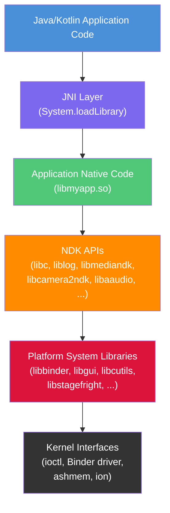

图中的每一层都代表一个不同的稳定性域：

| 层 | 稳定性保证 | 使用者 |
|-------|-------------------|----------------|
| NDK API | 跨版本 ABI 稳定 | 应用开发者 |
| 平台系统库 | 无稳定性保证 | 框架开发者 |
| 内核接口 | 通过内核 ABI 保持稳定 | 所有原生代码 |

### 11.1.3 NDK 与框架原生代码

必须区分“使用 NDK 的原生代码”和“作为平台一部分的原生代码”。考虑两个具体的例子：

**使用 NDK 的应用** —— 游戏引擎链接 `libc.so`、`liblog.so`、`libEGL.so`、`libGLESv3.so` 和 `libaaudio.so`。这些库都在 NDK 列表上。游戏发布包含 `lib/arm64-v8a/libgame.so` 的 APK。平台保证它调用的 API 在任何运行相同或更高 API 级别的设备上行为一致。

**框架原生代码** —— `SurfaceFlinger` 合成器链接 `libgui.so`、`libui.so`、`libbinder.so`、`libhidlbase.so` 以及数十个其他内部库。这些库都不带有 NDK 稳定性保证。设备制造商可以（也必须）针对确切的平台源码树重新构建 `SurfaceFlinger`。

构建系统强制执行这一区分。当一个模块设置 `sdk_version: "current"` 时，Soong 会针对 NDK 桩库解析其共享库依赖，而不是针对真实的平台实现。如果该模块试图使用非 NDK 符号，链接将在构建时失败。

### 11.1.4 Sysroot 生成流程

NDK sysroot 并不是一个手工整理的头文件和库目录。它是 AOSP 构建的输出。构建系统由 `build/soong/cc/ndk_sysroot.go` 编排，从三类产物中组装出 sysroot。

其中两类有专门的 Soong 模块类型——`ndk_headers`（连同 `preprocessed_ndk_headers`）和 `ndk_library`。bionic 静态库来自普通的 `cc_library` 模块。在同一文件中注册的 `ndk` singleton 收集它们的 sysroot 安装输出。该文件甚至带有一条 `TODO(danalbert): Write ndk_static_library rule.` 注释，指出了缺失的模块类型：

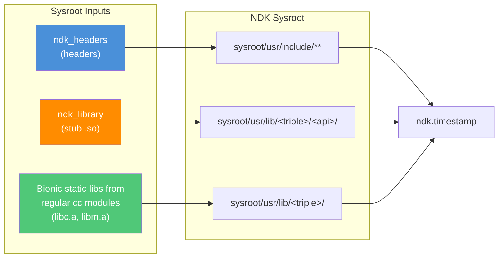

`build/soong/cc/ndk_sysroot.go` 顶部的注释明确列出了这四个组成部分：

```
// The platform needs to provide the following artifacts for the NDK:
// 1. Bionic headers.
// 2. Platform API headers.
// 3. NDK stub shared libraries.
// 4. Bionic static libraries.
```

文件 `ndk_sysroot.go` 注册了三种模块类型和一个 singleton：

```go
// build/soong/cc/ndk_sysroot.go (lines 81-86)
func RegisterNdkModuleTypes(ctx android.RegistrationContext) {
    ctx.RegisterModuleType("ndk_headers", NdkHeadersFactory)
    ctx.RegisterModuleType("ndk_library", NdkLibraryFactory)
    ctx.RegisterModuleType("preprocessed_ndk_headers", preprocessedNdkHeadersFactory)
    ctx.RegisterParallelSingletonType("ndk", NdkSingleton)
}
```

`NdkSingleton` 遍历树中的每个模块，收集头文件、桩库和静态库。它写出三个时间戳文件，以不同级别的完备性分阶段生成 sysroot：

- `ndk_headers.timestamp` —— 仅依赖头文件；它在 Soong 内部被消费。它是 C 兼容性头文件检查（`build/soong/cc/ndk_sysroot.go:141`）的隐式依赖。它也是设置了 `sdk_version` 的模块中每次编译的隐式依赖（`build/soong/cc/compiler.go:815`）
- `ndk_base.timestamp` —— 依赖头文件 + 桩共享库；这是 Make 侧拉入的那个，作为 SDK 变体二进制文件的额外依赖（`build/make/core/binary.mk:215`）
- `ndk.timestamp` —— 依赖 base + 静态库；它支撑着 phony 目标 `ndk`（`build/make/core/main.mk:1648`）

使用 `m ndk` 构建会触发所有 sysroot 产物的生成。

---

## 11.2 NDK API 表面

### 11.2.1 NDK 库概览

NDK API 表面是 AOSP 中声明的所有 `ndk_library` 模块的并集。这些就是应用开发者可以链接的库。在源码树中搜索 `ndk_library {` 即可揭示完整的列表：

| 库 | 首个 API | 源码位置 |
|---------|-----------|----------------|
| `libc` | 9 | `bionic/libc/Android.bp` |
| `libm` | 9 | `bionic/libm/Android.bp` |
| `libdl` | 9 | `bionic/libdl/Android.bp` |
| `libstdc++` | 9 | `bionic/libc/Android.bp` |
| `liblog` | 9 | `system/logging/liblog/Android.bp` |
| `libz` | 9 | `external/zlib/Android.bp` |
| `libandroid` | 9 | `frameworks/base/native/android/Android.bp` |
| `libEGL` | 9 | `frameworks/native/opengl/libs/Android.bp` |
| `libGLESv1_CM` | 9 | `frameworks/native/opengl/libs/Android.bp` |
| `libGLESv2` | 9 | `frameworks/native/opengl/libs/Android.bp` |
| `libGLESv3` | 18 | `frameworks/native/opengl/libs/Android.bp` |
| `libjnigraphics` | 9 | `frameworks/base/native/graphics/jni/Android.bp` |
| `libOpenSLES` | 9 | `frameworks/wilhelm/Android.bp` |
| `libOpenMAXAL` | 14 | `frameworks/wilhelm/Android.bp` |
| `libmediandk` | 21 | `frameworks/av/media/ndk/Android.bp` |
| `libcamera2ndk` | 24 | `frameworks/av/camera/ndk/Android.bp` |
| `libnativewindow` | 26 | `frameworks/native/libs/nativewindow/Android.bp` |
| `libaaudio` | 26 | `frameworks/av/media/libaaudio/Android.bp` |
| `libvulkan` | 24 | `frameworks/native/vulkan/libvulkan/Android.bp` |
| `libbinder_ndk` | 29 | `frameworks/native/libs/binder/ndk/Android.bp` |
| `libamidi` | 29 | `frameworks/base/media/native/midi/Android.bp` |
| `libsync` | 26 | `system/core/libsync/Android.bp` |
| `libneuralnetworks` | 27 | `packages/modules/NeuralNetworks/runtime/Android.bp` |
| `libicu` | 31 | `external/icu/libicu/Android.bp` |
| `libnativehelper` | 31 (`"S"`) | `system/extras/module_ndk_libs/libnativehelper/Android.bp` |

该表中的每一项都对应一个 Soong `ndk_library` 块，例如：

```
// frameworks/av/camera/ndk/Android.bp (lines 51-56)
ndk_library {
    name: "libcamera2ndk",
    symbol_file: "libcamera2ndk.map.txt",
    first_version: "24",
    unversioned_until: "current",
}
```

### 11.2.2 API 类别

NDK API 涵盖广泛的功能。下面是一种概念上的分组：

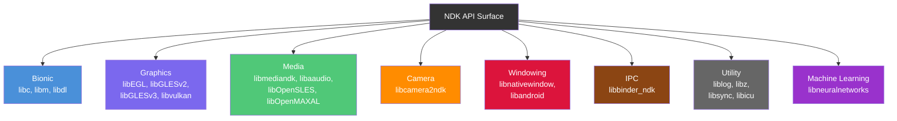

### 11.2.3 关键的 NDK API

本节考察应用程序使用的最重要的 NDK API。

#### AHardwareBuffer

`AHardwareBuffer` 提供了 GPU 分配内存的跨进程句柄。它作为 `libnativewindow` 的一部分在 API 26 中引入，允许在 CPU、GPU、摄像头和视频解码器之间共享图形缓冲区而无需拷贝。

关键函数（来自 `libnativewindow`）：

- `AHardwareBuffer_allocate()` —— 按指定的格式和用途标志分配缓冲区
- `AHardwareBuffer_lock()` —— 映射缓冲区以便 CPU 访问
- `AHardwareBuffer_sendHandleToUnixSocket()` —— 跨进程共享
- `AHardwareBuffer_recvHandleFromUnixSocket()` —— 从另一个进程接收

#### ANativeWindow

`ANativeWindow` 是 `android.view.Surface` 的原生侧。它是直接渲染帧的应用程序（OpenGL ES、Vulkan 或软件渲染）的主要接口。自 API 9 起通过 `libandroid` 提供：

- `ANativeWindow_fromSurface()` —— 将 Java Surface 转换为原生句柄
- `ANativeWindow_setBuffersGeometry()` —— 配置缓冲区尺寸
- `ANativeWindow_lock()` / `ANativeWindow_unlockAndPost()` —— 软件渲染

#### AAudio

AAudio（Android Audio）从 API 26 起取代 OpenSL ES，成为推荐的低延迟音频 API。定义在 `libaaudio` 中：

- `AAudio_createStreamBuilder()` —— 创建流构建器
- `AAudioStreamBuilder_setPerformanceMode()` —— 请求低延迟
- `AAudioStream_requestStart()` / `AAudioStream_requestStop()` —— 控制播放

AAudio 的 NDK 头文件声明于：
```
// frameworks/av/media/libaaudio/Android.bp (lines 24-31)
ndk_headers {
    name: "libAAudio_headers",
    from: "include",
    to: "",
    srcs: ["include/aaudio/AAudio.h"],
    license: "include/aaudio/NOTICE",
}
```

#### ACamera

Camera NDK 在 API 24 中随 `libcamera2ndk` 引入，将 Camera2 API 暴露给原生代码。我们将在第 16.5.6 节详细考察其实现。

#### ASensor

传感器 API 是 `libandroid` 的一部分，提供对加速度计、陀螺仪及其他硬件传感器的访问：

- `ASensorManager_getInstance()` —— 获取传感器管理器
- `ASensorManager_getDefaultSensor()` —— 获取特定传感器
- `ASensorEventQueue_enableSensor()` —— 开始接收事件

### 11.2.4 Native App Glue

NDK 包含一个名为 “native app glue” 的辅助库，简化了纯原生应用程序的编写。它以源码形式发布于：

```
prebuilts/ndk/current/sources/android/native_app_glue/
    android_native_app_glue.c
    android_native_app_glue.h
```

粘合库提供了一个线程模型：应用程序在与 Activity 的 UI 线程不同的线程中运行其主循环。核心数据结构是 `struct android_app`：

```c
// prebuilts/ndk/current/sources/android/native_app_glue/
//     android_native_app_glue.h (lines 109-183)
struct android_app {
    void* userData;
    void (*onAppCmd)(struct android_app* app, int32_t cmd);
    int32_t (*onInputEvent)(struct android_app* app, AInputEvent* event);
    ANativeActivity* activity;
    AConfiguration* config;
    void* savedState;
    size_t savedStateSize;
    ALooper* looper;
    AInputQueue* inputQueue;
    ANativeWindow* window;
    ARect contentRect;
    int activityState;
    int destroyRequested;
    // ... private implementation fields
};
```

应用通过命令码接收生命周期事件：

| 命令 | 含义 |
|---------|---------|
| `APP_CMD_INIT_WINDOW` | 新的 `ANativeWindow` 已就绪 |
| `APP_CMD_TERM_WINDOW` | 窗口正在被销毁 |
| `APP_CMD_GAINED_FOCUS` | Activity 已获得输入焦点 |
| `APP_CMD_LOST_FOCUS` | Activity 已失去输入焦点 |
| `APP_CMD_RESUME` | Activity 已恢复 |
| `APP_CMD_PAUSE` | Activity 已暂停 |
| `APP_CMD_SAVE_STATE` | 应用应保存状态 |
| `APP_CMD_DESTROY` | Activity 正在被销毁 |

应用程序入口点是 `android_main()` 而不是 `main()`：

```c
// prebuilts/ndk/current/sources/android/native_app_glue/
//     android_native_app_glue.h (line 346)
extern void android_main(struct android_app* app);
```

### 11.2.5 符号映射文件

每个 NDK 库都由一个 `.map.txt` 符号文件控制。该文件是该库 API 表面的权威规范。以下是 Camera NDK 符号文件的节选：

```
// frameworks/av/camera/ndk/libcamera2ndk.map.txt (excerpt)
LIBCAMERA2NDK {
  global:
    ACameraCaptureSession_abortCaptures;
    ACameraCaptureSession_capture;
    ACameraCaptureSession_captureV2; # introduced=33
    ACameraCaptureSession_logicalCamera_capture; # introduced=29
    ACameraCaptureSession_close;
    ACameraCaptureSession_getDevice;
    ACameraCaptureSession_setRepeatingRequest;
    ACameraCaptureSession_stopRepeating;
    ACameraCaptureSession_updateSharedOutput; # introduced=28
    ACameraDevice_close;
    ACameraDevice_createCaptureRequest;
    ACameraDevice_createCaptureRequest_withPhysicalIds; # introduced=29
    ACameraDevice_createCaptureSession;
    ACameraDevice_getId;
    ACameraManager_create;
    ACameraManager_delete;
    ACameraManager_deleteCameraIdList;
    ACameraManager_getCameraCharacteristics;
    ACameraManager_getCameraIdList;
    ACameraManager_openCamera;
    ACameraManager_registerAvailabilityCallback;
    ACameraManager_unregisterAvailabilityCallback;
    ACameraMetadata_copy;
    ACameraMetadata_free;
    ACameraMetadata_getAllTags;
    ACameraMetadata_getConstEntry;
    ACameraMetadata_getTagFromName; # introduced=35
    ACameraMetadata_isLogicalMultiCamera; # introduced=29
    ACameraMetadata_fromCameraMetadata; # introduced=30
    ACameraOutputTarget_create;
    ACameraOutputTarget_free;
    ACaptureRequest_addTarget;
    ACaptureRequest_copy; # introduced=28
    ACaptureRequest_free;
    ACaptureRequest_getAllTags;
    ACaptureRequest_getConstEntry;
    ACaptureRequest_setEntry_double;
    ACaptureRequest_setEntry_float;
    ACaptureRequest_setEntry_i32;
    ACaptureRequest_setEntry_i64;
    ACaptureRequest_setEntry_rational;
    ACaptureRequest_setEntry_u8;
    ACaptureSessionOutputContainer_add;
    ACaptureSessionOutputContainer_create;
    ACaptureSessionOutputContainer_free;
    ACaptureSessionOutputContainer_remove;
    ACaptureSessionOutput_create;
    ACaptureSessionOutput_free;
  local:
    *;
};
```

符号映射格式的关键方面：

- **`global:`** —— 列在这里的符号从桩库中导出
- **`local: *;`** —— 所有其他符号都被隐藏（这是默认的兜底规则）
- **`# introduced=N`** —— 该符号在 API 级别 N 被加入；`ndkstubgen` 工具会将其从更早 API 级别的桩中排除
- **`# systemapi`** —— 该符号仅对系统应用可用，不对普通第三方应用开放
- 没有 `# introduced=` 注释的符号从该库的 `first_version` 起就可用（例如 `libcamera2ndk` 为 API 24）

这种格式允许在单个文件中对符号逐一进行精确的 API 级别追踪。当 `ndkstubgen` 为 API 28 生成桩时，它会包含在 API 28 或之前引入的所有符号，并排除在 API 29 或之后引入的符号。

### 11.2.6 Bionic NDK 头文件

bionic C 库贡献了规模最大的 NDK 头文件集合。在 `bionic/libc/Android.bp` 中有多个 `ndk_headers` 模块：

```
// bionic/libc/Android.bp (lines 2348-2359)
ndk_headers {
    name: "common_libc",
    from: "include",
    to: "",
    srcs: ["include/**/*.h"],
    license: "NOTICE",
    // ...
}
```

其他头文件模块涵盖内核 UAPI 头文件、特定架构的头文件等：

```
// bionic/libc/Android.bp (lines 2361-2379)
ndk_headers {
    name: "libc_uapi",
    from: "kernel/uapi",
    to: "",
    srcs: [
        "kernel/uapi/asm-generic/**/*.h",
        // ...
    ],
    license: "NOTICE",
}
```

这些 bionic 头文件构成了 NDK sysroot 的基础，包括：

- 标准 C 库头文件（`stdio.h`、`stdlib.h`、`string.h` 等）
- POSIX 头文件（`pthread.h`、`unistd.h`、`sys/mman.h` 等）
- Linux 内核 UAPI 头文件（`linux/*.h`、`asm/*.h`）
- Android 专用扩展（`android/log.h`、`android/dlext.h`）

### 11.2.7 CPU 特性

`cpufeatures` 库允许原生代码在运行时查询 CPU 能力。其位置：

```
prebuilts/ndk/current/sources/android/cpufeatures/
    cpu-features.c
    cpu-features.h
```

主要 API 由两个函数组成：

```c
// prebuilts/ndk/current/sources/android/cpufeatures/cpu-features.h (line 58)
extern AndroidCpuFamily android_getCpuFamily(void);

// cpu-features.h (line 65)
extern uint64_t android_getCpuFeatures(void);
```

`android_getCpuFamily()` 函数返回以下之一：

- `ANDROID_CPU_FAMILY_ARM`
- `ANDROID_CPU_FAMILY_ARM64`
- `ANDROID_CPU_FAMILY_X86`
- `ANDROID_CPU_FAMILY_X86_64`

`android_getCpuFeatures()` 函数返回 CPU 能力的位掩码。对于 ARM64，标志包括：

```c
// cpu-features.h (lines 246-254)
enum {
    ANDROID_CPU_ARM64_FEATURE_FP      = (1 << 0),
    ANDROID_CPU_ARM64_FEATURE_ASIMD   = (1 << 1),
    ANDROID_CPU_ARM64_FEATURE_AES     = (1 << 2),
    ANDROID_CPU_ARM64_FEATURE_PMULL   = (1 << 3),
    ANDROID_CPU_ARM64_FEATURE_SHA1    = (1 << 4),
    ANDROID_CPU_ARM64_FEATURE_SHA2    = (1 << 5),
    ANDROID_CPU_ARM64_FEATURE_CRC32   = (1 << 6),
};
```

对于 x86/x86_64 架构：

```c
// cpu-features.h (lines 260-271)
enum {
    ANDROID_CPU_X86_FEATURE_SSSE3  = (1 << 0),
    ANDROID_CPU_X86_FEATURE_POPCNT = (1 << 1),
    ANDROID_CPU_X86_FEATURE_MOVBE  = (1 << 2),
    ANDROID_CPU_X86_FEATURE_SSE4_1 = (1 << 3),
    ANDROID_CPU_X86_FEATURE_SSE4_2 = (1 << 4),
    ANDROID_CPU_X86_FEATURE_AES_NI = (1 << 5),
    ANDROID_CPU_X86_FEATURE_AVX    = (1 << 6),
    ANDROID_CPU_X86_FEATURE_RDRAND = (1 << 7),
    ANDROID_CPU_X86_FEATURE_AVX2   = (1 << 8),
    ANDROID_CPU_X86_FEATURE_SHA_NI = (1 << 9),
};
```

这对提供手工优化 SIMD 路径的库来说非常有价值。应用程序可以在启动时检查特性标志，然后分支到适合当前 CPU 的最高效代码路径。

---

## 11.3 NDK 构建集成

AOSP 中的 NDK 构建集成由 `build/soong/cc/` 下的四个关键 Go 源文件处理：

| 文件 | 用途 |
|------|---------|
| `ndk_library.go` | 桩共享库的生成 |
| `ndk_headers.go` | 头文件安装到 sysroot |
| `ndk_sysroot.go` | Sysroot 组装 singleton |
| `ndk_abi.go` | ABI dump 与差异监控 |

### 11.3.1 `ndk_library` 模块类型

`ndk_library` 模块类型是 NDK 桩库的核心构建原语。每个 NDK 库都声明为一对模块：一个生成桩的 `ndk_library` 模块和一个提供真实实现的 `cc_library_shared` 模块。应用开发者链接的是桩；在设备上运行的是真实库。

该模块类型由 `build/soong/cc/ndk_library.go` 中的 `NdkLibraryFactory()` 实现：

```go
// build/soong/cc/ndk_library.go (lines 658-662)
func NdkLibraryFactory() android.Module {
    module := newStubLibrary()
    android.InitAndroidArchModule(module, android.DeviceSupported,
        android.MultilibBoth)
    return module
}
```

#### 属性

`ndk_library` 模块类型接受以下属性：

```go
// build/soong/cc/ndk_library.go (lines 95-123)
type libraryProperties struct {
    // Relative path to the symbol map.
    Symbol_file *string `android:"path"`

    // The first API level a library was available.
    First_version *string

    // The first API level that library should have the version script
    // applied.
    Unversioned_until *string

    // If true, allow all symbols in this library to be called in
    // native-only app processes (see Section 11.6.5). Should only be
    // used by libraries with no dependency on the Android Runtime;
    // otherwise use the `artless` tag in the symbol map per-symbol.
    Bypass_artless_denylist *bool

    // DO NOT USE THIS
    // NDK libraries should not export their headers.
    Export_header_libs []string
}
```

`Bypass_artless_denylist` 属性在 Android 17 中新增。它与同一版本中添加到 NDK 工具链的 *artless* 符号标签相关联。“Artless”意为“无 Android Runtime”——即可以从纯原生应用进程（从不启动 JVM 的进程，即第 11.6.5 节的主题）中调用。默认情况下，每个 `ndk_library` 还会生成一个 denylist 桩，*阻止*与此类进程不兼容的符号。设置 `bypass_artless_denylist: true` 会使该 denylist 变为空，即声明整个库可用于纯原生场景。

若要改为选择性启用，可以在 `.map.txt` 文件中为个别符号打上 `artless` 标签。之所以采用默认拒绝的姿态，是因为大多数 NDK 入口点都会触及 Android Runtime。从没有 JVM 的进程中调用这些入口点会失败。bionic、`liblog` 以及同样不依赖运行时的库是那些被标记为 artless 的库。第 11.8.2 节会回到 denylist 的构建系统机制。

`symbol_file` 属性指向一个 `.map.txt` 文件，其中列出了每个导出符号及其引入时的 API 级别。这是 NDK API 表面的权威来源。例如，`libcamera2ndk.map.txt` 列出了 Camera NDK 中的每个函数及其可用的 API 级别。

`first_version` 属性指定应为其生成桩的最早 API 级别。构建系统会为从 `first_version` 起的每一个已定稿 API 级别生成一个单独的桩库。它还会额外生成一个名为 “current”（在 Soong 中称为 `FutureApiLevel`）的未发布级别。

#### 桩生成流程

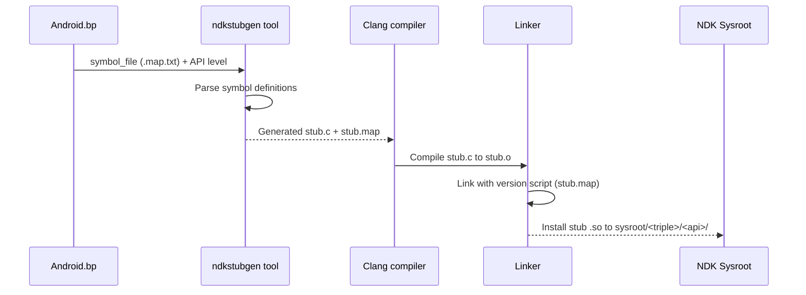

桩生成始于 `stubDecorator` 的 `compile()` 方法：

```go
// build/soong/cc/ndk_library.go (lines 488-521)
func (c *stubDecorator) compile(ctx ModuleContext, flags Flags,
        deps PathDeps) Objects {
    if !strings.HasSuffix(String(c.properties.Symbol_file), ".map.txt") {
        ctx.PropertyErrorf("symbol_file", "must end with .map.txt")
    }
    // ...
    symbolFile := String(c.properties.Symbol_file)
    nativeAbiResult := ParseNativeAbiDefinition(ctx, symbolFile,
        c.apiLevel, "")
    objs := CompileStubLibrary(ctx, flags, nativeAbiResult.StubSrc,
        ctx.getSharedFlags())
    c.versionScriptPath = nativeAbiResult.VersionScript
    // ...
}
```

`ParseNativeAbiDefinition()` 函数会调用 `ndkstubgen` 工具：

```go
// build/soong/cc/ndk_library.go (lines 272-300)
func ParseNativeAbiDefinition(ctx android.ModuleContext,
        symbolFile string, apiLevel android.ApiLevel,
        genstubFlags string) NdkApiOutputs {

    stubSrcPath := android.PathForModuleGen(ctx, "stub.c")
    versionScriptPath := android.PathForModuleGen(ctx, "stub.map")
    symbolFilePath := android.PathForModuleSrc(ctx, symbolFile)
    symbolListPath := android.PathForModuleGen(ctx,
        "abi_symbol_list.txt")
    apiLevelsJson := android.GetApiLevelsJson(ctx)
    ctx.Build(pctx, android.BuildParams{
        Rule:        genStubSrc,
        Description: "generate stubs " + symbolFilePath.Rel(),
        Outputs: []android.WritablePath{stubSrcPath,
            versionScriptPath, symbolListPath},
        Input:     symbolFilePath,
        Implicits: []android.Path{apiLevelsJson},
        Args: map[string]string{
            "arch":     ctx.Arch().ArchType.String(),
            "apiLevel": apiLevel.String(),
            "apiMap":   apiLevelsJson.String(),
            "flags":    genstubFlags,
        },
    })
    // ...
}
```

这调用了 `genStubSrc` 规则：

```go
// build/soong/cc/ndk_library.go (lines 39-44)
genStubSrc = pctx.AndroidStaticRule("genStubSrc",
    blueprint.RuleParams{
        Command: "$ndkStubGenerator --arch $arch --api $apiLevel " +
            "--api-map $apiMap $flags $in $out",
        CommandDeps: []string{"$ndkStubGenerator"},
    }, "arch", "apiLevel", "apiMap", "flags")
```

该工具读取 `.map.txt` 符号文件并生成：

1. 一个 `stub.c` 源文件，包含每个导出函数的占位实现
2. 一个 `stub.map` 版本脚本，控制哪些符号被导出
3. 一个 `abi_symbol_list.txt`，枚举用于 ABI 监控的所有符号

#### 桩编译标志

桩库使用特殊的标志编译，以抑制关于占位实现的警告：

```go
// build/soong/cc/ndk_library.go (lines 234-246, comments elided)
var stubLibraryCompilerFlags = []string{
    "-Wno-incompatible-library-redeclaration",
    "-Wno-incomplete-setjmp-declaration",
    "-Wno-builtin-requires-header",
    "-Wno-invalid-noreturn",
    "-Wall",
    "-Werror",
    "-fno-unwind-tables",
}
```

`-fno-unwind-tables` 标志值得注意：由于桩永远不会真正执行，因此不需要展开信息。这减小了生成的桩的体积。

#### 版本管理

每个 `ndk_library` 都为从 `first_version` 到当前版本的每个 API 级别生成桩：

```go
// build/soong/cc/ndk_library.go (lines 159-169)
func ndkLibraryVersions(ctx android.BaseModuleContext,
        from android.ApiLevel) []string {
    versionStrs := []string{}
    for _, version := range ctx.Config().FinalApiLevels() {
        if version.GreaterThanOrEqualTo(from) {
            versionStrs = append(versionStrs, version.String())
        }
    }
    versionStrs = append(versionStrs,
        android.FutureApiLevel.String())
    return versionStrs
}
```

这意味着 `first_version: "24"` 的 `libcamera2ndk` 会为 API 24、25、26……以及 “current”（`FutureApiLevel` 渲染出的字符串）生成桩。每个带版本的桩只导出在该 API 级别可用的符号。

#### 桩安装

桩被安装到 sysroot 内的一个带版本路径中：

```go
// build/soong/cc/ndk_library.go (lines 593-596)
func getVersionedLibraryInstallPath(ctx ModuleContext,
        apiLevel android.ApiLevel) android.OutputPath {
    return getUnversionedLibraryInstallPath(ctx).Join(ctx,
        apiLevel.String())
}
```

这会产生如下路径：
```
sysroot/usr/lib/aarch64-linux-android/24/libcamera2ndk.so
sysroot/usr/lib/aarch64-linux-android/26/libaaudio.so
sysroot/usr/lib/aarch64-linux-android/29/libbinder_ndk.so
```

### 11.3.2 `ndk_headers` 模块类型

`ndk_headers` 模块类型将头文件安装到 NDK sysroot。它实现于 `build/soong/cc/ndk_headers.go`。

#### 属性

```go
// build/soong/cc/ndk_headers.go (lines 42-73)
type headerProperties struct {
    // Base directory of the headers being installed.
    From *string

    // Install path within the sysroot relative to usr/include.
    To *string

    // List of headers to install. Glob compatible.
    Srcs []string `android:"path"`

    // Source paths that should be excluded.
    Exclude_srcs []string `android:"path"`

    // Path to the NOTICE file associated with the headers.
    License *string `android:"path"`

    // Set to true if the headers should skip verification.
    Skip_verification *bool
}
```

`from` 和 `to` 属性控制头文件路径如何从源码树映射到 sysroot。源码中的注释解释了这一映射：

```
// ndk_headers {
//     name: "foo",
//     from: "include",
//     to: "",
//     srcs: ["include/foo/bar/baz.h"],
// }
//
// Will install $SYSROOT/usr/include/foo/bar/baz.h.
```

#### 头文件验证

每个 NDK 头文件都被验证为自包含且为合法的 C 代码。这一验证在 `ndk_sysroot.go` 中的 `NdkSingleton` 里进行：

```go
// build/soong/cc/ndk_sysroot.go (lines 122-160)
func verifyNdkHeaderIsCCompatible(ctx android.SingletonContext,
        src android.Path, dest android.Path) android.Path {
    // ...
    ctx.Build(pctx, android.BuildParams{
        Rule:        verifyCCompat,
        Description: fmt.Sprintf("Verifying C compatibility of %s",
            src),
        Output:      output,
        Input:       dest,
        Implicits:   []android.Path{
            getNdkHeadersTimestampFile(ctx)},
        Args: map[string]string{
            "ccCmd": "${config.ClangBin}/clang",
            "flags": fmt.Sprintf(
                "-target aarch64-linux-android%d --sysroot %s",
                android.FutureApiLevel.FinalOrFutureInt(),
                getNdkSysrootBase(ctx).String(),
            ),
        },
    })
    return output
}
```

这会使用 `-fsyntax-only` 编译每个头文件，以确保它能作为独立的 C 代码干净地解析。被授予 `skip_verification: true` 的头文件会绕过这一检查——但属性定义中的注释指出，这种情况应当极其罕见。

#### 预处理头文件

一些 NDK 头文件在安装前需要预处理（例如特定架构的定义）。`preprocessed_ndk_headers` 模块类型处理这一需求：

```go
// build/soong/cc/ndk_headers.go (lines 196-219)
type preprocessedHeadersProperties struct {
    // The preprocessor to run.
    Preprocessor *string

    // Source path to the files to be preprocessed.
    Srcs []string

    // Source paths that should be excluded from the srcs glob.
    Exclude_srcs []string

    // Install path within the sysroot relative to usr/include.
    To *string

    // Path to the NOTICE file.
    License *string

    // Set to true if the headers should skip verification.
    Skip_verification *bool
}
```

### 11.3.3 ABI 监控

NDK ABI 稳定性不只是一项政策——它还由构建系统中的自动化监控强制执行。其实现位于 `build/soong/cc/ndk_abi.go`。

#### ABI Dump 生成

系统使用 STG（Symbol/Type Graph，符号/类型图）工具，它利用 DWARF 调试信息从 ELF 二进制文件中提取 ABI 信息：

```go
// build/soong/cc/ndk_library.go (lines 53-58)
stg = pctx.AndroidStaticRule("stg",
    blueprint.RuleParams{
        Command: "$stg -S :$symbolList --file-filter :$headersList " +
            "--elf $in -o $out",
        CommandDeps: []string{"$stg"},
    }, "symbolList", "headersList")
```

`headersList` 至关重要：它告诉 STG 只监控那些在 NDK 公共头文件中定义的类型。来自内部头文件的类型被排除在监控之外。这避免了内部实现细节经由 DWARF 泄漏而导致误报。

头文件过滤逻辑位于 `ndk_sysroot.go`：

```go
// build/soong/cc/ndk_sysroot.go (lines 187-196)
func writeNdkAbiSrcFilter(ctx android.BuilderContext,
        headerSrcPaths android.Paths,
        outputFile android.WritablePath) {
    var filterBuilder strings.Builder
    filterBuilder.WriteString("[decl_file_allowlist]\n")
    for _, headerSrcPath := range headerSrcPaths {
        filterBuilder.WriteString(headerSrcPath.String())
        filterBuilder.WriteString("\n")
    }
    android.WriteFileRule(ctx, outputFile, filterBuilder.String())
}
```

#### ABI 差异检测

当某个 API 级别存在 ABI dump 时，构建会将其与存储在 `prebuilts/abi-dumps/ndk/` 中的预构建参考 dump 进行比较：

```go
// build/soong/cc/ndk_library.go (lines 60-68)
stgdiff = pctx.AndroidStaticRule("stgdiff",
    blueprint.RuleParams{
        Command: "$stgdiff $args --stg $in -o $out || " +
            "(cat $out && echo 'Run " +
            "$$ANDROID_BUILD_TOP/development/tools/ndk/" +
            "update_ndk_abi.sh to update the ABI dumps.' " +
            "&& false)",
        CommandDeps: []string{"$stgdiff"},
    }, "args")
```

如果 `stgdiff` 检测到 ABI 变更，构建会失败，并显示一条错误信息，告知开发者运行 `update_ndk_abi.sh`。这是一个有意设置的摩擦点：破坏 NDK ABI 是一件严重的事情，需要明确的确认。

差异逻辑检查两件事：

1. **当前 API 级别**：构建出的 ABI 必须与该级别的预构建 dump 完全匹配。任何变更都是错误。
2. **下一个 API 级别**：ABI 必须是当前级别的超集。允许新增，但不允许删除或修改。

```go
// build/soong/cc/ndk_library.go (lines 411-485)
func (this *stubDecorator) diffAbi(ctx ModuleContext) {
    // Catch any ABI changes compared to the checked-in definition
    // ...
    ctx.Build(pctx, android.BuildParams{
        Rule: stgdiff,
        // ...
        Args: map[string]string{
            "args": "--format=small",
        },
    })
    // Also ensure the next API level is compatible
    // ...
    ctx.Build(pctx, android.BuildParams{
        Rule: stgdiff,
        // ...
        Args: map[string]string{
            "args": "--format=small --ignore=interface_addition",
        },
    })
}
```

`--ignore=interface_addition` 标志是关键：它允许新符号出现在下一个 API 级别中，但会对任何删除或签名变更标记错误。

#### ABI 监控流程

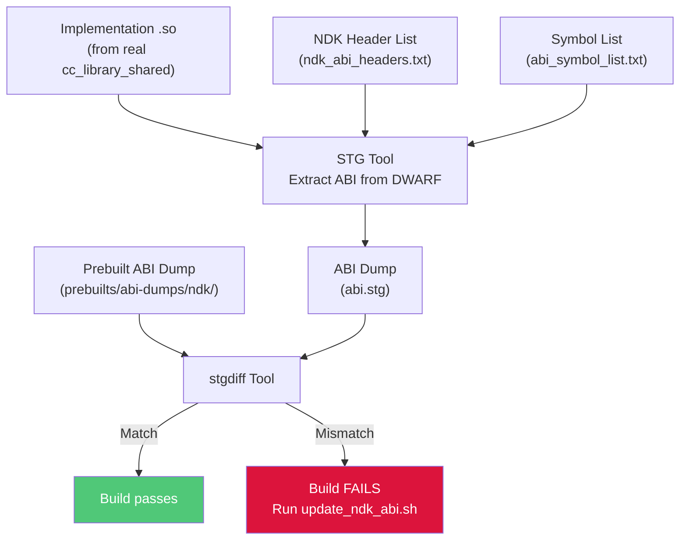

#### Bionic 例外

有趣的是，bionic 库目前被豁免 ABI 监控：

```go
// build/soong/cc/ndk_library.go (lines 350-365)
func (this *stubDecorator) canDumpAbi(ctx ModuleContext) bool {
    if runtime.GOOS == "darwin" {
        return false
    }
    if strings.HasPrefix(ctx.ModuleDir(), "bionic/") {
        // Bionic has enough uncommon implementation details like
        // ifuncs and asm code that the ABI tracking here has a ton
        // of false positives. That's causing pretty extreme friction
        // for development there, so disabling it until the workflow
        // can be improved.
        //
        // http://b/358653811
        return false
    }
    return ctx.Config().ReleaseNdkAbiMonitored()
}
```

这是一种务实的让步：bionic 使用的 ifuncs（用于运行时分发的间接函数）和手写汇编生成的 DWARF 信息会干扰 STG 工具。bionic 的 ABI 稳定性通过其他手段维护（CTS 测试、人工审查）。

### 11.3.4 NDK 已知库注册表

每个 `ndk_library` 模块都会在一个全局的已知 NDK 库列表中注册自己：

```go
// build/soong/cc/ndk_library.go (lines 209-232)
func getNDKKnownLibs(config android.Config) *[]string {
    return config.Once(ndkKnownLibsKey, func() interface{} {
        return &[]string{}
    }).(*[]string)
}

func (c *stubDecorator) compilerInit(ctx BaseModuleContext) {
    c.baseCompiler.compilerInit(ctx)

    name := ctx.baseModuleName()
    // ...
    ndkKnownLibsLock.Lock()
    defer ndkKnownLibsLock.Unlock()
    ndkKnownLibs := getNDKKnownLibs(ctx.Config())
    for _, lib := range *ndkKnownLibs {
        if lib == name {
            return
        }
    }
    *ndkKnownLibs = append(*ndkKnownLibs, name)
}
```

构建系统使用该列表来验证 SDK 构建的模块只链接被批准的 NDK 库。互斥锁（`ndkKnownLibsLock`）保护该列表，因为 `compilerInit()` 在并行的 `BeginMutator` 阶段运行。

### 11.3.5 端到端：NDK 库是如何构建的

让我们追踪 `libcamera2ndk` 从声明到 sysroot 安装的完整生命周期：

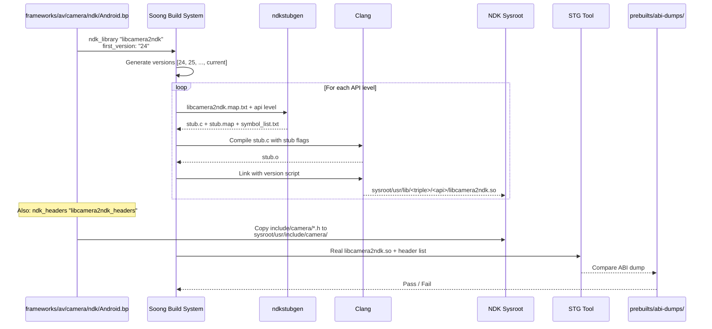

---

## 11.4 LL-NDK —— 底层 NDK

### 11.4.1 什么是 LL-NDK？

LL-NDK（Low-Level NDK）是一组系统库的子集，**既**可供 NDK 应用程序使用，**也**可供厂商/产品原生代码使用。常规 NDK 库只对运行在 app 链接器命名空间中的应用程序可见，而 LL-NDK 库则跨命名空间边界可见。

标准的 LL-NDK 库是所有东西都依赖的基础系统库：

| 库 | 用途 |
|---------|---------|
| `libc.so` | C 标准库（bionic） |
| `libm.so` | 数学库 |
| `libdl.so` | 动态链接器接口 |
| `liblog.so` | Android 日志 |
| `libvndksupport.so` | 厂商命名空间支持 |
| `libnativewindow.so` | 窗口/缓冲区管理 |
| `libsync.so` | Fence 同步 |
| `libvulkan.so` | Vulkan 图形 API |
| `libEGL.so` | EGL 接口 |
| `libGLESv1_CM.so` | OpenGL ES 1.x |
| `libGLESv2.so` | OpenGL ES 2.0+ |
| `libGLESv3.so` | OpenGL ES 3.x |
| `libmediandk.so` | 媒体框架 |
| `libbinder_ndk.so` | Binder NDK 接口 |

### 11.4.2 在 Soong 中声明 LLNDK

库通过在 `cc_library` 或 `cc_library_shared` 定义中包含 `llndk` 块来声明自己为 LL-NDK。例如 `libnativewindow`：

```
// frameworks/native/libs/nativewindow/Android.bp (lines 72-80)
cc_library {
    name: "libnativewindow",
    llndk: {
        symbol_file: "libnativewindow.map.txt",
        unversioned: true,
        override_export_include_dirs: [
            "include",
        ],
        export_llndk_headers: [
```

而 `libbinder_ndk` 如下：

```
// frameworks/native/libs/binder/ndk/Android.bp (lines 77-85)
cc_library {
    name: "libbinder_ndk",
    // ...
    llndk: {
        symbol_file: "libbinder_ndk.map.txt",
    },
```

同样地，`libmediandk`：

```
// frameworks/av/media/ndk/Android.bp (lines 87-91)
cc_library_shared {
    name: "libmediandk",
    llndk: {
        symbol_file: "libmediandk.map.txt",
    },
```

### 11.4.3 LLNDK 属性

LL-NDK 属性结构定义于 `build/soong/cc/llndk_library.go`：

```go
// build/soong/cc/llndk_library.go (lines 30-63)
type llndkLibraryProperties struct {
    // Relative path to the symbol map.
    Symbol_file *string `android:"path,arch_variant"`

    // Whether to export headers as -isystem instead of -I.
    Export_headers_as_system *bool

    // Whether the system library uses symbol versions.
    Unversioned *bool

    // List of llndk headers to re-export.
    Export_llndk_headers []string

    // Override export include dirs for the LLNDK variant.
    Override_export_include_dirs []string

    // Whether this module can be directly depended upon by
    // vendor/product libraries.
    Private *bool

    // If true, provide headers to other LLNDK modules.
    Llndk_headers *bool

    // Marks this module as having been distributed through an apex.
    Moved_to_apex *bool
}
```

`Private` 属性值得注意：当设置为 `true` 时，该库可被其他 VNDK 库访问，但不能被厂商代码直接访问。这使平台可以将某个库用作 VNDK 的内部实现细节，而不将其暴露给所有厂商模块。

### 11.4.4 LLNDK 变异器

`llndk_library.go` 中的 `llndkMutator` 在构建期间将模块标记为 LL-NDK：

```go
// build/soong/cc/llndk_library.go (lines 224-249)
func llndkMutator(mctx android.BottomUpMutatorContext) {
    m, ok := mctx.Module().(*Module)
    if !ok {
        return
    }
    if shouldSkipLlndkMutator(mctx, m) {
        return
    }

    lib, isLib := m.linker.(*libraryDecorator)
    prebuiltLib, isPrebuiltLib := m.linker.(*prebuiltLibraryLinker)

    if m.InVendorOrProduct() && isLib && lib.HasLLNDKStubs() {
        m.VendorProperties.IsLLNDK = true
    }
    if m.InVendorOrProduct() && isPrebuiltLib &&
            prebuiltLib.HasLLNDKStubs() {
        m.VendorProperties.IsLLNDK = true
    }
    // ...
}
```

该 mutator 会跳过已禁用、非设备目标或 NativeBridge 目标的模块：

```go
// build/soong/cc/llndk_library.go (lines 252-263)
func shouldSkipLlndkMutator(mctx android.BottomUpMutatorContext,
        m *Module) bool {
    if !m.Enabled(mctx) {
        return true
    }
    if !m.Device() {
        return true
    }
    if m.Target().NativeBridge == android.NativeBridgeEnabled {
        return true
    }
    return false
}
```

### 11.4.5 LLNDK 库列表生成

`llndk_libraries_txt` 模块生成一个文本文件，列出所有 LL-NDK 库。该文件被 Make 和链接器配置生成器使用。该模块类型与一个配套的 singleton（`llndkLibrariesTxtSingletonFactory`）一起注册，后者负责收集库名称：

```go
// build/soong/cc/llndk_library.go (lines 127-138)
// llndk_libraries_txt is a singleton module whose content is a list
// of LLNDK libraries generated by Soong but can be referenced by
// other modules.
func llndkLibrariesTxtModuleFactory() android.Module {
    m := &llndkLibrariesTxtModule{}
    android.InitAndroidArchModule(m, android.DeviceSupported,
        android.MultilibCommon)
    return m
}
```

Make 变量 `LLNDK_LIBRARIES` 由该 singleton 设置，它持有收集到的模块名称：

```go
// build/soong/cc/llndk_library.go (lines 218-220)
func (txt *llndkLibrariesTxtSingleton) MakeVars(
        ctx android.MakeVarsContext) {
    ctx.Strict("LLNDK_LIBRARIES",
        strings.Join(txt.moduleNames, " "))
}
```

### 11.4.6 LL-NDK 与 NDK：架构对比

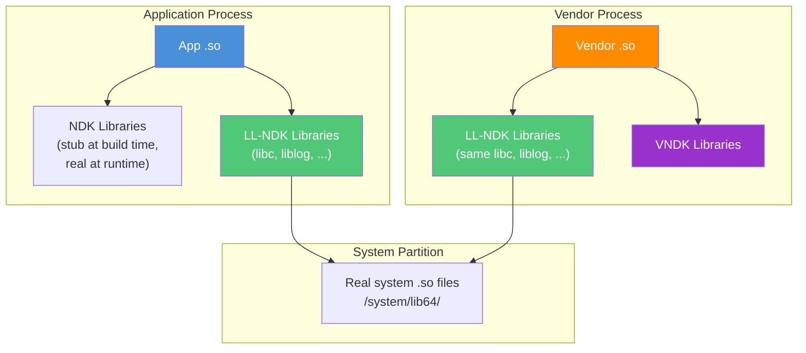

关键区别在于：LL-NDK 库驻留在 system 分区，但可被 vendor 分区中的代码访问。像 `libcamera2ndk` 这样的常规 NDK 库只在 app 链接器命名空间中可用。LL-NDK 库构成了 system 分区与 vendor 分区之间最小的共享 ABI。

### 11.4.7 迁移到 APEX 的 LLNDK 库

一些 LL-NDK 库已被迁移到 APEX 模块中。`movedToApexLlndkLibraries` singleton 跟踪这些库：

```go
// build/soong/cc/llndk_library.go (lines 74-103)
func (s *movedToApexLlndkLibraries) GenerateBuildActions(
        ctx android.SingletonContext) {
    movedToApexLlndkLibrariesMap := make(map[string]bool)
    ctx.VisitAllModuleProxies(func(module android.ModuleProxy) {
        if library, ok := android.OtherModuleProvider(ctx, module,
                LinkableInfoProvider); ok {
            if library.HasLLNDKStubs &&
                    library.IsLLNDKMovedToApex {
                movedToApexLlndkLibrariesMap[
                    library.ImplementationModuleName] = true
            }
        }
    })
    // ...
}
```

这会生成 Make 变量 `LLNDK_MOVED_TO_APEX_LIBRARIES`，链接器配置生成器使用它来设置指向 APEX 目录的命名空间回退路径。

---

## 11.5 VNDK —— 厂商 NDK

### 11.5.1 厂商稳定性问题

在 Android 8.0（Oreo）之前，厂商可以链接 system 分区上的任意库。这造成了一种脆弱的耦合关系。当 Google 在平台版本中更新系统库时，厂商代码经常损坏。原因是它依赖的内部符号发生了变化。这迫使每一次 Android 发布都经历痛苦的“大爆炸”式集成周期。

VNDK（Vendor Native Development Kit）在 Android 8.0 中引入，以解决这一问题。它定义了一组厂商代码**被允许**使用的系统库。其保证是这些库在平台更新中保持 ABI 兼容。

在开始之前先说明时效性：VNDK 自 Android 14 起已被弃用，第 11.5.9 节给出了细节。Android 17 平台不再将任何自有库归类为 VNDK。本节按 VNDK 最初的设计来解释它。该机制仍保留在 Soong 中，因为出货的设备携带冻结的 VNDK 快照。本节最后会把这一设计与当前状态对应起来。

### 11.5.2 VNDK 架构

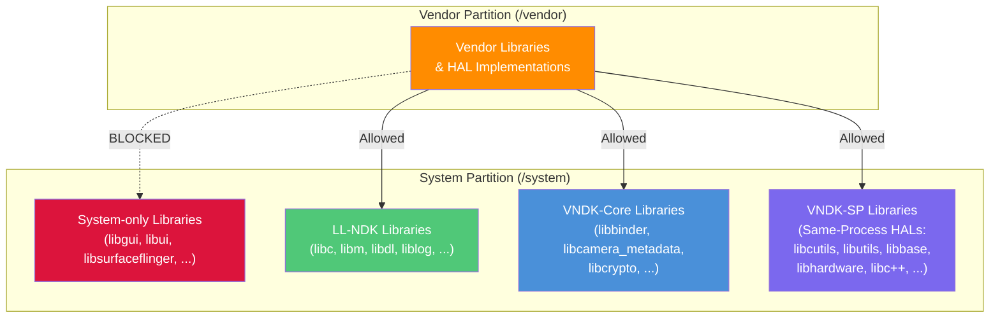

VNDK 被划分为几个类别：

| 类别 | 描述 | 示例 |
|----------|-------------|---------|
| VNDK-Core | 标准 VNDK 库 | `libbinder`、`libcamera_metadata`、`libcrypto`、`libjpeg` |
| VNDK-SP | 同进程 VNDK 库（可与厂商库一起加载进厂商进程） | `libcutils`、`libutils`、`libbase`、`libhardware`、`libc++`、`libhidlbase` |
| VNDK-Private | 厂商代码不能直接使用的 VNDK 库 | VNDK 的内部依赖 |
| LL-NDK | 最底层的 NDK（跨分区） | `libc`、`libm`、`liblog` |

### 11.5.3 在 Soong 中声明 VNDK

库通过包含 `vndk` 块来声明自己为 VNDK。属性定义于 `build/soong/cc/vndk.go`：

```go
// build/soong/cc/vndk.go (lines 45-77)
type VndkProperties struct {
    Vndk struct {
        // declared as a VNDK or VNDK-SP module.
        Enabled *bool

        // declared as a VNDK-SP module, which is a subset of VNDK.
        // All these modules are allowed to link to VNDK-SP or LL-NDK
        // modules only.
        Support_system_process *bool

        // declared as a VNDK-private module.
        // Only available to other VNDK modules, not to vendor code.
        Private *bool

        // Extending another module
        Extends *string
    }
}
```

一个典型的 VNDK 声明如下：

```
cc_library_shared {
    name: "libbinder",
    vendor_available: true,
    vndk: {
        enabled: true,
    },
    // ...
}
```

对于 VNDK-SP（同进程）库，例如 `libcutils`：

```
cc_library_shared {
    name: "libcutils",
    vendor_available: true,
    vndk: {
        enabled: true,
        support_system_process: true,
    },
    // ...
}
```

### 11.5.4 VNDK 链接类型检查

构建系统在构建时强制执行 VNDK 依赖规则。链接约束如下：

| 模块类型 | 可以链接到 |
|-------------|------------|
| **厂商** | LL-NDK、VNDK-Core、VNDK-SP、其他厂商库 |
| **VNDK-Core** | LL-NDK、VNDK-Core、VNDK-SP |
| **VNDK-SP** | 仅限 LL-NDK、VNDK-SP |
| **系统** | 任意系统库 |

这些规则形成了严格的层级关系：

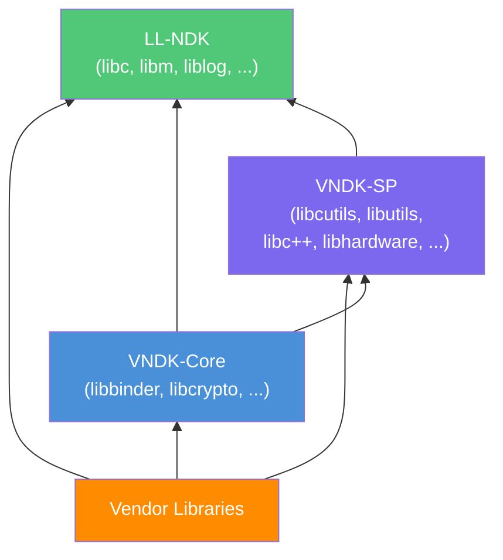

如果 VNDK-SP 库试图链接 VNDK-Core 库，构建将以链接类型错误失败。这种严格的层级防止了困扰 Android Oreo 之前版本的循环依赖问题。

### 11.5.5 VNDK 库列表文件

构建系统生成若干列出 VNDK 的文本文件：

```go
// build/soong/cc/vndk.go (lines 23-29)
const (
    llndkLibrariesTxt       = "llndk.libraries.txt"
    vndkCoreLibrariesTxt    = "vndkcore.libraries.txt"
    vndkSpLibrariesTxt      = "vndksp.libraries.txt"
    vndkPrivateLibrariesTxt = "vndkprivate.libraries.txt"
    vndkProductLibrariesTxt = "vndkproduct.libraries.txt"
)
```

每个文件都带有版本号：

```go
// build/soong/cc/vndk.go (lines 78-83)
func insertVndkVersion(filename string, vndkVersion string) string {
    if index := strings.LastIndex(filename, "."); index != -1 {
        return filename[:index] + "." + vndkVersion +
            filename[index:]
    }
    return filename
}
```

因此对于 VNDK 版本 34，文件名变为 `vndkcore.libraries.34.txt`、`vndksp.libraries.34.txt` 等。

### 11.5.6 VNDK 预构建快照

当 Google 发布新的平台版本时，它还会附带一个 VNDK 快照——一组为上一个版本预构建的 VNDK 库。这使厂商无需重新构建即可使用旧平台的 VNDK。`vndk_prebuilt_shared` 模块类型负责处理这一事项：

```go
// build/soong/cc/vndk_prebuilt.go (lines 51-73)
type vndkPrebuiltProperties struct {
    VndkProperties

    // VNDK snapshot version.
    Version *string

    // Target arch name of the snapshot.
    Target_arch *string

    // If the prebuilt snapshot lib is built with 32-bit binder.
    Binder32bit *bool

    // Prebuilt files for each arch.
    Srcs []string `android:"arch_variant"`

    // Flags for linking.
    Export_flags []string `android:"arch_variant"`

    // Check the prebuilt ELF files.
    Check_elf_files *bool `android:"arch_variant"`
}
```

一个 VNDK 预构建声明：

```
// Example from build/soong/cc/vndk_prebuilt.go comments
vndk_prebuilt_shared {
    name: "libfoo",
    version: "27",
    target_arch: "arm64",
    vendor_available: true,
    product_available: true,
    vndk: {
        enabled: true,
    },
    export_include_dirs: [
        "include/external/libfoo/vndk_include"
    ],
    arch: {
        arm64: {
            srcs: ["arm/lib64/libfoo.so"],
        },
        arm: {
            srcs: ["arm/lib/libfoo.so"],
        },
    },
}
```

预构建模块根据设备配置进行匹配：

```go
// build/soong/cc/vndk_prebuilt.go (lines 186-198)
func (p *vndkPrebuiltLibraryDecorator) MatchesWithDevice(
        config android.DeviceConfig) bool {
    arches := config.Arches()
    if len(arches) == 0 ||
            arches[0].ArchType.String() != p.arch() {
        return false
    }
    if config.BinderBitness() != p.binderBit() {
        return false
    }
    if len(p.properties.Srcs) == 0 {
        return false
    }
    return true
}
```

### 11.5.7 链接器命名空间隔离

VNDK 的稳定性保证在运行时通过动态链接器的命名空间隔离强制执行。该配置由位于 `system/linkerconfig/` 的 `linkerconfig` 工具生成。

位于 `system/core/rootdir/etc/ld.config.txt` 的静态 `ld.config.txt` 现在只包含一条重定向：

```
# This file is no longer in use.
# Please update linker configuration generator instead.
# You can find the code from /system/linkerconfig
```

生成的配置（可在测试 golden 文件 `system/linkerconfig/testdata/golden_output/vendor_with_vndk/ld.config.txt` 中看到）展示了命名空间架构：

对于 **vendor** 部分：

```
[vendor]
additional.namespaces = ...,system,vndk
namespace.default.isolated = true
namespace.default.search.paths = /odm/${LIB}
namespace.default.search.paths += /vendor/${LIB}
namespace.default.search.paths += /vendor/${LIB}/hw
namespace.default.search.paths += /vendor/${LIB}/egl
```

位于 `default` 命名空间中的厂商代码只能加载来自 `/odm/${LIB}` 和 `/vendor/${LIB}` 的库。要访问系统库，它必须通过到其他命名空间的显式链接：

```
namespace.default.links = rs,system,vndk,...
namespace.default.link.system.shared_libs = libc.so:libm.so:libdl.so:
    liblog.so:libbinder_ndk.so:libmediandk.so:libnativewindow.so:
    libvulkan.so:libEGL.so:libGLESv1_CM.so:libGLESv2.so:libGLESv3.so:
    libsync.so:libvndksupport.so:...
namespace.default.link.vndk.shared_libs = libcutils.so:libutils.so:
    libbase.so:libhidlbase.so:libc++.so:...
```

`link.system.shared_libs` 列表对应 LL-NDK 库。`link.vndk.shared_libs` 列表对应 VNDK 库。

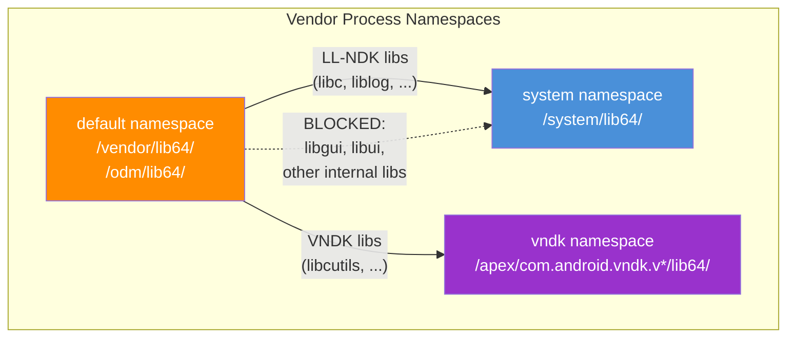

### 11.5.8 VNDK-SP：同进程库

VNDK-SP（Same-Process）库是一个特殊的子集，可以与厂商代码加载到同一进程中，而无需经过 IPC 边界。这对直接作为共享库加载进系统进程的 HAL 是必要的（例如加载进 SurfaceFlinger 的图形 HAL）。

对 VNDK-SP 的关键约束比普通 VNDK 更严格：VNDK-SP 库只能依赖其他 VNDK-SP 库或 LL-NDK 库。这防止了加载在同一进程中的系统代码与厂商代码之间出现循环依赖。

### 11.5.9 VNDK 弃用：Android 17 中的现状

从 Android 14 开始，Google 开始退役 VNDK；到 Android 17，对*新*平台代码而言退役实际上已经完成。Vendor API Level（`RELEASE_BOARD_API_LEVEL`，配置在 `build/release/flag_values/` 下）取代了 VNDK 版本，成为 system/vendor 兼容性的调节手段。厂商代码直接链接系统库。链接器配置生成器提供命名空间隔离，并且不存在专门的 VNDK 目录。

最明显的证据就在源码树本身。在 Android 17 源码中，**任何 `frameworks/`、`system/` 或 `hardware/` 模块里都没有留下 `vndk: {}` 块**。本章前文列为 VNDK-SP 的 `libcutils` 和 `libutils` 等库根本不再携带 `vndk:` 属性。在仍需要厂商访问的地方，它们是普通的 `cc_library` 模块，仅设置了 `vendor_available: true`。

VNDK 仅以 `prebuilts/vndk/` 下**冻结的预构建快照**（`v31` 到 `v34`）的形式存续。这些快照使针对 VNDK 34 构建的旧厂商镜像仍能在更新的系统镜像上运行。不存在 `v35`、`v36` 或 `v37` 快照，因为平台不再在每个版本中生成新的 VNDK。

本节描述的 Soong 机制是 `vndk.go`、`vndk_prebuilt_shared` 模块类型以及 `vndkcore.libraries.<ver>.txt` 系列文件。因此它保留在 `build/soong/cc/` 中是为了*消费*这些冻结的快照，而不是铸造新的快照。请将本节作为历史和向后兼容机制来阅读。它并不描述全新 Android 17 构建中库是如何分类的。对于当前构建，第 11.4 节的 LL-NDK 层才是生效的 system/vendor ABI 边界。

---

## 11.6 NDK 框架绑定

NDK 并不仅仅暴露底层系统函数。它还为 Camera、Media 和 Binder 这几个主要的 Android 框架服务提供 C 绑定。这些绑定遵循一致的架构：一个 C API 层包裹内部的 C++ 框架对象，并带有严格的符号可见性控制。

### 11.6.1 Camera NDK（`libcamera2ndk`）

Camera NDK 位于 `frameworks/av/camera/ndk/`。它通过 C 函数暴露 Camera2 API——即 Java `android.hardware.camera2` 包使用的同一个相机流水线。

#### 源码结构

```
frameworks/av/camera/ndk/
    Android.bp                      # Build rules
    NdkCameraCaptureSession.cpp     # Capture session API
    NdkCameraDevice.cpp             # Device open/close/create request
    NdkCameraManager.cpp            # Camera enumeration and callbacks
    NdkCameraMetadata.cpp           # Metadata (settings, results)
    NdkCaptureRequest.cpp           # Capture request construction
    impl/                           # Internal implementation
        ACameraCaptureSession.cpp
        ACameraDevice.cpp
        ACameraManager.cpp
        ACameraMetadata.cpp
    ndk_vendor/                     # Vendor variant (uses AIDL HAL)
        impl/
            ACameraDevice.cpp
            ACameraManager.cpp
            utils.cpp
    include/camera/                 # Public NDK headers
        NdkCameraCaptureSession.h
        NdkCameraDevice.h
        NdkCameraError.h
        NdkCameraManager.h
        NdkCameraMetadata.h
        NdkCameraMetadataTags.h
        NdkCameraWindowType.h
        NdkCaptureRequest.h
    libcamera2ndk.map.txt           # Symbol export map
```

#### NDK 与头文件声明

Camera NDK 在同一个 `Android.bp` 中声明其桩库和头文件：

```
// frameworks/av/camera/ndk/Android.bp (lines 51-64)
ndk_library {
    name: "libcamera2ndk",
    symbol_file: "libcamera2ndk.map.txt",
    first_version: "24",
    unversioned_until: "current",
}

ndk_headers {
    name: "libcamera2ndk_headers",
    from: "include/camera",
    to: "camera",
    srcs: ["include/camera/**/*.h"],
    license: "NOTICE",
}
```

#### 实现模式

Camera NDK 函数遵循一致的模式：一个薄薄的 C 包装器，委托给内部的 C++ 实现。以 `ACameraManager_create()` 为例：

```cpp
// frameworks/av/camera/ndk/NdkCameraManager.cpp (lines 37-41)
EXPORT
ACameraManager* ACameraManager_create() {
    ATRACE_CALL();
    return new ACameraManager();
}
```

`ACameraDevice_close()` 则如下：

```cpp
// frameworks/av/camera/ndk/NdkCameraDevice.cpp (lines 30-39)
EXPORT
camera_status_t ACameraDevice_close(ACameraDevice* device) {
    ATRACE_CALL();
    if (device == nullptr) {
        ALOGE("%s: invalid argument! device is null",
              __FUNCTION__);
        return ACAMERA_ERROR_INVALID_PARAMETER;
    }
    delete device;
    return ACAMERA_OK;
}
```

`EXPORT` 宏被定义为 `__attribute__((visibility("default")))`，并且该库使用 `-fvisibility=hidden` 编译。这确保只有显式标记了 `EXPORT` 的函数才会出现在共享库的动态符号表中：

```
// frameworks/av/camera/ndk/Android.bp (lines 102-109)
cflags: [
    "-DEXPORT=__attribute__((visibility(\"default\")))",
    "-Wall",
    "-Werror",
    "-Wextra",
    "-fvisibility=hidden",
],
```

#### 厂商与非厂商变体

Camera NDK 有两个变体。标准库（`libcamera2ndk`）使用框架内部的 `CameraService` binder 接口：

```cpp
// frameworks/av/camera/ndk/NdkCameraManager.cpp (lines 26-32)
#ifdef __ANDROID_VNDK__
#include "ndk_vendor/impl/ACameraManager.h"
#else
#include "impl/ACameraManager.h"
#include <com_android_internal_camera_flags.h>
namespace flags = com::android::internal::camera::flags;
#endif
```

厂商变体（`libcamera2ndk_vendor`）使用 `-D__ANDROID_VNDK__` 构建，并改为与*厂商稳定*的 `android.frameworks.cameraservice.{common,device,service}` AIDL 接口通信，而不是框架内部的 `android.hardware.ICameraService` binder 接口。请求仍然经过同一个 cameraserver 进程。相机服务通过 `AidlCameraService::registerService()`（`frameworks/av/services/camera/libcameraservice/aidl/AidlCameraService.cpp`）注册这个 AIDL 前端。因此厂商代码获得了通往系统相机服务的稳定接口，但它并不能绕过该服务。

#### Camera NDK 调用流程

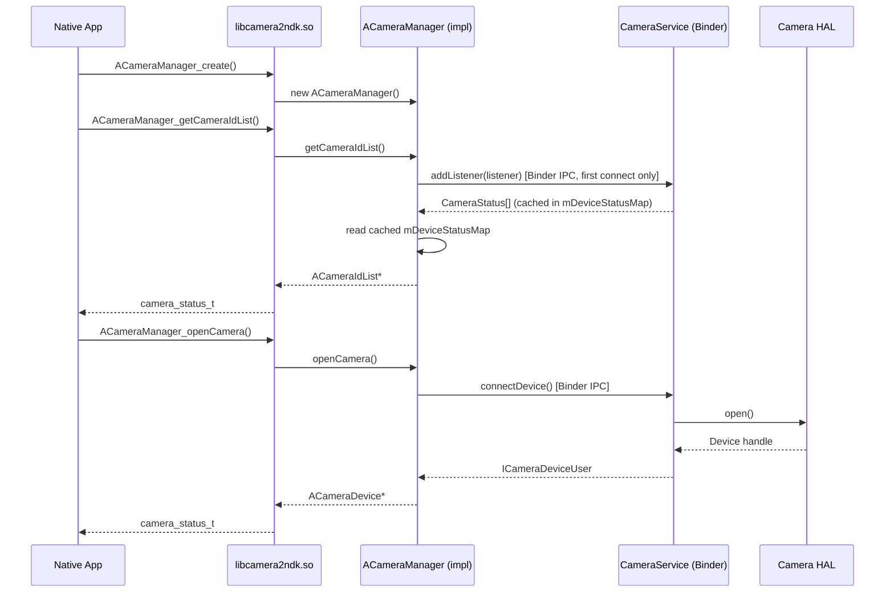

### 11.6.2 Media NDK（`libmediandk`）

位于 `frameworks/av/media/ndk/` 的 Media NDK 为媒体编解码器、分离器、DRM 和图像读取器提供原生访问。

#### 源码结构

```
frameworks/av/media/ndk/
    Android.bp                  # Build rules
    NdkMediaCodec.cpp          # MediaCodec wrapper
    NdkMediaCodecInfo.cpp      # Codec capability queries
    NdkMediaCodecStore.cpp     # Codec enumeration
    NdkMediaCrypto.cpp         # DRM/crypto support
    NdkMediaDataSource.cpp     # Data source abstraction
    NdkMediaDrm.cpp            # DRM session management
    NdkMediaExtractor.cpp      # Container format parsing
    NdkMediaFormat.cpp         # Key-value format metadata
    NdkMediaMuxer.cpp          # Container muxing
    NdkImage.cpp               # Image buffer access
    NdkImageReader.cpp         # Image reader (camera, video)
    libmediandk.map.txt        # Symbol export map
```

#### NDK 声明

```
// frameworks/av/media/ndk/Android.bp (lines 50-63)
ndk_library {
    name: "libmediandk",
    symbol_file: "libmediandk.map.txt",
    first_version: "21",
    unversioned_until: "current",
}

ndk_headers {
    name: "libmediandk_headers",
    from: "include/media",
    to: "media",
    srcs: ["include/media/**/*.h"],
    license: "NOTICE",
}
```

Media NDK 是使用最广泛的 NDK 库之一。它在 API 21 中引入，多年来大幅扩展。该库还被标记为 LL-NDK，使其可供厂商代码使用：

```
// frameworks/av/media/ndk/Android.bp (lines 87-91)
cc_library_shared {
    name: "libmediandk",
    llndk: {
        symbol_file: "libmediandk.map.txt",
    },
```

#### 关键 API

Media NDK 暴露了几个主要的 API 族：

**MediaCodec** —— 硬件加速的视频/音频编解码：

- `AMediaCodec_createDecoderByType()` —— 为指定 MIME 类型创建解码器
- `AMediaCodec_configure()` —— 用格式参数进行配置
- `AMediaCodec_start()` / `AMediaCodec_stop()` —— 生命周期控制
- `AMediaCodec_dequeueInputBuffer()` / `AMediaCodec_queueInputBuffer()`
- `AMediaCodec_dequeueOutputBuffer()` / `AMediaCodec_releaseOutputBuffer()`

**MediaExtractor** —— 容器格式解封装：

- `AMediaExtractor_new()` —— 创建分离器
- `AMediaExtractor_setDataSource()` —— 设置输入源
- `AMediaExtractor_getTrackCount()` / `AMediaExtractor_getTrackFormat()`
- `AMediaExtractor_readSampleData()` —— 读取压缩采样数据

**ImageReader** —— 从相机或视频获取图像缓冲区：

- `AImageReader_new()` —— 以格式/尺寸创建读取器
- `AImageReader_acquireNextImage()` —— 获取下一个可用图像
- `AImage_getPlaneData()` —— 访问像素数据

### 11.6.3 Binder NDK（`libbinder_ndk`）

位于 `frameworks/native/libs/binder/ndk/` 的 Binder NDK 为 Android 的 Binder IPC 机制提供 C 接口。这对于需要从原生代码访问的 AIDL 服务至关重要。

#### 源码结构

```
frameworks/native/libs/binder/ndk/
    Android.bp                 # Build rules
    ibinder.cpp               # AIBinder implementation
    ibinder_jni.cpp           # JNI integration
    libbinder.cpp             # Platform interop (AIBinder_to/fromPlatformBinder,
                              #   AParcel_viewPlatformParcel)
    parcel.cpp                # AParcel data marshaling
    parcel_jni.cpp            # Parcel JNI bridge
    persistable_bundle.cpp    # PersistableBundle support
    process.cpp               # Process state management
    service_manager.cpp       # Service registration/lookup
    binder_rpc.cpp            # RPC Binder support
    stability.cpp             # Stability enforcement
    status.cpp                # AStatus wrapper
    include_ndk/android/      # NDK headers
        binder_ibinder.h
        binder_ibinder_jni.h
        binder_parcel.h
        binder_parcel_jni.h
        binder_status.h
        persistable_bundle.h
    include_cpp/              # C++ convenience wrappers
    include_platform/         # Platform-internal headers
```

#### NDK 与 LLNDK 声明

Binder NDK 既是 NDK 库（供应用使用），也是 LL-NDK 库（供厂商代码使用）：

```
// frameworks/native/libs/binder/ndk/Android.bp (lines 78-138, 283-291)
cc_library {
    name: "libbinder_ndk",
    // ...
    llndk: {
        symbol_file: "libbinder_ndk.map.txt",
    },
    // ...
    stubs: {
        symbol_file: "libbinder_ndk.map.txt",
        versions: [
            "29",
            "30",
        ],
    },
}

ndk_library {
    name: "libbinder_ndk",
    symbol_file: "libbinder_ndk.map.txt",
    first_version: "29",
    export_header_libs: [
        "libbinder_headers_platform_shared_ndk",
    ],
}
```

#### 实现模式

Binder NDK 将 `libbinder` 的 C++ 类包装为 C 兼容的类型。`ibinder.cpp` 中的实现展示了这一模式：

```cpp
// frameworks/native/libs/binder/ndk/ibinder.cpp (lines 17-42)
#include <android/binder_ibinder.h>
#include <android/binder_stability.h>
#include <android/binder_status.h>
#include <binder/Functional.h>
#include <binder/IPCThreadState.h>
// ...

using ::android::IBinder;
using ::android::Parcel;
using ::android::sp;
using ::android::status_t;
// ...

// frameworks/native/libs/binder/ndk/ibinder.cpp (lines 99-100)
AIBinder::AIBinder(const AIBinder_Class* clazz) : mClazz(clazz) {}
AIBinder::~AIBinder() {}
```

#### 关键 API

Binder NDK 提供：

**服务管理：**

- `AServiceManager_addService()` —— 注册服务
- `AServiceManager_getService()` —— 按名称查找服务
- `AServiceManager_waitForService()` —— 阻塞直到服务出现

**Binder 对象：**

- `AIBinder_Class_define()` —— 定义 binder 接口类
- `AIBinder_new()` —— 创建本地 binder 对象
- `AIBinder_prepareTransaction()` / `AIBinder_transact()` —— IPC 调用
- `AIBinder_linkToDeath()` / `AIBinder_unlinkToDeath()` —— 死亡通知

**Parcel：**

- `AParcel_writeInt32()` / `AParcel_readInt32()` —— 基本类型序列化
- `AParcel_writeString()` / `AParcel_readString()` —— 字符串序列化
- `AParcel_writeStrongBinder()` / `AParcel_readStrongBinder()` —— 传递 binder

**AIDL 集成：**

面向 NDK 后端的 AIDL 生成代码会产生 C++ 包装器，通过 `libbinder_ndk` C API 进行调用。这使得在 AIDL 中定义的服务可以在纯原生代码中实现和消费，而不依赖任何 Java。

#### Binder NDK 调用流程

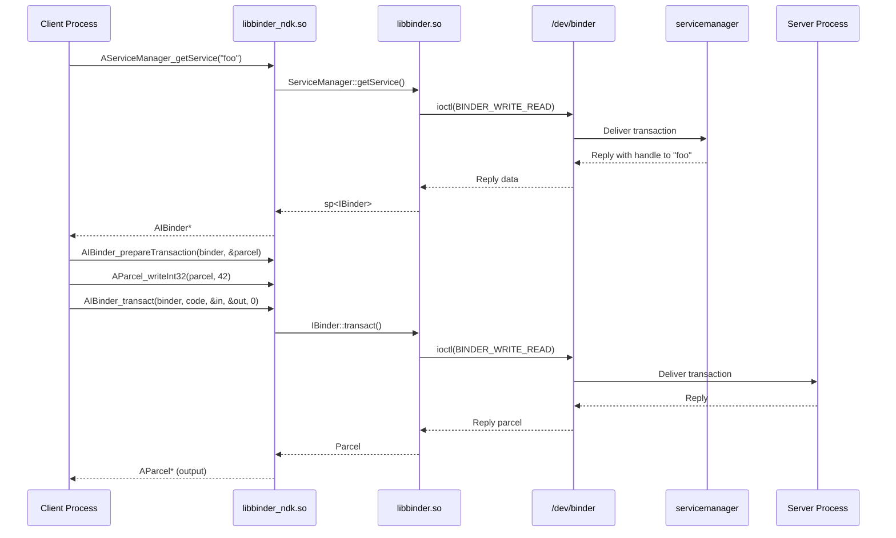

### 11.6.4 框架绑定架构总结

这三组框架绑定共享一个共同的架构：

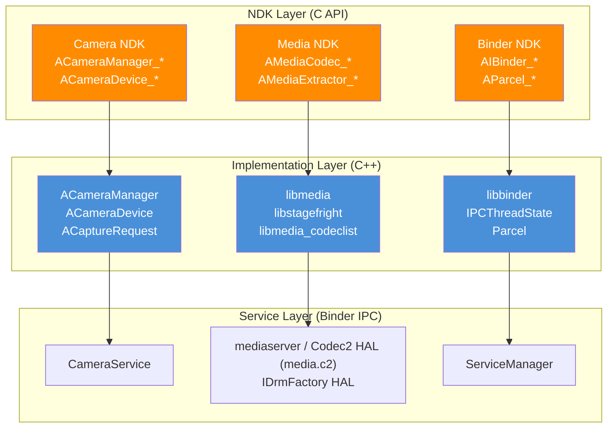

共同的模式是：

1. **C 头文件**（`NdkFoo.h`）—— 用不透明指针类型定义公共 API
2. **C 源文件**（`NdkFoo.cpp`）—— 用 `EXPORT` 标记的薄包装器
3. **C++ 实现**（`impl/AFoo.cpp`）—— 使用框架 API 的实际逻辑
4. **符号映射**（`libfoo.map.txt`）—— 控制哪些符号被导出
5. **可见性控制** —— 因库而异。Camera NDK 使用 `-fvisibility=hidden` 编译，并用 `EXPORT` 宏标记公共入口点。`libmediandk` 使用 `EXPORT` 宏加上其版本脚本，但没有 `-fvisibility=hidden`。`libbinder_ndk` 既不用宏也不用标志，只依赖其版本脚本。它也没有 `NdkFoo.cpp` / `impl/AFoo.cpp` 的拆分

### 11.6.5 Native Activity Thread（Rust）—— 纯原生服务进程

第 11.6.1 至 11.6.3 节介绍了 NDK *绑定*。它们是让原生代码进入框架子系统的 C API。那些子系统的实现位于 Java 或 C++ 中。API 级别 37 增加了一项互补的能力：一个纯原生的应用进程，在不加载 JVM 的情况下承载 `ANativeService` 实例。其实现位于 `frameworks/base/libs/native_activity_thread/`，是一个 Rust crate（`libnative_activity_thread`），由 zygote 派生的进程加载，其清单声明了原生服务入口点。本小节将逐步介绍该 crate 的作用，以及为什么它代表了 Android 承载应用代码方式上的结构性变化。

#### ANativeService 契约

公共 C 接口位于 `frameworks/native/include/android/native_service.h`，其中每个函数都标注了 `__INTRODUCED_IN(37)`。类型定义、内存回收枚举以及 `ANativeService_onCreate` extern 声明仅在其文档注释中记录了 API 37。服务句柄是不透明的。入口点是一个由加载器按名称解析的自由函数。生命周期回调是通过 setter 函数*注册*的，而不是填充到结构体中：

```c
// Source: frameworks/native/include/android/native_service.h:67
typedef struct ANativeService ANativeService;

// Entry point. The loader resolves this symbol and calls it once per service.
typedef void ANativeService_createFunc(ANativeService* _Nonnull service);
extern ANativeService_createFunc ANativeService_onCreate;

// Trim-memory levels (a deliberately small subset of Java's ComponentCallbacks2).
typedef enum ANativeServiceTrimMemoryLevel : int32_t {
    ANATIVE_SERVICE_TRIM_MEMORY_UI_HIDDEN  = 20,
    ANATIVE_SERVICE_TRIM_MEMORY_BACKGROUND = 40,
} ANativeServiceTrimMemoryLevel;

// Per-binding callback signatures. A binding is keyed by a uint64_t bindToken.
typedef AIBinder* _Nullable (*ANativeService_onBindCallback)(
    ANativeService* _Nonnull service, uint64_t bindToken,
    const char* _Nullable action, const char* _Nullable data);
typedef bool (*ANativeService_onUnbindCallback)(
    ANativeService* _Nonnull service, uint64_t bindToken);
typedef void (*ANativeService_onRebindCallback)(
    ANativeService* _Nonnull service, uint64_t bindToken);
typedef void (*ANativeService_onDestroyCallback)(ANativeService* _Nonnull service);
typedef void (*ANativeService_onTrimMemoryCallback)(
    ANativeService* _Nonnull service, ANativeServiceTrimMemoryLevel level);

// Setters the app calls from onCreate (lines 212-274).
void ANativeService_setOnBindCallback(ANativeService* _Nonnull, ANativeService_onBindCallback _Nonnull) __INTRODUCED_IN(37);
void ANativeService_setOnUnbindCallback(ANativeService* _Nonnull, ANativeService_onUnbindCallback _Nullable) __INTRODUCED_IN(37);
void ANativeService_setOnRebindCallback(ANativeService* _Nonnull, ANativeService_onRebindCallback _Nullable) __INTRODUCED_IN(37);
void ANativeService_setOnDestroyCallback(ANativeService* _Nonnull, ANativeService_onDestroyCallback _Nullable) __INTRODUCED_IN(37);
void ANativeService_setOnTrimMemoryCallback(ANativeService* _Nonnull, ANativeService_onTrimMemoryCallback _Nullable) __INTRODUCED_IN(37);
```

应用的 `.so` 导出单个入口点（默认为 `ANativeService_onCreate`，可通过清单中的 `android.app.PROPERTY_NATIVE_SERVICE_FUNCTION_NAME` `<property>` 覆盖——这与 `NativeActivity` 旧的 `android.app.func_name` 元数据不同）。框架在进程的主线程上对每个服务实例调用该函数一次。在该函数内，应用通过 `ANativeService_setOn*Callback` setter 注册它关心的回调。除 `onBind` 外的每个回调都接受 NULL 实现，此时系统运行一个什么都不做的默认实现。此后，框架在服务的主线程上调用已注册的指针来分发生命周期事件（`onBind`/`onUnbind`/`onRebind`/`onDestroy`/`onTrimMemory`）。它通过 `uint64_t bindToken` 标识每个绑定。

这有意比 Java `Service` 更窄：没有 `onStartCommand`、没有 `Application.onCreate`、也没有 `Activity`。Rust 实现明确地体现了第二点。当 ActivityManager 发送 `bindApplication` 请求时，处理程序会进行它所能进行的进程级设置：重置时区并加载共享字体映射。然后它*在不创建 `Application` 的情况下完成 attach*：

```rust
// Source: frameworks/base/libs/native_activity_thread/src/
//   native_activity_thread.rs:316
fn handle_bind_application_request(&mut self, req: BindApplicationRequest) -> Result<()> {
    // ... reset_time_zone(); load_system_font_map(req.system_font_map_fd) ...
    // We don't support calling Application.onCreate in native processes.
    self.activity_manager
        .finishAttachApplication(self.start_seq, 0)
        .context("Failed to call finishAttachApplication")
}
```

其动机与 API 9 的 `NativeActivity` 相同。对延迟、内存或许可证敏感的代码（游戏运行时、媒体引擎、ML 推理）没有理由为 JVM 付出代价。区别在于范围：`NativeActivity` 划出了*一种*组件类型；而 native activity thread 划出了*整个进程*。

#### Crate 布局

该 crate 使用 Rust 编写：八个顶层源文件、一个 `library_loader/` 子模块目录，以及单个 bindgen 包装器：

| 文件 | 作用 |
|------|------|
| `src/lib.rs` | 入口点 `run_native_activity_thread(start_seq)`。启动 binder 线程池，查找 `IActivityManagerStructured`，以 `INativeApplicationThread` 身份 attach，运行 looper。 |
| `src/native_activity_thread.rs` | 每进程状态——服务映射、进程状态缓存。实现 `HandlerCallback<NativeApplicationThreadRequest>`。 |
| `src/native_application_thread.rs` | 实现 `INativeApplicationThread` 的 binder 服务端。将每个调度的方法序列化为有类型的 `NativeApplicationThreadRequest` 并发送给主线程。 |
| `src/task.rs` | 基于 C `ALooper` API 的 Rust 友好 `Handler`。使用 `eventfd` + `mpsc::channel` 在有工作从 binder 线程到来时唤醒主线程。 |
| `src/library_loader.rs` | `NamespaceFactory`、`LinkerNamespace` 和 `LoadedLibrary`——基于 `android_create_namespace` + `android_dlopen_ext` 构建的每服务隔离链接器命名空间。 |
| `src/font.rs`、`src/preload.rs`、`src/utils.rs` | 共享字体映射加载、库预加载以及小型 FFI/字符串辅助函数。 |
| `src/bindings.h` | 唯一的 `rust_bindgen` 包装头文件，引入 `dlext.h`、looper 头文件和 `native_service.h`，并生成 Rust 类型和 `extern "C"` 声明。 |

构建将该包装器接为一个 `rust_bindgen` 模块，并将其作为 `rlib` 提供给 `rust_library`：

```blueprint
// Source: frameworks/base/libs/native_activity_thread/Android.bp:21
rust_bindgen {
    name: "libnative_activity_thread_bindgen",
    wrapper_src: "src/bindings.h",
    source_stem: "native_activity_thread_bindings",
    // header_libs + shared_libs: libandroid, libbinder_ndk, libcutils, libdl_android, ...
}

rust_library {
    name: "libnative_activity_thread",
    defaults: ["libnative_activity_thread_defaults"], // srcs: ["src/lib.rs"]
    // defaults pull in: activitymanager_structured_aidl-rust, libbinder_rs,
    //   native_application_thread_aidl-rust, libactivity_manager_procstate_aidl-rust,
    //   libanyhow/libatrace_rust/liblogger/liblibc/... and the bindgen rlib above,
    //   plus shared_libs for libminikin (the system font bridge).
}
```

该 crate 的 `default_visibility` 是 `["//system/zygote:__subpackages__"]`——只有 zygote 可以链接它，因为只有 zygote 应该来决定启动纯原生进程。

#### 进程启动序列

当 zygote 派生出一个纯原生应用进程时，它会调用 `run_native_activity_thread(start_seq)`。该函数从不返回；它将线程交给 `ALooper`：

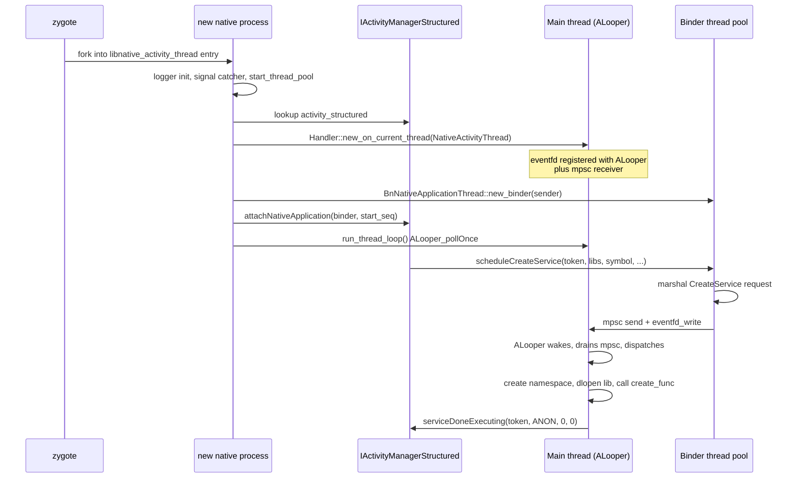

有两个设计选择值得注意：

- **单一主线程，单一状态。** `NativeActivityThread` 拥有服务映射和缓存的进程状态；binder 线程从不直接触碰应用状态。（命名空间工厂不是该结构体的字段。它是 `library_loader.rs` 中进程全局的 `OnceLock<Mutex<NamespaceFactory>>`，只负责发放命名空间名称的序号。）每个请求都通过 mpsc 通道串行化，并通过注册到 looper 的 eventfd 唤醒。这与 Java `ActivityThread` 的 `H` handler 完全对应，但使用的是 Rust 的 `mpsc` 和显式 eventfd，而不是 `Looper` / `Message`。
- **一个 IPC 接口，两个 AIDL。** `INativeApplicationThread` 是*服务端*（框架调用进进程来调度工作）。`IActivityManagerStructured` 是*客户端*（进程回调 ActivityManager 以报告进度）。这一对接口以更小、纯原生的表面取代了 Java 的 `IApplicationThread` / `IActivityManager`。

#### 每个服务的链接器命名空间

原生应用进程可以承载来自不同库的多个服务，而这些库不能看到彼此的符号。`library_loader.rs` 通过为每个服务提供其自己隔离的链接器命名空间来强制执行这一点，并封装在 bionic `android_create_namespace` 之上的一个安全 `LinkerNamespace::create` 辅助函数中：

```rust
// Source: frameworks/base/libs/native_activity_thread/src/library_loader.rs:333
let mut ns_flags = ANDROID_NAMESPACE_TYPE_ISOLATED as u64;
if is_shared {
    ns_flags |= ANDROID_NAMESPACE_TYPE_SHARED as u64;
}
// (pre-API-24 apps additionally get ANDROID_NAMESPACE_TYPE_EXEMPT_LIST_ENABLED)

let app_ns = LinkerNamespace::create(
    namespace_name,
    &final_library_path.join(":"),   // search paths
    &permitted_path.join(":"),       // permitted-paths allowlist
    None,                            // no parent
    ns_flags,
)?;
app_ns.link_public_libraries(api_domain, is_shared, target_sdk_version, &uses_libraries)?;
// ... link_apex_public / link_vendor_public / link_vndksp / link_product_public ...
```

命名空间以 `ISOLATED` 方式构建，因此它看不到进程中任意的库。对于共享库，它还以 `SHARED` 方式构建。框架对 WebView 和 Java 应用类加载器使用相同的标志组合。

`permitted_path` 允许列表限制命名空间可以从哪些路径加载。这防止一个服务触及另一个服务的私有依赖。显式的 `link_*` 调用随后将新命名空间桥接到公共库集合——即 NDK/LL-NDK 库、APEX 公共库以及厂商和产品公共库。因此服务仍然可以触及本章所描述的平台表面。每个 `LoadedLibrary`（用 `android_dlopen_ext` 加载的 `dlopen` 句柄）在丢弃时调用 `dlclose`，因此销毁一个服务也会拆除它的命名空间。

这也是为什么 AIDL `scheduleCreateService` 携带 `zipPaths`、`libraryPaths`、`permittedLibsDir`、`libraryName` 和 `baseSymbolName`（外加 `targetSdkVersion`、`isShared` 和 `processState`），而不只是类名。框架无法预链接任何东西——每次服务加载都是一次全新的命名空间 + `dlopen` + `dlsym` 流程。该流程以将解析出的符号 `transmute` 为 `ANativeService_createFunc` 并调用它而结束。

#### 内存回收与进程状态

`scheduleTrimMemory` 和 `setProcessState` 让原生进程参与系统中其余部分所用的相同生命周期：

```rust
// Source: frameworks/base/libs/native_activity_thread/src/
//   native_activity_thread.rs:299
fn handle_trim_memory_request(&mut self, level: i32) -> Result<()> {
    if self.process_state <= ProcessStateEnum::IMPORTANT_FOREGROUND.0
        && level >= ANATIVE_SERVICE_TRIM_MEMORY_BACKGROUND
    {
        return Ok(());  // foreground processes ignore "background" and heavier hints
    }
    for service in self.services.values_mut() {
        if let Some(on_trim_memory) = service.service.callbacks.onTrimMemory {
            let native_service = service.service.as_mut();
            unsafe { on_trim_memory(native_service, level) };
        }
    }
    Ok(())
}
```

原生侧只暴露两个回收级别（`UI_HIDDEN = 20`、`BACKGROUND = 40`）。这是刻意比 Java `ComponentCallbacks2` 常量更小的集合。头文件告诉调用者用 `>=` 而非相等来测试，因此新的中间级别保持前向兼容。Rust 的门槛使用同样的 `>=` 比较来短路前台情况。在瞬时状态变更期间，运行在 `IMPORTANT_FOREGROUND` 或之上的服务不会收到 `BACKGROUND` 或更重的回收调用。进程状态本身通过 `setProcessState` 到达，缓存在 `self.process_state` 中，供该门槛查询。

#### 在 NDK 发展脉络中的位置

这个 crate 契合更宏大的 NDK 发展脉络：第 11.6 节中的每个 API 都以 JVM 中介的便利换取直接的 C 控制。Camera2、Media 和 Binder NDK 让应用*使用*框架服务而无需进入 Java。native activity thread 更进一步，让应用*成为*框架客户端而完全不需要 JVM。这对任何纯原生设计讨论都有值得注意的连锁影响：

- 没有 `Application` 类，也没有 `ContextWrapper`——`Context` 在此进程中根本不存在。任何需要 `Context` 的东西（平台的大多数高级 API）都不可用。
- 只有服务。没有 `Activity`、没有 `BroadcastReceiver`、没有 `ContentProvider`。需要呈现 UI 或接收任意广播的组件仍然需要 Java 进程。
- 链接器命名空间隔离是*进程内*的，而非跨进程的。同一原生应用中的两个服务不能访问彼此的私有库，但它们共享同一地址空间。
- Binder 线程池在启动期间由 `ProcessState::start_thread_pool()` 启动，因此该进程从 attach 的那一刻起就是普通的 Binder 参与者。
对大多数应用来说，考虑到库生态、工具链以及 ABI 变动保护，由 JVM 承载的 Service 仍然是正确选择。native activity thread 适用于那些值得承受这些损失来避免 JVM 的场景：比如长期运行的端侧推理，以及每兆字节堆内存都至关重要的音频/视频流水线；也包括那些已经自带服务抽象的原生代码库（模拟器、运行时）的移植。

---

## 11.7 NDK 翻译包

### 11.7.1 什么是 NDK 翻译包？

NDK 翻译包是一种构建系统机制，用于打包 **NativeBridge** 所需的库和二进制文件。NativeBridge 是在两种架构之间翻译原生代码的系统。例如，它在 x86 设备上运行 ARM 代码。`ndk_translation_package` 模块类型于 2025 年在 `build/soong/cc/ndk_translation_package.go` 引入，它收集与翻译相关的依赖，并生成可分发的 zip 归档。

### 11.7.2 `ndk_translation_package` 模块类型

该模块类型的注册方式为：

```go
// build/soong/cc/ndk_translation_package.go (lines 28-29)
func init() {
    android.RegisterModuleType("ndk_translation_package",
        NdkTranslationPackageFactory)
}
```

工厂创建一个面向多种架构的模块：

```go
// build/soong/cc/ndk_translation_package.go (lines 32-37)
func NdkTranslationPackageFactory() android.Module {
    module := &ndkTranslationPackage{}
    module.AddProperties(&module.properties)
    android.InitAndroidMultiTargetsArchModule(module,
        android.DeviceSupported, android.MultilibCommon)
    return module
}
```

### 11.7.3 属性

`ndk_translation_package` 模块类型有一组丰富的依赖属性，反映了翻译的多架构本质：

```go
// build/soong/cc/ndk_translation_package.go (lines 46-80)
type ndkTranslationPackageProperties struct {
    // Dependencies with native bridge variants that should be
    // packaged (e.g. arm and arm64 on an x86_64 device)
    Native_bridge_deps proptools.Configurable[[]string]

    // Non-native bridge variants that should be packaged
    // (e.g. x86 and x86_64 on an x86_64 device)
    Device_both_deps []string

    // Non-native bridge variants with lib64
    Device_64_deps []string

    // Non-native bridge variants with lib32
    Device_32_deps []string

    // Non-native bridge first variant
    Device_first_deps []string

    // First variant, always into lib/ directories
    Device_first_to_32_deps []string

    // Dependencies for build file generation only
    Device_both_extra_allowed_deps []string
    Device_32_extra_allowed_deps   []string

    // Version for sysprops
    Version *string

    // Path to Android.bp generator
    Android_bp_gen_path *string

    // Path to product.mk generator
    Product_mk_gen_path *string

    // Whether to generate build files (default true)
    Generate_build_files *bool
}
```

### 11.7.4 依赖解析

`DepsMutator` 将每个依赖类别映射到相应的架构变体：

```go
// build/soong/cc/ndk_translation_package.go (lines 108-127)
func (n *ndkTranslationPackage) DepsMutator(
        ctx android.BottomUpMutatorContext) {
    for index, t := range ctx.MultiTargets() {
        if t.NativeBridge == android.NativeBridgeEnabled {
            ctx.AddFarVariationDependencies(t.Variations(),
                ndkTranslationPackageTag,
                n.properties.Native_bridge_deps.GetOrDefault(
                    ctx, nil)...)
        } else if t.Arch.ArchType == android.X86_64 {
            ctx.AddFarVariationDependencies(t.Variations(),
                ndkTranslationPackageTag,
                n.properties.Device_64_deps...)
            ctx.AddFarVariationDependencies(t.Variations(),
                ndkTranslationPackageTag,
                n.properties.Device_both_deps...)
        } else if t.Arch.ArchType == android.X86 {
            ctx.AddFarVariationDependencies(t.Variations(),
                ndkTranslationPackageTag,
                n.properties.Device_32_deps...)
            // ...
        }
        if index == 0 { // Primary arch
            ctx.AddFarVariationDependencies(t.Variations(),
                ndkTranslationPackageTag,
                n.properties.Device_first_deps...)
        }
    }
}
```

这让包可以收集：

- **NativeBridge 变体** —— 为 x86 设备编译、将由翻译层使用的 ARM/ARM64 库
- **设备变体** —— 翻译宿主侧所需的 x86/x86_64 库

### 11.7.5 RISC-V 考量

依赖标签包含一项对已禁用 RISC-V 模块的特殊豁免：

```go
// build/soong/cc/ndk_translation_package.go (lines 90-93)
func (_ ndkTranslationPackageDepTag) AllowDisabledModuleDependency(
        target android.Module) bool {
    return target.Target().NativeBridge ==
            android.NativeBridgeEnabled &&
        target.Target().Arch.ArchType == android.Riscv64
}
```

这是前瞻性的：RISC-V native bridge 支持仍在发展中，一些翻译依赖可能还没有 RISC-V 变体。该模块类型没有让构建失败，而是优雅地处理缺失的 RISC-V 依赖。

### 11.7.6 包生成

`GenerateAndroidBuildActions` 方法收集所有依赖文件，并将它们打包成 zip 归档：

```go
// build/soong/cc/ndk_translation_package.go (lines 129-181)
func (n *ndkTranslationPackage) GenerateAndroidBuildActions(
        ctx android.ModuleContext) {
    var files []android.PackagingSpec
    var files64 []android.PackagingSpec

    ctx.VisitDirectDepsProxy(func(child android.ModuleProxy) {
        tag := ctx.OtherModuleDependencyTag(child)
        commonInfo := android.OtherModulePointerProviderOrDefault(ctx, child,
            android.CommonModuleInfoProvider)
        info := android.GetInstallFilesCommon(commonInfo)
        // ... categorize files by architecture
        files = append(files, info.PackagingSpecs...)
    })

    outZip := android.PathForModuleOut(ctx,
        ctx.ModuleName()+".zip")
    builder := android.NewRuleBuilder(pctx, ctx)
    cmd := builder.Command().
        BuiltTool("soong_zip").
        FlagWithOutput("-o ", outZip)

    // Generate build files if enabled
    if proptools.BoolDefault(
            n.properties.Generate_build_files, true) {
        outBp := n.genAndroidBp(ctx, files)
        outArm64ArmMk, outArm64Mk := n.genProductMk(ctx,
            files, files64, extraFiles, extraFiles64)
        // ...
    }

    for _, file := range files {
        cmd.
            FlagWithArg("-e ", "system/"+
                file.RelPathInPackage()).
            FlagWithInput("-f ", file.SrcPath())
    }

    builder.Build("ndk_translation_package.zip", ...)
}
```

### 11.7.7 构建文件生成

该包生成两种类型的构建文件：

1. **Android.bp** —— 用于作为平台构建的一部分构建翻译包
2. **product.mk** —— 用于包含在设备 makefile 中

Android.bp 生成器：

```go
// build/soong/cc/ndk_translation_package.go (lines 184-199)
func (n *ndkTranslationPackage) genAndroidBp(
        ctx android.ModuleContext,
        files []android.PackagingSpec) android.Path {
    genDir := android.PathForModuleOut(ctx, "android_bp_dir")
    generator := android.PathForModuleSrc(ctx,
        proptools.String(n.properties.Android_bp_gen_path))
    builder := android.NewRuleBuilder(pctx, ctx).
        SandboxDisabled().Sbox(
            genDir,
            android.PathForModuleOut(ctx,
                "Android.bp.sbox.textproto"),
        )
    outBp := genDir.Join(ctx, "Android.bp")
    builder.Command().
        Input(generator).
        Implicits(specsToSrcPaths(files)).
        Flag(strings.Join(
            filesRelativeToInstallDir(ctx, files), " ")).
        FlagWithOutput("> ", outBp)
    builder.Build("ndk_translation_package.Android.bp", ...)
    return outBp
}
```

product.mk 生成器创建两个变体——一个用于 ARM64+ARM，一个仅用于 ARM64：

```go
// build/soong/cc/ndk_translation_package.go (lines 203-239)
func (n *ndkTranslationPackage) genProductMk(
        ctx android.ModuleContext,
        files, files64, extraFiles, extraFiles64
        []android.PackagingSpec) (android.Path, android.Path) {
    // Both arches
    // ...
    builder.Command().
        Input(generator).
        FlagWithArg("--version=",
            proptools.String(n.properties.Version)).
        Flag("--arm64 --arm").
        // ...
    // ARM64 only
    // ...
    builder.Command().
        Input(generator).
        FlagWithArg("--version=",
            proptools.String(n.properties.Version)).
        Flag("--arm64").
        // ...
}
```

### 11.7.8 NDK 翻译包架构

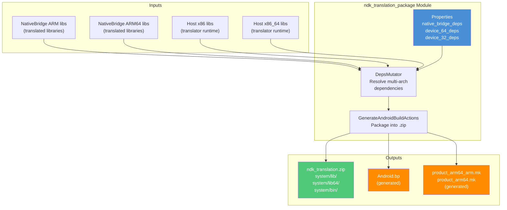

### 11.7.9 与 NativeBridge 的关联

NDK 翻译包是 NativeBridge 实现的打包层。NativeBridge 接口本身是 `NativeBridgeCallbacks` 结构，由翻译引擎实现。该结构定义于 `art/libnativebridge/include/nativebridge/native_bridge.h`。`frameworks/libs/binary_translation/native_bridge/` 包含其中一个实现（berberis），它填充该结构。翻译包捆绑了 NativeBridge 实现在设备上运行所需的全部共享库、配置文件和宿主侧工具。

在启用了 NativeBridge 的设备上（例如运行 ARM 应用的 x86 设备），翻译包提供库。`libnativebridge.so` 运行时加载这些库来执行指令翻译。`Native_bridge_deps` 属性专门面向被翻译的（客户）架构变体，而 `Device_*_deps` 属性面向宿主架构变体。

---

## 11.8 Android 17（API 级别 37）中的 NDK 新增内容

Android 17 定稿了 NDK **API 级别 37**。该级别定义于 `build/soong/android/api_levels.go`，其中代号 `CinnamonBun` 映射为 37（刚刚越过 `Baklava` = 36，即 Android 16 的级别）：

```go
// build/soong/android/api_levels.go (lines 507-508)
"Baklava":     36,
"CinnamonBun": 37,
```

因此，桩库会为直至 37 的每个级别以及 `future`（`10000`）哨兵生成，正如第 11.3.1 节所述。本轮新增的每个 NDK 符号都会在 `.map.txt` 文件中打上 `# introduced=37` 标签，并在头文件中标注 `__INTRODUCED_IN(37)`。因此，面向更旧 `minSdkVersion` 的构建仍然无法链接这些新入口点。本节逐一列出这些新符号是什么，并介绍随之而来的唯一一个结构性构建系统新增：*artless* denylist。

### 11.8.1 各库的新 API

API 37 的新增内容至少横跨七个 NDK 库。下表中的每一行都对照公共头文件（`__INTRODUCED_IN(37)`）进行了核对，在有标注的地方还对照了库的符号映射（`# introduced=37`）：

| 库 | 新 API（节选） | 源头文件 |
|---------|--------------------|---------------|
| `libnativewindow` | `ANativeWindow_setProducerThrottlingEnabled`, `ANativeWindow_isProducerThrottlingEnabled` | `frameworks/native/libs/nativewindow/include/android/native_window.h` |
| `libbinder_ndk` | `AIBinder_addFrozenStateChangeCallback`, `AIBinder_removeFrozenStateChangeCallback`, `AIBinder_FrozenStateChangeCallback_new`/`_delete`, `AParcel_getDataCapacity`, `AParcel_setDataCapacity`, `APersistableBundle_putByteVector`/`getByteVector`/`getByteVectorKeys` | `frameworks/native/libs/binder/ndk/include_ndk/android/binder_ibinder.h`, `binder_parcel.h`, `persistable_bundle.h` |
| `libaaudio` | `AAudioStream_setPlaybackParameters`/`getPlaybackParameters`, `AAudioStream_flushFromFrame`, `AAudio_getFlushFromFrameSupport`, `AAudioStreamBuilder_setPartialDataCallback`/`setRoutingChangedCallback` | `frameworks/av/media/libaaudio/include/aaudio/AAudio.h` |
| `libmediandk` | `AImageReader_setDefaultBufferSize`/`setDefaultBufferDataSpace`/`setDefaultAHardwareBufferFormat`, `AImage_getTransform`, `ACodecEncoderCapabilities_getSupportedLayeringSchemas`, 以及新的 `AMEDIAFORMAT_KEY_*` 键（`HORIZONTAL_FLIP`、`CSD_VVC`、`HDR_ST2094_50_INFO`；`VIDEO_BITRATE_LAYERING` 在头文件中于 API 37 声明，但尚未列入 `libmediandk.map.txt`） | `frameworks/av/media/ndk/include/media/NdkImageReader.h`, `NdkImage.h`, `NdkMediaCodecInfo.h`, `NdkMediaFormat.h` |
| `libc` (bionic) | `free_sized`, `free_aligned_sized`, `sched_setattr`, `sched_getattr` | `bionic/libc/include/stdlib.h`, `bionic/libc/include/sched.h` |
| `libandroid` | `android_getnetworkblockedreason` (multinetwork) | `frameworks/native/include/android/multinetwork.h` |
| `liblog` | `__android_log_logd_logger_with_timestamp` | `system/logging/liblog/include/android/log.h` |

其中有几项值得仔细看看。

**`ANativeWindow` 上的生产者节流。** 默认情况下，Vulkan 或 EGL 生产者在入队时会受到 CPU 节流。当消费者仍在处理上一个缓冲区时，`eglSwapBuffers()` 或 `vkPresentKHR()` 会停住 CPU。这两个新访问器可以开启或关闭这种入队时停住：

```c
// frameworks/native/libs/nativewindow/include/android/native_window.h:414
int32_t ANativeWindow_setProducerThrottlingEnabled(
        ANativeWindow* _Nonnull window, bool enabled) __INTRODUCED_IN(37);
int32_t ANativeWindow_isProducerThrottlingEnabled(
        ANativeWindow* _Nonnull window, bool* _Nonnull outEnabled) __INTRODUCED_IN(37);
```

禁用节流并不会消除所有背压。超过 GPU 速度的 CPU 仍会在稍后、于出队时根据缓冲队列的深度而阻塞。这些访问器不影响那条路径。在异步模式下（节流总是开启）setter 同样无效。头文件建议禁用入队时停住并显式进行正确的同步；默认值之所以保留，只是因为一些 Vulkan 应用无意中依赖它。

**Binder 冻结状态回调。** 应用待机和缓存进程冻结意味着远程 binder 的进程可能在调用方毫无察觉的情况下被冻结。新的 `AIBinder_FrozenStateChangeCallback` 系列让原生代码可以注册以接收这些状态转换，对应 C++ 的 `IBinder::FrozenStateChangeCallback`。它们与一组新的 platform/`systemapi` binder 符号一起，被收集在符号映射中一个新版本节点之下：

```
// frameworks/native/libs/binder/ndk/libbinder_ndk.map.txt:225
LIBBINDER_NDK37 { # introduced=37
  global:
    ABinderProcess_disableBackgroundScheduling; # systemapi llndk
    AServiceManager_checkServiceAccess; # systemapi llndk
    AIBinder_setMinRpcThreads; # systemapi
    AServiceManager_registerLazyServiceWithFlags; # systemapi llndk
    AIBinder_FrozenStateChangeCallback_new;
    AIBinder_FrozenStateChangeCallback_delete;
    AIBinder_addFrozenStateChangeCallback;
    AIBinder_removeFrozenStateChangeCallback;
    AIBinder_requiresVintfDeclaration; # systemapi llndk
    AIBinder_isVendorStable; # systemapi llndk
    AIBinder_isSystemStable; # systemapi llndk
    APersistableBundle_putByteVector;
    APersistableBundle_getByteVector;
    APersistableBundle_getByteVectorKeys;
    AParcel_getDataCapacity;
    AParcel_setDataCapacity;
};
```

`# systemapi` 注释很重要。如此标记的符号（见第 11.2.5 节）可供系统应用和 LL-NDK 使用者使用，但被排除在第三方应用 sysroot 之外。因此 `AServiceManager_checkServiceAccess` 和 `AIBinder_setMinRpcThreads` 并未扩大面向普通应用的公共 NDK。

**bionic 中的 `free_sized` / `free_aligned_sized`。** 它们与 C23 标准库的新增内容对应。知道原始分配大小（或大小与对齐）的调用者可以把它传回分配器。这让 bionic 的 `malloc` 实现可以跳过一次大小查询：

```c
// bionic/libc/include/stdlib.h:197
void free_sized(void* _Nullable __ptr, size_t __size) __INTRODUCED_IN(37);
void free_aligned_sized(void* _Nullable __ptr, size_t __alignment,
                        size_t __size) __INTRODUCED_IN(37);
```

`sched_setattr`/`sched_getattr` 同样把 Linux deadline 调度器的属性系统调用暴露给原生代码。

### 11.8.2 Artless Denylist 构建机制

第 11.3.1 节介绍了 `ndk_library` 上新增的 `bypass_artless_denylist` 属性。其背后的机制位于本轮新增的构建文件 `build/soong/cc/artless_denylist.go`（Copyright 2026）中。它构建运行时强制层，用于决定哪些 NDK 符号可以从第 11.6.5 节的纯原生应用进程中安全调用。这些进程没有 Android Runtime（“artless”）。构建生成中止桩和被阻止符号列表；实际的拒绝发生在运行时。

该文件注册了两个 singleton 模块类型和一条构建规则，后者以新模式运行 `ndkstubgen`：

```go
// build/soong/cc/artless_denylist.go (lines 29-41)
func RegisterBuildComponents(ctx android.RegistrationContext) {
    ctx.RegisterModuleType("all_artless_denylists", AllArtlessDenylistsFactory)
    ctx.RegisterModuleType("all_artless_blocked_symbol_files",
        AllArtlessBlockedSymbolFilesFactory)
}

var genNativeStubSrc = pctx.AndroidStaticRule("genNativeStubSrc",
    blueprint.RuleParams{
        Command: "$ndkStubGenerator --arch $arch --api current " +
            "--api-map $apiMap --artless-denylist $flags $in $out",
        // ...
    }, "arch", "apiMap", "flags")
```

`--artless-denylist` 标志是 `ndkstubgen` 的新开关。对于库的 `.map.txt`，它输出桩源码。该桩把每个在无 JVM 进程中**不**安全的符号定义为一个函数体调用 `LOG_ALWAYS_FATAL` 的函数。

每个库的 `<name>_denylist` 桩被全静态链接进单个共享库 `libandroid_native_denylist.so`，后者使用 `-Wl,-z,global` 构建。原生进程使用 `RTLD_GLOBAL | RTLD_NOW` 预加载它（`frameworks/base/libs/native_activity_thread/src/library_loader.rs`）。因此 ELF 符号抢占会让对被阻止 NDK API 的任何调用在运行时中止。链接本身并不会失败。

符号映射解析器新增了配套的 `artless` 标签，用于把个别符号重新选回（豁免）：

```python
# build/soong/cc/symbolfile/__init__.py (line 58, 116)
Tag('artless'),
# ...
def has_artless_tags(self) -> bool:
    return 'artless' in self.tags
```

每个 `ndk_library` 都会根据其符号文件自动创建一个配套的 `<name>_denylist` 模块。而设置 `bypass_artless_denylist: true` 则会创建一个*空*的 denylist，这宣告每个符号都是安全的。这就是 bionic、`liblog`、OpenGL ES 库和 `libnativewindow`（它们都不触及 Android Runtime）设置它的原因：

```go
// build/soong/cc/ndk_library.go (lines 629-639)
if proptools.Bool(stub.properties.Bypass_artless_denylist) {
    // Create an empty denylist to satisfy all_artless_denylists, which
    // unconditionally adds dependencies for all NDK libraries.
    props := &struct{ Name *string }{
        Name: proptools.StringPtr(libName + "_denylist"),
    }
    ctx.CreateModule(ArtlessDenylistFactory, props)
    return
}
```

denylist 桩使用 `-fvisibility=default` 编译，因为 denylist 必须暴露它所阻止的每个符号。这与第 11.6 节框架绑定所用的可见性规则正好相反。

### 11.8.3 API 37 落在哪些层

这 17 项新增平滑地落入本章所建立的稳定性层级中。下图按层级对新符号分组；层级之间的关系没有任何变化，变的只是每个层级现在包含的内容。

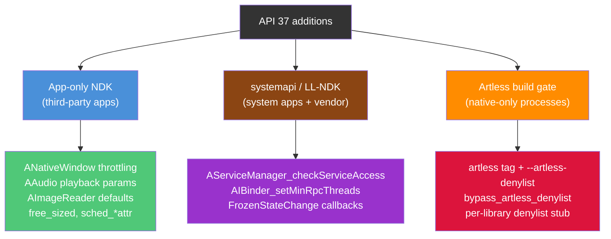

API 37 的主题是渐进的表面增长（音频、成像、窗口生产者节流、C23 分配器辅助函数）。它还引入了一个真正全新的构建系统概念：artless denylist。denylist 是纯原生进程故事的工具链一半；运行时的一半则是第 11.6.5 节的 Rust crate。

---

## 11.9 动手试一试：编写一个原生 NDK 应用

本节逐步创建一个最小的原生 Android 应用，它使用多个 NDK API。我们将构建一个原生 activity：初始化窗口、记录日志消息，并查询传感器信息。

### 11.9.1 项目结构

```
native-demo/
    AndroidManifest.xml
    Android.bp
    src/
        main.cpp
```

### 11.9.2 清单文件

原生 activity 需要特定的清单配置：

```xml
<?xml version="1.0" encoding="utf-8"?>
<manifest xmlns:android="http://schemas.android.com/apk/res/android"
    package="com.example.nativedemo">

    <application
        android:label="Native Demo"
        android:hasCode="false">

        <activity
            android:name="android.app.NativeActivity"
            android:exported="true"
            android:configChanges=
                "orientation|keyboardHidden|screenSize">

            <meta-data
                android:name="android.app.lib_name"
                android:value="native-demo" />

            <intent-filter>
                <action android:name=
                    "android.intent.action.MAIN" />
                <category android:name=
                    "android.intent.category.LAUNCHER" />
            </intent-filter>
        </activity>
    </application>
</manifest>
```

要点：

- `android:hasCode="false"` —— 没有 Java/Kotlin 代码
- `android:name="android.app.NativeActivity"` —— 平台内置的原生 activity 宿主
- `android.app.lib_name` —— 共享库的名称（不带 `lib` 前缀和 `.so` 后缀）

### 11.9.3 构建文件

对于使用 Soong 的 AOSP 树构建：

```
cc_library_shared {
    name: "libnative-demo",
    srcs: ["src/main.cpp"],
    shared_libs: [
        "libandroid",
        "liblog",
        "libnativewindow",
    ],
    static_libs: [
        "android_native_app_glue",
    ],
    sdk_version: "current",
    stl: "c++_shared",
    cflags: [
        "-Wall",
        "-Werror",
    ],
}
```

对于使用 CMake 的外部 NDK 构建：

```cmake
cmake_minimum_required(VERSION 3.18)
project(native-demo)

add_library(native-demo SHARED src/main.cpp)

# Find the native_app_glue
find_library(log-lib log)
find_library(android-lib android)

target_link_libraries(native-demo
    android
    log
    nativewindow
)

# Enable native app glue
set(APP_GLUE_DIR ${ANDROID_NDK}/sources/android/native_app_glue)
add_library(app-glue STATIC ${APP_GLUE_DIR}/android_native_app_glue.c)
target_include_directories(app-glue PUBLIC ${APP_GLUE_DIR})
target_link_libraries(native-demo app-glue)
```

### 11.9.4 应用程序代码

```cpp
// src/main.cpp -- Minimal NDK native activity

#include <android/log.h>
#include <android/native_activity.h>
#include <android/sensor.h>
#include <android_native_app_glue.h>

#include <cassert>
#include <cstring>

#define LOG_TAG "NativeDemo"
#define LOGI(...) __android_log_print(ANDROID_LOG_INFO, LOG_TAG, __VA_ARGS__)
#define LOGW(...) __android_log_print(ANDROID_LOG_WARN, LOG_TAG, __VA_ARGS__)
#define LOGE(...) __android_log_print(ANDROID_LOG_ERROR, LOG_TAG, __VA_ARGS__)

// Application state
struct AppState {
    struct android_app* app;
    ASensorManager* sensorManager;
    const ASensor* accelerometer;
    ASensorEventQueue* sensorEventQueue;
    bool windowReady;
    bool running;
};

// Handle sensor events
static int handleSensorEvents(int /* fd */, int /* events */,
                              void* data) {
    auto* state = static_cast<AppState*>(data);
    ASensorEvent event;

    while (ASensorEventQueue_getEvents(
               state->sensorEventQueue, &event, 1) > 0) {
        if (event.type == ASENSOR_TYPE_ACCELEROMETER) {
            LOGI("Accelerometer: x=%.2f y=%.2f z=%.2f",
                 event.acceleration.x,
                 event.acceleration.y,
                 event.acceleration.z);
        }
    }
    return 1; // Continue receiving events
}

// Initialize sensors
static void initSensors(AppState* state) {
    state->sensorManager = ASensorManager_getInstance();
    if (state->sensorManager == nullptr) {
        LOGW("No sensor manager available");
        return;
    }

    state->accelerometer = ASensorManager_getDefaultSensor(
        state->sensorManager, ASENSOR_TYPE_ACCELEROMETER);
    if (state->accelerometer == nullptr) {
        LOGW("No accelerometer available");
        return;
    }

    state->sensorEventQueue =
        ASensorManager_createEventQueue(
            state->sensorManager, state->app->looper,
            LOOPER_ID_USER, handleSensorEvents, state);

    LOGI("Sensors initialized successfully");
}

// Enable accelerometer
static void enableSensors(AppState* state) {
    if (state->accelerometer != nullptr &&
        state->sensorEventQueue != nullptr) {
        ASensorEventQueue_enableSensor(
            state->sensorEventQueue, state->accelerometer);
        // Set event rate to 60 Hz
        ASensorEventQueue_setEventRate(
            state->sensorEventQueue, state->accelerometer,
            (1000L / 60) * 1000);
        LOGI("Accelerometer enabled");
    }
}

// Disable accelerometer
static void disableSensors(AppState* state) {
    if (state->accelerometer != nullptr &&
        state->sensorEventQueue != nullptr) {
        ASensorEventQueue_disableSensor(
            state->sensorEventQueue, state->accelerometer);
        LOGI("Accelerometer disabled");
    }
}

// Handle application commands
static void handleCmd(struct android_app* app, int32_t cmd) {
    auto* state = static_cast<AppState*>(app->userData);

    switch (cmd) {
        case APP_CMD_INIT_WINDOW:
            LOGI("Window initialized: %p", app->window);
            if (app->window != nullptr) {
                // Query window properties
                int32_t width = ANativeWindow_getWidth(app->window);
                int32_t height =
                    ANativeWindow_getHeight(app->window);
                int32_t format =
                    ANativeWindow_getFormat(app->window);
                LOGI("Window size: %dx%d, format: %d",
                     width, height, format);
                state->windowReady = true;
            }
            break;

        case APP_CMD_TERM_WINDOW:
            LOGI("Window terminated");
            state->windowReady = false;
            break;

        case APP_CMD_GAINED_FOCUS:
            LOGI("Gained focus -- enabling sensors");
            enableSensors(state);
            break;

        case APP_CMD_LOST_FOCUS:
            LOGI("Lost focus -- disabling sensors");
            disableSensors(state);
            break;

        case APP_CMD_RESUME:
            LOGI("Activity resumed");
            state->running = true;
            break;

        case APP_CMD_PAUSE:
            LOGI("Activity paused");
            state->running = false;
            break;

        case APP_CMD_DESTROY:
            LOGI("Activity destroyed");
            break;

        case APP_CMD_CONFIG_CHANGED:
            LOGI("Configuration changed");
            break;

        case APP_CMD_LOW_MEMORY:
            LOGW("Low memory warning");
            break;
    }
}

// Handle input events
static int32_t handleInput(struct android_app* /* app */,
                           AInputEvent* event) {
    int32_t type = AInputEvent_getType(event);

    if (type == AINPUT_EVENT_TYPE_MOTION) {
        float x = AMotionEvent_getX(event, 0);
        float y = AMotionEvent_getY(event, 0);
        int32_t action =
            AMotionEvent_getAction(event) &
            AMOTION_EVENT_ACTION_MASK;

        switch (action) {
            case AMOTION_EVENT_ACTION_DOWN:
                LOGI("Touch DOWN at (%.1f, %.1f)", x, y);
                return 1;
            case AMOTION_EVENT_ACTION_MOVE:
                // Suppress move logs to avoid spam
                return 1;
            case AMOTION_EVENT_ACTION_UP:
                LOGI("Touch UP at (%.1f, %.1f)", x, y);
                return 1;
        }
    }

    return 0; // Event not handled
}

// Main entry point -- called by native_app_glue
void android_main(struct android_app* app) {
    LOGI("=== Native Demo Starting ===");

    AppState state = {};
    state.app = app;
    state.running = true;

    app->userData = &state;
    app->onAppCmd = handleCmd;
    app->onInputEvent = handleInput;

    // Initialize sensors
    initSensors(&state);

    // Main event loop
    LOGI("Entering main loop");
    while (!app->destroyRequested) {
        int events;
        struct android_poll_source* source;

        // Block if not running (paused/stopped),
        // poll without blocking if running
        int timeout = state.running ? 0 : -1;

        while (ALooper_pollOnce(timeout, nullptr, &events,
                                reinterpret_cast<void**>(&source))
                   >= 0) {
            if (source != nullptr) {
                source->process(app, source);
            }

            if (app->destroyRequested) {
                break;
            }
        }

        // Application rendering/logic would go here
        if (state.running && state.windowReady) {
            // In a real app, you would:
            // 1. Lock the ANativeWindow buffer
            // 2. Draw to the buffer
            // 3. Unlock and post the buffer
            //
            // Or use EGL/Vulkan for GPU rendering
        }
    }

    // Cleanup
    if (state.sensorEventQueue != nullptr) {
        ASensorManager_destroyEventQueue(
            state.sensorManager, state.sensorEventQueue);
    }

    LOGI("=== Native Demo Exiting ===");
}
```

### 11.9.5 代码讲解

#### 入口点与线程模型

原生应用粘合库会创建一个新线程，并在其上调用 `android_main()`。粘合库内部的 `android_app_entry()` 函数是那个被派生的应用线程的入口点：它准备线程的 `ALooper`，然后调用 `android_main()`。与此同时，主 UI 线程运行 `ANativeActivity_onCreate` 和 `ANativeActivity` 生命周期回调（`onStart`、`onPause`、`onNativeWindowCreated` 等）。这些回调通过管道、经由 `android_app_write_cmd()` 把命令转发给应用线程。

`ALooper_pollOnce()` 调用是事件循环的核心。它等待来自三个源的事件：

- `LOOPER_ID_MAIN`（命令管道）—— 如 `APP_CMD_INIT_WINDOW` 这样的生命周期事件
- `LOOPER_ID_INPUT`（输入队列）—— 触摸、按键和动作事件
- `LOOPER_ID_USER` 及以上 —— 如传感器事件这样的自定义源

#### 使用的 NDK API

本示例使用了四个 NDK 库：

1. **`liblog`** —— 用 `__android_log_print()` 进行日志记录
2. **`libandroid`** —— `ANativeWindow_*` 用于窗口访问，`ASensor*` 用于传感器，`AInputEvent_*` 和 `AMotionEvent_*` 用于输入，`ALooper_*` 用于事件循环
3. **`libnativewindow`** —— `ANativeWindow`（与 `libandroid` 共享）
4. **Native app glue**（静态库）—— `android_app`、事件循环粘合

#### 事件流程

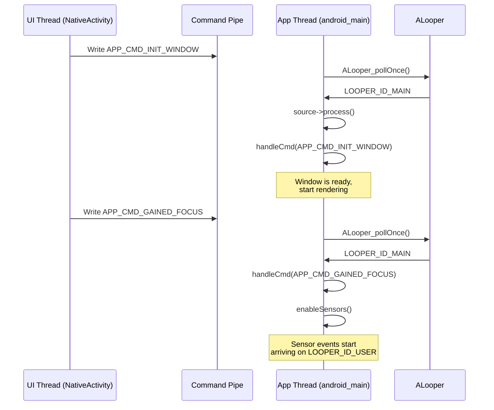

### 11.9.6 构建与运行

#### 在 AOSP 内构建

如果模块放在 AOSP 树中（例如 `packages/apps/NativeDemo/` 下），用以下命令构建：

```bash
source build/envsetup.sh
lunch <target>
m libnative-demo
```

输出的 `.so` 将位于：
```
out/target/product/<device>/system/lib64/libnative-demo.so
```

使用 `aapt2` 或 Android Gradle 插件将其打包成 APK。

#### 使用独立 NDK 构建

如果使用 NDK 工具链在 AOSP 树之外构建：

```bash
# Set NDK path
export ANDROID_NDK=/path/to/android-ndk-r27

# Create build directory
mkdir build && cd build

# Configure with CMake
cmake -DCMAKE_TOOLCHAIN_FILE=$ANDROID_NDK/build/cmake/android.toolchain.cmake \
      -DANDROID_ABI=arm64-v8a \
      -DANDROID_PLATFORM=android-26 \
      ..

# Build
cmake --build .
```

#### 在设备上运行

```bash
# Install the APK
adb install native-demo.apk

# Launch
adb shell am start -n com.example.nativedemo/android.app.NativeActivity

# Watch logs
adb logcat -s NativeDemo:V
```

预期输出：

```
I NativeDemo: === Native Demo Starting ===
I NativeDemo: Sensors initialized successfully
I NativeDemo: Entering main loop
I NativeDemo: Window initialized: 0x7a3c4d1000
I NativeDemo: Window size: 1080x2340, format: 1
I NativeDemo: Gained focus -- enabling sensors
I NativeDemo: Accelerometer enabled
I NativeDemo: Accelerometer: x=0.18 y=0.24 z=9.77
I NativeDemo: Touch DOWN at (540.0, 1170.0)
I NativeDemo: Touch UP at (540.0, 1170.0)
```

### 11.9.7 扩展点

在这个最小示例的基础上，真实应用会添加：

1. **EGL/Vulkan 渲染** —— 用 `eglCreateWindowSurface()` 或 `vkCreateAndroidSurfaceKHR()` 替换 `ANativeWindow_lock()` 路径，以实现 GPU 渲染。

2. **AAudio 播放** —— 将 `libaaudio` 加入 `shared_libs`，并使用 `AAudioStreamBuilder` 实现低延迟音频输出。

3. **相机采集** —— 添加 `libcamera2ndk`，并使用 `ACameraManager` 打开相机、将画面帧流式输出到窗口。

4. **AIDL 服务** —— 添加 `libbinder_ndk`，并使用 AIDL 生成的 NDK 桩与系统服务通信。

5. **神经网络** —— 添加 `libneuralnetworks`，使用 NNAPI 进行端侧 ML 推理。

### 11.9.8 调试 NDK 应用

#### Logcat 过滤

使用基于标签的过滤来聚焦应用的输出：

```bash
# Filter by tag
adb logcat -s NativeDemo:V

# Filter by PID
adb logcat --pid=$(adb shell pidof com.example.nativedemo)

# Show native crashes
adb logcat -s DEBUG:V
```

#### 地址消毒器（ASan）

NDK 支持 ASan 用于检测内存错误。将其加入你的构建：

```
cc_library_shared {
    name: "libnative-demo",
    // ...
    sanitize: {
        address: true,
    },
}
```

或使用 CMake：

```cmake
target_compile_options(native-demo PRIVATE -fsanitize=address)
target_link_options(native-demo PRIVATE -fsanitize=address)
```

ASan 可以检测：

- 堆缓冲区溢出
- 栈缓冲区溢出
- 释放后使用
- 双重释放
- 内存泄漏（配合 LeakSanitizer）

#### GDB / LLDB 调试

用于调试原生崩溃：

```bash
# Start the app in debug mode
adb shell am start -D -n com.example.nativedemo/android.app.NativeActivity

# Attach lldb-server
adb forward tcp:1234 tcp:1234
lldb
(lldb) platform select remote-android
(lldb) platform connect connect://localhost:1234
(lldb) process attach --name com.example.nativedemo
```

#### Simpleperf 性能分析

用于对 NDK 代码进行性能分析：

```bash
# Record CPU profile
adb shell simpleperf record -p $(adb shell pidof com.example.nativedemo) \
    --duration 5 -o /data/local/tmp/perf.data

# Pull and report
adb pull /data/local/tmp/perf.data
simpleperf report -i perf.data
```

### 11.9.9 常见陷阱

1. **缺少 `sdk_version`** —— 如果忘记设置 `sdk_version: "current"`，你的模块会链接平台库而不是 NDK 桩。这意味着它可能使用并非在所有设备上都可用的符号。

2. **跨 API 级别的 ABI 差异** —— 像 `ANativeWindow` 这样的结构在不同 API 级别可能大小不同。始终使用访问器函数，而不是直接访问结构体成员。

3. **线程安全** —— native app glue 使用管道在 UI 线程和应用线程之间通信。在没有适当同步的情况下从两个线程访问 `android_app` 字段会导致竞争。始终使用互斥锁：
   ```c
   pthread_mutex_lock(&app->mutex);
   // access shared state
   pthread_mutex_unlock(&app->mutex);
   ```

4. **忘记处理 `APP_CMD_TERM_WINDOW`** —— 如果在回调之后仍持有 `ANativeWindow` 的引用，之后对其的操作会崩溃。务必在 `TERM_WINDOW` 处理程序中将你的窗口指针置空。

5. **链接非 NDK 库** —— 如果你的原生代码试图 `dlopen("libgui.so")` 或链接非 NDK 库，动态链接器会在运行时拒绝它。这发生在运行 Android 7.0+ 的设备上。链接器命名空间隔离会阻止访问不在 NDK 列表上的库。

---

## 总结

本章从平台构建者的视角考察了 Android NDK。它不把 NDK 当作从 developer.android.com 下载的东西。它把 NDK 当作 AOSP 源码树中的一组构建规则、头文件模块、桩生成器和 ABI 监控器。

我们所涉及的关键架构层如下：

| 层 | 稳定性范围 | 关键的 Soong 模块类型 |
|-------|---------------|----------------------|
| **NDK** | 应用开发者 | `ndk_library`、`ndk_headers` |
| **LL-NDK** | 应用 + 厂商代码 | `cc_library` 中的 `llndk:` 块 |
| **VNDK** | 厂商代码 | `cc_library` 中的 `vndk:` 块、`vndk_prebuilt_shared` |
| **NDK Translation** | NativeBridge | `ndk_translation_package` |

构建系统通过以下方式强制执行稳定性：

1. **符号映射**（`.map.txt`），精确定义导出的 API 表面
2. **桩库**，应用在构建时链接
3. **ABI 监控**，通过 STG dump 和 `stgdiff` 捕获不兼容的变更
4. **头文件验证**，确保每个 NDK 头文件自包含且为合法的 C 代码
5. **链接器命名空间隔离**，防止运行时访问非 NDK 库

Camera、Media 和 Binder 的框架绑定展示了通过稳定的 C API 暴露复杂 C++ 服务的标准模式。该模式通篇使用不透明指针类型和版本脚本。Camera 和 Media NDK 添加了带 `EXPORT` 标记的包装函数，Camera NDK 还添加了 `-fvisibility=hidden`。`libbinder_ndk` 则仅依赖其版本脚本。

用于进一步探索的关键源文件：

| 文件 | 用途 |
|------|---------|
| `build/soong/cc/ndk_library.go` | 桩库生成 |
| `build/soong/cc/ndk_headers.go` | 头文件安装 |
| `build/soong/cc/ndk_sysroot.go` | Sysroot 组装 |
| `build/soong/cc/ndk_abi.go` | ABI 监控 |
| `build/soong/cc/llndk_library.go` | LL-NDK 支持 |
| `build/soong/cc/vndk.go` | VNDK 属性 |
| `build/soong/cc/vndk_prebuilt.go` | VNDK 快照 |
| `build/soong/cc/ndk_translation_package.go` | 翻译打包 |
| `frameworks/av/camera/ndk/` | Camera NDK 实现 |
| `frameworks/av/media/ndk/` | Media NDK 实现 |
| `frameworks/native/libs/binder/ndk/` | Binder NDK 实现 |
| `system/linkerconfig/` | 链接器命名空间配置 |
| `prebuilts/ndk/current/sources/android/` | 应用粘合库与 CPU 特性 |
