# 第 35 章：网络

Android 的网络协议栈是 AOSP 中最复杂的子系统之一。
它从高层的 Java 框架 API 起步，穿过原生守护进程，直达
Linux 内核的网络原语。本章追踪一个网络数据包所走过的完整路径。
它考察了管理连接的关键服务和模块。它还解释了 Android 如何处理从
Wi-Fi 关联到 DNS 解析再到 VPN 隧道的所有事情。

---

## 35.1 网络架构概览

### 35.1.1 总体图景

Android 网络按照分层方式组织，这些层映射了经典的
操作系统模型，但加入了 Android 特有的模块化、
安全和可更新性设计。在最高层，应用使用
`ConnectivityManager` 和 `WifiManager` 等 API。这些 API 通过 Binder IPC
与运行在 `system_server` 内部的系统服务通信。这些服务又
通过 Netlink 套接字、iptables/nftables 命令和 BPF 程序，与原生守护进程
（`netd`、DNS 解析器）以及 Linux 内核通信。

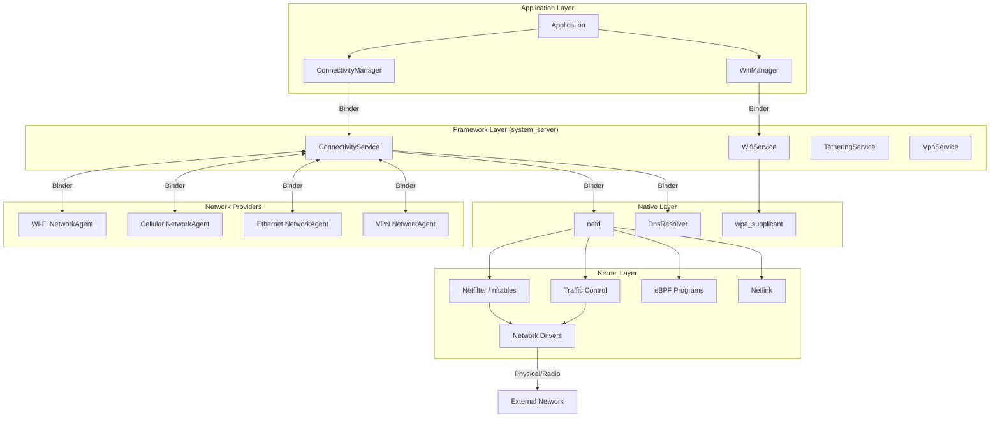

### 35.1.2 关键组件摘要

| 组件 | 类型 | 位置 | 职责 |
|-----------|------|----------|------|
| ConnectivityService | Java 系统服务 | `packages/modules/Connectivity/service/` | 中央网络管理 |
| NetworkAgent | Java 框架类 | `packages/modules/Connectivity/framework/` | 承载网络与 CS 的通信 |
| NetworkFactory | Java 框架类 | `packages/modules/Connectivity/staticlibs/` | 创建 NetworkAgent |
| netd | 原生守护进程（C++） | `system/netd/` | 内核网络配置 |
| DnsResolver | 原生模块（C++） | `packages/modules/DnsResolver/` | DNS 解析，DoT/DoH |
| Wi-Fi Service | Java 系统服务 | `packages/modules/Wifi/service/` | Wi-Fi 管理 |
| NetworkStack | Mainline 模块 | `packages/modules/NetworkStack/` | DHCP、网络验证 |
| Tethering | Mainline 模块 | `packages/modules/Connectivity/Tethering/` | USB/Wi-Fi/BT 网络共享 |

### 35.1.3 Mainline 模块化

从 Android 10（API 29）开始，Google 开始将网络组件抽取为可独立更新的
Mainline 模块。这是一个关键的架构决策。它将关键网络代码与较慢的平台 OTA
节奏解耦。这让 Google 可以通过 Play Store 推送安全补丁和功能更新。

关键的网络 Mainline 模块有：

1. **Connectivity 模块**（`packages/modules/Connectivity/`）：包含
    ConnectivityService、网络共享子系统以及相关的框架代码。
2. **NetworkStack 模块**（`packages/modules/NetworkStack/`）：处理 DHCP
   客户端、网络验证（captive portal 检测）和 IP 分配。
3. **Wi-Fi 模块**（`packages/modules/Wifi/`）：整个 Wi-Fi 子系统，
    包括 WifiService、ClientModeImpl 和扫描逻辑。
4. **DnsResolver 模块**（`packages/modules/DnsResolver/`）：支持 DoT 和 DoH 的
   原生 DNS 解析器。

每个模块都以 APEX 包的形式发布，提供自带版本控制、签名和回滚能力的
独立更新单元。

Android 17 进一步推动了这一趋势。它把原生网络二进制文件直接放在模块内部，
而不仅仅放在只读的 system 和 vendor 分区上。本章后面会介绍两个例子。
第一个是
*mainline supplicant*（`/apex/com.android.wifi/bin/wpa_supplicant_mainline`，
Wi-Fi APEX 中随附的 wpa_supplicant 构建版本，第 35.27 节）。第二个是
Connectivity APEX 作为 APEX 常驻应用所绑定的多代理 PAC 处理服务
（第 35.26 节）。两者都让 Google 无需 OEM 构建即可通过 Play System Updates
更新安全敏感的网络代码。

### 35.1.4 网络 ID 与路由

Android 中的每个活动网络都会被分配一个唯一的**网络 ID**（netId），
其取值范围是 100--65535 的整数。这个 ID 是基础性的：它将路由、
DNS 配置、iptables 规则和套接字绑定联系在一起。当应用打开一个
套接字时，内核使用 netId（通过对套接字应用 `fwmark`）来
选择正确的路由表。

来自 `system/netd/server/NetworkController.cpp`：

```cpp
// Keep these in sync with ConnectivityService.java.
const unsigned MIN_NET_ID = 100;
const unsigned MAX_NET_ID = 65535;
```

框架通过 `NetIdManager` 管理 netId 的分配：

```
// Source: packages/modules/Connectivity/service/src/com/android/server/NetIdManager.java
```

### 35.1.5 数据路径：从应用到线路

当应用发送数据时，会发生以下序列：

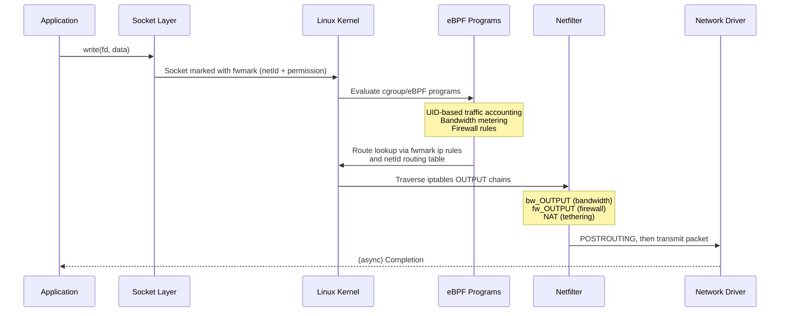

`fwmark` 机制是 Android 按网络路由的核心。每个套接字都
被打上一个 32 位标记，其位布局由
`system/netd/include/Fwmark.h` 中的 `Fwmark` 联合体定义：

- 网络 ID（第 0--15 位）
- 网络是否被显式选择（第 16 位）
- 套接字是否受 VPN 保护（第 17 位）
- 权限位（第 18--19 位）

netd 中的 `FwmarkServer` 负责应用这些标记。它是 UNIX 域套接字上的
一个 `SocketListener`。客户端向它传递一个套接字文件
描述符。它通过
`setsockopt(SOL_SOCKET, SO_MARK, ...)` 将计算出的标记盖到该套接字上。
它不是 BPF 程序或 cgroup 钩子：

```cpp
// Source: system/netd/server/FwmarkServer.cpp:314-319
    fwmark.permission = permission;

    if (setsockopt(*socketFd, SOL_SOCKET, SO_MARK, &fwmark.intValue,
                   sizeof(fwmark.intValue)) == -1) {
        return -errno;
    }
```

---

## 35.2 ConnectivityService

### 35.2.1 概述

`ConnectivityService` 是 Android 网络的中枢神经系统。它
是 `system_server` 中最大、最关键的服务之一。它管理
所有网络的生命周期，并满足应用的网络请求。它还
处理网络评分和选择，并与原生守护进程协调路由
和 DNS 配置。

**源文件：**
`packages/modules/Connectivity/service/src/com/android/server/ConnectivityService.java`

```java
// Source: packages/modules/Connectivity/service/src/com/android/server/ConnectivityService.java
@TargetApi(Build.VERSION_CODES.S)
public class ConnectivityService extends IConnectivityManager.Stub
        implements BroadcastReceiveHelper.Delegate {
    private static final String TAG = ConnectivityService.class.getSimpleName();
    // ...

    // Default URL for captive portal detection
    private static final String DEFAULT_CAPTIVE_PORTAL_HTTP_URL =
            "http://connectivitycheck.gstatic.com/generate_204";

    // How long to wait before switching back to a radio's default network
    private static final int RESTORE_DEFAULT_NETWORK_DELAY = 1 * 60 * 1000;

    // Default to 30s linger time-out, and 5s for nascent network
    private static final String LINGER_DELAY_PROPERTY = "persist.netmon.linger";
    private static final int DEFAULT_LINGER_DELAY_MS = 30_000;
    private static final int DEFAULT_NASCENT_DELAY_MS = 5_000;

    // The maximum number of network requests allowed per uid
    static final int MAX_NETWORK_REQUESTS_PER_UID = 100;
    // ...
}
```

### 35.2.2 Handler 线程模型

ConnectivityService 几乎将其所有工作都在单个 handler 线程上处理。
这是有意为之：单线程模型消除了在跟踪网络、请求和
回调的众多数据结构之间进行复杂加锁的需要。消息通过内部的 `InternalHandler` 分发，它处理如下事件：

- 网络代理的注册与注销
- 网络能力变化
- 链路属性更新
- 网络评分变化
- NetworkMonitor 的验证结果
- 应用网络请求与回调

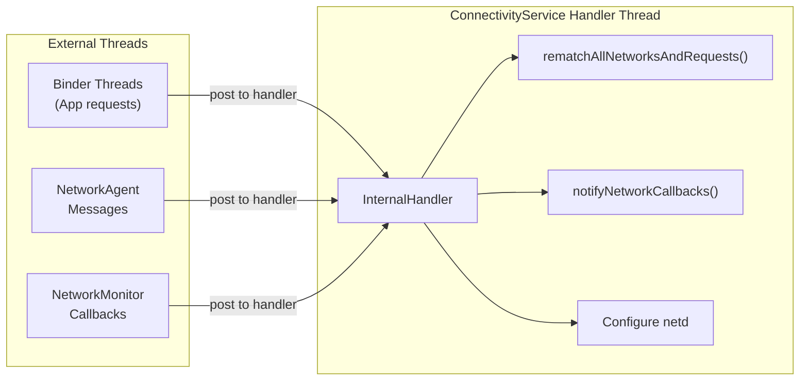

### 35.2.3 NetworkAgent

`NetworkAgent` 是网络传输（Wi-Fi、蜂窝、
以太网、VPN）与 ConnectivityService 之间的桥梁。每个活动的网络连接都
由恰好一个 NetworkAgent 实例表示。该代理通过异步消息
通道与 ConnectivityService 双向通信。

**源文件：**
`packages/modules/Connectivity/framework/src/android/net/NetworkAgent.java`

```java
// Source: packages/modules/Connectivity/framework/src/android/net/NetworkAgent.java
@SystemApi
public abstract class NetworkAgent {
    @Nullable
    private volatile Network mNetwork;

    @Nullable
    private volatile INetworkAgentRegistry mRegistry;

    private final Handler mHandler;

    public static final int MIN_LINGER_TIMER_MS = 2000;

    // Message constants for communication with ConnectivityService
    public static final int CMD_SUSPECT_BAD = BASE;
    public static final int EVENT_NETWORK_INFO_CHANGED = BASE + 1;
    public static final int EVENT_NETWORK_CAPABILITIES_CHANGED = BASE + 2;
    public static final int EVENT_NETWORK_PROPERTIES_CHANGED = BASE + 3;
    public static final int EVENT_NETWORK_SCORE_CHANGED = BASE + 4;
    public static final int CMD_REPORT_NETWORK_STATUS = BASE + 7;
    public static final int CMD_START_SOCKET_KEEPALIVE = BASE + 11;
    public static final int CMD_STOP_SOCKET_KEEPALIVE = BASE + 12;
    // ...
}
```

NetworkAgent 的生命周期是：

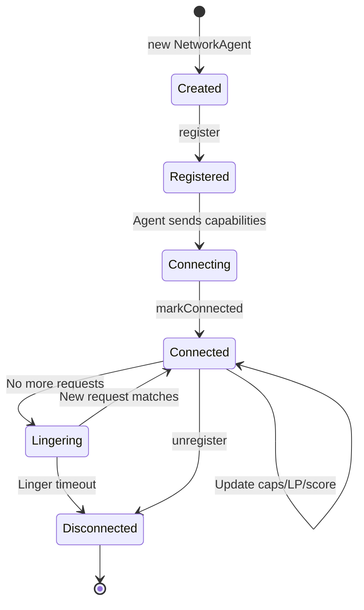

**传输必须实现的关键方法：**

| 方法 | 调用时机 | 用途 |
|--------|-----------|---------|
| `onNetworkUnwanted()` | CS 不再需要该网络 | 传输应断开连接 |
| `onBandwidthUpdateRequested()` | CS 需要更新的吞吐量 | 传输应刷新 |
| `onValidationStatus()` | 网络验证通过或失败 | 传输可调整行为 |
| `onSignalStrengthThresholdsUpdated()` | 阈值已更改 | 调整信号监控 |
| `onStartSocketKeepalive()` | 应用请求保活 | 尽可能卸载到硬件 |
| `onStopSocketKeepalive()` | 不再需要保活 | 停止硬件卸载 |
| `onSaveAcceptUnvalidated()` | 用户接受未验证 | 记住偏好 |

### 35.2.4 NetworkFactory

虽然 `NetworkAgent` 代表一个活动网络，`NetworkFactory` 代表
创建网络的_能力_。每种传输都向
ConnectivityService 注册一个工厂，声明它能提供哪些类型的网络。

**源文件：**
`packages/modules/Connectivity/staticlibs/device/android/net/NetworkFactory.java`

```java
// Source: packages/modules/Connectivity/staticlibs/device/android/net/NetworkFactory.java
public class NetworkFactory {
    static final boolean DBG = true;

    final NetworkFactoryShim mImpl;

    public NetworkFactory(Looper looper, Context context, String logTag,
            @Nullable final NetworkCapabilities filter) {
        LOG_TAG = logTag;
        if (isAtLeastS()) {
            mImpl = new NetworkFactoryImpl(this, looper, context, filter);
        } else {
            mImpl = new NetworkFactoryLegacyImpl(this, looper, context, filter);
        }
    }

    public static final int CMD_REQUEST_NETWORK = 1;
    public static final int CMD_CANCEL_REQUEST = 2;
    // ...
}
```

当应用发起一个 `NetworkRequest` 时，ConnectivityService 会评估
所有已注册的工厂。如果工厂声明的能力与
请求匹配，ConnectivityService 会向它发送一条
`CMD_REQUEST_NETWORK` 消息。工厂随后决定是建立一个新网络
（创建一个 NetworkAgent）还是忽略该请求。

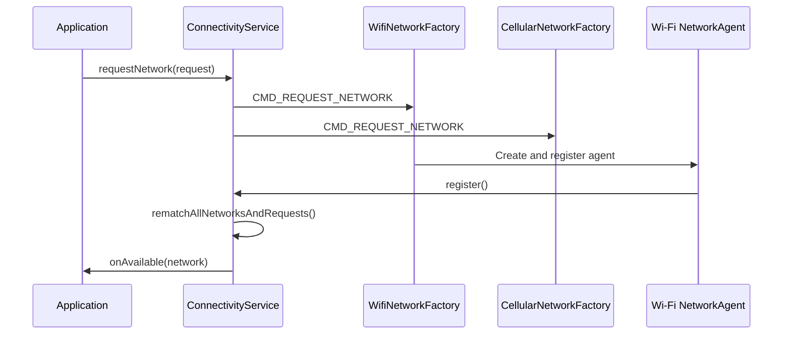

### 35.2.5 NetworkRequest 与 NetworkCapabilities

应用通过 `NetworkRequest`
对象表达其网络需求，这些对象包装了 `NetworkCapabilities` 约束。

**源文件：**
`packages/modules/Connectivity/framework/src/android/net/NetworkRequest.java`

一个 `NetworkRequest` 指定：

- **必需能力**：网络必须提供什么（例如 `NET_CAPABILITY_INTERNET`）
- **禁止能力**：网络不得具备什么（例如禁止 `NET_CAPABILITY_NOT_METERED` 意味着只有计费网络才能满足请求）
- **传输类型**：哪些承载网络可接受（Wi-Fi、蜂窝等）
- **网络标识符**：用于定向特定网络（例如某个 Wi-Fi SSID）

`NetworkCapabilities` 是系统中信息最丰富的描述符，编码了关于网络的
数十种属性：

**源文件：**
`packages/modules/Connectivity/framework/src/android/net/NetworkCapabilities.java`

关键的能力常量包括：

| 能力 | 含义 |
|-----------|---------|
| `NET_CAPABILITY_INTERNET` | 网络具有通用 Internet 访问 |
| `NET_CAPABILITY_VALIDATED` | 系统确认了 Internet 连接性 |
| `NET_CAPABILITY_NOT_METERED` | 网络不按用量计费 |
| `NET_CAPABILITY_NOT_VPN` | 网络不是 VPN |
| `NET_CAPABILITY_NOT_ROAMING` | 不在漫游网络上 |
| `NET_CAPABILITY_NOT_CONGESTED` | 网络不拥塞 |
| `NET_CAPABILITY_NOT_SUSPENDED` | 网络未挂起 |
| `NET_CAPABILITY_CAPTIVE_PORTAL` | 处于 captive portal 之后 |
| `NET_CAPABILITY_PARTIAL_CONNECTIVITY` | 连接受限 |
| `NET_CAPABILITY_MMS` | 支持 MMS |
| `NET_CAPABILITY_ENTERPRISE` | 企业网络 |
| `NET_CAPABILITY_LOCAL_NETWORK` | 本地网络（例如 Thread） |

传输类型包括：

| 传输 | 描述 |
|-----------|-------------|
| `TRANSPORT_CELLULAR` | 移动数据（LTE、5G） |
| `TRANSPORT_WIFI` | Wi-Fi |
| `TRANSPORT_BLUETOOTH` | 蓝牙 PAN |
| `TRANSPORT_ETHERNET` | 有线以太网 |
| `TRANSPORT_VPN` | 虚拟专用网络 |
| `TRANSPORT_WIFI_AWARE` | Wi-Fi Aware（NAN） |
| `TRANSPORT_LOWPAN` | 低功耗无线个人区域网络（6LoWPAN / 802.15.4） |
| `TRANSPORT_TEST` | 测试网络 |
| `TRANSPORT_SATELLITE` | 卫星连接 |
| `TRANSPORT_THREAD` | Thread 网状网络 |

### 35.2.6 网络评分与选择

当多个网络都能满足某个请求时，ConnectivityService 必须选择
最好的一个。网络选择算法在 Android 的历史上演变显著：

1. **旧式评分**（Android 12 之前）：简单的整数评分。越高越好。
    Wi-Fi 默认为 60，蜂窝为 50。

2. **现代评分**（Android 12+）：基于策略的 `NetworkScore`，
    编码了多个维度：

```java
// From NetworkAgent.java
public static final int WIFI_BASE_SCORE = 60;
```

`rematchAllNetworksAndRequests()` 方法是网络选择的核心。
它在每次重大网络变化时运行，遍历所有活动请求，为每个请求找到
最佳网络：

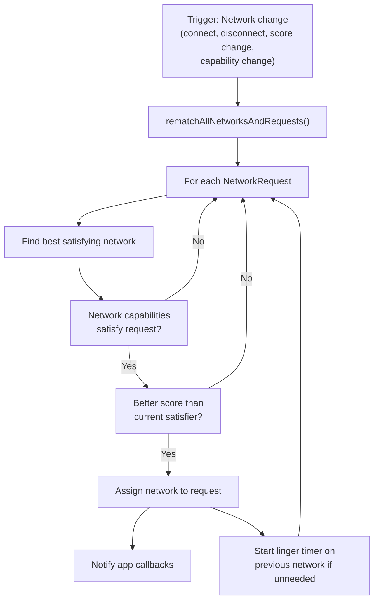

评分考虑了多种策略：

- **传输首选**：优先选择传输的首选网络
- **已验证优先于未验证**：优先选择通过验证的网络
- **计费 vs 非计费**：可用时优先选择非计费网络
- **用户偏好**：尊重用户的网络选择
- **VPN**：VPN 以其自己的评分规则特殊处理

### 35.2.7 LinkProperties

`LinkProperties` 描述网络的 IP 级配置：

- IP 地址（IPv4 和 IPv6）
- DNS 服务器
- 路由表条目
- 接口名称（例如 `wlan0`、`rmnet0`）
- MTU
- HTTP 代理设置
- NAT64 前缀（用于仅 IPv6 网络）

当 NetworkAgent 更新其 LinkProperties 时，ConnectivityService 会将相应的
路由和 DNS 配置推送给 netd：

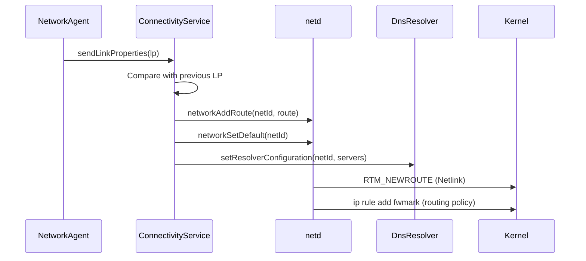

### 35.2.8 网络生命周期事件与回调

应用通过注册的回调接收网络状态变化。
ConnectivityService 支持丰富的回调事件集：

```java
// From ConnectivityService.java import block
import static android.net.ConnectivityManager.CALLBACK_AVAILABLE;
import static android.net.ConnectivityManager.CALLBACK_BLK_CHANGED;
import static android.net.ConnectivityManager.CALLBACK_CAP_CHANGED;
import static android.net.ConnectivityManager.CALLBACK_IP_CHANGED;
import static android.net.ConnectivityManager.CALLBACK_LOCAL_NETWORK_INFO_CHANGED;
import static android.net.ConnectivityManager.CALLBACK_LOSING;
import static android.net.ConnectivityManager.CALLBACK_LOST;
import static android.net.ConnectivityManager.CALLBACK_PRECHECK;
import static android.net.ConnectivityManager.CALLBACK_SUSPENDED;
import static android.net.ConnectivityManager.CALLBACK_RESUMED;
```

典型网络连接的回调生命周期：

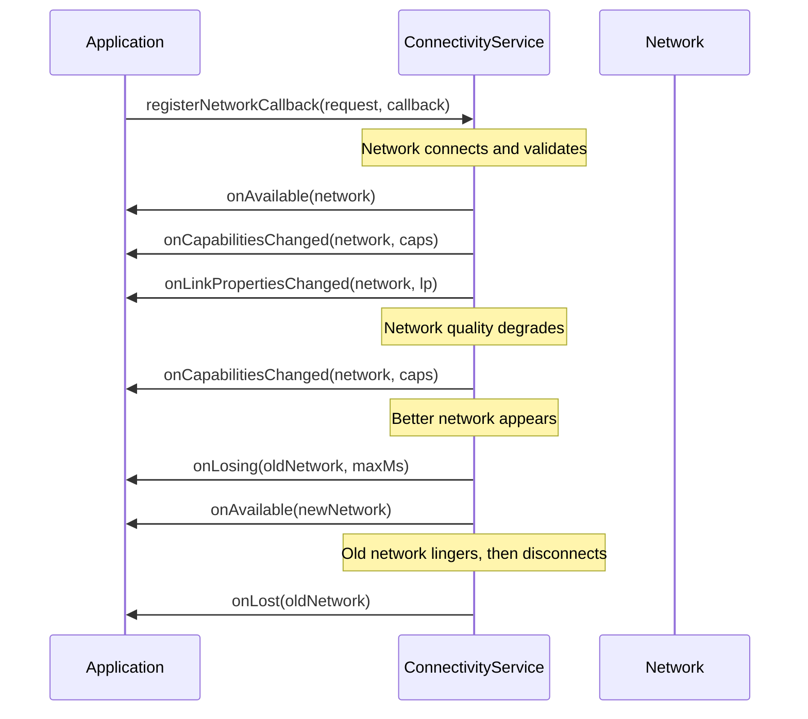

### 35.2.9 基于 BPF 的流量控制

现代 Android 越来越多地使用 eBPF（扩展伯克利包过滤器）程序
进行流量控制，取代传统的 iptables 规则。BPF 程序
挂接到 cgroup 钩子上，以执行按 UID 的流量策略。

```java
// Source: packages/modules/Connectivity/service/src/com/android/server/ConnectivityService.java
// BPF program attachment points
import static com.android.net.module.util.BpfUtils.BPF_CGROUP_GETSOCKOPT;
import static com.android.net.module.util.BpfUtils.BPF_CGROUP_INET4_BIND;
import static com.android.net.module.util.BpfUtils.BPF_CGROUP_INET4_CONNECT;
import static com.android.net.module.util.BpfUtils.BPF_CGROUP_INET6_BIND;
import static com.android.net.module.util.BpfUtils.BPF_CGROUP_INET6_CONNECT;
import static com.android.net.module.util.BpfUtils.BPF_CGROUP_INET_EGRESS;
import static com.android.net.module.util.BpfUtils.BPF_CGROUP_INET_INGRESS;
import static com.android.net.module.util.BpfUtils.BPF_CGROUP_INET_SOCK_CREATE;
import static com.android.net.module.util.BpfUtils.BPF_CGROUP_INET_SOCK_RELEASE;
import static com.android.net.module.util.BpfUtils.BPF_CGROUP_SETSOCKOPT;
import static com.android.net.module.util.BpfUtils.BPF_CGROUP_UDP4_RECVMSG;
import static com.android.net.module.util.BpfUtils.BPF_CGROUP_UDP4_SENDMSG;
import static com.android.net.module.util.BpfUtils.BPF_CGROUP_UDP6_RECVMSG;
import static com.android.net.module.util.BpfUtils.BPF_CGROUP_UDP6_SENDMSG;
```

这些 BPF 程序提供：

- **按 UID 记账**：跟踪每个 UID 发送/接收的字节数
- **防火墙执行**：按 UID 和链允许/阻止流量
- **套接字创建权限检查**：`cgroup/sock_create` 程序执行按 UID 的 INTERNET 权限。它将 UID 和套接字 cookie 记录在套接字存储中。（netd 的 `FwmarkServer` 自己应用 fwmark。）
- **数据节省**：在计费网络上限制后台数据
- **带宽控制**：执行按接口配额

Connectivity 模块中的 `BpfNetMaps` 类管理这些映射，取代了
许多传统的基于 iptables 的机制：

```java
// Source: packages/modules/Connectivity/service/src/com/android/server/BpfNetMaps.java
```

### 35.2.10 冻结应用处理

ConnectivityService 对冻结（缓存）应用有精细的处理。
当应用被 ActivityManager 冻结时，其网络回调会被排队，
而不是立即投递。这避免了不必要的唤醒：

```java
// Source: ConnectivityService.java import block
import static com.android.server.connectivity.ConnectivityFlags.QUEUE_CALLBACKS_FOR_FROZEN_APPS;
```

当应用解冻时，排队的回调按顺序投递。这确保了
应用对当前网络状态有准确的视图。

---

## 35.3 Wi-Fi 框架

### 35.3.1 架构概览

AOSP 中的 Wi-Fi 框架是一个复杂的子系统。它管理 Wi-Fi 无线电操作、
网络扫描、连接管理、SoftAP（热点）、Wi-Fi Direct（P2P）以及
Wi-Fi Aware（NAN）。从 Android 11 开始，整个 Wi-Fi 协议栈
作为 Mainline 模块发布。

**模块根目录：** `packages/modules/Wifi/`

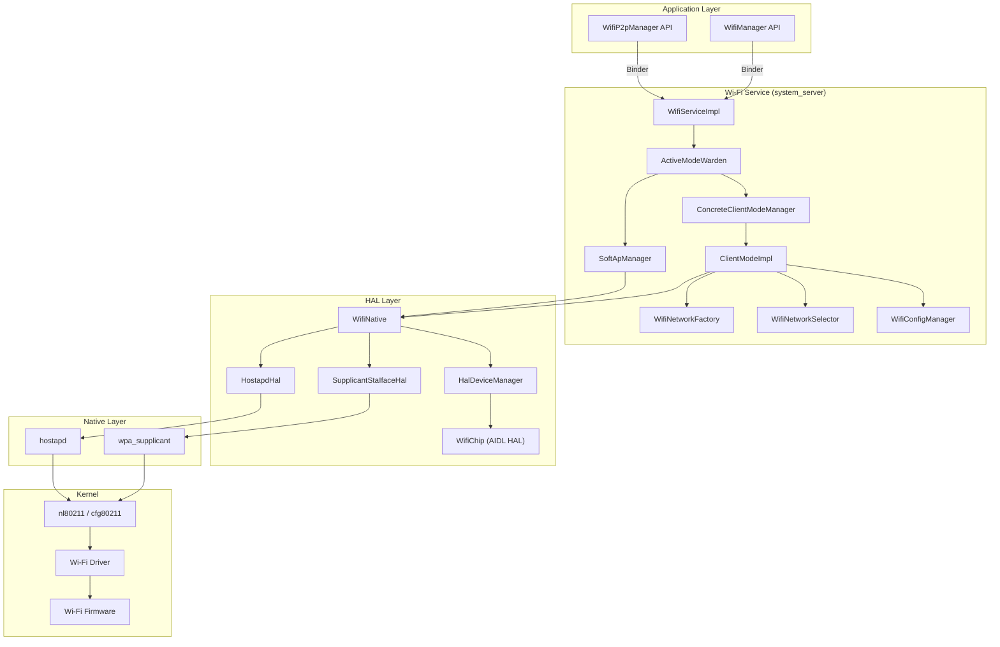

### 35.3.2 WifiServiceImpl

`WifiServiceImpl` 是面向 Binder 的服务，实现了 `IWifiManager`。
它处理来自应用的所有公开 API 调用，并将工作委托给内部
组件。

**源文件：**
`packages/modules/Wifi/service/java/com/android/server/wifi/WifiServiceImpl.java`

```java
// Source: packages/modules/Wifi/service/java/com/android/server/wifi/WifiServiceImpl.java
// WifiServiceImpl handles dozens of Wi-Fi manager APIs including:
// - Scan management (IScanResultsCallback)
// - Network suggestions (ISuggestionConnectionStatusListener)
// - SoftAP control (ISoftApCallback)
// - P2P operations
// - Traffic state monitoring (ITrafficStateCallback)
// - Verbose logging control
// - DPP (Device Provisioning Protocol)
// - TWT (Target Wake Time)
```

关键职责包括：

- 权限执行（位置、Wi-Fi 状态变更等）
- API 参数校验
- 将模式变更委托给 `ActiveModeWarden`
- 广播 Wi-Fi 状态变化
- 管理仅限本地的热点请求

### 35.3.3 ClientModeImpl：Wi-Fi 状态机

`ClientModeImpl` 是 Wi-Fi 连接的主力。它扩展
了 `StateMachine`，并管理 Wi-Fi 连接的完整生命周期：从
扫描和认证一直到 DHCP 和完全连接。

**源文件：**
`packages/modules/Wifi/service/java/com/android/server/wifi/ClientModeImpl.java`

```java
// Source: packages/modules/Wifi/service/java/com/android/server/wifi/ClientModeImpl.java
public class ClientModeImpl extends StateMachine implements ClientMode {
    // Roles for this client mode interface
    // ROLE_CLIENT_PRIMARY - the main STA interface
    // ROLE_CLIENT_LOCAL_ONLY - local-only connection
    // ROLE_CLIENT_SECONDARY_LONG_LIVED - persistent secondary
    // ROLE_CLIENT_SECONDARY_TRANSIENT - temporary secondary (MBB)
    // ROLE_CLIENT_SCAN_ONLY - scan-only mode
    // ...
}
```

状态机包含以下关键状态：

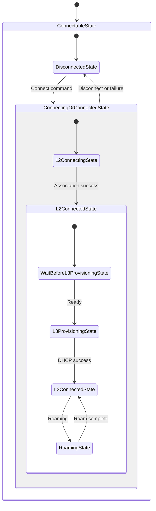

**状态描述：**

| 状态 | 描述 |
|-------|-------------|
| `ConnectableState` | 根状态，在 Wi-Fi 启用时进入 |
| `ConnectingOrConnectedState` | 父状态，涵盖从关联到完全连接 |
| `DisconnectedState` | 未与任何 AP 关联 |
| `L2ConnectingState` | 正在尝试 802.11 关联 |
| `L2ConnectedState` | 已在 L2 关联，等待 L3 |
| `WaitBeforeL3ProvisioningState` | IP 配置前的短暂停顿 |
| `L3ProvisioningState` | 正在运行 DHCP 或静态 IP 配置 |
| `L3ConnectedState` | 已建立完整的 IP 连接性 |
| `RoamingState` | 正在 AP 之间漫游 |

### 35.3.4 WifiNative：HAL 桥

`WifiNative` 充当 Java Wi-Fi 框架与
原生 Wi-Fi HAL（硬件抽象层）之间的接口。它管理硬件接口，
委托 supplicant 操作，并处理扫描结果。

**源文件：**
`packages/modules/Wifi/service/java/com/android/server/wifi/WifiNative.java`

```java
// Source: packages/modules/Wifi/service/java/com/android/server/wifi/WifiNative.java
// WifiNative creates and manages different interface types:
// HDM_CREATE_IFACE_STA - Station (client) interface
// HDM_CREATE_IFACE_AP - Access Point interface
// HDM_CREATE_IFACE_AP_BRIDGE - Bridged AP (dual-band)
// HDM_CREATE_IFACE_P2P - Wi-Fi Direct interface
// HDM_CREATE_IFACE_NAN - Wi-Fi Aware interface
```

HAL 通信路径：

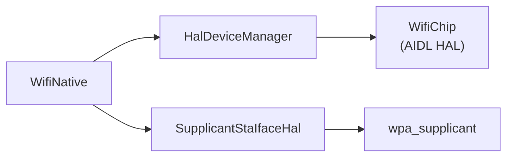

### 35.3.5 wpa_supplicant 集成

Android 使用业界标准的 `wpa_supplicant` 进行 802.11 认证。
`SupplicantStaIfaceHal` 类通过
AIDL 接口与 wpa_supplicant 通信，处理：

- WPA/WPA2/WPA3 认证
- 802.1X 企业认证（EAP-TLS、EAP-TTLS、EAP-PEAP、EAP-SIM 等）
- FILS（快速初始链路建立），用于缩短连接时间
- OWE（机会性无线加密），用于开放网络
- SAE（对等实体同步认证），用于 WPA3
- DPP（设备配置协议），用于便捷入网

`SupplicantStaIfaceHal` 并不绑定到某一种固定传输。它的工厂
`createStaIfaceHalMockable()` 位于
`packages/modules/Wifi/service/java/com/android/server/wifi/SupplicantStaIfaceHal.java`
会按照严格的偏好顺序选择第一个可用的后端。

第一个是 AIDL
*mainline* 实现（Wi-Fi APEX 中随附的 supplicant 二进制文件，
第 35.27 节介绍）。第二个是 AIDL *vendor* 实现（vendor 分区上的
supplicant）。第三个是传统的 HIDL 实现。
每个候选都暴露 `isServiceAvailable()` / `serviceDeclared()` 探测。
第一个回答“是”的候选胜出。Wi-Fi Direct 在
`SupplicantP2pIfaceHal` 中存在相同的三层选择。

### 35.3.6 网络选择

`WifiNetworkSelector` 评估可用的扫描结果，并选择
要连接的最佳网络。它考虑：

1. **已保存网络的优先级**：用户配置的偏好
2. **信号强度（RSSI）**：按频段加权（2.4 GHz、5 GHz、6 GHz）
3. **安全类型**：优先选择更强的安全性
4. **历史表现**：历史连接质量指标
5. **网络建议**：应用建议的网络
6. **企业策略**：设备管理员的限制
7. **被阻止的网络**：因失败而暂时禁用

### 35.3.7 SoftAP（移动热点）

`SoftApManager` 处理移动热点功能，通过自己的状态机管理
AP 接口生命周期。

**源文件：**
`packages/modules/Wifi/service/java/com/android/server/wifi/SoftApManager.java`

```java
// Source: packages/modules/Wifi/service/java/com/android/server/wifi/SoftApManager.java
public class SoftApManager implements ActiveModeManager {
    private static final String TAG = "SoftApManager";
    // SoftAP manages the AP mode lifecycle:
    // - Interface creation (via WifiNative/HalDeviceManager)
    // - Channel selection (considering coexistence)
    // - Client connection/disconnection tracking
    // - Bridged AP mode (dual-band simultaneous)
    // - Idle timeout management
    // ...
}
```

SoftAP 特性包括：

- **双频支持**：桥接 AP 模式同时提供 2.4 GHz 和 5 GHz
- **客户端管理**：跟踪已连接客户端，强制执行最大客户端数限制
- **共存**：`CoexManager` 处理与蜂窝频段的干扰
- **自动关闭**：无客户端连接时可配置的空闲超时
- **WPA3-SAE**：支持热点模式下的 WPA3 安全性
- **MAC 随机化**：为 AP BSSID 提供保护隐私的 MAC

### 35.3.8 Wi-Fi Direct（P2P）

Wi-Fi Direct 允许设备在没有接入点的情况下直接连接。实现位于
`packages/modules/Wifi/service/java/com/android/server/wifi/p2p/`，
由 `WifiP2pServiceImpl` 管理。

P2P 连接流程：

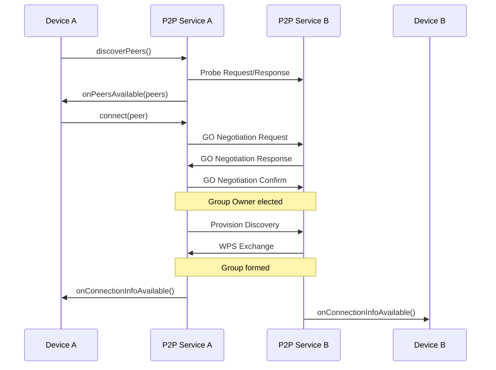

### 35.3.9 多链路操作（MLO）与 Wi-Fi 7

现代 AOSP 包含对 Wi-Fi 7（802.11be）特性的支持，包括
多链路操作。Wi-Fi 框架中的 `MloLink` 类表示
MLO 连接中的单条链路：

```java
// From ClientModeImpl.java imports
import android.net.wifi.MloLink;
```

MLO 实现跨多个信道和频段的同时传输，
显著提升吞吐量并降低延迟。

---

## 35.4 netd（网络守护进程）

### 35.4.1 概述

`netd` 是代表 Android 框架负责配置 Linux 内核
网络子系统的原生守护进程。它以特权进程运行，是路由表操作、防火墙
规则管理、带宽控制和接口配置的主要通道。

**源目录：** `system/netd/`

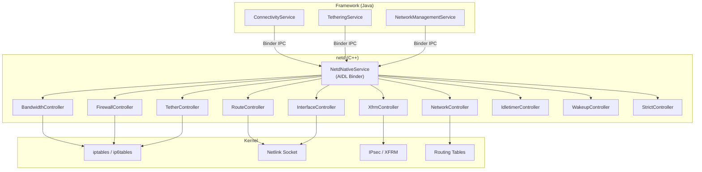

### 35.4.2 NetdNativeService：Binder 接口

`NetdNativeService` 通过 AIDL Binder 暴露 netd 的功能。它
是框架调用者的唯一入口点。

**源文件：** `system/netd/server/NetdNativeService.h`

```cpp
// Source: system/netd/server/NetdNativeService.h
class NetdNativeService : public BinderService<NetdNativeService>, public BnNetd {
  public:
    NetdNativeService();
    static status_t start();
    static char const* getServiceName() { return "netd"; }

    // Firewall commands
    binder::Status firewallReplaceUidChain(const std::string& chainName,
                                           bool isAllowlist,
                                           const std::vector<int32_t>& uids,
                                           bool* ret) override;
    binder::Status firewallSetFirewallType(int32_t firewallType) override;
    binder::Status firewallSetInterfaceRule(const std::string& ifName,
                                            int32_t firewallRule) override;
    binder::Status firewallSetUidRule(int32_t childChain, int32_t uid,
                                      int32_t firewallRule) override;

    // Bandwidth control commands
    binder::Status bandwidthEnableDataSaver(bool enable, bool *ret) override;
    binder::Status bandwidthSetInterfaceQuota(const std::string& ifName,
                                              int64_t bytes) override;
    binder::Status bandwidthSetGlobalAlert(int64_t bytes) override;
    binder::Status bandwidthAddNaughtyApp(int32_t uid) override;
    binder::Status bandwidthAddNiceApp(int32_t uid) override;

    // Network and routing commands
    binder::Status networkCreate(const NativeNetworkConfig& config) override;
    binder::Status networkDestroy(int32_t netId) override;
    binder::Status networkAddInterface(int32_t netId,
                                       const std::string& iface) override;
    binder::Status networkAddRoute(int32_t netId, const std::string& ifName,
                                   const std::string& destination,
                                   const std::string& nextHop) override;
    binder::Status networkSetDefault(int32_t netId) override;

    // Socket operations
    binder::Status socketDestroy(const std::vector<UidRangeParcel>& uids,
                                 const std::vector<int32_t>& skipUids) override;
    // ...
};
```

### 35.4.3 NetworkController：路由与网络

`NetworkController` 管理 netd 内部网络抽象的创建和配置。
每个网络（物理、虚拟、本地或
不可达）都有自己的路由表和策略规则。

**源文件：** `system/netd/server/NetworkController.cpp`

```cpp
// Source: system/netd/server/NetworkController.cpp
// THREAD-SAFETY
// The methods in this file are called from multiple threads (from
// CommandListener, FwmarkServer and DnsProxyListener). So, all accesses
// to shared state are guarded by a lock.

class NetworkController::DelegateImpl : public PhysicalNetwork::Delegate {
  public:
    explicit DelegateImpl(NetworkController* networkController);

    [[nodiscard]] int modifyFallthrough(unsigned vpnNetId,
                                        const std::string& physicalInterface,
                                        Permission permission, bool add);
  // ...
};
```

netd 中的网络类型：

| 类型 | 类 | 用途 |
|------|-------|---------|
| 物理 | `PhysicalNetwork` | Wi-Fi、蜂窝、以太网 |
| 虚拟 | `VirtualNetwork` | VPN 网络 |
| 本地 | `LocalNetwork` | localhost 和本地接口 |
| 不可达 | `UnreachableNetwork` | 阻止流量（拒绝路由） |
| 哑 | `DummyNetwork` | 测试/占位网络 |

### 35.4.4 iptables 链架构

netd 将 iptables 规则组织成精心排序的链。该排序对正确运行至关重要，
并在源码中有明确文档。

**源文件：** `system/netd/server/Controllers.cpp`

```cpp
// Source: system/netd/server/Controllers.cpp
// ORDERING IS CRITICAL, AND SHOULD BE TRIPLE-CHECKED WITH EACH CHANGE.

static const std::vector<const char*> FILTER_INPUT = {
    OEM_IPTABLES_FILTER_INPUT,
    BandwidthController::LOCAL_INPUT,     // "bw_INPUT"
    FirewallController::LOCAL_INPUT,      // "fw_INPUT"
};

static const std::vector<const char*> FILTER_FORWARD = {
    OEM_IPTABLES_FILTER_FORWARD,
    FirewallController::LOCAL_FORWARD,    // "fw_FORWARD"
    BandwidthController::LOCAL_FORWARD,   // "bw_FORWARD"
    TetherController::LOCAL_FORWARD,      // tethering forwarding
};

static const std::vector<const char*> FILTER_OUTPUT = {
    OEM_IPTABLES_FILTER_OUTPUT,
    FirewallController::LOCAL_OUTPUT,     // "fw_OUTPUT"
    StrictController::LOCAL_OUTPUT,       // cleartext enforcement
    BandwidthController::LOCAL_OUTPUT,    // "bw_OUTPUT"
};

static const std::vector<const char*> RAW_PREROUTING = {
    IdletimerController::LOCAL_RAW_PREROUTING,
    BandwidthController::LOCAL_RAW_PREROUTING,
    TetherController::LOCAL_RAW_PREROUTING,
};

static const std::vector<const char*> MANGLE_POSTROUTING = {
    OEM_IPTABLES_MANGLE_POSTROUTING,
    BandwidthController::LOCAL_MANGLE_POSTROUTING,
    IdletimerController::LOCAL_MANGLE_POSTROUTING,
};

static const std::vector<const char*> MANGLE_INPUT = {
    CONNMARK_MANGLE_INPUT,
    WakeupController::LOCAL_MANGLE_INPUT,
    RouteController::LOCAL_MANGLE_INPUT,
};
```

传入数据包的链执行顺序：

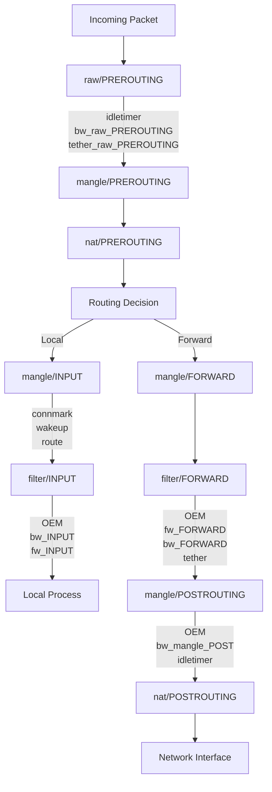

### 35.4.5 BandwidthController

`BandwidthController` 使用 iptables 配额规则和 BPF 程序实现
数据使用跟踪和执行。

**源文件：** `system/netd/server/BandwidthController.cpp`

```cpp
// Source: system/netd/server/BandwidthController.cpp
const char BandwidthController::LOCAL_INPUT[] = "bw_INPUT";
const char BandwidthController::LOCAL_FORWARD[] = "bw_FORWARD";
const char BandwidthController::LOCAL_OUTPUT[] = "bw_OUTPUT";
const char BandwidthController::LOCAL_RAW_PREROUTING[] = "bw_raw_PREROUTING";
const char BandwidthController::LOCAL_MANGLE_POSTROUTING[] = "bw_mangle_POSTROUTING";
const char BandwidthController::LOCAL_GLOBAL_ALERT[] = "bw_global_alert";
```

带宽控制特性：

- **按接口配额**：限制特定接口上的数据使用
- **全局告警**：总用量超过阈值时通知
- **顽皮应用**：被阻止使用计费网络的 UID（数据节省）
- **乖巧应用**：免于数据节省限制的 UID
- **共享高成本链**：所有计费接口上的全局配额

```cpp
// Source: system/netd/server/BandwidthController.cpp
// Comments explaining the rule structure:
//  * global quota for all costly interfaces uses a single costly chain:
//   . initial rules
//     iptables -N bw_costly_shared
//     iptables -I bw_INPUT -i iface0 -j bw_costly_shared
//     iptables -I bw_OUTPUT -o iface0 -j bw_costly_shared
//     iptables -I bw_costly_shared -m quota \! --quota 500000 \
//         -j REJECT --reject-with icmp-net-prohibited
//     iptables -A bw_costly_shared -j bw_penalty_box
//     iptables -A bw_penalty_box -j bw_happy_box
```

### 35.4.6 FirewallController

`FirewallController` 管理按 UID 的网络访问规则，为
打盹模式、省电模式和应用待机实现 Android 的防火墙链。

**源文件：** `system/netd/server/FirewallController.cpp`

```cpp
// Source: system/netd/server/FirewallController.cpp
const char FirewallController::TABLE[] = "filter";
const char FirewallController::LOCAL_INPUT[] = "fw_INPUT";
const char FirewallController::LOCAL_OUTPUT[] = "fw_OUTPUT";
const char FirewallController::LOCAL_FORWARD[] = "fw_FORWARD";

// ICMPv6 types that are required for any form of IPv6 connectivity to work.
const char* const FirewallController::ICMPV6_TYPES[] = {
    "packet-too-big",
    "router-solicitation",
    "router-advertisement",
    "neighbour-solicitation",
    "neighbour-advertisement",
    "redirect",
};
```

防火墙支持两种模式：

- **黑名单**（默认）：除非显式拒绝，否则允许所有流量
- **白名单**：除非显式允许，否则阻止所有流量

上面按接口划分的 `fw_INPUT`/`fw_OUTPUT`/`fw_FORWARD` 链仍然是
由 `FirewallController` 拥有的 iptables 链。然而，按策略划分的省电链
不再是 iptables 子链。如 §35.2.9 所述，它们已移入 BPF，现在由
Connectivity 模块中的 `BpfNetMaps` 执行。它们由
`FIREWALL_CHAIN_*` 常量（`ConnectivityManager` /
`packages/modules/Connectivity/.../BpfNetMapsConstants.java`）标识，而不是由
`FirewallController` 链名标识，但名称和语义一一对应：

| BPF 防火墙链 | 用途 | 模式 |
|-------|---------|------|
| `FIREWALL_CHAIN_DOZABLE` | 打盹模式白名单 | 白名单 |
| `FIREWALL_CHAIN_STANDBY` | 应用待机黑名单 | 黑名单 |
| `FIREWALL_CHAIN_POWERSAVE` | 省电模式白名单 | 白名单 |
| `FIREWALL_CHAIN_RESTRICTED` | 后台限制白名单 | 白名单 |
| `FIREWALL_CHAIN_LOW_POWER_STANDBY` | 低功耗待机白名单 | 白名单 |
| `FIREWALL_CHAIN_BACKGROUND` | 后台网络访问白名单 | 白名单 |

### 35.4.7 RouteController

`RouteController` 管理 Linux 路由表和策略规则。每个
网络都有自己的路由表，以 netId 标识。策略路由
规则使用 fwmark 将数据包引导到正确的表。

路由架构：

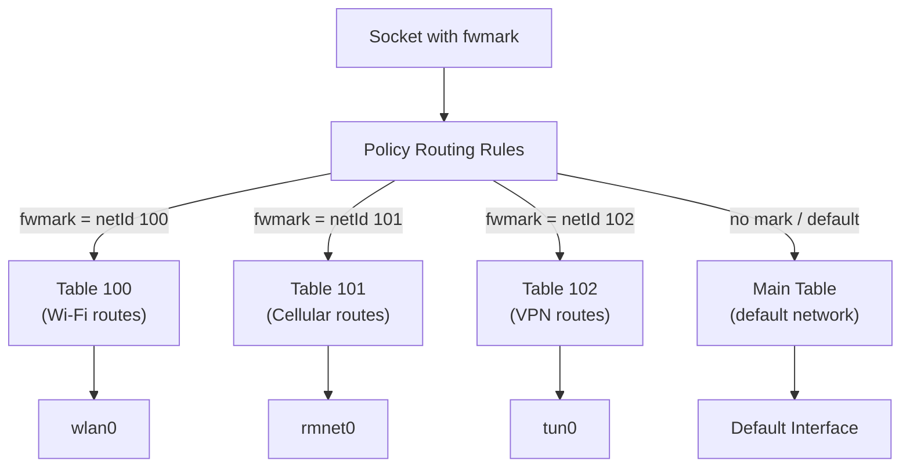

### 35.4.8 XfrmController：IPsec

`XfrmController` 为 VPN 和其他加密隧道需求管理
Linux XFRM（IPsec 变换）操作：

**源文件：** `system/netd/server/XfrmController.cpp`

它处理：

- 安全关联（SA）的创建和删除
- 安全策略（SP）配置
- 隧道接口管理
- ESP（封装安全载荷）配置
- SPI（安全参数索引）分配

### 35.4.9 FwmarkServer

`FwmarkServer` 是 netd 内部的 UNIX 域套接字服务器，负责处理
套接字标记。当创建套接字时，C 库（`bionic`）会连接
到 FwmarkServer。FwmarkServer 根据
进程的 UID、默认网络和任何显式网络绑定，应用相应的 fwmark。

**源文件：** `system/netd/server/FwmarkServer.cpp`

该机制确保每个套接字都被自动路由到
正确的网络，无需应用干预。

---

## 35.5 DNS 解析器

### 35.5.1 架构

DNS 解析器作为模块运行在 netd 进程内部（以共享
库的形式链接）。它作为独立的 Mainline 模块维护，以便独立
更新。

**模块根目录：** `packages/modules/DnsResolver/`

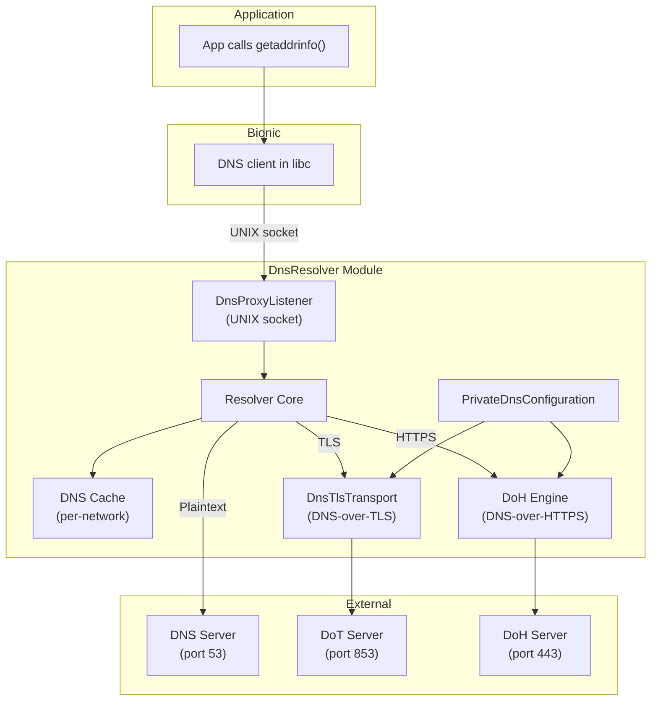

### 35.5.2 初始化

解析器在 netd 启动时通过 `resolv_init()`
函数初始化：

**源文件：** `packages/modules/DnsResolver/DnsResolver.cpp`

```cpp
// Source: packages/modules/DnsResolver/DnsResolver.cpp
bool resolv_init(const ResolverNetdCallbacks* callbacks) {
    android::base::InitLogging(/*argv=*/nullptr);
    LOG(INFO) << __func__ << ": Initializing resolver";
    const bool isDebug = isDebuggable();
    resolv_set_log_severity(isDebug
        ? android::base::INFO
        : android::base::WARNING);
    doh_init_logger(isDebug
        ? DOH_LOG_LEVEL_INFO
        : DOH_LOG_LEVEL_WARN);

    using android::net::gResNetdCallbacks;
    // all current fields are guaranteed present on R
    // and we only support S+
    gResNetdCallbacks.check_calling_permission =
        callbacks->check_calling_permission;
    gResNetdCallbacks.get_network_context =
        callbacks->get_network_context;
    gResNetdCallbacks.log = callbacks->log;
    gResNetdCallbacks.tagSocket = callbacks->tagSocket;
    gResNetdCallbacks.evaluate_domain_name =
        callbacks->evaluate_domain_name;
    android::net::gDnsResolv = android::net::DnsResolver::getInstance();
    return android::net::gDnsResolv->start();
}
```

`DnsResolver::start()` 方法启动两个关键组件：

1. `DnsProxyListener`：在 UNIX 域套接字上监听 DNS 查询
2. `DnsResolverService`：用于配置的 AIDL Binder 接口

```cpp
// Source: packages/modules/DnsResolver/DnsResolver.cpp
bool DnsResolver::start() {
    if (!verifyCallbacks()) {
        LOG(ERROR) << __func__ << ": Callback verification failed";
        return false;
    }
    if (mDnsProxyListener.startListener()) {
        PLOG(ERROR) << __func__ << ": Unable to start DnsProxyListener";
        return false;
    }
    binder_status_t ret;
    if ((ret = DnsResolverService::start()) != STATUS_OK) {
        LOG(ERROR) << __func__
                   << ": Unable to start DnsResolverService: " << ret;
        return false;
    }
    return true;
}
```

### 35.5.3 DNS 查询流程

当应用调用 `InetAddress.getByName()` 或 `getaddrinfo()` 时，
查询遵循以下路径：

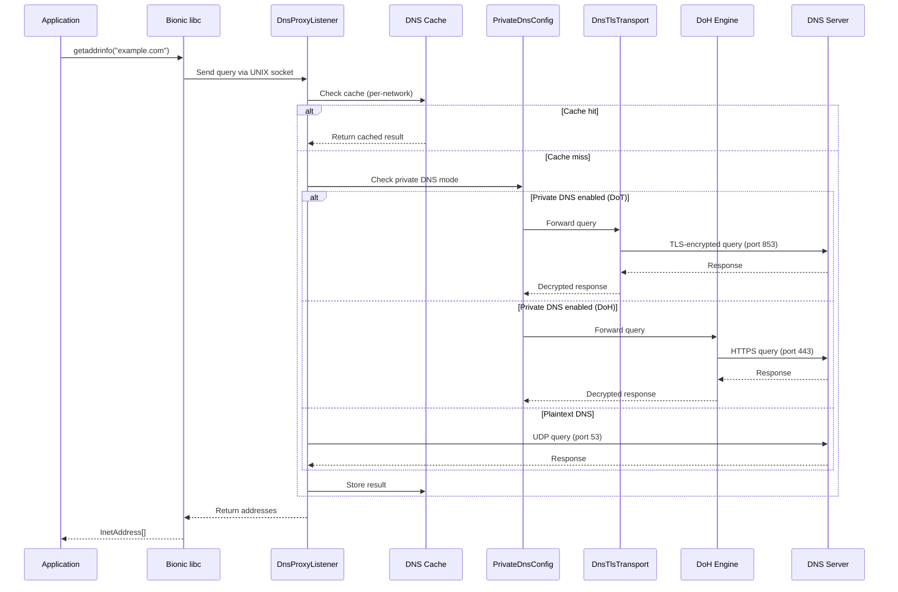

### 35.5.4 DNS-over-TLS（DoT）

`DnsTlsTransport` 类实现了端口 853 上的 DNS-over-TLS（RFC 7858），用于加密
DNS 查询。

**源文件：** `packages/modules/DnsResolver/DnsTlsTransport.cpp`

```cpp
// Source: packages/modules/DnsResolver/DnsTlsTransport.cpp
namespace {
// Make a DNS query for the hostname
// "<random>-dnsotls-ds.metric.gstatic.com".
// This is used for DoT validation probing.
std::vector<uint8_t> makeDnsQuery() {
    static constexpr char kDnsSafeChars[] =
            "0123456789"
            "abcdefghijklmnopqrstuvwxyz"
            "ABCDEFGHIJKLMNOPQRSTUVWXYZ";
    // ... builds a DNS query with random prefix for validation
}
}  // namespace
```

DoT 实现的特性：

- **会话缓存**：重用 TLS 会话以减少握手开销
- **连接复用**：在持久连接上复用查询
- **验证**：在激活 DoT 服务器之前进行探测
- **故障转移**：如果 DoT 失败则回退到明文 DNS

DoT 协议栈中的关键类：

| 类 | 文件 | 职责 |
|-------|------|------|
| `DnsTlsTransport` | `DnsTlsTransport.cpp` | 连接管理 |
| `DnsTlsSocket` | `DnsTlsSocket.cpp` | TLS 套接字包装器 |
| `DnsTlsDispatcher` | `DnsTlsDispatcher.cpp` | 查询路由 |
| `DnsTlsQueryMap` | `DnsTlsQueryMap.cpp` | 查询/响应匹配 |
| `DnsTlsSessionCache` | `DnsTlsSessionCache.cpp` | TLS 会话复用 |
| `DnsTlsServer` | `DnsTlsServer.cpp` | 服务器表示 |

### 35.5.5 DNS-over-HTTPS（DoH）

DoH 支持在 Android 13 中添加，通过 HTTPS（RFC 8484）提供 DNS 加密。
DoH 引擎用 Rust 实现，以获得内存安全性和
性能。

**源文件：** `packages/modules/DnsResolver/PrivateDnsConfiguration.cpp`

```cpp
// Source: packages/modules/DnsResolver/PrivateDnsConfiguration.cpp
FeatureFlags makeDohFeatureFlags() {
    const Experiments* const instance = Experiments::getInstance();
    const auto getTimeout = [&](const std::string_view key,
                                 int defaultValue) -> uint64_t {
        static constexpr int kMinTimeoutMs = 1000;
        uint64_t timeout = instance->getFlag(key, defaultValue);
        if (timeout < kMinTimeoutMs) {
            timeout = kMinTimeoutMs;
        }
        return timeout;
    };

    return FeatureFlags{
        .probe_timeout_ms = getTimeout("doh_probe_timeout_ms",
            PrivateDnsConfiguration::kDohProbeDefaultTimeoutMs),
        .idle_timeout_ms = getTimeout("doh_idle_timeout_ms",
            PrivateDnsConfiguration::kDohIdleDefaultTimeoutMs),
        .use_session_resumption =
            instance->getFlag("doh_session_resumption", 0) == 1,
        .enable_early_data =
            instance->getFlag("doh_early_data", 0) == 1,
    };
}
```

DoH 特性标志允许服务端控制：

- **探测超时**：等待 DoH 验证的时间
- **空闲超时**：保持空闲连接打开的时间
- **会话恢复**：TLS 1.3 会话恢复（0-RTT）
- **早期数据**：用于降低延迟的 TLS 1.3 早期数据

### 35.5.6 私有 DNS 配置

`PrivateDnsConfiguration` 类管理私有 DNS
（DoT/DoH）服务器的生命周期，包括验证和故障转移。

**源文件：** `packages/modules/DnsResolver/PrivateDnsConfiguration.cpp`

```cpp
// Source: packages/modules/DnsResolver/PrivateDnsConfiguration.cpp
// Returns the sorted (sort IPv6 before IPv4) servers.
std::vector<std::string> sortServers(
        const std::vector<std::string>& servers) {
    std::vector<std::string> out = servers;
    std::sort(out.begin(), out.end(),
        [](std::string a, std::string b) {
            return IPAddress::forString(a) > IPAddress::forString(b);
        });
    return out;
}
```

私有 DNS 模式：

1. **关闭**：所有 DNS 查询均为明文
2. **机会性**（默认）：尝试 DoT/DoH，回退到明文
3. **严格**：强制 DoT/DoH；不可用时失败

验证状态机：

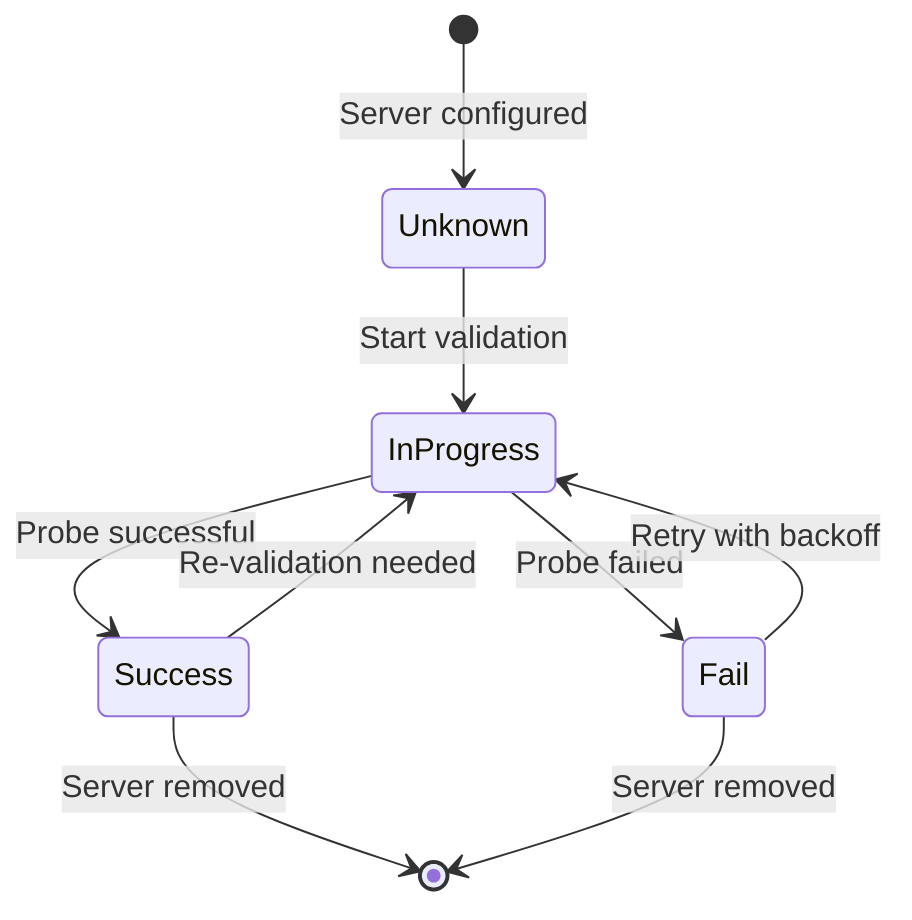

### 35.5.7 Dns64 与 NAT64

`Dns64Configuration` 类处理仅 IPv6 网络的 DNS64 前缀发现。
当网络没有 IPv4 连接性时，DNS64 从 A 记录合成 AAAA
记录。NAT64（由 connectivity 模块中的 clatd 处理）
转换数据包。

**源文件：** `packages/modules/DnsResolver/Dns64Configuration.cpp`

### 35.5.8 按网络的 DNS 缓存

解析器为每个网络 ID 维护独立的 DNS 缓存。这防止了
跨网络的 DNS 缓存投毒。它还确保响应
适合网络上下文（例如，captive portal 响应不会
被缓存用于全局 DNS）。

关键缓存行为：

- **基于 TTL 的过期**：遵循 DNS 记录的 TTL 值
- **网络隔离**：每个 netId 独立缓存
- **负面缓存**：缓存 NXDOMAIN 响应
- **缓存刷新**：在网络变化时触发

### 35.5.9 DNS 查询日志

`DnsQueryLog` 类为 DNS 查询提供诊断日志：

**源文件：** `packages/modules/DnsResolver/DnsQueryLog.cpp`

这支持通过 `dumpsys dnsresolver` 进行调试，并支持 DNS 性能监控的
指标收集。

---

## 35.6 VPN 框架

### 35.6.1 架构概览

Android 的 VPN 框架支持多种 VPN 类型：第三方 VPN 应用
（VpnService API）、平台管理的 IKEv2 VPN 以及传统的 PPTP/L2TP VPN。
核心实现位于 `Vpn` 类中。

**源文件：**
`frameworks/base/services/core/java/com/android/server/connectivity/Vpn.java`

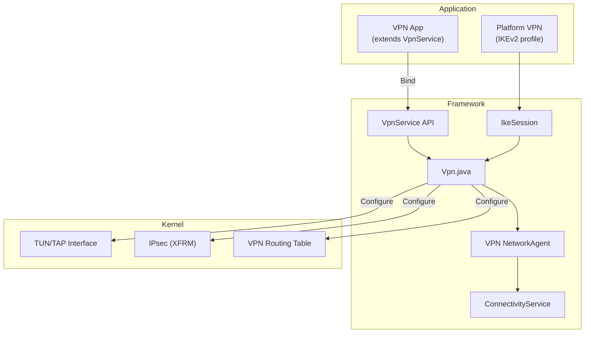

### 35.6.2 Vpn 类

`Vpn` 类是连接协议栈中最复杂的类之一，
同时处理第三方 VPN 应用和平台管理的 VPN。

```java
// Source: frameworks/base/services/core/java/com/android/server/connectivity/Vpn.java
public class Vpn {
    private static final String NETWORKTYPE = "VPN";
    private static final String TAG = "Vpn";

    // VPN launch idle allowlist duration
    private static final long VPN_LAUNCH_IDLE_ALLOWLIST_DURATION_MS = 60 * 1000;

    // IKEv2 retry delays with exponential backoff
    private static final long[] IKEV2_VPN_RETRY_DELAYS_MS =
            {1_000L, 2_000L, 5_000L, 30_000L, 60_000L, 300_000L, 900_000L};

    // Maximum VPN profile size (128 KB)
    static final int MAX_VPN_PROFILE_SIZE_BYTES = 1 << 17;

    // VPN network score
    private static final int VPN_DEFAULT_SCORE = 101;

    // Data stall recovery delays
    private static final long[] DATA_STALL_RECOVERY_DELAYS_MS =
            {1000L, 5000L, 30000L, 60000L, 120000L, 240000L, 480000L, 960000L};

    // Maximum MOBIKE recovery attempts
    private static final int MAX_MOBIKE_RECOVERY_ATTEMPT = 2;

    // Automatic keepalive interval
    public static final int AUTOMATIC_KEEPALIVE_DELAY_SECONDS = 30;
    // ...
}
```

### 35.6.3 VPN 类型

Android 支持三种 VPN 实现方式：

**1. 第三方 VPN（VpnService API）**

应用继承 `VpnService` 并向内核请求一个 TUN 接口。
所有匹配 VPN 路由规则的流量都会被重定向到该
接口，应用在那里对其进行加密和隧道封装。

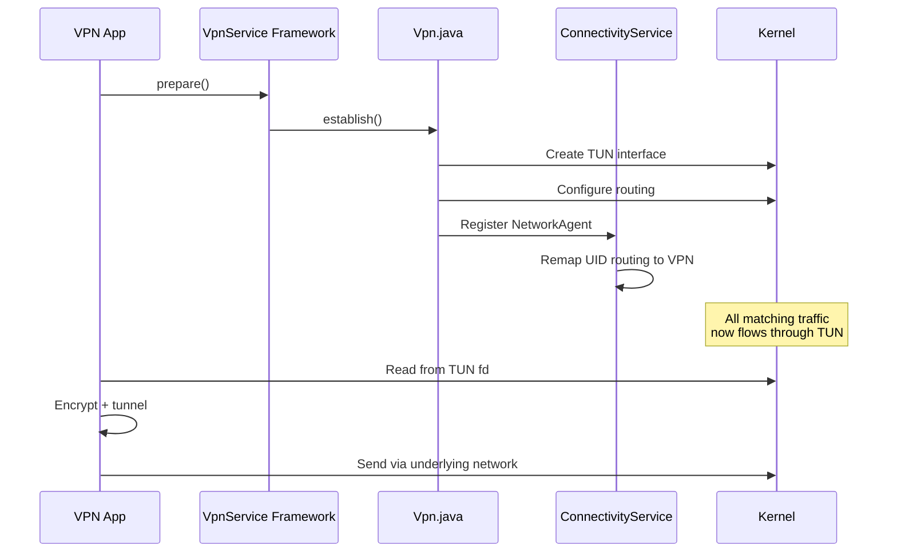

**2. 平台 VPN（IKEv2）**

对于 IKEv2 VPN，框架管理整个连接生命周期：

```java
// Source: frameworks/base/services/core/java/com/android/server/connectivity/Vpn.java
// IKE session management imports
import android.net.ipsec.ike.IkeSession;
import android.net.ipsec.ike.IkeSessionCallback;
import android.net.ipsec.ike.IkeSessionConfiguration;
import android.net.ipsec.ike.IkeSessionParams;
import android.net.ipsec.ike.IkeTunnelConnectionParams;
```

平台处理：

- IKE 协商（使用 EAP 或证书认证的 IKEv2）
- IPsec SA 管理
- MOBIKE，用于无缝网络切换
- 指数退避的自动重试
- 数据停滞检测与恢复

**3. 传统 VPN（PPTP/L2TP）**

已弃用，但仍通过 `LegacyVpnInfo` 和 `VpnProfile`
类支持。

### 35.6.4 按应用 VPN

ConnectivityService 可以将 VPN 流量限制到特定应用，或
排除特定应用。这通过 UID 范围实现：

```java
// Source: Vpn.java imports
import android.net.UidRangeParcel;
```

UID 范围通过 netd 的
`networkAddUidRanges()` 配置在 VPN 的网络上。来自所包含 UID 的数据包
会被打上 fwmark，以进入 VPN 路由表。

### 35.6.5 始终开启的 VPN

始终开启的 VPN 特性确保 VPN 始终处于活动状态。如果
连接中断，流量要么被阻止（锁定模式），要么允许通过底层网络
流动（无锁定）。

```java
// Source: Vpn.java
private static final String LOCKDOWN_ALLOWLIST_SETTING_NAME =
        Settings.Secure.ALWAYS_ON_VPN_LOCKDOWN_WHITELIST;
```

锁定 VPN 的实现：

1. ConnectivityService 使用
    `BLOCKED_REASON_LOCKDOWN_VPN` 阻止 VPN 的 UID 范围内的所有流量
2. 只允许通过 VPN 接口的流量
3. 某些必要的系统应用可以被加入白名单

### 35.6.6 VPN 网络代理

VPN 向 ConnectivityService 注册一个 `NetworkAgent`，公告
包括以下能力：

- `TRANSPORT_VPN`
- 从底层网络继承的能力（计费、非漫游等）
- 用于正确路由的底层网络信息

```mermaid
graph TD
    subgraph "VPN Network"
        VPN_NA["VPN NetworkAgent<br/>TRANSPORT_VPN<br/>NET_CAPABILITY_INTERNET"]
    end

    subgraph "Underlying Networks"
        WIFI_NA["Wi-Fi NetworkAgent<br/>TRANSPORT_WIFI"]
        CELL_NA["Cellular NetworkAgent<br/>TRANSPORT_CELLULAR"]
    end

    VPN_NA -->|"Underlying"| WIFI_NA
    VPN_NA -.->|"Fallback"| CELL_NA
```

### 35.6.7 IKEv2 数据停滞恢复

Vpn 类为 IKEv2 VPN 实现了复杂的数据停滞恢复：

```java
// Source: Vpn.java
// Data stall recovery timers: 1s, 5s, 30s, 1m, 2m, 4m, 8m, 16m
private static final long[] DATA_STALL_RECOVERY_DELAYS_MS =
        {1000L, 5000L, 30000L, 60000L, 120000L, 240000L, 480000L, 960000L};
// Maximum attempts to perform MOBIKE when the network is bad
private static final int MAX_MOBIKE_RECOVERY_ATTEMPT = 2;
```

恢复策略：

1. 前 2 次尝试：尝试 MOBIKE（IKEv2 移动性和多归属）将
    会话迁移到不同路径
2. 后续尝试：带指数退避的完整会话重启
3. 如果所有恢复尝试都耗尽，重复最后一个间隔

---

## 35.7 网络共享（Tethering）

### 35.7.1 架构概览

Tethering 模块允许 Android 设备通过 USB、Wi-Fi 热点、蓝牙、以太网或
Wi-Fi Direct 与其他设备共享 Internet 连接。

**模块根目录：** `packages/modules/Connectivity/Tethering/`

```mermaid
graph TD
    subgraph "Tethering Module"
        TM["TetheringManager<br/>(public API)"]
        TETHER["Tethering.java<br/>(main coordinator)"]
        IPS["IpServer<br/>(per-interface)"]
        UNM["UpstreamNetworkMonitor"]
        BPF_COORD["BpfCoordinator"]
        IPV6_COORD["IPv6TetheringCoordinator"]
        RAD["RouterAdvertisementDaemon"]
        DHCP_S["DHCP Server"]
    end

    subgraph "External Components"
        CS["ConnectivityService"]
        NETD["netd"]
        WIFI["Wi-Fi Service"]
        USB["USB Service"]
        BT["Bluetooth Service"]
    end

    subgraph "Kernel"
        NAT["NAT (iptables)"]
        BPF_K["BPF Offload"]
        FORWARDING["IP Forwarding"]
    end

    TM -->|Binder| TETHER
    TETHER --> IPS
    TETHER --> UNM
    TETHER --> BPF_COORD
    TETHER --> IPV6_COORD
    IPS --> RAD
    IPS --> DHCP_S
    UNM -->|"Monitor"| CS
    TETHER --> NETD
    TETHER --> WIFI
    TETHER --> USB
    TETHER --> BT
    IPS --> NAT
    BPF_COORD --> BPF_K
    IPS --> FORWARDING
```

### 35.7.2 Tethering 类

`Tethering.java` 是所有网络共享操作的核心协调者。它
管理共享接口的生命周期，并在上游（提供 Internet 的）和下游（面向客户端的）网络之间协调。

**源文件：**
`packages/modules/Connectivity/Tethering/src/com/android/networkstack/tethering/Tethering.java`

```java
// Source: packages/modules/Connectivity/Tethering/src/com/android/networkstack/tethering/Tethering.java
// Supported tethering types:
// TETHERING_WIFI      - Wi-Fi hotspot
// TETHERING_USB       - USB tethering (RNDIS/NCM)
// TETHERING_BLUETOOTH - Bluetooth PAN
// TETHERING_WIFI_P2P  - Wi-Fi Direct tethering
// TETHERING_NCM       - USB NCM (Network Control Model)
// TETHERING_ETHERNET  - Ethernet tethering
// TETHERING_WIGIG     - WiGig (60 GHz)
// TETHERING_VIRTUAL   - Virtual tethering
```

### 35.7.3 网络共享类型

| 类型 | 接口 | 传输 | 用例 |
|------|-----------|-----------|----------|
| Wi-Fi | wlan0/1 | 802.11 | 移动热点 |
| USB RNDIS | rndis0 | USB | 有线连接 PC |
| USB NCM | ncm0 | USB | 现代 USB 联网 |
| 蓝牙 | bt-pan | BT PAN | 低速共享 |
| 以太网 | eth0 | Ethernet | 车载、电视 |
| Wi-Fi P2P | p2p0 | Wi-Fi Direct | 直接设备共享 |
| WiGig | wigig0 | 802.11ad | 高速 60 GHz |

### 35.7.4 IpServer：按接口管理

每个共享接口都由一个 `IpServer` 实例管理，该实例运行自己的
状态机。

**源文件：**
`packages/modules/Connectivity/Tethering/src/android/net/ip/IpServer.java`

```mermaid
stateDiagram-v2
    [*] --> InitialState
    InitialState --> LocalHotspotState: LOCAL_ONLY
    InitialState --> TetheredState: TETHERING
    LocalHotspotState --> InitialState: Stop
    TetheredState --> InitialState: Stop
    TetheredState --> TetheredState
    TetheredState --> WaitingForRestartState: Interface down
    WaitingForRestartState --> TetheredState: Interface up
    InitialState --> UnavailableState: Interface removed
```

`LOCAL_ONLY` 和 `TETHERING` 边是启动服务的两种请求类型。
`TetheredState` 上的自转换代表上游变化。它
在不离开该状态的情况下重新配置转发。

两个服务状态（`LocalHotspotState` 和 `TetheredState`）都派生自
抽象的 `BaseServingState`。其进入代码配置接口地址、
启动 DHCP 服务器，并启用 IPv6 网络共享。`TetheredState`
还针对当前上游建立转发和 NAT。当上游变化时它会重新配置
它们。

### 35.7.5 BPF 卸载

`BpfCoordinator` 管理基于 eBPF 的网络共享卸载，它绕过
Linux 网络协议栈来处理转发的数据包，显著提高
吞吐量并降低 CPU 占用。

**源文件：**
`packages/modules/Connectivity/Tethering/src/com/android/networkstack/tethering/BpfCoordinator.java`

```java
// Source: packages/modules/Connectivity/Tethering/src/com/android/networkstack/tethering/BpfCoordinator.java
// BPF maps used for tethering offload:
import com.android.net.module.util.bpf.Tether4Key;
import com.android.net.module.util.bpf.Tether4Value;
import com.android.net.module.util.bpf.TetherStatsValue;
```

BPF 网络共享卸载通过在 eBPF 映射中安装转发规则工作：

```mermaid
graph LR
    subgraph "Without BPF Offload"
        A1["Downstream Packet"] --> B1["Kernel IP Stack"]
        B1 --> C1["iptables NAT"]
        C1 --> D1["Routing"]
        D1 --> E1["Upstream"]
    end

    subgraph "With BPF Offload"
        A2["Downstream Packet"] --> B2["BPF Program<br/>(TC ingress)"]
        B2 -->|"Lookup BPF map<br/>NAT + forward"| E2["Upstream"]
        B2 -.->|"Miss"| C2["Kernel IP Stack<br/>(slow path)"]
    end
```

BPF 映射包含：

- **Tether4Key/Tether4Value**：IPv4 连接跟踪条目
- **TetherStatsValue**：按接口的流量统计
- **下游/上游键**：方向特定的转发规则

### 35.7.6 IPv6 网络共享

`IPv6TetheringCoordinator` 管理共享客户端的 IPv6 前缀委派：

**源文件：**
`packages/modules/Connectivity/Tethering/src/com/android/networkstack/tethering/IPv6TetheringCoordinator.java`

IPv6 网络共享使用：

- **RouterAdvertisementDaemon**：向客户端发送路由器通告
- **DadProxy**：为共享设备处理重复地址检测
- **NeighborPacketForwarder**：转发邻居发现消息

```mermaid
sequenceDiagram
    participant Client as Tethered Client
    participant IPS as IpServer
    participant RAD as RA Daemon
    participant Upstream as Upstream Network

    Upstream->>IPS: IPv6 prefix delegated
    IPS->>RAD: Configure prefix for advertisement
    RAD->>Client: Router Advertisement (prefix, DNS)
    Client->>Client: SLAAC: Generate IPv6 address
    Client->>IPS: IPv6 traffic
    IPS->>Upstream: Forward (BPF or kernel)
```

### 35.7.7 DHCP 服务器

网络共享模块包含自己的 DHCP 服务器，用于为共享客户端分配 IPv4 地址：

```java
// Source: packages/modules/Connectivity/Tethering/src/android/net/dhcp/DhcpServingParamsParcelExt.java
```

DHCP 服务器提供：

- 从配置的池中分配 IPv4 地址
- 默认网关（网络共享设备）
- DNS 服务器配置（从上游转发）
- 租约管理和续订

### 35.7.8 上游网络监视器

`UpstreamNetworkMonitor` 跟踪可用的上游网络，并选择
最佳的一个为共享客户端提供 Internet。它向 ConnectivityService 注册
网络回调，并响应网络变化。

默认情况下（`config_tether_upstream_automatic` 为 true），上游直接
跟随设备当前的默认 Internet 网络。当运营商
要求共享使用 DUN 时，DUN（专用上游网络）蜂窝
连接会取代它。当设备改为使用传统的有序列表
（`config_tether_upstream_types`）时，`TetheringConfiguration` 总是在列表前
加上以太网。因此以太网具有最高优先级。配置的
条目紧随其后（通常是 DUN 或常规蜂窝和 Wi-Fi）。

### 35.7.9 NAT 配置

对于 IPv4 网络共享，netd 配置网络地址转换（NAT）规则：

```mermaid
graph LR
    CLIENT["Tethered Client<br/>192.168.49.x"] -->|"src: 192.168.49.2"| TETHER["Tethering Device"]
    TETHER -->|"NAT: src -> WAN IP"| UPSTREAM["Internet"]
    UPSTREAM -->|"NAT: dst -> 192.168.49.2"| TETHER
    TETHER -->|"dst: 192.168.49.2"| CLIENT
```

NAT 通过 netd 的网络共享控制器配置。它在 nat/POSTROUTING 链中
设置 iptables MASQUERADE 规则。

---

## 35.8 网络安全配置（Network Security Config）

### 35.8.1 概述

Android 的 Network Security Config 允许应用以声明式的 XML 格式自定义其
网络安全设置。这包括证书固定、自定义信任锚点和明文流量策略。

**框架源码：**
`frameworks/base/packages/NetworkSecurityConfig/platform/src/android/security/net/config/`

### 35.8.2 XML 配置格式

应用在
`res/xml/network_security_config.xml` 中定义其安全配置，并在 `AndroidManifest.xml` 中引用：

```xml
<!-- Example network_security_config.xml -->
<network-security-config>
    <!-- Base configuration applying to all connections -->
    <base-config cleartextTrafficPermitted="false">
        <trust-anchors>
            <certificates src="system" />
        </trust-anchors>
    </base-config>

    <!-- Per-domain configuration -->
    <domain-config>
        <domain includeSubdomains="true">example.com</domain>
        <pin-set expiration="2025-12-31">
            <pin digest="SHA-256">base64EncodedPin=</pin>
            <pin digest="SHA-256">backupPinBase64=</pin>
        </pin-set>
        <trust-anchors>
            <certificates src="system" />
            <certificates src="@raw/my_ca" />
        </trust-anchors>
    </domain-config>

    <!-- Debug overrides (only active in debug builds) -->
    <debug-overrides>
        <trust-anchors>
            <certificates src="user" />
        </trust-anchors>
    </debug-overrides>
</network-security-config>
```

### 35.8.3 NetworkSecurityConfig 类

`NetworkSecurityConfig` 类是安全配置的运行时表示：

**源文件：**
`frameworks/base/packages/NetworkSecurityConfig/platform/src/android/security/net/config/NetworkSecurityConfig.java`

```java
// Source: frameworks/base/packages/NetworkSecurityConfig/platform/src/android/security/net/config/NetworkSecurityConfig.java
public final class NetworkSecurityConfig {
    public static final boolean DEFAULT_CLEARTEXT_TRAFFIC_PERMITTED = true;
    public static final boolean DEFAULT_HSTS_ENFORCED = false;

    // Certificate Transparency verification for apps targeting after BAKLAVA
    @ChangeId
    @EnabledAfter(targetSdkVersion = Build.VERSION_CODES.BAKLAVA)
    static final long DEFAULT_ENABLE_CERTIFICATE_TRANSPARENCY = 407952621L;

    private final boolean mCleartextTrafficPermitted;
    private final boolean mHstsEnforced;
    private final boolean mCertificateTransparencyVerificationRequired;
    private final PinSet mPins;
    private final List<CertificatesEntryRef> mCertificatesEntryRefs;
    private Set<TrustAnchor> mAnchors;
    private NetworkSecurityTrustManager mTrustManager;
    // ...
}
```

### 35.8.4 XML 解析

`XmlConfigSource` 类解析 XML 配置并创建
运行时的 `NetworkSecurityConfig` 对象：

**源文件：**
`frameworks/base/packages/NetworkSecurityConfig/platform/src/android/security/net/config/XmlConfigSource.java`

```java
// Source: frameworks/base/packages/NetworkSecurityConfig/platform/src/android/security/net/config/XmlConfigSource.java
public class XmlConfigSource implements ConfigSource {
    private static final int CONFIG_BASE = 0;
    private static final int CONFIG_DOMAIN = 1;
    private static final int CONFIG_DEBUG = 2;

    private NetworkSecurityConfig mDefaultConfig;
    private NetworkSecurityConfig mLocalhostConfig;
    private Set<Pair<Domain, NetworkSecurityConfig>> mDomainMap;
    // ...
}
```

### 35.8.5 配置元素

| 元素 | 描述 |
|---------|-------------|
| `<base-config>` | 所有连接的默认配置 |
| `<domain-config>` | 按域名的覆盖 |
| `<debug-overrides>` | 仅调试构建的设置 |
| `<trust-anchors>` | 自定义 CA 证书 |
| `<certificates>` | 证书来源（`system`、`user`、`@raw/`） |
| `<pin-set>` | 带过期时间的证书固定 |
| `<pin>` | 单个固定值（公钥的 SHA-256 摘要） |
| `cleartextTrafficPermitted` | 允许/拒绝 HTTP |
| `<certificateTransparency>` | CT 验证要求 |

### 35.8.6 关键实现类

| 类 | 职责 |
|-------|------|
| `NetworkSecurityConfig` | 运行时配置表示 |
| `XmlConfigSource` | XML 解析器 |
| `ManifestConfigSource` | 读取清单中的配置引用 |
| `ApplicationConfig` | 按应用的配置管理器 |
| `NetworkSecurityTrustManager` | 自定义 `X509TrustManager` |
| `RootTrustManager` | 信任链的根 |
| `PinSet` | 证书固定存储 |
| `CertificatesEntryRef` | 证书来源引用 |
| `SystemCertificateSource` | 系统 CA 库 |
| `DirectoryCertificateSource` | 基于目录的 CA 来源 |

### 35.8.7 证书固定流程

```mermaid
sequenceDiagram
    participant App as Application
    participant TM as NetworkSecurityTrustManager
    participant Config as NetworkSecurityConfig
    participant PinSet as PinSet
    participant System as SystemCertificateSource

    App->>TM: TLS handshake
    TM->>Config: Get config for domain
    Config-->>TM: NetworkSecurityConfig
    TM->>System: Validate certificate chain
    System-->>TM: Chain valid
    TM->>PinSet: Check pins
    alt Pin matches
        PinSet-->>TM: Pin valid
        TM-->>App: Connection allowed
    else Pin mismatch
        PinSet-->>TM: Pin invalid
        TM-->>App: Connection rejected
    end
```

### 35.8.8 证书透明度

证书透明度（CT）验证对目标 SDK 37（`CINNAMON_BUN`）及更高的应用
默认启用：

```java
// Source: NetworkSecurityConfig.java
@ChangeId
@EnabledAfter(targetSdkVersion = Build.VERSION_CODES.BAKLAVA)
static final long DEFAULT_ENABLE_CERTIFICATE_TRANSPARENCY = 407952621L;
```

注意，`@EnabledAfter` 只对目标 SDK *大于*所指定版本的应用启用该变更。
因此目标版本为 `BAKLAVA`（36）本身并不会让应用默认
加入 CT。

Connectivity 模块中的 `CertificateTransparencyService` 管理
CT 日志列表更新和验证：

**源目录：**
`packages/modules/Connectivity/networksecurity/service/src/com/android/server/net/ct/`

```xml
<!-- Example: enabling CT in network security config -->
<network-security-config>
  <base-config>
    <certificateTransparency enabled="true" />
  </base-config>
</network-security-config>
```

### 35.8.9 明文流量限制

默认情况下，Android 会阻止目标为
Android 9+ 的应用的明文（非 HTTPS）流量。该 target-SDK 默认值来自
Network Security Config 机制，并在应用自己的进程中由
`NetworkSecurityPolicy` 和 `NetworkSecurityConfig` 执行，而不是由 netd
执行。netd 的 `StrictController`
实现了另一种可选机制。这是 StrictMode 按 UID
的明文检测惩罚（`detectCleartextNetwork()`）。它通过 netd 的
`strictUidCleartextPenalty()` 配置，并实现为 `st_OUTPUT`、
`st_clear_detect`、`st_penalty_log` 和 `st_penalty_reject` iptables 链：

```
// Source: system/netd/server/Controllers.cpp
// StrictController is in the FILTER_OUTPUT chain:
static const std::vector<const char*> FILTER_OUTPUT = {
    OEM_IPTABLES_FILTER_OUTPUT,
    FirewallController::LOCAL_OUTPUT,
    StrictController::LOCAL_OUTPUT,    // <-- StrictMode cleartext penalty
    BandwidthController::LOCAL_OUTPUT,
};
```

### 35.8.10 usesCleartextTraffic 清单标志在 Android 17 中弃用

清单属性 `android:usesCleartextTraffic` 是较旧、更粗略的
控制：`<application>` 上的单个布尔值。当应用没有自己的 XML 配置时，
运行时将其并入默认的 `NetworkSecurityConfig`。
Android 17（`CINNAMON_BUN`，API 37）开始弃用它，转而使用
Network Security Config XML。

该变更通过兼容性变更和 aconfig 标志接入。
`network_security` 标志 `deprecate_uses_cleartext_traffic2`
（`frameworks/base/core/java/android/security/flags.aconfig`）被描述为
“XML 应用标志 usesCleartextTraffic 对 targetSdk 版本
C+ 被忽略”。匹配的 `@ChangeId` 位于 `ManifestConfigSource`：

```java
// frameworks/base/packages/NetworkSecurityConfig/platform/src/android/security/net/config/ManifestConfigSource.java
@ChangeId
@Disabled
static final long DEPRECATE_USES_CLEARTEXT_TRAFFIC = 415007211L;
```

当配置源为没有 XML 的应用构建默认配置时，它会读取
清单标志。然后如果变更和 aconfig 标志都开启，它会将该标志置零：

```java
boolean usesCleartextTraffic =
        (mApplicationInfo.flags & ApplicationInfo.FLAG_USES_CLEARTEXT_TRAFFIC) != 0
        && !mApplicationInfo.isInstantApp();
if (CompatChanges.isChangeEnabled(DEPRECATE_USES_CLEARTEXT_TRAFFIC) &&
    deprecateUsesCleartextTraffic2()) {
    usesCleartextTraffic = false;
}
```

对于受影响的应用，无论声明值如何，清单属性都被当作 `false`。
仍需要为特定主机使用明文的应用必须在 Network Security Config 中说明
（针对这些主机使用 `<domain-config cleartextTrafficPermitted=
"true">`）。这是更细粒度、更可审计的机制，弃用正是推动应用采用它。
`DEFAULT_CLEARTEXT_TRAFFIC_PERMITTED` 本身
未变（仍为 `true`）。因此下表中基于 target-SDK 的默认拒绝行为
适用于既未提供清单标志也未提供 XML 配置的应用。

### 35.8.11 按目标 SDK 的默认安全行为

| 目标 SDK | 明文 | 用户 CA | 强制 CT |
|-----------|-----------|----------|------------|
| &lt; 24（Android 7） | 允许 | 信任 | 否 |
| 24-27 | 允许 | 不信任 | 否 |
| 28+（Android 9） | 阻止 | 不信任 | 否 |
| 36（BAKLAVA） | 阻止 | 不信任 | 否 |
| 37+（CINNAMON_BUN） | 阻止 | 不信任 | 是（默认）；`usesCleartextTraffic` 清单标志被忽略 |

---

## 35.9 NetworkStack 模块

### 35.9.1 概述

NetworkStack Mainline 模块处理 IP 配置、网络验证
（captive portal 检测）和 DHCP。它在独立进程中运行
（`com.android.networkstack`），拥有 `NETWORK_STACK` 权限，将这些关键功能与
系统的其余部分隔离。

**模块根目录：** `packages/modules/NetworkStack/`

```mermaid
graph TD
    subgraph "NetworkStack Module"
        NM["NetworkMonitor"]
        IPC["IpClient"]
        DHCP["DHCP Client"]
        CPD["Captive Portal Detection"]
        DS["Data Stall Detection"]
        IPMS["IpMemoryStore"]
    end

    subgraph "ConnectivityService"
        CS["ConnectivityService"]
        NA["NetworkAgent"]
    end

    subgraph "Network"
        PORTAL["Captive Portal"]
        INTERNET["Internet"]
        DHCP_SRV["DHCP Server"]
    end

    CS -->|"Create monitor"| NM
    NM -->|"Validation result"| CS
    NA --> IPC
    IPC --> DHCP
    DHCP --> DHCP_SRV
    NM --> CPD
    NM --> DS
    CPD --> PORTAL
    CPD --> INTERNET
    NM --> IPMS
```

### 35.9.2 NetworkMonitor：网络验证

`NetworkMonitor` 是一个状态机，通过
探测 Internet 端点来验证网络连接性。它检测 captive portal、部分连接性和
数据停滞。

**源文件：**
`packages/modules/NetworkStack/src/com/android/server/connectivity/NetworkMonitor.java`

```java
// Source: packages/modules/NetworkStack/src/com/android/server/connectivity/NetworkMonitor.java
public class NetworkMonitor extends StateMachine {
    // Validation probe types
    // NETWORK_VALIDATION_PROBE_DNS      - DNS resolution test
    // NETWORK_VALIDATION_PROBE_HTTP     - HTTP probe (generate_204)
    // NETWORK_VALIDATION_PROBE_HTTPS    - HTTPS probe
    // NETWORK_VALIDATION_PROBE_FALLBACK - Fallback URL probe
    // NETWORK_VALIDATION_PROBE_PRIVDNS  - Private DNS validation
    // ...
}
```

验证状态机：

```mermaid
stateDiagram-v2
    [*] --> DefaultState

    state DefaultState {
        [*] --> MaybeNotifyState

        state MaybeNotifyState {
            state EvaluatingState {
                [*] --> ProbingState
                ProbingState --> WaitingForNextProbeState: Probe failed
                WaitingForNextProbeState --> ProbingState: Retry timer
            }
            EvaluatingState --> CaptivePortalState: Portal detected
            CaptivePortalState --> EvaluatingState: User dismissed portal
        }

        MaybeNotifyState --> ValidatedState: All probes pass
        ValidatedState --> MaybeNotifyState: Re-validation needed
    }
```

并行的 HTTP、HTTPS 和回退探测不是独立的状态；它们
作为 `ProbingState` 内部的线程运行。`EvaluatingPrivateDnsState` 和
`EvaluatingBandwidthState`（未显示）是 `DefaultState` 的进一步子状态。

### 35.9.3 验证探测

NetworkMonitor 执行多种类型的探测来确定网络状态：

| 探测 | URL/方法 | 用途 |
|-------|-----------|---------|
| HTTP | `http://connectivitycheck.gstatic.com/generate_204` | 检测 captive portal |
| HTTPS | `https://www.google.com/generate_204` | 验证 TLS 工作 |
| DNS | 探测主机名的 A/AAAA 查询 | 验证 DNS 解析 |
| 回退 | 可配置的回退 URL | 备选探测 |
| 私有 DNS | 探测私有 DNS 主机名 | 验证 DoT/DoH |

```java
// Source: NetworkMonitor.java imports showing probe constants
import static com.android.networkstack.util.NetworkStackUtils.CAPTIVE_PORTAL_HTTPS_URL;
import static com.android.networkstack.util.NetworkStackUtils.CAPTIVE_PORTAL_HTTP_URL;
import static com.android.networkstack.util.NetworkStackUtils.CAPTIVE_PORTAL_FALLBACK_URL;
import static com.android.networkstack.util.NetworkStackUtils.CAPTIVE_PORTAL_OTHER_FALLBACK_URLS;
import static com.android.networkstack.util.NetworkStackUtils.CAPTIVE_PORTAL_OTHER_HTTPS_URLS;
import static com.android.networkstack.util.NetworkStackUtils.CAPTIVE_PORTAL_OTHER_HTTP_URLS;
```

### 35.9.4 Captive Portal 检测

captive portal 检测通过将 HTTP 响应与预期值进行比较工作：

```mermaid
flowchart TD
    START["Send HTTP GET to<br/>connectivitycheck.gstatic.com/generate_204"]
    R204["Response: 204 No Content"]
    R302["Response: 302/301 Redirect"]
    R200["Response: 200 with content"]
    TIMEOUT["Timeout / DNS failure"]

    VALIDATED["Network VALIDATED"]
    PORTAL["CAPTIVE PORTAL<br/>Show sign-in notification"]
    PARTIAL["PARTIAL CONNECTIVITY"]
    INVALID["INVALID / Retry"]

    START --> R204
    START --> R302
    START --> R200
    START --> TIMEOUT

    R204 --> VALIDATED
    R302 --> PORTAL
    R200 -->|"Content != expected"| PORTAL
    R200 -->|"Content matches"| VALIDATED
    TIMEOUT --> INVALID
```

当检测到 captive portal 时：

1. NetworkMonitor 用重定向 URL 报告 `NETWORK_TEST_RESULT_INVALID`
2. ConnectivityService 向网络添加 `NET_CAPABILITY_CAPTIVE_PORTAL`
3. 向用户显示通知
4. 用户点击通知并看到 portal 登录页
5. 登录后，NetworkMonitor 重新验证

### 35.9.5 数据停滞检测

NetworkMonitor 还使用两种
机制检测已验证网络上的数据停滞：

**基于 DNS 的检测：**

```java
// Source: NetworkMonitor.java imports
import static android.net.util.DataStallUtils.DATA_STALL_EVALUATION_TYPE_DNS;
import static android.net.util.DataStallUtils.DEFAULT_CONSECUTIVE_DNS_TIMEOUT_THRESHOLD;
```

如果连续的 DNS 查询超时超过阈值，则会报告数据停滞。

**基于 TCP 的检测：**

```java
import static android.net.util.DataStallUtils.DATA_STALL_EVALUATION_TYPE_TCP;
import static android.net.util.DataStallUtils.DEFAULT_TCP_POLLING_INTERVAL_MS;
```

TCP 指标（丢包率、重传次数）按固定
间隔轮询。如果失败率超过阈值，则检测到数据停滞。

```mermaid
graph TD
    subgraph "DNS Stall Detection"
        DNS_Q["DNS Queries"] --> DNS_T["Track timeouts"]
        DNS_T -->|"Consecutive timeouts<br/>> threshold"| STALL_DNS["Data Stall!"]
    end

    subgraph "TCP Stall Detection"
        TCP_P["Poll TCP metrics<br/>(every N seconds)"] --> TCP_A["Analyze"]
        TCP_A -->|"Packet fail rate<br/>> threshold"| STALL_TCP["Data Stall!"]
    end

    STALL_DNS --> REPORT["Report to<br/>ConnectivityService"]
    STALL_TCP --> REPORT
    REPORT --> CS_ACTION["CS: Notify apps via<br/>ConnectivityDiagnosticsManager"]
```

### 35.9.6 IpClient：IP 配置

`IpClient`（以前称为 `IpManager`）处理网络接口的 IP 配置生命周期。
它管理：

- 用于 IPv4 地址分配的 DHCP 客户端
- IPv6 SLAAC（无状态地址自动配置）
- 路由器发现
- 邻居发现
- APF（Android Packet Filter）程序安装（见 §35.30）

IP 配置流程：

```mermaid
sequenceDiagram
    participant WF as Wi-Fi Framework
    participant IPC as IpClient
    participant DHCP as DHCP Client
    participant SLAAC as IPv6 SLAAC
    participant Server as DHCP Server
    participant Router as Router

    WF->>IPC: startProvisioning(config)
    par IPv4 Provisioning
        IPC->>DHCP: Start DHCP discovery
        DHCP->>Server: DHCPDISCOVER
        Server->>DHCP: DHCPOFFER
        DHCP->>Server: DHCPREQUEST
        Server->>DHCP: DHCPACK
        DHCP->>IPC: IPv4 address assigned
    and IPv6 Provisioning
        IPC->>SLAAC: Listen for RAs
        Router->>SLAAC: Router Advertisement
        SLAAC->>IPC: IPv6 address (SLAAC)
    end
    IPC->>WF: onProvisioningSuccess(linkProperties)
```

### 35.9.7 IpMemoryStore

`IpMemoryStore` 在连接之间持久化与网络相关的数据，实现
更快的重新连接和更智能的网络选择：

- **L2 键映射**：将 L2（MAC/BSSID）信息映射到已存储的数据
- **网络属性**：存储之前分配的地址、DNS 服务器
- **Blob 存储**：用于网络元数据的通用键值存储
- **过期管理**：自动清理过期条目

### 35.9.8 模块隔离

NetworkStack 模块在其自己的进程中运行，拥有特定权限：

```mermaid
graph TD
    subgraph "system_server Process"
        CS["ConnectivityService"]
    end

    subgraph "NetworkStack Process"
        NS["NetworkStackService"]
        NM["NetworkMonitor"]
        IPC["IpClient"]
    end

    CS <-->|"AIDL IPC<br/>INetworkMonitor<br/>IIpClient"| NS

    classDef server fill:#e1f5fe
    classDef stack fill:#f3e5f5
    class CS server
    class NS,NM,IPC stack
```

这种进程隔离提供了：

- **安全性**：网络验证代码以受限权限运行
- **可更新性**：模块可以独立更新
- **稳定性**：NetworkStack 中的崩溃不会导致 system_server 挂掉
- **可测试性**：隔离测试更容易

---

## 35.10 VCN（虚拟运营商网络）

虚拟运营商网络（VCN）子系统在任何可用传输（蜂窝或
Wi-Fi）之上提供运营商级的 IPsec 隧道。它将结果作为一个单一、无缝的移动
网络呈现给平台的其余部分。传统的 VPN 服务于用户隐私。VCN 服务于*运营商*：
移动运营商可以配置设备，将全部流量封装进一条通往
运营商网关的 IKEv2/IPsec 隧道。这实际上创建了一个跟随订户跨越物理
传输的“虚拟”运营商网络。

### 35.10.1 动机与设计目标

部署 Wi-Fi Offload（ePDG）或私有网络的运营商需要一种机制，将订户流量
从设备安全地隧道传输到运营商网关。该机制必须在设备位于 Wi-Fi、
蜂窝或在两者之间切换时都能工作。VCN 提供：

1. **运营商绑定的隧道**：与用户 VPN 不同，VCN 隧道绑定到
    运营商订阅组。只有运营商的配置应用（具有
    运营商权限）才能安装 VCN 配置。
2. **无缝移动性**：当底层传输变化时（例如从 Wi-Fi 切换到
    蜂窝），VCN 通过 MOBIKE（RFC 4555）迁移 IKE/IPsec 会话。
    这避免了对应用可见的 TCP 连接重置。
3. **安全模式回退**：如果隧道无法在超时时间内建立，
    VCN 回退到“安全模式”。在此模式下，它暴露原始的底层
    网络，因此设备永远不会失去连接性。
4. **按能力的网关连接**：单个 VCN 实例可以管理多个网关连接，
    每个连接服务于不同的 `NetworkCapabilities`
    （例如一个用于 INTERNET，另一个用于 DUN/网络共享）。

### 35.10.2 架构

**模块根目录：** `packages/modules/Connectivity/Vcn/`

VCN 子系统组织为四个主要类，每个处于不同的
粒度级别：

```mermaid
graph TD
    subgraph "VCN Management Layer"
        VCNMS["VcnManagementService<br/>(IVcnManagementService.Stub)"]
        TST["TelephonySubscriptionTracker"]
    end

    subgraph "VCN Instance Layer"
        VCN["Vcn<br/>(per subscription group)"]
        VNP["VcnNetworkProvider"]
    end

    subgraph "Gateway Connection Layer"
        GW1["VcnGatewayConnection #1<br/>(INTERNET)"]
        GW2["VcnGatewayConnection #2<br/>(DUN)"]
    end

    subgraph "Route Selection Layer"
        UNC1["UnderlyingNetworkController"]
        UNE1["UnderlyingNetworkEvaluator"]
        NPC["NetworkPriorityClassifier"]
    end

    subgraph "Tunnel Layer"
        IKE["IkeSession<br/>(IKEv2 + IPsec)"]
        NA["VCN NetworkAgent"]
        TUN["IPsec Tunnel Interface"]
    end

    subgraph "Underlying Transports"
        WIFI["Wi-Fi Network"]
        CELL["Cellular Network"]
    end

    VCNMS -->|"Creates per sub-group"| VCN
    VCNMS --> TST
    TST -->|"Subscription snapshots"| VCNMS
    VCN --> VNP
    VNP -->|"NetworkRequest routing"| VCN
    VCN -->|"Creates per capability"| GW1
    VCN -->|"Creates per capability"| GW2
    GW1 --> UNC1
    UNC1 --> UNE1
    UNC1 --> NPC
    UNE1 -->|"Monitors"| WIFI
    UNE1 -->|"Monitors"| CELL
    GW1 --> IKE
    IKE --> TUN
    GW1 --> NA
    NA -->|"Registered with"| CS["ConnectivityService"]
```

来自 AOSP 源码的层次结构精确地捕捉了这一点：

```
// Source: packages/modules/Connectivity/Vcn/service-b/src/com/android/server/VcnManagementService.java
// Lines 115-163 (ASCII art from the source comment)

VcnManagementService --1:1--> TelephonySubscriptionTracker
        |
     1:N Creates when config present, subscription group active,
        and providing app is carrier privileged
        |
        v
       Vcn -- manages GatewayConnection lifecycles based on
              fulfillable NetworkRequests and overall safe-mode
        |
     1:N Creates to fulfill NetworkRequests
        |
        v
  VcnGatewayConnection -- manages a single IKEv2 tunnel session
        and NetworkAgent, handles mobility events
        |
     1:1 Creates upon instantiation
        |
        v
  UnderlyingNetworkController -- manages underlying physical
        networks, filing requests to bring them up
```

### 35.10.3 VcnManagementService

`VcnManagementService` 是顶层系统服务，注册到
`ServiceManager`，并通过 `VcnManager` 访问。它负责：

- **配置持久化**：VCN 配置以 XML 形式存储在
  `/data/system/vcn/configs.xml` 中，并在重启后保留。
- **运营商权限执行**：只有对该订阅组具有运营商权限的应用才能设置或清除 VCN 配置。
- **Vcn 生命周期管理**：随着订阅组变为活动/非活动，创建和拆除 `Vcn` 实例。
- **底层网络策略**：向 ConnectivityService 提供 `VcnUnderlyingNetworkPolicy`，
  控制底层网络是否被标记为
  `NOT_VCN_MANAGED`。

```java
// Source: packages/modules/Connectivity/Vcn/service-b/src/com/android/server/VcnManagementService.java
public class VcnManagementService extends IVcnManagementService.Stub {
    // Configs stored persistently
    static final String VCN_CONFIG_FILE =
            new File(Environment.getDataDirectory(),
                "system/vcn/configs.xml").getPath();

    // Grace period before tearing down if carrier privileges are lost
    static final long CARRIER_PRIVILEGES_LOST_TEARDOWN_DELAY_MS =
            TimeUnit.SECONDS.toMillis(30);

    // Wi-Fi is restricted by default (must go through VCN tunnel)
    private static final Set<Integer> RESTRICTED_TRANSPORTS_DEFAULT =
            Collections.singleton(TRANSPORT_WIFI);
    // ...
}
```

### 35.10.4 TelephonySubscriptionTracker

`TelephonySubscriptionTracker` 对订阅变化事件去噪，并向
`VcnManagementService` 提供活动订阅组的稳定快照。订阅组在以下情况下
被视为“活动且就绪”：

1. 至少一个所包含的订阅 ID 已加载运营商配置
    （`CarrierConfigManager.isConfigForIdentifiedCarrier()` 返回 true）。
2. 该订阅按 `SubscriptionManager` 被列为活动状态。

```java
// Source: packages/modules/Connectivity/Vcn/service-b/src/com/android/server/vcn/TelephonySubscriptionTracker.java
public class TelephonySubscriptionTracker extends BroadcastReceiver {
    // Maps slot IDs to ready subscription IDs
    private final Map<Integer, Integer> mReadySubIdsBySlotId = new HashMap<>();
    // ...
}
```

### 35.10.5 Vcn 类

每个 `Vcn` 实例管理单个订阅组的所有 `VcnGatewayConnection`。
它充当一个 `Handler`，处理配置更新、网络请求、订阅变化、安全模式
转换和移动数据开关的消息。

```java
// Source: packages/modules/Connectivity/Vcn/service-b/src/com/android/server/vcn/Vcn.java
public class Vcn extends Handler {
    // VCN network score -- must beat raw underlying networks
    private static final int VCN_LEGACY_SCORE_INT = 52;

    // Capabilities requiring mobile data to be enabled
    private static final List<Integer> CAPS_REQUIRING_MOBILE_DATA =
            Arrays.asList(NET_CAPABILITY_INTERNET, NET_CAPABILITY_DUN);

    // Map of active gateway connections
    private final Map<VcnGatewayConnectionConfig, VcnGatewayConnection>
            mVcnGatewayConnections = new HashMap<>();

    // Status tracking: ACTIVE, SAFE_MODE, or INACTIVE
    private volatile int mCurrentStatus = VCN_STATUS_CODE_ACTIVE;
}
```

`Vcn` 处理的关键消息类型：

| 消息 | 触发 |
|---------|---------|
| `MSG_EVENT_CONFIG_UPDATED` | 运营商应用更新了 VCN 配置 |
| `MSG_EVENT_NETWORK_REQUESTED` | `VcnNetworkProvider` 的新 `NetworkRequest` |
| `MSG_EVENT_SUBSCRIPTIONS_CHANGED` | 订阅快照已更改 |
| `MSG_EVENT_GATEWAY_CONNECTION_QUIT` | 网关连接已拆除 |
| `MSG_EVENT_SAFE_MODE_STATE_CHANGED` | 安全模式计时器触发或清除 |
| `MSG_EVENT_MOBILE_DATA_TOGGLED` | 用户切换了移动数据 |

### 35.10.6 VcnGatewayConnection 状态机

`VcnGatewayConnection` 是 VCN 子系统的核心——一个 `StateMachine`，
管理单个 IKEv2/IPsec 隧道及其对应的 `NetworkAgent`。该
状态机有五个状态：

```mermaid
stateDiagram-v2
    [*] --> DisconnectedState
    DisconnectedState --> ConnectingState : Underlying network available
    ConnectingState --> ConnectedState : IKE session negotiated
    ConnectingState --> DisconnectingState : Error occurred
    ConnectingState --> RetryTimeoutState : Retriable error
    ConnectedState --> DisconnectingState : Teardown or error
    ConnectedState --> RetryTimeoutState : Retriable error
    DisconnectingState --> RetryTimeoutState : Has underlying network
    DisconnectingState --> DisconnectedState : No underlying network
    RetryTimeoutState --> ConnectingState : Retry timer expired
    RetryTimeoutState --> DisconnectingState : Teardown requested
```

状态机处理的关键事件：

```java
// Source: packages/modules/Connectivity/Vcn/service-b/src/com/android/server/vcn/VcnGatewayConnection.java
// Selected event constants
private static final int EVENT_UNDERLYING_NETWORK_CHANGED = 1;
private static final int EVENT_RETRY_TIMEOUT_EXPIRED = 2;
private static final int EVENT_SESSION_LOST = 3;
private static final int EVENT_SESSION_CLOSED = 4;
private static final int EVENT_TRANSFORM_CREATED = 5;
private static final int EVENT_SETUP_COMPLETED = 6;
```

关键超时支配着行为：

| 超时 | 值 | 用途 |
|---------|-------|---------|
| `NETWORK_LOSS_DISCONNECT_TIMEOUT` | 30 秒 | 底层网络丢失后拆除前的宽限期 |
| `TEARDOWN_TIMEOUT` | 5 秒 | 等待 IKE 会话关闭的最长时间 |
| `SAFEMODE_TIMEOUT` | 30 秒 | 隧道无法建立时进入安全模式的时间 |

### 35.10.7 底层网络选择

`UnderlyingNetworkController` 评估可用的物理网络
（蜂窝、Wi-Fi），并为隧道选择最佳网络。选择基于
运营商定义的优先级模板：

```java
// Source: packages/modules/Connectivity/Vcn/service-b/src/com/android/server/vcn/routeselection/UnderlyingNetworkController.java
public class UnderlyingNetworkController {
    // Tracks all underlying networks with their evaluators
    private final Map<Network, UnderlyingNetworkEvaluator>
            mUnderlyingNetworkRecords = new ArrayMap<>();

    // Separate callbacks for Wi-Fi and cell bring-up
    private final List<NetworkCallback> mCellBringupCallbacks = new ArrayList<>();
    private NetworkCallback mWifiBringupCallback;
    // Wi-Fi RSSI threshold callbacks for entry/exit hysteresis
    private NetworkCallback mWifiEntryRssiThresholdCallback;
    private NetworkCallback mWifiExitRssiThresholdCallback;
}
```

`NetworkPriorityClassifier` 实现优先级逻辑。运营商
配置 `VcnUnderlyingNetworkTemplate` 对象（蜂窝或 Wi-Fi 模板），
其匹配条件包括：

- **蜂窝**：漫游状态、机会性标志、归属/漫游 PLMN
- **Wi-Fi**：SSID、RSSI 阈值（带进入/退出滞回）

### 35.10.8 安全模式

安全模式是 VCN 的关键可靠性机制。如果一个 `VcnGatewayConnection`
无法在 `SAFEMODE_TIMEOUT_SECONDS`（30 秒）内建立隧道，
整个 `Vcn` 实例进入安全模式：

1. 底层网络不再被标记为受限（
    `NET_CAPABILITY_NOT_VCN_MANAGED` 能力被恢复）。
2. 应用可以直接访问原始的底层网络。
3. VCN 继续在后台尝试建立隧道。
4. 一旦隧道重新建立，VCN 退出安全模式。

这确保了配置错误或无法到达的运营商网关绝不会让
设备失去网络连接性。

### 35.10.9 VcnNetworkProvider

`VcnNetworkProvider` 作为 `NetworkProvider` 注册到 `ConnectivityService`，
并将传入的 `NetworkRequest` 路由到合适的 `Vcn` 实例。它
构建一个匹配蜂窝类请求的能力过滤器：

```java
// Source: packages/modules/Connectivity/Vcn/service-b/src/com/android/server/vcn/VcnNetworkProvider.java
private NetworkCapabilities buildCapabilityFilter() {
    final NetworkCapabilities.Builder builder =
            new NetworkCapabilities.Builder()
                    .addTransportType(TRANSPORT_CELLULAR)
                    .addCapability(NET_CAPABILITY_TRUSTED)
                    .addCapability(NET_CAPABILITY_NOT_RESTRICTED)
                    .addCapability(NET_CAPABILITY_NOT_VPN)
                    .addCapability(NET_CAPABILITY_NOT_VCN_MANAGED);
    for (int cap : VcnGatewayConnectionConfig.ALLOWED_CAPABILITIES) {
        builder.addCapability(cap);
    }
    return builder.build();
}
```

### 35.10.10 与 ConnectivityService 的集成

从 `ConnectivityService` 的角度看，VCN 隧道表现为一个普通的
蜂窝 `NetworkAgent`。关键区别在于 `NOT_VCN_MANAGED` 能力：

- **底层网络**（原始 Wi-Fi/蜂窝）在 VCN 活动时被标记为*缺少*
  `NOT_VCN_MANAGED`，使其对大多数应用不可见。
- **VCN NetworkAgent** 携带 `NOT_VCN_MANAGED`，因此它满足普通的
  `NetworkRequest`。
- 在安全模式下，底层网络重新获得 `NOT_VCN_MANAGED`。

```mermaid
sequenceDiagram
    participant App as Application
    participant CM as ConnectivityManager
    participant CS as ConnectivityService
    participant VNP as VcnNetworkProvider
    participant VCN as Vcn
    participant GW as VcnGatewayConnection
    participant IKE as IkeSession
    participant UNC as UnderlyingNetworkController

    App->>CM: requestNetwork(INTERNET)
    CM->>CS: NetworkRequest
    CS->>VNP: onNetworkNeeded()
    VNP->>VCN: handleNetworkRequested()
    VCN->>GW: create VcnGatewayConnection
    GW->>UNC: start monitoring transports
    UNC-->>GW: underlying network selected
    GW->>IKE: openSession(IkeSessionParams)
    IKE-->>GW: onChildTransformCreated()
    GW->>GW: apply IPsec transforms to tunnel
    GW->>CS: register VCN NetworkAgent
    CS-->>App: onAvailable(VCN network)
```

### 35.10.11 关键源文件

| 类 | 路径 |
|-------|------|
| VcnManagementService | `packages/modules/Connectivity/Vcn/service-b/src/com/android/server/VcnManagementService.java` |
| Vcn | `packages/modules/Connectivity/Vcn/service-b/src/com/android/server/vcn/Vcn.java` |
| VcnGatewayConnection | `packages/modules/Connectivity/Vcn/service-b/src/com/android/server/vcn/VcnGatewayConnection.java` |
| VcnNetworkProvider | `packages/modules/Connectivity/Vcn/service-b/src/com/android/server/vcn/VcnNetworkProvider.java` |
| UnderlyingNetworkController | `packages/modules/Connectivity/Vcn/service-b/src/com/android/server/vcn/routeselection/UnderlyingNetworkController.java` |
| TelephonySubscriptionTracker | `packages/modules/Connectivity/Vcn/service-b/src/com/android/server/vcn/TelephonySubscriptionTracker.java` |
| NetworkPriorityClassifier | `packages/modules/Connectivity/Vcn/service-b/src/com/android/server/vcn/routeselection/NetworkPriorityClassifier.java` |

---

## 35.11 Thread 网络

Thread 是一种基于 IPv6 的网状网络协议，专为低功耗 IoT
（物联网）设备设计，构建在 IEEE 802.15.4 无线电标准之上。
Android 的 Thread 实现作为 Connectivity Mainline
模块的一部分加入，允许 Android 设备充当 Thread 边界路由器。它们
将 Thread 网状网络桥接到更广泛的 IP 基础设施（Wi-Fi/以太网）。

### 35.11.1 什么是 Thread？

Thread 是 Thread Group 标准化的一种低功耗、低延迟网状网络协议。
关键特性：

- **IEEE 802.15.4**：使用 2.4 GHz 无线电频段，吞吐量 250 kbps，
  信道页 0（信道 11-26）。
- **原生 IPv6**：每个 Thread 设备都获得一个全局可路由的 IPv6 地址；
  无需 NAT 或应用层网关。
- **网状拓扑**：设备自组织成网状网络，路由器转发
  数据包，单个 Leader 协调网络。
- **低功耗**：终端设备（Children）可以长时间休眠，
  将数据包缓冲委托给其父路由器。
- **Thread 1.3**：当前版本，支持服务注册协议（SRP）、
  多播以及用于 IPv4 连接性的 NAT64 等特性。

Thread 网络中的设备角色：

| 角色 | 描述 |
|------|-------------|
| Leader | 选举出的路由器，管理路由器 ID 分配和网络数据 |
| 路由器 | 完整参与者，转发数据包，可作为 Children 的父节点 |
| 子节点 | 与父路由器关联的终端设备；可休眠以省电 |
| 边界路由器 | 具有外部 IP 网络连接性（Wi-Fi/以太网）的路由器 |
| 分离 | 当前不属于任何 Thread 分区的设备 |

### 35.11.2 架构

**模块根目录：** `packages/modules/Connectivity/thread/`

Android 的 Thread 实现横跨三层：

```mermaid
graph TD
    subgraph "Framework Layer"
        TNM["ThreadNetworkManager<br/>(@SystemService)"]
        TNC["ThreadNetworkController"]
        AOD["ActiveOperationalDataset"]
    end

    subgraph "Service Layer"
        TNS["ThreadNetworkService<br/>(IThreadNetworkManager.Stub)"]
        TNCS["ThreadNetworkControllerService<br/>(IThreadNetworkController.Stub)"]
        TNF["ThreadNetworkFactory"]
        TNCC["ThreadNetworkCountryCode"]
    end

    subgraph "Native Layer"
        OTD["ot-daemon<br/>(OpenThread daemon)"]
        OT["OpenThread Stack"]
        TUN["TUN Interface<br/>(thread-wpan)"]
        IEEE["IEEE 802.15.4 Radio"]
    end

    subgraph "Connectivity Integration"
        CS["ConnectivityService"]
        NA["NetworkAgent<br/>(TRANSPORT_THREAD)"]
        MDNS["NsdPublisher<br/>(mDNS/SRP)"]
    end

    TNM --> TNC
    TNC -->|Binder| TNCS
    TNCS --> OTD
    OTD --> OT
    OT --> TUN
    OT --> IEEE
    TNCS --> NA
    NA --> CS
    TNCS --> MDNS
    TNS --> TNCS
    TNF --> CS
```

### 35.11.3 ThreadNetworkManager 与 ThreadNetworkController

`ThreadNetworkManager` 是公开的 `@SystemApi` 入口点，注册为
`thread_network` 系统服务。它提供对
`ThreadNetworkController` 实例的访问——目前每台设备一个控制器：

```java
// Source: packages/modules/Connectivity/thread/framework/java/android/net/thread/ThreadNetworkManager.java
@SystemService(ThreadNetworkManager.SERVICE_NAME)
public final class ThreadNetworkManager {
    public static final String SERVICE_NAME = "thread_network";
    public static final String FEATURE_NAME =
            "android.hardware.thread_network";

    @NonNull
    public List<ThreadNetworkController> getAllThreadNetworkControllers() {
        return mUnmodifiableControllerServices;
    }
}
```

`ThreadNetworkController` 暴露完整的 Thread 控制平面：

```java
// Source: packages/modules/Connectivity/thread/framework/java/android/net/thread/ThreadNetworkController.java
public final class ThreadNetworkController {
    // Device roles
    public static final int DEVICE_ROLE_STOPPED = 0;
    public static final int DEVICE_ROLE_DETACHED = 1;
    public static final int DEVICE_ROLE_CHILD = 2;
    public static final int DEVICE_ROLE_ROUTER = 3;
    public static final int DEVICE_ROLE_LEADER = 4;

    // Radio states
    public static final int STATE_DISABLED = 0;
    public static final int STATE_ENABLED = 1;
    public static final int STATE_DISABLING = 2;

    // Thread version
    public static final int THREAD_VERSION_1_3 = 4;
}
```

控制器上的关键 API：

| 方法 | 权限 | 描述 |
|--------|------------|-------------|
| `setEnabled()` | `THREAD_NETWORK_PRIVILEGED` | 启用/禁用 Thread 无线电（重启后持久化） |
| `join()` | `THREAD_NETWORK_PRIVILEGED` | 使用操作数据集加入 Thread 网络 |
| `leave()` | `THREAD_NETWORK_PRIVILEGED` | 离开当前 Thread 网络 |
| `scheduleMigration()` | `THREAD_NETWORK_PRIVILEGED` | 安排迁移到新数据集 |
| `createRandomizedDataset()` | `THREAD_NETWORK_PRIVILEGED` | 生成新的随机数据集 |
| `registerStateCallback()` | -- | 观察角色、连接性和启用状态 |
| `registerOperationalDatasetCallback()` | -- | 观察数据集变化 |
| `setChannelMaxPowers()` | `THREAD_NETWORK_PRIVILEGED` | 设置按信道的发射功率限制 |

### 35.11.4 活动操作数据集

`ActiveOperationalDataset` 包含加入 Thread
网络所需的所有参数。它以 TLV（类型-长度-值）字节数组形式序列化。这遵循
Thread 规范：

```java
// Source: packages/modules/Connectivity/thread/framework/java/android/net/thread/ActiveOperationalDataset.java
public final class ActiveOperationalDataset implements Parcelable {
    public static final int LENGTH_MAX_DATASET_TLVS = 254;
    public static final int LENGTH_EXTENDED_PAN_ID = 8;
    public static final int LENGTH_NETWORK_KEY = 16;
    public static final int LENGTH_MESH_LOCAL_PREFIX_BITS = 64;
    public static final int LENGTH_PSKC = 16;
    public static final int CHANNEL_PAGE_24_GHZ = 0;
}
```

数据集包含：

| 字段 | 长度 | 描述 |
|-------|--------|-------------|
| Network Name | 1-16 字节（UTF-8） | 人类可读的网络标识符 |
| Network Key | 16 字节 | 网状网络的 AES-128 加密密钥 |
| Extended PAN ID | 8 字节 | 唯一网络标识符 |
| Mesh-Local Prefix | 64 位 | 网内地址的 IPv6 前缀 |
| PSKc | 16 字节 | 用于配置器认证的预共享密钥 |
| Channel | 2 字节 | IEEE 802.15.4 信道（页码 + 编号） |
| PAN ID | 2 字节 | 短 PAN 标识符 |
| Security Policy | 可变 | 密钥轮换时间和安全标志 |

### 35.11.5 ThreadNetworkControllerService

服务实现位于
`ThreadNetworkControllerService`，它通过 AIDL 与原生的
`ot-daemon` 进程通信：

```java
// Source: packages/modules/Connectivity/thread/service/java/com/android/server/thread/ThreadNetworkControllerService.java
final class ThreadNetworkControllerService extends IThreadNetworkController.Stub {
    // ot-daemon communication
    @Nullable private IOtDaemon mOtDaemon;
    // Network integration
    @Nullable private NetworkAgent mNetworkAgent;
    // Infrastructure link monitoring
    private Network mUpstreamNetwork;
    // TUN interface for Thread traffic
    private final TunInterfaceController mTunIfController;
    // mDNS/SRP publisher
    private final NsdPublisher mNsdPublisher;
}
```

服务使用设备配置初始化 `ot-daemon`：

```java
// Source: ThreadNetworkControllerService.java (simplified)
private IOtDaemon getOtDaemon() throws RemoteException {
    IOtDaemon otDaemon = mOtDaemonSupplier.get();  // waits for ot_daemon
    otDaemon.initialize(
            shouldEnableThread(),
            newOtDaemonConfig(mPersistentSettings.getConfiguration()),
            mTunIfController.getTunFd(),
            mNsdPublisher,
            getMeshcopTxtAttributes(mResources.get(), mSystemProperties),
            mCountryCodeSupplier.get(),
            FeatureFlags.isTrelEnabled(),
            mOtDaemonCallbackProxy);
    otDaemon.asBinder().linkToDeath(
            () -> mHandler.post(this::onOtDaemonDied), 0);
    return otDaemon;
}
```

### 35.11.6 OpenThread 与 ot-daemon

原生 Thread 协议实现基于
[OpenThread](https://openthread.io/)，这是 Google 的开源 Thread 协议栈。
`ot-daemon` 进程作为系统守护进程运行，通过 `.rc` 文件初始化：

```
# packages/modules/Connectivity/thread/apex/ot-daemon.34rc
service ot-daemon /apex/com.android.tethering/bin/ot-daemon -I thread-wpan --auto-attach=0 threadnetwork_hal://binder?none
    interface aidl ot_daemon
    disabled
    oneshot
    updatable
    class main
    user thread_network
    group thread_network inet system
    seclabel u:r:ot_daemon:s0
    socket ot-daemon/thread-wpan.sock stream 0660 thread_network thread_network
    override
```

`-I thread-wpan` 参数命名了守护进程的 TUN 接口，且
守护进程以专用的 `thread_network` 用户身份运行，按需启动
（`disabled oneshot updatable`）。

`ot-daemon` 管理：

- IEEE 802.15.4 无线电驱动程序（通过 Thread 无线电协处理器接口）
- Thread 网状协议栈（MLE、路由、6LoWPAN）
- 一个 TUN 接口（`thread-wpan`），用于在
  Thread 网状网络和 Android 网络协议栈之间传递 IPv6 流量
- 用于 mDNS 服务发现的服务注册协议（SRP）

### 35.11.7 连接集成

Thread 网络通过带有 `TRANSPORT_THREAD` 的 `NetworkAgent` 与
`ConnectivityService` 集成。服务为
Thread 接口创建 `LocalNetworkConfig`，并注册多播路由规则：

```mermaid
sequenceDiagram
    participant TNCS as ThreadNetworkControllerService
    participant OTD as ot-daemon
    participant TUN as thread-wpan TUN
    participant NA as NetworkAgent
    participant CS as ConnectivityService
    participant UP as Upstream Network (Wi-Fi)

    OTD->>TNCS: onThreadDeviceRoleChanged(LEADER)
    TNCS->>NA: register(TRANSPORT_THREAD)
    NA->>CS: connected
    TNCS->>CS: requestUpstreamNetwork(Wi-Fi/Ethernet)
    CS-->>TNCS: upstream network available
    TNCS->>TNCS: configure multicast routing
    Note over TUN,UP: IPv6 traffic bridged<br/>between Thread mesh and upstream
```

上游网络请求优先选择具有 INTERNET 能力的 Wi-Fi 或以太网：

```java
// Source: ThreadNetworkControllerService.java
private NetworkRequest newUpstreamNetworkRequest() {
    return new NetworkRequest.Builder()
            .addTransportType(NetworkCapabilities.TRANSPORT_WIFI)
            .addTransportType(NetworkCapabilities.TRANSPORT_ETHERNET)
            .addCapability(NetworkCapabilities.NET_CAPABILITY_INTERNET)
            .build();
}
```

### 35.11.8 临时密钥配置

Thread 1.3 引入了临时密钥（ePSKc）机制，用于安全的设备
配置。新设备可以使用一个短期有效的密钥加入网络：

```java
// Source: ThreadNetworkController.java
// Ephemeral key states
public static final int EPHEMERAL_KEY_DISABLED = 0;
public static final int EPHEMERAL_KEY_ENABLED = 1;
public static final int EPHEMERAL_KEY_IN_USE = 2;

// Maximum lifetime of 10 minutes
private static final Duration EPHEMERAL_KEY_LIFETIME_MAX =
        Duration.ofMinutes(10);
```

启用后，外部配置器（例如智能手机应用）可以使用
临时密钥与边界路由器建立 DTLS 会话。配置器随后获取
网络凭据并加入 Thread 网状网络。

### 35.11.9 国家代码与信道管理

`ThreadNetworkCountryCode` 与 Wi-Fi 和 Telephony 国家代码
模块协调以确定运营区域，这会影响允许的信道
和发射功率。该服务在两个模块就绪后初始化：

```java
// Source: ThreadNetworkService.java
public void onBootPhase(int phase) {
    if (phase == SystemService.PHASE_SYSTEM_SERVICES_READY) {
        mControllerService = ThreadNetworkControllerService.newInstance(
                mContext, mPersistentSettings,
                () -> mCountryCode.getCountryCode());
        mCountryCode = ThreadNetworkCountryCode.newInstance(
                mContext, mControllerService, mPersistentSettings);
    } else if (phase == SystemService.PHASE_BOOT_COMPLETED) {
        // Delayed to BOOT_COMPLETED because Wi-Fi/Telephony
        // country code modules need to be ready first
        mCountryCode.initialize();
    }
}
```

### 35.11.10 关键源文件

| 类 | 路径 |
|-------|------|
| ThreadNetworkManager | `packages/modules/Connectivity/thread/framework/java/android/net/thread/ThreadNetworkManager.java` |
| ThreadNetworkController | `packages/modules/Connectivity/thread/framework/java/android/net/thread/ThreadNetworkController.java` |
| ActiveOperationalDataset | `packages/modules/Connectivity/thread/framework/java/android/net/thread/ActiveOperationalDataset.java` |
| ThreadNetworkService | `packages/modules/Connectivity/thread/service/java/com/android/server/thread/ThreadNetworkService.java` |
| ThreadNetworkControllerService | `packages/modules/Connectivity/thread/service/java/com/android/server/thread/ThreadNetworkControllerService.java` |
| ThreadNetworkCountryCode | `packages/modules/Connectivity/thread/service/java/com/android/server/thread/ThreadNetworkCountryCode.java` |
| ThreadNetworkFactory | `packages/modules/Connectivity/thread/service/java/com/android/server/thread/ThreadNetworkFactory.java` |
| NsdPublisher | `packages/modules/Connectivity/thread/service/java/com/android/server/thread/NsdPublisher.java` |

---

## 35.12 深入剖析：ConnectivityService 内部机制

本附录小节提供关于 ConnectivityService 最关键内部
机制的更多深度内容。

### 35.12.1 网络代理注册

当传输（Wi-Fi、蜂窝等）创建一个 NetworkAgent 并调用
`register()` 时，ConnectivityService 通过
`handleRegisterNetworkAgent()` 处理注册：

```java
// Source: packages/modules/Connectivity/service/src/com/android/server/ConnectivityService.java
private void handleRegisterNetworkAgent(NetworkAgentInfo nai,
        INetworkMonitor networkMonitor) {
    if (VDBG) log("Network Monitor created for " + nai);
    // Store a copy of the declared capabilities.
    nai.setDeclaredCapabilities(nai.networkCapabilities);
    // Make sure the LinkProperties and NetworkCapabilities reflect
    // what the agent info said.
    nai.getAndSetNetworkCapabilities(mixInCapabilities(nai,
            nai.getDeclaredCapabilitiesSanitized(
                mCarrierPrivilegeAuthenticator)));
    processLinkPropertiesFromAgent(nai, nai.linkProperties);

    mNetworkAgentInfos.add(nai);
    synchronized (mNetworkForNetId) {
        mNetworkForNetId.put(nai.network.getNetId(), nai);
    }

    try {
        networkMonitor.start();
    } catch (RemoteException e) {
        e.rethrowAsRuntimeException();
    }

    if (nai.isLocalNetwork()) {
        handleUpdateLocalNetworkConfig(nai,
            null /* oldConfig */, nai.localNetworkConfig);
    }
    nai.notifyRegistered(networkMonitor);
    NetworkInfo networkInfo = nai.networkInfo;
    updateNetworkInfo(nai, networkInfo);
    maybeUpdateVpnUids(nai, null, nai.networkCapabilities);
    nai.processEnqueuedMessages(mTrackerHandler::handleMessage);
}
```

注册过程：

1. **清理能力**：对声明的能力进行验证，并与系统级覆盖项
    混合
2. **处理链路属性**：验证路由、DNS 服务器和接口
3. **存储代理**：添加到跟踪数据结构
4. **启动 NetworkMonitor**：开始验证探测
5. **处理本地网络**：为 Thread 等配置转发
6. **更新网络信息**：如果网络已连接则触发重新匹配
7. **处理排队消息**：投递注册期间排队的任何消息

### 35.12.2 重新匹配算法

`rematchAllNetworksAndRequests()` 方法是网络选择的核心。
每当有变化可能影响哪个网络最能
满足每个请求时，它都会运行。

```java
// Source: packages/modules/Connectivity/service/src/com/android/server/ConnectivityService.java
private void rematchAllNetworksAndRequests() {
    rematchNetworksAndRequests(getNrisFromGlobalRequests());
}

private void rematchNetworksAndRequests(
        @NonNull final Set<NetworkRequestInfo> networkRequests) {
    ensureRunningOnConnectivityServiceThread();
    final long start = SystemClock.elapsedRealtime();
    final NetworkReassignment changes =
        computeNetworkReassignment(networkRequests);
    final long computed = SystemClock.elapsedRealtime();
    applyNetworkReassignment(changes, start);
    final long applied = SystemClock.elapsedRealtime();
    issueNetworkNeeds();
    final long end = SystemClock.elapsedRealtime();
    if (VDBG || DDBG) {
        log(String.format(
            "Rematched networks [computed %dms] [applied %dms] [issued %d]",
            computed - start, applied - computed, end - applied));
        log(changes.debugString());
    }
}
```

重新匹配是一个三阶段过程：

**阶段 1：计算重新分配（`computeNetworkReassignment`）**

- 对每个网络请求，找到满足它的最佳网络
- 比较能力、评分和其他属性
- 构建一个描述所有变更的 `NetworkReassignment` 对象

**阶段 2：应用重新分配（`applyNetworkReassignment`）**

- 如果默认网络发生变化则更新它
- 向应用发送回调（onAvailable、onLost 等）
- 为本地网络配置转发规则
- 更新滞留计时器

**阶段 3：发出网络需求（`issueNetworkNeeds`）**

- 通知网络工厂未满足的请求
- 允许工厂在需要时建立新网络

### 35.12.3 NetworkReassignment 数据结构

`NetworkReassignment` 类将重新匹配产生的所有变更累积为
一个原子操作：

```java
// Source: packages/modules/Connectivity/service/src/com/android/server/ConnectivityService.java
private static class NetworkReassignment {
    static class RequestReassignment {
        @NonNull public final NetworkRequestInfo mNetworkRequestInfo;
        @Nullable public final NetworkRequest mOldNetworkRequest;
        @Nullable public final NetworkRequest mNewNetworkRequest;
        @Nullable public final NetworkAgentInfo mOldNetwork;
        @Nullable public final NetworkAgentInfo mNewNetwork;
        // ...

        public String toString() {
            final NetworkRequest requestToShow = null != mNewNetworkRequest
                    ? mNewNetworkRequest
                    : mNetworkRequestInfo.mRequests.get(0);
            return requestToShow.requestId + " : "
                    + (null != mOldNetwork
                        ? mOldNetwork.network.getNetId() : "null")
                    + " -> "
                    + (null != mNewNetwork
                        ? mNewNetwork.network.getNetId() : "null");
        }
    }

    @NonNull private final ArrayList<RequestReassignment>
        mReassignments = new ArrayList<>();
    // ...
}
```

### 35.12.4 默认网络选择

当默认网络发生变化时，ConnectivityService 必须更新内核的
默认路由并通知所有感兴趣的应用：

```java
// Source: packages/modules/Connectivity/service/src/com/android/server/ConnectivityService.java
private void makeDefaultNetwork(
        @Nullable final NetworkAgentInfo newDefaultNetwork) {
    try {
        if (null != newDefaultNetwork) {
            mNetd.networkSetDefault(
                newDefaultNetwork.network.getNetId());
        } else {
            mNetd.networkClearDefault();
        }
    } catch (RemoteException | ServiceSpecificException e) {
        loge("Exception setting default network :" + e);
    }
}
```

完整的默认网络变更过程：

```mermaid
sequenceDiagram
    participant CS as ConnectivityService
    participant NETD as netd
    participant DNSR as DnsResolver
    participant APPS as Applications
    participant KERNEL as Kernel

    CS->>CS: rematchAllNetworksAndRequests()
    Note over CS: New best network found
    CS->>NETD: networkSetDefault(newNetId)
    NETD->>KERNEL: Update default routing rules
    Note over DNSR: DNS caches are per-network<br/>queries now resolve on the new netId
    CS->>APPS: onAvailable(newNetwork)
    CS->>APPS: onLosing(oldNetwork, lingerMs)
    Note over CS: After linger timeout
    CS->>APPS: onLost(oldNetwork)
    CS->>CS: teardownUnneededNetwork(oldNai)
```

### 35.12.5 ConnectivityFlags：特性标志

ConnectivityService 使用运行时特性标志来启用或禁用特定
行为，允许逐步发布和快速回滚：

```java
// Source: packages/modules/Connectivity/service/src/com/android/server/connectivity/ConnectivityFlags.java
public final class ConnectivityFlags {
    // Boot namespace for this module
    public static final String NAMESPACE_TETHERING_BOOT = "tethering_boot";

    // Feature flags
    public static final String INGRESS_TO_VPN_ADDRESS_FILTERING =
            "ingress_to_vpn_address_filtering";
    public static final String BACKGROUND_FIREWALL_CHAIN =
            "background_firewall_chain";
    public static final String CELLULAR_DATA_INACTIVITY_TIMEOUT =
            "cellular_data_inactivity_timeout";
    public static final String WIFI_DATA_INACTIVITY_TIMEOUT =
            "wifi_data_inactivity_timeout";
    public static final String DELAY_DESTROY_SOCKETS =
            "delay_destroy_sockets";
    public static final String QUEUE_CALLBACKS_FOR_FROZEN_APPS =
            "queue_callbacks_for_frozen_apps";
    public static final String CLOSE_QUIC_CONNECTION =
            "close_quic_connection";
    public static final String CONSTRAINED_DATA_SATELLITE_METRICS =
            "constrained_data_satellite_metrics";
    public static final String USE_SATELLITE_REPORTED_SUSPENDED_AND_ROAMING =
            "use_satellite_reported_suspended_and_roaming";
    // ...
}
```

值得注意的特性标志：

| 标志 | 用途 |
|------|---------|
| `QUEUE_CALLBACKS_FOR_FROZEN_APPS` | 为冻结应用排队网络回调 |
| `DELAY_DESTROY_SOCKETS` | 在网络切换时延迟销毁套接字 |
| `CLOSE_QUIC_CONNECTION` | 在网络变化时关闭 QUIC 连接 |
| `BACKGROUND_FIREWALL_CHAIN` | 后台防火墙链执行 |
| `CELLULAR_DATA_INACTIVITY_TIMEOUT` | 蜂窝空闲超时 |
| `WIFI_DATA_INACTIVITY_TIMEOUT` | Wi-Fi 空闲超时 |
| `INGRESS_TO_VPN_ADDRESS_FILTERING` | 过滤到 VPN 地址的入站流量 |

一个相关但独立的机制是 aconfig 标志
`com.android.net.flags.request_restricted_wifi`。`NetworkCapabilities` 和
`NetworkRequest` 将其引用为 `@FlaggedApi(Flags.FLAG_REQUEST_RESTRICTED_WIFI)`
以管控受限 Wi-Fi 请求。它不是 `ConnectivityFlags` 条目。

### 35.12.6 DNS 解析器非请求事件

ConnectivityService 向 DNS 解析器注册非请求事件，
以监控 DNS 健康状况并处理 NAT64 前缀变化：

```java
// Source: packages/modules/Connectivity/service/src/com/android/server/ConnectivityService.java
// DnsResolverUnsolicitedEventCallback handles:
//   onDnsHealthEvent - DNS query success/failure rates
//   onNat64PrefixEvent - NAT64 prefix discovery/removal
//   onPrivateDnsValidationEvent - Private DNS server validation
```

```java
@Override
public void onDnsHealthEvent(final DnsHealthEventParcel event) {
    NetworkAgentInfo nai = getNetworkAgentInfoForNetId(event.netId);
    if (nai != null && nai.satisfies(
            mDefaultRequest.mRequests.get(0))) {
        nai.networkMonitor().notifyDnsResponse(event.healthResult);
    }
}

@Override
public void onNat64PrefixEvent(final Nat64PrefixEventParcel event) {
    mHandler.post(() -> handleNat64PrefixEvent(
        event.netId, event.prefixOperation,
        event.prefixAddress, event.prefixLength));
}
```

### 35.12.7 阻止原因

ConnectivityService 使用原因的位掩码跟踪为什么特定
UID 的网络访问可能被阻止：

```java
// From ConnectivityManager:
import static android.net.ConnectivityManager.BLOCKED_REASON_APP_BACKGROUND;
import static android.net.ConnectivityManager.BLOCKED_REASON_LOCKDOWN_VPN;
import static android.net.ConnectivityManager.BLOCKED_REASON_NETWORK_RESTRICTED;
import static android.net.ConnectivityManager.BLOCKED_REASON_NONE;
import static android.net.ConnectivityManager.BLOCKED_METERED_REASON_MASK;
```

阻止原因及其触发条件：

| 原因 | 触发 |
|--------|---------|
| `BLOCKED_REASON_NONE` | 流量未被阻止 |
| `BLOCKED_REASON_APP_BACKGROUND` | 应用在后台且受限制 |
| `BLOCKED_REASON_LOCKDOWN_VPN` | VPN 锁定已激活，应用不在 VPN 中 |
| `BLOCKED_REASON_NETWORK_RESTRICTED` | 网络受限制 |
| `BLOCKED_METERED_REASON_*` | 计费网络限制（数据节省） |

应用通过 `onBlockedStatusChanged`
回调接收阻止状态变化。

---

## 35.13 深入剖析：Wi-Fi 内部机制

### 35.13.1 ActiveModeWarden：Wi-Fi 模式管理

`ActiveModeWarden` 管理 Wi-Fi 芯片的运行模式。现代 Wi-Fi
芯片支持在多种模式下并发运行（STA + STA、STA + AP、
STA + P2P 等），warden 负责协调这些模式。

```mermaid
graph TD
    WARDEN["ActiveModeWarden"]
    CMM1["ConcreteClientModeManager<br/>(Primary STA)"]
    CMM2["ConcreteClientModeManager<br/>(Secondary STA)"]
    SAM["SoftApManager<br/>(AP Mode)"]
    CMI1["ClientModeImpl<br/>(wlan0)"]
    CMI2["ClientModeImpl<br/>(wlan1)"]

    WARDEN --> CMM1
    WARDEN --> CMM2
    WARDEN --> SAM
    CMM1 --> CMI1
    CMM2 --> CMI2
```

### 35.13.2 客户端角色

每个 ClientModeManager 以特定角色运行：

```java
// Source: packages/modules/Wifi/service/java/com/android/server/wifi/ActiveModeManager.java
// ROLE_CLIENT_PRIMARY - the main STA interface (handles default connection)
// ROLE_CLIENT_LOCAL_ONLY - local-only connection (P2P, local hotspot)
// ROLE_CLIENT_SECONDARY_LONG_LIVED - persistent secondary (dual-STA)
// ROLE_CLIENT_SECONDARY_TRANSIENT - temporary secondary (make-before-break)
// ROLE_CLIENT_SCAN_ONLY - scan-only mode (no connection)
```

双 STA 架构实现了：

- **先连后断**（MBB）：在断开
  旧网络之前连接到新网络，消除切换期间的连接缺口
- **双路同时连接**：同时连接到两个不同的网络
  （例如 Internet + IoT 网络）
- **连接期间的 Wi-Fi Direct**：在 P2P 期间保持 STA 连接

### 35.13.3 Wi-Fi 扫描架构

Wi-Fi 扫描是一个多层过程：

```mermaid
graph TD
    subgraph "Scan Requestors"
        APP_SCAN["App Scan Request"]
        AUTO_SCAN["Auto-join Scan"]
        CONN_SCAN["Connectivity Scan"]
        PNO["Preferred Network Offload"]
    end

    subgraph "Scan Coordination"
        PROXY["ScanRequestProxy"]
        SCHED["WifiConnectivityManager"]
    end

    subgraph "Execution"
        SCANNER["WifiScanner"]
        WNATIVE["WifiNative"]
        DRIVER["Wi-Fi Driver"]
    end

    APP_SCAN --> PROXY
    AUTO_SCAN --> SCHED
    CONN_SCAN --> SCHED
    PNO --> WNATIVE
    PROXY --> SCANNER
    SCHED --> SCANNER
    SCANNER --> WNATIVE
    WNATIVE --> DRIVER
```

**首选网络卸载（PNO）**：硬件卸载的扫描，即使在
CPU 休眠时也能运行。Wi-Fi 固件扫描首选网络，只有发现匹配时
才唤醒 CPU。

### 35.13.4 Wi-Fi 安全协议

ClientModeImpl 支持一整套安全协议：

| 协议 | 密钥 | 认证 | 引入版本 |
|----------|-----|---------------|------------|
| 开放 | 无 | 无 | 最初 |
| WEP | 共享密钥 | 预共享密钥 | 最初（已弃用） |
| WPA-Personal | TKIP/AES | PSK | Android 1.0 |
| WPA2-Personal | AES | PSK | Android 1.0 |
| WPA3-Personal | AES | SAE | Android 10 |
| WPA2-Enterprise | AES | 802.1X/EAP | Android 1.0 |
| WPA3-Enterprise | AES-256 | 802.1X/EAP | Android 10 |
| OWE | AES | 机会性 | Android 10 |
| WAPI | SMS4 | 证书/PSK | Android 11 |
| DPP | AES | 设备配置 | Android 10 |

### 35.13.5 Wi-Fi 网络评分细节

WifiNetworkSelector 使用复杂的评分算法：

```mermaid
graph TD
    SCAN["Scan Results"]
    FILTER["Filter:<br/>- Security compatible<br/>- BSSID not blocked<br/>- Signal above threshold"]
    SCORE["Score each candidate:<br/>+ RSSI score (band-weighted)<br/>+ Security bonus<br/>+ Saved network bonus<br/>+ Suggestion bonus<br/>+ Current network bonus<br/>- Penalty for recent failures"]
    SELECT["Select highest score"]
    CONNECT["Initiate connection"]

    SCAN --> FILTER
    FILTER --> SCORE
    SCORE --> SELECT
    SELECT --> CONNECT
```

---

## 35.14 深入剖析：netd 内部机制

### 35.14.1 netd 进程架构

`netd` 进程以 `root` 身份运行（或拥有 `CAP_NET_ADMIN`），由
多个线程组成：

```mermaid
graph TD
    subgraph "netd Process"
        MAIN["Main Thread<br/>(Binder server)"]
        NNS["NetdNativeService<br/>(AIDL Binder)"]
        NHW["NetdHwService<br/>(HIDL/AIDL HAL)"]
        FWS["FwmarkServer<br/>(UNIX socket)"]
        NLH["NetlinkHandler<br/>(Netlink listener)"]
        DNS["DnsResolver<br/>(shared library)"]
    end

    subgraph "Clients"
        CS_C["ConnectivityService"]
        BIONIC_C["Bionic libc"]
        KERNEL_C["Kernel Events"]
    end

    CS_C -->|"Binder"| NNS
    BIONIC_C -->|"UNIX socket"| FWS
    KERNEL_C -->|"Netlink"| NLH
    NNS --> NHW
```

### 35.14.2 IptablesRestoreController

netd 并非执行单独的 iptables 命令（这会为每次规则变更都
fork 一个进程），而是使用 `iptables-restore` 批量更新规则：

```cpp
// Source: system/netd/server/IptablesRestoreController.cpp
// The controller maintains persistent stdin/stdout pipes to iptables-restore
// processes, sending batches of rules and reading back results.
```

这种方法提供：

- **原子性**：多条规则作为单个事务应用
- **性能**：每条规则没有进程 fork 开销
- **错误处理**：批次中的失败作为一组报告

### 35.14.3 SockDiag：套接字诊断

`SockDiag` 类使用 Linux 的 SOCK_DIAG netlink 接口枚举和
操作内核套接字：

**源文件：** `system/netd/server/SockDiag.cpp`

它用于：

- **套接字销毁**：当 VPN 被启用/禁用或网络变化时，
  必须销毁现有套接字以强制通过新路径重新连接
- **连接跟踪**：枚举 TCP 连接用于诊断
- **按 UID 的套接字操作**：按应用 UID 定向套接字

### 35.14.4 WakeupController

`WakeupController` 跟踪哪些网络数据包将设备从睡眠中唤醒：

**源文件：** `system/netd/server/WakeupController.cpp`

它使用 NFLOG（netfilter 日志）在设备
唤醒时捕获数据包元数据，帮助识别导致过多唤醒的应用。

### 35.14.5 TcpSocketMonitor

`TcpSocketMonitor` 按固定间隔轮询 TCP 套接字统计信息，以
检测网络质量问题：

**源文件：** `system/netd/server/TcpSocketMonitor.cpp`

监控的指标包括：

- 重传次数
- 往返时间（RTT）
- 发送拥塞窗口大小
- 丢包率

---

## 35.15 深入剖析：NetworkMonitor 验证

### 35.15.1 探测配置

NetworkMonitor 的探测行为可通过 DeviceConfig
和资源覆盖高度配置：

```java
// Source: packages/modules/NetworkStack/src/com/android/server/connectivity/NetworkMonitor.java
// Configurable probe URLs
// CAPTIVE_PORTAL_HTTPS_URL - HTTPS validation URL
// CAPTIVE_PORTAL_HTTP_URL - HTTP captive portal probe URL
// CAPTIVE_PORTAL_FALLBACK_URL - Fallback probe URL
// CAPTIVE_PORTAL_OTHER_FALLBACK_URLS - Additional fallback URLs
// CAPTIVE_PORTAL_OTHER_HTTPS_URLS - Additional HTTPS URLs
// CAPTIVE_PORTAL_OTHER_HTTP_URLS - Additional HTTP URLs
```

| 配置 | 默认值 | 用途 |
|--------------|---------|---------|
| HTTP 探测 URL | `connectivitycheck.gstatic.com/generate_204` | 主要 portal 检测 |
| HTTPS 探测 URL | `www.google.com/generate_204` | TLS 验证 |
| 探测超时 | 10 秒 | 每次探测的最大等待时间 |
| DNS 探测超时 | 12.5 秒 | DNS 解析超时，足够 3 次查询，每次间隔 5 秒 |
| 评估间隔 | 可变 | 验证尝试之间的时间 |
| 数据停滞 DNS 阈值 | 连续 5 次 | DNS 超时阈值 |
| 数据停滞 TCP 间隔 | 20 秒 | TCP 指标轮询间隔 |

### 35.15.2 多 URL 探测

为减少误报，NetworkMonitor 支持同时探测多个 URL：

```mermaid
graph TD
    START["Start Validation"]
    HTTP["HTTP Probe<br/>(generate_204)"]
    HTTPS["HTTPS Probe<br/>(google.com)"]
    FB1["Fallback Probe 1"]
    FB2["Fallback Probe 2"]

    START --> HTTP
    START --> HTTPS

    HTTP -->|"204"| PASS_H["HTTP Pass"]
    HTTP -->|"302"| PORTAL["Captive Portal"]
    HTTP -->|"timeout"| FB1
    HTTP -->|"200 with content"| PORTAL

    HTTPS -->|"204"| PASS_S["HTTPS Pass"]
    HTTPS -->|"TLS error"| PARTIAL["Partial Connectivity"]

    FB1 -->|"204"| PASS_F["Fallback Pass"]
    FB1 -->|"fail"| FB2

    PASS_H --> COMBINE["Combine Results"]
    PASS_S --> COMBINE
    PASS_F --> COMBINE
    PORTAL --> RESULT["Final Result"]
    PARTIAL --> RESULT
    COMBINE --> RESULT
```

### 35.15.3 私有 DNS 验证

当配置了私有 DNS（DoT/DoH）时，NetworkMonitor 执行额外的
验证：

```java
// Source: NetworkMonitor.java
// Private DNS validation probes the configured DoT/DoH server with a
// synthetic DNS query to verify it is reachable and functioning.
// The probe hostname has the format:
//   <random>-dnsotls-ds.metric.gstatic.com
// This ensures the probe goes through the actual DNS resolution path.
```

验证过程：

1. 解析私有 DNS 主机名以获取服务器 IP
2. 建立到端口 853（DoT）或 HTTPS（DoH）的 TLS 连接
3. 发送合成的 DNS 查询
4. 验证响应有效
5. 如果成功，将私有 DNS 标记为已验证
6. 如果失败，标记为损坏并可选择回退到明文

### 35.15.4 Captive Portal 用户流程

当检测到 captive portal 时，系统引导用户完成
登录：

```mermaid
sequenceDiagram
    participant NM as NetworkMonitor
    participant CS as ConnectivityService
    participant NM_SVC as NotificationManager
    participant USER as User
    participant CPA as CaptivePortalLogin Activity
    participant PORTAL as Captive Portal

    NM->>CS: reportCaptivePortal(redirectUrl)
    CS->>NM_SVC: Show "Sign in to network" notification
    USER->>NM_SVC: Tap notification
    NM_SVC->>CPA: Launch CaptivePortalLogin
    CPA->>PORTAL: Load sign-in page in WebView
    USER->>PORTAL: Complete sign-in
    PORTAL->>CPA: Redirect to success
    CPA->>NM: APP_RETURN_DISMISSED
    NM->>NM: Re-validate network
    NM->>CS: reportNetworkConnectivity(true)
    CS->>CS: Update capabilities (VALIDATED)
```

---

## 35.16 深入剖析：仅 IPv6 网络与 CLAT

### 35.16.1 NAT64 / CLAT 架构

Android 通过 DNS64（合成
AAAA 记录）和 CLAT（客户端本地地址转换）的组合支持仅 IPv6 网络。CLAT 运行在
connectivity 模块中，将 IPv4 数据包转换为 IPv6，以便在
仅 IPv6 网络上传输。

**源目录：** `packages/modules/Connectivity/clatd/`

```mermaid
graph LR
    subgraph "Application"
        APP["IPv4 App<br/>(connects to 203.0.113.1)"]
    end

    subgraph "CLAT (clatd)"
        CLAT_IN["v4-wlan0 interface<br/>(192.0.0.4)"]
        XLAT["IPv4 -> IPv6<br/>Translation"]
    end

    subgraph "Network"
        V6_NET["IPv6-only Network"]
        NAT64["NAT64 Gateway<br/>(ISP)"]
        V4_DST["IPv4 Destination<br/>(203.0.113.1)"]
    end

    APP -->|"IPv4 packet<br/>dst: 203.0.113.1"| CLAT_IN
    CLAT_IN --> XLAT
    XLAT -->|"IPv6 packet<br/>dst: 64:ff9b::203.0.113.1"| V6_NET
    V6_NET --> NAT64
    NAT64 -->|"IPv4 packet<br/>dst: 203.0.113.1"| V4_DST
```

CLAT 提供：

- 在仅 IPv6 网络上透明的 IPv4 连接性
- 按接口的 CLAT 设备（v4-wlan0、v4-rmnet0）
- BPF 加速的转换以提高性能
- 通过 DNS64 前缀发现自动配置

### 35.16.2 DNS64 前缀发现

DnsResolver 通过查询 `ipv4only.arpa` 的合成
AAAA 记录来发现 NAT64 前缀：

```mermaid
sequenceDiagram
    participant DR as DnsResolver
    participant DNS as DNS Server
    participant CS as ConnectivityService

    DR->>DNS: AAAA query for ipv4only.arpa
    DNS-->>DR: AAAA: 64:ff9b::192.0.0.170
    DR->>DR: Extract prefix: 64:ff9b::/96
    DR->>CS: onNat64PrefixEvent(prefix)
    CS->>CS: Start CLAT on interface
```

---

## 35.17 深入剖析：网络共享卸载

### 35.17.1 硬件卸载 HAL

除了基于 BPF 的卸载，Android 还通过 HAL 接口支持硬件网络共享
卸载：

**源文件：**
`packages/modules/Connectivity/Tethering/src/com/android/networkstack/tethering/OffloadHalAidlImpl.java`

硬件卸载 HAL 允许调制解调器或网络处理器完全在硬件中处理
网络共享转发，实现最大吞吐量且
零 CPU 参与。

```mermaid
graph TD
    subgraph "Software Path"
        PKT_SW["Packet"] --> KERNEL_SW["Kernel IP Stack"]
        KERNEL_SW --> IPTABLES_SW["iptables NAT"]
        IPTABLES_SW --> OUT_SW["Output"]
    end

    subgraph "BPF Path"
        PKT_BPF["Packet"] --> BPF_P["BPF Program"]
        BPF_P --> OUT_BPF["Output"]
    end

    subgraph "Hardware Path"
        PKT_HW["Packet"] --> HW_ENGINE["HW Offload Engine"]
        HW_ENGINE --> OUT_HW["Output"]
    end

    style PKT_SW fill:#ffcdd2
    style PKT_BPF fill:#fff9c4
    style PKT_HW fill:#c8e6c9
```

性能对比：

- **软件路径**：约 500 Mbps（受 CPU 限制）
- **BPF 路径**：约 2 Gbps（内核绕过）
- **硬件路径**：线速（零 CPU）

### 35.17.2 连接跟踪集成

`BpfCoordinator` 与 Linux 连接跟踪子系统
（conntrack）集成，以监控活动的 NAT 会话：

```java
// Source: packages/modules/Connectivity/Tethering/src/com/android/networkstack/tethering/BpfCoordinator.java
import static com.android.net.module.util.ip.ConntrackMonitor.ConntrackEvent;
```

Conntrack 事件触发 BPF 映射更新：

- **新连接**：在 BPF 映射中安装转发条目
- **连接更新**：刷新超时，更新计数器
- **连接销毁**：从 BPF 映射中移除条目

---

## 35.18 深入剖析：QUIC 与现代协议

### 35.18.1 QUIC 连接管理

ConnectivityService 包含在网络转换期间对 QUIC（HTTP/3）连接的
处理：

```java
// Source: ConnectivityFlags.java
public static final String CLOSE_QUIC_CONNECTION =
        "close_quic_connection";
```

与 TCP 不同，QUIC 连接使用 UDP，在网络变化期间可能无法正确重置。
`CLOSE_QUIC_CONNECTION` 标志启用显式的 QUIC
连接终止，以防止陈旧连接。

### 35.18.2 网络变化时的套接字销毁

当默认网络发生变化时，ConnectivityService 可以销毁旧网络上的套接字，
以强制应用重新连接：

```java
// Source: ConnectivityFlags.java
public static final String DELAY_DESTROY_SOCKETS =
        "delay_destroy_sockets";
```

套接字销毁过程：

1. 识别绑定到旧网络的套接字（通过 UID 范围和 fwmark）
2. 使用 `SockDiag` 接口为 TCP 套接字发送 RST
3. 对于 QUIC，如果标志启用则发送 CONNECTION_CLOSE
4. 可选择延迟销毁以允许平滑迁移

---

## 35.19 深入剖析：卫星连接

### 35.19.1 卫星网络支持

Android 包含对卫星连接的支持，这是为紧急情况和偏远场景
添加的特性：

```java
// Source: ConnectivityService.java imports
import static android.net.NetworkCapabilities.TRANSPORT_SATELLITE;

// Source: ConnectivityFlags.java
public static final String CONSTRAINED_DATA_SATELLITE_METRICS =
        "constrained_data_satellite_metrics";
public static final String USE_SATELLITE_REPORTED_SUSPENDED_AND_ROAMING =
        "use_satellite_reported_suspended_and_roaming";
```

卫星网络被视为具有特殊
特性的独立传输类型：

- **高延迟**：往返时间从 500ms+（GEO）到 20-50ms（LEO）
- **带宽受限**：吞吐量有限
- **间歇性**：在卫星切换期间可能被挂起
- **计费**：通常按字节计费

ConnectivityService 使用运营商报告的状态，以不同于地面网络的方式
处理挂起和漫游等卫星特定状态。

---

## 35.20 深入剖析：Thread 网状网络

### 35.20.1 Thread 网络支持

Android 包含对 Thread 的支持，这是一种为 IoT 设备设计的
低功耗网状网络协议：

```java
// Source: ConnectivityService.java imports
import static android.net.NetworkCapabilities.TRANSPORT_THREAD;

// Source: ConnectivityService.java imports
// (the constant itself is declared in ConnectivityFlags.java)
import static com.android.server.connectivity.ConnectivityFlags.SATISFIED_BY_LOCAL_NETWORK_METRICS;
```

Thread 网络被归类为本地网络（`NET_CAPABILITY_LOCAL_NETWORK`），
并通过 Thread 网络模块管理：

```
// Source: packages/modules/Connectivity/thread/
```

Thread 集成实现了：

- 边界路由器功能（Thread &lt;-> Wi-Fi/以太网）
- 面向智能家居设备的 Matter 协议支持
- 带 6LoWPAN 的 IPv6 网状网络
- 电池供电设备的低功耗运行

---

## 35.21 深入剖析：网络权限模型

### 35.21.1 权限层次

Android 的网络访问由多层权限模型管理：

```mermaid
graph TD
    subgraph "Application Permissions"
        INTERNET["android.permission.INTERNET<br/>(normal permission, auto-granted)"]
        NET_STATE["ACCESS_NETWORK_STATE<br/>(normal permission)"]
        WIFI_STATE["ACCESS_WIFI_STATE<br/>(normal permission)"]
        CHANGE_NET["CHANGE_NETWORK_STATE<br/>(normal permission)"]
        CHANGE_WIFI["CHANGE_WIFI_STATE<br/>(normal permission)"]
        FINE_LOC["ACCESS_FINE_LOCATION<br/>(dangerous permission)"]
    end

    subgraph "System Permissions"
        NET_ADMIN["NETWORK_SETTINGS<br/>(signature/privileged)"]
        NET_STACK["NETWORK_STACK<br/>(signature/privileged)"]
        MAINLINE["MAINLINE_NETWORK_STACK<br/>(module permission)"]
        CONN_INTERNAL["CONNECTIVITY_INTERNAL<br/>(signature)"]
    end

    INTERNET --> |"Required for"| SOCKET["Socket creation"]
    NET_STATE --> |"Required for"| QUERY["Query network state"]
    FINE_LOC --> |"Required for"| SCAN["Wi-Fi scan results"]
    NET_ADMIN --> |"Required for"| CONFIG["Network configuration"]
    NET_STACK --> |"Required for"| STACK["NetworkStack operations"]
```

### 35.21.2 INTERNET 权限执行

`INTERNET` 权限在 Android 中是独特的：它在内核
级别执行。在现代 Android 上，`packages/modules/Connectivity/bpf/progs/netd.c` 中的
`cgroupsock/inet_create` eBPF 程序负责此工作。它在
每次 AF_INET/AF_INET6 套接字创建时运行，并检查 BPF 映射中每个 UID 的
`BPF_PERMISSION_INTERNET` 位。该映射通过 netd 的
`trafficSetNetPermForUids()` 填充：

```
// From system/netd/server/NetdNativeService.h
binder::Status trafficSetNetPermForUids(
    int32_t permission,
    const std::vector<int32_t>& uids) override;
```

`inet` 组（AID_INET，GID 3003）的成员资格在 fork 时授予获准的
应用，这是 BPF 之前的传统机制。没有 `INTERNET`
权限的应用根本无法创建 AF_INET 或 AF_INET6 套接字——
`socket()` 系统调用返回 `EPERM`。

### 35.21.3 Wi-Fi 扫描的位置权限

从 Android 8.0 开始，访问 Wi-Fi 扫描结果需要位置
权限，因为 BSSID/SSID 数据可用于位置跟踪。ConnectivityService 和
WifiService 根据
调用者的权限级别隐去位置敏感数据：

```java
// Source: packages/modules/Connectivity/framework/src/android/net/NetworkCapabilities.java
// Redaction levels for NetworkCapabilities
import static android.net.NetworkCapabilities.REDACT_FOR_ACCESS_FINE_LOCATION;
import static android.net.NetworkCapabilities.REDACT_FOR_LOCAL_MAC_ADDRESS;
import static android.net.NetworkCapabilities.REDACT_FOR_NETWORK_SETTINGS;
import static android.net.NetworkCapabilities.REDACT_FOR_THREAD_NETWORK_PRIVILEGED;
import static android.net.NetworkCapabilities.REDACT_NONE;
```

### 35.21.4 基于 UID 的网络隔离

Android 中的每个套接字都带有其属主 UID 的标签。这实现了：

- 按 UID 的防火墙规则（允许/拒绝网络访问）
- 按 UID 的流量记账（数据使用跟踪）
- 按 UID 的 VPN 路由（按应用 VPN）
- 按 UID 的网络选择（企业配置文件）

UID 信息来自：

1. 进程创建（内核分配 UID）
2. 套接字创建（内核通过 cgroup 给套接字打上 UID 标签）
3. BPF 程序（从套接字读取 UID，应用策略）
4. iptables/nftables（按 UID 匹配进行过滤）

---

## 35.22 深入剖析：多播与 mDNS

### 35.22.1 mDNS 服务发现

mDNS（多播 DNS）驱动 Android 的网络服务发现（NSD）API。
实现已移入 Connectivity 模块。`NsdService`
（`packages/modules/Connectivity/service-t/src/com/android/server/NsdService.java`）
驱动位于
`packages/modules/Connectivity/service-t/src/com/android/server/connectivity/mdns/`
下的纯 Java mDNS 协议栈
（`MdnsDiscoveryManager`、`MdnsAdvertiser`、`MdnsSocketProvider` 以及数据包
读取器/写入器类）。因此发现和公告不再依赖原生守护进程。传统的 `MDnsService` 仍在
`system/netd/server/MDnsService.cpp` 中作为兼容后端随附，
但新设备使用模块内的 Java 后端。

mDNS 实现了：

- 本地网络上的设备发现（例如 Chromecast、打印机）
- 服务公告（NSD - 网络服务发现 API）
- 零配置联网

在 Android 17 中，NSD 发现还由按应用、按服务类型的
访问模型管控，该模型由 `ACCESS_LOCAL_NETWORK` 权限和系统
“选择器”界面支持。该访问控制流程将在第 35.28 节介绍。

### 35.22.2 本地网络的多播路由

ConnectivityService 管理本地网络（Thread 等）的多播路由：

```java
// Source: ConnectivityService.java
import static android.net.MulticastRoutingConfig.FORWARD_NONE;
```

多播路由配置控制多播数据包如何在本地网络接口与上游网络之间
转发，使 IoT 设备能够跨网络边界通信。

---

## 35.23 深入剖析：DSCP 策略

### 35.23.1 差分服务代码点（DSCP）标记

ConnectivityService 支持用于 QoS（服务质量）
标记的 DSCP 策略管理：

```java
// Source: ConnectivityService.java
import com.android.server.connectivity.DscpPolicyTracker;
```

DSCP 策略允许应用为其流量打上标记，以便网络基础设施
优先处理。`DscpPolicyTracker` 通过流量控制（TC）机制管理按网络的
DSCP 规则。

```java
// NetworkAgent DSCP events
public static final int EVENT_REMOVE_ALL_DSCP_POLICIES = BASE + /* ... */;
```

---

## 35.24 深入剖析：QoS 与保活

### 35.24.1 套接字保活

Android 提供硬件卸载的套接字保活，用于维持 NAT
绑定并检测连接失败：

```java
// Source: packages/modules/Connectivity/framework/src/android/net/NetworkAgent.java
// Keepalive management messages
public static final int CMD_START_SOCKET_KEEPALIVE = BASE + 11;
public static final int CMD_STOP_SOCKET_KEEPALIVE = BASE + 12;
public static final int EVENT_SOCKET_KEEPALIVE = BASE + 13;
public static final int CMD_ADD_KEEPALIVE_PACKET_FILTER = BASE + 16;
public static final int CMD_REMOVE_KEEPALIVE_PACKET_FILTER = BASE + 17;
```

硬件保活卸载：

1. 应用通过 `SocketKeepalive` 请求保活
2. ConnectivityService 分配一个硬件槽位
3. NetworkAgent 配置硬件以发送周期性数据包
4. 对于 TCP，还会安装数据包过滤器以处理 ACK 响应
5. CPU 保持休眠；只有网络硬件处于活动状态

```mermaid
sequenceDiagram
    participant App as Application
    participant CS as ConnectivityService
    participant KT as KeepaliveTracker
    participant NA as NetworkAgent
    participant HW as Wi-Fi Hardware

    App->>CS: startNattKeepalive(network, interval)
    CS->>KT: handleStartKeepalive()
    KT->>NA: CMD_START_SOCKET_KEEPALIVE(slot, interval)
    NA->>HW: Configure keepalive offload
    HW->>HW: Send keepalive packet every N seconds
    Note over HW: CPU sleeps, hardware maintains NAT binding
    HW->>NA: EVENT_SOCKET_KEEPALIVE(error)
    NA->>KT: Report status
    KT->>App: Callback with result
```

### 35.24.2 QoS 回调

ConnectivityService 为需要监控质量指标的应用支持按流 QoS
回调：

```java
// Source: NetworkAgent.java
public static final int CMD_REGISTER_QOS_CALLBACK = BASE + 20;
```

QoS 回调提供：

- EPS 承载 QoS 属性（LTE）
- NR QoS 会话属性（5G）
- 按流的带宽和延迟信息

---

## 35.25 网络类型及其 Android 表示

### 35.25.1 完整的传输到实现映射

| 传输 | 接口模式 | NetworkAgent 位置 | HAL |
|-----------|------------------|----------------------|-----|
| Wi-Fi | wlan0, wlan1 | `WifiNetworkAgent`（在 ClientModeImpl 中） | Wi-Fi AIDL HAL |
| 蜂窝 | rmnet0, rmnet1 | `TelephonyNetworkAgent`（在 TelephonyNetworkFactory 中） | 无线电 AIDL HAL |
| 以太网 | eth0 | `EthernetNetworkAgent` | 无（内核驱动程序） |
| 蓝牙 | bt-pan | 蓝牙 PAN 服务中的代理 | 蓝牙 AIDL HAL |
| VPN | tun0, ipsec0 | VPN 内部代理 | 无（内核 TUN） |
| Wi-Fi Aware | aware0 | `WifiAwareNetworkAgent` | Wi-Fi AIDL HAL |
| Thread | thread-wpan | `ThreadNetworkControllerService` 中的普通 `NetworkAgent` | threadnetwork HAL（通过 ot-daemon） |
| 测试 | test0 | `TestNetworkAgent` | 无 |

卫星连接没有专用的代理类：它在电话网络代理上以
`TRANSPORT_SATELLITE` 报告。

### 35.25.2 网络生命周期完整流程

网络从创建到销毁的完整生命周期：

```mermaid
graph TD
    NF["NetworkFactory.register()"] -->|"Advertise capabilities"| CS1["CS: Track factory"]
    APP["App: requestNetwork()"] --> CS2["CS: File request"]
    CS2 -->|"Match factory"| NF2["Factory: CMD_REQUEST_NETWORK"]
    NF2 --> NA_CREATE["Create NetworkAgent"]
    NA_CREATE --> NA_REG["NetworkAgent.register()"]
    NA_REG --> CS3["CS: handleRegisterNetworkAgent()"]
    CS3 --> NM_START["NetworkMonitor.start()"]
    NM_START --> PROBE["Validation probes"]
    PROBE -->|"Valid"| CS4["CS: NET_CAPABILITY_VALIDATED"]
    CS4 --> REMATCH["CS: rematchAllNetworksAndRequests()"]
    REMATCH --> NOTIFY["CS: Notify apps (onAvailable)"]
    NOTIFY --> ACTIVE["Network is ACTIVE"]
    ACTIVE -->|"Score decrease or<br/>better network"| LINGER["LINGERING"]
    LINGER -->|"30s timeout"| TEARDOWN["CS: teardownUnneededNetwork()"]
    LINGER -->|"New request matches"| ACTIVE
    ACTIVE -->|"Transport disconnect"| UNREGISTER["NetworkAgent.unregister()"]
    TEARDOWN --> DESTROY["CS: destroyNativeNetwork()"]
    UNREGISTER --> DESTROY
    DESTROY --> CLEANUP["CS: Cleanup routes, DNS, fwmarks"]
    CLEANUP --> NOTIFY_LOST["CS: Notify apps (onLost)"]
    NOTIFY_LOST --> DONE["Network removed"]
```

此流程展示了网络如何经历每个阶段：工厂注册、
活动使用、滞留和拆除。它还展示了应用、ConnectivityService、
NetworkAgent、NetworkMonitor 和内核之间的交互。

---

## 35.26 多代理与多 PAC 框架

### 35.26.1 为什么需要新的代理协议栈

历史上 Android 只支持一个系统级 HTTP 代理。代理
要么是静态主机/端口，要么是 **PAC**（代理自动配置）URL。PAC 文件是
一个 JavaScript 文件。其 `FindProxyForURL(url, host)` 函数返回给定请求
使用哪个代理（如果有）。传统实现位于
`packages/modules/Connectivity/service/src/com/android/server/connectivity/ProxyTracker.java`，
它持有一个全局 `ProxyInfo`，对于 PAC，将脚本交给一个单一的
进程外 PAC 处理器。每个网络和每个应用都共享那一个代理
决策。

该模型在多网络设备上不再适用。托管的工作网络可能
携带自己的 PAC 脚本，而个人 Wi-Fi 则不使用任何脚本。VPN 可能希望使用
与底层传输不同的代理。Android 17 引入了重新设计的代理协议栈，可以
同时运行**多个独立的 PAC 脚本**，按上下文（网络、用户或
应用 UID）选择。新 PAC 处理器的 AIDL 头文件直接说明了目标。它支持
“运行多个 PacProcessor，以便根据上下文（例如网络、用户或
应用 UID）使用不同的 PAC 脚本”
（`packages/modules/Connectivity/commercial/pac/multipacprocessor/src/com/android/multipacprocessor/IMultiPacService.aidl`）。

这是 17 代码树中的脚手架特性。其接线、服务契约和
协调器在标志后面就位。几个叶子操作仍然是
存根（`UnsupportedOperationException`）。在此记录它是因为架构是持久的部分，
也是集成商需要理解的部分。

### 35.26.2 两个协作的服务：PacProcessor 与 ProxyServer

新协议栈将传统单一 PAC 服务的工作拆分为两个
协作的、APEX 常驻的服务。每个服务运行自己成对的
`{ProxyServer; PacProcessor}` 实例池：

- **MultiPacService** — 运行实际评估
    PAC JavaScript 的 `PacProcessor` 实例。`com.android.multiproxyhandler` 包
    承载代理端；`com.android.multipacprocessor` 包
    承载 PAC 端
    （`packages/modules/Connectivity/commercial/pac/multipacprocessor/src/com/android/multipacprocessor/MultiPacService.java`）。
- **MultiProxyService** — 运行本地 HTTP 代理服务器。按其
    AIDL 文档，其目的是“运行本地 HTTP 服务器 [...] 为无法直接访问
    PacProcessors 的应用提供 PAC 支持”
    （`packages/modules/Connectivity/commercial/pac/multiproxyhandler/src/com/android/multiproxyhandler/MultiProxyService.java`）。

两者都通过 AIDL 存根暴露——
`packages/modules/Connectivity/commercial/pac/multipacprocessor/src/com/android/multipacprocessor/IMultiPacService.aidl`
和
`packages/modules/Connectivity/commercial/pac/multiproxyhandler/src/com/android/multiproxyhandler/IMultiProxyService.aidl`。
在 17 代码树中，两个接口体都是有意留空的占位符。绑定、生命周期和
意图契约已经确定。RPC 方法将随实现落地而填充。两个应用都位于
Connectivity（`com.android.tethering`）APEX 内部，因此协调器将其服务查找
限制在 `/apex/com.android.tethering/` 下的包。

### 35.26.3 PacCoordinator

编排器是 `PacCoordinator`
（`packages/modules/Connectivity/service/src/com/android/server/connectivity/proxy/PacCoordinator.java`）。
其类注释描述了该角色：它协调“PAC 脚本下载，并[管理]
MultiPacService 和 MultiProxyService 服务 [...] 跟踪当前使用的
PAC 脚本，并确保服务这些脚本的对应 PAC 组件正在运行。”

它完全在 ConnectivityService handler 线程上运行。每个公开方法
都以 `ensureRunningOnHandlerThread()` 开头，服务绑定回调通过
`mConnectivityServiceHandler::post` 回投到该 handler，因此所有
状态变更都是单线程的。两个关键入口点是：

```java
// PacCoordinator.java
public void startServingPacScript(ProxyInfo proxy, Optional<Integer> netId) {
    ensureRunningOnHandlerThread();
    bindToPacComponentsIfNeeded();
    mPacDownloader.downloadPacScript(
            new PacKey(proxy.getPacFileUrl(), netId), this::onPacScriptDownloaded);
}

public void stopServingPacScript(ProxyInfo proxy, Optional<Integer> netId) { ... }
```

`startServingPacScript()` 在需要时绑定到两个服务。然后它
安排下载 PAC 脚本。下载完成后，它要求两个服务为该脚本
启动一对 `{ProxyServer; PacProcessor}`。如果该键已有一对在运行，
该调用就是无操作。

键是一个 `PacKey`
（`packages/modules/Connectivity/commercial/pac/common/src/com/android/commercial/PacKey.java`）。
它是 PAC `Uri` 和 `Optional<Integer>` 网络 ID 的可打包对。
`Optional.empty()`（序列化为 `-1`）表示默认网络。

下载
本身委托给 `PacDownloader`
（`packages/modules/Connectivity/service/src/com/android/server/connectivity/proxy/PacDownloader.java`），
它通过所请求的网络获取脚本，因此按网络的 PAC 会通过
该网络检索。

绑定使用 `BIND_AUTO_CREATE | BIND_NOT_FOREGROUND`。`NOT_FOREGROUND` 标志
是有意为之。代理服务器在解析 URL 时会对 PAC 处理器进行阻塞调用。
这是因为长时间运行或阻塞的 PAC 评估不应
将系统进程拖入前台优先级状态。

PAC 请求流经协调器的方式描述：

```mermaid
graph TD
    PT["MultiProxyTracker<br/>(IProxyTracker)"] -->|"network proxy changed"| PC["PacCoordinator<br/>(CS handler thread)"]
    PC -->|"bindToPacComponentsIfNeeded()"| BIND["bindService<br/>(BIND_AUTO_CREATE | BIND_NOT_FOREGROUND)"]
    BIND --> MPS["MultiPacService<br/>(com.android.multipacprocessor)"]
    BIND --> MXS["MultiProxyService<br/>(com.android.multiproxyhandler)"]
    PC -->|"new PacKey(url, netId)"| DL["PacDownloader.downloadPacScript()"]
    DL -->|"onPacScriptDownloaded()"| PC
    PC -->|"start pair"| MPS
    PC -->|"start pair"| MXS
    MXS -->|"local HTTP proxy for apps"| APP["App HTTP traffic"]
    MXS -->|"blocking FindProxyForURL()"| MPS
    PC -->|"setup complete"| PT
```

### 35.26.4 MultiProxyTracker 与 ConnectivityService 接线

`ConnectivityService` 通过 `IProxyTracker`
接口访问新协议栈。传统的 `ProxyTracker` 和新的 `MultiProxyTracker`
（`packages/modules/Connectivity/service/src/com/android/server/connectivity/proxy/MultiProxyTracker.java`）
都实现了该接口，因此 ConnectivityService 的其余部分不关心
使用的是哪一个。选择在构造时进行，由标志控制：

```java
// ConnectivityService.java
final boolean multiProxyEnabled =
        mDeps.isMultiProxyEnabled()
                && mResources.get().getBoolean(R.bool.config_enable_multi_proxy_system);
mProxyTracker = multiProxyEnabled
        ? mDeps.makeMultiProxyTracker(mContext, mHandler)
        : /* legacy ProxyTracker */ ...;
```

`isMultiProxyEnabled()` 返回 `com.android.tethering.flags.Flags.enableMultiProxySystem()`。
因此必须同时设置 aconfig 标志和资源覆盖
（`config_enable_multi_proxy_system`），多代理路径才会被使用。
否则 ConnectivityService 会回退到经典的单一 `ProxyTracker`。

`MultiProxyTracker` 声明了
`updateNetworkProxy(network, newProxy, oldProxy)` 和
`updateDefaultNetworkState(...)` 回调，这些回调旨在按网络驱动
`PacCoordinator.startServingPacScript()`。`PacCoordinator` 还在其构造函数中
接收一个 `MultiPacProxyInstalledListener`。当代理服务器运行且其
PAC 脚本加载后，监听器会收到通知。但在 Android 17 代码树中，
`MultiProxyTracker` 尚未实现该监听器。其
`updateNetworkProxy`/`updateDefaultNetworkState` 重写仍然是空的
`// TODO: Implement` 存根。

---

## 35.27 Mainline Supplicant

### 35.27.1 动机

传统的 `wpa_supplicant` 是 vendor 组件：它位于 vendor
分区，并通过 Wi-Fi supplicant HAL 访问。因此，修复 supplicant 缺陷或
发布新的 Wi-Fi 特性需要 OEM 构建。Android 17 添加了第二个*可更新*的
supplicant——**mainline supplicant**——随附在 Wi-Fi APEX
（`com.android.wifi`）中，以便 Google 可以通过 Play
System Updates 更新它。

mainline supplicant **不**替换 vendor supplicant。它与后者并行运行，
并充当一个薄门面。它的根 AIDL 接口将 vendor supplicant 交回，
用于大部分 STA/P2P 工作。mainline 二进制文件本身拥有一小组不断演进的
能力（目前：Wi-Fi Aware / NAN 接口管理和按用户标识）。这使得新的
supplicant 侧代码可以在模块中发布，而现有的 vendor 行为保持不变。

### 35.27.2 wifi_mainline_supplicant 服务

该二进制文件由
`external/wpa_supplicant_8/wpa_supplicant/aidl/config/mainline_supplicant.rc` 中
声明的 init 服务启动：

```
service wpa_supplicant_mainline /apex/com.android.wifi/bin/wpa_supplicant_mainline \
    -O/data/misc/wifi/mainline_supplicant/sockets -dd \
    -g@android:wpa_wlan0
    interface aidl wifi_mainline_supplicant
    class main
    user wifi
    group wifi net_raw net_admin
    capabilities NET_RAW NET_ADMIN
    socket wpa_wlan0 dgram 660 wifi wifi
    disabled
    oneshot
```

关键点：

- 可执行文件位于 `/apex/com.android.wifi/bin/` 下（在
  模块内部，因此可更新）。
- 它以 AIDL 实例名
  `wifi_mainline_supplicant` 注册到 servicemanager。
- 它以用户 `wifi` 身份运行，具有 `NET_RAW`/`NET_ADMIN` 能力。
- 它是 `disabled oneshot`，因此 init 在启动时不会启动它。框架
  按需启动它。

匹配的 SELinux 域定义在
`system/sepolicy/private/wifi_mainline_supplicant.te`。接口的 C++ 端
实现在
`external/wpa_supplicant_8/wpa_supplicant/aidl/mainline_supplicant.cpp`。

### 35.27.3 IMainlineSupplicant

AIDL 契约是
`packages/modules/Wifi/aidl/mainline_supplicant/android/system/wifi/mainline_supplicant/IMainlineSupplicant.aidl`，
位于 `android.system.wifi.mainline_supplicant` 包中。它明确是一个
*不稳定*接口（随模块发布，而非平台），且很小：

```java
interface IMainlineSupplicant {
    @PropagateAllowBlocking ISupplicant getVendorSupplicant();
    @PropagateAllowBlocking ISupplicantNanIface addNanInterface(in String ifaceName);
    void removeNanInterface(in String ifaceName);
    void setCurrentUserIdentity(in int userId);
}
```

- `getVendorSupplicant()` 返回标准的 vendor `ISupplicant` 根——
  STA 和 P2P 操作就是这样被路由回 vendor supplicant 的。
- `addNanInterface()` / `removeNanInterface()` 注册并拆除一个
  Wi-Fi Aware（NAN）接口（例如 `aware0`）。它们返回一个 mainline
  `android.system.wifi.mainline_supplicant.ISupplicantNanIface`。这是
  mainline supplicant 自己拥有的 NAN 界面，而非 vendor NAN 接口。
- `setCurrentUserIdentity()` 告诉 supplicant 哪个用户在前台，以便它
  加载该用户的凭据加密（CE）配置。

### 35.27.4 MainlineSupplicantAidlManager

框架侧是 `MainlineSupplicantAidlManager`
（`packages/modules/Wifi/service/java/com/android/server/wifi/MainlineSupplicantAidlManager.java`）。
它通过一个小的 JNI shim 按名称解析 binder，
`packages/modules/Wifi/service/java/com/android/server/wifi/mainline_supplicant/ServiceManagerWrapper.java`：

```java
// MainlineSupplicantAidlManager.java
private static final String MAINLINE_SUPPLICANT_SERVICE_NAME = "wifi_mainline_supplicant";

protected IMainlineSupplicant getNewServiceBinderMockable() {
    return IMainlineSupplicant.Stub.asInterface(
            ServiceManagerWrapper.waitForService(MAINLINE_SUPPLICANT_SERVICE_NAME));
}
```

`startDaemon()` 获取 binder，缓存 `getVendorSupplicant()` 返回的
vendor `ISupplicant`，并链接一个死亡接收者。`terminate()` 请求
supplicant 退出。然后它在一个闩锁上等待 binder 死亡确认。NAN
接口获取（`getWifiNanIface()`）包装 `addNanInterface()`，并将结果交给
Aware 协议栈，作为 `AwareIfaceAidlSupplicantImpl`。死亡回调被投递到
`WifiThreadRunner`。这保持了管理器状态的单线程性。

是否使用 mainline supplicant 由
`isServiceAvailable()` 决定，它要求几个条件同时成立：

```java
// MainlineSupplicantAidlManager.java
public static boolean isServiceAvailable(WifiContext context) {
    boolean isEnabledInOverlay = context.getResourceCache().getBoolean(
            com.android.wifi.resources.R.bool.config_wifiMainlineSupplicantEnabled);
    return isEnabledInOverlay && (Environment.isSdkAtLeastC() || hasPcFeature(context))
            && Flags.mainlineSupplicant()
            && Environment.isMainlineSupplicantBinaryInWifiApex()
            && !isUnsupportedDevice(context);
}
```

即：

- 资源覆盖（`config_wifiMainlineSupplicantEnabled`）启用它。
- 平台是 Android 17+（或 PC 形态）。
- `mainlineSupplicant` aconfig 标志开启。
- 二进制文件确实存在于 Wi-Fi APEX 内。
- 设备不是 `isUnsupportedDevice()` 排除的资源受限形态
  （手表、嵌入式、leanback/TV、汽车）。

### 35.27.5 HAL 选择：Mainline、Vendor 或 HIDL

第 35.3.5 节提到 `SupplicantStaIfaceHal.createStaIfaceHalMockable()`
按偏好顺序选择一个后端。mainline supplicant 位于该顺序的顶部：

```java
// SupplicantStaIfaceHal.java
if (SupplicantStaIfaceHalAidlMainlineImpl.isServiceAvailable(mContext)) {
    // AIDL Mainline implementation (supplicant shipped in the Wi-Fi APEX)
    return new SupplicantStaIfaceHalAidlMainlineImpl(...);
} else if (SupplicantStaIfaceHalAidlVendorImpl.serviceDeclared()) {
    // AIDL Vendor implementation (supplicant on the vendor partition)
    return new SupplicantStaIfaceHalAidlVendorImpl(...);
} else if (SupplicantStaIfaceHalHidlImpl.serviceDeclared()) {
    // Legacy HIDL implementation
    return new SupplicantStaIfaceHalHidlImpl(...);
}
```

mainline STA 实现
（`packages/modules/Wifi/service/java/com/android/server/wifi/SupplicantStaIfaceHalAidlMainlineImpl.java`）
及其 P2P 对应实现
（`packages/modules/Wifi/service/java/com/android/server/wifi/p2p/SupplicantP2pIfaceHalAidlMainlineImpl.java`）
都启动 mainline 守护进程并调用 `getVendorSupplicant()` 获取 vendor
`ISupplicant`。然后它们通过该 vendor 接口驱动普通的 STA/P2P 操作。
仅 mainline 的界面（NAN 接口管理、当前用户标识）直接通过
`IMainlineSupplicant` 访问。因此，在启用了 mainline supplicant 的设备上，
框架获得一个可更新的 supplicant 进程。其 Aware/标识逻辑随模块发布。
其 STA/P2P 机制仍通过 vendor supplicant 运行。

---

## 35.28 NSD 服务访问选择器与本地网络权限

### 35.28.1 问题：本地网络可见性

直到最近，任何拥有 `INTERNET` 权限的应用都可以使用 NSD API 列出本地
网络上的每个 mDNS 服务。例如打印机、智能家居中心、电视和其他手机。
这是一个实质性的隐私泄露，因为某人家庭网络上的服务集合具有可识别性。
Android 17 用一个新的运行时权限 `ACCESS_LOCAL_NETWORK` 关闭它。它还添加了一个
**服务访问选择器**。这是一个用户驱动的白名单，让应用可以访问
它在没有 blanket 权限时无法发现的某些特定服务。

### 35.28.2 DiscoveryRequest 标志

`DiscoveryRequest`
（`packages/modules/Connectivity/framework-t/src/android/net/nsd/DiscoveryRequest.java`）
新增三个标志，告诉 `NsdService` 当应用在不持有 `ACCESS_LOCAL_NETWORK` 的情况下
发现服务时如何表现：

- `FLAG_NO_PICKER` — 绝不显示选择器；如果应用缺少
  该权限则失败。
- `FLAG_SHOW_PICKER` — 强制显示选择器界面；选择后，即使没有
  权限，应用也被授予对所选服务的访问权。
- `FLAG_USER_APPROVED_ONLY` — 不显示任何内容；只返回用户已经
  为该应用批准的服务。

如果 `FLAG_NO_PICKER` 和 `FLAG_SHOW_PICKER` 都没有设置，默认行为
取决于应用的权限和 `USE_NSD_PICKER_WHEN_NO_LOCAL_NET_PERMISSION`
兼容性变更。

### 35.28.3 NsdService 中的执行

`NsdService`
（`packages/modules/Connectivity/service-t/src/com/android/server/NsdService.java`）
由 aconfig 标志 `FLAG_NSD_SERVICE_PICKER` 管控该特性
（`mEnablePicker = mDeps.isAconfigFlagEnabled(FLAG_NSD_SERVICE_PICKER)`）。
两个执行点很重要：

- **发现**：`checkDiscoveryPermissionsAndPicker()` 根据请求
  标志和调用者的权限，决定是直接发现、拒绝还是
  启动选择器。当选择选择器路径时，`NsdService` 不会将原始结果交付给
  应用。它通过一个 `PickerListener` 路由它们，该监听器的
  `startPicker()` 显示系统界面。
- **解析 / 注册回调**：`checkQueryServicePermissions()` 在调用者持有
  `ACCESS_LOCAL_NETWORK` 或服务在按应用白名单中时允许
  操作
  （`mAccessRepository.isServiceAllowed(uid, packageName, serviceName, serviceType)`）。

当用户选择一个服务时，`handleServiceSelected()` 记录它：
`mAccessRepository.addAllowedService(uid, packageName, serviceName, serviceType)`。
在客户端连接/断开时，`NsdService` 调用 `loadPackage()` 和
`unloadPackage()`，使白名单只在客户端活动时被换入。

### 35.28.4 ServiceAccessRepository 与 ServiceAccessDb

白名单本身被拆分为一个内存中的仓库和一个由 SQLite 支持的存储，两者都位于
`packages/modules/Connectivity/service-t/src/com/android/server/connectivity/mdns/internal/` 下：

- `ServiceAccessRepository.java` 是内存缓存和编排器。它将每个
  `(uid, packageName)` 映射到用户批准的 `(serviceName, serviceType)` 元组集合。
  它保存用于 LRU 逐出的“最后见到”时间戳，并限制每个客户端的条目数。
  它完全在 `NsdService` handler 线程上运行，并且明确不是线程安全的。
  它的主要方法是 `addAllowedService()`、`isServiceAllowed()`、
  `loadPackage()`、`unloadPackage()`，以及一个
  `maybeScheduleDatabaseMaintenance()`，它会为已卸载的包修剪条目。
- `ServiceAccessDb.java` 是持久化层。它是一个小型 SQLite 数据库
  （`NsdServiceAccess.db`），带有一个 `package` 表，跟踪已知的包。
  一个 `service_access` 表保存已批准的
  `(uid, package, serviceName, serviceType, last_seen_time)` 行。
  级联删除意味着卸载一个包会移除其授权。

访问控制决策路径的描述：

```mermaid
graph TD
    APP["App: discoverServices(request)"] --> NSD["NsdService"]
    NSD --> CHK["checkDiscoveryPermissionsAndPicker()"]
    CHK -->|"has ACCESS_LOCAL_NETWORK"| DIRECT["Discover and deliver to app"]
    CHK -->|"FLAG_NO_PICKER, no permission"| FAIL["Reject"]
    CHK -->|"picker path"| PICK["PickerListener.startPicker()"]
    PICK --> UI["System picker UI"]
    UI -->|"user selects a service"| SEL["handleServiceSelected()"]
    SEL --> ADD["ServiceAccessRepository.addAllowedService()"]
    ADD --> DB["ServiceAccessDb (NsdServiceAccess.db)"]
    SEL -->|"return chosen service"| APP
    APP -->|"later: resolveService()"| QCHK["checkQueryServicePermissions()"]
    QCHK -->|"isServiceAllowed()? or has permission"| ALLOW["Allow resolve"]
```

### 35.28.5 NsdManager API

对于应用，`NsdManager`
（`packages/modules/Connectivity/framework-t/src/android/net/nsd/NsdManager.java`）
添加了 `checkPermissionForService(serviceName, serviceType, executor, resultReceiver)`，
因此应用可以在解析之前询问之前批准的服务是否仍然可访问。
结果是 `SERVICE_PERMISSION_GRANTED` 或
`SERVICE_PERMISSION_DENIED` 之一。这与 `DiscoveryRequest` 标志搭配，
使应用可以驱动整个流程。首先它使用 `FLAG_USER_APPROVED_ONLY` 进行发现。
如果它关心的服务缺失，它使用 `FLAG_SHOW_PICKER` 重新发现，
以提示用户。

---

## 35.29 Wi-Fi USD：非同步服务发现

NSD/mDNS（§35.28）在现有 IP 网络上发现服务。Android 17
添加了一个补充发现机制，它在协议栈中运行得更低，在任何
IP 连接存在之前：Wi-Fi 非同步服务发现（USD）。

USD 是
本章已经介绍过的 Wi-Fi Aware（NAN）家族的
成员（§35.25.1 将 `aware0` 映射到 `WifiAwareNetworkAgent`）。它让两台设备
可以在空中公告和查找服务。它们不需要网络，也不需要先有 IP
地址。顾名思义，它们也不需要预先的时间和信道
同步。这使得它非常适合快速查找刚进入范围的新设备上的服务。

模型是发布/订阅。一个*发布者*设备公告一个命名服务，一个*订阅者*设备
搜索它。当订阅者收到匹配的公告时，它与发布者交换后续消息。这些
消息携带特定于服务的配置信息。实现遵循 Wi-Fi
Aware 规范 4.0 版。

该特性作为 Wifi mainline 模块中的新系统服务呈现，而不是在
`frameworks/base` 中。管理器类是
`packages/modules/Wifi/framework/java/android/net/wifi/usd/UsdManager.java`，
注册在 `Context.WIFI_USD_SERVICE` 常量下（字符串值
`"wifi_usd"`，声明于
`frameworks/base/core/java/android/content/Context.java:5484`）。
由于该 API 随 mainline 模块发布，管理器受到三重管控：

- `UsdManager` 上的 `@FlaggedApi(Flags.FLAG_USD)` 注解和 `@SystemApi` 可见性
  （`UsdManager.java:65-66`），因此它是一个仅系统应用、受标志保护的
  API。
- 最低 SDK 门槛：类上的 `@RequiresApi(Build.VERSION_CODES.BAKLAVA)`，以及
  `packages/modules/Wifi/framework/java/android/net/wifi/WifiFrameworkInitializer.java` 中的
  注册只在 `Flags.usd() && Environment.isSdkAtLeastB()` 时注册该服务。
- 设备能力门槛：除非设备资源
  `config_deviceSupportsWifiUsd` 为 true，否则注册返回 `null`，因此在无法执行
  USD 的硬件上，`getSystemService()` 不会得到 `UsdManager`。

`android.net.wifi.usd` 中的伴随类描述了发现的形状。
`PublishConfig`/`SubscribeConfig` 说明要公告或查找什么。
`PublishSession`/`SubscribeSession` 带有其回调。
`DiscoveryResult` 保存一个结果。`Characteristics` 保存设备的 USD 限制，
通过 `UsdManager.getCharacteristics()` 读取。
`UsdManager` 还暴露 `publish(...)`、`subscribe(...)` 以及
发布者/订阅者可用性监听器
（`registerPublisherStatusListener`/`registerSubscriberStatusListener`），因为
USD 可用性取决于并发的无线电使用。

服务端位于同一模块下
`packages/modules/Wifi/service/java/com/android/server/wifi/usd/`。
它有 `UsdService`（在
`Context.WIFI_USD_SERVICE` 下发布 binder 的 `SystemService`）、`UsdServiceImpl`、
`UsdRequestManager` 和 `UsdNativeManager`，后者将发现驱动到
Wi-Fi HAL。

NSD 回答“在我已经所在的网络上可以到达哪些服务”。USD
回答更早的问题“在空中附近有哪些设备和服务，在任何网络存在之前”。
两者位于服务发现故事的相邻层。

---

## 35.30 APF：Android 数据包过滤器

本章到目前为止的所有内容都假设应用处理器（AP）处于唤醒状态来查看
数据包。这个假设恰恰是空闲设备耗电的原因。

一部放在口袋里的 Wi-Fi 手机仍然会收到稳定的
杂散的多播和广播流量，这些流量并不是发给它的。例如
mDNS 服务公告、SSDP/UPnP 发现、来自其他主机的 ARP 探测，
以及 IPv6 路由器通告。网络上的其他每台设备都会增加更多
嘈杂流量。NIC 收到的每一帧通常都会把 AP 从低功耗
睡眠状态中唤醒。这样做是为了让网络协议栈能够查看该帧。协议栈随后判定它
无趣，并将其丢弃。

在繁忙的家庭或办公网络上，这可能是
每分钟数百次不必要的唤醒。唤醒是移动 SoC 为了功耗而执行的最昂贵的
操作之一。

Android 数据包过滤器（APF）的存在就是为了挽回这些功耗。APF 将一个小型的
数据包过滤程序*推入 Wi-Fi（或以太网）NIC 固件*。
这让固件自己决定传入的帧是否值得唤醒
AP。无趣的多播和广播在 AP 保持睡眠时被丢弃。只有程序决定 PASS 的帧
才会上浮并唤醒主机。

固件常驻的解释器和字节码定义位于 Google APF
硬件项目的 `hardware/google/apf/`。生成程序的框架侧编译器
位于 NetworkStack mainline 模块的
`packages/modules/NetworkStack/src/android/net/apf/`。

### 35.30.1 两部分：解释器与生成器

APF 被拆分到两个必须就字节码契约达成一致的代码库中：

- **解释器**是一个微小的、独立于运行环境的 C 虚拟机，编译进
  NIC 固件（或 vendor HAL shim）。它的参考实现是
  `hardware/google/apf/next/apf_interpreter.c`，字节码和机器
  模型定义在 `hardware/google/apf/next/apf.h` 中。保留了带版本的快照
  （`v2/`、`v4/`、`v6/`、`v6.1/`），以便固件可以固定某个已知的修订版本。
- **生成器**是 NetworkStack 模块中的 Java 代码。它在运行时*编译*一个
  APF 程序，编译依据是当前的网络状态。该状态包括设备自己的地址、
  多播过滤器设置、RA 过滤器和 mDNS 卸载规则。然后它将生成的字节数组
  安装到固件中。

设备从不随附固定的过滤器。程序将设备当前的
IP 地址和其他实时值嵌入为字面字节。因此框架
在相关状态每次变化时都会重新生成并重新安装程序。

```mermaid
graph LR
    subgraph AP["Application Processor (can sleep)"]
        STATE["Network state<br/>(IPv4/IPv6 addrs,<br/>multicast filter,<br/>RA + mDNS rules)"]
        GEN["ApfFilter +<br/>ApfV4/V6/V61Generator<br/>(NetworkStack)"]
        STATE --> GEN
        GEN -->|"installPacketFilter(byte[], ...)"| CTRL["IApfController"]
    end

    subgraph NIC["NIC firmware (AP asleep)"]
        VM["apf_run() interpreter<br/>(apf_interpreter.c)"]
    end

    CTRL -->|"APF program bytes<br/>via Wi-Fi HAL"| VM
    PKT["Incoming Wi-Fi/Ethernet frame"] --> VM
    VM -->|"DROP: discard,<br/>AP stays asleep"| DROP["(dropped)"]
    VM -->|"PASS: deliver,<br/>wake AP"| HOST["Host network stack"]
    VM -.->|"transmit: build + send reply<br/>(ARP/ND/mDNS offload)"| PKT2["Reply frame"]
```

### 35.30.2 字节码机器模型

`hardware/google/apf/next/apf.h` 中的头注释精确地定义了抽象
机器。一个 APF 机器有：

1. 一个只读的字节码指令程序。
2. 两个 32 位寄存器，`R0` 和 `R1`。
3. 十六个 32 位临时内存槽，在数据包之间清除。
4. 数据包的只读副本。
5. 一个可选的读写传输缓冲区（APFv6+），用于构建回复。

每条指令以一个字节开头。高 5 位是操作码。接下来
2 位编码立即数的长度（0、1、2 或 4 字节）。最低位
选择一个寄存器。指令集被刻意设计得很小：

- 数据包加载（`ldb`/`ldh`/`ldw` 及其索引的 `*x` 变体）从数据包偏移处将 1/2/4
  字节拉入寄存器。
- 算术和位运算（`add`、`and`、`or`、`sh`、...）将一个寄存器与一个
  立即数或另一个寄存器组合。
- 条件跳转（`jeq`、`jne`、`jgt`、`jlt`、`jset`，以及字节序列
  匹配 `jbsmatch`）将 `R0` 与一个值比较并分支。

`apf.h` 中的 `*_OPCODE` 定义列举了这些操作码（例如
`LDB_OPCODE`、`JEQ_OPCODE`、`JBSMATCH_OPCODE`）。
`packages/modules/NetworkStack/src/android/net/apf/BaseApfGenerator.java`
中的 `Opcodes` 枚举在 Java 侧映射了它们。

解释器在每次运行之前会预填充十六个内存槽中的若干个，这样程序就不必
重新计算常见的值。`apf.h` 中的槽表（以及
`apf_interpreter.c` 顶部附近的 `memory_type` 联合体）定义了它们。
槽 13 保存计算出的 IPv4 头部长度，槽 14 保存数据包总大小。
槽 15 保存自程序安装以来的*过滤器秒龄*。过滤器可以用它来限制数据包
为每 N 秒一个，或让过期的规则失效。

PASS 和 DROP 被编码为从程序末尾跳出的跳转，这使核心循环保持
无分支且简单。头注释阐明了该约定。
跳到程序末尾之后的一个字节意味着“将此数据包传给
AP”。跳到末尾之后的两个字节意味着“丢弃它”。解释器在
`apf_interpreter.c` 分发循环的顶部将其转换为返回码。
`PASS`/`DROP`/`EXCEPTION` 宏解析为 `1`/`0`/`2`，
`apf_run()` 返回其中之一。

任何内部错误或断言失败都被刻意转换为
`PASS`。`ASSERT_RETURN` 返回 `EXCEPTION`，而运行器在返回前将 `EXCEPTION`
重写为 `PASS`。因此，有缺陷或有恶意的程序绝不会导致数据包被静默丢弃：
有疑问时，就唤醒 AP。

APFv6 增加了一条传输路径。程序可以 `allocate` 一个 tx 缓冲区，将字节复制
进去，并 `transmit` 它。固件就是这样在 AP 端代表 AP 应答 ARP 请求、
IPv6 邻居请求和卸载的 mDNS 查询，而无需唤醒 AP。宿主侧的
分配/传输回调是
`hardware/google/apf/next/apf_interpreter.h` 中声明的
`apf_allocate_tx_buffer()` / `apf_transmit_tx_buffer()` 函数。

匹配的反汇编器（`hardware/google/apf/disassembler.c`）和汇编器
库（`hardware/google/apf/apflib.c`）让开发者可以将已安装的程序
读回为人类可读的汇编。在调试数据包被丢弃或未被丢弃的原因时，
这非常有价值。

### 35.30.3 能力协商

在安装任何程序之前，框架必须了解固件实际能运行什么。该契约是
`packages/modules/Connectivity/framework/src/android/net/apf/ApfCapabilities.java`
处的 `ApfCapabilities` 类，它携带三个字段：

- `apfVersionSupported`：固件实现的 APF 指令集版本，
  其中 `0` 表示完全不支持 APF。
- `maximumApfProgramSize`：可用于程序及其数据区的 NIC RAM 字节数。
- `apfPacketFormat`：固件交给过滤器的链路层帧格式
  （`ARPHRD_*` 常量之一）。生成器目前只为 `ARPHRD_ETHER`
  以太网帧格式生成代码。

`IpClient.maybeCreateApfFilter()`（`packages/modules/NetworkStack/src/android/net/ip/IpClient.java`
约第 2936 行）读取这些能力并决定是否以及如何构建过滤器。那里的逻辑
值得注意。如果设备通告 APFv3+ 但暴露少于 1024 字节的
RAM，IpClient 会将配置的版本降级为 `2`。这是因为 APF 在 RAM 末尾
预留的计数器区域会为实际程序留下太少的空间。它还会拒绝为任何非
`ARPHRD_ETHER` 的 `apfPacketFormat` 构建过滤器，因为生成器硬编码的
数据包偏移假设以太网帧格式。完全填充的 `ApfConfiguration`
（多播过滤器状态、RA 最小生存时间、ARP/ND/mDNS/IGMP/MLD 卸载标志和
RAM 大小）随后被交给 `ApfFilter.maybeCreate()`。

### 35.30.4 解释器与生成器的版本同步契约

解释器在固件中，生成器在可更新的
mainline 模块中。因此，双方绝不能在特定操作码的含义上产生分歧。
在固件侧，契约是 `apf_interpreter.c` 中 `apf_version()`
返回的版本号（当前是日期戳值 `20250228`）。框架侧将其与
`BaseApfGenerator.java` 中的版本常量匹配：

```java
// This version number syncs up with APF_VERSION in hardware/google/apf/apf_interpreter.h
public static final int APF_VERSION_2 = 2;
public static final int APF_VERSION_3 = 3;
public static final int APF_VERSION_4 = 4;
public static final int APF_VERSION_6 = 6000;
public static final int APF_VERSION_61 = 6100;
```

生成器选择固件能运行的最强程序格式。
`ApfFilter.createApfGenerator()`（`ApfFilter.java` 约第 4187 行）
根据协商的版本实例化一个 `ApfV61Generator`、`ApfV6Generator` 或
`ApfV4Generator`。该选择通过
`useApfV61Generator()` / `useApfV6Generator()` 来管控。这些调用每个生成器的
`supportsVersion()` 检查（例如 `ApfV6Generator.supportsVersion()` 仅对
`version >= APF_VERSION_6` 返回 true）。三者都派生自 `ApfV4GeneratorBase`，
如果生成器代码试图发出协商的固件版本无法执行的指令，
`BaseApfGenerator.requireApfVersion()` 会抛出 `IllegalInstructionException`。
正是这个编译时保护阻止了较新的 NetworkStack 将 APFv6 操作码
发送给只理解 APFv4 的固件。

### 35.30.5 编译并安装程序

`ApfFilter.installNewProgram()`（`ApfFilter.java` 约第 4302 行）是
编译并安装循环的核心。每当相关状态变化（一个新的 IP 地址、
切换的多播过滤器、新的路由器通告、
更新的 mDNS 卸载规则）时它都会运行。流程是：

1. 为协商的版本创建一个生成器（`createApfGenerator()`）。
2. 先发出序言，然后在程序预算允许的范围内逐步填入尽可能多的过滤。
   代码对优先级是明确的。它首先为 mDNS 卸载规则预留
   空间（这样设备可以从固件应答服务查询，而不必为此唤醒）。然后为 RA
   过滤器预留空间。所有内容都按 `mMaximumApfProgramSize` 来定尺寸。
   如果某部分放不下，它会从这个程序中被丢弃，而不是溢出 NIC RAM。
3. 调用 `gen.generate()` 将指令列表汇编成最终的
   `byte[]` 程序。
4. 将字节交给 `installPacketFilter()`，后者通过
   `IApfController` 接口调用 Wi-Fi HAL，后者将程序写入 NIC
   RAM。IpClient 连接了两个控制器实现（`IpClient.java` 约第 1144 行的
   `mIpClientApfController` 和 `mNonHalApfController`）。使用哪一个
   取决于程序是通过 IpClient 回调路径安装还是通过非 HAL API 直接安装。
   任何安装失败时，过滤器都会记录一个
   `QE_APF_INSTALL_FAILURE` 网络怪癖指标。

一个微妙但重要的细节是*存活性*。程序不是通用的。

它将
设备当前的单播 IPv4/IPv6 地址烘焙进 `jeq` 比较中。因此，发给
*那些*地址的广播/多播被放行，而其他一切都被丢弃。地址一变化，旧程序
就过时了，`installNewProgram()` 必须再次运行。解释器会预填充“过滤器秒龄”
槽（槽 15）。它让对时间敏感的规则（例如 RA 生存时间检查和
速率限制）能够推理当前程序已存活多久。框架不必按定时器重新安装程序。

最终效果是清晰的分工。框架对网络状态有完全的可见性，并有一条可更新的
代码路径。它负责思考并编译一个量身定制的程序。固件在 AP 睡眠时，
只需对每帧运行几百字节的无分支字节码并决定 PASS 或 DROP。
空闲的 Android 设备就是这样保持在网络中，而无需为它从未想要的流量
付出唤醒的代价。

---

## 35.31 Wi-Fi RTT 与 802.11az 安全测距

Wi-Fi RTT（往返时间）让设备能够测量其到 Wi-Fi
接入点或到另一台设备的距离。它对 IEEE 802.11mc 定义的
精细时间测量（FTM）帧交换进行计时。

该 API 自 Android 9 起就存在。应用构建一个 `RangingRequest`，
并通过 `WifiRttManager` 提交它。
应用随后得到一个 `RangingResult` 对象列表。每个对象携带一个
以毫米为单位的距离和一个距离标准差。Android 17 保留了该 API，
并增加了对更新的 IEEE 802.11az 测距修正案的支持，
包括其安全变体。

框架类位于 Wifi mainline 模块的
`packages/modules/Wifi/framework/java/android/net/wifi/rtt/` 下。

### 35.31.1 测距请求路径

`WifiRttManager`
（`packages/modules/Wifi/framework/java/android/net/wifi/rtt/WifiRttManager.java`）
来自 `Context.getSystemService(WifiRttManager.class)`。它由
`android.hardware.wifi.rtt` 特性管控。测距请求以两种方式指明其对等端：

- 按 `ScanResult`（或 `ResponderConfig`），与接入点测距。
- 按 `PeerHandle`，与另一个 Wi-Fi Aware（NAN）对等端测距。
  `PeerHandle` 是本章前面 Aware 材料中描述的同一个不透明 Aware
  对等端标识符。测距复用它。这让已经通过 Aware
  发现对等端的应用无需单独关联即可测量到它的距离。

`ResponderConfig`
（`.../rtt/ResponderConfig.java`）描述一个对等端。对于 802.11az，它新增
一个 `supports80211azNtb` 字段，带有 `is80211azNtbSupported()` / Builder
`set80211azNtbSupported()`（NTB = 非触发式测距）。它还新增了
Aware 场景的 `getPeerHandle()` / `setPeerHandle()`，以及一个
`getSecureRangingConfig()` 访问器。`fromScanResult()` 工厂检查扫描结果的
能力。当它看到 PASN 支持时，会自动填充一个安全
配置。

### 35.31.2 802.11az 安全测距：PASN 与帧保护

802.11mc 交换是未认证的，因此附近的攻击者可以伪造 FTM
帧并对距离撒谎。802.11az 添加了关联前安全
协商（PASN）。两台设备在测距之前运行一次轻量级的认证密钥
交换，然后保护测距帧。Android 17 通过两个新类暴露此功能。两个类都由
`secure_ranging` aconfig 标志
（`packages/modules/Wifi/flags/wifi_flags.aconfig`）保护：

- `SecureRangingConfig`（`.../rtt/SecureRangingConfig.java`）携带
  按会话的安全选项。这些是 `isSecureHeLtfEnabled()`（加密的
  HE-LTF 长训练字段，防止观察者重放测距波形）、
  `isRangingFrameProtectionEnabled()`，以及要使用的
  `PasnConfig`。
- `PasnConfig`（`.../rtt/PasnConfig.java`）保存认证参数。
  这些是一组基础 AKM（`AKM_PASN`、`AKM_SAE`、`AKM_FT_*`、
  `AKM_FILS_*`）和成对加密算法（`CIPHER_CCMP_128`、`CIPHER_GCMP_256`，
  等等）。它们还包括一个可选的密码或 SSID，以及一个 PASN 回退
  cookie。静态辅助方法
  `getBaseAkmsFromCapabilities()` 和 `getCiphersFromCapabilities()`
  从扫描结果的能力字符串推导出 AKM 和加密算法位掩码。

PASN 密钥缓存让重复的测距会话跳过完整的握手。
当响应者无法立即接纳请求者时，它返回一个
*回退 cookie*和一个退避延迟。请求者在下一次尝试时回显两者。
`RangingResult` 通过 `getPasnComebackCookie()` 和
`getPasnComebackAfterMillis()` 暴露两者。它还提供
`isRangingAuthenticated()`、`isRangingFrameProtected()` 和
`isSecureHeLtfEnabled()`。有了这些，调用者可以判断某个测量
是否确实受到了保护。

### 35.31.3 选择安全模式

`RangingRequest`
（`.../rtt/RangingRequest.java`）新增了一个安全模式。请求者通过
`Builder.setSecurityMode()` 设置它：

| 模式 | 行为 |
|------|----------|
| `SECURITY_MODE_OPEN` | 普通 802.11mc/az 测距，无认证 |
| `SECURITY_MODE_OPPORTUNISTIC` | 双方都支持时使用安全测距，否则回退到开放 |
| `SECURITY_MODE_SECURE_AUTH` | 要求带基础 AKM 的认证 PASN；丢弃无法做到的对等端 |

`WifiRttManager.getRttCharacteristics()` 通过新的布尔键公告本地无线电
能做什么：`CHARACTERISTICS_KEY_BOOLEAN_NTB_INITIATOR`、
`CHARACTERISTICS_KEY_BOOLEAN_SECURE_HE_LTF_SUPPORTED`、
`CHARACTERISTICS_KEY_BOOLEAN_RANGING_FRAME_PROTECTION_SUPPORTED`，以及一个整数
`CHARACTERISTICS_KEY_INT_MAX_SUPPORTED_SECURE_HE_LTF_PROTO_VERSION`。应用可以
读取这些一次。然后它就可以决定是要求
`SECURITY_MODE_SECURE_AUTH` 还是退而使用机会性安全。

单个对等端的决策路径：

```mermaid
flowchart TD
    A["RangingRequest with peer + security mode"] --> B["WifiRttManager.startRanging()"]
    B --> C{"Security mode?"}
    C -->|"SECURE_AUTH"| D{"Peer supports PASN?"}
    D -->|No| E["Drop peer from request"]
    D -->|Yes| F["PASN authenticated key exchange"]
    C -->|"OPPORTUNISTIC"| G{"Peer supports PASN?"}
    G -->|Yes| F
    G -->|No| H["Open 802.11mc/az FTM"]
    C -->|"OPEN"| H
    F --> I["Protected FTM with secure HE-LTF"]
    I --> J["RangingResult: authenticated, frame-protected"]
    H --> K["RangingResult: distance only"]
```

---

## 35.32 动手实践：网络调试

### 35.32.1 dumpsys connectivity

调试 Android 网络最强大的工具是 `dumpsys connectivity`。
它提供整个连接状态的全面快照。

```bash
# Full connectivity dump
adb shell dumpsys connectivity

# Short format (summary)
adb shell dumpsys connectivity --short

# Diagnostic mode
adb shell dumpsys connectivity --diag

# Just network information
adb shell dumpsys connectivity networks

# Just request information
adb shell dumpsys connectivity requests

# Traffic controller state
adb shell dumpsys connectivity trafficcontroller
```

**读取输出：**

转储包含几个部分：

1. **NetworkAgentInfo**：列出所有活动网络及其能力、
    评分和验证状态：

```
NetworkAgentInfo [WIFI () - 100] {
  mNetworkCapabilities: [ Transports: WIFI Capabilities: INTERNET&NOT_METERED&NOT_RESTRICTED
    &TRUSTED&NOT_VPN&VALIDATED&NOT_ROAMING&FOREGROUND&NOT_CONGESTED&NOT_SUSPENDED
    &NOT_VCN_MANAGED LinkUpBandwidthKbps: 1048576 LinkDnBandwidthKbps: 1048576
    SignalStrength: -55 ]
  mLinkProperties: {InterfaceName: wlan0 LinkAddresses: [192.168.1.100/24,
    fe80::1234:5678:abcd:ef01/64] DnsAddresses: [192.168.1.1] Domains: null
    MTU: 1500 Routes: [0.0.0.0/0 -> 192.168.1.1 wlan0,
    192.168.1.0/24 -> 0.0.0.0 wlan0]}
  mScore: Score(70 ; Policies : TRANSPORT_PRIMARY)
  Validated: true
}
```

2. **Network requests**：显示应用请求了什么：

```
NetworkRequest [ REQUEST id=1, [ Capabilities: INTERNET&NOT_RESTRICTED
  &TRUSTED&NOT_VPN ] ]
```

3. **Default network**：当前选中的默认网络

### 35.32.2 dumpsys wifi

```bash
# Full Wi-Fi dump
adb shell dumpsys wifi

# Specific sections (unrecognized args fall through to the full dump)
adb shell dumpsys wifi wifiScoreCard                 # Per-network scoring history
adb shell dumpsys wifi ipclient                      # IpClient state
adb shell dumpsys wifi WifiNetworkSuggestionsManager # Network suggestions
```

Wi-Fi 转储中的关键信息：

- 当前连接状态和 RSSI
- 带信道信息的扫描结果
- 已保存的网络配置
- SoftAP 状态
- 连接历史和失败原因

### 35.32.3 dumpsys netd

```bash
# netd status
adb shell dumpsys netd

# Network routing tables
adb shell ip rule show
adb shell ip route show table all

# iptables rules
adb shell iptables -L -v -n
adb shell ip6tables -L -v -n
```

### 35.32.4 DNS 调试

```bash
# DNS resolver state
adb shell dumpsys dnsresolver

# Test DNS resolution
adb shell nslookup example.com

# Check private DNS status
adb shell settings get global private_dns_mode
adb shell settings get global private_dns_specifier
```

### 35.32.5 网络诊断命令

```bash
# Check connectivity
adb shell ping -c 4 8.8.8.8
adb shell ping6 -c 4 2001:4860:4860::8888

# Trace route
adb shell traceroute 8.8.8.8

# Check interface status
adb shell ifconfig
adb shell ip addr show
adb shell ip link show

# Monitor network events
adb shell logcat -s ConnectivityService:V NetworkMonitor:V Vpn:V

# Check active connections
adb shell cat /proc/net/tcp
adb shell cat /proc/net/tcp6

# Network statistics
adb shell cat /proc/net/dev
```

### 35.32.6 ConnectivityDiagnosticsManager

对于程序化网络诊断，Android 提供
`ConnectivityDiagnosticsManager` API：

```java
// Register for connectivity diagnostics
ConnectivityDiagnosticsManager cdm = context.getSystemService(
        ConnectivityDiagnosticsManager.class);

NetworkRequest request = new NetworkRequest.Builder()
        .addCapability(NET_CAPABILITY_INTERNET)
        .build();

cdm.registerConnectivityDiagnosticsCallback(
        request, executor,
        new ConnectivityDiagnosticsCallback() {
            @Override
            public void onConnectivityReportAvailable(
                    ConnectivityReport report) {
                // Analyze report
                Bundle additional = report.getAdditionalInfo();
                int probesAttempted = additional.getInt(
                    KEY_NETWORK_PROBES_ATTEMPTED_BITMASK);
                int probesSucceeded = additional.getInt(
                    KEY_NETWORK_PROBES_SUCCEEDED_BITMASK);
            }

            @Override
            public void onDataStallSuspected(DataStallReport report) {
                int method = report.getDetectionMethod();
                if (method == DETECTION_METHOD_DNS_EVENTS) {
                    // DNS-based data stall
                } else if (method == DETECTION_METHOD_TCP_METRICS) {
                    // TCP-based data stall
                }
            }
        });
```

### 35.32.7 模拟网络条件

用于测试，Android 提供了几个模拟网络条件的工具：

```bash
# Enable/disable Wi-Fi
adb shell svc wifi enable
adb shell svc wifi disable

# Enable/disable mobile data
adb shell svc data enable
adb shell svc data disable

# Toggle airplane mode from the shell
adb shell cmd connectivity airplane-mode enable
adb shell cmd connectivity airplane-mode disable

# Simulate captive portal
adb shell settings put global captive_portal_mode 0  # Disable detection
adb shell settings put global captive_portal_mode 1  # Enable (prompt)

# Test VPN
adb shell dumpsys connectivity --diag
```

### 35.32.8 读取 BPF 映射

用于对基于 BPF 的流量控制进行高级调试：

```bash
# Dump tethering BPF stats
adb shell dumpsys tethering

# View BPF program status
adb shell cat /sys/fs/bpf/

# Check traffic controller maps
adb shell dumpsys connectivity trafficcontroller
```

### 35.32.9 常见调试场景

**场景 1：网络已连接但没有 Internet**

```bash
# 1. Check network validation state
adb shell dumpsys connectivity | grep -A5 "Validated"

# 2. Check DNS resolution
adb shell nslookup www.google.com

# 3. Check routing
adb shell ip route get 8.8.8.8

# 4. Check captive portal
adb shell dumpsys connectivity | grep "CAPTIVE_PORTAL"

# 5. Check iptables for blocked traffic
adb shell iptables -L fw_OUTPUT -v -n
```

**场景 2：VPN 不工作**

```bash
# 1. Check VPN state
adb shell dumpsys connectivity | grep -A10 "VPN"

# 2. Check TUN interface
adb shell ip addr show tun0

# 3. Check routing rules
adb shell ip rule show

# 4. Check VPN-specific routing table
adb shell ip route show table <vpn-netid>

# 5. Check UID routing
adb shell dumpsys connectivity | grep "UidRange"
```

**场景 3：Wi-Fi 慢**

```bash
# 1. Check signal strength
adb shell dumpsys wifi | grep "RSSI"

# 2. Check link speed
adb shell dumpsys wifi | grep "Link speed"

# 3. Check for data stalls
adb shell dumpsys connectivity --diag | grep "DataStall"

# 4. Check for channel congestion
adb shell dumpsys wifi | grep "freq"

# 5. Check bandwidth estimates
adb shell dumpsys connectivity | grep "Bandwidth"
```

**场景 4：网络共享问题**

```bash
# 1. Check tethering state
adb shell dumpsys tethering

# 2. Check upstream network
adb shell dumpsys tethering | grep "upstream"

# 3. Check NAT rules
adb shell iptables -t nat -L -v -n

# 4. Check DHCP server
adb shell dumpsys tethering | grep "DHCP"

# 5. Check IP forwarding
adb shell cat /proc/sys/net/ipv4/ip_forward
```

### 35.32.10 网络日志与跟踪

用于更深入的分析，启用详细日志：

```bash
# Enable verbose connectivity logging
adb shell setprop log.tag.ConnectivityService VERBOSE
adb shell setprop log.tag.NetworkMonitor VERBOSE
adb shell setprop log.tag.DnsResolver VERBOSE
adb shell setprop log.tag.Vpn VERBOSE

# Monitor specific tags
adb logcat -s ConnectivityService:V NetworkAgent:V \
    NetworkMonitor:V WifiService:V ClientModeImpl:V

# Enable netd debug logging
adb shell setprop log.tag.Netd VERBOSE
```

### 35.32.11 开发者选项：网络设置

设置应用提供了几个与网络相关的开发者选项：

| 设置 | 效果 |
|---------|--------|
| Wi-Fi 详细日志 | 启用详细的 Wi-Fi 日志 |
| 移动数据始终活动 | 在 Wi-Fi 之外保持蜂窝活动 |
| USB 配置 | 选择 USB 网络共享模式 |
| 网络诊断 | 运行连接测试 |

### 35.32.12 程序化网络测试

```java
// Test if a specific network has connectivity
ConnectivityManager cm = context.getSystemService(ConnectivityManager.class);
Network activeNetwork = cm.getActiveNetwork();
NetworkCapabilities caps = cm.getNetworkCapabilities(activeNetwork);

if (caps != null) {
    boolean hasInternet = caps.hasCapability(
            NetworkCapabilities.NET_CAPABILITY_INTERNET);
    boolean isValidated = caps.hasCapability(
            NetworkCapabilities.NET_CAPABILITY_VALIDATED);
    boolean isMetered = !caps.hasCapability(
            NetworkCapabilities.NET_CAPABILITY_NOT_METERED);

    Log.d(TAG, "Internet: " + hasInternet
            + ", Validated: " + isValidated
            + ", Metered: " + isMetered);
}

// Request a specific network type
NetworkRequest wifiRequest = new NetworkRequest.Builder()
        .addTransportType(NetworkCapabilities.TRANSPORT_WIFI)
        .addCapability(NetworkCapabilities.NET_CAPABILITY_INTERNET)
        .build();

cm.requestNetwork(wifiRequest, new ConnectivityManager.NetworkCallback() {
    @Override
    public void onAvailable(@NonNull Network network) {
        // Wi-Fi network is available
        // Bind socket to this network:
        network.bindSocket(socket);
    }

    @Override
    public void onLost(@NonNull Network network) {
        // Wi-Fi network lost
    }

    @Override
    public void onCapabilitiesChanged(@NonNull Network network,
            @NonNull NetworkCapabilities caps) {
        // Capabilities changed (e.g., validated, signal strength)
        int signalStrength = caps.getSignalStrength();
    }

    @Override
    public void onLinkPropertiesChanged(@NonNull Network network,
            @NonNull LinkProperties lp) {
        // IP config changed
        List<InetAddress> dnsServers = lp.getDnsServers();
    }
});
```

---

## 总结

Android 的网络与连接协议栈是一个深度分层的系统。它
将 Java 框架服务、原生守护进程、eBPF 程序和 Linux
内核子系统结合成一个连贯的整体。关键的架构洞察是：

1. **ConnectivityService 是编排者**：所有网络管理都流经
    这个单一服务。该服务维护所有网络、请求及其匹配的
    全局视图。

2. **NetworkAgent 是网络抽象**：每个传输（Wi-Fi、蜂窝、
    VPN）都通过这个统一接口与 ConnectivityService 通信。
    该接口使传输无关的网络管理成为可能。

3. **Mainline 模块化实现了敏捷性**：关键网络组件
    （Connectivity、NetworkStack、Wi-Fi、DnsResolver）作为可独立
    更新的 APEX 模块发布。这使安全修复与平台 OTA 解耦。

4. **eBPF 正在取代 iptables**：现代 Android 越来越多地使用 BPF 程序
    进行流量控制。与传统的 iptables 链相比，它们提供更好的性能和更灵活的
    策略执行。

5. **按网络隔离是基础**：netId/fwmark 机制确保
    路由、DNS 和防火墙规则被正确限定到各个
    网络。这使得按应用 VPN 和多网络
    连接等功能成为可能。

6. **安全是分层的**：Android 应用纵深防御来保护网络
    通信。各层从 Network Security Config
    （应用层）到加密 DNS（传输层）再到防火墙
    规则（网络层）。

网络协议栈继续快速演进。近期新增包括
Wi-Fi 7 MLO 支持、卫星连接、Thread 网状网络，以及
用于加密 DNS 的 DoH。

Android 17 用
*mainline supplicant*（随附在
Wi-Fi APEX 中的可更新 `wpa_supplicant`）将模块化推进到原生代码。
它还重新设计了代理协议栈。新协议栈通过 `PacCoordinator` 以及
APEX 常驻的 MultiPacService/MultiProxyService 支持每个网络/用户/UID
多个并发 PAC 脚本。此外，Android 17 在新的
`ACCESS_LOCAL_NETWORK` 权限后面添加了按应用、用户驱动的 NSD 服务访问
选择器。模块化架构确保了
这些功能无需等待完整的平台升级即可交付给用户。

### 关键源文件参考

| 文件 | 路径 |
|------|------|
| ConnectivityService | `packages/modules/Connectivity/service/src/com/android/server/ConnectivityService.java` |
| NetworkAgent | `packages/modules/Connectivity/framework/src/android/net/NetworkAgent.java` |
| NetworkFactory | `packages/modules/Connectivity/staticlibs/device/android/net/NetworkFactory.java` |
| NetworkCapabilities | `packages/modules/Connectivity/framework/src/android/net/NetworkCapabilities.java` |
| NetworkRequest | `packages/modules/Connectivity/framework/src/android/net/NetworkRequest.java` |
| ClientModeImpl | `packages/modules/Wifi/service/java/com/android/server/wifi/ClientModeImpl.java` |
| WifiServiceImpl | `packages/modules/Wifi/service/java/com/android/server/wifi/WifiServiceImpl.java` |
| WifiNative | `packages/modules/Wifi/service/java/com/android/server/wifi/WifiNative.java` |
| SoftApManager | `packages/modules/Wifi/service/java/com/android/server/wifi/SoftApManager.java` |
| NetdNativeService | `system/netd/server/NetdNativeService.h` |
| Controllers | `system/netd/server/Controllers.cpp` |
| BandwidthController | `system/netd/server/BandwidthController.cpp` |
| FirewallController | `system/netd/server/FirewallController.cpp` |
| NetworkController | `system/netd/server/NetworkController.cpp` |
| DnsResolver | `packages/modules/DnsResolver/DnsResolver.cpp` |
| DnsTlsTransport | `packages/modules/DnsResolver/DnsTlsTransport.cpp` |
| PrivateDnsConfiguration | `packages/modules/DnsResolver/PrivateDnsConfiguration.cpp` |
| Vpn | `frameworks/base/services/core/java/com/android/server/connectivity/Vpn.java` |
| Tethering | `packages/modules/Connectivity/Tethering/src/com/android/networkstack/tethering/Tethering.java` |
| BpfCoordinator | `packages/modules/Connectivity/Tethering/src/com/android/networkstack/tethering/BpfCoordinator.java` |
| IpServer | `packages/modules/Connectivity/Tethering/src/android/net/ip/IpServer.java` |
| NetworkMonitor | `packages/modules/NetworkStack/src/com/android/server/connectivity/NetworkMonitor.java` |
| NetworkSecurityConfig | `frameworks/base/packages/NetworkSecurityConfig/platform/src/android/security/net/config/NetworkSecurityConfig.java` |
| XmlConfigSource | `frameworks/base/packages/NetworkSecurityConfig/platform/src/android/security/net/config/XmlConfigSource.java` |
| PacCoordinator | `packages/modules/Connectivity/service/src/com/android/server/connectivity/proxy/PacCoordinator.java` |
| MultiProxyTracker | `packages/modules/Connectivity/service/src/com/android/server/connectivity/proxy/MultiProxyTracker.java` |
| IMultiProxyService | `packages/modules/Connectivity/commercial/pac/multiproxyhandler/src/com/android/multiproxyhandler/IMultiProxyService.aidl` |
| IMainlineSupplicant | `packages/modules/Wifi/aidl/mainline_supplicant/android/system/wifi/mainline_supplicant/IMainlineSupplicant.aidl` |
| MainlineSupplicantAidlManager | `packages/modules/Wifi/service/java/com/android/server/wifi/MainlineSupplicantAidlManager.java` |
| NsdService | `packages/modules/Connectivity/service-t/src/com/android/server/NsdService.java` |
| ServiceAccessRepository | `packages/modules/Connectivity/service-t/src/com/android/server/connectivity/mdns/internal/ServiceAccessRepository.java` |
