# 第 38 章：NFC

近场通信（NFC）是一种短距离无线技术，工作频率为 13.56 MHz，典型通信距离为几厘米。
它建立在无接触智能卡所使用的 ISO/IEC 14443 和 FeliCa 标准之上，但增加了点对点
的维度。Android 自 API level 9（Android 2.3，姜饼）起就内置了 NFC 支持，此后其
协议栈经历了数代架构演进。

NFC 的决定性特征是其极短的通信距离——通常为 0–4 厘米。这使得物理接近成为一种
天然的身份验证因素：你必须有意地碰触（tap）才能完成支付、分享或身份验证。从
这个意义上说，射频链路本身是无源的：一台设备（读卡器/发起方）产生射频场，另一
台设备（标签/卡片/目标方）调制该射频场来进行通信。

---

## 38.1 NFC 架构

### 38.1.1 NFC 标准与工作模式

NFC 涵盖了若干 ISO 标准和行业标准，在 AOSP 源码中各自映射为一种"技术"（technology）：

| 标准 | AOSP 技术 | 常见用途 |
|----------|----------------|------------|
| ISO 14443-3A | NfcA | MIFARE、大多数标签 |
| ISO 14443-3B | NfcB | 电子护照、部分交通卡 |
| ISO 14443-4 | IsoDep | 智能卡、HCE |
| JIS X 6319-4 | NfcF | FeliCa（日本交通、支付） |
| ISO 15693 | NfcV | 图书馆标签、仓库标签 |
| ISO 14443-3A 变体 | MifareClassic | 旧式门禁卡 |
| ISO 14443-3A 变体 | MifareUltralight | 活动门票 |
| NFC-DEP（ISO 18092） |（已弃用） | 以前的 Android Beam |

Android 以三种基本模式运行 NFC：

1. **读卡器/写入器模式**——手机产生射频场，并与无源标签或智能卡通信。
2. **卡模拟模式**——手机表现为一台无接触智能卡，响应外部读卡器的射频场。这可以
   是主机卡模拟（HCE，由应用处理器处理），也可以是离主机（off-host，由安全元
   件处理）。
3. **点对点模式**——两台 NFC 设备双向交换数据。Android Beam 使用的就是这种模
   式，它在 Android 10 中已被弃用。

### 38.1.2 AOSP NFC 协议栈：分层结构

Android NFC 的实现构成一个分层协议栈，从应用层 Java 代码一直延伸到厂商特定的硬件：

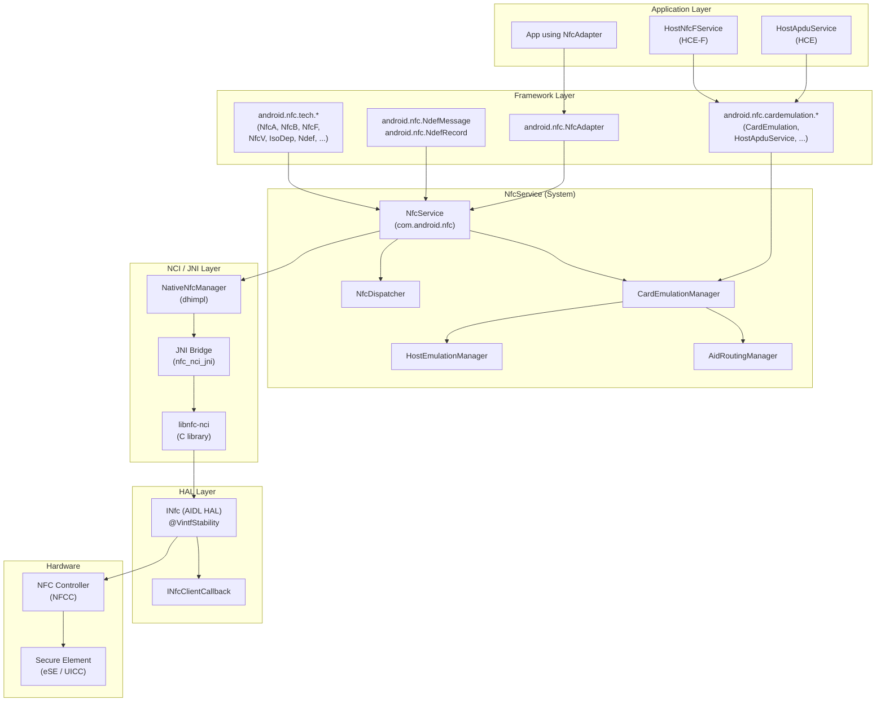

### 38.1.3 主要源码目录

NFC 实现分布在 AOSP 树中的多个目录：

| 目录 | 用途 |
|-----------|---------|
| `packages/modules/Nfc/framework/` | 公共 API：`NfcAdapter`、`NdefMessage`、`NdefRecord`、技术类 |
| `packages/modules/Nfc/NfcNci/src/com/android/nfc/` | NfcService、NfcDispatcher 及核心系统逻辑 |
| `packages/modules/Nfc/NfcNci/src/com/android/nfc/cardemulation/` | HCE 与卡模拟子系统 |
| `packages/modules/Nfc/NfcNci/nci/src/com/android/nfc/dhimpl/` | 原生接口（NativeNfcManager） |
| `packages/modules/Nfc/NfcNci/nci/jni/` | 桥接 Java 与 libnfc-nci 的 JNI C++ 代码 |
| `packages/modules/Nfc/libnfc-nci/` | NCI 协议栈（C 库） |
| `hardware/interfaces/nfc/aidl/` | AIDL HAL 接口定义 |
| `hardware/interfaces/nfc/1.0/` 至 `1.2/` | 旧版 HIDL HAL 接口 |
| `packages/modules/Nfc/apex/` | Mainline APEX 打包 |

### 38.1.4 NfcAdapter：应用入口

`NfcAdapter` 是面向应用的单例，是所有 NFC 操作的闸门。应用通过一个静态调用获取它：

```java
// Source: packages/modules/Nfc/framework/java/android/nfc/NfcAdapter.java
public final class NfcAdapter {
    // The three tag dispatch intents, in priority order:
    public static final String ACTION_NDEF_DISCOVERED =
            "android.nfc.action.NDEF_DISCOVERED";
    public static final String ACTION_TECH_DISCOVERED =
            "android.nfc.action.TECH_DISCOVERED";
    public static final String ACTION_TAG_DISCOVERED =
            "android.nfc.action.TAG_DISCOVERED";

    // Reader mode flags
    public static final int FLAG_READER_NFC_A = 0x1;
    public static final int FLAG_READER_NFC_B = 0x2;
    public static final int FLAG_READER_NFC_F = 0x4;
    public static final int FLAG_READER_NFC_V = 0x8;
    public static final int FLAG_READER_NFC_BARCODE = 0x10;
    public static final int FLAG_READER_SKIP_NDEF_CHECK = 0x80;
    public static final int FLAG_READER_NO_PLATFORM_SOUNDS = 0x100;
    ...
}
```

适配器通过 Binder 接口（`INfcAdapter.aidl`）与 `NfcService` 通信。主要方法包括：

- `enableReaderMode()` / `disableReaderMode()` —— 独占式标签读取
- `enableForegroundDispatch()` / `disableForegroundDispatch()` —— 将标签以高优先级
  路由到前台 activity
- `isEnabled()` —— 检查 NFC 硬件状态
- `ignore()` —— 忽略（去抖）某个特定标签

### 38.1.5 NfcService：系统服务器组件

`NfcService` 是中心守护进程，是规模较大的系统服务之一。它运行在 `com.android.nfc`
进程中，使用共享 UID `android.uid.nfc`（参见 `NfcNci/AndroidManifest.xml`）。它
**不是** `system_server` 的一部分——它运行在独立进程中：

```
// Source: packages/modules/Nfc/NfcNci/src/com/android/nfc/NfcService.java
public class NfcService implements DeviceHostListener, ForegroundUtils.Callback {
    static final String TAG = "NfcService";
    public static final String SERVICE_NAME = "nfc";
    ...
}
```

NfcService 的职责：

- 通过 NCI 协议栈初始化和管理 NFC 硬件
- 处理屏幕状态变化（屏幕关闭时禁用轮询）
- 将标签发现事件路由到正确的应用
- 管理 HCE 卡模拟子系统
- 维护 NFCC 路由表
- 暴露供 NfcAdapter 使用的 Binder API

### 38.1.6 NFC HAL：硬件抽象

HAL 在 NCI 协议栈与厂商的 NFC 控制器驱动之间进行协调。当前接口基于 AIDL
（`android.hardware.nfc.INfc`），并带有用于 Mainline 兼容性的 `@VintfStability`。
HAL 恰好提供了 NCI 主机所需的全部操作：

```
// Source: hardware/interfaces/nfc/aidl/aidl_api/android.hardware.nfc/current/
//         android/hardware/nfc/INfc.aidl
@VintfStability
interface INfc {
    void open(in INfcClientCallback clientCallback);
    void close(in NfcCloseType type);
    void coreInitialized();
    void factoryReset();
    NfcConfig getConfig();
    void powerCycle();
    void preDiscover();
    int write(in byte[] data);
    void setEnableVerboseLogging(in boolean enable);
    boolean isVerboseLoggingEnabled();
    NfcStatus controlGranted();
}
```

### 38.1.7 NCI：NFC 控制器接口

NFC 控制器接口（NCI）是主机（应用处理器）与 NFC 控制器（NFCC）之间的标准化协议。
AOSP 实现位于 `libnfc-nci`，这是一个实现了 NCI 1.0 和 2.0 规范的 C 库。

NCI 协议采用命令/响应/通知模型：

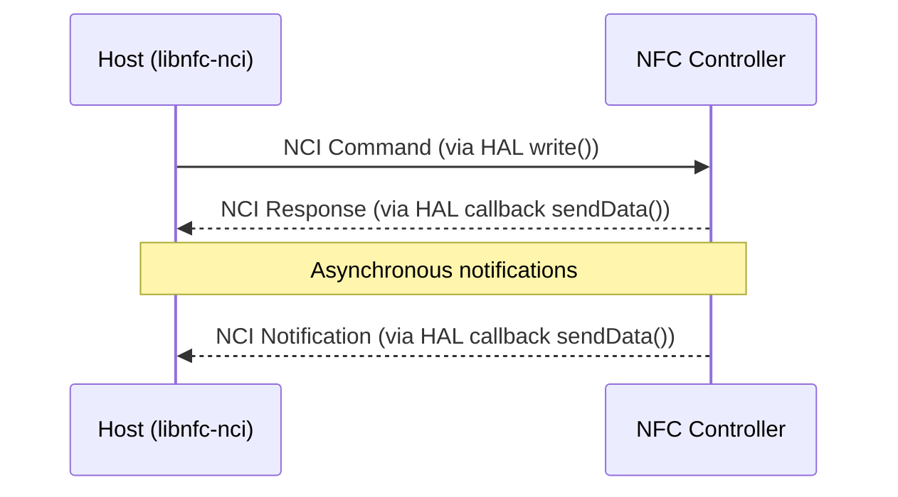

NCI 消息按组 ID（GID）和操作码 ID（OID）分类：

| GID | 用途 |
|-----|---------|
| 0x00 | NCI 核心（RESET、INIT、SET_CONFIG） |
| 0x01 | 射频管理（DISCOVER、ACTIVATE） |
| 0x02 | NFCEE 管理（安全元件） |
| 0x0F | 专有（厂商特定） |

### 38.1.8 NFC 作为 Mainline 模块（APEX）

从近期的 Android 版本开始，NFC 协议栈被打包为 Mainline 模块（`com.android.nfcservices`），
使 Google 能够独立于完整的操作系统更新来更新 NFC。APEX 包包含：

- `NfcNci` APK（NfcService、卡模拟、分发逻辑）
- NFC 框架类
- `libnfc-nci` 原生库
- JNI 桥接

APEX 清单文件位于：

```
packages/modules/Nfc/apex/manifest.json
```

### 38.1.9 端到端：从射频场到 Intent

当用户将手机碰触 NFC 标签时，完整数据通路如下：

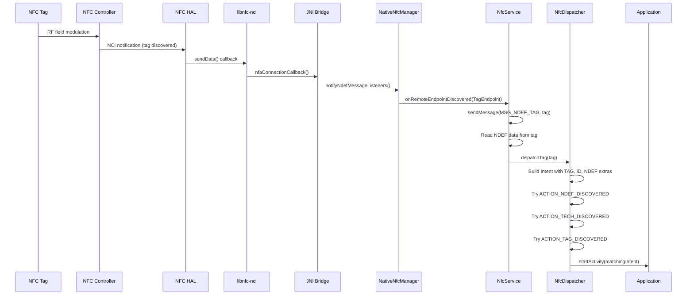

---

## 38.2 NfcService

### 38.2.1 服务生命周期

NfcService 不是传统的 Android Service 子类。它由 `NfcApplication` 在 `onCreate()`
期间创建，并以 `"nfc"` 名称注册为系统服务。该服务在整个 NFC 进程生命周期内持续存在。

生命周期遵循以下阶段：

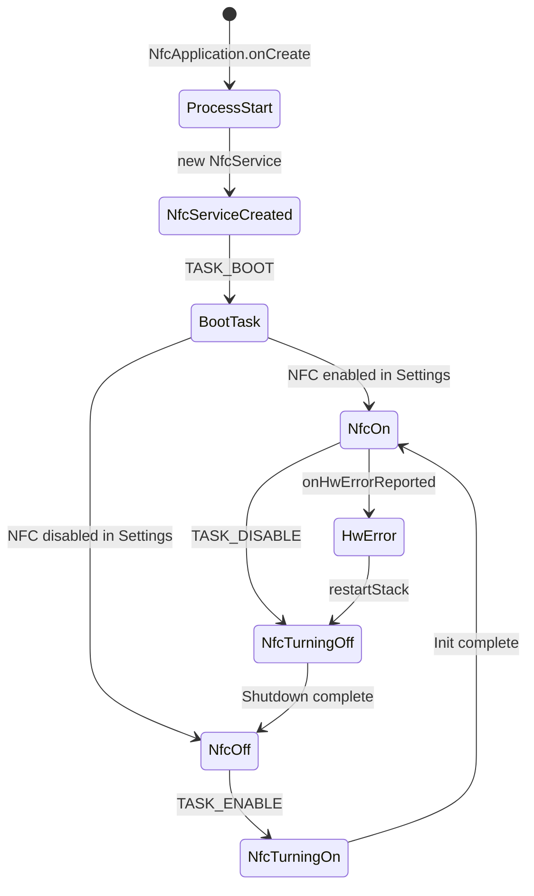

NfcService 的状态通过标准的 NfcAdapter 状态常量跟踪：

```java
// Source: packages/modules/Nfc/NfcNci/src/com/android/nfc/NfcService.java
int mState;  // NfcAdapter.STATE_ON, STATE_TURNING_ON,
             // STATE_OFF, STATE_TURNING_OFF
```

### 38.2.2 NfcApplication：引导启动

NFC 进程通过清单文件中声明的 `Application` 子类 `NfcApplication` 启动：

```xml
<!-- Source: packages/modules/Nfc/NfcNci/AndroidManifest.xml -->
<application android:name=".NfcApplication"
             android:icon="@drawable/icon"
             android:label="@string/app_name"
             android:theme="@android:style/Theme.Material.Light"
```

该进程以 UID `android.uid.nfc`（`sharedUserId`）运行，使其拥有访问 NFC 硬件的特权。
启动时，`NfcApplication.onCreate()` 构造 `NfcService` 单例并将其注册。

### 38.2.3 EnableDisableTask 状态机

NFC 硬件初始化由名为 `EnableDisableTask` 的 `AsyncTask` 子类处理。这避免了在可能
较慢的固件下载和 NFC 控制器初始化期间阻塞主线程：

```java
// Source: packages/modules/Nfc/NfcNci/src/com/android/nfc/NfcService.java
static final int TASK_ENABLE = 1;
static final int TASK_DISABLE = 2;
static final int TASK_BOOT = 3;
static final int TASK_ENABLE_ALWAYS_ON = 4;
static final int TASK_DISABLE_ALWAYS_ON = 5;
```

启用流程：

1. 检查固件（`mDeviceHost.checkFirmware()`）——可能触发固件下载
2. 初始化 NFC 控制器（`mDeviceHost.initialize()`）
3. 应用路由表
4. 开始轮询标签

一个看门狗定时器（`INIT_WATCHDOG_MS = 90000`——90 秒）用于防止固件下载挂起。这个
较长的超时时间考虑到了某些硬件上 NFC 固件下载可能耗时较长的事实。

### 38.2.4 屏幕状态管理

NFC 轮询行为与屏幕状态紧密耦合。系统在屏幕关闭时减少或停止 NFC 轮询以节省电量：

```java
// Source: packages/modules/Nfc/NfcNci/src/com/android/nfc/NfcService.java
// minimum screen state that enables NFC polling
static final int NFC_POLLING_MODE = ScreenStateHelper.SCREEN_STATE_OFF_UNLOCKED;
```

`ScreenStateHelper` 将显示状态映射为五个级别，其值是位掩码而非序数
（`packages/modules/Nfc/NfcNci/src/com/android/nfc/ScreenStateHelper.java`）：

| 屏幕状态 | 值 | 轮询行为 |
|-------------|-------|-----------------|
| `SCREEN_STATE_UNKNOWN` | `0x00` | 视为关闭 |
| `SCREEN_STATE_OFF_UNLOCKED` | `0x01` | 屏幕关闭但设备已解锁（轮询阈值） |
| `SCREEN_STATE_OFF_LOCKED` | `0x02` | 屏幕关闭且已锁定 |
| `SCREEN_STATE_ON_LOCKED` | `0x04` | 有限轮询（锁屏支付） |
| `SCREEN_STATE_ON_UNLOCKED` | `0x08` | 完全轮询 |

这些值很重要，因为 `NfcService` 通过数值比较 `screenState >= NFC_POLLING_MODE`
来启用读卡器轮询。当 `NFC_POLLING_MODE` 设置为 `SCREEN_STATE_OFF_UNLOCKED`
（`0x01`）时，值大于或等于 `0x01` 的所有状态都被允许，因此只有
`SCREEN_STATE_UNKNOWN`（`0x00`）低于阈值。由于这些常量是位掩码而非严格的顺序排列，
决定轮询的是这个 `>=` 判断，而不是字面意义上的"屏幕开启"检查。

屏幕状态变化会触发 `MSG_APPLY_SCREEN_STATE`，重新计算发现参数并相应更新 NFCC。

### 38.2.5 消息处理器

NfcService 通过 Handler 消息循环处理事件。所有关键操作都汇聚到消息常量上：

```java
// Source: packages/modules/Nfc/NfcNci/src/com/android/nfc/NfcService.java
static final int MSG_NDEF_TAG = 0;
static final int MSG_MOCK_NDEF = 3;
static final int MSG_ROUTE_AID = 5;
static final int MSG_UNROUTE_AID = 6;
static final int MSG_COMMIT_ROUTING = 7;
static final int MSG_RF_FIELD_ACTIVATED = 9;
static final int MSG_RF_FIELD_DEACTIVATED = 10;
static final int MSG_RESUME_POLLING = 11;
static final int MSG_REGISTER_T3T_IDENTIFIER = 12;
static final int MSG_DEREGISTER_T3T_IDENTIFIER = 13;
static final int MSG_TAG_DEBOUNCE = 14;
static final int MSG_APPLY_SCREEN_STATE = 16;
static final int MSG_TRANSACTION_EVENT = 17;
static final int MSG_PREFERRED_PAYMENT_CHANGED = 18;
static final int MSG_TOAST_DEBOUNCE_EVENT = 19;
static final int MSG_DELAY_POLLING = 20;
static final int MSG_CLEAR_ROUTING_TABLE = 21;
static final int MSG_UPDATE_ISODEP_PROTOCOL_ROUTE = 22;
static final int MSG_UPDATE_TECHNOLOGY_ABF_ROUTE = 23;
```

该处理器将原本可能产生竞争的 NFC 操作串行化——尤其是标签分发、路由表提交和屏幕
状态变化。

### 38.2.6 标签发现：onRemoteEndpointDiscovered

当 NFC 控制器发现标签时，原生层通过 `DeviceHostListener` 回调将其传递上来：

```java
// Source: packages/modules/Nfc/NfcNci/src/com/android/nfc/NfcService.java
@Override
public void onRemoteEndpointDiscovered(TagEndpoint tag) {
    Log.d(TAG, "onRemoteEndpointDiscovered");
    sendMessage(MSG_NDEF_TAG, tag);
}
```

`MSG_NDEF_TAG` 处理器随后：

1. 读取标签的技术列表和 UID
2. 尝试从标签读取 NDEF 数据
3. 用发现的信息构建 `Tag` parcelable
4. 将标签和 NDEF 消息传递给 `NfcDispatcher`
5. 播放 NFC"发现标签"提示音
6. 开始在场检查以检测标签移除

### 38.2.7 DeviceHost 与 DeviceHostListener

`DeviceHost` 是对原生 NFC 协议栈进行抽象的接口。`NativeNfcManager` 实现该接口，
`NfcService` 实现其监听器：

```java
// Source: packages/modules/Nfc/NfcNci/src/com/android/nfc/DeviceHost.java
public interface DeviceHost {
    public interface DeviceHostListener {
        public void onRemoteEndpointDiscovered(TagEndpoint tag);
        public void onHostCardEmulationActivated(int technology);
        public void onHostCardEmulationData(int technology, byte[] data);
        public void onHostCardEmulationDeactivated(int technology);
        public void onRemoteFieldActivated();
        public void onRemoteFieldDeactivated();
        public void onNfcTransactionEvent(byte[] aid, byte[] data, String seName);
        public void onEeUpdated();
        public void onHwErrorReported();
        public void onPollingLoopDetected(List<PollingFrame> pollingFrames);
        public void onVendorSpecificEvent(int gid, int oid, byte[] payload);
        ...
    }

    public interface TagEndpoint {
        boolean connect(int technology);
        boolean reconnect();
        boolean disconnect();
        boolean presenceCheck();
        int[] getTechList();
        byte[] getUid();
        byte[] transceive(byte[] data, boolean raw, int[] returnCode);
        boolean checkNdef(int[] out);
        byte[] readNdef();
        boolean writeNdef(byte[] data);
        NdefMessage findAndReadNdef();
        boolean formatNdef(byte[] key);
        boolean isNdefFormatable();
        boolean makeReadOnly();
        ...
    }
}
```

`TagEndpoint` 接口内容尤为丰富——它封装了对已发现标签的所有操作，从原始收发到
NDEF 读/写/格式化。

### 38.2.8 NativeNfcManager：JNI 桥接

`NativeNfcManager` 是 `DeviceHost` 的实现，通过 JNI 桥接 Java 与原生 `libnfc-nci`：

```java
// Source: packages/modules/Nfc/NfcNci/nci/src/com/android/nfc/dhimpl/NativeNfcManager.java
public class NativeNfcManager implements DeviceHost {
    static final String DRIVER_NAME = "android-nci";

    private long mNative;  // pointer to native structure

    private void loadLibrary() {
        System.loadLibrary("nfc_nci_jni");
    }

    public native boolean initializeNativeStructure();
    private native boolean doInitialize();
    private native boolean doDownload();
    ...
}
```

JNI C++ 实现位于 `NfcNci/nci/jni/`，包含以下文件：

- `NativeNfcManager.cpp` —— 控制器初始化与管理
- `NativeNfcTag.cpp` —— 标签操作（读、写、收发）
- `RoutingManager.cpp` —— AID 与技术路由
- `NfcTag.cpp` —— 标签状态跟踪
- `HciEventManager.cpp` —— 来自安全元件的 HCI 事件

### 38.2.9 读卡器模式内部实现

当应用激活读卡器模式时，NfcService 重新配置 NFC 控制器以禁用卡模拟和点对点功能，
仅专注于标签轮询：

```java
// Source: packages/modules/Nfc/NfcNci/src/com/android/nfc/NfcService.java
ReaderModeParams mReaderModeParams;

// Stored when enableReaderMode is called:
static class ReaderModeParams {
    int flags;
    IAppCallback callback;
    int presenceCheckDelay;
}
```

`ReaderModeDeathRecipient` 监控调用进程。如果进程死亡，读卡器模式会被自动禁用，
以防止 NFC 控制器被锁定在非标准配置中：

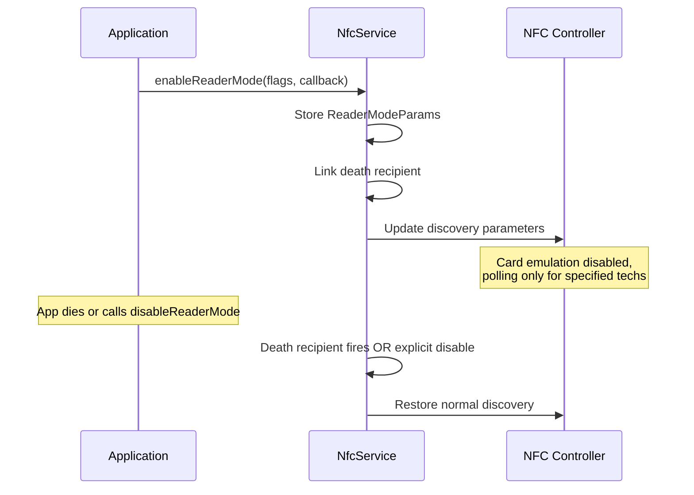

### 38.2.10 路由表管理

NFCC 维护一张路由表。该表决定 NFCC 将收到的 ISO-DEP、NFC-F 及其他帧发送到哪里：
主机（应用处理器）、eSE 或 UICC。NfcService 通过延迟调度器编排路由表更新，以合并
多次快速变化：

```java
// Source: packages/modules/Nfc/NfcNci/src/com/android/nfc/NfcService.java
private final ScheduledExecutorService mRtUpdateScheduler =
        Executors.newScheduledThreadPool(1);

// On NFCEE update:
mRtUpdateScheduledTask = mRtUpdateScheduler.schedule(
    () -> {
        if (mIsHceCapable) {
            mCardEmulationManager.onTriggerRoutingTableUpdate();
        }
    },
    50,
    TimeUnit.MILLISECONDS);
```

路由由三个维度决定：

1. **AID 路由**——将特定 AID 路由到特定目的地
2. **协议路由**——将 ISO-DEP 帧路由到默认目的地
3. **技术路由**——将 NFC-A/B/F 帧路由到默认目的地

### 38.2.11 看门狗与恢复

NfcService 包含一个看门狗机制，用于检测并从硬件挂起中恢复：

```java
// Source: packages/modules/Nfc/NfcNci/src/com/android/nfc/NfcService.java
static final int INIT_WATCHDOG_MS = 90000;   // 90s for init (firmware download)
static final int ROUTING_WATCHDOG_MS = 6000;  // 6s for routing commits
```

当 `onHwErrorReported()` 触发时，服务会执行完整的协议栈重启：

```java
@Override
public void onHwErrorReported() {
    if (android.nfc.Flags.nfcEventListener() && mCardEmulationManager != null) {
        mCardEmulationManager.onInternalErrorReported(
                CardEmulation.NFC_INTERNAL_ERROR_NFC_HARDWARE_ERROR);
    }
    restartStack();
}

private void restartStack() {
    // ...
    new EnableDisableTask().execute(TASK_DISABLE);
    new EnableDisableTask().execute(TASK_ENABLE);
}
```

### 38.2.12 安全 NFC

安全 NFC 将 NFC 操作限制在屏幕已解锁的状态下。启用后，NFCC 被配置为仅在设备解锁
时才响应：

```java
// Source: packages/modules/Nfc/NfcNci/src/com/android/nfc/NfcService.java
static final String PREF_SECURE_NFC_ON = "secure_nfc_on";
boolean mIsSecureNfcEnabled;
```

该功能针对用户希望 NFC 支付要求设备解锁的场景，防止手机放在口袋中时发生无接触欺诈。

---

## 38.3 NFC HAL

### 38.3.1 HAL 演进：从 HIDL 到 AIDL

NFC HAL 经历了三代：

| 版本 | 路径 | 传输方式 |
|---------|------|-----------|
| 1.0 | `hardware/interfaces/nfc/1.0/` | HIDL |
| 1.1 | `hardware/interfaces/nfc/1.1/` | HIDL |
| 1.2 | `hardware/interfaces/nfc/1.2/` | HIDL |
| AIDL v1 | `hardware/interfaces/nfc/aidl/`（版本 1） | AIDL |
| AIDL v2 | `hardware/interfaces/nfc/aidl/`（版本 2） | AIDL |

AIDL HAL 是当前标准，`@VintfStability` 使其能够在可独立更新的系统分区中工作。
所有新设备都应实现 AIDL 版本。

### 38.3.2 INfc AIDL 接口

主要 HAL 接口定义了 NCI 主机协议栈可以在 NFC 控制器上执行的操作：

```
// Source: hardware/interfaces/nfc/aidl/aidl_api/android.hardware.nfc/current/
//         android/hardware/nfc/INfc.aidl
@VintfStability
interface INfc {
    void open(in INfcClientCallback clientCallback);
    void close(in NfcCloseType type);
    void coreInitialized();
    void factoryReset();
    NfcConfig getConfig();
    void powerCycle();
    void preDiscover();
    int write(in byte[] data);
    void setEnableVerboseLogging(in boolean enable);
    boolean isVerboseLoggingEnabled();
    NfcStatus controlGranted();
}
```

方法语义：

| 方法 | 用途 |
|--------|---------|
| `open()` | 开启 NFCC 电源，注册数据/事件回调 |
| `close()` | 关闭电源或设为待机（`DISABLE` 与 `HOST_SWITCHED_OFF`） |
| `coreInitialized()` | 发出 NCI CORE_INIT 完成的信号 |
| `write()` | 向 NFCC 发送 NCI 命令/数据 |
| `getConfig()` | 获取静态硬件配置 |
| `powerCycle()` | 硬重置 NFCC |
| `preDiscover()` | 发现开始前的厂商钩子 |
| `factoryReset()` | 将 NFCC 配置恢复为默认值 |
| `controlGranted()` | 向 HAL 授予独占控制权 |

### 38.3.3 INfcClientCallback

回调接口是 HAL 向 NCI 主机回传数据和事件的方式：

```
// Source: hardware/interfaces/nfc/aidl/aidl_api/android.hardware.nfc/current/
//         android/hardware/nfc/INfcClientCallback.aidl
@VintfStability
interface INfcClientCallback {
    void sendData(in byte[] data);
    void sendEvent(in NfcEvent event, in NfcStatus status);
}
```

`sendData()` 承载来自 NFCC 的 NCI 响应和通知。`sendEvent()` 承载生命周期事件，
如 `OPEN_CPLT`、`CLOSE_CPLT` 和 `ERROR`。

### 38.3.4 NfcConfig：硬件配置

`NfcConfig` parcelable 包含 NCI 协议栈正确运行所需的静态硬件配置：

```
// Source: hardware/interfaces/nfc/aidl/aidl_api/android.hardware.nfc/current/
//         android/hardware/nfc/NfcConfig.aidl
@VintfStability
parcelable NfcConfig {
    boolean nfaPollBailOutMode;
    PresenceCheckAlgorithm presenceCheckAlgorithm;
    ProtocolDiscoveryConfig nfaProprietaryCfg;
    byte defaultOffHostRoute;
    byte defaultOffHostRouteFelica;
    byte defaultSystemCodeRoute;
    byte defaultSystemCodePowerState;
    byte defaultRoute;
    byte offHostESEPipeId;
    byte offHostSIMPipeId;
    int maxIsoDepTransceiveLength;
    byte[] hostAllowlist;
    byte[] offHostRouteUicc;
    byte[] offHostRouteEse;
    byte defaultIsoDepRoute;
    byte[] offHostSimPipeIds;
    boolean t4tNfceeEnable;
}
```

关键字段：

| 字段 | 用途 |
|-------|---------|
| `defaultRoute` | 默认 AID 路由（host=0x00，或 SE ID） |
| `defaultOffHostRoute` | 默认离主机路由（eSE ID） |
| `defaultOffHostRouteFelica` | 默认 FeliCa 路由（eSE ID） |
| `offHostRouteUicc` | UICC SE 路由 ID |
| `offHostRouteEse` | eSE 路由 ID |
| `maxIsoDepTransceiveLength` | ISO-DEP 帧的最大长度 |
| `presenceCheckAlgorithm` | 如何检查标签是否仍在场 |
| `t4tNfceeEnable` | 启用 Type-4 标签 NFCEE 模拟 |

### 38.3.5 NfcEvent 与 NfcStatus 枚举

HAL 使用强类型枚举表示生命周期事件和状态码：

```
// Source: hardware/interfaces/nfc/aidl/.../NfcEvent.aidl
@Backing(type="int") @VintfStability
enum NfcEvent {
    OPEN_CPLT = 0,
    CLOSE_CPLT = 1,
    POST_INIT_CPLT = 2,
    PRE_DISCOVER_CPLT = 3,
    HCI_NETWORK_RESET = 4,
    ERROR = 5,
    REQUEST_CONTROL = 6,
    RELEASE_CONTROL = 7,
}

// Source: hardware/interfaces/nfc/aidl/.../NfcStatus.aidl
@Backing(type="int") @VintfStability
enum NfcStatus {
    OK = 0,
    FAILED = 1,
    ERR_TRANSPORT = 2,
    ERR_CMD_TIMEOUT = 3,
    REFUSED = 4,
}
```

`ERR_CMD_TIMEOUT` 状态尤为重要——它表示 NFCC 停止响应，通常会触发
`onHwErrorReported()` 和协议栈重启。

### 38.3.6 NfcCloseType 与 PresenceCheckAlgorithm

`NfcCloseType` 控制 NFCC 的关闭方式：

```
@Backing(type="int") @VintfStability
enum NfcCloseType {
    DISABLE = 0,           // User explicitly disabled NFC
    HOST_SWITCHED_OFF = 1, // Device is shutting down
}
```

`PresenceCheckAlgorithm` 控制 NCI 协议栈如何验证标签仍在通信范围内：

```
@Backing(type="byte") @VintfStability
enum PresenceCheckAlgorithm {
    DEFAULT = 0,      // Let the stack choose
    I_BLOCK = 1,      // Send ISO-DEP I-Block
    ISO_DEP_NAK = 2,  // Send ISO-DEP NAK
}
```

### 38.3.7 ProtocolDiscoveryConfig

`ProtocolDiscoveryConfig` parcelable 控制轮询期间发现哪些 NFC 协议。它映射到
NCI 协议栈在 NFCC 中配置的 NCI 射频发现参数。

### 38.3.8 HAL 的 Open-Write-Close 生命周期

HAL 遵循严格的生命周期：

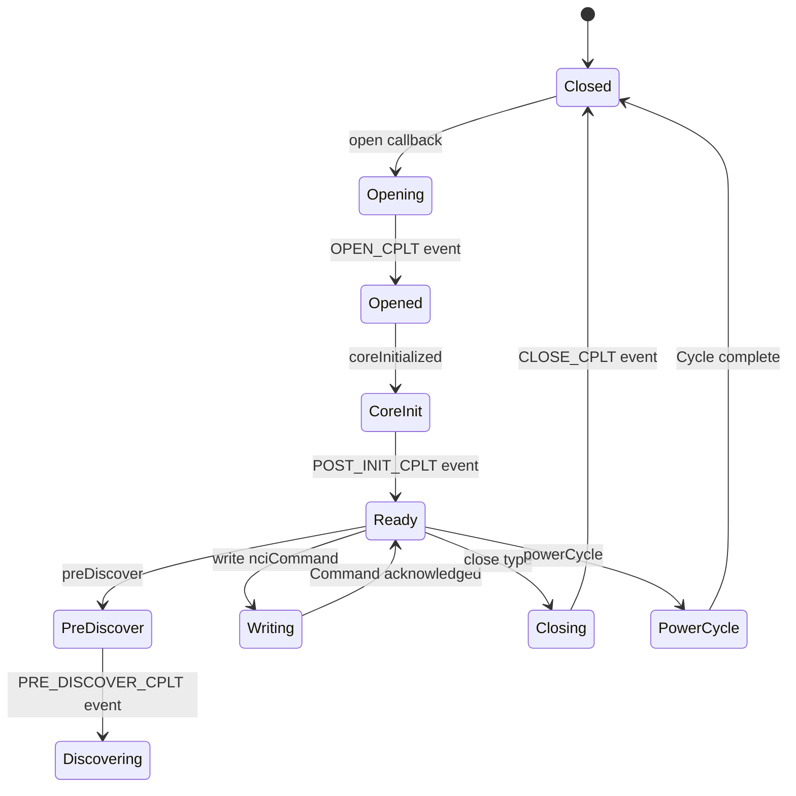

关键不变量是 `write()` 只能在 `open()` 完成（由 `OPEN_CPLT` 发出信号）之后调用。
`coreInitialized()` 调用发出信号，表示主机已完成其 NCI CORE_INIT 序列，HAL 可以
执行任何初始化后的厂商特定操作。

### 38.3.9 通过 HAL 的 NCI 数据流

所有 NCI 协议数据通过两条通路流动：

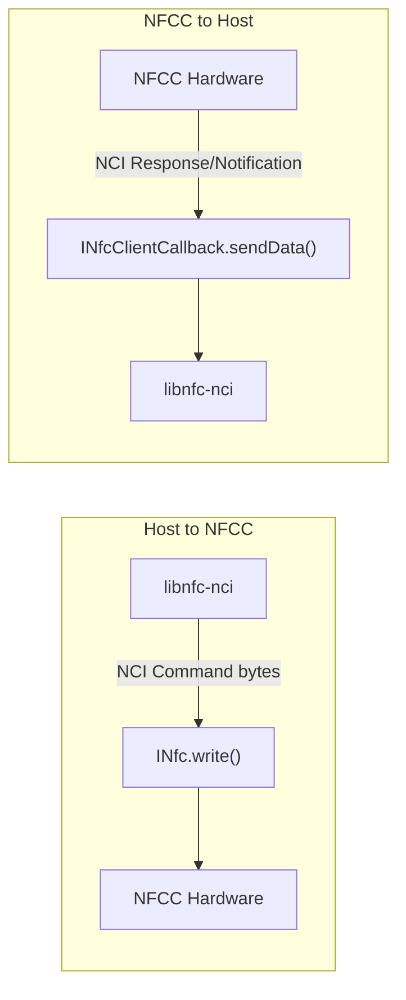

HAL 实现负责组帧。某些控制器使用 SPI、I2C 或 UART 作为物理传输方式，但这一层
被隐藏在 HAL 抽象之后。

### 38.3.10 libnfc-nci：NCI 协议栈

`libnfc-nci` 库（`packages/modules/Nfc/libnfc-nci/`）用 C 语言实现 NCI 协议。它
管理：

- NCI 命令组装和响应解析
- 射频发现状态机
- 标签激活和数据交换
- NFCEE（安全元件）管理
- 监听模式（卡模拟）协议处理

库结构：

```
libnfc-nci/
  src/
    nfc/          # Core NFC logic
    nfa/          # NFA (NFC Adaptation) layer
    gki/          # Generic Kernel Interface (threading)
    adaptation/   # HAL adaptation layer
    include/      # Headers
  conf/           # Configuration files
```

### 38.3.11 NFC HAL 的 VTS 测试

NFC HAL 的 VTS（厂商测试套件）测试确保符合规范：

```
hardware/interfaces/nfc/aidl/vts/
```

这些测试验证：

- `open()` / `close()` 生命周期
- `write()` 返回正确的字节数
- `getConfig()` 返回有效配置
- 事件和数据的回调传递
- `powerCycle()` 正确重置控制器

---

## 38.4 NDEF：NFC 数据交换格式

### 38.4.1 NDEF 是什么

NDEF（NFC 数据交换格式）是 NFC Forum 标准化的一种轻量级二进制格式，用于编码结构化
载荷。它是传输无关的——虽然为 NFC 设计，但该格式本身可以通过任何通道使用。

NDEF 有两个主要概念：

- **NdefMessage**——容纳一个或多个记录的容器
- **NdefRecord**——单个带类型的载荷（URI、文本、MIME 数据等）

Android 将它们表示为 `android.nfc.NdefMessage` 和 `android.nfc.NdefRecord`。

### 38.4.2 NdefMessage：容器

```java
// Source: packages/modules/Nfc/framework/java/android/nfc/NdefMessage.java
public final class NdefMessage implements Parcelable {
    private final NdefRecord[] mRecords;

    // Construct from raw bytes (e.g., read from tag)
    public NdefMessage(byte[] data) throws FormatException { ... }

    // Construct from records
    public NdefMessage(NdefRecord[] records) { ... }
    public NdefMessage(NdefRecord record, NdefRecord... records) { ... }

    // Get all records
    public NdefRecord[] getRecords() { return mRecords; }

    // Serialize to bytes (e.g., for writing to tag)
    public byte[] toByteArray() { ... }
}
```

消息中的第一条记录具有特殊重要性——标签分发系统用它来确定启动哪个应用。

### 38.4.3 NdefRecord：载荷单元

每个 `NdefRecord` 承载一个带类型的载荷：

```java
// Source: packages/modules/Nfc/framework/java/android/nfc/NdefRecord.java
public final class NdefRecord implements Parcelable {
    // Constructor
    public NdefRecord(short tnf, byte[] type, byte[] id, byte[] payload) { ... }

    // Factory methods
    public static NdefRecord createUri(Uri uri) { ... }
    public static NdefRecord createUri(String uriString) { ... }
    public static NdefRecord createMime(String mimeType, byte[] mimeData) { ... }
    public static NdefRecord createExternal(
            String domain, String type, byte[] data) { ... }
    public static NdefRecord createTextRecord(
            String languageCode, String text) { ... }
    public static NdefRecord createApplicationRecord(
            String packageName) { ... }

    // Accessors
    public short getTnf() { ... }
    public byte[] getType() { ... }
    public byte[] getId() { ... }
    public byte[] getPayload() { ... }

    // Convenience converters
    public Uri toUri() { ... }
    public String toMimeType() { ... }
}
```

### 38.4.4 TNF：类型名称格式

3 位的 TNF 字段分类说明 type 字段应如何被解释：

```java
// Source: packages/modules/Nfc/framework/java/android/nfc/NdefRecord.java
public static final short TNF_EMPTY = 0x00;
public static final short TNF_WELL_KNOWN = 0x01;
public static final short TNF_MIME_MEDIA = 0x02;
public static final short TNF_ABSOLUTE_URI = 0x03;
public static final short TNF_EXTERNAL_TYPE = 0x04;
public static final short TNF_UNKNOWN = 0x05;
public static final short TNF_UNCHANGED = 0x06;
```

| TNF | 名称 | type 字段的含义 |
|-----|------|-------------------|
| 0x00 | Empty | 无类型，无载荷 |
| 0x01 | Well-Known | NFC Forum RTD 类型（URI、Text、Smart Poster） |
| 0x02 | MIME Media | RFC 2046 MIME 类型字符串 |
| 0x03 | Absolute URI | RFC 3986 绝对 URI |
| 0x04 | External Type | 反向域名自定义类型 |
| 0x05 | Unknown | 未知类型（如 application/octet-stream） |
| 0x06 | Unchanged | 续块（不向应用暴露） |

### 38.4.5 Well-Known RTD 类型

NFC Forum 为常见的 well-known 类型定义了记录类型定义（RTD）常量：

```java
// Source: packages/modules/Nfc/framework/java/android/nfc/NdefRecord.java
public static final byte[] RTD_TEXT = {0x54};              // "T"
public static final byte[] RTD_URI = {0x55};               // "U"
public static final byte[] RTD_SMART_POSTER = {0x53, 0x70}; // "Sp"
public static final byte[] RTD_ALTERNATIVE_CARRIER = {0x61, 0x63}; // "ac"
public static final byte[] RTD_HANDOVER_CARRIER = {0x48, 0x63};    // "Hc"
public static final byte[] RTD_HANDOVER_REQUEST = {0x48, 0x72};    // "Hr"
public static final byte[] RTD_HANDOVER_SELECT = {0x48, 0x73};     // "Hs"
```

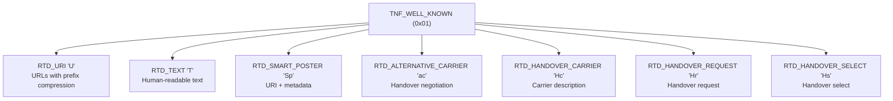

### 38.4.6 URI 记录编码与前缀压缩

URI 记录使用一种高效的前缀压缩方案。载荷的第一个字节是前缀索引：

| 索引 | 前缀 | 索引 | 前缀 |
|-------|--------|-------|--------|
| 0x00 |（无） | 0x01 | `http://www.` |
| 0x02 | `https://www.` | 0x03 | `http://` |
| 0x04 | `https://` | 0x05 | `tel:` |
| 0x06 | `mailto:` | 0x07 | `ftp://anonymous:anonymous@` |
| 0x08 | `ftp://ftp.` | 0x09 | `ftps://` |
| 0x0A | `sftp://` | 0x0B | `smb://` |
| 0x0C | `nfs://` | 0x0D | `ftp://` |
| 0x0E | `dav://` | 0x0F | `news:` |
| 0x10 | `telnet://` | 0x11 | `imap:` |
| 0x12 | `rtsp://` | 0x13 | `urn:` |
| 0x14 | `pop:` | 0x15 | `sip:` |
| 0x16 | `sips:` | 0x17 | `tftp:` |
| 0x18 | `btspp://` | 0x19 | `btl2cap://` |
| 0x1A | `btgoep://` | 0x1B | `tcpobex://` |
| 0x1C | `irdaobex://` | 0x1D | `file://` |
| 0x1E | `urn:epc:id:` | 0x1F | `urn:epc:tag:` |
| 0x20 | `urn:epc:pat:` | 0x21 | `urn:epc:raw:` |
| 0x22 | `urn:epc:` | 0x23 | `urn:nfc:` |

例如，`https://android.com` 被编码为 `0x04` + `android.com`（12 字节，而未压缩的
`0x00` + `https://android.com` 载荷需要 20 字节）。`createUri()` 工厂方法会自动
处理这一点。

### 38.4.7 文本记录编码

文本记录（`RTD_TEXT`）编码：

- 状态字节：位 7 = 编码方式（0=UTF-8，1=UTF-16），位 5-0 = 语言代码长度
- 语言代码（IANA 格式，如 "en"、"ja"）
- 文本载荷

```
Byte layout:
[Status] [Language Code] [Text]
  1 byte   N bytes        M bytes

Status byte:
  Bit 7: 0 = UTF-8, 1 = UTF-16
  Bit 6: Reserved
  Bits 5-0: Language code length
```

### 38.4.8 Smart Poster 记录

Smart Poster（`RTD_SMART_POSTER`）是一个嵌套的 NDEF 消息，包含多个记录，共同描述
一张"海报"：

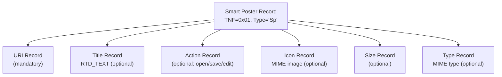

Smart Poster 记录的载荷本身就是一个有效的 NDEF 消息。Android 标签分发系统会拆解
Smart Poster，并根据内嵌的 URI 进行分发。

### 38.4.9 MIME 类型记录

MIME 记录（`TNF_MIME_MEDIA`）携带以标准 MIME 类型标注的任意二进制数据：

```java
// Create a MIME record
NdefRecord mimeRecord = NdefRecord.createMime(
    "application/vnd.example.myapp",
    myPayloadBytes
);
```

标签分发系统使用 MIME 类型进行 intent 匹配，允许应用在清单中注册特定的 MIME 类型。

### 38.4.10 外部类型记录与 Android 应用记录

外部类型记录（`TNF_EXTERNAL_TYPE`）使用反向域名命名自定义类型：

```java
NdefRecord extRecord = NdefRecord.createExternal(
    "example.com",        // domain
    "mytype",             // type
    myPayloadBytes        // data
);
// Results in type: "example.com:mytype"
```

**Android 应用记录（AAR）** 是一种特殊的外部类型，可强制将分发定向到特定包名：

```java
NdefRecord aar = NdefRecord.createApplicationRecord("com.example.myapp");
// TNF = TNF_EXTERNAL_TYPE
// Type = "android.com:pkg"
// Payload = "com.example.myapp"
```

当 NDEF 消息中存在 AAR 时，Android 保证指定的应用会处理该标签。如果应用未安装，
则会打开 Play Store 进行安装。

### 38.4.11 线上的 NDEF 二进制格式

NDEF 记录头部的二进制格式：

```
Byte 0 (flags):
  Bit 7 (MB): Message Begin -- first record in message
  Bit 6 (ME): Message End -- last record in message
  Bit 5 (CF): Chunk Flag -- record is a chunk
  Bit 4 (SR): Short Record -- payload length is 1 byte
  Bit 3 (IL): ID Length present
  Bits 2-0: TNF (Type Name Format)

Byte 1: TYPE_LENGTH
Byte 2: PAYLOAD_LENGTH (1 byte if SR=1, 4 bytes if SR=0)
Byte 3: ID_LENGTH (only if IL=1)
Bytes N: TYPE
Bytes N: ID (only if IL=1)
Bytes N: PAYLOAD
```

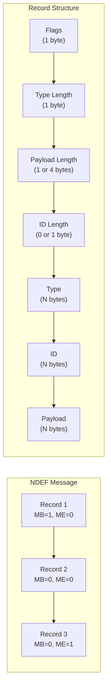

### 38.4.12 在代码中创建 NDEF 记录

常见的 NDEF 构造模式：

```java
// URI record
NdefRecord uriRecord = NdefRecord.createUri("https://android.com");

// Text record
NdefRecord textRecord = NdefRecord.createTextRecord("en", "Hello NFC");

// MIME record
NdefRecord mimeRecord = NdefRecord.createMime(
    "application/json",
    "{\"key\":\"value\"}".getBytes(StandardCharsets.UTF_8)
);

// Android Application Record (AAR)
NdefRecord aarRecord = NdefRecord.createApplicationRecord("com.example.app");

// Compose a message with URI + AAR
NdefMessage message = new NdefMessage(uriRecord, aarRecord);

// Serialize for writing to tag
byte[] rawBytes = message.toByteArray();
```

---

## 38.5 标签分发系统

### 38.5.1 分发优先级链

Android 的标签分发系统遵循一条严格的优先级链，以确定哪个应用处理发现的标签：

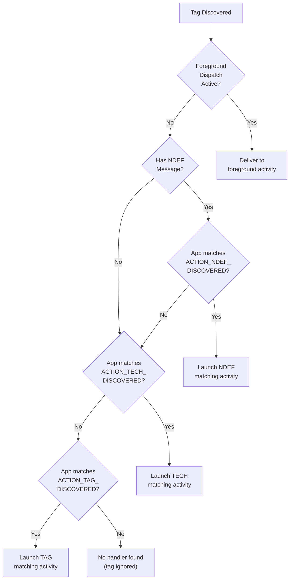

### 38.5.2 ACTION_NDEF_DISCOVERED：最高优先级

`ACTION_NDEF_DISCOVERED` 是最具体的 intent。系统检查第一个 `NdefMessage` 中的
第一条 `NdefRecord`，并构建包含以下内容的 intent：

- **URI 数据**：如果记录是 URI 或 Smart Poster
- **MIME 类型**：如果记录是 MIME 类型记录

```java
// Source: packages/modules/Nfc/NfcNci/src/com/android/nfc/NfcDispatcher.java
public Intent setNdefIntent() {
    intent.setAction(NfcAdapter.ACTION_NDEF_DISCOVERED);
    if (ndefUri != null) {
        intent.setData(ndefUri);
        return intent;
    } else if (ndefMimeType != null) {
        intent.setType(ndefMimeType);
        return intent;
    }
    return null;
}
```

Activity 通过 intent filter 注册以捕获特定的 URI 或 MIME 类型：

```xml
<activity android:name=".NfcHandler">
    <intent-filter>
        <action android:name="android.nfc.action.NDEF_DISCOVERED" />
        <category android:name="android.intent.category.DEFAULT" />
        <data android:scheme="https" android:host="example.com" />
    </intent-filter>
</activity>
```

### 38.5.3 ACTION_TECH_DISCOVERED：技术匹配

如果没有 activity 处理 `ACTION_NDEF_DISCOVERED`，系统将回退到
`ACTION_TECH_DISCOVERED`。此 intent 基于标签支持的技术而非载荷内容进行匹配。

Activity 通过指向 XML 资源的 `meta-data` 元素声明其兴趣：

```xml
<!-- AndroidManifest.xml -->
<activity android:name=".TechHandler">
    <intent-filter>
        <action android:name="android.nfc.action.TECH_DISCOVERED" />
    </intent-filter>
    <meta-data android:name="android.nfc.action.TECH_DISCOVERED"
               android:resource="@xml/nfc_tech_filter" />
</activity>
```

过滤 XML 在 `tech-list` 内部使用 AND，在 `tech-list` 组之间使用 OR：

```xml
<!-- res/xml/nfc_tech_filter.xml -->
<resources>
    <!-- Match any tag with NfcA AND Ndef -->
    <tech-list>
        <tech>android.nfc.tech.NfcA</tech>
        <tech>android.nfc.tech.Ndef</tech>
    </tech-list>

    <!-- OR match any tag with NfcF -->
    <tech-list>
        <tech>android.nfc.tech.NfcF</tech>
    </tech-list>
</resources>
```

匹配逻辑：如果任意单个 `tech-list` 是标签技术列表的**子集**，则标签匹配。

### 38.5.4 ACTION_TAG_DISCOVERED：兜底回退

`ACTION_TAG_DISCOVERED` 是优先级最低的回退方案。它匹配任何 NFC 标签，无论内容
或技术如何。它被设计为最后的兜底手段——设计良好的应用应使用更具体的 intent：

```java
// Source: packages/modules/Nfc/NfcNci/src/com/android/nfc/NfcDispatcher.java
public Intent setTagIntent() {
    intent.setData(null);
    intent.setType(null);
    intent.setAction(NfcAdapter.ACTION_TAG_DISCOVERED);
    return intent;
}
```

### 38.5.5 NfcDispatcher：分发引擎

`NfcDispatcher` 编排整个分发链：

```java
// Source: packages/modules/Nfc/NfcNci/src/com/android/nfc/NfcDispatcher.java
class NfcDispatcher {
    static final int DISPATCH_SUCCESS = 1;
    static final int DISPATCH_FAIL = 2;
    static final int DISPATCH_UNLOCK = 3;

    private PendingIntent mOverrideIntent;         // foreground dispatch
    private IntentFilter[] mOverrideFilters;        // foreground dispatch filters
    private String[][] mOverrideTechLists;          // foreground dispatch techs
    private final RegisteredComponentCache mTechListFilters; // tech discovery cache
    ...
}
```

分发流程：

1. 检查前台分发覆盖（`mOverrideIntent`）
2. 在 `tryNdef()` 中：构建 `ACTION_NDEF_DISCOVERED` intent（URI 或 MIME
   类型），然后尝试 AAR/OEM 包目标
3. 如果 NDEF URI 是 http(s) 网页链接，将 intent 切换为 `ACTION_VIEW` 并提示
   用户（当存在接收者时立即返回）
4. 否则解析 `ACTION_NDEF_DISCOVERED` 的 activity
5. 通过技术匹配尝试 `ACTION_TECH_DISCOVERED`
6. 将 `ACTION_TAG_DISCOVERED` 作为最终回退尝试
7. 如果没有匹配，返回 `DISPATCH_FAIL`

### 38.5.6 DispatchInfo：构建 Intent

`DispatchInfo` 是一个辅助类，用所有必要的 extras 构建分发 intent：

```java
// Source: packages/modules/Nfc/NfcNci/src/com/android/nfc/NfcDispatcher.java
static class DispatchInfo {
    public final Intent intent;
    public final Tag tag;
    final Uri ndefUri;
    final String ndefMimeType;

    DispatchInfo(Context context, NfcInjector nfcInjector,
            Tag tag, NdefMessage message) {
        intent = new Intent();
        intent.putExtra(NfcAdapter.EXTRA_TAG, tag);
        intent.putExtra(NfcAdapter.EXTRA_ID, tag.getId());
        if (message != null) {
            intent.putExtra(NfcAdapter.EXTRA_NDEF_MESSAGES,
                    new NdefMessage[] {message});
            ndefUri = message.getRecords()[0].toUri();
            ndefMimeType = message.getRecords()[0].toMimeType();
        } else {
            ndefUri = null;
            ndefMimeType = null;
        }
        ...
    }
}
```

提供给接收 activity 的 intent extras：

| Extra | 类型 | 用途 |
|-------|------|---------|
| `EXTRA_TAG` | `Tag` | 发现的标签对象 |
| `EXTRA_ID` | `byte[]` | 标签 UID |
| `EXTRA_NDEF_MESSAGES` | `NdefMessage[]` | NDEF 消息（如果有） |

### 38.5.7 前台分发覆盖

前台分发给予当前可见的 activity 标签事件的最高优先级，绕过常规分发链：

```java
// Source: packages/modules/Nfc/NfcNci/src/com/android/nfc/NfcDispatcher.java
public synchronized void setForegroundDispatch(PendingIntent intent,
        IntentFilter[] filters, String[][] techLists) {
    mOverrideIntent = intent;
    mOverrideFilters = filters;
    mOverrideTechLists = techLists;
    ...
}
```

当前台分发处于激活状态且发现标签时：

1. 如果 `mOverrideFilters` 为 null 或标签匹配某个 filter，则投递到
   `mOverrideIntent`
2. 标签**不会**通过常规链分发

如果 activity 进入后台，分发会通过 `ForegroundUtils.Callback` 自动清除：

```java
class ForegroundCallbackImpl implements ForegroundUtils.Callback {
    @Override
    public void onUidToBackground(int uid) {
        synchronized (NfcDispatcher.this) {
            if (mForegroundUid == uid) {
                setForegroundDispatch(null, null, null);
            }
        }
    }
}
```

### 38.5.8 tech-list XML 过滤格式

tech-list XML 文件由 `RegisteredComponentCache` 解析，后者维护所有带有
`ACTION_TECH_DISCOVERED` 过滤器的 activity 的缓存：

```java
// Source: packages/modules/Nfc/NfcNci/src/com/android/nfc/NfcDispatcher.java
private final RegisteredComponentCache mTechListFilters;

// Initialized with:
mTechListFilters = new RegisteredComponentCache(mContext,
        NfcAdapter.ACTION_TECH_DISCOVERED,
        NfcAdapter.ACTION_TECH_DISCOVERED);
```

过滤器可用的技术类：

| 类 | ISO 标准 |
|-------|-------------|
| `android.nfc.tech.NfcA` | ISO 14443-3A |
| `android.nfc.tech.NfcB` | ISO 14443-3B |
| `android.nfc.tech.NfcF` | JIS X 6319-4（FeliCa） |
| `android.nfc.tech.NfcV` | ISO 15693 |
| `android.nfc.tech.IsoDep` | ISO 14443-4 |
| `android.nfc.tech.Ndef` | 已格式化为 NDEF |
| `android.nfc.tech.NdefFormatable` | 可格式化为 NDEF |
| `android.nfc.tech.MifareClassic` | NXP MIFARE Classic |
| `android.nfc.tech.MifareUltralight` | NXP MIFARE Ultralight |
| `android.nfc.tech.NfcBarcode` | Kovio/Thinfilm 条码 |

### 38.5.9 标签应用偏好列表

Android 支持按用户划分的偏好列表，控制哪些应用接收标签事件。用户可以静音特定
应用，使其不接收 NFC 标签分发：

```java
// Source: packages/modules/Nfc/NfcNci/src/com/android/nfc/NfcService.java
HashMap<Integer, HashMap<String, Boolean>> mTagAppPrefList =
        new HashMap<Integer, HashMap<String, Boolean>>();
```

分发引擎在投递 intent 之前检查该列表：

```java
// Source: packages/modules/Nfc/NfcNci/src/com/android/nfc/NfcDispatcher.java
List<ResolveInfo> checkPrefList(List<ResolveInfo> activities, int userId) {
    // ...
    Map<String, Boolean> preflist =
            mNfcAdapter.getTagIntentAppPreferenceForUser(userId);
    if (preflist.containsKey(pkgName)) {
        if (!preflist.get(pkgName)) {
            // Muted -- remove from candidate list
            filtered.remove(resolveInfo);
        }
    }
    // ...
}
```

### 38.5.10 多用户分发

标签分发遵循 Android 的多用户模型。分发器先尝试当前前台用户，然后回退到其他活跃
用户 profile：

```java
// Source: packages/modules/Nfc/NfcNci/src/com/android/nfc/NfcDispatcher.java
boolean tryStartActivity() {
    // Try current user
    List<ResolveInfo> activities = queryNfcIntentActivitiesAsUser(
            packageManager, intent,
            UserHandle.of(ActivityManager.getCurrentUser()));
    // ...
    if (activities.size() > 0) {
        context.startActivityAsUser(rootIntent, UserHandle.CURRENT);
        return true;
    }
    // Try other active users
    List<UserHandle> userHandles = getCurrentActiveUserHandles();
    // ...
}
```

### 38.5.11 标签 intent 的清单注册

处理 NFC 标签的完整清单注册：

```xml
<manifest ...>
    <uses-permission android:name="android.permission.NFC" />
    <uses-feature android:name="android.hardware.nfc"
                  android:required="true" />

    <application ...>
        <!-- Handle NDEF URI tags -->
        <activity android:name=".NdefUriActivity"
                  android:exported="true">
            <intent-filter>
                <action android:name="android.nfc.action.NDEF_DISCOVERED" />
                <category android:name="android.intent.category.DEFAULT" />
                <data android:scheme="https"
                      android:host="example.com"
                      android:pathPrefix="/nfc/" />
            </intent-filter>
        </activity>

        <!-- Handle NDEF MIME tags -->
        <activity android:name=".NdefMimeActivity"
                  android:exported="true">
            <intent-filter>
                <action android:name="android.nfc.action.NDEF_DISCOVERED" />
                <category android:name="android.intent.category.DEFAULT" />
                <data android:mimeType="application/vnd.example.mydata" />
            </intent-filter>
        </activity>

        <!-- Handle specific tech tags -->
        <activity android:name=".TechActivity"
                  android:exported="true">
            <intent-filter>
                <action android:name="android.nfc.action.TECH_DISCOVERED" />
            </intent-filter>
            <meta-data android:name="android.nfc.action.TECH_DISCOVERED"
                       android:resource="@xml/tech_filter" />
        </activity>

        <!-- Catch-all for any tag -->
        <activity android:name=".TagCatchAllActivity"
                  android:exported="true">
            <intent-filter>
                <action android:name="android.nfc.action.TAG_DISCOVERED" />
                <category android:name="android.intent.category.DEFAULT" />
            </intent-filter>
        </activity>
    </application>
</manifest>
```

### 38.5.12 标签分发中的常见陷阱

1. **只注册 `ACTION_TAG_DISCOVERED`**——只有在没有更具体的处理者时才会捕获标
   签。请优先使用 `ACTION_NDEF_DISCOVERED` 或 `ACTION_TECH_DISCOVERED`。

2. **忘记 `android:exported="true"`**——标签分发使用隐式 intent，在 Android 12+
   上要求 activity 必须导出。

3. **不处理多记录消息**——分发系统只检查第一条记录。额外的记录（如 AAR）必须
   显式处理。

4. **缺少 DEFAULT 类别**——`ACTION_NDEF_DISCOVERED` 和
   `ACTION_TAG_DISCOVERED` 要求 intent filter 中包含 `CATEGORY_DEFAULT`。

5. **不使用前台分发**——对于需要保证标签访问的应用（例如标签写入器），前台分发
   可以避免 activity 选择器。

### 38.5.13 内置标签查看器应用

AOSP 在 `packages/apps/Tag/`（包名 `com.android.apps.tag`）中附带了一个小型参考
处理程序，位于分发链的末端。它是一个特权应用，只有一个 activity `TagViewer`，当
没有更具体的处理者认领标签时，它会显示扫描到的 NDEF 标签的内容。

它的注册展示了 38.5.1 中兜底模式的实际运用。该 activity 设置了
`android:priority="-10"`，因此任何其他匹配的处理者在选择器排序中胜出。它通过
包含单个技术 `android.nfc.tech.Ndef` 的 tech-list 过滤 `TECH_DISCOVERED`
（`packages/apps/Tag/res/xml/filter_nfc.xml`）。它还有一个针对
`vnd.android.cursor.item/ndef_msg` MIME 类型的 `VIEW` 过滤器：

```xml
<!-- Source: packages/apps/Tag/AndroidManifest.xml -->
<activity android:name="TagViewer"
    android:priority="-10"
    android:permission="android.permission.DISPATCH_NFC_MESSAGE">
    <intent-filter>
        <action android:name="android.nfc.action.TECH_DISCOVERED"/>
    </intent-filter>
    <meta-data android:name="android.nfc.action.TECH_DISCOVERED"
        android:resource="@xml/filter_nfc"/>
</activity>
```

`TagViewer.resolveIntent()` 读取 `NfcDispatcher` 打包进 intent 的 `EXTRA_NDEF_MESSAGES`
数组（38.5.6）。它将第一条消息交给 `NdefMessageParser`
（`packages/apps/Tag/src/com/android/apps/tag/message/`）。解析器将每条记录分类
到对应的渲染器：Smart Poster、URI、文本、图像、vCard、通用 MIME 或未知记录兜底。
每个渲染器自行填充视图，因此扫描到的标签会以可读的行而非原始字节显示。

该应用只解析标签上的第一条 NDEF 消息，且仅涵盖这些记录类型，别无其他。它是一个
用于手动查看标签的查看器，自身不包含任何框架逻辑。将标签投递给它的分发机制见
38.4 及 38.5 其余部分。

---

## 38.6 主机卡模拟（HCE）

### 38.6.1 HCE 是什么

主机卡模拟允许 Android 设备模拟 ISO-DEP（ISO 14443-4）无接触智能卡。APDU 交换
由应用处理器处理，而不是由专用安全元件处理。这使以下场景成为可能：

- 无接触支付（Google Wallet、银行应用）
- 会员卡
- 交通卡（在受支持的地方）
- 门禁卡

HCE 于 Android 4.4（KitKat，API 19）中引入。

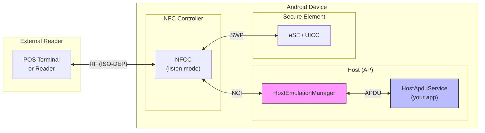

### 38.6.2 架构：HostApduService

应用通过继承 `HostApduService` 实现 HCE：

```java
public class MyPaymentService extends HostApduService {
    @Override
    public byte[] processCommandApdu(byte[] apdu, Bundle extras) {
        // Process the SELECT APDU or subsequent commands
        if (isSelectAid(apdu)) {
            return SELECT_OK_SW;
        }
        // Process transaction APDUs
        return processTransaction(apdu);
    }

    @Override
    public void onDeactivated(int reason) {
        // Clean up when the reader moves away
    }
}
```

该服务在清单中通过 AID 组声明：

```xml
<service android:name=".MyPaymentService"
         android:exported="true"
         android:permission="android.permission.BIND_NFC_SERVICE">
    <intent-filter>
        <action android:name="android.nfc.cardemulation.action.HOST_APDU_SERVICE" />
    </intent-filter>
    <meta-data android:name="android.nfc.cardemulation.host_apdu_service"
               android:resource="@xml/apdu_service" />
</service>
```

### 38.6.3 CardEmulationManager：编排者

`CardEmulationManager` 是所有卡模拟功能的中央协调器：

```java
// Source: packages/modules/Nfc/NfcNci/src/com/android/nfc/cardemulation/
//         CardEmulationManager.java
public class CardEmulationManager implements
        RegisteredServicesCache.Callback,
        RegisteredNfcFServicesCache.Callback,
        PreferredServices.Callback,
        EnabledNfcFServices.Callback,
        WalletRoleObserver.Callback {

    final RegisteredAidCache mAidCache;
    final RegisteredT3tIdentifiersCache mT3tIdentifiersCache;
    final RegisteredServicesCache mServiceCache;
    final RegisteredNfcFServicesCache mNfcFServicesCache;
    final HostEmulationManager mHostEmulationManager;
    final HostNfcFEmulationManager mHostNfcFEmulationManager;
    final PreferredServices mPreferredServices;
    final WalletRoleObserver mWalletRoleObserver;
    ...
}
```

它管理八个子系统（第九个节点 `AidRoutingManager` 由 `RegisteredAidCache` 拥有，
而非由 `CardEmulationManager` 直接拥有）：

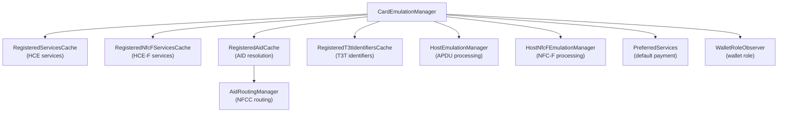

### 38.6.4 AID 注册与路由

AID（应用标识符）路由决定哪个服务处理哪个卡应用。AID 遵循 ISO 7816-4，以十六进制
编码：

```java
// Source: packages/modules/Nfc/NfcNci/src/com/android/nfc/cardemulation/
//         CardEmulationManager.java
static final int MINIMUM_AID_LENGTH = 5;
static final int SELECT_APDU_HDR_LENGTH = 5;

// NDEF Tag application AIDs
static final byte[] NDEF_AID_V1 =
        new byte[] {(byte)0xd2, 0x76, 0x00, 0x00, (byte)0x85, 0x01, 0x00};
static final byte[] NDEF_AID_V2 =
        new byte[] {(byte)0xd2, 0x76, 0x00, 0x00, (byte)0x85, 0x01, 0x01};

// Select APDU header: CLA INS P1 P2
static final byte[] SELECT_AID_HDR = new byte[] {0x00, (byte)0xa4, 0x04, 0x00};
```

NFCC 中的路由表将 AID 映射到目的地：

| 路由 ID | 目的地 |
|----------|-------------|
| 0x00 | 主机（应用处理器） |
| 0x01-0xFF | 离主机（eSE、UICC 等） |

### 38.6.5 AID 组与类别

服务在 XML 中声明 AID 组，每个组属于一个类别：

```xml
<!-- res/xml/apdu_service.xml -->
<host-apdu-service xmlns:android="http://schemas.android.com/apk/res/android"
    android:description="@string/service_description"
    android:requireDeviceUnlock="false"
    android:apduServiceBanner="@drawable/banner">

    <!-- Payment AID group -->
    <aid-group android:description="@string/payment"
               android:category="payment">
        <aid-filter android:name="A0000000041010" />  <!-- Visa -->
        <aid-filter android:name="A0000000031010" />  <!-- Mastercard -->
    </aid-group>

    <!-- Other AID group -->
    <aid-group android:description="@string/loyalty"
               android:category="other">
        <aid-filter android:name="F0010203040506" />
    </aid-group>
</host-apdu-service>
```

两个 AID 类别：

- `payment`——只能有一个支付服务处于激活状态（默认支付服务）
- `other`——多个服务可以注册相同的 AID；如果发生冲突，会提示用户

### 38.6.6 HostEmulationManager：APDU 处理

`HostEmulationManager` 管理 NFC 控制器与所绑定的 `HostApduService` 之间的 APDU
交换：

```java
// Source: packages/modules/Nfc/NfcNci/src/com/android/nfc/cardemulation/
//         HostEmulationManager.java
public class HostEmulationManager {
    static final int STATE_IDLE = 0;
    static final int STATE_W4_SELECT = 1;
    static final int STATE_W4_SERVICE = 2;
    static final int STATE_W4_DEACTIVATE = 3;
    static final int STATE_XFER = 4;
    static final int STATE_POLLING_LOOP = 5;

    static final byte INSTR_SELECT = (byte)0xA4;

    // Standard responses
    static final byte[] AID_NOT_FOUND = {0x6A, (byte)0x82};
    static final byte[] UNKNOWN_ERROR = {0x6F, 0x00};

    // Android-specific HCE detection AID
    static final String ANDROID_HCE_AID = "A000000476416E64726F6964484345";
    static final byte[] ANDROID_HCE_RESPONSE =
            {0x14, (byte)0x81, 0x00, 0x00, (byte)0x90, 0x00};
    ...
}
```

### 38.6.7 HCE 状态机

HCE 状态机处理单次卡模拟事务的生命周期：

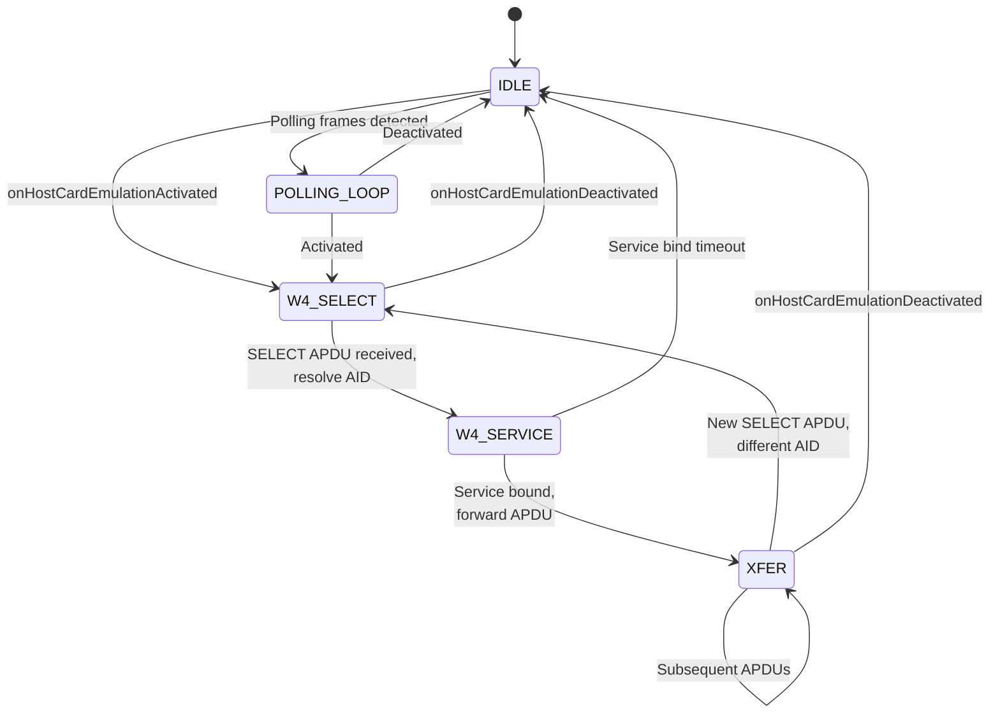

当 SELECT APDU 到达时：

1. 从 APDU 中提取 AID（`CLA=0x00, INS=0xA4, P1=0x04, P2=0x00`）
2. 在 `RegisteredAidCache` 中查找 AID
3. 如果解析出的服务与当前绑定的服务不同，则解绑旧的、绑定新的
4. 通过 `Messenger` 将 APDU 转发给服务
5. 通过 NCI 协议栈中转服务的响应

### 38.6.8 RegisteredAidCache：AID 解析

`RegisteredAidCache` 维护从 AID 到服务的 `TreeMap`。它只定义路由限定符：

```java
// Source: packages/modules/Nfc/NfcNci/src/com/android/nfc/cardemulation/
//         RegisteredAidCache.java
static final int AID_ROUTE_QUAL_SUBSET = 0x20;
static final int AID_ROUTE_QUAL_PREFIX = 0x10;
```

四个 AID 匹配支持级别本身是 `AidRoutingManager.java` 中的 `AID_MATCHING_*` 常量，
通过 `RoutingOptionManager.getAidMatchingSupport()` 查询：

| 模式 | 常量 | 行为 |
|------|----------|----------|
| 仅精确匹配 | `AID_MATCHING_EXACT_ONLY` | AID 必须完全匹配 |
| 精确或前缀 | `AID_MATCHING_EXACT_OR_PREFIX` | AID 或前缀匹配 |
| 仅前缀 | `AID_MATCHING_PREFIX_ONLY` | 所有 AID 都是前缀匹配 |
| 精确、子集或前缀 | `AID_MATCHING_EXACT_OR_SUBSET_OR_PREFIX` | 最灵活 |

电源状态路由控制路由何时处于激活状态：

```java
static final int POWER_STATE_SWITCH_ON = 0x1;
static final int POWER_STATE_SWITCH_OFF = 0x2;
static final int POWER_STATE_BATTERY_OFF = 0x4;
static final int POWER_STATE_SCREEN_OFF_UNLOCKED = 0x8;
static final int POWER_STATE_SCREEN_ON_LOCKED = 0x10;
static final int POWER_STATE_SCREEN_OFF_LOCKED = 0x20;
```

### 38.6.9 AidRoutingManager：NFCC 路由表

`AidRoutingManager` 将解析后的 AID 映射转换为实际的 NFCC 路由表：

```java
// Source: packages/modules/Nfc/NfcNci/src/com/android/nfc/cardemulation/
//         AidRoutingManager.java
public class AidRoutingManager {
    static final int ROUTE_HOST = 0x00;

    int mDefaultRoute;
    int mDefaultIsoDepRoute;
    int mDefaultOffHostRoute;
    int mDefaultFelicaRoute;
    int mDefaultSysCodeRoute;

    // Routing table: route ID -> set of AIDs
    SparseArray<Set<String>> mAidRoutingTable;
    // Reverse lookup: AID -> route ID
    HashMap<String, Integer> mRouteForAid;
    // Power state per AID
    HashMap<String, Integer> mPowerForAid;
    ...
}
```

路由表的大小受限于 NFCC 硬件（`mMaxAidRoutingTableSize`）。当路由表超过此限制时，
管理器必须对条目进行优先级排序或压缩。

### 38.6.10 首选支付服务与钱包角色

Android 指定一个"首选支付服务"来默认处理支付 AID。这与**钱包角色**
（`RoleManager.ROLE_WALLET`）绑定，后者取代了旧的"默认支付应用"设置：

```java
// Source: packages/modules/Nfc/NfcNci/src/com/android/nfc/cardemulation/
//         CardEmulationManager.java
final WalletRoleObserver mWalletRoleObserver;
final PreferredServices mPreferredServices;
```

`WalletRoleObserver` 通过 `RoleManager` 监听角色变化，并解析每个用户的当前持有者：

```java
// Source: packages/modules/Nfc/NfcNci/src/com/android/nfc/cardemulation/
//         WalletRoleObserver.java
public PackageAndUser getDefaultWalletRoleHolder(int userId) {
    // ...
    List<String> roleHolders = mRoleManager.getRoleHoldersAsUser(
            RoleManager.ROLE_WALLET, roleUserHandle);
    // ...
}
```

当持有者变化时，`CardEmulationManager.onWalletRoleHolderChanged()` 将新包传播给
`PreferredServices` 和 `RegisteredAidCache`
（`packages/modules/Nfc/NfcNci/src/com/android/nfc/cardemulation/CardEmulationManager.java`），
使路由表跟随钱包角色。

钱包角色持有者在以下方面享有优先权：

- 支付类别 AID
- 碰一碰支付界面
- 默认无接触支付选择

钱包角色的覆盖范围在 Android 17 中得到了扩展。38.10 节描述了新的
**关联包**（associated-package）机制。有了它，角色持有者可以将角色持有者路由优先
权授予一个兄弟包。该包不需要自己拥有该角色。

### 38.6.11 观察模式与轮询循环过滤器

观察模式是一项高级功能，允许 HCE 服务在不完全激活卡模拟事务的情况下接收轮询
循环帧。这使以下场景成为可能：

- 在泄露卡片凭据之前检测读卡器在场
- 实现自定义事务流程
- 支持保护隐私的支付协议

```java
// Source: packages/modules/Nfc/NfcNci/src/com/android/nfc/NfcService.java
@Override
public void onPollingLoopDetected(List<PollingFrame> frames) {
    if (mCardEmulationManager != null) {
        synchronized (mPollingLoopsDetectedRunnable) {
            mPollingFramesToBeSent.addAll(frames);
            if (!mHandler.hasCallbacks(mPollingLoopsDetectedRunnable)) {
                mHandler.post(mPollingLoopsDetectedRunnable);
            }
        }
    }
}
```

该回调不会内联转发帧。它将其批量收集到 `mPollingFramesToBeSent` 中，并将
`mPollingLoopsDetectedRunnable` 发送到 `mHandler`。随后，处理器排空该列表并在
处理器线程上调用 `mCardEmulationManager.onPollingLoopDetected()`。

固件可以自主启用或禁用观察模式：

```java
@Override
public void onObserveModeDisabledInFirmware(PollingFrame exitFrame) {
    mCardEmulationManager.onObserveModeDisabledInFirmware(exitFrame);
    onObserveModeStateChanged(false);
}

@Override
public void onObserveModeEnabledInFirmware() {
    onObserveModeStateChanged(true);
}
```

应用通过 `NfcAdapter.setObserveModeEnabled(boolean)` 切换观察模式，并由
`isObserveModeSupported()` 把关。如果事务或标签操作已在进行中，服务将拒绝切换，
因此状态机绝不会在 APDU 中途翻转：

```java
// Source: packages/modules/Nfc/NfcNci/src/com/android/nfc/NfcService.java
private boolean setObserveModeInternal(boolean enable, int callingUid,
        String packageName, int triggerSource) {
    synchronized (NfcService.this) {
        if (mCardEmulationManager.isHostCardEmulationActivated()) {
            return false;   // cannot toggle during a transaction
        }
        if (mTagConnected) {
            return false;   // cannot toggle during tag operations
        }
        boolean result = mDeviceHost.setObserveMode(enable);
        // ... statsd + event log ...
    }
}
```

Android 17 增加了 `NfcAdapter.allowOneTransaction()`（由
`packages/modules/Nfc/flags/flags.aconfig` 中的 `nfcstack_26q2_updates` 标志保
护）。它会在*单次* HCE 事务期间临时禁用观察模式。然后在事务完成或射频场丢失后
自动重新启用观察模式。这是钱包用来让一次碰一碰支付通过、而无需永久关闭观察模式
的构建模块。它通过 `INfcAdapter.allowOneTransaction()`
（`packages/modules/Nfc/framework/java/android/nfc/INfcAdapter.aidl`）到达服务。

### 38.6.12 离主机卡模拟

离主机卡模拟将 APDU 直接路由到安全元件（eSE 或 UICC），而不涉及应用处理器。
用于以下场景：

- 基于 SIM 的支付
- 电信应用
- 高安全性凭据

路由通过 `NfcConfig` 配置：

```
// From NfcConfig:
byte defaultOffHostRoute;       // Default off-host destination
byte[] offHostRouteUicc;        // UICC route IDs
byte[] offHostRouteEse;         // eSE route IDs
```

应用使用 `OffHostApduService` 声明离主机服务：

```xml
<service android:name=".MyOffHostService"
         android:exported="true"
         android:permission="android.permission.BIND_NFC_SERVICE">
    <intent-filter>
        <action android:name=
            "android.nfc.cardemulation.action.OFF_HOST_APDU_SERVICE" />
    </intent-filter>
    <meta-data android:name=
            "android.nfc.cardemulation.off_host_apdu_service"
               android:resource="@xml/offhost_service" />
</service>
```

### 38.6.13 HCE 安全考虑

1. **无硬件隔离**——与基于 SE 的模拟不同，HCE 在应用处理器上处理 APDU。被攻陷
   的操作系统可以拦截事务数据。

2. **令牌化**——支付网络通过使用令牌化的 PAN 来降低风险，即使被拦截也毫无价值。

3. **设备解锁要求**——服务可以要求设备处于解锁状态
   （`android:requireDeviceUnlock="true"`）。

4. **BIND_NFC_SERVICE 权限**——只有 NFC 系统服务才能绑定到 HCE 服务，防止恶意
   应用拦截 APDU。

5. **AID 冲突解决**——当多个应用注册相同的 AID 时，系统会为"other"类别显示选择
   器。对于"payment"类别，它使用默认支付服务。

---

## 38.7 安全元件

### 38.7.1 安全元件是什么

安全元件（SE）是一种防篡改的硬件组件，可以运行 Java Card applet。它为支付凭据存
储等敏感操作提供硬件隔离的执行环境。

Android 设备中存在三种类型的 SE：

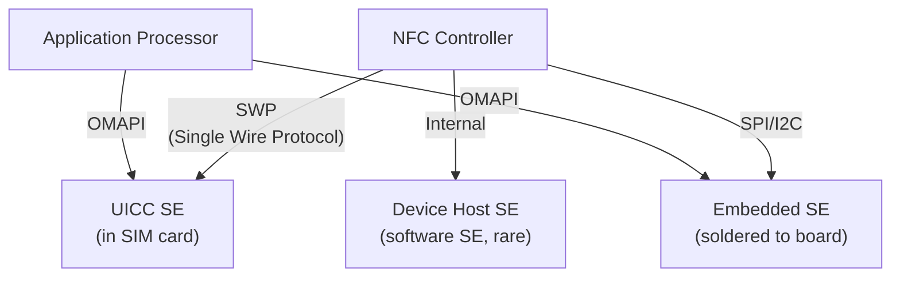

### 38.7.2 eSE：嵌入式安全元件

eSE 是焊接在设备主板上的专用芯片。它永久连接到 NFC 控制器，并可选择供应用处理器
访问。主要特性：

- 用户无法移除
- 由设备制造商控制
- 即使设备关机（电池耗尽模式）也能执行无接触交易
- 通过 SPI、I2C 或专有接口连接到 NFCC

在 `NfcConfig` 中，eSE 由以下字段标识：

```
byte[] offHostRouteEse;     // Route IDs for eSE
byte offHostESEPipeId;      // HCI pipe ID for eSE
```

### 38.7.3 基于 UICC 的安全元件

UICC（通用集成电路卡——即 SIM 卡）包含一个集成的 SE。它通过单线协议（SWP）连接
到 NFC 控制器：

- 可移除，由移动网络运营商控制
- 包含电信 applet（SIM 工具包）
- 可以承载运营商配置的支付 applet
- SIM 被移除时连接中断

在 `NfcConfig` 中：

```
byte[] offHostRouteUicc;    // Route IDs for UICC
byte offHostSIMPipeId;      // HCI pipe ID for SIM
byte[] offHostSimPipeIds;   // Multiple SIM pipe IDs
```

### 38.7.4 OMAPI：开放移动 API

OMAPI（开放移动 API）允许应用通过 `android.se.omapi` 包直接与安全元件通信。
NfcService 通过以下方式与 OMAPI 集成：

```java
// Source: packages/modules/Nfc/NfcNci/src/com/android/nfc/NfcService.java
private ISecureElementService mSEService;
```

OMAPI 提供：

- `SEService`——SE 访问的入口点
- `Reader`——表示一个特定的 SE（eSE 或 UICC 卡槽）
- `Session`——与 SE 的一次通信会话
- `Channel`——用于 APDU 交换的逻辑通道

访问 OMAPI 需要 `android.permission.SECURE_ELEMENT_PRIVILEGED_OPERATION` 权限
（用于特权操作），或 SE 内部存储的按 AID 访问控制规则。

### 38.7.5 NFC 控制器中的 SE 路由

NFCC 维护路由条目，将无接触交易引导到相应的 SE：

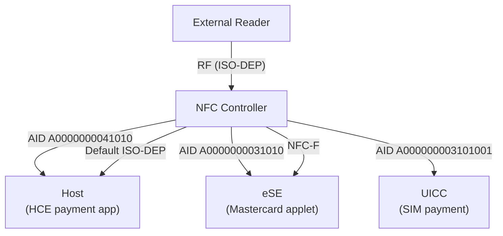

路由维度：

| 路由类型 | 解析方式 | NCI 配置 |
|-------------|-----------|------------|
| 基于 AID | 特定 AID 到特定目的地 | RF_SET_LISTEN_MODE_ROUTING |
| 基于协议 | ISO-DEP/NFC-DEP 到默认目的地 | 技术路由 |
| 基于技术 | NFC-A/B/F 到默认目的地 | 技术路由 |

### 38.7.6 来自 SE 的事务事件

当离主机 SE 处理一笔交易时，NfcService 收到通知并将其广播给感兴趣的应用：

```java
// Source: packages/modules/Nfc/NfcNci/src/com/android/nfc/NfcService.java
@Override
public void onNfcTransactionEvent(byte[] aid, byte[] data, String seName) {
    byte[][] dataObj = {aid, data, seName.getBytes()};
    sendMessage(MSG_TRANSACTION_EVENT, dataObj);
}
```

`MSG_TRANSACTION_EVENT` 处理器广播 `ACTION_TRANSACTION_DETECTED`：

```java
// NfcAdapter constant:
public static final String ACTION_TRANSACTION_DETECTED =
        "android.nfc.action.TRANSACTION_DETECTED";
```

应用必须持有 `NFC_TRANSACTION_EVENT` 权限才能接收这些广播。

### 38.7.7 NfcConfig SE 参数

HAL 的 `NfcConfig` 包含若干与 SE 相关的参数：

| 参数 | 用途 |
|-----------|---------|
| `defaultOffHostRoute` | 离主机路由的默认 NFCEE ID |
| `defaultOffHostRouteFelica` | FeliCa 离主机路由的 NFCEE ID |
| `offHostESEPipeId` | eSE 访问的 HCI 管道 ID |
| `offHostSIMPipeId` | SIM 访问的 HCI 管道 ID |
| `offHostRouteUicc` | UICC NFCEE ID 数组 |
| `offHostRouteEse` | eSE NFCEE ID 数组 |
| `offHostSimPipeIds` | SIM 管道 ID 数组 |
| `hostAllowlist` | 哪些主机可以访问 NFC |

### 38.7.8 离主机路由配置

`RoutingOptionManager` 集中管理离主机路由配置：

```java
// Source: packages/modules/Nfc/NfcNci/src/com/android/nfc/cardemulation/
//         AidRoutingManager.java
int mDefaultOffHostRoute;  // from RoutingOptionManager
int mDefaultFelicaRoute;   // from RoutingOptionManager
int mDefaultSysCodeRoute;  // from RoutingOptionManager
byte[] mOffHostRouteUicc;  // from RoutingOptionManager
byte[] mOffHostRouteEse;   // from RoutingOptionManager
```

### 38.7.9 HCI 网络与管道

主机控制器接口（HCI）网络将 NFC 控制器连接到安全元件。HCI 事件在 JNI 层管理：

```
// Source: packages/modules/Nfc/NfcNci/nci/jni/HciEventManager.cpp
```

必要时会重置 HCI 网络：

```
// NfcEvent enum:
HCI_NETWORK_RESET = 4,
```

HCI 网络重置会清除所有管道连接，需要重新初始化 SE 通信通道。

### 38.7.10 SE 访问控制

对安全元件的访问通过以下方式控制：

1. **访问规则应用主控（ARA-M）**——SE 上的一个 applet，存储将证书哈希映射到
   允许的 AID 的访问控制规则
2. **访问控制执行器**——OMAPI 的内置执行器，在允许通道操作之前查询 ARA-M
3. **Android 权限**——用于特权访问的 `SECURE_ELEMENT_PRIVILEGED_OPERATION`
4. **SELinux**——针对 SE 设备节点的进程级访问控制

---

## 38.8 读卡器模式

### 38.8.1 读卡器模式的作用

读卡器模式为单个前台 activity 提供对 NFC 标签操作的独占访问。处于激活状态时，它会：

- 禁用卡模拟（手机不会以卡片身份响应）
- 禁用点对点模式
- 将轮询聚焦于指定的 NFC 技术
- 将发现的标签直接投递给注册的回调
- 绕过常规标签分发系统

这对于需要可靠、不间断标签通信的应用至关重要——例如交通卡读卡器、标签写入器
和库存管理工具。

### 38.8.2 enableReaderMode API

主要 API：

```java
// Source: packages/modules/Nfc/framework/java/android/nfc/NfcAdapter.java
public void enableReaderMode(Activity activity, ReaderCallback callback,
        int flags, Bundle extras) {
    mNfcActivityManager.enableReaderMode(activity, callback, flags, extras);
}
```

用法：

```java
@Override
protected void onResume() {
    super.onResume();
    NfcAdapter nfc = NfcAdapter.getDefaultAdapter(this);
    if (nfc != null) {
        nfc.enableReaderMode(this,
            new NfcAdapter.ReaderCallback() {
                @Override
                public void onTagDiscovered(Tag tag) {
                    // Handle the tag on a background thread
                    processTag(tag);
                }
            },
            NfcAdapter.FLAG_READER_NFC_A |
            NfcAdapter.FLAG_READER_NFC_B |
            NfcAdapter.FLAG_READER_SKIP_NDEF_CHECK,
            null  // extras Bundle
        );
    }
}

@Override
protected void onPause() {
    super.onPause();
    NfcAdapter nfc = NfcAdapter.getDefaultAdapter(this);
    if (nfc != null) {
        nfc.disableReaderMode(this);
    }
}
```

### 38.8.3 前台分发系统

前台分发是一种较旧的机制，它给予前台 activity 优先标签路由，但不会禁用卡模拟：

```java
@Override
protected void onResume() {
    super.onResume();
    NfcAdapter nfc = NfcAdapter.getDefaultAdapter(this);

    PendingIntent pendingIntent = PendingIntent.getActivity(this, 0,
            new Intent(this, getClass())
                    .addFlags(Intent.FLAG_ACTIVITY_SINGLE_TOP),
            PendingIntent.FLAG_MUTABLE);

    IntentFilter[] filters = new IntentFilter[] {
        new IntentFilter(NfcAdapter.ACTION_NDEF_DISCOVERED)
    };

    String[][] techLists = new String[][] {
        new String[] { NfcA.class.getName() }
    };

    nfc.enableForegroundDispatch(this, pendingIntent, filters, techLists);
}

@Override
protected void onNewIntent(Intent intent) {
    if (NfcAdapter.ACTION_NDEF_DISCOVERED.equals(intent.getAction())) {
        Tag tag = intent.getParcelableExtra(NfcAdapter.EXTRA_TAG);
        // Process the tag
    }
}

@Override
protected void onPause() {
    super.onPause();
    NfcAdapter.getDefaultAdapter(this).disableForegroundDispatch(this);
}
```

**比较：读卡器模式 vs 前台分发**

| 特性 | 读卡器模式 | 前台分发 |
|---------|-------------|-------------------|
| 卡模拟 | 禁用 | 激活 |
| P2P 模式 | 禁用 | 激活 |
| 投递方式 | 回调 | Intent |
| NDEF 自动读取 | 可配置 | 始终尝试 |
| 线程 | 回调线程 | 主线程 |
| API level | 19+ | 10+ |

### 38.8.4 读卡器模式标志与技术掩码

读卡器模式标志控制轮询哪些技术：

```java
// Source: packages/modules/Nfc/framework/java/android/nfc/NfcAdapter.java
public static final int FLAG_READER_NFC_A = 0x1;          // ISO 14443-3A
public static final int FLAG_READER_NFC_B = 0x2;          // ISO 14443-3B
public static final int FLAG_READER_NFC_F = 0x4;          // JIS X 6319-4
public static final int FLAG_READER_NFC_V = 0x8;          // ISO 15693
public static final int FLAG_READER_NFC_BARCODE = 0x10;   // Kovio barcode
public static final int FLAG_READER_SKIP_NDEF_CHECK = 0x80;     // Don't auto-read NDEF
public static final int FLAG_READER_NO_PLATFORM_SOUNDS = 0x100; // Suppress tap sound
```

这些映射到 NfcService 的内部轮询掩码：

```java
// Source: packages/modules/Nfc/NfcNci/src/com/android/nfc/NfcService.java
static final int NFC_POLL_A = 0x01;
static final int NFC_POLL_B = 0x02;
static final int NFC_POLL_F = 0x04;
static final int NFC_POLL_V = 0x08;
static final int NFC_POLL_B_PRIME = 0x10;
static final int NFC_POLL_KOVIO = 0x20;
```

### 38.8.5 在场检查机制

在场检查确定标签是否仍在通信范围内。有三种算法可用：

```
// Source: hardware/interfaces/nfc/aidl/.../PresenceCheckAlgorithm.aidl
enum PresenceCheckAlgorithm {
    DEFAULT = 0,      // Stack decides
    I_BLOCK = 1,      // Send ISO-DEP I-Block
    ISO_DEP_NAK = 2,  // Send ISO-DEP NAK
}
```

NfcService 配置默认的在场检查延迟：

```java
// Source: packages/modules/Nfc/NfcNci/src/com/android/nfc/NfcService.java
static final int DEFAULT_PRESENCE_CHECK_DELAY = 125;  // milliseconds
```

应用可以通过传递给 `enableReaderMode()` 的 extras Bundle 自定义延迟：

```java
Bundle extras = new Bundle();
extras.putInt(NfcAdapter.EXTRA_READER_PRESENCE_CHECK_DELAY, 500);
nfc.enableReaderMode(this, callback, flags, extras);
```

### 38.8.6 NFC 发现参数

`NfcDiscoveryParameters` 封装了 NFC 控制器的发现配置：

```java
// Source: packages/modules/Nfc/NfcNci/src/com/android/nfc/NfcDiscoveryParameters.java
NfcDiscoveryParameters mCurrentDiscoveryParameters =
        NfcDiscoveryParameters.getNfcOffParameters();
```

参数包括：

- 技术掩码（轮询哪些技术）
- 监听模式配置（卡模拟）
- 轮询间隔
- 依赖屏幕状态的行为

### 38.8.7 轮询技术掩码

默认轮询技术掩码启用了大多数常见技术：

```java
// Source: packages/modules/Nfc/NfcNci/src/com/android/nfc/NfcService.java
static final int DEFAULT_POLL_TECH = 0x2f;
// Binary: 0010 1111
// Enabled: NFC_POLL_A | NFC_POLL_B | NFC_POLL_F | NFC_POLL_V | NFC_POLL_KOVIO

static final int DEFAULT_LISTEN_TECH = 0xf;
// Binary: 0000 1111
// Enabled: NFC_LISTEN_A | NFC_LISTEN_B | NFC_LISTEN_F | NFC_LISTEN_V
```

用户可以通过设置自定义轮询和监听技术掩码：

```java
static final String PREF_POLL_TECH = "polling_tech_dfl";
static final String PREF_LISTEN_TECH = "listen_tech_dfl";
```

### 38.8.8 标签去抖

标签去抖防止同一标签在短时间内被多次分发：

```java
// Source: packages/modules/Nfc/NfcNci/src/com/android/nfc/NfcService.java
byte mDebounceTagUid[];
int mDebounceTagDebounceMs;
int mDebounceTagNativeHandle = INVALID_NATIVE_HANDLE;
ITagRemovedCallback mDebounceTagRemovedCallback;
```

当对某个标签调用 `ignore()` 时，其 UID 被存储在 `mDebounceTagUid` 中。在指定的
去抖期间，任何具有相同 UID 的标签都会被静默忽略。

### 38.8.9 读卡器模式 vs 常规发现

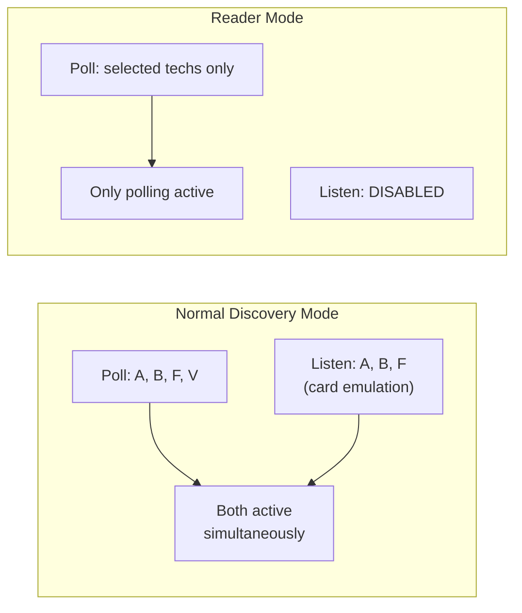

NFC 控制器行为的主要差异：

| 方面 | 常规模式 | 读卡器模式 |
|--------|------------|-------------|
| 轮询 | 所有默认技术 | 仅指定的标志 |
| 监听 | 激活（HCE） | 禁用 |
| NDEF 自动读取 | 始终 | 可配置 |
| P2P | 可用 | 禁用 |
| 分发 | 基于 intent | 基于回调 |
| 声音 | 平台声音 | 可配置 |

---

## 38.9 NFC-F（FeliCa）与 NFC-V

### 38.9.1 NFC-F：FeliCa 概述

NFC-F（JIS X 6319-4）是索尼 FeliCa 系统使用的无接触技术，在日本占主导地位，
用于：

- 交通卡（Suica、PASMO、ICOCA）
- 电子货币（Edy、nanaco、WAON）
- 身份卡

FeliCa 在标准 13.56 MHz NFC 频率下，以 212 kbps 或 424 kbps 的速率使用专有通信
方案。主要特性：

- **系统码**——标识卡应用（类似于 ISO-DEP 的 AID）
- **IDm（制造商）**——制造过程中分配的 8 字节标识符
- **PMm**——制造参数存储器

### 38.9.2 NfcF 标签技术类

`NfcF` 类提供对 NFC-F 标签属性和原始通信的访问：

```java
// Source: packages/modules/Nfc/framework/java/android/nfc/tech/NfcF.java
public final class NfcF extends BasicTagTechnology {
    public static final String EXTRA_SC = "systemcode";
    public static final String EXTRA_PMM = "pmm";

    private byte[] mSystemCode = null;
    private byte[] mManufacturer = null;

    public static NfcF get(Tag tag) {
        if (!tag.hasTech(TagTechnology.NFC_F)) return null;
        try { return new NfcF(tag); }
        catch (RemoteException e) { return null; }
    }

    // Get the system code (2 bytes)
    public byte[] getSystemCode() { return mSystemCode; }

    // Get the PMm (Manufacture Parameter) bytes captured at discovery;
    // the IDm/NFCID2 is the tag's getId(), not this getter
    public byte[] getManufacturer() { return mManufacturer; }

    // Send raw NFC-F commands and receive response
    public byte[] transceive(byte[] data) throws IOException { ... }

    // Maximum transceive length
    public int getMaxTransceiveLength() { ... }
}
```

用法：

```java
Tag tag = intent.getParcelableExtra(NfcAdapter.EXTRA_TAG);
NfcF nfcF = NfcF.get(tag);
if (nfcF != null) {
    nfcF.connect();
    byte[] systemCode = nfcF.getSystemCode();
    byte[] pmm = nfcF.getManufacturer();  // PMm (Manufacture Parameter)
    byte[] idm = tag.getId();             // IDm / NFCID2

    // FeliCa Read Without Encryption command (addressed by IDm)
    byte[] readCmd = buildFeliCaReadCommand(idm, serviceCode, blockList);
    byte[] response = nfcF.transceive(readCmd);

    nfcF.close();
}
```

### 38.9.3 基于主机的 NFC-F 模拟（HCE-F）

HCE-F 允许 Android 模拟 FeliCa 卡，从而实现：

- 基于软件的交通卡模拟
- 使用 FeliCa 协议的移动支付
- 自定义的基于 FeliCa 的服务

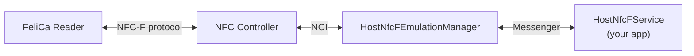

### 38.9.4 HostNfcFService 与 HostNfcFEmulationManager

应用通过继承 `HostNfcFService` 实现 NFC-F 模拟：

```java
public class MyFeliCaService extends HostNfcFService {
    @Override
    public byte[] processNfcFPacket(byte[] packet, Bundle extras) {
        // Process incoming NFC-F command
        // Return response packet
        return buildResponse(packet);
    }

    @Override
    public void onDeactivated(int reason) {
        // Clean up
    }
}
```

`HostNfcFEmulationManager` 管理 NFC-F 模拟的生命周期：

```java
// Source: packages/modules/Nfc/NfcNci/src/com/android/nfc/cardemulation/
//         HostNfcFEmulationManager.java
public class HostNfcFEmulationManager {
    static final int STATE_IDLE = 0;
    static final int STATE_W4_SERVICE = 1;
    static final int STATE_XFER = 2;

    static final int NFCID2_LENGTH = 8;
    static final int MINIMUM_NFCF_PACKET_LENGTH = 10;
    ...
}
```

### 38.9.5 T3T 标识符与系统码

NFC-F 卡模拟使用 T3T（Type 3 Tag）标识符而不是 AID 进行路由：

```java
// Source: packages/modules/Nfc/NfcNci/src/com/android/nfc/NfcService.java
static final int MSG_REGISTER_T3T_IDENTIFIER = 12;
static final int MSG_DEREGISTER_T3T_IDENTIFIER = 13;
```

`RegisteredT3tIdentifiersCache` 维护系统码和 NFCID2 值到服务的映射：

```java
// Source: packages/modules/Nfc/NfcNci/src/com/android/nfc/cardemulation/
//         CardEmulationManager.java
final RegisteredT3tIdentifiersCache mT3tIdentifiersCache;
```

系统码路由在 NFCC 中配置：

```java
// Source: packages/modules/Nfc/NfcNci/src/com/android/nfc/cardemulation/
//         AidRoutingManager.java
int mDefaultSysCodeRoute;
```

### 38.9.6 NFC-V：ISO 15693（邻近卡）

NFC-V（ISO 15693）的工作距离比其他 NFC 技术更长（某些配置下可达约 1 米）。常用
于：

- 图书馆图书标签
- 仓库库存标签
- 工业资产追踪
- 药品追踪

主要属性：

- **DSF ID**（数据存储格式标识符）——标识数据结构
- **响应标志**——来自标签的状态标志
- UID 为 8 字节（由制造商分配）

### 38.9.7 NfcV 标签技术类

```java
// Source: packages/modules/Nfc/framework/java/android/nfc/tech/NfcV.java
public final class NfcV extends BasicTagTechnology {
    public static final String EXTRA_RESP_FLAGS = "respflags";
    public static final String EXTRA_DSFID = "dsfid";

    private byte mRespFlags;
    private byte mDsfId;

    public static NfcV get(Tag tag) {
        if (!tag.hasTech(TagTechnology.NFC_V)) return null;
        try { return new NfcV(tag); }
        catch (RemoteException e) { return null; }
    }

    public byte getResponseFlags() { return mRespFlags; }
    public byte getDsfId() { return mDsfId; }

    // Send raw NFC-V commands (FLAGS, CMD, PARAMETER bytes)
    // CRC is automatically appended
    public byte[] transceive(byte[] data) throws IOException { ... }
}
```

用法：

```java
Tag tag = intent.getParcelableExtra(NfcAdapter.EXTRA_TAG);
NfcV nfcV = NfcV.get(tag);
if (nfcV != null) {
    nfcV.connect();

    byte dsfId = nfcV.getDsfId();
    byte respFlags = nfcV.getResponseFlags();

    // Read Single Block (ISO 15693 command 0x20)
    byte[] readCmd = new byte[] {
        0x02,  // FLAGS: high data rate
        0x20,  // READ_SINGLE_BLOCK command
        0x00   // Block number
    };
    byte[] response = nfcV.transceive(readCmd);

    nfcV.close();
}
```

### 38.9.8 其他标签技术：NfcA、NfcB、IsoDep、MifareClassic、MifareUltralight

`android.nfc.tech` 中的完整标签技术类集合：

| 类 | 说明 | 主要方法 |
|-------|-------------|-------------|
| `NfcA` | ISO 14443-3A | `getAtqa()`、`getSak()`、`transceive()` |
| `NfcB` | ISO 14443-3B | `getApplicationData()`、`getProtocolInfo()`、`transceive()` |
| `IsoDep` | ISO 14443-4 | `getHistoricalBytes()`、`getHiLayerResponse()`、`transceive()` |
| `Ndef` | 已格式化为 NDEF | `getNdefMessage()`、`writeNdefMessage()`、`makeReadOnly()` |
| `NdefFormatable` | 可格式化 | `format()`、`formatReadOnly()` |
| `MifareClassic` | NXP MIFARE Classic | `authenticateSectorWithKeyA()`、`authenticateSectorWithKeyB()`、`readBlock()`、`writeBlock()` |
| `MifareUltralight` | NXP MIFARE Ultralight | `readPages()`、`writePage()` |
| `NfcBarcode` | Kovio 条码 | `getType()`、`getBarcode()` |

所有技术类都继承 `BasicTagTechnology`，后者提供：

- `connect()`——建立通信
- `close()`——释放通信
- `isConnected()`——检查连接状态
- `getTag()`——获取底层的 Tag 对象

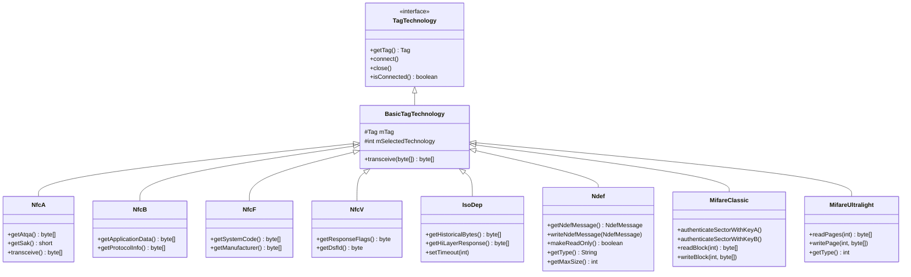

---

## 38.10 Tap to X 与手势交换 API

Android 17 引入了一个新的系统 API 界面，称为 **Tap to X**。它将一次无接触碰触
变成一个由应用定义的"交换"手势，而不仅仅是 NDEF 读取或支付。典型的用法是
**Tap to Share**。两部手机，或一部手机和一个配件，将 NFC 天线短暂靠近。随后平台
将一个可供收发的 `Tag` 交给前台应用。没有常规的 NDEF 分发、声音或振动，整个界面由
`tap_to_x` aconfig 标志把关。

#### Mermaid：Tap to X 手势交换流程

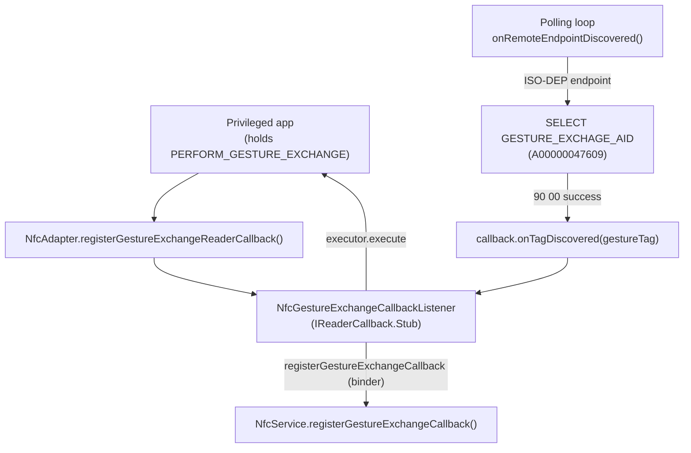

### 38.10.1 PERFORM_GESTURE_EXCHANGE 权限

Tap to X 不是普通的应用能力。注册手势交换需要新的签名级权限
`PERFORM_GESTURE_EXCHANGE`，在服务内部强制执行：

```java
// Source: packages/modules/Nfc/NfcNci/src/com/android/nfc/NfcPermissions.java
static final String GESTURE_EXCHANGE_PERMISSION =
        android.Manifest.permission.PERFORM_GESTURE_EXCHANGE;

public static void enforceGestureExchangePermissions(Context context) {
    context.enforceCallingOrSelfPermission(GESTURE_EXCHANGE_PERMISSION,
            GESTURE_EXCHANGE_PERM_ERROR);
}
```

`NfcService` 中的每个手势交换入口点在触碰状态之前都会调用
`enforceGestureExchangePermissions()`。因此，只有可信的持有者（例如系统的
Tap-to-Share 组件）才能拦截该手势。

### 38.10.2 NfcGestureExchangeCallbackListener

应用不直接与服务通信。`NfcAdapter` 维护单个
`NfcGestureExchangeCallbackListener`，它本身是一个 `IReaderCallback.Stub` binder
对象，对一个或多个应用的 `ReaderCallback` 进行多路复用：

```java
// Source: packages/modules/Nfc/framework/java/android/nfc/
//         NfcGestureExchangeCallbackListener.java
public final class NfcGestureExchangeCallbackListener extends IReaderCallback.Stub {
    private final Map<ReaderCallback, Executor> mCallbackMap = new HashMap<>();

    public void register(@NonNull Executor executor, @NonNull ReaderCallback callback) {
        // first registration links to NFC service death and calls
        // NfcAdapter.getService().registerGestureExchangeCallback(this);
    }

    @Override
    public void onTagDiscovered(Tag tag) {
        // fan the tag out to each registered ReaderCallback on its executor
    }
}
```

面向应用的方法是 `NfcAdapter` 上的
`registerGestureExchangeReaderCallback()` 和
`unregisterGestureExchangeReaderCallback()`，两者都标记了
`@FlaggedApi(FLAG_TAP_TO_X)`，且都要求 `PERFORM_GESTURE_EXCHANGE`
（`packages/modules/Nfc/framework/java/android/nfc/NfcAdapter.java`）。该监听器还
安装了一个 `DeathRecipient`。如果 NFC 服务进程死亡，监听器会在服务恢复后重新注册
回调。因此，长期存在的 Tap-to-Share 组件不会悄悄停止接收手势。

注册手势回调会隐式抑制平台反馈。文档指出其行为类似于传入
`FLAG_READER_NO_PLATFORM_SOUNDS`，因此手势碰触不会播放通常的标签提示音或振动。

### 38.10.3 手势交换 AID 与轮询循环拦截

手势碰触通过选择一个固定的应用标识符而不是读取 NDEF 来检测。主 AID 是
`NfcService` 中的一个常量，通过 `NfcAdapter.getGestureExchangeAid()` 返回给调用者：

```java
// Source: packages/modules/Nfc/NfcNci/src/com/android/nfc/NfcService.java
public static final String GESTURE_EXCHAGE_AID = "A00000047609";
public static final String GESTURE_EXCHAGE_SECONDARY_AID_SETTINGS_KEY =
        "nfc.gesture_exchange_secondary_aid";
public static final String GESTURE_EXCHANGE_COMPONENT_SETTINGS_KEY =
        "nfc.gesture_exchange_component";
```

当配置了手势轮询帧后，`mGestureExchangeEnabled` 会被置位。发现处理器随后在
落入常规 NDEF 读取之前先检查端点上的手势 AID。在没有读卡器模式激活的 ISO-DEP
端点上，`NfcService` 会为（可选的）辅助 AID 进行一次 `SELECT` 收发。然后对主
`GESTURE_EXCHAGE_AID` 做同样的操作。`90 00` 状态字意味着远端是手势目标：

```java
// Source: packages/modules/Nfc/NfcNci/src/com/android/nfc/NfcService.java
byte[] gestureAidCheckCmd = buildSelectAidCommand(GESTURE_EXCHAGE_AID);
respData = tag.transceive(gestureAidCheckCmd, false, retCode);
if (respData != null && respData.length >= 2
        && respData[respData.length - 2] == (byte) 0x90
        && respData[respData.length - 1] == 0x00) {
    // Gesture Exchange AID exists, skip NDEF read
    if (SdkLevel.isAtLeastC() && mNfcGestureExchangeCallback != null) {
        Tag gestureTag = buildGestureTag(tag, gestureComponent, GESTURE_EXCHAGE_AID);
        mNfcGestureExchangeCallback.onTagDiscovered(gestureTag);
    } else {
        // fall back to dispatching a synthetic gesture intent
    }
}
```

`buildGestureTag()` 将活动的 ISO-DEP 端点包装为一个 `Tag`。它还携带一个合成的
Android 应用记录（配置的手势组件）和一个 `EXTRA_AID`。因此，手势目标会被分发到
精确正确的组件，即使走的是传统 intent 路径。`mGestureExchangeEnabled` 标志本身由
`Settings.Secure` 中的轮询帧值驱动。`NfcService` 中的一个 `ContentObserver` 监视
该值（`updateGesturePollFrame()`）。默认轮询帧也会通过 `mDeviceHost.setDefaultFrame()`
推送到控制器。

### 38.10.4 Tap-to-X 路由：手势 vs NDEF vs 支付

手势路径被刻意分层*叠加在*现有分发链（38.5 节）之上，而不是取代它。在
`onRemoteEndpointDiscovered()` 内部，ISO-DEP 端点的优先级为：

1. 来自前台应用的显式**读卡器模式**请求直接胜出。
2. 否则，如果**手势交换**已启用，服务先选择辅助手势 AID，再选择主手势 AID。匹配
   则短路到手势回调（或合成手势分发），并开始在场检查。
3. 否则，端点落入常规 **NDEF 读取**和三级标签分发 intent。

```mermaid
flowchart TD
    EP["ISO-DEP endpoint discovered"]
    RM{"Reader mode<br/>requested?"}
    GE{"Gesture exchange<br/>enabled?"}
    SECOND{"Secondary AID<br/>selects 90 00?"}
    PRIMARY{"Primary gesture<br/>AID selects 90 00?"}
    READER["Deliver to reader-mode callback"]
    GCB["Deliver gestureTag to callback"]
    NDEF["NDEF read then tag dispatch"]

    EP --> RM
    RM -->|"yes"| READER
    RM -->|"no"| GE
    GE -->|"no"| NDEF
    GE -->|"yes"| SECOND
    SECOND -->|"yes"| GCB
    SECOND -->|"no"| PRIMARY
    PRIMARY -->|"yes"| GCB
    PRIMARY -->|"no"| NDEF
```

这让 Tap to X 对普通标签和普通支付碰触保持不可见。普通的 NDEF 海报或无接触卡永远
不会应答手势 `SELECT`。因此它会直接流入本章前面描述的 NDEF/HCE 路径。

## 38.11 钱包角色的关联包

Android 17 放宽了钱包角色（38.6.10 节）中固化的"单包"假设。此前，只有单个
`ROLE_WALLET` 持有者包获得角色持有者路由优先权。在 17 中，持有者可以**声明一个
关联包**，与之共享其优先权。当钱包将其 NFC/观察模式逻辑放在一个兄弟应用或以不
同证书签名的应用中时，这一点很重要。

启用方式是一个清单应用属性
`PROPERTY_ALLOW_SHARED_ROLE_PRIORITY`：

```java
// Source: packages/modules/Nfc/framework/java/android/nfc/cardemulation/
//         CardEmulation.java
public static final String PROPERTY_ALLOW_SHARED_ROLE_PRIORITY =
        "android.nfc.cardemulation.PROPERTY_ALLOW_SHARED_ROLE_PRIORITY";
```

根据其文档，角色持有者可以将该属性的 `android:value` 设置为 `true`（与以相同证
书签名的任何包共享优先权）。也可以将该值设置为特定包名（与精确该包共享，即使签
名不同）。`RegisteredAidCache` 从钱包持有者（如果失败，则从首选支付服务）读取此
属性。它会记录该关联包，即使该包根本没有自己的卡模拟服务：

```java
// Source: packages/modules/Nfc/NfcNci/src/com/android/nfc/cardemulation/
//         RegisteredAidCache.java
PackageManager.Property prop = pm.getProperty(
        CardEmulation.PROPERTY_ALLOW_SHARED_ROLE_PRIORITY,
        mDefaultWalletHolderPackageName);
// Associated wallet role package may not have any CE service (only for ability
// to toggle observe mode), so add these packages directly here.
if (prop.getString() != null) {
    mAssociatedRolePackageNames.add(prop.getString());
}
```

解析随后将持有者及其关联包统一对待。`isDefaultOrAssociatedWalletService()` 和
`isDefaultOrAssociatedWalletPackage()` 对持有者*或*任何关联服务/包返回 `true`
（由 `nfc_associated_role_services` 标志把关）。因此，关联应用可以以角色持有者优
先权注册 AID，并切换观察模式（38.6.11 节），就好像它自己是钱包一样。上面的源码
注释展示了关联的一个常见原因。它正是为了让一个辅助包代表钱包调用
`setObserveModeEnabled()` / `allowOneTransaction()`，而它自己不拥有任何 HCE
服务。

## 38.12 Android 17 中的 NFC Mainline 标志

由于 NFC 作为 `com.android.nfcservices` Mainline APEX 发布（38.1.8 节），一个
aconfig 标志把关几乎每一个 17 的行为变化。因此平台可以发布代码并按发布列车逐个
启用。大多数位于模块标志集 `packages/modules/Nfc/flags/flags.aconfig`
（容器 `com.android.nfcservices`，访问器
`com.android.nfc.module.flags.Flags`）中：

| 模块标志 | 把关内容 |
|------|-------|
| `tap_to_x` | Tap to X / 手势交换 API（38.10 节），以及 `ReaderCallback.onTagLost()` 和无 activity 的读卡器模式注册 |
| `nfcstack_26q2_updates` | NCI 协议栈更新，包括 `NfcAdapter.allowOneTransaction()`（38.6.11 节）和 V2 标签应用偏好存储 |
| `screen_state_attribute_toggle` | HCE 服务上 `requireDeviceUnlock` / `requireDeviceScreenOn` 的运行时切换 |
| `get_polling_loop_filters` | 获取服务已注册的轮询循环过滤器的 API |
| `nfc_power_saving_mode` | 获取/设置控制器的省电模式 |
| `oem_extension_25q4` | 25Q4 列车的 OEM 扩展钩子（`NfcOemExtension`） |

少数框架侧标志位于 `android.nfc` 命名空间，把关 `framework/` 树中的公共 API 面
积。这里最相关的是 `android.nfc.nfc_associated_role_services`。它把关钱包角色关
联包功能（38.11 节）。它同时保护 `PROPERTY_ALLOW_SHARED_ROLE_PRIORITY` 字段
（见 `packages/modules/Nfc/framework/api/current.txt`）和
`packages/modules/Nfc/NfcNci/src/com/android/nfc/cardemulation/RegisteredAidCache.java`
中的 `Flags.nfcAssociatedRoleServices()` 分支。

模块标志通过生成的 `com.android.nfc.module.flags.Flags` 访问器读取（例如
`NfcAdapter` 方法上的 `@FlaggedApi(FLAG_TAP_TO_X)`）。要判断 Android 17 NFC 行为
在某台设备上是否真的处于激活状态，请在运行时读取相关标志。这是最可靠的方法。因
为 Mainline 列车独立于平台甜点版本启用它们。

---

## 38.13 SecureElement 服务与 OMAPI 实现

38.7.4 节介绍了 OMAPI（开放移动 API）。有了 OMAPI，普通应用就可以与运行在安全
元件上的 applet 通信。本节讲述这一概念背后的实现：位于
`packages/apps/SecureElement/` 的 `SecureElement` 系统应用，它提供支撑
`android.se.omapi` 客户端类的 `ISecureElementService` binder。它是一个独立应用，
运行在自己的 `android.uid.se` 进程中，不属于 NfcService。但是，正如 38.13.7 所示，
它共享相同的离主机 SE。NFC 卡模拟将无接触交易路由到这些 SE。

### 38.13.1 谁实现了 OMAPI

OMAPI 分布在三个层中，每层位于树的不同部分：

| 层 | 位置 | 角色 |
|-------|----------|------|
| 客户端 API | `frameworks/base/omapi/java/android/se/omapi/` | `SEService`、`Reader`、`Session`、`Channel`——应用调用的部分 |
| 服务 | `packages/apps/SecureElement/` | `SecureElementService` + `Terminal`——binder 实现 |
| HAL | `hardware/interfaces/secure_element/aidl/` | `ISecureElement`——每个物理 SE 的厂商驱动 |

客户端 `SEService` 是一个薄包装器。当应用构造一个时，它首先向 `ServiceManager`
请求已注册的 binder，只有在找不到时才回退到绑定 `SecureElement` 应用导出的服务：

```java
// Source: frameworks/base/omapi/java/android/se/omapi/SEService.java
private static final String SERVICE_NAME = "android.se.omapi.ISecureElementService/default";
...
IBinder seService = ServiceManager.checkService(SERVICE_NAME);
// if found, use it directly; otherwise fall back to binding:
Intent intent = new Intent(ISecureElementService.class.getName());
mContext.bindService(intent, mConnection, Context.BIND_AUTO_CREATE);
...
mSecureElementService = ISecureElementService.Stub.asInterface(service);
```

绑定的目标是 SecureElement 应用声明的 `<service>`，它按
`android.se.omapi.ISecureElementService` action 过滤：

```xml
<!-- Source: packages/apps/SecureElement/AndroidManifest.xml -->
<service android:name=".SecureElementService"
     android:visibleToInstantApps="true"
     android:exported="true">
    <intent-filter>
        <action android:name="android.se.omapi.ISecureElementService"/>
    </intent-filter>
</service>
```

因此，客户端侧的 `Reader`、`Session` 和 `Channel` 只是服务交回的
`ISecureElementReader`、`ISecureElementSession` 和 `ISecureElementChannel`
binder 的代理。

### 38.13.2 SecureElementService 与 Terminal

`SecureElementService` 是一个 `persistent`、`directBootAware` 的 `Service`。在
`onCreate()` 中，它通过尝试为每个 HAL 实例构造一个 `Terminal` 来枚举可用的 SE，
然后以两个名称发布自身：

```java
// Source: packages/apps/SecureElement/src/com/android/se/SecureElementService.java
public static final String UICC_TERMINAL = "SIM";
public static final String ESE_TERMINAL = "eSE";
...
private void createTerminals() {
    // Check for all SE HAL implementations
    addTerminals(ESE_TERMINAL);
    addTerminals(UICC_TERMINAL);
}
```

`addTerminals()` 循环构造 `eSE1`、`eSE2`……以及 `SIM1`、`SIM2`……直到 HAL
`getService()` 查找抛出 `NoSuchElementException`（该类型没有更多实例）。每个存活
的 `Terminal` 进入一个有序的 `LinkedHashMap<String, Terminal>`；映射键正是客户端
从 `SEService.getReaders()` 看到的读卡器名称。UICC 终端也会动态刷新：针对
`ACTION_MULTI_SIM_CONFIG_CHANGED` 的一个 `BroadcastReceiver` 调用
`refreshUiccTerminals()`，以便在活跃 SIM 数量变化时添加或关闭 `SIM<n>` 终端。

该服务以两个服务名称注册，反映 AIDL VINTF 稳定性：

```java
// Source: packages/apps/SecureElement/src/com/android/se/SecureElementService.java
public static final String VSTABLE_SECURE_ELEMENT_SERVICE =
        "android.se.omapi.ISecureElementService/default";
...
if (getResources().getBoolean(R.bool.secure_element_vintf_enabled)) {
    ServiceManager.addService(VSTABLE_SECURE_ELEMENT_SERVICE,
            mSecureElementServiceBinderVntf);
}
...
mSecureElementServiceBinder.forceDowngradeToSystemStability();
ServiceManager.addService(Context.SECURE_ELEMENT_SERVICE, mSecureElementServiceBinder);
```

VINTF 稳定名称（`/default`）也是客户端 `SEService` 首先通过
`ServiceManager.checkService()` 查找的名称。只有该查找失败时，它才会回退到
`bindService()`。这次调用将 `SecureElementService.onBind()` 返回的 binder 交给
它。`Context.SECURE_ELEMENT_SERVICE`（`"secure_element"`）注册是另一次系统稳定性
发布，客户端从不查找它。

### 38.13.3 Terminal：每个安全元件一个对象

`Terminal` 通过 SE HAL 包装与一个物理 SE 的连接。它持有针对当前 HAL 版本的引用
和一个 `AccessControlEnforcer`：

```java
// Source: packages/apps/SecureElement/src/com/android/se/Terminal.java
private ISecureElement mSEHal;                                          // HIDL 1.0/1.1
private android.hardware.secure_element.V1_2.ISecureElement mSEHal12;   // HIDL 1.2
private android.hardware.secure_element.ISecureElement mAidlHal;        // AIDL

/** For each Terminal there will be one AccessController object. */
private AccessControlEnforcer mAccessControlEnforcer;
```

`Terminal` 驱动的 AIDL 接口很小，且以 APDU 为中心：

```java
// Source: hardware/interfaces/secure_element/aidl/android/hardware/secure_element/ISecureElement.aidl
byte[] getAtr();
boolean isCardPresent();
byte[] openBasicChannel(in byte[] aid, in byte p2);
LogicalChannelResponse openLogicalChannel(in byte[] aid, in byte p2);
void reset();
byte[] transmit(in byte[] data);
```

HAL 还通过 `ISecureElementHalCallback` 的 `onStateChange(boolean)` 回调到
`Terminal`。在连接转换时，终端重新运行访问控制初始化。在断开时，它重置执行器。

### 38.13.4 会话与通道

应用在 `Reader` 上打开一个 `Session`，然后在会话上打开一个或多个通道。通道是与
单个 applet 通信的单元，由其 AID 选择：

- **基本通道**（通道 0）：每个 SE 有且只有一个，它可能已经选中了一个默认
  applet。当通道 0 正在使用时，`openBasicChannel()` 拒绝第二次打开。
- **逻辑通道**（通道 1-19）：通过 `MANAGE CHANNEL` 打开，每个通道携带独立的
  applet 选择。这是应用的常规路径。

`SecureElementSession`（`SecureElementService` 的一个内部类）实现这两个入口点。
两者都验证会话已打开、监听器非空，且 `p2` 是允许的 `SELECT` 值之一。然后它们解析
调用者身份并委托给 `Terminal`：

```java
// Source: packages/apps/SecureElement/src/com/android/se/SecureElementService.java
channel = mReader.getTerminal().openLogicalChannel(this, aid, p2, listener,
        packageName, uuid, Binder.getCallingPid());
```

调用者身份来自 `getPackageNameFromCallingUid(Binder.getCallingUid())`。如果该 UID
没有对应的包（一个原生厂商进程），代码回退到厂商提供的 UUID 映射，但**仅针对 eSE
终端**。基于 UUID 的访问在 UICC 上被拒绝。在 `Terminal.openLogicalChannel()` 内
部，终端首先计算 `ChannelAccess` 裁决（38.13.5），然后针对检测到的 HAL 版本发出
HAL 调用：

```java
// Source: packages/apps/SecureElement/src/com/android/se/Terminal.java
channelAccess = setUpChannelAccess(aid, packageName, uuid, pid, false);
...
responseList.add(mAidlHal.openLogicalChannel(aid == null ? new byte[0] : aid, p2));
```

成功后创建一个 `Channel` 对象，将计算出的 `ChannelAccess` 附加到它上面，并向客户
端返回一个 `SecureElementChannel` binder。会话跟踪其所有打开的通道，并在
`closeChannels()` / `close()` 时强制关闭它们。

### 38.13.5 访问控制执行

这是 OMAPI 中安全关键的部分。任意应用不能仅因为知道 AID 就能与支付或电信 applet
通信。SecureElement 服务强制执行 Global Platform 访问控制模型，在两个地方检查——
一次在通道打开时，之后在每个 APDU 上再次检查。

`Terminal.setUpChannelAccess()` 按以下顺序决定通道打开的裁决：

1. 如果调用者持有 `android.permission.SECURE_ELEMENT_PRIVILEGED_OPERATION`，它
   获得 `ChannelAccess.getPrivilegeAccess()`——完全访问，不查找规则。
2. 在 UICC 终端上，如果调用者拥有**运营商特权**（由 SIM 授权的密钥签名），它获
   得运营商特权访问。这只在 AID 不是 ISD-R 时适用。否则，普通应用在 UICC 上的
   `openBasicChannel` 会被拒绝。
3. 否则，向 `AccessControlEnforcer` 查询按 AID 的规则：

```java
// Source: packages/apps/SecureElement/src/com/android/se/Terminal.java
if (packageName != null && isPrivilegedApplication(packageName)) {
    return ChannelAccess.getPrivilegeAccess(packageName, pid);
}
...
ChannelAccess channelAccess =
        mAccessControlEnforcer.setUpChannelAccess(aid, packageName, uuid, checkRefreshTag);
```

`AccessControlEnforcer` 从 SE 本身获取规则，优先使用 ARA，回退到 ARF：

- **ARA（访问规则应用）**——一个专用 applet（ARA-M，AID
  `A00000015141434C00`）。它存储 Global Platform `REF-AR-DO` 规则。这些规则将
  调用者的证书哈希（以及可选的包名）映射到其可以使用的 AID。`AraController` 打开
  到 ARA-M 的逻辑通道并用 `GET DATA` 读取规则。
- **ARF（访问规则文件）**——SE（通常是 UICC）上的 PKCS#15 文件结构，由
  `ArfController` / `PKCS15Handler` 解析，在没有 ARA applet 时使用。

```java
// Source: packages/apps/SecureElement/src/com/android/se/security/AccessControlEnforcer.java
// 1 - Let's try to use ARA
if (mUseAra && mAraController != null) {
    ...
    mAraController.initialize();
    // disable other access methods
    mUseArf = false;
    mFullAccess = false;
}
// 2 - Let's try to use ARF since ARA cannot be used
if (mUseArf && mArfController != null) {
    mArfController.initialize();
    ...
}
/* 4 - Let's block everything since neither ARA, ARF or fullaccess can be used */
if (!mUseArf && !mUseAra && !mFullAccess) {
    mInitialChannelAccess.setApduAccess(ChannelAccess.ACCESS.DENIED);
    ...
}
```

默认姿态是失败即关闭。如果 SE 既没有 ARA applet 也没有 ARF 文件，且未显式授予完全
访问，则每个通道打开都会被拒绝。匹配的规则缓存在 `AccessRuleCache` 中，并根据 SE
的刷新标签重新验证，使新配置的规则生效。

第二个执行点是按 APDU。`Channel.transmit()` 重新检查调用者 PID，阻止 `MANAGE
CHANNEL` 以及（对非特权调用者）按 DF 名 `SELECT`，然后在 APDU 到达 HAL 之前回调
执行器：

```java
// Source: packages/apps/SecureElement/src/com/android/se/Channel.java
checkCommand(command);
synchronized (mLock) {
    command[0] = setChannelToClassByte(command[0], mChannelNumber);
    return mTerminal.transmit(command);
}
```

`checkCommand()` 咨询 `AccessControlEnforcer.checkCommand()`。它遵循规则附加到通道
上的任何 APDU 过滤器（`APDU-AR-DO`）。因此，一条规则可以允许一个 applet，但限制
允许哪些命令 APDU。

### 38.13.6 通道打开路径端到端

下图追踪一个打开到 applet 的逻辑通道的非特权应用。它展示了在任何 APDU 到达 SE
之前访问控制在哪里被执行。

```mermaid
sequenceDiagram
    participant App as "App (android.se.omapi.Session)"
    participant SES as "SecureElementService (android.uid.se)"
    participant Term as "Terminal (per SE)"
    participant ACE as "AccessControlEnforcer"
    participant HAL as "SE HAL (ISecureElement)"
    participant SE as "Secure Element / Applet"

    App->>SES: "openLogicalChannel(aid, p2)"
    SES->>SES: "resolve package from calling UID"
    SES->>Term: "openLogicalChannel(session, aid, p2, pkg, pid)"
    Term->>ACE: "setUpChannelAccess(aid, pkg)"
    ACE->>HAL: "open channel to ARA-M, GET DATA (rules)"
    HAL->>SE: "read ARA / ARF access rules"
    SE-->>ACE: "REF-AR-DO rules"
    ACE-->>Term: "ChannelAccess (ALLOWED or DENIED)"
    alt access allowed
        Term->>HAL: "openLogicalChannel(aid, p2)"
        HAL->>SE: "MANAGE CHANNEL + SELECT aid"
        SE-->>HAL: "channel number + SELECT response"
        HAL-->>Term: "LogicalChannelResponse"
        Term-->>SES: "Channel (access attached)"
        SES-->>App: "ISecureElementChannel"
    else access denied
        Term-->>SES: "SecurityException / null"
        SES-->>App: "open fails"
    end
```

### 38.13.7 OMAPI 与 NFC 卡模拟的关系

OMAPI（应用处理器通过 SPI/I2C/SWP 访问 applet）和 NFC 离主机卡模拟（38.6、38.7）
都访问相同的物理 eSE / UICC。它们使用不同路径。OMAPI 走应用 →
`SecureElementService` → SE HAL。无接触交易走外部读卡器 → NFCC → SE，经由
RF/HCI 链路。应用处理器不在环内。

两者在 `NFC_AR_DO` 访问规则处相遇。在 NfcService 广播离主机事务事件（38.7.6）之
前，它向 SecureElement 服务提出一个问题。问题是：某个给定包是否可以接收该 AID 的
事件：

```java
// Source: packages/apps/SecureElement/src/com/android/se/SecureElementService.java
public synchronized boolean[] isNfcEventAllowed(String reader, byte[] aid,
        String[] packageNames, int userId) throws RemoteException {
    ...
    Terminal terminal = getTerminal(reader);
    ...
    return terminal.isNfcEventAllowed(context.getPackageManager(), aid, packageNames);
}
```

`Terminal.isNfcEventAllowed()` 通过执行器运行相同的 ARA/ARF 规则集，但评估的是
`NFC-AR-DO`（NFC 事件访问）字段，而不是 APDU 访问字段。因此，SE 上配置的访问规
则管辖两件事。它们管辖谁可以通过 OMAPI 打开到 applet 的通道。它们还管辖谁可以在
该 applet 处理无接触交易时收到通知。有一个规则存储，两个执行面。

### 38.13.8 eUICC 与 ISD-R AID

同一个 SecureElement 服务还作为 eUICC（嵌入式 SIM）的前端，用于 eSIM profile
管理。`Terminal` 通过固定 AID 识别 ISD-R（发行方安全域根）applet，并在访问控制中
对其特殊对待：

```java
// Source: packages/apps/SecureElement/src/com/android/se/Terminal.java
public static final byte[] ISD_R_AID =
        new byte[]{ (byte) 0xA0, 0x00, 0x00, 0x05, 0x59, 0x10, 0x10, ... };
...
// Check carrier privilege when AID is not ISD-R
if (packageName != null && getName().startsWith(SecureElementService.UICC_TERMINAL)
        && !Arrays.equals(aid, ISD_R_AID)) {
    ... checkCarrierPrivilege ...
}
```

LPA（本地 Profile 助理）组件下载并安装 eSIM profile。它使用到 ISD-R 的 OMAPI
逻辑通道。对 ISD-R 跳过运营商特权检查，正是因为 eSIM 管理改由特权权限把关。

---

## 38.14 动手实践：NFC 开发练习

### 38.14.1 练习 1：读取 NDEF 标签

**目标**：构建一个 activity，从标签读取 NDEF 消息。

```java
public class ReadNdefActivity extends Activity {

    @Override
    protected void onCreate(Bundle savedInstanceState) {
        super.onCreate(savedInstanceState);
        setContentView(R.layout.activity_read_ndef);
        handleIntent(getIntent());
    }

    @Override
    protected void onNewIntent(Intent intent) {
        super.onNewIntent(intent);
        handleIntent(intent);
    }

    private void handleIntent(Intent intent) {
        String action = intent.getAction();
        if (NfcAdapter.ACTION_NDEF_DISCOVERED.equals(action)
                || NfcAdapter.ACTION_TECH_DISCOVERED.equals(action)
                || NfcAdapter.ACTION_TAG_DISCOVERED.equals(action)) {

            Parcelable[] rawMessages = intent.getParcelableArrayExtra(
                    NfcAdapter.EXTRA_NDEF_MESSAGES);

            if (rawMessages != null) {
                NdefMessage[] messages = new NdefMessage[rawMessages.length];
                for (int i = 0; i < rawMessages.length; i++) {
                    messages[i] = (NdefMessage) rawMessages[i];
                }
                processNdefMessages(messages);
            }

            Tag tag = intent.getParcelableExtra(NfcAdapter.EXTRA_TAG);
            byte[] tagId = intent.getByteArrayExtra(NfcAdapter.EXTRA_ID);
            Log.d("NFC", "Tag ID: " + bytesToHex(tagId));
            Log.d("NFC", "Tag techs: " +
                    Arrays.toString(tag.getTechList()));
        }
    }

    private void processNdefMessages(NdefMessage[] messages) {
        for (NdefMessage msg : messages) {
            for (NdefRecord record : msg.getRecords()) {
                short tnf = record.getTnf();
                byte[] type = record.getType();
                byte[] payload = record.getPayload();

                Log.d("NFC", "TNF: " + tnf);
                Log.d("NFC", "Type: " + new String(type));

                Uri uri = record.toUri();
                if (uri != null) {
                    Log.d("NFC", "URI: " + uri.toString());
                }

                String mime = record.toMimeType();
                if (mime != null) {
                    Log.d("NFC", "MIME: " + mime);
                    Log.d("NFC", "Data: " + new String(payload));
                }
            }
        }
    }

    private static String bytesToHex(byte[] bytes) {
        if (bytes == null) return "null";
        StringBuilder sb = new StringBuilder();
        for (byte b : bytes) {
            sb.append(String.format("%02X", b));
        }
        return sb.toString();
    }
}
```

**清单注册**：

```xml
<activity android:name=".ReadNdefActivity"
          android:exported="true"
          android:launchMode="singleTop">
    <intent-filter>
        <action android:name="android.nfc.action.NDEF_DISCOVERED" />
        <category android:name="android.intent.category.DEFAULT" />
        <data android:mimeType="text/plain" />
    </intent-filter>
    <intent-filter>
        <action android:name="android.nfc.action.NDEF_DISCOVERED" />
        <category android:name="android.intent.category.DEFAULT" />
        <data android:scheme="https" />
    </intent-filter>
</activity>
```

**验证**：用 NFC TagWriter 之类的工具写入一个 NDEF URI 标签，然后用手机碰触。
该 activity 应启动并显示标签内容。

### 38.14.2 练习 2：写入 NDEF 标签

**目标**：向空白或可重写的标签写入 NDEF 内容。

```java
public class WriteNdefActivity extends Activity {
    private NfcAdapter mNfcAdapter;
    private PendingIntent mPendingIntent;
    private boolean mWriteMode = false;

    @Override
    protected void onCreate(Bundle savedInstanceState) {
        super.onCreate(savedInstanceState);
        setContentView(R.layout.activity_write_ndef);

        mNfcAdapter = NfcAdapter.getDefaultAdapter(this);
        mPendingIntent = PendingIntent.getActivity(this, 0,
                new Intent(this, getClass())
                        .addFlags(Intent.FLAG_ACTIVITY_SINGLE_TOP),
                PendingIntent.FLAG_MUTABLE);
    }

    @Override
    protected void onResume() {
        super.onResume();
        // Enable foreground dispatch to catch any tag
        mNfcAdapter.enableForegroundDispatch(this, mPendingIntent,
                null, null);
    }

    @Override
    protected void onPause() {
        super.onPause();
        mNfcAdapter.disableForegroundDispatch(this);
    }

    @Override
    protected void onNewIntent(Intent intent) {
        super.onNewIntent(intent);
        if (mWriteMode) {
            Tag tag = intent.getParcelableExtra(NfcAdapter.EXTRA_TAG);
            writeTag(tag);
        }
    }

    private void writeTag(Tag tag) {
        // Build the NDEF message
        NdefRecord uriRecord = NdefRecord.createUri("https://android.com");
        NdefRecord textRecord = NdefRecord.createTextRecord("en",
                "Hello from AOSP Internals!");
        NdefRecord aarRecord = NdefRecord.createApplicationRecord(
                "com.example.nfcdemo");

        NdefMessage message = new NdefMessage(uriRecord, textRecord,
                aarRecord);

        try {
            Ndef ndef = Ndef.get(tag);
            if (ndef != null) {
                ndef.connect();
                if (!ndef.isWritable()) {
                    Log.e("NFC", "Tag is read-only");
                    return;
                }
                if (ndef.getMaxSize() < message.toByteArray().length) {
                    Log.e("NFC", "Tag capacity too small");
                    return;
                }
                ndef.writeNdefMessage(message);
                Log.d("NFC", "Write successful!");
                ndef.close();
            } else {
                // Try to format the tag
                NdefFormatable formatable = NdefFormatable.get(tag);
                if (formatable != null) {
                    formatable.connect();
                    formatable.format(message);
                    formatable.close();
                    Log.d("NFC", "Format and write successful!");
                } else {
                    Log.e("NFC", "Tag does not support NDEF");
                }
            }
        } catch (Exception e) {
            Log.e("NFC", "Write failed", e);
        }
    }

    public void enableWriteMode() {
        mWriteMode = true;
        // Show UI indicating "tap a tag to write"
    }
}
```

**验证**：碰触一个空白 NTAG213/215/216 标签，然后用练习 1 或任何 NFC 读卡器应
用读回。

### 38.14.3 练习 3：实现支付 HCE 服务

**目标**：构建一个最小化的 HCE 服务，响应支付 SELECT 命令。

**服务实现**：

```java
public class DemoPaymentService extends HostApduService {
    private static final String TAG = "DemoPaymentService";

    // Visa AID
    private static final String VISA_AID = "A0000000041010";

    // Status words
    private static final byte[] SW_OK = {(byte) 0x90, 0x00};
    private static final byte[] SW_UNKNOWN = {0x6F, 0x00};
    private static final byte[] SW_CLA_NOT_SUPPORTED = {0x6E, 0x00};
    private static final byte[] SW_INS_NOT_SUPPORTED = {0x6D, 0x00};

    // SELECT response: FCI template
    private static final byte[] SELECT_RESPONSE = buildSelectResponse();

    @Override
    public byte[] processCommandApdu(byte[] apdu, Bundle extras) {
        Log.d(TAG, "Received APDU: " + bytesToHex(apdu));

        if (apdu.length < 4) {
            return SW_UNKNOWN;
        }

        byte cla = apdu[0];
        byte ins = apdu[1];

        // Handle SELECT command (INS = 0xA4)
        if (ins == (byte) 0xA4) {
            return handleSelect(apdu);
        }

        // Handle GET PROCESSING OPTIONS (INS = 0xA8)
        if (ins == (byte) 0xA8) {
            return handleGpo(apdu);
        }

        return SW_INS_NOT_SUPPORTED;
    }

    @Override
    public void onDeactivated(int reason) {
        Log.d(TAG, "Deactivated: " +
                (reason == DEACTIVATION_LINK_LOSS ?
                        "link loss" : "deselected"));
    }

    private byte[] handleSelect(byte[] apdu) {
        // Extract AID from SELECT APDU
        if (apdu.length >= 5) {
            int aidLength = apdu[4] & 0xFF;
            if (apdu.length >= 5 + aidLength) {
                byte[] aid = new byte[aidLength];
                System.arraycopy(apdu, 5, aid, 0, aidLength);
                Log.d(TAG, "SELECT AID: " + bytesToHex(aid));

                // Return FCI with SW 9000
                return concat(SELECT_RESPONSE, SW_OK);
            }
        }
        return SW_UNKNOWN;
    }

    private byte[] handleGpo(byte[] apdu) {
        // Return minimal GPO response
        // In production, this would contain real EMV data
        byte[] gpoResponse = {
            (byte) 0x80, 0x06,  // Response Format 1
            0x00, 0x00,         // AIP
            0x08, 0x01, 0x01, 0x00  // AFL
        };
        return concat(gpoResponse, SW_OK);
    }

    private static byte[] buildSelectResponse() {
        // Minimal FCI template
        return new byte[] {
            0x6F, 0x0B,                 // FCI Template
            (byte) 0x84, 0x07,          // DF Name (AID)
            (byte) 0xA0, 0x00, 0x00,    // Visa AID
            0x00, 0x04, 0x10, 0x10,
            (byte) 0xA5, 0x00           // FCI Proprietary Template (empty)
        };
    }

    // ... utility methods
}
```

**服务声明**（`res/xml/payment_service.xml`）：

```xml
<host-apdu-service xmlns:android="http://schemas.android.com/apk/res/android"
    android:description="@string/demo_payment_description"
    android:requireDeviceUnlock="false">

    <aid-group android:description="@string/payment_aids"
               android:category="payment">
        <aid-filter android:name="A0000000041010" />
    </aid-group>
</host-apdu-service>
```

**清单**：

```xml
<service android:name=".DemoPaymentService"
         android:exported="true"
         android:permission="android.permission.BIND_NFC_SERVICE">
    <intent-filter>
        <action android:name=
            "android.nfc.cardemulation.action.HOST_APDU_SERVICE" />
    </intent-filter>
    <meta-data android:name=
            "android.nfc.cardemulation.host_apdu_service"
               android:resource="@xml/payment_service" />
</service>
```

**验证**：在另一部手机上使用 NFC 读卡器应用发送针对 Visa AID 的 SELECT APDU。

### 38.14.4 练习 4：使用读卡器模式

**目标**：使用读卡器模式进行可靠的标签读取，不受卡模拟干扰。

```java
public class ReaderModeActivity extends Activity
        implements NfcAdapter.ReaderCallback {
    private NfcAdapter mNfcAdapter;
    private TextView mStatusText;

    @Override
    protected void onCreate(Bundle savedInstanceState) {
        super.onCreate(savedInstanceState);
        setContentView(R.layout.activity_reader_mode);
        mStatusText = findViewById(R.id.status_text);
        mNfcAdapter = NfcAdapter.getDefaultAdapter(this);
    }

    @Override
    protected void onResume() {
        super.onResume();
        Bundle options = new Bundle();
        options.putInt(NfcAdapter.EXTRA_READER_PRESENCE_CHECK_DELAY, 250);

        mNfcAdapter.enableReaderMode(this, this,
                NfcAdapter.FLAG_READER_NFC_A |
                NfcAdapter.FLAG_READER_NFC_B |
                NfcAdapter.FLAG_READER_NFC_F |
                NfcAdapter.FLAG_READER_NFC_V,
                options);
    }

    @Override
    protected void onPause() {
        super.onPause();
        mNfcAdapter.disableReaderMode(this);
    }

    @Override
    public void onTagDiscovered(Tag tag) {
        // This runs on a binder thread -- not the main thread
        StringBuilder info = new StringBuilder();
        info.append("Tag UID: ").append(bytesToHex(tag.getId())).append("\n");
        info.append("Technologies:\n");
        for (String tech : tag.getTechList()) {
            info.append("  - ").append(tech).append("\n");
        }

        // Try to read NDEF
        Ndef ndef = Ndef.get(tag);
        if (ndef != null) {
            try {
                ndef.connect();
                NdefMessage msg = ndef.getNdefMessage();
                if (msg != null) {
                    info.append("NDEF message: ")
                        .append(msg.getRecords().length)
                        .append(" records\n");
                    for (NdefRecord record : msg.getRecords()) {
                        Uri uri = record.toUri();
                        if (uri != null) {
                            info.append("  URI: ").append(uri).append("\n");
                        }
                    }
                }
                ndef.close();
            } catch (Exception e) {
                info.append("Error: ").append(e.getMessage()).append("\n");
            }
        }

        // Try IsoDep for smart cards
        IsoDep isoDep = IsoDep.get(tag);
        if (isoDep != null) {
            try {
                isoDep.connect();
                isoDep.setTimeout(5000);

                // Send SELECT PPSE
                byte[] selectPpse = {
                    0x00, (byte) 0xA4, 0x04, 0x00,
                    0x0E,  // Lc = 14 bytes
                    0x32, 0x50, 0x41, 0x59, 0x2E, 0x53, 0x59, 0x53,
                    0x2E, 0x44, 0x44, 0x46, 0x30, 0x31,  // "2PAY.SYS.DDF01"
                    0x00   // Le
                };
                byte[] response = isoDep.transceive(selectPpse);
                info.append("PPSE response: ")
                    .append(bytesToHex(response)).append("\n");

                isoDep.close();
            } catch (Exception e) {
                info.append("IsoDep error: ")
                    .append(e.getMessage()).append("\n");
            }
        }

        final String result = info.toString();
        runOnUiThread(() -> mStatusText.setText(result));
    }
}
```

**验证**：碰触各种 NFC 标签和卡片。该 activity 应显示它们的技术细节和内容。

### 38.14.5 练习 5：前台分发

**目标**：使用前台分发拦截发往其他应用的标签。

```java
public class ForegroundDispatchActivity extends Activity {
    private NfcAdapter mNfcAdapter;
    private PendingIntent mPendingIntent;
    private IntentFilter[] mIntentFilters;
    private String[][] mTechLists;

    @Override
    protected void onCreate(Bundle savedInstanceState) {
        super.onCreate(savedInstanceState);
        setContentView(R.layout.activity_foreground);

        mNfcAdapter = NfcAdapter.getDefaultAdapter(this);

        mPendingIntent = PendingIntent.getActivity(this, 0,
                new Intent(this, getClass())
                        .addFlags(Intent.FLAG_ACTIVITY_SINGLE_TOP),
                PendingIntent.FLAG_MUTABLE);

        // Match all NDEF messages
        IntentFilter ndefFilter = new IntentFilter(
                NfcAdapter.ACTION_NDEF_DISCOVERED);
        try {
            ndefFilter.addDataType("*/*");
        } catch (IntentFilter.MalformedMimeTypeException e) {
            throw new RuntimeException(e);
        }

        // Match all tech tags
        IntentFilter techFilter = new IntentFilter(
                NfcAdapter.ACTION_TECH_DISCOVERED);

        mIntentFilters = new IntentFilter[] { ndefFilter, techFilter };

        // Match any NFC technology
        mTechLists = new String[][] {
            { NfcA.class.getName() },
            { NfcB.class.getName() },
            { NfcF.class.getName() },
            { NfcV.class.getName() },
            { IsoDep.class.getName() },
        };
    }

    @Override
    protected void onResume() {
        super.onResume();
        mNfcAdapter.enableForegroundDispatch(this,
                mPendingIntent, mIntentFilters, mTechLists);
    }

    @Override
    protected void onPause() {
        super.onPause();
        mNfcAdapter.disableForegroundDispatch(this);
    }

    @Override
    protected void onNewIntent(Intent intent) {
        super.onNewIntent(intent);
        Log.d("NFC", "Foreground dispatch received: " + intent.getAction());
        Tag tag = intent.getParcelableExtra(NfcAdapter.EXTRA_TAG);
        if (tag != null) {
            Log.d("NFC", "Tag: " + Arrays.toString(tag.getTechList()));
        }
    }
}
```

### 38.14.6 练习 6：导出 NFC 路由表

**目标**：使用 `dumpsys` 检查 NFC 服务状态和路由表。

```bash
# Dump the full NFC service state
adb shell dumpsys nfc

# Key sections to examine:
# - "mState" -- NFC enabled/disabled
# - "Routing Table" -- AID routing entries
# - "HCE Services" -- registered HostApduService components
# - "Discovery Parameters" -- current polling configuration

# Example output analysis:
# Look for lines like:
#   mState=ON
#   mScreenState=ON_UNLOCKED
#   Routing table:
#       Default route: host
#       Routed to 0x0:
#           "A0000000041010"
#       Routed to 0x2:
#           "A0000000031010"
```

检查 NFC HAL：

```bash
# Check if NFC HAL is running
adb shell service list | grep nfc

# Check VINTF for NFC HAL declaration
adb shell cat /vendor/etc/vintf/manifest.xml | grep -A5 nfc

# Inspect NFC system properties
adb shell getprop | grep nfc
```

检查 NFC 控制器状态：

```bash
# Enable NFC debug logging
adb shell setprop persist.nfc.debug_enabled true

# View NFC logs
adb logcat -s NfcService:V NfcDispatcher:V NfcCardEmulationManager:V

# Enable NCI protocol snoop log
adb shell setprop persist.nfc.snoop_log_mode full
```

### 38.14.7 练习 7：通过 AIDL 检查 NFC HAL

**目标**：通过检查 AIDL 定义来理解 HAL 接口。

```bash
# Browse the AIDL HAL interface
find $ANDROID_BUILD_TOP/hardware/interfaces/nfc/aidl \
    -name "*.aidl" -not -path "*/aidl_api/*" | sort

# View the current frozen API
cat $ANDROID_BUILD_TOP/hardware/interfaces/nfc/aidl/\
    aidl_api/android.hardware.nfc/current/android/hardware/nfc/INfc.aidl

# Compare versions to see API evolution
diff $ANDROID_BUILD_TOP/hardware/interfaces/nfc/aidl/\
    aidl_api/android.hardware.nfc/1/android/hardware/nfc/INfc.aidl \
     $ANDROID_BUILD_TOP/hardware/interfaces/nfc/aidl/\
    aidl_api/android.hardware.nfc/2/android/hardware/nfc/INfc.aidl

# Run VTS tests against the HAL
atest VtsAidlHalNfcTargetTest
```

**待探索的问题**：

1. AIDL v1 和 v2 之间新增了哪些方法？
2. `NfcConfig` 包含哪些字段？它们如何影响路由？
3. `INfcClientCallback` 传递哪些事件？
4. HAL 如何处理电源管理（`NfcCloseType`）？

### 38.14.8 练习 8：NFC-F FeliCa 模拟

**目标**：构建一个最小化的 NFC-F（FeliCa）卡模拟服务。

**服务实现**：

```java
public class DemoFeliCaService extends HostNfcFService {
    private static final String TAG = "DemoFeliCaService";

    // FeliCa command codes
    private static final byte CMD_POLLING = 0x04;
    private static final byte CMD_READ_WITHOUT_ENCRYPTION = 0x06;
    private static final byte RESP_READ_WITHOUT_ENCRYPTION = 0x07;

    @Override
    public byte[] processNfcFPacket(byte[] packet, Bundle extras) {
        Log.d(TAG, "Received NFC-F packet: " + bytesToHex(packet));

        if (packet.length < 10) {
            return null;  // Too short
        }

        byte length = packet[0];
        byte commandCode = packet[1];
        // NFCID2 is bytes 2-9

        switch (commandCode) {
            case CMD_READ_WITHOUT_ENCRYPTION:
                return handleReadWithoutEncryption(packet);
            default:
                Log.d(TAG, "Unknown command: " +
                        String.format("0x%02X", commandCode));
                return null;
        }
    }

    @Override
    public void onDeactivated(int reason) {
        Log.d(TAG, "FeliCa deactivated: reason=" + reason);
    }

    private byte[] handleReadWithoutEncryption(byte[] packet) {
        // Build a minimal Read Without Encryption response
        byte[] nfcid2 = new byte[8];
        System.arraycopy(packet, 2, nfcid2, 0, 8);

        // Response: Length + RespCode + NFCID2 + StatusFlag1 +
        //           StatusFlag2 + NumBlocks + BlockData
        byte[] blockData = "HelloFeliCa!1234".getBytes();  // 16 bytes
        byte[] response = new byte[1 + 1 + 8 + 1 + 1 + 1 + 16];
        response[0] = (byte) response.length;  // Length
        response[1] = RESP_READ_WITHOUT_ENCRYPTION;
        System.arraycopy(nfcid2, 0, response, 2, 8);
        response[10] = 0x00;  // Status Flag 1: success
        response[11] = 0x00;  // Status Flag 2: success
        response[12] = 0x01;  // Number of blocks
        System.arraycopy(blockData, 0, response, 13, 16);

        return response;
    }
}
```

**服务声明**（`res/xml/felica_service.xml`）：

```xml
<host-nfcf-service xmlns:android="http://schemas.android.com/apk/res/android"
    android:description="@string/demo_felica_description">
    <system-code-filter android:name="4000" />
    <nfcid2-filter android:name="02FE010203040506" />
</host-nfcf-service>
```

**清单**：

```xml
<service android:name=".DemoFeliCaService"
         android:exported="true"
         android:permission="android.permission.BIND_NFC_SERVICE">
    <intent-filter>
        <action android:name=
            "android.nfc.cardemulation.action.HOST_NFCF_SERVICE" />
    </intent-filter>
    <meta-data android:name=
            "android.nfc.cardemulation.host_nfcf_service"
               android:resource="@xml/felica_service" />
</service>
```

---

## 总结

本章从 13.56 MHz 射频一直讲到面向应用的 API，全面探讨了 Android 的 NFC 协议栈：

**架构**——NFC 协议栈是一个分层系统。它包括 AIDL HAL（`INfc`）、libnfc-nci NCI
协议库、JNI 桥接（`NativeNfcManager`）、中央 `NfcService` 守护进程以及公共的
`NfcAdapter` API。整个协议栈作为 Mainline APEX 模块
（`com.android.nfcservices`）发布。

**NfcService**——中央协调器管理 NFC 硬件生命周期、依赖屏幕状态的轮询、消息处理
器循环、标签发现、卡模拟和路由表更新。

**NFC HAL**——AIDL HAL（`android.hardware.nfc.INfc`）为 NCI 主机操作提供一个
11 方法的接口。`NfcConfig` 承载特定于硬件的路由和配置。回调
（`INfcClientCallback`）传递 NCI 数据和生命周期事件。

**NDEF**——NFC 数据交换格式将带类型的载荷（URI、文本、MIME、自定义）编码为
`NdefMessage`/`NdefRecord` 结构。3 位的 TNF 字段加上类型字节标识载荷格式。URI
前缀压缩节省了标签上的字节。

**标签分发**——Android 通过三级 intent 链分发标签：
`ACTION_NDEF_DISCOVERED`（最具体）、`ACTION_TECH_DISCOVERED`（技术匹配）和
`ACTION_TAG_DISCOVERED`（兜底）。前台分发和读卡器模式为前台 activity 提供独占的
标签访问。

**HCE**——主机卡模拟让应用模拟 ISO-DEP 智能卡。`HostApduService` 处理 APDU
命令，`CardEmulationManager` 编排 AID 路由，`AidRoutingManager` 编程 NFCC 路由
表。观察模式可在卡片激活前实现轮询循环检测。

**安全元件**——eSE 和 UICC 安全元件为高安全性凭据提供硬件隔离的执行。OMAPI 提供
应用访问。离主机卡模拟将交易直接路由到 SE。

**NFC-F 与 NFC-V**——FeliCa（NFC-F）支持包括通过 `NfcF` 的读卡器模式和通过
`HostNfcFService` 的主机模拟。NFC-V（ISO 15693）为库存和工业标签提供更远距离的
通信。

**Android 17**——NFC Mainline 模块新增了三项功能。第一项是 **Tap to X**
（由 `PERFORM_GESTURE_EXCHANGE` 把关的
`NfcGestureExchangeCallbackListener` / 手势交换 API，位于 `tap_to_x` 标志之
后）。第二项是 `allowOneTransaction()` 单次碰触的观察模式逃生通道。第三项是
**钱包角色关联包**（`PROPERTY_ALLOW_SHARED_ROLE_PRIORITY`）。它们让
`ROLE_WALLET` 持有者与兄弟包共享路由优先权。几乎所有变化都由
`packages/modules/Nfc/flags/flags.aconfig` 中的一个 aconfig 标志把关。

需要学习的关键源文件：

| 文件 | 路径 |
|------|------|
| NfcService | `packages/modules/Nfc/NfcNci/src/com/android/nfc/NfcService.java` |
| NfcDispatcher | `packages/modules/Nfc/NfcNci/src/com/android/nfc/NfcDispatcher.java` |
| DeviceHost | `packages/modules/Nfc/NfcNci/src/com/android/nfc/DeviceHost.java` |
| NfcAdapter | `packages/modules/Nfc/framework/java/android/nfc/NfcAdapter.java` |
| NdefRecord | `packages/modules/Nfc/framework/java/android/nfc/NdefRecord.java` |
| CardEmulationManager | `packages/modules/Nfc/NfcNci/src/com/android/nfc/cardemulation/CardEmulationManager.java` |
| HostEmulationManager | `packages/modules/Nfc/NfcNci/src/com/android/nfc/cardemulation/HostEmulationManager.java` |
| AidRoutingManager | `packages/modules/Nfc/NfcNci/src/com/android/nfc/cardemulation/AidRoutingManager.java` |
| NativeNfcManager | `packages/modules/Nfc/NfcNci/nci/src/com/android/nfc/dhimpl/NativeNfcManager.java` |
| INfc.aidl | `hardware/interfaces/nfc/aidl/aidl_api/android.hardware.nfc/current/android/hardware/nfc/INfc.aidl` |
| NfcConfig.aidl | `hardware/interfaces/nfc/aidl/aidl_api/android.hardware.nfc/current/android/hardware/nfc/NfcConfig.aidl` |
