# 第 28 章：通知系统

Android 通知系统是平台最复杂的子系统之一。
应用发起的一次 `notify()` 调用会触发一连串步骤：
权限检查、通道查找、信号提取、排名排序、勿扰过滤、监听器分发，
最后是 SystemUI 内部的 UI 渲染。在 Android 17 中，核心服务
`NotificationManagerService.java` 是框架中最大的类之一，与超过 70 个辅助类协作。

本章追踪一条通知的完整
生命周期。它从公共 API 出发，向下贯穿服务端管线、排名引擎和注意力效果，
最终到达 SystemUI 通知栏面板（shade）。随后本章介绍 Android 17 新增的通知界面。
这些包括富进行中通知、系统管理的通知规则与情境模式、礼貌通知，以及 AI 摘要。

---

## 28.1 通知架构

### 28.1.1 高层概览

Android 的通知子系统横跨四个不同的层次：

```
Applications
    |
    v
NotificationManager (android.app.NotificationManager)      <-- public SDK API
    |  (Binder IPC)
    v
NotificationManagerService (system_server)                  <-- policy engine
    |
    +---> RankingHelper           (signal extraction & sort)
    +---> PreferencesHelper       (channels, groups, per-app prefs)
    +---> ZenModeHelper           (Do Not Disturb)
    +---> NotificationAttentionHelper  (sound, vibration, LED)
    +---> GroupHelper             (auto-grouping)
    +---> SnoozeHelper            (timed snooze)
    +---> ShortcutHelper          (conversation shortcuts)
    +---> NotificationListeners   (listener dispatch)
    +---> NotificationAssistants  (NAS adjustments)
    |
    v
SystemUI (notification shade, heads-up, bubbles, status bar icons)
```

连接应用与服务的 Binder 接口由
`INotificationManager.aidl` 定义。来自
`NotificationManager` 的每一次 `notify()` 和 `cancel()` 调用都跨越 Binder
进入运行 `NotificationManagerService` 的 `system_server`。

源文件：

| 组件 | 路径 |
|-----------|------|
| `NotificationManager` | `frameworks/base/core/java/android/app/NotificationManager.java` |
| `INotificationManager` | `frameworks/base/core/java/android/app/INotificationManager.aidl` |
| `NotificationManagerService` | `frameworks/base/services/core/java/com/android/server/notification/NotificationManagerService.java` |
| `Notification` | `frameworks/base/core/java/android/app/Notification.java` |
| `NotificationChannel` | `frameworks/base/core/java/android/app/NotificationChannel.java` |
| `StatusBarNotification` | `frameworks/base/core/java/android/service/notification/StatusBarNotification.java` |

### 28.1.2 Notification 对象

`Notification` 对象是核心数据结构。它携带以下内容：

- **小图标**（必需）——显示在状态栏和通知栏头部。
- **内容标题与文本**——主要的文字内容。
- **通道 ID**（自 API 26 起必需）——决定行为所属的通道。
- **PendingIntent**——点击动作（`contentIntent`），以及可选的 `deleteIntent`。
- **操作**——最多三个按钮（包括内联回复）。
- **样式**——`BigTextStyle`、`BigPictureStyle`、`InboxStyle`、`MessagingStyle`、
  `MediaStyle`、`CallStyle`、`DecoratedCustomViewStyle` 或 `DecoratedMediaCustomViewStyle` 之一。
- **附加数据**——用于任意键值对的 `Bundle`。
- **BubbleMetadata**——气泡展示的可选元数据。
- **标志**——位标志，如 `FLAG_FOREGROUND_SERVICE`、`FLAG_AUTO_CANCEL`、
  `FLAG_GROUP_SUMMARY`、`FLAG_BUBBLE`、`FLAG_ONGOING_EVENT`、`FLAG_NO_CLEAR`。

### 28.1.3 关键常量与限制

来自 `NotificationManagerService`：

```java
// frameworks/base/services/core/java/com/android/server/notification/
//   NotificationManagerService.java (lines 493-494)
static final int MAX_PACKAGE_NOTIFICATIONS = 50;
static final float DEFAULT_MAX_NOTIFICATION_ENQUEUE_RATE = 5f;
```

单个软件包最多可有 50 条活跃通知。入队速率限制为每秒 5 条通知，以防止刷屏。

由 `PreferencesHelper` 强制执行的额外限制：

```java
// frameworks/base/services/core/java/com/android/server/notification/
//   PreferencesHelper.java (lines 133-135)
static final int NOTIFICATION_CHANNEL_COUNT_LIMIT = 5000;
static final int NOTIFICATION_CHANNEL_GROUP_COUNT_LIMIT = 6000;
```

### 28.1.4 架构图

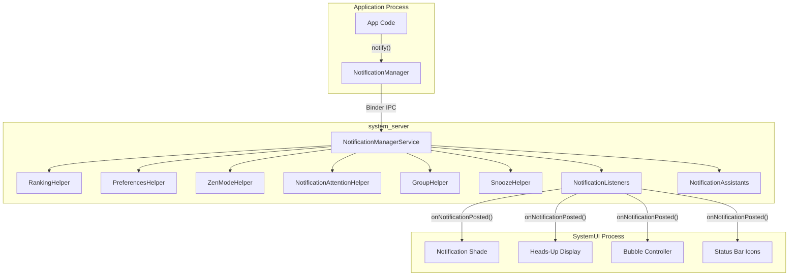

### 28.1.5 线程模型

`NotificationManagerService` 使用专用工作线程处理大多数操作。
来自应用的 Binder 调用到达 Binder 线程池，但实际
处理被投递到一个处理器线程：

```java
// NotificationManagerService.java (lines 500-506)
// message codes
static final int MESSAGE_DURATION_REACHED = 2;
static final int MESSAGE_SEND_RANKING_UPDATE = 4;
static final int MESSAGE_LISTENER_HINTS_CHANGED = 5;
static final int MESSAGE_LISTENER_NOTIFICATION_FILTER_CHANGED = 6;
static final int MESSAGE_FINISH_TOKEN_TIMEOUT = 7;
static final int MESSAGE_ON_PACKAGE_CHANGED = 8;
```

还有一个独立的排名线程：

```java
// NotificationManagerService.java (lines 511-512)
// ranking thread messages
private static final int MESSAGE_RECONSIDER_RANKING = 1000;
private static final int MESSAGE_RANKING_SORT = 1001;
```

关键的同步原语是 `mNotificationLock`：

```java
// All reads/writes to mNotificationList, mNotificationsByKey, mSummaryByGroupKey,
// and mEnqueuedNotifications must hold mNotificationLock.
```

### 28.1.6 信号提取管线

排名管线由一串 `NotificationSignalExtractor`
实现驱动，它们在 XML 中配置并以反射方式加载：

```xml
<!-- frameworks/base/core/res/res/values/config.xml (line 3845) -->
<string-array name="config_notificationSignalExtractors">
    <item>com.android.server.notification.NotificationChannelExtractor</item>
    <item>com.android.server.notification.NotificationAdjustmentExtractor</item>
    <item>com.android.server.notification.BubbleExtractor</item>
    <item>com.android.server.notification.ValidateNotificationPeople</item>
    <item>com.android.server.notification.PriorityExtractor</item>
    <item>com.android.server.notification.ZenModeExtractor</item>
    <item>com.android.server.notification.ImportanceExtractor</item>
    <item>com.android.server.notification.VisibilityExtractor</item>
    <item>com.android.server.notification.BadgeExtractor</item>
    <item>com.android.server.notification.CriticalNotificationExtractor</item>
</string-array>
```

该接口非常简单：

```java
// frameworks/base/services/core/java/com/android/server/notification/
//   NotificationSignalExtractor.java
public interface NotificationSignalExtractor {
    public void initialize(Context context, NotificationUsageStats usageStats);
    public RankingReconsideration process(NotificationRecord notification);
    void setConfig(RankingConfig config);
    void setZenHelper(ZenModeHelper helper);
}
```

每个提取器依次对每条通知运行。如果某个提取器返回非空的
`RankingReconsideration`，它会被投递到排名线程进行延迟
重新评估（`ValidateNotificationPeople` 用它做异步联系人查找）。

```mermaid
graph LR
    NR[NotificationRecord] --> E1[ChannelExtractor]
    E1 --> E2[AdjustmentExtractor]
    E2 --> E3[BubbleExtractor]
    E3 --> E4[ValidateNotificationPeople]
    E4 --> E5[PriorityExtractor]
    E5 --> E6[ZenModeExtractor]
    E6 --> E7[ImportanceExtractor]
    E7 --> E8[VisibilityExtractor]
    E8 --> E9[BadgeExtractor]
    E9 --> E10[CriticalNotificationExtractor]
    E10 --> SORTED[Sorted NotificationList]
```

### 28.1.7 NotificationRecord

`NotificationRecord` 是 `StatusBarNotification` 的服务端包装。
它保存信号提取器产生的所有中间状态：

```java
// frameworks/base/services/core/java/com/android/server/notification/
//   NotificationRecord.java (lines 108-248, summarized)
public final class NotificationRecord {
    private final StatusBarNotification sbn;
    private float mContactAffinity;
    private boolean mIntercept;          // suppressed by DND
    private long mRankingTimeMs;
    private int mImportance;
    private int mSystemImportance;
    private int mAssistantImportance;
    private float mRankingScore;
    private int mCriticality;
    private NotificationChannel mChannel;
    private ShortcutInfo mShortcutInfo;
    private boolean mAllowBubble;
    private boolean mShowBadge;
    private int mSuppressedVisualEffects;
    private ArrayList<Notification.Action> mSystemGeneratedSmartActions;
    private ArrayList<CharSequence> mSmartReplies;
    private int mUserSentiment;
    private boolean mIsInterruptive;
    // ... many more fields
}
```

该类的 Javadoc 说明了关键的线程规则：

> 这些对象不应被修改，除非代码在
> `NotificationManagerService.mNotificationLock` 上同步，
> 并且任何修改之后都应对该列表重新排序。

---

## 28.2 NotificationManagerService：入队、发布、取消

### 28.2.1 通知生命周期概览

一条通知在服务端经历三个不同的阶段：

1. **入队**——验证、通道查找、速率限制、创建 `NotificationRecord`。
2. **发布**——信号提取、排名排序、注意力效果、监听器分发。
3. **取消**——从列表移除、通知监听器、历史归档。

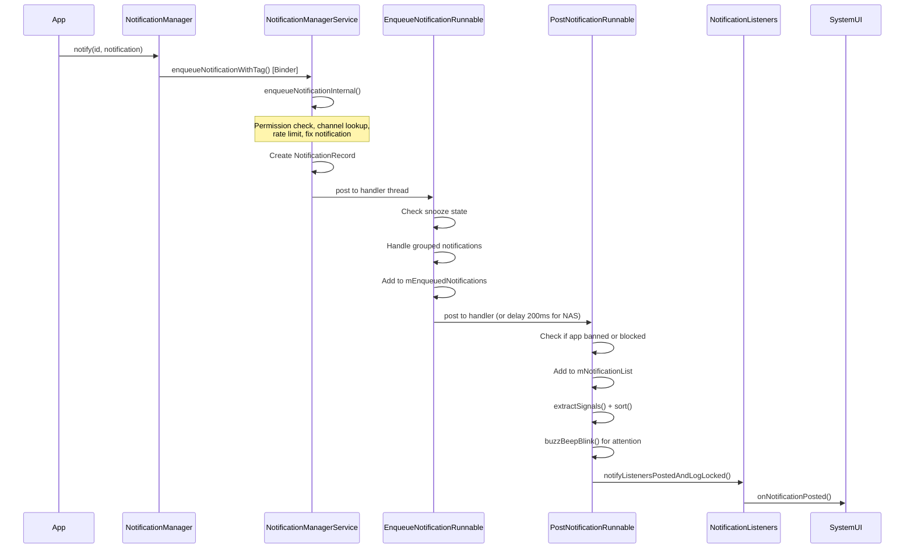

### 28.2.2 阶段一：入队

Binder 调用的入口点是内部的 `INotificationManager.Stub`：

```java
// NotificationManagerService.java (line 4616)
public void enqueueNotificationWithTag(String pkg, String opPkg, String tag,
        int id, Notification notification, int userId) throws RemoteException {
    enqueueNotificationInternal(pkg, opPkg, Binder.getCallingUid(),
            Binder.getCallingPid(), tag, id, notification, userId,
            /* byForegroundService= */ false, /* isAppProvided= */ true);
}
```

私有方法 `enqueueNotificationInternal()`（从第 9346 行开始）执行
以下步骤：

**步骤 1——验证：**
```java
if (pkg == null || notification == null) {
    throw new IllegalArgumentException("null not allowed: pkg=" + pkg
            + " id=" + id + " notification=" + notification);
}
```

**步骤 2——用户解析：**
```java
final int userId = ActivityManager.handleIncomingUser(callingPid,
        callingUid, incomingUserId, true, false, "enqueueNotification", pkg);
```

**步骤 3——UID 解析与安全检查：**
```java
notificationUid = resolveNotificationUid(opPkg, pkg, callingUid, userId);
if (notificationUid == INVALID_UID) {
    throw new SecurityException("Caller " + opPkg + ":" + callingUid
            + " trying to post for invalid pkg " + pkg);
}
```

**步骤 4——前台服务策略检查：**
```java
final ServiceNotificationPolicy policy = mAmi.applyForegroundServiceNotification(
        notification, tag, id, pkg, userId);
```

**步骤 5——修正通知：** `fixNotification()` 方法通过以下方式清理通知：

- 剥离无效的操作。
- 强制最大文本长度。
- 从前台服务和用户发起的任务
  通知中剥离 `FLAG_AUTO_CANCEL`。
- 为面向 Android V+（`ENFORCE_NO_CLEAR_FLAG_ON_MEDIA_NOTIFICATION`）的应用
  在 MediaStyle 通知上设置 `FLAG_NO_CLEAR`。
- 确保通知具有有效的通道 ID。

（前台服务通知的 `FLAG_NO_CLEAR` 标志是在之后、
`PostNotificationRunnable` 中设置的，而不是在这里。）

**步骤 6——通道查找：**
```java
// getNotificationChannelRestoreDeleted() is defined at line 9571; it is
// called from enqueueNotificationInternal() around line 9447.
final NotificationChannel channel = getNotificationChannelRestoreDeleted(
        pkg, callingUid, notificationUid, channelId, shortcutId);
if (channel == null) {
    // ... toast warning, return false
}
```

**步骤 7——创建 NotificationRecord：**
```java
final NotificationRecord r = new NotificationRecord(getContext(), n, channel);
r.setIsAppImportanceLocked(mPermissionHelper.isPermissionUserSet(pkg, userId));
r.setPostSilently(postSilently);
r.setFlagBubbleRemoved(false);
r.setPkgAllowedAsConvo(mMsgPkgsAllowedAsConvos.contains(pkg));
```

**步骤 8——FGS 重要性下限：**

如果通知属于前台服务或用户发起的任务，且
通道重要性为 MIN 或 NONE，则会被提升到 LOW。这仅在用户尚未在
该通道上显示过 FGS/UIJ 之后锁定通道重要性时才会发生：

```java
if (notification.isFgsOrUij()) {
    if (((channel.getUserLockedFields() & NotificationChannel.USER_LOCKED_IMPORTANCE) == 0
                || !channel.isUserVisibleTaskShown())
            && (r.getImportance() == IMPORTANCE_MIN
                    || r.getImportance() == IMPORTANCE_NONE)) {
        channel.setImportance(IMPORTANCE_LOW);
        r.setSystemImportance(IMPORTANCE_LOW);
        // ... unlock USER_LOCKED_IMPORTANCE, mark task shown, persist channel
    }
}
```

**步骤 9——在处理器线程上调度 EnqueueNotificationRunnable**，
同时携带 `PostNotificationTracker`。

注意，发布唤醒锁在这些步骤中的任何一步运行之前获取：
`enqueueNotificationInternal()` 的公开重载（第 9294-9312 行）调用

```java
PostNotificationTracker tracker = acquireWakeLockForPost(pkg, callingUid);
```

先行执行，然后把该跟踪器交给执行上述验证、通道查找与记录创建的私有重载
（第 9346 行）。唤醒锁超时为 30 秒（`POST_WAKE_LOCK_TIMEOUT`），确保设备
保持唤醒足够长的时间以完成发布。

### 28.2.3 EnqueueNotificationRunnable

来源：`NotificationManagerService.java`，第 10715 行。

该可运行对象在处理器线程上执行，持有 `mNotificationLock`：

```java
protected class EnqueueNotificationRunnable implements Runnable {
    private final NotificationRecord r;
    private final int userId;
    // ...
```

关键操作：

1. **暂存检查**——如果通知键之前被暂存过，且
    暂存计时器尚未结束，则立即重新暂存它：
   ```java
   final long snoozeAt = mSnoozeHelper.getSnoozeTimeForUnpostedNotification(
           r.getUser().getIdentifier(), r.getSbn().getPackageName(), r.getSbn().getKey());
   if (snoozeAt > currentTime) {
       (new SnoozeNotificationRunnable(r.getSbn().getKey(),
               snoozeAt - currentTime, null)).snoozeLocked(r);
       return false;
   }
   ```

2. **从已有记录复制排名**——如果这是对已有
    通知的更新，排名信息会被保留：
   ```java
   NotificationRecord old = mNotificationsByKey.get(n.getKey());
   if (old != null) {
       r.copyRankingInformation(old);
   }
   ```

3. **加入入队列表：**
   ```java
   mEnqueuedNotifications.add(r);
   mTtlHelper.scheduleTimeoutLocked(r, SystemClock.elapsedRealtime());
   ```

4. **气泡标志更新：**
   ```java
   updateNotificationBubbleFlags(r, isAppForeground);
   ```

5. **分组处理：**
   ```java
   handleGroupedNotificationLocked(r, old, callingUid, callingPid);
   ```

6. **分发到 PostNotificationRunnable**，立即执行；
    如果启用了通知助手服务（NAS），则延迟
    200 毫秒：
   ```java
   if (mAssistants.isEnabled()) {
       mAssistants.onNotificationEnqueuedLocked(r);
       mHandler.postDelayed(
               new PostNotificationRunnable(r.getKey(), ...),
               DELAY_FOR_ASSISTANT_TIME);   // 200ms
   } else {
       mHandler.post(new PostNotificationRunnable(r.getKey(), ...));
   }
   ```

### 28.2.4 PostNotificationRunnable

来源：`NotificationManagerService.java`，第 10885 行。

通知在这里变得可见。持有 `mNotificationLock` 时：

**步骤 1——找到入队的记录：**
```java
NotificationRecord r = findNotificationByListLocked(mEnqueuedNotifications, key);
if (r == null) {
    Slog.i(TAG, "Cannot find enqueued record for key: " + key);
    return false;
}
```

**步骤 2——拦截检查：**
```java
if (!(notification.isMediaNotification() || isCallNotificationAndCorrectStyle)
        && (appBanned || isRecordBlockedLocked(r))) {
    mUsageStats.registerBlocked(r);
    return false;
}
```
媒体和通话样式的通知绕过拦截检查。其他所有通知在应用通知被禁用或通道被
拦截时都会被抑制。

**步骤 3——加入主通知列表：**
```java
int index = indexOfNotificationLocked(n.getKey());
if (index < 0) {
    mNotificationList.add(r);           // new notification
    mUsageStats.registerPostedByApp(r);
} else {
    old = mNotificationList.get(index);  // update existing
    mNotificationList.set(index, r);
    mUsageStats.registerUpdatedByApp(r, old);
}
mNotificationsByKey.put(n.getKey(), r);
```

**步骤 4——自动分组：**
`GroupHelper.onNotificationPosted()` 方法决定是否自动分组：
```java
boolean willBeAutogrouped = mGroupHelper.onNotificationPosted(
        r, hasAutoGroupSummaryLocked(r));
if (willBeAutogrouped) {
    addAutogroupKeyLocked(key, autogroupName, /*requestSort=*/false);
}
```

**步骤 5——信号提取与排序：**
```java
mRankingHelper.extractSignals(r);
mRankingHelper.sort(mNotificationList);
```

**步骤 6——注意力效果（buzz-beep-blink）：**
```java
buzzBeepBlinkLoggingCode = mAttentionHelper.buzzBeepBlinkLocked(r,
        new NotificationAttentionHelper.Signals(
                mUserProfiles.isCurrentProfile(r.getUserId()),
                mListenerHints));
```

**步骤 7——监听器分发：**
```java
if (notification.getSmallIcon() != null) {
    notifyListenersPostedAndLogLocked(r, old, mTracker, maybeReport);
    posted = true;
} else {
    Slog.e(TAG, "Not posting notification without small icon: " + notification);
}
```

通知*必须*具有小图标才能被发布。没有小图标，它将在
这一阶段被拒绝。

**步骤 8——清理入队列表：**
```java
for (int i = 0; i < N; i++) {
    final NotificationRecord enqueued = mEnqueuedNotifications.get(i);
    if (Objects.equals(key, enqueued.getKey())) {
        mEnqueuedNotifications.remove(i);
        break;
    }
}
```

### 28.2.5 阶段三：取消

取消可以来自许多来源：

| 取消原因 | 常量 | 触发条件 |
|---------------|----------|---------|
| `REASON_CLICK` | 1 | 用户点击通知 |
| `REASON_CANCEL` | 2 | 用户滑动以忽略 |
| `REASON_CANCEL_ALL` | 3 | 用户点击“全部清除” |
| `REASON_APP_CANCEL` | 8 | 应用调用 `cancel()` |
| `REASON_APP_CANCEL_ALL` | 9 | 应用调用 `cancelAll()` |
| `REASON_LISTENER_CANCEL` | 10 | `NotificationListenerService.cancelNotification()` |
| `REASON_PACKAGE_BANNED` | 7 | 该软件包的通知已禁用 |
| `REASON_CHANNEL_BANNED` | 17 | 通道重要性被设为 NONE |
| `REASON_SNOOZED` | 18 | 用户暂存了通知 |
| `REASON_TIMEOUT` | 19 | TTL 过期（默认 3 天） |
| `REASON_GROUP_OPTIMIZATION` | 13 | 通知被重新分组 |

（原因常量定义在
`frameworks/base/core/java/android/service/notification/NotificationListenerService.java`，
第 234-291 行。完整表格见 28.17 节。）

取消路径在处理器线程上运行于 `CancelNotificationRunnable`
（第 10530 行）内部，它由各个取消入口点调度。
面向应用的 Binder 入口点是 `INotificationManager.Stub.cancelNotificationWithTag()`
（第 4624 行）；system_server 组件则使用进程内的
`NotificationManagerInternal` 本地服务：

```java
// NotificationManagerService.java (line 8890) -- NotificationManagerInternalImpl,
// the private API only accessible to the system process (not a Binder method)
public void cancelNotification(String pkg, String opPkg, int callingUid,
        int callingPid, String tag, int id, int userId) {
    // ... cancelNotificationLocked(...) under mNotificationLock
}
```

私有方法 `cancelNotificationLocked()`（第 12037 行）执行：

1. **发送删除意图**——如果通知具有 `deleteIntent`：
   ```java
   if (sendDelete) {
       sendDeleteIntent(r.getNotification().deleteIntent, r.getSbn().getPackageName());
   }
   ```

2. **通知监听器** 已移除：
   ```java
   mListeners.notifyRemovedLocked(r, reason, r.getStats());
   ```

3. **通知 GroupHelper** 以进行可能的取消分组：
   ```java
   mGroupHelper.onNotificationRemoved(r, mNotificationList, sendDelete);
   ```

4. **清除注意力效果：**
   ```java
   mAttentionHelper.clearEffectsLocked(canceledKey);
   ```

5. **更新分组摘要跟踪：**
   ```java
   if (groupSummary != null && groupSummary.getKey().equals(canceledKey)) {
       mSummaryByGroupKey.remove(groupKey);
   }
   ```

6. **归档到历史：**
   ```java
   if (reason != REASON_CHANNEL_REMOVED) {
       mArchive.record(getSbnForArchive(r, reason), reason);
   }
   ```

### 28.2.6 TTL 与通知超时

通知默认有 3 天的存活时间：

```java
// NotificationManagerService.java (line 682)
static final long NOTIFICATION_TTL = Duration.ofDays(3).toMillis();
```

发布时超过 14 天的通知会被拒绝：

```java
// NotificationManagerService.java (line 684)
static final long NOTIFICATION_MAX_AGE_AT_POST = Duration.ofDays(14).toMillis();
```

`TimeToLiveHelper` 类调度一个闹钟，在每条通知的 TTL 过期后取消它。
这防止僵尸通知无限期地残留。

### 28.2.7 速率限制

服务强制执行按软件包的速率限制，以防止通知风暴：

```java
static final float DEFAULT_MAX_NOTIFICATION_ENQUEUE_RATE = 5f;
```

Toast 发布有更严格的速率限制：

```java
// NotificationManagerService.java (lines 559-563)
private static final MultiRateLimiter.RateLimit[] TOAST_RATE_LIMITS = {
    MultiRateLimiter.RateLimit.create(3, Duration.ofSeconds(20)),
    MultiRateLimiter.RateLimit.create(5, Duration.ofSeconds(42)),
    MultiRateLimiter.RateLimit.create(6, Duration.ofSeconds(68)),
};
```

### 28.2.8 完整发布流程图

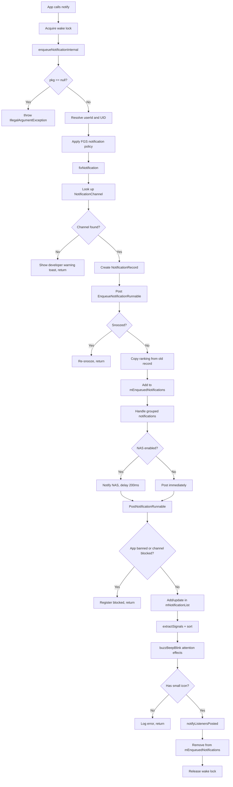

---

## 28.3 通知通道与分组

### 28.3.1 通道简介

自 Android 8.0（API 26）起，每条通知都必须分配到一个
`NotificationChannel`。通道让用户对通知行为进行细粒度控制——重要性、声音、振动、
灯光和角标可见性都可以按通道配置。通道一旦创建，其行为设置即归用户所有：
应用无法以编程方式更改它们。

来源：
`frameworks/base/core/java/android/app/NotificationChannel.java`

### 28.3.2 通道属性

一个 `NotificationChannel` 具有以下关键属性：

| 属性 | 方法 | 说明 |
|----------|--------|-------------|
| ID | `getId()` | 不可变的字符串标识符 |
| 名称 | `getName()` | 用户可见的名称 |
| 描述 | `getDescription()` | 用户可见的描述 |
| 重要性 | `getImportance()` | 控制打断级别 |
| 声音 | `getSound()` | 自定义通知声音 URI |
| 振动模式 | `getVibrationPattern()` | 自定义振动 |
| 灯光颜色 | `getLightColor()` | LED 颜色 |
| 显示角标 | `canShowBadge()` | 应用图标角标 |
| 绕过勿扰 | `canBypassDnd()` | 覆盖勿扰模式 |
| 锁屏可见性 | `getLockscreenVisibility()` | PUBLIC / PRIVATE / SECRET |
| 会话 ID | `getConversationId()` | 将会话链接到父通道 |
| 气泡偏好 | `getAllowBubbles()` | 是否允许气泡 |

### 28.3.3 重要性级别

重要性是影响最大的单一属性：

| 级别 | 常量 | 值 | 行为 |
|-------|----------|-------|----------|
| None | `IMPORTANCE_NONE` | 0 | 已拦截——不在任何位置显示 |
| Min | `IMPORTANCE_MIN` | 1 | 静默，无状态栏图标 |
| Low | `IMPORTANCE_LOW` | 2 | 静默，显示在通知栏面板 |
| Default | `IMPORTANCE_DEFAULT` | 3 | 发出声音 |
| High | `IMPORTANCE_HIGH` | 4 | 发出声音，悬浮通知 |
| Max | `IMPORTANCE_MAX` | 5 | 紧急，允许全屏意图 |

### 28.3.4 通道分组

`NotificationChannelGroup` 让应用组织相关的通道。每个分组都可以被用户独立拦截，
这会拦截该分组内的所有通道。

```java
// App code
NotificationChannelGroup group = new NotificationChannelGroup(
        "social", "Social Notifications");
notificationManager.createNotificationChannelGroup(group);

NotificationChannel channel = new NotificationChannel(
        "chat", "Chat Messages", NotificationManager.IMPORTANCE_HIGH);
channel.setGroup("social");
notificationManager.createNotificationChannel(channel);
```

### 28.3.5 系统保留通道

`NotificationChannel.SYSTEM_RESERVED_IDS` 列表防止应用使用系统为其自动分类
捆绑保留的 ID 创建通道。尝试使用保留 ID 创建通道会被静默忽略。

```java
// frameworks/base/core/java/android/app/NotificationChannel.java (lines 93-115)
public static final String PROMOTIONS_ID = "android.app.promotions";
public static final String SOCIAL_MEDIA_ID = "android.app.social";
public static final String NEWS_ID = "android.app.news";
public static final String RECS_ID = "android.app.recs";

public static final ArrayList<String> SYSTEM_RESERVED_IDS = new ArrayList<>(
        List.of(NEWS_ID, SOCIAL_MEDIA_ID, PROMOTIONS_ID, RECS_ID));
```

### 28.3.6 通道存储：PreferencesHelper

服务端通道管理位于 `PreferencesHelper` 中：

```java
// frameworks/base/services/core/java/com/android/server/notification/
//   PreferencesHelper.java (line 128)
public class PreferencesHelper implements RankingConfig {
    private static final String TAG = "NotificationPrefHelper";
    private final int XML_VERSION;
    static final int NOTIFICATION_CHANNEL_COUNT_LIMIT = 5000;
    static final int NOTIFICATION_CHANNEL_GROUP_COUNT_LIMIT = 6000;
    private static final int NOTIFICATION_CHANNEL_DELETION_RETENTION_DAYS = 30;
    // ...
}
```

通道首选项被序列化为 XML 并按用户存储。通道被删除时，
会以软删除方式保留 30 天，以防应用重新创建它时用户设置丢失。

### 28.3.7 NotificationChannelExtractor

管线中的第一个提取器是 `NotificationChannelExtractor`。它从
`PreferencesHelper` 查找通道并将其附加到 `NotificationRecord` 上：

```java
// frameworks/base/services/core/java/com/android/server/notification/
//   NotificationChannelExtractor.java
public class NotificationChannelExtractor implements NotificationSignalExtractor {
    // Sets r.mChannel from PreferencesHelper lookup
}
```

它必须最先运行，因为所有后续提取器都依赖通道属性
（重要性、勿扰绕过、可见性等）。

### 28.3.8 分类通道

Android 16 引入了按类型捆绑通知的自动分类通道。Android 17 将它们保留为
28.3.5 节中列出的四个保留通道 ID：

```java
// frameworks/base/core/java/android/app/NotificationChannel.java (lines 93-111)
public static final String PROMOTIONS_ID = "android.app.promotions";
public static final String SOCIAL_MEDIA_ID = "android.app.social";
public static final String NEWS_ID = "android.app.news";
public static final String RECS_ID = "android.app.recs";
```

通知助手服务使用
`Adjustment.KEY_TYPE` 调整来分类通知，例如归类为新闻或促销。分类时，
系统会将该类型映射到这些保留通道之一。这让用户获得更一致的
控制。参见 `NotificationChannel.java` 中的
`getChannelIdForBundleType(int type)`，约第 1611-1620 行。

应用无法使用这些 ID 创建通道，因此分类
捆绑始终属于系统。Android 17 还添加了反向的
`Adjustment.KEY_UNCLASSIFY` 键。使用此键，助手可以在认为
分类有误时，将通知从分类捆绑中拉出。

### 28.3.9 通道生命周期图

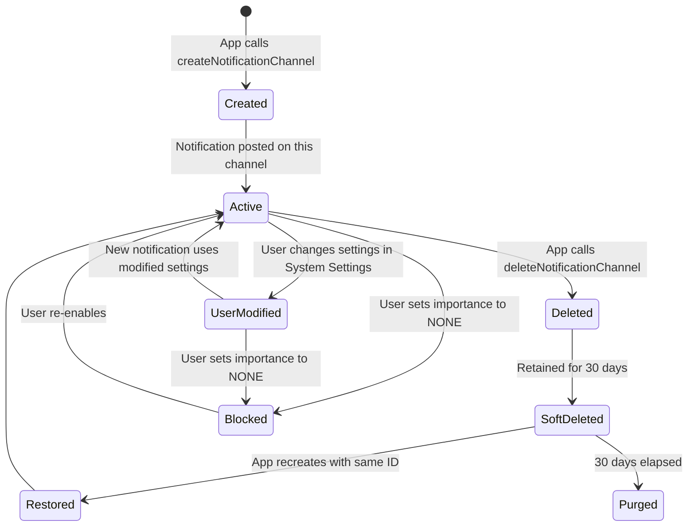

---

## 28.4 通知排名

### 28.4.1 概览

通知排名决定通知在通知栏面板中的显示顺序以及哪些通知可以打断用户。
排名管线分为两个阶段：

1. **信号提取**——每个 `NotificationSignalExtractor` 把信号写入
   `NotificationRecord`。
2. **排序**——比较器使用这些信号生成最终顺序。

来源：`frameworks/base/services/core/java/com/android/server/notification/RankingHelper.java`

### 28.4.2 RankingHelper：编排者

```java
// RankingHelper.java (line 37)
public class RankingHelper {
    private final NotificationSignalExtractor[] mSignalExtractors;
    private final Comparator mPreliminaryComparator;
    private final GlobalSortKeyComparator mFinalComparator = new GlobalSortKeyComparator();
```

`extractSignals()` 方法按顺序运行每个提取器：

```java
// RankingHelper.java (line 100)
public void extractSignals(NotificationRecord r) {
    final int N = mSignalExtractors.length;
    for (int i = 0; i < N; i++) {
        NotificationSignalExtractor extractor = mSignalExtractors[i];
        try {
            RankingReconsideration recon = extractor.process(r);
            if (recon != null) {
                mRankingHandler.requestReconsideration(recon);
            }
        } catch (Throwable t) {
            Slog.w(TAG, "NotificationSignalExtractor failed.", t);
        }
    }
}
```

`sort()` 方法执行两轮排序：

```java
// RankingHelper.java (line 115)
public void sort(ArrayList<NotificationRecord> notificationList) {
    // Pass 1: Preliminary sort by ranking time
    notificationList.sort(mPreliminaryComparator);

    // Pass 2: Assign global sort keys with group awareness
    for (int i = 0; i < N; i++) {
        record.setAuthoritativeRank(i);
        // Nominate group proxies (prefer children over summaries)
    }

    // Global sort key format (formatSimple string):
    //   crtcl=...:intrsv=...:grnk=...:gsmry=...:<group_sort_key>:rnk=...
}
```

### 28.4.3 NotificationTimeComparator

预排序比较器按排名时间排序（最新的在前）：

```java
// frameworks/base/services/core/java/com/android/server/notification/
//   NotificationTimeComparator.java
public class NotificationTimeComparator implements Comparator<NotificationRecord> {
    @Override
    public int compare(NotificationRecord left, NotificationRecord right) {
        return -1 * Long.compare(left.getRankingTimeMs(), right.getRankingTimeMs());
    }
}
```

### 28.4.4 全局排序键

预排序之后，`RankingHelper.sort()` 为每条通知分配一个全局排序键。
生成的键（RankingHelper.java，第 158-168 行）编码了
多个维度：

```
crtcl=<criticality> : intrsv=<char> : grnk=<group_rank> : gsmry=<is_group_summary> : <group_sort_key> : rnk=<rank>
```

这个多级键确保：

- 关键通知（由 `CriticalNotificationExtractor` 标记）出现在
  顶部——关键性是首要判别因子。
- 分组通知保持在一起。
- 在分组内，摘要出现在子项之前。
- 在子项内部，尊重开发者提供的排序键。

`intrsv=` 组成部分是一个遗留物。源码为每条记录硬编码
`char intrusiveRank = '2';`，因此侵入性不再
影响排序。旧的 `is_recently_intrusive` 名称只保存在
一条源码注释中。

### 28.4.5 各提取器详解

#### NotificationChannelExtractor
从 `PreferencesHelper` 解析 `NotificationChannel` 并将其设置到记录上。
所有下游提取器都依赖它。

#### NotificationAdjustmentExtractor
应用来自通知助手服务（NAS）的调整。调整可以修改重要性、人物引用、
智能操作、智能回复和分类类型。

```java
// Adjustment keys allowed by default (NotificationManagerService.java, line 530)
static final String[] DEFAULT_ALLOWED_ADJUSTMENTS = new String[] {
    Adjustment.KEY_PEOPLE,
    Adjustment.KEY_SNOOZE_CRITERIA,
    Adjustment.KEY_USER_SENTIMENT,
    Adjustment.KEY_CONTEXTUAL_ACTIONS,
    Adjustment.KEY_TEXT_REPLIES,
    Adjustment.KEY_IMPORTANCE,
    Adjustment.KEY_IMPORTANCE_PROPOSAL,
    Adjustment.KEY_SENSITIVE_CONTENT,
    Adjustment.KEY_RANKING_SCORE,
    Adjustment.KEY_NOT_CONVERSATION,
    Adjustment.KEY_TYPE,
    Adjustment.KEY_SUMMARIZATION,
    KEY_NOTIFICATION_RULES   // new in Android 17
};
```

助手可发出的完整调整键集合声明在
`frameworks/base/core/java/android/service/notification/Adjustment.java` 中。Android
17 将其扩展到远超上述默认值的范围。它添加了 `KEY_UNCLASSIFY`（撤销分类）和
`KEY_DYNAMIC_BUNDLE`（将通知放入动态捆绑）。它还添加了情境模式键
`KEY_NOTIFICATION_RULES`、`KEY_SOUND`、`KEY_LIGHT`、`KEY_HIGHLIGHT`、
`KEY_MODE_BREAKTHROUGH_LIST` 和
`KEY_BREAKTHROUGH_ALL_MODES`。情境
键由 `nm_contextual_display_launch` 标志保护，将在 28.21 节中介绍。

#### BubbleExtractor
确定一条通知能否以气泡形式呈现。要求：

- 设备支持气泡（`config_supportsBubble`）。
- 不是低内存设备。
- 通知是会话。
- 具有有效的 `ShortcutInfo`。
- 不是前台服务或用户发起的任务通知。
- 用户已在全局和按应用启用气泡。

```java
// BubbleExtractor.java (line 86)
boolean notifCanPresentAsBubble = canPresentAsBubble(record)
        && !mActivityManager.isLowRamDevice()
        && record.isConversation()
        && record.getShortcutInfo() != null
        && !record.getNotification().isFgsOrUij();
```

#### ValidateNotificationPeople
对照联系人数据库解析人物引用（URI、电话号码、电子邮件地址）。在记录上设置
`contactAffinity`：

```java
// ValidateNotificationPeople.java (lines 83-95)
static final float NONE = 0f;
static final float VALID_CONTACT = 0.5f;
static final float STARRED_CONTACT = 1f;
```

该提取器可以返回一个 `RankingReconsideration` 用于异步联系人
解析，查找完成后会重新排序通知。

#### PriorityExtractor
基于通道配置设置软件包优先级。

#### ZenModeExtractor
咨询 `ZenModeHelper.shouldIntercept()` 以确定通知是否应被勿扰模式
抑制。在记录上设置 `mIntercept` 和 `mSuppressedVisualEffects`。

#### ImportanceExtractor
调用 `record.calculateImportance()`，它从通道重要性、系统重要性覆盖
和助手重要性解析出最终重要性：

```java
// ImportanceExtractor.java (line 44)
record.calculateImportance();
```

#### VisibilityExtractor
基于通道设置和系统范围的敏感内容策略设置锁屏可见性。

#### BadgeExtractor
确定通知是否应产生应用图标角标，参考通道的 `canShowBadge()` 设置
和勿扰抑制。

#### CriticalNotificationExtractor
为车载和关键系统通知做标记，使其优先于所有其他通知放置。

### 28.4.6 排名重新评估

有些提取器无法同步完成。`RankingReconsideration`
机制允许延迟重新评估：

```java
// RankingHelper.java, inside extractSignals() (around line 106)
if (recon != null) {
    mRankingHandler.requestReconsideration(recon);
}
```

重新评估运行在排名线程上（`MESSAGE_RECONSIDER_RANKING = 1000`）。
完成后，会触发排序更新（`MESSAGE_RANKING_SORT = 1001`），
并通知监听器排名已更改。

### 28.4.7 排名管线图

```mermaid
flowchart LR
    subgraph Extractors
        CE[ChannelExtractor] --> AE[AdjustmentExtractor]
        AE --> BE[BubbleExtractor]
        BE --> VNP[ValidateNotificationPeople]
        VNP --> PE[PriorityExtractor]
        PE --> ZME[ZenModeExtractor]
        ZME --> IE[ImportanceExtractor]
        IE --> VE[VisibilityExtractor]
        VE --> BADGE[BadgeExtractor]
        BADGE --> CRIT[CriticalNotificationExtractor]
    end

    subgraph Sorting
        CRIT --> PRELIM["Preliminary Sort<br/>by RankingTime"]
        PRELIM --> GSK["Assign Global Sort Keys<br/>with group proxy"]
        GSK --> FINAL["Final Sort<br/>by GlobalSortKey"]
    end

    subgraph Output
        FINAL --> RANKING["Ranking Update<br/>sent to Listeners"]
    end

    VNP -.->|async| RECON["RankingReconsideration<br/>on ranking thread"]
    RECON -.->|re-sort| GSK
```

### 28.4.8 侵入性

一条通知如果为新通知，或其内容发生了有意义的变化，则被视为"视觉侵入"。
`isVisuallyInterruptive()` 方法
（第 11165 行）比较新旧附加数据中标题、文本、进度
和大图标的变化。侵入性通知的排名时间会被重置，使其
被推到通知栏面板顶部。

---

## 28.5 勿扰模式（ZenModeHelper 与 ZenPolicy）

### 28.5.1 概览

Android 中的勿扰模式（DND）由 `ZenModeHelper` 管理。它维护
DND 状态机、评估规则，并告知通知管线应拦截哪些通知。
DND 不是一个简单的开/关开关——它支持多个同时生效的规则，每个规则都有自己的
策略。

源文件：

| 文件 | 角色 |
|------|------|
| `ZenModeHelper.java` | 中央 DND 状态管理 |
| `ZenModeFiltering.java` | 通知拦截逻辑 |
| `ZenModeConditions.java` | 规则条件评估 |
| `ZenModeExtractor.java` | 信号提取器集成 |
| `ZenModeConfig.java` | 配置数据模型 |
| `ZenPolicy.java` | 按规则的策略规范 |
| `ConditionProviders.java` | 管理条件提供者服务 |

### 28.5.2 勿扰模式

```java
// Settings.Global
ZEN_MODE_OFF = 0;                    // DND off
ZEN_MODE_IMPORTANT_INTERRUPTIONS = 1; // Priority only
ZEN_MODE_NO_INTERRUPTIONS = 2;       // Total silence
ZEN_MODE_ALARMS = 3;                 // Alarms only
```

### 28.5.3 ZenModeHelper 架构

```java
// ZenModeHelper.java (lines 175-211, summarized)
public class ZenModeHelper {
    private final ZenModeFiltering mFiltering;
    private final ZenModeConditions mConditions;
    private final SparseArray<ZenModeConfig> mConfigs;  // per-user
    protected int mZenMode;
    protected NotificationManager.Policy mConsolidatedPolicy;
    private ZenDeviceEffects mConsolidatedDeviceEffects;
    private DeviceEffectsApplier mDeviceEffectsApplier;
}
```

`mConsolidatedPolicy` 将所有生效规则合并为单一有效策略。
这个合并策略正是 `ZenModeFiltering` 用来做拦截决策的依据。

### 28.5.4 ZenModeConfig 与规则

`ZenModeConfig` 持有：

- 手动规则（用户激活的 DND）。
- 以规则 ID 为键的 `AutomaticZenRule` 对象映射。
- 按规则的条件（基于时间、基于事件、驾驶等）。

每个 `AutomaticZenRule` 具有：

- 一个所有者软件包。
- 一个 `ConditionProvider` 组件。
- 一个描述规则允许内容的 `ZenPolicy`。
- 一个触发器描述。

每个软件包的规则上限：
```java
// ZenModeHelper.java (line 156)
static final int RULE_LIMIT_PER_PACKAGE = 100;
```

### 28.5.5 自动勿扰规则与条件

自动规则由 `ConditionProvider` 服务激活。内置提供者：

| 提供者 | 类 | 触发条件 |
|----------|-------|---------|
| 日程 | `ScheduleConditionProvider` | 每日时段日程 |
| 事件 | `EventConditionProvider` | 日历事件 |
| 倒计时 | `CountdownConditionProvider` | 定时 DND（如"1 小时"） |

应用可以注册自己的 `ConditionProviderService` 来创建自定义规则
（例如"驾驶时勿扰"）。

### 28.5.6 ZenPolicy

`ZenPolicy`（API 29+）对每个规则提供细粒度控制：

```java
// frameworks/base/core/java/android/service/notification/ZenPolicy.java
//   (fields at lines 157-163)
public final class ZenPolicy {
    // Per-category state lists (not bitmasks): one entry per category
    private List<Integer> mPriorityCategories;  // calls, messages, conversations, etc.
    private List<Integer> mVisualEffects;       // full-screen intents, lights, peek,
                                                // status bar, badge, ambient, notification list

    // Sender filters: anyone, contacts, starred, none
    private @PeopleType int mPriorityMessages = PEOPLE_TYPE_UNSET;
    private @PeopleType int mPriorityCalls = PEOPLE_TYPE_UNSET;
    private @ConversationSenders int mConversationSenders = CONVERSATION_SENDERS_UNSET;
    // ...
}
```

### 28.5.7 过滤决策

`ZenModeFiltering.shouldIntercept()` 是核心决策函数。它在
信号提取期间由 `ZenModeExtractor.process()` 调用：

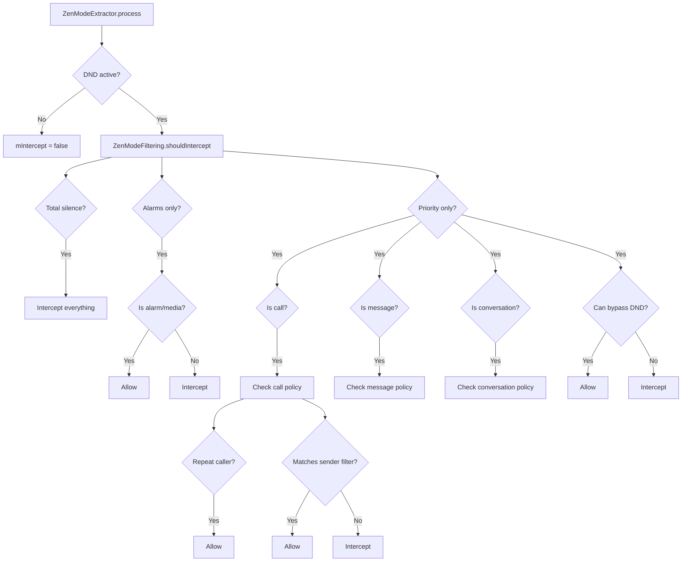

### 28.5.8 重复来电者检测

当 DND 允许重复来电者时，系统跟踪最近的通话：

```java
// ZenModeFiltering.java (line 48)
static final RepeatCallers REPEAT_CALLERS = new RepeatCallers();
```

默认阈值周期为 15 分钟。如果同一来电者在此期间内来电两次，
第二次来电会被放行。即使来电者不匹配优先过滤器，
这也会发生。

### 28.5.9 设备效果

自 Android 15 起，DND 规则可以指定 `ZenDeviceEffects`：

```java
// ZenModeHelper.java (line 198)
private ZenDeviceEffects mConsolidatedDeviceEffects = new ZenDeviceEffects.Builder().build();
```

设备效果包括：

- 灰度显示。
- 抑制氛围显示。
- 调暗壁纸。
- 夜间模式覆盖。

这些通过 `DeviceEffectsApplier` 应用。NotificationManagerService
在启动期间自行安装默认 applier：

```java
// NotificationManagerService.java (lines 3739-3743)
if (!mZenModeHelper.hasDeviceEffectsApplier()) {
    // Cannot be done earlier, as some services aren't ready until this point.
    mZenModeHelper.setDeviceEffectsApplier(
            new DefaultDeviceEffectsApplier(getContext()));
}
```

另一个 `system_server` 组件可以通过内部钩子
`NotificationManagerInternal.setDeviceEffectsApplier()` 在该时间点之前覆盖
默认值，该钩子转发到 `ZenModeHelper.setDeviceEffectsApplier()`（第 347 行）：

```java
// ZenModeHelper.java (line 347)
void setDeviceEffectsApplier(@NonNull DeviceEffectsApplier deviceEffectsApplier) {
    mDeviceEffectsApplier = deviceEffectsApplier;
    applyConsolidatedDeviceEffects(ORIGIN_INIT);
}
```

### 28.5.10 隐式规则（Android 15+）

从 Android V（API 35）开始，应用调用 `setInterruptionFilter()` 和
`setNotificationPolicy()` 会创建隐式 `AutomaticZenRule` 对象，而不是
直接修改全局 DND 状态：

```java
// NotificationManagerService.java (line 678)
@ChangeId
@EnabledSince(targetSdkVersion = Build.VERSION_CODES.VANILLA_ICE_CREAM)
static final long MANAGE_GLOBAL_ZEN_VIA_IMPLICIT_RULES = 308670109L;
```

此变更允许系统正确跟踪哪个应用激活了 DND，并
防止应用意外覆盖彼此的 DND 设置。

该变更由
应用的目标 SDK（`VANILLA_ICE_CREAM`，API 35）控制。因此，应用在面向
Android 15 或更新版本之前一直保持传统的全局 DND 行为。Android 17
继续强制执行它。Android 17 还收紧了这些
过渡的簿记工作。为 `setInterruptionFilter()` 和
`setZenMode()` 记录的 "zenOrigin" 得到了修正。这让审计跟踪可以将每个 DND
变更归因到正确的调用者（参见 `ZenModeHelper.java` 中的
`zenOrigin` 处理）。

### 28.5.11 被抑制的视觉效果

DND 可以抑制特定的视觉效果，同时仍允许通知存在。被抑制效果的位图：

| 效果 | 常量 | 说明 |
|--------|----------|-------------|
| 息屏效果 | `SUPPRESSED_EFFECT_SCREEN_OFF` | 屏幕关闭时抑制 |
| 亮屏效果 | `SUPPRESSED_EFFECT_SCREEN_ON` | 屏幕开启时抑制 |
| 全屏意图 | `SUPPRESSED_EFFECT_FULL_SCREEN_INTENT` | 拦截 FSI |
| 悬浮（抬头显示） | `SUPPRESSED_EFFECT_PEEK` | 无悬浮通知 |
| 状态栏 | `SUPPRESSED_EFFECT_STATUS_BAR` | 无状态栏图标 |
| 角标 | `SUPPRESSED_EFFECT_BADGE` | 无应用角标 |
| 氛围 | `SUPPRESSED_EFFECT_AMBIENT` | 无氛围显示 |
| 通知列表 | `SUPPRESSED_EFFECT_NOTIFICATION_LIST` | 从通知栏面板隐藏 |
| 灯光 | `SUPPRESSED_EFFECT_LIGHTS` | 无 LED |

---

## 28.6 通知监听器（NotificationListenerService）

### 28.6.1 概览

`NotificationListenerService` 是应用（包括 SystemUI）
接收通知事件的机制。它是由
`ManagedServices` 框架管理的绑定服务。当监听器启用时，NMS 绑定到它，
并分发通知发布、移除和排名更新事件。

源文件：

| 文件 | 角色 |
|------|------|
| `NotificationListenerService.java` | SDK API（应用侧） |
| `ManagedServices.java` | 服务生命周期管理 |
| `NotificationListeners`（NMS 内部类） | 服务端分发 |

### 28.6.2 ManagedServices 框架

`NotificationListeners` 继承 `ManagedServices`，后者处理：

- 通过 `PackageManager` 查询进行服务发现。
- 绑定与解绑。
- 用户档案感知（监听器服务于哪些用户）。
- 安全设置中的持久化配置。

```java
// NotificationManagerService.java (line 14607)
public class NotificationListeners extends ManagedServices {
    static final String TAG_ENABLED_NOTIFICATION_LISTENERS = "enabled_listeners";
    // ...
}
```

监听器的配置：

```java
// NotificationListeners (line 14736)
protected Config getConfig() {
    Config c = new Config();
    c.caption = "notification listener";
    c.serviceInterface = NotificationListenerService.SERVICE_INTERFACE;
    c.secureSettingName = Secure.ENABLED_NOTIFICATION_LISTENERS;
    c.bindPermission =
            android.Manifest.permission.BIND_NOTIFICATION_LISTENER_SERVICE;
    c.settingsAction = Settings.ACTION_NOTIFICATION_LISTENER_SETTINGS;
    return c;
}
```

### 28.6.3 绑定标志

通知监听器使用特定的绑定标志来管理内存压力：

```java
// NotificationListeners (line 14722)
protected long getBindFlags() {
    return BIND_AUTO_CREATE
         | BIND_FOREGROUND_SERVICE
         | BIND_NOT_PERCEPTIBLE       // reduce memory pressure
         | BIND_ALLOW_WHITELIST_MANAGEMENT
         | freezeFlags;               // BIND_ALLOW_FREEZE for idle NLS
}
```

`BIND_NOT_PERCEPTIBLE` 标志值得注意。它告诉系统，过多的
第三方监听器可能导致内存压力。因此，在 OOM 调整方面，它们应被视为
较低优先级。

### 28.6.4 监听器回调

监听器接收以下关键回调：

```java
// NotificationListenerService.java (SDK API)
public void onNotificationPosted(StatusBarNotification sbn, RankingMap rankingMap);
public void onNotificationRemoved(StatusBarNotification sbn, RankingMap rankingMap,
        int reason);
public void onNotificationRankingUpdate(RankingMap rankingMap);
public void onListenerConnected();
public void onListenerDisconnected();
public void onNotificationChannelModified(String pkg, UserHandle user,
        NotificationChannel channel, int modificationType);
```

### 28.6.5 过滤器类型

监听器可以请求只接收特定类别的通知：

```java
// NotificationListenerService.java
static final int FLAG_FILTER_TYPE_CONVERSATIONS = 1;
static final int FLAG_FILTER_TYPE_ALERTING = 2;
static final int FLAG_FILTER_TYPE_SILENT = 4;
static final int FLAG_FILTER_TYPE_ONGOING = 8;
```

### 28.6.6 裁剪级别

特权监听器可以请求裁剪后的通知数据：

```java
public static final int TRIM_FULL = 0;   // all data
public static final int TRIM_LIGHT = 1;  // no ticker/content/bigContent/headsUp
        // views, no large icon, and drops the EXTRA_LARGE_ICON,
        // EXTRA_LARGE_ICON_BIG, EXTRA_PICTURE, EXTRA_BIG_TEXT extras
        // (the rest of the extras Bundle is retained)
```

裁剪 API 是隐藏/系统 API（两个常量和
`setOnNotificationPostedTrim()` 都标注了 `@hide @removed @SystemApi`），因此
普通第三方监听器无法调用它。每个监听器默认从
`TRIM_FULL` 开始；只有系统或特权监听器才能请求
`TRIM_LIGHT` 以减少 IPC 开销。

### 28.6.7 可信与不可信监听器

最近的 AOSP 版本引入了用于敏感
内容编辑的"可信"监听器概念：

```java
// NotificationListeners (line 14638)
@GuardedBy("mTrustedListenerUids")
private final ArraySet<Integer> mTrustedListenerUids = new ArraySet<>();
```

当 `redactSensitiveNotificationsFromUntrustedListeners` 标志启用时，
不在可信集合中的监听器会收到经过编辑的通知内容。监听器在以下任一情况下
是可信的（`isAppTrustedNotificationListenerService()`，
`NotificationManagerService.java` 第 15303-15330 行）。它
持有 `RECEIVE_SENSITIVE_NOTIFICATIONS` 权限。它使用平台签名。
它被允许 `OP_RECEIVE_SENSITIVE_NOTIFICATIONS` app-op。它具有
`CompanionDeviceManager` 关联。

SystemUI 符合条件是因为它使用
平台签名，而不是因为它的 `STATUS_BAR_SERVICE` 权限（该
权限单独检查，仅用于将监听器标记为 `isSystemUi`）。

### 28.6.8 通知助手服务（NAS）

`NotificationAssistantService` 是一种特殊的监听器，可以在通知发布之前修改
通知。同一时间只能有一个 NAS 处于活动状态
（通常是系统提供的智能服务）。

NAS 流程：

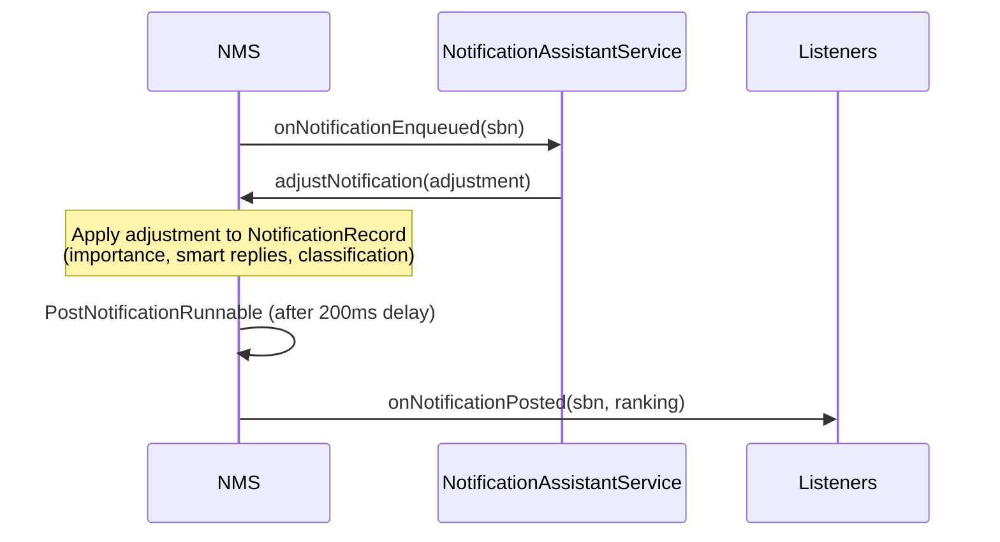

支持的调整键：

| 键 | 效果 |
|-----|--------|
| `KEY_IMPORTANCE` | 覆盖重要性 |
| `KEY_IMPORTANCE_PROPOSAL` | 建议重要性（用户可覆盖） |
| `KEY_PEOPLE` | 附加人物引用 |
| `KEY_SNOOZE_CRITERIA` | 建议暂存选项 |
| `KEY_USER_SENTIMENT` | 设置用户情感（正面/中性/负面） |
| `KEY_CONTEXTUAL_ACTIONS` | 添加智能操作 |
| `KEY_TEXT_REPLIES` | 添加智能回复 |
| `KEY_RANKING_SCORE` | 设置排名分数 |
| `KEY_SENSITIVE_CONTENT` | 标记为敏感 |
| `KEY_NOT_CONVERSATION` | 覆盖会话检测 |
| `KEY_TYPE` | 分类（新闻、促销、推荐） |
| `KEY_SUMMARIZATION` | AI 生成的摘要 |
| `KEY_GROUP_KEY` | 重新分配通知的分组（自 Android 8 起） |
| `KEY_UNCLASSIFY` | 撤销之前的分类（Android 17） |
| `KEY_NOTIFICATION_RULES` | 通知匹配的规则 ID（Android 17） |
| `KEY_DYNAMIC_BUNDLE` | 放入动态捆绑（Android 17） |

Android 17 情境键（`KEY_NOTIFICATION_RULES`、`KEY_SOUND`、
`KEY_LIGHT`、`KEY_HIGHLIGHT`、`KEY_MODE_BREAKTHROUGH_LIST`、
`KEY_BREAKTHROUGH_ALL_MODES`）在 28.21 节中介绍。当它依赖的键不再
受支持时，系统还会自动"撤销"一项调整。因此，在功能标志关闭后，过期的
助手建议不会持续影响通知。

### 28.6.9 监听器生命周期图

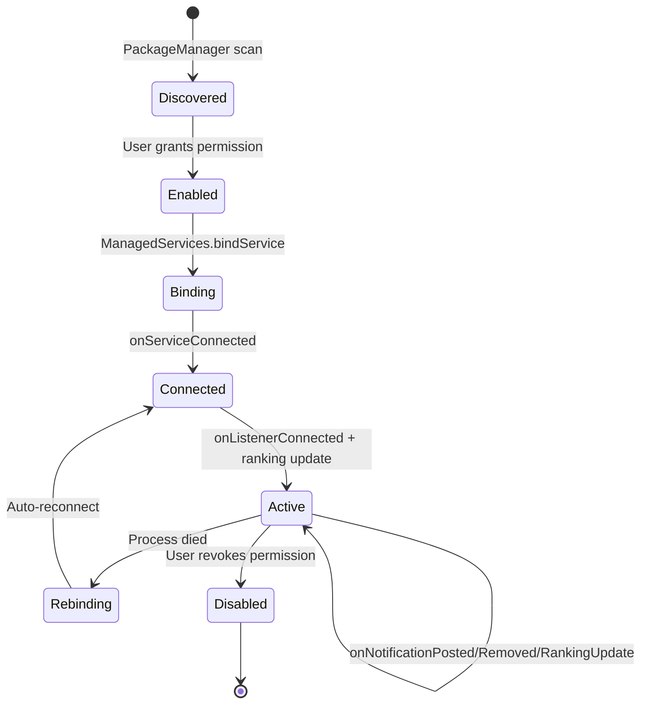

---

## 28.7 会话通知

### 28.7.1 概览

会话通知代表来自真实人物的消息。它们在通知栏面板中获得特殊待遇：
一个专属分区、变成气泡的能力，以及包括发送者头像在内的更丰富的展示。

一条通知符合会话的条件是：

1. 它使用 `MessagingStyle`。
2. 它通过 `setShortcutId()` 引用一个有效的共享快捷方式。
3. 该快捷方式附加了 `Person` 数据。

### 28.7.2 ShortcutInfo 集成

`ShortcutHelper` 类管理通知所引用快捷方式的生命周期：

```java
// frameworks/base/services/core/java/com/android/server/notification/
//   ShortcutHelper.java (class at line 48; fields at lines 73, 78)
public class ShortcutHelper {
    private final HashMap<String, HashMap<String, String>> mActiveShortcutBubbles;
    private final LauncherApps.ShortcutChangeCallback mShortcutChangeCallback;
}
```

通知发布时，`ShortcutHelper` 会查询快捷方式服务：

```java
// ShortcutHelper uses these query flags:
FLAG_GET_PERSONS_DATA     // include Person objects
FLAG_MATCH_CACHED         // match cached shortcuts
FLAG_MATCH_DYNAMIC        // match dynamic shortcuts
FLAG_MATCH_PINNED_BY_ANY_LAUNCHER  // match pinned shortcuts
```

该助手还监听快捷方式移除事件，以清理关联的
气泡。

### 28.7.3 ValidateNotificationPeople

`ValidateNotificationPeople` 提取器对照
联系人数据库解析人物引用。它使用 LRU 缓存以提高性能：

```java
// ValidateNotificationPeople.java (lines 73-74)
private static final int MAX_PEOPLE = 10;
private static final int PEOPLE_CACHE_SIZE = 200;
```

联系人亲和度级别：

- `NONE (0f)`——没有有效的联系人引用。
- `VALID_CONTACT (0.5f)`——引用真实联系人。
- `STARRED_CONTACT (1f)`——引用星标/收藏联系人。

这些亲和度值会输入到 DND 过滤决策（星标联系人
可以绕过 DND）和排名中。

### 28.7.4 NotificationRecord 中的会话检测

```java
// NotificationRecord.java (relevant fields)
private ShortcutInfo mShortcutInfo;
private boolean mIsNotConversationOverride;
private boolean mPkgAllowedAsConvo;
private boolean mHasSentValidMsg;
private boolean mAppDemotedFromConvo;
```

当以下条件满足时，通知被视为会话：

- 它具有 `MessagingStyle`。
- 它具有有效的快捷方式。
- NAS 没有用 `KEY_NOT_CONVERSATION` 覆盖它。
- 应用尚未被降级会话状态。

### 28.7.5 会话通道

每个会话可以拥有自己派生的通道。当用户自定义某个会话的
通知设置时，系统会创建一个通过 `conversationId` 链接到父通道的子通道：

```java
// frameworks/base/core/java/android/app/NotificationChannel.java
//   (getParentChannelId at line 1092, getConversationId at line 1100)
public @Nullable String getParentChannelId();   // the parent channel's ID
public @Nullable String getConversationId();     // the conversation shortcut ID
```

两个访问器返回的是作为字符串的*ID*，而不是通道对象。会话
通道是一个真正的 `NotificationChannel`。它的 `parentChannelId` 指向
应用的原始通道。它的 `conversationId` 是会话的快捷方式
ID。这允许按会话自定义（不同联系人使用不同声音），而不影响父通道。

### 28.7.6 MessagingStyle 要求

为获得最佳会话展示，`MessagingStyle` 应包含：

```java
Notification.MessagingStyle style = new Notification.MessagingStyle(sender)
    .setConversationTitle("Group Chat Name")
    .addMessage("Hello!", timestamp, sender)
    .setGroupConversation(true);  // for group chats
```

`Person` 对象必须具有：

- 一个名字。
- 可选的图标（头像）。
- 可选的指向联系人的 URI。
- 用于身份跟踪的唯一键。

### 28.7.7 会话优先级分区

在 SystemUI 中，通知栏面板将通知划分为多个分区：

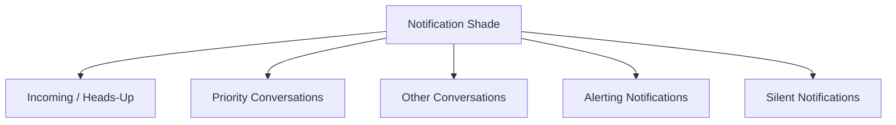

优先级会话（用户在设置中标记为"优先"的会话）
显示在所有其他通知之上。这由 SystemUI 中的
`NotificationSectionsManager` 控制。

---

## 28.8 气泡通知

### 28.8.1 概览

气泡通知让会话通知以圆形图标的形式悬浮在屏幕上，点击时展开为小窗口。
气泡系统横跨三个层次：

1. **NMS**——`BubbleExtractor` 确定资格。
2. **SystemUI**——将通知事件桥接到 shell 气泡控制器。
3. **WM Shell**——`BubbleController` 管理气泡 UI 和任务生命周期。

### 28.8.2 气泡资格（BubbleExtractor）

`BubbleExtractor`（一个 `NotificationSignalExtractor`）评估：

```java
// BubbleExtractor.java (line 86)
boolean notifCanPresentAsBubble = canPresentAsBubble(record)
        && !mActivityManager.isLowRamDevice()
        && record.isConversation()
        && record.getShortcutInfo() != null
        && !record.getNotification().isFgsOrUij();
```

额外检查：

- `userEnabledBubbles`——全局设置。
- `appPreference`——按应用的气泡偏好（NONE、SELECTED、ALL）。
- 通道级别的 `getAllowBubbles()` 设置。

决策矩阵：

| 应用偏好 | 通道偏好 | 结果 |
|----------|-------------|--------|
| ALL | 开启或默认 | 允许 |
| ALL | 关闭 | 拒绝 |
| SELECTED | 开启 | 允许 |
| SELECTED | 关闭或默认 | 拒绝 |
| NONE | 任意 | 拒绝 |

### 28.8.3 BubbleMetadata

应用通过 `Notification.BubbleMetadata` 指定气泡行为：

```java
Notification.BubbleMetadata metadata = new Notification.BubbleMetadata.Builder(
        pendingIntent, icon)
    .setDesiredHeight(600)
    .setAutoExpandBubble(true)
    .setSuppressNotification(true)
    .build();
```

关键属性：

- `PendingIntent`——在气泡内启动的活动。
- `Icon`——气泡图标。
- `desiredHeight`——首选展开高度。
- `autoExpandBubble`——创建时立即展开。
- `suppressNotification`——从通知栏面板隐藏（只以气泡显示）。

### 28.8.4 WM Shell BubbleController

实际的气泡 UI 位于 WindowManager Shell 模块中：

```
frameworks/base/libs/WindowManager/Shell/src/com/android/wm/shell/bubbles/
```

关键类：

| 类 | 角色 |
|-------|------|
| `BubbleController.java` | 主协调器 |
| `BubbleData.java` | 活跃气泡的数据模型 |
| `Bubble.java` | 单个气泡状态 |
| `BubbleExpandedView.java` | 嵌入任务的展开视图 |
| `BubbleTaskView.kt` | 嵌入活动的任务视图 |
| `BubblePositioner.java` | 位置计算 |
| `BubbleDataRepository.kt` | 持久化 |
| `BubbleStackViewManager.kt` | 堆栈 UI 管理 |
| `bar/BubbleBarLayerView.java` | 用于启动器集成的气泡栏（在 `bar/` 子包中） |

### 28.8.5 气泡生命周期

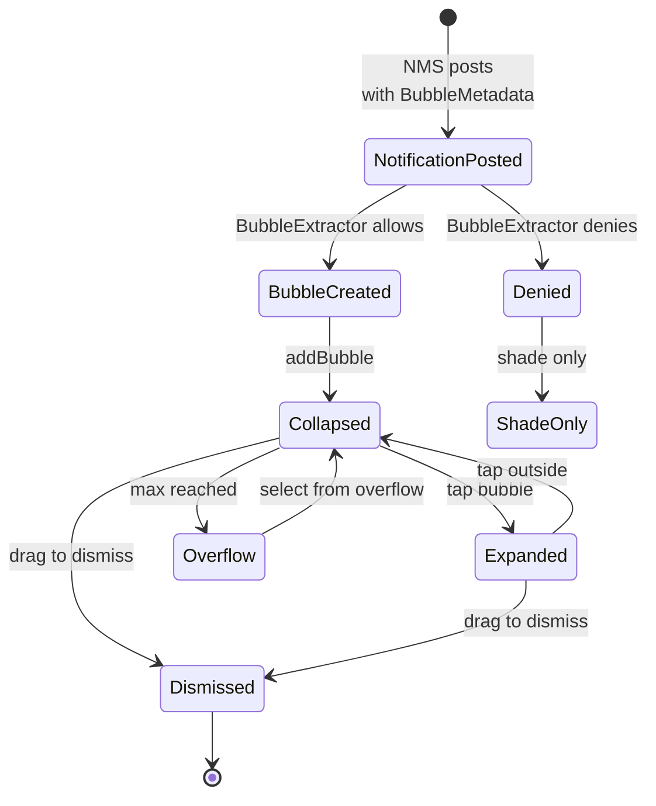

### 28.8.6 气泡到任务的映射

每个展开的气泡在任务中承载一个嵌入的 `Activity`。`BubbleTaskView`
是 WM Shell `TaskView` 的包装器
（`com.android.wm.shell.taskview.TaskView`）。WM Shell 类将气泡的活动
作为普通任务承载。`ShellTaskOrganizer` 将任务的
`SurfaceControl` 重新挂接到展开视图的表面层级中。不涉及
虚拟显示：

```java
// BubbleExpandedView.java
// Creates a TaskView that hosts the bubble's activity as a real task;
// ShellTaskOrganizer reparents the task surface into the expanded view.
```

气泡活动必须：

- 声明 `resizeableActivity="true"`。
- 允许嵌入。
- 具有能解析到活动的有效 `PendingIntent`。

### 28.8.7 气泡持久化

`BubbleDataRepository` 在重启后持久化气泡状态，用于进行中的
会话。这允许气泡在设备重启后重新出现，无需应用重新发布通知。

### 28.8.8 气泡集成流程

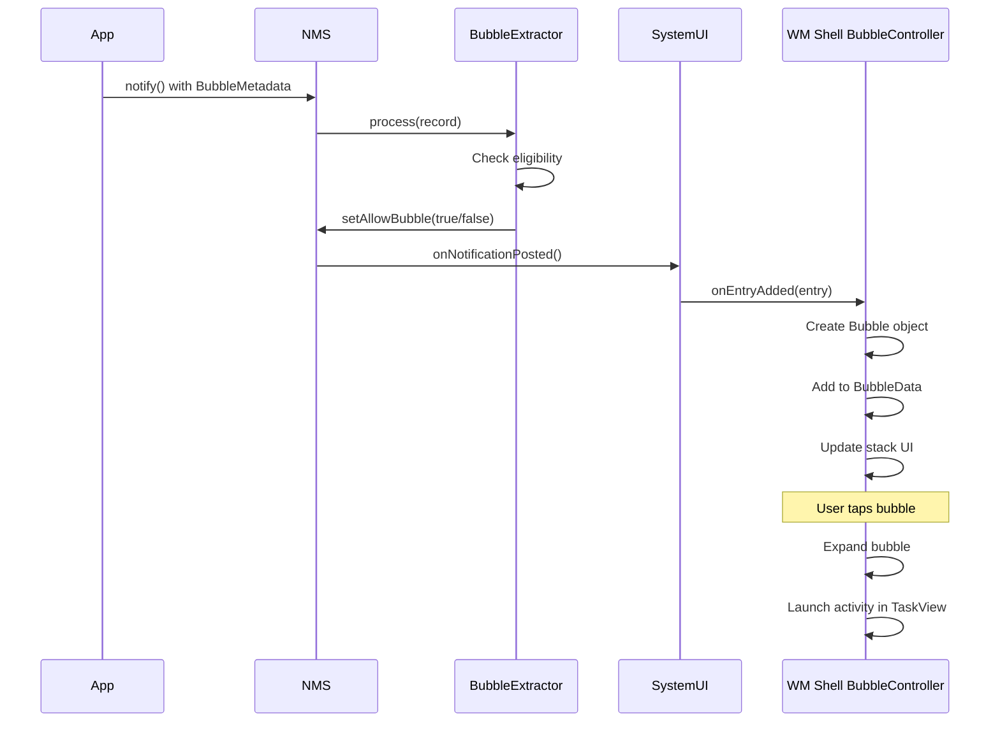

---

## 28.9 SystemUI 中的通知 UI

### 28.9.1 概览

SystemUI 是通知事件的主要消费者。它实现了
一个 `NotificationListenerService`，接收所有通知发布、移除
和排名更新回调。通知栏面板、悬浮通知、状态栏图标
和锁屏通知都由 SystemUI 渲染。

关键目录：

```
frameworks/base/packages/SystemUI/src/com/android/systemui/statusbar/notification/
frameworks/base/packages/SystemUI/src/com/android/systemui/statusbar/notification/stack/
frameworks/base/packages/SystemUI/src/com/android/systemui/statusbar/notification/row/
frameworks/base/packages/SystemUI/src/com/android/systemui/statusbar/notification/collection/
```

### 28.9.2 SystemUI 中的通知管线

SystemUI 使用现代通知管线（有时称为"新管线"
或"notif pipeline"）处理通知。通知从
`NotificationListener` 流入 `NotifCollection`。然后
`ShadeListBuilder.buildList()`
（`frameworks/base/packages/SystemUI/src/com/android/systemui/statusbar/notification/collection/ShadeListBuilder.java`，
第 432-517 行）按顺序运行过滤、分组、排序和分区分配
步骤。协调器把自己的过滤器、提升器和比较器插入其中。然后将完成的列表分发给视图层：

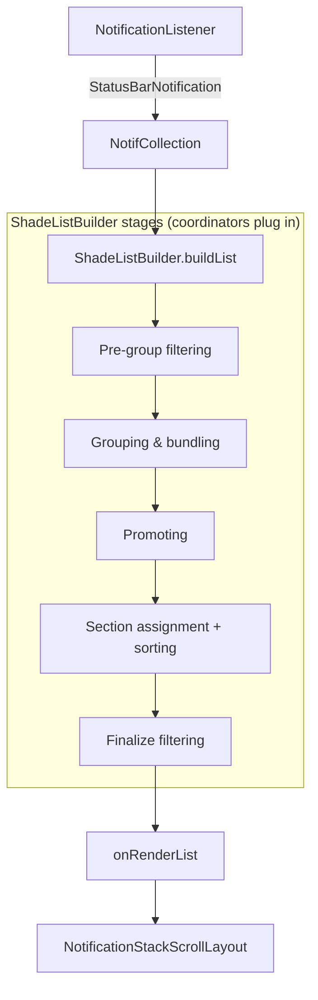

### 28.9.3 NotificationStackScrollLayout

`NotificationStackScrollLayout` 是通知栏面板中通知的主要可滚动容器：

```java
// frameworks/base/packages/SystemUI/src/com/android/systemui/statusbar/
//   notification/stack/NotificationStackScrollLayout.java
public class NotificationStackScrollLayout extends ViewGroup {
    // Custom scrollable ViewGroup that handles:
    // - Notification expansion/collapse animation
    // - Swipe-to-dismiss gestures
    // - Overscroll effects
    // - Shade expansion tracking
    // - Section headers
    // - Grouped notification rendering
}
```

它的控制器：

```java
// NotificationStackScrollLayoutController.java
// Bridges the view with the notification pipeline data
```

### 28.9.4 StackScrollAlgorithm

`StackScrollAlgorithm` 根据当前滚动位置和面板展开程度计算每个
通知行的 位置、缩放和透明度：

```java
// frameworks/base/packages/SystemUI/src/com/android/systemui/statusbar/
//   notification/stack/StackScrollAlgorithm.java
```

该算法处理：

- 堆叠效果，部分隐藏的通知从后面露出。
- 面板展开时的平滑过渡。
- 分区之间的间距计算。
- 顶部和底部项目的圆角管理。

### 28.9.5 通知分区

通知被划分为多个分区（优先级桶）：

```kotlin
// frameworks/base/packages/SystemUI/src/com/android/systemui/statusbar/
//   notification/stack/NotificationPriorityBucket.kt
```

桶按 `PriorityBucket.getAllInOrder()` 的顺序从上到下：

1. **媒体控制**——活跃的媒体会话。
2. **顶部进行中**——醒目的进行中通知。
3. **悬浮**——当前正在提醒的通知。
4. **顶部未读**——重要的尚未查看的通知。
5. **前台服务**——进行中的 FGS 通知。
6. **高亮**——被规则高亮的通知。
7. **优先人物**——标记为优先的会话。
8. **人物**——其他会话。
9. **提醒**——重要性 HIGH 和 DEFAULT。
10. **新闻 / 社交 / 推荐 / 促销**——分类捆绑。
11. **静默**——重要性 LOW 和 MIN。
12. **动态捆绑**——助手创建的动态捆绑。

### 28.9.6 通知行视图

每条通知渲染为一个 `ExpandableNotificationRow`：

```
ExpandableNotificationRow
    |
    +-- NotificationContentView (collapsed)
    |       +-- RemoteViews rendered content
    |
    +-- NotificationContentView (expanded)
    |       +-- RemoteViews rendered content
    |
    +-- NotificationContentView (heads-up)
    |       +-- RemoteViews rendered content
    |
    +-- NotificationGuts (settings panel)
    |
    +-- NotificationChildrenContainer (for grouped notifications)
            +-- child ExpandableNotificationRows
```

### 28.9.7 通知样式与模板

`Notification.Style` 子类产生不同的 `RemoteViews` 布局：

| 样式 | 折叠 | 展开 | 悬浮 |
|-------|-----------|----------|----------|
| Default | 标题 + 文本 | 相同 | 标题 + 文本 |
| BigTextStyle | 标题 + 文本 | 完整文本 | 标题 + 文本 |
| BigPictureStyle | 标题 + 文本 | 大图 | 标题 + 文本 |
| InboxStyle | 标题 + 文本 | 多行列表 | 标题 + 文本 |
| MessagingStyle | 最新消息 | 会话历史 | 最新消息 |
| MediaStyle | 标题 + 文本 | 最多 5 个操作 | 标题 + 文本 |
| CallStyle | 来电者信息 | 通话控制 | 来电者信息 |
| DecoratedCustomViewStyle | 自定义视图 | 自定义视图 | 自定义视图 |

### 28.9.8 悬浮通知

重要性为 HIGH 或更高的通知触发悬浮显示。悬浮管理器处理：

- 显示时长（通常 5 秒）。
- 多个悬浮通知的排队。
- 触摸交互（展开、忽略）。
- 用户与设备交互时自动忽略。

以下情况会抑制悬浮显示：

- 通知栏面板已经展开。
- DND 抑制了 `SUPPRESSED_EFFECT_PEEK` 效果。
- 应用位于前台（可配置）。
- 设备处于"勿扰"模式。

### 28.9.9 锁屏通知

在锁屏上，通知可见性由以下因素控制：

1. **全局设置**：显示全部、隐藏敏感内容或全部不显示。
2. **按通道的可见性**：PUBLIC、PRIVATE 或 SECRET。
3. **工作资料策略**：管理员可以强制隐藏工作通知。

当内容被隐藏时，通知显示通用的"内容已隐藏"
消息。SystemUI 中的 `DynamicPrivacyController` 管理
用户解锁时公开和私密内容之间的过渡。

### 28.9.10 通知膨胀

通知的 `RemoteViews` 是异步膨胀的，以避免卡住
UI 线程。膨胀过程：

1. 从通知中提取 `RemoteViews`。
2. 异步任务在主线程之外膨胀视图。
3. 膨胀后的视图被应用到 `NotificationContentView`。
4. 如果膨胀失败（例如自定义视图过大），显示后备的最小
   布局。

强制执行自定义视图的内存限制，以防止应用在 SystemUI 中导致 OOM：

```kotlin
// CustomViewMemorySizeExceededException.kt
// Thrown when a custom RemoteViews exceeds the memory limit
```

`NotificationCustomContentMemoryVerifier`
（`frameworks/base/packages/SystemUI/src/com/android/systemui/statusbar/notification/row/NotificationCustomContentMemoryVerifier.kt`）
实现了该检查。自定义视图膨胀后，`satisfiesMemoryLimits()`
遍历视图层级，并对每个 `ImageView` 的 drawable 的字节大小求和
（`computeViewHierarchyImageViewSize()`）。位图计入其
`allocationByteCount`。其他 drawable 估算为 `width * height * 4`。
两个阈值都从 `config.xml` 读取，决定结果：

| 阈值 | 配置整数 | 默认值 | 效果 |
|-----------|----------------|---------|--------|
| 警告 | `config_notificationWarnRemoteViewSizeBytes` | 2,000,000（约 2 MB） | 记录警告；通知仍会发布 |
| 剥离 | `config_notificationStripRemoteViewSizeBytes` | 5,000,000（约 5 MB） | 面向 SDK 37 的应用丢弃通知（否则仅警告；见下文 SDK 门控） |

Android 17（SDK 37）使剥离阈值可以强制执行。对于面向
SDK 37（`Build.VERSION_CODES.CINNAMON_BUN`）的应用，超过剥离
限制的自定义视图会导致通知被丢弃。面向更早 SDK 的应用只会得到一条 logcat 警告，提示通知"在 targetSdk 设置为" SDK 37 时"将被丢弃"。门控是兼容性变更
`CHECK_SIZE_OF_INFLATED_CUSTOM_VIEWS`（`@EnabledAfter(targetSdkVersion =
Build.VERSION_CODES.BAKLAVA)`，
`frameworks/base/packages/SystemUI/src/com/android/systemui/statusbar/notification/row/NotificationCustomContentCompat.java`），
按 UID 通过 `CompatChanges.isChangeEnabled(...)` 检查。整个检查
还由 `notification_custom_view_uri_restriction` aconfig 标志控制。
因此，在标志和按应用的 target SDK 门控都满足之前，它是无效的。

### 28.9.11 滑动忽略

`NotificationSwipeHelper` 处理滑动手势：

- 水平滑动会忽略通知。
- 忽略会向 NMS 发送 `REASON_CANCEL`。
- 分组通知可以单独或整组忽略。
- 进行中和前台服务通知抗拒忽略。

### 28.9.12 通知栏面板架构图

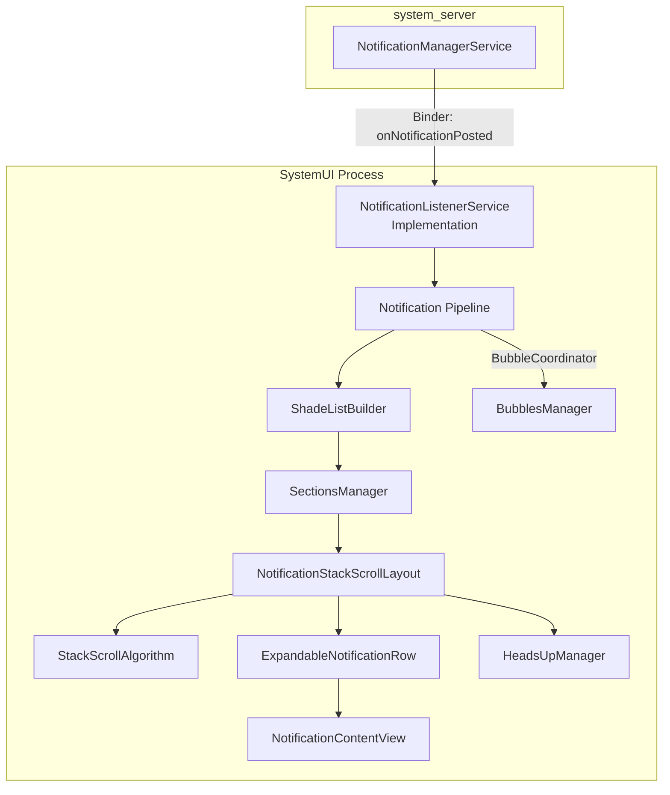

---

## 28.10 通知注意力效果

### 28.10.1 概览

当通知被发布时，系统决定是否播放声音、
振动设备或闪烁 LED。该逻辑位于
`NotificationAttentionHelper` 中：

来源：`frameworks/base/services/core/java/com/android/server/notification/NotificationAttentionHelper.java`

### 28.10.2 buzzBeepBlink 决策

`buzzBeepBlinkLocked()` 方法是中心决策点。它评估
许多条件：

1. **通知是否被 DND 拦截？** 如果被拦截，大多数效果
   都会被抑制。
2. **通知是否已经提醒过？** `FLAG_ONLY_ALERT_ONCE` 标志
   防止在更新时重新提醒。
3. **通知是否在分组中？** 分组提醒行为可以把提醒
   委托给摘要或子项。
4. **监听器提示是什么？** SystemUI 可以通过
   `HINT_HOST_DISABLE_EFFECTS` 禁用效果。
5. **手机是否正在通话？** 通话通知可能抑制其他提醒。
6. **重要性是多少？** 只有 HIGH 及以上触发悬浮通知；只有
   DEFAULT 及以上触发声音。

### 28.10.3 声音

声音播放使用 `IRingtonePlayer` 服务：

```java
// NotificationAttentionHelper uses:
// - Channel's sound URI
// - Channel's audio attributes
// - System default notification sound as fallback
```

以下情况会抑制声音：

- 重要性低于 DEFAULT。
- 通知具有 `FLAG_ONLY_ALERT_ONCE` 且已经提醒过。
- DND 抑制了通知。
- 屏幕关闭且 `SUPPRESSED_EFFECT_SCREEN_OFF` 生效。
- 正在进行通话且监听器提示禁用通知效果。

### 28.10.4 振动

振动遵循类似的决策树。振动模式来自
`NotificationRecord`，后者从通道解析它：

```java
// NotificationRecord.java (line 392)
private VibrationEffect getVibrationForChannel(
        NotificationChannel channel, VibratorHelper helper, boolean insistent) {
    if (!channel.shouldVibrate()) return null;

    // Priority: channel vibration effect > channel pattern > sound URI vibration > default
    final VibrationEffect vibration = channel.getVibrationEffect();
    if (vibration != null) return vibration;

    final long[] vibrationPattern = channel.getVibrationPattern();
    if (vibrationPattern != null)
        return helper.createWaveformVibration(vibrationPattern, insistent);

    return helper.createDefaultVibration(insistent);
}
```

`FLAG_INSISTENT` 标志使振动无限重复，直到
用户确认它。

### 28.10.5 LED

LED 通知灯通过 `LightsManager` 服务控制：

```java
// NotificationRecord.java (line 359)
private Light calculateLights() {
    int channelLightColor = getChannel().getLightColor() != 0
            ? getChannel().getLightColor() : defaultLightColor;
    Light light = getChannel().shouldShowLights()
            ? new Light(channelLightColor, defaultLightOn, defaultLightOff) : null;
    // ... pre-channel legacy handling
}
```

许多现代设备不再有 LED 指示灯，但该 API 仍保留给支持它们的
设备（以及自定义 ROM 开发者）。

### 28.10.6 全屏意图

重要性为 HIGH 或 MAX 的通知可以包含全屏意图：

```java
notification.setFullScreenIntent(pendingIntent, true /* highPriority */);
```

全屏意图在锁屏上启动一个活动（例如来电或闹钟）。如果用户正在主动使用设备，
系统可能抑制全屏意图，改为显示悬浮通知。

从 Android 14 开始，需要 `USE_FULL_SCREEN_INTENT` 权限，
用户可以撤销它。

### 28.10.7 注意力效果流程

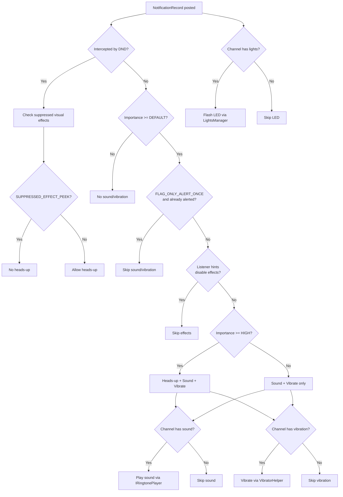

---

## 28.11 通知历史与持久化

### 28.11.1 通知历史

Android 维护已忽略和已取消通知的历史：

```java
// NotificationManagerService.java (line 822)
private Archive mArchive;
```

`Archive` 类维护一个有界的环形缓冲区：

```java
// NotificationManagerService.java (line 904)
static class Archive {
    final SparseArray<Boolean> mEnabled;
    final int mBufferSize;
    final LinkedList<Pair<StatusBarNotification, Integer>> mBuffer;
}
```

通知被取消时，它会被记录到归档中：

```java
// cancelNotificationLocked (line 12037)
if (reason != REASON_CHANNEL_REMOVED) {
    mArchive.record(getSbnForArchive(r, reason), reason);
}
```

### 28.11.2 NotificationHistoryManager

除了内存中的归档，`NotificationHistoryManager` 提供持久化的
历史，以按天的 Protocol Buffer 文件形式存储在磁盘上，由
`NotificationHistoryDatabase` 通过 `AtomicFile` 写入：

```java
// frameworks/base/services/core/java/com/android/server/notification/
//   NotificationHistoryManager.java
//   NotificationHistoryDatabase.java
```

历史数据库存储：

- 软件包名
- 通道 ID
- 通知标题和文本
- 图标（以位图形式，带有清理任务）
- 发布时间
- 会话快捷方式 ID

`NotificationHistoryJobService` 运行定期清理，删除旧条目
并回收存储空间。

### 28.11.3 策略文件持久化

NMS 将其配置持久化到一个 XML 策略文件中：

```java
// NotificationManagerService.java (line 825)
private AtomicFile mPolicyFile;
```

策略文件包含：

- 勿扰模式配置（DND 规则、策略）。
- 通道和分组首选项（通过 `PreferencesHelper`）。
- 已启用的通知监听器。
- 已启用的通知助手。
- 已启用的条件提供者。
- 暂存通知的状态。
- 锁屏安全通知首选项。

该文件在启动期间加载：

```java
// NotificationManagerService.java (line 1420)
protected void loadPolicyFile() {
    synchronized (mPolicyFile) {
        // ... error handling elided
        infile = mPolicyFile.openRead();
        final TypedXmlPullParser parser = Xml.resolvePullParser(infile);
        readPolicyXml(parser, false /*forRestore*/, USER_ALL, null);
    }
}
```

### 28.11.4 备份与恢复

通知设置参与 Android 的备份/恢复框架。当用户从备份设置新设备时：

1. 恢复策略 XML。
2. 按应用恢复通道首选项。
3. 恢复 DND 规则。
4. 恢复监听器和助手权限。
5. 重新启用托管服务。

`NotificationBackupHelper` 协调此过程，
`BackupRestoreEventLogger` 跟踪成功/失败指标。

---

## 28.12 通知暂存

### 28.12.1 概览

暂存会临时移除一条通知，并在延迟后重新发布它。
`SnoozeHelper` 管理这一点：

```java
// frameworks/base/services/core/java/com/android/server/notification/
//   SnoozeHelper.java (class at line 63; constants at lines 66, 69)
public final class SnoozeHelper {
    static final int CONCURRENT_SNOOZE_LIMIT = 500;
    static final int MAX_STRING_LENGTH = 1000;
}
```

### 28.12.2 暂存机制

有两种暂存方式：

1. **基于时长**：通知在指定时间后重新出现。
2. **基于条件**：满足条件时通知重新出现
   （例如到达某个位置）。

```java
// SnoozeHelper manages:
// - AlarmManager alarms for timed snooze
// - SnoozeContext for criterion-based snooze
// - Persistence across reboots via XML
```

### 28.12.3 入队期间的暂存

通知入队时，系统检查它之前是否被暂存过：

```java
// EnqueueNotificationRunnable.enqueueNotification (line 10757)
final long snoozeAt = mSnoozeHelper.getSnoozeTimeForUnpostedNotification(
        r.getUser().getIdentifier(),
        r.getSbn().getPackageName(), r.getSbn().getKey());
if (snoozeAt > currentTime) {
    (new SnoozeNotificationRunnable(r.getSbn().getKey(),
            snoozeAt - currentTime, null)).snoozeLocked(r);
    return false;
}
```

这防止通知短暂出现后又重新暂存。

### 28.12.4 暂存持久化

暂存的通知在重启后仍然存在。`SnoozeHelper` 将状态持久化到 XML：

```java
protected static final String XML_TAG_NAME = "snoozed-notifications";
```

启动时，从策略文件读取暂存的通知数据，并为任何仍待处理的暂存
重新调度闹钟。

---

## 28.13 自动分组与强制分组

### 28.13.1 传统自动分组

当应用发布多条通知而未显式分组时，
NMS 会把它们自动分组到一个合成的分组摘要下。`GroupHelper` 决定：

```java
// GroupHelper.java (line 75)
protected static final String AUTOGROUP_KEY = "ranker_group";
```

当软件包有超过 `AUTOGROUP_AT_COUNT_DEFAULT`
（2）条未分组通知时，会触发自动分组。

### 28.13.2 强制分组（Android 16+）

强制分组是一种更新的机制，积极地捆绑通知。
它最初在 `notification_force_grouping` aconfig 标志后面发布。
此后该标志被移除，行为现在是无条件的。
`GroupHelper` 中只有一个遗留日志字符串仍然提到该标志：

```java
// GroupHelper.java (line 87)
protected static final String AGGREGATE_GROUP_KEY = "Aggregate_";
```

强制分组：

- 把稀疏分组（有许多小分组的软件包）合并到聚合分组中。
- 当软件包有超过
  `AUTOGROUP_SPARSE_GROUPS_AT_COUNT`（6）个稀疏分组时触发。
- 在发布/移除后使用 3 秒延迟，让应用在重新分组前完成其
  分组结构。

```java
// NotificationManagerService.java (line 587)
private static final long DELAY_FORCE_REGROUP_TIME = 3000;
```

### 28.13.3 自动分组摘要属性

自动分组摘要从其子项继承属性：

```java
// GroupHelper.java (lines 80-85)
// Flags that all autogroup summaries have
protected static final int BASE_FLAGS =
        FLAG_AUTOGROUP_SUMMARY | FLAG_GROUP_SUMMARY | FLAG_LOCAL_ONLY;
// Flags the autogroup summary inherits only if all children have them
private static final int ALL_CHILDREN_FLAGS = FLAG_AUTO_CANCEL | FLAG_SILENT;
// Flags the autogroup summary inherits if any child has them
private static final int ANY_CHILDREN_FLAGS = FLAG_ONGOING_EVENT | FLAG_NO_CLEAR;
```

（Android 17 向 `ALL_CHILDREN_FLAGS` 添加了 `FLAG_SILENT`，因此自动分组摘要
只有在每个子通知都静默时才是静默的。）

### 28.13.4 基于分类的重新分组

当 NAS 对通知进行分类（如新闻、促销等）时，系统
可能将它们重新分组为分类特定的捆绑。这由
`notificationRegroupOnClassification` 标志控制。

### 28.13.5 分组决策图

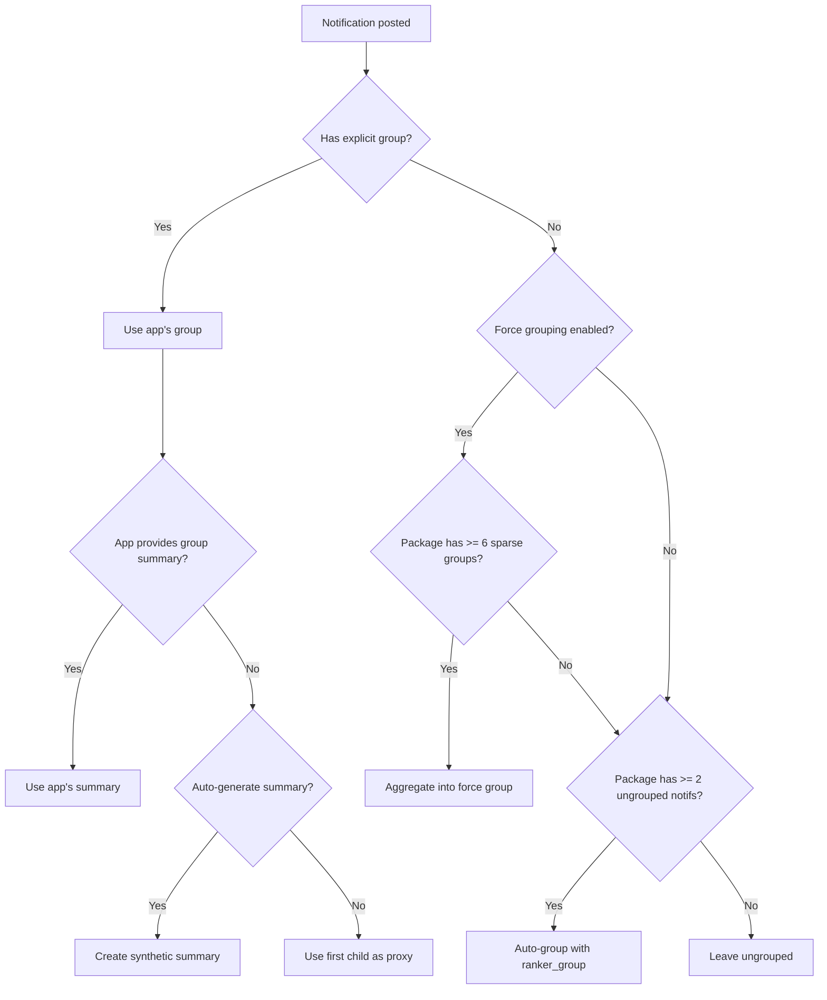

---

## 28.14 关键数据结构

### 28.14.1 NMS 中的核心集合

```java
// NotificationManagerService.java (lines 793-806)

// The definitive list of all active notifications, sorted by rank
final ArrayList<NotificationRecord> mNotificationList;

// Fast lookup by key (pkg|uid|id|tag)
final ArrayMap<String, NotificationRecord> mNotificationsByKey;

// Notifications in the enqueue phase (not yet posted)
final ArrayList<NotificationRecord> mEnqueuedNotifications;

// Auto-bundled summary keys per userId per package/groupKey
final ArrayMap<Integer, ArrayMap<String, String>> mAutobundledSummaries;

// Group summary records by groupKey
final ArrayMap<String, NotificationRecord> mSummaryByGroupKey;
```

### 28.14.2 通知键格式

通知键唯一标识一条通知：

```
<userId>|<packageName>|<id>|<tag>|<uid>
```

例如：`0|com.example.app|1|null|10088`

### 28.14.3 分组键格式

分组键唯一标识一个通知分组：

```
<userId>|<packageName>|g:<group>
```

如果通知通过 `setGroup()` 设置了显式分组，最后
一段是 `g:<group>`。如果只设置了排序键，则是 `c:<channelId>`。
当分组和排序键都不存在时，分组键就是
通知键本身。每条通知因此成为自己的单成员分组。一个
`overrideGroupKey`——例如自动分组键——优先于所有这些。

### 28.14.4 NotificationRecord 字段映射

| 字段 | 来源 | 提取器 | 使用方 |
|-------|--------|-----------|---------|
| `mChannel` | `PreferencesHelper` | `NotificationChannelExtractor` | 重要性、声音、振动 |
| `mContactAffinity` | 联系人数据库 | `ValidateNotificationPeople` | DND 过滤、排名 |
| `mIntercept` | DND 策略 | `ZenModeExtractor` | 监听器分发 |
| `mImportance` | 通道 + 系统 + 助手 | `ImportanceExtractor` | 排名、注意力 |
| `mPackagePriority` | 通道 | `PriorityExtractor` | DND 绕过 |
| `mAllowBubble` | 用户 + 应用 + 通道首选项 | `BubbleExtractor` | 气泡展示 |
| `mShowBadge` | 通道 | `BadgeExtractor` | 应用图标角标 |
| `mPackageVisibility` | 通道 | `VisibilityExtractor` | 锁屏 |
| `mCriticality` | 系统策略 | `CriticalNotificationExtractor` | 面板顶部放置 |
| `mRankingScore` | NAS | `NotificationAdjustmentExtractor` | 排名 |
| `mUserSentiment` | NAS | `NotificationAdjustmentExtractor` | 智能操作 |
| `mShortcutInfo` | `ShortcutHelper` | 发布后处理 | 会话、气泡 |
| `mSuppressedVisualEffects` | DND 策略 | `ZenModeExtractor` | 注意力效果 |

---

## 28.15 完整的提取器管线参考

下表记录每个信号提取器、其依赖项以及
它在 `NotificationRecord` 上修改的字段：

| # | 提取器 | 依赖 | 修改 | 可延迟 |
|---|-----------|------------|----------|-----------|
| 1 | `NotificationChannelExtractor` | 无 | `mChannel` | 否 |
| 2 | `NotificationAdjustmentExtractor` | 通道 | `mImportance`、`mRankingScore`、`mUserSentiment`、智能操作/回复、分类 | 否 |
| 3 | `BubbleExtractor` | 通道、调整 | `mAllowBubble` | 否 |
| 4 | `ValidateNotificationPeople` | 调整（用于人物覆盖） | `mContactAffinity`、`mPeopleOverride`、电话号码 | 是（异步联系人查找） |
| 5 | `PriorityExtractor` | 通道 | `mPackagePriority` | 否 |
| 6 | `ZenModeExtractor` | 优先级 | `mIntercept`、`mSuppressedVisualEffects` | 否 |
| 7 | `ImportanceExtractor` | 通道、系统、助手 | `mImportance`（最终） | 否 |
| 8 | `VisibilityExtractor` | 重要性 | `mPackageVisibility` | 否 |
| 9 | `BadgeExtractor` | 勿扰模式 | `mShowBadge` | 否 |
| 10 | `CriticalNotificationExtractor` | 无 | `mCriticality` | 否 |

---

## 28.16 通知标志参考

值来自 `frameworks/base/core/java/android/app/Notification.java`
（Android 17 中的第 636-799 行）。

| 标志 | 值 | 说明 |
|------|-------|-------------|
| `FLAG_SHOW_LIGHTS` | 0x00000001 | 遗留：请求 LED |
| `FLAG_ONGOING_EVENT` | 0x00000002 | 用户无法清除 |
| `FLAG_INSISTENT` | 0x00000004 | 重复声音/振动直到被确认 |
| `FLAG_ONLY_ALERT_ONCE` | 0x00000008 | 只在首次发布时提醒，更新时不提醒 |
| `FLAG_AUTO_CANCEL` | 0x00000010 | 点击后取消 |
| `FLAG_NO_CLEAR` | 0x00000020 | 无法通过"全部清除"清除 |
| `FLAG_FOREGROUND_SERVICE` | 0x00000040 | 与前台服务关联 |
| `FLAG_HIGH_PRIORITY` | 0x00000080 | 遗留：高优先级（请改用重要性） |
| `FLAG_LOCAL_ONLY` | 0x00000100 | 不桥接到远程设备 |
| `FLAG_GROUP_SUMMARY` | 0x00000200 | 这是分组摘要 |
| `FLAG_AUTOGROUP_SUMMARY` | 0x00000400 | 系统生成的分组摘要 |
| `FLAG_CAN_COLORIZE` | 0x00000800 | 可对背景着色（如媒体） |
| `FLAG_BUBBLE` | 0x00001000 | 有资格以气泡形式呈现 |
| `FLAG_NO_DISMISS` | 0x00002000 | 完全无法忽略 |
| `FLAG_FSI_REQUESTED_BUT_DENIED` | 0x00004000 | 请求了全屏意图但被拒绝 |
| `FLAG_USER_INITIATED_JOB` | 0x00008000 | 与用户发起的任务关联 |
| `FLAG_LIFETIME_EXTENDED_BY_DIRECT_REPLY` | 0x00010000 | 在用户回复后保持存活 |
| `FLAG_SILENT` | 0x00020000 | 强制静默（无声音/振动）；`1 << 17` |
| `FLAG_PROMOTED_ONGOING` | 0x00040000 | 提升的进行中（富进行中）；由系统设置 |
| `FLAG_COMPUTER_CONTROL` | 0x00080000 | 与 Computer Control 会话关联；仅限系统（Android 17） |

最近的发布中有两个值发生了变动，因此很容易弄错。
`FLAG_LIFETIME_EXTENDED_BY_DIRECT_REPLY` 是 `0x00010000`。
`FLAG_SILENT` 是
`0x00020000`（`1 << 17`）。`FLAG_PROMOTED_ONGOING` 是 `0x00040000`。

最后
两个标志只能由系统设置。`FLAG_PROMOTED_ONGOING` 标记富
进行中通知（28.20 节）。`FLAG_COMPUTER_CONTROL`（Android 17 新增）
标记与 Computer Control 会话绑定的通知。应用无法直接设置这两个
标志中的任何一个。

---

## 28.17 取消原因常量

| 常量 | 值 | 说明 |
|----------|-------|-------------|
| `REASON_CLICK` | 1 | 用户点击了通知 |
| `REASON_CANCEL` | 2 | 用户滑动忽略 |
| `REASON_CANCEL_ALL` | 3 | 用户点击了"全部清除" |
| `REASON_ERROR` | 4 | 通知无效 |
| `REASON_PACKAGE_CHANGED` | 5 | 软件包已更新 |
| `REASON_USER_STOPPED` | 6 | 用户已停止 |
| `REASON_PACKAGE_BANNED` | 7 | 软件包通知已禁用 |
| `REASON_APP_CANCEL` | 8 | 应用调用了 `cancel()` |
| `REASON_APP_CANCEL_ALL` | 9 | 应用调用了 `cancelAll()` |
| `REASON_LISTENER_CANCEL` | 10 | 监听器取消了通知 |
| `REASON_LISTENER_CANCEL_ALL` | 11 | 监听器取消了全部 |
| `REASON_GROUP_SUMMARY_CANCELED` | 12 | 分组摘要已移除 |
| `REASON_GROUP_OPTIMIZATION` | 13 | 重新分组优化 |
| `REASON_PACKAGE_SUSPENDED` | 14 | 软件包已挂起 |
| `REASON_PROFILE_TURNED_OFF` | 15 | 用户档案已关闭 |
| `REASON_UNAUTOBUNDLED` | 16 | 已从自动捆绑中移除 |
| `REASON_CHANNEL_BANNED` | 17 | 通道重要性被设为 NONE |
| `REASON_SNOOZED` | 18 | 用户暂存了通知 |
| `REASON_TIMEOUT` | 19 | TTL 已过期 |
| `REASON_CHANNEL_REMOVED` | 20 | 通道已删除 |
| `REASON_CLEAR_DATA` | 21 | 应用数据已清除 |
| `REASON_ASSISTANT_CANCEL` | 22 | NAS 取消了通知 |
| `REASON_LOCKDOWN` | 23 | 设备进入锁定模式 |
| `REASON_BUNDLE_DISMISSED` | 24 | 捆绑已被忽略 |

---

## 28.18 重要性级别行为矩阵

| 重要性 | 声音 | 振动 | 悬浮 | 状态栏图标 | 通知栏面板 | 角标 | 全屏意图 |
|-----------|-------|-----------|----------|----------------|-------|-------|-------------------|
| NONE (0) | 否 | 否 | 否 | 否 | 否 | 否 | 否 |
| MIN (1) | 否 | 否 | 否 | 否 | 是（折叠） | 否 | 否 |
| LOW (2) | 否 | 否 | 否 | 是 | 是 | 是 | 否 |
| DEFAULT (3) | 是 | 是 | 否 | 是 | 是 | 是 | 否 |
| HIGH (4) | 是 | 是 | 是 | 是 | 是 | 是 | 如果授予 |
| MAX (5) | 是 | 是 | 是 | 是 | 是 | 是 | 是 |

说明：

- 振动遵循系统振动设置和通道配置。
- 悬浮可能被 DND、监听器提示或激活的通知栏面板展开抑制。
- 全屏意图在 Android 14+ 上需要 `USE_FULL_SCREEN_INTENT` 权限。
- 角标可见性还取决于启动器实现。

---

## 28.19 通知系统的演进

| Android 版本 | 关键变化 |
|----------------|-------------|
| 1.0 (API 1) | 带图标、标题、文本的基本通知 |
| 3.0 (API 11) | 引入 `Notification.Builder` |
| 4.1 (API 16) | 可展开通知、`BigTextStyle`、`InboxStyle` |
| 4.3 (API 18) | `NotificationListenerService` API |
| 5.0 (API 21) | 悬浮通知、锁屏通知、`CATEGORY_*`、可见性 |
| 7.0 (API 24) | 内联回复、捆绑通知、`MessagingStyle` |
| 8.0 (API 26) | **通知通道**（必需）、通知小圆点、暂存 |
| 9.0 (API 28) | `MessagingStyle` 改进、`Person` 类 |
| 10 (API 29) | 气泡通知、`ZenPolicy`、会话快捷方式 |
| 11 (API 30) | 面板中的会话分区、会话通道、通知历史 |
| 12 (API 31) | 自定义通知样式受限、通知蹦床被阻止 |
| 13 (API 33) | `POST_NOTIFICATIONS` 运行时权限 |
| 14 (API 34) | `USE_FULL_SCREEN_INTENT` 权限、FGS 类型要求 |
| 15 (API 35) | 隐式勿扰规则、`ZenDeviceEffects`、敏感内容编辑 |
| 16 (API 36) | 强制分组、通知分类、AI 摘要 |
| 17 (API 37) | 富进行中通知（`ProgressStyle`、`FLAG_PROMOTED_ONGOING`）、礼貌通知、情境模式 + 系统通知规则、扩展的 `Adjustment` 键、Computer Control 通知标志 |

---

## 28.20 富进行中通知（Android 17）

### 28.20.1 概览

Android 17 将"富进行中通知"（RONs）从一个带标志的
实验提升为一等界面。RON 是一种进行中通知，系统可以将其*提升*出常规
通知栏面板。系统可以把它移到更醒目的界面上：状态栏芯片、
常亮显示（AOD）和锁屏。该
功能由 `api_rich_ongoing` 标志保护：

```
// frameworks/base/core/java/android/app/notification.aconfig (lines 224-229)
flag {
  name: "api_rich_ongoing"
  namespace: "systemui"
  description: "[RONs] Guards new RON-related APIs, including Notification.ProgressStyle"
}
```

### 28.20.2 ProgressStyle

标志性的新 API 是 `Notification.ProgressStyle`，一种用于可跟踪进度的样式，
如网约车接单或外卖订单。与旧的
`Builder.setProgress(max, progress, indeterminate)` 调用不同，
`ProgressStyle` 将进度条建模为一系列彩色*分段*，轨道上还可选带有*点*：

```java
// frameworks/base/core/java/android/app/Notification.java
//   (ProgressStyle class at line 13936)
Notification.ProgressStyle style = new Notification.ProgressStyle()
        .addProgressSegment(new Notification.ProgressStyle.Segment(560)
                .setColor(Color.GREEN))
        .addProgressSegment(new Notification.ProgressStyle.Segment(440)
                .setColor(Color.LTGRAY))
        .addProgressPoint(new Notification.ProgressStyle.Point(560)
                .setColor(Color.YELLOW))
        .setProgress(300)
        .setProgressTrackerIcon(Icon.createWithResource(ctx, R.drawable.ic_car));
```

`ProgressStyle` 的公共接口包括 `setProgressSegments()` /
`addProgressSegment()`、`setProgressPoints()` / `addProgressPoint()`、
`setProgress()`、`setProgressIndeterminate()`、`setStyledByProgress()`，
以及跟踪器/起点/终点图标设置器。内部限制将模型上限设为
`MAX_PROGRESS_SEGMENT_LIMIT = 10` 个分段和 `MAX_PROGRESS_POINT_LIMIT = 4`
个点。注意 javadoc 的警告：`Builder.setProgress()` 设置的附加数据会被
该样式*覆盖*，因此两个进度 API 不能组合使用。

### 28.20.3 请求提升

应用通过调用 `Builder.setRequestPromotedOngoing(true)` 请求提升，
这会存储 `EXTRA_REQUEST_PROMOTED_ONGOING` 附加数据：

```java
// frameworks/base/core/java/android/app/Notification.java (lines 1838, 6044)
public static final String EXTRA_REQUEST_PROMOTED_ONGOING = "android.requestPromotedOngoing";

public Builder setRequestPromotedOngoing(boolean requestPromotedOngoing) {
    getExtras().putBoolean(EXTRA_REQUEST_PROMOTED_ONGOING, requestPromotedOngoing);
    // ...
}
```

请求只是请求。系统使用
`hasPromotableCharacteristics()` 决定是否真正设置
`FLAG_PROMOTED_ONGOING`（值 `0x00040000`；见 28.16 节）：

```java
// frameworks/base/core/java/android/app/Notification.java (line 3738)
public boolean hasPromotableCharacteristics() {
    return isRequestPromotedOngoing()
            && isOngoingEvent()
            && hasTitle()
            && hasPromotableStyle()
            && !isGroupSummary()
            && !containsCustomViews()
            && !isColorizedRequested();
}
```

因此，通知只有在以下所有条件成立时才有资格被提升。
它请求了提升。它是进行中事件。它具有标题。
它使用可
提升的样式（无样式，或 `BigTextStyle`、`CallStyle`、
`ProgressStyle` 或 `MetricStyle`）。注意，当 `getNotificationStyle()` 为 null 时，
`hasPromotableStyle()` 也返回 true。

它不是分组摘要。
它没有自定义的 `RemoteViews`。它未被着色。即使这些条件成立，用户和
通道偏好仍可能拒绝提升，因此
`hasPromotableCharacteristics()` 被记录为必要但非充分条件。

### 28.20.4 提升通知规则

系统界面通过保留通知规则而不是临时检查来驱动提升。
`NotificationRule.RESERVED_ID_PROMOTED`（id 201）是"高亮提升通知"的
OS 拥有规则；`RESERVED_ID_PRIORITY_CONVERSATIONS`
（202）涵盖优先级会话。这些保留 ID 定义在
`frameworks/base/core/java/android/app/NotificationRule.java`（第 69-82 行）中，
并将富进行中功能与接下来介绍的情境规则引擎关联起来。

### 28.20.5 语义颜色标注

实时更新可以用*含义*而非原始
颜色来标记通知文本的片段。系统随后选择一个能在主题化和
无障碍变换下保持不变的调色板。`Notification.createSemanticStyleAnnotation(int)`
（`frameworks/base/core/java/android/app/Notification.java:1039`，由
`api_notification_semantic_style` 标志保护）返回一个带有五种语义角色之一
的文本 `Annotation`：

| 常量 | 值 | 含义 |
|----------|-------|---------|
| `SEMANTIC_STYLE_UNSPECIFIED` | 0 | 无语义角色 |
| `SEMANTIC_STYLE_INFO` | 1 | 中性信息（蓝色） |
| `SEMANTIC_STYLE_SAFE` | 2 | 安全 / 成功（绿色） |
| `SEMANTIC_STYLE_CAUTION` | 3 | 注意 / 物理危害（橙色） |
| `SEMANTIC_STYLE_DANGER` | 4 | 危险 / 停止（红色） |

（常量位于 `Notification.java:967`-1009。）应用将文本包装在一个
带有这些标注的 `SpannableStringBuilder` 中。应用命名的是
*角色*，而不是 RGB 值。因此平台将每个角色映射到一个调色板，
该调色板在 Material You 主题化、深色模式和高对比度
无障碍设置下保持可读。它与 `ProgressStyle` 富进行中
模板（28.20.2 节）自然搭配。导航或安全实时更新可以在每个设备界面上
一致地渲染"DANGER"红色和"SAFE"绿色。

---

## 28.21 通知规则与情境模式（Android 17）

### 28.21.1 概览

Android 17 引入了系统管理的*通知规则*框架。它让用户
（以及保留的系统/助手所有者）基于情境条件更改通知的呈现方式。该框架由
`nm_contextual_display_launch` 标志保护，描述为"根据用户创建的规则
更改通知外观"：

```
// frameworks/base/core/java/android/app/notification.aconfig (lines 299-304)
flag {
  name: "nm_contextual_display_launch"
  namespace: "notifications"
  description: "Changes notification appearance based on user created rules"
}
```

### 28.21.2 NotificationRule

`NotificationRule` 是在该标志下公开的可打包规则对象：

```java
// frameworks/base/core/java/android/app/NotificationRule.java (line 62)
@FlaggedApi(Flags.FLAG_NM_CONTEXTUAL_DISPLAY_LAUNCH)
public final class NotificationRule implements Parcelable {
    public static final int RESERVED_ID_PROMOTED = 201;
    public static final int RESERVED_ID_PRIORITY_CONVERSATIONS = 202;
    public static final int RESERVED_ID_STATIC_BUNDLES = 203;
    public static final int RESERVED_ID_IMPORTANT_NOTIFICATIONS = 204;
    // ...
}
```

每个规则携带：

- **过滤器**（`getFilters()`）：一个 `Filter` 对象列表。通知
  如果匹配*任一*过滤器（逻辑或），就匹配该规则；在单个过滤器内，
  所有条件都必须成立（逻辑与）。过滤器可以匹配包含/排除的
  软件包、联系人和会话级别、类别、快捷方式 ID 以及
  关键词。
- **条件**（`getConditions()`）：门控规则何时生效的每日时段和位置条件。
- **一个动作**（`getAction()`）：对匹配的通知做什么。它可以覆盖
  声音、设置灯光颜色、允许通知突破情境模式，
  或将其路由到动态捆绑。
- **身份**：一个整数 id 加上一个 `editIntentAction`。用户拥有的规则使用
  id 100-200。id 201-204 保留给 OS 和通知
  助手。设置使用它来深度链接到规则的
  编辑器。

规则完全持久化并参与备份和恢复，因此用户的
自定义规则在重启和设备迁移后仍然存在。

### 28.21.3 ContextualMode

这项工作的 DND 一侧是 `ContextualMode`，表示
情境激活模式的公共类：

```java
// frameworks/base/core/java/android/app/modes/ContextualMode.java (line 44)
@FlaggedApi(Flags.FLAG_ENABLE_DND_SYNC)
public final class ContextualMode implements Parcelable {
    public String getId();
    public int getType();
    public int getState();
}
```

情境模式是旧版 `AutomaticZenRule` 的推广。每个模式
都有 id、类型和激活状态。通知可以被授予"突破"特定模式的
权限。

### 28.21.4 突破与新的调整键

通知助手通过 Android 17 中新增的
`Adjustment` 键（见 28.4.5 节）影响规则和模式。情境显示的
关键键是：

| 键 | 类型 | 效果 |
|-----|------|--------|
| `KEY_NOTIFICATION_RULES` | 规则 ID 列表 | 此通知当前匹配的规则 |
| `KEY_MODE_BREAKTHROUGH_LIST` | 模式 ID 列表 | 此通知可以绕过的模式 |
| `KEY_BREAKTHROUGH_ALL_MODES` | 布尔 | 绕过每个激活的模式 |
| `KEY_SOUND` | Uri | 如果在通知提醒之前应用，要播放的声音/振动 |
| `KEY_LIGHT` | ColorInt | 要闪烁的通知灯颜色 |
| `KEY_HIGHLIGHT` | 布尔 | 通知是否应被高亮 |
| `KEY_DYNAMIC_BUNDLE` | DynamicBundle | 要将通知加入的动态捆绑 |

这些键声明在
`frameworks/base/core/java/android/service/notification/Adjustment.java`
（第 246-300 行）中，全部标注了 `@FlaggedApi(FLAG_NM_CONTEXTUAL_DISPLAY_LAUNCH)`。
情境键可能变为不受支持，例如当其功能标志被关闭时。
此时 NMS 会撤销该调整，因此过期的建议不会持续影响通知。

### 28.21.5 规则管线图

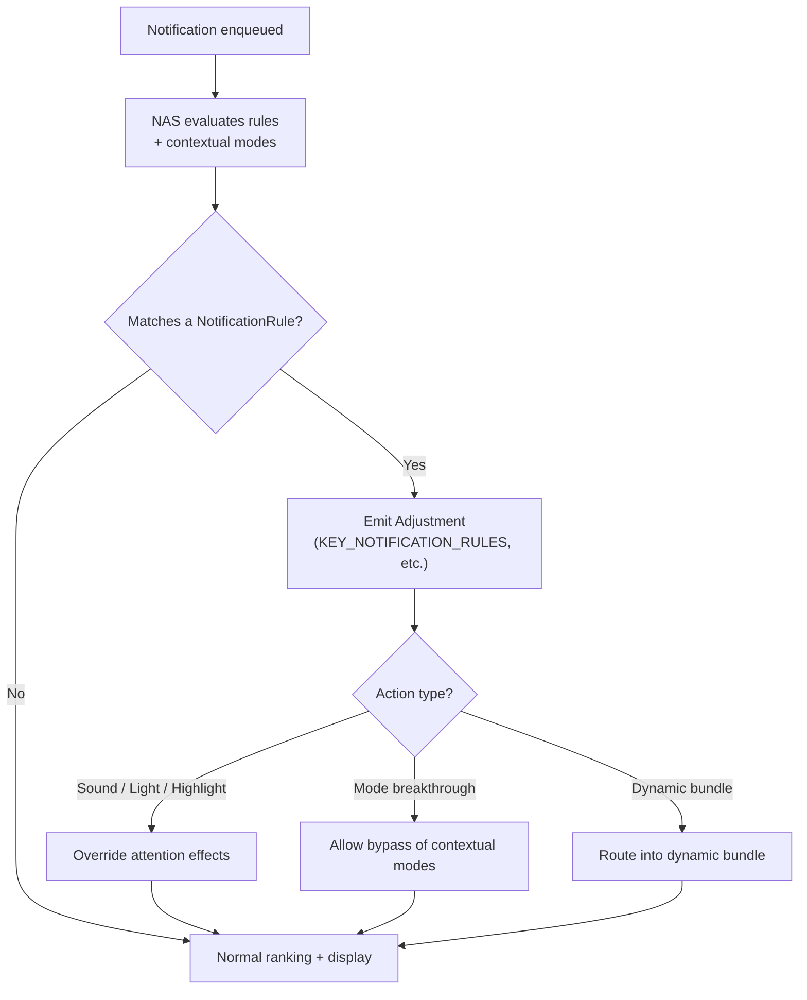

---

## 28.22 礼貌通知（Android 17）

### 28.22.1 概览

礼貌通知让一连串通知逐步变得更安静，因此一阵警报不会反复以最大音量轰炸用户。
该逻辑作为 `PolitenessStrategy` 实现在 `NotificationAttentionHelper` 内部：

```java
// frameworks/base/services/core/java/com/android/server/notification/
//   NotificationAttentionHelper.java (line 1365)
abstract static class PolitenessStrategy {
    static final int POLITE_STATE_DEFAULT = 0;  // full attention
    static final int POLITE_STATE_POLITE = 1;   // reduced volume
    static final int POLITE_STATE_MUTED = 2;    // no sound/vibration
    // ...
}
```

处于 `POLITE_STATE_POLITE` 的通知以降低的音量提醒，而
`POLITE_STATE_MUTED` 则完全抑制声音和振动。注意力
助手在决定是否蜂鸣、
发声或闪烁（28.10 节）时会咨询 `getPolitenessState(record)`。

### 28.22.2 策略

`NotificationAttentionHelper` 在 `createPolitenessStrategy()` 中构建其策略
（第 286 行）。存在两个具体策略：

- **`StrategyPerApp`**（第 1550 行）：按应用（并按通道）跟踪礼貌程度，
  因此一个唠叨的应用会被独立于其他应用静音。
- **`StrategyAvalanche`**（第 1611 行）：包装按应用策略，并添加
  跨应用的"雪崩"处理。当设备检测到通知雪崩
  （例如从飞行模式重新连接后），它应用一个共享的
  `cross_app_common_key`。这让整个突发一起被安抚，而不是
  每个应用各自为政。

雪崩超时时间和礼貌/静音音量级别都是可配置的；
策略在构造时根据设备配置选择。

### 28.22.3 Android 17 中的正式推出

礼貌通知在几个标志后面发布，而 Android 17 移除了其中大多数。
16 到 17 的变更集移除了子标志
`polite_notifications_attn_update` 和 `cross_app_polite_notifications`，
并删除了仅用于测试的 `FLAG_POLITE_NOTIFICATIONS` 禁用。然而，
该功能整体仍由顶层 `polite_notifications` aconfig 标志门控。
`NotificationAttentionHelper` 仅在
`Flags.politeNotifications()` 为 true 时才创建礼貌策略
（第 276 行）。否则 `mStrategy` 保持为 null。

---

## 28.23 AI 摘要（Android 17）

### 28.23.1 概览

Android 17 让通知助手服务可以为通知生成摘要——
把冗长的会话或啰嗦的警报折叠为简短的 AI 生成摘要。
该能力由 `nm_summarization` 标志保护（"允许 NAS 为通知生成摘要"），
并通过 `KEY_SUMMARIZATION`
调整键交付：

```
// frameworks/base/core/java/android/app/notification.aconfig (lines 166-171)
flag {
  name: "nm_summarization"
  namespace: "systemui"
  description: "Allows the NAS to summarize notifications"
}
```

### 28.23.2 摘要调整

助手通过发出带有
`Adjustment.KEY_SUMMARIZATION` 的 `Adjustment` 来附加摘要：

```java
// frameworks/base/core/java/android/service/notification/Adjustment.java (line 239)
public static final String KEY_SUMMARIZATION = "key_summarization";
```

`KEY_SUMMARIZATION` 是默认允许的键之一
（`DEFAULT_ALLOWED_ADJUSTMENTS`，28.4.5 节），因此特权 NAS 可以
发出它而无需额外选择加入。在 SystemUI 一侧，`SummarizationDecorator` 渲染
摘要。变更集指出摘要最多可达五行高。
它还包括该功能首次使用时的引导。配套的 `nm_summarization_all`
标志将摘要扩展到更广泛的通知集合。

### 28.23.3 Computer Control 通知

Android 17 还添加了 `FLAG_COMPUTER_CONTROL`（值 `0x00080000`）于
`Notification` 上，当通知与
Computer Control 会话关联时由系统设置：

```java
// frameworks/base/core/java/android/app/Notification.java (line 799)
/** @hide */
public static final int FLAG_COMPUTER_CONTROL = 0x00080000;
```

该标志是内部的，因此应用无法直接设置它。它让通知栏面板和下游界面
能够识别代表 Computer Control 会话产生的通知。因此这些通知可以被一致地
呈现和审计。

---

## 28.24 动手实践

### 28.24.1 通过 ADB 检查活跃通知

转储当前通知状态：

```bash
adb shell dumpsys notification
```

这会产生大量输出，包括：

- 所有活跃通知及其键、通道和重要性。
- 排名信息。
- 监听器状态。
- DND 配置。
- 暂存状态。

要只查看通知列表：

```bash
adb shell dumpsys notification --noredact | grep -A 5 "NotificationRecord"
```

### 28.24.2 转储通知通道

通道出现在完整的通知转储中（没有 `channels`
子命令——无法识别的参数会被静默忽略）：

```bash
adb shell dumpsys notification
```

或过滤到特定软件包：

```bash
adb shell dumpsys notification --package com.example.myapp
```

### 28.24.3 检查勿扰模式状态

```bash
adb shell dumpsys notification zen
```

或通过设置命令：

```bash
adb shell settings get global zen_mode
# 0 = off, 1 = priority, 2 = total silence, 3 = alarms
```

### 28.24.4 使用通知 Shell 命令

NMS 包含一个 shell 命令接口：

```bash
# Post a test notification
adb shell cmd notification post -t "Test" "tag" "Hello from shell"

# Snooze a notification
adb shell cmd notification snooze --for 60000 <key>

# Unsnooze a notification
adb shell cmd notification unsnooze <key>
```

来源：`frameworks/base/services/core/java/com/android/server/notification/NotificationShellCmd.java`

### 28.24.5 从代码发布通知

```java
// Minimal notification with a channel
NotificationChannel channel = new NotificationChannel(
        "demo_channel",
        "Demo Channel",
        NotificationManager.IMPORTANCE_DEFAULT);
NotificationManager nm = getSystemService(NotificationManager.class);
nm.createNotificationChannel(channel);

Notification notification = new Notification.Builder(this, "demo_channel")
        .setSmallIcon(R.drawable.ic_notification)
        .setContentTitle("Hello")
        .setContentText("This is a test notification")
        .setAutoCancel(true)
        .build();
nm.notify(1, notification);
```

### 28.24.6 发布会话通知

```java
// 1. Create a sharing shortcut
ShortcutInfo shortcut = new ShortcutInfo.Builder(context, "contact_jane")
        .setLongLived(true)
        .setShortLabel("Jane")
        .setPerson(new Person.Builder()
                .setName("Jane")
                .setKey("jane_key")
                .build())
        .setIntent(new Intent(Intent.ACTION_DEFAULT))
        .build();
ShortcutManager sm = getSystemService(ShortcutManager.class);
sm.addDynamicShortcuts(List.of(shortcut));

// 2. Create channel
NotificationChannel channel = new NotificationChannel(
        "messages", "Messages", NotificationManager.IMPORTANCE_HIGH);
nm.createNotificationChannel(channel);

// 3. Build conversation notification
Person sender = new Person.Builder()
        .setName("Jane")
        .setKey("jane_key")
        .setIcon(Icon.createWithResource(context, R.drawable.avatar_jane))
        .build();

Notification.MessagingStyle style = new Notification.MessagingStyle(me)
        .addMessage("Hey, are you free tonight?", System.currentTimeMillis(), sender);

Notification notification = new Notification.Builder(this, "messages")
        .setSmallIcon(R.drawable.ic_message)
        .setShortcutId("contact_jane")
        .setStyle(style)
        .setCategory(Notification.CATEGORY_MESSAGE)
        .build();
nm.notify(100, notification);
```

### 28.24.7 创建气泡通知

```java
// Build upon the conversation notification above
Intent bubbleIntent = new Intent(context, ChatActivity.class)
        .putExtra("contact", "jane");
PendingIntent bubblePendingIntent = PendingIntent.getActivity(
        context, 0, bubbleIntent,
        PendingIntent.FLAG_MUTABLE | PendingIntent.FLAG_UPDATE_CURRENT);

Notification.BubbleMetadata bubble = new Notification.BubbleMetadata.Builder(
        bubblePendingIntent,
        Icon.createWithResource(context, R.drawable.avatar_jane))
    .setDesiredHeight(600)
    .setAutoExpandBubble(false)
    .setSuppressNotification(false)
    .build();

Notification notification = new Notification.Builder(this, "messages")
        .setSmallIcon(R.drawable.ic_message)
        .setShortcutId("contact_jane")
        .setStyle(style)
        .setBubbleMetadata(bubble)
        .build();
nm.notify(100, notification);
```

### 28.24.8 实现 NotificationListenerService

```java
public class MyNotificationListener extends NotificationListenerService {

    @Override
    public void onNotificationPosted(StatusBarNotification sbn) {
        Log.d("NLS", "Posted: " + sbn.getKey()
                + " pkg=" + sbn.getPackageName()
                + " title=" + sbn.getNotification().extras
                        .getString(Notification.EXTRA_TITLE));
    }

    @Override
    public void onNotificationRemoved(StatusBarNotification sbn,
            RankingMap rankingMap, int reason) {
        Log.d("NLS", "Removed: " + sbn.getKey() + " reason=" + reason);
    }

    @Override
    public void onNotificationRankingUpdate(RankingMap rankingMap) {
        Log.d("NLS", "Ranking update received");
    }
}
```

AndroidManifest.xml：
```xml
<service
    android:name=".MyNotificationListener"
    android:permission="android.permission.BIND_NOTIFICATION_LISTENER_SERVICE"
    android:exported="true">
    <intent-filter>
        <action android:name=
            "android.service.notification.NotificationListenerService" />
    </intent-filter>
</service>
```

用户必须在 **设置 > 通知 >
通知访问权限** 中手动启用监听器。

### 28.24.9 以编程方式管理 DND

```java
NotificationManager nm = getSystemService(NotificationManager.class);

// Check if the app has DND access
if (nm.isNotificationPolicyAccessGranted()) {
    // Set DND to priority-only
    nm.setInterruptionFilter(
            NotificationManager.INTERRUPTION_FILTER_PRIORITY);

    // Configure DND policy
    NotificationManager.Policy policy = new NotificationManager.Policy(
            NotificationManager.Policy.PRIORITY_CATEGORY_CALLS
                | NotificationManager.Policy.PRIORITY_CATEGORY_MESSAGES,
            NotificationManager.Policy.PRIORITY_SENDERS_CONTACTS,
            NotificationManager.Policy.PRIORITY_SENDERS_CONTACTS);
    nm.setNotificationPolicy(policy);
}
```

### 28.24.10 跟踪通知管线

为通知服务启用详细日志：

```bash
adb shell setprop log.tag.NotificationService VERBOSE
adb shell setprop log.tag.NotificationRecord DEBUG
adb shell setprop log.tag.ZenModeHelper DEBUG
adb shell setprop log.tag.NotifAttentionHelper DEBUG
adb shell setprop log.tag.RankingHelper DEBUG
```

然后监控：

```bash
adb logcat -s NotificationService NotificationRecord ZenModeHelper \
    NotifAttentionHelper RankingHelper
```

### 28.24.11 检查通知历史

Android 11+ 存储通知历史。它出现在标准转储中
（没有 `history` 参数）：

```bash
adb shell dumpsys notification
```

或通过设置界面：**设置 > 通知 > 通知历史**。

### 28.24.12 测试暂存行为

```bash
# Snooze a notification for 60 seconds
adb shell cmd notification snooze --for 60000 "0|com.example.app|1|null|10088"

# List snoozed notifications (a cmd subcommand, not a dumpsys argument)
adb shell cmd notification snoozed
```

### 28.24.13 调试气泡问题

```bash
# Check if bubbles are enabled (the global key is deprecated;
# the setting moved to secure settings)
adb shell settings get secure notification_bubbles

# Check per-app bubble preference
adb shell dumpsys notification | grep -A 3 "bubble"

# Enable bubble logging
adb shell setprop log.tag.BubbleExtractor DEBUG
adb shell setprop log.tag.Bubbles DEBUG
```

### 28.24.14 观察注意力效果

调试通知为什么发声/振动或为什么不：

```bash
adb shell setprop log.tag.NotifAttentionHelper VERBOSE
adb logcat -s NotifAttentionHelper
```

注意力助手会记录其蜂鸣-发声-闪烁决策的详细原因，
包括 DND 抑制、监听器提示和"只提醒一次"标志。

### 28.24.15 通知架构探索脚本

```bash
#!/bin/bash
# Explore the notification subsystem source structure
NOTIF_DIR="frameworks/base/services/core/java/com/android/server/notification"

echo "=== Core Service Files ==="
wc -l $NOTIF_DIR/NotificationManagerService.java
wc -l $NOTIF_DIR/NotificationRecord.java
wc -l $NOTIF_DIR/PreferencesHelper.java
wc -l $NOTIF_DIR/ZenModeHelper.java
wc -l $NOTIF_DIR/RankingHelper.java

echo ""
echo "=== Signal Extractors ==="
grep -l "implements NotificationSignalExtractor" $NOTIF_DIR/*.java

echo ""
echo "=== All Files ==="
ls $NOTIF_DIR/*.java | wc -l
echo "files in the notification server package"
```

### 28.24.16 关键源文件总结

| 文件 | 角色 |
|------|------|
| `NotificationManagerService.java` | 中央服务 |
| `NotificationRecord.java` | 服务端通知包装 |
| `PreferencesHelper.java` | 通道和分组存储 |
| `ZenModeHelper.java` | DND 状态机 |
| `ZenModeFiltering.java` | DND 拦截决策 |
| `RankingHelper.java` | 信号提取编排器 |
| `NotificationAttentionHelper.java` | 声音、振动、LED、礼貌策略 |
| `GroupHelper.java` | 自动分组/强制分组逻辑 |
| `SnoozeHelper.java` | 暂存状态管理 |
| `ShortcutHelper.java` | 会话快捷方式查询 |
| `ManagedServices.java` | 监听器/助手生命周期 |
| `ValidateNotificationPeople.java` | 联系人解析 |
| `BubbleExtractor.java` | 气泡资格 |
| `ImportanceExtractor.java` | 重要性计算 |
| `ZenModeExtractor.java` | DND 拦截信号 |
| `NotificationShellCmd.java` | ADB shell 接口 |
| `NotificationStackScrollLayout.java` | SystemUI 面板容器 |
| `BubbleController.java` | WM Shell 气泡管理 |

---

### 28.24.17 监控自动分组

当单个分组太多时，自动分组会捆绑同一软件包的通知。要观察这一点：

```bash
adb shell setprop log.tag.GroupHelper DEBUG
adb logcat -s GroupHelper
```

当软件包有超过
`AUTOGROUP_SPARSE_GROUPS_AT_COUNT`（6）个稀疏分组、每个分组少于 3
个子项时，会触发自动分组。自动分组摘要使用键 `"ranker_group"`
（或强制分组激活时使用前缀 `"Aggregate_"` 的聚合分组键）。

### 28.24.18 验证通道配置

要验证应用的通知通道配置正确，
检查通知转储中按软件包的部分（没有
`cmd notification list_channels` 子命令）：

```bash
# Dump notification state filtered to a package; channels appear
# in the PreferencesHelper section
adb shell dumpsys notification --package com.google.android.gm
```

还可以直接检查通道重要性：

```bash
adb shell dumpsys notification | grep -A 10 "com.your.package"
```

### 28.24.19 用自定义提取器测试完整管线

信号提取器管线不能由第三方应用扩展，
但你可以在 eng 构建上修改配置用于测试：

```xml
<!-- Modify frameworks/base/core/res/res/values/config.xml -->
<string-array name="config_notificationSignalExtractors">
    <!-- Add your custom extractor here -->
    <item>com.android.server.notification.NotificationChannelExtractor</item>
    <!-- ... existing extractors ... -->
    <item>com.example.MyCustomExtractor</item>
</string-array>
```

自定义提取器必须实现 `NotificationSignalExtractor` 并位于
`system_server` 类路径中。

### 28.24.20 前台服务通知约束

前台服务（FGS）通知有特殊约束：

```bash
# Check FGS notification flags
adb shell dumpsys notification | grep "FLAG_FOREGROUND_SERVICE"
```

关键行为：

- FGS 通知获得 `FLAG_NO_CLEAR`（在
  `PostNotificationRunnable` 中设置，
  NotificationManagerService.java 第 11020-11021 行）。因此"全部清除"会
  跳过它们，且它们无法在锁屏上被滑动忽略。但用户
  仍可在设备解锁时单独忽略它们。只有
  `FLAG_NO_DISMISS` 才使通知真正无法忽略。
- 如果通道重要性是 MIN 或 NONE，它会被静默提升到 LOW
  （除非用户已锁定该通道的重要性）。因此通知
  总是至少可见。FGS 启动本身不会被拒绝。
- FGS 通知在服务运行期间无法被应用取消。

### 28.24.21 通知权限（Android 13+）

自 Android 13（API 33）起，发布通知需要
`POST_NOTIFICATIONS` 运行时权限。`PermissionHelper` 跟踪这一点：

```bash
# Check if a package has notification permission (the permission table
# is part of the standard dump; there is no "permissions" argument)
adb shell dumpsys notification | grep -A 2 "com.your.package"
```

面向 API 33+ 的应用必须在运行时请求此权限。已有
应用（从较低 API 级别升级）如果已有通知通道，会自动获得
该权限。

---

## 总结

Android 通知系统是一个深度分层的管线，它把一次简单的
`notify()` 调用转变为经过精心排名、策略过滤、注意力管理的用户体验。本章的
关键架构洞见：

1. **NotificationManagerService** 是中心枢纽。它是框架中
   最大的类之一。它协调权限检查、通道查找、信号提取、排名、DND 过滤、
   注意力效果和监听器分发。

2. **信号提取器管线** 提供了模块化、可扩展的架构。
   每个提取器把一个特定信号写入 `NotificationRecord`。通过向 XML 配置
   添加新的提取器，可以扩展系统。

3. **通知通道** 把控制权移交给用户。通道一旦创建，其设置
   即归用户所有，应用无法以编程方式覆盖它们。

4. **勿扰模式** 不是单一开关，而是一个规则引擎。多个
   `AutomaticZenRule` 对象可以同时生效，每个都有自己的
   `ZenPolicy`。`ZenModeHelper` 把它们合并为单一有效策略。

5. **会话通知** 通过 `MessagingStyle` + 共享快捷方式 +
   `Person` 数据获得一等待遇，从而支持优先级分区和气泡等功能。

6. **气泡** 桥接通知系统与窗口管理器。资格由 NMS 决定，
   但 UI 生命周期由 WM Shell 的
   `BubbleController` 管理。

7. **SystemUI 的通知管线** 通过一系列协调器、过滤器、
   排序器和 `NotificationStackScrollLayout`，把原始的
   `StatusBarNotification` 对象转变为渲染好的面板。

8. **线程模型** 经过精心设计。Binder 调用到达 Binder
   线程池。处理在 `mNotificationLock` 下的处理器线程上进行。
   排名重新评估运行在独立的线程上。这防止通知系统阻塞主线程
   或导致死锁。

9. **自动分组** 和 **强制分组** 确保通知栏面板保持整洁，
   即使应用没有正确分组它们的通知。`GroupHelper`
   同时处理传统的自动分组（2 条以上未分组通知）
   和积极的强制分组（6 个以上稀疏分组）。

10. **注意力效果**（声音、振动、LED、悬浮通知）由
    `NotificationAttentionHelper` 中一棵复杂的决策树决定。该树考虑
    重要性、DND 状态、监听器提示、分组提醒行为，以及
    `FLAG_ONLY_ALERT_ONCE` 标志。

11. **通知历史** 在两个层级维护。内存中的环形
    缓冲区归档服务于 `getHistoricalNotifications()`。持久化的按天
    Protocol Buffer 文件服务于设置中的通知历史界面。

12. **Android 17 新增四个界面。** 富进行中通知
    （`Notification.ProgressStyle` 和系统设置的 `FLAG_PROMOTED_ONGOING`）
    把可跟踪的进行中通知提升到状态栏、AOD 和
    锁屏。礼貌通知（`NotificationAttentionHelper` 中的
    `PolitenessStrategy`）逐步降低警报爆发的音量。通知规则和
    情境模式框架让用户和助手基于情境更改呈现方式。它使用
    `NotificationRule`、`ContextualMode` 和扩展的 `Adjustment`
    键。AI 摘要（`KEY_SUMMARIZATION`）折叠冗长的通知，
    `FLAG_COMPUTER_CONTROL` 标记 Computer Control 会话产生的通知。

## 源文件索引

供快速参考，本章讨论的完整源文件集合：

**服务端（system_server）：**
```
frameworks/base/services/core/java/com/android/server/notification/
    NotificationManagerService.java        -- Central service
    NotificationRecord.java               -- Server-side notification wrapper
    PreferencesHelper.java                -- Channel and group storage
    RankingHelper.java                    -- Signal extraction orchestrator
    RankingConfig.java                    -- Ranking configuration interface
    RankingHandler.java                   -- Ranking thread handler
    ZenModeHelper.java                    -- DND state machine
    ZenModeFiltering.java                 -- DND intercept logic
    ZenModeConditions.java                -- DND rule conditions
    ZenModeExtractor.java                 -- DND signal extractor
    ZenModeEventLogger.java               -- DND metrics
    NotificationAttentionHelper.java      -- Sound, vibration, LED
    GroupHelper.java                       -- Auto-grouping
    SnoozeHelper.java                     -- Snooze management
    ShortcutHelper.java                   -- Conversation shortcuts
    ManagedServices.java                  -- Listener/assistant lifecycle
    ConditionProviders.java               -- DND condition providers
    ValidateNotificationPeople.java       -- Contact resolution
    NotificationSignalExtractor.java      -- Extractor interface
    NotificationChannelExtractor.java     -- Channel resolution
    NotificationAdjustmentExtractor.java  -- NAS adjustments
    BubbleExtractor.java                  -- Bubble eligibility
    ImportanceExtractor.java              -- Importance calculation
    PriorityExtractor.java               -- Priority extraction
    VisibilityExtractor.java              -- Lockscreen visibility
    BadgeExtractor.java                   -- App badge control
    CriticalNotificationExtractor.java    -- Critical notification detection
    NotificationTimeComparator.java       -- Time-based sorting
    GlobalSortKeyComparator.java          -- Final sort by global key
    NotificationShellCmd.java             -- ADB shell interface
    NotificationHistoryManager.java       -- Persistent history
    NotificationHistoryDatabase.java      -- proto-file history storage
    NotificationUsageStats.java           -- Usage statistics
    NotificationBackupHelper.java         -- Backup/restore
    PermissionHelper.java                 -- POST_NOTIFICATIONS permission
    AlertRateLimiter.java                 -- Rate limiting
    TimeToLiveHelper.java                 -- TTL management
    VibratorHelper.java                   -- Vibration effect creation
```

**SDK API（应用侧）：**
```
frameworks/base/core/java/android/app/
    Notification.java                     -- Notification data model (ProgressStyle, RON flags)
    NotificationManager.java              -- Public API
    NotificationChannel.java              -- Channel configuration
    NotificationChannelGroup.java         -- Channel grouping
    NotificationRule.java                 -- System notification rules (Android 17)
    INotificationManager.aidl             -- Binder interface
    notification.aconfig                  -- Notification feature flags
    modes/ContextualMode.java             -- Contextual DND mode (Android 17)

frameworks/base/core/java/android/service/notification/
    NotificationListenerService.java      -- Listener API
    NotificationAssistantService.java     -- Assistant API
    ConditionProviderService.java         -- DND condition API
    StatusBarNotification.java            -- Parcelable wrapper
    ZenPolicy.java                        -- Per-rule DND policy
    ZenModeConfig.java                    -- DND configuration
    Adjustment.java                       -- NAS adjustment data (expanded keys in Android 17)
```

**SystemUI：**
```
frameworks/base/packages/SystemUI/src/com/android/systemui/statusbar/notification/
    stack/NotificationStackScrollLayout.java   -- Main shade container
    stack/StackScrollAlgorithm.java            -- Position calculation
    stack/NotificationSectionsManager.kt       -- Section management
    stack/NotificationPriorityBucket.kt        -- Priority buckets
    stack/NotificationSwipeHelper.java         -- Swipe-to-dismiss
    ConversationNotifications.kt               -- Conversation handling
    DynamicPrivacyController.java              -- Lockscreen privacy
```

**WM Shell 气泡：**
```
frameworks/base/libs/WindowManager/Shell/src/com/android/wm/shell/bubbles/
    BubbleController.java                      -- Main bubble coordinator
    BubbleData.java                            -- Bubble data model
    Bubble.java                                -- Single bubble state
    BubbleExpandedView.java                    -- Expanded bubble view
    BubbleTaskView.kt                          -- Embedded activity
    BubblePositioner.java                      -- Position calculations
    BubbleDataRepository.kt                    -- Persistence
```

**配置：**
```
frameworks/base/core/res/res/values/config.xml
    config_notificationSignalExtractors     -- Extractor pipeline order
```
