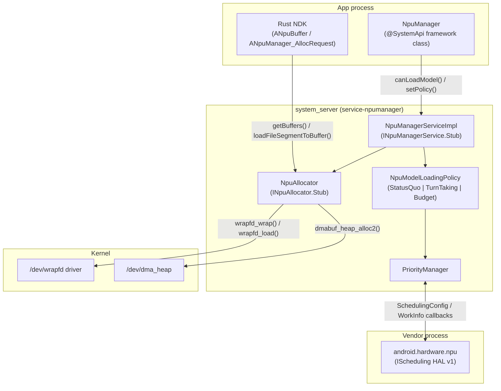
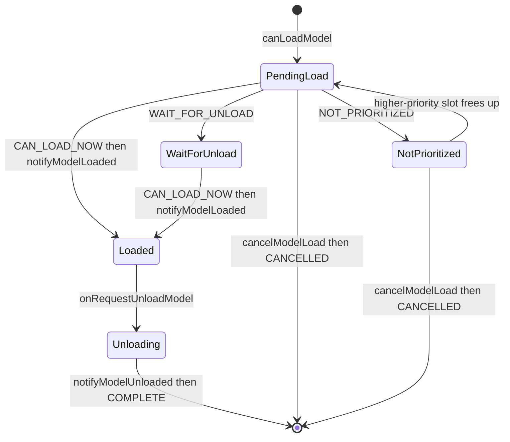
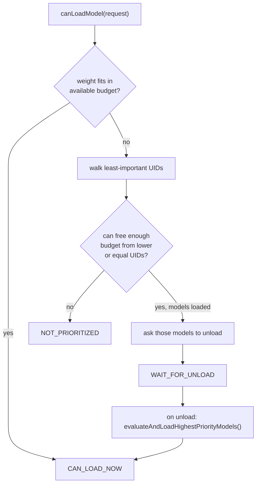
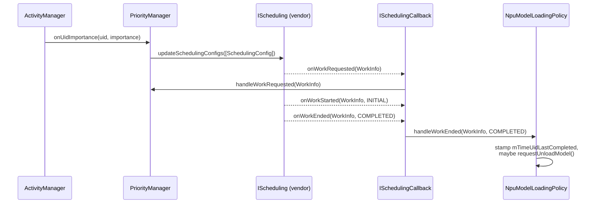
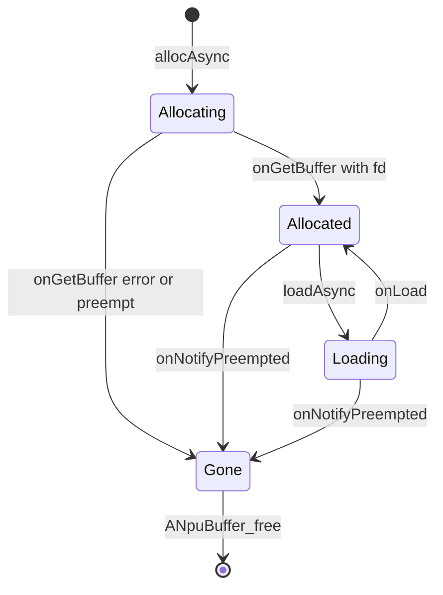
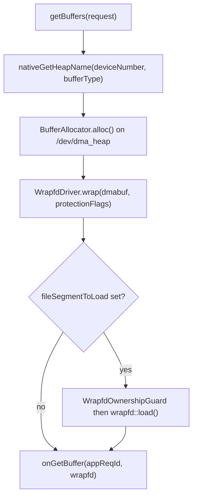

# 第 53 章：NPU 管理器

现代手机都搭载了神经处理单元（NPU）。NPU 是一种固定功能加速器。它运行端侧语音、视觉和生成式模型背后的矩阵乘法，效率远高于 CPU 或 GPU。

在 Android 17 之前，平台并不管控哪些应用可以使用 NPU。应用自己加载模型、映射权重，并直接把工作交给厂商的 NPU 驱动。如果两个应用都想同时在内存中驻留一个多 GB 的模型，它们就会在一个固定的内存池中发生冲突。失败的一方会得到内存不足错误，或者被静默地驱逐。没有优先级，没有准入控制，也没有“这个缓冲区存放的是模型权重，要保护它”这样的共享概念。

Android 17 引入了 **NPU 管理器**：一个新的主线 APEX 模块（`com.android.npumanager`），以及配套的厂商 HAL（`android.hardware.npu`）。二者共同把 NPU 变成一个受管理的多租户资源。应用不再想什么时候加载模型就什么时候加载。它们*询问* NPU 管理器自己是否应该加载模型。服务根据可插拔的策略、发起请求的应用的优先级以及内存预算来作答。

一个新的 Rust NDK 让原生 AI 运行时可以分配受保护的 NPU 缓冲区。一个新的内核原语 `/dev/wrapfd` 为这些缓冲区提供支持。即使文件描述符在进程之间移动，该原语也让内核能够强制执行缓冲区的内存保护状态。

本章自上而下地解释这个模块。首先说明为什么该模块是 Android 17 的新特性，并描述 APEX 及其模块 SDK 的结构。接着介绍模型加载的准入控制状态机及其三种策略。然后描述服务与 HAL 共享的优先级模型、Rust NDK 的缓冲区接口以及 `android.hardware.npu` v1 契约。最后展示 `libwrapfd` 如何强制执行缓冲区保护。

---

## 53.1 为什么需要一个管理器，以及为什么是一个模块

### 53.1.1 问题：一个不受管理的共享加速器

NPU 只有少量专用（或划分出来的）内存和一个命令队列。仅一个大语言模型的权重就可能达到 1-2 GB。如果前台助手应用和后台照片分类应用都想让自己的模型保持驻留，设备就会耗尽 NPU 可访问的内存。然后厂商驱动会让其中某一个失败，失败顺序取决于请求到达的顺序。平台没有规定前台助手应该胜出。也没有规定平台应该先礼貌地请后台任务释放它的模型。

NPU 管理器恰好补上了这个缺失的层次。它**并不**自己运行推理，也不取代厂商 NPU 驱动。它是一个位于应用与硬件之间的仲裁与记账服务。它决定应用*何时*可以加载模型，以及在压力下驱逐*谁的*模型。它还决定*如何*分配和保护存放这些模型的缓冲区。

### 53.1.2 为什么以主线模块的形式发布

管理器是一个可更新的 APEX，不是平台镜像的一部分。这让 Google 可以独立于年度 OS 版本发布，对准入控制策略进行迭代。加载策略、预算启发式和 NDK 都可以通过模块更新来改变。文件 `packages/modules/NpuManager/apex/Android.bp` 将 APEX 定义为 `com.android.npumanager`，并设置 `min_sdk_version: "36"`。两个标志控制着这个 APEX：

- 一个构建时发布标志 `RELEASE_NPUMANAGER_MODULE`，决定构建系统是否构建该 APEX、其 bootclasspath 和 systemserver 片段以及其模块 SDK。APEX 中的每个 Soong 模块都把它的 `enabled:` 字段包裹在 `select(release_flag("RELEASE_NPUMANAGER_MODULE"), ...)` 中。
- 一个运行时 aconfig 标志 `npumanager_enabled`，通过 `@FlaggedApi` 控制框架 API 表面。它还决定服务是否要与 HAL 建立连接。文件 `packages/modules/NpuManager/flags/npumanager_flags.aconfig` 在 `machine_learning` 命名空间中声明该标志。

APEX 在两个类路径层级上贡献代码，两者都体现在 `apex/Android.bp` 中。第一个层级是 `bootclasspath_fragment`（`com.android.npumanager-bootclasspath-fragment`），它携带框架库 `framework-npumanager`。第二个是 `systemserverclasspath_fragment`，它携带服务 `service-npumanager`。对于一个既暴露框架侧 `@SystemApi` *又*在 `system_server` 内部运行逻辑的模块来说，这是标准的拆分方式。

### 53.1.3 它自己的模块 SDK

由于厂商代码和其他模块代码需要基于管理器的接口进行构建，同一个 `apex/Android.bp` 定义了一个模块 SDK：

```
// Source: packages/modules/NpuManager/apex/Android.bp
sdk {
    enabled: select(release_flag("RELEASE_NPUMANAGER_MODULE"), {
        true: true,
        false: false,
    }),
    name: "npumanager-module-sdk",
    apexes: [
        "com.android.npumanager",
    ],
}
```

该模块发布 `npumanager-module-sdk`。这让 `com.android.npumanager` 成为一个自包含的、可单独构建的模块。使用者对该 SDK 做快照，并基于导出的类路径片段进行编译。他们不是基于实时的源码树进行编译。

### 53.1.4 组成部分及其连接方式

下图展示了 NPU 管理器的主要组件以及每个组件所处的边界。



## 53.2 框架表面

### 53.2.1 NPU 管理器系统服务

应用通过 `NpuManager` 类（`packages/modules/NpuManager/framework/java/android/npumanager/NpuManager.java`）访问管理器。框架将这个 `@SystemApi` 类注册在 `Context.NPU_SERVICE`（字符串 `"npu"`）下。注解 `@FlaggedApi(Flags.FLAG_NPUMANAGER_ENABLED)` 控制整个类。该类是 binder 接口 `INpuManagerService` 之上的一层薄薄的客户端。注册发生在 `NpuManagerFrameworkInitializer.registerServiceWrappers()` 中，通过 `SystemServiceRegistry.registerContextAwareService(Context.NPU_SERVICE, ...)` 完成。

binder 契约很小，而且有意*不*是一个“运行我的模型”的接口。来自 `packages/modules/NpuManager/framework/java/android/npumanager/INpuManagerService.aidl`：

```java
// Source: framework/java/android/npumanager/INpuManagerService.aidl
interface INpuManagerService {
    void canLoadModel(in ModelLoadRequestParcelable request, in IModelLoadCallback callback);
    void cancelModelLoad(in ModelLoadRequestParcelable request);
    void notifyModelLoaded(in ModelLoadRequestParcelable request);
    void notifyModelUnloaded(in ModelLoadRequestParcelable request);
    void setPolicy(int policy, in PersistableBundle policyParams);

    /** For memory management. */
    INpuAllocator createAllocator(INpuAllocatorCallback callback);
}
```

其中有三项属于*准入控制*（`canLoadModel`、`cancelModelLoad`、`setPolicy`）。两项是应用必须发回的*诚信*通知（`notifyModelLoaded`、`notifyModelUnloaded`）。一项返回*内存管理*分配器（`createAllocator`）。

模型管理调用需要 `android.Manifest.permission.ACCESS_NPU_MODEL_MANAGER_API` 权限。框架侧的 `NpuManager` 方法带有注解 `@RequiresPermission(ACCESS_NPU_MODEL_MANAGER_API)`。在服务侧，目前只有 `setPolicy()` 调用 `NpuManagerServiceImpl.enforceModelManagerPermissions()`。其他入口点带有注解 `@PermissionManuallyEnforced`，但它们自己尚未执行任何检查。

### 53.2.2 请求、大小与优先级

应用通过 `ModelLoadRequest`（`framework/java/android/npumanager/ModelLoadRequest.java`）来描述一个模型。应用用 id、一个粗略的大小档位和一个优先级来构建请求。大小不是字节数，而是三个档位之一。`NpuModelSize` 枚举（`framework/java/android/npumanager/NpuModelSize.aidl`）用无前缀的裸名称定义它们（`LESS_THAN_1GB`、`BETWEEN_1GB_AND_2GB`、`GREATER_THAN_2G`）。`NpuManager` 将它们以带前缀的常量形式重新导出：

- `NPU_MODEL_SIZE_LESS_THAN_1GB` (`NpuModelSize.LESS_THAN_1GB`)
- `NPU_MODEL_SIZE_BETWEEN_1GB_AND_2GB` (`NpuModelSize.BETWEEN_1GB_AND_2GB`)
- `NPU_MODEL_SIZE_GREATER_THAN_2G` (`NpuModelSize.GREATER_THAN_2G`)

模型优先级是请求本身的一个二值档位：`NPU_MODEL_PRIORITY_NORMAL` 与 `NPU_MODEL_PRIORITY_BACKGROUND` 相对。这个模型优先级不同于服务从 `ActivityManager` 重要性推导出的细粒度 0-1000 UID 优先级（见 53.4）。模型优先级也不同于 NDK 侧的缓冲区优先级。这个模块中存在三种不同的优先级概念。阅读代码时要将它们区分开。

### 53.2.3 异步准入协议

`canLoadModel()` 不返回是或否的答案。应用传入一个回调，服务稍后通过 `IModelLoadCallback` 作答，可能不止一次。在框架侧，`NpuManager.ModelLoadCallbackWrapper` 包装该回调。`NpuManager` 定义了如下状态值：

- `NPU_MODEL_LOAD_STATUS_CAN_LOAD_NOW` (0)：现在就加载。
- `NPU_MODEL_LOAD_STATUS_WAIT_FOR_UNLOAD` (1)：服务会为你释放内存。等待后续通知。
- `NPU_MODEL_LOAD_STATUS_NOT_PRIORITIZED` (2)：另一个应用排名高于你。不要加载。

应用加载完模型后，必须调用 `notifyModelLoaded()`。当应用用完模型，或者服务通过回调的 `onRequestUnloadModel()` 提出请求时，应用必须调用 `notifyModelUnloaded()`。服务信任应用会完成这两件事。终止回调 `onModelLoadRequestComplete()` 会传递 `NPU_MODEL_LOAD_REQUEST_STATUS_CANCELLED` (3) 或 `NPU_MODEL_LOAD_REQUEST_STATUS_COMPLETE` (4)，此后该请求不会再收到任何更新。

策略驱动着应用的请求所经历的状态机：



## 53.3 准入控制与三种策略

服务实现（`packages/modules/NpuManager/service/java/com/android/server/npumanager/NpuManagerServiceImpl.java`）持有一个 `NpuModelLoadingPolicy`，并把每个 `canLoadModel`、`notifyModelLoaded`、`notifyModelUnloaded` 和 `cancelModelLoad` 直接转发给它。`setPolicy()` 通过对三个策略常量的 switch 在运行时替换策略对象。`NpuModelLoadingPolicy` 是抽象基类。有三个具体实现。

### 53.3.1 StatusQuo：不做仲裁

`StatusQuoModelLoadingPolicy`（`service/java/com/android/server/npumanager/StatusQuoModelLoadingPolicy.java`）是默认策略。它的 `canLoadModel()` 立即为所有人回答 `CAN_LOAD_NOW`，并且只跟踪回调，以便在取消或卸载时触发 `onModelLoadRequestComplete()`。它是在没人更改策略时保留 17 之前行为的旁路。该策略“模仿 NpuModelManager 引入之前的行为”。

### 53.3.2 Budget：加权上限内的多模型共存

`BudgetModelLoadingPolicy`（`service/java/com/android/server/npumanager/BudgetModelLoadingPolicy.java`）是真正的仲裁者。它为每个模型大小分配一个**权重**，只要已加载和待处理模型的权重之和保持在最大预算之内，就允许并发加载。默认权重将小模型映射为 1，中等模型映射为 2，大模型映射为 4：

```java
// Source: service/java/com/android/server/npumanager/BudgetModelLoadingPolicy.java
private static final Map<Integer, Integer> DEFAULT_MODEL_WEIGHTS =
        Map.of(
                NPU_MODEL_SIZE_LESS_THAN_1GB, 1,
                NPU_MODEL_SIZE_BETWEEN_1GB_AND_2GB, 2,
                NPU_MODEL_SIZE_GREATER_THAN_2G, 4);
```

每个大小的权重和上限都可以通过调用方传给 `setPolicy()` 的 `PersistableBundle` 进行配置。该 bundle 使用键 `NpuManager.KEY_MODEL_SIZE_WEIGHTS` 和 `NpuManager.KEY_MAX_BUDGET`。

当新请求超出预算时，策略会先遍历*最不重要*的 UID（`getLeastImportantUids()`）。对于任何重要程度不超过调用方的 UID，如果该 UID 的模型已加载，策略会要求它们卸载。如果它们仍处于待处理状态，策略会取消它们。策略会一直持续，直到释放出足够的预算。

如果调用方无法赢得这场较量，它会得到 `NOT_PRIORITIZED`。如果策略为了调用方要求模型卸载，调用方会得到 `WAIT_FOR_UNLOAD`。当模型最终卸载时，`evaluateAndLoadHighestPriorityModels()` 会重新运行整个排序，并通知下一批获胜者。

有两个决胜规则值得关注，因为它们塑造了公平性。当两个 UID 重要程度相等时，策略偏好*没有*在近期完成工作的 UID。它用 `mTimeUidLastCompleted` 跟踪这一点，`handleWorkEnded()` 会给该字段盖上时间戳。策略还会为每个发起调用的 UID 注册一个 binder 死亡接收器。这让策略可以回收崩溃客户端的模型，并重新评估预算。

### 53.3.3 TurnTaking：一次只驻留一个模型

`TurnTakingModelLoadingPolicy`（`service/java/com/android/server/npumanager/TurnTakingModelLoadingPolicy.java`）是预算策略的一个薄薄的子类。它将每个大小的权重设为 1，最大预算设为 1。这个子类最清晰地展示了预算机制的通用性。

```java
// Source: service/java/com/android/server/npumanager/TurnTakingModelLoadingPolicy.java
super(
        priorityManager,
        Map.of(
                NPU_MODEL_SIZE_LESS_THAN_1GB, 1,
                NPU_MODEL_SIZE_BETWEEN_1GB_AND_2GB, 1,
                NPU_MODEL_SIZE_GREATER_THAN_2G, 1),
        1);
```

由于预算是 1 且每个模型的代价都是 1，因此一次只能有一个模型驻留。优先级最高的 UID 持有这个槽位，重要程度更高的 UID 会抢占它。预算策略的驱逐与重新评估逻辑完成了全部工作。

下图展示了预算策略和轮流策略端到端的准入决策：



## 53.4 优先级与 HAL 桥接

### 53.4.1 PriorityManager 与 0-1000 标度

策略对 UID 排序，但原始优先级数值来自 `PriorityManager`（`service/java/com/android/server/npumanager/PriorityManager.java`）。它监听 `ActivityManager.OnUidImportanceListener`，并把进程重要性映射为每个 UID 的优先级。HAL 可序列化对象 `SchedulingConfig` 为这个优先级定义了标度。在这个标度上，`MIN_PRIORITY = 0` 是**最高**优先级，`MAX_PRIORITY = 1000` 是最低的。该类将系统 UID 和 root UID 固定为静态优先级 100。它把未知 UID 视为 `MAX_PRIORITY`。

NDK 缓冲区优先级（0-1000，默认 500）和 HAL 的 `WorkInfo.jobPriority` 使用同一个标度。正因如此，整个模块遵循同一套优先级约定，0 表示“最重要”。

### 53.4.2 特性门控应用

`PriorityManager` 还强制执行一项新的平台要求：应用必须声明 `PackageManager.FEATURE_NEURAL_PROCESSING_UNIT` 特性才能获得 NPU 访问权限。`NpuPackageMonitor` 按包跟踪这一点。它对安装、卸载和修改事件做出反应。

对于面向 Android 17（`Build.VERSION_CODES.CINNAMON_BUN`）但省略了该特性的应用，当 `npumanager_block_missing_feature` 标志打开时，管理器会设置 `SchedulingConfig.hasDirectAccess = false`。当标志关闭时，管理器会记录一条警告。警告说访问“很快将被阻止”。

### 53.4.3 android.hardware.npu HAL v1 契约

厂商侧是一个新的 AIDL HAL，位于 `hardware/interfaces/npu/aidl/android/hardware/npu/`，版本为 v1（冻结的快照位于 `aidl_api/android.hardware.npu/1/` 下）。它有意不成为一个“执行推理”的接口。HAL 的 `README.md` 指出，工作仍然通过厂商 SDK 运行。HAL 纯粹关乎*优先级与观测*。

`NpuManagerServiceImpl` 通过 `ServiceManager.waitForDeclaredService(IScheduling.DESCRIPTOR + "/default")` 连接到 `IScheduling`（`IScheduling.aidl`）。该接口有三个方法：

- `setSchedulingConfigs(SchedulingConfig[])` 替换整个优先级表。
- `updateSchedulingConfigs(SchedulingConfig[])` 增量添加或更新条目。
- `setCallback(ISchedulingCallback)` 注册管理器的观察者。

`SchedulingConfig`（`SchedulingConfig.aidl`）携带 `uid`、其 `priority`、`hasDirectAccess` 和 `canAttributeOtherUid`（中间服务是否可以代表另一个应用提交工作）。NPU 应尽力优先运行编号较小的优先级。

反向通道是 `ISchedulingCallback`（`ISchedulingCallback.aidl`），一个 HAL 调用来报告 NPU 活动的 `oneway` 接口：

- `onWorkRequested(WorkInfo)`
- `onWorkStarted(WorkInfo, StartReason)`，其中 `StartReason` 为 `INITIAL` 或 `RESUMED`
- `onWorkEnded(WorkInfo, EndReason)`，其中 `EndReason` 为 `CANCELLED_USER`、`CANCELLED_SYSTEM`、`PAUSED`、`FAILED`、`COMPLETED` 之一

HAL 用 `DEBOUNCE_DURATION_MS = 50` 对这些事件做去抖。

`WorkInfo`（`WorkInfo.aidl`）描述一个 NPU 工作单元。它有一个单调递增的 `id`。一个可选的 `groupId`（一个 `Uuid`）将属于同一项更大工作的推理关联在一起。该可序列化对象还带有请求者的 `uid`、用于归属工作的 `originalUid` 以及一个 `jobPriority`。合并后的 `effectivePriority` 是 UID 优先级加上任务优先级，其范围最高可达 `MAX_PRIORITY * 2`。

在 `NpuManagerServiceImpl` 中，`onWorkRequested` 流入 `PriorityManager.handleWorkRequested()`。这为新出现的 UID 赋予优先级。`onWorkEnded` 流入当前策略的 `handleWorkEnded()`。这让预算策略可以盖上其公平性时间戳。当同等优先级的同伴在等待时，策略也可以要求已完成的 UID 卸载。实际的重新评估稍后发生，即当卸载通过 `notifyModelUnloaded` 到达时。

连接具有自愈能力。服务在 HAL binder 上调用 `linkToDeath`，并在厂商进程死亡时在 `ensureHalService()` 中重新连接。

下图展示了服务与 HAL 之间的控制与观测循环：



## 53.5 Rust NDK 与 ANpuBuffer

### 53.5.1 原生分配接口

原生 AI 运行时（那种真正映射模型权重的运行时）使用 C NDK。头文件 `packages/modules/NpuManager/ndk/include/android/npumanager/buffer.h` 声明了它。不透明句柄是 `ANpuBuffer`。运行时用 `ANpuManager_AllocRequest` 构建分配一个缓冲区的请求。

这个头文件背后的实现是 **Rust**。文件 `ndk/Android.bp` 构建 `libnpumanager_rust`（crate 根 `buffer_impl.rs`），并将其包装在共享库 `libcom.android.npumanager.so` 中。这个共享库随 APEX 一起发布。由于 `libandroid.so` 可能在 APEX 就绪之前就被加载，调用方通过惰性 `dlopen()` 垫片（`ndk/npumanager_dlopen.h` / `.cpp`）访问公共入口点。

运行时用以下函数配置请求：

- `ANpuManager_AllocRequest_setDeviceNumber()` —— 哪个 NPU（厂商侧不透明，必须非负）。
- `ANpuManager_AllocRequest_setBufferType()` —— `ANPUBUFFER_TYPE_*` 之一：`MODEL_EXECUTABLE`、`MODEL_WEIGHTS`、`CACHE`、`AUXILIARY`（输入/输出缓冲区改用 `AHardwareBuffer`）。
- `ANpuManager_AllocRequest_setSize()`、`setBufferPriority()`（0-1000 标度，默认 `ANPUBUFFER_PRIORITY_DEFAULT = 500`），以及 `setProtectionFlags()`（默认 `PROT_READ`）。
- `ANpuManager_AllocRequest_setFileSegmentToLoad()` —— 可选地提供文件 fd 加偏移量，以便管理器把权重直接加载进缓冲区。
- `setCookie()`、`setOnAlloc()`、`setOnPreempt()` —— 回调接线。

所有入口点都是 `__INTRODUCED_IN(37)`。分配是异步的：`ANpuManager_allocAsync()` 接收一批请求，结果通过每个请求的 `ANpuManager_AllocCallback` 到达。

分配之后，运行时使用 `ANpuBuffer_map()` 和 `ANpuBuffer_unmap()` 来映射和取消映射缓冲区。这些函数类似 mmap，但 `prot` 必须是分配后保持不变的保护标志的子集。运行时可以调用 `ANpuBuffer_setPriority()` 来调整缓冲区优先级。它可以调用 `ANpuBuffer_loadAsync()` 在分配后流式载入文件段。运行时必须用 `ANpuBuffer_free()` 释放每个缓冲区，即使是一个被抢占的缓冲区。

### 53.5.2 缓冲区状态机

Rust 客户端（`ndk/npu_buffer_state.rs`）通过一个小型状态机跟踪每个缓冲区，该状态机镜像异步的服务响应。缓冲区从 **Allocating** 开始。当服务返回其 fd 时，它变成 **Allocated**。如果分配失败，它变成 **Gone**。

缓冲区在 `ANpuBuffer_loadAsync()` 期间移动到 **Loading**，完成后回到 **Allocated**。抢占可以在任何时刻强制缓冲区变为 **Gone**。`NpuBufferState` 直接编码了这些转移：



抢占是 NDK 的驱逐信号：服务调用 `INpuAllocatorCallback.onNotifyPreempted()`，客户端将缓冲区推进到 `Gone`，可选的 `ANpuManager_PreemptCallback` 触发。此后，任何 `ANpuBuffer_map()` 都会以 `errno == ENOENT` 失败，因为内核已经清除了底层缓冲区（见 53.6）。

### 53.5.3 分配器的 binder 路径

在 C API 之下，Rust 客户端通过 `INpuAllocator`（`framework/java/android/npumanager/INpuAllocator.aidl`）与服务通信。客户端从 `INpuManagerService.createAllocator()` 获得该接口。客户端侧（`ndk/npu_allocator_client.rs`）将请求批量打包进 `getBuffers()`，检查 `isSupported()`，并用 `putBuffers()` 返回缓冲区。Rust 客户端通过 `ndk/npu_manager_delegate.rs` 中的 `setPriority()` 调整缓冲区优先级。它通过 `ndk/npu_buffer_impl.rs` 中的 `loadFileSegmentToBuffer()` 流式传输数据。调用经由 `NpuAllocatorClient::load_async`。

回复异步地通过 `INpuAllocatorCallback`（`onGetBuffer`、`onLoad`、`onNotifyPreempted`）返回。分配器的服务实现是 `NpuAllocator`（`service/java/com/android/server/npumanager/NpuAllocator.java`），一个 `INpuAllocator.Stub`，在后台线程池上执行真正的堆分配和包装。

## 53.6 libwrapfd 与缓冲区保护

### 53.6.1 /dev/wrapfd 原语

NPU 管理器提供的缓冲区不是普通的 `dma_heap` 分配。NPU 管理器对它们进行*包装*，使内核能够强制执行进程如何映射它们以及谁拥有它们。这是 `libwrapfd`（`system/memory/libwrapfd`）的工作，它是一个基于新 `/dev/wrapfd` 内核驱动的 Rust 库和 LLNDK 共享库。构建文件 `system/memory/libwrapfd/rust/Android.bp` 将该库定义为一个 `rust_library`（`libwrapfd_rust`）和一个 `cc_library_shared`（`libwrapfd`）。该库对 `com.android.npumanager` 也是 `apex_available` 的。

`libwrapfd` 接受一个已有的 fd（此处为 dma-buf），并返回一个新的 *wrapfd*，它委托给原 fd 但增加了保护状态。核心操作是 `WrapfdDriver::wrap(fd, prot)`（`system/memory/libwrapfd/rust/lib.rs`）。它把被包装的 fd 钉在一个保护掩码上，`PROT_NONE` 或 `PROT_READ` 与 `PROT_WRITE` 的组合。从那时起，内核约束进程可以如何映射该缓冲区。更多操作包括：

- `acquire_ownership()` / `release_ownership()` —— 所有者修改缓冲区时的独占所有权；RAII 的 `WrapfdOwnershipGuard` 在 drop 时释放。
- `load(wrapfd, file, file_offset, buf_offset, len)` —— 通过 DMA 将文件段复制到缓冲区；需要所有权且偏移量按页对齐。
- `rewrap(prot)` —— 将底层缓冲区移入一个具有不同保护掩码的新包装。
- `allow_guests()` / `prohibit_guests()` —— 控制非所有者进程是否可以映射该缓冲区。
- `empty()` —— 释放被包装的缓冲区；正是这一点让被抢占缓冲区的后续映射失败。

头文件 `system/memory/libwrapfd/rust/include/wrapfd.h` 记录了 C 接口表面和 `WrapfdState` 枚举（`EMPTY`、`RDONLY`、`RDWR`），`wrapfd_get_state()` 会报告它。

### 53.6.2 分配、包装、加载

`NpuAllocator` 在其 JNI 层（`service/jni/com_android_server_npumanager_NpuAllocator.rs`，crate `libnpumanager_service_jni`）将 dma-buf 堆、`libwrapfd` 和缓冲区类型联系在一起。一个缓冲区的序列（在 Java 侧名为 `allocWrapLoad`）是：

1. 为每台设备从一个 DMA-buf 堆配置中按 `(deviceNumber, bufferType)` 挑选一个 DMA-buf 堆（`nativeGetHeapName`）。这让不同的 NPU 和缓冲区类型可以映射到不同的堆。
2. 在该堆上用 `BufferAllocator::alloc()` 分配。为调试目的给缓冲区命名（`npubuf-<pid>-<appReqId>`）。
3. 用请求的保护标志在 dma-buf 上调用 `WrapfdDriver::wrap()`。
4. 如果应用请求了文件段，用 `WrapfdOwnershipGuard` 取得所有权。调用 `wrapfd::load()` 通过 DMA 把权重复制进来。然后释放所有权。
5. 把 *wrapfd*（而不是原始 dma-buf）返回给客户端，客户端通过 `onGetBuffer` 接收它。

因为 wrapfd 在内核中携带保护状态，应用可以只读地映射权重。管理器仍然可以撤销它们：在抢占时，它清空该包装。应用和服务不需要信任彼此的用户空间。

分配器在构造时探测该驱动（`nativeInitWrapfdDriver()`）。在没有 `/dev/wrapfd` 的设备上，分配器会抛出 `UnsupportedOperationException`。这就是管理器在不支持包装缓冲区的硬件上优雅降级的方式。



## 53.7 动手试一试

这些命令在设备或模拟器上演练该模块。开始之前，请确保 `RELEASE_NPUMANAGER_MODULE` 构建标志和 `npumanager_enabled` aconfig 标志已打开。该服务可通过 `npu` 服务访问。

- 确认服务出现在服务列表中。然后确认 APEX 存在：

  ```bash
  adb shell service list | grep npu
  adb shell ls /apex/com.android.npumanager
  ```

- 用 `info` 子命令查看当前策略、请求和优先级表（在 `NpuManagerServiceImpl.handleShellCommand` 中实现）：

  ```bash
  adb shell cmd npu info
  ```

- 在运行时切换准入控制策略。然后再次查看 `info`：

  ```bash
  adb shell cmd npu set-turn-taking-policy
  adb shell cmd npu set-budget-policy
  adb shell cmd npu set-status-quo-policy
  ```

- 暂时停止服务对 HAL 的优先级更新。然后再重新启用更新。只有 root 能这样做：

  ```bash
  adb root
  adb shell cmd npu disable
  adb shell cmd npu enable
  ```

- 检查设备是否通告了 NPU HAL 和特性：

  ```bash
  adb shell dumpsys package | grep android.hardware.npu
  adb shell pm list features | grep android.hardware.npu
  ```

- 阅读冻结的 v1 HAL 接口，了解厂商必须实现的确切内容：

  ```bash
  ls hardware/interfaces/npu/aidl/aidl_api/android.hardware.npu/1/
  ```

## 总结

- Android 17 增加了 **NPU 管理器**，这是一个主线 APEX（`com.android.npumanager`），仲裁对端侧神经加速器的访问。两个标志控制它：`RELEASE_NPUMANAGER_MODULE` 构建标志和 `npumanager_enabled` aconfig 标志。它发布了自己的模块 SDK（`npumanager-module-sdk`）以及 bootclasspath 和 systemserver 片段。
- 应用使用 `@SystemApi` 的 `NpuManager`（`Context.NPU_SERVICE`）来*询问*模型是否可以加载。它们不直接加载模型。异步协议回答 `CAN_LOAD_NOW`、`WAIT_FOR_UNLOAD` 或 `NOT_PRIORITIZED`，应用必须如实上报 `notifyModelLoaded` 和 `notifyModelUnloaded`。
- 准入控制是可插拔的。`StatusQuo` 是默认策略，不做仲裁。`Budget` 允许在上限内进行加权并发加载。它按优先级驱逐模型。`TurnTaking` 是权重为 1、预算为 1 的预算策略。它一次只允许一个模型。
- `PriorityManager` 将 `ActivityManager` 重要性映射到共享的 0-1000 优先级标度（0 = 最高）。它把这些优先级发送给厂商 HAL。它还会阻止省略 `FEATURE_NEURAL_PROCESSING_UNIT` 的 Android 17 应用。
- 配套的 `android.hardware.npu` HAL v1（`IScheduling` 和 `ISchedulingCallback`）向下传递每个 UID 的 `SchedulingConfig` 优先级。它向上回传 `WorkInfo` 的开始和结束回调（`StartReason`、`EndReason`）。它自己不执行推理。
- Rust NDK（`ANpuBuffer`、`ANpuManager_AllocRequest`，位于 `libcom.android.npumanager.so` 之后）让原生运行时可以分配、映射、加载和释放受保护的 NPU 缓冲区，并带有用于驱逐的抢占回调。
- `libwrapfd` 基于新的 `/dev/wrapfd` 内核驱动为这些缓冲区提供支持。服务在 DMA-buf 堆上分配。它用保护掩码在 fd 上调用 `wrap()`。它可以调用 `load()` 把权重复制进来。在抢占时，它可以对包装调用 `empty()`，使被撤销缓冲区的映射以 `ENOENT` 失败。

### 关键源文件参考

| 文件 | 用途 |
|------|---------|
| `packages/modules/NpuManager/apex/Android.bp` | APEX `com.android.npumanager`、类路径片段和 `npumanager-module-sdk` |
| `packages/modules/NpuManager/flags/npumanager_flags.aconfig` | `npumanager_enabled` 和 `npumanager_block_missing_feature` 标志 |
| `packages/modules/NpuManager/framework/java/android/npumanager/NpuManager.java` | `@SystemApi` 客户端，以及状态、大小、优先级和策略的常量 |
| `packages/modules/NpuManager/framework/java/android/npumanager/INpuManagerService.aidl` | 准入控制和 `createAllocator` 的 binder 契约 |
| `packages/modules/NpuManager/framework/java/android/npumanager/INpuAllocator.aidl` | 缓冲区分配器的 binder 接口 |
| `packages/modules/NpuManager/service/java/com/android/server/npumanager/NpuManagerServiceImpl.java` | 服务实现、HAL 连接和 shell 命令 |
| `packages/modules/NpuManager/service/java/com/android/server/npumanager/BudgetModelLoadingPolicy.java` | 加权预算准入与驱逐 |
| `packages/modules/NpuManager/service/java/com/android/server/npumanager/TurnTakingModelLoadingPolicy.java` | 一次一个模型的策略（预算 1） |
| `packages/modules/NpuManager/service/java/com/android/server/npumanager/PriorityManager.java` | UID 优先级映射与特性门控 |
| `packages/modules/NpuManager/service/java/com/android/server/npumanager/NpuAllocator.java` | 服务侧的堆分配、包装和加载 |
| `packages/modules/NpuManager/service/jni/com_android_server_npumanager_NpuAllocator.rs` | Rust JNI：dma-buf 分配、`wrapfd::wrap`、`wrapfd::load` |
| `packages/modules/NpuManager/ndk/include/android/npumanager/buffer.h` | C NDK：`ANpuBuffer`、`ANpuManager_AllocRequest` |
| `packages/modules/NpuManager/ndk/npu_buffer_state.rs` | NDK 缓冲区的状态机 |
| `hardware/interfaces/npu/aidl/android/hardware/npu/IScheduling.aidl` | NPU HAL v1：优先级推送与回调注册 |
| `hardware/interfaces/npu/aidl/android/hardware/npu/WorkInfo.aidl` | HAL 工作描述符（优先级、归属） |
| `system/memory/libwrapfd/rust/lib.rs` | `/dev/wrapfd` 包装器：`wrap`、所有权、`load`、`empty` |
| `system/memory/libwrapfd/rust/include/wrapfd.h` | `libwrapfd` 的 C 与 LLNDK 接口表面，以及 `WrapfdState` |
