# 第 55 章：OTA 更新

空中下载（OTA）更新是 Android 设备获取新系统镜像、安全补丁和功能更新的机制。它们无需物理接触，也无需手动刷写。OTA 最初只是简单的"下载一个 zip、进入恢复模式、应用它"模型，如今已演进为 AOSP 最复杂的子系统之一。该子系统包含一个专用的原生守护进程（`update_engine`）、内核级写时复制快照以及引导加载程序集成协议。它还包含一条流式流水线，可以应用 GB 级负载，而无需将完整镜像写入 userdata。

本章追踪一次 OTA 更新，从服务器宣布其可用的那一刻开始，直到设备重启进入新软件并把槽位标记为成功为止。我们检查每一层：

- 负载二进制格式
- `update_engine` 内部的 action 流水线
- A/B 与 Virtual A/B 的槽位切换机制
- 使压缩写时复制在用户空间中可行的 `snapuserd` 守护进程
- 生成负载的 Python 工具
- 作为传统回退方案的恢复模式
- 将一切串联起来的框架 API

---

## 55.1 OTA 架构概述

### 55.1.1 三种更新方案

Android 在其历史上使用过三种不同的 OTA 方案。理解全部三种至关重要，因为量产设备涵盖了整个范围。

```
Source path: system/update_engine/         -- A/B and Virtual A/B engine
             bootable/recovery/            -- Non-A/B recovery updater
             system/fs/fs_mgr/libsnapshot/ -- Virtual A/B snapshots
```

在 Android 17 中，快照代码从 `system/core` 移出了：`libsnapshot`、`snapuserd` 和 COW 格式实现现在位于 `system/fs/fs_mgr/libsnapshot/` 下。较早版本使用 `system/core/fs_mgr/libsnapshot/` 路径，该路径已不存在。本章中所有快照引用都使用新位置。

**非 A/B（传统）**。最初的方案，从 Android 1.0 一直用到约 Android 9（尽管它仍受支持）。设备有一组分区（system、boot、vendor 等）加上一个专用 `recovery` 分区。更新时，设备重启进入恢复模式。恢复模式挂载 OTA 包（一个带有 updater 二进制和镜像数据的已签名 zip 文件），并原地应用块级补丁。如果更新中途失败，设备可能处于无法启动的状态——可怕的"变砖"。

**A/B（无缝）**。在 Android 7.0 引入。设备携带每个可更新分区的两份副本：槽位 A 和槽位 B。当用户从其中一个槽位运行时，`update_engine` 在后台把新镜像写入另一个槽位。完成后，指示引导加载程序切换活动槽位。如果新槽位启动失败，引导加载程序会回滚。

设备绝不会为了 OTA 而进入恢复模式，用户在写入阶段体验零停机。代价是分区存储大约翻倍。

**Virtual A/B**。在 Android 11 引入，自 Android 13 起强制使用。Virtual A/B 保留了 A/B 的无缝更新用户体验，但消除了物理复制每个分区的需要。相反，它使用 device-mapper 快照（自 Android 12 起，使用通过 `snapuserd` 的压缩写时复制）在更新期间只存储*已更改的块*。重启并成功验证后，快照被*合并*进基础分区，回收临时存储。这带来了 A/B 的可靠性和接近非 A/B 的存储效率。

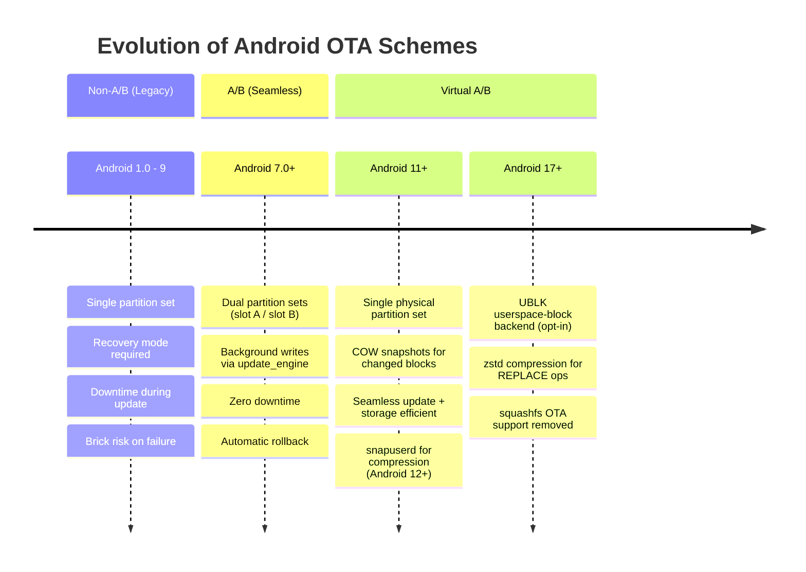

Android 17 没有引入新方案；它优化了 Virtual A/B。主要变化是：

- 用于提供快照的 **UBLK** 用户空间块驱动后端（`dm-user` 路径的替代方案）
- 针对 `REPLACE` 操作的 **zstd 压缩**
- 移除 squashfs 构建/OTA 支持

这些将在 55.26 节详细讨论。

### 55.1.2 高层数据流

无论采用哪种方案，每次 OTA 更新都遵循共同的生命周期：

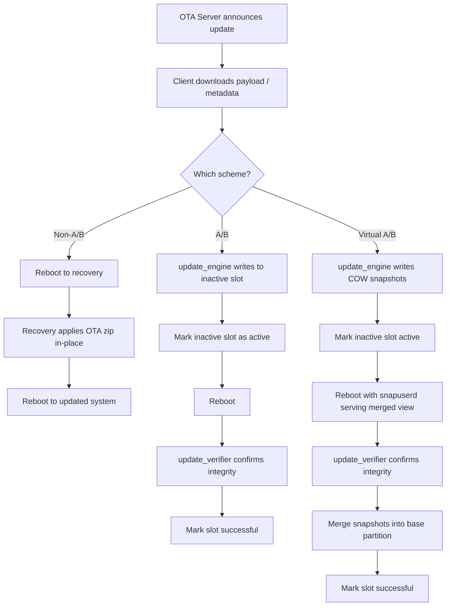

### 55.1.3 分区布局比较

下表总结了每种方案下分区的组织方式。

| 方面 | 非 A/B | A/B | Virtual A/B |
|--------|---------|-----|-------------|
| 物理分区 | system、boot、vendor、recovery | system_a/b、boot_a/b、vendor_a/b | system_a/b（逻辑）、boot_a/b（物理） |
| 恢复分区 | 专用 | 无（恢复在 boot 中） | 无（恢复在 boot 或 init_boot 中） |
| 存储开销 | ~0% | ~100%（完全复制） | ~5-15%（已更改块的 COW） |
| 更新目标 | 在运行中的分区上原地写入 | 非活动槽位 | 映射到非活动槽位上的 COW 设备 |
| 回滚 | 不保证 | 通过引导加载程序自动 | 通过引导加载程序自动 |
| 停机时间 | 完整重启 + 应用时间 | 仅重启（约 30 秒） | 仅重启（约 30 秒） |
| 更新后合并 | 无 | 无 | COW 的后台合并 |
| 最低 Android 版本 | 1.0 | 7.0 | 11 |

### 55.1.4 关键系统属性

更新方案由系统属性和 fstab 配置决定：

```
# A/B device detection
ro.boot.slot_suffix=_a          # Present on A/B and Virtual A/B
ro.build.ab_update=true         # A/B capable

# Virtual A/B detection
ro.virtual_ab.enabled=true      # Virtual A/B enabled

# Virtual A/B Compression
ro.virtual_ab.compression.enabled=true
ro.virtual_ab.userspace.snapshots.enabled=true
ro.virtual_ab.compression.xor.enabled=true

# Virtual A/B UBLK backend (Android 17)
ro.virtual_ab.ublk.enabled=true   # Device configured for UBLK snapshots
```

`ro.virtual_ab.ublk.enabled` 属性是 `IsUblkEnabled()` 检查的三个条件之一。该检查发生在快照通过 UBLK（而非 `dm-user`）提供服务之前。另外两个条件是一个 aconfig 标志和 6.6 或更新的内核版本（见 55.26 节）。

```
Source: system/fs/fs_mgr/libsnapshot/capabilities.cpp
```

相关的 feature flag 检测代码位于：

```
Source: system/update_engine/aosp/dynamic_partition_control_android.h
```

```cpp
// DynamicPartitionControlAndroid exposes:
FeatureFlag GetDynamicPartitionsFeatureFlag() override;
FeatureFlag GetVirtualAbFeatureFlag() override;
FeatureFlag GetVirtualAbCompressionFeatureFlag() override;
FeatureFlag GetVirtualAbCompressionXorFeatureFlag() override;
```

每个 `FeatureFlag` 要么是 `NONE` 要么是 `LAUNCH`，通过其 `IsEnabled()` 和 `IsLaunch()` 辅助方法查询。

### 55.1.5 源码树地图

```
system/update_engine/
    main.cc                          -- Daemon entry point
    aosp/
        daemon_android.cc            -- Android-specific daemon setup
        update_attempter_android.cc  -- Orchestrates the update attempt
        boot_control_android.cc      -- A/B slot control via HAL
        binder_service_android.cc    -- Binder interface for framework
        dynamic_partition_control_android.cc -- Dynamic partition + VAB control
        cleanup_previous_update_action.cc   -- Post-reboot merge trigger
    payload_consumer/
        delta_performer.cc           -- Applies payload operations
        payload_metadata.cc          -- Parses payload header
        payload_constants.cc         -- Magic bytes, version constants
        vabc_partition_writer.cc     -- Virtual A/B Compression writer
        partition_writer.cc          -- Standard partition writer
        install_plan.h               -- Update plan data structure
    payload_generator/
        delta_diff_generator.cc      -- Generates delta payloads
        full_update_generator.cc     -- Generates full payloads
    common/
        boot_control_interface.h     -- Abstract slot management
        action_processor.cc          -- Action pipeline scheduler
    scripts/
        brillo_update_payload        -- Shell tool for payload operations

build/make/tools/releasetools/
    ota_from_target_files.py         -- Primary OTA package generator
    non_ab_ota.py                    -- Legacy non-A/B generator

bootable/recovery/
    recovery_main.cpp                -- Recovery entry point
    recovery.cpp                     -- Main recovery logic
    install/install.cpp              -- Package installation
    update_verifier/                 -- Post-boot verification

system/fs/fs_mgr/libsnapshot/        -- (moved from system/core in Android 17)
    snapshot.cpp                     -- Snapshot manager
    capabilities.cpp                 -- UBLK enablement decision
    libsnapshot_cow/
        writer_v3.cpp                -- COW v3 writer
    snapuserd/
        snapuserd_daemon.cpp         -- Daemon entry, UBLK/dm-user selection
        dm_user_block_server.cpp     -- dm-user backend
        ublk_block_server.cpp        -- UBLK backend (Android 17)
        user-space-merge/
            snapuserd_core.cpp       -- Core merge logic

frameworks/base/core/java/android/os/
    UpdateEngine.java                -- Framework API wrapper
```

---

## 55.2 update_engine

`update_engine` 是驱动 A/B 和 Virtual A/B 更新的原生守护进程。它最初作为 Chrome OS 的一部分开发，自 Android 7.0 的 A/B 方案起被移植到 Android。在 Android 上，它作为持久系统服务运行，通过 Binder 监听更新命令。

### 55.2.1 守护进程生命周期

守护进程从 `main.cc` 启动：

```
Source: system/update_engine/main.cc
```

```cpp
int main(int argc, char** argv) {
  chromeos_update_engine::Terminator::Init();
  gflags::SetUsageMessage("A/B Update Engine");
  gflags::ParseCommandLineFlags(&argc, &argv, true);
  // ... logging setup ...
  xz_crc32_init();
  umask(S_IRWXG | S_IRWXO);  // Restrictive permissions

  auto daemon = chromeos_update_engine::DaemonBase::CreateInstance();
  int exit_code = daemon->Run();
  // ...
}
```

在 Android 上，`DaemonBase::CreateInstance()` 返回一个 `DaemonAndroid`：

```
Source: system/update_engine/aosp/daemon_android.cc
```

```cpp
int DaemonAndroid::OnInit() {
  subprocess_.Init(this);
  int exit_code = brillo::Daemon::OnInit();

  android::BinderWrapper::Create();
  binder_watcher_.Init();

  DaemonStateAndroid* daemon_state_android = new DaemonStateAndroid();
  daemon_state_.reset(daemon_state_android);
  daemon_state_android->Initialize();

  // Register Binder services
  binder_service_ = new BinderUpdateEngineAndroidService{
      daemon_state_android->service_delegate()};
  binder_wrapper->RegisterService(
      binder_service_->ServiceName(), binder_service_);

  // Also register the "stable" AIDL service
  stable_binder_service_ = new BinderUpdateEngineAndroidStableService{
      daemon_state_android->service_delegate()};
  binder_wrapper->RegisterService(
      stable_binder_service_->ServiceName(), stable_binder_service_);

  daemon_state_->StartUpdater();
  return EX_OK;
}
```

守护进程注册两个 Binder 服务：

1. `android.os.UpdateEngineService` —— 主接口
2. 一个用于跨版本兼容性的"stable" AIDL 变体

### 55.2.2 action 流水线

`update_engine` 使用 *action 流水线* 模式。更新的每一步都是一个 `Action` 子类，由 `ActionProcessor` 把它们串联起来。数据通过类型安全的 `ActionPipe` 连接在 action 之间流动。


```
Source: system/update_engine/common/action.h
        system/update_engine/common/action_processor.h
```

`ActionProcessor` 一次运行一个 action。当一个 action 完成（成功或失败）时，处理器推进到下一个或终止：

```cpp
// action_processor.cc
void ActionProcessor::ActionComplete(AbstractAction* actionptr,
                                     ErrorCode code) {
  // ... notify delegate, run current_action_->ActionCompleted(code) ...
  current_action_.reset();
  if (!actions_.empty() && code != ErrorCode::kSuccess) {
    // Pipeline failed: drop the remaining actions
    actions_.clear();
  }
  // ... suspend handling ...
  StartNextActionOrFinish(code);
}

void ActionProcessor::StartNextActionOrFinish(ErrorCode code) {
  if (actions_.empty()) {
    // ... notify delegate that processing is done ...
    return;
  }
  current_action_ = std::move(actions_.front());
  actions_.pop_front();
  current_action_->PerformAction();
}
```

### 55.2.3 UpdateAttempterAndroid

`UpdateAttempterAndroid` 类是 Android 更新的顶层编排器。它实现了 `ServiceDelegateAndroidInterface`（由 Binder 服务调用）和 `ActionProcessorDelegate`（接收来自流水线的回调）。

```
Source: system/update_engine/aosp/update_attempter_android.h
```

主要职责：

- **ApplyPayload**：更新的入口点。解析 URL/fd、headers，构造 `InstallPlan`，构建 action 流水线并启动它。
- **SuspendUpdate / ResumeUpdate**：暂停和恢复进行中的下载。
- **CancelUpdate**：中止正在运行的更新并清理。
- **ResetStatus**：清除已完成或失败更新的持久状态。
- **CleanupSuccessfulUpdate**：在 Virtual A/B 上触发快照合并。

```cpp
// The update status state machine
// (system/update_engine/client_library/include/update_engine/update_status.h)
enum class UpdateStatus {
  IDLE,
  CHECKING_FOR_UPDATE,
  UPDATE_AVAILABLE,
  DOWNLOADING,
  VERIFYING,
  FINALIZING,
  UPDATED_NEED_REBOOT,
  REPORTING_ERROR_EVENT,
  ATTEMPTING_ROLLBACK,
  DISABLED,
  NEED_PERMISSION_TO_UPDATE,
  CLEANUP_PREVIOUS_UPDATE,
  // ...
};
```

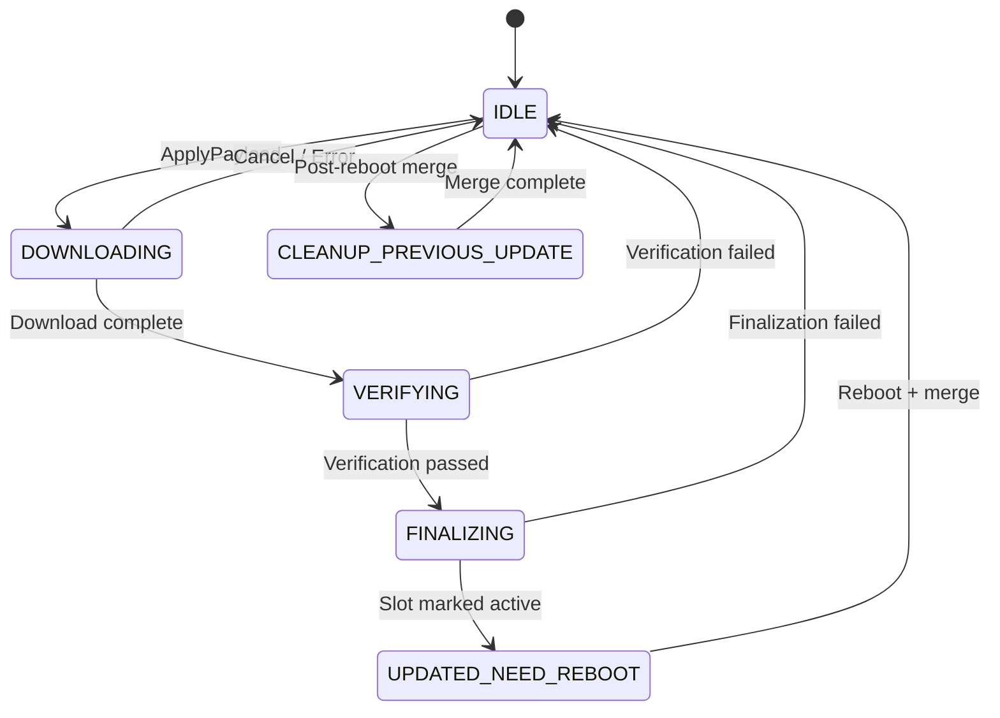

### 55.2.4 OTA 结果跟踪

重启后，`update_engine` 判断上一次更新尝试的结果：

```cpp
// update_attempter_android.h
enum class OTAResult {
  NOT_ATTEMPTED,
  ROLLED_BACK,
  UPDATED_NEED_REBOOT,
  OTA_SUCCESSFUL,
};
```

`GetOTAUpdateResult()` 方法检查持久首选项和启动槽位状态，以确定更新是成功、已回滚还是从未尝试。这驱动了指标上报和合并调度。

### 55.2.5 构建更新 action

当 `ApplyPayload` 被调用时，`BuildUpdateActions` 构造流水线：

```mermaid
flowchart TD
    subgraph "Action Pipeline Construction"
        A["Create InstallPlanAction<br/>with payload metadata"] --> B["Create DownloadAction<br/>with HttpFetcher"]
        B --> C["Create FilesystemVerifierAction<br/>hash verification"]
        C --> D["Create PostinstallRunnerAction<br/>runs postinstall scripts"]
    end

    subgraph "During Execution"
        E["DownloadAction streams data<br/>to DeltaPerformer"] --> F["DeltaPerformer applies<br/>operations to target partitions"]
        F --> G["FilesystemVerifier reads back<br/>and verifies hashes"]
        G --> H["PostinstallRunner mounts target<br/>and runs scripts"]
        H --> I[SetActiveBootSlot on success]
    end
```

### 55.2.6 Binder 服务接口

Binder 接口公开这些主要方法：

```
Source: system/update_engine/aosp/binder_service_android.h
```

| 方法 | 描述 |
|--------|-------------|
| `applyPayload(url, offset, size, headers)` | 从 URL 开始更新 |
| `applyPayloadFd(fd, offset, size, headers)` | 从文件描述符开始更新 |
| `bind(callback)` | 注册状态回调 |
| `suspend()` | 暂停下载 |
| `resume()` | 恢复下载 |
| `cancel()` | 取消更新 |
| `resetStatus()` | 清除已完成/失败状态 |
| `verifyPayloadApplicable(metadata_file)` | 检查负载是否可应用 |
| `allocateSpaceForPayload(metadata, headers)` | 为 VAB 预分配空间 |
| `cleanupSuccessfulUpdate(callback)` | 触发快照合并 |
| `setShouldSwitchSlotOnReboot(metadata)` | 设置槽位切换标志 |
| `resetShouldSwitchSlotOnReboot()` | 清除槽位切换标志 |
| `triggerPostinstall(partition)` | 对某个分区运行 postinstall |

`applyPayload` 的 headers 是控制行为的键值对：

```
METADATA_HASH=<base64>     -- Expected hash of payload metadata
METADATA_SIZE=<bytes>      -- Size of payload metadata
FILE_HASH=<base64>         -- Expected hash of entire payload
FILE_SIZE=<bytes>          -- Size of entire payload
SWITCH_SLOT_ON_REBOOT=1    -- Whether to switch slots (default: 1)
RUN_POST_INSTALL=1         -- Whether to run postinstall (default: 1)
NETWORK_ID=<id>            -- Network to use for download
```

---

## 55.3 负载格式

OTA 负载是一个二进制文件，编码了将源分区布局转换为目标布局所需的全部信息。全量更新和增量（delta）更新使用相同的格式。

### 55.3.1 负载二进制结构

```
Source: system/update_engine/payload_consumer/payload_constants.cc
        system/update_engine/payload_consumer/payload_metadata.cc
```

负载以固定的 24 字节头部开始。头部之后是序列化的 protobuf 清单、可选的元数据签名、二进制数据块，最后是负载签名。

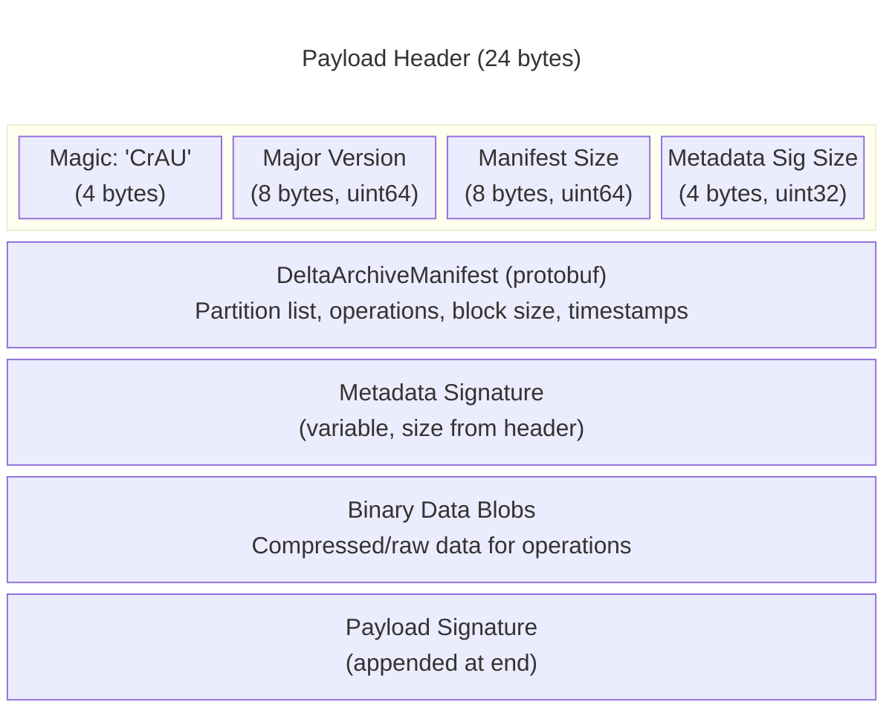

头部字段在 `PayloadMetadata::ParsePayloadHeader` 中解析：

```cpp
// payload_metadata.cc
const uint64_t PayloadMetadata::kDeltaVersionOffset = sizeof(kDeltaMagic); // 4
const uint64_t PayloadMetadata::kDeltaVersionSize = 8;
const uint64_t PayloadMetadata::kDeltaManifestSizeOffset =
    kDeltaVersionOffset + kDeltaVersionSize;                               // 12
const uint64_t PayloadMetadata::kDeltaManifestSizeSize = 8;
const uint64_t PayloadMetadata::kDeltaMetadataSignatureSizeSize = 4;
// Total header: 4 + 8 + 8 + 4 = 24 bytes
```

魔数字节 `CrAU` 源自 Chrome OS Update 格式：

```cpp
// payload_constants.cc
const char kDeltaMagic[4] = {'C', 'r', 'A', 'U'};
```

### 55.3.2 主版本号与次版本号

负载格式有两个版本号：

**主版本号**标识整体格式。目前只支持版本 2（Brillo）：

```cpp
const uint64_t kBrilloMajorPayloadVersion = 2;
const uint64_t kMinSupportedMajorPayloadVersion = kBrilloMajorPayloadVersion;
const uint64_t kMaxSupportedMajorPayloadVersion = kBrilloMajorPayloadVersion;
```

**次版本号**标识支持的操作和特性集合：

| 次版本号 | 常量 | 特性 |
|--------------|----------|---------|
| 0 | `kFullPayloadMinorVersion` | 全量负载（不需要源） |
| 2 | `kSourceMinorPayloadVersion` | 基于源的增量（A 到 B） |
| 3 | `kOpSrcHashMinorPayloadVersion` | 按操作的源哈希 |
| 4 | `kBrotliBsdiffMinorPayloadVersion` | BROTLI_BSDIFF、ZERO、DISCARD |
| 5 | `kPuffdiffMinorPayloadVersion` | PUFFDIFF 操作 |
| 6 | `kVerityMinorPayloadVersion` | Verity 哈希树 + FEC 生成 |
| 7 | `kPartialUpdateMinorPayloadVersion` | 部分更新（例如仅内核） |
| 8 | `kZucchiniMinorPayloadVersion` | ZUCCHINI 二进制差异 |
| 9 | `kLZ4DIFFMinorPayloadVersion` | 用于 EROFS 的 LZ4DIFF |
| 10 | `kZstdMinorPayloadVersion` | REPLACE_ZSTD（zstd 压缩的 REPLACE） |

```
Source: system/update_engine/payload_consumer/payload_constants.h
```

Android 17 增加了次版本号 10（`kZstdMinorPayloadVersion`），`kMaxSupportedMinorPayloadVersion` 现在是 `kZstdMinorPayloadVersion`。负载的次版本号是它所用特性的最高版本。设备拒绝任何次版本号超过其最大支持值的负载（`kUnsupportedMinorPayloadVersion`，错误 45）。

### 55.3.3 DeltaArchiveManifest

清单是一个 protobuf 消息，描述生成目标镜像所需的每个分区和每个操作。关键字段包括：

```protobuf
message DeltaArchiveManifest {
  repeated PartitionUpdate partitions = 13;
  uint32 block_size = 3;           // Typically 4096
  uint32 minor_version = 12;
  uint64 max_timestamp = 14;       // Anti-rollback timestamp
  DynamicPartitionMetadata dynamic_partition_metadata = 15;
}

message PartitionUpdate {
  string partition_name = 1;
  PartitionInfo old_partition_info = 6;
  PartitionInfo new_partition_info = 7;
  repeated InstallOperation operations = 8;
  // Verity/FEC fields ...
  repeated CowMergeOperation merge_operations = 18;
}

message InstallOperation {
  enum Type {
    REPLACE = 0;
    REPLACE_BZ = 1;
    SOURCE_COPY = 4;
    SOURCE_BSDIFF = 5;
    ZERO = 6;
    DISCARD = 7;
    REPLACE_XZ = 8;
    PUFFDIFF = 9;
    BROTLI_BSDIFF = 10;
    ZUCCHINI = 11;
    LZ4DIFF_BSDIFF = 12;
    LZ4DIFF_PUFFDIFF = 13;
    REPLACE_ZSTD = 14;  // Android 17: write zstd-decompressed data
  }
  Type type = 1;
  uint64 data_offset = 2;
  uint64 data_length = 3;
  repeated Extent src_extents = 4;
  repeated Extent dst_extents = 6;
  bytes data_sha256_hash = 8;
  bytes src_sha256_hash = 9;
}
```

### 55.3.4 安装操作类型

每个操作将源块转换为目标块：

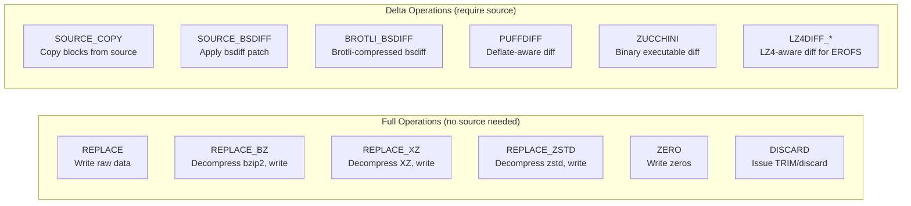

| 操作 | 需要源 | 描述 |
|-----------|---------------|-------------|
| `REPLACE` | 否 | 将原始未压缩数据写入目标 extent |
| `REPLACE_BZ` | 否 | 解压 bzip2 块，写入目标 |
| `REPLACE_XZ` | 否 | 解压 XZ 块，写入目标 |
| `REPLACE_ZSTD` | 否 | 解压 zstd 块，写入目标（Android 17） |
| `ZERO` | 否 | 用零填充目标 extent |
| `DISCARD` | 否 | 向目标 extent 发出 discard/trim |
| `SOURCE_COPY` | 是 | 将 extent 从源复制到目标 |
| `SOURCE_BSDIFF` | 是 | 读取源，应用 bsdiff 补丁，写入目标 |
| `BROTLI_BSDIFF` | 是 | 类似 SOURCE_BSDIFF，但块经过 Brotli 压缩 |
| `PUFFDIFF` | 是 | 感知 deflate 的差异——处理 gzip/zlib 流 |
| `ZUCCHINI` | 是 | 感知可执行文件的二进制差异 |
| `LZ4DIFF_BSDIFF` | 是 | LZ4 压缩的块差异（EROFS 优化） |
| `LZ4DIFF_PUFFDIFF` | 是 | LZ4 + puffdiff 组合 |

### 55.3.5 全量负载与增量负载

**全量负载**包含完整的目标镜像。每个操作都是 `REPLACE` 变体、`ZERO` 或 `DISCARD` 之一。不需要源分区。次版本号为 0（`kFullPayloadMinorVersion`）。全量负载更大，但可以更新任何设备而不论其当前状态。

**增量（delta）负载**只编码已知源镜像与目标之间的差异。它们使用引用源块的 `SOURCE_COPY`、`SOURCE_BSDIFF`、`PUFFDIFF`、`ZUCCHINI` 及类似操作。增量负载小得多（通常 50-200 MB，而全量负载为 2-4 GB）。但它们要求设备运行完全相同的源构建。

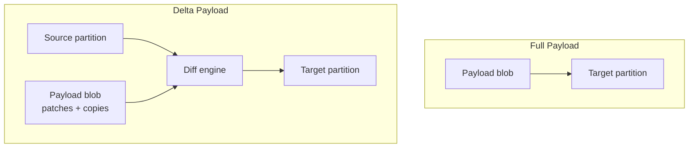

### 55.3.6 负载签名与验证

负载经过加密签名以防止篡改：

1. **元数据签名**：对头部 + 清单签名，在解析清单之前验证，以防止利用 protobuf 解析漏洞。
2. **负载签名**：对整个负载（不含签名本身）签名，在所有操作应用完成后验证。

```
Source: system/update_engine/payload_consumer/payload_verifier.h
```

设备在 `/system/etc/security/otacerts.zip`（或 `kUpdateCertificatesPath` 指定的路径）中携带可信证书。验证期间，`PayloadVerifier` 从这些证书中提取公钥并验证 RSA/EC 签名。

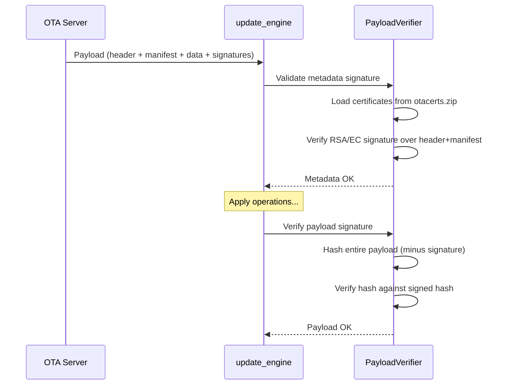

---

## 55.4 DeltaPerformer

`DeltaPerformer` 是真正将负载操作应用到目标分区的核心类。它实现 `FileWriter` 接口，在负载被下载的同时增量地接收负载字节。

### 55.4.1 流式应用

```
Source: system/update_engine/payload_consumer/delta_performer.h
        system/update_engine/payload_consumer/delta_performer.cc
```

随着负载块从网络到达，`DeltaPerformer::Write()` 被反复调用。performer 维护内部状态以跟踪它在解析/应用过程中的位置：

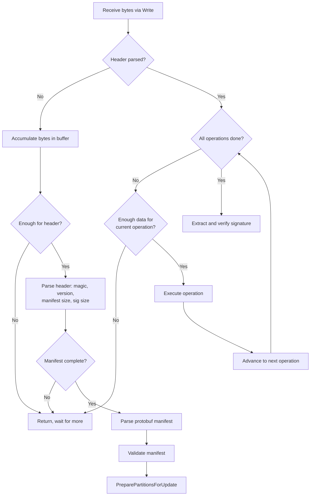

performer 中的关键状态变量：

```cpp
class DeltaPerformer : public FileWriter {
  DeltaArchiveManifest manifest_;
  bool manifest_parsed_{false};
  bool manifest_valid_{false};

  std::vector<PartitionUpdate> partitions_;
  size_t current_partition_{0};
  size_t next_operation_num_{0};
  size_t num_total_operations_{0};

  brillo::Blob buffer_;             // Accumulates incoming data
  uint64_t buffer_offset_{0};       // Offset in blob section
  uint32_t block_size_{0};          // From manifest (usually 4096)

  HashCalculator payload_hash_calculator_;
  HashCalculator signed_hash_calculator_;
};
```

### 55.4.2 操作分发

一旦清单解析完成并且分区准备就绪，每个操作会根据其类型被分发：

```cpp
bool DeltaPerformer::ProcessOperation(const InstallOperation* op,
                                      ErrorCode* error) {
  // ...
  switch (op->type()) {
    case InstallOperation::REPLACE:
    case InstallOperation::REPLACE_BZ:
    case InstallOperation::REPLACE_XZ:
    case InstallOperation::REPLACE_ZSTD:   // Android 17
      return PerformReplaceOperation(*op);
    case InstallOperation::ZERO:
    case InstallOperation::DISCARD:
      return PerformZeroOrDiscardOperation(*op);
    case InstallOperation::SOURCE_COPY:
      return PerformSourceCopyOperation(*op, error);
    case InstallOperation::SOURCE_BSDIFF:
    case InstallOperation::BROTLI_BSDIFF:
    case InstallOperation::PUFFDIFF:
    case InstallOperation::ZUCCHINI:
    case InstallOperation::LZ4DIFF_BSDIFF:
    case InstallOperation::LZ4DIFF_PUFFDIFF:
      return PerformDiffOperation(*op, error);
    // ...
  }
}
```

`REPLACE_*` 操作的解压通过在分区写入器之上堆叠正确的 `ExtentWriter` 来实现。`InstallOperationExecutor::ExecuteReplaceOperation` 会根据操作类型，把基础写入器包装在 `BzipExtentWriter`、`XzExtentWriter`，或——Android 17 新增的——`ZstdExtentWriter` 中。然后把解压后的字节写入目标 extent：

```
Source: system/update_engine/payload_consumer/install_operation_executor.cc
        system/update_engine/payload_consumer/zstd_extent_writer.cc
```

```cpp
if (operation.type() == InstallOperation::REPLACE_BZ) {
  writer = std::make_unique<BzipExtentWriter>(std::move(writer));
} else if (operation.type() == InstallOperation::REPLACE_XZ) {
  writer = std::make_unique<XzExtentWriter>(std::move(writer));
} else if (operation.type() == InstallOperation::REPLACE_ZSTD) {
  writer = std::make_unique<ZstdExtentWriter>(std::move(writer));
}
```

`ZstdExtentWriter` 将传入的字节送入流式 `ZSTD_DStream`，并把解压后的输出转发给堆栈中的下一个写入器。

### 55.4.3 分区写入器

实际 I/O 委托给 `PartitionWriterInterface` 的实现。对于标准 A/B 更新，`PartitionWriter` 直接写入块设备。对于带压缩的 Virtual A/B，`VABCPartitionWriter` 通过 COW 写入器写入。

```
Source: system/update_engine/payload_consumer/vabc_partition_writer.h
```

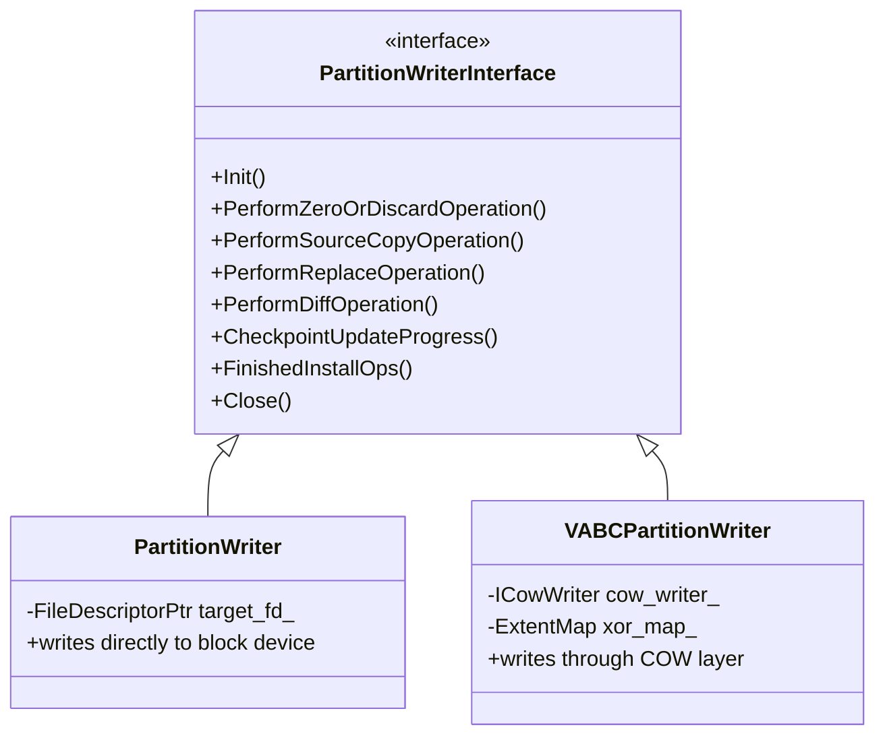

VABC 分区写入器把 OTA 操作转换为 COW 操作：

| OTA 操作 | COW 操作 |
|--------------|---------------|
| `ZERO` | `COW_ZERO` |
| `SOURCE_COPY` | `COW_COPY` |
| `REPLACE` / `*_BSDIFF` / 等 | `COW_REPLACE` |

### 55.4.4 检查点与恢复

`DeltaPerformer` 支持恢复中断的更新。它会周期性地（每 `kCheckpointFrequencySeconds`）把进度保存到持久首选项：

```cpp
bool DeltaPerformer::CheckpointUpdateProgress(bool force) {
  // ...
  // Saves the running payload hash contexts, the next data offset/length,
  // and the signature blob into persistent prefs
  // (kPrefsUpdateStateSHA256Context, kPrefsUpdateStateNextDataOffset, ...),
  // then lets the partition writer checkpoint its own progress:
  if (partition_writer_) {
    partition_writer_->CheckpointUpdateProgress(GetPartitionOperationNum());
  }
  // ...
  TEST_AND_RETURN_FALSE(
      prefs_->SetInt64(kPrefsUpdateStateNextOperation, next_operation_num_));
  // ...
}
```

恢复时，`CanResumeUpdate()` 将存储的负载哈希与新负载的哈希比较，以判断检查点是否仍然有效。

当设备在更新中途重启（断电、崩溃）时，下一次 `ApplyPayload` 调用会检测到存储的检查点。它从中断处继续，并跳过已应用的操作。

---

## 55.5 A/B 更新：槽位切换与回滚

### 55.5.1 Boot Control HAL

槽位管理层在 `BootControlInterface` 后面被抽象：

```
Source: system/update_engine/common/boot_control_interface.h
```

```cpp
class BootControlInterface {
 public:
  using Slot = unsigned int;
  static const Slot kInvalidSlot = UINT_MAX;

  virtual unsigned int GetNumSlots() const = 0;
  virtual Slot GetCurrentSlot() const = 0;
  virtual bool GetPartitionDevice(const std::string& partition_name,
                                  Slot slot, std::string* device) const = 0;
  virtual bool IsSlotBootable(Slot slot) const = 0;
  virtual bool MarkSlotUnbootable(Slot slot) = 0;
  virtual bool SetActiveBootSlot(Slot slot) = 0;
  virtual Slot GetActiveBootSlot() = 0;
  virtual bool MarkBootSuccessfulAsync(
      base::Callback<void(bool)> callback) = 0;
  virtual bool IsSlotMarkedSuccessful(Slot slot) const = 0;
};
```

在 Android 上，`BootControlAndroid` 通过 Boot Control HAL（`IBootControl`）实现这一点：

```
Source: system/update_engine/aosp/boot_control_android.h
```

```cpp
class BootControlAndroid final : public BootControlInterface {
  std::unique_ptr<android::hal::BootControlClient> module_;
  std::unique_ptr<DynamicPartitionControlAndroid> dynamic_control_;
};
```

### 55.5.2 槽位命名约定

AOSP 支持最多 26 个槽位（A 到 Z），尽管实践中只使用 2 个：

```cpp
static std::string SlotName(Slot slot) {
  if (slot == kInvalidSlot) return "INVALID";
  if (slot < 26) return std::string(1, 'A' + slot);
  return "TOO_BIG";
}
```

分区名带有后缀：`system_a`、`system_b`、`boot_a`、`boot_b` 等。

### 55.5.3 A/B 更新生命周期

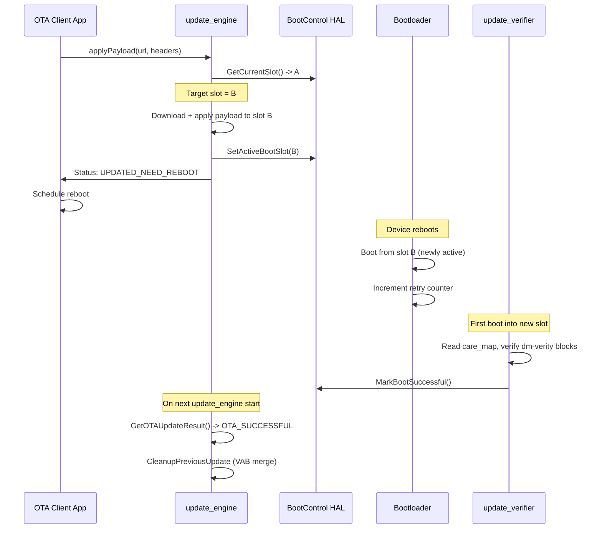

### 55.5.4 引导加载程序集成

引导加载程序维护按槽位的元数据：

| 字段 | 描述 |
|-------|-------------|
| `bootable` | 该槽位能否启动 |
| `successful` | 该槽位是否已通过验证 |
| `active` | 下一次启动哪个槽位 |
| `retry_count` | 标记为不可启动前剩余的启动尝试次数 |

启动流程：

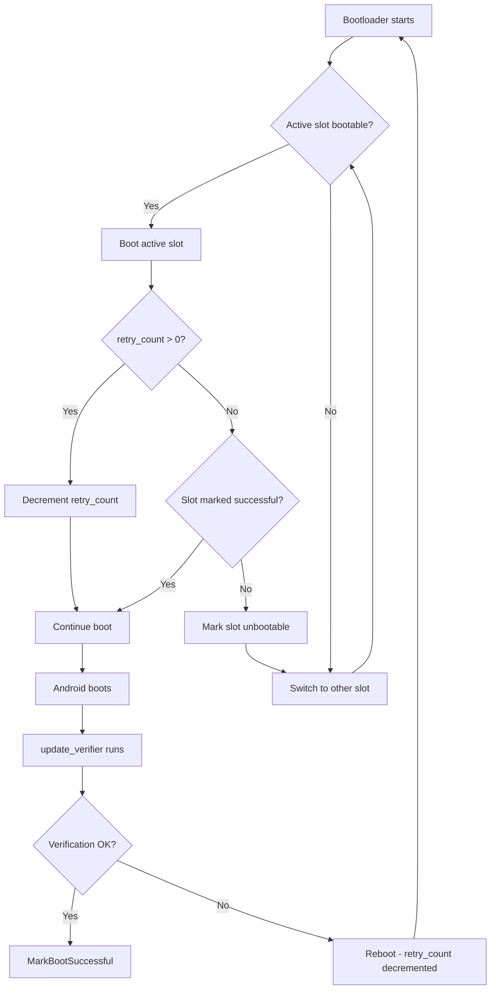

### 55.5.5 回滚机制

回滚是自动的，无需用户干预：

1. **启动失败**：如果设备根本无法启动新槽位，引导加载程序的重试计数器会归零，然后它切回去。
2. **验证失败**：`update_verifier` 读取 `care_map` 中列出的所有块，并依赖 dm-verity 检测损坏。如果任何读取失败，设备重启。失败次数足够多后，引导加载程序会把该槽位标记为不可启动。
3. **显式回滚**：可以要求 `update_engine` 通过再次把上一个槽位标记为活动来回滚，但这通常不会暴露给用户。

```
Source: bootable/recovery/update_verifier/update_verifier.cpp
```

```cpp
// update_verifier relies on device-mapper-verity (dm-verity) to capture
// any corruption on the partitions being verified. The verification will
// be skipped if dm-verity is not enabled on the device.
//
// Upon detecting verification failures, the device will be rebooted.
```

### 55.5.6 care_map

`care_map` 是一个 protobuf 文件，列出每个分区上哪些块包含有意义的数据（相对于空闲/未使用空间）。`update_verifier` 只读取这些"care"块来触发 dm-verity 验证，而无需读取整个分区：

```protobuf
// bootable/recovery/update_verifier/care_map.proto
message CareMap {
  message PartitionInfo {
    string name = 1;
    string ranges = 2;        // Block ranges, e.g., "0-1000,2000-3000"
    string id = 3;            // Hash/id
    string fingerprint = 4;   // Build fingerprint
  }
  repeated PartitionInfo partitions = 1;
}
```

---

## 55.6 Virtual A/B 更新

Virtual A/B 是最复杂的更新方案。它通过使用写时复制（COW）快照，在提供 A/B 无缝更新体验的同时，使用与非 A/B 大致相同的存储。

### 55.6.1 架构概述

```
Source: system/fs/fs_mgr/libsnapshot/
        system/update_engine/aosp/dynamic_partition_control_android.h
```

关键洞见：Virtual A/B 不保留每个分区的完整副本。它只存储运行中（源）版本与已更新（目标）版本之间的*差异*。这些差异以 COW 格式存储。一个守护进程（`snapuserd`）向系统其余部分呈现基础分区 + COW 数据的合并视图。

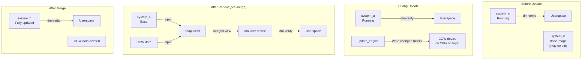

### 55.6.2 动态分区与 super

Virtual A/B 构建在*动态分区*特性（Android 10 引入）之上，该特性使用一个包含逻辑卷元数据的"super"分区。super 分区是一个物理分区，其中包含一个类似 GPT 的元数据表（LpMetadata），描述其中的逻辑分区（system、vendor、product 等）。

对于 Virtual A/B，逻辑分区在元数据中有 A 和 B 条目，但实际数据可以重叠。这是因为非活动槽位在创建 COW 之前可能并不物理存在。

### 55.6.3 快照管理器

`ISnapshotManager` 接口（由 `SnapshotManager` 实现）协调快照的创建、合并和清理：

```
Source: system/fs/fs_mgr/libsnapshot/include/libsnapshot/snapshot.h
```

```cpp
class ISnapshotManager {
 public:
  virtual bool BeginUpdate() = 0;
  virtual bool CancelUpdate() = 0;
  virtual bool FinishedSnapshotWrites(bool wipe) = 0;
  // Map a snapshotted partition for the first stage of init.
  virtual bool MapAllSnapshots(const std::chrono::milliseconds& timeout) = 0;
  virtual bool UnmapAllSnapshots() = 0;
  // Initiate merge of all snapshots.
  virtual bool InitiateMerge() = 0;
  // Process the merge (called repeatedly until complete).
  virtual UpdateState ProcessUpdateState(
      const std::function<bool()>& callback,
      const std::function<bool()>& before_cancel) = 0;
  // Get overall update state.
  virtual UpdateState GetUpdateState(double* progress = nullptr) = 0;
};
```

### 55.6.4 COW 格式

写时复制格式高效地存储已修改的块。AOSP 对此格式进行了多次迭代；v2 和 v3 都仍可读取，而 Android 17 写入器（`CowWriterV3`）输出 v3 布局（`header_.prefix.major_version = 3`）：

```
Source: system/fs/fs_mgr/libsnapshot/libsnapshot_cow/writer_v3.cpp
        system/fs/fs_mgr/libsnapshot/libsnapshot_cow/cow_format.cpp
```

v3 格式携带按操作的压缩元数据。因此，单个 COW 镜像可以混合未压缩、lz4 和 zstd 块。该格式还支持由 `--compression_factor`（4k 到 256k）选择的更大压缩系数。

COW 操作：

| 操作 | 描述 |
|-----------|-------------|
| `COW_COPY` | 块未更改；从源读取 |
| `COW_REPLACE` | 块被替换；COW 中包含完整的新数据 |
| `COW_ZERO` | 块全为零 |
| `COW_XOR` | 块轻微更改；存储 XOR 增量 |
| `COW_LABEL` | 用于崩溃恢复的检查点标记 |

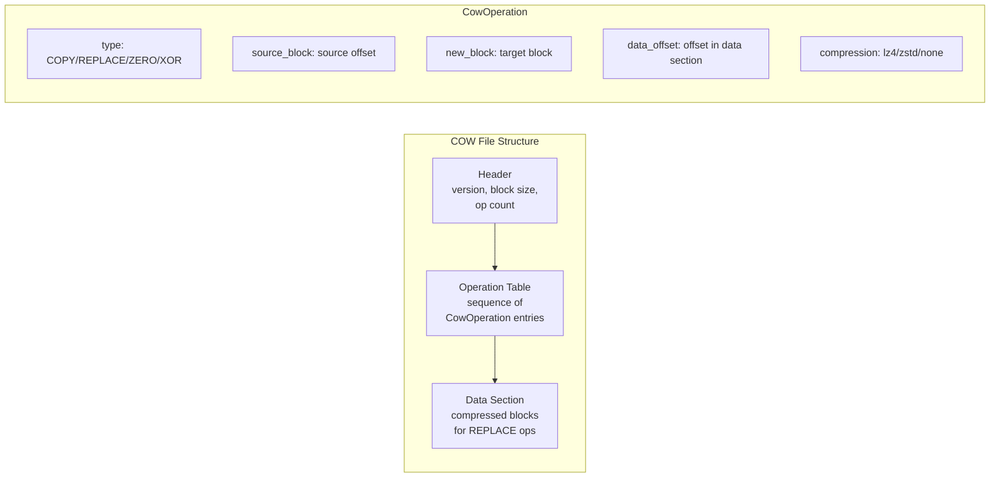

### 55.6.5 snapuserd

`snapuserd` 是提供快照块设备的用户空间守护进程。它在启动过程中非常早地运行（第一阶段 init）。它通过用户空间块设备向内核呈现基础分区 + COW 数据的合并视图。该块设备在 `IBlockServer` 接口后面被抽象。历史上唯一的后端是 `dm-user`。Android 17 增加了一个 `ublk` 后端，守护进程可以在启动时选择它（见 55.26 节）。

该接口位于 `snapuserd/include/snapuserd/block_server.h`。两个实现是 `dm_user_block_server.cpp` 和 `ublk_block_server.cpp`。

```
Source: system/fs/fs_mgr/libsnapshot/snapuserd/
        system/fs/fs_mgr/libsnapshot/snapuserd/user-space-merge/
        system/fs/fs_mgr/libsnapshot/snapuserd/include/snapuserd/block_server.h
```

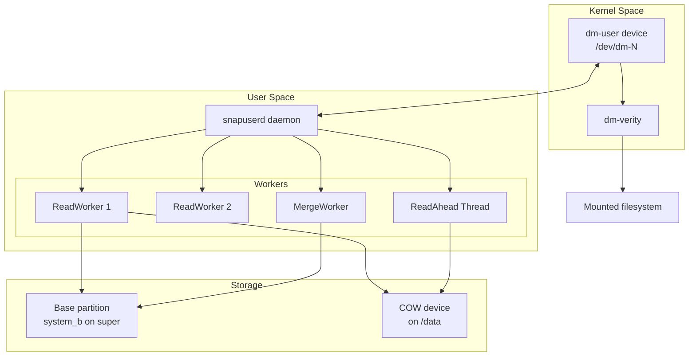

`SnapshotHandler` 类管理单个分区快照：

```cpp
// snapuserd_core.h
class SnapshotHandler : public std::enable_shared_from_this<SnapshotHandler> {
 public:
  SnapshotHandler(std::string misc_name,
                  std::string cow_device,
                  std::string backing_device,
                  std::string base_path_merge,
                  std::shared_ptr<IBlockServerOpener> opener,
                  HandlerOptions options);

  bool InitCowDevice();
  bool Start();
  bool InitializeWorkers();
  // ...
};
```

### 55.6.6 合并过程

设备启动进入新槽位并且 `update_verifier` 确认完整性后，COW 数据必须被*合并*进基础分区。这会永久应用更新并释放 COW 存储。

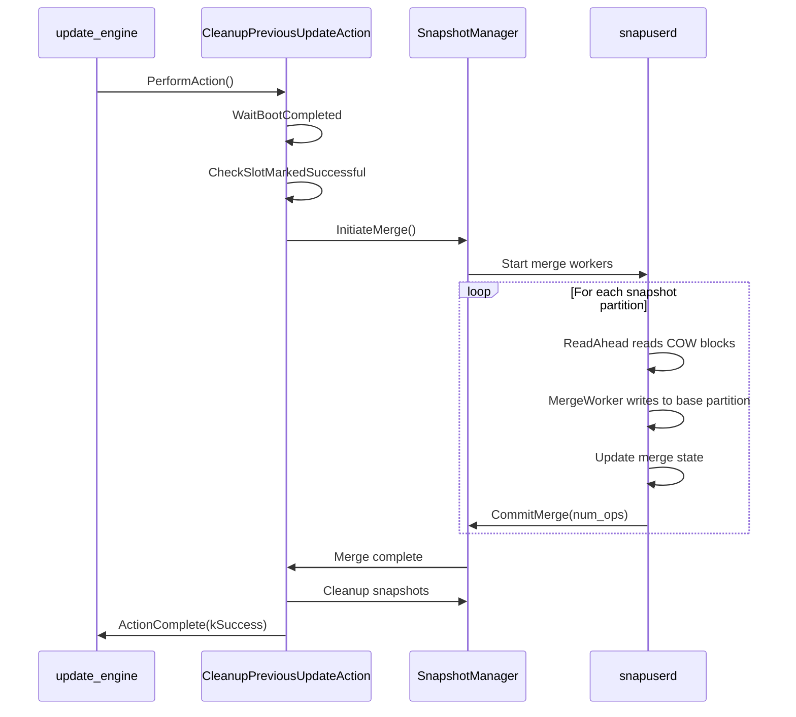

合并在后台进行，由 `CleanupPreviousUpdateAction` 编排：

```
Source: system/update_engine/aosp/cleanup_previous_update_action.h
```

```cpp
class CleanupPreviousUpdateAction : public Action<...> {
  void PerformAction() override;
  // Internal flow:
  // 1. ScheduleWaitBootCompleted
  // 2. CheckSlotMarkedSuccessfulOrSchedule
  // 3. StartMerge -> InitiateMergeAndWait
  // 4. WaitForMergeOrSchedule (polls merge progress)
  // 5. ReportMergeStats
};
```

### 55.6.7 合并状态机

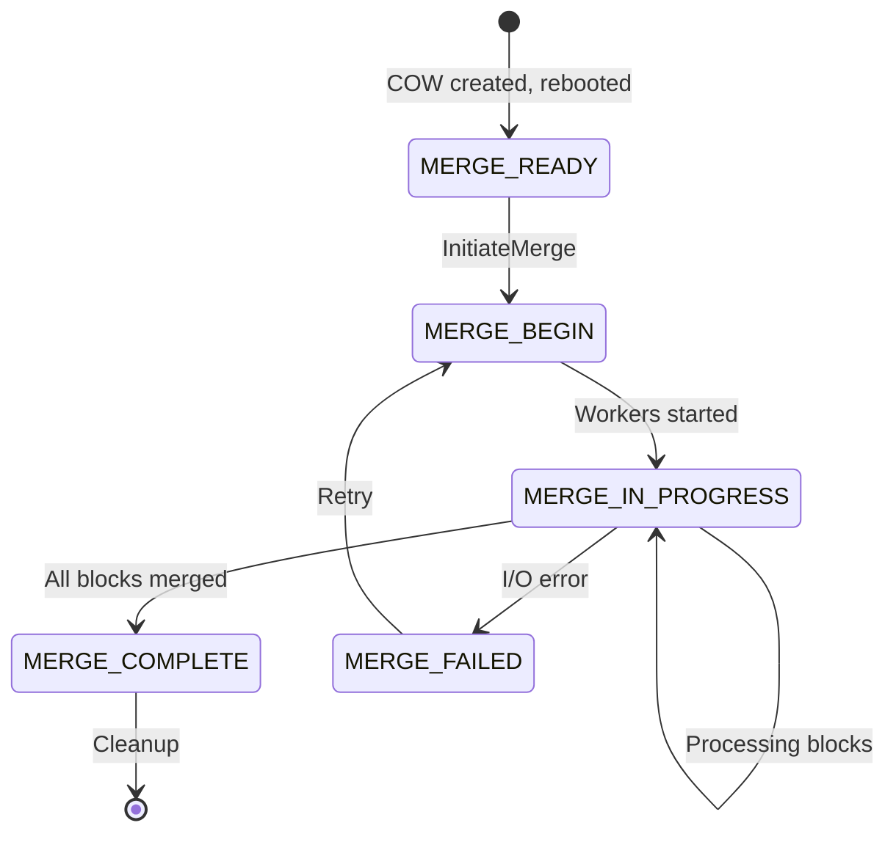

在 `snapuserd` 内部，按块组的合并状态跟踪细粒度进度：

```cpp
enum class MERGE_GROUP_STATE {
    GROUP_MERGE_PENDING,
    GROUP_MERGE_RA_READY,
    GROUP_MERGE_IN_PROGRESS,
    GROUP_MERGE_COMPLETED,
    GROUP_MERGE_FAILED,
    GROUP_INVALID,
};
```

### 55.6.8 压缩与 XOR

Virtual A/B 压缩（VABC）压缩 COW 数据以减少空间占用。支持的压缩算法：

| 算法 | 属性值 | 特性 |
|-----------|---------------|-----------------|
| LZ4 | `lz4` | 解压快，压缩率适中 |
| Zstandard | `zstd` | 压缩率更好，速度良好 |
| 无 | `none` | 不压缩 |

XOR 压缩（`ro.virtual_ab.compression.xor.enabled=true`）通过存储 XOR 增量而非完整替换块，进一步减小 COW 体积。一个块可能只轻微改变（例如头部中的某个时间戳）。在这种情况下，旧块和新块的 XOR 比完整的新块压缩得好得多。

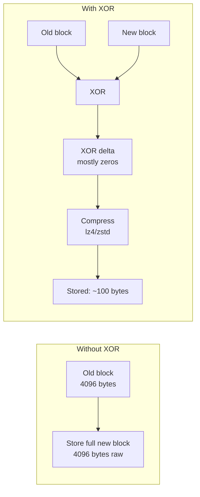

### 55.6.9 空间分配

更新开始前，`update_engine` 必须确保有足够的空间用于 COW 数据。这由 `AllocateSpaceForPayload` 处理：

```cpp
// update_attempter_android.h
uint64_t AllocateSpaceForPayload(
    const std::string& metadata_filename,
    const std::vector<std::string>& key_value_pair_headers,
    Error* error) override;
```

COW 数据可以存储在：

- **super 分区空闲空间**：如果 super 分区有未使用的容量。
- **userdata 分区**：`/data` 分区提供溢出存储。

系统检查 `ro.virtual_ab.compression.enabled` 并基于负载清单估算 COW 大小。如果空间不足，API 返回所需大小，框架可以提示用户释放空间。

---

## 55.7 负载生成

OTA 负载使用 Python 脚本和原生工具在构建服务器上生成。

### 55.7.1 ota_from_target_files

OTA 生成的主要入口点：

```
Source: build/make/tools/releasetools/ota_from_target_files.py
```

用法：
```bash
# Full OTA
ota_from_target_files target-files.zip ota_package.zip

# Incremental OTA
ota_from_target_files -i source-target-files.zip \
    target-target-files.zip ota_package.zip
```

该脚本支持众多选项：

```python
# Key options (from source)
OPTIONS.wipe_user_data = False
OPTIONS.worker_threads = multiprocessing.cpu_count() // 2
OPTIONS.two_step = False
OPTIONS.include_secondary = False
OPTIONS.block_based = True
OPTIONS.disable_vabc = False
OPTIONS.enable_vabc_xor = True
OPTIONS.enable_zucchini = False
OPTIONS.enable_puffdiff = None
OPTIONS.enable_lz4diff = False
OPTIONS.vabc_compression_param = None    # lz4, zstd, none
OPTIONS.max_threads = None
OPTIONS.vabc_cow_version = None
OPTIONS.compression_factor = None        # 4k-256k
OPTIONS.enable_replace_zstd = False      # Android 17: zstd for REPLACE ops
```

`--enable_replace_zstd` 标志（Android 17 新增）使 `delta_generator` 输出 `REPLACE_ZSTD` 操作而非普通的 `REPLACE`。这让全量负载以及增量负载中的全量部分更小。它作为 `--enable_replace_zstd=true` 透传给原生生成器，并被 `--disable_replace_compression` 互斥禁用。

生成期间引用的关键常量：

```python
POSTINSTALL_CONFIG = 'META/postinstall_config.txt'
DYNAMIC_PARTITION_INFO = 'META/dynamic_partitions_info.txt'
MISC_INFO = 'META/misc_info.txt'
AB_PARTITIONS = 'META/ab_partitions.txt'
```

### 55.7.2 生成流程

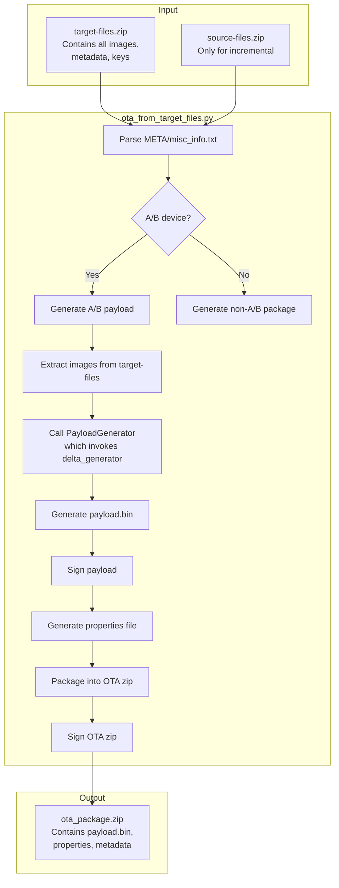

### 55.7.3 brillo_update_payload

用于直接操作负载的底层 shell 脚本：

```
Source: system/update_engine/scripts/brillo_update_payload
```

命令：
```bash
# Generate unsigned payload
brillo_update_payload generate \
    --payload output.bin \
    --target_image target.img \
    [--source_image source.img]   # Omit for full payload

# Generate hash for signing
brillo_update_payload hash \
    --unsigned_payload payload.bin \
    --signature_size 256 \
    --payload_hash_file payload_hash \
    --metadata_hash_file metadata_hash

# Insert signatures
brillo_update_payload sign \
    --unsigned_payload unsigned.bin \
    --payload signed.bin \
    --signature_size 256 \
    --payload_signature_file payload.sig \
    --metadata_signature_file metadata.sig

# Extract properties
brillo_update_payload properties \
    --payload signed.bin \
    --properties_file props.txt

# Verify payload
brillo_update_payload verify \
    --payload signed.bin \
    --target_image target.img \
    [--source_image source.img]
```

### 55.7.4 delta_generator

执行实际差异计算的原生二进制文件：

```
Source: system/update_engine/payload_generator/generate_delta_main.cc
        system/update_engine/payload_generator/delta_diff_generator.h
```

```cpp
// delta_diff_generator.h
bool GenerateUpdatePayloadFile(const PayloadGenerationConfig& config,
                               const std::string& output_path,
                               const std::string& private_key_path,
                               uint64_t* metadata_size);
```

对每个分区，`delta_generator`：

1. 读取源镜像和目标镜像。
2. 识别文件系统类型（ext4、EROFS 等）。
3. 按文件对块分组以获得更好的差异效果。
4. 为每个块范围选择最佳差异算法：
   - 相同块使用 `SOURCE_COPY`。
   - 零填充块使用 `ZERO`。
   - 根据内容类型和启用的特性使用 `BSDIFF`、`PUFFDIFF`、`ZUCCHINI` 或 `LZ4DIFF`。
   - 回退使用 `REPLACE`（带压缩）。
5. 将操作和数据块序列化为负载格式。

### 55.7.5 差异算法选择

```mermaid
flowchart TD
    A[Block range to encode] --> B{Identical to source?}
    B -->|Yes| C[SOURCE_COPY]
    B -->|No| D{All zeros?}
    D -->|Yes| E[ZERO]
    D -->|No| F{"LZ4-compressed<br/>EROFS block?"}
    F -->|Yes| G{LZ4DIFF enabled?}
    G -->|Yes| H["LZ4DIFF_BSDIFF or<br/>LZ4DIFF_PUFFDIFF"]
    G -->|No| I[Fall through]
    F -->|No| I
    I --> J{Deflate stream?}
    J -->|Yes| K{PUFFDIFF enabled?}
    K -->|Yes| L[PUFFDIFF]
    K -->|No| M[Fall through]
    J -->|No| M
    M --> N{Executable code?}
    N -->|Yes| O{ZUCCHINI enabled?}
    O -->|Yes| P[ZUCCHINI]
    O -->|No| Q[BROTLI_BSDIFF]
    N -->|No| Q
    Q --> R{"Diff smaller than<br/>REPLACE?"}
    R -->|Yes| S[Use diff]
    R -->|No| T[REPLACE with compression]
```

### 55.7.6 OTA 包结构

对于 A/B 设备，输出的 OTA zip 包含：

```
ota_package.zip
    payload.bin                    -- The binary payload
    payload_properties.txt         -- Key-value metadata
    META-INF/
        com/android/metadata       -- Package metadata
        com/android/metadata.pb    -- Protobuf metadata
    care_map.pb                    -- Block care map for verification
```

`payload_properties.txt` 包含客户端所需的值：

```
FILE_HASH=<sha256>
FILE_SIZE=<bytes>
METADATA_HASH=<sha256>
METADATA_SIZE=<bytes>
```

对于非 A/B 设备，zip 包含传统的 updater-script 和 update-binary，而不是 payload.bin。

---

## 55.8 流式更新

A/B 的一个关键优势是支持*流式*更新——负载可以在下载时就被应用，而无需先保存整个文件。

### 55.8.1 下载架构

```mermaid
flowchart LR
    subgraph "Network"
        SERVER["OTA Server<br/>HTTPS"]
    end

    subgraph "update_engine"
        FETCHER["HttpFetcher<br/>libcurl-based"]
        DA[DownloadAction]
        DP[DeltaPerformer]
    end

    subgraph "Storage"
        TARGET["Target partition<br/>or COW device"]
    end

    SERVER -->|HTTP GET with Range| FETCHER
    FETCHER -->|byte chunks| DA
    DA -->|"Write()"| DP
    DP -->|block writes| TARGET
```

`LibcurlHttpFetcher` 处理：

- 带 TLS 的 HTTP/HTTPS 下载。
- 用于恢复中断下载的 Range 请求。
- 通过 `NetworkSelectorInterface` 进行网络选择（蜂窝网络 vs. Wi-Fi）。

### 55.8.2 流式流程

因为 `DeltaPerformer` 增量地处理负载：

1. 它从第一个块中解析头部（24 字节）。
2. 它累积字节，直到获得完整的清单。
3. 它解析清单并准备分区。
4. 对每个后续操作，它等待足够的数据块字节到达，然后立即应用该操作。

5. 写入是流水线化的：当一个操作的数据正被写入目标时，下一个操作的数据正被下载。

这意味着设备永远不需要等于完整负载大小的空闲空间。`DeltaPerformer::buffer_` 缓冲区只保存当前操作的数据。

### 55.8.3 基于文件描述符的更新

除了基于 URL 的流式传输，更新还可以从本地文件描述符应用：

```java
// UpdateEngine.java
updateEngine.applyPayloadFd(fd, offset, size, headerKeyValuePairs);
```

这用于：

- ADB sideload：`adb sideload ota_package.zip`
- SD 卡安装
- OTA 客户端应用下载到本地存储的更新

### 55.8.4 网络考虑

更新引擎支持：

- **暂停/恢复**：如果设备失去连接，下载会暂停。恢复时，它使用 HTTP Range 头从中断处继续。
- **多网络**：`NETWORK_ID` 头允许指定使用哪个网络接口。
- **计量网络感知**：OTA 客户端（而非 update_engine 本身）通常决定是否通过计量连接下载。

---

## 55.9 恢复模式

虽然 A/B 和 Virtual A/B 更新避免了恢复模式，但它仍是非 A/B 更新的机制，并提供重要的回退功能。

### 55.9.1 恢复架构

```
Source: bootable/recovery/recovery_main.cpp
        bootable/recovery/recovery.cpp
```

恢复模式是一个最小 Linux 环境，拥有自己的 init、UI 和一套精简的实用程序。在非 A/B 设备上，它位于专用的 `recovery` 分区。在 A/B 设备上，它嵌入在 `boot` 或 `init_boot` 分区中，并在启动时提取。

```mermaid
flowchart TD
    subgraph "Bootloader"
        BL[Bootloader checks BCB]
    end

    subgraph "Recovery Environment"
        INIT[Recovery init]
        MAIN["recovery_main.cpp<br/>main()"]
        REC["recovery.cpp<br/>start_recovery()"]
        UI["RecoveryUI<br/>screen/text UI"]
        INSTALL["install.cpp<br/>InstallPackage()"]
        FASTBOOT["fastboot.cpp<br/>StartFastboot()"]
    end

    BL -->|boot-recovery| INIT
    INIT --> MAIN
    MAIN --> |--fastboot| FASTBOOT
    MAIN --> |default| REC
    REC --> UI
    REC --> INSTALL
```

### 55.9.2 Bootloader Control Block（BCB）

恢复模式通过 Bootloader Control Block 与主系统通信，这是 `misc` 分区中一个众所周知的结构：

```
Source: bootable/recovery/bootloader_message/
```

```cpp
struct bootloader_message {
    char command[32];     // "boot-recovery", "boot-fastboot", etc.
    char status[32];      // Status string (deprecated)
    char recovery[768];   // Recovery command args, newline-separated
    char stage[32];       // Multi-stage update progress
    char reserved[1184];  // Reserved for future use
};
```

BCB 协议：

1. 主系统把 `boot-recovery` 写入 `command`，把恢复参数写入 `recovery`。
2. 引导加载程序读取 `command` 并启动进入恢复模式。
3. 恢复模式从 BCB 读取其参数。
4. 完成后，恢复模式清除 BCB，使设备正常启动。

### 55.9.3 恢复命令

```
Source: bootable/recovery/recovery.cpp (start_recovery function)
```

恢复模式通过 BCB 或 `/cache/recovery/command` 接受这些命令：

| 命令 | 描述 |
|---------|-------------|
| `--update_package=<path>` | 安装 OTA 包 |
| `--install_with_fuse` | 对大型包使用 FUSE |
| `--wipe_data` | 恢复出厂设置 |
| `--wipe_cache` | 擦除 cache 分区 |
| `--prompt_and_wipe_data` | 显示损坏提示，提供重置 |
| `--sideload` | 进入 ADB sideload 模式 |
| `--sideload_auto_reboot` | sideload 后自动重启 |
| `--rescue` | 进入 rescue 模式 |
| `--just_exit` | 不做任何事，重启 |
| `--shutdown_after` | 关机而非重启 |
| `--show_text` | 显示文本模式 UI |

### 55.9.4 恢复模式中的 OTA 包安装

对于非 A/B 设备，恢复模式安装 OTA 包：

```mermaid
sequenceDiagram
    participant REC as recovery
    participant PKG as OTA Package
    participant UPD as update-binary/script

    REC->>PKG: Verify ZIP signature
    REC->>PKG: Extract update-binary
    REC->>UPD: Fork and exec update-binary
    UPD->>UPD: Parse updater-script (edify)
    UPD->>UPD: Apply block-level patches
    UPD->>REC: Report progress via pipe
    UPD->>REC: Exit with status
    REC->>REC: Clear BCB
    REC->>REC: Reboot
```

`install.cpp` 中的 `InstallPackage` 函数处理：

1. 使用 `/system/etc/security/otacerts.zip` 进行签名验证。
2. 提取并执行 `META-INF/com/google/android/update-binary`。
3. 通过管道监控进度（命令协议：`progress`、`set_progress`、`ui_print`）。
4. 重试逻辑（I/O 错误最多重试 4 次）。

```cpp
// install.cpp
static constexpr int kRecoveryApiVersion = 3;
static constexpr int VERIFICATION_PROGRESS_TIME = 60;
static constexpr float VERIFICATION_PROGRESS_FRACTION = 0.25;

// recovery.cpp -- RETRY_LIMIT for automatic retry on transient errors
static constexpr int RETRY_LIMIT = 4;
```

### 55.9.5 ADB Sideload

恢复模式支持通过 ADB 接收 OTA 包：

```bash
# On host
adb sideload ota_package.zip
```

处于 sideload 模式时，恢复模式启动一个迷你 ADB 守护进程（`minadbd`），通过 USB 接收包并把它提供给安装器。

### 55.9.6 恢复 UI

恢复模式提供文本/图形 UI 供用户交互：

```
Source: bootable/recovery/recovery_ui/
```

UI 支持：

- 通过音量键和电源键进行菜单导航。
- 安装和验证的进度条。
- 多种分辨率资源（`res-hdpi`、`res-xhdpi` 等）。
- 特定语言环境的文本覆盖。

菜单项（来自 `Device::GetMenuItems()`）：

| 项 | 操作 |
|------|--------|
| 现在重启系统 | `REBOOT` |
| 重启到引导加载程序 | `REBOOT_BOOTLOADER` |
| 进入 fastboot | `ENTER_FASTBOOT` |
| 从 ADB 应用更新 | `APPLY_ADB_SIDELOAD` |
| 从 SD 卡应用更新 | `APPLY_SDCARD` |
| 擦除数据/恢复出厂 | `WIPE_DATA` |
| 擦除 cache 分区 | `WIPE_CACHE` |
| 挂载 /system | `MOUNT_SYSTEM` |
| 查看恢复日志 | `VIEW_RECOVERY_LOGS` |
| 运行图形测试 | `RUN_GRAPHICS_TEST` |
| 关机 | `SHUTDOWN` |

### 55.9.7 恢复模式中的 Virtual A/B 感知

恢复模式感知 Virtual A/B 快照。挂载系统分区时，它会先设置快照设备：

```cpp
// recovery.cpp
case Device::MOUNT_SYSTEM:
  // For Virtual A/B, set up the snapshot devices (if exist).
  if (!CreateSnapshotPartitions()) {
    ui->Print("Virtual A/B: snapshot partitions creation failed.\n");
    break;
  }
  if (ensure_path_mounted_at(
      android::fs_mgr::GetSystemRoot(), "/mnt/system") != -1) {
    ui->Print("Mounted /system.\n");
  }
  break;
```

恢复模式还可以取消进行中的 Virtual A/B 更新（例如，当用户想 sideload 另一个 OTA 时）：

```cpp
// In ask_to_cancel_ota()
std::vector<std::string> headers{
  "Overwrite in-progress update?",
  "An update may already be in progress. If you proceed, "
  "the existing OS may not longer boot, and completing "
  "an update via ADB will be required."
};
```

---

## 55.10 框架集成：UpdateEngine API

### 55.10.1 UpdateEngine Java API

```
Source: frameworks/base/core/java/android/os/UpdateEngine.java
```

`UpdateEngine` 是一个 `@SystemApi` 类，包装了到 `update_engine` 的 Binder 接口。在 Google 设备上，GmsCore（Google Play 服务）是主要客户端。

```java
@SystemApi
public class UpdateEngine {
    private static final String UPDATE_ENGINE_SERVICE =
        "android.os.UpdateEngineService";

    // Usage flow:
    // 1. Create instance
    UpdateEngine engine = new UpdateEngine();

    // 2. Bind with callbacks
    engine.bind(new UpdateEngineCallback() {
        @Override
        public void onStatusUpdate(int status, float percent) {
            // Update UI
        }
        @Override
        public void onPayloadApplicationComplete(int errorCode) {
            // Handle completion
        }
    });

    // 3. Apply payload
    engine.applyPayload(url, offset, size, headerKeyValuePairs);
}
```

### 55.10.2 错误码

```
Source: frameworks/base/core/java/android/os/UpdateEngine.java
```

`ErrorCodeConstants` 类公开来自 `update_engine` 的错误码：

| 常量 | 值 | 含义 |
|----------|-------|---------|
| `SUCCESS` | 0 | 更新成功应用 |
| `ERROR` | 1 | 通用错误 |
| `FILESYSTEM_COPIER_ERROR` | 4 | 文件系统复制失败 |
| `POST_INSTALL_RUNNER_ERROR` | 5 | postinstall 脚本失败 |
| `PAYLOAD_MISMATCHED_TYPE_ERROR` | 6 | 负载不兼容 |
| `INSTALL_DEVICE_OPEN_ERROR` | 7 | 无法打开目标设备 |
| `KERNEL_DEVICE_OPEN_ERROR` | 8 | 无法打开内核设备 |
| `DOWNLOAD_TRANSFER_ERROR` | 9 | 网络下载失败 |
| `PAYLOAD_HASH_MISMATCH_ERROR` | 10 | 负载哈希不匹配 |
| `PAYLOAD_SIZE_MISMATCH_ERROR` | 11 | 负载大小不匹配 |
| `DOWNLOAD_PAYLOAD_VERIFICATION_ERROR` | 12 | 签名验证失败 |
| `PAYLOAD_TIMESTAMP_ERROR` | 51 | 防回滚时间戳违规 |
| `UPDATED_BUT_NOT_ACTIVE` | 52 | 已应用但槽位未切换 |

### 55.10.3 更新状态码

```java
public static final class UpdateStatusConstants {
    public static final int IDLE = 0;
    public static final int CHECKING_FOR_UPDATE = 1;
    public static final int UPDATE_AVAILABLE = 2;
    public static final int DOWNLOADING = 3;
    public static final int VERIFYING = 4;
    public static final int FINALIZING = 5;
    public static final int UPDATED_NEED_REBOOT = 6;
    public static final int REPORTING_ERROR_EVENT = 7;
    public static final int ATTEMPTING_ROLLBACK = 8;
    public static final int DISABLED = 9;
}
```

Java 的 `UpdateStatusConstants` 类停在 `DISABLED = 9`。原生 `UpdateStatus` 枚举（`system/update_engine/client_library/include/update_engine/update_status.h`）带有另外两个未在 Java 常量中反映的状态。这些状态是 `NEED_PERMISSION_TO_UPDATE = 10` 和 `CLEANUP_PREVIOUS_UPDATE = 11`（Virtual A/B 更新在重启后的快照合并阶段）。

### 55.10.4 UpdateEngineStable

对于需要跨 Android 版本工作的 OEM 更新器，AOSP 提供了 `UpdateEngineStable`：

```
Source: frameworks/base/core/java/android/os/UpdateEngineStable.java
```

它绑定到一个"stable" AIDL 接口而非带版本号的接口，为核心 `applyPayloadFd` / `bind` / `unbind` 操作提供向前/向后兼容性。与 `UpdateEngine` 不同，stable 变体把负载作为 `ParcelFileDescriptor` 接收，而不是 URL，并且不公开 `cancel` 方法。

### 55.10.5 Updater 示例应用

AOSP 包含一个示例 OTA 客户端应用：

```
Source: bootable/recovery/updater_sample/
```

这演示了使用 `UpdateEngine` API 的完整流程：

- 解析 OTA 服务器响应。
- 用正确的 headers 调用 `applyPayload`。
- 显示下载和验证进度。
- 处理完成并请求重启。

### 55.10.6 端到端更新流程

```mermaid
sequenceDiagram
    participant Server as OTA Server
    participant App as OTA Client App (GmsCore)
    participant FW as UpdateEngine (Java API)
    participant UE as update_engine (Native daemon)
    participant BC as Boot Control HAL
    participant SM as SnapshotManager
    participant BL as Bootloader
    participant UV as update_verifier
    participant SU as snapuserd

    Note over Server,App: Phase 1: Check for update
    App->>Server: Check for available OTA
    Server-->>App: OTA metadata (URL, size, hash, etc.)

    Note over App,UE: Phase 2: Apply update
    App->>FW: new UpdateEngine().bind(callback)
    App->>FW: applyPayload(url, offset, size, headers)
    FW->>UE: Binder: applyPayload()

    UE->>BC: GetCurrentSlot() -> slot A
    UE->>SM: BeginUpdate() [Virtual A/B]
    UE->>SM: CreateUpdateSnapshots() [Virtual A/B]

    UE->>UE: Build action pipeline
    UE->>UE: DownloadAction: stream payload
    UE->>UE: DeltaPerformer: apply operations

    UE-->>FW: onStatusUpdate(DOWNLOADING, 0.5)
    FW-->>App: callback.onStatusUpdate()

    UE->>UE: FilesystemVerifierAction: verify hashes
    UE->>UE: PostinstallRunnerAction: run scripts

    UE->>BC: SetActiveBootSlot(B)
    UE->>SM: FinishedSnapshotWrites() [Virtual A/B]

    UE-->>FW: onPayloadApplicationComplete(SUCCESS)
    FW-->>App: callback.onPayloadApplicationComplete(0)
    App->>App: Notify user, schedule reboot

    Note over BL,UV: Phase 3: Reboot and verify
    BL->>BL: Boot slot B
    SU->>SU: Map snapshots [Virtual A/B]
    UV->>UV: Verify care_map blocks
    UV->>BC: MarkBootSuccessful()

    Note over UE,SU: Phase 4: Post-update merge
    UE->>UE: CleanupPreviousUpdateAction
    UE->>SM: InitiateMerge() [Virtual A/B]
    SU->>SU: Merge COW into base [Virtual A/B]
    SM-->>UE: Merge complete
```

---

## 55.11 Postinstall

### 55.11.1 什么是 Postinstall？

在所有分区数据写入并验证后，`update_engine` 可以从新写入的目标分区运行 *postinstall* 脚本。这主要用于：

- 针对新构建对系统应用进行 DEX 优化（dex2oat）。
- 文件系统重新标记。
- 自定义 OEM 设置步骤。

### 55.11.2 Postinstall 配置

postinstall 配置嵌入在 OTA 包清单中：

```protobuf
message PartitionUpdate {
  // ...
  optional bool run_postinstall = 2;
  optional string postinstall_path = 3;   // e.g., "bin/postinstall"
  optional string filesystem_type = 4;    // e.g., "ext4"
  optional bool postinstall_optional = 9; // OK to skip if it fails
}
```

### 55.11.3 PostinstallRunnerAction

```mermaid
flowchart TD
    A[PostinstallRunnerAction starts] --> B[For each partition with run_postinstall]
    B --> C[Mount target partition read-only]
    C --> D[Fork and exec postinstall_path]
    D --> E{Exit code 0?}
    E -->|Yes| F[Unmount, next partition]
    E -->|No| G{postinstall_optional?}
    G -->|Yes| H[Log warning, continue]
    G -->|No| I[Fail the update]
    F --> B
    B --> J[All done]
```

postinstall 脚本在受限环境中运行：

- 在 Android 上，目标分区挂载在固定的 `/postinstall` 挂载点。
- 脚本在专用的 `postinstall` SELinux 域中运行；挂载点下的文件标记为 `postinstall_file`。
- 进度通过进度管道回传。

### 55.11.4 单独触发 Postinstall

Binder 接口允许在不进行完整 OTA 的情况下，对特定分区触发 postinstall：

```cpp
// binder_service_android.h
android::binder::Status triggerPostinstall(
    const android::String16& partition) override;
```

这对于更新单个需要 postinstall 处理的 APEX 等场景很有用。

---

## 55.12 防回滚保护

### 55.12.1 基于时间戳的保护

OTA 负载清单包含一个 `max_timestamp` 字段。`DeltaPerformer` 将其与设备当前构建的时间戳比较：

```cpp
ErrorCode DeltaPerformer::CheckTimestampError() const {
  // If the new build's timestamp is older than current,
  // return kPayloadTimestampError unless explicitly allowed.
}
```

这防止降级到较旧、可能易受攻击的构建。

### 55.12.2 安全补丁级别（SPL）检查

SPL 在 OTA 安装期间被验证：

```
Source: bootable/recovery/install/include/install/spl_check.h
```

如果目标构建的 SPL 比源更旧，OTA 会被拒绝，除非生成时使用了 `--spl_downgrade` 标志。

### 55.12.3 Verified Boot 集成

在 A/B 和 Virtual A/B 设备上：

- 每个槽位有自己的 `vbmeta` 分区，包含 Android Verified Boot 元数据。
- 引导加载程序在启动某个槽位之前验证信任链。
- `dm-verity` 在运行时保护分区完整性。
- `update_verifier` 在首次启动时触发对 care 块的完整 dm-verity 扫描。

```mermaid
flowchart TD
    A[Bootloader] --> B[Verify vbmeta_b signature]
    B --> C[Verify boot_b hash in vbmeta]
    C --> D[Boot kernel from boot_b]
    D --> E["init sets up dm-verity<br/>for system_b, vendor_b, etc."]
    E --> F["update_verifier reads<br/>care_map blocks"]
    F --> G{"All reads succeed<br/>via dm-verity?"}
    G -->|Yes| H[MarkBootSuccessful]
    G -->|No| I[Reboot, eventually rollback]
```

---

## 55.13 指标与日志

### 55.13.1 更新指标

`update_engine` 收集关于每次更新尝试的详细指标：

```
Source: system/update_engine/aosp/update_attempter_android.h
```

跟踪的指标包括：

- `kPrefsPayloadAttemptNumber` —— 当前负载的尝试次数。
- `kPrefsNumReboots` —— 更新期间的重启次数。
- `kPrefsCurrentBytesDownloaded` —— 下载进度。
- `kPrefsTotalBytesDownloaded` —— 所有尝试的累计下载量。
- `kPrefsUpdateTimestampStart` —— 更新开始的时间。
- `kPrefsUpdateBootTimestampStart` —— 上述值的启动时版本。

这些在成功完成或失败后通过 `MetricsReporterInterface` 上报。

### 55.13.2 合并统计

对于 Virtual A/B，合并性能记录在一个 `SnapshotMergeReport` protobuf 中。合并完成后，`CleanupPreviousUpdateAction::ReportMergeStats` 调用 `SnapshotManager::ReadMergeReport()` 并通过 `SNAPSHOT_MERGE_REPORTED` 把值转发给 statsd：

```
Source: system/update_engine/aosp/cleanup_previous_update_action.cc (ReportMergeStats)
        system/fs/fs_mgr/libsnapshot/android/snapshot/snapshot.proto (SnapshotMergeReport)
```

上报的字段包括：

- `merge_total_time_ms` —— 合并总时长。
- `resume_count` —— 合并被中断并恢复的次数。
- `cow_file_size`、`total_cow_size_bytes`、`estimated_cow_size_bytes` —— COW 存储使用量（实际 vs. 估算）。
- `merge_failure_code` —— 如果合并未完成，表示失败类别。
- `compression_enabled`、`xor_compression_used`、`iouring_used` —— 哪些 COW 特性处于活动状态。
- `ublk_used` —— Android 17 新增，快照是否通过 UBLK 后端（而非 `dm-user`）提供。

在 Android 17 中，update_engine 过去实例化的较旧 `ISnapshotMergeStats` / `snapshot_stats.h` 累加器被移除。统计数据现在从持久化的合并报告中读回。

### 55.13.3 日志位置

| 日志 | 位置 | 时间 |
|-----|----------|------|
| update_engine 守护进程 | `logcat -b all | grep update_engine` | 更新期间 |
| update_engine 日志文件 | `/data/misc/update_engine_log/` | 持久化 |
| 恢复日志 | `/cache/recovery/last_log` | 恢复模式后 |
| 恢复模式中的内核消息 | `/cache/recovery/last_kmsg` | 恢复模式后 |
| Update verifier | `logcat -b all | grep update_verifier` | OTA 后的首次启动 |
| snapuserd | `logcat -b all | grep snapuserd` | 合并期间 |

---

## 55.14 排查 OTA 失败

### 55.14.1 常见故障模式

| 症状 | 可能原因 | 诊断 |
|---------|-------------|------------|
| `DOWNLOAD_TRANSFER_ERROR` | 网络问题 | 检查连接，重试 |
| `PAYLOAD_HASH_MISMATCH_ERROR` | 下载损坏 | 重新下载负载 |
| `PAYLOAD_TIMESTAMP_ERROR` | 防回滚违规 | 目标构建比源旧 |
| `FILESYSTEM_COPIER_ERROR` | 目标上的 I/O 错误 | 检查存储健康 |
| `POST_INSTALL_RUNNER_ERROR` | postinstall 脚本失败 | 检查 postinstall 日志 |
| 合并停滞 | I/O 争用 | 检查 `snapuserd` 日志、存储负载 |
| OTA 后启动循环 | 新构建有致命 bug | 引导加载程序会在重试耗尽后回滚 |
| 空间不足（VABC） | COW 空间不够 | 释放 /data 空间，检查 super 空闲空间 |

### 55.14.2 调试 update_engine

```bash
# Read the persisted daemon logs (--logtofile in update_engine.rc)
adb shell ls -t /data/misc/update_engine_log/
adb shell cat /data/misc/update_engine_log/update_engine.<timestamp>  # newest file

# Examine persistent preferences
adb shell ls /data/misc/update_engine/prefs/
```

没有运行时日志级别系统属性；`update_engine` 的详细程度由其在 `system/update_engine/update_engine.rc` 中命令行上的 `--logtostderr --logtofile` 标志设置。

### 55.14.3 调试 snapuserd

```bash
# Check if snapuserd is running
adb shell ps -A | grep snapuserd

# Check dm-user devices
adb shell ls -la /dev/dm-*
adb shell cat /sys/block/dm-*/dm/name

# Check snapshot status in metadata
adb shell snapshotctl dump
```

### 55.14.4 从失败的 Virtual A/B 更新中恢复

如果更新在重启前失败：
```bash
# Cancel the update
adb shell update_engine_client --cancel

# Or reset state
adb shell update_engine_client --reset_status
```

如果设备在更新后处于启动循环：

1. 引导加载程序会在耗尽重试次数后自动回滚。
2. 如果卡住，启动进入恢复模式并使用"擦除数据"或 sideload 一个已知良好的 OTA。

---

## 55.15 内部深入：完整数据路径

为了巩固理解，让我们追踪一个 REPLACE 操作穿过整个堆栈的过程，从网络字节到磁盘块。

### 55.15.1 单个 REPLACE 操作

考虑一个增量 OTA，其中 `system` 分区的一个 4 KB 块被完全替换为新内容。

```mermaid
flowchart TD
    subgraph "1. Generation - build server"
        GEN["delta_generator compares<br/>source and target images"]
        GEN --> OP["Creates InstallOperation:<br/>type=REPLACE<br/>dst_extents=block 42<br/>data_offset=X, data_length=4096"]
        OP --> BLOB["Writes 4096 bytes to<br/>payload data blob section"]
    end

    subgraph "2. Download - device"
        HTTP[HTTP response bytes] --> FETCH[LibcurlHttpFetcher]
        FETCH --> DA["DownloadAction::ReceivedBytes"]
        DA --> WRITE["DeltaPerformer::Write"]
    end

    subgraph "3. Parse - device"
        WRITE --> BUF["Accumulate in buffer_"]
        BUF --> CHECK{"Enough data for<br/>current operation?"}
        CHECK -->|Yes| EXEC[PerformReplaceOperation]
    end

    subgraph "4. Execute - device"
        EXEC --> PW{"Virtual A/B?"}
        PW -->|No| DIRECT["PartitionWriter:<br/>pwrite to /dev/block/...system_b"]
        PW -->|Yes| VABC["VABCPartitionWriter:<br/>COW_REPLACE via ICowWriter"]
        VABC --> COW_FILE["COW operation written to<br/>COW device on /data"]
    end

    subgraph "5. After Reboot - Virtual A/B"
        COW_FILE --> SNAPUSERD2[snapuserd ReadWorker]
        SNAPUSERD2 --> DM_USER2["dm-user presents<br/>merged block 42"]
        DM_USER2 --> VERITY["dm-verity verifies"]
        VERITY --> FS["Filesystem reads<br/>updated block"]
    end

    subgraph "6. After Merge - Virtual A/B"
        MERGE["MergeWorker reads COW<br/>writes to base system_b"] --> DONE["Block 42 permanently<br/>in system_b"]
    end
```

### 55.15.2 SOURCE_COPY 操作的数据流

`SOURCE_COPY` 更简单——不需要数据块：

```mermaid
flowchart LR
    subgraph "A/B"
        SRC[Read blocks from source slot] --> DST[Write to target slot]
    end

    subgraph "Virtual A/B"
        OP[SOURCE_COPY operation] --> COW_COPY["Write COW_COPY operation<br/>referencing source blocks"]
        COW_COPY --> SNAP["snapuserd serves reads<br/>from source partition directly"]
    end
```

对于 Virtual A/B，`SOURCE_COPY` 变成 `COW_COPY`——最高效的操作，因为它完全不存储数据。读取期间，`snapuserd` 直接从源分区获取该块。

### 55.15.3 XOR 操作的数据流

当启用 XOR 时，小的更改会产生更小的 COW 条目：

```mermaid
flowchart LR
    OLD["Old block<br/>from source"] --> XOR_OP[XOR with new block]
    NEW["New block<br/>from payload diff"] --> XOR_OP
    XOR_OP --> DELTA["XOR delta<br/>mostly zeros"]
    DELTA --> COMPRESS["Compress with<br/>lz4/zstd"]
    COMPRESS --> STORE["Store as COW_XOR<br/>in COW device"]
    STORE --> READ["On read: decompress XOR delta,<br/>read source block,<br/>XOR to produce result"]
```

---

## 55.16 高级主题

### 55.16.1 部分更新

自次版本号 7 起，负载格式支持部分更新——只更新一部分分区。这由 `--partial` 标志控制：

```bash
ota_from_target_files.py --partial "boot vendor" \
    -i source.zip target.zip partial_ota.zip
```

部分更新适用于：

- 不触碰 system 的安全关键内核更新。
- 独立于 system 的 vendor 分区更新。
- 针对特定组件的更快 OTA 周期。

`InstallPlan` 中的 `untouched_dynamic_partitions` 字段跟踪哪些分区保持不变。

### 55.16.2 多负载更新

`update_engine` 通过 `InstallPlan` 中的 `payloads` 向量支持按顺序应用多个负载：

```cpp
struct InstallPlan {
  std::vector<Payload> payloads;
  // First payload might update system/vendor
  // Second payload might update a secondary slot image
};
```

这与 `--include_secondary` 一起使用，以分阶段过程更新主槽位和次槽位镜像。

### 55.16.3 通过 OTA 更新 APEX

现代 Android 以 APEX 包形式分发某些系统组件。OTA 系统与 APEX 处理集成：

```
Source: system/update_engine/aosp/apex_handler_android.h
```

在 postinstall 期间，新构建中的 APEX 包可能需要被激活或解压。`ApexHandlerInterface` 管理此集成。

### 55.16.4 动态分区调整大小

Virtual A/B 支持在更新期间调整动态分区大小。如果目标构建有更大的 `system` 分区，OTA 过程：

1. 从清单的 `dynamic_partition_metadata` 中读取目标分区布局。
2. 更新 super 分区中的逻辑分区元数据。
3. 创建针对新分区布局调整大小的 COW 快照。

```cpp
// dynamic_partition_control_android.h
bool PreparePartitionsForUpdate(uint32_t source_slot,
                                uint32_t target_slot,
                                const DeltaArchiveManifest& manifest,
                                bool update,
                                uint64_t* required_size,
                                ErrorCode* error);
```

### 55.16.5 非 A/B OTA 内部

为完整起见，非 A/B 路径使用完全不同的代码路径：

```
Source: build/make/tools/releasetools/non_ab_ota.py
```

非 A/B OTA 使用 `updater-script` 中的 `edify` 脚本语言：

```edify
# Example updater-script fragment
assert(getprop("ro.product.device") == "walleye");
show_progress(0.750000, 0);
block_image_update("/dev/block/.../system",
    package_extract_file("system.transfer.list"),
    "system.new.dat.br",
    "system.patch.dat");
```

从包中提取的 `update-binary` 就是 `updater`（`bootable/deprecated-ota/updater`），它解释 edify `updater-script` 以应用块级补丁。（`update_engine_sideload` 是单独的 A/B sideload 路径：它应用一个 `payload.bin` 且从不运行 edify。）

### 55.16.6 两步更新

`--two_step` 标志生成先更新 recovery、然后使用新 recovery 更新系统其余部分的 OTA。这确保了 updater 脚本所需的任何新特性都可用：

```mermaid
flowchart TD
    A[Phase 1: Update recovery partition] --> B[Reboot into new recovery]
    B --> C[Phase 2: Update system, vendor, etc.]
    C --> D[Reboot into updated system]
```

### 55.16.7 Brick OTA

一种专门用于故意使设备无法启动的 OTA 类型（例如，用于运营商退货或机队管理）：

```
Source: build/make/tools/releasetools/create_brick_ota.py
```

这些受到严格控制，需要特定的签名密钥。

---

## 55.17 安全考虑

### 55.17.1 负载签名

所有生产 OTA 负载必须用设备的 OTA 密钥签名。签名链：

1. 构建系统用发布密钥对负载签名。
2. 设备在 `otacerts.zip` 中携带匹配的证书。
3. `update_engine`（或 recovery）在应用前验证签名。

开发时，使用 `build/make/target/product/security/` 中的测试密钥。

### 55.17.2 元数据签名

元数据（头部 + 清单）与完整负载分开签名。这允许 `update_engine` 在处理任何操作之前验证清单，防止利用清单处理程序解析漏洞的攻击。

### 55.17.3 传输安全

`update_engine` 使用 HTTPS（通过 libcurl）下载负载，提供传输层加密和服务器认证。负载签名提供独立于传输安全的端到端完整性。

### 55.17.4 SELinux 上下文

`update_engine` 以 `update_engine` SELinux 域运行，该域具有：

- 对源分区的读取访问。
- 对目标分区（非活动槽位）的写入访问。
- 对 Boot Control HAL 的访问。
- 对其在 `/data/misc/update_engine/` 中持久化数据的访问。
- 对用户数据、应用数据或大多数系统服务的访问权限。

### 55.17.5 Verity 与 COW 的交互

对于 Virtual A/B，dm-verity 必须与快照层协同工作：

```
dm-user (snapuserd) --> dm-verity --> mounted filesystem
```

verity 哈希树和 FEC（前向纠错）数据是目标分区镜像的一部分，并被包含在 COW 中。`snapuserd` 与内容块一起提供这些元数据块，允许 dm-verity 透明地验证合并视图。

---

## 55.18 update_engine 服务配置

### 55.18.1 Init 服务定义

在 Android 上，`update_engine` 由 init 作为持久服务启动。Chrome OS 血统在 Upstart 风格的配置文件中可见：

```
Source: system/update_engine/init/update-engine.conf
```

```conf
description     "System software update service"
start on starting system-services
stop on stopping system-services
respawn
respawn limit 10 20  # Max 10 restarts in 20 seconds

# Runs at low/idle IO priority to avoid impacting system responsiveness
exec ionice -c3 update_engine
```

在 Android 上，这被转换为 `system/update_engine/update_engine.rc` 中的一个 init `.rc` 服务定义：

```
service update_engine /system/bin/update_engine --logtostderr --logtofile --foreground
    class late_start
    user root
    group root system wakelock inet cache media_rw
    task_profiles OtaProfiles
    disabled

on property:ro.boot.slot_suffix=*
    enable update_engine
```

关键服务特性：

- 以 **root** 运行（需要直接块设备访问）。
- 属于 `system`、`wakelock`、`inet`、`cache`、`media_rw` 组。
- 以**禁用**状态启动，并且只在 `ro.boot.slot_suffix` 被设置后才启用，因此在非 A/B 设备上绝不运行。
- 同时记录到 stderr 和文件（`--logtostderr --logtofile`）。
- 应用 `OtaProfiles` 任务配置，使更新期间的 CPU 和 I/O 占用不影响前台 UI。

### 55.18.2 持久化首选项

`update_engine` 把它的状态存储在一个持久化首选项目录中：

```
/data/misc/update_engine/prefs/
```

关键首选项文件：

| 首选项 | 用途 |
|-----------|---------|
| `update-state-sha-256-context` | 正在运行的负载哈希上下文 |
| `update-state-next-operation` | 恢复点（操作索引） |
| `update-state-next-data-offset` | 恢复点（数据偏移） |
| `update-state-next-data-length` | 预期数据长度 |
| `update-state-payload-index` | 多负载中的当前负载 |
| `manifest-metadata-size` | 缓存的清单大小 |
| `manifest-signature-size` | 缓存的签名大小 |
| `update-completed-on-boot-id` | 更新完成时的启动 ID |
| `previous-version` | 更新前的构建指纹 |
| `boot-id` | 用于跟踪重启的当前启动 ID |
| `payload-attempt-number` | 当前负载的尝试次数 |
| `total-bytes-downloaded` | 累计下载进度 |
| `dynamic-partition-metadata-updated` | 元数据是否已更新 |

### 55.18.3 CPU 节流

为防止更新导致设备过热或过快耗尽电池，`update_engine` 采用 CPU 节流：

```
Source: system/update_engine/common/cpu_limiter.h
        system/update_engine/common/cpu_limiter.cc
```

`CPULimiter` 类不监控系统负载。它只是在一段有限的时间内把进程的 cgroup `cpu.shares` 降低到一个低值，然后在超时触发时恢复正常值。在 Android 上它实际上并未接线，因为没有生产代码实例化它。相反，更新进程的 CPU 和 I/O 占用由 `system/update_engine/update_engine.rc` 中应用的 `OtaProfiles` 任务配置管理。在计算密集的差异操作（bsdiff、puffdiff、zucchini）期间，保持更新开销低最为重要。

---

## 55.19 错误码参考

### 55.19.1 完整原生错误码

完整的错误码枚举位于：

```
Source: system/update_engine/common/error_code.h
```

```cpp
enum class ErrorCode : int {
  kSuccess = 0,
  kError = 1,
  kOmahaRequestError = 2,
  kOmahaResponseHandlerError = 3,
  kFilesystemCopierError = 4,
  kPostinstallRunnerError = 5,
  kPayloadMismatchedType = 6,
  kInstallDeviceOpenError = 7,
  kKernelDeviceOpenError = 8,
  kDownloadTransferError = 9,
  kPayloadHashMismatchError = 10,
  kPayloadSizeMismatchError = 11,
  kDownloadPayloadVerificationError = 12,
  kDownloadNewPartitionInfoError = 13,
  kDownloadWriteError = 14,
  kNewRootfsVerificationError = 15,
  kNewKernelVerificationError = 16,
  kSignedDeltaPayloadExpectedError = 17,
  kDownloadPayloadPubKeyVerificationError = 18,
  kDownloadStateInitializationError = 20,
  kDownloadInvalidMetadataMagicString = 21,
  kDownloadSignatureMissingInManifest = 22,
  kDownloadManifestParseError = 23,
  kDownloadMetadataSignatureError = 24,
  kDownloadMetadataSignatureVerificationError = 25,
  kDownloadMetadataSignatureMismatch = 26,
  kDownloadOperationHashVerificationError = 27,
  kDownloadOperationExecutionError = 28,
  kDownloadOperationHashMismatch = 29,
  kDownloadInvalidMetadataSize = 32,
  kDownloadInvalidMetadataSignature = 33,
  kUnsupportedMajorPayloadVersion = 44,
  kUnsupportedMinorPayloadVersion = 45,
  kFilesystemVerifierError = 47,
  kUserCanceled = 48,
  kPayloadTimestampError = 51,
  kUpdatedButNotActive = 52,
  kNoUpdate = 53,
  kRollbackNotPossible = 54,
  kVerityCalculationError = 56,
  kNotEnoughSpace = 60,
  kDeviceCorrupted = 61,
  kPostInstallMountError = 63,
  kUpdateProcessing = 65,
  kUpdateAlreadyInstalled = 66,
};
```

### 55.19.2 错误码分类

这些错误码可按失败阶段分组：

| 阶段 | 错误码 | 描述 |
|-------|------------|-------------|
| 下载 | 9, 14, 57, 58 | 网络、写入、curl 错误 |
| 元数据 | 21-26, 32-33, 44-45 | 头部/清单验证 |
| 操作 | 27-29 | 按操作的哈希不匹配 |
| 验证 | 10-12, 15-16, 47 | 负载/分区哈希失败 |
| 设备 | 7, 8, 60, 61 | 存储/设备访问错误 |
| 策略 | 48, 51, 52, 65, 66 | 用户取消、时间戳、状态 |
| Postinstall | 5, 63 | 脚本失败、挂载错误 |

---

## 55.20 DownloadAction 详解

### 55.20.1 DownloadAction 初始化

`DownloadAction` 是流水线中最复杂的 action。它协调 `HttpFetcher`、`DeltaPerformer` 和恢复逻辑。

```
Source: system/update_engine/download_action.cc
```

```cpp
void DownloadAction::PerformAction() {
  http_fetcher_->set_delegate(this);

  install_plan_ = GetInputObject();  // From InstallPlanAction
  install_plan_.Dump();              // Log the plan

  // Calculate total bytes across all payloads
  bytes_total_ = 0;
  for (const auto& payload : install_plan_.payloads)
    bytes_total_ += payload.size;

  // Handle resume: skip already-applied payloads
  if (install_plan_.is_resume) {
    int64_t payload_index = 0;
    if (prefs_->GetInt64(kPrefsUpdateStatePayloadIndex, &payload_index)) {
      resume_payload_index_ = payload_index;
      for (int i = 0; i < payload_index; i++)
        install_plan_.payloads[i].already_applied = true;
    }
  }

  // Mark target slot as unbootable during write
  LOG(INFO) << "Marking new slot as unbootable";
  boot_control_->MarkSlotUnbootable(install_plan_.target_slot);

  StartDownloading();
}
```

关键设计决策：

- 目标槽位在任何写入开始之前就被标记为**不可启动**，确保引导加载程序不会尝试启动一个部分写入的镜像。
- `MultiRangeHttpFetcher` 包装原始 `HttpFetcher` 以支持用于恢复的 Range 请求。

### 55.20.2 进度上报

进度更新被节流以避免淹没 Binder 回调：

```cpp
// update_attempter_android.cc
const double kBroadcastThresholdProgress = 0.01;  // 1%
const int kBroadcastThresholdSeconds = 10;
```

`UpdateAttempterAndroid::BytesReceived` 回调本身只计算 `bytes_received / total` 并对 Binder 广播进行节流。下载进度和操作进度的加权组合发生在更早的 `DeltaPerformer::UpdateOverallProgress` 中：

```cpp
// DeltaPerformer weights (from delta_performer.h)
static const unsigned kProgressDownloadWeight;     // Download contribution
static const unsigned kProgressOperationsWeight;   // Apply contribution
// These add up to 100
```

### 55.20.3 MultiRangeHttpFetcher

`MultiRangeHttpFetcher` 是基础 `HttpFetcher` 的简单包装器。客户端交给它一个字节范围列表。它通过同一个底层 fetcher 依次获取每个范围。`update_engine` 主要用它来从某个偏移量开始获取负载（例如恢复时）。`DownloadAction` 对负载排序，并把接收到的字节转发给 `DeltaPerformer`。它构造 fetcher，并从其 `ReceivedBytes` 回调中喂给 performer。

---

## 55.21 文件系统验证

### 55.21.1 FilesystemVerifierAction

所有操作应用完成后，`FilesystemVerifierAction` 回读目标分区并计算其哈希：

```mermaid
flowchart TD
    A[FilesystemVerifierAction starts] --> B[For each partition in InstallPlan]
    B --> C[Open target partition device]
    C --> D[Read all blocks sequentially]
    D --> E[Compute SHA-256 hash]
    E --> F{Hash matches InstallPlan?}
    F -->|Yes| G[Next partition]
    F -->|No| H[Fail with kFilesystemVerifierError]
    G --> B
    B --> I[All partitions verified]
```

这一步至关重要，因为它捕获：

- 存储介质的位衰减。
- DeltaPerformer 中的 bug。
- 因断电导致的不完整写入（在检查点之前）。

### 55.21.2 Verity 哈希树生成

对于带 dm-verity 的分区，performer 还生成 verity 哈希树和 FEC（前向纠错）数据作为更新的一部分：

```protobuf
message PartitionUpdate {
  // ...
  optional Extent hash_tree_data_extent = 10;  // Source data covered by the tree
  optional Extent hash_tree_extent = 11;       // Where the tree is written
  optional string hash_tree_algorithm = 12;    // "sha256"
  optional bytes hash_tree_salt = 13;

  optional Extent fec_data_extent = 14;        // Data covered by FEC
  optional Extent fec_extent = 15;             // Where the FEC data is written
  optional uint32 fec_roots = 16 [default = 2];
}
```

（`system/update_engine/payload_consumer/install_plan.h` 中的 `InstallPlan::Partition` 携带相同的信息，并被扁平化为标量偏移/大小字段。）

当 `InstallPlan` 中的 `write_verity` 为 true 时，performer 在写入分区数据后在设备上计算哈希树和 FEC 码。负载不包含它们。这显著节省了负载大小。

---

## 55.22 Install Plan 数据结构

`InstallPlan` 是在 action 流水线中流动的中心数据结构，携带应用更新所需的所有信息。

```
Source: system/update_engine/payload_consumer/install_plan.h
```

### 55.22.1 顶层字段

```cpp
struct InstallPlan {
  bool is_resume{false};              // Resuming a previous attempt
  bool vabc_none{false};              // Disable VABC
  bool disable_vabc{false};           // Another VABC disable path
  std::string download_url;           // URL for download

  std::vector<Payload> payloads;      // One or more payloads
  Slot source_slot{kInvalidSlot};     // Running slot
  Slot target_slot{kInvalidSlot};     // Destination slot
  std::vector<Partition> partitions;  // Per-partition info

  bool hash_checks_mandatory{false};  // Require hash verification
  bool powerwash_required{false};     // Wipe data after reboot
  bool spl_downgrade{false};          // SPL downgrade OTA
  bool switch_slot_on_reboot{true};   // Switch active slot
  bool run_post_install{true};        // Run postinstall scripts
  bool write_verity{true};            // Generate verity data

  std::vector<std::string> untouched_dynamic_partitions;
  bool batched_writes = false;        // Batch COW writes
  std::optional<bool> enable_threading; // Multi-threaded compression
};
```

### 55.22.2 按分区信息

每个分区条目包含源和目标元数据：

```cpp
struct Partition {
  std::string name;              // e.g., "system"

  std::string source_path;       // e.g., "/dev/block/by-name/system_a"
  uint64_t source_size{0};
  brillo::Blob source_hash;      // SHA-256 of source

  std::string target_path;       // e.g., "/dev/block/by-name/system_b"
  std::string readonly_target_path; // For mounting post-install
  uint64_t target_size{0};
  brillo::Blob target_hash;      // Expected SHA-256 of target

  uint32_t block_size{0};        // Usually 4096

  bool run_postinstall{false};
  std::string postinstall_path;  // Script path within partition
  std::string filesystem_type;   // "ext4", "erofs"
  bool postinstall_optional{false};

  // Verity configuration
  uint64_t hash_tree_data_offset{0};
  uint64_t hash_tree_data_size{0};
  uint64_t hash_tree_offset{0};
  uint64_t hash_tree_size{0};
  std::string hash_tree_algorithm;
  brillo::Blob hash_tree_salt;

  uint64_t fec_data_offset{0};
  uint64_t fec_data_size{0};
  uint64_t fec_offset{0};
  uint64_t fec_size{0};
  uint32_t fec_roots{0};
};
```

### 55.22.3 负载元数据

计划中的每个负载携带 URL、大小和哈希信息：

```cpp
struct Payload {
  std::vector<std::string> payload_urls;
  uint64_t size = 0;
  uint64_t metadata_size = 0;
  std::string metadata_signature;  // Base64
  brillo::Blob hash;               // SHA-256
  InstallPayloadType type{kUnknown}; // kFull or kDelta
  std::string fp;                  // Fingerprint
  std::string app_id;              // Application ID
  bool already_applied = false;    // For resume
};
```

---

## 55.23 分区写入器工厂

工厂函数根据设备能力选择适当的写入器实现：

```
Source: system/update_engine/payload_consumer/partition_writer.h
```

```cpp
namespace partition_writer {
std::unique_ptr<PartitionWriterInterface> CreatePartitionWriter(
    const PartitionUpdate& partition_update,
    const InstallPlan::Partition& install_part,
    DynamicPartitionControlInterface* dynamic_control,
    size_t block_size,
    bool is_interactive,
    bool is_dynamic_partition);
}
```

选择逻辑：

```mermaid
flowchart TD
    A[CreatePartitionWriter] --> B{"Virtual A/B<br/>Compression enabled?"}
    B -->|Yes| C{Is dynamic partition?}
    C -->|Yes| D["VABCPartitionWriter<br/>Writes through COW"]
    C -->|No| E["PartitionWriter<br/>Direct block writes"]
    B -->|No| E
```

`VABCPartitionWriter` 使用 `ICowWriter`（来自 libsnapshot）来写入 COW 操作。普通的 `PartitionWriter` 用 `pwrite()` 直接打开目标块设备。

### 55.23.1 PartitionWriter I/O 路径

对于标准 A/B（非 VABC）：

```
DeltaPerformer -> PartitionWriter -> ExtentWriter -> FileDescriptor -> pwrite()
                                                                     -> /dev/block/by-name/system_b
```

### 55.23.2 VABCPartitionWriter I/O 路径

对于带压缩的 Virtual A/B：

```
DeltaPerformer -> VABCPartitionWriter -> ICowWriter -> CowWriterV3
                                                     -> COW file on /data
```

`ICowWriter` 将操作序列化为 COW 二进制格式。COW 文件随后在启动时由 `snapuserd` 读取。

### 55.23.3 XOR 映射处理

当启用 XOR 压缩时，`VABCPartitionWriter` 维护一个 `ExtentMap`，跟踪哪些目标块具有 XOR 合并操作：

```cpp
ExtentMap<const CowMergeOperation*, ExtentLess> xor_map_;
```

对于 XOR 映射中的块，源复制操作产生 `COW_XOR` 条目而非 `COW_COPY`。这些条目存储旧数据和新数据之间的 XOR 增量，以获得更好的压缩效果。

---

## 55.24 Update Verifier

### 55.24.1 目的与时机

`update_verifier` 在 OTA 更新后的首次启动期间作为一次性服务运行。它由 init 在系统完全运行之前触发：

```
Source: bootable/recovery/update_verifier/update_verifier.cpp
```

```cpp
// update_verifier verifies the integrity of the partitions after an
// A/B OTA update. It gets invoked by init, and will only perform the
// verification if it's the first boot post an A/B OTA update.
```

### 55.24.2 验证过程

```mermaid
flowchart TD
    A[update_verifier starts] --> B["Read care_map.pb from<br/>/data/ota_package/"]
    B --> C["Find dm-verity mapped<br/>block devices in /sys/block/dm-*"]
    C --> D["Match partition names<br/>to dm devices"]
    D --> E[For each partition in care_map]
    E --> F[Parse block ranges]
    F --> G["Read each block range<br/>through dm-verity device"]
    G --> H{All reads succeed?}
    H -->|Yes| I["Call MarkBootSuccessful<br/>via Boot Control HAL"]
    H -->|No| J["Reboot device<br/>bootloader decrements retry count"]
```

care_map 只包含具有实际文件系统数据（而非空闲空间）的块，因此验证比读取整个分区更快。

### 55.24.3 dm-verity 集成

`update_verifier` 本身不计算哈希。相反，它依赖内核中的 dm-verity 在读取每个块时进行验证：

- **强制模式**：dm-verity 在损坏时重启设备。
- **EIO 模式**：dm-verity 返回 I/O 错误，`update_verifier` 重启。
- **其他模式**：不支持；`update_verifier` 重启。

这种设计意味着验证强度与设备的 verified boot 链相同，不需要对验证器二进制文件本身有额外的信任。

---

## 55.25 Sideload 模式：update_engine_sideload

### 55.25.1 基于恢复模式的 OTA 应用

对于恢复模式的 OTA 应用（A/B 设备上的 ADB sideload），使用 `update_engine` 的一个特殊构建版本 `update_engine_sideload`：

```
Source: system/update_engine/aosp/sideload_main.cc
```

这个精简版本：

- 不需要正在运行的 Android 系统。
- 不使用 Binder（没有可用的框架服务）。
- 直接从 ADB 连接或文件读取负载。
- 直接应用操作，无需网络获取。

### 55.25.2 Sideload 流程

```mermaid
sequenceDiagram
    participant User as User (host)
    participant ADB as adb (host)
    participant MINI as minadbd (recovery)
    participant REC as recovery
    participant UES as update_engine_sideload

    User->>ADB: adb sideload ota.zip
    ADB->>MINI: Send OTA package over USB
    MINI->>REC: Provide file to installer
    REC->>UES: Extract and apply payload.bin
    UES->>UES: Apply operations to target slot
    UES->>REC: Report success/failure
    REC->>User: Display result
```

---

## 55.26 Android 17 OTA 变化

Android 17 没有增加第四种更新方案。相反，它沿三个轴优化了 Virtual A/B。第一个是一个新的用户空间块设备后端（UBLK），用于提供快照。第二个是针对 `REPLACE` 操作的 zstd 压缩。第三个是生成端和应用端的一组移除与内存优化。本节收集这些变化，并将它们与本章前面描述的机制联系起来。

### 55.26.1 UBLK 快照后端

直到 Android 16，`snapuserd` 只通过内核 `dm-user` 设备提供快照块设备。内核通过 `dm-user` 字符设备把每个 I/O 请求转发到用户空间，`snapuserd` 用合并后的基础加 COW 数据应答。Android 17 引入了基于 **UBLK**（用户空间块驱动）构建的第二个后端。有了它，`snapuserd` 注册一个 `/dev/ublkb*` 块设备。它通过 `libublksrv` 主机库（`external/ublksrv`），经由内核内 `ublk` 驱动服务请求。

两个后端都位于同一个 `IBlockServer` 抽象之后。因此，合并逻辑、COW 读取器和工作线程保持不变。只有内核与守护进程之间的传输不同。

```
Source: system/fs/fs_mgr/libsnapshot/snapuserd/include/snapuserd/block_server.h
        system/fs/fs_mgr/libsnapshot/snapuserd/dm_user_block_server.cpp
        system/fs/fs_mgr/libsnapshot/snapuserd/ublk_block_server.cpp
```

块服务器后端选择：

```mermaid
flowchart TD
    A["snapuserd starts<br/>(first-stage init)"] --> B{"-ublk / -noublk<br/>passed explicitly?"}
    B -->|Yes| C[Honor the flag]
    B -->|No| D{"Hint file<br/>/metadata/ota/snapuserd_mode?"}
    D -->|ublk| E[Use UBLK]
    D -->|dm-user| F[Use dm-user]
    D -->|absent / invalid| G["Auto-detect:<br/>IsUblkEnabled()"]
    G --> H{"property AND<br/>aconfig flag AND<br/>kernel >= 6.6?"}
    H -->|Yes| E
    H -->|No| F
    C --> I["Initialize block_server_opener_"]
    E --> I
    F --> I
```

`IsUblkEnabled()` 要求三个条件全部成立后才使用 UBLK：

```
Source: system/fs/fs_mgr/libsnapshot/capabilities.cpp
```

```cpp
bool IsUblkEnabled() {
  // ... test-only override elided ...
  bool property_enabled =
      android::base::GetBoolProperty("ro.virtual_ab.ublk.enabled", false);
  bool flag_enabled = IsVabcWithUblkSupportEnabledByFlag();   // aconfig
  bool kernel_support = KernelSupportsUblk();                 // uname >= 6.6
  return (property_enabled && flag_enabled && kernel_support);
}
```

`KernelSupportsUblk()` 解析 `uname()`，并且只对 6.6 或更新的内核返回 true。aconfig 标志（`com::android::libsnapshot::vabc_with_ublk_support`）是推出门控。构建标志 `RELEASE_VABC_UBLK_ENABLE_FLAG` 驱动它。它在 17 周期的 trunk 暂存期间被推进为 true。

所选模式作为提示文件持久化在 `/metadata/ota/snapuserd_mode`（`kSnapuserdModeHintFile`）。这让守护进程能在整个启动阶段做出一致的选择。第一阶段 init 随后以正确的模式启动守护进程：

```
Source: system/core/init/snapuserd_transition.cpp (LaunchFirstStageSnapuserd)
        system/core/init/first_stage_mount_android.cpp
        system/fs/fs_mgr/libsnapshot/snapshot.cpp (UpdateUsesUblk)
```

```cpp
// first_stage_mount_android.cpp
bool use_ublk = sm->UpdateUsesUblk();
LOG(INFO) << "using snapuserd in " << (use_ublk ? "UBLK" : "dm-user") << " mode";
LaunchFirstStageSnapuserd(use_ublk);
```

`LaunchFirstStageSnapuserd` 会以 `-ublk` 或显式的 `-noublk` 标志 fork `snapuserd`，因此早期启动的守护进程从不依赖自动检测。当 UBLK 处于活动状态时，第一阶段 init 在等待分区出现时也会识别 `/dev/block/ublkb*` 和 `/dev/ublk*` misc 设备。

### 55.26.2 每次更新强制使用 dm-user：disable_ublk

即使在配置了 UBLK 的设备上，某个特定 OTA 也可以强制使用传统的 `dm-user` 后端。负载清单在 `DynamicPartitionMetadata` 中携带一个 `disable_ublk` 旋钮：

```
Source: system/update_engine/update_metadata.proto (DynamicPartitionMetadata.disable_ublk)
```

```protobuf
message DynamicPartitionMetadata {
  // ...
  optional uint64 compression_factor = 7;

  // Whether to disable UBLK for OTA. This will force dm-user as OTA backend
  // choice even if device was configured for UBLK based snapshots.
  optional bool disable_ublk = 8;
}
```

`ota_from_target_files` 公开一个相应选项，以便从清单中设置它。当目标构建未声明 UBLK 支持时，它还会自动禁用 UBLK。这为 OEM 提供了一个逃生舱：如果某个特定内核或设备出现 UBLK 回归，无需重建设备配置。

### 55.26.3 针对 REPLACE 操作的 zstd 压缩

较早版本用 bzip2（`REPLACE_BZ`）或 XZ（`REPLACE_XZ`）压缩 `REPLACE` 数据。Android 17 增加了 `REPLACE_ZSTD`（操作类型 14，次负载版本号 10），它将一个 zstd 块解压到目标 extent。zstd 以远高于 XZ 的解压速度提供接近 XZ 的压缩率，这一点很重要，因为 `REPLACE` 数据在全量负载以及增量负载的全量部分中占主导地位。

```
Source: system/update_engine/payload_consumer/zstd_extent_writer.cc
        system/update_engine/payload_consumer/install_operation_executor.cc
        system/update_engine/payload_generator/zstd_android.cc
```

在应用端，`REPLACE_ZSTD` 与其他 `REPLACE` 变体一样，通过相同的 `PerformReplaceOperation` 路径分发（55.4.2 节）。`InstallOperationExecutor` 只需在目标写入器之上堆叠一个 `ZstdExtentWriter`。在生成端，`--enable_replace_zstd`（55.7.1 节）告诉 `delta_generator` 输出 `REPLACE_ZSTD` 而非 `REPLACE`。注意这与 VABC 的 `--vabc_compression_param=zstd,<level>` 不同：前者压缩负载的 `REPLACE` 块，后者压缩设备上写入的 COW 镜像。

### 55.26.4 移除与内存优化

Android 17 精简了 OTA 堆栈并降低了其峰值内存占用：

- **移除 squashfs OTA 支持。** 针对 squashfs 镜像的构建和 OTA 支持已从 Soong、init 和 releasetools 路径中移除（`libsquashfs_utils` 依赖被丢弃）。使用 squashfs 系统镜像的设备不再被 OTA 生成器支持。
- **移除 retrofit 动态分区逻辑。** 针对通过更新获得动态分区的设备的旧版 retrofit 路径被移除，简化了 `DynamicPartitionMetadata` 处理。
- **降低应用期间的峰值 RAM。** `update_engine` 不再在解析后保留原始清单字节，并在分区完成后释放按分区的清单内存。大型差异补丁现在写入一个临时文件。它们通过文件描述符应用，而不是完全缓冲在内存中。这对现代设备上多 GB 的分区很重要。
- **简化合并统计接口。** 独立的 `ISnapshotMergeStats` / `snapshot_stats.h` 累加器被移除。合并指标从持久化的 `SnapshotMergeReport` 中读回（55.13.2 节）。报告新增了 `ublk_used` 字段，以记录哪个后端服务了合并。

```
Source: build/make/tools/releasetools/ota_from_target_files.py
        system/update_engine/aosp/cleanup_previous_update_action.cc
        system/fs/fs_mgr/libsnapshot/android/snapshot/snapshot.proto
```

这些变化对 OTA 客户端不可见：`UpdateEngine` Java API、负载格式头部和 action 流水线都未改变。接收 17 OTA 的设备可能只是发现它的快照通过 UBLK 提供，它的 `REPLACE` 数据以 zstd 携带。更新请求或监控的方式没有任何变化。

---

## 55.27 动态系统更新（DSU）与 gsid

到目前为止描述的每个机制都会重写*已安装*的系统。A/B OTA 翻转槽位。Virtual A/B OTA 在真实分区上写入 COW 快照。**动态系统更新（DSU）** 则是相反的取舍。它启动一个下载的通用系统镜像（GSI），*完全不触碰已安装的系统*。

真正的 `system`/`product` 分区保持原样。GSI 和一个全新的空 `userdata` 位于 `/data` 上的镜像文件中。它们被暴露为 device-mapper 块设备，设备会启动进入其中一次或多次启动。

禁用或擦除 DSU，下一次重启就会回到原始的、未被触碰的 OS。这使得 DSU 成为试用新平台构建或针对 GSI 运行 CTS 的首选工具。它还让应用开发者可以针对干净镜像进行验证。所有这些都无需刷写，而且全部可逆。

DSU 复用了本章已为 Virtual A/B 覆盖的相同的动态分区和镜像映射机制（`libfiemap` 的 `ImageManager`、`liblp` 元数据、device-mapper）。DSU 独有的部分是一个小型系统守护进程 **`gsid`**（位于 `system/gsid/`）。它把镜像暂存到那些动态镜像文件中，并武装一次性启动。

### 55.27.1 gsid 守护进程和 IGsiService

`gsid` 作为 `gsiservice` AIDL 服务运行。它的 `.rc` 文件声明它为 `oneshot` 和 `disabled`，因此它是按需（通过 binder）启动，而不是每次启动时启动。它以 root 运行，属于 `system`/`media_rw` 组：

```
Source: system/gsid/gsid.rc
        system/gsid/daemon.cpp (main: Register / run-startup-tasks / verify-image-maps)
```

守护进程公开 `IGsiService`，这是每个 DSU 客户端与之通信的 binder 接口。其方法直接映射到安装生命周期：

| `IGsiService` 方法 | 用途 |
|----------------------|---------|
| `openInstall(installDir)` | 在 `/data/gsi` 下开始 DSU 安装（或在 `/mnt/media_rw` 下的 SD 卡） |
| `createPartition(name, size, readOnly)` | 分配一个动态镜像（例如 `system`、`userdata`） |
| `commitGsiChunkFromStream` / `commitGsiChunkFromAshmem` | 将镜像字节流式传输到分区 |
| `closePartition` / `closeInstall` | 完成一个分区 / 整个安装 |
| `enableGsi(oneShot, dsuSlot)` | 标记暂存的 DSU 可启动（可选一次性） |
| `getInstallProgress` | 轮询 `GsiProgress`（在 `STATUS_COMPLETE` 之前为 `STATUS_WORKING`） |
| `isGsiInstalled` / `isGsiRunning` / `isGsiEnabled` | 查询状态 |
| `disableGsi` / `removeGsi` | 禁用（保留镜像）或擦除（回收空间） |
| `getActiveDsuSlot` / `getInstalledDsuSlots` | 槽位发现（例如 `dsu`，或一个 `.lock` 锁定的 DSU） |

```
Source: system/gsid/aidl/android/gsi/IGsiService.aidl
        system/gsid/gsi_service.h (GsiService : public BnGsiService)
        system/gsid/gsi_service.cpp (EnableGsi, SetBootMode, RunStartupTasks)
```

面向框架的入口点是 `android.os.image.DynamicSystemManager`。命令行入口点是 `gsi_tool`（`system/gsid/gsi_tool.cpp`）。它的子命令（`install`、`enable`、`disable`、`wipe`、`wipe-data`、`status`、`cancel`）是对相同 binder 调用的薄包装。

### 55.27.2 暂存到动态分区

`gsi_tool install`（或在真正下载时的 `DynamicSystemInstallationService`）驱动一系列固定的 `IGsiService` 调用。对于默认的 `system` 分区，它首先创建一个可写的 `userdata` 镜像，然后创建一个只读的 `system` 镜像，然后把 GSI 字节流式传输进去：

```
Source: system/gsid/gsi_tool.cpp (Install: openInstall -> createPartition("userdata")
        -> createPartition("system") -> commitGsiChunkFromStream -> closeInstall -> enableGsi)
```

在 `createPartition` 背后，`gsid` 使用由 `libfiemap` 的 `ImageManager` 支持的 `PartitionInstaller`（`system/gsid/partition_installer.h`）。镜像数据位于 `/data/gsi/dsu/` 下（默认文件夹 `kDefaultDsuImageFolder = "/data/gsi/dsu/"`），而 `liblp` 分区元数据和 DSU 簿记位于 `/metadata/gsi/dsu/` 下（`DSU_METADATA_PREFIX`）。当 DSU 随后启动时，这些镜像被映射为 device-mapper 块设备。这正是 Virtual A/B 使用的动态分区路径。因此内核看到的是 `system` 和 `userdata` 的普通块设备。

```
Source: system/gsid/file_paths.h (kDefaultDsuImageFolder, kDsuInstallStatusFile, kDsuOneShotBootFile)
        system/gsid/partition_installer.h (PartitionInstaller, libfiemap ImageManager)
        system/gsid/include/libgsi/libgsi.h (DSU_METADATA_PREFIX "/metadata/gsi/dsu/")
```

### 55.27.3 武装一次性启动

`enableGsi(oneShot, dsuSlot)` 才是真正使暂存镜像可启动的操作。`GsiService::EnableGsi` 在 `/metadata/gsi/dsu/` 下写入三部分状态：

- 活动槽位名写入 `kDsuActiveFile`（`active`），
- 通过 `ResetBootAttemptCounter` 写入启动尝试计数器到安装状态文件（`kDsuInstallStatusFile`，保存一个 int 计数器，或 `ok` / `disabled` / `wipe`），
- 以及，当 `oneShot` 为 true 时，通过 `SetBootMode` 写入标记文件 `kDsuOneShotBootFile`（`one_shot_boot`）。

```
Source: system/gsid/gsi_service.cpp (EnableGsi line 1017, SetBootMode line 558,
        ResetBootAttemptCounter line 549)
        system/gsid/libgsi.cpp (CanBootIntoGsi, MarkSystemAsGsi, DisableGsi, UninstallGsi)
```

一次性语义位于 `libgsi.cpp::CanBootIntoGsi`，它在启动早期被调用。它最多允许 `kMaxBootAttempts`（1）次尝试。如果存在一次性标记，它会预先把 `disabled` 写入状态文件。这样做是为了*本次*启动进入 GSI，但*下一次*重启自动回退到已安装的系统。

`gsid run-startup-tasks`（`gsid.rc` 中的 `exec_background` 行，运行 `RunStartupTasks`）随后把一次成功的 GSI 启动标记为 `ok`。它还会通过回收镜像来满足一个待处理的 `wipe` 请求。回退是刻意设计的故障安全：一次启动失败的 GSI 会被放弃，因此一个坏镜像永远不会让设备变砖。

这个"先安装、再武装、然后启动"的流程把 gsid 的各个部分串联起来：

```mermaid
flowchart TD
    subgraph Stage["Stage (gsid + IGsiService)"]
        OPEN["openInstall(/data/gsi)"]
        CREATE["createPartition(system, userdata)<br/>via PartitionInstaller + ImageManager"]
        COMMIT["commitGsiChunk*: stream GSI bytes<br/>into /data/gsi/dsu image files"]
        CLOSE["closeInstall: finalize liblp metadata<br/>in /metadata/gsi/dsu"]
        ENABLE["enableGsi(oneShot, dsuSlot)<br/>EnableGsi: write active + status + one_shot_boot"]
    end
    REBOOT["Reboot"]
    subgraph Boot["First-stage boot"]
        CHECK["libgsi CanBootIntoGsi():<br/>one_shot present and attempts under max?"]
        MAP["Map DSU images as dm block devices<br/>(FirstStageMountAndroid, ch4)"]
        GSIRUN["Booted into GSI<br/>(installed system untouched)"]
        ORIG["Boot installed system"]
    end
    OPEN --> CREATE --> COMMIT --> CLOSE --> ENABLE --> REBOOT --> CHECK
    CHECK -->|yes| MAP --> GSIRUN
    CHECK -->|no| ORIG
    GSIRUN -.->|"one-shot: next reboot"| ORIG
```

### 55.27.4 DSU 在本书其他地方出现的位置

DSU 接入了其他章节中覆盖的两个子系统：

- **开发者选项（第 50 章）。** Settings 的开发者选项屏幕公开了一个 `SelectDSUPreferenceController`（`50-settings-app.md`，开发者选项 preference controller 一节），它允许开发者选择并加载一个 DSU 镜像。这是与 `gsi_tool` 所做相同的 `IGsiService` 调用的 GUI 前端。
- **第一阶段挂载（第 4 章）。** 在早期启动期间，`FirstStageMountAndroid`（`system/core/init/first_stage_mount_android.cpp`）查询 `libgsi`（`CanBootIntoGsi`、`GetActiveDsu`、`MarkSystemAsGsi`）。它把 DSU 镜像文件映射为 `system`/`userdata` device-mapper 设备。然后它导出 `ro.gsid.image_running` / DSU 槽位属性（`04-boot-and-init.md`）。DSU 复用了普通动态分区和 Virtual A/B 所依赖的相同的第一阶段逻辑分区挂载路径。

简而言之，`gsid` 是一个专注的暂存与武装守护进程。它借用 OTA 的动态分区和镜像映射基础设施，把下载的系统镜像放入 `/data`。它在 `/metadata/gsi/dsu` 下写入几个小标记文件。然后它让第一阶段 init 启动该镜像，以对一个全新系统镜像进行受控的、可逆的试用。

---

## 55.28 动手实践：OTA 实验

### 55.28.1 检查负载

```bash
# Build the OTA tools
source build/envsetup.sh
lunch aosp_cf_x86_64_phone-userdebug
m otatools

# Inspect a payload
python3 system/update_engine/scripts/payload_info.py payload.bin

# Output shows:
#   Payload version: 2
#   Manifest length: ...
#   Number of partitions: N
#   For each partition:
#     - Name, old/new size
#     - Number of operations by type
#     - Data blob size
```

### 55.28.2 生成全量 OTA

```bash
# After building an image
m dist

# Generate full OTA from target-files
python3 build/make/tools/releasetools/ota_from_target_files.py \
    out/dist/aosp_cf_x86_64_phone-target_files-*.zip \
    full_ota.zip

# Examine the output
unzip -l full_ota.zip
# payload.bin
# payload_properties.txt
# META-INF/com/android/metadata
# META-INF/com/android/metadata.pb
# care_map.pb
```

### 55.28.3 生成增量 OTA

```bash
# Build source version
m dist
cp out/dist/aosp_cf_x86_64_phone-target_files-*.zip source_tf.zip

# Make changes, rebuild
m dist

# Generate incremental OTA
python3 build/make/tools/releasetools/ota_from_target_files.py \
    -i source_tf.zip \
    out/dist/aosp_cf_x86_64_phone-target_files-*.zip \
    incremental_ota.zip
```

### 55.28.4 通过 ADB 应用 OTA

```bash
# On the host, push the OTA package
adb push full_ota.zip /data/ota_package/

# Using update_engine_client (on device)
adb shell update_engine_client \
    --payload=file:///data/ota_package/payload.bin \
    --offset=<offset_from_properties> \
    --size=<size_from_properties> \
    --headers="<key=value pairs from properties file>"

# Or via ADB sideload (requires recovery mode for non-A/B)
adb reboot sideload
adb sideload full_ota.zip
```

### 55.28.5 监控更新进度

```bash
# Watch update_engine logs
adb logcat -s update_engine

# Check update status
adb shell update_engine_client --follow

# Check boot slots
adb shell bootctl get-current-slot
adb shell bootctl get-suffix 0  # _a
adb shell bootctl get-suffix 1  # _b
adb shell bootctl is-slot-bootable 0
adb shell bootctl is-slot-bootable 1
adb shell bootctl is-slot-marked-successful 0
adb shell bootctl is-slot-marked-successful 1
```

### 55.28.6 观察 Virtual A/B 合并

```bash
# After rebooting into new slot, watch the merge
adb logcat -s snapuserd

# Check snapshot status and merge progress
adb shell snapshotctl dump

# Or query the merge status through the boot control HAL
adb shell bootctl get-snapshot-merge-status
```

### 55.28.7 在 Cuttlefish 上模拟更新

```bash
# Launch Cuttlefish
launch_cvd

# Generate two builds (source and target)
# Apply incremental OTA via the updater sample app
# or use update_engine_client

# Cuttlefish fully supports A/B and Virtual A/B,
# making it ideal for OTA testing.
```

### 55.28.8 检查恢复模式

```bash
# Boot into recovery
adb reboot recovery

# In recovery, navigate with volume keys:
# - View recovery logs
# - Apply update from ADB
# - Wipe data/factory reset

# Read recovery logs after returning to Android
adb pull /cache/recovery/last_log
adb pull /cache/recovery/last_kmsg
```

### 55.28.9 使用 VABC 选项构建自定义 OTA

```bash
# Generate OTA with specific VABC options
python3 build/make/tools/releasetools/ota_from_target_files.py \
    --vabc_compression_param=zstd,9 \
    --enable_vabc_xor=true \
    --enable_zucchini=true \
    --enable_lz4diff=true \
    --compression_factor=64k \
    --max_threads=8 \
    -i source_tf.zip \
    target_tf.zip \
    optimized_ota.zip
```

### 55.28.10 负载验证

```bash
# Verify a payload's integrity
brillo_update_payload check \
    --payload payload.bin \
    --target_image target.img \
    --source_image source.img

# Extract payload properties
brillo_update_payload properties \
    --payload payload.bin \
    --properties_file -
```

### 55.28.11 检查快照后端（Android 17）

```bash
# Is the device configured for UBLK snapshots?
adb shell getprop ro.virtual_ab.ublk.enabled

# Kernel version (UBLK requires 6.6+)
adb shell uname -r

# After an OTA, see which mode first-stage init selected
adb logcat -b all | grep -i "snapuserd in"   # "UBLK mode" or "dm-user mode"

# UBLK block devices appear when the backend is active
adb shell ls -la /dev/block/ublkb* /dev/ublk* 2>/dev/null

# The persisted mode hint chosen for this update
adb shell cat /metadata/ota/snapuserd_mode    # "ublk" or "dm-user"
```

---

## 55.29 总结

```mermaid
mindmap
  root((OTA Updates))
    Schemes
      Non-A/B Legacy
        Recovery mode
        In-place patching
        Brick risk
      A/B Seamless
        Dual physical slots
        Background writes
        Automatic rollback
      Virtual A/B
        COW snapshots
        snapuserd
        Post-reboot merge
        Compression XOR
        UBLK backend (Android 17)
        REPLACE_ZSTD (Android 17)
    update_engine
      Action Pipeline
        DownloadAction
        DeltaPerformer
        FilesystemVerifier
        PostinstallRunner
      Binder Service
        applyPayload
        suspend/resume/cancel
      Boot Control
        Slot management
        HAL integration
    Payload Format
      CrAU header
      Protobuf manifest
      Operations
        REPLACE variants
        SOURCE_COPY
        Diff algorithms
      Signing
    Generation
      ota_from_target_files
      brillo_update_payload
      delta_generator
    Recovery
      BCB protocol
      ADB sideload
      Non-A/B installer
    Framework
      UpdateEngine API
      Error codes
      Status callbacks
```

OTA 子系统是 Android 最关键却又最不可见的基础设施之一。一个运作良好的 OTA 流水线意味着设备无需用户干预就能保持安全和最新。从非 A/B 到 A/B 再到 Virtual A/B 的演进反映了持续的工程追求。目标是可靠性（不变砖）、用户体验（零停机）和存储效率（不浪费空间）。

进一步探索的关键源码路径：

| 组件 | 路径 |
|-----------|------|
| update_engine 守护进程 | `system/update_engine/` |
| Android 特定集成 | `system/update_engine/aosp/` |
| 负载消费者（应用） | `system/update_engine/payload_consumer/` |
| 负载生成器（创建） | `system/update_engine/payload_generator/` |
| OTA 生成脚本 | `build/make/tools/releasetools/` |
| 恢复模式 | `bootable/recovery/` |
| Update verifier | `bootable/recovery/update_verifier/` |
| 快照管理器 | `system/fs/fs_mgr/libsnapshot/` |
| UBLK 启用决策 | `system/fs/fs_mgr/libsnapshot/capabilities.cpp` |
| snapuserd 守护进程 | `system/fs/fs_mgr/libsnapshot/snapuserd/` |
| UBLK 块服务器 | `system/fs/fs_mgr/libsnapshot/snapuserd/ublk_block_server.cpp` |
| COW 格式实现 | `system/fs/fs_mgr/libsnapshot/libsnapshot_cow/` |
| zstd REPLACE 写入器 | `system/update_engine/payload_consumer/zstd_extent_writer.cc` |
| 框架 API | `frameworks/base/core/java/android/os/UpdateEngine.java` |

