# 第 26 章：包管理器

PackageManagerService（PMS）是 Android 中应用生命周期管理最重要的系统服务。它负责发现、解析、验证、安装、更新和移除设备上的每一个 APK。它维护着已安装软件包的权威数据库。它执行权限策略，将 Intent 解析到正确的组件，并编排覆盖层系统。它还为整个应用生态体系提供了基础骨干。在其模块树中大约有 280 个源文件，PMS 可以说是整个 Android 框架中最复杂的子系统。

本章从基础开始剖析 PMS。它首先介绍 APK 自身的结构。然后涵盖服务架构、开机时扫描、安装流水线、权限模型、Intent 解析、拆分 APK 以及运行时资源覆盖系统。

---

## 26.1 APK 结构

Android Package（APK）是一个具有明确定义的内部布局的 ZIP 归档。设备上的每个应用、系统服务、覆盖层和共享库都以 APK（或一组拆分 APK）的形式交付。理解这一结构是理解 PMS 全部工作的先决条件。

### 26.1.1 APK 的结构剖析

APK 文件本质上是一个带有 `.apk` 扩展名的 ZIP 文件。当你解压一个典型的 APK 时，会看到以下顶层条目：

```
my-app.apk
  +-- AndroidManifest.xml          (binary XML, required)
  +-- classes.dex                   (DEX bytecode, required)
  +-- classes2.dex                  (optional additional DEX files)
  +-- resources.arsc                (compiled resource table)
  +-- res/                          (compiled resources: layouts, drawables, etc.)
  +-- lib/                          (native shared libraries)
  |     +-- armeabi-v7a/
  |     +-- arm64-v8a/
  |     +-- x86/
  |     +-- x86_64/
  +-- assets/                       (raw asset files, accessed via AssetManager)
  +-- META-INF/                     (signing information for v1 scheme)
  |     +-- MANIFEST.MF
  |     +-- CERT.SF
  |     +-- CERT.RSA
  +-- kotlin/                       (Kotlin metadata, optional)
  +-- stamp-cert-sha256             (source stamp certificate, optional)
```

其中每个组成部分都发挥着关键作用。

### 26.1.2 AndroidManifest.xml

清单文件是 APK 中最重要的单个文件。它声明了应用的包名、版本、组件（Activity、Service、Receiver、Provider）、权限、最低/目标 SDK 级别、硬件和软件功能要求等等。在解析过程中，PMS 会读取该文件以填充其内部数据结构。

清单以 **二进制 XML** 格式存储——而不是开发者编写的文本 XML。Android Asset Packaging Tool（aapt2）在构建过程中将文本 XML 编译为紧凑的二进制表示。二进制格式使用整数池索引来引用字符串，并使用扁平化的树结构，无需构建完整的 DOM 即可解析。

与 PMS 相关的关键清单属性：

| 属性 | 用途 |
|-----------|---------|
| `package` | 唯一的包标识符；PMS 中的主键 |
| `android:versionCode` | 用于更新比较的整数版本号 |
| `android:versionName` | 人类可读的版本字符串 |
| `android:minSdkVersion` | 安装所需的最低 API 级别 |
| `android:targetSdkVersion` | 应用测试所针对的 API 级别 |
| `android:sharedUserId` | （已弃用）软件包之间的 UID 共享 |
| `<uses-permission>` | 请求的运行时或安装时权限 |
| `<permission>` | 自定义权限定义 |
| `<application>` | 应用级元数据和组件容器 |
| `<activity>`、`<service>`、`<receiver>`、`<provider>` | 组件声明 |
| `<intent-filter>` | 组件的 Intent 匹配规则 |
| `<uses-library>` | 共享库依赖 |
| `<uses-split>` | 拆分 APK 依赖声明 |

PMS 中的 `MIN_INSTALLABLE_TARGET_SDK` 常量控制软件包必须声明的最低目标 SDK 才能被安装。其定义见
`frameworks/base/services/core/java/com/android/server/pm/PackageManagerService.java`：

```java
public static final int MIN_INSTALLABLE_TARGET_SDK =
        Flags.minTargetSdk24() ? Build.VERSION_CODES.N : Build.VERSION_CODES.M;
```

这一安全措施可以阻止那些面向旧版 SDK、以规避现代隐私和安全 API 强制执行的恶意软件。

### 26.1.3 classes.dex

Dalvik Executable（DEX）文件包含已编译的应用字节码。当应用超过单个 DEX 文件 65,536 个方法的限制（multidex）时，一个 APK 可以包含多个 DEX 文件（`classes.dex`、`classes2.dex`，…… `classesN.dex`）。

DEX 格式在官方 Android 文档中有所规定，由以下部分组成：

- **Header**——魔数、校验和、SHA-1 签名、文件大小
- **String IDs**——文件中使用的所有字符串的池
- **Type IDs**——对所有类型（类、基本类型）的引用
- **Proto IDs**——方法原型（返回类型 + 参数类型）
- **Field IDs**——字段引用
- **Method IDs**——方法引用
- **Class Defs**——带有访问标志、父类、接口的类定义
- **Data**——实际字节码、调试信息、注解

在安装过程中，PMS 与 ART（Android Runtime）子系统协作来编译 DEX 文件。这一过程称为 **dexopt**，它将 DEX 字节码转换为优化后的本地代码。PMS 中的 `DexOptHelper` 类负责管理这一交互。

来自 `frameworks/base/services/core/java/com/android/server/pm/DexOptHelper.java`：

```java
/** Helper class for dex optimization operations in PackageManagerService. */
public final class DexOptHelper {
    @NonNull
    private static final ThreadPoolExecutor sDexoptExecutor =
            new ThreadPoolExecutor(1 /* corePoolSize */, 1 /* maximumPoolSize */,
                    60 /* keepAliveTime */, TimeUnit.SECONDS,
                    new LinkedBlockingQueue<Runnable>());
```

### 26.1.4 resources.arsc

已编译的资源表将资源 ID 映射到其值。在 `res/` 中定义的每个资源都会获得一个整数 ID（例如 `R.layout.activity_main = 0x7f0b001a`）。`resources.arsc` 文件包含从这些 ID 到实际值（字符串、尺寸、颜色）或 APK 内文件路径（布局、可绘制对象）的映射。

资源表的结构为：

1. **String Pool**——资源引用的所有字符串
2. **Package chunks**——每个包一个（通常只有一个）
3. **Type spec chunks**——与配置无关的类型信息
4. **Type chunks**——特定配置的资源值

该文件对于 26.8 节讨论的运行时资源覆盖（RRO）系统至关重要，该系统通过对这张表中的条目进行覆盖来实现。

### 26.1.5 lib/ 目录

`lib/` 目录包含按 ABI（Application Binary Interface）组织的本地共享库（`.so` 文件）。PMS 在安装过程中将本地库提取到应用的本地库目录中。

标准的 ABI 子目录：

| 目录 | 架构 | 说明 |
|-----------|-------------|-------|
| `armeabi-v7a/` | 32 位 ARM | 最常见的 32 位 |
| `arm64-v8a/` | 64 位 ARM | 最常见的 64 位 |
| `x86/` | 32 位 x86 | 模拟器、部分平板电脑 |
| `x86_64/` | 64 位 x86 | 模拟器、部分 Chromebook |
| `riscv64/` | 64 位 RISC-V | 新兴架构 |

PMS 在安装过程中使用 `NativeLibraryHelper` 将本地库从 APK 复制到文件系统。`ScanPackageUtils` 中的 ABI 选择逻辑根据设备支持的 ABI 以及 APK 所提供的内容来确定使用哪个 ABI 目录。

### 26.1.6 META-INF/ 与 APK 签名

`META-INF/` 目录包含 JAR 签名信息（v1 签名方案）。现代 Android 使用多种签名方案，它们已经历了显著演进。

#### APK 签名方案 v1（JAR 签名）

最初的签名方案，继承自 Java JAR 签名。它的工作方式是：

1. 计算 ZIP 中每个文件的摘要
2. 将这些摘要记录在 `META-INF/MANIFEST.MF` 中
3. 使用开发者的密钥对 `MANIFEST.MF` 签名，生成 `CERT.SF`
4. 将证书和签名嵌入 `CERT.RSA`（或 `.DSA`/`.EC`）中

**弱点：** v1 签名不保护 ZIP 元数据（本地文件头、中央目录）。攻击者可以在不使签名失效的情况下修改 ZIP 结构，正如 “Janus” 漏洞（CVE-2017-13156）所展示的那样。

#### APK 签名方案 v2（Android 7.0+）

为解决 v1 的弱点而引入。v2 将**整个 APK** 作为一个二进制块进行签名：

1. APK 被视为四个部分：
   - ZIP 中央目录之前的内容
   - ZIP 中央目录
   - 中央目录结尾
   - 签名块（插入在第 1 和第 2 部分之间）
2. 对除签名块之外的所有部分计算摘要
3. 摘要经过签名后放入 APK 签名块中

这使得在不使签名失效的情况下修改 APK 的任何部分都变得不可能。

#### APK 签名方案 v3（Android 9.0+）

在 v2 的基础上扩展了**密钥轮换**支持。v3 引入了 “轮换证明” 结构，将旧签名证书和新签名证书链接在一起。这使得开发者可以在不丧失更新现有安装的能力的情况下轮换其签名密钥。

轮换证明是证书的链表。链中的每个证书都对下一个证书签名。这样就建立了从原始签名证书到当前证书的信任链。

#### APK 签名方案 v4（Android 11+）

专为**增量安装**（Incremental File System）设计。v4 生成一个单独的 `.idsig` 文件，其中包含 APK 内容的 Merkle 树哈希。这使得系统可以在 APK 块流式传输到设备时对其进行验证。然后，安装可以在整个 APK 下载完成之前就开始。

来自 `VerifyingSession.java`：

```java
private static final boolean DEFAULT_VERIFY_ENABLE = true;
private static final long DEFAULT_INTEGRITY_VERIFICATION_TIMEOUT = 30 * 1000;
```

下图展示了 APK 签名方案之间的关系：

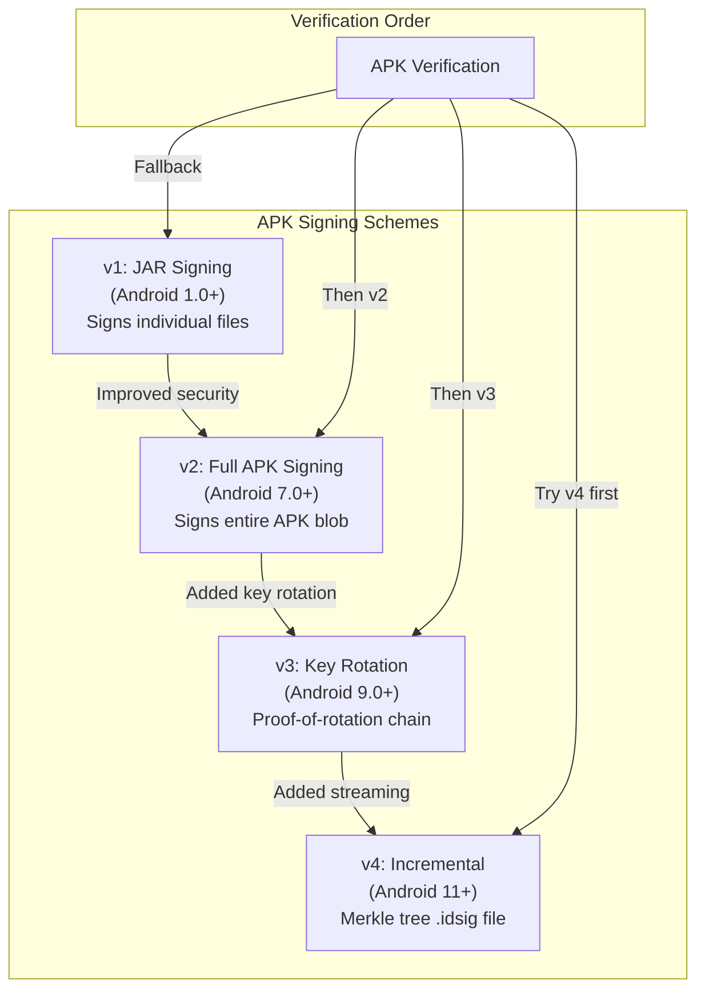

PMS 使用 `ApkSignatureVerifier` 在安装过程中验证签名。验证器首先尝试最新的方案，并回退到较旧的方案。验证会在 APK 中实际存在的最高签名方案处停止。只有在缺少更新的块时才会参考较低版本的方案。防止剥离较新签名并非来自对每个方案重新验证。它来自 `apksigner` 插入到较旧签名中的剥离保护属性，这些属性记录了存在更新的方案。

### 26.1.7 APK 对齐

APK 文件应对未压缩条目按 4 字节边界对齐。`zipalign` 工具确保这种对齐，这使得系统无需提取资源文件即可直接从 APK 中 mmap 它们。从 Android 15 开始，对本地库强制实行 16KB 页大小对齐：

来自 `ScanPackageUtils.java`：

```java
public static final int PAGE_SIZE_16KB = 16384;
```

对齐是由构建时工具（`zipalign` 以及 Play 的发布要求）强制执行的，而非由 PMS 执行：安装路径不会拒绝未对齐的 APK。在 16 KB 页大小的设备上，PMS 会在软件包扫描期间检查本地库的对齐情况（`ScanPackageUtils` 调用 `checkPackageAlignment()`）。PMS 将结果记录为 `PackageSetting` 上的页大小应用兼容标志。未对齐的应用随后可以在兼容模式下运行。未对齐的资源仍然会带来代价：系统必须将它们提取为单独的文件，而不是直接从 APK 映射它们。

### 26.1.8 APK 构建流水线

理解 APK 是如何构建的有助于解释其结构：

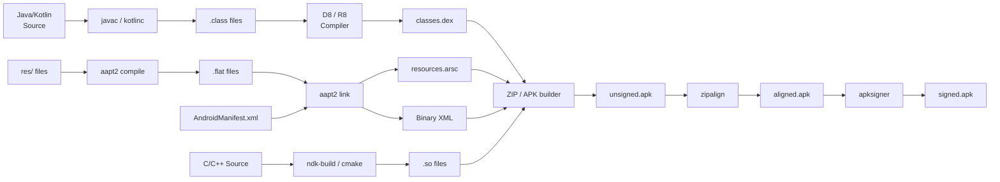

每种工具都贡献于 APK 的特定部分：

| 工具 | 输入 | 输出 | APK 组成部分 |
|------|-------|--------|---------------|
| javac / kotlinc | .java / .kt | .class | （中间产物） |
| D8 / R8 | .class | classes.dex | DEX 字节码 |
| aapt2 compile | res/ | .flat | （中间产物） |
| aapt2 link | .flat + manifest | resources.arsc + binary XML | 资源 |
| ndk-build / cmake | C/C++ 源码 | .so | 本地库 |
| zipalign | 未对齐的 APK | 已对齐的 APK | 全部（对齐修正） |
| apksigner | 已对齐的 APK | 已签名的 APK | META-INF / 签名块 |

### 26.1.9 APK 压缩与桩软件包

系统分区空间有限，因此某些系统 APK 会被压缩。PMS 支持带有 `.gz` 扩展名的压缩软件包：

```java
public final static String COMPRESSED_EXTENSION = ".gz";
/** Suffix of stub packages on the system partition */
public final static String STUB_SUFFIX = "-Stub";
```

桩软件包（stub package）是一个最小化的 APK，作为系统分区上的占位符。当设备首次启动（或 OTA 之后）时，PMS 会将完整软件包解压到 `/data`。这使系统分区可以保持较小，同时仍提供完整的应用。

`InitAppsHelper` 跟踪桩软件包：

```java
// Tracks of stub packages that must either be replaced with full
// versions in the /data partition or be disabled.
private final List<String> mStubSystemApps = new ArrayList<>();
```

并且在系统扫描期间：

```java
private void updateStubSystemAppsList(List<String> stubSystemApps) {
    final int numPackages = mPm.mPackages.size();
    for (int index = 0; index < numPackages; index++) {
        final AndroidPackage pkg = mPm.mPackages.valueAt(index);
        if (pkg.isStub()) {
            stubSystemApps.add(pkg.getPackageName());
        }
    }
}
```

### 26.1.10 APK 校验和

PMS 支持为 APK 文件计算和验证校验和，应用商店和企业管理系统会使用此功能：

```java
public void requestFileChecksums(@NonNull File file,
        @NonNull String installerPackageName,
        @Checksum.TypeMask int optional,
        @Checksum.TypeMask int required,
        @Nullable List trustedInstallers,
        @NonNull IOnChecksumsReadyListener onChecksumsReadyListener)
        throws FileNotFoundException {
```

支持的校验和类型包括 MD5、SHA-1、SHA-256、SHA-512 和 Merkle 根哈希。`ApkChecksums` 类负责实际的计算。

---

## 26.2 PackageManagerService 架构

PMS 是 Android 中规模最大、架构最复杂的系统服务之一。多年来，它已从一个单体类被重构为大量辅助类的集合，并采用了基于快照的并发模型。

### 26.2.1 服务注册与入口

PMS 在启动过程中由 `SystemServer` 启动。它作为 `"package"` 服务注册到 `ServiceManager` 中。应用通过 `Context.getPackageManager()` 访问它，该调用返回一个封装了 `IPackageManager` binder 代理的 `ApplicationPackageManager`。

类层次结构如下所示：

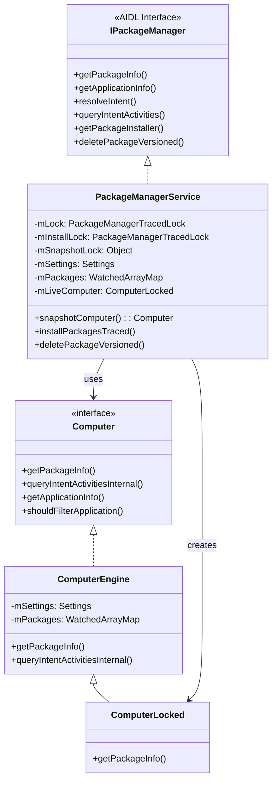

### 26.2.2 锁层级

PMS 使用三个主要锁，它们的排序对于避免死锁至关重要。`PackageManagerService.java` 中的类 Javadoc 记录了这一点：

```java
/**
 * Internally there are three important locks:
 * <ul>
 * <li>{@link #mLock} is used to guard all in-memory parsed package details
 * and other related state. It is a fine-grained lock that should only be held
 * momentarily, as it's one of the most contended locks in the system.
 * <li>{@link #mInstallLock} is used to guard all {@code installd} access, whose
 * operations typically involve heavy lifting of application data on disk. Since
 * {@code installd} is single-threaded, and it's operations can often be slow,
 * this lock should never be acquired while already holding {@link #mLock}.
 * Conversely, it's safe to acquire {@link #mLock} momentarily while already
 * holding {@link #mInstallLock}.
 * <li>{@link #mSnapshotLock} is used to guard access to two snapshot fields:
 * the snapshot itself and the snapshot invalidation flag.
 * </ul>
 */
```

方法命名约定强制执行锁纪律：

| 后缀 | 所需锁 |
|--------|--------------|
| `LI` | 调用者必须持有 `mInstallLock` |
| `LIF` | 调用者必须持有 `mInstallLock`，且软件包必须被冻结 |
| `LPr` | 调用者必须持有 `mLock` 以进行读取 |
| `LPw` | 调用者必须持有 `mLock` 以进行写入 |

### 26.2.3 Computer 快照模式

现代 PMS 最重要的架构特性是 **Computer 快照模式**。它被引入是为了解决严重的锁争用问题。PMS 的 `mLock` 是系统中争用最激烈的锁之一。它导致了卡顿和 ANR。

关键的洞察在于，大多数 PMS 操作都是**只读**的——它们查询软件包信息，但不修改它。快照模式将读与写分离开来：

1. **`Computer` 接口**——定义所有只读查询方法
   （`frameworks/base/services/core/java/com/android/server/pm/Computer.java`）

2. **`ComputerEngine`**——实现 `Computer` 接口，操作 PMS 状态的快照

3. **`ComputerLocked`**——扩展 `ComputerEngine`，将调用包装在
   `synchronized(mLock)` 块中以访问实时数据

4. **`Snapshot` 内部类**——所有 PMS 状态字段的集合，要么是实时
   引用，要么是深拷贝

`Computer` 接口非常庞大，定义了数十个查询方法：

```java
public interface Computer extends PackageDataSnapshot {
    int getVersion();
    Computer use();
    @NonNull List<ResolveInfo> queryIntentActivitiesInternal(
            Intent intent, String resolvedType, long flags,
            long privateResolveFlags, int filterCallingUid,
            int callingPid, int userId,
            boolean resolveForStart, boolean allowDynamicSplits);
    ActivityInfo getActivityInfo(ComponentName component, long flags, int userId);
    AndroidPackage getPackage(String packageName);
    ApplicationInfo getApplicationInfo(String packageName, long flags, int userId);
    PackageInfo getPackageInfo(String packageName, long flags, int userId);
    // ... dozens more query methods
}
```

快照的创建由 `snapshotComputer()` 管理：

```java
public Computer snapshotComputer() {
    return snapshotComputer(true /*allowLiveComputer*/);
}

public Computer snapshotComputer(boolean allowLiveComputer) {
    var isHoldingPackageLock = Thread.holdsLock(mLock);
    if (allowLiveComputer) {
        if (isHoldingPackageLock) {
            // If the current thread holds mLock then it may have modified
            // state but not yet invalidated the snapshot.  Always give the
            // thread the live computer.
            return mLiveComputer;
        }
    }

    var oldSnapshot = sSnapshot.get();
    var pendingVersion = sSnapshotPendingVersion.get();

    if (oldSnapshot != null && oldSnapshot.getVersion() == pendingVersion) {
        return oldSnapshot.use();
    }
    // ... rebuild snapshot under mSnapshotLock
}
```

`Snapshot` 内部类捕获所有可变状态：

```java
class Snapshot {
    public static final int LIVE = 1;
    public static final int SNAPPED = 2;

    public final Settings settings;
    public final WatchedSparseIntArray isolatedOwners;
    public final WatchedArrayMap<String, AndroidPackage> packages;
    public final WatchedArrayMap<ComponentName, ParsedInstrumentation> instrumentation;
    public final WatchedSparseBooleanArray webInstantAppsDisabled;
    public final ComponentName resolveComponentName;
    public final ActivityInfo resolveActivity;
    public final ActivityInfo instantAppInstallerActivity;
    public final ResolveInfo instantAppInstallerInfo;
    public final InstantAppRegistry instantAppRegistry;
    public final ApplicationInfo androidApplication;
    public final String appPredictionServicePackage;
    public final AppsFilterSnapshot appsFilter;
    public final ComponentResolverApi componentResolver;
    public final PackageManagerService service;
    public final WatchedArrayMap<String, Integer> frozenPackages;
    public final SharedLibrariesRead sharedLibraries;
    // ...
}
```

版本控制系统使用两个原子变量：`sSnapshot`（当前快照）和
`sSnapshotPendingVersion`（每次变更时递增）。当查询到来时：

1. 如果调用者已持有 `mLock`，则返回实时 computer（它可以直接访问）
2. 如果快照版本与待处理版本匹配，则返回缓存的快照
3. 否则，获取 `mSnapshotLock`，重建快照，并将其返回

这确保了绝大多数调用者可以无锁读取。

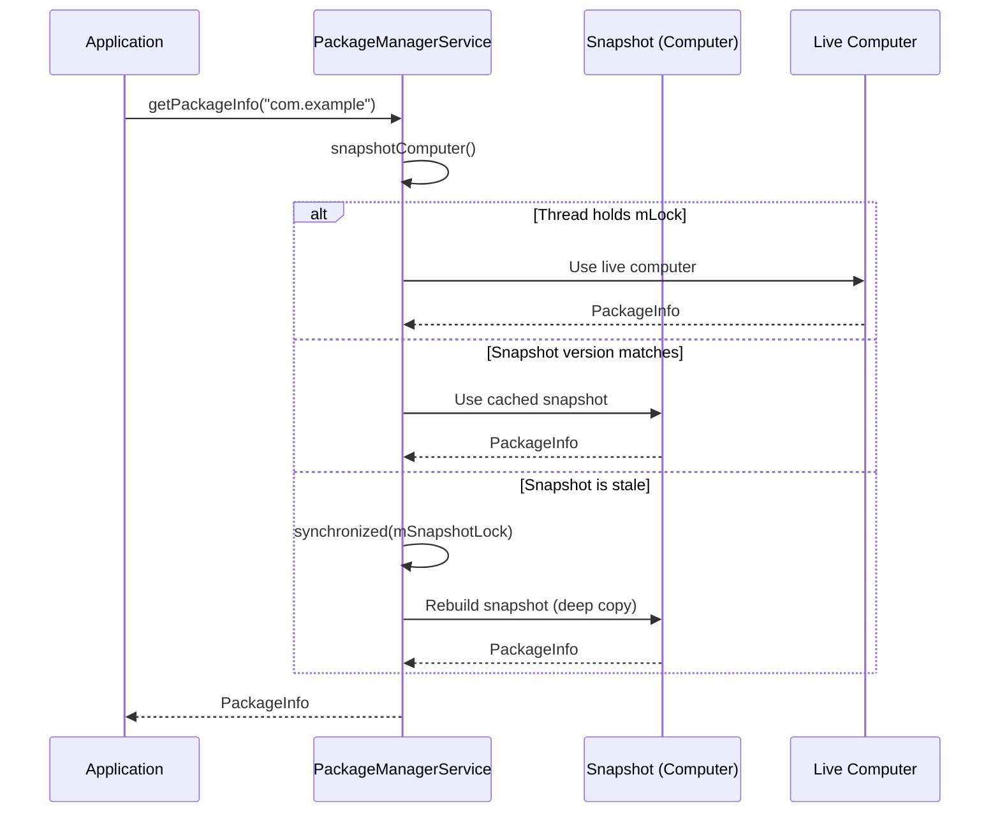

### 26.2.4 关键数据结构

PMS 维护若干核心数据结构，均以 `@Watched` 注解标记，以便在修改时触发
快照失效：

```java
// Keys are String (package name), values are Package.
@Watched
@GuardedBy("mLock")
final WatchedArrayMap<String, AndroidPackage> mPackages = new WatchedArrayMap<>();

// Package settings (persistent per-package state)
@Watched
@GuardedBy("mLock")
final Settings mSettings;

// Component resolver for intent matching
@Watched
final ComponentResolver mComponentResolver;

// App visibility filtering
@Watched
final AppsFilterImpl mAppsFilter;

// Shared libraries
@Watched
private final SharedLibrariesImpl mSharedLibraries;

// Frozen packages (undergoing surgery)
@GuardedBy("mLock")
final WatchedArrayMap<String, Integer> mFrozenPackages = new WatchedArrayMap<>();
```

`@Watched` 注解与来自 `com.android.server.utils` 的 `Watchable`/`Watcher`
模式相结合，意味着对这些结构的任何修改都会自动递增
`sSnapshotPendingVersion`，从而使缓存的快照失效。

### 26.2.5 PackageSetting

`PackageSetting` 是持久化的每个软件包状态记录，实现了
`PackageStateInternal` 接口。它存储必须经受重启的数据：

来自 `frameworks/base/services/core/java/com/android/server/pm/PackageSetting.java`：

```java
@DataClass(genGetters = true, genConstructor = false,
           genSetters = false, genBuilder = false)
public class PackageSetting extends SettingBase
        implements PackageStateInternal {
```

`PackageSetting` 中存储的关键数据：

- 软件包名、代码路径、资源路径
- 版本号和签名详情
- 安装时间、更新时间、最后修改时间
- 安装程序包名和安装来源
- 主 CPU ABI 和次 CPU ABI
- 每个用户的状态（启用/禁用、已停止、隐藏、挂起）
- 权限授予状态（委托给 PermissionManagerService）
- 域验证状态
- 首次和最近一次安装时间

`Settings` 类（`frameworks/base/services/core/java/com/android/server/pm/Settings.java`）
是所有 `PackageSetting` 实例的容器。它负责与 `/data/system/packages.xml`
之间的序列化和反序列化，后者是所有软件包元数据的持久化存储。

### 26.2.6 辅助类的分解

现代 PMS 已被分解为许多辅助类，每个类处理一项明确的职责。主服务会创建
并持有对所有这些类的引用：

```java
private final BroadcastHelper mBroadcastHelper;
private final RemovePackageHelper mRemovePackageHelper;
private final DeletePackageHelper mDeletePackageHelper;
private final InitAppsHelper mInitAppsHelper;
private final AppDataHelper mAppDataHelper;
@NonNull private final InstallPackageHelper mInstallPackageHelper;
private final PreferredActivityHelper mPreferredActivityHelper;
private final ResolveIntentHelper mResolveIntentHelper;
private final DexOptHelper mDexOptHelper;
private final SuspendPackageHelper mSuspendPackageHelper;
private final DistractingPackageHelper mDistractingPackageHelper;
private final StorageEventHelper mStorageEventHelper;
private final FreeStorageHelper mFreeStorageHelper;
```

这种分解服务于多个目的：

1. **可读性**——辅助类的规模差异很大，其中 `InstallPackageHelper` 最大，不过 `PackageManagerService.java` 本身仍然体量可观
2. **可测试性**——辅助类可以单独进行单元测试
3. **锁纪律**——每个辅助类都清晰记录了它所需的锁
4. **所有权**——OWNERS 文件可以将不同的团队分配给不同的辅助类

### 26.2.7 Handler 消息

PMS 在专用的 `ServiceThread` 上使用 `Handler` 来执行异步操作。
消息常量定义在主类中：

```java
static final int SEND_PENDING_BROADCAST = 1;
static final int POST_INSTALL = 9;
static final int WRITE_SETTINGS = 13;
static final int WRITE_DIRTY_PACKAGE_RESTRICTIONS = 14;
static final int PACKAGE_VERIFIED = 15;
static final int CHECK_PENDING_VERIFICATION = 16;
static final int WRITE_PACKAGE_LIST = 19;
static final int INSTANT_APP_RESOLUTION_PHASE_TWO = 20;
static final int ENABLE_ROLLBACK_STATUS = 21;
static final int ENABLE_ROLLBACK_TIMEOUT = 22;
static final int DEFERRED_NO_KILL_POST_DELETE = 23;
static final int DEFERRED_NO_KILL_INSTALL_OBSERVER = 24;
static final int DOMAIN_VERIFICATION = 27;
static final int PRUNE_UNUSED_STATIC_SHARED_LIBRARIES = 28;
static final int DEFERRED_PENDING_KILL_INSTALL_OBSERVER = 29;
static final int WRITE_USER_PACKAGE_RESTRICTIONS = 30;
```

handler 线程的看门狗超时时间设置为 10 分钟，反映了可能长时间运行的操作
（例如安装数 GB 的应用）：

```java
static final long WATCHDOG_TIMEOUT = 1000*60*10;     // ten minutes
```

### 26.2.8 Watcher / Watchable 模式

`@Watched` 注解是快照失效机制的核心。它是在 `com.android.server.utils`
中定义的自定义观察者模式的一部分：

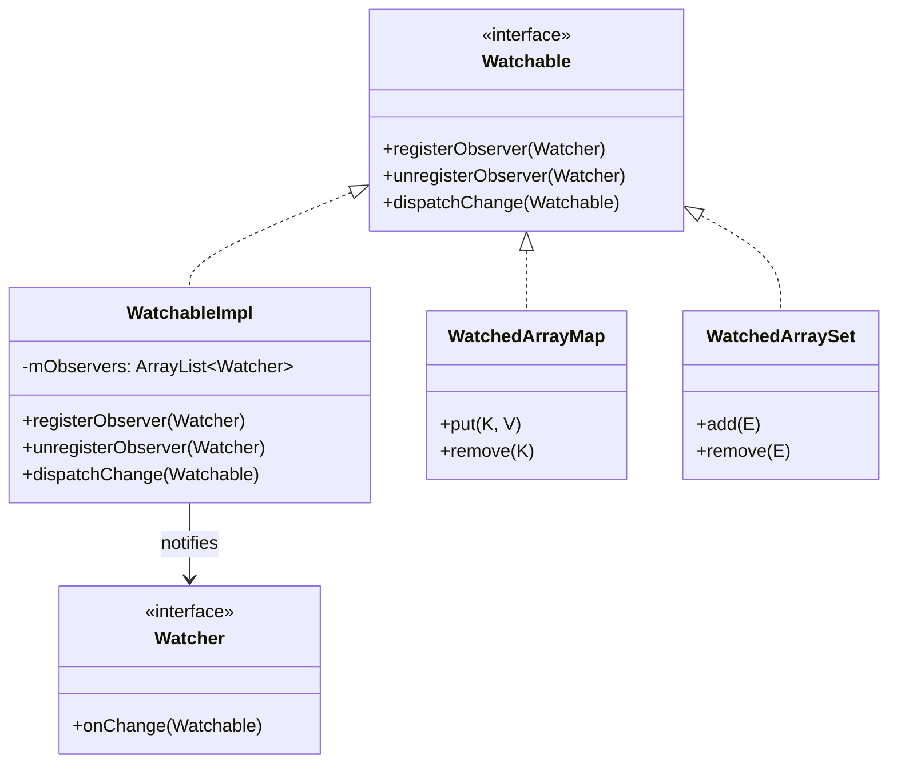

当 PMS 中的任何 `@Watched` 字段发生变化时（例如，某个软件包被添加到
`mPackages`），Watchable 模式会被触发：

1. `WatchedArrayMap` 检测到变更
2. 它对观察者列表调用 `dispatchChange(this)`
3. PMS 的主 `Watcher` 收到回调
4. 它调用 `PackageManagerService.onChange(what)`
5. 该调用递增 `sSnapshotPendingVersion`
6. 下一次 `snapshotComputer()` 调用会检测到过期版本并重建

```java
private final Watcher mWatcher = new Watcher() {
        @Override
        public void onChange(@Nullable Watchable what) {
            PackageManagerService.onChange(what);
        }
    };
```

这一模式具有若干优势：

- **自动失效**——无需手动记账；任何数据变化都会自动使其失效
- **细粒度**——每个字段独立触发失效
- **可调试**——`what` 参数标识了是哪个字段发生了变化
- **低开销**——递增一个 AtomicInteger 基本上是零成本的

### 26.2.9 快照重建性能

快照重建过程涉及深拷贝所有被监视的字段：

```java
@GuardedBy("mLock")
private Computer rebuildSnapshot(@Nullable Computer oldSnapshot,
        int newVersion) {
    var now = SystemClock.currentTimeMicro();
    var hits = oldSnapshot == null ? -1 : oldSnapshot.getUsed();
    var args = new Snapshot(Snapshot.SNAPPED);
    var newSnapshot = new ComputerEngine(args, newVersion);
    var done = SystemClock.currentTimeMicro();

    if (mSnapshotStatistics != null) {
        mSnapshotStatistics.rebuild(now, done, hits,
                newSnapshot.getPackageStates().size());
    }
    return newSnapshot;
}
```

`SnapshotStatistics` 类跟踪重建的频率和延迟，帮助识别性能回归。在拥有
300 多个软件包的典型设备上，一次快照重建大约需要 1-5 毫秒。

`snapshotComputer()` 中的版本检查采用三级策略：

```java
public Computer snapshotComputer(boolean allowLiveComputer) {
    var isHoldingPackageLock = Thread.holdsLock(mLock);

    // Tier 1: Caller already holds mLock, use live computer
    if (allowLiveComputer && isHoldingPackageLock) {
        return mLiveComputer;
    }

    // Tier 2: Cached snapshot is still valid
    var oldSnapshot = sSnapshot.get();
    var pendingVersion = sSnapshotPendingVersion.get();
    if (oldSnapshot != null
            && oldSnapshot.getVersion() == pendingVersion) {
        return oldSnapshot.use();
    }

    // Tier 3: Need to rebuild under mSnapshotLock
    synchronized (mSnapshotLock) {
        // Double-check: another thread may have rebuilt while we waited
        var rebuildSnapshot = sSnapshot.get();
        var rebuildVersion = sSnapshotPendingVersion.get();
        if (rebuildSnapshot != null
                && rebuildSnapshot.getVersion() == rebuildVersion) {
            return rebuildSnapshot.use();
        }
        // Rebuild under mLock
        synchronized (mLock) {
            var newSnapshot = rebuildSnapshot(rebuildSnapshot, rebuildVersion);
            sSnapshot.set(newSnapshot);
            return newSnapshot.use();
        }
    }
}
```

### 26.2.10 PackageManagerServiceInjector

PMS 通过 `PackageManagerServiceInjector` 使用依赖注入，以支持测试和模块化
初始化。注入器提供所有外部依赖：

- Context 和系统服务
- ABI 辅助类
- 增量管理器
- APEX 管理器
- 后台执行器
- 组件解析器工厂
- 共享库实现

这一模式允许测试代码用模拟实现替换任何依赖，从而能够对 PMS 组件进行独立
的单元测试。

### 26.2.11 系统分区

PMS 维护着一个软件包可以驻留的有序系统分区列表：

```java
public static final List<ScanPartition> SYSTEM_PARTITIONS =
        Collections.unmodifiableList(
                PackagePartitions.getOrderedPartitions(ScanPartition::new));
```

这些分区按特异度排序：

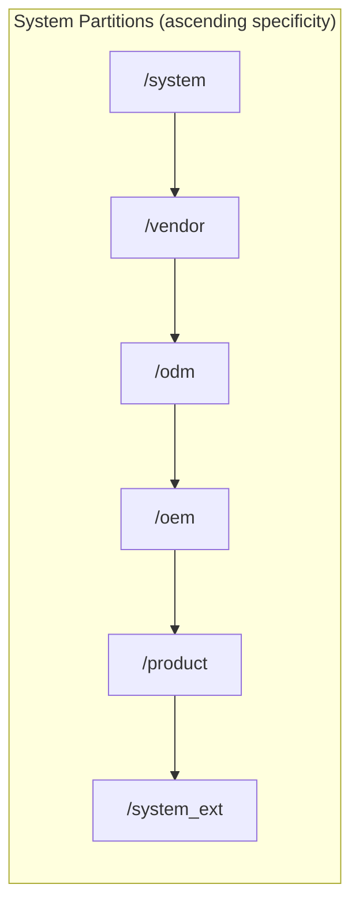

每个分区都有关联的扫描标志，用于决定该分区内软件包的处理方式：

| 分区 | 扫描标志 | 权限级别 |
|-----------|-----------|----------------|
| `/system/app` | `SCAN_AS_SYSTEM` | System |
| `/system/priv-app` | `SCAN_AS_SYSTEM | SCAN_AS_PRIVILEGED` | Privileged |
| `/vendor/app` | `SCAN_AS_SYSTEM | SCAN_AS_VENDOR` | Vendor |
| `/product/app` | `SCAN_AS_SYSTEM | SCAN_AS_PRODUCT` | Product |
| `/system_ext/app` | `SCAN_AS_SYSTEM | SCAN_AS_SYSTEM_EXT` | System Ext |
| `/odm/app` | `SCAN_AS_SYSTEM | SCAN_AS_ODM` | ODM |

---

## 26.3 软件包扫描

在启动时，PMS 必须发现并解析设备上的每一个 APK。这是启动过程中时间最关键
的部分之一。扫描数千个软件包可能需要数十秒。这直接影响从开机到设备可用的
时间。

### 26.3.1 开机时扫描概述

扫描过程由 `InitAppsHelper`
（`frameworks/base/services/core/java/com/android/server/pm/InitAppsHelper.java`）
编排：

```java
final class InitAppsHelper {
    private final PackageManagerService mPm;
    private final List<ScanPartition> mDirsToScanAsSystem;
    private final int mScanFlags;
    private final int mSystemParseFlags;
    private final int mSystemScanFlags;
    private final InstallPackageHelper mInstallPackageHelper;
    private final ApexManager mApexManager;
    private final ExecutorService mExecutorService;
    private long mSystemScanTime;
    private int mCachedSystemApps;
    private int mSystemPackagesCount;
    private final boolean mIsDeviceUpgrading;
    private final List<ScanPartition> mSystemPartitions;
```

扫描按特定顺序进行：

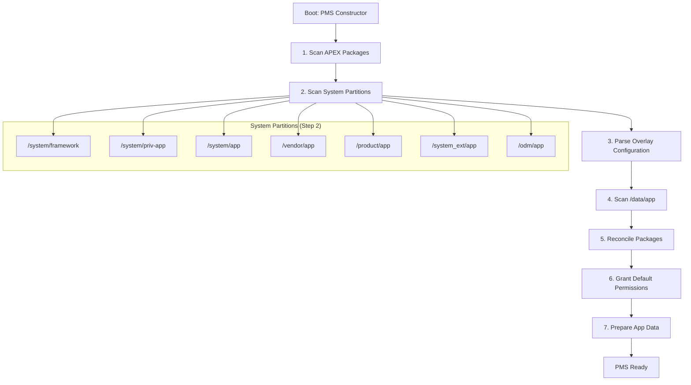

### 26.3.2 扫描标志

PMS 定义了一整套扫描标志，用于控制扫描行为。这些是在 `PackageManagerService.java`
中定义为常量的位标志：

```java
static final int SCAN_NO_DEX = 1 << 0;
static final int SCAN_UPDATE_SIGNATURE = 1 << 1;
static final int SCAN_NEW_INSTALL = 1 << 2;
static final int SCAN_UPDATE_TIME = 1 << 3;
static final int SCAN_BOOTING = 1 << 4;
static final int SCAN_REQUIRE_KNOWN = 1 << 7;
static final int SCAN_MOVE = 1 << 8;
static final int SCAN_INITIAL = 1 << 9;
static final int SCAN_DONT_KILL_APP = 1 << 10;
static final int SCAN_IGNORE_FROZEN = 1 << 11;
static final int SCAN_FIRST_BOOT_OR_UPGRADE = 1 << 12;
static final int SCAN_AS_INSTANT_APP = 1 << 13;
static final int SCAN_AS_FULL_APP = 1 << 14;
static final int SCAN_AS_VIRTUAL_PRELOAD = 1 << 15;
static final int SCAN_AS_SYSTEM = 1 << 16;
static final int SCAN_AS_PRIVILEGED = 1 << 17;
static final int SCAN_AS_OEM = 1 << 18;
static final int SCAN_AS_VENDOR = 1 << 19;
static final int SCAN_AS_PRODUCT = 1 << 20;
static final int SCAN_AS_SYSTEM_EXT = 1 << 21;
static final int SCAN_AS_ODM = 1 << 22;
static final int SCAN_AS_APK_IN_APEX = 1 << 23;
static final int SCAN_DROP_CACHE = 1 << 24;
static final int SCAN_AS_FACTORY = 1 << 25;
static final int SCAN_AS_APEX = 1 << 26;
static final int SCAN_AS_STOPPED_SYSTEM_APP = 1 << 27;
```

在启动期间，初始标志由 `InitAppsHelper` 计算：

```java
int scanFlags = SCAN_BOOTING | SCAN_INITIAL;
if (mIsDeviceUpgrading || mPm.isFirstBoot()) {
    mScanFlags = scanFlags | SCAN_FIRST_BOOT_OR_UPGRADE;
} else {
    mScanFlags = scanFlags;
}
mSystemParseFlags = mPm.getDefParseFlags() | ParsingPackageUtils.PARSE_IS_SYSTEM_DIR;
mSystemScanFlags = mScanFlags | SCAN_AS_SYSTEM;
```

### 26.3.3 APEX 软件包扫描

现代 Android 使用 APEX（Android Pony EXpress）来存放可更新的系统组件。
APEX 可以包含 APK 软件包，PMS 必须扫描这些软件包。扫描顺序为：先扫描
APEX 软件包，然后扫描系统分区，最后扫描数据：

```java
public OverlayConfig initSystemApps(PackageParser2 packageParser,
        WatchedArrayMap<String, PackageSetting> packageSettings,
        int[] userIds, long startTime) {
    // Prepare apex package info before scanning APKs
    final List<ApexManager.ScanResult> apexScanResults =
            scanApexPackagesTraced(packageParser);
    mApexManager.notifyScanResult(apexScanResults);
    scanSystemDirs(packageParser, mExecutorService);
    // ...
}
```

APEX 扫描分区由活动的 APEX 模块派生而来：

```java
private List<ScanPartition> getApexScanPartitions() {
    final List<ScanPartition> scanPartitions = new ArrayList<>();
    final List<ApexManager.ActiveApexInfo> activeApexInfos =
            mApexManager.getActiveApexInfos();
    for (int i = 0; i < activeApexInfos.size(); i++) {
        final ScanPartition scanPartition =
                resolveApexToScanPartition(activeApexInfos.get(i));
        if (scanPartition != null) {
            scanPartitions.add(scanPartition);
        }
    }
    return scanPartitions;
}
```

### 26.3.4 PackageParser2

APK 文件的实际解析由 `PackageParser2`
（`frameworks/base/core/java/com/android/internal/pm/parsing/PackageParser2.java`）
完成。它读取二进制格式的 `AndroidManifest.xml`，提取：

- 软件包名称和版本信息
- 所有组件声明（Activity、Service、Receiver、Provider）
- 权限声明和使用情况
- 库依赖
- 功能要求
- 拆分信息

解析工作通过 `ParallelPackageParser` 并行化，后者将解析工作分配到线程池：

```java
mExecutorService = ParallelPackageParser.makeExecutorService();
```

### 26.3.5 ScanPackageUtils

`ScanPackageUtils` 类
（`frameworks/base/services/core/java/com/android/server/pm/ScanPackageUtils.java`）
执行实际的扫描逻辑，且不产生副作用：

```java
/**
 * Just scans the package without any side effects.
 *
 * @param injector injector for acquiring dependencies
 * @param request Information about the package to be scanned
 * @param isUnderFactoryTest Whether or not the device is under factory test
 * @param currentTime The current time, in millis
 * @return The results of the scan
 */
@VisibleForTesting
@NonNull
public static ScanResult scanPackageOnly(@NonNull ScanRequest request,
        PackageManagerServiceInjector injector,
        boolean isUnderFactoryTest, long currentTime)
        throws PackageManagerException {
```

`ScanRequest` 包含所有输入参数：

- `mParsedPackage`——已解析的软件包数据
- `mPkgSetting`——现有的软件包设置（如果正在更新）
- `mDisabledPkgSetting`——被禁用的系统软件包（如果有）
- `mOriginalPkgSetting`——原始软件包设置（用于重命名的软件包）
- `mParseFlags`——解析标志
- `mScanFlags`——扫描标志
- `mRealPkgName`——真实的软件包名称（用于重命名的软件包）
- `mSharedUserSetting`——共享用户设置（如适用）
- `mUser`——用户句柄
- `mIsPlatformPackage`——这是否为平台（"android"）软件包

`ScanResult` 包含所有输出数据：

- 要创建/更新的软件包设置
- 已更改的软件包列表
- 库信息
- 动态代码日志记录设置

### 26.3.6 /data/app 目录

在系统分区扫描完成后，PMS 会扫描 `/data/app` 以查找用户安装的应用。这些应用
存储在随机化的目录中：

```
/data/app/
  +-- ~~random1/
  |     +-- com.example.app1-random2/
  |           +-- base.apk
  |           +-- split_config.arm64_v8a.apk
  |           +-- split_config.en.apk
  |           +-- lib/
  |           +-- oat/
  +-- ~~random3/
        +-- com.example.app2-random4/
              +-- base.apk
```

双波浪线前缀（`~~`）和随机后缀可以防止路径预测攻击：

```java
static final String RANDOM_DIR_PREFIX = "~~";
static final char RANDOM_CODEPATH_PREFIX = '-';
```

### 26.3.7 软件包缓存

为了加快后续启动，PMS 使用 `PackageCacher` 缓存已解析的软件包数据。在首次
启动或 OTA 之后，整个缓存会被失效并重建。缓存存储在
`/data/system/package_cache/`。

缓存统计会被跟踪：

```java
/* Track of the number of cached system apps */
private int mCachedSystemApps;
/* Track of the number of system apps */
private int mSystemPackagesCount;
```

### 26.3.8 系统目录扫描详解

`InitAppsHelper` 中的 `scanSystemDirs()` 方法揭示了精确的扫描顺序：

```java
private void scanSystemDirs(PackageParser2 packageParser,
        ExecutorService executorService) {
    File frameworkDir = new File(Environment.getRootDirectory(), "framework");
    List<ScanParams> scanParamsList = new ArrayList<>();

    // Step 1: Collect overlay directories (reverse order for priority)
    for (int i = mDirsToScanAsSystem.size() - 1; i >= 0; i--) {
        final ScanPartition partition = mDirsToScanAsSystem.get(i);
        if (partition.getOverlayFolder() == null) continue;
        collectScanParams(scanParamsList, partition.getOverlayFolder(),
                mSystemParseFlags,
                mSystemScanFlags | partition.scanFlag,
                packageParser, executorService, partition.apexInfo);
    }

    // Step 2: Scan /system/framework (no dex, privileged)
    collectScanParams(scanParamsList, frameworkDir, mSystemParseFlags,
            mSystemScanFlags | SCAN_NO_DEX | SCAN_AS_PRIVILEGED,
            packageParser, executorService, null);

    // Step 3: Scan priv-app and app for each partition
    for (int i = 0, size = mDirsToScanAsSystem.size(); i < size; i++) {
        final ScanPartition partition = mDirsToScanAsSystem.get(i);
        if (partition.getPrivAppFolder() != null) {
            collectScanParams(scanParamsList, partition.getPrivAppFolder(),
                    mSystemParseFlags,
                    mSystemScanFlags | SCAN_AS_PRIVILEGED | partition.scanFlag,
                    packageParser, executorService, partition.apexInfo);
        }
        collectScanParams(scanParamsList, partition.getAppFolder(),
                mSystemParseFlags,
                mSystemScanFlags | partition.scanFlag,
                packageParser, executorService, partition.apexInfo);
    }

    // Step 4: Execute all scans in parallel
    parallelScanDirTracedLI(scanParamsList, packageParser, executorService);

    // Step 5: Verify the platform package exists
    if (!mPm.mPackages.containsKey("android")) {
        throw new IllegalStateException(
                "Failed to load frameworks package; check log for warnings");
    }
}
```

扫描顺序至关重要：

1. **覆盖层优先**——这样后续软件包就能获得覆盖层配置
2. **框架**——`android` 平台软件包必须存在
3. **特权应用**——权限级别更高，在普通应用之前扫描
4. **普通应用**——没有特殊权限的系统应用
5. **并行执行**——所有收集到的扫描参数都在线程池上运行

### 26.3.9 非系统应用扫描

在系统应用扫描完成后，`initNonSystemApps()` 处理用户安装的应用：

```java
public void initNonSystemApps(PackageParser2 packageParser,
        @NonNull int[] userIds, long startTime) {
    EventLog.writeEvent(EventLogTags.BOOT_PROGRESS_PMS_DATA_SCAN_START,
            SystemClock.uptimeMillis());

    if ((mScanFlags & SCAN_FIRST_BOOT_OR_UPGRADE)
            == SCAN_FIRST_BOOT_OR_UPGRADE) {
        fixInstalledAppDirMode();
    }

    scanDirTracedLI(mPm.getAppInstallDir(), 0,
            mScanFlags | SCAN_REQUIRE_KNOWN,
            packageParser, mExecutorService, null);

    List<Runnable> unfinishedTasks = mExecutorService.shutdownNow();
    if (!unfinishedTasks.isEmpty()) {
        throw new IllegalStateException(
                "Not all tasks finished before calling close: "
                + unfinishedTasks);
    }
    fixSystemPackages(userIds);
    logNonSystemAppScanningTime(startTime);
    mExpectingBetter.clear();
    mPm.mSettings.pruneRenamedPackagesLPw();
}
```

`SCAN_REQUIRE_KNOWN` 标志对*已知*软件包强制执行一种预期。
如果某个软件包已在 `packages.xml` 中注册，那么扫描到的 APK 必须
仍然位于其中记录的代码路径。否则扫描会失败，并返回
`INSTALL_FAILED_PACKAGE_CHANGED`。`/data/app` 中先前未知的软件包仍会正常
被发现——它们不会被拒绝或移除。

### 26.3.10 启动性能指标

PMS 会记录详细的扫描指标，以识别性能瓶颈：

```java
Slog.i(TAG, "Finished scanning system apps. Time: " + mSystemScanTime
        + " ms, packageCount: " + mSystemPackagesCount
        + " , timePerPackage: "
        + (mSystemPackagesCount == 0 ? 0
                : mSystemScanTime / mSystemPackagesCount)
        + " , cached: " + mCachedSystemApps);
```

对于数据应用则是：

```java
Slog.i(TAG, "Finished scanning non-system apps. Time: " + dataScanTime
        + " ms, packageCount: " + dataPackagesCount
        + " , timePerPackage: "
        + (dataPackagesCount == 0 ? 0
                : dataScanTime / dataPackagesCount)
        + " , cached: " + cachedNonSystemApps);
```

这些指标也会通过 `FrameworkStatsLog` 上报，用于 OTA 分析：

```java
FrameworkStatsLog.write(
    FrameworkStatsLog.BOOT_TIME_EVENT_DURATION_REPORTED,
    BOOT_TIME_EVENT_DURATION__EVENT__OTA_PACKAGE_MANAGER_SYSTEM_APP_AVG_SCAN_TIME,
    mSystemScanTime / mSystemPackagesCount);
```

### 26.3.11 “Expecting Better” 机制

当系统应用被用户更新后（例如通过 Play Store），系统版本和更新版本都会在磁盘上
存在。PMS 必须对此进行协调：

```java
private final ArrayMap<String, File> mExpectingBetter = new ArrayMap<>();
private final List<String> mPossiblyDeletedUpdatedSystemApps
        = new ArrayList<>();
```

其逻辑如下：

1. 在系统扫描期间，PMS 检测到某个系统软件包在 `/data/app` 中存在更新的版本
2. 系统版本被记录在 `mExpectingBetter` 中
3. 系统版本被禁用，而使用数据版本
4. 如果数据版本缺失（例如用户卸载了更新），PMS 会重新启用系统版本

这由 `fixSystemPackages()` 处理：

```java
private void fixSystemPackages(@NonNull int[] userIds) {
    mInstallPackageHelper.cleanupDisabledPackageSettings(
            mPossiblyDeletedUpdatedSystemApps, userIds, mScanFlags);
    mInstallPackageHelper.checkExistingBetterPackages(
            mExpectingBetter, mStubSystemApps,
            mSystemScanFlags, mSystemParseFlags);
    mInstallPackageHelper.installSystemStubPackages(
            mStubSystemApps, mScanFlags);
}
```

### 26.3.12 目录模式安全修复

在首次启动或升级时，PMS 会修复已安装应用目录的模式，以防止软件包名称枚举：

```java
void fixInstalledAppDirMode() {
    try (var files = Files.newDirectoryStream(
            mPm.getAppInstallDir().toPath())) {
        files.forEach(dir -> {
            try {
                Os.chmod(dir.toString(), 0771);
            } catch (ErrnoException e) {
                Slog.w(TAG, "Failed to fix an installed app dir mode", e);
            }
        });
    } catch (Exception e) {
        Slog.w(TAG, "Failed to walk the app install directory", e);
    }
}
```

`0771` 模式确保非系统用户无法列出目录内容。这防止他们通过目录枚举来发现已
安装的软件包名称。

### 26.3.13 扫描流程图

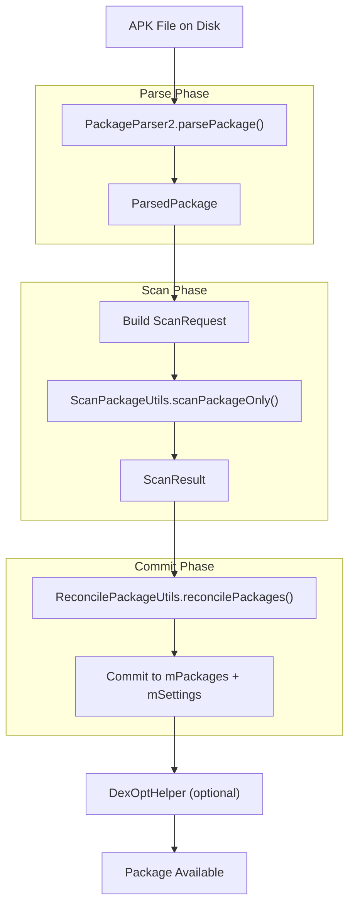

---

## 26.4 安装流水线

APK 的安装是一个多阶段流水线，涉及安全验证、磁盘操作、dex 优化和状态提交。本节
追踪从用户点击 “Install” 到应用出现在启动器中的完整流程。

### 26.4.1 安装入口

软件包安装有若干入口：

1. **`adb install`**——通过 `PackageInstallerService` 创建会话的 Shell 命令
2. **Play Store / 应用商店**——使用 `PackageInstaller` API
3. **系统 OTA**——系统镜像中包含的软件包在启动时被扫描
4. **APEX**——可能包含 APK 的模块更新
5. **基于 Intent**——`ACTION_INSTALL_PACKAGE` intent（已弃用）

所有现代安装流程都经过 `PackageInstallerService`
（`frameworks/base/services/core/java/com/android/server/pm/PackageInstallerService.java`），
它是 `PackageInstaller` API 的 binder 端点：

```java
public class PackageInstallerService extends IPackageInstaller.Stub implements
        PackageSessionProvider {
```

### 26.4.2 PackageInstallerSession

`PackageInstallerSession` 是一次进行中的安装的中心对象。会话经历一个定义明确的
生命周期：

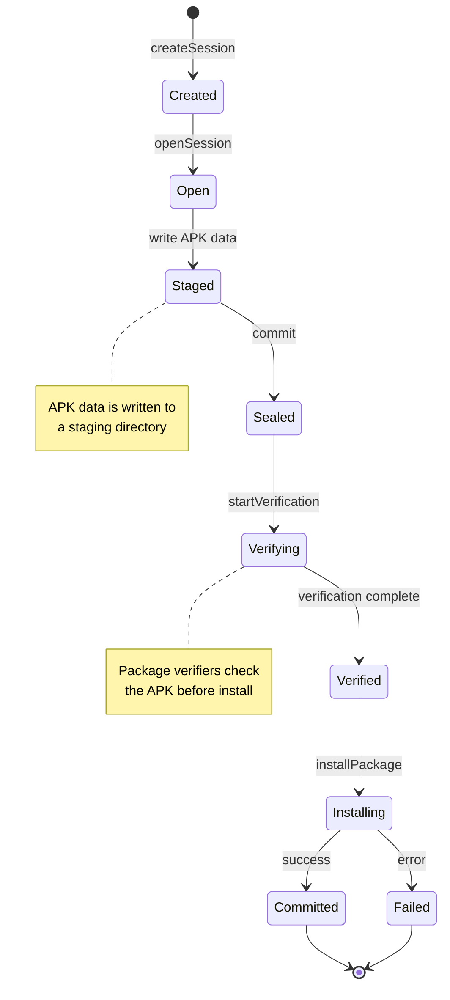

关键的会话参数（来自 `PackageInstaller.SessionParams`）：

- `MODE_FULL_INSTALL`——完整替换该软件包
- `MODE_INHERIT_EXISTING`——保留现有拆分的更新
- `installLocation`——内部或外部存储
- `abiOverride`——覆盖 ABI 选择
- `installFlags`——各种安装控制标志

### 26.4.3 完整的安装流水线

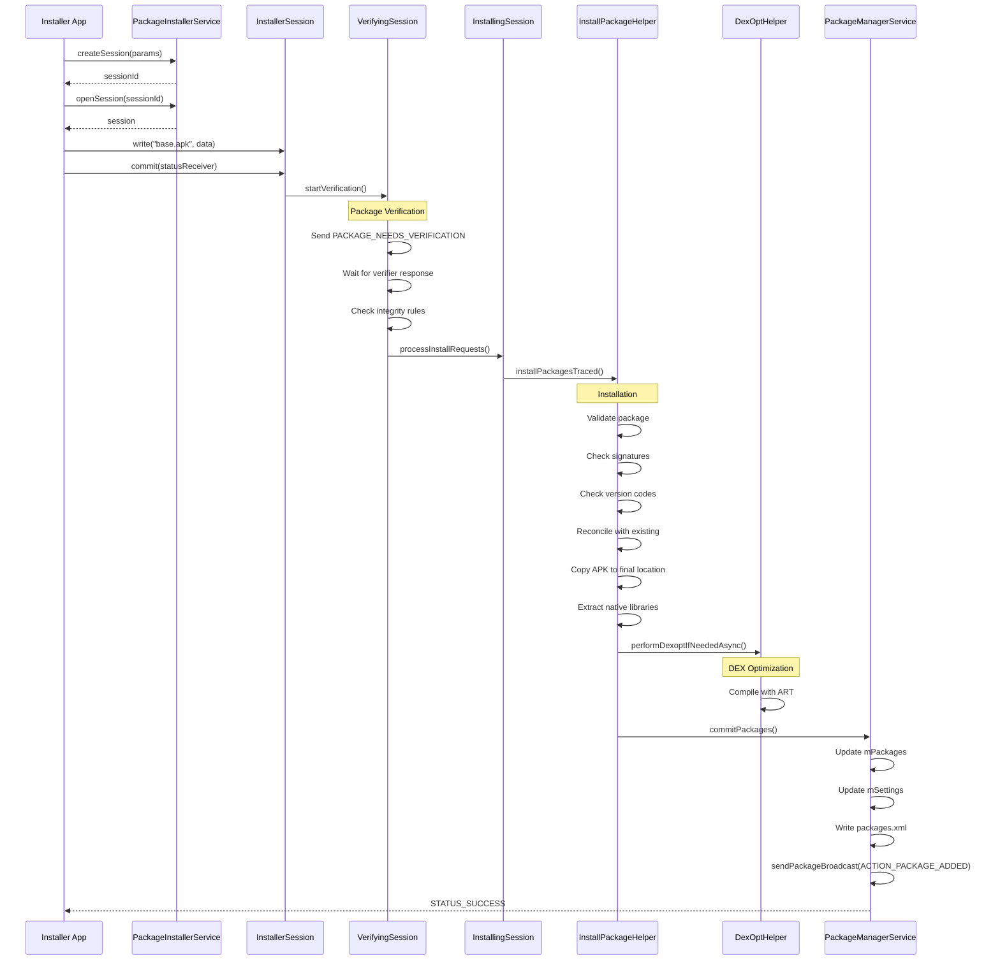

### 26.4.4 阶段 1：暂存

当安装程序创建会话并写入 APK 数据时，数据会被暂存到 `/data/app/` 下的一个临时
目录中：

```
/data/app/vmdl<sessionId>.tmp/
  +-- base.apk
  +-- split_config.arm64_v8a.apk
  +-- split_config.en.apk
```

暂存目录由 `StagingManager` 管理，用于分阶段安装（那些需要重启的安装）：

```java
public class StagingManager {
    private static final String TAG = "StagingManager";
    private final ApexManager mApexManager;
    private final PowerManager mPowerManager;
    private final Context mContext;
    private final File mFailureReasonFile =
            new File("/metadata/staged-install/failure_reason.txt");
```

### 26.4.5 阶段 2：验证

在安装进行之前，软件包会经过验证。这由 `VerifyingSession`
（`frameworks/base/services/core/java/com/android/server/pm/VerifyingSession.java`）
处理：

```java
final class VerifyingSession {
    private static final boolean DEFAULT_VERIFY_ENABLE = true;
    private static final long DEFAULT_INTEGRITY_VERIFICATION_TIMEOUT = 30 * 1000;
    private static final String PROPERTY_ENABLE_ROLLBACK_TIMEOUT_MILLIS =
            "enable_rollback_timeout";
```

验证过程涉及：

1. **必需验证器**——Google Play Protect（或等效组件）检查 APK 是否存在恶意软件。
   系统最多可以有 `REQUIRED_VERIFIERS_MAX_COUNT = 2` 个必需验证器。

2. **充分验证器**——可以独立批准的可选验证器。

3. **完整性验证**——根据完整性规则（黑名单、白名单）进行检查。

4. **回滚启用**——如果配置了回滚，则准备回滚数据。

验证超时时的默认响应是可配置的：

```java
static final int DEFAULT_VERIFICATION_RESPONSE = PackageManager.VERIFICATION_ALLOW;
```

### 26.4.6 阶段 3：安装

`InstallPackageHelper`
（`frameworks/base/services/core/java/com/android/server/pm/InstallPackageHelper.java`）
执行实际的安装工作：

1. **验证**——检查 APK 是否有效、版本号是否兼容、签名是否匹配
2. **签名验证**——使用 `ApkSignatureVerifier` 验证 APK 签名
3. **协调**——与现有软件包状态进行比较
4. **文件操作**——将 APK 复制到最终位置，提取本地库
5. **权限处理**——处理权限声明和授予
6. **ABI 选择**——确定正确的本地 ABI

`InstallPackageHelper` 中的关键错误码：

```java
INSTALL_FAILED_ALREADY_EXISTS
INSTALL_FAILED_INVALID_APK
INSTALL_FAILED_DUPLICATE_PACKAGE
INSTALL_FAILED_UPDATE_INCOMPATIBLE
INSTALL_FAILED_UID_CHANGED
INSTALL_FAILED_DEPRECATED_SDK_VERSION
INSTALL_FAILED_TEST_ONLY
INSTALL_FAILED_BAD_PERMISSION_GROUP
INSTALL_FAILED_DUPLICATE_PERMISSION
```

### 26.4.7 阶段 4：DEX 优化

在 APK 到达最终位置后，PMS 会触发 dex 优化：

```java
public final class DexOptHelper {
    @NonNull
    private static final ThreadPoolExecutor sDexoptExecutor =
            new ThreadPoolExecutor(1, 1,
                    60, TimeUnit.SECONDS,
                    new LinkedBlockingQueue<Runnable>());
```

`DexOptHelper` 委托给 `ArtManagerLocal`（ART 服务）来完成实际的编译。编译策略
包括：

- **assume-verified**——完全跳过验证
- **verify**——只验证 DEX 文件（`quicken` 作为它的一个过时别名仍然存在）
- **space-profile** / **space**——为存储空间进行优化
- **speed-profile**——根据 profile 数据编译热点方法
- **speed**——通过编译所有通常可编译的方法来最大化运行时性能
  （还存在一个单独的 `everything` / `everything-profile` 过滤器，用于编译
  所有可被编译的内容）

### 26.4.8 阶段 5：提交

最后一个阶段将安装提交到 PMS 的数据结构：

1. **更新 `mPackages`**——将 `AndroidPackage` 添加到主映射中
2. **更新 `mSettings`**——创建或更新 `PackageSetting`
3. **写入 `packages.xml`**——将设置持久化到磁盘
4. **发送广播**——向系统通知新软件包：
   - `ACTION_PACKAGE_ADDED`（新安装）
   - `ACTION_PACKAGE_REPLACED`（更新）
   - `ACTION_MY_PACKAGE_REPLACED`（发送给被更新的软件包本身）

### 26.4.9 软件包冻结

在安装过程中，PMS 会 “冻结” 该软件包，以防止它被启动：

```java
@GuardedBy("mLock")
final WatchedArrayMap<String, Integer> mFrozenPackages = new WatchedArrayMap<>();
```

`PackageFreezer` 类管理冻结/解冻的生命周期。被冻结的软件包无法被 Activity
Manager 启动，从而在代码/数据 “手术” 期间防止竞态条件：

```java
public static final int PACKAGE_STARTABILITY_FROZEN = 3;
```

### 26.4.10 InstallPackageHelper 的提交过程

`InstallPackageHelper` 中的提交步骤是软件包成为系统状态一部分的地方。
`commitReconciledScanResultLocked()` 方法执行这一操作：

```java
@GuardedBy("mPm.mLock")
private AndroidPackage commitReconciledScanResultLocked(
        @NonNull ReconciledPackage reconciledPkg, int[] allUsers) {
    final InstallRequest request = reconciledPkg.mInstallRequest;
    ParsedPackage parsedPackage = request.getParsedPackage();

    // Special handling for the platform package
    if (parsedPackage != null
            && "android".equals(parsedPackage.getPackageName())) {
        parsedPackage.setVersionCode(mPm.getSdkVersion())
                .setVersionCodeMajor(0);
    }

    // Handle shared user setting changes
    final PackageSetting pkgSetting;
    // ... complex shared user reconciliation ...

    // Set the install source
    InstallSource installSource = request.getInstallSource();
    if (installSource != null) {
        pkgSetting.setInstallSource(installSource);
    }

    // Set the UID from the package setting
    parsedPackage.setUid(pkgSetting.getAppId());
    final AndroidPackage pkg = parsedPackage.hideAsFinal();

    // Reconcile shared libraries
    if (reconciledPkg.mCollectedSharedLibraryInfos != null) {
        mSharedLibraries.executeSharedLibrariesUpdate(
                pkg, pkgSetting, null, null,
                reconciledPkg.mCollectedSharedLibraryInfos, allUsers);
    }

    // Update KeySet data
    final KeySetManagerService ksms =
            mPm.mSettings.getKeySetManagerService();
    if (reconciledPkg.mRemoveAppKeySetData) {
        ksms.removeAppKeySetDataLPw(pkg.getPackageName());
    }

    // Update signing details
    pkgSetting.setSigningDetails(reconciledPkg.mSigningDetails);

    // Final commit
    commitPackageSettings(pkg, pkgSetting, oldPkgSetting, reconciledPkg);
    return pkg;
}
```

该方法在持有 `mLock` 的同时，原子地修改多个数据结构：

1. 更新或创建 `PackageSetting`
2. 更新共享用户设置
3. 协调共享库
4. 更新 KeySet 数据
5. 提交签名详情
6. 调用 `commitPackageSettings()` 以进行最终状态更新

### 26.4.11 更新归属权

Android 14+ 引入了**更新归属权**，允许应用商店声明对某个软件包的排他性更新权。
`UpdateOwnershipHelper` 管理这一功能：

```java
private final UpdateOwnershipHelper mUpdateOwnershipHelper;
```

更新归属权的规则：

1. 如果安装程序请求，归属权会在初始安装时设置
2. 一旦设置，只有更新所有者才能更新该软件包
3. 如果用户同意切换安装程序，归属权会被清除
4. 归属权也可以通过系统配置（sysconfig）来控制
5. 拒绝列表可以防止对某些软件包声明归属权

```java
final boolean isRequestUpdateOwnership = (request.getInstallFlags()
        & PackageManager.INSTALL_REQUEST_UPDATE_OWNERSHIP) != 0;
final boolean isSameUpdateOwner =
        TextUtils.equals(oldUpdateOwner,
                installSource.mInstallerPackageName);
```

### 26.4.12 安装后的广播

安装成功后，PMS 会发送系统范围的广播以通知相关方。`BroadcastHelper` 类负责
管理：

```java
private final BroadcastHelper mBroadcastHelper;
```

广播序列取决于安装类型：

**新安装：**
```
ACTION_PACKAGE_ADDED
  extras: EXTRA_UID (int), EXTRA_REPLACING (false)
```

**更新：**
```
ACTION_PACKAGE_REMOVED (with EXTRA_REPLACING = true)
ACTION_PACKAGE_ADDED (with EXTRA_REPLACING = true)
ACTION_PACKAGE_REPLACED
ACTION_MY_PACKAGE_REPLACED (sent to the updated app itself)
```

在启动期间，广播会被延迟，以避免使系统不堪重负：

```java
private static final long BROADCAST_DELAY_DURING_STARTUP =
        10 * 1000L; // 10 seconds (in millis)
private static final long BROADCAST_DELAY =
        1 * 1000L;  // 1 second (in millis)
```

### 26.4.13 安装观察者通知

安装程序通过 `IPackageInstallObserver2` 接收完成通知：

```java
void notifyInstallObserver(InstallRequest request) {
    if (request.getObserver() != null) {
        try {
            Bundle extras = extrasForInstallResult(request);
            request.getObserver().onPackageInstalled(
                    request.getName(),
                    request.getReturnCode(),
                    request.getReturnMsg(),
                    extras);
        } catch (RemoteException e) {
            Slog.i(TAG, "Observer no longer exists.");
        }
    }
}
```

对于无杀安装（不需要重启进程的更新），观察者通知会被推迟：

```java
void scheduleDeferredNoKillInstallObserver(InstallRequest request) {
    String packageName = request.getPkg().getPackageName();
    mNoKillInstallObservers.put(packageName, request);
    Message message = mHandler.obtainMessage(
            DEFERRED_NO_KILL_INSTALL_OBSERVER, packageName);
    mHandler.sendMessageDelayed(message,
            DEFERRED_NO_KILL_INSTALL_OBSERVER_DELAY_MS);
}
```

### 26.4.14 软件包归档

Android 15+ 引入了软件包归档，它允许卸载 APK，同时保留用户数据和一个最小化的
启动器条目：

```java
ArchivedPackageParcel getArchivedPackageInternal(
        @NonNull String packageName, int userId) {
    // ... builds an ArchivedPackageParcel with:
    //   - packageName
    //   - signingDetails
    //   - versionCode
    //   - targetSdkVersion
    //   - archivedActivities (for launcher display)
}
```

已归档的软件包会在启动器中显示一个云图标，并且可以按需重新安装，从原始安装
程序再次下载 APK。

### 26.4.15 延迟删除

当软件包被更新时，旧的 APK 文件不会立即删除。相反，它们会被安排进行延迟删除：

```java
void scheduleDeferredNoKillPostDelete(CleanUpArgs args) {
    Message message = mHandler.obtainMessage(
            DEFERRED_NO_KILL_POST_DELETE, args);
    long deleteDelayMillis = DeviceConfig.getLong(
            NAMESPACE_PACKAGE_MANAGER_SERVICE,
            PROPERTY_DEFERRED_NO_KILL_POST_DELETE_DELAY_MS_EXTENDED,
            DEFERRED_NO_KILL_POST_DELETE_DELAY_MS_EXTENDED);
    Slog.w(TAG, "Delaying the deletion of <" + args.getCodePath()
            + "> by " + deleteDelayMillis + "ms or till the next reboot");
    mHandler.sendMessageDelayed(message, deleteDelayMillis);
}
```

延长的延迟（最长 1 天）允许在新版本出现问题时进行回滚。

### 26.4.16 增量安装

Android 11+ 通过 Incremental File System（IncFS）支持增量安装。这使得流式安装
成为可能：APK 在完全下载之前就可以使用：

```java
private static final String PROPERTY_INCFS_DEFAULT_TIMEOUTS =
        "incfs_default_timeouts";
```

v4 签名方案实现了对流式传输内容的逐块验证。

---

## 26.5 权限模型

Android 的权限模型是其最重要的安全特性之一。PMS 和
`PermissionManagerService` 协同工作，来定义、授予、撤销和强制执行权限。

### 26.5.1 PermissionManagerService

`PermissionManagerService`
（`frameworks/base/services/core/java/com/android/server/pm/permission/PermissionManagerService.java`）
是权限管理的核心权威：

```java
/**
 * Manages all permissions and handles permissions related tasks.
 */
public class PermissionManagerService extends IPermissionManager.Stub {
    private static final String LOG_TAG =
            PermissionManagerService.class.getSimpleName();

    private final Object mLock = new Object();
    private final PackageManagerInternal mPackageManagerInt;
    private final AppOpsManager mAppOpsManager;
    private final Context mContext;
    private final PermissionManagerServiceInterface mPermissionManagerServiceImpl;
    private final AttributionSourceRegistry mAttributionSourceRegistry;
```

它作为独立的服务被创建：

```java
public static PermissionManagerServiceInternal create(@NonNull Context context,
        ArrayMap<String, FeatureInfo> availableFeatures) {
    // ...
    permissionService = new PermissionManagerService(context, availableFeatures);
    ServiceManager.addService("permissionmgr", permissionService);
    ServiceManager.addService("permission_checker",
            new PermissionCheckerService(context));
    // ...
}
```

### 26.5.2 权限类型

`Permission` 类
（`frameworks/base/services/core/java/com/android/server/pm/permission/Permission.java`）
定义了权限的内部表示：

```java
public final class Permission {
    public static final int TYPE_MANIFEST = LegacyPermission.TYPE_MANIFEST;
    public static final int TYPE_CONFIG = LegacyPermission.TYPE_CONFIG;
    public static final int TYPE_DYNAMIC = LegacyPermission.TYPE_DYNAMIC;
```

权限按**保护级别**进行分类：

```java
@IntDef({
        PermissionInfo.PROTECTION_DANGEROUS,
        PermissionInfo.PROTECTION_NORMAL,
        PermissionInfo.PROTECTION_SIGNATURE,
        PermissionInfo.PROTECTION_SIGNATURE_OR_SYSTEM,
        PermissionInfo.PROTECTION_INTERNAL,
})
public @interface ProtectionLevel {}
```

每个保护级别都有不同的授予语义：

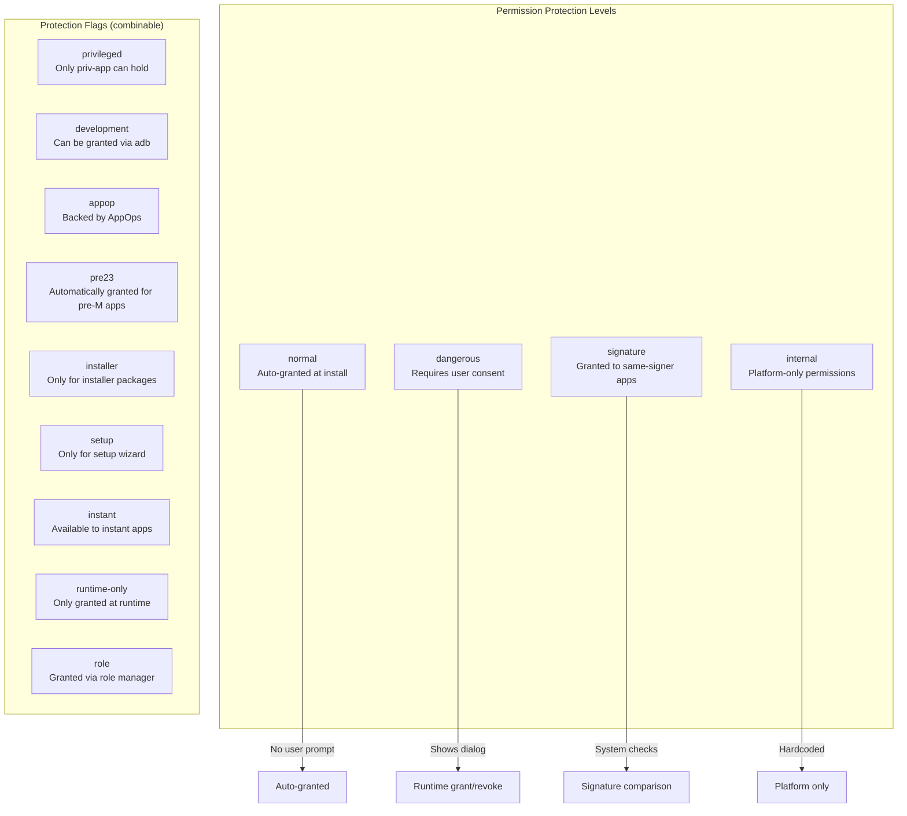

### 26.5.3 安装时权限（normal）

普通权限在安装时自动授予，无需用户交互。它们保护对那些对用户隐私或设备操作
构成极小风险的数据或资源的访问。

示例：`INTERNET`、`VIBRATE`、`SET_WALLPAPER`、`ACCESS_NETWORK_STATE`

当 PMS 扫描或安装软件包时，在 `<uses-permission>` 中声明的普通权限会在权限
协调阶段被自动授予。

### 26.5.4 运行时权限（dangerous）

危险权限需要通过运行时对话框获得用户的明确同意。它们保护敏感的用户数据，
如联系人、位置、相机和麦克风。

运行时权限被组织成**权限组**：

| 组 | 权限 |
|-------|------------|
| `LOCATION` | `ACCESS_FINE_LOCATION`、`ACCESS_COARSE_LOCATION`、`ACCESS_BACKGROUND_LOCATION` |
| `CAMERA` | `CAMERA` |
| `MICROPHONE` | `RECORD_AUDIO` |
| `STORAGE` | `READ_EXTERNAL_STORAGE`、`WRITE_EXTERNAL_STORAGE` |
| `READ_MEDIA_VISUAL` | `READ_MEDIA_IMAGES`、`READ_MEDIA_VIDEO` |
| `READ_MEDIA_AURAL` | `READ_MEDIA_AUDIO` |
| `CONTACTS` | `READ_CONTACTS`、`WRITE_CONTACTS`、`GET_ACCOUNTS` |
| `PHONE` | `READ_PHONE_STATE`、`CALL_PHONE` |
| `CALL_LOG` | `READ_CALL_LOG`、`WRITE_CALL_LOG` |
| `SMS` | `SEND_SMS`、`RECEIVE_SMS`、`READ_SMS`、`RECEIVE_MMS` |
| `CALENDAR` | `READ_CALENDAR`、`WRITE_CALENDAR` |
| `SENSORS` | `BODY_SENSORS`、`BODY_SENSORS_BACKGROUND` |
| `NEARBY_DEVICES` | `BLUETOOTH_CONNECT`、`BLUETOOTH_SCAN`、`BLUETOOTH_ADVERTISE`、`NEARBY_WIFI_DEVICES` |

权限检查流程：

```java
@Override
public int checkPermission(String packageName, String permissionName,
        String persistentDeviceId, @UserIdInt int userId) {
    if (packageName == null || permissionName == null) {
        return PackageManager.PERMISSION_DENIED;
    }
    final CheckPermissionDelegate checkPermissionDelegate;
    synchronized (mLock) {
        checkPermissionDelegate = mCheckPermissionDelegate;
    }
    if (checkPermissionDelegate == null) {
        return mPermissionManagerServiceImpl.checkPermission(
                packageName, permissionName, persistentDeviceId, userId);
    }
    return checkPermissionDelegate.checkPermission(packageName,
            permissionName, persistentDeviceId, userId,
            mPermissionManagerServiceImpl::checkPermission);
}
```

### 26.5.5 签名权限

签名权限只授予给与定义该权限的应用使用相同证书签名的应用。这是同一开发者所
开发的应用之间进行应用间通信的主要机制。

系统平台软件包（`android`）定义了许多签名权限。任何使用平台证书签名的应用
都会自动获得这些权限。

签名检查使用 `compareSignatures()`：

```java
import static com.android.server.pm.PackageManagerServiceUtils.compareSignatures;
```

### 26.5.6 特权权限

特权权限（`protectionLevel="signature|privileged"`）可以授予 `/system/priv-app`
中的应用，即使它们没有使用平台证书签名。这一机制允许 OEM 向预装应用授予提升
的权限。

允许列表维护在 XML 文件中：

```
/system/etc/permissions/privapp-permissions-*.xml
/vendor/etc/permissions/privapp-permissions-*.xml
/product/etc/permissions/privapp-permissions-*.xml
```

`PermissionAllowlist` 类管理这些文件。

### 26.5.7 AppOp 权限

某些权限由 AppOps 系统支撑。`appop` 保护标志表明，即使在权限被授予之后，
AppOps 框架仍可进一步限制访问。这实现了按次使用的权限对话框和后台访问控制。

```java
private final AppOpsManager mAppOpsManager;
```

### 26.5.8 一次性权限

Android 11 引入了一次性权限，只允许在当前会话中授予访问。它们由
`OneTimePermissionUserManager` 管理：

```java
@GuardedBy("mLock")
@NonNull
private final SparseArray<OneTimePermissionUserManager>
        mOneTimePermissionUserManagers = new SparseArray<>();
```

当应用进入后台后，权限会在超时后自动撤销。

### 26.5.9 自动撤销（权限自动重置）

长期未使用的应用的权限会被自动撤销。`setAutoRevokeExempted()` 方法允许应用
退出该机制：

```java
public boolean setAutoRevokeExempted(
        @NonNull String packageName, boolean exempted, int userId) {
    Objects.requireNonNull(packageName);
    final AndroidPackage pkg = mPackageManagerInt.getPackage(packageName);
    final int callingUid = Binder.getCallingUid();
    if (!checkAutoRevokeAccess(pkg, callingUid)) {
        return false;
    }
    return setAutoRevokeExemptedInternal(pkg, exempted, userId);
}
```

### 26.5.10 权限授予流程

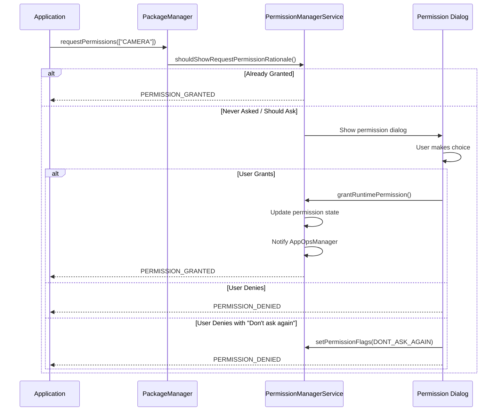

### 26.5.11 拆分权限

随着 Android 的演进，一些权限被拆分为更细粒度的权限。例如，在 Android 13 中
`READ_EXTERNAL_STORAGE` 被拆分为 `READ_MEDIA_IMAGES`、`READ_MEDIA_VIDEO` 和
`READ_MEDIA_AUDIO`。`SplitPermissionInfoParcelable` 类跟踪这些拆分：

```java
import android.content.pm.permission.SplitPermissionInfoParcelable;
```

当较旧的应用（面向拆分前的 SDK 版本）请求原始权限时，系统会自动将拆分后的
权限也考虑在内。这确保了向后兼容性，同时允许较新的应用只请求它们所需的特定
访问。

### 26.5.12 权限组与 UI

权限被组织成组，用于面向用户的权限对话框。`PermissionGroupInfo` 类描述一个
组，而 Permission Controller 应用（com.android.permissioncontroller）处理 UI。

权限对话框流程：

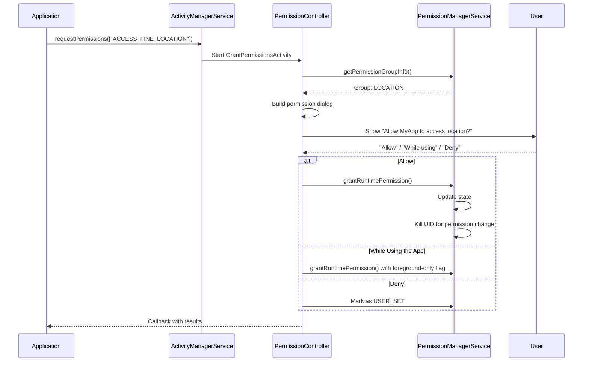

### 26.5.13 后台位置访问

从 Android 10 开始，后台位置访问需要单独的批准。权限
`ACCESS_BACKGROUND_LOCATION` 与 `ACCESS_FINE_LOCATION` /
`ACCESS_COARSE_LOCATION` 分开请求，并且用户会看到一个专门的对话框。

### 26.5.14 权限委托

`CheckPermissionDelegate` 接口允许组件拦截权限检查：

```java
@GuardedBy("mLock")
private CheckPermissionDelegate mCheckPermissionDelegate;
```

Companion Device Manager 和 Virtual Device Manager 使用它来修改配套设备和虚拟
显示的权限行为。委托可以覆盖标准的权限检查结果。

### 26.5.15 虚拟设备权限

Android 14+ 支持按设备划分的权限状态，即权限在默认设备与虚拟设备上可以有不同
的授予状态：

```java
@Override
public int checkPermission(String packageName, String permissionName,
        String persistentDeviceId, @UserIdInt int userId) {
```

`persistentDeviceId` 参数标识权限检查是针对哪台设备的：

```java
private String getPersistentDeviceId(int deviceId) {
    if (deviceId == Context.DEVICE_ID_DEFAULT) {
        return VirtualDeviceManager.PERSISTENT_DEVICE_ID_DEFAULT;
    }
    if (mVirtualDeviceManagerInternal == null) {
        mVirtualDeviceManagerInternal =
                LocalServices.getService(VirtualDeviceManagerInternal.class);
    }
    return mVirtualDeviceManagerInternal == null
            ? VirtualDeviceManager.PERSISTENT_DEVICE_ID_DEFAULT
            : mVirtualDeviceManagerInternal.getPersistentIdForDevice(deviceId);
}
```

### 26.5.16 归因来源

Android 12+ 引入了 `AttributionSource` 系统，用于跟踪促成某个 API 调用的应用
链。对于代理 API，即应用 A 调用应用 B、而 B 代表 A 调用系统 API，这实现了更精确
的权限强制执行：

```java
@NonNull
private final AttributionSourceRegistry mAttributionSourceRegistry;
```

`AttributionSource` 链确保调用链中的每个应用都具有所需的权限，从而防止通过
中间应用进行权限提升。

### 26.5.17 权限持久化

权限数据持久化存储在两处：

1. **权限定义**——声明的 `<permission>` 条目和权限树被写入
   `/data/system/packages.xml`
2. **授予状态**——安装时和运行时的权限授予都按用户存储在
   `/data/misc_de/<userId>/apexdata/com.android.permission/runtime-permissions.xml`

`RuntimePermissionsPersistence` 类处理序列化：

```java
import com.android.permission.persistence.RuntimePermissionsPersistence;
import com.android.permission.persistence.RuntimePermissionsState;
```

---

## 26.6 Intent 解析

Intent 解析是 Android 将隐式 intent 匹配到正确组件的机制。PMS 维护所有已注册
intent 过滤器的数据库，并执行匹配算法。

### 26.6.1 Intent 过滤器注册

APK 清单中以 `<intent-filter>` 元素声明的每个组件都会注册到 PMS 的
`ComponentResolver`
（`frameworks/base/services/core/java/com/android/server/pm/resolution/ComponentResolver.java`）中：

```java
/** Resolves all Android component types
    [activities, services, providers and receivers]. */
public class ComponentResolver extends ComponentResolverLocked
        implements Snappable<ComponentResolverApi> {
    private static final boolean DEBUG = false;
    private static final String TAG = "PackageManager";
```

`ComponentResolver` 维护四个 `IntentResolver` 实例，每个组件类型一个：

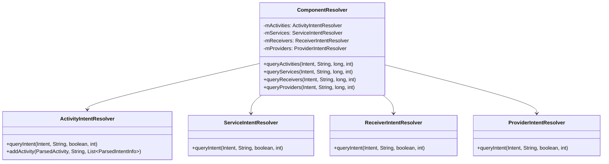

`IntentResolver` 基类（`frameworks/base/services/core/java/com/android/server/IntentResolver.java`）
实现了核心的匹配算法。

### 26.6.2 Intent 匹配算法

Android intent 匹配算法按顺序考虑以下属性：

1. **Action**——字符串动作（例如 `android.intent.action.VIEW`）。如果 intent
   指定了 action，过滤器必须包含该 action。

2. **Data**——URI scheme、主机、端口、路径和 MIME 类型。匹配规则为：
   - 如果过滤器指定了 scheme，intent 的 URI scheme 必须匹配
   - 如果过滤器指定了主机，intent 的 URI 主机必须匹配
   - 路径匹配支持字面量、前缀和模式匹配

3. **Category**——intent 所属的类别。过滤器必须包含 intent 中指定的所有
   类别。（对于通过 `startActivity()` 启动的 Activity，`DEFAULT` 类别会被隐式
   添加。）

4. **Package**——如果 intent 指定了包名，则只考虑该包中的组件（显式 intent
   的行为）。

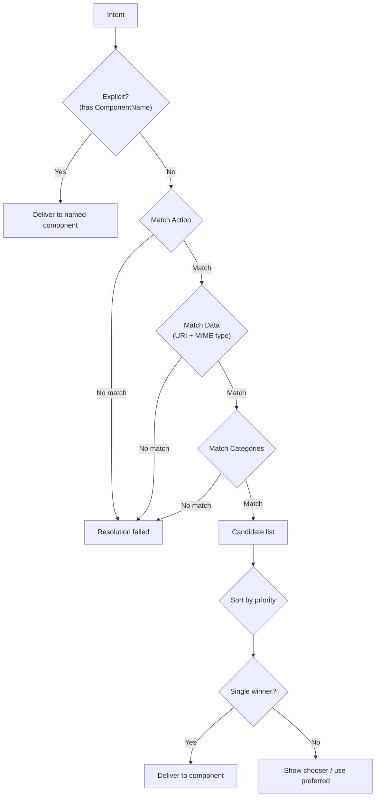

### 26.6.3 ResolveIntentHelper

`ResolveIntentHelper` 类
（`frameworks/base/services/core/java/com/android/server/pm/ResolveIntentHelper.java`）
编排 intent 解析过程：

```java
final class ResolveIntentHelper {
    @NonNull private final Context mContext;
    @NonNull private final PlatformCompat mPlatformCompat;
    @NonNull private final UserManagerService mUserManager;
    @NonNull private final PreferredActivityHelper mPreferredActivityHelper;
    @NonNull private final DomainVerificationManagerInternal mDomainVerificationManager;
    @NonNull private final UserNeedsBadgingCache mUserNeedsBadging;
    @NonNull private final Supplier<ResolveInfo> mResolveInfoSupplier;
    @NonNull private final Supplier<ActivityInfo> mInstantAppInstallerActivitySupplier;
```

主要的解析方法：

```java
public ResolveInfo resolveIntentInternal(Computer computer, Intent intent,
        String resolvedType, long flags, long privateResolveFlags,
        int userId, boolean resolveForStart,
        int filterCallingUid, int callingPid) {
    try {
        Trace.traceBegin(TRACE_TAG_PACKAGE_MANAGER, "resolveIntent");

        if (!mUserManager.exists(userId)) return null;
        final int callingUid = Binder.getCallingUid();
        flags = computer.updateFlagsForResolve(flags, userId,
                filterCallingUid, resolveForStart,
                computer.isImplicitImageCaptureIntentAndNotSetByDpc(
                        intent, userId, resolvedType, flags));
        computer.enforceCrossUserPermission(callingUid, userId,
                false, false, "resolve intent");

        final List<ResolveInfo> query =
                computer.queryIntentActivitiesInternal(intent,
                        resolvedType, flags, privateResolveFlags,
                        filterCallingUid, callingPid, userId,
                        resolveForStart, true);
        // ...
        final ResolveInfo bestChoice = chooseBestActivity(computer,
                intent, resolvedType, flags, privateResolveFlags,
                query, userId, queryMayBeFiltered);
        return bestChoice;
    } finally {
        Trace.traceEnd(TRACE_TAG_PACKAGE_MANAGER);
    }
}
```

### 26.6.4 chooseBestActivity

当多个 Activity 匹配一个 intent 时，`chooseBestActivity()` 决定使用哪一个：

```java
private ResolveInfo chooseBestActivity(Computer computer, Intent intent,
        String resolvedType, long flags, long privateResolveFlags,
        List<ResolveInfo> query, int userId, boolean queryMayBeFiltered) {
    if (query != null) {
        final int n = query.size();
        if (n == 1) {
            return query.get(0);
        } else if (n > 1) {
            ResolveInfo r0 = query.get(0);
            ResolveInfo r1 = query.get(1);
            // If the first activity has a higher priority, or a different
            // default, then it is always desirable to pick it.
            if (r0.priority != r1.priority
                    || r0.preferredOrder != r1.preferredOrder
                    || r0.isDefault != r1.isDefault) {
                return query.get(0);
            }
            // If we have saved a preference for a preferred activity
            // for this Intent, use that.
            ResolveInfo ri = mPreferredActivityHelper
                    .findPreferredActivityNotLocked(computer, intent,
                            resolvedType, flags, query, true, false,
                            debug, userId, queryMayBeFiltered);
            if (ri != null) {
                return ri;
            }
            // ...check for instant apps, browser intents
```

优先级排序为：

1. **Priority**——来自 intent 过滤器的数字优先级（系统应用可以拥有更高的优先级）
2. **Preferred Order**——通过 “Always use this app” 设置的用户默认值
3. **Is Default**——过滤器是否包含 `CATEGORY_DEFAULT`
4. **Preferred Activity**——保存的用户偏好
5. **Domain Verification**——App Links 验证状态
6. **Chooser Dialog**——当没有明确的胜出者时，向用户显示一个选择

### 26.6.5 Preferred Activities

当用户在 chooser 对话框中选择 “Always” 时，PMS 会保存一条 `PreferredActivity`
记录。`PreferredActivityHelper` 管理这些记录：

```java
private final PreferredActivityHelper mPreferredActivityHelper;
```

Preferred activities 按用户持久化存储在
`/data/system/users/<userId>/package-restrictions.xml` 中，位于
`<preferred-activities>` 元素下。

### 26.6.6 App Links 与域验证

对于 Web intent（HTTP/HTTPS），Android 使用 **App Links**——应用与 Web 域之间
经过验证的关联。`DomainVerificationManagerInternal` 处理：

1. **Digital Asset Links**——应用通过其网站上的
   `/.well-known/assetlinks.json` 声明对域的所有权
2. **Automatic Verification**——系统在安装时验证这些声明
3. **Verified Status**——经过验证的应用会自动被选中以匹配 Web URL

```java
@NonNull
final DomainVerificationManagerInternal mDomainVerificationManager;
```

### 26.6.7 跨配置文件 Intent 解析

PMS 支持受管配置文件（工作配置文件）的跨配置文件 intent 解析。
`CrossProfileIntentFilter` 和 `CrossProfileResolver` 类处理在个人和工作配置文件
之间转发 intent：

```java
List<CrossProfileIntentFilter> getMatchingCrossProfileIntentFilters(
        Intent intent, String resolvedType, int userId);
```

### 26.6.8 受保护的 Action

某些 intent action 是 “受保护的”——只有系统应用可以为它们注册高优先级的 intent
过滤器。这可以防止第三方应用拦截关键的系统 intent：

来自 `ComponentResolver.java`：

```java
/**
 * The set of all protected actions [i.e. those actions for which a high
 * priority intent filter is disallowed].
 */
private static final Set<String> PROTECTED_ACTIONS = new ArraySet<>();
static {
    PROTECTED_ACTIONS.add(Intent.ACTION_SEND);
    PROTECTED_ACTIONS.add(Intent.ACTION_SENDTO);
    PROTECTED_ACTIONS.add(Intent.ACTION_SEND_MULTIPLE);
    PROTECTED_ACTIONS.add(Intent.ACTION_VIEW);
}
```

非特权应用的过滤器优先级会被静默地限制为 0，*对于每一个* action 都如此。对于
受保护的 action，限制为 0 甚至适用于特权系统应用。唯一的例外是设置向导软件包，
它可以在这些 action 上保留高优先级。

### 26.6.9 Instant App 解析

Instant app（无需完整安装即可运行的应用）有特殊的解析规则。它们只在特定情况
下对调用者可见：

```java
/**
 * Normally instant apps can only be resolved when they're visible to
 * the caller. However, if resolveForStart is true, all instant apps
 * are visible since we need to allow the system to start any installed
 * application.
 */
```

两阶段 instant app 解析的工作方式为：

1. **Phase 1**——检查本地安装的 instant app
2. **Phase 2**——向 instant app 解析器（基于云）查询匹配的应用

```java
static final int INSTANT_APP_RESOLUTION_PHASE_TWO = 20;
```

### 26.6.10 Safer Intent 工具

Android 14+ 引入了 `SaferIntentUtils`，以防止非导出的组件通过隐式 intent 被
解析：

```java
if (resolveForStart) {
    var args = new SaferIntentUtils.IntentArgs(intent, resolvedType,
            false /* isReceiver */, true, filterCallingUid, callingPid);
    args.platformCompat = mPlatformCompat;
    SaferIntentUtils.filterNonExportedComponents(args, query);
}
```

当解析是为了启动 Activity 时，这会过滤掉任何未导出的组件，从而防止内部组件
被意外暴露。

### 26.6.11 相机 Intent 保护

从 Android 11 开始，相机 intent 必须匹配系统应用，除非 Device Policy Controller
（DPC）明确设置了不同的默认值：

```java
boolean isImplicitImageCaptureIntentAndNotSetByDpc(
        Intent intent, int userId, String resolvedType, long flags);
```

这可以防止恶意软件拦截相机 intent。

### 26.6.12 queryIntentActivitiesInternal

`Computer` 接口上的核心查询方法 `queryIntentActivitiesInternal` 支持多个具有
不同控制级别的重载：

```java
// Full control version
@NonNull List<ResolveInfo> queryIntentActivitiesInternal(
        Intent intent, String resolvedType,
        @PackageManager.ResolveInfoFlagsBits long flags,
        @PackageManagerInternal.PrivateResolveFlags long privateResolveFlags,
        int filterCallingUid, int callingPid, int userId,
        boolean resolveForStart, boolean allowDynamicSplits);

// Simplified version with filtering UID
@NonNull List<ResolveInfo> queryIntentActivitiesInternal(
        Intent intent, String resolvedType,
        long flags, int filterCallingUid, int userId);

// Minimal version
@NonNull List<ResolveInfo> queryIntentActivitiesInternal(
        Intent intent, String resolvedType, long flags, int userId);
```

`filterCallingUid` 参数至关重要——它决定了哪些软件包对调用者可见。
`allowDynamicSplits` 标志控制是否应考虑未安装的动态功能模块。

### 26.6.13 解析后过滤

在初始匹配之后，结果会经过解析后过滤：

```java
List<ResolveInfo> applyPostResolutionFilter(
        @NonNull List<ResolveInfo> resolveInfos,
        String ephemeralPkgName,
        boolean allowDynamicSplits,
        int filterCallingUid,
        boolean resolveForStart,
        int userId,
        Intent intent);
```

该过滤器：

1. 移除不应可见的临时（instant）应用
2. 应用软件包可见性规则
3. 处理动态拆分解析
4. 强制执行特定于用户的限制

### 26.6.14 软件包可见性过滤

从 Android 11 开始，应用默认无法看到其他已安装的软件包。`AppsFilter` 机制实现
了这一点：

```java
@Watched
final AppsFilterImpl mAppsFilter;
```

应用必须在其清单中声明 `<queries>` 元素，或持有
`QUERY_ALL_PACKAGES` 权限，才能看到其他软件包。`Computer` 接口公开了此过滤：

```java
boolean shouldFilterApplication(@Nullable PackageStateInternal ps,
        int callingUid, @Nullable ComponentName component,
        @PackageManager.ComponentType int componentType, int userId);
```

---

## 26.7 拆分 APK 与 App Bundle

拆分 APK 允许将一个应用以多个 APK 文件的形式交付，而不是一个单一的单体 APK。
这是支持 Google Play 的 App Bundle 格式的核心特性，它可以显著减小下载体积。

### 26.7.1 拆分 APK 架构

一次拆分 APK 安装包括：

1. **Base APK**（`base.apk`）——包含清单、核心代码和基础资源
2. **配置拆分**——特定于设备的资源：
   - `split_config.arm64_v8a.apk`——arm64 的本地库
   - `split_config.en.apk`——英文字符串资源
   - `split_config.xxhdpi.apk`——XXHDPI 密度资源
3. **功能拆分**——可选的功能模块：
   - `split_feature1.apk`——动态功能模块
   - `split_feature2.apk`——另一个功能模块

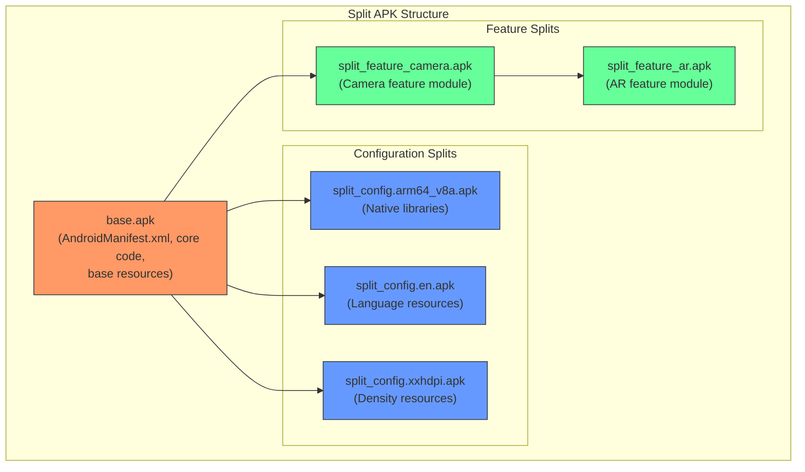

### 26.7.2 拆分依赖

功能拆分可以使用清单元素 `<uses-split>` 声明对其他拆分的依赖。
`SplitDependencyLoader`
（`frameworks/base/core/java/android/content/pm/split/SplitDependencyLoader.java`）
管理依赖树：

```java
/**
 * A helper class that implements the dependency tree traversal for splits.
 * Callbacks are implemented by subclasses to notify whether a split has already
 * been constructed and is cached, and to actually create the split requested.
 *
 * All inputs and outputs are assumed to be indices into an array of splits.
 */
public abstract class SplitDependencyLoader<E extends Exception> {
    private final @NonNull SparseArray<int[]> mDependencies;

    protected SplitDependencyLoader(
            @NonNull SparseArray<int[]> dependencies) {
        mDependencies = dependencies;
    }
```

依赖遍历算法是自底向上的遍历：

```java
protected void loadDependenciesForSplit(int splitIdx) throws E {
    if (isSplitCached(splitIdx)) {
        return;
    }

    // Special case the base, since it has no dependencies.
    if (splitIdx == 0) {
        final int[] configSplitIndices = collectConfigSplitIndices(0);
        constructSplit(0, configSplitIndices, -1);
        return;
    }

    // Build up the dependency hierarchy.
    final IntArray linearDependencies = new IntArray();
    linearDependencies.add(splitIdx);

    // Collect all the dependencies that need to be constructed.
    // They will be listed from leaf to root.
    while (true) {
        final int[] deps = mDependencies.get(splitIdx);
        if (deps != null && deps.length > 0) {
            splitIdx = deps[0];
        } else {
            splitIdx = -1;
        }
        if (splitIdx < 0 || isSplitCached(splitIdx)) {
            break;
        }
        linearDependencies.add(splitIdx);
    }

    // Visit each index, from right to left (root to leaf).
    int parentIdx = splitIdx;
    for (int i = linearDependencies.size() - 1; i >= 0; i--) {
        final int idx = linearDependencies.get(i);
        final int[] configSplitIndices = collectConfigSplitIndices(idx);
        constructSplit(idx, configSplitIndices, parentIdx);
        parentIdx = idx;
    }
}
```

### 26.7.3 运行时拆分加载

在运行时，拆分由扩展了 `SplitDependencyLoader` 的 `LoadedApk` 加载：

来自 `frameworks/base/core/java/android/app/LoadedApk.java`：

```java
private class SplitDependencyLoaderImpl
        extends SplitDependencyLoader<NameNotFoundException> {
```

该实现：

1. 检查拆分的 ClassLoader 和 Resources 是否已缓存
2. 从请求的拆分遍历依赖树到 base
3. 以从根到叶的顺序构造 ClassLoader 和 Resources 对象
4. 缓存结果以供后续加载使用

### 26.7.4 拆分安装

拆分 APK 使用 `MODE_INHERIT_EXISTING` 会话安装。该常量声明在
`android.content.pm.PackageInstaller.SessionParams` 中：

```java
// frameworks/base/core/java/android/content/pm/PackageInstaller.java
public static final int MODE_INHERIT_EXISTING = 2;
```

`InstallingSession` 静态导入该常量，并将模式记录为
`mIsInherit = sessionParams.mode == MODE_INHERIT_EXISTING`。

当继承时，新会话：

1. 以所有现有拆分开始
2. 可以添加新的拆分
3. 可以移除现有的拆分
4. 必须始终包含 base APK

### 26.7.5 磁盘布局

已安装的拆分 APK 与 base APK 一起存储：

```
/data/app/~~random/com.example.app-random/
  +-- base.apk
  +-- split_config.arm64_v8a.apk
  +-- split_config.en.apk
  +-- split_config.xxhdpi.apk
  +-- split_feature_camera.apk
  +-- lib/
  |     +-- arm64/
  |           +-- libnative.so
  +-- oat/
        +-- arm64/
              +-- base.odex
              +-- base.vdex
```

### 26.7.6 拆分 APK 清单声明

每个拆分 APK 都有自己的 `AndroidManifest.xml`，声明它的角色：

**Base APK 清单：**
```xml
<manifest xmlns:android="http://schemas.android.com/apk/res/android"
    package="com.example.app"
    android:versionCode="100"
    android:isFeatureSplit="false"
    split="">
    <application android:label="My App">
        <activity android:name=".MainActivity">
            <intent-filter>
                <action android:name="android.intent.action.MAIN" />
                <category android:name="android.intent.category.LAUNCHER" />
            </intent-filter>
        </activity>
    </application>
</manifest>
```

**功能拆分清单：**
```xml
<manifest xmlns:android="http://schemas.android.com/apk/res/android"
    package="com.example.app"
    split="feature_camera"
    android:isFeatureSplit="true">
    <uses-split android:name="feature_base" />
    <application>
        <activity android:name=".camera.CameraActivity"
            android:splitName="feature_camera" />
    </application>
</manifest>
```

**配置拆分清单：**
```xml
<manifest xmlns:android="http://schemas.android.com/apk/res/android"
    package="com.example.app"
    split="config.arm64_v8a"
    android:isFeatureSplit="false"
    configForSplit="">
</manifest>
```

拆分的关键清单属性：

| 属性 | 用途 |
|-----------|---------|
| `split` | 本拆分的名称（base 为空） |
| `android:isFeatureSplit` | 这是功能拆分还是配置拆分 |
| `configForSplit` | 本配置适用于哪个拆分 |
| `<uses-split>` | 对另一个拆分的依赖 |
| `android:splitName` | 将一个组件链接到其所属的拆分 |

### 26.7.7 拆分 ClassLoader 架构

每个拆分获得自己独立的 ClassLoader 条目，但它们共享一条父链：

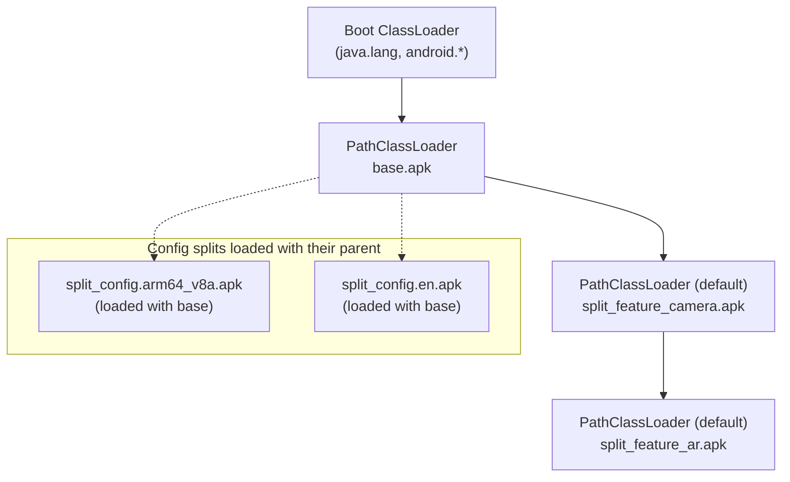

功能拆分默认获得一个 `PathClassLoader`，链接到父拆分的加载器。一个拆分可以通过
在其清单中声明
`android:classLoader="dalvik.system.DelegateLastClassLoader"` 来选择使用
`DelegateLastClassLoader`。这不是默认设置，功能模块通常不会覆盖 base 的类。

### 26.7.8 拆分的资源合并

当拆分被加载时，它们的资源被合并到一个单一的 `Resources` 对象中。合并顺序遵循
拆分依赖树，后出现的拆分在冲突的资源上覆盖先出现的拆分。

`collectConfigSplitIndices()` 方法标识哪些配置拆分属于给定的功能拆分：

```java
private @NonNull int[] collectConfigSplitIndices(int splitIdx) {
    // The config splits appear after the first element.
    final int[] deps = mDependencies.get(splitIdx);
    if (deps == null || deps.length <= 1) {
        return EmptyArray.INT;
    }
    return Arrays.copyOfRange(deps, 1, deps.length);
}
```

### 26.7.9 动态交付

动态交付系统允许功能在初始安装之后按需交付。当请求某个功能模块时：

1. 应用通过 Play Core 库请求该模块
2. Play Store 下载拆分 APK
3. PMS 将其作为附加拆分安装
4. 应用收到通知，并可以加载新代码

PMS 通过 intent 解析中的 `allowDynamicSplits` 参数支持这一点：

```java
@NonNull List<ResolveInfo> queryIntentActivitiesInternal(
        Intent intent, String resolvedType, long flags,
        long privateResolveFlags, int filterCallingUid,
        int callingPid, int userId,
        boolean resolveForStart, boolean allowDynamicSplits);
```

---

## 26.8 覆盖层系统

运行时资源覆盖（RRO）系统允许在运行时修改应用的资源，而无需更改应用本身。
这是主题化、运营商定制和 OEM 品牌的基础。

### 26.8.1 OverlayManagerService 架构

覆盖层系统由 `OverlayManagerService`（OMS）管理
（`frameworks/base/services/core/java/com/android/server/om/OverlayManagerService.java`）：

```java
/**
 * Service to manage asset overlays.
 *
 * <p>Asset overlays are additional resources that come from apks loaded
 * alongside the system and app apks. This service, the OverlayManagerService
 * (OMS), tracks which installed overlays to use and provides methods to change
 * this. Changes propagate to running applications as part of the Activity
 * lifecycle. This allows Activities to reread their resources at a well
 * defined point.</p>
 */
```

OMS 架构遵循分层设计：

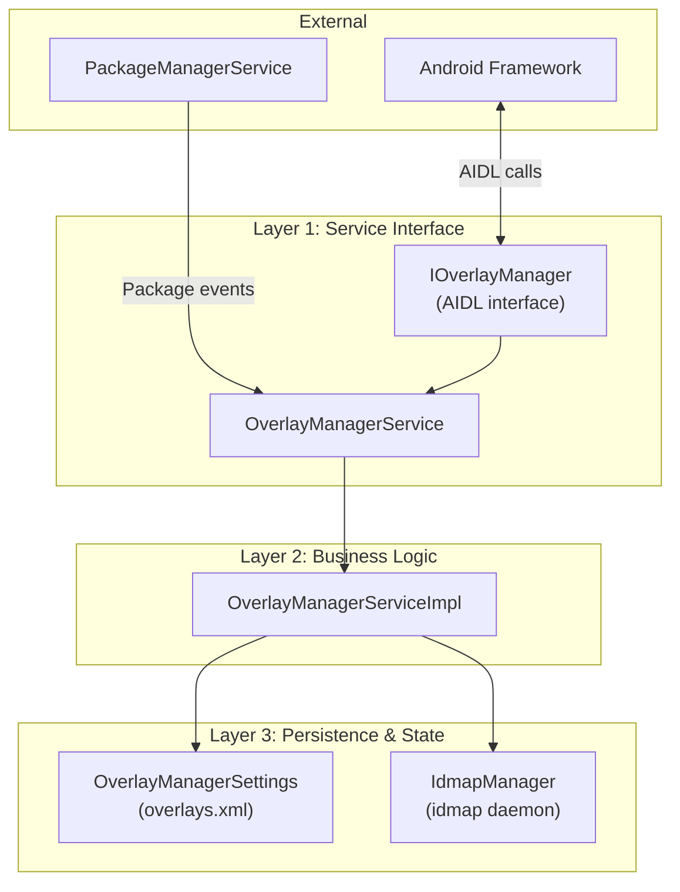

Javadoc 描述了 OMS 的三个输入来源：

1. **SystemService 回调**——启动和用户切换事件
2. **PMS intent**——软件包安装/移除/更新广播
3. **AIDL 接口**——外部请求启用/禁用覆盖层

### 26.8.2 RRO 如何工作

一个覆盖层 APK 声明一个目标软件包并提供替代资源：

```xml
<!-- Overlay AndroidManifest.xml -->
<manifest xmlns:android="http://schemas.android.com/apk/res/android"
    package="com.example.overlay"
    android:targetPackage="com.example.target"
    android:isResourceOverlay="true">
    <overlay
        android:category="theme"
        android:isStatic="false"
        android:priority="1" />
</manifest>
```

当一个覆盖层被启用时，资源查找链被修改：

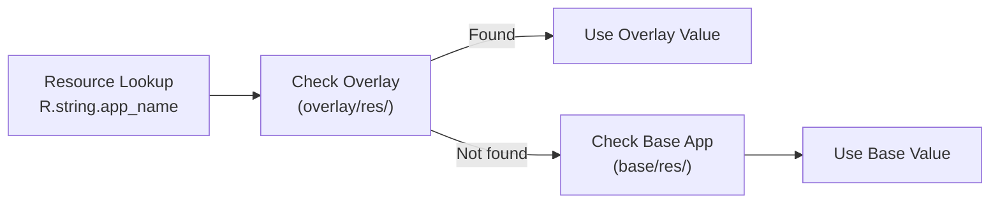

### 26.8.3 Idmap 文件

`IdmapManager` 创建 **idmap** 文件，将资源 ID 从目标软件包映射到覆盖层软件包。
Idmap 文件允许资源系统快速查找覆盖层资源，而无需在运行时扫描覆盖层 APK。

来自 `frameworks/base/services/core/java/com/android/server/om/IdmapManager.java`：

idmap 守护进程（`idmap2d`）作为本地服务运行，处理：

1. 为覆盖层/目标对创建 idmap 文件
2. 验证现有 idmap 文件是否仍然有效
3. 移除过期的 idmap 文件

Idmap 状态：

```java
static final int IDMAP_NOT_EXIST = 0;
static final int IDMAP_IS_VERIFIED = 1;
static final int IDMAP_IS_MODIFIED = 2;
```

### 26.8.4 覆盖层状态

每个覆盖层经历定义明确的状态：

```java
static final int STATE_DISABLED = OverlayInfo.STATE_DISABLED;
static final int STATE_ENABLED = OverlayInfo.STATE_ENABLED;
static final int STATE_MISSING_TARGET = OverlayInfo.STATE_MISSING_TARGET;
static final int STATE_NO_IDMAP = OverlayInfo.STATE_NO_IDMAP;
static final int STATE_OVERLAY_IS_BEING_REPLACED =
        OverlayInfo.STATE_OVERLAY_IS_BEING_REPLACED;
static final int STATE_SYSTEM_UPDATE_UNINSTALL =
        OverlayInfo.STATE_SYSTEM_UPDATE_UNINSTALL;
static final int STATE_TARGET_IS_BEING_REPLACED =
        OverlayInfo.STATE_TARGET_IS_BEING_REPLACED;
```

状态转换图：

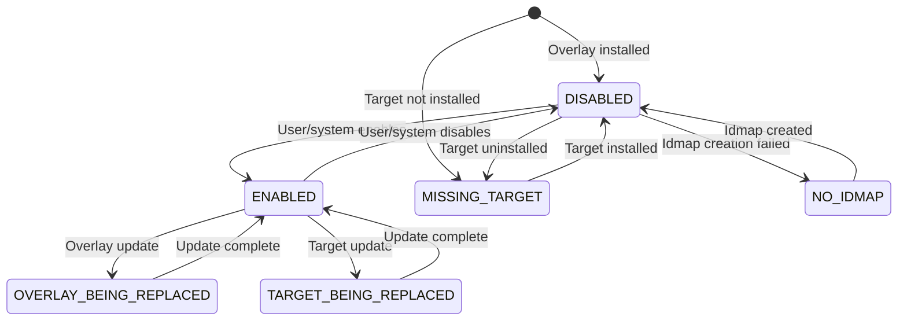

### 26.8.5 OverlayManagerServiceImpl

`OverlayManagerServiceImpl`
（`frameworks/base/services/core/java/com/android/server/om/OverlayManagerServiceImpl.java`）
实现核心业务逻辑：

```java
/**
 * Internal implementation of OverlayManagerService.
 *
 * Methods in this class should only be called by the OverlayManagerService.
 * This class is not thread-safe; the caller is expected to ensure the
 * necessary thread synchronization.
 */
final class OverlayManagerServiceImpl {
    private final PackageManagerHelper mPackageManager;
    private final IdmapManager mIdmapManager;
    private final OverlayManagerSettings mSettings;
    private final OverlayConfig mOverlayConfig;
    private final String[] mDefaultOverlays;
```

它协调覆盖层管理器的状态（来自 `overlays.xml`）与软件包管理器的状态
（来自 AndroidManifest.xml 解析）：

```java
/**
 * Helper method to merge the overlay manager's (as read from overlays.xml)
 * and package manager's (as parsed from AndroidManifest.xml files) views
 * on overlays.
 *
 * Both managers are usually in agreement, but especially after an OTA
 * things may differ. The package manager is always providing the truth;
 * the overlay manager has to adapt.
 */
```

### 26.8.6 覆盖层持久化

覆盖层状态持久化在 `/data/system/overlays.xml`。
`OverlayManagerSettings` 类处理该文件的读写。

### 26.8.7 覆盖层配置

系统覆盖层通过 `OverlayConfig` 配置，它从以下位置读取配置：

```
/product/overlay/config/config.xml
/vendor/overlay/config/config.xml
/system/overlay/config/config.xml
```

配置参数包括：

- **默认启用状态**——覆盖层默认是开启还是关闭
- **可变性**——覆盖层是否可以在运行时启用/禁用
- **优先级**——多个覆盖层针对同一资源时的顺序

覆盖层配置在系统扫描期间初始化：

```java
final OverlayConfig overlayConfig = OverlayConfig.initializeSystemInstance(
        consumer -> mPm.forEachPackageState(mPm.snapshotComputer(),
                packageState -> {
                    var pkg = packageState.getPkg();
                    if (pkg != null) {
                        consumer.accept(pkg, packageState.isSystem(),
                                apkInApexPreInstalledPaths.get(
                                        pkg.getPackageName()));
                    }
                }));
```

### 26.8.8 Fabricated 覆盖层

Android 12+ 支持 **fabricated overlays**——在运行时创建的、没有物理 APK 的覆盖
层。它们用于动态主题化（Material You）：

```java
TYPE_REGISTER_FABRICATED
TYPE_UNREGISTER_FABRICATED
```

Fabricated 覆盖层通过 `FabricatedOverlayInternal` 以编程方式创建，并通过 OMS
AIDL 接口注册。

### 26.8.9 覆盖层类别与策略

覆盖层按定义其用途的类别进行组织：

| 类别 | 用途 |
|----------|---------|
| `android.theme.customization.accent_color` | Material You 强调色 |
| `android.theme.customization.system_palette` | 系统配色方案 |
| `android.theme.customization.theme_style` | 整体主题风格 |
| `android.theme.customization.font` | 系统字体 |
| `android.theme.customization.adaptive_icon_shape` | 应用图标遮罩形状 |
| `android.theme.customization.icon_pack` | 主题化图标包 |
| `android.theme.customization.color_source` | 主题颜色的来源 |
| `android.theme.customization.dynamic_color` | 动态（Material You）颜色 |

类别帮助系统组织覆盖层并防止冲突。在同一个类别内，覆盖层按优先级排序，并且
对于每个目标软件包，每个类别只能有一个覆盖层处于活动状态。

### 26.8.10 覆盖层安全模型

覆盖层安全性在多个层面强制执行：

1. **签名检查**——针对系统软件包的可变覆盖层可能要求与目标签名匹配或具有特权
   签名。

2. **Overlayable 声明**——目标软件包可以使用 `<overlayable>` 标签声明其哪些
   资源是可覆盖的：

```xml
<!-- In the target package's res/values/overlayable.xml -->
<resources>
    <overlayable name="ThemeColors" actor="overlay://theme/customizer">
        <policy type="public">
            <item type="color" name="accent_device_default_light" />
            <item type="color" name="accent_device_default_dark" />
        </policy>
    </overlayable>
</resources>
```

3. **策略类型**——控制谁可以覆盖什么：
   - `public`——任何覆盖层都可以修改
   - `system`——仅系统覆盖层
   - `vendor`——仅 vendor 覆盖层
   - `product`——仅 product 覆盖层
   - `signature`——仅使用相同密钥签名的覆盖层
   - `actor`——仅指定的 actor 覆盖层

4. **The OverlayActorEnforcer** 验证调用者是否有权修改给定 overlayable 的
   覆盖层。

### 26.8.11 覆盖层与 PMS 的交互

OMS 严重依赖 PMS 获取软件包信息。当 PMS 广播软件包事件时，OMS 会更新其状态：

```mermaid
sequenceDiagram
    participant PMS as PackageManagerService
    participant OMS as OverlayManagerService
    participant IMPL as OverlayManagerServiceImpl
    participant IDMAP as IdmapManager
    participant APP as Running Application

    PMS->>OMS: ACTION_PACKAGE_ADDED (overlay)
    OMS->>IMPL: onPackageAdded()
    IMPL->>IMPL: updateState()
    IMPL->>IDMAP: createIdmap(overlay, target)
    IDMAP->>IDMAP: idmap2d: create idmap file
    IMPL->>IMPL: State = DISABLED (default)

    Note over OMS: User or system enables overlay

    OMS->>IMPL: setEnabled(overlay, true)
    IMPL->>IMPL: State = ENABLED
    IMPL->>IMPL: updateOverlayPaths()
    IMPL->>PMS: setOverlayPaths(target, paths)
    PMS->>APP: Configuration change
    APP->>APP: Reload resources with overlay
```

### 26.8.12 覆盖层路径

当覆盖层被启用时，PMS 会更新软件包的覆盖层路径，资源系统在资源查找期间使用
这些路径：

```java
// Recorded overlay paths configuration for the Android app info.
private String[] mPlatformPackageOverlayPaths = null;
private String[] mPlatformPackageOverlayResourceDirs = null;
```

`OverlayPaths` 类封装了路径信息：

```java
import android.content.pm.overlay.OverlayPaths;
```

### 26.8.13 Idmap 内部实现：idmap2d 守护进程

实际的 idmap 文件创建被委托给 `idmap2d`，这是一个由 `IdmapDaemon` 类管理的
本地守护进程。该守护进程采用惰性生命周期——它在需要时启动，并在 10 秒不活动
后关闭：

```java
// frameworks/base/services/core/java/com/android/server/om/IdmapDaemon.java
/**
 * To prevent idmap2d from continuously running, the idmap daemon will
 * terminate after 10 seconds without a transaction.
 **/
class IdmapDaemon {
    private static final int SERVICE_TIMEOUT_MS = 10000;
    private static final String IDMAP_DAEMON = "idmap2d";
```

守护进程通过 `IIdmap2` AIDL 接口进行通信。每个连接都用引用计数跟踪——只有当
所有连接都关闭时，守护进程才会关闭：

```mermaid
sequenceDiagram
    participant IM as IdmapManager
    participant ID as IdmapDaemon
    participant D as idmap2d (native)

    IM->>ID: createIdmap(target, overlay)
    ID->>ID: getIdmapService() [starts daemon if needed]
    ID->>D: IIdmap2.verifyIdmap()

    alt Already verified
        D-->>ID: true (verified)
        ID-->>IM: IDMAP_IS_VERIFIED
    else Needs creation
        D-->>ID: false
        ID->>D: IIdmap2.createIdmap()
        D-->>ID: idmap path
        ID-->>IM: IDMAP_IS_MODIFIED | IDMAP_IS_VERIFIED
    end

    Note over ID: Timer starts (10s)
    Note over ID: No more requests
    ID->>D: SystemService.stop("idmap2d")
```

在启动期间，许多覆盖层可能同时需要创建 idmap。对于这些批量操作，
`IdmapManager` 通过 `createIdmaps()` 批量处理请求。它会按 IPC 大小限制进行
拆分，以免超出 Binder 事务缓冲区：

```java
// frameworks/base/services/core/java/com/android/server/om/IdmapManager.java
private static final int MAX_IPC_SIZE = IBinder.getSuggestedMaxIpcSizeBytes();

// Split the input list of IdmapParams so we don't exceed the max IPC size.
private static List<List<IdmapParams>> splitIdmapParams(
        final List<IdmapParams> idmapParams) {
```

在批量 idmap 创建期间，当前线程的 Watchdog 会被暂停，因为该操作可能很慢：

```java
Watchdog.getInstance().pauseWatchingCurrentThread("idmap creation may be slow");
```

### 26.8.14 覆盖层策略执行

`IdmapManager.calculateFulfilledPolicies()` 方法计算一个位掩码，表示给定的覆盖层
软件包满足了哪些覆盖层策略。这些策略与 `overlayable.xml` 中的 `<policy>` 元素
直接对应：

```java
// frameworks/base/services/core/java/com/android/server/om/IdmapManager.java
int calculateFulfilledPolicies(@NonNull final AndroidPackage targetPackage,
        @NonNull PackageState overlayPackageState,
        @NonNull final AndroidPackage overlayPackage,
        @UserIdInt int userId) {
    int fulfilledPolicies = OverlayablePolicy.PUBLIC;

    // Overlay matches target signature
    if (mPackageManager.signaturesMatching(targetPackage.getPackageName(),
            overlayPackage.getPackageName(), userId)) {
        fulfilledPolicies |= OverlayablePolicy.SIGNATURE;
    }

    // Overlay matches actor signature
    if (matchesActorSignature(targetPackage, overlayPackage, userId)) {
        fulfilledPolicies |= OverlayablePolicy.ACTOR_SIGNATURE;
    }
```

完整的策略位掩码包括基于分区的策略：

| 策略 | 条件 |
|--------|-----------|
| `PUBLIC` | 始终授予 |
| `SIGNATURE` | 覆盖层使用与目标相同的密钥签名 |
| `ACTOR_SIGNATURE` | 覆盖层使用与指定 actor 相同的密钥签名 |
| `CONFIG_SIGNATURE` | 覆盖层匹配 `overlay-config-signature` 软件包 |
| `SYSTEM_PARTITION` | 覆盖层位于 `/system` 或 `/system_ext` |
| `VENDOR_PARTITION` | 覆盖层位于 `/vendor` |
| `PRODUCT_PARTITION` | 覆盖层位于 `/product` |
| `ODM_PARTITION` | 覆盖层位于 `/odm` |
| `OEM_PARTITION` | 覆盖层位于 `/oem` |

Android Q 之前的覆盖层获得特殊的向后兼容处理：

```java
// frameworks/base/services/core/java/com/android/server/om/IdmapManager.java
boolean enforceOverlayable(@NonNull PackageState overlayPackageState,
        @NonNull final AndroidPackage overlayPackage) {
    if (overlayPackage.getTargetSdkVersion() >= VERSION_CODES.Q) {
        return true; // Always enforce for Q+
    }
    // Pre-Q vendor overlays: enforce only if vendor partition is Q+
    if (overlayPackageState.isVendor()) {
        return VENDOR_IS_Q_OR_LATER;
    }
    // Pre-Q system/platform-signed overlays: don't enforce
    return !(overlayPackageState.isSystem()
            || overlayPackage.isSignedWithPlatformKey());
}
```

### 26.8.15 The OverlayActorEnforcer

`OverlayActorEnforcer` 验证调用 UID 是否有权修改给定 overlayable 的覆盖层。
Actor 通过格式为 `overlay://<namespace>/<name>` 的 URI 标识：

```java
// frameworks/base/services/core/java/com/android/server/om/OverlayActorEnforcer.java
/**
 * Performs verification that a calling UID can act on a target package's
 * overlayable.
 */
public class OverlayActorEnforcer {
    static Pair<String, ActorState> getPackageNameForActor(
            @NonNull String actorUriString,
            @NonNull Map<String, Map<String, String>> namedActors) {
        Uri actorUri = Uri.parse(actorUriString);
        String actorScheme = actorUri.getScheme();
        // Must be "overlay" scheme with exactly one path segment
        if (!"overlay".equals(actorScheme)
                || CollectionUtils.size(actorPathSegments) != 1) {
            return Pair.create(null, ActorState.INVALID_OVERLAYABLE_ACTOR_NAME);
        }
```

命名的 actor 定义在 `SystemConfig` 中，并将 actor URI 映射到软件包名称。
enforcer 检查调用 UID 是否与作为目标 overlayable 指定 actor 的软件包匹配。

### 26.8.16 Fabricated 覆盖层内部实现

Fabricated 覆盖层——在运行时创建、没有物理 APK 文件——是 Material You 动态主题
化的底层机制。注册流程：

```mermaid
sequenceDiagram
    participant Client as SystemUI / ThemeManager
    participant OMS as OverlayManagerService
    participant IMPL as OverlayManagerServiceImpl
    participant IM as IdmapManager
    participant D as idmap2d

    Client->>OMS: commit(OverlayManagerTransaction)
    Note over OMS: Transaction contains<br/>TYPE_REGISTER_FABRICATED

    OMS->>IMPL: registerFabricatedOverlay(internal)
    IMPL->>IMPL: Validate overlay name<br/>(alphanumeric, _, .)
    IMPL->>IM: createFabricatedOverlay(internal)
    IM->>D: IIdmap2.createFabricatedOverlay()
    D-->>IM: FabricatedOverlayInfo
    IM-->>IMPL: info (path, target, etc.)

    IMPL->>IMPL: Init overlay in settings<br/>(isFabricated=true)
    IMPL->>IMPL: updateState()
    IMPL-->>OMS: updated targets
    OMS->>OMS: updateTargetPackagesLocked()
    OMS->>OMS: Broadcast ACTION_OVERLAY_CHANGED
```

`FabricatedOverlayInternal` 包含覆盖层定义——资源类型、名称和值条目——idmap2d
将其序列化到磁盘。由 shell 软件包创建的 Fabricated 覆盖层会在每次启动时被清除，
作为一项安全措施：

```java
// frameworks/base/services/core/java/com/android/server/om/OverlayManagerService.java
// Wipe all shell overlays on boot, to recover from a potentially broken device
String shellPkgName = TextUtils.emptyIfNull(
        getContext().getString(android.R.string.config_systemShell));
mSettings.removeIf(overlayInfo -> overlayInfo.isFabricated
        && shellPkgName.equals(overlayInfo.packageName));
```

### 26.8.17 RRO 约束

Android 引入了 RRO 约束（由 `Flags.rroConstraints()` 特性标志控制），允许基于
运行时条件有条件地启用覆盖层。约束通过 `OverlayConstraint` 类传递，并在 idmap
创建期间由 idmap2d 评估：

```java
// frameworks/base/services/core/java/com/android/server/om/OverlayManagerServiceImpl.java
if (!Flags.rroConstraints() && hasConstraints) {
    throw new OperationFailedException("RRO constraints are not supported");
}
if (!enable && hasConstraints) {
    throw new OperationFailedException(
            "Constraints can only be set when enabling an overlay");
}
```

约束仅在启用覆盖层的调用中有效。禁用覆盖层的调用总是会移除所有约束。

### 26.8.18 覆盖层设置持久化

`OverlayManagerSettings` 将覆盖层状态存储为 `SettingsItem` 对象的有序列表。
顺序很重要——索引较低的项优先级较低：

```java
// frameworks/base/services/core/java/com/android/server/om/OverlayManagerSettings.java
/**
 * All overlay data for all users and target packages is stored in this list.
 * This keeps memory down, while increasing the cost of running queries or
 * mutating the data. This is ok, since changing of overlays is very rare
 * and has larger costs associated with it.
 *
 * The order of the items in the list is important, those with a lower
 * index having a lower priority.
 */
private final ArrayList<SettingsItem> mItems = new ArrayList<>();
```

设置通过 Android 的 `TypedXmlSerializer` 序列化到 `/data/system/overlays.xml`。
`AtomicFile` 包装器确保写入的崩溃安全性。

### 26.8.19 批量 Idmap 事务
当 `Flags.mergeIdmapBinderTransactions()` 标志启用时，
`OverlayManagerServiceImpl` 会收集所有需要 idmap 操作的软件包。然后它在一个
批量调用中处理它们，而不是在各自的 IPC 事务中处理：

```java
// frameworks/base/services/core/java/com/android/server/om/OverlayManagerServiceImpl.java
if (Flags.mergeIdmapBinderTransactions()) {
    pkgs.add(pkg); // Collect packages
} else {
    // Individual processing (legacy path)
    updatePackageOverlays(pkg, newUserId, 0);
}

// After collection, batch process
if (Flags.mergeIdmapBinderTransactions()) {
    updateAllPackageOverlays(pkgs, newUserId, 0);
}
```

这一优化显著减少了在拥有大量覆盖层的设备上的启动时间。它将发往 idmap2d 的
Binder 事务数量降到最低。

### 26.8.20 OMS Shell 命令

`OverlayManagerShellCommand` 类提供 `cmd overlay` 命令，用于从命令行调试和测试
覆盖层：

```bash
# List all overlays
$ adb shell cmd overlay list

# Enable an overlay
$ adb shell cmd overlay enable --user current com.example.overlay

# Disable an overlay
$ adb shell cmd overlay disable --user current com.example.overlay

# Set an overlay as the exclusive enabled overlay in its category
$ adb shell cmd overlay enable-exclusive --category com.example.overlay

# Dump overlay state
$ adb shell dumpsys overlay
```

---

## 26.9 应用休眠

应用休眠是 Android 处理未使用应用的机制。用户有时会安装应用，然后停止使用它们。
这些应用继续占用存储空间（缓存数据、OAT/dex 产物）。它们也可能保留运行时权限，
从而带来隐私风险。`AppHibernationService` 与 `PermissionController`、
`PackageManagerService` 和 `ActivityManagerService` 协同工作，将空闲应用置于低
资源状态，并回收它们占用的资源。

> **Source root:**
> `frameworks/base/services/core/java/com/android/server/apphibernation/`

### 26.9.1 架构概述

```mermaid
graph TD
    PC["PermissionController<br/>(policy engine)"] -->|"setHibernatingForUser()"| AHS["AppHibernationService"]
    AHS -->|"forceStopPackage()"| AMS["ActivityManagerService"]
    AHS -->|"deleteApplicationCacheFiles()"| PMS["PackageManagerService"]
    AHS -->|"StorageStats queries"| SSM["StorageStatsManager"]
    AHS -->|"persist state"| Disk["HibernationStateDiskStore"]
    AHS -->|"StatsLog"| Stats["FrameworkStatsLog"]
    AHS -->|"publishes local service"| AHMI["AppHibernationManagerInternal"]
    PMS -->|"AppHibernationManagerInternal"| AHMI

    style AHS fill:#f9f,stroke:#333
    style PC fill:#bbf,stroke:#333
```

关键的架构决策是一次拆分。`AppHibernationService` 管理休眠的*状态*。*策略*
（哪些应用应该休眠）位于 `PermissionController` 中，后者在单独的进程中运行。
这种分离使得 Google 能够通过 Play Services 更新休眠策略，而无需修改框架。

### 26.9.2 两级休眠状态

休眠在两个层级上运作，由不同的数据类跟踪：

| 层级 | 类 | 范围 | 优化 |
|-------|-------|-------|---------------|
| **User-level** | `UserLevelState` | 每个（软件包，用户） | 强制停止、缓存删除 |
| **Global-level** | `GlobalLevelState` | 每个软件包（所有用户） | OAT 产物删除、APK 级优化 |

```java
// AppHibernationService.java, line 119-125
@GuardedBy("mLock")
private final SparseArray<Map<String, UserLevelState>> mUserStates = new SparseArray<>();
@GuardedBy("mLock")
private final Map<String, GlobalLevelState> mGlobalHibernationStates = new ArrayMap<>();
```

只有当一个软件包对*所有*用户都休眠时，它才处于全局休眠状态。
全局休眠支持更激进的优化，比如删除提前编译（ahead-of-time）的产物。

每个状态对象跟踪：

```java
// UserLevelState.java / GlobalLevelState.java
public String packageName;
public boolean hibernated;
public long savedByte;         // bytes reclaimed
public long lastUnhibernatedMs; // timestamp of last wake-up
```

### 26.9.3 休眠过程

当 `PermissionController` 确定某个应用应该休眠时，它会调用
`setHibernatingForUser()`。然后服务会：

1. **强制停止该软件包**，通过 `ActivityManagerService.forceStopPackage()`，
   它会杀死所有进程并取消闹钟/作业
2. **删除缓存文件**，通过 `PackageManagerService.deleteApplicationCacheFilesAsUser()`
3. **记录节省的字节数**，来自 `StorageStatsManager.queryStatsForPackage()`
4. **将状态持久化**到磁盘，通过 `HibernationStateDiskStore`
5. **记录指标**，通过 `FrameworkStatsLog.USER_LEVEL_HIBERNATION_STATE_CHANGED`

```java
// AppHibernationService.java, line 455-484
private void hibernatePackageForUser(String packageName, int userId, UserLevelState state) {
    Trace.traceBegin(Trace.TRACE_TAG_SYSTEM_SERVER, "hibernatePackage");
    try {
        ApplicationInfo info = mIPackageManager.getApplicationInfo(
                packageName, PACKAGE_MATCH_FLAGS, userId);
        StorageStats stats = mStorageStatsManager.queryStatsForPackage(
                info.storageUuid, packageName, new UserHandle(userId));
        mIActivityManager.forceStopPackage(packageName, userId);
        mIPackageManager.deleteApplicationCacheFilesAsUser(packageName, userId,
                null /* observer */);
        synchronized (mLock) {
            state.savedByte = stats.getCacheBytes();
        }
    } catch (RemoteException e) { /* ... */ }
}
```

### 26.9.4 解除休眠与唤醒

当一个已休眠的应用再次被使用时（通过 `UsageEventsListener` 检测到），服务会恢复
它：

```java
// AppHibernationService.java, line 490-546
private void unhibernatePackageForUser(String packageName, int userId) {
    // Deliver LOCKED_BOOT_COMPLETED and BOOT_COMPLETE broadcasts
    // so the app can re-register alarms, jobs, etc.
    Intent lockedBcIntent = new Intent(Intent.ACTION_LOCKED_BOOT_COMPLETED)
            .setPackage(packageName);
    mIActivityManager.broadcastIntentWithFeature(/* ... */);

    Intent bcIntent = new Intent(Intent.ACTION_BOOT_COMPLETED)
            .setPackage(packageName);
    mIActivityManager.broadcastIntentWithFeature(/* ... */);
}
```

boot-completed 广播至关重要。它们让应用能够重新注册其 `AlarmManager` 闹钟、
`JobScheduler` 作业、`WorkManager` 任务和 Firebase Cloud Messaging 令牌。应用在
被强制停止时丢失了这些项目。

```mermaid
sequenceDiagram
    participant User
    participant USS as UsageStatsService
    participant AHS as AppHibernationService
    participant AMS as ActivityManagerService
    participant PMS as PackageManagerService

    Note over User: User opens hibernated app
    USS->>AHS: UsageEventListener.onUsageEvent()
    AHS->>AHS: setHibernatingForUser(pkg, false)
    AHS->>AMS: broadcastIntent(LOCKED_BOOT_COMPLETED)
    AHS->>AMS: broadcastIntent(BOOT_COMPLETED)
    Note over AHS: App re-registers alarms/jobs
    AHS->>AHS: Persist updated state to disk
```

### 26.9.5 与权限自动撤销的集成

休眠与权限撤销之间的联系微妙但重要。`PermissionController` 同时处理两者：

1. **权限自动撤销**：撤销未使用应用的运行时权限
   （Android 11 引入）
2. **应用休眠**：将未使用应用置于休眠状态并回收存储空间
   （Android 12 引入）

这是两个独立的特性，共享同一个策略信号：“此应用最近未被使用。”
`PermissionController` 使用 `UsageStatsManager` 来确定应用使用情况，然后同时
调用权限撤销和休眠 API。

### 26.9.6 Device Config 与特性门控

该服务由一个 `DeviceConfig` 标志控制：

```java
// AppHibernationConstants.java
static final String KEY_APP_HIBERNATION_ENABLED = "app_hibernation_enabled";

// AppHibernationService.java, line 188
sIsServiceEnabled = isDeviceConfigAppHibernationEnabled();
```

每个公共 API 方法都会首先检查 `sIsServiceEnabled`。当服务被禁用时，它返回空值或
false 值。这使得该特性可以被远程切换，而无需系统更新。

### 26.9.7 持久化与启动序列

休眠状态通过 `HibernationStateDiskStore` 持久化到磁盘，后者使用协议缓冲区序列
化（`GlobalLevelHibernationProto`、`UserLevelHibernationProto`）。状态在
`PHASE_BOOT_COMPLETED` 期间于后台执行器上加载：

```java
// AppHibernationService.java, line 177-186
@Override
public void onBootPhase(int phase) {
    if (phase == PHASE_BOOT_COMPLETED) {
        mBackgroundExecutor.execute(() -> {
            List<GlobalLevelState> states =
                    mGlobalLevelHibernationDiskStore.readHibernationStates();
            synchronized (mLock) {
                initializeGlobalHibernationStates(states);
            }
        });
    }
}
```

用户级状态在用户解锁时惰性加载。它使用存储在 `mUserDiskStores`
`SparseArray` 中的按用户 `HibernationStateDiskStore` 实例。

### 26.9.8 软件包生命周期事件

该服务注册了一个针对 `ACTION_PACKAGE_ADDED` 和
`ACTION_PACKAGE_REMOVED` 的广播接收器，以保持其状态映射同步：

- **软件包添加**：创建一个 `hibernated = false` 的新 `UserLevelState` 和
  `GlobalLevelState` 条目
- **软件包移除**：清理两个用户和全局映射中的状态
- **软件包替换**：`EXTRA_REPLACING` 标志用于区分更新与全新安装；更新保留现有
  的休眠状态

### 26.9.9 调试应用休眠

```bash
# Check if a package is hibernated (add --global for global state)
adb shell cmd app_hibernation get-state --user 0 <package>

# Manually hibernate a package
adb shell cmd app_hibernation set-state --user 0 <package> true

# Check DeviceConfig flag
adb shell device_config get app_hibernation app_hibernation_enabled
```

---

## 26.10 Web 应用安装程序（Android 17）

Android 17 增加了一条将渐进式 Web 应用（PWA）转变为真实、已安装的 Android
软件包的原生路径。在此之前，希望 “Add to Home Screen” 的浏览器只有两个选择。
它要么通过 Play services 创建一个轻量级的 WebAPK，要么放置一个只是重新启动浏览器
的快捷方式。Android 17 将这一能力移到了平台内部。

一个新的可更新 APEX，`com.android.webapp`，获取站点的 Web manifest，并在设备上
生成一个已签名的 APK。它通过 26.4 节所述的同一个 `PackageInstaller` 流水线安装
该 APK。整个模块位于 `frameworks/base` 之外，在 `packages/modules/WebApp`。它的
公开界面是 `android.content.pm.webapp` API。因此它本质上是一个 PackageManager
客户端，也是安装路径上一个新的同类组件。

该特性由 `enable_web_app_service_v2` aconfig 标志控制
（`packages/modules/WebApp/flags/flags.aconfig`）。该标志位于
`lse_desktop_experience` 命名空间，大型屏幕桌面窗口化工作也使用它。这个命名空间
很合适，因为主要使用者是一个安装独立 Web 应用的桌面级浏览器。只有当设置了
`RELEASE_WEBAPP_MODULE` 构建标志（`packages/modules/WebApp/apex/Android.bp`）时，
APEX 本身才会被编译进来。即使对于发布了该 APEX 的构建，运行时路径在
`Settings.Global` 值 `enable_webapp_minter` 被设置为 `1` 之前也是一个空操作。

### 26.10.1 模块布局与 APEX 边界

Web App 模块是一个自包含的主线模块，由四部分组成。这些部分分别是一个框架库、一个
AIDL 契约、一个特权系统应用和该 APEX。库公开 SDK API。应用完成工作。APEX 将
所有内容打包在一起。

```mermaid
graph TB
    subgraph "Caller (e.g. a browser app)"
        WAM["WebAppManager<br/>(android.content.pm.webapp)"]
    end

    subgraph "com.android.webapp APEX"
        SVC["WebAppService<br/>(LifecycleService)"]
        INST["WebAppInstaller"]
        MINT["ApkMinter + ApkKeyStore"]
        TMPL["webapp-template.zip<br/>+ bundled aapt2"]
    end

    subgraph "Platform"
        PI["PackageInstaller<br/>(Section 26.4)"]
        PMS["PackageManagerService"]
    end

    WAM -->|"bindService + AIDL"| SVC
    SVC --> INST
    INST --> MINT
    MINT --> TMPL
    INST -->|"createSession / commit"| PI
    PI --> PMS
```

这些部分与具体的源码对应关系如下：

- **框架 API**（`packages/modules/WebApp/framework/java/android/content/pm/webapp/`）：
  `WebAppManager`、`WebAppInstallRequest` 和 `WebAppQueryRequest`。这些是应用链接
  的类。它们作为 `@SystemApi` 导出，可供模块库使用，并由
  `@FlaggedApi(Flags.FLAG_ENABLE_WEB_APP_SERVICE_V2)` 进行门控。
- **AIDL 契约**（`packages/modules/WebApp/framework/aidl/com/android/webapp/`）：
  `IWebAppService` 以及 `IWebAppInstallCallback` 和 `IWebAppQueryCallback` 结果回调。
  每个方法都带有 `@PermissionManuallyEnforced` 注解——服务自己检查资格，而不是
  依赖清单权限。
- **系统服务**（`packages/modules/WebApp/service/java/com/android/webapp/service/`）：
  `WebAppService`（绑定入口点）和 `WebAppInstaller`（安装状态机），使用 Kotlin
  编写。
- **APEX**（`packages/modules/WebApp/apex/`）：捆绑了 `WebAppService` 特权应用、
  `aapt2` 二进制文件的副本、APK 模板，以及 `framework-webapp` 库的 bootclasspath
  片段。

### 26.10.2 注册系统服务

`WebAppManager` 本身不是一个 binder 服务。它是一个注册到平台
`SystemServiceRegistry` 的轻量级 context 包装器。注册由
`WebAppFrameworkInitializer.registerServiceWrappers()`
（`packages/modules/WebApp/framework/java/android/content/pm/webapp/WebAppFrameworkInitializer.java`）
执行，`frameworks/base` 从其静态初始化器
（`frameworks/base/core/java/android/app/SystemServiceRegistry.java`）调用它：

```java
// In SystemServiceRegistry's static block:
WebAppFrameworkInitializer.registerServiceWrappers();
```

服务名称是新的常量 `Context.WEB_APP_SERVICE`
（`frameworks/base/core/java/android/content/Context.java`），其值是字符串
`"web_app"`：

```java
@FlaggedApi(com.android.webapp.flags.Flags.FLAG_ENABLE_WEB_APP_SERVICE_V2)
public static final String WEB_APP_SERVICE = "web_app";
```

因此，调用者获取管理器的方式与获取任何其他系统服务完全相同：

```java
WebAppManager webAppManager = context.getSystemService(WebAppManager.class);
```

由于实现发布在 APEX 中而不是在系统服务器中，`WebAppManager` 并不持有指向一个
长期服务的 binder。相反，它按需发现并绑定到特权 `WebAppService` 应用。这使得
安装器进程只在安装实际进行期间驻留内存。

### 26.10.3 发现并绑定 WebAppService

有趣的设计选择是 `WebAppManager` 如何找到该服务。它不是使用硬编码的组件，而是解析
一个 action 为 AIDL 接口名称的 `Intent`，并只保留唯一匹配的**系统**应用
（`packages/modules/WebApp/framework/java/android/content/pm/webapp/WebAppManager.java`）：

```java
Intent intent = new Intent(IWebAppService.class.getName());
List<ResolveInfo> services =
        mContext.getPackageManager()
                .queryIntentServices(intent, PackageManager.MATCH_SYSTEM_ONLY);
// ... pick the one ResolveInfo whose applicationInfo has FLAG_SYSTEM
```

如果有多个系统应用声明该 action，管理器会记录 `Log.wtf`，因为契约假设只有一个提供
者。`WebAppManager` 在绑定进行期间将请求排队。它维护一个待处理 `Runnable` 的
列表，并在 `onServiceConnected` 中将其清空。它在单线程执行器上运行阻塞式 AIDL
调用，因此调用者的线程永远不会被阻塞。它跟踪活动请求计数，并在计数降回零时解绑
服务。安装器 APEX 进程随后会在最后一个安装或查询完成后立即被拆除。

下图展示了跨进程边界的完整异步安装往返过程。

```mermaid
sequenceDiagram
    participant App as Browser App
    participant WAM as WebAppManager
    participant SVC as WebAppService
    participant INST as WebAppInstaller
    participant PI as PackageInstaller

    App->>WAM: install(request, executor, callback)
    WAM->>WAM: queryIntentServices(MATCH_SYSTEM_ONLY)
    WAM->>SVC: bindService(BIND_AUTO_CREATE)
    SVC-->>WAM: onServiceConnected (IWebAppService)
    WAM->>SVC: install(title, manifestUrl, callback)
    SVC->>SVC: verify caller is browser-eligible
    SVC->>INST: enqueueRequest(InstallRequest)
    INST->>INST: fetch + parse web manifest
    INST->>INST: download icons, mint + sign APK
    INST->>PI: createSession / write / commit
    PI-->>INST: STATUS_SUCCESS
    INST-->>App: onInstallResult(RESULT_SUCCESS, pkg)
    WAM->>SVC: unbindService (active requests == 0)
```

### 26.10.4 安装请求与结果契约

`WebAppManager` 公开两个异步操作。每个操作都接受一个 `Executor` 和一个函数式回调，
因此结果会在 binder 线程之外交付：

- `install(WebAppInstallRequest, Executor, ObjIntConsumer<String>)`——
  `ObjIntConsumer` 接收已安装的软件包名称（或 `null`）以及一个结果码。
- `query(WebAppQueryRequest, Executor, IntConsumer)`——`IntConsumer` 接收一个
  查询结果码。

`WebAppInstallRequest`
（`packages/modules/WebApp/framework/java/android/content/pm/webapp/WebAppInstallRequest.java`）
通过一个只接受显示标题和 PWA manifest URL 的 `Builder` 构建。安装器从获取到的
manifest 中派生出其他所有内容（名称、图标、颜色、起始 URL）。其结果码精确说明了
安装可能失败的原因：

| 结果码 | 含义 |
|-------------|---------|
| `RESULT_SUCCESS` | 安装完成；返回软件包名称 |
| `RESULT_NETWORK_ERROR` | Manifest 或图标下载失败或超时 |
| `RESULT_INTERNAL_ERROR` | Minting、软件包管理器或意外失败 |
| `RESULT_PERMISSION_DENIED` | 调用者无资格持有浏览器角色 |
| `RESULT_DUPLICATED_REQUEST` | 一个相同的请求已在队列中 |
| `RESULT_INVALID_ARGUMENTS` | manifest URL 无效或没有可用图标 |
| `RESULT_CANCELLED_BY_USER` | 用户拒绝了确认对话框 |
| `RESULT_SECURITY_ERROR` | `PackageInstaller` 阻止了安装 |
| `RESULT_UNAVAILABLE` | Minter 被禁用（`enable_webapp_minter` 为 0） |

`WebAppQueryRequest`
（`packages/modules/WebApp/framework/java/android/content/pm/webapp/WebAppQueryRequest.java`）
让调用者询问某个软件包是否是被 Web App 服务安装的。答案刻意保持隐私保护。不持有
`QUERY_ALL_PACKAGES` 的应用只能了解到它自己安装的软件包。对于任何其他软件包，它
会收到 `RESULT_PERMISSION_DENIED`，而不是一个 true/false 答案——后者会泄露某个
无关软件包的存在。

### 26.10.5 调用者资格：浏览器角色

Web 应用安装并不是对任意应用开放的公共能力。`WebAppService.install()` 的实现
（`packages/modules/WebApp/service/java/com/android/webapp/service/WebAppService.kt`）
在任何工作之前强制检查调用者是合法的浏览器。它清除调用身份，并将调用 UID 映射到
单个软件包。然后它检查该软件包是否能处理可浏览的 `http:` view intent：

```kotlin
val intent = Intent(Intent.ACTION_VIEW).apply {
    addCategory(Intent.CATEGORY_BROWSABLE)
    setData("http:".toUri())
}
val resolveInfo = pm.queryIntentActivities(intent, /* MATCH_ALL */ ...)
if (resolveInfo.none { it.activityInfo.packageName == callingPackage }) {
    callback.onInstallResult(WebAppInstallRequest.RESULT_PERMISSION_DENIED, null)
    return
}
```

换句话说，资格与 `RoleManager.ROLE_BROWSER` 概念绑定：只有注册为浏览器的应用才能
铸造 Web 应用。服务将这些 `PackageManager` 和角色查询包装在
`clearCallingIdentity()` / `restoreCallingIdentity()` 中。然后查询以服务自己
（特权）的身份运行。因此恶意调用者无法搭系统应用可见性的便车。

### 26.10.6 在设备上铸造并签名 APK

一旦请求被接受，它就被交给 `WebAppInstaller`
（`packages/modules/WebApp/service/java/com/android/webapp/service/WebAppInstaller.kt`）。
该类一次处理一个有界队列中的请求。当队列清空时它会关闭服务。对于每个请求，它：

1. **通过 HTTP 获取并解析 Web manifest**，得到一个 `PwaManifest` 模型。
   它提取名称、起始 URL、显示模式、主题/背景颜色、方向和图标列表。
2. **将图标下载**到服务缓存下按软件包划分的工作目录中。它将它们分类到密度桶
   （`mdpi` 到 `xxxhdpi`）。它还处理用于自适应和通知图标的 `maskable` 和
   `monochrome` 图标用途。
3. **显示确认对话框**（`InstallConfirmActivity`），并在 Kotlin 协程续体上挂起，
   直到用户批准或取消。
4. **通过 `ApkMinter` 铸造已签名的 APK**
   （`packages/modules/WebApp/service/java/com/android/webapp/service/minter/ApkMinter.kt`）。
5. **通过 `PackageInstaller` 安装它**。

铸造步骤是这个模块与众不同之处：它在运行时构建一个真实的 APK。`ApkMinter` 解压
APEX 内发布的模板 ZIP。它使用来自 manifest 的值渲染
`AndroidManifest.xml.mustache` 和 `colors.xml.mustache` 模板。然后它调用 APEX 捆绑
的 `aapt2` 二进制文件来编译和链接资源。两条路径在 APEX 镜像中都是固定的：

```kotlin
private const val TEMPLATE_FILE = "/apex/com.android.webapp/res/webapp-template.zip"
private const val AAPT2_EXEC = "/apex/com.android.webapp/bin/aapt2"
```

软件包名称是确定性的但不透明。`generatePackageName()` 取调用软件包名称与 manifest
URL 拼接后的 SHA-256。它为结果加上 `com.android.webapp` 前缀。因此，同一个浏览器
安装的同一个站点总是映射到同一个软件包。

签名由 `ApkKeyStore`
（`packages/modules/WebApp/service/java/com/android/webapp/service/minter/ApkKeyStore.kt`）
完成。它首次使用时在 `AndroidKeyStore` 中生成一个硬件支持的 RSA 密钥。它使用 v2 和
v3 签名方案对 APK 签名（v1 和 v4 被禁用）。设备上的每个 Web 应用都由这个服务所有
的单一密钥签名。因此服务随后在比较签名证书时可以识别 “它自己安装的应用”。这正是
`WebAppQueryRequest` 得到回答的方式。

### 26.10.7 它所需的特权权限

`WebAppService` 作为特权应用 `com.android.webapp.service` 运行，并通过其 APEX
允许列表（`packages/modules/WebApp/apex/permissions/com.android.webapp.service.xml`）
获得恰好三项特权权限：

| 权限 | 为什么需要 |
|------------|------------------|
| `INSTALL_PACKAGES` | 静默安装铸造出的 APK，无需系统安装对话框 |
| `START_ACTIVITIES_FROM_BACKGROUND` | 从后台服务启动确认对话框 |
| `SUBSTITUTE_NOTIFICATION_APP_NAME` | 以调用浏览器的名称（而非安装器的名称）显示安装进度通知 |

实际安装使用一个以 `SessionParams(MODE_FULL_INSTALL)` 构建的普通
`PackageInstaller` 会话。会话将发起 UID 归属为调用浏览器，因此安装来源被正确记
录。持有 `INSTALL_PACKAGES` 使得提交可以在不向用户发出第二次提示的情况下继续。这是
因为用户已经通过该模块自己的确认对话框批准了。这与 26.4.8 节所述的提交机制相同。
Web App 服务只是它的一个特权客户端，而不是 PMS 内部一条新的安装路径。

### 26.10.8 它在软件包管理器故事中的位置

Web App 安装器值得理解，恰恰是因为它**没有**修改 PMS。它演示了一个主线模块如何
完全在现有、稳定的 `PackageInstaller` API 之上分层一个全新的安装体验：

- 它是一个 APEX，因此可以独立于平台进行更新。
- 它复用已经内置到 PMS 中的安装流水线、签名方案和来源归属，而不是在系统服务器中
  添加特权安装代码。
- 它的公开 API 位于 `android.content.pm.webapp` 下。这表明平台现在将 “已安装的
  Web 应用” 视为一类一等公民的软件包。

从 PMS 的角度来看，结果是一个普通的第三方 APK。它恰好是在设备上生成的，并由一个
系统组件签名。PMS 对它所做的一切——扫描、权限授予、Intent 解析、可见性过滤——
都与其他任何已安装应用完全相同。

---

## 26.11 动手实践——实用练习

本节提供实操练习，使用常见的 Android 开发工具来探索 PMS 功能。

### 26.11.1 检查 APK

**练习 1：检查 APK 结构**

使用 `aapt2` 从一个已安装的系统 APK 中导出信息：

```bash
# List files in an APK
$ unzip -l /system/app/Calculator/Calculator.apk

# Dump the AndroidManifest.xml
$ aapt2 dump xmltree /system/app/Calculator/Calculator.apk --file AndroidManifest.xml

# Dump all badging information (package name, version, permissions)
$ aapt2 dump badging /system/app/Calculator/Calculator.apk

# Dump the resource table
$ aapt2 dump resources /system/app/Calculator/Calculator.apk | head -50
```

**练习 2：检查 APK 签名**

```bash
# Check which signature schemes are present
$ apksigner verify --verbose --print-certs /data/app/~~*/com.example.app*/base.apk

# The verbose output reports which of the v1/v2/v3/v4 schemes verified.
# To constrain which schemes are checked, narrow the SDK range instead:
$ apksigner verify --verbose --min-sdk-version 23 --max-sdk-version 23 \
    /path/to/app.apk
```

### 26.11.2 查询软件包信息

**练习 3：使用 pm shell 命令**

```bash
# List all installed packages
$ adb shell pm list packages

# List only system packages
$ adb shell pm list packages -s

# List third-party packages
$ adb shell pm list packages -3

# Get detailed package info
$ adb shell pm dump com.android.settings | head -100

# Get the path of an installed APK
$ adb shell pm path com.android.settings

# List all permissions
$ adb shell pm list permissions -g -d
```

**练习 4：检查软件包设置**

```bash
# View the packages.xml database (requires root)
$ adb shell cat /data/system/packages.xml | head -200

# View per-user package restrictions
$ adb shell cat /data/system/users/0/package-restrictions.xml

# View runtime permissions (requires root)
$ adb shell cat /data/misc_de/0/apexdata/com.android.permission/runtime-permissions.xml
```

### 26.11.3 安装和管理软件包

**练习 5：安装工作流**

```bash
# Standard install
$ adb install app.apk

# Install with replacement (update)
$ adb install -r app.apk

# Install as test-only
$ adb install -t test-app.apk

# Install on specific user
$ adb install --user 0 app.apk

# Install a split APK
$ adb install-multiple base.apk split_config.arm64_v8a.apk split_config.en.apk

# Install using streaming (incremental)
$ adb install --streaming app.apk

# Stage a session manually
$ adb shell pm install-create
# Returns: Success: created install session [1234]
$ adb shell pm install-write 1234 base.apk /path/to/base.apk
$ adb shell pm install-commit 1234
```

**练习 6：卸载工作流**

```bash
# Uninstall for current user (keeps data for other users)
$ adb shell pm uninstall com.example.app

# Uninstall keeping data
$ adb shell pm uninstall -k com.example.app

# Uninstall for all users
$ adb shell pm uninstall --user all com.example.app

# Clear app data without uninstalling
$ adb shell pm clear com.example.app
```

### 26.11.4 使用权限

**练习 7：权限操作**

```bash
# List permissions requested by an app
$ adb shell pm dump com.example.app | grep "permission"

# Grant a runtime permission
$ adb shell pm grant com.example.app android.permission.CAMERA

# Revoke a runtime permission
$ adb shell pm revoke com.example.app android.permission.CAMERA

# Check if a permission is granted
$ adb shell dumpsys package com.example.app | grep "CAMERA"

# List all dangerous permissions
$ adb shell pm list permissions -d -g

# Reset runtime permissions (takes no arguments; resets all packages)
$ adb shell pm reset-permissions
```

### 26.11.5 Intent 解析检查

**练习 8：查询 intent 解析**

```bash
# Resolve an implicit intent
$ adb shell pm resolve-activity --brief "android.intent.action.VIEW" \
    -d "https://www.example.com"

# Query all activities matching an intent
$ adb shell pm query-activities --brief "android.intent.action.SEND" \
    -t "text/plain"

# List preferred activities (defaults)
$ adb shell dumpsys package preferred

# Set the default home activity (launcher)
$ adb shell pm set-home-activity com.example.launcher/.LauncherActivity

# Clear preferred-activity defaults for a package
$ adb shell pm clear-package-preferred-activities com.example.app
```

### 26.11.6 使用覆盖层

**练习 9：覆盖层管理**

```bash
# List all registered overlays
$ adb shell cmd overlay list

# Enable an overlay
$ adb shell cmd overlay enable com.example.overlay

# Disable an overlay
$ adb shell cmd overlay disable com.example.overlay

# Set overlay priority (the third argument is a parent overlay package,
# or the bare keyword lowest/highest)
$ adb shell cmd overlay set-priority com.example.overlay highest

# Show overlay info
$ adb shell cmd overlay dump
```

**练习 10：创建一个简单的覆盖层**

创建一个修改系统 UI 强调色的最小化覆盖层 APK：

```xml
<!-- AndroidManifest.xml -->
<manifest xmlns:android="http://schemas.android.com/apk/res/android"
    package="com.example.theme.overlay">
    <overlay
        android:targetPackage="android"
        android:category="android.theme.customization.accent_color"
        android:isStatic="false" />
</manifest>
```

```xml
<!-- res/values/colors.xml -->
<resources>
    <color name="accent_device_default_light">#FF6200EE</color>
    <color name="accent_device_default_dark">#FFBB86FC</color>
</resources>
```

构建并安装：

```bash
# Build the overlay APK
$ aapt2 compile -o compiled/ res/values/colors.xml
$ aapt2 link -o overlay.apk --manifest AndroidManifest.xml \
    -I /path/to/android.jar compiled/values_colors.arsc.flat

# Sign the APK
$ apksigner sign --ks debug.keystore overlay.apk

# Install and enable
$ adb install overlay.apk
$ adb shell cmd overlay enable com.example.theme.overlay
```

### 26.11.7 Dumpsys 探索

**练习 11：全面的 PMS 转储**

```bash
# Full PMS dump (very large)
$ adb shell dumpsys package > pms-dump.txt

# Dump a specific package
$ adb shell dumpsys package com.android.settings

# Dump only features
$ adb shell dumpsys package features

# Dump shared libraries
$ adb shell dumpsys package libraries

# Dump package verifiers
$ adb shell dumpsys package verifiers

# Dump preferred activities
$ adb shell dumpsys package preferred

# Dump overlay information
$ adb shell dumpsys overlay
```

### 26.11.8 拆分 APK 练习

**练习 13：创建并安装拆分 APK**

```bash
# Step 1: Create a base APK and a feature split using bundletool
$ bundletool build-apks --bundle=my-app.aab --output=my-app.apks \
    --connected-device

# Step 2: Install all splits
$ bundletool install-apks --apks=my-app.apks

# Step 3: Or install manually with adb
$ adb install-multiple base.apk \
    split_config.arm64_v8a.apk \
    split_config.en.apk \
    split_config.xxhdpi.apk

# Step 4: Inspect the installed splits
$ adb shell pm path com.example.app
# Output shows all installed split paths:
#   package:/data/app/~~.../com.example.app-.../base.apk
#   package:/data/app/~~.../com.example.app-.../split_config.arm64_v8a.apk
#   package:/data/app/~~.../com.example.app-.../split_config.en.apk

# Step 5: List split names
$ adb shell dumpsys package com.example.app | grep -A 20 "splits="
```

**练习 14：动态安装一个功能拆分**

```bash
# Create a session in inherit mode (-p INHERIT_PACKAGE selects
# MODE_INHERIT_EXISTING)
$ adb shell pm install-create -p com.example.app
# Returns: Success: created install session [1234]

# Write the new feature split
$ adb push split_feature_camera.apk /data/local/tmp/
$ adb shell pm install-write 1234 split_feature_camera \
    /data/local/tmp/split_feature_camera.apk

# Commit the session
$ adb shell pm install-commit 1234

# Verify the new split is installed
$ adb shell pm path com.example.app
```

### 26.11.9 软件包数据库探索

**练习 15：深入了解 packages.xml**

```bash
# Pull the packages database (requires root)
$ adb root
$ adb pull /data/system/packages.xml

# Examine a specific package entry
# The XML structure looks like:
# <package name="com.example.app"
#          codePath="/data/app/~~.../com.example.app-.../"
#          nativeLibraryPath="/data/app/.../lib/arm64"
#          publicFlags="805306372"
#          privateFlags="0"
#          ft="..."  (first install time)
#          it="..."  (install time)
#          ut="..."  (update time)
#          version="100"
#          userId="10123">
#     <sigs count="1" schemeVersion="3">
#         <cert index="0" key="..." />
#     </sigs>
#     <perms>
#         <item name="android.permission.INTERNET" granted="true" flags="0" />
#     </perms>
# </package>
```

**练习 16：实时监控软件包操作**

```bash
# Watch for package events using logcat
$ adb logcat -s PackageManager:I PackageInstaller:I

# In another terminal, install an app and watch the log output:
# You'll see messages like:
#   PackageManager: Scanning package com.example.app
#   PackageManager: Package com.example.app codePath changed
#   PackageInstaller: Session 1234 sealed

# Watch for permission changes
$ adb logcat -s PermissionManagerService:D

# Watch for intent resolution
$ adb logcat -s PackageManager:V -e "resolve|intent"
```

### 26.11.10 性能分析

**练习 17：测量启动扫描时间**

```bash
# After a reboot, check the boot log for scanning times
$ adb logcat -d | grep -E "Finished scanning|BOOT_PROGRESS"

# Look for entries like:
#   Finished scanning system apps. Time: 3456 ms, packageCount: 247
#   Finished scanning non-system apps. Time: 1234 ms, packageCount: 87

# Use dumpsys to get snapshot statistics
$ adb shell dumpsys package snapshot

# Emit machine-readable checkin output
$ adb shell dumpsys package --checkin
```

**练习 18：分析 intent 解析**

```bash
# Enable verbose intent matching logging
$ adb shell setprop log.tag.PackageManager VERBOSE

# Now resolve an intent and watch the detailed matching log
$ adb shell am start -a android.intent.action.VIEW \
    -d "https://www.example.com"

# Check logcat for resolution details
$ adb logcat -s PackageManager:V | grep -i "intent\|resolve\|match"

# Reset logging
$ adb shell setprop log.tag.PackageManager INFO
```

### 26.11.11 高级：追踪 PMS 行为

**练习 12：系统跟踪分析**

```bash
# Capture a system trace during installation
$ adb shell atrace --async_start -c -b 16384 pm
$ adb install large-app.apk
$ adb shell atrace --async_stop -z -c -b 16384 pm > trace.ctrace

# View the trace in Perfetto UI
# Upload trace.ctrace to https://ui.perfetto.dev/
```

PMS 跟踪使用 `TRACE_TAG_PACKAGE_MANAGER` 标签：

```java
import static android.os.Trace.TRACE_TAG_PACKAGE_MANAGER;
```

需要查找的关键跟踪部分：

- `scanApexPackages`——APEX 软件包扫描时间
- `parallelScanDir` / `scanPackage`——目录和每个软件包的扫描时间
- `resolveIntent`——Intent 解析时间
- `queryIntentActivities`——Activity 查询时间
- `installPackages`——完整安装时间

### 26.11.12 高级：构建和测试 PMS 更改

**练习 19：构建 PMS 模块**

```bash
# Navigate to the AOSP source tree
$ cd $AOSP_ROOT

# Build only the services.core module (contains PMS)
$ m services.core

# Or build the specific PMS-related test targets
$ m FrameworksServicesTests

# Run the PMS unit tests
$ atest FrameworksServicesTests:com.android.server.pm

# Run a specific test class
$ atest PackageManagerServiceServerTests:com.android.server.pm.PackageManagerServiceTest

# Run CTS package manager tests
$ atest CtsPackageInstallTestCases
$ atest CtsAppSecurityHostTestCases
```

**练习 20：使用断点调试 PMS**

```bash
# Attach a debugger to system_server
$ adb forward tcp:8700 jdwp:$(adb shell pidof system_server)

# In Android Studio, create a "Remote JVM Debug" configuration
# pointing to localhost:8700

# Set breakpoints in:
# - PackageManagerService.snapshotComputer()
# - InstallingSession.processInstallRequests()
# - ResolveIntentHelper.resolveIntentInternal()
# - PermissionManagerService.checkPermission()

# Trigger the breakpoint by installing an app or launching an activity
```

### 26.11.13 高级：覆盖层开发工作流

**练习 21：完整的覆盖层开发周期**

```bash
# Step 1: Identify target resources
$ adb shell cmd overlay dump com.android.systemui
# Prints overlay manager state for the SystemUI target; use
# "cmd overlay lookup" (or idmap2 lookup) to inspect overlayable
# resource values

# Step 2: Create overlay project structure
$ mkdir -p my-overlay/res/values
$ mkdir -p my-overlay/res/drawable

# Step 3: Create the overlay manifest
# (See Exercise 10 for manifest content)

# Step 4: Override specific resources
# In my-overlay/res/values/strings.xml:
# <resources>
#     <string name="quick_settings_wifi_label">WiFi Override</string>
# </resources>

# Step 5: Build with aapt2
$ aapt2 compile -o compiled/ my-overlay/res/values/strings.xml
$ aapt2 link -o my-overlay.apk \
    --manifest my-overlay/AndroidManifest.xml \
    -I $ANDROID_HOME/platforms/android-34/android.jar \
    compiled/*.flat

# Step 6: Sign and install
$ apksigner sign --ks debug.keystore my-overlay.apk
$ adb install my-overlay.apk

# Step 7: Enable and verify
$ adb shell cmd overlay enable --user current com.example.my.overlay
$ adb shell cmd overlay list | grep com.example.my.overlay
# Should show [x] com.example.my.overlay (enabled)

# Step 8: Disable and remove
$ adb shell cmd overlay disable --user current com.example.my.overlay
$ adb uninstall com.example.my.overlay
```

### 26.11.14 排查常见的 PMS 问题

**练习 22：诊断安装失败**

```bash
# Get detailed error information
$ adb install -r problematic.apk 2>&1
# Common errors and their meanings:

# INSTALL_FAILED_ALREADY_EXISTS
#   Another package with the same name exists
#   Fix: Use -r flag or uninstall first

# INSTALL_FAILED_UPDATE_INCOMPATIBLE
#   Signatures don't match the existing install
#   Fix: Uninstall existing, then install new

# INSTALL_FAILED_DEPRECATED_SDK_VERSION
#   targetSdkVersion is too low
#   Fix: Update targetSdkVersion to >= MIN_INSTALLABLE_TARGET_SDK

# INSTALL_FAILED_DUPLICATE_PERMISSION
#   A permission is already defined by another package
#   Fix: Use unique permission names

# INSTALL_PARSE_FAILED_NO_CERTIFICATES
#   APK is not signed
#   Fix: Sign with apksigner

# Check the system log for detailed failure reason
$ adb logcat -s PackageManager:E InstallPackageHelper:E
```

**练习 23：调试权限问题**

```bash
# Check why a permission is denied
$ adb shell dumpsys package com.example.app | grep -A 5 "requested permissions"
$ adb shell dumpsys package com.example.app | grep -A 5 "install permissions"
$ adb shell dumpsys package com.example.app | grep -A 5 "runtime permissions"

# Check if the permission is a runtime permission that needs granting
$ adb shell pm list permissions -g | grep PERMISSION_NAME

# Check AppOps override state
$ adb shell appops get com.example.app

# Reset runtime permissions for debugging (no arguments; affects all packages)
$ adb shell pm reset-permissions

# Check the permission controller UI
$ adb shell am start -a android.intent.action.MANAGE_APP_PERMISSIONS \
    -d "package:com.example.app"
```

---

## 总结

PackageManagerService 是 Android 应用生态体系的骨干。下面的主架构图展示了所有子
系统是如何相互关联的：

```mermaid
graph TB
    subgraph "External Clients"
        APPS["Applications<br/>(PackageManager API)"]
        ADB["adb / Shell"]
        STORE["App Stores<br/>(PackageInstaller API)"]
    end

    subgraph "PackageManagerService Core"
        PMS["PackageManagerService"]
        COMPUTER["Computer<br/>(Snapshot)"]
        SETTINGS["Settings<br/>(packages.xml)"]
    end

    subgraph "Helper Classes"
        INSTALL["InstallPackageHelper"]
        INIT["InitAppsHelper"]
        RESOLVE["ResolveIntentHelper"]
        DELETE["DeletePackageHelper"]
        DEX["DexOptHelper"]
        BROADCAST["BroadcastHelper"]
        SCAN["ScanPackageUtils"]
    end

    subgraph "Related Services"
        PERM["PermissionManagerService"]
        OMS["OverlayManagerService"]
        INSTALLER["PackageInstallerService"]
        ART["ART Service"]
        STAGING["StagingManager"]
    end

    subgraph "Storage"
        SYSTEM_PART["/system/app<br/>/system/priv-app"]
        DATA_PART["/data/app"]
        PKG_XML["/data/system/<br/>packages.xml"]
        PERM_XML["runtime-<br/>permissions.xml"]
        OVERLAY_XML["/data/system/<br/>overlays.xml"]
    end

    APPS --> PMS
    ADB --> PMS
    STORE --> INSTALLER

    PMS --> COMPUTER
    PMS --> SETTINGS
    PMS --> INSTALL
    PMS --> INIT
    PMS --> RESOLVE
    PMS --> DELETE
    PMS --> DEX
    PMS --> BROADCAST

    INSTALL --> SCAN
    INSTALLER --> PMS
    PMS --> PERM
    PMS --> OMS
    DEX --> ART
    INSTALLER --> STAGING

    SETTINGS --> PKG_XML
    PERM --> PERM_XML
    OMS --> OVERLAY_XML
    INIT --> SYSTEM_PART
    INSTALL --> DATA_PART
```

本章涵盖了它的关键子系统：

- **APK 结构**（26.1 节）：Android 软件包的内部布局，包括清单、DEX 文件、资源和
  本地库。它还涵盖了 APK 签名如何从 v1 JAR 签名演进到 v4 增量签名。

- **PMS 架构**（26.2 节）：实现无锁读取的 Computer 快照模式、三锁层级和辅助类
  分解。它还涵盖了核心数据结构，包括 `PackageSetting` 和 `Settings`。

- **软件包扫描**（26.3 节）：跨系统分区、APEX 模块和用户安装的应用发现软件包的
  启动时扫描过程。它使用并行解析和缓存来提升性能。

- **安装流水线**（26.4 节）：从暂存经过验证、安装、dex 优化到最终提交的五阶段
  安装过程，包括增量安装支持。

- **权限模型**（26.5 节）：分层权限系统，涵盖普通、危险、签名、特权和 appop
  权限，以及运行时授予/撤销、一次性权限和自动撤销。

- **Intent 解析**（26.6 节）：将隐式 intent 匹配到组件的算法。它涵盖了优先级、
  首选 Activity、App Links、跨配置文件解析和软件包可见性过滤的作用。

- **拆分 APK**（26.7 节）：带有 base、配置和功能拆分的拆分 APK 架构，包括
  `SplitDependencyLoader` 树遍历算法和动态交付。

- **覆盖层系统**（26.8 节）：由 `OverlayManagerService` 管理的运行时资源覆盖系统，
  包括 idmap 文件、覆盖层状态、fabricated 覆盖层和覆盖层配置。

- **Web 应用安装程序**（26.10 节）：Android 17 的 `com.android.webapp` APEX，它在
  设备上从 PWA manifest 铸造并安装一个已签名的 APK。它通过新的
  `android.content.pm.webapp.WebAppManager` 系统服务公开。它构建在现有的
  `PackageInstaller` 流水线之上。

### 设计哲学与演进

PMS 在各个 Android 版本中演进显著。理解这一演进有助于解释代码库为何呈现今天的
样子：

**Android 1.0-4.x（Lollipop 之前）：** PMS 是单个单体 Java 文件。所有扫描、安装、
权限和解析逻辑都在一个类中。

**Android 5.0（Lollipop）：** ART 的引入取代了 Dalvik，改变了 dexopt 流水线。
PMS 开始了漫长的分解过程。

**Android 6.0（Marshmallow）：** 运行时权限从根本上改变了权限模型。
`PermissionManagerService` 被提取出来。

**Android 8.0（Oreo）：** 软件包解析器被重写。Instant app 增加了新的解析路径。

**Android 10（Q）：** 软件包可见性（scoped storage 的配套）开始限制应用可以看到
的内容。

**Android 11（R）：** 软件包可见性强制执行（`<queries>` 元素）。增量安装支持。

**Android 12（S）：** 引入了 Computer/Snapshot 模式，消除了大部分锁争用。
Fabricated 覆盖层启用了 Material You 主题化。

**Android 13（T）：** 进一步的辅助类分解。权限模型的改进。

**Android 14（U）：** 更新归属权、软件包归档、更安全的 intent 工具。

**Android 15（V）：** 16KB 页大小对齐。持续的分解和清理。

**Android 16：** 安装路径的进一步重构。软件包更新日志被移入
`InstallPackageHelper`。`PackageManagerShellCommand` 中的特权权限允许列表处理
继续变得更加严格。

**Android 17：** Web 应用安装程序（`com.android.webapp`）作为带有新的
`android.content.pm.webapp` API 的可更新 APEX 落地。它在现有的
`PackageInstaller` 流水线之上增加了一条 PWA 到 APK 的安装体验。PMS 本身没有
变化。

这一演进解释了当前代码库的几个方面：

- `@Watched` 注解和 Snapshot 模式相对较新，因此一些旧代码路径可能没有完全使用
  它们
- 像 `InstallPackageHelper` 这样的辅助类仍然有关于进一步分解的 TODO 注释
- `Computer` 接口很大，因为它囊括了所有曾经散落在 PMS 各处的只读操作

### 与其他系统服务的关系

PMS 与几乎每个主要系统服务交互：

| 服务 | 交互 |
|---------|------------|
| ActivityManagerService | 软件包的进程管理，更新时杀死 |
| WindowManagerService | 用于资源选择的显示配置 |
| UserManagerService | 多用户软件包状态管理 |
| StorageManagerService | 卷挂载、应用数据目录 |
| RoleManager | 默认应用角色管理 |
| DevicePolicyManager | 企业应用限制 |
| AppOpsManager | 细粒度权限强制执行 |
| BackupManagerService | 应用数据备份/恢复 |
| RollbackManager | 更新回滚支持 |
| ArtManagerLocal | DEX 优化（dexopt） |
| Installd | 用于文件操作的本地守护进程 |

### 常见调试技术

在排查 PMS 问题时，以下技术最有用：

1. **`dumpsys package <package-name>`**——软件包的完整状态转储
2. **`dumpsys package snapshot`**——快照重建统计信息
3. **`logcat -s PackageManager:V`**——详细的 PMS 日志
4. **`atrace -c pm`**——PMS 操作的系统跟踪
5. **`packages.xml`**——直接检查持久化状态
6. **`pm dump <package>`**——Shell 级别的软件包检查

### 关键源文件参考

| 文件 | 路径 | 用途 |
|------|------|---------|
| `PackageManagerService.java` | `frameworks/base/services/core/java/com/android/server/pm/` | 带有锁、状态、handler 的主 PMS 类 |
| `Computer.java` | 同一目录 | 只读查询接口 |
| `ComputerEngine.java` | 同一目录 | 基于快照的实现 |
| `ComputerLocked.java` | 同一目录 | 锁包装的实时实现 |
| `Settings.java` | 同一目录 | 软件包设置持久化 |
| `PackageSetting.java` | 同一目录 | 每个软件包的状态记录 |
| `InstallPackageHelper.java` | 同一目录 | 安装逻辑 |
| `InitAppsHelper.java` | 同一目录 | 启动时扫描 |
| `ScanPackageUtils.java` | 同一目录 | 软件包扫描逻辑 |
| `ResolveIntentHelper.java` | 同一目录 | Intent 解析 |
| `DexOptHelper.java` | 同一目录 | DEX 优化 |
| `VerifyingSession.java` | 同一目录 | 软件包验证 |
| `PackageInstallerService.java` | 同一目录 | 安装会话管理 |
| `StagingManager.java` | 同一目录 | 分阶段安装 |
| `PermissionManagerService.java` | `frameworks/base/services/core/java/com/android/server/pm/permission/` | 权限管理 |
| `Permission.java` | 同一目录 | 权限定义 |
| `ComponentResolver.java` | `frameworks/base/services/core/java/com/android/server/pm/resolution/` | Intent 过滤器匹配 |
| `OverlayManagerService.java` | `frameworks/base/services/core/java/com/android/server/om/` | 覆盖层管理 |
| `OverlayManagerServiceImpl.java` | 同一目录 | 覆盖层业务逻辑 |
| `IdmapManager.java` | 同一目录 | Idmap 文件管理 |
| `SplitDependencyLoader.java` | `frameworks/base/core/java/android/content/pm/split/` | 拆分依赖树 |
| `AppsFilterImpl.java` | `frameworks/base/services/core/java/com/android/server/pm/` | 软件包可见性过滤 |
| `PackageInstallerSession.java` | 同一目录 | 单个安装会话 |
| `BroadcastHelper.java` | 同一目录 | 软件包广播管理 |
| `DeletePackageHelper.java` | 同一目录 | 软件包卸载逻辑 |
| `ReconcilePackageUtils.java` | 同一目录 | 软件包协调 |
| `SELinuxMMAC.java` | 同一目录 | 针对软件包的 SELinux MAC 策略 |
| `PackageAbiHelper.java` | 同一目录 | ABI 选择逻辑 |
| `OverlayManagerSettings.java` | `frameworks/base/services/core/java/com/android/server/om/` | 覆盖层状态持久化 |
| `OverlayConfig.java` | `frameworks/base/core/java/com/android/internal/content/om/` | 系统覆盖层配置 |
| `LoadedApk.java` | `frameworks/base/core/java/android/app/` | 运行时拆分加载 |
| `ParallelPackageParser.java` | `frameworks/base/services/core/java/com/android/server/pm/` | 并行 APK 解析 |
| `PackageCacher.java` | `frameworks/base/services/core/java/com/android/server/pm/parsing/` | 解析结果缓存 |
| `ApkSignatureVerifier.java` | `frameworks/base/core/java/android/util/apk/` | 签名验证 |
| `WebAppManager.java` | `packages/modules/WebApp/framework/java/android/content/pm/webapp/` | Web App 安装程序系统服务 API（Android 17） |
| `WebAppService.kt` | `packages/modules/WebApp/service/java/com/android/webapp/service/` | 铸造并安装 Web 应用的绑定服务 |
| `ApkMinter.kt` | `packages/modules/WebApp/service/java/com/android/webapp/service/minter/` | 从 PWA manifest 在设备上生成 APK |

### 延伸阅读

为了更深入地探索 PMS 内部实现，以下领域值得进一步研究：

1. **域验证**——位于
   `frameworks/base/services/core/java/com/android/server/pm/verify/domain/` 的
   `DomainVerificationService` 实现了 App Links 验证协议。

2. **共享库**——`SharedLibrariesImpl` 管理应用可声明为依赖的共享 Java 库的复杂
   依赖图。

3. **KeySet 管理**——`KeySetManagerService` 跟踪哪些签名密钥与哪些软件包相关联，
   支持密钥轮换和升级策略。

4. **应用休眠**——`AppHibernationManagerInternal` 与 PMS 交互，管理长时间空闲的
   应用。

5. **SDK 沙箱**——`SdkSandboxManagerLocal` 管理用于广告 SDK 的隔离沙箱环境。

6. **APEX 管理**——`ApexManager` 处理作为 APEX 软件包交付的可更新平台模块的生命
   周期。

---
