# 第 29 章：电源管理

电源管理是 Android 中最关键的子系统之一。当手机必须支撑一整天的使用时，每一毫安的电流都至关重要。Android 通过一套深度分层的架构实现了出色的续航表现。最底层是 Linux 内核的挂起机制，其上是用于电源与热控制的硬件抽象层。在最上层，框架服务负责跟踪唤醒锁、执行 Doze 和应用待机策略，并将能耗归因到各个 UID。本章以真实的 AOSP 源代码作为主要参考，逐一剖析这些层。

---

## 29.1 电源管理架构

### 29.1.1 高层概览

Android 的电源管理是 Linux 内核、厂商专用 HAL 与 Android 框架协同工作的结果。在最高层面，其架构如下所示：

```
Applications
    |
    v
PowerManager (android.os.PowerManager)     <-- public API
    |
    v
PowerManagerService  (system_server)       <-- policy engine
    |
    +---> Notifier  (broadcasts, battery stats)
    +---> PowerGroup (per-display-group state)
    +---> SuspendBlocker (prevent kernel suspend)
    |
    v
Power HAL (IPower)                         <-- vendor plugin
    |
    v
Linux kernel (cpufreq, suspend, wakeup_sources)
```

框架服务 `PowerManagerService` 处于中心位置。它接收来自应用的请求（唤醒锁、用户活动事件）。它咨询各个策略模块（Doze、省电模式、显示控制器）。它通过 Power HAL 以及进入内核的原生 JNI 调用来驱动硬件。

源文件：
`frameworks/base/services/core/java/com/android/server/power/PowerManagerService.java`

### 29.1.2 关键组件

| 组件 | 位置 | 角色 |
|-----------|----------|------|
| `PowerManagerService` | `frameworks/base/services/core/java/com/android/server/power/PowerManagerService.java` | 中央策略引擎 |
| `PowerGroup` | `frameworks/base/services/core/java/com/android/server/power/PowerGroup.java` | 按显示组划分的唤醒状态 |
| `Notifier` | `frameworks/base/services/core/java/com/android/server/power/Notifier.java` | 电源事件的广播发送者 |
| `SuspendBlocker` | `frameworks/base/services/core/java/com/android/server/power/SuspendBlocker.java` | 底层 CPU 保活 |
| `WakeLockLog` | `frameworks/base/services/core/java/com/android/server/power/WakeLockLog.java` | 压缩环形缓冲区日志 |
| `DeviceIdleController` | `frameworks/base/apex/jobscheduler/service/java/com/android/server/DeviceIdleController.java` | Doze（浅度 + 深度）状态机 |
| `AppStandbyController` | `frameworks/base/apex/jobscheduler/service/java/com/android/server/usage/AppStandbyController.java` | 应用待机桶 |
| `ThermalManagerService` | `frameworks/base/services/core/java/com/android/server/power/thermal/ThermalManagerService.java` | 热事件分发 |
| `BatteryStatsImpl` | `frameworks/base/services/core/java/com/android/server/power/stats/BatteryStatsImpl.java` | 能耗统计 |
| `IPower` HAL | `hardware/interfaces/power/aidl/android/hardware/power/IPower.aidl` | 厂商电源提示 |
| `IThermal` HAL | `hardware/interfaces/thermal/aidl/android/hardware/thermal/IThermal.aidl` | 温度监控 |

### 29.1.3 唤醒状态

Android 将设备唤醒状态建模为一个四态状态机。这些常量定义在 `PowerManagerInternal` 中：

```java
// frameworks/base/services/core/java/com/android/server/power/PowerManagerService.java
import static android.os.PowerManagerInternal.WAKEFULNESS_ASLEEP;
import static android.os.PowerManagerInternal.WAKEFULNESS_AWAKE;
import static android.os.PowerManagerInternal.WAKEFULNESS_DOZING;
import static android.os.PowerManagerInternal.WAKEFULNESS_DREAMING;
```

四个状态如下：

| 状态 | 值 | 描述 |
|-------|-------|-------------|
| `WAKEFULNESS_AWAKE` | 1 | 显示屏开启，用户正在交互 |
| `WAKEFULNESS_DREAMING` | 2 | 屏保（Dream）处于活动状态 |
| `WAKEFULNESS_DOZING` | 3 | 低功耗环境显示（AOD） |
| `WAKEFULNESS_ASLEEP` | 0 | 显示屏关闭，CPU 可能挂起 |

状态图：

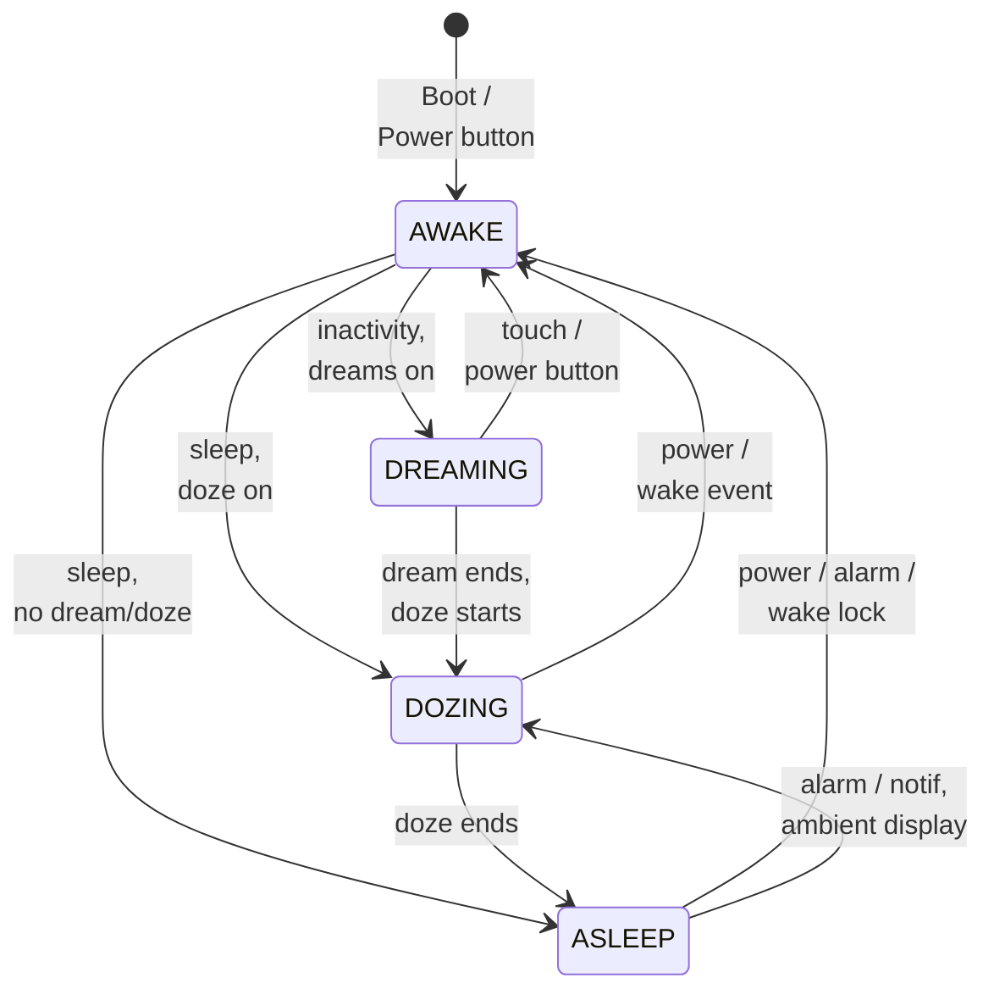

### 29.1.4 Dirty 位机制

`PowerManagerService` 使用名为 `mDirty` 的位域来跟踪电源状态的哪些部分发生了变化、需要重新计算。这是一项核心优化：与其在每一个微小事件上都重新评估电源策略的每一个方面，不如只重新计算发生变化的部分。

```java
// PowerManagerService.java, lines 201-232
// Dirty bit: mWakeLocks changed
private static final int DIRTY_WAKE_LOCKS = 1 << 0;
// Dirty bit: mWakefulness changed
private static final int DIRTY_WAKEFULNESS = 1 << 1;
// Dirty bit: user activity was poked or may have timed out
private static final int DIRTY_USER_ACTIVITY = 1 << 2;
// Dirty bit: actual display power state was updated asynchronously
private static final int DIRTY_ACTUAL_DISPLAY_POWER_STATE_UPDATED = 1 << 3;
// Dirty bit: mBootCompleted changed
private static final int DIRTY_BOOT_COMPLETED = 1 << 4;
// Dirty bit: settings changed
private static final int DIRTY_SETTINGS = 1 << 5;
// Dirty bit: mIsPowered changed
private static final int DIRTY_IS_POWERED = 1 << 6;
// Dirty bit: mStayOn changed
private static final int DIRTY_STAY_ON = 1 << 7;
// Dirty bit: battery state changed
private static final int DIRTY_BATTERY_STATE = 1 << 8;
// Dirty bit: proximity state changed
private static final int DIRTY_PROXIMITY_POSITIVE = 1 << 9;
// Dirty bit: dock state changed
private static final int DIRTY_DOCK_STATE = 1 << 10;
// Dirty bit: brightness boost changed
private static final int DIRTY_SCREEN_BRIGHTNESS_BOOST = 1 << 11;
// Dirty bit: sQuiescent changed
private static final int DIRTY_QUIESCENT = 1 << 12;
// Dirty bit: attentive timer may have timed out
private static final int DIRTY_ATTENTIVE = 1 << 14;
// Dirty bit: display group wakefulness has changed
private static final int DIRTY_DISPLAY_GROUP_WAKEFULNESS = 1 << 16;
// Dirty bit: device postured state has changed
private static final int DIRTY_POSTURED_STATE = 1 << 17;
```

当任何属性发生变化时，相应的 dirty 位会通过 OR 运算置位，随后调用 `updatePowerStateLocked()` 来重新评估所有发生变化的部分。

### 29.1.5 电源状态更新循环

`PowerManagerService` 的核心是 `updatePowerStateLocked()` 方法。每当任何与电源相关的状态发生变化时，它都会以多阶段循环的方式运行：

```java
// PowerManagerService.java, line 2799
private void updatePowerStateLocked() {
    if (!mSystemReady || mDirty == 0 || mUpdatePowerStateInProgress) {
        return;
    }

    Trace.traceBegin(Trace.TRACE_TAG_POWER, "updatePowerState");
    mUpdatePowerStateInProgress = true;
    try {
        // Phase 0: Basic state updates.
        updateIsPoweredLocked(mDirty);
        updateStayOnLocked(mDirty);
        updateScreenBrightnessBoostLocked(mDirty);

        // Phase 1: Update wakefulness.
        // Loop because the wake lock and user activity computations are
        // influenced by changes in wakefulness.
        final long now = mClock.uptimeMillis();
        int dirtyPhase2 = 0;
        for (;;) {
            int dirtyPhase1 = mDirty;
            dirtyPhase2 |= dirtyPhase1;
            mDirty = 0;

            updateWakeLockSummaryLocked(dirtyPhase1);
            updateUserActivitySummaryLocked(now, dirtyPhase1);
            updateAttentiveStateLocked(now, dirtyPhase1);
            if (!updateWakefulnessLocked(dirtyPhase1)) {
                break;
            }
        }

        // Phase 2: Lock profiles that became inactive/not kept awake.
        updateProfilesLocked(now);

        // Phase 3: Update power state of all PowerGroups.
        final boolean powerGroupsBecameReady = updatePowerGroupsLocked(dirtyPhase2);

        // Phase 4: Update dream state (depends on power group ready signal).
        updateDreamLocked(dirtyPhase2, powerGroupsBecameReady);

        // Phase 5: Send notifications, if needed.
        finishWakefulnessChangeIfNeededLocked();

        // Phase 6: Notify screen timeout policy changes if needed.
        notifyScreenTimeoutPolicyChangesLocked();

        // Phase 7: Update suspend blocker.
        // Because we might release the last suspend blocker here, we need
        // to make sure we finished everything else first!
        updateSuspendBlockerLocked();
    } finally {
        Trace.traceEnd(Trace.TRACE_TAG_POWER);
        mUpdatePowerStateInProgress = false;
    }
}
```

这七个阶段构成了 Android 电源管理的心跳。阶段 1 内部会循环，因为唤醒状态的变化可能会使唤醒锁或用户活动摘要失效，从而需要再迭代一次。

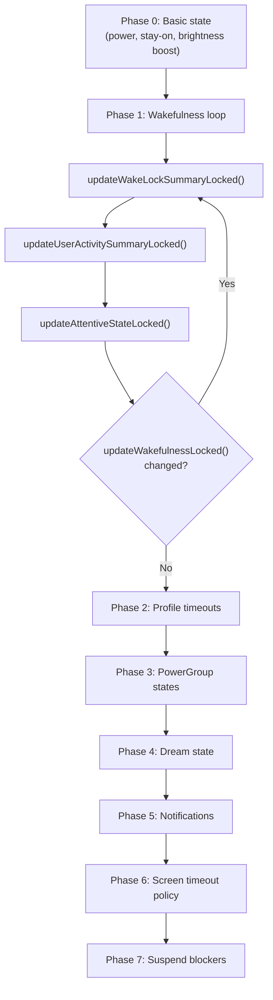

### 29.1.6 完整更新流程详解

为了看这些阶段如何协同工作，我们追踪一个具体场景：用户按下电源键关闭屏幕。

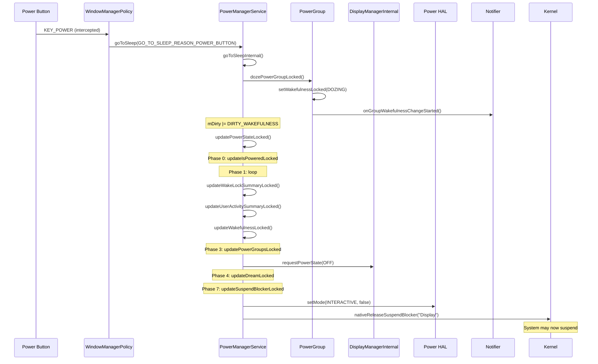

`goToSleepInternal()` 方法按逆序遍历各电源组，以便非默认组先于默认组完成转换：

```java
// PowerManagerService.java, line 7805
private void goToSleepInternal(IntArray groupIds, long eventTime,
        int reason, int flags) {
    // ...
    synchronized (mLock) {
        // Iterate from the end so that the wakefulness of all non-default
        // power groups is updated before default group.
        for (int i = groupIds.size() - 1; i >= 0; i--) {
            int groupId = groupIds.get(i);
            PowerGroup powerGroup = mPowerGroups.get(groupId);
            if ((flags & PowerManager.GO_TO_SLEEP_FLAG_SOFT_SLEEP) != 0) {
                if (!powerGroup.hasWakeLockKeepingScreenOnLocked()) {
                    mNotifier.showDismissibleKeyguard();
                }
                continue;
            }
            if (isNoDoze) {
                sleepPowerGroupLocked(powerGroup, eventTime, reason, uid);
            } else {
                dozePowerGroupLocked(powerGroup, eventTime, reason, uid,
                        false);
            }
        }
    }
}
```

注意 `GO_TO_SLEEP_FLAG_SOFT_SLEEP` 路径——它会显示一个可划掉的锁屏界面而不是真正关闭屏幕，供某些无障碍流程使用。

### 29.1.7 PowerGroup 唤醒状态转换

每个 `PowerGroup` 实现实际的唤醒状态转换。`wakePowerGroupLocked()` 方法处理唤醒：

```java
// PowerManagerService.java, line 2412
private void wakePowerGroupLocked(final PowerGroup powerGroup, long eventTime,
        @WakeReason int reason, String details, int uid,
        String opPackageName, int opUid) {
    if (mForceSuspendActive || !mSystemReady || (powerGroup == null)
            || hasWakeLockKeepingGroupAsleep(
                    powerGroup.getWakeLockSummaryLocked())) {
        return;
    }
    powerGroup.wakeUpLocked(eventTime, reason, details, uid,
            opPackageName, opUid, LatencyTracker.getInstance(mContext));
}
```

Doze 转换包含针对多显示场景的特殊逻辑。如果默认组存在仍处于交互状态的相邻显示组，则默认组会睡眠而不是 doze：

```java
// PowerManagerService.java, line 2471
private boolean dozePowerGroupLocked(final PowerGroup powerGroup,
        long eventTime, @GoToSleepReason int reason, int uid,
        boolean allowSleepToDozeTransition) {
    if (powerGroup.getGroupId() != Display.DEFAULT_DISPLAY_GROUP) {
        return sleepPowerGroupLocked(powerGroup, eventTime, reason, uid);
    }
    // For foldable/multi-display: if adjacent groups still interactive,
    // the default group sleeps instead of dozing
    if (com.android.server.display.feature.flags.Flags.separateTimeouts()) {
        boolean shouldSleep =
            (isDefaultAdjacentGroupInteractiveLocked()
                && !com.android.server.power.feature.flags.Flags.tapToWakeCd())
            || (powerGroup.getWakefulnessLocked() == WAKEFULNESS_ASLEEP
                && !doAnyAdjacentGroupsExistLocked());
        if (shouldSleep && powerGroup.isDefaultOrAdjacentGroup()) {
            return sleepPowerGroupLocked(powerGroup, eventTime, reason, uid);
        }
    }
    return powerGroup.dozeLocked(eventTime, uid, reason,
            allowSleepToDozeTransition);
}
```

### 29.1.8 PowerManagerService 初始化

`PowerManagerService` 在系统服务器启动期间被构造并注册。其构造函数创建处理器线程、挂起阻止器和原生包装器：

```java
// PowerManagerService.java, line 1216
public PowerManagerService(Context context) {
    this(context, new Injector());
}
```

`Injector` 模式通过允许以模拟对象替换真实实现来支持测试。关键的初始化步骤：

1. 以 `THREAD_PRIORITY_DISPLAY` 优先级创建**处理器线程**
2. 创建三个**挂起阻止器**：Booting、WakeLocks 和 Display
3. 通过 JNI 调用**原生初始化**（`nativeInit()`），连接到 Power HAL
4. 禁用自动挂起并启用交互模式作为启动默认
5. 从 `ro.boot.quiescent` 系统属性读取 `sQuiescent` 标志

```java
// PowerManagerService.java, line 1304
synchronized (mLock) {
    mBootingSuspendBlocker =
            mInjector.createSuspendBlocker(this, "PowerManagerService.Booting");
    mWakeLockSuspendBlocker =
            mInjector.createSuspendBlocker(this, "PowerManagerService.WakeLocks");
    mDisplaySuspendBlocker =
            mInjector.createSuspendBlocker(this, "PowerManagerService.Display");
    // ...
    mNativeWrapper.nativeInit(this);
    mNativeWrapper.nativeSetAutoSuspend(false);
    mNativeWrapper.nativeSetPowerMode(Mode.INTERACTIVE, true);
    mNativeWrapper.nativeSetPowerMode(Mode.DOUBLE_TAP_TO_WAKE, false);
}
```

在 `systemReady()` 期间，服务连接到 `DisplayManagerInternal`、`DreamManagerInternal`、`WindowManagerPolicy` 和 `BatteryManagerInternal`。它还为默认显示组创建默认的 `PowerGroup`，并注册一个 `DisplayGroupListener` 来跟踪动态添加的显示。

---

## 29.2 PowerManagerService

### 29.2.1 服务架构

`PowerManagerService` 继承 `SystemService` 并实现 `Watchdog.Monitor`。它发布两个服务接口：

1. **Binder 服务**（`Context.POWER_SERVICE`）—— 应用可访问的 `IPowerManager` AIDL 接口
2. **本地服务**（`PowerManagerInternal`）—— 供其他系统服务使用的进程内 API

```java
// PowerManagerService.java, line 1361
@Override
public void onStart() {
    publishBinderService(Context.POWER_SERVICE, mBinderService,
            /* allowIsolated= */ false, DUMP_FLAG_PRIORITY_CRITICAL);
    publishLocalService(PowerManagerInternal.class, mLocalService);
    Watchdog.getInstance().addMonitor(this);
    Watchdog.getInstance().addThread(mHandler);
}
```

Watchdog 注册至关重要：如果 `PowerManagerService` 死锁，Watchdog 会杀死并重启 `system_server`。

### 29.2.2 唤醒锁摘要位

在内部，`PowerManagerService` 以位域形式维护所有活动唤醒锁的摘要。这避免了在每次决策时都遍历完整的唤醒锁列表：

```java
// PowerManagerService.java, lines 234-244
// Summarizes the state of all active wakelocks.
static final int WAKE_LOCK_CPU = 1 << 0;
static final int WAKE_LOCK_SCREEN_BRIGHT = 1 << 1;
static final int WAKE_LOCK_SCREEN_DIM = 1 << 2;
static final int WAKE_LOCK_BUTTON_BRIGHT = 1 << 3;
static final int WAKE_LOCK_PROXIMITY_SCREEN_OFF = 1 << 4;
static final int WAKE_LOCK_STAY_AWAKE = 1 << 5;
static final int WAKE_LOCK_DOZE = 1 << 6;
static final int WAKE_LOCK_DRAW = 1 << 7;
static final int WAKE_LOCK_SCREEN_TIMEOUT_OVERRIDE = 1 << 8;
static final int WAKE_LOCK_PARTIAL_SLEEP = 1 << 9;
```

类似地，用户活动也以摘要形式维护：

```java
// Summarizes the user activity state.
static final int USER_ACTIVITY_SCREEN_BRIGHT = 1 << 0;
static final int USER_ACTIVITY_SCREEN_DIM = 1 << 1;
static final int USER_ACTIVITY_SCREEN_DREAM = 1 << 2;
```

### 29.2.3 用户活动与超时

用户活动是保持屏幕开启的机制。触摸事件、按键和其他交互会调用 `userActivity()`，从而重置不活动计时器。屏幕超时由 `Settings.System.SCREEN_OFF_TIMEOUT` 设置决定。

用户活动的流程：

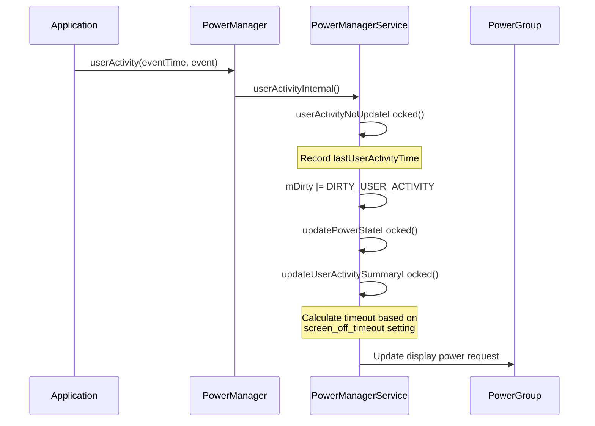

### 29.2.4 睡眠与唤醒

`goToSleep()` 和 `wakeUp()` 方法驱动设备在唤醒状态之间转换。它们可以由电源键、超时或以编程方式触发。

**睡眠原因**（来自 `PowerManager`）：

- `GO_TO_SLEEP_REASON_APPLICATION` —— 应用请求睡眠
- `GO_TO_SLEEP_REASON_DEVICE_ADMIN` —— 设备管理员强制睡眠
- `GO_TO_SLEEP_REASON_TIMEOUT` —— 用户不活动超时
- `GO_TO_SLEEP_REASON_LID_SWITCH` —— 笔记本电脑盖子合上
- `GO_TO_SLEEP_REASON_POWER_BUTTON` —— 用户按下电源键
- `GO_TO_SLEEP_REASON_HDMI` —— HDMI 被移除
- `GO_TO_SLEEP_REASON_SLEEP_BUTTON` —— 专用睡眠键
- `GO_TO_SLEEP_REASON_ACCESSIBILITY` —— 无障碍操作
- `GO_TO_SLEEP_REASON_FORCE_SUSPEND` —— 强制挂起
- `GO_TO_SLEEP_REASON_DISPLAY_GROUPS_TURNED_OFF` —— 所有显示组已关闭
- `GO_TO_SLEEP_REASON_DISPLAY_GROUP_REMOVED` —— 显示组被移除
- `GO_TO_SLEEP_REASON_QUIESCENT` —— Quiescent 启动模式

**唤醒原因**（来自 `PowerManager`）：

- `WAKE_REASON_POWER_BUTTON` —— 电源键按下
- `WAKE_REASON_APPLICATION` —— 应用请求
- `WAKE_REASON_PLUGGED_IN` —— 充电器已连接
- `WAKE_REASON_GESTURE` —— 检测到手势
- `WAKE_REASON_WAKE_KEY` —— 唤醒键按下
- `WAKE_REASON_WAKE_MOTION` —— 检测到移动
- `WAKE_REASON_DREAM_FINISHED` —— Dream 完成
- `WAKE_REASON_DISPLAY_GROUP_ADDED` —— 新显示器已连接
- `WAKE_REASON_DISPLAY_GROUP_TURNED_ON` —— 显示器已开启

### 29.2.5 电源组

从 Android 12 开始，`PowerManagerService` 通过 `PowerGroup` 对象按显示组管理电源状态。每个 `DisplayGroup`（一组共享电源状态的显示器）都有一个对应的 `PowerGroup`。

```java
// PowerGroup.java, line 61
public class PowerGroup {
    private final int mGroupId;
    private int mWakefulness;
    private int mWakeLockSummary;
    private int mUserActivitySummary;
    private long mLastWakeTime;
    private long mLastSleepTime;
    final DisplayPowerRequest mDisplayPowerRequest = new DisplayPowerRequest();
    // ...
}
```

默认显示组始终存在。当外部或虚拟显示器连接时，会动态创建额外的组。非默认组可以被标记为“默认组相邻”，这意味着它们与默认组共享电源键和锁屏行为：

```java
// PowerManagerService.java, line 872
private boolean isDefaultGroupAdjacent(int groupId) {
    long flags = mDisplayManagerInternal.getDisplayGroupFlags(groupId);
    return (flags & DisplayGroup.FLAG_DEFAULT_GROUP_ADJACENT) != 0;
}
```

`PowerGroupWakefulnessChangeListener` 处理唤醒状态转换：

```java
// PowerManagerService.java, line 729
private final class PowerGroupWakefulnessChangeListener implements
        PowerGroup.PowerGroupListener {
    @Override
    public void onWakefulnessChangedLocked(int groupId, int wakefulness,
            long eventTime, int reason, int uid, int opUid,
            String opPackageName, String details) {
        mWakefulnessChanging = true;
        mDirty |= DIRTY_WAKEFULNESS;
        // ...
        mDirty |= DIRTY_DISPLAY_GROUP_WAKEFULNESS;
        mNotifier.onGroupWakefulnessChangeStarted(groupId, wakefulness,
                reason, eventTime);
        updateGlobalWakefulnessLocked(eventTime, reason, uid, opUid,
                opPackageName, details);
        updatePowerStateLocked();
    }
}
```

### 29.2.6 显示电源集成

`PowerManagerService` 通过 `DisplayManagerInternal` 驱动显示电源状态。每个 `PowerGroup` 维护一个 `DisplayPowerRequest`，指定期望的显示状态（ON、OFF、DOZE 等）和亮度级别。

显示电源请求在 `updatePowerGroupsLocked()`（电源状态更新的第 3 阶段）期间计算，并通过以下方式应用：

```
mDisplayManagerInternal.requestPowerState(groupId, mDisplayPowerRequest)
```

显示电源控制器异步应用该状态，并通过 `mDisplayPowerCallbacks` 回调通知，这会设置 `DIRTY_ACTUAL_DISPLAY_POWER_STATE_UPDATED` 以触发新一轮的电源状态评估。

### 29.2.7 Notifier

`Notifier` 类负责向系统其余部分广播电源状态变化。它发送 `ACTION_SCREEN_ON` / `ACTION_SCREEN_OFF` 广播，并将唤醒状态和唤醒锁通知传递给 `BatteryStats` 和窗口管理器策略。两个相关的广播来自别处——`PowerManagerService` 只监听它们：

- `ACTION_DREAMING_STARTED` / `ACTION_DREAMING_STOPPED` 由 `DreamController`（`frameworks/base/services/core/java/com/android/server/dreams/DreamController.java`）发送
- `ACTION_DEVICE_IDLE_MODE_CHANGED` 由 `DeviceIdleController` 发送

Notifier 运行在主 looper（而不是电源管理器处理器线程）上，以避免干扰关键的电源管理时序：

```java
// PowerManagerService.java, line 1420
mNotifier = mInjector.createNotifier(Looper.getMainLooper(), mContext,
        mBatteryStats,
        mInjector.createSuspendBlocker(this,
                "PowerManagerService.Broadcasts"),
        mPolicy, mFaceDownDetector, mScreenUndimDetector,
        BackgroundThread.getExecutor(), mFeatureFlags);
```

### 29.2.8 消息处理

`PowerManagerService` 使用基于消息的处理来执行延迟操作：

```java
// PowerManagerService.java, lines 182-199
private static final int MSG_USER_ACTIVITY_TIMEOUT = 1;
private static final int MSG_SANDMAN = 2;
private static final int MSG_SCREEN_BRIGHTNESS_BOOST_TIMEOUT = 3;
private static final int MSG_CHECK_FOR_LONG_WAKELOCKS = 4;
private static final int MSG_ATTENTIVE_TIMEOUT = 5;
private static final int MSG_RELEASE_ALL_OVERRIDE_WAKE_LOCKS = 6;
private static final int MSG_PROCESS_FROZEN_STATE_CHANGED = 7;
private static final int MSG_FORCE_DISABLE_WAKELOCKS = 8;
```

`MSG_SANDMAN` 消息尤为有趣——它是触发 Dream 和 Doze 转换的机制。当用户活动计时器到期时，系统会调度 `MSG_SANDMAN`，它最终会调用 `DreamManagerService` 来启动或停止屏保/环境显示。

### 29.2.9 设置观察者

`PowerManagerService` 为许多影响电源行为的系统设置注册内容观察者：

- `SCREENSAVER_ENABLED` —— 是否启用 Dream
- `SCREENSAVER_ACTIVATE_ON_SLEEP` —— 睡眠时启动 Dream
- `SCREENSAVER_ACTIVATE_ON_DOCK` —— 插入底座时启动 Dream
- `SCREEN_OFF_TIMEOUT` —— 屏幕超时时长
- `SLEEP_TIMEOUT` —— 额外的睡眠超时
- `ATTENTIVE_TIMEOUT` —— 注意（不注意睡眠警告）超时
- `STAY_ON_WHILE_PLUGGED_IN` —— 充电时保持屏幕开启
- `DOZE_ALWAYS_ON` —— 常亮显示
- `DOUBLE_TAP_TO_WAKE` —— 双击手势
- `THEATER_MODE_ON` —— 剧院模式

### 29.2.10 省电模式集成

省电模式通过省电子系统与 `PowerManagerService` 紧密集成：

```
frameworks/base/services/core/java/com/android/server/power/batterysaver/
    BatterySaverController.java
    BatterySaverPolicy.java
    BatterySaverStateMachine.java
    BatterySavingStats.java
```

`BatterySaverStateMachine` 根据设备支持情况有条件地创建：

```java
// PowerManagerService.java, line 1247
mBatterySaverSupported = mContext.getResources().getBoolean(
        com.android.internal.R.bool.config_batterySaverSupported);
mBatterySaverStateMachine =
        mBatterySaverSupported
            ? mInjector.createBatterySaverStateMachine(mLock, mContext)
            : null;
```

`BatterySaverPolicy` 定义了省电模式激活时应用哪些限制：

```java
// BatterySaverPolicy.java
static final String KEY_LOCATION_MODE = "location_mode";
static final String KEY_DISABLE_VIBRATION = "disable_vibration";
static final String KEY_DISABLE_ANIMATION = "disable_animation";
static final String KEY_SOUNDTRIGGER_MODE = "soundtrigger_mode";
static final String KEY_ENABLE_FIREWALL = "enable_firewall";
static final String KEY_ENABLE_BRIGHTNESS_ADJUSTMENT =
        "enable_brightness_adjustment";
static final String KEY_ENABLE_DATASAVER = "enable_datasaver";
```

当省电模式激活时，`PowerManagerService` 会通知 Power HAL：

```java
nativeSetPowerMode(Mode.LOW_POWER, true);
```

这让厂商 HAL 可以降低 CPU 频率、禁用大核、降低 GPU 时钟并采取其他省电措施。

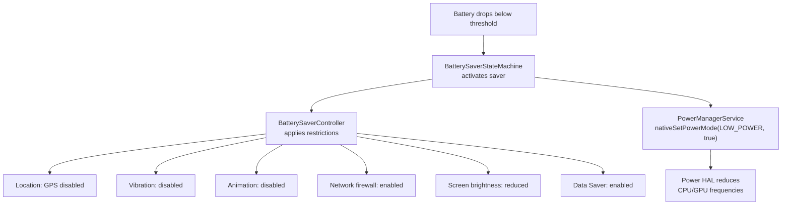

### 29.2.11 Quiescent 模式

Quiescent 模式是一种特殊启动模式，启动后屏幕保持关闭。这用于无头设备或工厂测试期间：

```java
// PowerManagerService.java, line 263
private static final String SYSTEM_PROPERTY_QUIESCENT = "ro.boot.quiescent";

// Constructor:
sQuiescent = mSystemProperties.get(SYSTEM_PROPERTY_QUIESCENT, "0").equals("1");

// After boot completes:
if (sQuiescent) {
    sleepPowerGroupLocked(
            mPowerGroups.get(Display.DEFAULT_DISPLAY_GROUP),
            mClock.uptimeMillis(),
            PowerManager.GO_TO_SLEEP_REASON_QUIESCENT,
            Process.SYSTEM_UID);
}
```

### 29.2.12 面部朝下检测

`PowerManagerService` 包含一个 `FaceDownDetector`，它使用加速度计来检测设备是否被面朝下放置。检测到时，屏幕超时会被缩短：

```java
// PowerManagerService.java, line 1374
private void onFlip(boolean isFaceDown) {
    long millisUntilNormalTimeout = 0;
    final long currentTime = mClock.uptimeMillis();
    synchronized (mLock) {
        // ...
        mIsFaceDown = isFaceDown;
        if (isFaceDown) {
            mLastFlipTime = currentTime;
            final long sleepTimeout =
                    mScreenTimeoutConstants.getSleepTimeoutLocked(-1);
            final long screenOffTimeout =
                    getScreenOffTimeoutLocked(sleepTimeout, -1L);
            final PowerGroup powerGroup =
                    mPowerGroups.get(Display.DEFAULT_DISPLAY_GROUP);
            millisUntilNormalTimeout =
                    powerGroup.getLastUserActivityTimeLocked()
                    + screenOffTimeout - currentTime;
        }
    }
    if (isFaceDown) {
        // Trigger user activity to start the shorter timeout
        userActivityInternal(Display.DEFAULT_DISPLAY, currentTime,
                PowerManager.USER_ACTIVITY_EVENT_FACE_DOWN,
                PowerManager.USER_ACTIVITY_FLAG_NO_CHANGE_LIGHTS,
                Process.SYSTEM_UID);
        mFaceDownDetector.setMillisSaved(millisUntilNormalTimeout);
    }
}
```

### 29.2.13 注意力检测

`AttentionDetector` 使用设备的注意力检测服务（通常基于摄像头）来确定用户是否正在看屏幕。如果用户正在注意，屏幕超时会延长：

```java
// PowerManagerService.java, line 1243
mAttentionDetector = new AttentionDetector(this::onUserAttention, mLock);
```

这避免了用户正在阅读且未触碰屏幕时屏幕却关闭的恼人情况。

### 29.2.14 屏幕取消变暗检测

`ScreenUndimDetector` 跟踪在屏幕关闭前的变暗阶段中，屏幕因用户交互而取消变暗的时间。如果用户频繁取消变暗，系统可以学习并延长超时。

### 29.2.15 无线充电器检测

`WirelessChargerDetector` 使用传感器确认无线充电底座的放置。这可以防止设备从充电器上取下时的误唤醒，并在入座时启用正确的唤醒行为：

```java
// PowerManagerService.java, line 1439
mWirelessChargerDetector = mInjector.createWirelessChargerDetector(
        sensorManager,
        mInjector.createSuspendBlocker(this,
                "PowerManagerService.WirelessChargerDetector"),
        mHandler);
```

---

## 29.3 WakeLocks

### 29.3.1 唤醒锁级别

唤醒锁是应用用来防止设备（或其部分组件）睡眠的基本机制。每个唤醒锁都有一个级别和可选标志。

唤醒锁级别定义在 `android.os.PowerManager` 中：

```java
// frameworks/base/core/java/android/os/PowerManager.java
public static final int PARTIAL_WAKE_LOCK = 0x00000001;
public static final int SCREEN_DIM_WAKE_LOCK = 0x00000006;      // @Deprecated
public static final int SCREEN_BRIGHT_WAKE_LOCK = 0x0000000a;   // @Deprecated
public static final int FULL_WAKE_LOCK = 0x0000001a;            // @Deprecated
public static final int PROXIMITY_SCREEN_OFF_WAKE_LOCK = 0x00000020;
public static final int DOZE_WAKE_LOCK = 0x00000040;            // @SystemApi
public static final int DRAW_WAKE_LOCK = 0x00000080;            // @SystemApi
```

| 级别 | CPU | 屏幕 | 键盘 | 备注 |
|-------|-----|--------|----------|-------|
| `PARTIAL_WAKE_LOCK` | 开 | -- | -- | 最常见。CPU 保持开启，屏幕可能关闭。 |
| `SCREEN_DIM_WAKE_LOCK` | 开 | 变暗 | -- | 已弃用。请使用 `FLAG_KEEP_SCREEN_ON`。 |
| `SCREEN_BRIGHT_WAKE_LOCK` | 开 | 明亮 | -- | 已弃用。 |
| `FULL_WAKE_LOCK` | 开 | 明亮 | 明亮 | 已弃用。 |
| `PROXIMITY_SCREEN_OFF_WAKE_LOCK` | 开 | 关/开 | -- | 面部靠近传感器时屏幕关闭。 |
| `DOZE_WAKE_LOCK` | 开 | -- | -- | 仅限系统。保持 doze 存活。 |
| `DRAW_WAKE_LOCK` | 开 | -- | -- | 仅限系统。允许在 doze 期间绘图。 |

### 29.3.2 唤醒锁标志

可选标志会修改唤醒锁的行为：

```java
// PowerManager.java
public static final int ACQUIRE_CAUSES_WAKEUP = 0x10000000;
public static final int ON_AFTER_RELEASE = 0x20000000;
```

- **`ACQUIRE_CAUSES_WAKEUP`** —— 获取该唤醒锁时也会点亮屏幕。`TURN_SCREEN_ON` 权限要求由 `REQUIRE_TURN_SCREEN_ON_PERMISSION` 兼容性变更把关，目前标记为 `@EnabledSince(CUR_DEVELOPMENT)`。因此它适用于面向开发中 SDK 的应用。可通过 `waive_target_sdk_check_for_turn_screen_on()` 电源属性按外形规格免除该要求。
- **`ON_AFTER_RELEASE`** —— 释放唤醒锁时，触动用户活动以让屏幕多保持开启一小段时间。

### 29.3.3 WakeLock 内部类

在 `PowerManagerService` 内部，每个已获取的唤醒锁都由一个 `WakeLock` 对象跟踪：

```java
// PowerManagerService.java, line 5937
/* package */ final class WakeLock implements IBinder.DeathRecipient,
        IBinder.FrozenStateChangeCallback {
    public final IBinder mLock;
    public final int mDisplayId;
    public int mFlags;
    public String mTag;
    public final String mPackageName;
    public WorkSource mWorkSource;
    public String mHistoryTag;
    public final int mOwnerUid;
    public final int mOwnerPid;
    public final UidState mUidState;
    public long mAcquireTime;
    public boolean mNotifiedAcquired;
    public boolean mNotifiedLong;
    public boolean mDisabled;
    private boolean mIsFrozen;
    public IWakeLockCallback mCallback;
    // ...
}
```

`WakeLock` 实现了 `IBinder.DeathRecipient`——如果所属进程死亡，唤醒锁会通过 `binderDied()` 自动释放：

```java
@Override
public void binderDied() {
    unlinkToDeath();
    PowerManagerService.this.handleWakeLockDeath(this);
}
```

它还实现了 `IBinder.FrozenStateChangeCallback`。当进程被系统冻结（缓存）时，其唤醒锁可以被自动禁用：

```java
@Override
public void onFrozenStateChanged(IBinder who, int state) {
    if (mFeatureFlags.isDisableFrozenProcessWakelocksEnabled()) {
        Message msg = mHandler.obtainMessage(MSG_PROCESS_FROZEN_STATE_CHANGED,
                state, /* arg2= */ 0, mLock);
        mHandler.sendMessageAtTime(msg, mClock.uptimeMillis());
    }
}
```

### 29.3.4 获取唤醒锁

获取流程：

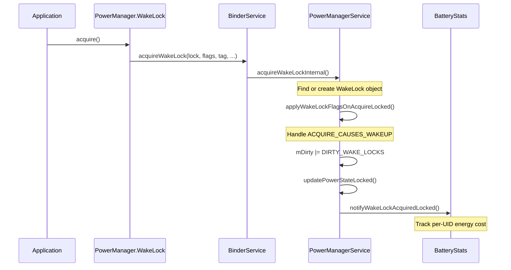

`PowerManagerService` 中的内部获取：

```java
// PowerManagerService.java, line 1740
private void acquireWakeLockInternal(IBinder lock, int displayId, int flags,
        String tag, String packageName, WorkSource ws, String historyTag,
        int uid, int pid, @Nullable IWakeLockCallback callback) {
    synchronized (mLock) {
        // ...
        WakeLock wakeLock;
        int index = findWakeLockIndexLocked(lock);
        boolean notifyAcquire;
        if (index >= 0) {
            wakeLock = mWakeLocks.get(index);
            if (!wakeLock.hasSameProperties(flags, tag, ws, uid, pid, callback)) {
                notifyWakeLockChangingLocked(wakeLock, flags, tag, packageName,
                        uid, pid, ws, historyTag, callback);
                wakeLock.updateProperties(flags, tag, packageName, ws,
                        historyTag, uid, pid, callback);
            }
            notifyAcquire = false;
        } else {
            UidState state = mUidState.get(uid);
            if (state == null) {
                state = new UidState(uid);
                state.mProcState = ActivityManager.PROCESS_STATE_NONEXISTENT;
                mUidState.put(uid, state);
            }
            state.mNumWakeLocks++;
            wakeLock = new WakeLock(lock, displayId, flags, tag, packageName,
                    ws, historyTag, uid, pid, state, callback);
            mWakeLocks.add(wakeLock);
            setWakeLockDisabledStateLocked(wakeLock);
            notifyAcquire = true;
        }

        applyWakeLockFlagsOnAcquireLocked(wakeLock);
        addFrozenStateChangeCallbacksLocked(wakeLock);
        mDirty |= DIRTY_WAKE_LOCKS;
        updatePowerStateLocked();
        if (notifyAcquire) {
            notifyWakeLockAcquiredLocked(wakeLock);
        }
    }
}
```

要点：

- 唤醒锁以其 `IBinder` 令牌标识，而不是以标签标识
- 如果具有相同令牌的唤醒锁已存在，则更新其属性
- `UidState` 跟踪每个 UID 的唤醒锁数量
- `setWakeLockDisabledStateLocked()` 可能在三种情况下禁用锁。第一种情况：设备正在空闲且该 UID *不在*设备空闲白名单或临时白名单上。第二种情况：低电量待机处于活动状态且该 UID *不在*低电量待机允许列表上。第三种情况：进程被缓存或冻结

### 29.3.5 唤醒锁禁用

`PowerManagerService` 可以在多种情况下禁用唤醒锁：

1. **设备空闲模式**：当设备处于深度或浅度 doze 时，只有来自白名单应用的唤醒锁才被认可：
   ```java
   int[] mDeviceIdleWhitelist = new int[0];
   int[] mDeviceIdleTempWhitelist = new int[0];
   ```

2. **低电量待机**：一个单独的允许列表控制哪些 UID 可以在低电量待机期间持有唤醒锁：
   ```java
   int[] mLowPowerStandbyAllowlist = new int[0];
   ```

3. **缓存进程**：当 `NO_CACHED_WAKE_LOCKS` 为 true（默认值）时，来自缓存状态进程的唤醒锁会被禁用。

4. **冻结进程**：从 `isDisableFrozenProcessWakelocksEnabled` 功能标志开始，来自冻结（cgroup 冻结）进程的唤醒锁会被禁用。

### 29.3.6 长时间唤醒锁检测

`PowerManagerService` 会定期检查持有时间超过预期的唤醒锁：

```java
// PowerManagerService.java, line 257
static final long MIN_LONG_WAKE_CHECK_INTERVAL = 60*1000;
```

会调度一条 `MSG_CHECK_FOR_LONG_WAKELOCKS` 消息。消息触发时，任何持有时间超过阈值的唤醒锁都会被标记 `mNotifiedLong = true`。它也会报告给电池统计。

### 29.3.7 唤醒锁日志

`WakeLockLog` 为唤醒锁事件提供了一个压缩的内存环形缓冲区。它使用多项优化来最小化内存占用：

```java
// WakeLockLog.java, line 40
// The main log is basically just a sequence of the two wake lock events
// (ACQUIRE and RELEASE). Each entry in the log stores:
//   event type (RELEASE | ACQUIRE),
//   time (64-bit from System.currentTimeMillis()),
//   wake-lock ID {ownerUID (int) + tag (String)},
//   wake-lock flags
```

优化包括：

- **相对时间**：用 8 位增量代替 64 位时间戳
- **标签数据库**：用指向标签表的 7 位索引代替完整字符串
- **TIME_RESET 事件**：当增量太大、无法用 8 位表示时

### 29.3.8 屏幕锁分类

如果唤醒锁影响显示，`PowerManagerService` 会将其归类为“屏幕锁”：

```java
// PowerManagerService.java, line 1819
public static boolean isScreenLock(int flags) {
    switch (flags & PowerManager.WAKE_LOCK_LEVEL_MASK) {
        case PowerManager.FULL_WAKE_LOCK:
        case PowerManager.SCREEN_BRIGHT_WAKE_LOCK:
        case PowerManager.SCREEN_DIM_WAKE_LOCK:
            return true;
    }
    return false;
}
```

屏幕锁阻止显示屏关闭，而 `PARTIAL_WAKE_LOCK` 只阻止 CPU 睡眠。

### 29.3.9 电池影响跟踪

每一次唤醒锁的获取和释放都会报告给 `BatteryStatsService`，后者将保持 CPU 存活的能耗归因于持有它的 UID。该数据可在电池用量界面和 `dumpsys batterystats` 中查看。

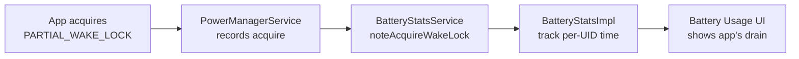

### 29.3.10 WorkSource 归因

唤醒锁支持 `WorkSource` 归因，这允许系统服务将唤醒锁归因到与实际持有者不同的 UID。这对准确的电池归因至关重要：

```java
// WakeLock inner class fields
public WorkSource mWorkSource;
```

例如，当 `SyncManager` 代表应用执行同步适配器时，它以应用的 UID 作为 `WorkSource` 获取唤醒锁。这确保电池消耗记在应用头上，而不是系统头上。

`WorkSource` 还支持 `WorkChain`，后者建模工作归因链：

```java
// PowerManagerService.java
private static WorkChain getFirstNonEmptyWorkChain(WorkSource workSource) {
    if (workSource.getWorkChains() == null) {
        return null;
    }
    for (WorkChain workChain : workSource.getWorkChains()) {
        if (workChain.getSize() > 0) {
            return workChain;
        }
    }
    return null;
}
```

### 29.3.11 唤醒锁最佳实践

从框架实现中可以总结出几项最佳实践：

1. **始终使用 PARTIAL_WAKE_LOCK**：屏幕级唤醒锁已弃用。请在您的窗口上使用 `FLAG_KEEP_SCREEN_ON`。

2. **始终在 finally 块中释放**：唤醒锁跟踪所属 binder，因此泄漏的唤醒锁会在进程死亡时释放。但在此之前的电池消耗可能相当大。

3. **使用超时**：`WakeLock.acquire(timeout)` 会在指定时长后自动释放，提供安全保障。

4. **使用 WorkSource 进行归因**：如果您的系统服务代表应用执行工作，请将 WorkSource 设置为应用的 UID。

5. **最小化持有时间**：迟获取，早释放。唤醒锁持有的时间越长，消耗的电池越多。

### 29.3.12 调试唤醒锁

`dumpsys power` 命令提供全面的唤醒锁信息：

```
Wake Locks: size=3
  PARTIAL_WAKE_LOCK    'AlarmManager' pkg=android  uid=1000  pid=1234
    flags=0x0  acq=2024-01-15 10:30:00.000 (age=5s)
  PARTIAL_WAKE_LOCK    '*sync*/com.google...' pkg=com.google...  uid=10045
    flags=0x0  acq=2024-01-15 10:30:02.000 (age=3s)  ws=WorkSource{10045}
  PROXIMITY_SCREEN_OFF 'ProximityLock'  pkg=com.android.phone  uid=1001
    flags=0x0  acq=2024-01-15 10:29:57.000 (age=10s)
```

唤醒锁摘要显示当前的合并状态：

```
mWakeLockSummary=0x1  (WAKE_LOCK_CPU)
```

以及挂起阻止器状态：

```
Suspend Blockers: size=3
  PowerManagerService.Booting: ref count=0
  PowerManagerService.WakeLocks: ref count=1
  PowerManagerService.Display: ref count=0
```

### 29.3.13 UidState 跟踪

`PowerManagerService` 维护每个 UID 的状态以高效管理唤醒锁：

```java
// PowerManagerService.java
private final SparseArray<UidState> mUidState = new SparseArray<>();
```

每个 `UidState` 跟踪：

- 该 UID 持有的唤醒锁数量
- 进程状态（前台、后台、缓存）
- 该 UID 是否处于活动或空闲状态

当 UID 转换为缓存状态且 `NO_CACHED_WAKE_LOCKS` 启用（默认值）时，其所有唤醒锁都会被禁用。这防止了缓存应用通过孤立的唤醒锁消耗电池。

### 29.3.14 Constants 类

`PowerManagerService` 包含一个 `Constants` 内部类，它从 `Settings.Global.POWER_MANAGER_CONSTANTS` 读取配置：

```java
// PowerManagerService.java, line 928
private final class Constants extends ContentObserver {
    private static final String KEY_NO_CACHED_WAKE_LOCKS = "no_cached_wake_locks";
    private static final boolean DEFAULT_NO_CACHED_WAKE_LOCKS = true;
    public boolean NO_CACHED_WAKE_LOCKS = DEFAULT_NO_CACHED_WAKE_LOCKS;
    // ...
}
```

这允许在不修改代码的情况下对电源管理行为进行运行时调优。

---

## 29.4 Doze 模式

### 29.4.1 概览

Doze 模式（内部称为“Device Idle”）是 Android 针对空闲设备的最激进省电机制。它限制网络访问，推迟作业、闹钟和同步操作，并禁用大多数唤醒锁。

`DeviceIdleController` 管理两个独立的状态机：

- **浅度 Doze** —— 进入较快，限制较轻
- **深度 Doze** —— 在长时间不活动并经过移动检测后进入

源文件：
`frameworks/base/apex/jobscheduler/service/java/com/android/server/DeviceIdleController.java`

### 29.4.2 深度 Doze 状态机

深度 doze 状态机有以下状态：

```java
// DeviceIdleController.java, lines 412-438
static final int STATE_ACTIVE = 0;
static final int STATE_INACTIVE = 1;
static final int STATE_IDLE_PENDING = 2;
static final int STATE_SENSING = 3;
static final int STATE_LOCATING = 4;
static final int STATE_IDLE = 5;
static final int STATE_IDLE_MAINTENANCE = 6;
static final int STATE_QUICK_DOZE_DELAY = 7;
```

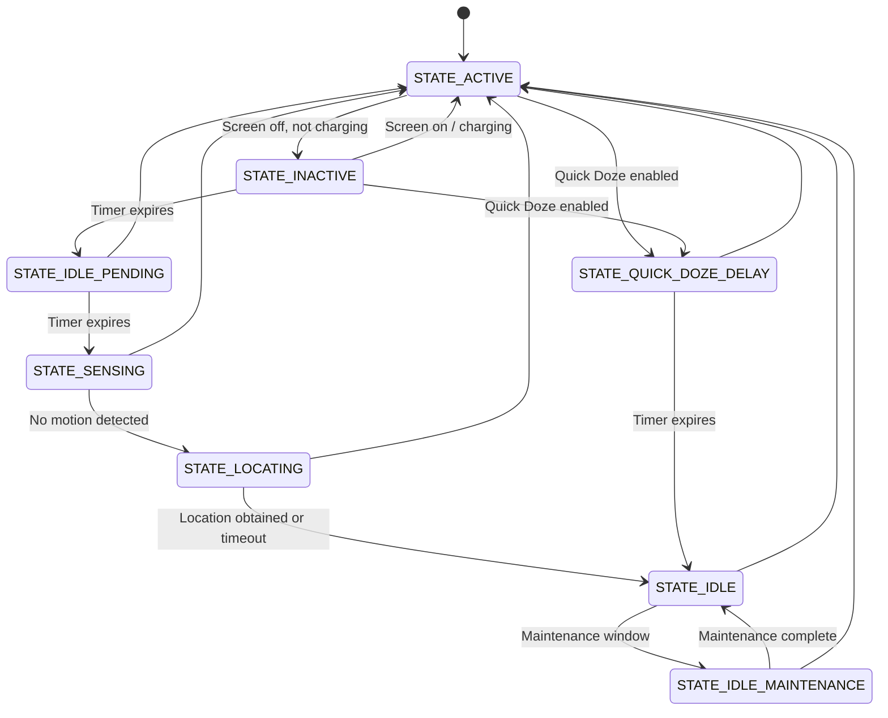

每一条未标注的回到 `STATE_ACTIVE` 的边都表示检测到显著移动；该检查适用于 INACTIVE 之后的每一个状态。`STATE_LOCATING` 在没有可用位置提供者时也会落到 `STATE_IDLE`。

状态演进为：

1. **ACTIVE**：设备正在被使用（屏幕开启、充电或有移动）
2. **INACTIVE**：屏幕已关闭且未充电。计时器开始。
3. **IDLE_PENDING**：初始等待期结束。启用显著移动传感器。
4. **SENSING**：主动监控任何移动。
5. **LOCATING**：获取位置定位，同时继续监控移动。
6. **IDLE**：深度 doze 已生效。应用限制。维护窗口周期性出现。
7. **IDLE_MAINTENANCE**：用于推迟工作的短暂维护窗口。

每次设备进入 `STATE_IDLE` 时，距下一次维护窗口的时长都会翻倍（指数退避），直到配置的最大值。

### 29.4.3 浅度 Doze 状态机

浅度 doze 更简单，进入更快：

```java
// DeviceIdleController.java, lines 468-485
static final int LIGHT_STATE_ACTIVE = 0;
static final int LIGHT_STATE_INACTIVE = 1;
static final int LIGHT_STATE_IDLE = 4;
static final int LIGHT_STATE_WAITING_FOR_NETWORK = 5;
static final int LIGHT_STATE_IDLE_MAINTENANCE = 6;
static final int LIGHT_STATE_OVERRIDE = 7;
```

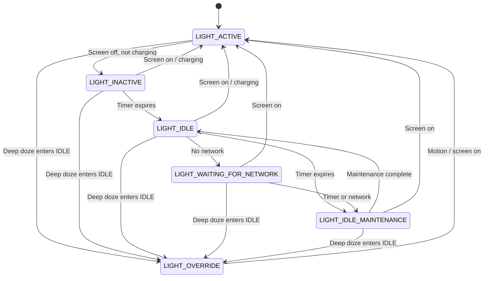

当深度 doze 进入 `STATE_IDLE` 时，浅度 doze 转换到 `LIGHT_STATE_OVERRIDE` 并停止管理自己的状态——深度 doze 全面接管。

### 29.4.4 维护窗口

在 `STATE_IDLE` 期间，设备会周期性进入维护窗口（`STATE_IDLE_MAINTENANCE` 或 `LIGHT_STATE_IDLE_MAINTENANCE`），在此窗口中可以执行被推迟的工作：

- 挂起的闹钟触发
- 推迟的同步适配器运行
- 推迟的 JobScheduler 作业执行
- 网络访问短暂恢复

维护窗口预算会被跟踪：

```java
// DeviceIdleController.java
@GuardedBy("this")
private long mCurLightIdleBudget;

@GuardedBy("this")
private long mMaintenanceStartTime;
```

维护窗口之间的时长随每个周期增加，直到配置的最大值。这防止了设备在空闲更久后花费过多时间进行维护。

### 29.4.5 深度 Doze 步骤实现

`stepIdleStateLocked()` 方法是深度 doze 状态机的核心。它每次推进一个状态：

```java
// DeviceIdleController.java, line 3957
void stepIdleStateLocked(String reason) {
    // Safety: abort if in emergency call
    if (mEmergencyCallListener.isEmergencyCallActive()) {
        becomeActiveLocked("emergency", Process.myUid());
        return;
    }

    // Don't go idle if an alarm is about to fire
    if (isUpcomingAlarmClock()) {
        mActiveReason = ACTIVE_REASON_ALARM;
        becomeActiveLocked("alarm", Process.myUid());
        becomeInactiveIfAppropriateLocked();
        return;
    }

    // Check for blocking constraints
    if (mNumBlockingConstraints != 0 && !mForceIdle) {
        return;
    }

    switch (mState) {
        case STATE_INACTIVE:
            startMonitoringMotionLocked();
            scheduleAlarmLocked(mConstants.IDLE_AFTER_INACTIVE_TIMEOUT);
            moveToStateLocked(STATE_IDLE_PENDING, reason);
            break;

        case STATE_IDLE_PENDING:
            cancelLocatingLocked();
            mLocated = false;
            moveToStateLocked(STATE_SENSING, reason);
            if (mUseMotionSensor && mAnyMotionDetector.hasSensor()) {
                scheduleSensingTimeoutAlarmLocked(mConstants.SENSING_TIMEOUT);
                mNotMoving = false;
                mAnyMotionDetector.checkForAnyMotion();
                break;
            }
            // Fall through if no motion sensor

        case STATE_SENSING:
            cancelSensingTimeoutAlarmLocked();
            moveToStateLocked(STATE_LOCATING, reason);
            if (mIsLocationPrefetchEnabled) {
                scheduleAlarmLocked(mConstants.LOCATING_TIMEOUT);
                // Request location from fused and GPS providers
                // ...
                if (mLocating) break;
            }
            // Fall through if no location providers

        case STATE_LOCATING:
            cancelAlarmLocked();
            cancelLocatingLocked();
            mAnyMotionDetector.stop();
            // Fall through

        case STATE_QUICK_DOZE_DELAY:
            mNextIdlePendingDelay = mConstants.IDLE_PENDING_TIMEOUT;
            mNextIdleDelay = mConstants.IDLE_TIMEOUT;
            // Fall through

        case STATE_IDLE_MAINTENANCE:
            moveToStateLocked(STATE_IDLE, reason);
            scheduleAlarmLocked(mNextIdleDelay);
            // Exponential backoff for next idle period
            mNextIdleDelay = (long)(mNextIdleDelay * mConstants.IDLE_FACTOR);
            mNextIdleDelay = Math.min(mNextIdleDelay,
                    mConstants.MAX_IDLE_TIMEOUT);
            // Override light doze
            if (mLightState != LIGHT_STATE_OVERRIDE) {
                moveToLightStateLocked(LIGHT_STATE_OVERRIDE, "deep");
                cancelLightAlarmLocked();
            }
            mGoingIdleWakeLock.acquire();
            mHandler.sendEmptyMessage(MSG_REPORT_IDLE_ON);
            break;

        case STATE_IDLE:
            // Maintenance window: allow deferred work
            mActiveIdleOpCount = 1;
            mActiveIdleWakeLock.acquire();
            moveToStateLocked(STATE_IDLE_MAINTENANCE, reason);
            scheduleAlarmLocked(mNextIdlePendingDelay);
            // ...
            break;
    }
}
```

指数退避是一个关键设计选择。进入 `STATE_IDLE` 后，距下一次维护窗口的延迟增加 `IDLE_FACTOR`（默认 2.0）倍，直到 `MAX_IDLE_TIMEOUT`。这意味着第一个空闲期可能是 60 分钟，下一个是 120 分钟，再下一个是 240 分钟，直到配置的最大值。

### 29.4.5.1 Doze 时序常量

`DeviceIdleController.Constants` 类定义了时序参数。这些参数可以通过 `DeviceConfig` 或 `Settings.Global` 覆盖：

| 常量 | 默认值 | 描述 |
|----------|---------|-------------|
| `INACTIVE_TIMEOUT` | 30 分钟 | 从 ACTIVE 到 INACTIVE 的时间 |
| `SENSING_TIMEOUT` | 4 分钟 | SENSING 状态的最长时间 |
| `LOCATING_TIMEOUT` | 30 秒 | 获取位置定位的最长时间 |
| `IDLE_AFTER_INACTIVE_TIMEOUT` | 30 分钟 | IDLE_PENDING 中的时间 |
| `IDLE_PENDING_TIMEOUT` | 5 分钟 | 维护窗口时长 |
| `IDLE_TIMEOUT` | 60 分钟 | 第一个空闲期的时长 |
| `MAX_IDLE_TIMEOUT` | 6 小时 | 空闲期的最大时长 |
| `IDLE_FACTOR` | 2.0 | 指数退避乘数 |
| `LIGHT_IDLE_TIMEOUT` | 5 分钟 | 第一个浅度空闲期 |
| `LIGHT_MAX_IDLE_TIMEOUT` | 15 分钟 | 浅度空闲期的最大时长 |
| `LIGHT_IDLE_MAINTENANCE_MIN_BUDGET` | 1 分钟 | 最小浅度维护窗口 |
| `LIGHT_IDLE_MAINTENANCE_MAX_BUDGET` | 5 分钟 | 最大浅度维护窗口 |

### 29.4.6 激活原因

设备因特定原因转换回 `STATE_ACTIVE`：

```java
// DeviceIdleController.java, lines 440-450
private static final int ACTIVE_REASON_UNKNOWN = 0;
private static final int ACTIVE_REASON_MOTION = 1;
private static final int ACTIVE_REASON_SCREEN = 2;
private static final int ACTIVE_REASON_CHARGING = 3;
private static final int ACTIVE_REASON_UNLOCKED = 4;
private static final int ACTIVE_REASON_FROM_BINDER_CALL = 5;
private static final int ACTIVE_REASON_FORCED = 6;
private static final int ACTIVE_REASON_ALARM = 7;
private static final int ACTIVE_REASON_EMERGENCY_CALL = 8;
private static final int ACTIVE_REASON_MODE_MANAGER = 9;
private static final int ACTIVE_REASON_ONBODY = 10;
```

### 29.4.7 省电白名单 / 允许列表

`DeviceIdleController` 维护多个允许列表层级：

```java
// System allowlist: apps exempt from power save (except idle modes)
private final ArrayMap<String, Integer> mPowerSaveWhitelistAppsExceptIdle;

// System allowlist: apps exempt from ALL power save restrictions
private final ArrayMap<String, Integer> mPowerSaveWhitelistApps;

// User-configured allowlist
private final ArrayMap<String, Integer> mPowerSaveWhitelistUserApps;

// Temporary allowlist (e.g., high-priority FCM messages)
final SparseArray<Pair<MutableLong, String>> mTempWhitelistAppIdEndTimes;
```

允许列表会被解析为应用 ID 数组，并与 `PowerManagerService`、`NetworkPolicyManager`、`AlarmManager` 和 `JobSchedulerService` 共享：

```java
int[] mPowerSaveWhitelistAllAppIdArray = new int[0];
int[] mPowerSaveWhitelistExceptIdleAppIdArray = new int[0];
int[] mTempWhitelistAppIdArray = new int[0];
```

### 29.4.8 Doze 期间应用的限制

当深度 doze 激活（`STATE_IDLE`）时：

| 限制 | 效果 |
|-------------|--------|
| 网络 | 对非白名单应用阻断 |
| 唤醒锁 | 对非白名单应用禁用 |
| 闹钟 | 推迟到维护窗口（白名单应用的精确闹钟除外） |
| 作业 | 推迟到维护窗口 |
| 同步适配器 | 推迟到维护窗口 |
| GPS | 阻断 |
| Wi-Fi 扫描 | 阻断 |

浅度 doze 应用这些限制的一个子集，主要影响网络和同步。

### 29.4.9 Doze 与 PowerManagerService 的集成

`DeviceIdleController` 通过内部 `PowerManagerInternal` 接口向 `PowerManagerService` 传达 doze 状态。`PowerManagerService` 跟踪深度和浅度空闲两种模式：

```java
// PowerManagerService.java, lines 662-667
// True if we are currently in device idle mode.
@GuardedBy("mLock")
private boolean mDeviceIdleMode;

// True if we are currently in light device idle mode.
@GuardedBy("mLock")
private boolean mLightDeviceIdleMode;
```

当 doze 激活时，`PowerManagerService` 调用 `nativeSetPowerMode(Mode.DEVICE_IDLE, true)` 通知 Power HAL，后者可以降低时钟频率并采取其他省电措施。

### 29.4.10 约束系统

`DeviceIdleController` 支持一个约束系统，允许系统其他部分阻止 doze 状态转换。TV 实现和其他外形规格都使用它：

```java
// DeviceIdleController.java
private final ArrayMap<IDeviceIdleConstraint, DeviceIdleConstraintTracker>
        mConstraints = new ArrayMap<>();
private ConstraintController mConstraintController;
private int mNumBlockingConstraints = 0;
```

当约束处于活动状态（`mNumBlockingConstraints > 0`）且 `mForceIdle` 为 false 时，`stepIdleStateLocked()` 会直接返回而不推进状态机。

TV 约束控制器（`TvConstraintController`）在电视输入会话期间保持设备唤醒：

```
frameworks/base/apex/jobscheduler/service/java/com/android/server/deviceidle/
    TvConstraintController.java
    DeviceIdleConstraintTracker.java
    BluetoothConstraint.java
frameworks/base/apex/jobscheduler/framework/java/com/android/server/deviceidle/
    ConstraintController.java
    IDeviceIdleConstraint.java
```

### 29.4.11 Quick Doze

Quick Doze 是通往深度 doze 的快速路径，它跳过移动检测和位置阶段。它在省电模式激活时使用：

```java
// DeviceIdleController.java
@GuardedBy("this")
private boolean mQuickDozeActivated;
```

当 Quick Doze 激活时：

1. 设备从 ACTIVE 直接进入 `STATE_QUICK_DOZE_DELAY`
2. 短暂延迟后，直接转换到 `STATE_IDLE`
3. 跳过移动和位置监控

当用户明确启用省电模式时，这能提供即时的 doze 收益。

### 29.4.12 与网络策略的交互

当 doze 激活时，`DeviceIdleController` 会通知 `NetworkPolicyManager` 应用网络限制：

```java
// DeviceIdleController: MSG_REPORT_IDLE_ON handler
mNetworkPolicyManager.setDeviceIdleMode(true);
```

这会触发网络防火墙阻断非白名单应用的后台网络访问。在维护窗口期间，防火墙会暂时放宽。

### 29.4.13 与 AlarmManager 和 JobScheduler 的交互

`AlarmManager` 和 `JobScheduler` 都会监听 doze 状态变化：

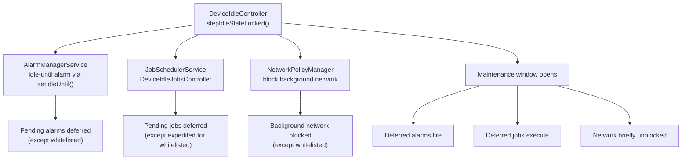

### 29.4.14 移动检测

深度 doze 使用移动传感器来判断设备是否静止：

```java
// DeviceIdleController.java
private SensorManager mSensorManager;
private final boolean mUseMotionSensor;
private Sensor mMotionSensor;
private AnyMotionDetector mAnyMotionDetector;
```

`AnyMotionDetector` 使用加速度计来检测任何移动。如果检测到移动，设备会返回 `STATE_ACTIVE`。显著移动传感器
在 `STATE_IDLE_PENDING` 期间使用的是显著移动传感器，用于低功耗检测模式。

---

## 29.5 应用待机桶

### 29.5.1 概览

应用待机桶（Android 9 引入）根据使用模式将每个应用分配到几个优先级桶之一。该桶决定了系统限制应用后台工作的激进程度。

源文件：
`frameworks/base/apex/jobscheduler/service/java/com/android/server/usage/AppStandbyController.java`

### 29.5.2 桶级别

```java
// UsageStatsManager.java (imported by AppStandbyController.java)
STANDBY_BUCKET_EXEMPTED   // System apps, carrier apps
STANDBY_BUCKET_ACTIVE     // Currently or very recently used
STANDBY_BUCKET_WORKING_SET // Used regularly but not currently active
STANDBY_BUCKET_FREQUENT   // Used often but not daily
STANDBY_BUCKET_RARE       // Rarely used
STANDBY_BUCKET_RESTRICTED // Very rarely used, manually restricted
STANDBY_BUCKET_NEVER      // Never used
```

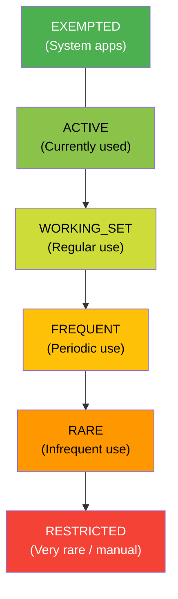

### 29.5.3 对系统资源的影响

| 桶 | 作业 | 闹钟 | 网络 | FCM 高优先级 |
|--------|------|--------|---------|-------------------|
| ACTIVE | 无限制 | 无限制 | 无限制 | 是 |
| WORKING_SET | 最多推迟 2 小时 | 最多推迟 6 分钟 | 无限制 | 是 |
| FREQUENT | 最多推迟 8 小时 | 最多推迟 30 分钟 | 无限制 | 是 |
| RARE | 最多推迟 24 小时 | 最多推迟 2 小时 | 无限制 | 是 |
| RESTRICTED | 每天最多 1 次 | 每天最多 1 次 | 受限 | 是 |

### 29.5.4 桶分配原因

`AppStandbyController` 使用多种信号来确定桶的归属：

```java
// AppStandbyController.java imports
REASON_MAIN_DEFAULT        // Initial bucket
REASON_MAIN_TIMEOUT        // Timeout-based demotion
REASON_MAIN_USAGE          // Usage-based promotion
REASON_MAIN_PREDICTED      // ML-based prediction
REASON_MAIN_FORCED_BY_USER // User forced restriction
REASON_MAIN_FORCED_BY_SYSTEM // System forced restriction
```

子原因提供更细的粒度：

```java
REASON_SUB_USAGE_MOVE_TO_FOREGROUND    // App moved to foreground
REASON_SUB_USAGE_MOVE_TO_BACKGROUND    // App moved to background
REASON_SUB_USAGE_SYSTEM_INTERACTION    // System used the app
REASON_SUB_USAGE_USER_INTERACTION      // User interacted with app
REASON_SUB_USAGE_NOTIFICATION_SEEN     // User saw notification
REASON_SUB_USAGE_SLICE_PINNED          // Slice pinned
REASON_SUB_USAGE_SYNC_ADAPTER          // Sync adapter ran
REASON_SUB_USAGE_FOREGROUND_SERVICE_START // FGS started
REASON_SUB_USAGE_ACTIVE_TIMEOUT        // Active timeout reached
REASON_SUB_DEFAULT_APP_UPDATE          // App updated
REASON_SUB_DEFAULT_APP_RESTORED        // App restored
REASON_SUB_PREDICTED_RESTORED          // Prediction restored
REASON_SUB_FORCED_SYSTEM_FLAG_BUGGY    // System flagged as buggy
REASON_SUB_FORCED_USER_FLAG_INTERACTION // User flag interaction
```

### 29.5.5 桶的晋升与降级

当以下情况发生时，应用会被**晋升**（移动到更高优先级的桶）：

- 用户打开应用（-> ACTIVE）
- 用户看到应用的通知（-> WORKING_SET）
- 应用具有前台服务（-> ACTIVE）
- 同步适配器运行（-> WORKING_SET）
- ML 预测器建议更高的桶

当以下情况发生时，应用会被**降级**（移动到更低优先级的桶）：

- 使用计时器到期且没有交互
- ML 预测器建议更低的桶
- 系统检测到滥用行为（-> RESTRICTED）

### 29.5.6 豁免应用

某些应用不受待机桶限制：

- 活跃的设备管理员应用
- 运营商特权应用
- 默认拨号器、短信处理器和启动器
- 当前正在播放音频或处于前台服务的应用
- 在设备空闲允许列表上的应用
- 常驻系统应用

### 29.5.7 与 UsageStatsService 的集成

`AppStandbyController` 利用 `UsageStatsService` 跟踪应用使用事件：

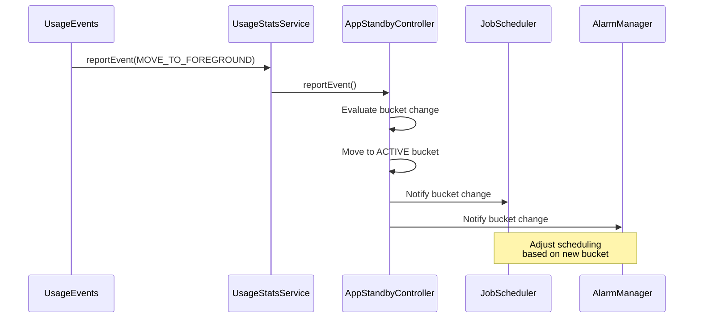

### 29.5.8 AppIdleHistory

`AppStandbyController` 使用 `AppIdleHistory` 将桶分配和使用历史持久化到磁盘。历史记录在重启后仍然存在，并按用户存储在：

```
/data/system/users/<userId>/app_idle_stats.xml
```

### 29.5.9 Restricted 桶

RESTRICTED 桶（Android 12 引入）是最具侵略性的待机级别。此桶中的应用受到以下限制：

- 每天最多 1 个作业
- 每天最多 1 个闹钟
- 无加急作业
- 不能从后台启动前台服务

应用可以通过以下途径进入 RESTRICTED 状态：

- 系统检测到过量资源使用
- 用户在设置中手动限制应用
- 长时间没有任何用户交互

### 29.5.10 基于 ML 的预测

设备可以拥有预测服务，通常来自应用智能模块。在此类设备上，桶分配可以基于对未来应用使用的机器学习预测：

```java
// AppStandbyController.java imports
REASON_MAIN_PREDICTED  // ML-based prediction
REASON_SUB_PREDICTED_RESTORED  // Prediction restored after reboot
```

预测服务提供桶建议，如果预测桶与当前桶不同，`AppStandbyController` 就会应用它。预测不能将应用晋升到 ACTIVE 以上，也不能将其降级到基于超时的桶之下。

### 29.5.11 桶变更通知

当应用的桶发生变化时，`AppStandbyController` 会通知所有已注册的监听器。主要消费者是：

1. **JobScheduler**：根据新桶调整作业调度延迟
2. **AlarmManager**：调整闹钟投递窗口
3. **NetworkPolicyManager**：可能限制受限应用的网络访问
4. **SyncManager**：调整同步适配器调度

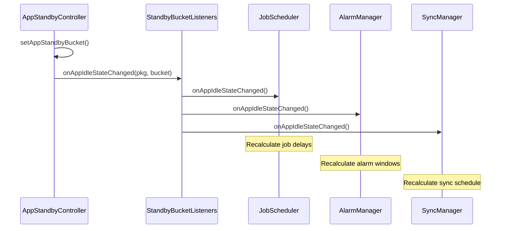

### 29.5.12 基于超时的降级

当应用在可配置的时长内未被使用时，它会被降级到下一个较低的桶。默认阈值（`AppStandbyController.java` 中的 `DEFAULT_ELAPSED_TIME_THRESHOLDS`）按自应用上次使用以来的已过时间衡量，而不是按逐级增量衡量：

| 来源桶 | 距上次使用的已过时间 | 降级到 |
|-------------|----------------------------|------------|
| ACTIVE | 12 小时 | WORKING_SET |
| WORKING_SET | 24 小时 | FREQUENT |
| FREQUENT | 48 小时 | RARE |
| RARE | 8 天 | RESTRICTED |

还必须满足一组并行的屏幕开启时间阈值（`DEFAULT_SCREEN_TIME_THRESHOLDS`：1、2 和 6 小时）才能降级。这些超时可通过 `DeviceConfig` 配置，可能因设备而异。

### 29.5.13 跨资料支持

`AppStandbyController` 处理跨资料场景。在工作资料和个人资料之间共享的应用为每个资料维护独立的桶状态：

```java
// AppStandbyController.java
CrossProfileAppsInternal crossProfileAppsInternal = ...;
```

### 29.5.14 低电量待机

除了应用待机桶之外，Android 还拥有 `LowPowerStandbyController`，提供了一层额外的待机限制：

```java
// PowerManagerService.java, line 1253
mLowPowerStandbyController = mInjector.createLowPowerStandbyController(
        mContext, Looper.getMainLooper());
```

低电量待机通过以下方式管理：
```
frameworks/base/services/core/java/com/android/server/power/
    LowPowerStandbyController.java
    LowPowerStandbyControllerInternal.java
```

该控制器维护自己的 UID 允许列表，这些 UID 可以在待机期间持有唤醒锁：

```java
// PowerManagerService.java
int[] mLowPowerStandbyAllowlist = new int[0];
private boolean mLowPowerStandbyActive;
```

---

## 29.6 电池统计

### 29.6.1 概览

`BatteryStatsService` 和 `BatteryStatsImpl` 构成了 Android 全面的电源核算系统。它们跟踪每一种耗电活动，并将其归因于责任 UID（应用）。

源文件：

- `frameworks/base/services/core/java/com/android/server/power/stats/BatteryStatsImpl.java`
- `frameworks/base/services/core/java/com/android/server/am/BatteryStatsService.java`

### 29.6.2 跟踪内容

`BatteryStatsImpl` 跟踪数百项指标，按类别分组：

| 类别 | 指标 |
|----------|---------|
| **CPU** | 每个 UID 的 CPU 时间（用户 + 系统），每个频率簇的时间 |
| **唤醒锁** | 每个 UID 的唤醒锁持有时间、数量 |
| **网络** | 每个 UID 的发送/接收字节数（Wi-Fi、移动网络），包计数 |
| **屏幕** | 屏幕开启时间，亮度级别 |
| **射频** | 信号强度，射频活动时间 |
| **传感器** | 每个 UID 的每个传感器使用时间 |
| **GPS** | 每个 UID 的 GPS 使用时间 |
| **音频/视频** | 每个 UID 的音频/视频播放时间 |
| **相机** | 每个 UID 的相机使用时间 |
| **蓝牙** | 每个 UID 的蓝牙扫描/连接时间 |
| **前台** | 每个 UID 的前台活动时间 |
| **作业** | 每个 UID 的作业执行时间 |

### 29.6.3 功耗模型

Android 使用功耗配置文件（`power_profile.xml`），它定义了每个硬件组件在每个运行级别下的毫安耗电。电池统计系统将使用时间乘以耗电量来估算能耗。

典型功耗配置文件中的示例条目：

```xml
<!-- power_profile.xml (device-specific) -->
<item name="screen.on">100</item>         <!-- mA when screen on at min brightness -->
<item name="screen.full">250</item>       <!-- mA at max brightness -->
<item name="wifi.on">2</item>             <!-- mA when Wi-Fi is on -->
<item name="wifi.active">120</item>       <!-- mA during Wi-Fi transfer -->
<item name="gps.on">50</item>             <!-- mA when GPS active -->
<item name="bluetooth.active">10</item>   <!-- mA during BT transfer -->
<item name="cpu.active">100</item>        <!-- mA when CPU active (base) -->
<array name="cpu.clusters.cores">
    <value>4</value>                      <!-- Little cores -->
    <value>4</value>                      <!-- Big cores -->
</array>
<array name="cpu.core_speeds.cluster0">
    <value>300000</value>
    <value>576000</value>
    <value>1017600</value>
</array>
<array name="cpu.core_power.cluster0">
    <value>10</value>
    <value>20</value>
    <value>50</value>
</array>
```

### 29.6.4 功耗统计收集器

`stats` 子目录包含专门的收集器：

```
frameworks/base/services/core/java/com/android/server/power/stats/
    BatteryStatsImpl.java
    BatteryExternalStatsWorker.java
    CpuPowerStatsCollector.java
    ScreenPowerStatsCollector.java
    WifiPowerStatsCollector.java
    BluetoothPowerStatsCollector.java
    MobileRadioPowerStatsCollector.java
    CameraPowerStatsCollector.java
    GnssPowerStatsCollector.java
    WakelockPowerStatsCollector.java
    EnergyConsumerPowerStatsCollector.java
    CustomEnergyConsumerPowerStatsCollector.java
    PowerStatsCollector.java
    PowerStatsStore.java
    PowerStatsScheduler.java
    PowerStatsSpan.java
    PowerStatsUidResolver.java
    PowerAttributor.java
    UsageBasedPowerEstimator.java
    KernelWakelockReader.java
```

每个收集器负责从一个特定子系统收集数据，并以可归因于 UID 的格式呈现。

### 29.6.5 电池统计数据流

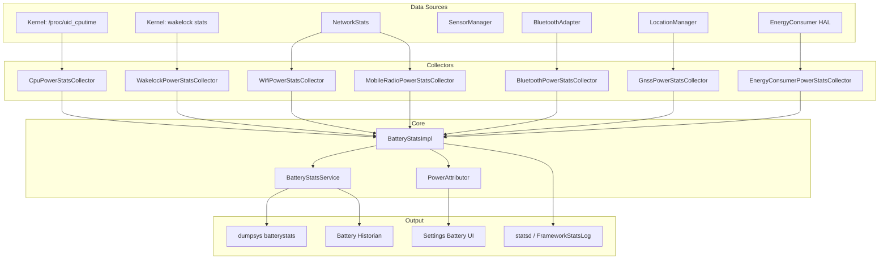

### 29.6.6 能量消费者

现代设备通过 `IPowerStats` HAL 接口（`hardware/interfaces/power/stats/aidl/android/hardware/power/stats/IPowerStats.aidl`）提供硬件级能耗数据。其 `getEnergyConsumed()` 方法返回 `EnergyConsumerResult` 条目，携带来自设备上电源轨监视器的以微瓦秒为单位（`energyUWs`）的累计能量，而不是基于功耗配置文件的估算值。

`EnergyConsumerPowerStatsCollector` 读取这些测量值，并使用活动数据（CPU 时间、传感器使用等）作为分配键将其归因于 UID。

### 29.6.7 Battery Historian

`BatteryStatsService` 生成一种开源 Battery Historian 工具可以解析和可视化的“checkin”格式输出。命令：

```bash
adb shell dumpsys batterystats --checkin > batterystats.txt
```

这会生成每个电源事件的详细时间线：唤醒锁获取、屏幕状态变化、网络传输、传感器激活等等。

### 29.6.8 内核唤醒锁读取

`KernelWakelockReader` 从以下位置读取内核级唤醒锁统计信息：

- `/proc/wakelocks`（较旧的内核）
- `/d/wakeup_sources`（现代内核）

这些内核唤醒锁与 Android 框架唤醒锁是分开的，代表了最底层的挂起阻止跟踪。

### 29.6.9 持久化统计

电池统计数据会定期持久化并在重启后保留。数据存储在 `/data/system/batterystats.bin`（二进制）中，由 `BatteryStatsImpl` 管理。

`BatteryHistoryDirectory` 类管理磁盘上的存储格式，包括汇总数据和每步历史条目。

### 29.6.10 电池用量统计提供者

`BatteryUsageStatsProvider` 计算驱动设置中电池用量界面的每个应用电池消耗估算值：

```
frameworks/base/services/core/java/com/android/server/power/stats/
    BatteryUsageStatsProvider.java
    BatteryUsageStatsSection.java
    AccumulatedBatteryUsageStatsSection.java
```

该提供者同时使用功耗配置文件模型和硬件能量消费者数据（可用时）来计算用量统计。

### 29.6.11 Power Attributor

`PowerAttributor` 是一个较新的组件，它结合活动数据和能量测量值将功耗归因于 UID：

```
frameworks/base/services/core/java/com/android/server/power/stats/
    PowerAttributor.java
```

它按 UID 的活动比例（例如 CPU 时间、屏幕时间、网络字节）在 UID 之间分配测得的能量。

### 29.6.12 唤醒统计

`wakeups` 子目录跟踪是什么将设备从挂起中唤醒：

```
frameworks/base/services/core/java/com/android/server/power/stats/wakeups/
```

这有助于确定哪些子系统和 UID 对阻止深度睡眠负有最大责任。

### 29.6.13 电池统计转储格式

`dumpsys batterystats` 的输出分为几个部分：

```
  Estimated power use (mAh):
    Capacity: 4000, Computed drain: 450, actual drain: 480
    Screen: 120
    Uid 10045: 85.2 (cpu=46.0 wifi=20.0 wake=10.0 sensor=10.2)
    Uid 10089: 42.1 (cpu=30.0 mobile-radio=12.1)
    ...

  Per-app mobile data:
    Uid 10045: 15.2 MB sent, 142.5 MB received
    ...

  Wake lock stats:
    Uid 10045:
      Wake lock *job*/com.example.MyJobService: 15m 30s
      Wake lock *alarm*: 2m 15s
    ...
```

### 29.6.14 Statsd 集成

电池统计数据也会通过 `FrameworkStatsLog` 报告给 `statsd` 以供服务器端分析。这使 Google 能够跟踪整个设备群的聚合功耗模式。

关键 atom 包括：

- `BatteryUsageStatsSinceReset` / `BatteryUsageStatsBeforeReset` —— 每个应用的能耗（以 `BatteryUsageStatsAtomsProto` 形式携带，含每个 UID 的条目）
- `WakelockStateChanged` —— 唤醒锁获取/释放事件
- `ScreenStateChanged` —— 屏幕开/关转换
- `DeviceIdleModeStateChanged` —— Doze 状态转换
- `BatterySaverModeStateChanged` —— 省电模式开/关

---

## 29.7 热管理

### 29.7.1 概览

Android 的热管理系统通过 Thermal HAL 监控设备温度。当温度升高时，它会触发限流操作。它还会通知应用，以便应用减少其工作负载。

框架服务 `ThermalManagerService` 位于 HAL 和应用之间：

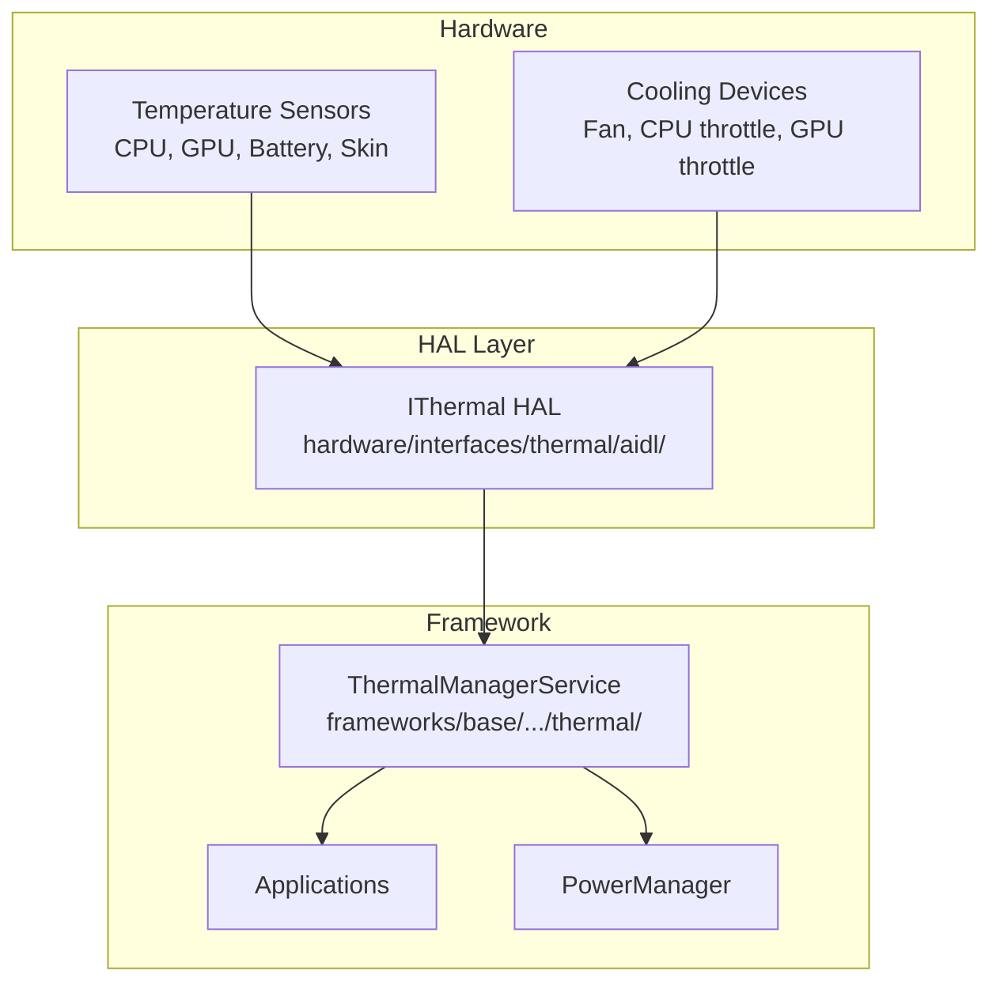

### 29.7.2 Thermal HAL 接口

Thermal HAL（`IThermal.aidl`）提供了用于温度监控的综合接口：

```
hardware/interfaces/thermal/aidl/android/hardware/thermal/IThermal.aidl
```

关键方法：

```java
// IThermal.aidl
interface IThermal {
    // Query current temperatures
    Temperature[] getTemperatures();
    Temperature[] getTemperaturesWithType(in TemperatureType type);

    // Query static thresholds
    TemperatureThreshold[] getTemperatureThresholds();
    TemperatureThreshold[] getTemperatureThresholdsWithType(
            in TemperatureType type);

    // Query cooling devices
    CoolingDevice[] getCoolingDevices();
    CoolingDevice[] getCoolingDevicesWithType(in CoolingType type);

    // Register for thermal change callbacks
    void registerThermalChangedCallback(in IThermalChangedCallback callback);
    void unregisterThermalChangedCallback(in IThermalChangedCallback callback);

    // Register for cooling device change callbacks
    void registerCoolingDeviceChangedCallbackWithType(
            in ICoolingDeviceChangedCallback callback, in CoolingType type);

    // Forecast skin temperature
    float forecastSkinTemperature(in int forecastSeconds);
}
```

### 29.7.3 温度类型

HAL 报告许多组件类型的温度：

```java
// TemperatureType.aidl
enum TemperatureType {
    UNKNOWN = -1,
    CPU = 0,
    GPU = 1,
    BATTERY = 2,
    SKIN = 3,          // Most important for user-facing throttling
    USB_PORT = 4,
    POWER_AMPLIFIER = 5,
    BCL_VOLTAGE = 6,   // Battery Current Limit
    BCL_CURRENT = 7,
    BCL_PERCENTAGE = 8,
    NPU = 9,           // Neural Processing Unit
    TPU = 10,
    DISPLAY = 11,
    MODEM = 12,
    SOC = 13,
    WIFI = 14,
    CAMERA = 15,
    FLASHLIGHT = 16,
    SPEAKER = 17,
    AMBIENT = 18,
    POGO = 19,
}
```

`SKIN` 温度对用户体验最为关键。它代表用户可以感知的外部表面温度。热框架主要依据表面温度来做限流决策。

### 29.7.4 限流严重级别

```java
// ThrottlingSeverity.aidl
enum ThrottlingSeverity {
    NONE = 0,       // Not under throttling
    LIGHT,          // Light throttling, UX not impacted
    MODERATE,       // Moderate throttling, UX not largely impacted
    SEVERE,         // Severe throttling, UX largely impacted
    CRITICAL,       // Platform has done everything to reduce power
    EMERGENCY,      // Key components shutting down
    SHUTDOWN,       // Need shutdown immediately
}
```

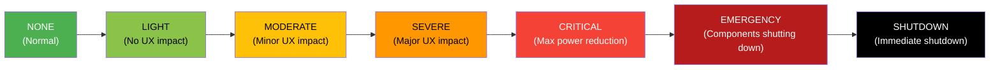

### 29.7.5 温度数据结构

每个温度读数包含：

```java
// Temperature.aidl
parcelable Temperature {
    TemperatureType type;          // Component type (CPU, GPU, SKIN, etc.)
    String name;                   // Unique name (e.g., "cpu0", "battery")
    float value;                   // Temperature in Celsius (or mV/mA/% for BCL)
    ThrottlingSeverity throttlingStatus;  // Current throttling level
}
```

### 29.7.6 散热设备

HAL 还报告散热设备的状态：

```java
// CoolingDevice.aidl
parcelable CoolingDevice {
    CoolingType type;      // CPU, GPU, BATTERY, FAN, etc.
    String name;           // Unique name
    long value;            // Current throttle state (0 = no throttling)
    long powerLimitMw;     // Power budget in milliwatts
    long powerMw;          // Actual average power
    long timeWindowMs;     // Averaging window for power measurement
}
```

散热设备类型：

```java
// CoolingType.aidl
enum CoolingType {
    FAN, BATTERY, CPU, GPU, MODEM, NPU, COMPONENT,
    TPU, POWER_AMPLIFIER, DISPLAY, SPEAKER, WIFI,
    CAMERA, FLASHLIGHT, USB_PORT,
}
```

### 29.7.7 ThermalManagerService

框架服务将热事件分发给已注册的监听器：

```java
// ThermalManagerService.java, line 103
public class ThermalManagerService extends SystemService {
    // Registered observers of thermal events
    private final RemoteCallbackList<IThermalEventListener> mThermalEventListeners;

    // Registered observers of thermal status
    private final RemoteCallbackList<IThermalStatusListener> mThermalStatusListeners;

    // Registered observers of thermal headroom
    private final RemoteCallbackList<IThermalHeadroomListener> mThermalHeadroomListeners;
    // ...
}
```

应用可以通过以下方式监控热状态：

- `PowerManager.getThermalHeadroom(forecastSeconds)` —— 热余量估算
- `PowerManager.addThermalStatusListener()` —— 限流变化回调
- `PowerManager.getCurrentThermalStatus()` —— 当前限流严重级别

### 29.7.8 热余量 API

`getThermalHeadroom(forecastSeconds)` API 允许应用在限流发生之前主动减少工作负载。返回值是一个非负浮点数，表示热包络中使用了多少，以 `SEVERE` 级别为锚点：

- **&lt; 1.0**：在 `SEVERE` 限流点以下仍有余量
- **= 1.0**：设备（或预测将）以 `THERMAL_STATUS_SEVERE` 限流
- **> 1.0**：更重的限流，不隐含映射到 `SEVERE` 之外的特定状态

Android 17 的 `PowerManager` Javadoc 明确说明 1.0 对应 `THERMAL_STATUS_SEVERE`，而不是某个通用、未指定的阈值。它还说明负值在返回前会被钳制为 0.0：

```java
// frameworks/base/core/java/android/os/PowerManager.java
public @FloatRange(from = 0f) float getThermalHeadroom(
        @IntRange(from = 0, to = 60) int forecastSeconds) {
    if (hasCustomDeviceThermalPolicy()) {
        return Float.NaN;
    }
    ...
}
```

`@IntRange(from = 0, to = 60)` 注解将支持的预测窗口固定为 0 到 60 秒。系统需要若干温度采样才能外推。在累积足够的数据之前，无论 `forecastSeconds` 如何，它都返回当前余量。调用频率高于约每秒一次可能会返回 `NaN`。HAL 通过 `forecastSkinTemperature()` 支持预测：

```
// hardware/interfaces/thermal/aidl/android/hardware/thermal/IThermal.aidl
float forecastSkinTemperature(in int forecastSeconds);
```

### 29.7.9 热余量监听器

为了更高效地监控，应用可以注册热余量监听器而不是轮询：

```java
// ThermalManagerService.java
public static final int HEADROOM_CALLBACK_MIN_INTERVAL_MILLIS = 5000;
public static final float HEADROOM_CALLBACK_MIN_DIFFERENCE = 0.03f;
```

回调最多每 5 秒触发一次。只有当余量变化至少 0.03（相当于约 0.9 摄氏度的温差）时才会触发。

### 29.7.10 热关机

在 `SHUTDOWN` 严重级别，`PowerManagerService` 启动有序的设备关机。关机原因会被记录：

```java
// PowerManagerService.java, line 276
private static final String REASON_THERMAL_SHUTDOWN = "shutdown,thermal";
private static final String REASON_BATTERY_THERMAL_STATE = "shutdown,thermal,battery";
```

### 29.7.11 框架热操作

框架自身对严重级别升高的反应刻意保持狭窄：

| 严重级别 | 框架操作 |
|----------|-----------------|
| LIGHT 到 EMERGENCY | 向已注册监听器分发状态和余量回调；显示栈可能钳制屏幕亮度 |
| SHUTDOWN | `ThermalManagerService.shutdownIfNeeded()` 调用 `PowerManager.shutdown()` 进行有序设备关机 |

`ThermalManagerService` 本身只通知监听器，并在 `THROTTLING_SHUTDOWN` 时关闭设备。所有其他缓解措施都发生在厂商一侧，位于 Thermal HAL 之下（见 29.7.15 节）。例如 CPU/GPU 频率上限、相机或调制解调器限制以及类似的限流。

### 29.7.12 Thermal HAL 版本

Thermal HAL 经历了多个版本的演进：

| 版本 | 接口 | 关键特性 |
|---------|-----------|-------------|
| 1.0 (HIDL) | `IThermal` | 基本温度查询 |
| 1.1 (HIDL) | `IThermalCallback` | 异步回调 |
| 2.0 (HIDL) | `IThermal` | 限流严重级别、散热设备 |
| AIDL | `IThermal` | 表面温度预测、散热设备回调 |

当前的 AIDL 版本增加了关键特性，例如用于主动热管理的 `forecastSkinTemperature()` 和用于监控散热设备状态变化的 `registerCoolingDeviceChangedCallbackWithType()`。

### 29.7.13 温度阈值结构

HAL 为每个严重级别提供静态温度阈值：

```java
// TemperatureThreshold.aidl
parcelable TemperatureThreshold {
    TemperatureType type;
    String name;
    float[] hotThrottlingThresholds;  // One per ThrottlingSeverity level
    float[] coldThrottlingThresholds; // One per ThrottlingSeverity level
}
```

这些阈值通过 `PowerManager.getThermalHeadroomThresholds()` 报告给应用，使应用能够就减少工作负载做出主动决策。

### 29.7.14 热服务 Shell 命令

`ThermalManagerService` 支持用于测试的 shell 命令：

```bash
# Override thermal status for testing
adb shell cmd thermalservice override-status <level>

# Where <level> is: 0=NONE, 1=LIGHT, 2=MODERATE, 3=SEVERE,
#                    4=CRITICAL, 5=EMERGENCY, 6=SHUTDOWN

# Reset to real thermal status
adb shell cmd thermalservice reset
```

### 29.7.15 热缓解策略

实际的热缓解策略实现在厂商的 Thermal HAL 中，而不是框架中。该策略决定在每个严重级别下对哪些组件进行限流以及限流幅度。框架提供监控和通知基础设施，而厂商控制硬件级响应。

典型的厂商热缓解策略可能包括：

- **LIGHT**：将后台 CPU 频率降低 20%
- **MODERATE**：将 GPU 频率上限设为 70%，降低大核最大频率
- **SEVERE**：完全禁用大核，GPU 降至 50%
- **CRITICAL**：所有核心以最低频率运行，GPU 以最低频率运行
- **EMERGENCY**：关闭调制解调器、相机，降低显示亮度
- **SHUTDOWN**：有序设备关机

---

## 29.8 Power HAL

### 29.8.1 概览

Power HAL（`IPower`）是 Android 框架与厂商专用电源管理硬件之间的主要接口。它允许框架向底层硬件传达电源提示、模式和性能需求。

源文件：
`hardware/interfaces/power/aidl/android/hardware/power/IPower.aidl`

### 29.8.2 HAL 接口

```java
// IPower.aidl
@VintfStability
interface IPower {
    // Mode control
    oneway void setMode(in Mode type, in boolean enabled);
    boolean isModeSupported(in Mode type);

    // Boost control
    oneway void setBoost(in Boost type, in int durationMs);
    boolean isBoostSupported(in Boost type);

    // Hint sessions (ADPF)
    IPowerHintSession createHintSession(
            in int tgid, in int uid, in int[] threadIds,
            in long durationNanos);
    long getHintSessionPreferredRate();
    IPowerHintSession createHintSessionWithConfig(in int tgid, in int uid,
            in int[] threadIds, in long durationNanos,
            in SessionTag tag, out SessionConfig config);

    // FMQ channel for efficient updates
    ChannelConfig getSessionChannel(in int tgid, in int uid);
    oneway void closeSessionChannel(in int tgid, in int uid);

    // Support information
    SupportInfo getSupportInfo();

    // Headroom APIs
    CpuHeadroomResult getCpuHeadroom(in CpuHeadroomParams params);
    GpuHeadroomResult getGpuHeadroom(in GpuHeadroomParams params);

    // Composition data for surface-attached sessions
    oneway void sendCompositionData(in CompositionData[] data);
    oneway void sendCompositionUpdate(in CompositionUpdate update);
}
```

### 29.8.3 电源模式

电源模式向 HAL 传达长期状态变化：

```java
// Mode.aidl
enum Mode {
    DOUBLE_TAP_TO_WAKE,      // Enable double-tap gesture
    LOW_POWER,               // Battery saver active
    SUSTAINED_PERFORMANCE,   // Consistent perf for extended period
    FIXED_PERFORMANCE,       // Fixed clocks for benchmarking
    VR,                      // Virtual Reality mode
    LAUNCH,                  // App being launched
    EXPENSIVE_RENDERING,     // Heavy rendering upcoming
    INTERACTIVE,             // Screen on/off state
    DEVICE_IDLE,             // Doze mode active
    DISPLAY_INACTIVE,        // Display off or low-power
    AUDIO_STREAMING_LOW_LATENCY,  // Low-latency audio active
    CAMERA_STREAMING_SECURE, // Secure camera stream
    CAMERA_STREAMING_LOW,    // Low-res camera stream
    CAMERA_STREAMING_MID,    // Mid-res camera stream
    CAMERA_STREAMING_HIGH,   // High-res camera stream
    GAME,                    // User playing a game
    GAME_LOADING,            // Game loading screen
    DISPLAY_CHANGE,          // Rotation or fold/unfold
    AUTOMOTIVE_PROJECTION,   // Android Auto projection
}
```

关键模式行为：

| 模式 | 典型的 HAL 响应 |
|------|---------------------|
| `INTERACTIVE` | 启用/禁用交互式调节器，调整唤醒延迟 |
| `LOW_POWER` | 降低最大 CPU 频率，禁用大核，降低 GPU 频率 |
| `SUSTAINED_PERFORMANCE` | 将频率上限设为热学可持续的水平 |
| `LAUNCH` | 提升 CPU/GPU 以实现快速应用启动 |
| `DEVICE_IDLE` | 最小化功耗，降低轮询率 |
| `GAME` | 针对游戏优化（更高的 GPU 优先级） |

### 29.8.4 电源提升

提升传达短期的性能需求：

```java
// Boost.aidl
enum Boost {
    INTERACTION,             // Touch event -- brief CPU boost
    DISPLAY_UPDATE_IMMINENT, // New frame coming -- wake display path
    ML_ACC,                  // ML accelerator needed
    AUDIO_LAUNCH,            // Audio stream starting
    CAMERA_LAUNCH,           // Camera app launching
    CAMERA_SHOT,             // Photo capture in progress
}
```

`INTERACTION` 提升是发送最频繁的。每一个触摸事件都会触发它，给厂商 HAL 一个短暂提高 CPU 频率的机会，以实现响应灵敏的触摸处理。

### 29.8.5 框架到 HAL 的流程

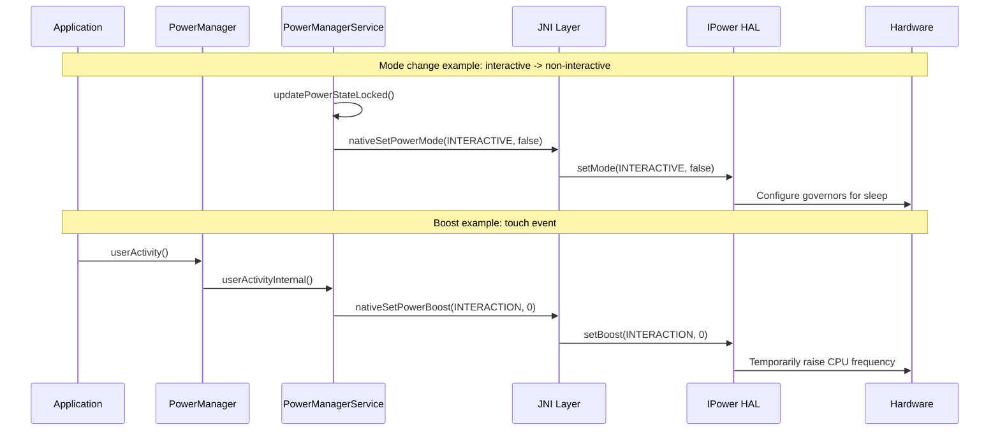

### 29.8.6 ADPF（Android 动态性能框架）

ADPF 在 Android 12 中引入，此后大幅扩展。它提供了一种性能提示会话机制。借助该机制，应用（尤其是游戏和媒体应用）直接向 Power HAL 告知其性能需求。

#### 提示会话模型

```java
// IPowerHintSession.aidl
interface IPowerHintSession {
    oneway void updateTargetWorkDuration(long targetDurationNanos);
    oneway void reportActualWorkDuration(in WorkDuration[] durations);
    oneway void pause();
    oneway void resume();
    oneway void close();
    oneway void sendHint(SessionHint hint);
    void setThreads(in int[] threadIds);
    oneway void setMode(SessionMode type, boolean enabled);
    SessionConfig getSessionConfig();
}
```

会话生命周期：

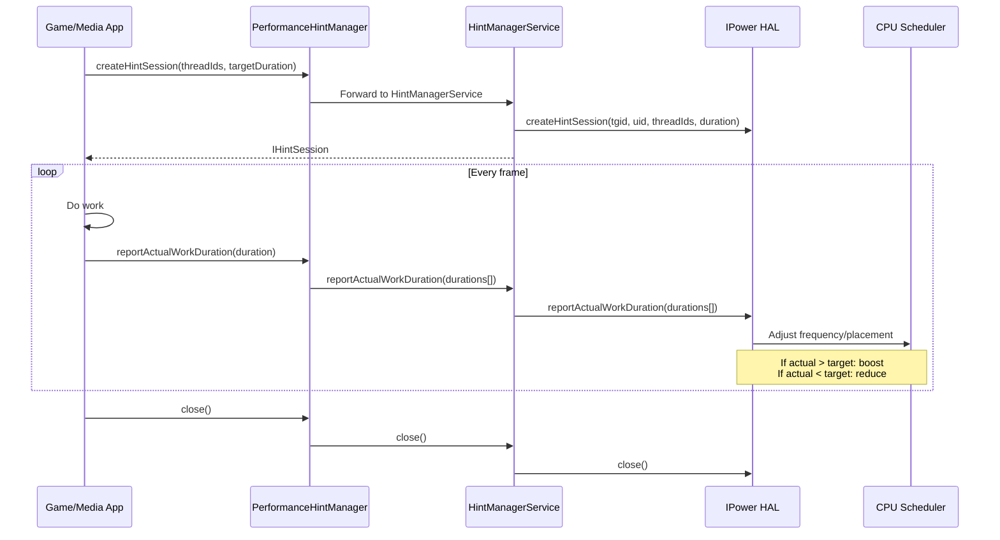

#### 会话提示

`SessionHint` 值提供了工作时长之外的额外上下文：

```java
// SessionHint.aidl
enum SessionHint {
    CPU_LOAD_UP = 0,        // Workload increasing
    CPU_LOAD_DOWN = 1,      // Workload decreasing
    CPU_LOAD_RESET = 2,     // Unknown new workload
    CPU_LOAD_RESUME = 3,    // Resuming after idle
    POWER_EFFICIENCY = 4,   // Prefer efficiency over perf
    GPU_LOAD_UP = 5,        // GPU workload increasing
    GPU_LOAD_DOWN = 6,      // GPU workload decreasing
    GPU_LOAD_RESET = 7,     // Unknown new GPU workload
    CPU_LOAD_SPIKE = 8,     // Abnormal CPU spike (ignore)
    GPU_LOAD_SPIKE = 9,     // Abnormal GPU spike (ignore)
}
```

#### FMQ 通道

对于高频更新，ADPF 支持快速消息队列（FMQ）通道，以避免 Binder 调用的开销：

```java
// IPower.aidl
ChannelConfig getSessionChannel(in int tgid, in int uid);
```

该通道按进程划分，并在提示会话之间复用。

### 29.8.7 CPU 和 GPU 余量

Power HAL 可以报告可用的 CPU 和 GPU 余量，允许应用自适应地调整其工作负载：

```java
// IPower.aidl
CpuHeadroomResult getCpuHeadroom(in CpuHeadroomParams params);
GpuHeadroomResult getGpuHeadroom(in GpuHeadroomParams params);
```

这些 API 通过对性能域（而非热域）余量的估算，补充了热余量 API。

### 29.8.8 合成数据

最新的 Power HAL 版本支持合成数据报告，其中 SurfaceFlinger 将帧时序信息发送给 HAL：

```java
// IPower.aidl
oneway void sendCompositionData(in CompositionData[] data);
oneway void sendCompositionUpdate(in CompositionUpdate update);
```

这使得 HAL 能够将电源/性能决策与实际显示输出关联起来，从而实现更精确的电源管理。

### 29.8.9 会话标签和模式

ADPF 提示会话可以被标记以指示其用途：

```java
// SessionTag.aidl
enum SessionTag {
    OTHER,
    SURFACEFLINGER,
    HWUI,
    GAME,
    APP,
    SYSUI,
}
```

会话还可以设置修改其行为的模式：

```java
// SessionMode.aidl
enum SessionMode {
    POWER_EFFICIENCY,   // Prefer efficiency over performance
    GRAPHICS_PIPELINE,  // Session covers the graphics pipeline
    AUTO_CPU,           // HAL auto-manages CPU resources
    AUTO_GPU,           // HAL auto-manages GPU resources
    AUDIO_PERFORMANCE,  // Session backs latency-sensitive audio work
}
```

`POWER_EFFICIENCY` 模式告诉 HAL 优先为会话的线程安排节能调度。后台任务需要完成但对延迟不敏感时会使用此模式。

### 29.8.10 WorkDuration 报告

`WorkDuration` 结构向 HAL 提供详细的时序信息：

```java
// WorkDuration.aidl
parcelable WorkDuration {
    long timeStampNanos;       // When the work completed
    long durationNanos;        // Total work duration
    long workPeriodStartTimestampNanos;  // When the work period started
    long cpuDurationNanos;     // CPU time consumed
    long gpuDurationNanos;     // GPU time consumed
    long intendedPresentTimestampNanos;  // When the frame was meant to present
}
```

分开的 CPU 和 GPU 时长字段允许 HAL 独立调整 CPU 和 GPU 频率，以获得最佳的功耗/性能平衡。

### 29.8.11 SupportInfo

`getSupportInfo()` 方法提供有关 HAL 支持内容的详细信息：

```java
// IPower.aidl
SupportInfo getSupportInfo();
```

这允许框架根据 HAL 能力调整其行为，避免在较简单的实现上进行只会是空操作的调用。

### 29.8.12 合成数据集成

最新的 Power HAL 版本与 SurfaceFlinger 集成，以接收每帧的合成时序数据：

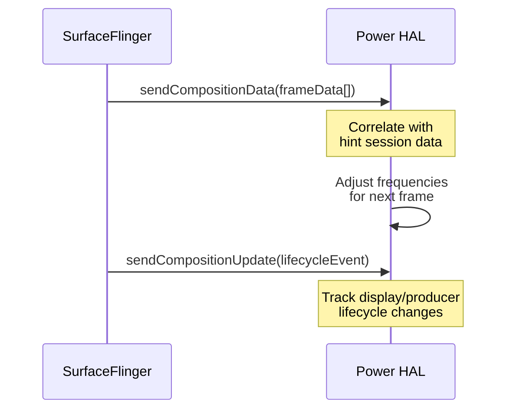

这使得 HAL 能够看到显示工作负载的全貌，而不仅仅是单个会话的工作时长。

### 29.8.13 CPU 和 GPU 余量 API

余量 API 允许框架和应用查询可用的性能容量：

```java
// IPower.aidl
CpuHeadroomResult getCpuHeadroom(in CpuHeadroomParams params);
GpuHeadroomResult getGpuHeadroom(in GpuHeadroomParams params);
```

余量是一个 [0, 100] 范围内的浮点数，或者当结果暂时不可用时为 NaN：

- **0** 表示在计算间隔内没有资源剩余（无余量）
- **100** 表示硬件容量完全可用
- **NaN** 表示调用者不应基于该值采取行动（例如，没有足够的利用率数据来计算它）

该值永远不会超过 100。

应用可以使用这些值动态调整其质量设置：

- 渲染分辨率
- 特效复杂度
- 帧率目标

### 29.8.14 HAL 演进

Power HAL 经历了显著演进：

| 版本 | 关键特性 |
|---------|-------------|
| `1.0` (HIDL) | 基本的 `setInteractive()` 和 `powerHint()` |
| `1.1` (HIDL) | 增加了 `getSubsystemLowPowerStats()` |
| `1.2` (HIDL) | 增加了 `powerHintAsync_1_2()` |
| `1.3` (HIDL) | 增加了 `powerHintAsync_1_3()` 并扩展了 `PowerHint` 枚举 |
| AIDL v1 | 迁移到 AIDL：`setMode()`、`setBoost()` |
| AIDL v2 | 增加了 `createHintSession()` / `IPowerHintSession` |
| AIDL v4 | 增加了 `SessionHint` |
| AIDL v5 | 增加了 FMQ 通道、`createHintSessionWithConfig()`、`SessionMode`、`SessionTag` |
| AIDL v6 | 增加了 `getSupportInfo()`、余量 API、合成数据 |

```
hardware/interfaces/power/
    1.0/     (HIDL)
    1.1/     (HIDL)
    1.2/     (HIDL)
    1.3/     (HIDL)
    aidl/    (Current)
```

---

## 29.9 CPU 频率与调度

### 29.9.1 能量感知调度（EAS）

现代 Android 设备使用能量感知调度（EAS），它是主线 Linux 内核的一部分。EAS 扩展了完全公平调度器（CFS），在做出任务放置决策时考虑能耗成本。

EAS 需要一个能量模型，它描述每个 CPU 簇在 CPU 频率、性能和功耗之间的关系。该模型通常通过设备树提供：

```
// Example Device Tree energy model
cpu0 {
    capacity-dmips-mhz = <1024>;
    dynamic-power-coefficient = <100>;
};
```

### 29.9.2 schedutil 调节器

`schedutil` CPU 频率调节器与调度器紧密集成，是 Android 设备上的默认调节器。与定期采样利用率的传统调节器（如 `ondemand`）不同，`schedutil` 使用调度器自身的利用率跟踪（PELT——按实体负载跟踪）来做出频率决策。

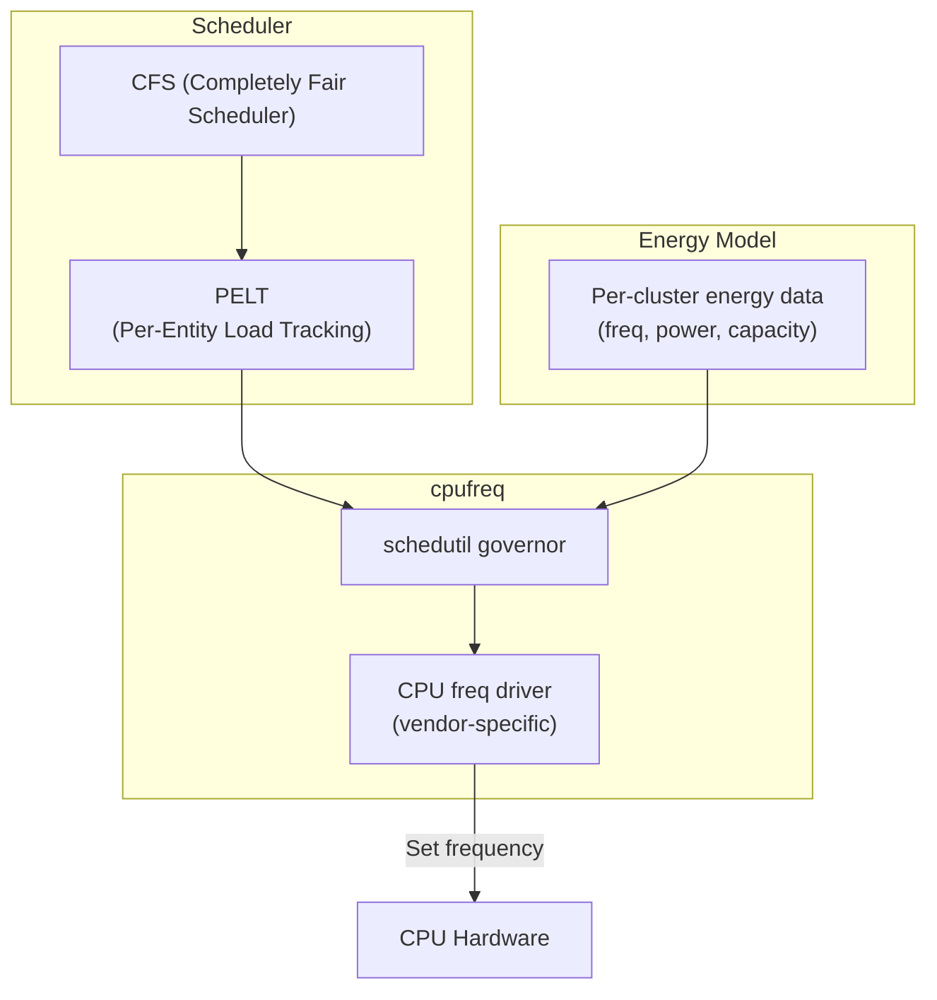

流程：

1. **PELT** 持续跟踪每个任务和每个 CPU 的利用率
2. **schedutil** 在调度事件（任务唤醒、迁移）时读取 PELT 数据
3. 该调节器选择满足利用率需求的最低频率，同时考虑能量模型
4. cpufreq 驱动应用新的频率

### 29.9.3 容量感知调度

在异构（big.LITTLE / big.mid.LITTLE）处理器上，调度器在放置任务时必须考虑 CPU 容量：

- **小核**：低功耗，低性能。适合后台任务。
- **中核**：中等功耗和性能。用于典型工作负载。
- **大核**：高功耗，高性能。用于延迟敏感的工作。

调度器使用 `capacity` 指标（0-1024，其中 1024 = 最高频率下能力最强的核心）将任务匹配到合适的核心。

任务放置启发式规则：

1. 如果任务的利用率可以放在小核上，就放在那里（节省能量）
2. 如果任务需要更多容量，迁移到更大的核心
3. 考虑热压力：在热限流下降低有效容量
4. 考虑 ADPF 提示：如果 Power HAL 请求特定的线程放置，尊重这些偏好

### 29.9.4 Uclamp（利用率钳制）

Uclamp 允许系统为任务设置最小和最大利用率值，覆盖 PELT 跟踪：

- `uclamp_min`：最小利用率下限。强制调度器将任务放在具有足够容量的核心上，并使用足够高的频率。
- `uclamp_max`：最大利用率上限。限制分配给任务的性能。

Android 广泛使用 uclamp：

- Power HAL 用它实现提升和节能模式
- `PerformanceHintSession` 根据目标与实际时长设置 uclamp 值
- 省电模式可以对后台任务设置 `uclamp_max` 以限制 CPU 使用

```mermaid
flowchart LR
    A["ADPF Session:\nactual > target"] --> B["Increase uclamp_min\nfor session threads"]
    B --> C["schedutil selects\nhigher frequency"]
    C --> D["Task meets\ntarget duration"]

    E["Battery Saver:\nLOW_POWER mode"] --> F["Set uclamp_max\non background tasks"]
    F --> G["schedutil caps\nfrequency"]
    G --> H["Reduced power\nconsumption"]
```

### 29.9.5 CPU 空闲状态

Linux 内核使用 `cpuidle` 在核心未使用时管理 CPU 的断电状态：

| 状态 | 延迟 | 功耗 | 描述 |
|-------|---------|-------|-------------|
| WFI (C0) | ~1 us | 节省最少 | 等待中断 |
| 时钟门控 (C1) | ~10 us | 节省较少 | 核心时钟停止 |
| 电源塌陷 (C2) | ~100 us | 中等节省 | 核心断电 |
| 簇关闭 (C3) | ~1 ms | 高节省 | 簇断电 |
| SoC 深度睡眠 | ~10 ms | 最大节省 | 大多数子系统关闭 |

权衡始终在节能与唤醒延迟之间。内核的 `cpuidle` 调节器（通常是 `menu` 或 `teo`）预测空闲时长并选择系统能负担的最深状态。

### 29.9.6 SchedTune / CGroup 集成

Android 通过 cgroups 配置任务组以设置调度优先级：

```
/dev/cpuctl/
    foreground/       -- Interactive apps
    background/       -- Background apps
    top-app/          -- Currently visible app
    rt/               -- Real-time tasks
    system-background/ -- System background tasks
```

每个组可以有不同的 uclamp 设置、CPU 亲和性偏好和调度优先级。`ActivityManagerService` 根据进程的生命周期状态在组之间移动它们。

### 29.9.7 进程优先级组

Android 维护多个用于进程电源管理的 cgroup 层次结构。进程生命周期状态与 cgroup 之间的映射：

```mermaid
flowchart LR
    subgraph "Process States"
        TA["Top App\n(visible)"]
        FG["Foreground\n(services)"]
        BG["Background\n(cached)"]
        SBG["System Background"]
        RT["Real-Time\n(audio)"]
    end

    subgraph "CGroup Settings"
        TA --> TA_CG["cpuctl/top-app\nuclamp_min=varies\nuclamp_max=1024"]
        FG --> FG_CG["cpuctl/foreground\nuclamp_min=0\nuclamp_max=1024"]
        BG --> BG_CG["cpuctl/background\nuclamp_min=0\nuclamp_max=varies"]
        SBG --> SBG_CG["cpuctl/system-background\nuclamp_min=0\nuclamp_max=512"]
        RT --> RT_CG["cpuctl/rt\nSCHED_FIFO"]
    end
```

当省电模式激活时，后台组的 `uclamp_max` 会降低，限制后台任务可用的 CPU 频率。

### 29.9.8 PELT（按实体负载跟踪）

PELT 是调度器跟踪任务利用率的机制。它维护任务运行时间的指数加权移动平均值：

```
utilization(t) = utilization(t-1) * decay + running(t) * scale
```

衰减因子经过调优，使得约 50% 的信号来自最近 32ms 的历史。这在响应性（对负载变化做出反应）和稳定性（不在突发工作负载上振荡）之间提供了平衡。

`/proc/<pid>/sched` 中可见的关键 PELT 指标：

```
se.avg.util_avg       -- Task utilization (0-1024)
se.avg.runnable_avg   -- Runnable but not running time
se.avg.load_avg       -- Load contribution
```

这些指标直接输入到 schedutil 的频率选择和 EAS 的任务放置决策中。

### 29.9.9 电源管理 QoS

Linux 内核的 PM QoS（服务质量）框架允许组件指定延迟和吞吐量约束。这些约束在电源管理转换期间也必须得到满足：

```
/dev/cpu_dma_latency    -- Maximum acceptable DMA latency
/sys/devices/system/cpu/cpu*/power/pm_qos_resume_latency_us
```

例如，Android 的音频系统使用 PM QoS 来确保音频播放能够满足其实时期限。即使系统的其他部分处于省电模式也是如此。

### 29.9.10 GPU 电源管理

GPU 有自己的电源管理，通常通过 GPU 驱动的内部频率调节器控制（类似于 CPU 的 cpufreq）。Power HAL 可以通过以下方式影响 GPU 频率：

- `setMode(GAME, true)` —— 针对游戏优化 GPU
- `setMode(EXPENSIVE_RENDERING, true)` —— 预计有高 GPU 负载
- 带有 GPU 相关提示的 ADPF 提示会话（`GPU_LOAD_UP`、`GPU_LOAD_DOWN`）

### 29.9.11 内存子系统功耗

内存子系统（DRAM）消耗大量电能。现代 SoC 支持多个内存频率级别：

| 状态 | 频率 | 带宽 | 功耗 |
|-------|-----------|-----------|-------|
| Active high | 3200 MHz | 全速 | 高 |
| Active low | 1600 MHz | 一半 | 中等 |
| Self-refresh | N/A | 无 | 低 |
| Deep self-refresh | N/A | 无 | 极小 |

内存频率通常由 SoC 的电源控制器与 CPU 和 GPU 负载协调管理。

### 29.9.12 热压力与 CPU 容量

当 CPU 簇受到热限流时，内核会降低其有效容量。调度器看到这个降低的容量，并避免将繁重的工作负载放置在受限的核心上：

```
Effective capacity = base capacity * (1 - thermal_pressure)
```

这个反馈循环防止调度器持续使已经过热的核心超载，这会导致进一步限流和更差的性能。

### 29.9.13 CGroup v2 与 Freezer

Android 使用 cgroup v2 进行进程管理，包括可以冻结整个进程组的 freezer 控制器：

```
/sys/fs/cgroup/uid_<uid>/cgroup.freeze
```

当进程被冻结时：

1. 所有线程在内核级别停止
2. 来自冻结进程的唤醒锁可以被自动禁用
3. 进程消耗零 CPU 时间
4. 内存页保持驻留但有资格被回收

这比旧的“缓存进程”方法更高效。这是因为冻结的进程根本无法运行，即使它们有待处理的计时器或唤醒锁。

`PowerManagerService` 通过冻结状态回调与此集成：

```java
// PowerManagerService.java
private static final int MSG_PROCESS_FROZEN_STATE_CHANGED = 7;
```

---

## 29.10 挂起与恢复

### 29.10.1 Linux 挂起机制

Android 的挂起机制建立在 Linux 内核的挂起框架之上。当没有挂起阻止器被持有时，Android 进入系统挂起路径。

内核支持两种与 Android 相关的挂起状态：

| 状态 | sysfs 值 | 描述 |
|-------|------------|-------------|
| Freeze | `freeze` | 所有用户进程被冻结，CPU 保持开启 |
| Memory (S2RAM) | `mem` | CPU 状态保存到 RAM，大多数电源轨关闭 |

现代 SoC 通常使用 suspend-to-idle（s2idle），它类似于 freeze，但也启用平台特定的低功耗状态。

### 29.10.2 挂起阻止器

挂起阻止器是阻止系统进入挂起的最底层机制。它们直接映射到内核唤醒锁文件。

```java
// SuspendBlocker.java
interface SuspendBlocker {
    void acquire();
    void acquire(String id);
    void release();
    void release(String id);
}
```

`PowerManagerService` 使用三个挂起阻止器：

```java
// PowerManagerService.java, lines 1305-1310
mBootingSuspendBlocker =
        mInjector.createSuspendBlocker(this, "PowerManagerService.Booting");
mWakeLockSuspendBlocker =
        mInjector.createSuspendBlocker(this, "PowerManagerService.WakeLocks");
mDisplaySuspendBlocker =
        mInjector.createSuspendBlocker(this, "PowerManagerService.Display");
```

| 阻止器 | 持有时机 |
|---------|-----------|
| `Booting` | 从启动到 `PHASE_BOOT_COMPLETED` |
| `WakeLocks` | 任何 CPU 级唤醒锁处于活动状态 |
| `Display` | 显示开启、正在转换，或近期有用户活动 |

### 29.10.3 原生挂起阻止器实现

`SuspendBlockerImpl` 内部类将 Java 挂起阻止器操作转换为原生调用：

```java
// PowerManagerService.NativeWrapper
public void nativeAcquireSuspendBlocker(String name) {
    PowerManagerService.nativeAcquireSuspendBlocker(name);
}

public void nativeReleaseSuspendBlocker(String name) {
    PowerManagerService.nativeReleaseSuspendBlocker(name);
}
```

这些 JNI 方法调用 libhardware_legacy 的 `acquire_wake_lock()` 和 `release_wake_lock()`（`hardware/libhardware_legacy/power.cpp`），它们通过 binder 到达 `android.system.suspend.ISystemSuspend` AIDL 服务——system_suspend 守护进程。驱动内核 `/sys/power/wakeup_count` 和 `/sys/power/state` 接口的是该守护进程，而不是 JNI 层。

### 29.10.4 挂起决策

挂起决策在 `updateSuspendBlockerLocked()`（电源状态更新的第 7 阶段）中做出。逻辑是：

```
Need WakeLock suspend blocker if:
    - mWakeLockSummary has WAKE_LOCK_CPU set
      (any enabled CPU-holding wake lock is active)

Need Display suspend blocker if (needSuspendBlockerLocked):
    - Not all power groups are ready
    - OR screen brightness boost is in progress
    - OR wakefulness is DOZING and doze start is still in progress
    - OR any PowerGroup needs its suspend blocker
      (e.g. its screen is on or turning on)
```

如果两个挂起阻止器都不需要，它们都会被释放，内核可以自由进入挂起。

### 29.10.5 自动挂起

当 `config_useAutoSuspend` 为 true（大多数设备上的默认值）时，系统使用 Linux 的自动挂起机制。在此模式下：

1. 框架释放所有挂起阻止器
2. 内核自动挂起写入 `/sys/power/state`
3. 设备进入最深的可用睡眠状态
4. 唤醒源（闹钟、调制解调器等）触发唤醒
5. 内核恢复
6. 框架重新获取所需的挂起阻止器

```java
// PowerManagerService.java, line 1264
mUseAutoSuspend = mContext.getResources().getBoolean(
        com.android.internal.R.bool.config_useAutoSuspend);
```

### 29.10.6 强制挂起

`PowerManagerService` 支持一种绕过正常唤醒锁检查的强制挂起机制：

```java
// PowerManagerService.NativeWrapper
public boolean nativeForceSuspend() {
    return PowerManagerService.nativeForceSuspend();
}
```

这用于少数情况，例如来自设备管理员策略的强制睡眠或特定的硬件要求。

### 29.10.7 唤醒源

Linux 内核唤醒源由能够将设备从挂起中唤醒的驱动程序注册。Android 中常见的唤醒源：

| 唤醒源 | 描述 |
|--------|-------------|
| `alarm` | RTC 闹钟计时器 |
| `modem` | 来电或短信 |
| `wifi` | Wi-Fi 无线局域网唤醒 |
| `power_key` | 电源键按下 |
| `usb` | USB 线缆插入 |
| `sensor` | 显著移动或倾斜传感器 |
| `bt_host_wake` | 蓝牙唤醒事件 |
| `proximity` | 距离传感器事件 |

每个唤醒源都维护统计信息，可在以下位置查看：
```bash
adb shell cat /d/wakeup_sources
```

### 29.10.8 挂起与恢复时间线

```mermaid
sequenceDiagram
    participant APP as Applications
    participant PMS as PowerManagerService
    participant KER as Kernel

    Note over APP,KER: Going to sleep
    APP->>PMS: All wake locks released
    PMS->>PMS: updateSuspendBlockerLocked()
    PMS->>KER: nativeReleaseSuspendBlocker("WakeLocks")
    PMS->>KER: nativeReleaseSuspendBlocker("Display")
    PMS->>KER: nativeSetAutoSuspend(true)
    Note over KER: Freeze userspace processes
    Note over KER: Suspend devices (late_suspend)
    Note over KER: Enter low-power state

    Note over APP,KER: Wakeup event (e.g., alarm)
    KER->>KER: Wakeup source triggers IRQ
    Note over KER: Resume devices (early_resume)
    Note over KER: Thaw userspace processes
    KER->>PMS: Wakeup complete
    PMS->>PMS: nativeAcquireSuspendBlocker()
    PMS->>PMS: updatePowerStateLocked()
    PMS->>APP: Screen on / alarm delivery
```

### 29.10.9 Early Suspend（旧版）

Early suspend 是 Android Marshmallow 之前的一种机制，其中显示和其他面向用户的子系统会在完全系统挂起之前关闭。它已被标准 Linux 运行时 PM 框架和 `DisplayManagerService` 中的显示电源控制器取代。

现代等效物是显示电源状态机。它可以在 CPU 保持活动时关闭显示（用于后台工作）。它也可以与系统挂起同时关闭显示。

### 29.10.10 唤醒计数机制

现代内核使用 wakeup_count 机制来避免检查挂起唤醒与进入挂起之间的竞态条件：

1. 读取 `/sys/power/wakeup_count` —— 获取当前计数
2. 将相同的计数写回 —— 内核验证没有新的唤醒到达
3. 向 `/sys/power/state` 写入 `mem` —— 进入挂起

如果在步骤 1 和 2 之间到达了唤醒，步骤 2 的写入会失败，从而防止系统在待处理的唤醒事件下进入睡眠。

### 29.10.11 挂起统计

内核维护挂起统计信息，对调试电源问题很有用：

```bash
# View suspend statistics
adb shell cat /sys/kernel/debug/suspend_stats

# Key fields:
# success: number of successful suspends
# fail: number of failed suspend attempts
# failed_freeze: failures during process freezing
# failed_prepare: failures during device prepare
# failed_suspend: failures during device suspend
# failed_suspend_late: failures during late suspend
# last_failed_dev: name of last device that failed suspend
# last_failed_errno: error code of last failure
# last_failed_step: step at which last failure occurred
```

### 29.10.12 显示状态与系统挂起

Android 电源管理的一个重要区别是显示状态与系统挂起状态。它们是独立的：

| 显示 | CPU | 场景 |
|---------|-----|----------|
| 开启 | 活动 | 正常使用 |
| 关闭 | 活动 | 音乐播放、下载 |
| 关闭 | 挂起 | 真正空闲（最深的节能） |
| Doze | 活动 | 带通知的 AOD |
| Doze | 挂起 | AOD 空闲（doze-suspend） |

显示状态由 `DisplayManagerInternal` 控制，而系统挂起由挂起阻止器控制。设备的显示可以关闭但 CPU 活动（例如，在后台下载期间）。其显示也可以处于 doze 模式且 CPU 挂起（doze-suspend 状态下的 AOD）。

### 29.10.13 Runtime PM

除了系统范围的挂起，各个设备（外设）还可以通过 Linux 运行时 PM 独立进入低功耗状态：

```
/sys/devices/.../power/
    runtime_status      -- active, suspended, suspending, error
    runtime_enabled     -- enabled, disabled, forbidden
    autosuspend_delay_ms -- delay before auto-suspend
```

运行时 PM 允许未使用的外设（相机、NFC、BT）断电，而 CPU 保持活动。

### 29.10.14 平台特定的挂起

不同的 SoC 厂商以不同方式实现挂起：

**高通（RPM/AOSS）**：

- 使用协处理器（RPM 或 AOSS）进行电源轨管理
- 支持多种低功耗模式（XO 关闭、VDDMIN、VDDCX）
- 资源电源管理器在处理器电源状态之间进行仲裁

**三星（Exynos）**：

- 使用 ACPM（Active Clock Power Management）固件
- 支持簇断电、L2 保持、全 SoC 断电

**联发科**：

- 使用 SPM（System Power Manager）进行挂起管理
- 支持多个具有不同延迟/功耗权衡的挂起级别

**Google Tensor**：

- 使用 Mali GPU 电源管理
- 与 Pixel 专用热管理集成
- 为 Pixel 设备定制功耗配置文件

### 29.10.15 调试挂起问题

常见的挂起调试技术：

```bash
# Check why suspend failed
adb shell dmesg | grep -i "suspend\|wakeup\|PM:"

# See which wakeup sources are active
adb shell cat /sys/kernel/debug/wakeup_sources | sort -k7 -n -r | head -20

# Check for active wake locks preventing suspend
adb shell dumpsys power | grep "mHoldingWakeLockSuspendBlocker"
adb shell dumpsys power | grep "mHoldingDisplaySuspendBlocker"

# Monitor suspend/resume events
adb shell dmesg -w | grep "PM: suspend\|PM: resume"
```

---

## 29.11 UsageStats 与屏幕使用时间

`UsageStatsService` 是 Android 全面的应用使用情况跟踪系统。它记录每一次前台转换、配置变更、通知交互、待机桶变更和用户交互事件。这些数据支撑三项功能。第一项是应用待机桶系统（见 29.5 节）。第二项是数字健康（Digital Wellbeing）的应用使用时长限制。第三项是系统预测用户接下来会启动哪个应用的能力。

> **源文件根目录：**
> `frameworks/base/services/usage/java/com/android/server/usage/`

### 29.11.1 架构概览

```mermaid
graph TD
    AMS["ActivityManagerService"] -->|"reportEvent()"| USS["UsageStatsService"]
    NMS["NotificationManagerService"] -->|"NOTIFICATION_INTERRUPTION"| USS
    ATMS["ActivityTaskManagerService"] -->|"CONFIGURATION_CHANGE"| USS

    USS --> UUSS["UserUsageStatsService<br/>(per-user)"]
    USS --> ASI["AppStandbyInternal<br/>(standby buckets)"]
    USS --> ATLC["AppTimeLimitController<br/>(screen time limits)"]
    USS --> BRST["BroadcastResponseStatsTracker"]

    UUSS --> USDB["UsageStatsDatabase<br/>(protobuf persistence)"]
    USDB --> Disk["usagestats/<br/>daily/ weekly/ monthly/ yearly/"]

    Apps["Digital Wellbeing /<br/>Settings App"] -->|"IUsageStatsManager"| USS

    style USS fill:#f9f,stroke:#333
    style ATLC fill:#bbf,stroke:#333
```

### 29.11.2 服务初始化

`UsageStatsService` 继承 `SystemService`，并在启动时初始化一组丰富的子组件：

```java
// UsageStatsService.java, line 357-423
@Override
public void onStart() {
    mAppOps = getContext().getSystemService(Context.APP_OPS_SERVICE);
    mUserManager = getContext().getSystemService(Context.USER_SERVICE);
    mHandler = getUsageEventProcessingHandler();
    mIoHandler = new Handler(IoThread.get().getLooper(), mIoHandlerCallback);

    mAppStandby = mInjector.getAppStandbyController(getContext());
    mResponseStatsTracker = new BroadcastResponseStatsTracker(mAppStandby, getContext());

    mAppTimeLimit = new AppTimeLimitController(getContext(),
            new AppTimeLimitController.TimeLimitCallbackListener() {
                @Override
                public void onLimitReached(int observerId, int userId,
                        long timeLimit, long timeElapsed, PendingIntent callbackIntent) {
                    // Deliver callback to Digital Wellbeing app
                    Intent intent = new Intent();
                    intent.putExtra(UsageStatsManager.EXTRA_OBSERVER_ID, observerId);
                    intent.putExtra(UsageStatsManager.EXTRA_TIME_LIMIT, timeLimit);
                    intent.putExtra(UsageStatsManager.EXTRA_TIME_USED, timeElapsed);
                    callbackIntent.send(getContext(), 0, intent);
                }
                // ...
            }, mHandler.getLooper());

    mAppStandby.addListener(mStandbyChangeListener);
    publishLocalService(UsageStatsManagerInternal.class, new LocalService());
    publishLocalService(AppStandbyInternal.class, mAppStandby);
    publishBinderService(Context.USAGE_STATS_SERVICE, new BinderService());
}
```

该服务发布三个接口：

- `IUsageStatsManager`（Binder）—— 供外部应用查询使用数据
- `UsageStatsManagerInternal`（本地）—— 供系统服务报告事件
- `AppStandbyInternal`（本地）—— 用于应用待机桶管理

### 29.11.3 使用事件类型

与系统的每一次交互都会生成一个具有特定事件类型的 `UsageEvents.Event`：

| 事件类型 | 常量 | 触发条件 |
|-----------|----------|---------|
| Activity 移至前台 | `ACTIVITY_RESUMED` | AMS 报告 activity 生命周期 |
| Activity 移至后台 | `ACTIVITY_PAUSED` | AMS 报告 activity 生命周期 |
| Activity 停止 | `ACTIVITY_STOPPED` | AMS 报告 activity 生命周期 |
| 配置变更 | `CONFIGURATION_CHANGE` | 屏幕旋转、语言区域变更 |
| 用户交互 | `USER_INTERACTION` | 用户直接与应用交互 |
| 待机桶变更 | `STANDBY_BUCKET_CHANGED` | 应用在待机桶之间移动 |
| 通知中断 | `NOTIFICATION_INTERRUPTION` | 通知已发布 |
| 快捷方式调用 | `SHORTCUT_INVOCATION` | 使用了启动器快捷方式 |
| 选择器操作 | `CHOOSER_ACTION` | 分享/意图选择器选择 |
| Locus ID 设置 | `LOCUS_ID_SET` | 深度链接 / 内容 ID 关联 |
| 设备关机 | `DEVICE_SHUTDOWN` | 干净关机 |
| 刷写到磁盘 | `FLUSH_TO_DISK` | 定期持久化 |

事件在专用的处理器线程上处理：

```java
// Handler message types
static final int MSG_REPORT_EVENT = 0;
static final int MSG_FLUSH_TO_DISK = 1;
static final int MSG_REMOVE_USER = 2;
static final int MSG_UID_STATE_CHANGED = 3;
static final int MSG_REPORT_EVENT_TO_ALL_USERID = 4;
static final int MSG_UNLOCKED_USER = 5;
static final int MSG_PACKAGE_REMOVED = 6;
```

### 29.11.4 使用来源配置

该服务支持两种前台使用归因策略：

```java
// UsageStatsService.java, line 30-31
import static android.app.usage.UsageStatsManager.USAGE_SOURCE_CURRENT_ACTIVITY;
import static android.app.usage.UsageStatsManager.USAGE_SOURCE_TASK_ROOT_ACTIVITY;
```

- `USAGE_SOURCE_CURRENT_ACTIVITY`：使用量归因于当前可见 activity 的软件包。如果应用 A 在应用 B 中启动一个 activity，当 B 的 activity 处于前台时，使用量归因于 B。

- `USAGE_SOURCE_TASK_ROOT_ACTIVITY`：使用量归因于启动任务的软件包。如果应用 A 启动了应用 B 的 activity，使用量仍归因于 A，因为 A 是任务根。

默认值是 `USAGE_SOURCE_TASK_ROOT_ACTIVITY`——这是 `readUsageSourceSetting()` 为 `app_time_limit_usage_source` 传给 `Settings.Global.getInt()` 的回退值。该选择会影响哪些应用在数字健康中累计屏幕使用时间。

### 29.11.5 按用户使用数据存储

每个用户都有一个管理实际统计数据的 `UserUsageStatsService`：

```java
// UsageStatsService.java, line 232-233
private final SparseArray<UserUsageStatsService> mUserState = new SparseArray<>();
private final CopyOnWriteArraySet<Integer> mUserUnlockedStates = new CopyOnWriteArraySet<>();
```

数据以 protobuf 格式存储在 `/data/system_ce/<userId>/usagestats/` 下，分为四个时间间隔桶：

| 间隔 | 目录 | 最大文件数 | 保留时间 |
|----------|-----------|-----------|-----------|
| 每日 | `daily/` | 100 | ~100 天 |
| 每周 | `weekly/` | 50 | ~350 天 |
| 每月 | `monthly/` | 12 | ~12 个月 |
| 每年 | `yearly/` | 10 | ~10 年 |

`UsageStatsDatabase` 以 protobuf 格式管理持久化（版本 5，从版本 4 的 XML 升级而来）：

```java
// UsageStatsDatabase.java, line 92-102
public class UsageStatsDatabase {
    private static final int DEFAULT_CURRENT_VERSION = 5;
    public static final int BACKUP_VERSION = 4;

    static final int[] MAX_FILES_PER_INTERVAL_TYPE = new int[]{100, 50, 12, 10};
}
```

数据每 20 分钟刷写到磁盘一次：

```java
// UsageStatsService.java, line 164
private static final long FLUSH_INTERVAL = COMPRESS_TIME ? TEN_SECONDS : TWENTY_MINUTES;
```

### 29.11.6 AppTimeLimitController

`AppTimeLimitController` 是驱动数字健康“应用计时器”功能的核心组件。它监控前台应用使用情况，并在超过配置的时长限制时触发回调。

```java
// AppTimeLimitController.java, line 49-85
public class AppTimeLimitController {
    private static final long MAX_OBSERVER_PER_UID = 1000;
    private static final long ONE_MINUTE = 60_000L;

    @GuardedBy("mLock")
    private final SparseArray<UserData> mUsers = new SparseArray<>();
    @GuardedBy("mLock")
    private final SparseArray<ObserverAppData> mObserverApps = new SparseArray<>();
}
```

控制器管理两种类型的数据结构：

- **`UserData`** —— 按用户跟踪当前活动的实体（处于前台的应用）及其关联的观察者组
- **`ObserverAppData`** —— 按观察应用的数据（数字健康应用注册为观察者）

达到时间限制时的流程：

```mermaid
sequenceDiagram
    participant DW as Digital Wellbeing
    participant USS as UsageStatsService
    participant ATLC as AppTimeLimitController
    participant AM as AlarmManager

    DW->>USS: registerAppUsageObserver(observerId, packages, timeLimit, callback)
    USS->>ATLC: addAppUsageObserver(uid, observerId, packages, timeLimit, callback)
    ATLC->>AM: setExact(triggerTime = now + remainingTime)

    Note over ATLC: User opens observed app
    USS->>ATLC: noteUsageStart(packageName)
    ATLC->>ATLC: Track elapsed time

    AM-->>ATLC: Alarm fires (time limit reached)
    ATLC->>USS: onLimitReached(observerId, timeLimit, timeElapsed)
    USS->>DW: PendingIntent callback
    DW->>DW: Show "Time's up" dialog
```

控制器使用 `AlarmManager` 进行精确计时。当被观察的应用进入前台时，控制器计算剩余的时间预算并设置闹钟。当应用回到后台时，经过的时间被累计，闹钟被取消。

### 29.11.7 内核集成

对于进程状态跟踪，该服务更新一个内核计数器文件：

```java
// UsageStatsService.java, line 173-174
private static final boolean ENABLE_KERNEL_UPDATES = true;
private static final File KERNEL_COUNTER_FILE = new File("/proc/uid_procstat/set");
```

当某个 UID 的进程状态发生变化时，I/O 处理器会写入此文件：

```java
// UsageStatsService.java, line 300-316
case MSG_UID_STATE_CHANGED: {
    final int uid = msg.arg1;
    final int procState = msg.arg2;
    final int newCounter = (procState <= ActivityManager.PROCESS_STATE_TOP) ? 0 : 1;
    synchronized (mUidToKernelCounter) {
        final int oldCounter = mUidToKernelCounter.get(uid, 0);
        if (newCounter != oldCounter) {
            mUidToKernelCounter.put(uid, newCounter);
            FileUtils.stringToFile(KERNEL_COUNTER_FILE, uid + " " + newCounter);
        }
    }
}
```

这使得内核可以基于进程处于前台（计数器 0）还是后台（计数器 1）以不同方式核算 CPU 时间。电池统计归因系统使用此数据（见 29.6 节）。

### 29.11.8 待机桶变更监听器

该服务监听待机桶变更并将其记录为使用事件：

```java
// UsageStatsService.java, line 279-290
private AppIdleStateChangeListener mStandbyChangeListener =
        new AppIdleStateChangeListener() {
            @Override
            public void onAppIdleStateChanged(String packageName, int userId,
                    boolean idle, int bucket, int reason) {
                Event event = new Event(Event.STANDBY_BUCKET_CHANGED,
                        SystemClock.elapsedRealtime());
                event.mBucketAndReason = (bucket << 16) | (reason & 0xFFFF);
                event.mPackage = packageName;
                reportEventOrAddToQueue(userId, event);
            }
        };
```

桶和原因被打包成一个 32 位整数。高 16 位存放桶（ACTIVE、WORKING_SET、FREQUENT、RARE、RESTRICTED）。低 16 位存放原因代码。

### 29.11.9 应用启动预测

`UsageStatsService` 维护一个组件使用映射，用于预测应用下一次启动的时间：

```java
// UsageStatsService.java, line 240
private final Map<String, Long> mLastTimeComponentUsedGlobal = new ArrayMap<>();
```

`LaunchTimeAlarmQueue` 基于预测的启动时间调度闹钟。当用户解锁时，该服务为所有最近使用的软件包计算估计的启动时间，并通知感兴趣的监听器（`EstimatedLaunchTimeChangedListener`）。最近未使用的应用会得到默认的“未来 365 天”预测：

```java
// UsageStatsService.java, line 170
private static final long UNKNOWN_LAUNCH_TIME_DELAY_MS = 365 * ONE_DAY;
```

此预测数据被 `AppStandbyController` 用于优化待机桶分配，也被系统用于预热可能被使用的应用。

### 29.11.10 查询使用数据

`BinderService` 暴露 `IUsageStatsManager` AIDL 接口。调用方需要满足以下条件之一：

- `android.permission.PACKAGE_USAGE_STATS`（签名级权限，通过设置中的 AppOps 授予）
- 应用必须是设备所有者或资料所有者（DevicePolicyManager）
- 调用 UID 必须与被查询用户的 UID 匹配

可用的查询方法：

| 方法 | 返回 | 用例 |
|--------|---------|----------|
| `queryUsageStats()` | `List<UsageStats>` | 一段时间内每个应用的使用摘要 |
| `queryEvents()` | `UsageEvents` | 时间范围内的原始事件流 |
| `queryEventsForSelf()` | `UsageEvents` | 仅调用方软件包的事件（无需权限） |
| `queryConfigurationStats()` | `List<ConfigurationStats>` | 配置变更历史 |
| `queryEventStats()` | `List<EventStats>` | 事件类型聚合 |
| `getAppStandbyBucket()` | `int` | 调用方应用当前的待机桶 |
| `getAppStandbyBuckets()` | `List<AppStandbyInfo>` | 所有应用的桶 |
| `isAppStandbyEnabled()` | `boolean` | 应用待机是否处于活动状态 |

### 29.11.11 数字健康集成

Google 的数字健康应用（软件包 `com.google.android.apps.wellbeing`）是 UsageStats API 的主要使用者。它：

1. 通过 `registerAppUsageObserver()` **注册使用观察者**，用于用户设置的应用计时器
2. 通过 `queryUsageStats()` **查询每日统计**，以显示带有每个应用屏幕使用时间的仪表盘
3. 使用通知使用事件**跟踪通知数量**
4. 通过跟踪 `USER_INTERACTION` 事件**显示解锁次数**

框架服务（UsageStatsService）和应用（数字健康）是分开的。框架提供数据收集和执行。应用提供面向用户的界面和策略配置。

```mermaid
graph LR
    USS["UsageStatsService<br/>(data collection)"] -->|"queryUsageStats()"| DW["Digital Wellbeing<br/>(UI + policy)"]
    DW -->|"registerAppUsageObserver()"| USS
    USS -->|"onLimitReached()"| DW
    DW -->|"shows"| UI["Screen time dashboard<br/>App timers<br/>Focus mode"]
```

### 29.11.12 时间变更校正

该服务处理可能损坏使用数据的系统时间变更：

```java
// UsageStatsService.java, line 153-154
public static final boolean ENABLE_TIME_CHANGE_CORRECTION
        = SystemProperties.getBoolean("persist.debug.time_correction", true);

static final long TIME_CHANGE_THRESHOLD_MILLIS = 2 * 1000; // Two seconds
```

当系统时钟变化超过 2 秒时，该服务记录 `SystemClock.elapsedRealtime()` 与 `System.currentTimeMillis()` 之间的差值。前者是单调的，时间变更不会影响它。使用事件的时间戳会被调整，以在时间变更边界上保持一致性。

---

## 29.12 Android 17 唤醒锁与唤醒状态变更

Android 17 重构了前面各节所述唤醒锁和唤醒机制的几个部分。策略引擎（`PowerManagerService`）保持相同的形态，但周围的簿记类被拆分出来，并新增了一条 Perfetto 原生的唤醒锁跟踪路径。这些变更完全位于 `frameworks/base/services/core/java/com/android/server/power/` 中。

### 29.12.1 Perfetto 应用唤醒锁跟踪

历史上，设备上唯一的唤醒锁活动记录是压缩的 `WakeLockLog` 环形缓冲区（见 29.3.7 节）和 `dumpsys batterystats`。Android 17 新增了一个一等 Perfetto 数据源 `WakelockTracer`，它使用 Perfetto SDK 将获取和释放事件直接输出到跟踪中：

```java
// frameworks/base/services/core/java/com/android/server/power/WakelockTracer.java
/** Records wakelock events using the Perfetto SDK. */
final class WakelockTracer
        extends DataSource<WakelockTracer.Instance, Void, WakelockTracer.IncrementalState> {
    WakelockTracer(Looper looper, DataSourceParams params) {
        super("android.app_wakelocks");
        ...
    }
}
```

数据源名称 `android.app_wakelocks` 是跟踪工具所针对的 trace-config 键。跟踪器从 `AppWakelocksConfig` proto 读取其行为。该 proto 带有 `FILTER_DURATION_BELOW_MS`（丢弃极短的锁）、`WRITE_DELAY_MS`（批量写入）和 `DROP_OWNER_PID`（保护隐私的归因）等调节项。

事件会被驻留：每个不同的唤醒锁身份（所有者 UID、工作 UID、标签、标志）只分配一个 `INTERN_ID`。随后的 `AppWakelockBundle` 数据包通过 id 引用它。这使得跟踪在高更换率工作负载下保持紧凑。事件通过 Perfetto SDK 流动，而不是通过定制的缓冲区。因此，应用唤醒锁时间线现在与调度器、帧和 `android.kernel_wakelocks` 轨道位于相同的时间基准上。

### 29.12.2 UID 到唤醒锁的映射

29.3.13 节所述的按 UID 核算被提取到一个专门的 `WakelockMapper` 中。它在自己独立的锁背后持有 UID 与其归因的唤醒锁之间的关系：

```java
// frameworks/base/services/core/java/com/android/server/power/WakelockMapper.java
/**
 * A mapper class to track the relationship between UIDs and the wakelocks they are associated
 * with.
 */
public class WakelockMapper {
    private final Object mLock = new Object();
    ...
}
```

将其从 `PowerManagerService` 中拆分出来，使服务可以在 UID 变更进程状态时咨询该映射器。来自 `frameworks/base/services/core/java/com/android/server/power/feature/power_flags.aconfig` 的两个 Android 17 标志会调节映射器对缓存和冻结应用的处理方式：

| 标志 | 效果 |
|------|--------|
| `remove_cached_uids_from_wakelock` | 从唤醒锁的归因集合中移除缓存的 UID，因此代表已缓存应用持有的唤醒锁不再记在该应用头上 |
| `disable_frozen_process_wakelocks` | 禁用其所属进程已被缓存应用 freezer 冻结的唤醒锁 |

这些构建在旧的 `NO_CACHED_WAKE_LOCKS` 行为之上。旧行为只在 UID 被缓存时禁用该 UID 自己的唤醒锁。当某个被归因 UID 被缓存时，Android 17 还会纠正共享唤醒锁和 `WorkSource` 归因唤醒锁的*归因*。

### 29.12.3 批量 UID 变更投递

`PowerManagerService` 从 `ActivityManagerService` 接收一连串 UID 生命周期回调（active、idle、gone、进程状态变更）。Android 17 将这些回调经由 `PowerManagerBatchProxy` 路由，该代理实现了 `PowerManagerInternal.UidChangesBatch`，并在处理器线程上刷新之前暂存操作：

```java
// frameworks/base/services/core/java/com/android/server/power/PowerManagerBatchProxy.java
final class PowerManagerBatchProxy implements PowerManagerInternal.UidChangesBatch {
    private static final int OP_START_UID_CHANGES = -1;
    private static final int OP_FINISH_UID_CHANGES = -2;
    private static final int OP_UID_ACTIVE = -3;
    private static final int OP_UID_IDLE = -4;
    private static final int OP_UID_GONE = -5;
    private static final int OP_UPDATE_UID_PROC_STATE = -6;
    ...
}
```

操作被打包到一个 `IntArray` 暂存队列中（负操作码避免与每个操作之后的 UID 和进程状态整数冲突）。变更被批量处理并在电源处理器上重放。这减少了活动管理器与电源服务之间的锁争用。当许多 UID 同时转换时这一点尤为重要，例如在大规模应用切换或进入 doze 期间。

### 29.12.4 唤醒会话观察与屏幕超时策略

另外两个类完成了唤醒状态的重构：

- `WakefulnessSessionObserver` 跟踪完整的屏幕开启会话（从唤醒到下一次睡眠）。平台随后可以归因*为什么*屏幕保持开启以及它最终是如何关闭的。它区分 `RELEASE_REASON_NON_INTERACTIVE`、`RELEASE_REASON_SCREEN_LOCK` 等释放原因，以及 `ScreenTimeoutOverridePolicy` 中定义的几个用户活动原因。
- `ScreenTimeoutConstants` 和 `ScreenTimeoutOverridePolicy` 将屏幕关闭超时默认值和临时覆盖它们的规则集中管理。例如，无障碍服务或注意力检查可以延长超时。

```mermaid
flowchart TD
    PMS["PowerManagerService<br/>(policy engine)"]
    BATCH["PowerManagerBatchProxy<br/>(batched UID changes)"]
    MAP["WakelockMapper<br/>(UID to wakelock)"]
    TRACE["WakelockTracer<br/>(Perfetto 'android.app_wakelocks')"]
    OBS["WakefulnessSessionObserver<br/>(screen-on sessions)"]
    POL["ScreenTimeoutOverridePolicy<br/>+ ScreenTimeoutConstants"]
    AMS["ActivityManagerService"]

    AMS -->|"UID active/idle/gone/proc-state"| BATCH
    BATCH -->|"flush on handler"| PMS
    PMS --> MAP
    PMS --> TRACE
    PMS --> OBS
    OBS --> POL
```

这些类都是围绕 29.1 节中相同的唤醒状态机的布线；它们都不改变 `WAKEFULNESS_AWAKE` / `DOZING` / `ASLEEP` 状态本身。

## 29.13 Android 17 Doze 与热管理改进

### 29.13.1 交互式 Doze 与非唤醒深度闹钟

两个 Android 17 标志调整了 Doze（29.4 节）的行为，两者都针对可穿戴设备和常亮外形规格：

```
// frameworks/base/services/core/java/com/android/server/power/feature/power_flags.aconfig
flag {
    namespace: "wear_frameworks"
    name: "interactive_doze_experience"
    description: "Enable active user interaction in doze power state."
    ...
}
```

```
// frameworks/base/apex/jobscheduler/service/aconfig/device_idle.aconfig
flag {
    name: "allow_non_wake_up_deep_alarms"
    namespace: "wear_frameworks"
    description: "Allows using non-wakeup alarms to transition between deep alarm states."
    ...
}
```

`interactive_doze_experience` 让设备可以在仍处于 doze 电源状态时接受用户交互，而不是强制先进行完整的唤醒转换。`allow_non_wake_up_deep_alarms` 让 `DeviceIdleController` 可以使用非唤醒闹钟推进其深度 doze 步骤状态机（29.4.2 和 29.4.5 节）。因此，向更深处进入空闲不再需要用唤醒闹钟将 SoC 从挂起中拉出。第三个 deviceidle 标志 `remove_notification_seen_elevation` 阻止 `AppStandbyController` 仅因为通知被看到就将应用晋升到更活跃的待机桶。这收紧了 29.5 节中的桶晋升逻辑。

### 29.13.2 设备感知热状态

29.7 节描述了单一的、设备全局的热状态。Android 17 增加了一个*设备感知*变体。借助它，一个虚拟设备（例如，一个流式传输或配套显示表面）可以报告自己的热状态，与物理主机不同。`PowerManager.getCurrentThermalStatus()` 现在会根据是否适用自定义的按设备策略进行分支：

```java
// frameworks/base/core/java/android/os/PowerManager.java
public @ThermalStatus int getCurrentThermalStatus() {
    try {
        if (hasCustomDeviceThermalPolicy()) {
            return mThermalService.getCurrentThermalStatusForDevice(mContext.getDeviceId());
        } else {
            return mThermalService.getCurrentThermalStatus();
        }
    } catch (RemoteException e) {
        throw e.rethrowFromSystemServer();
    }
}
```

该分支由 `device_aware_thermal_status` 标志（`frameworks/base/core/java/android/companion/virtual/flags/flags.aconfig`）把关。对于默认设备以及标志关闭时，`hasCustomDeviceThermalPolicy()` 返回 false。因此现有调用方保持全局行为。在服务端，`ThermalManagerService` 维护一个按设备的状态映射，并拒绝默认和无效的设备 id：

```java
// frameworks/base/services/core/java/com/android/server/power/thermal/ThermalManagerService.java
public int getCurrentThermalStatusForDevice(int deviceId) {
    if (!android.companion.virtualdevice.flags.Flags.deviceAwareThermalStatus()) {
        throw new UnsupportedOperationException("Required flag not enabled");
    }
    if (deviceId == Context.DEVICE_ID_DEFAULT || deviceId == Context.DEVICE_ID_INVALID) {
        throw new IllegalArgumentException(
                "Not a valid virtual device with custom thermal status: " + deviceId);
    }
    synchronized (mLock) {
        return mThermalStatusPerDevice.get(deviceId, PowerManager.THERMAL_STATUS_NONE);
    }
}
```

热服务中的一个配套标志 `thermal_listener_lock_removal`（`frameworks/base/services/core/java/com/android/server/power/thermal/flags.aconfig`）移除了监听器分发周围的全局锁，以减少许多客户端注册热状态回调时的争用。

## 29.14 进程内存守护进程（pmgd）

Android 17 引入了一个全新的原生守护进程——**进程内存守护进程（Process Memory Guardian Daemon，pmgd）**。它位于自己的仓库 `system/memory/guardian/` 中。它用 Rust 编写，填补了系统其他内存管理器留下的空白。`lmkd` 和 `mmd`（内存管理章节中介绍的现代内存管理器）在全局内存压力下做出*系统范围*的决策。pmgd 则使用 cgroup v2 的 `memory.high` 强制执行*按进程*的内存上限。它还会响应按进程的压力事件。

它补充而非取代 `mmd`。`mmd` 管理设备的整体内存预算。pmgd 监视特定的命名进程（通常是 `system_server`），并在单个进程超出其配置的限制时介入。

### 29.14.1 为什么需要按进程的守护者

单个行为异常的进程，尤其是像 `system_server` 这样的长生命周期进程，可能会缓慢泄漏或膨胀其内存。它可以在不将*整个设备*推入会触发 `lmkd` 的全局压力的情况下做到这一点。等到全局压力出现时，泄漏可能已经使系统不稳定。pmgd 为此类进程分配一个特定的 `memory.high` 上限并监视其 cgroup。这样，有问题的进程就会被隔离处理，在它拖累其他所有东西之前。`system/memory/guardian/README.md` 将其表述为防止“行为异常的进程使系统不稳定”。

### 29.14.2 进程模型与启动

pmgd 以 `pmgd` 二进制文件的形式发布（Soong 模块名为 `pmg_daemon`，`stem: "pmgd"`），由 init 启动。它的 `pmgd.rc` 在 `core` 类中声明该服务，以非特权的 `nobody` 用户运行，并仅在启动完成后启用：

```
# system/memory/guardian/pmgd.rc
service pmgd /system/bin/pmgd
    class core
    user nobody
    group system readproc misc
    disabled

on property:sys.boot_completed=1
    # The pmgd service always starts but it will suspend forever if the feature
    # flag is disabled.
    enable pmgd

on post-fs-data
    mkdir /data/misc/pmgd 0770 system system
    write /data/misc/pmgd/history.json "{}"
```

该守护进程是功能标志控制的。启动时它检查 `pmgd_flags::memory_guardian_enabled()`。如果标志关闭，它会用 `nix::unistd::pause()` 永久地停驻自己而不是退出。（init 只会重启一个退出的进程。）

```rust
// system/memory/guardian/src/main.rs
if !pmgd_flags::memory_guardian_enabled() {
    warn!("pmgd is disabled");
    nix::unistd::pause();
}
```

这些标志声明在 `system/memory/guardian/flags.aconfig` 的 `android.memory.guardian.flags` 包中。它们是 `memory_guardian_enabled`（主开关）和 `memory_guardian_uses_vendor_config`（是否读取厂商 JSON）。另外两个是 `process_kill_enabled`（允许在 `memory.high` 事件时杀死进程）和 `heap_dump_enabled`（在杀死前捕获 Perfetto 堆转储）。

### 29.14.3 配置

pmgd 由厂商驱动。它读取 `/vendor/etc/pmgd/config.json`，其中列出要监控的进程及其限制。每个目标被解析为一个 `Specification`：

```rust
// system/memory/guardian/src/config.rs
pub struct Specification {
    pub target_cmd: String,
    pub uid: Option<u32>,
    #[serde(default = "default_reclaim_wait_time")]
    pub reclaim_wait_time_secs: u32,
    #[serde(flatten)]
    pub profile_info: ProfileConfig,
}
```

这些字段直接映射到文档化的配置：

| 字段 | 含义 |
|-------|---------|
| `target_cmd` | 要监控的进程的命令名（例如 `system_server`） |
| `uid` | 可选 UID；如果省略，规则适用于任何匹配 `target_cmd` 的进程 |
| `reclaim_wait_time_secs` | 在重新检查之前等待回收的宽限期（默认 5） |
| `mem_limit_profile` | 设置进程 `memory.high` 的 cgroup 任务 profile（例如 `SystemServerMemoryHighLimit`） |
| `anon_limit_in_mb` | 匿名内存的硬上限；超过它立即杀死 |
| `additional_task_profiles` | 监控开始时应用的额外任务 profile |

pmgd 不直接设置实际的 `memory.high` 值。该值被表达为一个 cgroup *任务 profile*（在 `vendor/etc/task_profiles.json` 中），它通过 `SetAttribute` 操作写入 `memory.high`。pmgd 在开始监控该进程时应用该 profile。如果厂商配置缺失且 `memory_guardian_uses_vendor_config` 关闭，pmgd 会回退到内置默认值。该默认值使用 `SystemServerMemoryHighLimitP99` profile 监控 `system_server`（UID 1000）。

### 29.14.4 监控循环

配置完成后，pmgd 会监视 cgroup v2 层次结构中其目标的进程。它使用 `inotify` 加上 `epoll`。它监视 `/sys/fs/cgroup/system` 以发现进程的出现。对于每个发现的目标，它监视该进程的 `memory.events` 文件的 `MODIFY` 事件。当内核记录新的 `high` 事件（进程触碰了其 `memory.high` 上限）时，这些事件会触发：

```rust
// system/memory/guardian/src/watcher.rs
// Watch the cgroup hierarchies for processes starting.  /proc is not suitable
// because that file system does not play nice with inotify.
let flags = WatchMask::CREATE;
let _cs_wd = inotify.watches().add("/sys/fs/cgroup/system", flags);
```

按进程的内存从 `/sys/fs/cgroup/system/uid_<uid>/pid_<pid>/` 下的 cgroup v2 文件中读取：`memory.current`、`memory.high`、`memory.swap.current` 和 `memory.stat`（用于 `anon` 和 `file` 行项）：

```rust
// system/memory/guardian/src/memcg_proc_memory_util.rs
fn read_cgroup_base_path(uid: u32, pid: u32) -> PathBuf {
    let cgroup_base = format!("/sys/fs/cgroup/system/uid_{}/pid_{}/", uid, pid);
    PathBuf::from(&cgroup_base)
}
```

### 29.14.5 高内存事件决策

当 `memory.high` 事件触发且 high-event 计数器确实已增加时，`handle_memory_high_event()` 会运行一个两阶段决策（定义在 `system/memory/guardian/src/main.rs` 中）：

1. **无条件记录一个 statsd atom。** `log_threshold_exceeded()` 发出一个带有进程 anon、file 和 swap 千字节数的 `MemcgMemoryExceedThresholdEvent` atom。这在*每次*突破时都会发生，即使杀死功能被禁用。
2. **匿名内存检查。** 如果匿名内存超过 `anon_limit_in_mb`，进程会被立即杀死（杀死原因 `AnonMemoryBreach`）。
3. **回收等待。** 否则，pmgd 会休眠 `reclaim_wait_time_secs` 秒，给内核一个回收的机会，然后重新读取 `memory.current` 和 `memory.high`。如果在第一个宽限期之后 `memory.current >= memory.high`，进程会被杀死，并以原因 `AnonMemoryBreach` 记录此次杀死。只有当进程降回上限之下时，pmgd 才会再等待第二个 `reclaim_wait_time_secs` 时段。在第二次等待后检测到的突破将以原因 `TotalMemcgMemoryBreach` 杀死。如果进程保持在上限之下，pmgd 返回 `ReclaimSuccessful` 并自我节流五分钟（`HOLD_BACK_AFTER_SUCCESSFUL_RECLAIM_IN_SECONDS = 300`），然后再重新启用。

```mermaid
flowchart TD
    EV["memory.high event<br/>(memory.events MODIFY)"] --> LOG["Log MemcgMemoryExceedThresholdEvent atom"]
    LOG --> KILLEN{"process_kill_enabled?"}
    KILLEN -->|no| NOOP["No-op (logged only)"]
    KILLEN -->|yes| ANON{"anon &gt; anon_limit_in_mb?"}
    ANON -->|yes| KILLA["Kill: AnonMemoryBreach"]
    ANON -->|no| WAIT["Sleep reclaim_wait_time_secs"]
    WAIT --> CMP{"memory.current &gt;= memory.high?"}
    CMP -->|yes| KILLA2["Kill: AnonMemoryBreach"]
    CMP -->|no| WAIT2["Sleep reclaim_wait_time_secs again"]
    WAIT2 --> CMP2{"memory.current &gt;= memory.high?"}
    CMP2 -->|yes| KILLT["Kill: TotalMemcgMemoryBreach"]
    CMP2 -->|no| OK["ReclaimSuccessful<br/>(throttle 300s)"]
```

`process_kill_enabled` 标志控制杀死功能。当它关闭时，`handle_memory_high_event()` 在记录日志后返回 `NoOpDueToDisabledKill`。因此守护进程可以以仅观察模式运行，并通过 statsd 暴露突破而不终止任何东西。

### 29.14.6 遥测与堆转储

pmgd 的日志会发出两种 statsd atom（定义在 `system/memory/guardian/src/logging.rs` 中）：

- 每次突破时的 `MemcgMemoryExceedThresholdEvent`，以及
- 进程被杀死时的 `MemcgMemoryProcessKillEvent`，携带 `KillReason`（`AnonMemoryBreach` 或 `TotalMemcgMemoryBreach`）以及 anon、file 和 swap 千字节数。

当设置了 `heap_dump_enabled` 时，pmgd 在杀死之前会调用 `/system/bin/perfetto`。它使用堆转储跟踪配置（`system/memory/guardian/heap_dump.cfg`）。这会捕获有问题进程的堆以供离线分析。然后它等待十秒（`WAIT_FOR_PERFETTO_INVOCATION_IN_SECONDS`）让跟踪刷新，然后再执行杀死。

### 29.14.7 重启速率限制

为了避免将一个泄漏的关键进程变成启动循环，pmgd 会在 `/data/misc/pmgd/history.json` 中记录其执行的每一次杀死。它拒绝在单次设备重启内杀死同一进程超过一次：

```rust
// system/memory/guardian/src/on_disk_utils.rs
pub fn was_killed_since_reboot(&mut self, process_name: &str) -> bool {
    self.last_process_kill_time.contains_key(process_name)
}
```

启动时，`filter_valid_config_targets()` 会丢弃历史中已存在的任何目标。因此，pmgd 在上一次运行期间杀死的进程会直接不再被监控，直到下一次重启。在那次重启时，`pmgd.rc` 在其 `on post-fs-data` 块中将 `history.json` 重新初始化为 `{}`。这使得每次启动由守护者发起的杀死成为硬上限，以激进的执行换取系统稳定性。

## 29.15 Android 17 中的电池统计重构

29.6 节的能耗核算流水线在 Android 17 中保持了其公共行为，但被拆分为更小、更易测试的部分。庞大的 `BatteryStatsImpl` 将几项职责剥离到 `frameworks/base/services/core/java/com/android/server/power/stats/` 下的专用文件中：

| 拆出的部分 | 新位置 |
|-----------------|----------|
| 统计配置 | `BatteryStatsConfig.java`（原为内部类） |
| 按收集的会话状态 | `BatteryStatsSession.java` |
| `TimeBase` / `TimeBaseObs` 时钟簿记 | `counters/` 子目录 |
| 转储辅助工具 | `BatteryStatsDumpHelperImpl.java` |

这些是机械性的拆分：核算算法、`PowerAttributor`（29.6.11 节）以及按收集器的设计（29.6.4 节）均未改变。拆分使历史上庞大的 `BatteryStatsImpl` 更容易单独进行单元测试。

两项归因改进值得注意：

- **PCC（按组件）UID 归因。** `BatteryStatsImpl` 和 `WakelockPowerStatsCollector` 现在将“按客户端组件”的使用归因于*定义*该组件的应用的 UID，而不是代理 UID。因此电池成本落在拥有该工作的应用头上。
- **充电策略。** `BatteryManager` 定义了 `@BatteryChargingPolicy` IntDef（`CHARGING_POLICY_ADAPTIVE_AON`、`_ADAPTIVE_AC`、`_ADAPTIVE_LONGLIFE` 等等，用于自适应和长寿充电模式）；相应的 statsd proto 枚举是 `BatteryChargingPolicyEnum`。`getChargingPolicy()` 访问器位于 `BatteryManagerInternal` 上，Android 17 修复了它，使调用方读取正确的当前策略。

这些变更都没有改变 Battery Historian 使用的 `dumpsys batterystats` checkin 格式（29.6.7 和 29.6.13 节）。它们是内部结构和归因正确性的改进。

---

## 29.16 动手实践

### 实验 1：观察唤醒锁

列出当前持有的所有唤醒锁：

```bash
# On device (via adb shell)
dumpsys power | grep -A 100 "Wake Locks:"
```

这会显示每个唤醒锁的级别、标签、所属软件包和持续时间。

要查看唤醒锁日志（最近的获取/释放事件）：

```bash
dumpsys power | grep -A 200 "Wake Lock Log"
```

### 实验 2：监控电源状态转换

实时观察电源状态变化：

```bash
# In one terminal
adb logcat -s PowerManagerService

# In another terminal, press the power button to see transitions
```

查找类似以下内容的日志条目：

- `Going to sleep`（附带原因）
- `Waking up`（附带原因）
- `Sandman`（dream/doze 转换）

### 实验 3：强制设备空闲（Doze）

无需等待自然空闲检测，手动触发 Doze 模式：

```bash
# Ensure screen is off and device is not charging
adb shell dumpsys deviceidle enable

# Step through doze states
adb shell dumpsys deviceidle step

# Check current state
adb shell dumpsys deviceidle get deep
adb shell dumpsys deviceidle get light

# Return to normal
adb shell dumpsys deviceidle disable
```

每条 `step` 命令将状态机推进一步：
ACTIVE -> INACTIVE -> IDLE_PENDING -> SENSING -> LOCATING -> IDLE

### 实验 4：检查应用待机桶

查看每个应用的待机桶：

```bash
# List all apps and their buckets
adb shell am get-standby-bucket

# Check a specific package
adb shell am get-standby-bucket com.example.myapp

# Force an app to a specific bucket
adb shell am set-standby-bucket com.example.myapp rare
```

### 实验 5：检查电池统计

生成一份电池统计报告：

```bash
# Reset stats
adb shell dumpsys batterystats --reset

# Use the device normally for a while, then dump
adb shell dumpsys batterystats > batterystats.txt

# Generate checkin format for Battery Historian
adb shell dumpsys batterystats --checkin > checkin.txt
```

在转储中查找的关键部分：

- **每个 UID 的唤醒锁时间**：显示哪些应用持有唤醒锁的时间最长
- **每个 UID 的 CPU 时间**：显示每个应用的 CPU 使用情况
- **屏幕开启时间**：屏幕开启的总时长
- **信号强度**：在每个信号水平上的时长

### 实验 6：监控热状态

检查当前热状态：

```bash
# Dump thermal service state
adb shell dumpsys thermalservice

# Check current temperatures
adb shell dumpsys thermalservice | grep -A 5 "Temperature"

# Monitor thermal status changes
adb logcat -s ThermalManagerService
```

在应用中，您可以注册热回调：

```java
PowerManager pm = getSystemService(PowerManager.class);

// Get current status
int status = pm.getCurrentThermalStatus();

// Get headroom (0.0 = no throttling, max margin;
// 1.0 = SEVERE throttling threshold; values above 1.0 are possible)
float headroom = pm.getThermalHeadroom(10); // 10-second forecast

// Register listener
pm.addThermalStatusListener(executor, status -> {
    Log.d(TAG, "Thermal status changed to: " + status);
    if (status >= PowerManager.THERMAL_STATUS_SEVERE) {
        reduceWorkload();
    }
});
```

### 实验 7：Power HAL 交互

检查 HAL 支持哪些电源模式和提升：

```bash
# Dump the power HAL service
adb shell dumpsys android.hardware.power.IPower/default
```

通过 shell 强制指定模式：

```bash
# Check current interactive state
adb shell dumpsys power | grep "mHalInteractiveModeEnabled"

# The power button toggles INTERACTIVE mode in the HAL
```

### 实验 8：检查挂起阻止器

查看当前持有哪些挂起阻止器：

```bash
adb shell dumpsys power | grep -A 20 "Suspend Blockers"
```

检查内核唤醒源：

```bash
adb shell cat /sys/kernel/debug/wakeup_sources
```

或者在较新的内核上：

```bash
adb shell cat /sys/power/wakeup_count
```

### 实验 9：ADPF 提示会话

在您的应用中创建一个性能提示会话：

```java
PerformanceHintManager hintManager =
        getSystemService(PerformanceHintManager.class);

int[] threadIds = { android.os.Process.myTid() };
long targetDurationNs = 16_666_666; // 16.6ms for 60fps

PerformanceHintManager.Session session =
        hintManager.createHintSession(threadIds, targetDurationNs);

// In your render loop:
long startTime = System.nanoTime();
doRenderWork();
long actualDuration = System.nanoTime() - startTime;

session.reportActualWorkDuration(actualDuration);

// If workload is about to increase:
session.sendHint(PerformanceHintManager.Session.CPU_LOAD_UP);

// When done:
session.close();
```

### 实验 10：CPU 频率观察

实时监控 CPU 频率：

```bash
# Show current frequency for all CPUs
for cpu in /sys/devices/system/cpu/cpu*/cpufreq/scaling_cur_freq; do
    echo "$cpu: $(cat $cpu)";
done

# Watch frequency changes
watch -n 0.5 "cat /sys/devices/system/cpu/cpu*/cpufreq/scaling_cur_freq"

# Check available governors
cat /sys/devices/system/cpu/cpu0/cpufreq/scaling_available_governors

# Check current governor
cat /sys/devices/system/cpu/cpu0/cpufreq/scaling_governor
```

### 实验 11：跟踪电源事件

使用 `atrace` 捕获电源管理跟踪：

```bash
# Capture power traces
adb shell atrace --async_start -c -b 65536 power

# Wait for events, then stop
adb shell atrace --async_stop -c -b 65536 power > power_trace.txt
```

或者使用 Perfetto 进行更全面的跟踪：

```bash
# Create trace config
cat > /tmp/power_trace.cfg << 'EOF'
buffers: {
    size_kb: 65536
    fill_policy: RING_BUFFER
}
data_sources: {
    config {
        name: "linux.ftrace"
        ftrace_config {
            ftrace_events: "power/cpu_frequency"
            ftrace_events: "power/cpu_idle"
            ftrace_events: "power/suspend_resume"
            ftrace_events: "power/wakeup_source_activate"
            ftrace_events: "power/wakeup_source_deactivate"
        }
    }
}
duration_ms: 10000
EOF

adb push /tmp/power_trace.cfg /data/local/tmp/
adb shell perfetto -c /data/local/tmp/power_trace.cfg -o /data/local/tmp/power.pb
adb pull /data/local/tmp/power.pb
```

在 [Perfetto UI](https://ui.perfetto.dev/) 中打开生成的跟踪，以可视化 CPU 频率转换、空闲状态以及挂起/恢复事件。

### 实验 12：模拟电池条件

测试您的应用在不同电池条件下的行为：

```bash
# Unplug (simulate battery)
adb shell dumpsys battery unplug

# Set battery level
adb shell dumpsys battery set level 15

# Set charging state
adb shell dumpsys battery set status 2  # BATTERY_STATUS_CHARGING

# Reset to real values
adb shell dumpsys battery reset
```

这会触发所有电源管理响应，就好像电池真的处于指定水平一样，包括省电模式激活和低电量警告。

### 实验 13：省电模式测试

以编程方式控制省电模式：

```bash
# Enable battery saver
adb shell settings put global low_power 1

# Disable battery saver
adb shell settings put global low_power 0

# Set battery saver trigger level (percentage)
adb shell settings put global low_power_trigger_level 20

# Check battery saver state
adb shell dumpsys power | grep -i "battery saver"
```

观察效果：

```bash
# Before enabling: note CPU frequencies
adb shell cat /sys/devices/system/cpu/cpu7/cpufreq/scaling_cur_freq

# Enable battery saver
adb shell settings put global low_power 1

# After enabling: CPU frequencies should drop
adb shell cat /sys/devices/system/cpu/cpu7/cpufreq/scaling_cur_freq
```

### 实验 14：内核唤醒锁分析

比较框架和内核唤醒锁：

```bash
# Framework wake locks
adb shell dumpsys power | grep "Wake Locks:" -A 50

# Kernel wake locks (two possible paths)
adb shell cat /sys/kernel/debug/wakeup_sources 2>/dev/null || \
adb shell cat /proc/wakelocks

# The kernel output shows:
# name, active_count, event_count, wakeup_count, expire_count,
# active_since, total_time, max_time, last_change, prevent_suspend_time
```

### 实验 15：显示电源状态

检查显示电源状态转换：

```bash
# Show display power state
adb shell dumpsys display | grep -A 5 "mDisplayPowerRequest"

# Watch display state changes
adb logcat -s DisplayPowerController

# Force display brightness
adb shell settings put system screen_brightness 128

# Check display timeout
adb shell settings get system screen_off_timeout
```

### 实验 16：电源组（多显示）

在具有多个显示器或虚拟显示器的设备上：

```bash
# List all power groups
adb shell dumpsys power | grep "Power Group" -A 10

# Each group shows:
# - Group ID
# - Wakefulness state
# - Last wake/sleep time
# - Wake lock summary
# - User activity summary
```

### 实验 17：探索 DeviceIdleController 内部

深入了解 doze 状态：

```bash
# Full DeviceIdleController dump
adb shell dumpsys deviceidle

# Key sections:
# mState -- current deep doze state
# mLightState -- current light doze state
# mNextAlarmTime -- when next maintenance window opens
# mNextIdleDelay -- duration of next idle period
# mPowerSaveWhitelistApps -- system allowlist
# mPowerSaveWhitelistUserApps -- user allowlist
# mTempWhitelistAppIdEndTimes -- temporary allowlist

# Force a specific deep state
adb shell dumpsys deviceidle force-idle

# Exit forced idle
adb shell dumpsys deviceidle unforce

# Add/remove app from allowlist
adb shell dumpsys deviceidle whitelist +com.example.myapp
adb shell dumpsys deviceidle whitelist -com.example.myapp

# Show allowlist
adb shell dumpsys deviceidle whitelist
```

### 实验 18：监控 Power HAL 交互

跟踪 Power HAL 调用：

```bash
# Enable power HAL tracing (if supported)
adb shell atrace --async_start power hal

# Perform actions (touch screen, launch app, etc.)

# Stop and read trace
adb shell atrace --async_stop power hal

# Alternative: check Power HAL service dump
adb shell dumpsys android.hardware.power.IPower/default 2>/dev/null
```

### 实验 19：ADPF 会话监控

监控活动的提示会话：

```bash
# Check for active ADPF sessions (if exposed in dump)
adb shell dumpsys power | grep -i "hint"

# Monitor session-related logs
adb logcat -s PowerHAL PerformanceHintManager

# Check preferred update rate
adb shell dumpsys power | grep "preferred rate"
```

### 实验 20：综合电源审计

对运行中的设备执行完整的电源审计：

```bash
#!/bin/bash
# power_audit.sh -- Run via: bash power_audit.sh

echo "=== Power State ==="
adb shell dumpsys power | head -50

echo -e "\n=== Wake Locks ==="
adb shell dumpsys power | sed -n '/Wake Locks:/,/^$/p'

echo -e "\n=== Suspend Blockers ==="
adb shell dumpsys power | sed -n '/Suspend Blockers:/,/^$/p'

echo -e "\n=== Doze State ==="
adb shell dumpsys deviceidle get deep
adb shell dumpsys deviceidle get light

echo -e "\n=== Thermal Status ==="
adb shell dumpsys thermalservice | head -30

echo -e "\n=== Battery Stats Summary ==="
adb shell dumpsys batterystats | head -30

echo -e "\n=== CPU Frequencies ==="
for cpu in /sys/devices/system/cpu/cpu*/cpufreq/scaling_cur_freq; do
    echo "$cpu: $(adb shell cat $cpu 2>/dev/null)"
done

echo -e "\n=== Battery Level ==="
adb shell dumpsys battery | grep level

echo -e "\n=== Top Wake Lock Holders ==="
adb shell dumpsys batterystats | grep "Wake lock" | head -20
```

该审计脚本提供了设备整个电源管理状态的快照。

---

## 总结

Android 的电源管理是一个多层次的系统，它在用户体验与电池续航之间取得平衡：

| 层 | 关键组件 | 职责 |
|-------|---------------|----------------|
| **应用** | `PowerManager`、`PerformanceHintManager` | 唤醒锁、ADPF 会话 |
| **框架** | `PowerManagerService`、`DeviceIdleController`、`AppStandbyController` | 策略执行 |
| **系统服务** | `ThermalManagerService`、`BatteryStatsService` | 监控与核算 |
| **HAL** | `IPower`、`IThermal` | 厂商硬件抽象 |
| **内核** | suspend、cpufreq、cpuidle、EAS | 硬件控制 |

使这一切运转的关键架构决策：

1. **Dirty 位更新循环**：只重新计算发生变化的部分
2. **多级挂起阻止**：挂起阻止器 -> 唤醒锁 -> 用户活动
3. **激进的空闲策略**：Doze 和应用待机限制后台工作
4. **按 UID 归因**：每一毫安都记在责任应用头上
5. **协作式提示系统**：ADPF 让应用与 HAL 在性能上协作
6. **热反馈循环**：在用户感到发热之前进行主动限流

理解这些机制对于构建省电的应用以及任何修改 Android 平台的人都至关重要。

### 关键源文件参考

为方便快速查阅，以下是本章涵盖的最重要的源文件：

**框架服务：**

- `frameworks/base/services/core/java/com/android/server/power/PowerManagerService.java`
  —— 中央电源管理策略引擎
- `frameworks/base/services/core/java/com/android/server/power/PowerGroup.java`
  —— 按显示组的唤醒状态管理
- `frameworks/base/services/core/java/com/android/server/power/Notifier.java`
  —— 电源状态广播分发器
- `frameworks/base/services/core/java/com/android/server/power/SuspendBlocker.java`
  —— 底层挂起阻止接口
- `frameworks/base/services/core/java/com/android/server/power/WakeLockLog.java`
  —— 压缩的唤醒锁事件日志
- `frameworks/base/services/core/java/com/android/server/power/ShutdownThread.java`
  —— 设备关机/重启实现
- `frameworks/base/services/core/java/com/android/server/power/WakelockTracer.java`
  —— Android 17 Perfetto 应用唤醒锁数据源（`android.app_wakelocks`）
- `frameworks/base/services/core/java/com/android/server/power/WakelockMapper.java`
  —— Android 17 UID 到唤醒锁的归因映射器
- `frameworks/base/services/core/java/com/android/server/power/PowerManagerBatchProxy.java`
  —— Android 17 向电源服务批量投递 UID 变更
- `frameworks/base/services/core/java/com/android/server/power/WakefulnessSessionObserver.java`
  —— 屏幕开启会话与超时覆盖归因
- `frameworks/base/services/core/java/com/android/server/power/feature/power_flags.aconfig`
  —— 电源服务功能标志（唤醒锁、doze、超时）

**Doze 与待机：**

- `frameworks/base/apex/jobscheduler/service/java/com/android/server/DeviceIdleController.java`
  —— Doze 模式状态机（浅度 + 深度）
- `frameworks/base/apex/jobscheduler/service/java/com/android/server/usage/AppStandbyController.java`
  —— 应用待机桶管理

**省电模式：**

- `frameworks/base/services/core/java/com/android/server/power/batterysaver/BatterySaverController.java`
  —— 省电模式限制执行
- `frameworks/base/services/core/java/com/android/server/power/batterysaver/BatterySaverPolicy.java`
  —— 省电模式策略配置
- `frameworks/base/services/core/java/com/android/server/power/batterysaver/BatterySaverStateMachine.java`
  —— 省电模式激活状态机

**电池统计：**

- `frameworks/base/services/core/java/com/android/server/power/stats/BatteryStatsImpl.java`
  —— 全面的电源核算
- `frameworks/base/services/core/java/com/android/server/power/stats/CpuPowerStatsCollector.java`
  —— 每个 UID 的 CPU 功耗跟踪
- `frameworks/base/services/core/java/com/android/server/power/stats/PowerAttributor.java`
  —— 能量向 UID 的归因

**热管理：**

- `frameworks/base/services/core/java/com/android/server/power/thermal/ThermalManagerService.java`
  —— 框架热事件分发器

**Power HAL：**

- `hardware/interfaces/power/aidl/android/hardware/power/IPower.aidl`
  —— Power HAL AIDL 接口
- `hardware/interfaces/power/aidl/android/hardware/power/Mode.aidl`
  —— 电源模式枚举
- `hardware/interfaces/power/aidl/android/hardware/power/Boost.aidl`
  —— 电源提升枚举
- `hardware/interfaces/power/aidl/android/hardware/power/IPowerHintSession.aidl`
  —— ADPF 提示会话接口
- `hardware/interfaces/power/aidl/android/hardware/power/SessionHint.aidl`
  —— 提示会话提示类型

**Thermal HAL：**

- `hardware/interfaces/thermal/aidl/android/hardware/thermal/IThermal.aidl`
  —— Thermal HAL AIDL 接口
- `hardware/interfaces/thermal/aidl/android/hardware/thermal/ThrottlingSeverity.aidl`
  —— 限流严重级别
- `hardware/interfaces/thermal/aidl/android/hardware/thermal/TemperatureType.aidl`
  —— 温度传感器类型
- `hardware/interfaces/thermal/aidl/android/hardware/thermal/Temperature.aidl`
  —— 温度数据结构
- `hardware/interfaces/thermal/aidl/android/hardware/thermal/CoolingDevice.aidl`
  —— 散热设备数据结构
- `hardware/interfaces/thermal/aidl/android/hardware/thermal/CoolingType.aidl`
  —— 散热设备类型

**公共 API：**

- `frameworks/base/core/java/android/os/PowerManager.java`
  —— 面向应用的电源管理 API

**进程内存守护进程（pmgd，Android 17）：**

- `system/memory/guardian/src/main.rs`
  —— 守护进程入口点与高内存事件决策逻辑
- `system/memory/guardian/src/config.rs`
  —— 厂商 JSON 配置解析（`/vendor/etc/pmgd/config.json`）
- `system/memory/guardian/src/memcg_proc_memory_util.rs`
  —— cgroup v2 `memory.current`/`memory.high`/`memory.stat` 读取器
- `system/memory/guardian/src/watcher.rs`
  —— 对 `/sys/fs/cgroup/system` 的 inotify + epoll 监视器
- `system/memory/guardian/src/logging.rs`
  —— statsd atom（`MemcgMemoryExceedThresholdEvent`、`MemcgMemoryProcessKillEvent`）
- `system/memory/guardian/src/on_disk_utils.rs`
  —— 按重启的杀死历史（`/data/misc/pmgd/history.json`）
- `system/memory/guardian/flags.aconfig`
  —— pmgd 功能标志（`memory_guardian_enabled`、`process_kill_enabled`，……）
- `system/memory/guardian/pmgd.rc`
  —— init 服务定义

### 架构决策记录

Android 电源管理中有几点架构决策值得注意：

**ADR-1：为什么用 dirty 位而不是事件驱动更新？**
dirty 位机制避免了多个属性同时变化时的冗余工作。例如，当充电器插入时，`DIRTY_IS_POWERED`、`DIRTY_BATTERY_STATE` 以及潜在的 `DIRTY_STAY_ON` 都会变化。与其运行三个独立的更新循环，dirty 位将它们合并到一次 `updatePowerStateLocked()` 调用中。

**ADR-2：为什么分开 Display 和 WakeLock 挂起阻止器？**
Display 和 wake lock 挂起阻止器服务于不同的目的。display 阻止器在屏幕正在转换或用户活动正在进行期间阻止挂起，即使没有应用唤醒锁被持有。wake lock 阻止器仅在应用显式请求时才阻止挂起。将它们分开允许细粒度的控制和调试。

**ADR-3：为什么按显示组划分电源状态？**
有了折叠屏设备和外部显示器，不同的显示器可能需要不同的电源状态。折叠屏的内屏可能关闭而外屏处于活动状态。按组划分电源状态使其在无需复杂特例处理的情况下得以实现。

**ADR-4：为什么 Doze 有两个状态机？**
浅度 Doze 在没有移动检测的情况下提供快速的省电效果，适合短暂的空闲期（例如，放在口袋里的时间）。深度 Doze 需要长时间的静止空闲并提供更激进的节省。拥有两个独立的机器让系统能够逐步省电。浅度 doze 先激活。深度 doze 只有在设备真正空闲之后才会启动。

**ADR-5：为什么用 ADPF 而不是简单的电源提示？**
简单的电源提示（boost/mode）是粗粒度的。ADPF 的提示会话提供细粒度的、按线程、按帧的性能管理。目标和实际工作时长被报告给 HAL。因此它可以做出精确的频率调整，而不是一刀切的提升。这在相同性能水平下提供了更好的能效。

---
